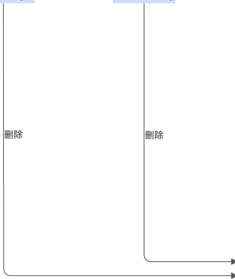
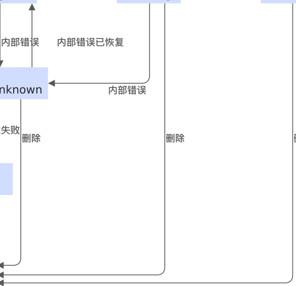

阿里云  
专有云  
裸金属容器算力平台BCI 用户指南  
产品版本：v3.18.6-SP2607  
文档版本：20260803

**目录**

- [1.什么是裸金属容器算力平台BCI](#section-1)
- [2.登录裸金属容器算力平台BCI](#section-2)
- [3.容器组](#section-3)
    - [3.1. 容器组概述](#section-3-1)
    - [3.2. 弹性容器组生命周期](#section-3-2)
    - [3.3. 创建弹性容器组](#section-3-3)
    - [3.4. 查看弹性容器组](#section-3-4)
    - [3.5. 远程登录容器](#section-3-5)
    - [3.6. 删除弹性容器组](#section-3-6)
- [4.存储](#section-4)
    - [4.1. 数据卷概述](#section-4-1)
    - [4.2. 挂载EmptyDir数据卷](#section-4-2)
    - [4.3. 挂载ConfigFile数据卷](#section-4-3)
- [5.监控](#section-5)
    - [5.1. 查看容器组监控指标](#section-5-1)
- [6.EVPC](#section-6)

<a id="section-1"></a>

# 1.什么是裸金属容器算力平台BCI

裸金属容器算力平台BCI（Bareless Containers Instance），融合了BareMetal（裸金属）与Serverless（无服务器），提供Serverless化的容器服务。您无需管理底层服务器，也无需关心运行过程中的容量规划，只需要提供打包好的Docker镜像，即可运行容器。

**产品概述**

裸金属容器算力平台BCI是阿里云结合容器和Serverless技术为您提供的容器运行服务。通过使用BCI，在阿里云上部署容器时，您无需购买和管理云服务器ECS，只需提供打包好的Docker镜像，即可在阿里云上运行容器。

从购买配置ECS再部署容器（ECS模式）到直接部署容器（BCI模式），BCI为您省去了底层服务器的运维和管理工作，让您专注于业务开发，提升开发效率。

使用BCI时，您既可以借助OpenAPI将BCI接入到您已有的业务系统中，通过OpenAPI和控制台直接快速部署容器应用；也可以通过Virtual Kubelet对接Kubernetes集群，借助BCI的弹性能力轻松应对突发业务流量。

<a id="section-2"></a>

# 2.登录裸金属容器算力平台BCI

本章节介绍如何登录裸金属容器算力平台BCI控制台。

**前提条件**

- 登录Apsara Uni-manager运营控制台前，确认您已从部署人员处获取Apsara Uni-manager运营控制台的服务域名地址。

- 推荐使用Chrome浏览器。

**操作步骤**

1. 在浏览器地址栏中，输入Apsara Uni-manager运营控制台的服务域名地址，按回车键。

   

   > **说明**
   >
   > - 单击页面右上角的当前语言可以切换其它语言。
   >
   > - 由于浏览器证书过期或环境开启HTTPS认证等出现多次单击继续访问或无Apsara Uni-manager运营控制台地址入口等现象，此时需要安装证书才能正常访问。单击页面右上角的**浏览器证书安装**，可打开浏览器证书安装指南。

2. 输入正确的用户名及密码。

   > **说明**
   >
   > - 请向运营管理员获取登录控制台的用户名和密码。
   >
   > - 首次登录Apsara Uni-manager运营控制台时，需要修改登录用户名的密码，请按照提示完成密码修改。为提高安全性，密码长度必须为10~32位，且包含英文字母大小写、阿拉伯数字和特殊符号（感叹号（!）、at（@）、井号（#）、美元符号（$）、百分号（%）等）。

3. 勾选**我已阅读并同意产品服务协议、隐私协议、用户协议**。

   > **说明**
   >
   > - 登录页展示的链接文字为文档标题，单击链接文字，可查看协议的详细内容。
   >
   > - **产品服务协议**、**隐私协议**和**用户协议**仅在已发布时才会显示。如果三种类型协议都没有发布，则不需要执行该操作。

4. 单击**账号登录**/**授权登录**。

   > **说明**
   >
   > “授权登录”仅第三方认证的全局IdP设置启用时才会显示，且该显示名称可自定义，默认显示名称为“授权登录”。

5. 如果账号已激活MFA多因素认证，请根据以下两种情况进行操作：

   > **说明**
   >
   > 公网场景下，登录入口默认强制开启多因素认证。

   - **开启MFA后的首次登录**

     <ol type="a">

     <li>

     输入账号密码登录后，展示绑定虚拟MFA设备页面。

     </li>

     <li>

     在绑定虚拟MFA设备页面中，按页面提示步骤绑定虚拟MFA设备。

     </li>

     </ol>

     <ol type="i" start="100">

     <li>

     登录成功，进入控制台。

     </li>

     </ol>

   - **已开启并绑定MFA**

     输入6位MFA码后单击**认证**。

6. 在页面顶部的导航栏中，选择**产品 > 计算 > 裸金属容器算力平台BCI**。

<a id="section-3"></a>

# 3.容器组

<a id="section-3-1"></a>

## 3.1. 容器组概述

一个容器组由GPU、vCPU、内存、网络等基础组件组成的sandbox实例，用于运行一个或多个容器。本文介绍容器组的基本配置、创建方式和生命周期等。

**基本配置**

容器组包含实例规格、容器镜像、网络、存储等基础组件，您可以方便地定制、更改实例的配置。您对该容器组拥有完全的控制权，不需要进行底层服务器的管理和配置操作，只需要提供打包好的容器镜像，即可运行容器。

- 实例规格

  一个容器组主要包括GPU、vCPU和内存规格。创建容器组时，可以使用基础模式配置实例资源（直接指定GPU、vCPU和内存），也可以指定具体资源规格，使用系统提供的具体GPU、vCPU、内存等进行容器组实例资源配置。

- 容器镜像

  一个容器组由一个或者多个容器组成，部署容器应用时，需要准备好容器镜像。容器镜像包含容器应用运行所需的程序、库文件、配置等。拉取镜像时，需要保证网络畅通，推荐您使用镜像缓存功能来节约实例的启动耗时。

- 网络

  一个容器组将占用所属VPC下的交换机的一个弹性网卡资源，默认具备一个内网IP地址。

- 存储

  一个容器组默认有30 GiB的临时存储空间，您可以根据需要增加临时存储空间。如果想要保留存储的文件，建议使用外挂数据卷。

**创建方式**

根据业务场景和使用场景，容器组支持两种实例的定义方式。

<table>
  <tr>
    <th width="148">创建方式</th>
    <th>说明</th>
  </tr>
  <tr>
    <td>指定vCPU和内存</td>
    <td>根据您指定的vCPU和内存进行创建。在此基础上，如果您对性能有更多要求，可以进一步指定算力类别。对于不满足容器组要求的vCPU和内存规格，系统将自动进行规整。</td>
  </tr>
  <tr>
    <td>指定资源规格</td>
    <td>根据您指定的资源规格进行创建，您可以根据业务需要，指定Pod底层使用具体的某一资源规格，来获取相应规格的指定能力。</td>
  </tr>
</table>

**生命周期**

如果您没有通过Kubernetes集群来对接使用BCI，为保证业务的健壮性和避免资源浪费，需要您对容器组进行生命周期管理，根据不同状态进行业务逻辑处理。更多信息，请参见弹性容器组生命周期。

<a id="section-3-2"></a>

## 3.2. 弹性容器组生命周期

本文介绍容器组的生命周期状态，您可以根据容器组状态，设计和实现符合您业务逻辑的处理逻辑。

**容器组状态**

在容器组的生命周期中，不同的阶段有其固有的状态，具体如下表所示。

| 容器组状态 | 说明 |
| --- | --- |
| 待处理（Pending） | 创建容器组后，系统等待处理。 |
| 调度中（Scheduling） | 系统通知调度进行调度资源。 |
| 创建中（Creating） | 容器组正在创建。 |
| 运行中（Running） | 容器组中所有容器均已经创建成功，并且至少有一个容器正在运行中，或者正在重启。 |
| 运行成功（Succeeded） | 容器组中所有容器均已运行成功终止，并且不会再重启。 |
| 运行失败（Failed） | 容器组中所有容器均已运行终止，并且至少有一个容器是运行失败终止，即容器以非0状态退出或者被系统终止。 |
| 未知（Unkown） | 系统出现内部错误。 |
| 删除中（Deleating） | 容器组正在删除。 |

容器组的生命周期状态转换如下图所示。

Create

BCI


通知调度

调度成功

创建成功

运行成功

Pending

Scheduling

Creating

Running

Succeeded





Unknown

创建失败

删除

删除

Failed

删除

Deleting

彻底删除

Deleted

**容器状态**

| 状态 | 说明 |
| --- | --- |
| 启动中（Waiting） | 容器正在等待创建，还未开始运行。 |
| 运行中（Running） | 容器已经成功创建，并且正在运行。 |
| 运行终止（Terminated） | 容器运行终止并退出，包括运行成功终止和运行失败终止。 |

<a id="section-3-3"></a>

## 3.3. 创建弹性容器组

**操作步骤**

1. 登录裸金属容器算力平台BCI。

2. 在左侧导航栏中，选择**容器组**。

3. 单击**创建弹性容器组**。

4. 在**创建弹性容器组**页面，配置弹性容器组属性。

   | 类型 | 配置项 | 是否必选 | 说明 |
   | --- | --- | --- | --- |

   仅支持**按量计费**。用户先使用服务，然后根据实际使用的资源量在事后生成费用。这种方式适用于业务用量经常变化的场景，用户可以根据实际需求灵活使用资源，避免浪费。

   是

   **计费配置**

   **计费方式**

   > **说明**
   >
   > 仅当您的管理员在运营中心中配置了计费规则时才会展示此选项。关于计费规则的详细说明，请参见<strong>《统一云管平台 用户指南》</strong>中的<strong>《计费规则》</strong>章节。

   是

   弹性容器组所属的组织。

   **组织**

   是

   弹性容器组所属的资源集。

   **资源集**

   是

   弹性容器组所属的地域。

   **地域**

   是

   弹性容器组所属的可用区。

   **可用区**

   - 如果提示：该组织尚未进行容器服务RAM角色授权，请单击右侧按钮进行授权，继续操作需要该组织先进行容器服务RAM角色授权，在新页面授权完成后可单

   **基本信息**

   **容器服务RAM**

   是

   击右侧刷新按钮刷新状态。

   **角色授权**

   - 如果提示：该组织已经进行了容器服务RAM角色授权，可以继续操作。

   - 如果提示：该组织尚未进行云接入网关RAM角色授权，请单击右侧按钮进行授权，继续操作需要该组织先进行云接入网关RAM角色授权，授权完成后可单击右侧刷新按钮刷新状态。

   **云接入网关**

   是

   - 如果提示：该组织已经进行了云接入网关RAM角色授

   **RAM角色授权**

   权，可以继续操作集群创建。

   选择已创建的专有网络，或者单击**创建专有网络**即时创建专有网络，创建完成后，返回集群创建页面并单击

   

   图标，查看专有网络列表。创建专有网络的具体操

   是

   **专有网络**

   作，请参见专有云文档中心<strong>《专有网络VPC用户指南》</strong>中的<strong>《创建和管理专有网络》</strong>章节。

   **网络配置**

   选择已创建的交换机，或者单击**创建交换机**即时创建交

   

   换机，创建完成后，返回集群创建页面并单击

   图

   是

   **虚拟交换机**

   标，查看交换机列表。

   创建交换机的具体操作，请参见专有云文档中心<strong>《专有网络VPC用户指南》</strong>中的<strong>《创建和管理交换机》</strong> 章节。

   选择安全组。

   是

   **安全组**

   通过配置安全组规则，可以允许或禁止安全组内的容器对公网或私网的访问，以及IP间的访问。

   输入容器组名称。

   否

   **容器组名称**

   名称长度为2~128个字符，可包含英文小写字母、数字或者短划线（-），不能以短划线（-）开始或结尾。

   选择重启策略。

   - **失败后重启**：仅当容器以非0状态码退出 （即运行失败）时才重启；若容器正常退出（exit 0），则不再重启。适用于批处理任务或可能因临时错误失败但可重试的作业。

   - **总是重启**：无论容器退出状态码为何（成功或失败），均立即重启。适用于长期运行的服务型应用（如 Web 服务器、API 服务），需保证容器持续可用。

   是

   **重启策略**

   > **说明**
   >
   > 即使容器正常退出（exit 0），也会被重启。

   - **永不重启**：无论容器退出原因如何，均不重启。适用于一次性任务（如数据迁移、初始化脚本）；需由上层编排系统（如 Job、CronJob）统一管理重试逻辑的场景。

   支持**基础模式**和**指定规格**。

   - **基础模式**：选择GPU类型、GPU数量、CPU数量、内

   **容器组配置**

   存、EVPC和GPU驱动版本，该方式可以提供更好的

   是

   **规格配置**

   弹性和资源供应能力。

   - **指定规格**：当您的业务需要有特殊的规格需求，例如GPU等，您可以指定特定的ECS规格。

   - **存储**：容器组支持挂载数据卷作为持久化存储，支持设置临时目录（EmptyDir）和配置项（ConfigFile）。

   否

   **高级配置**

   - **临时存储大小**：取值范围：30~2048 GiB，默认为30 GiB。

   - **自动采集容器标注到SLS**和**自动监控指标采集（CPU/内存/GPU/RDMA）**：暂不支持该参数配置。

   是

   输入容器名称。

   **容器名称**

   是

   输入容器镜像。

   **容器镜像**

   默认为按需拉取（IfNotPresent），即优先使用本地镜

   是

   **镜像拉取策略**

   像，本地没有时则拉取镜像。

   否

   设置各个容器的启动命令和参数。

   **启动命令**

   **容器配置**

   - **CPU**、**内存**和**GPU**：设置容器组中各容器的CPU、内存和GPU。

     各容器的vCPU和内存汇总后，不能超过即容器组的vCPU和内存设置。

   - **环境变量**：设置容器的环境变量。

   - **存储**：在容器组高级配置中开启了存储开关后才能配

   否

   **高级配置**

   置该参数。具体配置说明，请参见挂载EmptyDir数据卷和挂载ConfigFile数据卷

   - **日志采集**、**健康检查**、**生命周期**：暂不支持该参数配置。

   当前仅支持从ACR中拉取镜像，具体操作，请参见<strong>《容</strong>

   否

   <strong>器镜像服务ACR 用户指南》</strong>文档中的<strong>《配置访问凭</strong>

   **镜像仓库访问凭证**

   <strong>证》</strong>章节。

   标签由区分大小写的键值对组成，您最多可以设置20个标签。 标签键不可以重复，最长为64个字符； 标签值

   否

   **标签**

   可以为空，最长为128个字符。标签键和标签值都不能以“aliyun”、“acs:”、“https://”或“http://”开头。

<a id="section-3-4"></a>

## 3.4. 查看弹性容器组

在实例详情页面，您可以查看事件和日志来排查问题，也可以查看基础监控、GPU监控、容器稳定性监控、RDMA指标监控等监控信息了解实例运行情况。本文介绍如何查看BCI容器组的事件、日志和监控信息。

**操作步骤**

1. 登录裸金属容器算力平台BCI。

2. 在左侧导航栏中，选择**容器组**。

3. 在弹性容器组列表页上方筛选框，根据**弹性容器组ID**或**弹性容器组名称**来筛选容器组。

   使用**弹性容器组ID**筛选时，多个容器ID之间使用逗号隔开。

4. 单击目标容器组ID，进入弹性容器组详情页。

5. 在实例详情页面，可以容器基本信息、日志或监控信息。

   <table>
     <tr>
       <th width="122">操作</th>
       <th>操作步骤</th>
     </tr>
     <tr>
       <td>查看基本信息</td>
       <td>在<strong>基本信息</strong>区域，可以查看容器组ID、容器组名称、状态、标签、CPU、内存、规格等信息。</td>
     </tr>
     <tr>
       <td>查看容器</td>
       <td>单击<strong>容器</strong>页签，可以查看容器组中各容器的容器名称、状态、GPU、CPU、内存、启动命令、环境变量和挂载的数据卷等参数。</td>
     </tr>
     <tr>
       <td>查看数据卷</td>
       <td>单击<strong>数据卷</strong>页签，可以查看容器组挂载的数据卷，包括临时目录（EmptyDir）和配置项（ConfigFile）。</td>
     </tr>
     <tr>
       <td>查看事件</td>
       <td>单击<strong>事件</strong>页签，可以查看容器组的事件，包括事件类型、事件的归属对象名、事件名和事件消息等。</td>
     </tr>
     <tr>
       <td>查看日志</td>
       <td>单击<strong>日志</strong>页签，选择<strong>容器名称</strong>和<strong>开始时间</strong>，单击<strong>确定</strong>，即可查看容器运行日志。</td>
     </tr>
     <tr>
       <td>查看监控信息</td>
       <td>单击<strong>监控</strong>页签，可以查看<strong>基础监控</strong>、<strong>GPU监控</strong>、<strong>容器稳定性监控</strong>和<strong>RDMA指标监控</strong>信息。更多监控信息，请参见查看容器组监控指标。</td>
     </tr>
   </table>

<a id="section-3-5"></a>

## 3.5. 远程登录容器

部署容器后，可远程登录容器，执行命令进行调试。

**操作步骤**

1. 登录裸金属容器算力平台BCI。

2. 在左侧导航栏中，选择**容器组**。

3. 单击目标容器组ID，进入弹性容器组详情页。

4. 单击页面右上角的**远程登录**。

5. 在弹出的对话框中选择**容器**、**命令**，然后单击**登录**。

   相关说明如下：

   - 选择容器时，仅支持选择**运行中**的容器。

   - Shell命令类型仅支持<strong>/bin/sh</strong>和<strong>/bin/bash</strong>。

6. 根据需要输入并执行命令。

   ```text
   / # ls
   bin  dev  etc  home  proc  root  sys  tmp  usr  var
   / #
   ```

<a id="section-3-6"></a>

## 3.6. 删除弹性容器组

对于不再使用的弹性容器组，您可以在弹性容器组控制台进行删除。

**操作步骤**

1. 登录裸金属容器算力平台BCI。

2. 在左侧导航栏中，选择**容器组**。

3. 在容器组页面，找到想要删除的实例，选择以下一种方式进行删除。

   - 单击要删除的容器组对应**操作**列中的**删除**。

   - 选中一个或多个容器组，单击底部的**删除弹性容器组**。

4. 在弹出的对话框中，单击**确定**。

<a id="section-4"></a>

# 4.存储

<a id="section-4-1"></a>

## 4.1. 数据卷概述

弹性容器组支持挂载数据卷作为持久化存储。本文介绍弹性容器组支持的数据卷及其配置方式。

**数据卷介绍**

容器中的文件在磁盘上是临时存放的，这给容器中运行的应用程序带来一些问题：

- 当容器崩溃时，容器重建不会保留容器运行过程中产生的文件，会导致文件丢失。

- 当一个容器组中同时运行多个容器时，无法在这些容器之间共享文件。

对于上述问题，容器组支持通过数据卷（Volume）的方式来解决。目前容器组支持挂载以下几类数据卷：

| 数据卷类型 | 说明 | 相关文档 |
| --- | --- | --- |
| EmptyDir | 临时目录，用于临时存放数据，便于容器之间共享数据。EmptyDir数据卷中的数据会随容器组删除而清空。 | 挂载EmptyDir数据卷 |
| ConfigFile | 配置文件，用于向容器组注入配置数据。 | 挂载ConfigFile数据卷 |

**配置说明**

使用数据卷时，需要先声明数据卷，然后将数据卷挂载到容器中。

通过控制台创建容器组时，您可以在**容器组配置**区域声明数据卷，然后在**容器配置**区域，将数据卷挂载到容器中。

1. 在**容器组配置**区域的**高级配置**处，声明数据卷。

   目前控制台仅支持配置以下几类数据卷：

   - 配置项（ConfigFile）

   - 临时目录（EmptyDir）

2. 在**容器配置**区域，在某一容器的**高级配置**处，将数据卷挂载到该容器。

<a id="section-4-2"></a>

## 4.2. 挂载EmptyDir数据卷

EmptyDir数据卷是一个空的目录，用于临时存放数据，便于容器之间共享数据。本文介绍如何为弹性容器组挂载EmptyDir数据卷。

**配置说明**

在控制台创建弹性容器组时，您可以在**容器组配置**区域声明数据卷，然后在**容器配置**区域，将数据卷挂载到容器中。

**声明数据卷**

1. 在**容器组配置**区域，展开**高级配置**。

2. 开启**存储**开关后，选择**临时目录**页签，然后单击**添加临时目录**。

3. 输入EmptyDir数据卷的名称并设置shm大小。

   例如，在名称中输入 `emptydir-demo` 。

**挂载数据卷**

1. 在**容器配置**区域选择容器，展开该容器的高级配置。

2. 打开**存储**开关后，单击**添加存储**。

3. 选择**存储**，设置**容器内挂载路径**。

   此处存储为配置容器组时声明的数据卷 `emptydir-demo` 。

> **说明**
>
> 如果要为多个容器挂载数据卷，请选择其他容器，重复上述操作。

<a id="section-4-3"></a>

## 4.3. 挂载ConfigFile数据卷

ConfigFile数据卷是一种用于存储配置文件的数据卷，可以向BCI实例注入配置数据。本文介绍如何为弹性容器组挂载ConfigFile数据卷。

**使用限制**

ConfigFile数据卷中，单个配置文件不能大于32 KB，多个配置文件的总和不能大于60 KB。

**配置说明**

在控制台创建弹性容器组时，您可以在**容器组配置**区域声明数据卷，然后在**容器配置**区域，将数据卷挂载到容器中。

**声明数据卷**

1. 在**容器组配置**区域，展开**高级配置**。

2. 开启**存储**开关后，选择**临时目录**页签，，单击**添加配置项**。

3. 配置ConfigFile数据卷的相关参数。

   - **名称**：ConfigFile数据卷的名称（例如 `configfile-demo` ）。

   - **配置文件Path**：配置文件所在的相对文件路径。

   - **文件内容**：配置文件的内容。请明文输入，控制台会自动进行Base64编码。

**挂载数据卷**

1. 在**容器配置**区域选择容器，展开该容器的高级配置。

2. 打开**存储**开关后单击**添加**存储。

   此处可添加的数据卷为配置容器组时声明的数据卷。

   

   

   选择存储为configfile-demo，类型为 配置项 ，设置容器内挂载路径为  `/data` ，不勾选 只读 。

> **说明**
>
> 如果要为多个容器挂载数据卷，请选择其他容器，重复上述操作。

<a id="section-5"></a>

# 5.监控

<a id="section-5-1"></a>

## 5.1. 查看容器组监控指标

本文介绍如何查看容器组的监控指标。

**操作步骤**

1. 登录裸金属容器算力平台BCI。

2. 在左侧导航栏中，选择**容器组**。

3. 单击目标容器组ID，进入弹性容器组详情页。

4. 在容器组详情页，单击**监控**页签。

5. 当前页面包含以下四个部分，从不同角度分析和统计容器组监控信息。支持自定义时间段。

   <ol type="i">

   <li>

   查看**基础监控**。

   | 监控项 | 说明 |
   | --- | --- |
   | CPU使用率 | 当前CPU的使用百分比，反映CPU负载情况。 |
   | 内存使用率 | 已使用内存占总内存的比例。 |
   | 磁盘使用率 | 已用磁盘空间占总磁盘空间的百分比。 |
   | 系统负载load1 | 过去1分钟内的平均系统负载，反映系统繁忙程度。 |
   | TCP连接量 | 当前系统建立的TCP连接总数。 |

   </li>

   <li>

   查看**GPU监控**。

   | 监控项 | 说明 |
   | --- | --- |
   | GPU温度 | 当前GPU温度。 |
   | GPU功率 | 当前GPU功率，反映负载强度。 |
   | GPU利用率 | 当前GPU利用率。 |
   | GPU显存使用率 | 当前GPU编码器的利用率。 |

   </li>

   <li>

   查看**容器稳定性监控**。

   | 监控项 | 说明 |
   | --- | --- |
   | SANDBOX 线程数量 | 每个 pod/runtime 当前线程数量。 |
   | 容器组内存OOM稳定性 | 所有 pod 在最近 5 分钟内 OOM kill 的总次数。 |
   | 容器组内存分配稳定性 | 物理机上所有 sandbox/pod 最近 5 分钟内 swap in + swap out 的总新增次数。 |
   | 容器组网络收发错误 | 当前物理机上所有 sandbox/pod、所有网卡最近 5 分钟内 RX error + TX error 的总新增次数。 |
   | 容器组网络DROP | 当前物理机上所有 sandbox/pod、所有网卡最近 5 分钟内 RX drop + TX drop 的总新增次数。 |
   | 容器组网络重传 | 当前物理机上所有 sandbox/pod 最近 5 分钟内 TCP retrans segs 的总新增数。 |

   </li>

   <li>

   查看**RDMA监控**。

   | 监控项 | 说明 |
   | --- | --- |
   | RDMA网络发送吞吐 | RDMA网络每秒发送的数据量，反映发送性能。 |
   | RDMA网络接收吞吐 | RDMA网络每秒接收的数据量，反映接收性能。 |
   | RDMA网络缓冲区溢出数 | 接收端缓冲区不足导致数据包被丢弃的次数。 |
   | RDMA网络数据报文乱序数 | RDMA传输中报文未按序到达的次数。 |
   | RDMA本机CQE错误数 | 本机完成队列（CQE）中记录的错误数量，如无效请求、资源不足等，反映本地RDMA操作异常。 |
   | 对端RNR NAK包数 | 对端设备因资源未就绪（Receive Not Ready）而返回的NAK（否定确认）包数量。 |

   </li>

   </ol>

<a id="section-6"></a>

# 6.EVPC

本文介绍如何创建和删除EVPC。

**创建EVPC**

1. 登录裸金属容器算力平台BCI。

2. 在左侧导航栏中，选择**EVPC管理**。

3. 单击**创建EVPC**，在**创建EVPC**页面，配置EVPC参数。

   | 配置项 | 是否必选 | 说明 |
   | --- | --- | --- |
   | 组织 | 是 | EVPC所属的组织。 |
   | 资源集 | 是 | EVPC所属的资源集。 |
   | 地域 | 是 | EVPC所属的地域。 |
   | 可用区 | 是 | EVPC所属的可用区。 |
   | CpnZoneId | 是 | 选择CPNZoneID。 |
   | EVPC名称 | 是 | 长度为2～128个字符，必须以字母或中文开头，可包含数字、半角句号（.）、下划线（_）和短划线（-）。 |
   | 描述 | 否 | 长度为2~256个字符，不能以http://和https://开头。 |
   | 标签 | 否 | 标签由区分大小写的键值对组成，您最多可以设置20个标签。 标签键不可以重复，最长为64个字符； 标签值可以为空，最长为128个字符。标签键和标签值都不能以“aliyun”、“acs:”、“https://”或“http://”开头。 |

4. 单击**提交**。

**删除EVPC**

1. 登录裸金属容器算力平台BCI。

2. 在左侧导航栏中，选择**EVPC**。

3. 单击目标EVPC**操作**列的**删除**。

4. 在弹出的对话框，单击**确定**。
