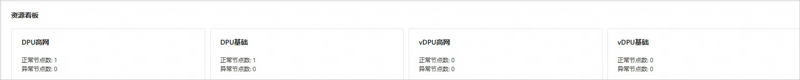
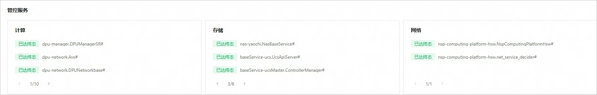

阿里云  
专有云  
裸金属容器算力平台BCI 运维指南  
产品版本：v3.18.6-SP2607  
文档版本：20260729

**目录**

- [1.运维概述](#section-1)
- [2.登录BCI运维平台](#section-2)
- [3.集群概览](#section-3)
- [4.资源管理](#section-4)
    - [4.1. 查看服务器详情](#section-4-1)
    - [4.2. 远程登录服务器](#section-4-2)
    - [4.3. 重启服务器](#section-4-3)
    - [4.4. 重新注册服务器](#section-4-4)
    - [4.5. 服务器资源使能](#section-4-5)
    - [4.6. 网络恢复](#section-4-6)
    - [4.7. 下线服务器](#section-4-7)

# 1.运维概述

本文介绍裸金属容器算力平台（Bareless Containers Instance，简称BCI）运维的目的、要求、注意事项、以及寻求帮助的方式。

**目的**

本手册指导维护人员对裸金属容器算力平台进行预防性的维护，确保系统长期稳定运行。维护人员可以根据本手册的指导，处理维护过程中发现的系统问题。如果根据本手册无法解决系统问题，请寻求阿里云工程师的技术支持。

**要求**

- 维护人员必须拥有IT行业技能，包括计算机网络知识、计算机操作知识、问题分析排查能力。

- 维护人员必须经过阿里云系统岗前培训，学习必要的阿里云系统知识，包括但不限于系统原理、组网、特性使用和维护工具的使用。

> **重要**
>
> 在维护操作过程中，维护人员务必遵守操作规章，确保人身安全和系统安全。对用户数据严格保密，未经用户书面许可，禁止复制、传播用户数据。

**注意事项**

为了系统的稳定运行，避免意外事故的发生，维护人员需遵循以下事项：

- 分层分权管理：

  对网络、设备、系统、数据实行分层分权管理，相应业务的维护人员仅拥有完成自身角色任务相对应的权限，防止越权操作而引起系统故障。

- 系统安全：

  - 在对系统进行任何操作前，需清楚的了解操作的结果，避免危险操作影响系统运行。

  - 在操作过程中遇到的问题，需清楚记录以便于问题排查和故障处理。

- 人身和数据安全：

  - 操作电气设备时，必须根据设备要求做好安全措施。

  - 需使用安全的设备接入业务网络。

  - 未经授权，严禁对数据进行复制和传播。

**寻求帮助**

维护人员在系统维护过程中，需要相关帮助，可以联系阿里云技术支持获取帮助。

# 2.登录BCI运维平台

本文介绍运维工程师等相关用户如何登录到BCI运维控制台。

**前提条件**

- 已从部署人员或管理员处获取Apsara Uni-manager运维控制台的访问地址、用户名和密码。

  Apsara Uni-manager运维控制台访问地址格式为 `region-id.ops.console.intranet-domain-id.com` 。

- 推荐使用Chrome浏览器。

**操作步骤**

1. 打开浏览器。

2. 在地址栏中，输入Apsara Uni-manager运维控制台的访问地址 `region-id.aso.intranet-domain-id.com` ，按回车键。

   

   > **说明**
   >
   > 您可以单击右上角的当前语言切换其它语言。当前支持简体中文、英文、繁体中文三种语言切换。

3. 输入正确的用户名及密码。

   > **说明**
   >
   > - 登录Apsara Uni-manager运维控制台的用户名和密码请从部署人员或管理员处获取。
   >
   > - 若连续输入密码错误三次，系统将启动图片验证码登录功能；若连续输入错误五次，账户将被锁定，请联系管理员进行激活。

   首次登录Apsara Uni-manager运维控制台时，需要修改登录用户名的密码，请按照提示完成密码修改。

   为提高安全性，密码必须满足以下要求：

   - 必须包含英文大小写字母。

   - 必须包含阿拉伯数字（0~9）。

   - 必须包含特殊符号，包括感叹号（!）、at（@）、井号（#）、美元符号（$）、百分号（%）等。

   - 密码长度为10~20个字符。

4. 单击**账号登录**。

5. 在页面顶部的菜单栏中，选择**产品运维 > 计算运维 > BMCP运维平台**。

6. 在左侧导航栏，选择**BCI运维平台 > 概览**。

# 3.集群概览

本文介绍BCI运维平台概览页的内容。概览数据包括资源看板、管控服务、资源TOP信息等多个方面。

**操作步骤**

1. 登录BCI运维平台。

2. 在左侧导航栏，选择**BCI运维平台 > 概览**。

   即可查看BCI资源看板、管控服务、资源TOP信息。

**资源看板**

资源看板中包含DPU高网、DPU基础、vDPU高网和vDPU基础资源的使用情况（正常节点数和异常节点数）。

**管控服务**

管控服务模块中展示计算、存储、网络类别管控服务的服务状态。服务状态可为**异常**或**已达终态**。其中**异常**表明对应服务未完成部署，**已达终态**表明对应服务已完成部署。

单击服务角色名，可查看服务角色部署的机器列表。包括状态、服务角色、IP、主机名、集群、状态描述和所属产品。

**资源TOP**

资源TOP包括**BCI实例资源使用top 10**和**BCI 实例数最多的top10组织**的资源数据。

**BCI实例资源使用top 10**的下拉框可以筛选GPU、CPU和内存资源。

# 4.资源管理

## 4.1. 查看服务器详情

本节介绍了如何查询局点内的全量物理服务器列表及其详细信息。

**操作步骤**

1. 登录BCI运维平台。

2. 在左侧导航栏中，选择**BCI运维平台 > 资源管理**。

3. 查询服务器：

   - 基础查询：

     <ol type="a">

     <li>

     支持输入地域、实例ID、实例名称、主机SN、DPUSN、机型等信息。

     </li>

     <li>

     单击  ，模糊查询符合条件的服务器。

     </li>

     </ol>

   - 高级筛选：

     <ol type="a">

     <li>

     单击**高级筛选**。

     </li>

     <li>

     支持输入地域、实例ID、实例名称、主机SN、DPUSN、机型等信息。

     </li>

     </ol>

     <ol type="i" start="100">

     <li>

     单击**搜索**，进行所选条件复合模糊查询。

     </li>

     </ol>

5. 单击目标服务器操作列**详情**，可查看服务器的**基本信息**、**监控**和**操作日志**。

   <ol type="i">

   <li>

   基本信息

   基本信息包含的信息如下表所示。

   <table>
     <tr>
       <th width="152">信息分类</th>
       <th>描述</th>
     </tr>
     <tr>
       <td>基本信息</td>
       <td>基本信息包括<strong>实例ID</strong>、<strong>实例名称</strong>、<strong>SN</strong>、<strong>地狱</strong>、<strong>可用区</strong>等信息。</td>
     </tr>
     <tr>
       <td>节点资源使用情况</td>
       <td>包括<strong>GPU使用数量</strong>、<strong>CPU使用数量</strong>、<strong>内存使用数量</strong>和<strong>BCI 实例数</strong>。</td>
     </tr>
     <tr>
       <td>配置信息</td>
       <td>配置信息包括服务器的<strong>内存</strong>、<strong>ImageName</strong>、<strong>ImageID</strong>、<strong>网卡信息</strong>、<strong>磁盘信</strong><strong>息</strong>和<strong>GPU信息</strong>等硬件固件信息。</td>
     </tr>
   </table>

   </li>

   <li>

   监控

   单击**监控**页签，您可以查看指定时间内的内存使用率、集群负载和连接数等监控数据。

   </li>

   <li>

   操作日志

   单击**操作日志**页签，可依据操作类型和操作时间查看该服务器的历史操作日志。

   <ol type="a">

   <li>

   在操作类型下拉框中选择具体操作类型（如：裸机运维、裸机删除和裸机注册），即会立刻筛选出对应操作类型的**操作日志**。若不选择，则不过滤，会展示该节点所有类型的**操作日志**。

   </li>

   <li>

   单击**操作时间**选择**起始日期**与**结束日期**（均精确到日）并单击**确定**，会筛选出从起始日期00:00:00到结束日期23:59:59内的**操作日志**。

   </li>

   </ol>

   <ol type="i" start="100">

   <li>

   单击**操作详情**可以查看该操作内部的全部原子步骤及其详细信息。

   </li>

   </ol>

   </li>

   </ol>

## 4.2. 远程登录服务器

本文介绍如何远程登录裸机服务器。

**前提条件**

**裸机运行状态**为**运行中**。

**操作步骤**

1. 登录BCI运维平台。

2. 在左侧导航栏中，选择**BCI运维平台 > 资源管理**。

3. 在目标服务器**操作**列，单击

   **> 远程登录**。

   

4. 在弹出的登录页面，输入**用户名**和**密码**，单击**确定**。

## 4.3. 重启服务器

本文介绍如何重启服务器。

**前提条件**

**裸机操作状态**和**裸机运行状态**都为**无心跳**。

**操作步骤**

1. 登录BCI运维平台。

2. 在左侧导航栏中，选择**BCI运维平台 > 资源管理**。

3. 在目标服务器**操作**列的**重启**。

4. 在弹出的对话框，单击**确定**。

## 4.4. 重新注册服务器

本文介绍如何重新注册服务器。

**前提条件**

**裸机运行状态**为**已释放**。

**操作步骤**

1. 登录BCI运维平台。

2. 在左侧导航栏中，选择**BCI运维平台 > 资源管理**。

3. 在目标服务器**操作**列，单击  图标，然后单击**重新注册**。

4. 在弹出的对话框，单击**确定**。

## 4.5. 服务器资源使能

本文介绍如何启用和禁用服务器资源。

**启用资源**

1. 登录BCI运维平台。

2. 在左侧导航栏中，选择**BCI运维平台 > 资源管理**。

3. 找到**是否禁用**为**是**的服务器。

4. 在目标服务器**操作**列，单击**资源使能 > 启用**。

5. 在弹出的确认框，单击**确定**。

**禁用资源**

> **重要**
>
> 禁用后该资源将无法创建BCI容器组。

1. 登录BCI运维平台。

2. 在左侧导航栏中，选择**BCI运维平台 > 资源管理**。

3. 找到**是否禁用**为**否**的服务器。

4. 在目标服务器**操作**列，单击**资源使能 > 禁用**。

5. 在弹出的确认框，单击**确定**。

## 4.6. 网络恢复

当出现网络中断、丢包及断连等问题时，请使用网络恢复功能恢复服务器网络。

**操作步骤**

1. 登录BCI运维平台。

2. 在左侧导航栏中，选择**BCI运维平台 > 资源管理**。

3. 在目标服务器**操作**列，单击  图标，然后单击**网络恢复**。

4. 在弹出的对话框，单击**确定**。

## 4.7. 下线服务器

本文介绍如何重新注册服务器。

**前提条件**

物理机上没有BCI实例，即**实例数量**列为0。

**操作步骤**

1. 登录BCI运维平台。

2. 在左侧导航栏中，选择**BCI运维平台 > 资源管理**。

3. 在目标服务器**操作**列，单击  图标，然后单击**下线**。

4. 在弹出的对话框，单击**确定**。
