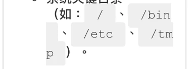

阿里云  
专有云  
裸金属算力平台BMCP 开发指南  
产品版本：v3.18.6-SP2607  
文档版本：20260803

**目录**

- [1.开发概览](#section-1)
- [2.准备工作](#section-2)
- [3.获取AccessKey](#section-3)
- [4.使用泛化调用方式调用API](#section-4)
- [5.API参考](#section-5)
    - [5.1. 集群管理](#section-5-1)
        - [5.1.1. 裸金属-智算算力集群](#section-5-1-1)
            - [5.1.1.1. CreateBmcpCluster](#section-5-1-1-1)
            - [5.1.1.2. ListBmcpMachineType](#section-5-1-1-2)
            - [5.1.1.3. ListBmcpCluster](#section-5-1-1-3)
            - [5.1.1.4. DescribeBmcpCluster](#section-5-1-1-4)
            - [5.1.1.5. AddBmcpClusterInstances](#section-5-1-1-5)
            - [5.1.1.6. ListAvailableBmcpInstance](#section-5-1-1-6)
            - [5.1.1.7. DeleteBmcpClusterInstances](#section-5-1-1-7)
            - [5.1.1.8. DeleteBmcpCluster](#section-5-1-1-8)
        - [5.1.2. 容器-智算算力集群](#section-5-1-2)
            - [5.1.2.1. CreateAckCluster](#section-5-1-2-1)
            - [5.1.2.2. ListAckCluster](#section-5-1-2-2)
            - [5.1.2.3. DescribeAckCluster](#section-5-1-2-3)
            - [5.1.2.4. AddAckClusterInstances](#section-5-1-2-4)
            - [5.1.2.5. ListAckClusterInstances](#section-5-1-2-5)
            - [5.1.2.6. ListAckClusterNodePool](#section-5-1-2-6)
            - [5.1.2.7. DeleteAckClusterInstances](#section-5-1-2-7)
            - [5.1.2.8. ModifyAckClusterDeletionProtection](#section-5-1-2-8)
            - [5.1.2.9. ListAckInstanceType](#section-5-1-2-9)
            - [5.1.2.10. ListApps](#section-5-1-2-10)
            - [5.1.2.11. DescribeApp](#section-5-1-2-11)
            - [5.1.2.12. GetOssStsToken](#section-5-1-2-12)
            - [5.1.2.13. UploadCustomApp](#section-5-1-2-13)
            - [5.1.2.14. ListCustomApps](#section-5-1-2-14)
            - [5.1.2.15. DescribeCustomApp](#section-5-1-2-15)
            - [5.1.2.16. DeleteCustomApp](#section-5-1-2-16)
            - [5.1.2.17. InstallAiInstanceResource](#section-5-1-2-17)
            - [5.1.2.18. UnInstallAiInstanceResource](#section-5-1-2-18)
            - [5.1.2.19. InstallAiApplication](#section-5-1-2-19)
            - [5.1.2.20. UpgradeAiApplication](#section-5-1-2-20)
            - [5.1.2.21. UnInstallAiApplication](#section-5-1-2-21)
            - [5.1.2.22. ListInstanceTypeDiskCategory](#section-5-1-2-22)
            - [5.1.2.23. ListAckClusterEcsWorkerInstances](#section-5-1-2-23)
            - [5.1.2.24. DescribeAckClusterLogs](#section-5-1-2-24)
            - [5.1.2.25. GetClusterNamespaces](#section-5-1-2-25)
            - [5.1.2.26. ListHistoryEvent](#section-5-1-2-26)
            - [5.1.2.27. ListReStartEvent](#section-5-1-2-27)
            - [5.1.2.28. DeleteAckCluster](#section-5-1-2-28)
        - [5.1.3. 裸金属-超算算力集群](#section-5-1-3)
            - [5.1.3.1. CreateEhpcCluster](#section-5-1-3-1)
            - [5.1.3.2. ListEhpcCluster](#section-5-1-3-2)
            - [5.1.3.3. DescribeEhpcCluster](#section-5-1-3-3)
            - [5.1.3.4. AddEhpcClusterInstances](#section-5-1-3-4)
            - [5.1.3.5. DeleteEhpcClusterInstances](#section-5-1-3-5)
            - [5.1.3.6. DeleteEhpcCluster](#section-5-1-3-6)
        - [5.1.4. 融合算力集群](#section-5-1-4)
            - [5.1.4.1. CreateBFICluster](#section-5-1-4-1)
            - [5.1.4.2. ListBFICluster](#section-5-1-4-2)
            - [5.1.4.3. DescribeBFICluster](#section-5-1-4-3)
            - [5.1.4.4. ExpandBFICluster](#section-5-1-4-4)
            - [5.1.4.5. ShrinkBFICluster](#section-5-1-4-5)
            - [5.1.4.6. DeleteBFICluster](#section-5-1-4-6)
        - [5.1.5. ListInstance](#section-5-1-5)
        - [5.1.6. GetVswitchSwitchMethod](#section-5-1-6)
        - [5.1.7. ClusterDryRun](#section-5-1-7)
        - [5.1.8. TagResources](#section-5-1-8)
        - [5.1.9. RetryFailedInstance](#section-5-1-9)
    - [5.2. 存储管理](#section-5-2)
        - [5.2.1. CreateCpfsClientCluster](#section-5-2-1)
        - [5.2.2. DescribeCpfsClientClusterType](#section-5-2-2)
        - [5.2.3. MountFilesystem](#section-5-2-3)
        - [5.2.4. UnmountFilesystem](#section-5-2-4)
        - [5.2.5. DeleteCpfsClientCluster](#section-5-2-5)
    - [5.3. EVPC](#section-5-3)
        - [5.3.1. CreateEvpc](#section-5-3-1)
        - [5.3.2. ListEvpc](#section-5-3-2)
        - [5.3.3. ListEvpcConnections](#section-5-3-3)
        - [5.3.4. ModifyEvpc](#section-5-3-4)
        - [5.3.5. DeleteEvpc](#section-5-3-5)
    - [5.4. 安全组](#section-5-4)
        - [5.4.1. CreateSecurityGroup](#section-5-4-1)
        - [5.4.2. ListSecurityGroup](#section-5-4-2)
        - [5.4.3. ModifySecurityGroup](#section-5-4-3)
        - [5.4.4. DeleteSecurityGroup](#section-5-4-4)
        - [5.4.5. AddSecurityGroupRule](#section-5-4-5)
        - [5.4.6. ListSecurityGroupRule](#section-5-4-6)
        - [5.4.7. ModifySecurityGroupRule](#section-5-4-7)
        - [5.4.8. DeleteSecurityGroupRule](#section-5-4-8)
        - [5.4.9. AddSecurityGroupInstance](#section-5-4-9)
        - [5.4.10. ListSecurityGroupInstance](#section-5-4-10)
        - [5.4.11. DeleteSecurityGroupInstance](#section-5-4-11)
    - [5.5. 密钥对](#section-5-5)
        - [5.5.1. CreateKeyPair](#section-5-5-1)
        - [5.5.2. ListKeyPair](#section-5-5-2)
        - [5.5.3. ConfigKeyPair](#section-5-5-3)
        - [5.5.4. UnbindKeyPair](#section-5-5-4)
        - [5.5.5. DeleteKeyPair](#section-5-5-5)
    - [5.6. 弹性缓存加速](#section-5-6)
        - [5.6.1. CreateEdaCluster](#section-5-6-1)
        - [5.6.2. DeleteEdaCluster](#section-5-6-2)
    - [5.7. 数据分发](#section-5-7)
        - [5.7.1. ListMP2pTask](#section-5-7-1)
        - [5.7.2. CreateMP2pTask](#section-5-7-2)
        - [5.7.3. DeleteMP2pTask](#section-5-7-3)
    - [5.8. 智能诊断](#section-5-8)
        - [5.8.1. DiagnoseQuery](#section-5-8-1)
        - [5.8.2. TaskQuery](#section-5-8-2)
        - [5.8.3. DiagnosePoint](#section-5-8-3)
    - [5.9. 事件自愈单](#section-5-9)
        - [5.9.1. ListOrder](#section-5-9-1)
        - [5.9.2. GetOrderDetail](#section-5-9-2)
        - [5.9.3. UpdateOrder](#section-5-9-3)
    - [5.10. 回收站](#section-5-10)
        - [5.10.1. ListRecycleBMCPMachine](#section-5-10-1)
        - [5.10.2. RevertMachine](#section-5-10-2)
        - [5.10.3. ReleaseMachine](#section-5-10-3)

<a id="section-1"></a>

# 1.开发概览

在使用裸金属算力平台BMCP功能前，开发人员需了解产品不同功能调用所用产品名称和API版本以及完整的使用流程，有助于正确集成和调用BMCP。

**功能调用说明**

使用BMCP API实现具体功能前，开发人员需要了解调用BMCP不同功能API时所需的产品名称和API版本的区别。

| 产品名称 | API版本 |
| --- | --- |
| EasyAI | 2023-11-01 |

**使用流程**


**正式调用**

通过SDK调用API

具体调用流程说明请参见下表。

<table>
  <tr>
    <th>阶段</th>
    <th>具体操作</th>
    <th>说明</th>
  </tr>
  <tr>
    <td rowspan="3">准备工作</td>
    <td>获取AccessKe y</td>
    <td>调用云产品API时，需要提供多个Header参数，包括x-acs-regionid（地域ID）、x-acs-organizationid（组织ID）、x-acs-resourcegroupid（资源集ID）和x-acs-instanceid（云产品资源ID）。</td>
  </tr>
  <tr>
    <td>获取AccessKe y</td>
    <td>调用BMCP API时，需要使用BMCP业务域的Endpoint。您可以在阿里云驻场运维工程师处获取，也可以自行获取Endpoint。</td>
  </tr>
  <tr>
    <td>获取AccessKe y</td>
    <td>获取AccessKey后，将访问凭证配置到环境变量中。通过环境变量配置访问凭证可避免在代码中硬编码敏感信息，提升安全性。</td>
  </tr>
  <tr>
    <td>正式调用</td>
    <td>使用泛化调用方式调用API</td>
    <td>使用泛化调用方式调用RPC风格的API。</td>
  </tr>
</table>

<a id="section-2"></a>

# 2.准备工作

使用SDK调用BMCP API前，需要完成访问凭证、公共Header、Endpoint的准备。

**获取公共Header参数**

调用专有云API时需要提供多个Header参数。公共Header参数说明请参见下表。

<table>
  <tr>
    <th>名称</th>
    <th>描述</th>
    <th>示例</th>
    <th>获取方式</th>
  </tr>
  <tr>
    <td>x-acs-regionid</td>
    <td>地域ID。</td>
    <td>cn-********-d01</td>
    <td>1. 管理员登录Apsara Uni-manager运营控制台。<br>2. 在顶部菜单栏中，单击<strong>企业</strong>。<br>3. 在左侧导航栏中，选择<strong>资源管理</strong> &gt; <strong>地域管理</strong>。<br>4. 单击目标组织名称。<br>5. 在右侧<strong>Region列表</strong>中查看Region ID。</td>
  </tr>
  <tr>
    <td>x-acs-organizatio nid</td>
    <td>资源所属的组织ID。</td>
    <td>org-10385eca88860a d8********</td>
    <td rowspan="2">重要使用个人AccessKey时必须获取这些参数，使用组织AccessKey时无需获取。<br>1. 管理员登录Apsara Uni-manager运营控制台。<br>2. 在顶部菜单栏中，单击<strong>企业</strong>。<br>3. 在左侧导航栏中，选择<strong>资源管理</strong> &gt; <strong>组织管理</strong>。<br>4. 单击目标组织名称后，在<strong>基本信息</strong>区域中查看组织ID。<br>5. 在<strong>资源集列表</strong>页签的<strong>资源集名称/ID</strong>列中查看资源集ID。您也可以通过API获取组织ID和资源集ID。获取方式请参见<em>统一云管平台开发指南</em>中的<em>GetOrganizationList、ListResourceGroup章</em><em>节</em>。</td>
  </tr>
  <tr>
    <td>x-acs-resourcegr oupid</td>
    <td>资源所属的资源集ID。</td>
    <td>rs-10385eca8c100a bc********</td>
  </tr>
  <tr>
    <td>x-acs-instanceid</td>
    <td>进行操作的资源ID。</td>
    <td>bmcp-bpnopt****</td>
    <td>资源ID可以通过Apsara Uni-manager运营控制台中的云产品实例列表进行获取。<br>1. 登录Apsara Uni-manager运营控制台。<br>2. 在顶部的菜单栏中，选择<strong>产品 &gt; 计算 &gt; 裸金属算</strong><strong>力平台 BMCP</strong>。<br>3. 在左侧导航栏中，单击<strong>集群管理</strong>、<strong>节点管理</strong>等。<br>4. 在对应资源列表中查看资源ID，例如集群ID、节点ID等。</td>
  </tr>
</table>

> **说明**
>
> 对于列表类的云产品资源实例接口，调用后会默认增加ResourceGroupName（资源集名称）、ResourceGroup（资源集ID）、DepartmentName（组织名称）和Department（组织ID）的返回值。

**获取Endpoint**

1. 登录Apsara Uni-manager运维控制台。

2. 在顶部菜单栏，选择**平台运维 > 飞天基础运维平台 > 运维工具**。

3. 在**服务注册变量大盘**页面，根据所用功能获取相应产品的Endpoint。

   <ol type="i">

   <li>

   选择**服务**并输入**easyAIControllerService**。

   </li>

   <li>

   在**easyAIControllerService**服务的**Service Registration**列中，单击  图标，然后单击显示

   的信息。

   </li>

   <li>

   在**注册变量**对话框，查看**EasyAIPopDomain**值，即 `Endpoint` 。

   </li>

   </ol>

**配置访问凭证**

获取AccessKey后，将访问凭证配置到环境变量。此处以配置AccessKey到环境变量为例介绍。

| 使用方式 | 变量名称 | 说明 |
| --- | --- | --- |
| 使用AccessKey | ALIBABA_CLOUD_ACCESS_KEY _ID、ALIBABA_CLOUD_ACCESS_KEY _SECRET | 使用个人AccessKey或组织AccessKey。 |
| 使用STS临时访问凭证 | ALIBABA_CLOUD_ACCESS_KEY _ID、ALIBABA_CLOUD_ACCESS_KEY _SECRET、ALIBABA_CLOUD_SESSION_TO KEN | STS服务获取的Access Key ID以STS开头，例如<code> STS.**************** </code>，使用通过STS服务获取的临时身份凭证（Access Key ID、Access Key Secret和Security Token）。 |

> **重要**
>
> 配置完成后请重启或刷新编译运行环境，包括IDE、命令行界面、其它桌面应用程序及后台服务，确保最新的系统环境变量成功加载。

**Linux**

1. 在命令行界面执行以下命令，将环境变量设置追加到 `~/.bashrc` 文件中。

   ```bash
   echo "export ALIBABA_CLOUD_ACCESS_KEY_ID='YOUR_ACCESS_KEY_ID'" >> ~/.bashrc
   echo "export ALIBABA_CLOUD_ACCESS_KEY_SECRET='YOUR_ACCESS_KEY_SECRET'" >> ~/.bashrc
   ```

2. 执行以下命令使变更生效。

   ```text
   source ~/.bashrc
   ```

3. 执行以下命令检查环境变量是否生效。

   ```bash
   echo $ALIBABA_CLOUD_ACCESS_KEY_ID
   echo $ALIBABA_CLOUD_ACCESS_KEY_SECRET
   ```

**macOS**

1. 在终端中执行以下命令，查看默认Shell类型。

   ```bash
   echo $SHELL
   ```

2. 根据默认Shell类型进行操作。

   **Zsh**

   <ol type="i">

   <li>

   执行以下命令，将环境变量设置追加到  `~/.zshrc`  文件中。

   ```bash
   echo "export ALIBABA_CLOUD_ACCESS_KEY_ID='YOUR_ACCESS_KEY_ID'" >> ~/.zshrc
   echo "export ALIBABA_CLOUD_ACCESS_KEY_SECRET='YOUR_ACCESS_KEY_SECRET'" >> ~/.zshrc
   ```

   </li>

   <li>

   执行以下命令使变更生效。

   ```text
   source ~/.zshrc
   ```

   </li>

   <li>

   执行以下命令检查环境变量是否生效。

   ```bash
   echo $ALIBABA_CLOUD_ACCESS_KEY_ID
   echo $ALIBABA_CLOUD_ACCESS_KEY_SECRET
   ```

   </li>

   </ol>

   **Bash**

   <ol type="i">

   <li>

   执行以下命令，将环境变量设置追加到  `~/.bash_profile`  文件中。

   ```bash
   echo "export ALIBABA_CLOUD_ACCESS_KEY_ID='YOUR_ACCESS_KEY_ID'" >> ~/.bash_profile
   echo "export ALIBABA_CLOUD_ACCESS_KEY_SECRET='YOUR_ACCESS_KEY_SECRET'" >> ~/.bash_profile
   ```

   </li>

   <li>

   执行以下命令使变更生效。

   ```text
   source ~/.bash_profile
   ```

   </li>

   <li>

   执行以下命令检查环境变量是否生效。

   ```bash
   echo $ALIBABA_CLOUD_ACCESS_KEY_ID
   echo $ALIBABA_CLOUD_ACCESS_KEY_SECRET
   ```

   </li>

   </ol>

**Windows**

**CMD**

1. 在CMD中运行以下命令。

   ```text
   setx ALIBABA_CLOUD_ACCESS_KEY_ID "YOUR_ACCESS_KEY_ID"
   setx ALIBABA_CLOUD_ACCESS_KEY_SECRET "YOUR_ACCESS_KEY_SECRET"
   ```

2. 运行以下命令，检查环境变量是否生效。

   ```bash
   echo %ALIBABA_CLOUD_ACCESS_KEY_ID%
   echo %ALIBABA_CLOUD_ACCESS_KEY_SECRET%
   ```

**PowerShell**

1. 在PowerShell中运行以下命令。

   ```text
   [Environment]::SetEnvironmentVariable("ALIBABA_CLOUD_ACCESS_KEY_ID", 
   "YOUR_ACCESS_KEY_ID", [EnvironmentVariableTarget]::User)
   [Environment]::SetEnvironmentVariable("ALIBABA_CLOUD_ACCESS_KEY_SECRET", 
   "YOUR_ACCESS_KEY_SECRET", [EnvironmentVariableTarget]::User)
   ```

2. 运行以下命令，检查环境变量是否生效。

   ```text
   [Environment]::GetEnvironmentVariable("ALIBABA_CLOUD_ACCESS_KEY_ID", 
   [EnvironmentVariableTarget]::User)
   [Environment]::GetEnvironmentVariable("ALIBABA_CLOUD_ACCESS_KEY_SECRET", 
   [EnvironmentVariableTarget]::User)
   ```

<a id="section-3"></a>

# 3.获取AccessKey

如果应用程序部署运行在安全、稳定且不易受外部攻击的环境中，需要长期访问产品，且不能频繁轮转凭证时，可以使用AccessKey（Access Key ID、Access Key Secret）初始化凭证提供者。

**背景信息**

> **警告**
>
> 个人账号AccessKey是由Apsara Uni-manager运营控制台权限体系管控的受限AccessKey，组织AccessKey相对权限较大，需要管理员确认操作的安全性。

Apsara Uni-manager运营控制台提供了个人AccessKey和组织AccessKey（只有运营管理员和一级组织管理员可以获取组织AccessKey），推荐使用个人账号AccessKey调用Apsara Uni-manager运营控制台及云产品相关接口。

> **说明**
>
> 如果使用个人账号AccessKey，需要在Header中添加x-acs-regionid（地域ID）、x-acs-organizationid（组织ID）、x-acs-resourcegroupid（资源集ID）和x-acs-instanceid（云产品资源ID）参数。具体操作请参见各产品的准备工作文档。

**获取个人账号AccessKey**

1. 登录Apsara Uni-manager运营控制台。

2. 在系统界面右上角，单击当前登录用户头像，单击**个人信息**。

3. 在**AccessKey**区域，您可以查看个人账户的AccessKey信息。

   > **说明**
   >
   > Accesskey ID和AccessKey Secret是您访问云资源时的密钥，具有该账号完整的权限，请您妥善保管。

**获取组织AccessKey**

1. 管理员登录Apsara Uni-manager运营控制台。

2. 在顶部菜单栏，单击**企业**。

3. 在左侧导航栏中，选择**资源管理 > 组织管理**。

4. 在组织结构中，单击目标一级组织名称。

5. 单击**管理Accesskey**。

6. 在弹出的对话框中，查看组织AccessKey信息。

<a id="section-4"></a>

# 4.使用泛化调用方式调用API

BMCP API没有提供SDK，您可以采用泛化调用方式。本文以使用泛化调用方式调用RPC风格的API为例介绍各语言的调用示例。

**背景信息**

使用泛化调用方式可实现任意OpenAPI接口的调用。特点如下：

- 轻量：仅需安装阿里云核心SDK，无需额外安装云产品SDK。

- 简单：仅需构造通用的请求参数对象，然后利用通用请求客户端调用通用函数发起请求，调用结果也以通用格式返回。

发起一次泛化调用请求，您需要获取以下几个参数的值，可在产品的API文档中获取相应参数的值。

- 域名(domain)：该产品的服务地址。

- API版本(version)：该API的版本号，格式为YYYY-MM-DD。BMCP产品名称为EasyAI，API版本为2023-11-01。

- 接口信息：要调用的接口名称。您需要获取 `Action` 参数并在请求中指定API名称。

  例如 `DescribeBmcpCluster` 接口，在通过Java SDK发起请求时，需要使用 `setAction("DescribeBmcpCluster")` 指定API名称。

> **说明**
>
> 本文示例中的可变参数需根据实际替换相关信息，尖括号（<>）在最终代码中不保留。

**Java示例**

**安装核心SDK**

在pom.xml中添加以下依赖安装核心SDK。

```xml
<dependency>
     <groupId>com.aliyun</groupId>
     <artifactId>aliyun-java-sdk-core</artifactId>
     // 可选择版本
     <version>[(4.0.0,5.0.0)]</version>
</dependency>
```

**完整示例**

以下示例通过调用DescribeBmcpCluster接口获取裸金属-智算算力集群详情。其中 `<your_region_id>` 请替换为集群所属地域ID，AccessKey直接通过环境变量获取， `<bmcpDomain>` 请替换为BMCP的Endpoint<strong>，</strong>其他可变参数按需配置即可。

```java
import com.aliyuncs.CommonRequest;
import com.aliyuncs.CommonResponse;
import com.aliyuncs.DefaultAcsClient;
import com.aliyuncs.IAcsClient;
import com.aliyuncs.exceptions.ClientException;
import com.aliyuncs.exceptions.ServerException;
import com.aliyuncs.profile.DefaultProfile;
public class Sample {
  public static void main(String[] args) {
    // 创建DefaultAcsClient实例并初始化
    DefaultProfile profile = DefaultProfile.getProfile(
      // 您的地域ID
      "<your-region-id>",
      // 从环境变量获取RAM账号的AccessKey ID
      System.getenv("AccessKey"),
      // 从环境变量获取RAM账号的AccessKey Secret
      System.getenv("AccessKeySecret"));
    IAcsClient client = new DefaultAcsClient(profile);
    // 创建API请求并设置参数
    CommonRequest request = new CommonRequest();
    request.setSysDomain("<bmcpDomain>");
    request.setSysProduct("EasyAI");
    request.setSysVersion("2023-11-01");
    request.setSysAction("DescribeBmcpCluster");
    request.setSysMethod(MethodType.POST);
    request.setProtocol(com.aliyuncs.http.ProtocolType.HTTP);
    request.putQueryParameter("ClusterId", "bmcp-bpnopt****");
    try {
      CommonResponse response = client.getCommonResponse(request);
      System.out.println(response.getData());
    } catch (ServerException e) {
      // TODO Auto-generated catch block
      e.printStackTrace();
    } catch (ClientException e) {
      // TODO Auto-generated catch block
      e.printStackTrace();
    }
  }
}
```

**Python示例**

**安装核心SDK**

在Terminal中执行以下命令安装核心SDK。

```bash
pip install aliyun-python-sdk-core
```

**完整示例**

以下示例通过调用DescribeBmcpCluster接口获取裸金属-智算算力集群详情。其中 `<your_region_id>` 请替换为集群所属地域ID，AccessKey直接通过环境变量获取， `<bmcpDomain>` 请替换为BMCP的Endpoint<strong>，</strong>其他可变参数按需配置即可。

```python
# coding=utf-8

import os

from aliyunsdkcore.client import AcsClient
from aliyunsdkcore.request import CommonRequest


class Sample:

    @staticmethod
    def main():
        region_id = "<your_region_id>"
        bmcp_domain = "<bmcpDomain>"
        cluster_id = "bmcp-bpnopt****"

        client = AcsClient(
            os.environ["ALIBABA_CLOUD_ACCESS_KEY_ID"],
            os.environ["ALIBABA_CLOUD_ACCESS_KEY_SECRET"],
            region_id,
            verify=False
        )

        request = CommonRequest()
        request.set_domain(bmcp_domain)
        request.set_product("EasyAI")
        request.set_version("2023-11-01")
        request.set_action_name("DescribeBmcpCluster")
        request.set_method("POST")
        request.set_protocol_type("HTTP")

        request.add_body_params("ClusterId", cluster_id)

        response = client.do_action_with_exception(request)
        print(response.decode("utf-8"))


if __name__ == "__main__":
    Sample.main()
```

**Go 调用示例**

**安装核心SDK**

在Terminal中执行以下命令安装核心SDK。

```text
go get -u github.com/aliyun/alibaba-cloud-sdk-go/sdk
```

**完整示例**

以下示例通过调用DescribeBmcpCluster接口获取裸金属-智算算力集群详情。其中 `<your_region_id>` 请替换为集群所属地域ID，AccessKey直接通过环境变量获取， `<bmcpDomain>` 请替换为BMCP的Endpoint<strong>，</strong>其他可变参数按需配置即可。

```go
package main

import (
 "fmt"
 "os"

 "github.com/aliyun/alibaba-cloud-sdk-go/sdk"
 "github.com/aliyun/alibaba-cloud-sdk-go/sdk/requests"
)

func main() {
 RegionId := "<your_region_id>"
 bmcpDomain := "<bmcpDomain>"

 client, err := sdk.NewClientWithAccessKey(
  RegionId,
  os.Getenv("ALIBABA_CLOUD_ACCESS_KEY_ID"),
  os.Getenv("ALIBABA_CLOUD_ACCESS_KEY_SECRET"),
 )
 if err != nil {
  panic(err)
 }

 request := requests.NewCommonRequest()
 request.Domain = bmcpDomain
 request.Product = "EasyAI"
 request.Version = "2023-11-01"
 request.ApiName = "DescribeBmcpCluster"
 request.Method = "POST"
 request.Scheme = "http"

 request.QueryParams["ClusterId"] = "bmcp-bpnopt****"

 response, err := client.ProcessCommonRequest(request)
 if err != nil {
  panic(err)
 }

 fmt.Print(response.GetHttpContentString())
}
```

<a id="section-5"></a>

# 5.API参考

<a id="section-5-1"></a>

## 5.1. 集群管理

<a id="section-5-1-1"></a>

### 5.1.1. 裸金属-智算算力集群

<a id="section-5-1-1-1"></a>

#### 5.1.1.1. CreateBmcpCluster

创建裸金属-智算算力集群。

**请求头**

该接口使用公共请求头，无特殊请求头。请参见公共请求参数文档。

**请求参数**

| 参数名称 | 类型 | 位置 | 是否必选 | 示例 | 说明 |
| --- | --- | --- | --- | --- | --- |
| Departme nt | Strin g | Query | 否 | 4 | 组织ID。 |
| Resource Group | Strin g | Query | 否 | 3 | 资源集ID。 |
| RegionId | Strin g | Query | 否 | cn-wulan-env\*\*\*-d01 | 地域 ID。 |
| VpcId | Strin g | Query | 否 | vpc-bp1b1xjllp3ve5yze\*\*\*\* | VPC ID。 |
| ClusterNa me | Strin g | Query | 否 | cluster-name | 集群名称。长度为1~63个字符，可包含数字、中文字符、英文字符或短划线（-）。 |
| Descriptio n | Strin g | Query | 否 | testDescription | 集群描述。长度为0~1000个字符。 |
| Password | Strin g | Query | 否 | Pwd\*\*\*\*\* | 集群中机器的登录密码。密码要求为8~30个字符，且至少同时包含大写字母、小写字母、数字、特殊字符中的三项，支持的特殊字符包括()\`~!@#$%^&amp;\*-_+=\|{}\[\]:;'&lt;&gt;,.?/。 |
| AddBmsIn stanceList | Json | Query | 否 | null | 该参数已废弃。 |
| ApplyBmsI nstanceLis t | Json | Query | 否 | \[ { "CpuCount": 2, "MemCount": 16, "FlopsCount": 30, "VideoMemCount": 30, "InstanceName": "myinstance", "UseOriginImage": true, "ImageType": "", "Image": "", "HostName": "xxx", "InstanceAlias": "xxx", "Description": "testDescription", "NodePoolName": "bmcp-node-pool", "VswitchId": "vsw-3gagdup8scary04iq\*\*\*\*", "ActivationId": "a-hz0ch3SwhOlE1234+Xo 32lAZC\*\*\*\*", "ActivationCode": "4ECEEE12-56F1-4FBC-9AB1-890F1234\*\*\*\*" } \] | 需要申请裸机的参数列表。ClusterArchType取值为managed必须配置该参数。 |
| ZoneId | Strin g | Query | 否 | cn-wulan-env\*\*\*-\*\*\*\*-a | 可用区ID。 |
| ClusterArc hType | Strin g | Query | 否 | standard | 集群类型，取值范围：<br>• standard：智算高网。<br>• managed：智算纳管。<br>• base：智算基础。<br>• aspeed：智算训推。 |
| MachineT ypeList | Json | Query | 否 | \[ { "MachineType": "test", "Arch": "x86", "CpuCount": 2, "MemCount": 4, "FlopsCount": 4.8, "VideoMemCount": 5, "NodeCount": 10, "VswitchId": "vsw-3gagdup8scary04iq\*\*\*\*"} \] | 要加入超算集群的裸机机型列表。ClusterArchType取值为standard、base、aspeed必须配置该参数。 |
| VswitchId List | Json | Query | 否 | null | 该参数已废弃。 |
| StandardV switchId | Strin g | Query | 否 | vsw-3gagdup8scary04iq\*\*\*\* | 交换机ID，用于构建管控服务网络通道。 |
| EvpcId | Strin g | Query | 否 | evpc-htchvitxlfjyso\*\*\*\* | Evpc ID。ClusterArchType取值为standard或aspeed必须配置该参数。您可以调用ListEvpc查询EvpcId。 |
| VolumeId | Strin g | Query | 否 | null | 该参数已废弃。 |
| MountPat h | Strin g | Query | 否 | null | 该参数已废弃。 |
| ActivationI d | Strin g | Query | 否 | 4ECEEE12-56F1-4FBC-9AB1-890F1234\*\*\*\* | 云助手激活码 ID。ClusterArchType取值为standard、base、aspeed必须配置该参数。 |
| Activation Code | Strin g | Query | 否 | a-hz0ch3SwhOlE1234+Xo 32lAZC\*\*\*\* | 云助手激活码的代码。ClusterArchType取值为standard、base、aspeed必须配置该参数。 |
| IsCreateC pfsCluster | Boole an | Query | 否 | true | 是否启用高性能存储客户端集群。取值范围：<br>• true：开启。<br>• false：关闭。默认值：false。ClusterArchType取值为standard或aspeed可以配置该参数。 |
| CpfsClust erType | Strin g | Query | 否 | CPFS | 高性能存储客户端集群类型，取值范围：<br>• CPFS<br>• APFS<br>IsCreateCpfsCluster取值为true时必须配置该参数。 |
| VolumeInf o | Json | Query | 否 | \[ { "VolumeType": "iscsi", "VolumeParams": { "IP": "127.0.0.1", "ServerIQN": "iqn.2023-04.com.bms:server", "ClientIQN": "", "ChapEnabled": "true", "UserID": "bms", "Password": "xxxx", "LunID": "0", "Description": "", "ClientAttachPath": "/mnt" } }, {"VolumeType": "nfs", "VolumeParams": { "IP": "127.0.0.1", "Description": "", "ServerPath": "/home/nfstestdir", "ClientAttachPath": "/mnt" } }, {"VolumeType": "mount", "VolumeParams": {"Description": "", "ServerPath": "/dev/sdl1", "ClientAttachPath": "/mnt", "MountParams": "--bind" } } \] | 第三方存储挂载信息。ClusterArchType取值为managed可以配置该参数。 |
| IsInstallYu ndunAegis | Boole an | Query | 否 | true | 是否安装安骑士。取值范围：<br>• true：开启。<br>• false：关闭。默认值：false。 |
| SwitchMet hod | Strin g | Query | 否 | CHSW | 交换机联网方式。<br>• ClusterArchType取值为standard、base或aspeed时，该参数必须为CHSW。<br>• ClusterArchType取值为managed时，该参数可以设置CHSW或HSW。 |
| EnableIpv 6 | Boole an | Query | 否 | true | 是否启用IPv6功能。取值范围：<br>• true：开启。<br>• false：关闭。默认值：false。 |
| EvpcEnabl eIpv6 | Boole an | Query | 否 | true | 是否启用EVPC IPv6。取值范围：当配置了EvpcId时才能开启IPv6。<br>• true：开启。<br>• false：关闭。默认值：false。 |

**返回数据**

| 参数名称 | 类型 | 示例 | 说明 |
| --- | --- | --- | --- |
| errorCode | String | Successful | 错误码。 |
| errorTitle | String | Successful | 异常标题。 |
| errorMessage | String | Successful | 错误信息。 |
| data | Map | { "ClusterName": "testname", "ClusterId": "bmcp-bpnopt\*\*\*\*" } | 返回数据。 |
| status | Integer | 200 | 返回状态。 |
| requestId | String | F0A8A039-930D-5EC1-97C8-\*\*\*\*\*\*\*\*\*\*\*\* | 请求ID。 |
| success | Boolean | true | 返回状态。<br>• 成功：true。<br>• 失败：false。 |
| responseVersi on | String | v1 | 返回版本。 |

**示例**

请求示例

```text
http://[Endpoint]/?Action=CreateBmcpCluster
http://[Endpoint]/?Action=CreateEhpcCluster
&Department=4
&ResourceGroup=3
&RegionId=cn-wulan-env***-d01
&ZoneId=cn-wulan-env***-****-a
&VpcId=vpc-bp1b1xjllp3ve5yze****
&ClusterName=cluster-name
&ClusterArchType=standard
&MachineTypeList=[
  {
    "MachineType": "test",
    "Arch": "x86",
    "CpuCount": 2,
    "MemCount": 4,
    "FlopsCount": 4.8,
    "VideoMemCount": 5,
    "NodeCount": 10,
    "VswitchId": "vsw-3gagdup8scary04iq****"
  }
]
&StandardVswitchId=vsw-3gagdup8scary04iq****
&EvpcId=evpc-htchvitxlfjyso****
&ActivationId=a-hz0ch3SwhOlE1234+Xo32lAZC****
&ActivationCode=4ECEEE12-56F1-4FBC-9AB1-890F1234****
&IsCreateCpfsCluster=true
&CpfsClusterType=CPFS
&SwitchMethod=CHSW
&EnableIpv6=true
&EvpcEnableIpv6=true
&公共请求参数
```

正常返回示例

`JSON`  格式

```json
{
 "responseVersion":"v1",
 "data":{
  "ClusterId":"bmcp-bpnopt****",
  "ClusterName":"testname"
 },
 "errorTitle":"Successful",
 "requestId":"F0A8A039-930D-5EC1-97C8-************",
 "success":true,
 "errorMessage":"Successful",
 "errorCode":"Successful",
 "status":200
}
```

`XML`  格式

```xml
<responseVersion>v1</responseVersion>
<data>
 <ClusterId>bmcp-bpnopt****</ClusterId>
 <ClusterName>testname</ClusterName>
</data>
<errorTitle>Successful</errorTitle>
<requestId>F0A8A039-930D-5EC1-97C8-************</requestId>
<success>true</success>
<errorMessage>Successful</errorMessage>
<errorCode>Successful</errorCode>
<status>200</status>
```

<a id="section-5-1-1-2"></a>

#### 5.1.1.2. ListBmcpMachineType

获取BMCP机型列表。

**请求头**

该接口使用公共请求头，无特殊请求头。请参见公共请求参数文档。

**请求参数**

| 参数名称 | 类型 | 位置 | 是否必选 | 示例 | 说明 |
| --- | --- | --- | --- | --- | --- |
| MachineT ype | Strin g | Query | 否 | QPG78P4M8G3V.03BB | 机型名称。 |
| CPUArch | Strin g | Query | 否 | x86_64 | CPU架构，取值范围：<br>• x86_64<br>• arm64 |
| DiskType | Strin g | Query | 否 | cloud_ssd | 磁盘类型。取值范围：<br>• HDD<br>• SSD<br>• SATA |
| Manufactu rer | Strin g | Query | 否 | NVIDIA | 厂商名称。 |
| ZoneId | Strin g | Query | 否 | cn-wulan-env\*\*\*-\*\*\*\*-a | 可用区ID。<br>• 如果传递会统计指定可用区可用通用实例数量。<br>• 如果不传，会统计本机型下所有可用区内的可用通用实例数量。 |
| PageNum ber | Integ er | Query | 否 | 1 | 页码，默认为1。 |
| PageSize | Integ er | Query | 否 | 10 | 每页容量，默认为10。 |
| DeployTy pes | Json | Query | 否 | "\["bmcp"\]" | 要查询的机型的类型列表，取值范围：<br>• bmcp：智算高网<br>• ehpc：高性能计算高网<br>• base：智算基础<br>• aspeed：训推优化<br>• bfi：融合高网<br>• bfi_base：融合基础 |
| Specificati on | Strin g | Query | 否 | gBMC-Ch4ce8hdr | 机型规格。 |

**返回数据**

| 参数名称 | 类型 | 示例 | 说明 |
| --- | --- | --- | --- |
| errorCode | String | "" | 错误码。 |
| errorTitle | String | “” | 错误标题。 |
| errorMessage | String | "“ | 错误信息。 |
| data | Map | { "PageNumber": 1, "PageSize": 10, "TotalCount": 10, "MachineTypeList": \[ { "ratedPower": "1", "memory": 500, "defaultFmin": "", "gpuManufacturer": "NVIDIA", "CPUNumber": 128, "networkCardType": "10G", "unitNum": 2, "description": "", "updateTime": "2024-03-14T10:48:43+08:0 0", "CPUArch": "x86_64", "gpu": "T4", "deployType": "bmcp", "manufacturer": "HW", "networkCardNum": 2, "GpuNum": 4, "disk": 500, "cpuManufacturer": "Hygon", "createTime": "2024-03-14T10:48:43+08:0 0", "name": "T4", "ID": 2, "diskType": "SSD", "CPUModel": "Hygon C86 7285 32-core Processor", "StandardInstance Count": 10, "Specification": "xxxx" } \] } | 返回数据。 |
| status | Integer | 0 | 返回状态。 |
| requestId | String | 66dfddc6-b547-11ee-aa84-acde4800\*\*\*\* | 请求ID。 |
| success | Boolean | true | 请求状态。 |
| responseVersi on | String | v1 | 返回版本。 |

**示例**

请求示例

```text
http://[Endpoint]/?Action=ListBmcpMachineType
&MachineType=MachineType
&公共请求参数
```

正常返回示例

`JSON`  格式

```json
{
 "responseVersion":"v1",
 "data":{},
 "errorTitle":"Successful",
 "requestId":"**",
 "success":true,
 "errorMessage":"Successful",
 "errorCode":"Successful",
 "status":200
}
```

`XML`  格式

```xml
<responseVersion>v1</responseVersion>
<data  />
<errorTitle>Successful</errorTitle>
<requestId>**</requestId>
<success>true</success>
<errorMessage>Successful</errorMessage>
<errorCode>Successful</errorCode>
<status>200</status>
```

<a id="section-5-1-1-3"></a>

#### 5.1.1.3. ListBmcpCluster

查询裸金属-智算算力集群列表。

**请求头**

该接口使用公共请求头，无特殊请求头。请参见公共请求参数文档。

**请求参数**

| 参数名称 | 类型 | 位置 | 是否必选 | 示例 | 说明 |
| --- | --- | --- | --- | --- | --- |
| Departme nt | Strin g | Query | 否 | 4 | 组织ID。 |
| Resource Group | Strin g | Query | 否 | 3 | 资源集ID。 |
| ClusterNa me | Strin g | Query | 否 | cluster-name | 集群名称。 |
| ClusterId | Strin g | Query | 否 | bmcp-bpnopt\*\*\*\* | 集群ID。 |
| Status | Strin g | Query | 否 | active | 集群状态，取值范围：<br>• creating：创建中<br>• active：运行中<br>• createFailed：创建失败<br>• deleting：删除中<br>• deleteFailed：删除失败<br>• scalingDown：缩容中<br>• scalingDownFailed：缩容失败<br>• scalingUp：扩容中<br>• scalingUpFailed：扩容失败 |
| PageNum ber | Integ er | Query | 否 | 1 | 页码。 |
| PageSize | Integ er | Query | 否 | 10 | 每页容量，默认为10。 |
| Zone | Strin g | Query | 否 | cn-\*\*\*\*-env\*\*-d01-a | 可用区ID。 |
| ClusterArc hType | Strin g | Query | 否 | standard | 集群类型，取值范围：<br>• standard：智算高网。<br>• managed：智算纳管。<br>• base：智算基础。<br>• aspeed：智算训推。 |
| EvpcId | Strin g | Query | 否 | evpc-htchvitxlfjyso\*\*\*\* | Evpc ID，Evpc的唯一标识符。您可以调用ListEvpc查询Evpc ID。 |
| VpcId | Strin g | Query | 否 | vpc-bp1b1xjllp3ve5yze\*\*\*\* | VPC ID。 |

**返回数据**

| 参数名称 | 类型 | 示例 | 说明 |
| --- | --- | --- | --- |
| errorCode | String | Successful | 错误码。 |
| errorTitle | String | Successful | 异常标题。 |
| errorMessage | String | Successful | 错误信息。 |
|  |  | { "ClusterList": \[ { |  |
|  |  |  |  |
| 参数名称 | 类型 | "Description":示例"testDescription", | 说明 |
| data | Map | "Organization": "5", "IsSetPassword": true, "SwitchMethod": "CHSW", "CpfsClusterType": "APFS", "Gpu": \[ {"GpuNum": 32, "GpuModel": "NVIDIA_Ampere_A 10_80G_NVLink" }\], "EvpcId": "evpc-pi2q\*\*\*z8b", "EnableIpv6": true, "FlopsCount": 9984, "Department": 5, "CpuCount": 512, "ClusterName": "cluster-name", "ResourceGroup": 4, "Status": "active", "ActiveNodeCount": 4, "NodeCount": 4, "ClusterId": "bmcp-v8\*\*\*QVZT", "Zone": "cn-wulan-env\*\*\*-d01-a", "CreateTime": "2026-01-12T10:44:46+08:0 0", "Specification": \[ { "Count": 3, "Name": "gBMC-Ci8af8nbr" } \], "CpfsClusterState": "active", "AscmCreateUser": "admin", "MemCount": 8192, "ClusterArchType": "standard", "VpcId": "vpc-7kkjbu\*\*\*\*od7pxs6 10", "OldClusterBzid": "", "UpdateTime": "2026-01-22T15:58:01+08:0 0", "Region": "cn-wulan-env\*\*\*-d01", "CpfsMountFs": "efs-01\*\*\*08", "RegionId": "cn-wulan-env\*\*\*-d01", "VideoMemory": 2560, "EnableIpv6": true, "EvpcEnableIpv6": true } \], | 返回数据。 |
|  |  |  |  |
| 参数名称 | 类型 | "PageSize": 10,示例"TotalCount": 1, | 说明 |
| status | Integer | "PageNumber": 1 }<br>200 | 返回状态。 |
| requestId | String | F0A8A039-930D-5EC1-97C8-\*\*\*\*\*\*\*\*\*\*\*\* | 请求ID。 |
| success | Boolean | true | 返回状态。<br>• 成功：true。<br>• 失败：false。 |
| responseVersi on | String | v1 | 返回版本。 |

**示例**

请求示例

```text
http://[Endpoint]/?Action=ListBmcpCluster
&Department=4
&ResourceGroup=3
&RegionId=cn-wulan-env***-d01
&ZoneId=cn-wulan-env***-****-a
&VpcId=vpc-bp1b1xjllp3ve5yze****
&ClusterName=cluster-name
&公共请求参数&公共请求参数
```

正常返回示例

`JSON`  格式

```json
{
 "responseVersion":"v1",
 "data":{
  "TotalCount":1,
  "ClusterList":[
   {
    "Description":"testDescription",
    "Organization":"5",
    "IsSetPassword":true,
    "SwitchMethod":"CHSW",
    "CpfsClusterType":"APFS",
    "Gpu":[
     {
      "GpuNum":32,
      "GpuModel":"NVIDIA_Ampere_A10_80G_NVLink"
     }
    ],
    "EvpcId":"evpc-pi2q***z8b",
    "EnableIpv6":true,
    "FlopsCount":9984,
    "Department":5,
    "CpuCount":512,
    "EvpcEnableIpv6":true,
    "ClusterName":"cluster-name",
    "ResourceGroup":4,
    "Status":"active",
    "ActiveNodeCount":4,
    "NodeCount":4,
    "ClusterId":"bmcp-v8***QVZT",
    "Zone":"cn-wulan-env***-d01-a",
    "CreateTime":"2026-01-12T10:44:46+08:00",
    "Specification":[
     {
      "Count":3,
      "Name":"gBMC-Ci8af8nbr"
     }
    ],
    "CpfsClusterState":"active",
    "AscmCreateUser":"admin",
    "MemCount":8192,
    "ClusterArchType":"standard",
    "VpcId":"vpc-7kkjbu****od7pxs610",
    "OldClusterBzid":"",
    "UpdateTime":"2026-01-22T15:58:01+08:00",
    "Region":"cn-wulan-env***-d01",
    "CpfsMountFs":"efs-01***08",
    "RegionId":"cn-wulan-env***-d01",
    "VideoMemory":2560
   }
  ],
  "PageSize":10,
  "PageNumber":1
 },
 "errorTitle":"Successful",
 "requestId":"F0A8A039-930D-5EC1-97C8-************",
 "success":true,
 "errorMessage":"Successful",
 "errorCode":"Successful",
 "status":200
}
```

`XML`  格式

```xml
<responseVersion>v1</responseVersion>
<data>
 <TotalCount>1</TotalCount>
 <ClusterList>
  <Description>testDescription</Description>
  <Organization>5</Organization>
  <IsSetPassword>true</IsSetPassword>
  <SwitchMethod>CHSW</SwitchMethod>
  <CpfsClusterType>APFS</CpfsClusterType>
  <Gpu>
   <GpuNum>32</GpuNum>
   <GpuModel>NVIDIA_Ampere_A10_80G_NVLink</GpuModel>
  </Gpu>
  <EvpcId>evpc-pi2q***z8b</EvpcId>
  <EnableIpv6>true</EnableIpv6>
  <FlopsCount>9984</FlopsCount>
  <Department>5</Department>
  <CpuCount>512</CpuCount>
  <EvpcEnableIpv6>true</EvpcEnableIpv6>
  <ClusterName>cluster-name</ClusterName>
  <ResourceGroup>4</ResourceGroup>
  <Status>active</Status>
  <ActiveNodeCount>4</ActiveNodeCount>
  <NodeCount>4</NodeCount>
  <ClusterId>bmcp-v8***QVZT</ClusterId>
  <Zone>cn-wulan-env***-d01-a</Zone>
  <CreateTime>2026-01-12T10:44:46+08:00</CreateTime>
  <Specification>
   <Count>3</Count>
   <Name>gBMC-Ci8af8nbr</Name>
  </Specification>
  <CpfsClusterState>active</CpfsClusterState>
  <AscmCreateUser>admin</AscmCreateUser>
  <MemCount>8192</MemCount>
  <ClusterArchType>standard</ClusterArchType>
  <VpcId>vpc-7kkjbu****od7pxs610</VpcId>
  <OldClusterBzid  />
  <UpdateTime>2026-01-22T15:58:01+08:00</UpdateTime>
  <Region>cn-wulan-env***-d01</Region>
  <CpfsMountFs>efs-01***08</CpfsMountFs>
  <RegionId>cn-wulan-env***-d01</RegionId>
  <VideoMemory>2560</VideoMemory>
 </ClusterList>
 <PageSize>10</PageSize>
 <PageNumber>1</PageNumber>
</data>
<errorTitle>Successful</errorTitle>
<requestId>F0A8A039-930D-5EC1-97C8-************</requestId>
<success>true</success>
<errorMessage>Successful</errorMessage>
<errorCode>Successful</errorCode>
<status>200</status>
```

<a id="section-5-1-1-4"></a>

#### 5.1.1.4. DescribeBmcpCluster

查询裸金属-智算算力集群详情。

**请求头**

该接口使用公共请求头，无特殊请求头。请参见公共请求参数文档。

**请求参数**

| 参数名称 | 类型 | 位置 | 是否必选 | 示例 | 说明 |
| --- | --- | --- | --- | --- | --- |
| ClusterId | Strin g | Query | 否 | bmcp-bpnopt\*\*\*\* | 裸金属-智算算力集群ID。您可以调用ListBmcpCluster查询集群ID。 |

**返回数据**

| 参数名称 | 类型 | 示例 | 说明 |
| --- | --- | --- | --- |
| errorCode | String | Successful | 错误码。 |
| errorTitle | String | Successful | 异常标题。 |
| errorMessage | String | Successful | 错误信息。 |
| data | Map | { "ClusterId": "bmcp-bpnopt\*\*\*\*", "ClusterName": "cluster-name", "Description": "testDescription", "Status": "active", "CreateTime": "2023-11-29T17:08:15+08:0 0", "UpdateTime": "2023-12-13T15:15:25+08:0 0", "NodeCount": 3, "ActiveNodeCount": 1, "CpuCount": 10, "MemCount": 36, "FlopsCount": 50, "VideoMemory": 50, "Region": "cn-\*\*\*\*-env\*\*-d01", "Organization": "4", "ResourceGroup": "3", "InstanceList": \[ "i-d8offheheob5qaf0\* \*\*\*", "i-d620b2eheobcabte \*\*\*\*", "i-d75ppnuheobcnhq o\*\*\*\*" \], "VpcId": "vpc-bp1b1xjllp3ve5yze \*\*\*\*", "ClusterArchType": "standard", "EvpcId": "evpc-htchvitxlfjyso\*\*\*\*", "Zone": "cn-\*\*\*\*-env\*\*-d01-a", "IsSetPassword": true } | 返回数据。 |
| status | Integer | 200 | 返回状态。 |
| requestId | String | F0A8A039-930D-5EC1-97C8-\*\*\*\*\*\*\*\*\*\*\*\* | 请求ID。 |
| success | Boolean | true | 返回状态。<br>• 成功：true。<br>• 失败：false。 |
| responseVersi on | String | v1 | 返回版本。 |

**示例**

请求示例

```text
http://[Endpoint]/?Action=DescribeBmcpCluster
&ClusterId=bmcp-bpnopt****
&公共请求参数
```

正常返回示例

`JSON`  格式

```json
{
 "responseVersion":"v1",
 "data":{
  "Status":"active",
  "Description":"testDescription",
  "ActiveNodeCount":1,
  "Organization":"4",
  "IsSetPassword":true,
  "NodeCount":3,
  "ClusterId":"bmcp-bpnopt****",
  "Zone":"cn-****-env**-d01-a",
  "CreateTime":"2023-11-29T17:08:15+08:00",
  "MemCount":36,
  "EvpcId":"evpc-htchvitxlfjyso****",
  "ClusterArchType":"standard",
  "FlopsCount":50,
  "CpuCount":10,
  "VpcId":"vpc-bp1b1xjllp3ve5yze****",
  "UpdateTime":"2023-12-13T15:15:25+08:00",
  "ClusterName":"cluster-name",
  "Region":"cn-****-env**-d01",
  "VideoMemory":50,
  "InstanceList":[
   "i-d8offheheob5qaf0****",
   "i-d620b2eheobcabte****",
   "i-d75ppnuheobcnhqo****"
  ],
  "ResourceGroup":"3"
 },
 "errorTitle":"Successful",
 "requestId":"F0A8A039-930D-5EC1-97C8-************",
 "success":true,
 "errorMessage":"Successful",
 "errorCode":"Successful",
 "status":200
}
```

`XML`  格式

```xml
<responseVersion>v1</responseVersion>
<data>
 <Status>active</Status>
 <Description>testDescription</Description>
 <ActiveNodeCount>1</ActiveNodeCount>
 <Organization>4</Organization>
 <IsSetPassword>true</IsSetPassword>
 <NodeCount>3</NodeCount>
 <ClusterId>bmcp-bpnopt****</ClusterId>
 <Zone>cn-****-env**-d01-a</Zone>
 <CreateTime>2023-11-29T17:08:15+08:00</CreateTime>
 <MemCount>36</MemCount>
 <EvpcId>evpc-htchvitxlfjyso****</EvpcId>
 <ClusterArchType>standard</ClusterArchType>
 <FlopsCount>50</FlopsCount>
 <CpuCount>10</CpuCount>
 <VpcId>vpc-bp1b1xjllp3ve5yze****</VpcId>
 <UpdateTime>2023-12-13T15:15:25+08:00</UpdateTime>
 <ClusterName>cluster-name</ClusterName>
 <Region>cn-****-env**-d01</Region>
 <VideoMemory>50</VideoMemory>
 <InstanceList>i-d8offheheob5qaf0****</InstanceList>
 <InstanceList>i-d620b2eheobcabte****</InstanceList>
 <InstanceList>i-d75ppnuheobcnhqo****</InstanceList>
 <ResourceGroup>3</ResourceGroup>
</data>
<errorTitle>Successful</errorTitle>
<requestId>F0A8A039-930D-5EC1-97C8-************</requestId>
<success>true</success>
<errorMessage>Successful</errorMessage>
<errorCode>Successful</errorCode>
<status>200</status>
```

<a id="section-5-1-1-5"></a>

#### 5.1.1.5. AddBmcpClusterInstances

扩容裸金属-智算算力集群。

**请求头**

该接口使用公共请求头，无特殊请求头。请参见公共请求参数文档。

**请求参数**

| 参数名称 | 类型 | 位置 | 是否必选 | 示例 | 说明 |
| --- | --- | --- | --- | --- | --- |
| ClusterId | Strin g | Query | 否 | bmcp-bpnopt\*\*\*\* | 裸金属-超算算力集群ID。您可以通过ListEhpcCluster查询集群ID。 |
| InstanceLi st | Json | Query | 否 | null | 该参数已废弃。 |
| Password | Strin g | Query | 否 | null | 该参数已废弃。 |
| MachineT ypeList | Json | Query | 否 | \[ { "MachineType": "test", "Arch": "x86", "CpuCount": 2, "MemCount": 4, "FlopsCount": 4.8, "VideoMemCount": 5, "NodeCount": 10, "VswitchId": "vsw-3gagdup8scary04iq\*\*\*\*"} \] | 要加入超算集群的裸机机型列表。ClusterArchType取值为standard、base、aspeed必须配置该参数。 |
| ApplyBmsI nstanceLis t | Json | Query | 否 | \[ { "CpuCount": 2, "MemCount": 16, "FlopsCount": 30, "VideoMemCount": 30, "InstanceName": "myinstance", "UseOriginImage": true, "ImageType": "", "Image": "", "HostName": "xxx", "InstanceAlias": "xxx", "Description": "testDescription", "NodePoolName": "bmcp-node-pool", "VswitchId": "vsw-3gagdup8scary04iq\*\*\*\*", "ActivationId": "a-hz0ch3SwhOlE1234+Xo 32lAZC\*\*\*\*", "ActivationCode": "4ECEEE12-56F1-4FBC-9AB1-890F1234\*\*\*\*" } \] | 需要申请裸机的参数列表。ClusterArchType取值为managed必须配置该参数。 |
| VswitchId List | Json | Query | 否 | null | 该参数已废弃。 |
| ActivationI d | Strin g | Query | 否 | 4ECEEE12-56F1-4FBC-9AB1-890F1234\*\*\*\* | 云助手激活码 ID。ClusterArchType取值为standard、base、aspeed必须配置该参数。 |
| Activation Code | Strin g | Query | 否 | a-hz0ch3SwhOlE1234+Xo 32lAZC\*\*\*\* | 云助手激活码的代码。ClusterArchType取值为standard、base、aspeed必须配置该参数。 |
| ZoneId | Strin g | Query | 否 | cn-\*\*\*\*-env\*\*-d01-a | 可用区ID。 |

**返回数据**

| 参数名称 | 类型 | 示例 | 说明 |
| --- | --- | --- | --- |
| errorCode | String | Successful | 错误码。 |
| errorTitle | String | Successful | 异常标题。 |
| errorMessage | String | Successful | 错误信息。 |
| data | Map | { "ClusterName": "testname", "ClusterId": "bmcp-bpnopt\*\*\*\*" } | 返回数据。 |
| status | Integer | 200 | 返回状态。 |
| requestId | String | F0A8A039-930D-5EC1-97C8-\*\*\*\*\*\*\*\*\*\*\*\* | 请求ID。 |
| success | Boolean | true | 返回状态。<br>• 成功：true。<br>• 失败：false。 |
| responseVersi on | String | v1 | 返回版本。 |

**示例**

请求示例

```text
http://[Endpoint]/?Action=AddBmcpClusterInstances
&ClusterId=bmcp-bpnopt****
&ZoneId=cn-wulan-env***-****-a
&MachineTypeList=    
[
  {
    "CpuCount": 2,
    "MemCount": 16,
    "FlopsCount": 30,
    "VideoMemCount": 30,
    "InstanceName": "myinstance",
    "UseOriginImage": true,
    "ImageType": "",
    "Image": "",
    "HostName": "xxx",
    "InstanceAlias": "xxx",
    "Description": "testDescription",
    "NodePoolName": "bmcp-node-pool",
    "VswitchId": "vsw-3gagdup8scary04iq****"
  }
]
&ActivationId=a-hz0ch3SwhOlE1234+Xo32lAZC****
&ActivationCode=4ECEEE12-56F1-4FBC-9AB1-890F1234****
&公共请求参数
```

正常返回示例

`JSON`  格式

```json
{
 "responseVersion":"v1",
 "data":{
  "ClusterId":"bmcp-bpnopt****",
  "ClusterName":"testname"
 },
 "errorTitle":"Successful",
 "requestId":"F0A8A039-930D-5EC1-97C8-************",
 "success":true,
 "errorMessage":"Successful",
 "errorCode":"Successful",
 "status":200
}
```

`XML`  格式

```xml
<responseVersion>v1</responseVersion>
<data>
 <ClusterId>bmcp-bpnopt****</ClusterId>
 <ClusterName>testname</ClusterName>
</data>
<errorTitle>Successful</errorTitle>
<requestId>F0A8A039-930D-5EC1-97C8-************</requestId>
<success>true</success>
<errorMessage>Successful</errorMessage>
<errorCode>Successful</errorCode>
<status>200</status>
```

<a id="section-5-1-1-6"></a>

#### 5.1.1.6. ListAvailableBmcpInstance

查询当前可用的BMCP（裸金属云平台）实例列表。

**请求头**

该接口使用公共请求头，无特殊请求头。请参见公共请求参数文档。

**请求参数**

| 参数名称 | 类型 | 位置 | 是否必选 | 示例 | 说明 |
| --- | --- | --- | --- | --- | --- |
| Departme nt | Strin g | Query | 否 | 4 | 组织ID。 |
| Resource Group | Strin g | Query | 否 | 3 | 资源集ID。 |
| VpcId | Strin g | Query | 否 | vpc-4uftp58qtzn7t663xajtj | VPC ID。 |

**返回数据**

| 参数名称 | 类型 | 示例 | 说明 |
| --- | --- | --- | --- |
| errorCode | String | "" | 错误码。 |
| errorTitle | String | “” | 错误标题。 |
| errorMessage | String | "“ | 错误信息。 |
| data | Map | { "InstanceList": \[{ "InstanceId": "1", "InstanceIp": "192.168.1.1", "InstanceAlias": "c25d0\*\*\*\*.cloud.d 04.\*\*\*\*", "HostName": "c25d0\*\*\*\*.cloud.d 04.\*\*\*\*", "SN": "98001716037\*\*\*\* ", "InstacneType": "VM", "CpuCount": 192, "MemCount": 256, "FlopsCount": 2496, "VideoMemCount": 640, "VpcId": "vpc-xxxx" } \] } | 返回数据。 |
| status | Integer | 0 | 返回状态。 |
| requestId | String | 66dfddc6-b547-11ee-aa84-acde4800\*\*\*\* | 请求ID。 |
| success | Boolean | true | 请求状态。 |
| responseVersi on | String | v1 | 返回版本。 |

**示例**

请求示例

```text
http://[Endpoint]/?Action=ListAvailableBmcpInstance
&Department=4
&ResourceGroup=3
&VpcId=vpc-4uftp58qtzn7t663xajtj
&公共请求参数
```

正常返回示例

`JSON`  格式

```json
{
 "responseVersion":"v1",
 "data":{
  "InstanceList":[
   {
    "FlopsCount":2496,
    "CpuCount":192,
    "VideoMemCount":640,
    "VpcId":"vpc-xxxx",
    "InstanceId":"1",
    "InstanceAlias":"c25d0****.cloud.d04.****",
    "InstanceIp":"192.168.1.1",
    "SN":"98001716037****",
    "InstacneType":"VM",
    "HostName":"c25d0****.cloud.d04.****",
    "MemCount":256
   }
  ]
 },
 "errorTitle":"“”",
 "requestId":"66dfddc6-b547-11ee-aa84-acde4800****",
 "success":true,
 "errorMessage":"\"“",
 "errorCode":"",
 "status":0
}
```

`XML`  格式

```xml
<responseVersion>v1</responseVersion>
<data>
 <InstanceList>
  <FlopsCount>2496</FlopsCount>
  <CpuCount>192</CpuCount>
  <VideoMemCount>640</VideoMemCount>
  <VpcId>vpc-xxxx</VpcId>
  <InstanceId>1</InstanceId>
  <InstanceAlias>c25d0****.cloud.d04.****</InstanceAlias>
  <InstanceIp>192.168.1.1</InstanceIp>
  <SN>98001716037****</SN>
  <InstacneType>VM</InstacneType>
  <HostName>c25d0****.cloud.d04.****</HostName>
  <MemCount>256</MemCount>
 </InstanceList>
</data>
<errorTitle>“”</errorTitle>
<requestId>66dfddc6-b547-11ee-aa84-acde4800****</requestId>
<success>true</success>
<errorMessage>&quot;“</errorMessage>
<errorCode  />
<status>0</status>
```

<a id="section-5-1-1-7"></a>

#### 5.1.1.7. DeleteBmcpClusterInstances

缩容裸金属集群实例

**请求头**

该接口使用公共请求头，无特殊请求头。请参见公共请求参数文档。

**请求参数**

| 参数名称 | 类型 | 位置 | 是否必选 | 示例 | 说明 |
| --- | --- | --- | --- | --- | --- |
| ClusterId | Strin g | Query | 否 | bmcp-bpnopt\*\*\*\* | 裸金属-超算算力集群ID。您可以通过ListEhpcCluster查询集群ID。 |
| InstanceId List | Json | Query | 否 | \["i-d92sc86heobfdsc1\*\*\*\*"\] | 需要从集群中缩容的节点ID列表。 |
| InstanceLi st | Json | Query | 否 | \[ { "InstanceId": "11", "InstanceIp": "127.0.0.1", "SN": "980017160373\*\*\*\*", "InstanceType": "P5N1", "CpuCount": 2, "MemCount": 16, "VideoMemCount": 30 }\] | 需要从集群中删除的裸机列表。可以不设置。 |
| OsUpdate | Boole an | Query | 否 | true | 释放机器的时候是否清理数据盘。<br>• true：清理。<br>• false，：不清理。 |
| Retention Period | Integ er | Query | 否 | 168 | 冷冻时长。单位：小时。取值范围：1～720。默认值：168。BMCP节点在集群缩容后会被放置于回收站中。在冷冻时长内，您可以从回收站中将节点恢复至原集群；超过冷冻时长，节点将自动释放回资源池。 |

**返回数据**

| 参数名称 | 类型 | 示例 | 说明 |
| --- | --- | --- | --- |
| errorCode | String | Successful | 错误码。 |
| errorTitle | String | Successful | 异常标题。 |
| errorMessage | String | Successful | 错误信息。 |
| data | Map | { "ClusterName": "testname", "ClusterId": "bmcp-bpnopt\*\*\*\*" } | 返回数据。 |
| status | Integer | 200 | 返回状态。 |
| requestId | String | F0A8A039-930D-5EC1-97C8-\*\*\*\*\*\*\*\*\*\*\*\* | 请求ID。 |
| success | Boolean | true | 返回状态。<br>• 成功：true。<br>• 失败：false。 |
| responseVersi on | String | v1 | 返回版本。 |

**示例**

请求示例

```text
http://[Endpoint]/?Action=DeleteBmcpClusterInstances
&ClusterId=bmcp-bpnopt****
&InstanceIdList=["i-d92sc86heobfdsc1****"]
&ZoneId=cn-wulan-env***-****-a
&InstanceList=    
[
  {
    "InstanceId": "11",
    "InstanceIp": "127.0.0.1",
    "SN": "980017160373****",
    "InstanceType": "P5N1",
    "CpuCount": 2,
    "MemCount": 16,
    "VideoMemCount": 30
  }
]  
&OsUpdate=true
&RetentionPeriod=168
&公共请求参数
```

正常返回示例

`JSON`  格式

```json
{
 "responseVersion":"v1",
 "data":{
  "ClusterId":"bmcp-bpnopt****",
  "ClusterName":"testname"
 },
 "errorTitle":"Successful",
 "requestId":"F0A8A039-930D-5EC1-97C8-************",
 "success":true,
 "errorMessage":"Successful",
 "errorCode":"Successful",
 "status":200
}
```

`XML`  格式

```xml
<responseVersion>v1</responseVersion>
<data>
 <ClusterId>bmcp-bpnopt****</ClusterId>
 <ClusterName>testname</ClusterName>
</data>
<errorTitle>Successful</errorTitle>
<requestId>F0A8A039-930D-5EC1-97C8-************</requestId>
<success>true</success>
<errorMessage>Successful</errorMessage>
<errorCode>Successful</errorCode>
<status>200</status>
```

<a id="section-5-1-1-8"></a>

#### 5.1.1.8. DeleteBmcpCluster

删除裸金属-智算算力集群。

**请求头**

该接口使用公共请求头，无特殊请求头。请参见公共请求参数文档。

**请求参数**

| 参数名称 | 类型 | 位置 | 是否必选 | 示例 | 说明 |
| --- | --- | --- | --- | --- | --- |
| ClusterId | Strin g | Query | 否 | bmcp-bpnopt\*\*\*\* | 裸金属-超算算力集群ID。您可以通过ListEhpcCluster查询集群ID。 |
| InstanceLi st | Json | Query | 否 | \[ { "InstanceId": "11", "InstanceIp": "127.0.0.1", "SN": "980017160373\*\*\*\*", "InstanceType": "P5N1", "CpuCount": 2, "MemCount": 16, "VideoMemCount": 30 }\] | 需要从集群中删除的裸机列表。 |
| OsUpdate | Boole an | Query | 否 | true | 释放机器的时候是否清理数据盘。<br>• true：清理。<br>• false，：不清理。 |
| Retention Period | Integ er | Query | 否 | 168 | 冷冻时长。单位：小时。取值范围：1～720。默认值：168。BMCP节点在集群缩容后会被放置于回收站中。在冷冻时长内，您可以从回收站中将节点恢复至原集群；超过冷冻时长，节点将自动释放回资源池。实例保留在回收站的时间，单位小时 |

**返回数据**

| 参数名称 | 类型 | 示例 | 说明 |
| --- | --- | --- | --- |
| errorCode | String | Successful | 错误码。 |
| errorTitle | String | Successful | 异常标题。 |
| errorMessage | String | Successful | 错误信息。 |
| data | Map | { "ClusterName": "testname", "ClusterId": "bmcp-bpnopt\*\*\*\*" } | 返回数据。 |
| status | Integer | 200 | 返回状态。 |
| requestId | String | F0A8A039-930D-5EC1-97C8-\*\*\*\*\*\*\*\*\*\*\*\* | 请求ID。 |
| success | Boolean | true | 返回状态。<br>• 成功：true。<br>• 失败：false。 |
| responseVersi on | String | v1 | 返回版本。 |

**示例**

请求示例

```text
http://[Endpoint]/?Action=DeleteBmcpCluster
&ClusterId=bmcp-bpnopt****
&InstanceList=[
  {
    "InstanceId": "i-d8offl6heob05q4v****",
    "InstanceIp": "127.0.0.1",
    "SN": "980017160373****",
    "InstanceType": "P5N1",
    "CpuCount": 2,
    "MemCount": 16,
    "FlopsCount": 30,
    "VideoMemCount": 30
  }
]
&OsUpdate=true
&RetentionPeriod=168
&公共请求参数
```

正常返回示例

<a id="section-5-1-2"></a>

### 5.1.2. 容器-智算算力集群

<a id="section-5-1-2-1"></a>

#### 5.1.2.1. CreateAckCluster

创建容器-智算算力集群。

**请求头**

该接口使用公共请求头，无特殊请求头。请参见公共请求参数文档。

**请求参数**

| 参数名称 | 类型 | 位置 | 是否必选 | 示例 | 说明 |
| --- | --- | --- | --- | --- | --- |
| Departme nt | Strin g | Query | 否 | 4 | 组织ID。 |
| Resource Group | Strin g | Query | 否 | 3 | 资源集ID。 |
| RegionId | Strin g | Query | 否 | cn-wulan-env\*\*\*-d01 | 地域ID。 |
| ClusterNa me | Strin g | Query | 否 | cluster-name | 集群名称。长度为1~63个字符，可包含数字、中文字符、英文字符或短划线（-）。 |
| Descriptio n | Strin g | Query | 否 | testDescription | 集群描述。长度为0~1000个字符。 |
| Password | Strin g | Query | 否 | Pwd\*\*\*\*\* | 集群中机器的登录密码。密码要求为8~30个字符，且至少同时包含大写字母、小写字母、数字、特殊字符中的三项，支持的特殊字符包括()\`~!@#$%^&amp;\*-_+=\|{}\[\]:;'&lt;&gt;,.?/。 |
| ApplyBmsI nstanceLis t | Json | Query | 否 | \[ { "CpuCount": 2, "MemCount": 16, "FlopsCount": 30, "VideoMemCount": 30, "InstanceName": "myinstance", "UseOriginImage": true, "ImageType": "", "Image": "", "HostName": "xxx", "InstanceAlias": "xxx", "Description": "testDescription", "NodePoolName": "bmcp-node-pool", "VswitchId": "vsw-3gagdup8scary04iq\*\*\*\*", "ActivationId": "a-hz0ch3SwhOlE1234+Xo 32lAZC\*\*\*\*", "ActivationCode": "4ECEEE12-56F1-4FBC-9AB1-890F1234\*\*\*\*" } \] | 智算纳管类型集群bmcp实例列表。 |
| VpcId | Strin g | Query | 否 | vpc-bp1b1xjllp3ve5yze\*\*\*\* | VPC ID，集群将部署在指定的VPC中。 |
| VswitchId List | Json | Query | 否 | \["vsw-2ze3ds0mdip0hdz8i\*\*\*\*","vsw-3gagdup8scary04iq\*\*\*\*"\] | Master 节点交换机 ID 列表，交换机个数取值范围为<code> [1,3] </code>。为确保集群的高可用性，推荐您选择 3个交换机，且分布在不同的可用区。 |
| Kubernete sVersion | Strin g | Query | 否 | 1.32.7-aliyun.1 | Kubernetes版本，与Kubernetes社区基线版本保持一致。建议选择最新版本，若不指定，默认使用最新版本。您可以调用DescribeKubernetesVers ionMetadata查询支持的Kubernetes版本的详细信息。具体操作，请参见《容器服务Kubernetes版 开发指南》文档中的查询Kubernetes版本详情章节。 |
| Runtime | Strin g | Query | 否 | {docker 19.03.5} | 容器运行时，支持containerd、docker、Sandboxed-Container.runv三种运行时。runtime包括以下2个信息：<br>• name：容器运行时名称。<br>• version：容器运行时版本。您可以调用DescribeKubernetesVers ionMetadata查询支持的runtime信息。具体操作，请参见《容器服务Kubernetes版 开发指南》文档中的查询Kubernetes版本详情章节。 |
| MasterCo unt | Integ er | Query | 否 | 3 | Master节点数量。可选值3或5。 |
| MasterInst anceType List | Json | Query | 否 | \["ecs.n4.xlarge","ecs.n4.2xlarge"\] | Master节点实例规格列表。您可以调用ListAckInstanceType查询Master节点支持的实例规格（指定NodeType为master）。 |
| MasterSys temDiskC ategory | Strin g | Query | 否 | cloud_ssd | 主节点系统盘类型。取值范围：<br>• cloud_efficiency：高效云盘。<br>• cloud_ssd：SSD云盘。<br>• cloud_pperf：高性能云盘。<br>• cloud_sperf：普通性能云盘。默认值：cloud_efficiency。<br>MasterSystemDiskCateg ory必须与MasterInstanceTypeList相匹配，您可以调用ListInstanceTypeDiskCat egory查询主节点规格支持的系统盘类型。 |
| MasterSys temDiskSi ze | Strin g | Query | 否 | 40 | 主节点系统盘大小。单位：GiB。取值范围：40~500。 |
| WorkerCo unt | Integ er | Query | 否 | 5 | ECS Worker节点数量。取值范围：0 ≤ WorkerCount ≤ 100 -MasterCount。 |
| WorkerSy stemDiskS ize | Strin g | Query | 否 | 40 | ECS Worker系统盘大小。单位：GiB。取值范围：40~500。 |
| WorkerSy stemDisk Category | Strin g | Query | 否 | cloud_ssd | ECS Worker节点系统盘类型。取值范围：<br>• cloud_efficiency：高效云盘。<br>• cloud_ssd：SSD云盘。<br>• cloud_pperf：高性能云盘。<br>• cloud_sperf：普通性能云盘。默认值：cloud_efficiency。<br>WorkerSystemDiskCateg ory必须与WorkerInstanceTypeList相匹配，您可以调用ListInstanceTypeDiskCat egory查询worker节点规格支持的系统盘类型。 |
| WorkerVs witchIdList | Json | Query | 否 | \["vsw-2ze3ds0mdip0hdz8i\*\*\*\*","vsw-3gagdup8scary04iq\*\*\*\*"\] | ECS Worker节点交换机列表。取值范围：<code> [1,3] </code>。为保证高可用性，建议选择不同可用区的虚拟交换机。 |
| WorkerIns tanceType List | Json | Query | 否 | \["ecs.n4.xlarge","ecs.n4.2xlarge"\] | ECS Worker节点实例规格列表，最多设置10个规格。您可以调用ListAckInstanceType查询Master节点支持的实例规格（指定NodeType为worker）。 |
| WorkerDa taDiskList | Json | Query | 否 | \[{"Category": "cloud_ssd","Size":60,"E ncrypted":false}\] | ECS Worker节点数据盘信息，最多10个。WorkerDataDiskList包括以下3个信息：<br>• Category：数据盘类型。取值范围：<br>• cloud_efficiency：高效云盘。<br>• cloud_ssd：SSD云盘。<br>• cloud_pperf：高性能云盘。<br>• cloud_sperf：普通性能云盘。<br>Category必须与WorkerInstanceTypeLi st相匹配，您可以调用ListInstanceTypeDisk Category查询worker节点规格支持的数据盘类型。<br>• Size：数据盘大小。单位：GiB。取值范围：40~500。<br>• Encrypted：是否加密。 |
| Os | Strin g | Query | 否 | Linux | 操作系统类型。取值范围：<br>• Windows<br>• Linux<br>默认值：Linux。 |
| Platform | Strin g | Query | 否 | AliyunLinux | 操作系统发行版。您可以调用DescribeKubernetesVers ionMetadata查询支持的镜像信息。具体操作，请参见《容器服务Kubernetes版开发指南》文档中的查询Kubernetes版本详情章节。 |
| ImageTyp e | Strin g | Query | 否 | AliyunLinux3 | 镜像类型。您可以调用DescribeKubernetesVers ionMetadata查询支持的镜像类型信息。具体操作，请参见《容器服务Kubernetes版 开发指南》文档中的查询Kubernetes版本详情章节。 |
| PodCidr | Strin g | Query | 否 | 172.20.0.0/16 | Pod网络地址段，不能和VPC网段冲突。 |
| ServiceCid r | Strin g | Query | 否 | 172.21.0.0/20 | Service 网络地址段，可选范围：10.0.0.0/16-24，172.16-31.0.0/16-24，192.168.0.0/16-24不能与 VPC 网段10.1.0.0/21 及 VPC 内已有 Kubernetes 集群使用的网段重复，创建成功后不能修改。 |
| SnatEntry | Boole an | Query | 否 | true | 为专有网络配置 SNAT。取值：<br>• true：自动创建 NAT 网关并自动配置 SNAT 规则。集群内的节点、应用等需要访问公网需要设置为true。<br>• false：不创建 NAT 网关及 SNAT 规则。集群内节点及应用将不能访问公网。默认值：false。 |
| EndpointP ublicAcces s | Boole an | Query | 否 | true | 是否开启公网访问。通过EIP暴露API Server，实现集群公网访问。<br>• true：开启公网访问。<br>• false：不开启公网访问。选择不开放时，则无法通过外网访问集群API Server。默认值：false。 |
| SshFlag | Boole an | Query | 否 | true | 是否开放公网SSH登录。取值范围：<br>• true：开放。<br>• false：不开放。默认值：false。如果EndpointPublicAccess为ture需要传这个参数。 |
| LogServic e | Boole an | Query | 否 | true | 是否使用日志服务。取值范围：<br>• true：启用。<br>• false：不启用。默认值：不启用。 |
| LogProject | Strin g | Query | 否 | k8s-log-c2345xxxxxxxxxxxx | 日志Project名称。当LogService取值为true时可以设置该参数，如果不设置会自动创建一个日志project。 |
| DeleteProt ection | Boole an | Query | 否 | true | 是否开启集群删除保护。取值范围：<br>• true：开启。<br>• false：不开启。默认值：不开启。 |
| InstanceD eleteProte ction | Boole an | Query | 否 | true | 是否开启实例删除保护。取值范围：<br>• true：开启。<br>• false：不开启。默认值：不开启。 |
| ZoneId | Strin g | Query | 否 | cn-wulan-env\*\*\*-\*\*\*\*-a | 可用区ID。 |
| ClusterArc hType | Strin g | Query | 否 | standard | 集群类型，取值范围：<br>• standard：智算高网。<br>• managed：智算纳管。<br>• base：智算基础。<br>• aspeed：智算训推。 |
| MachineT ypeList | Json | Query | 否 | \[ { "MachineType": "test", "Arch": "x86", "CpuCount": 2, "MemCount": 4, "FlopsCount": 4.8, "VideoMemCount": 5, "NodeCount": 10, "NodePoolName": "bmcp-node-pool" , "VswitchId": "vsw-3gagdup8scary04iq\*\*\*\*"} \] | 要加入集群的裸机机型列表。ClusterArchType取值为standard、base、aspeed必须配置该参数。 |
| BmsVswit chIdList | Json | Query | 否 | null | 该参数已废弃。 |
| EvpcId | Strin g | Query | 否 | evpc-htchvitxlfjyso\*\*\*\* | Evpc ID。ClusterArchType取值为standard或aspeed必须配置该参数。您可以调用ListEvpc查询EvpcId。 |
| ActivationI d | Strin g | Query | 否 | a-hz0ch3SwhOlE1234+Xo 32lAZC\*\*\*\* | 云助手激活码 ID。ClusterArchType取值为standard、base、aspeed必须配置该参数。 |
| Activation Code | Strin g | Query | 否 | 4ECEEE12-56F1-4FBC-9AB1-890F1234\*\*\*\* | 云助手激活码的代码。ClusterArchType取值为standard、base、aspeed必须配置该参数。 |
| VolumeId | Strin g | Query | 否 | null | 该参数已废弃。 |
| MountPat h | Strin g | Query | 否 | null | 该参数已废弃。 |
| IsCreateC pfsCluster | Boole an | Query | 否 | true | 是否启用高性能存储客户端集群。取值范围：<br>• true：开启。<br>• false：关闭。默认值：false。ClusterArchType取值为standard或aspeed可以配置该参数。启用高性能存储集群，需要满足evpcId已选，CPFS类型裸机节点大于等于3个，APFS集群裸机节点大于等于1个。 |
| CpfsClust erType | Strin g | Query | 否 | CPFS | 高性能存储客户端集群类型，取值范围：<br>• CPFS<br>• APFS<br>IsCreateCpfsCluster取值为true时必须配置该参数。 |
| ClassicSlb Spec | Strin g | Query | 否 | slb.s2.small | slb规格。 |
| VolumeInf o | Json | Query | 否 | \[ { "VolumeType": "iscsi", "VolumeParams": { "IP": "127.0.0.1", "ServerIQN": "iqn.2023-04.com.bms:server", "ClientIQN": "", "ChapEnabled": "true", "UserID": "bms", "Password": "xxxx", "LunID": "0", "Description": "", "ClientAttachPath": "/mnt" } }, {"VolumeType": "nfs", "VolumeParams": { "IP": "127.0.0.1", "Description": "", "ServerPath": "/home/nfstestdir", "ClientAttachPath": "/mnt" } }, {"VolumeType": "mount", "VolumeParams": {"Description": "", "ServerPath": "/dev/sdl1", "ClientAttachPath": "/mnt", "MountParams": "--bind" } } \] | 第三方存储挂载信息。ClusterArchType取值为managed可以配置该参数。 |
| AppName List | Json | Query | 否 | \["ai-task-inspector","fluid"\] | 要安装的组件列表。您可以调用ListApps查询可用的组件列表。 |
| EnabledDr agonfly | Boole an | Query | 否 | null | 该参数已废弃。 |
| AddonSys temDiskSi ze | Integ er | Query | 否 | 40 | 软件实例系统盘大小。单位：GiB。取值范围：40~500。 |
| AddonSys temDiskC ategory | Strin g | Query | 否 | cloud_ssd | 软件实例系统盘规格。取值范围：<br>• cloud_efficiency：高效云盘。<br>• cloud_ssd：SSD云盘。<br>• cloud_pperf：高性能云盘。<br>• cloud_sperf：普通性能云盘。<br>AddonSystemDiskCateg ory必须与AddonInstanceTypeList相匹配，您可以调用ListInstanceTypeDiskCat egory查询软件实例规格支持的系统盘类型。 |
| DataDisk | Json | Query | 否 | \* | 软件实例数据盘列表。WorkerDataDiskList包括以下2个信息：<br>• Category：数据盘类型。取值范围：<br>• cloud_efficiency：高效云盘。<br>• cloud_ssd：SSD云盘。<br>• cloud_pperf：高性能云盘。<br>• cloud_sperf：普通性能云盘。<br>• Size：数据盘大小。单位：GiB。取值范围：40~500。Category必须与AddonInstanceTypeList相匹配，您可以调用ListInstanceTypeDiskCat egory查询worker节点规格支持的数据盘类型。 |
| ImageId | Strin g | Query | 否 | aliyun_4_x86_64_20G_co ntainer_optimized_alibas e_20260407.vhd | 软件实例使用的镜像ID。<br>• 如未配置，默认与集群使用的镜像一致。<br>• 如需配置，请调用DescribeKubernetesV ersionMetadata查询支持的镜像ID。具体操作，请参见《容器服务Kubernetes版 开发指南》文档中的查询Kubernetes版本详情章节。 |
| AdminUid | Strin g | Query | 否 | \*\* | 该参数已废弃。 |
| AIRootPw d | Strin g | Query | 否 | \* | 该参数已废弃。 |
| AIUserNa me | Strin g | Query | 否 | \* | 该参数已废弃。 |
| AIPwd | Strin g | Query | 否 | \* | 该参数已废弃。 |
| Accelerato rVendorN ame | Strin g | Query | 否 | \* | nanhu insight加速器供应商名换。当AppNameList安装nanhu insight时，必须配置该参数。 |
| NanhuInsi ghtCluster Id | Strin g | Query | 否 | \* | nanhu insight集群ID。当AppNameList安装nanhu insight时，必须配置该参数。 |
| PeerEvpcI d | Strin g | Query | 否 | evpc-\*\*\*hvitxlfjyso\*\*\*\* | nanhu insight对端EvpcId。当AppNameList安装nanhu insight时，必须配置该参数。 |
| AddonInst anceType List | Json | Query | 否 | \["ecs.g6s-k10-c1m1.4xlarge","ecs.n4.4 xlarge"\] | 软件实例规格列表，最多10个。您可以调用ListAckInstanceType查询软件实例规格，软件实例规格最小为16 vCPU 16 GB。 |
| IsCreateE daCluster | Boole an | Query | 否 | true | 是否开启弹性缓存加速集群。取值范围：<br>• true：开启。<br>• false：关闭。ClusterArchType取值为standard、base、aspeed可以配置该参数。 |
| IsInstallYu ndunAegis | Boole an | Query | 否 | true | 是否安装安骑士。取值范围：<br>• true：开启。<br>• false：关闭。默认值：false。 |
| IsAutoDisk | Boole an | Query | 否 | true | bmcp节点的k8s镜像和pod是否挂载到数据盘. |
| SwitchMet hod | Strin g | Query | 否 | CHSW | 交换机联网方式。<br>• ClusterArchType取值为standard、base或aspeed时，该参数必须为CHSW。<br>• ClusterArchType取值为managed时，该参数可以设置CHSW或HSW。 |
| StandardV switchId | Strin g | Query | 否 | vsw-2ze3ds0mdip0hdz8i\*\*\*\* | 监控通道交换机，构建集群管控运维通道使用。 |
| EnableIpv 6 | Boole an | Query | 否 | true | 是否启用IPv6功能。取值范围：<br>• true：开启。<br>• false：关闭。默认值：false。 |
| EvpcEnabl eIpv6 | Boole an | Query | 否 | true | 是否启用EVPC IPv6。取值范围：当配置了EvpcId时才能开启IPv6。<br>• true：开启。<br>• false：关闭。默认值：false。 |
| NodeCidr Mask | Strin g | Query | 否 | 25 | 节点IP数量，通过指定网络的CIDR来确定IP的数量，只对于Flannel网络类型集群生效。默认值：25。 |

**返回数据**

| 参数名称 | 类型 | 示例 | 说明 |
| --- | --- | --- | --- |
| errorCode | String | "" | 返回码。 |
| errorTitle | String | "" | 返回标题。 |
| errorMessage | String | "" | 返回信息。 |
| data | Map | { "ClusterName": "testname", "ClusterId": "ack-E7qLEr\*\*\*\*", "AckClusterName": "testname" } | 返回数据。 |
| status | Integer | 0 | 返回状态。 |
| requestId | String | 66dfddc6-b547-11ee-aa84-acde4800\*\*\*\* | 请求ID。 |
| success | Boolean | true | 请求状态。 |
| responseVersi on | String | v1 | 返回版本。 |

**示例**

请求示例

```text
http://[Endpoint]/?Action=CreateAckCluster
&Department=4
&ResourceGroup=3
&RegionId=cn-wulan-env***-d01
&ZoneId=cn-wulan-env***-****-a
&VpcId=vpc-bp1b1xjllp3ve5yze****
&ClusterName=cluster-name
&ClusterArchType=standard
&MachineTypeList=[
  {
    "MachineType": "test",
    "Arch": "x86",
    "CpuCount": 2,
    "MemCount": 4,
    "FlopsCount": 4.8,
    "VideoMemCount": 5,
    "NodeCount": 10,
 "NodePoolName": "bmcp-node-pool" ,
    "VswitchId": "vsw-3gagdup8scary04iq****"
  }
]
&StandardVswitchId=vsw-3gagdup8scary04iq****
&EvpcId=evpc-htchvitxlfjyso****
&ActivationId=a-hz0ch3SwhOlE1234+Xo32lAZC****
&ActivationCode=4ECEEE12-56F1-4FBC-9AB1-890F1234****
&VswitchIdList= ["vsw-2ze3ds0mdip0hdz8i****","vsw-3gagdup8scary04iq****"]
&KubernetesVersion=1.32.7-aliyun.1
&Runtime={docker 19.03.5}
&MasterCount=3
&MasterInstanceTypeList=["ecs.n4.xlarge","ecs.n4.2xlarge"]
&MasterSystemDiskCategory=cloud_ssd
&MasterSystemDiskSize=40
&WorkerCount=5
&WorkerSystemDiskSize=40
&WorkerSystemDiskCategory=cloud_ssd
&WorkerVswitchIdList= ["vsw-2ze3ds0mdip0hdz8i****","vsw-3gagdup8scary04iq****"]
&WorkerInstanceTypeList=["ecs.n4.xlarge","ecs.n4.2xlarge"]
&WorkerDataDiskList=[{"Category": "cloud_ssd","Size":60,"Encrypted":false}]
&Os=Linux
&Platform=AliyunLinux
&ImageType=AliyunLinux3
&PodCidr=172.20.0.0/16
&ServiceCidr=172.21.0.0/20
&NodeCidrMask=25
&AppNameList=["ai-task-inspector","fluid"]
&AddonInstanceTypeList=["ecs.g6s-k10-c1m1.4xlarge","ecs.n4.4xlarge"]
&AddonSystemDiskCategory=cloud_ssd
&AddonSystemDiskSize=40
&IsCreateCpfsCluster=true
&CpfsClusterType=CPFS
&SwitchMethod=CHSW
&EnableIpv6=true
&EvpcEnableIpv6=true
&公共请求参数
```

正常返回示例

`JSON`  格式

```json
{
 "responseVersion":"v1",
 "data":{
  "ClusterId":"ack-E7qLEr****",
  "ClusterName":"testname",
  "AckClusterName":"testname"
 },
 "errorTitle":"",
 "requestId":"66dfddc6-b547-11ee-aa84-acde4800****",
 "success":true,
 "errorMessage":"",
 "errorCode":"",
 "status":0
}
```

`XML`  格式

```xml
<responseVersion>v1</responseVersion>
<data>
 <ClusterId>ack-E7qLEr****</ClusterId>
 <ClusterName>testname</ClusterName>
 <AckClusterName>testname</AckClusterName>
</data>
<errorTitle  />
<requestId>66dfddc6-b547-11ee-aa84-acde4800****</requestId>
<success>true</success>
<errorMessage  />
<errorCode  />
<status>0</status>
```

<a id="section-5-1-2-2"></a>

#### 5.1.2.2. ListAckCluster

获取容器-智算算力集群列表。

**请求头**

该接口使用公共请求头，无特殊请求头。请参见公共请求参数文档。

**请求参数**

| 参数名称 | 类型 | 位置 | 是否必选 | 示例 | 说明 |
| --- | --- | --- | --- | --- | --- |
| Departme nt | Strin g | Query | 否 | 4 | 组织ID。 |
| Resource Group | Strin g | Query | 否 | 3 | 资源集ID。 |
| ClusterNa me | Strin g | Query | 否 | cluster-name | 集群名称。 |
| AckCluste rName | Strin g | Query | 否 | cluster-name | ACK集群名称。 |
| ClusterId | Strin g | Query | 否 | ack-8EEjd6\*\*\*\* | 集群ID。 |
| AckCluste rId | Strin g | Query | 否 | cef51d60a6778415ab3a 8026c24\*\*\*\*\* | ACK集群ID。 |
| Status | Strin g | Query | 否 | \*\* | 集群状态，取值范围：<br>• creating：创建中<br>• active：运行中<br>• createFailed：创建失败<br>• deleting：删除中<br>• deleteFailed：删除失败<br>• scalingDown：缩容中<br>• scalingDownFailed：缩容失败<br>• scalingUp：扩容中<br>• scalingUpFailed：扩容失败 |
| PageNum ber | Integ er | Query | 否 | 1 | 页码，用于分页查询，默认值为1。 |
| PageSize | Integ er | Query | 否 | 10 | 分页大小，用于指定每页返回的结果数量，默认为10。 |
| Zone | Strin g | Query | 否 | cn-\*\*\*\*-env\*\*-d01-a | 可用区ID。 |
| AiStatus | Strin g | Query | 否 | active | 集群中安装的软件状态。<br>• notInstall：未安装<br>• active：运行中<br>• installFailed：安装失败<br>• installing：安装中<br>• uninstalling：卸载中<br>• unInstallFailed：卸载失败 |
| ClusterArc hType | Strin g | Query | 否 | standard | 集群类型，取值范围：<br>• standard：智算高网。<br>• managed：智算纳管。<br>• base：智算基础。<br>• aspeed：智算训推。 |
| EvpcId | Strin g | Query | 否 | evpc-htchvitxlfjyso\*\*\*\* | Evpc ID。ClusterArchType取值为standard或aspeed必须配置该参数。您可以调用ListEvpc查询EvpcId。 |
| VpcId | Strin g | Query | 否 | vpc-bp1b1xjllp3ve5yze\*\*\*\* | VPC ID。 |
| EdaCluste rState | Strin g | Query | 否 | RUNNING | 弹性缓存加速集群状态，取值范围：<br>• INITIAL：创建中<br>• RUNNING：运行中<br>• SHRINKING：缩容中<br>• EXPANDING：扩容中<br>• RELEASING：删除中 |

**返回数据**

| 参数名称 | 类型 | 示例 | 说明 |
| --- | --- | --- | --- |
| errorCode | String | "" | 返回码。 |
| errorTitle | String | “” | 返回标题。 |
| errorMessage | String | "“ | 返回信息。 |
|  |  | { "TotalCount": 1, "PageNumber": 1, "PageSize": 10, "ClusterList": \[ {"ClusterId": "ack-8EEjd6\*\*\*\*", "AckClusterId": "c4ecce05e63814a 9592b92ad18e59\* \*\*\*", "ClusterName": "cluster-name", "CpfsClusterType": "CPFS", "CpfsMountFs": "", "CpfsClusterState": "", "AckClusterName": "cluster-name", "Description": "testDescription", "Status": "active", |  |
|  |  |  |  |
| 参数名称 | 类型 | "Version":示例"1.20.11- | 说明 |
| data | Map | aliyunedge.1", "CreateTime": "2023-12-29T10:00:00+08:0 0", "UpdateTime": "2023-12-29T10:00:00+08:0 0", "NodeCount": 5, "ClusterResourceT ype": "bmcp", "BmsNodeCount": 2, "BmsActiveNodeCo unt": 1, "Region": "cn-wulan-env\*\*\*-d01", "Organization": "69", "ResourceGroup": "69", "SpId": "", "AiStatus": "notInstall", "VpcId": "vpc-bp1b1xjllp3ve5yze \*\*\*\*", "SlbIp": "", "CpuCount": 0, "MemCount": 0, "FlopsCount": 0, "VideoMemory": 0, "Zone": "cn-wulan-env\*\*\*-\*\*\*\*-a", "ClusterArchType": "standard", "EvpcId": "evpc-htchvitxlfjyso\*\*\*\*", "EcsNodeCount": 3, "IsSetPassword": true, "Gpu": \[ {"GpuNum": 3, "GpuModel": "NvidiaTeslaA100"} \], "SwitchMethod": "CHSW", "EdaClusterState": "RUNNING" } \] } | 返回数据。 |
| status | Integer | 0 | 返回状态。 |
| requestId | String | 66dfddc6-b547-11ee-aa84-acde4800\*\*\*\* | 请求ID。 |
| success | Boolean | true | 请求状态。 |
| responseVersi on | String | v1 | 返回版本。 |

**示例**

请求示例

```text
http://[Endpoint]/?Action=ListAckCluster
&Department=4
&ResourceGroup=3
&Zone=cn-****-env**-d01-a
&公共请求参数
```

正常返回示例

`JSON`  格式

```json
{
 "responseVersion":"v1",
 "data":{
  "TotalCount":1,
  "ClusterList":[
   {
    "EcsNodeCount":3,
    "Description":"testDescription",
    "Organization":"69",
    "IsSetPassword":true,
    "BmsActiveNodeCount":1,
    "SwitchMethod":"CHSW",
    "CpfsClusterType":"CPFS",
    "Gpu":[
     {
      "GpuNum":3,
      "GpuModel":"NvidiaTeslaA100"
     }
    ],
    "EvpcId":"evpc-htchvitxlfjyso****",
    "FlopsCount":0,
    "CpuCount":0,
    "SlbIp":"",
    "Version":"1.20.11-aliyunedge.1",
    "ClusterResourceType":"bmcp",
    "AiStatus":"notInstall",
    "ClusterName":"cluster-name",
    "ResourceGroup":"69",
    "SpId":"",
    "Status":"active",
    "AckClusterId":"c4ecce05e63814a9592b92ad18e59****",
    "NodeCount":5,
    "ClusterId":"ack-8EEjd6****",
    "Zone":"cn-wulan-env***-****-a",
    "CreateTime":"2023-12-29T10:00:00+08:00",
    "AckClusterName":"cluster-name",
    "CpfsClusterState":"",
    "MemCount":0,
    "ClusterArchType":"standard",
    "VpcId":"vpc-bp1b1xjllp3ve5yze****",
    "BmsNodeCount":2,
    "UpdateTime":"2023-12-29T10:00:00+08:00",
    "CpfsMountFs":"",
    "Region":"cn-wulan-env***-d01",
    "EdaClusterState":"RUNNING",
    "VideoMemory":0
   }
  ],
  "PageSize":10,
  "PageNumber":1
 },
 "errorTitle":"“”",
 "requestId":"66dfddc6-b547-11ee-aa84-acde4800****",
 "success":true,
 "errorMessage":"\"“",
 "errorCode":"",
 "status":0
}
```

`XML`  格式

```xml
<responseVersion>v1</responseVersion>
<data  />
<errorTitle>Successful</errorTitle>
<requestId>**</requestId>
<success>true</success>
<errorMessage>Successful</errorMessage>
<errorCode>Successful</errorCode>
<status>200</status>
```

<a id="section-5-1-2-3"></a>

#### 5.1.2.3. DescribeAckCluster

获取容器-智算算力集群详情。

**请求头**

该接口使用公共请求头，无特殊请求头。请参见公共请求参数文档。

**请求参数**

| 参数名称 | 类型 | 位置 | 是否必选 | 示例 | 说明 |
| --- | --- | --- | --- | --- | --- |
| ClusterId | Strin g | Query | 否 | ack-8EEjd6\*\*\*\* | 容器-智算算力集群ID。您可以调用ListAckCluster查询集群ID。 |

**返回数据**

| 参数名称 | 类型 | 示例 | 说明 |
| --- | --- | --- | --- |
| errorCode | String | "" | 返回码。 |
| errorTitle | String | “” | 返回标题。 |
| errorMessage | String | "“ | 返回信息。 |
| data | Map | { "ClusterId": "ack-8EEjd6\*\*\*\*", "AckClusterId": "c4ecce05e63814a 9592b92ad18e59\* \*\*\*", "ClusterName": "cluster-name", "AckClusterName": "zpftest1", "Organization": "69", "ResourceGroup": "69", "Region": "cn-wulan-env\*\*\*-d01", "Description": "testDescription", "Status": "active", "Version": "1.20.11-aliyunedge.1", "CreateTime": "2023-12-29T10:00:00+08:0 0", "UpdateTime": "2023-12-29T10:00:00+08:0 0", "NodeCount": 3, "BmsNodeCount": 2, "BmsActiveNodeCo unt": 1, "AliUid": "111", "SpId": "", "AiStatus": "notInstall", "VpcId": "vpc-bp1b1xjllp3ve5yze \*\*\*\*", "DeletionProtection ": false, "CpuCount": 0, "MemCount": 0, "FlopsCount": 0, "VideoMemory": 0, "SlbIp": "", "Zone": "cn-wulan-env\*\*\*-\*\*\*\*-a", "ClusterArchType": "standard", "EvpcId": "evpc-htchvitxlfjyso\*\*\*\*", "EcsNodeCount": 3, "IsSetPassword": true } | 返回数据。 |
| status | Integer | 200 | 返回状态。 |
| requestId | String | 66dfddc6-b547-11ee-aa84-acde4800\*\*\*\* | 请求ID。 |
| success | Boolean | true | 请求状态。 |
| responseVersi on | String | v1 | 返回版本。 |

**示例**

请求示例

```text
http://[Endpoint]/?Action=DescribeAckCluster
&公共请求参数
```

正常返回示例

`JSON`  格式

```json
{
 "responseVersion":"v1",
 "data":{
  "EcsNodeCount":3,
  "Organization":"69",
  "Description":"testDescription",
  "IsSetPassword":true,
  "BmsActiveNodeCount":1,
  "EvpcId":"evpc-htchvitxlfjyso****",
  "FlopsCount":0,
  "CpuCount":0,
  "SlbIp":"",
  "Version":"1.20.11-aliyunedge.1",
  "AiStatus":"notInstall",
  "ClusterName":"cluster-name",
  "ResourceGroup":"69",
  "SpId":"",
  "Status":"active",
  "AckClusterId":"c4ecce05e63814a9592b92ad18e59****",
  "NodeCount":3,
  "ClusterId":"ack-8EEjd6****",
  "Zone":"cn-wulan-env***-****-a",
  "CreateTime":"2023-12-29T10:00:00+08:00",
  "AckClusterName":"zpftest1",
  "DeletionProtection":false,
  "MemCount":0,
  "ClusterArchType":"standard",
  "VpcId":"vpc-bp1b1xjllp3ve5yze****",
  "BmsNodeCount":2,
  "UpdateTime":"2023-12-29T10:00:00+08:00",
  "Region":"cn-wulan-env***-d01",
  "VideoMemory":0,
  "AliUid":"111"
 },
 "errorTitle":"“”",
 "requestId":"66dfddc6-b547-11ee-aa84-acde4800****",
 "success":true,
 "errorMessage":"\"“",
 "errorCode":"",
 "status":200
}
```

`XML`  格式

```xml
<responseVersion>v1</responseVersion>
<data>
 <EcsNodeCount>3</EcsNodeCount>
 <Organization>69</Organization>
 <Description>testDescription</Description>
 <IsSetPassword>true</IsSetPassword>
 <BmsActiveNodeCount>1</BmsActiveNodeCount>
 <EvpcId>evpc-htchvitxlfjyso****</EvpcId>
 <FlopsCount>0</FlopsCount>
 <CpuCount>0</CpuCount>
 <SlbIp  />
 <Version>1.20.11-aliyunedge.1</Version>
 <AiStatus>notInstall</AiStatus>
 <ClusterName>cluster-name</ClusterName>
 <ResourceGroup>69</ResourceGroup>
 <SpId  />
 <Status>active</Status>
 <AckClusterId>c4ecce05e63814a9592b92ad18e59****</AckClusterId>
 <NodeCount>3</NodeCount>
 <ClusterId>ack-8EEjd6****</ClusterId>
 <Zone>cn-wulan-env***-****-a</Zone>
 <CreateTime>2023-12-29T10:00:00+08:00</CreateTime>
 <AckClusterName>zpftest1</AckClusterName>
 <DeletionProtection>false</DeletionProtection>
 <MemCount>0</MemCount>
 <ClusterArchType>standard</ClusterArchType>
 <VpcId>vpc-bp1b1xjllp3ve5yze****</VpcId>
 <BmsNodeCount>2</BmsNodeCount>
 <UpdateTime>2023-12-29T10:00:00+08:00</UpdateTime>
 <Region>cn-wulan-env***-d01</Region>
 <VideoMemory>0</VideoMemory>
 <AliUid>111</AliUid>
</data>
<errorTitle>“”</errorTitle>
<requestId>66dfddc6-b547-11ee-aa84-acde4800****</requestId>
<success>true</success>
<errorMessage>&quot;“</errorMessage>
<errorCode  />
<status>200</status>
```

<a id="section-5-1-2-4"></a>

#### 5.1.2.4. AddAckClusterInstances

扩容容器-智算算力集群。

**请求头**

该接口使用公共请求头，无特殊请求头。请参见公共请求参数文档。

**请求参数**

| 参数名称 | 类型 | 位置 | 是否必选 | 示例 | 说明 |
| --- | --- | --- | --- | --- | --- |
| ClusterId | Strin g | Query | 否 | ack-8EEjd6\*\*\*\* | 容器-智算算力集群ID。您可以调用ListAckCluster查询集群ID。 |
| ApplyBmsI nstanceLis t | Json | Query | 否 | \[ { "CpuCount": 2, "MemCount": 16, "FlopsCount": 30, "VideoMemCount": 30, "InstanceName": "myinstance", "UseOriginImage": true, "ImageType": "", "Image": "", "HostName": "xxx", "InstanceAlias": "xxx", "Description": "testDescription", "NodePoolName": "bmcp-node-pool", "VswitchId": "vsw-3gagdup8scary04iq\*\*\*\*", "ActivationId": "a-hz0ch3SwhOlE1234+Xo 32lAZC\*\*\*\*", "ActivationCode": "4ECEEE12-56F1-4FBC-9AB1-890F1234\*\*\*\*" } \] | 需要申请裸机的参数列表。ClusterArchType取值为managed必须配置该参数。 |
| Password | Strin g | Query | 否 | Pwd\*\*\*\*\* | 要修改的裸机密码，如果集群没有设置过密码，必传。 |
| MachineT ypeList | Json | Query | 否 | \[ { "MachineType": "test", "Arch": "x86", "CpuCount": 2, "MemCount": 4, "FlopsCount": 4.8, "VideoMemCount": 5, "NodeCount": 10, "VswitchId": "vsw-3gagdup8scary04iq\*\*\*\*"} \] | 要加入超算集群的裸机机型列表。ClusterArchType取值为standard、base、aspeed必须配置该参数。 |
| BmsVswit chIdList | Json | Query | 否 | null | 该参数已废弃。 |
| ActivationI d | Strin g | Query | 否 | 4ECEEE12-56F1-4FBC-9AB1-890F1234\*\*\*\* | 云助手激活码 ID。ClusterArchType取值为standard、base、aspeed必须配置该参数。 |
| Activation Code | Strin g | Query | 否 | a-hz0ch3SwhOlE1234+Xo 32lAZC\*\*\*\* | 云助手激活码的代码。ClusterArchType取值为standard、base、aspeed必须配置该参数。 |
| ZoneId | Strin g | Query | 否 | cn-wulan-env\*\*\*-\*\*\*\*-a | 可用区ID。 |
| WorkerCo unt | Integ er | Query | 否 | 5 | ECS Worker节点数量。取值范围：0 ≤ WorkerCount ≤ 100 -MasterCount。 |
| WorkerSy stemDiskS ize | Strin g | Query | 否 | 40 | 扩容ECS Worker系统盘大小。单位：GiB。取值范围：40~500。 |
| WorkerSy stemDisk Category | Strin g | Query | 否 | cloud_ssd | ECS Worker节点系统盘类型。取值范围：cloud_efficiency：高效云盘。cloud_ssd：SSD云盘。cloud_pperf：高性能云盘。cloud_sperf：普通性能云盘。默认值：cloud_efficiency。<br>WorkerSystemDiskCateg ory必须与WorkerInstanceTypeList相匹配，您可以调用ListInstanceTypeDiskCat egory查询worker节点规格支持的系统盘类型。 |
| WorkerVs witchIdList | Json | Query | 否 | \["vsw-2ze3ds0mdip0hdz8i\*\*\*\*","vsw-3gagdup8scary04iq\*\*\*\*"\] | ECS Worker节点交换机列表。取值范围：\[1,3\]。为保证高可用性，建议选择不同可用区的虚拟交换机。 |
| WorkerIns tanceType List | Json | Query | 否 | \["ecs.n4.xlarge","ecs.n4.2xlarge"\] | 扩容ECS Worker节点实例规格列表，最多设置10个规格。您可以调用ListAckInstanceType查询Master节点支持的实例规格（指定NodeType为worker）。 |
| WorkerDa taDiskList | Json | Query | 否 | \[{"Category": "cloud_ssd","Size":60,"E ncrypted":false}\] | 扩容ECS Worker节点数据盘信息，最多10个。<br>• WorkerDataDiskList包括以下3个信息：<br>• Category：数据盘类型。取值范围：<br>• cloud_efficiency：高效云盘。<br>• cloud_ssd：SSD云盘。<br>• cloud_pperf：高性能云盘。<br>• cloud_sperf：普通性能云盘。Category必须与WorkerInstanceTypeLi st相匹配，您可以调用ListInstanceTypeDisk Category查询worker节点规格支持的数据盘类型。<br>• Size：数据盘大小。单位：GiB。取值范围：40~500。<br>• Encrypted：是否加密。 |
| IsAutoDisk | Boole an | Query | 否 | true | bmcp节点的k8s镜像和pod是否挂载到数据盘 |
| WorkerIm ageId | Strin g | Query | 否 | aliyun_4_x86_64_20G_co ntainer_optimized_alibas e_20260407.vhd | ECS Worker节点镜像ID。您可以调用DescribeKubernetesVers ionMetadata查询支持的镜像信息。具体操作，请参见《容器服务Kubernetes版开发指南》文档中的查询Kubernetes版本详情章节。 |
| WorkerIm ageType | Strin g | Query | 否 | AliyunLinux3 | ECS Worker镜像类型。您可以调用DescribeKubernetesVers ionMetadata查询支持的镜像信息。具体操作，请参见《容器服务Kubernetes版开发指南》文档中的查询Kubernetes版本详情章节。 |
| WorkerPla tform | Strin g | Query | 否 | AliyunLinux | ECS Worker镜像平台操作系统发行版。您可以调用DescribeKubernetesVers ionMetadata查询支持的镜像信息。具体操作，请参见《容器服务Kubernetes版开发指南》文档中的查询Kubernetes版本详情章节。 |

**返回数据**

| 参数名称 | 类型 | 示例 | 说明 |
| --- | --- | --- | --- |
| errorCode | String | "" | 返回码。 |
| errorTitle | String | “” | 返回标题。 |
| errorMessage | String | "“ | 返回信息。 |
| data | Map | { "ClusterName": "cluster-name", "ClusterId": "ack-8EEjd6\*\*\*\*", "AckClusterId": "cef51d60a677841 5ab3a8026c24\*\*\*\* \*", "AckClusterName": "cluster-name" } | 返回数据。 |
| status | Integer | 0 | 返回状态。 |
| requestId | String | 66dfddc6-b547-11ee-aa84-acde4800\*\*\*\* | 请求ID。 |
| success | Boolean | true | 请求状态。 |
| responseVersi on | String | v1 | 返回版本。 |

**示例**

请求示例

```text
http://[Endpoint]/?Action=AddBmcpClusterInstances
&ClusterId=ack-8EEjd6****
&ZoneId=cn-wulan-env***-****-a
&MachineTypeList=    
[
  {
    "CpuCount": 2,
    "MemCount": 16,
    "FlopsCount": 30,
    "VideoMemCount": 30,
    "InstanceName": "myinstance",
    "UseOriginImage": true,
    "ImageType": "",
    "Image": "",
    "HostName": "xxx",
    "InstanceAlias": "xxx",
    "Description": "testDescription",
    "NodePoolName": "bmcp-node-pool",
    "VswitchId": "vsw-3gagdup8scary04iq****"
  }
]
&ActivationId=a-hz0ch3SwhOlE1234+Xo32lAZC****
&ActivationCode=4ECEEE12-56F1-4FBC-9AB1-890F1234****
&WorkerCount=5
&WorkerSystemDiskSize=40
&WorkerSystemDiskCategory=cloud_ssd
&WorkerVswitchIdList= ["vsw-2ze3ds0mdip0hdz8i****","vsw-3gagdup8scary04iq****"]
&WorkerInstanceTypeList=["ecs.n4.xlarge","ecs.n4.2xlarge"]
&Platform=AliyunLinux
&ImageType=AliyunLinux3
&WorkerImageId=aliyun_4_x86_64_20G_container_optimized_alibase_20260407.vhd
&公共请求参数
```

正常返回示例

`JSON`  格式

```json
{
 "responseVersion":"v1",
 "data":{
  "AckClusterId":"cef51d60a6778415ab3a8026c24*****",
  "ClusterId":"ack-8EEjd6****",
  "ClusterName":"cluster-name",
  "AckClusterName":"cluster-name"
 },
 "errorTitle":"“”",
 "requestId":"66dfddc6-b547-11ee-aa84-acde4800****",
 "success":true,
 "errorMessage":"\"“",
 "errorCode":"",
 "status":0
}
```

`XML`  格式

```xml
<responseVersion>v1</responseVersion>
<data>
 <AckClusterId>cef51d60a6778415ab3a8026c24*****</AckClusterId>
 <ClusterId>ack-8EEjd6****</ClusterId>
 <ClusterName>cluster-name</ClusterName>
 <AckClusterName>cluster-name</AckClusterName>
</data>
<errorTitle>“”</errorTitle>
<requestId>66dfddc6-b547-11ee-aa84-acde4800****</requestId>
<success>true</success>
<errorMessage>&quot;“</errorMessage>
<errorCode  />
<status>0</status>
```

<a id="section-5-1-2-5"></a>

#### 5.1.2.5. ListAckClusterInstances

获取容器-智算算力集群节点列表。

**请求头**

该接口使用公共请求头，无特殊请求头。请参见公共请求参数文档。

**请求参数**

| 参数名称 | 类型 | 位置 | 是否必选 | 示例 | 说明 |
| --- | --- | --- | --- | --- | --- |
| Departme nt | Strin g | Query | 否 | 4 | 组织。 |
| Resource Group | Strin g | Query | 否 | 3 | 资源集。 |
| ClusterId | Strin g | Query | 否 | ack-8EEjd6\*\*\*\* | 集群的唯一标识符。 |
| State | Strin g | Query | 否 | running | 节点运行状态，不传表示取所有状态。<br>• pending：创建中。<br>• running：运行中。<br>• starting：启动中。<br>• stopping：停止中。<br>• stopped：已停止。 |
| NodePoolI d | Strin g | Query | 否 | bmcp | 节点池ID，默认为空。您可以调用ListAckClusterNodePool查询节点池ID。 |
| PageNum ber | Integ er | Query | 否 | 1 | 页码，默认为1。 |
| PageSize | Integ er | Query | 否 | 10 | 每页容量，默认为10。 |

**返回数据**

| 参数名称 | 类型 | 示例 | 说明 |
| --- | --- | --- | --- |
| errorCode | String | "" | 返回码。 |
| errorTitle | String | “” | 返回标题。 |
| errorMessage | String | "“ | 返回信息。 |
| data | Map | { "TotalCount": 1, "PageNumber": 1, "PageSize": 10, "InstanceList": \[ {"InstanceName": "worker-k8s-for-cs-c42bb3189a\*\*\*\*c2 608634943d67", "NodePoolId": "npba2cf\*\*\*acd093 eb12d5e", "NodeName": "cn\*\*\*\*-d01.192.168.99.14 4", "InstanceId": "i-\*\*\*\*", "State": "running", "CreateTime": "2024-06-20T15:15:24+08:0 0", "IP": "192.\*\*\*.\*\*.144", "ImageId": "aliyun_2_1903_x8 6_64_\*\*\*\*\*_202211 18.vhd", "InstanceRole": "Worker", "InstanceType": "ecs.sn1.medium", "HostName": "iZ0sv0\*\*\*\*9c4las1 hZ", "NodeStatus": "Ready", "SN": "xxxx", "VirtualStrategy": "1", "SupportVirtStg":" \[\\"1\\"\]", "BmcpStatus":"", "BmcpState": "", "BmcpMappingStat us":"", "BMcpRunningStat e": "" }, \] } | 返回数据。 |
| status | Integer | 200 | 返回状态。 |
| requestId | String | 66dfddc6-b547-11ee-aa84-acde4800\*\*\*\* | 请求ID。 |
| success | Boolean | true | 请求状态。 |
| responseVersi on | String | v1 | 返回版本。 |

**示例**

`JSON`  格式

```json
{
 "responseVersion":"v1",
 "data":{
  "TotalCount":1,
  "PageSize":10,
  "PageNumber":1,
  "InstanceList":[
   {
    "BMcpRunningState":"",
    "NodeName":"cn****-d01.192.168.99.144",
    "InstanceId":"i-****",
    "CreateTime":"2024-06-20T15:15:24+08:00",
    "IP":"192.***.**.144",
    "SupportVirtStg":"[\"1\"]",
    "BmcpState":"",
    "InstanceName":"worker-k8s-for-cs-c42bb3189a****c2608634943d67",
    "BmcpMappingStatus":"",
    "NodePoolId":"npba2cf***acd093eb12d5e",
    "State":"running",
    "ImageId":"aliyun_2_1903_x86_64_*****_20221118.vhd",
    "InstanceRole":"Worker",
    "VirtualStrategy":"1",
    "BmcpStatus":"",
    "SN":"xxxx",
    "InstanceType":"ecs.sn1.medium",
    "HostName":"iZ0sv0****9c4las1hZ",
    "NodeStatus":"Ready"
   }
  ]
 },
 "errorTitle":"“”",
 "requestId":"66dfddc6-b547-11ee-aa84-acde4800****",
 "success":true,
 "errorMessage":"\"“",
 "errorCode":"",
 "status":200
}
```

`XML`  格式

```xml
<responseVersion>v1</responseVersion>
<data>
 <TotalCount>1</TotalCount>
 <PageSize>10</PageSize>
 <PageNumber>1</PageNumber>
 <InstanceList>
  <BMcpRunningState  />
  <NodeName>cn****-d01.192.168.99.144</NodeName>
  <InstanceId>i-****</InstanceId>
  <CreateTime>2024-06-20T15:15:24+08:00</CreateTime>
  <IP>192.***.**.144</IP>
  <SupportVirtStg>[&quot;1&quot;]</SupportVirtStg>
  <BmcpState  />
  <InstanceName>worker-k8s-for-cs-c42bb3189a****c2608634943d67</InstanceName>
  <BmcpMappingStatus  />
  <NodePoolId>npba2cf***acd093eb12d5e</NodePoolId>
  <State>running</State>
  <ImageId>aliyun_2_1903_x86_64_*****_20221118.vhd</ImageId>
  <InstanceRole>Worker</InstanceRole>
  <VirtualStrategy>1</VirtualStrategy>
  <BmcpStatus  />
  <SN>xxxx</SN>
  <InstanceType>ecs.sn1.medium</InstanceType>
  <HostName>iZ0sv0****9c4las1hZ</HostName>
  <NodeStatus>Ready</NodeStatus>
 </InstanceList>
</data>
<errorTitle>“”</errorTitle>
<requestId>66dfddc6-b547-11ee-aa84-acde4800****</requestId>
<success>true</success>
<errorMessage>&quot;“</errorMessage>
<errorCode  />
<status>200</status>
```

<a id="section-5-1-2-6"></a>

#### 5.1.2.6. ListAckClusterNodePool

获取容器-智算算力集群节点池列表。

**请求头**

该接口使用公共请求头，无特殊请求头。请参见公共请求参数文档。

**请求参数**

| 参数名称 | 类型 | 位置 | 是否必选 | 示例 | 说明 |
| --- | --- | --- | --- | --- | --- |
| Departme nt | Strin g | Query | 否 | 4 | 组织ID。 |
| Resource Group | Strin g | Query | 否 | 3 | 资源集ID。 |
| ClusterId | Strin g | Query | 是 | ack-8EEjd6\*\*\*\* | 容器-智算算力集群ID。您可以调用ListAckCluster查询集群ID。 |
| Type | Strin g | Query | 否 | bmcp | 节点池类型，取值范围：<br>• bmcp<br>• ecs<br>如果不传将返回所有类型节点池。 |

**返回数据**

| 参数名称 | 类型 | 示例 | 说明 |
| --- | --- | --- | --- |
| errorCode | String | "" | 返回码。 |
| errorTitle | String | “” | 返回标题。 |
| errorMessage | String | "“ | 返回信息。 |
| data | Map | { "NodePools": \[ {"NodePoolId": "npe576\*\*\*\*3c944 b1\*\*\*\*d144c0263\* \*\*\*", "NodePoolName": "test1", "NodePoolType": "bmcp" }, {"NodePoolId": "npcdcf\*\*\*\*2bb946 288\*\*\*\*ab9aa34\*\*\* \*", "NodePoolName": "test1", "NodePoolType": "ess" } \] } | 返回数据。 |
| status | Integer | 0 | 返回状态。 |
| requestId | String | 66dfddc6-b547-11ee-aa84-acde4800\*\*\*\* | 请求ID。 |
| success | Boolean | true | 请求状态。 |
| responseVersi on | String | v1 | 返回版本。 |

**示例**

请求示例

```text
http://[Endpoint]/?Action=ListAckClusterNodePool
&Department=4
&ResourceGroup=3
&ClusterId=ack-8EEjd6****
&公共请求参数
```

正常返回示例

`JSON`  格式

```json
{
 "responseVersion":"v1",
 "data":{
  "NodePools":[
   {
    "NodePoolId":"npe576****3c944b1****d144c0263****",
    "NodePoolName":"test1",
    "NodePoolType":"bmcp"
   },
   {
    "NodePoolId":"npcdcf****2bb946288****ab9aa34****",
    "NodePoolName":"test1",
    "NodePoolType":"ess"
   }
  ]
 },
 "errorTitle":"“”",
 "requestId":"66dfddc6-b547-11ee-aa84-acde4800****",
 "success":true,
 "errorMessage":"\"“",
 "errorCode":"",
 "status":0
}
```

`XML`  格式

```xml
<responseVersion>v1</responseVersion>
<data>
 <NodePools>
  <NodePoolId>npe576****3c944b1****d144c0263****</NodePoolId>
  <NodePoolName>test1</NodePoolName>
  <NodePoolType>bmcp</NodePoolType>
 </NodePools>
 <NodePools>
  <NodePoolId>npcdcf****2bb946288****ab9aa34****</NodePoolId>
  <NodePoolName>test1</NodePoolName>
  <NodePoolType>ess</NodePoolType>
 </NodePools>
</data>
<errorTitle>“”</errorTitle>
<requestId>66dfddc6-b547-11ee-aa84-acde4800****</requestId>
<success>true</success>
<errorMessage>&quot;“</errorMessage>
<errorCode  />
<status>0</status>
```

<a id="section-5-1-2-7"></a>

#### 5.1.2.7. DeleteAckClusterInstances

容器-智算算力集群缩容。

**请求头**

该接口使用公共请求头，无特殊请求头。请参见公共请求参数文档。

**请求参数**

| 参数名称 | 类型 | 位置 | 是否必选 | 示例 | 说明 |
| --- | --- | --- | --- | --- | --- |
| ClusterId | Strin g | Query | 否 | ack-8EEjd6\*\*\*\* | 容器-智算算力集群ID。您可以调用ListAckCluster查询集群ID。 |
| InstanceId List | Json | Query | 否 | \["11"\] | 需要从集群中缩容的裸机节点ID列表。您可以调用ListBmcpInstance查询裸机节点ID。具体操作，请参见《裸机管理BMS 开发指南》中的ListBmcpInstance章节。 |
| InstanceLi st | Json | Query | 否 | \[ { "InstanceId": "11", "InstanceIp": "127.0.0.1", "SN": "980017160373\*\*\*\*", "InstanceType": "P5N1", "CpuCount": 2, "MemCount": 16, "VideoMemCount": 30 }\] | 需要从集群中缩容的裸机节点列表。 |
| EcsInstan ceIdList | Json | Query | 否 | \["i-d92sc86heobfdsc1\*\*\*\*"\] | 需要从集群中缩容的ECS Worker节点ID列表。您可以调用ListAckClusterEcsWorker Instances查询ECS Worker节点ID。 |
| OsUpdate | Boole an | Query | 否 | false | 释放机器的时候是否清理数据盘。<br>• true：清理。<br>• false，：不清理。 |
| Retention Period | Integ er | Query | 否 | 168 | 冷冻时长。单位：小时。取值范围：1～720。默认值：168。BMCP节点在集群缩容后会被放置于回收站中。在冷冻时长内，您可以从回收站中将节点恢复至原集群；超过冷冻时长，节点将自动释放回资源池。 |

**返回数据**

| 参数名称 | 类型 | 示例 | 说明 |
| --- | --- | --- | --- |
| errorCode | String | "" | 返回码。 |
| errorTitle | String | “” | 返回标题。 |
| errorMessage | String | "“ | 返回信息。 |
| data | Map | { "ClusterName": "cluster-name", "ClusterId": "ack-8EEjd6\*\*\*\*", "AckClusterId": "cef51d60a677841 5ab3a8026c24\*\*\*\* \*", "AckClusterName": "cluster-name" } | 返回数据。 |
| status | Integer | 0 | 返回状态。 |
| requestId | String | 66dfddc6-b547-11ee-aa84-acde4800\*\*\*\* | 请求ID。 |
| success | Boolean | true | 请求状态。 |
| responseVersi on | String | v1 | 返回版本。 |

**示例**

请求示例

```text
http://[Endpoint]/?Action=DeleteAckClusterInstances
&ClusterId=ack-8EEjd6****
&InstanceIdList=["11"]
&InstanceList=    
[
  {
    "InstanceId": "11",
    "InstanceIp": "127.0.0.1",
    "SN": "980017160373****",
    "InstanceType": "P5N1",
    "CpuCount": 2,
    "MemCount": 16,
    "VideoMemCount": 30
  }
]  
&OsUpdate=true
&RetentionPeriod=168
&公共请求参数
```

正常返回示例

`JSON`  格式

```json
{
 "responseVersion":"v1",
 "data":{
  "AckClusterId":"cef51d60a6778415ab3a8026c24*****",
  "ClusterId":"ack-8EEjd6****",
  "ClusterName":"cluster-name",
  "AckClusterName":"cluster-name"
 },
 "errorTitle":"“”",
 "requestId":"66dfddc6-b547-11ee-aa84-acde4800****",
 "success":true,
 "errorMessage":"\"“",
 "errorCode":"",
 "status":0
}
```

`XML`  格式

```xml
<responseVersion>v1</responseVersion>
<data>
 <AckClusterId>cef51d60a6778415ab3a8026c24*****</AckClusterId>
 <ClusterId>ack-8EEjd6****</ClusterId>
 <ClusterName>cluster-name</ClusterName>
 <AckClusterName>cluster-name</AckClusterName>
</data>
<errorTitle>“”</errorTitle>
<requestId>66dfddc6-b547-11ee-aa84-acde4800****</requestId>
<success>true</success>
<errorMessage>&quot;“</errorMessage>
<errorCode  />
<status>0</status>
```

<a id="section-5-1-2-8"></a>

#### 5.1.2.8. ModifyAckClusterDeletionProtection

修改容器-智算算力集群删除保护状态。

**请求头**

该接口使用公共请求头，无特殊请求头。请参见公共请求参数文档。

**请求参数**

| 参数名称 | 类型 | 位置 | 是否必选 | 示例 | 说明 |
| --- | --- | --- | --- | --- | --- |
| ClusterId | Strin g | Query | 否 | ack-8EEjd6\*\*\*\* | 容器-智算算力集群ID。您可以调用ListAckCluster查询集群ID。 |
| DeletionPr otection | Boole an | Query | 否 | true | 删除保护状态。取值范围：<br>• true：开启删除保护。<br>• false：关闭删除保护。 |

**返回数据**

| 参数名称 | 类型 | 示例 | 说明 |
| --- | --- | --- | --- |
| errorCode | String | "" | 返回码。 |
| errorTitle | String | “” | 返回标题。 |
| errorMessage | String | "“ | 返回信息。 |
| data | Map | "The modification was successful" | 返回数据。 |
| status | Integer | 0 | 返回状态。 |
| requestId | String | 66dfddc6-b547-11ee-aa84-acde4800\*\*\*\* | 请求ID。 |
| success | Boolean | true | 请求状态。 |
| responseVersi on | String | v1 | 返回版本。 |

**示例**

`JSON`  格式

```json
{
    "errorCode": "",
    "errorTitle": "",
    "errorMessage": "",
    "code": "",
    "data": "The modification was successful",
    "status": 0,
    "requestId": "d239ef18-a5f1-11ee-a470-16f363c78ec1",
    "success": true,
    "responseVersion": ""
}
```

`XML`  格式

```xml
<errorCode  />
<errorTitle  />
<errorMessage  />
<code  />
<data>The modification was successful</data>
<status>0</status>
<requestId>d239ef18-a5f1-11ee-a470-16f363c78ec1</requestId>
<success>true</success>
<responseVersion  />
```

<a id="section-5-1-2-9"></a>

#### 5.1.2.9. ListAckInstanceType

查询容器-智算算力集群支持的实例规格。

**请求头**

该接口使用公共请求头，无特殊请求头。请参见公共请求参数文档。

**请求参数**

| 参数名称 | 类型 | 位置 | 是否必选 | 示例 | 说明 |
| --- | --- | --- | --- | --- | --- |
| Departme nt | Strin g | Query | 否 | 4 | 组织。 |
| Resource Group | Strin g | Query | 否 | 3 | 资源集。 |
| ClusterNa me | Strin g | Query | 否 | \*\* | 该参数已废弃。 |
| AckCluste rName | Strin g | Query | 否 | \*\* | 该参数已废弃。 |
| ClusterId | Strin g | Query | 否 | \*\* | 该参数已废弃。 |
| AckCluste rId | Strin g | Query | 否 | \*\* | 该参数已废弃。 |
| Status | Strin g | Query | 否 | \*\* | 该参数已废弃。 |
| ZoneId | Strin g | Query | 否 | cn-wulan-env\*\*\*-\*\*\*\*-a | 可用区ID。对个可用区ID用英文逗号（,）隔开。示例：<code> zone1,zone2 </code>。 |
| VpcAdvan cedResour ce | Boole an | Query | 否 | true | 是否开启VPC高级特性。取值范围：<br>• true：开启<br>• false：不开启默认值：false |
| NodeType | Strin g | Query | 否 | master | ack节点类型, 取值范围：<br>• master<br>• worker |

**返回数据**

| 参数名称 | 类型 | 示例 | 说明 |
| --- | --- | --- | --- |
| errorCode | String | "" | 错误码。 |
| errorTitle | String | "" | 错误标题。 |
| errorMessage | String | "" | 错误信息。 |
| data | Map | { "InstanceTypes": \[ { "MemorySize": 4, "MultiIpPodCount": 0, "CpuCoreCount": 2, "EniTrunkSupporte d": false, "InstanceTypeFami ly": "ecs.n4", "Zone": "cn-wulan-env\*\*\*-\*\*\*\*-a", "EniQuantity": 1, "ExclusivePodCoun t": 0, "GPUAmount": 0, "ExclusiveMode": false, "WarningInfos": \["If the resource specifications are low, business operations may be affected, so we recommend that you use them only for small-scale verification tests" \], "MultiIpMode": false, "GPUSpec": "", "InstanceTypeId": "ecs.n4.large", "TrunkPodCount": 0 } \] } | 返回数据。 |
| status | Integer | 200 | 返回状态。 |
| requestId | String | 66dfddc6-b547-11ee-aa84-acde4800\*\*\*\* | 请求ID。 |
| success | Boolean | true | 请求状态。 |
| responseVersi on | String | v1 | 返回版本。 |

**示例**

请求示例

```text
http://[Endpoint]/?Action=ListAckInstanceType
&Department=4
&ResourceGroup=3
&RegionId=cn-wulan-env***-d01
&ZoneId=cn-wulan-env***-****-a
&VpcAdvancedResource=true
&NodeType=master
&公共请求参数
```

正常返回示例

`JSON`  格式

```json
{
 "responseVersion":"v1",
 "data":{
  "InstanceTypes":[
   {
    "MemorySize":4,
    "MultiIpPodCount":0,
    "CpuCoreCount":2,
    "EniTrunkSupported":false,
    "InstanceTypeFamily":"ecs.n4",
    "Zone":"cn-wulan-env***-****-a",
    "EniQuantity":1,
    "ExclusivePodCount":0,
    "GPUAmount":0,
    "ExclusiveMode":false,
    "WarningInfos":[
     "If the resource specifications are low, business operations may be affected, so we recommend that you use them only for small-scale verification tests"
    ],
    "MultiIpMode":false,
    "GPUSpec":"",
    "InstanceTypeId":"ecs.n4.large",
    "TrunkPodCount":0
   }
  ]
 },
 "errorTitle":"",
 "requestId":"**",
 "success":true,
 "errorMessage":"",
 "errorCode":"",
 "status":200
}
```

`XML`  格式

```xml
<responseVersion>v1</responseVersion>
<data>
 <InstanceTypes>
  <MemorySize>4</MemorySize>
  <MultiIpPodCount>0</MultiIpPodCount>
  <CpuCoreCount>2</CpuCoreCount>
  <EniTrunkSupported>false</EniTrunkSupported>
  <InstanceTypeFamily>ecs.n4</InstanceTypeFamily>
  <Zone>cn-wulan-env***-****-a</Zone>
  <EniQuantity>1</EniQuantity>
  <ExclusivePodCount>0</ExclusivePodCount>
  <GPUAmount>0</GPUAmount>
  <ExclusiveMode>false</ExclusiveMode>
  <WarningInfos>If the resource specifications are low, business operations may be affected, so we recommend that you use them only for small-scale verification tests</WarningInfos>
  <MultiIpMode>false</MultiIpMode>
  <GPUSpec  />
  <InstanceTypeId>ecs.n4.large</InstanceTypeId>
  <TrunkPodCount>0</TrunkPodCount>
 </InstanceTypes>
</data>
<errorTitle  />
<requestId>**</requestId>
<success>true</success>
<errorMessage  />
<errorCode  />
<status>200</status>
```

<a id="section-5-1-2-10"></a>

#### 5.1.2.10. ListApps

查询可用的组件列表。

**请求头**

该接口使用公共请求头，无特殊请求头。请参见公共请求参数文档。

**请求参数**

| 参数名称 | 类型 | 位置 | 是否必选 | 示例 | 说明 |
| --- | --- | --- | --- | --- | --- |
| AppType | Strin g | Query | 否 | BMCP | 应用类型。可能值：<br>• BMCP<br>• ACK |
| Group | Strin g | Query | 否 | AIComputing | 套件组，不同套件组适用不同智算场景。取值范围：<br>• OpsStability<br>• InferenceOptimize<br>• DataAccelerate<br>• AIComputing |
| PageNum ber | Integ er | Query | 否 | 1 | 分页页数，默认为1。 |
| PageSize | Integ er | Query | 否 | 10 | 每页容量，默认为10。 |
| SearchVal ue | Strin g | Query | 否 | test | 查询的关键字。 |
| Language | Strin g | Query | 否 | zh_CN | 语言环境。 |

**返回数据**

| 参数名称 | 类型 | 示例 | 说明 |
| --- | --- | --- | --- |
| errorCode | String | "" | 错误码。 |
| errorTitle | String | "" | 错误标题。 |
| errorMessage | String | "" | 错误信息。 |
| data | Map | { "PageSize": 10, "PageNumber": 1, "Total": 3, "Apps": \[ { "AppVersion": "1.2.0", "ChartVersion": "1.2.0", "Group": "AIComputing", "Description": "BMCP平台设备插件（包括DevicePlugin、Exporter等）的统一管理控制器，部署后可统一管理、编排容器侧GPU插件以及安装节点标签NFD组件。", "Arch": \["amd64", "arm64"\], "AppType": "BMCP", "AppName": "bmcp-gpu-operator" }, {"AppVersion": "1.0.0", "ChartVersion": "1.0.0", "Group": "AIComputing", "Description": "BMCP平台的GPU部署引擎支持更灵活、可适应且可升级的GPU组件部署。用户需基于自定义资源（CR）—— BMCPClusterPolicy创建GPU组件部署任务。", "Arch": \["amd64", "arm64"\], "AppType": "BMCP", "AppName": "gpu-deploy-engine" }, {"AppVersion": "1.2.0", "ChartVersion": "1.2.0", "Group": "AIComputing", "Description": "一个提供APG用户空间虚拟化的云原生组件，支持计算能力与GPU内存隔离。目前仅支持APG。使用前需先安装BMCP GPU工具包。", "Arch": \["amd64", "arm64"\], "AppType": "BMCP", "AppName": "kgpu" } \] } | 返回数据。 |
| status | Integer | 0 | 返回状态。 |
| requestId | String | 66dfddc6-b547-11ee-aa84-acde4800\*\*\*\* | 请求ID。 |
| success | Boolean | true | 请求状态。 |
| responseVersi on | String | v1 | 返回版本。 |

**示例**

请求示例

```text
http://[Endpoint]/?Action=ListApps
&AppType=BMCP
&Group=Group
&公共请求参数
```

正常返回示例

`JSON`  格式

```json
{
 "responseVersion":"v1",
 "data":{
  "PageSize":10,
  "PageNumber":1,
  "Total":3,
  "Apps":[
   {
    "AppVersion":"1.2.0",
    "ChartVersion":"1.2.0",
    "Group":"AIComputing",
    "Description":"BMCP平台设备插件（包括DevicePlugin、Exporter等）的统⼀管理控制器，部署后可统
⼀管理、编排容器侧GPU插件以及安装节点标签NFD组件。",
    "Arch":[
     "amd64",
     "arm64"
    ],
    "AppType":"BMCP",
    "AppName":"bmcp-gpu-operator"
   },
   {
    "AppVersion":"1.0.0",
    "ChartVersion":"1.0.0",
    "Group":"AIComputing",
    "Description":"BMCP平台的GPU部署引擎⽀持更灵活、可适应且可升级的GPU组件部署。⽤户需基于⾃定义资
源（CR）——BMCPClusterPolicy创建GPU组件部署任务。",
    "Arch":[
     "amd64",
     "arm64"
    ],
    "AppType":"BMCP",
    "AppName":"gpu-deploy-engine"
   },
   {
    "AppVersion":"1.2.0",
    "ChartVersion":"1.2.0",
    "Group":"AIComputing",
    "Description":"⼀个提供APG⽤户空间虚拟化的云原⽣组件，⽀持计算能⼒与GPU内存隔离。⽬前仅⽀持APG
。使⽤前需先安装BMCP GPU⼯具包。",
    "Arch":[
     "amd64",
     "arm64"
    ],
    "AppType":"BMCP",
    "AppName":"kgpu"
   }
  ]
 },
 "errorTitle":"",
 "requestId":"66dfddc6-b547-11ee-aa84-acde4800****",
 "success":true,
 "errorMessage":"",
 "errorCode":"",
 "status":0
}
```

`XML`  格式

```xml
<responseVersion>v1</responseVersion>
<data>
 <PageSize>10</PageSize>
 <PageNumber>1</PageNumber>
 <Total>3</Total>
 <Apps>
  <AppVersion>1.2.0</AppVersion>
  <ChartVersion>1.2.0</ChartVersion>
  <Group>AIComputing</Group>
  <Description>BMCP平台设备插件（包括DevicePlugin、Exporter等）的统⼀管理控制器，部署后可统⼀管理
、编排容器侧GPU插件以及安装节点标签NFD组件。</Description>
  <Arch>amd64</Arch>
  <Arch>arm64</Arch>
  <AppType>BMCP</AppType>
  <AppName>bmcp-gpu-operator</AppName>
 </Apps>
 <Apps>
  <AppVersion>1.0.0</AppVersion>
  <ChartVersion>1.0.0</ChartVersion>
  <Group>AIComputing</Group>
  <Description>BMCP平台的GPU部署引擎⽀持更灵活、可适应且可升级的GPU组件部署。⽤户需基于⾃定义资源（
CR）——BMCPClusterPolicy创建GPU组件部署任务。</Description>
  <Arch>amd64</Arch>
  <Arch>arm64</Arch>
  <AppType>BMCP</AppType>
  <AppName>gpu-deploy-engine</AppName>
 </Apps>
 <Apps>
  <AppVersion>1.2.0</AppVersion>
  <ChartVersion>1.2.0</ChartVersion>
  <Group>AIComputing</Group>
  <Description>⼀个提供APG⽤户空间虚拟化的云原⽣组件，⽀持计算能⼒与GPU内存隔离。⽬前仅⽀持APG。使⽤
前需先安装BMCP GPU⼯具包。</Description>
  <Arch>amd64</Arch>
  <Arch>arm64</Arch>
  <AppType>BMCP</AppType>
  <AppName>kgpu</AppName>
 </Apps>
</data>
<errorTitle  />
<requestId>66dfddc6-b547-11ee-aa84-acde4800****</requestId>
<success>true</success>
<errorMessage  />
<errorCode  />
<status>0</status>
```

<a id="section-5-1-2-11"></a>

#### 5.1.2.11. DescribeApp

获取应用的详细信息和配置参数。

**请求头**

该接口使用公共请求头，无特殊请求头。请参见公共请求参数文档。

**请求参数**

| 参数名称 | 类型 | 位置 | 是否必选 | 示例 | 说明 |
| --- | --- | --- | --- | --- | --- |
| AppName | Strin g | Query | 是 | ai-profiling | 应用名称。您可以调用ListApps查询应用名称。 |
| Language | Strin g | Query | 否 | zh_CN | 语言环境。 |

**返回数据**

| 参数名称 | 类型 | 示例 | 说明 |
| --- | --- | --- | --- |
| errorCode | String | "" | 错误码。 |
| errorTitle | String | “” | 错误标题。 |
| errorMessage | String | "“ | 错误信息。 |
| data | Map | { "data": {"AppVersion": "0.1.2", "ChartVersion": "0.1.2", "Description": "AI性能分析与调优工具，提供训练和推理性能分析", "Details": "# AI 性能分析 (ai-profiling) ai-profiling 是 AI 训练和推理性能分析工具，帮助开发者优化模型性能。## 包含组件<br>- \*\*ai-profiling\*\*: 性能分析核心组件## 功能特性<br>- 训练任务性能分析与瓶颈定位<br>- GPU 资源利用率监控<br>- 推理延迟和吞吐量分析<br>- 性能优化建议与报告生成", "Arch": \["amd64" \], "AppType": "BMCP", "AppName": "ai-profiling" } } | 返回数据。 |
| status | Integer | 0 | 返回状态。 |
| requestId | String | 66dfddc6-b547-11ee-aa84-acde4800\*\*\*\* | 请求ID。 |
| success | Boolean | true | 请求状态。 |
| responseVersi on | String | v1 | 返回版本。 |

**示例**

请求示例

```text
http://[Endpoint]/?Action=DescribeApp
&AppName=ai-profiling
&公共请求参数
```

正常返回示例

`JSON`  格式

```json
{
 "responseVersion":"v1",
 "data":{
  "data":{
   "AppVersion":"0.1.2",
   "ChartVersion":"0.1.2",
   "Description":"AI 性能分析与调优⼯具，提供训练和推理性能分析",
   "Details":"# AI 性能分析 (ai-profiling)ai-profiling 是 AI 训练和推理性能分析⼯具，帮助开发
者优化模型性能。## 包含组件- **ai-profiling**: 性能分析核⼼组件## 功能特性- 训练任务性能分析与瓶颈
定位- GPU 资源利⽤率监控- 推理延迟和吞吐量分析- 性能优化建议与报告⽣成",
   "Arch":[
    "amd64"
   ],
   "AppType":"BMCP",
   "AppName":"ai-profiling"
  }
 },
 "errorTitle":"“”",
 "requestId":"66dfddc6-b547-11ee-aa84-acde4800****",
 "success":true,
 "errorMessage":"\"“",
 "errorCode":"",
 "status":0
}
```

`XML`  格式

```xml
<responseVersion>v1</responseVersion>
<data>
 <data>
  <AppVersion>0.1.2</AppVersion>
  <ChartVersion>0.1.2</ChartVersion>
  <Description>AI 性能分析与调优⼯具，提供训练和推理性能分析</Description>
  <Details># AI 性能分析 (ai-profiling)
ai-profiling 是 AI 训练和推理性能分析⼯具，帮助开发者优化模型性能。
## 包含组件
- **ai-profiling**: 性能分析核⼼组件
## 功能特性
- 训练任务性能分析与瓶颈定位
- GPU 资源利⽤率监控
- 推理延迟和吞吐量分析
- 性能优化建议与报告⽣成</Details>
   <Arch>amd64</Arch>
   <AppType>BMCP</AppType>
   <AppName>ai-profiling</AppName>
  </data>
 </data>
 <errorTitle>“”</errorTitle>
 <requestId>66dfddc6-b547-11ee-aa84-acde4800****</requestId>
 <success>true</success>
 <errorMessage>&quot;“</errorMessage>
 <errorCode  />
 <status>0</status>
```

<a id="section-5-1-2-12"></a>

#### 5.1.2.12. GetOssStsToken

获取OSS临时安全令牌（STS Token），用于临时授权访问阿里云对象存储服务（OSS）资源。

**请求头**

该接口使用公共请求头，无特殊请求头。请参见公共请求参数文档。

**返回数据**

| 参数名称 | 类型 | 示例 | 说明 |
| --- | --- | --- | --- |
| errorCode | String | "" | 错误码。 |
| errorTitle | String | “” | 错误标题。 |
| errorMessage | String | "“ | 错误信息。 |
| data | Map | { "data": {"SecurityToken": "CAISrgJ1q6Ft5B6\* \*\*\*", "Bucket": "baremetal-service-bmcp-cn-wulan-\*\*\*\*-d01", "AccessKeyId": "STS.47W\*\*\*\*cKpt\* \*\*\*wRHDaQf\*\*\*\*", "AccessKeySecret": "Ak2Miq\*\*\*\*LaFsS wrd\*\*\*\*ytZX1\*\*\*\*3 TuhFq9hc\*\*\*\*", "Expiration": "2026-07-28T15:10:49Z", "RegionId": "cn-wulan-\*\*\*\*\*-d01", "EndPoint": "oss-cn-wulan-\*\*\*\*\*-d01-a.intra.\*\*\*\*\*.\*\*\*\*\*.c om" } } | 返回数据。 |
| status | Integer | 0 | 返回状态。 |
| requestId | String | 66dfddc6-b547-11ee-aa84-acde4800\*\*\*\* | 请求ID。 |
| success | Boolean | true | 请求状态。 |
| responseVersi on | String | v1 | 返回版本。 |

**示例**

请求示例

```text
http://[Endpoint]/?Action=GetOssStsToken
```

正常返回示例

`JSON`  格式

```json
{
 "responseVersion":"v1",
 "data":{
  "data":{
   "SecurityToken":"CAISrgJ1q6Ft5B6****",
   "Bucket":"baremetal-service-bmcp-cn-wulan-****-d01",
   "AccessKeyId":"STS.47W****cKpt****wRHDaQf****",
   "AccessKeySecret":"Ak2Miq****LaFsSwrd****ytZX1****3TuhFq9hc****",
   "Expiration":"2026-07-28T15:10:49Z",
   "RegionId":"cn-wulan-*****-d01",
   "EndPoint":"oss-cn-wulan-*****-d01-a.intra.*****.*****.com"
  }
 },
 "errorTitle":"“”",
 "requestId":"66dfddc6-b547-11ee-aa84-acde4800****",
 "success":true,
 "errorMessage":"\"“",
 "errorCode":"",
 "status":0
}
```

`XML`  格式

```xml
<responseVersion>v1</responseVersion>
<data>
 <data>
  <SecurityToken>CAISrgJ1q6Ft5B6****</SecurityToken>
  <Bucket>baremetal-service-bmcp-cn-wulan-****-d01</Bucket>
  <AccessKeyId>STS.47W****cKpt****wRHDaQf****</AccessKeyId>
  <AccessKeySecret>Ak2Miq****LaFsSwrd****ytZX1****3TuhFq9hc****</AccessKeySecret>
  <Expiration>2026-07-28T15:10:49Z</Expiration>
  <RegionId>cn-wulan-*****-d01</RegionId>
  <EndPoint>oss-cn-wulan-*****-d01-a.intra.*****.*****.com</EndPoint>
 </data>
</data>
<errorTitle>“”</errorTitle>
<requestId>66dfddc6-b547-11ee-aa84-acde4800****</requestId>
<success>true</success>
<errorMessage>&quot;“</errorMessage>
<errorCode  />
<status>0</status>
```

<a id="section-5-1-2-13"></a>

#### 5.1.2.13. UploadCustomApp

上传自定义应用。

**请求头**

该接口使用公共请求头，无特殊请求头。请参见公共请求参数文档。

**请求参数**

| 参数名称 | 类型 | 位置 | 是否必选 | 示例 | 说明 |
| --- | --- | --- | --- | --- | --- |
| FileType | Strin g | Query | 是 | YAML | 应用包类型，取值范围：<br>• YAML<br>• TGZ |
| AddonNa me | Strin g | Query | 否 | test | 应用名称。<br>• FileType取值YAML时，必须配置该参数。<br>• FileType取值TGZ时，该参数为空。 |
| AppVersio n | Strin g | Query | 否 | 0.0.1 | 组件版本。<br>• FileType取值YAML时，必须配置该参数。<br>• FileType取值TGZ时，该参数为空。 |
| ConfigCon tent | Strin g | Query | 否 | {} | 配置内容。<br>• FileType取值YAML时，必须配置该参数（yaml格式）。<br>• FileType取值TGZ时，该参数为空。 |
| OssUrl | Strin g | Query | 否 | https://\*\*\*\*.oss-ap-\*\*\*\*.aliyuncs.com/gpu-deploy-engine-1.0.0.tgz | 组件所在的OSS地址。<br>• FileType取值YAML时，该参数为空。<br>• FileType取值TGZ时，必须配置该参数。 |
| Descriptio n | Strin g | Query | 否 | testDescription | 组件描述。<br>• FileType取值YAML时，可以配置该参数。<br>• FileType取值TGZ时，该参数为空。 |
| Details | Strin g | Query | 否 | "" | 组件详细信息。<br>• FileType取值YAML时，可以配置该参数。<br>• FileType取值TGZ时，该参数为空。 |

**返回数据**

| 参数名称 | 类型 | 示例 | 说明 |
| --- | --- | --- | --- |
| errorCode | String | "" | 错误码。 |
| errorTitle | String | “” | 错误标题。 |
| errorMessage | String | "" | 错误信息。 |
| data | Map | { "data": "upload sucess" } | 返回数据。 |
| status | Integer | 0 | 返回状态。 |
| requestId | String | 66dfddc6-b547-11ee-aa84-acde4800\*\*\*\* | 请求ID。 |
| success | Boolean | true | 请求状态。 |
| responseVersi on | String | v1 | 返回版本。 |

**示例**

请求示例

```text
http://[Endpoint]/?Action=UploadCustomApp
&FileType=TGZ
&OssUrl=https://****.oss-ap-****.aliyuncs.com/gpu-deploy-engine-1.0.0.tgz
&公共请求参数
```

正常返回示例

`JSON`  格式

```json
{
 "responseVersion":"v1",
 "data":{
  "data":"upload sucess"
 },
 "errorTitle":"“”",
 "requestId":"66dfddc6-b547-11ee-aa84-acde4800****",
 "success":true,
 "errorMessage":"",
 "errorCode":"",
 "status":0
}
```

`XML`  格式

```xml
<responseVersion>v1</responseVersion>
<data>
 <data>upload sucess</data>
</data>
<errorTitle>“”</errorTitle>
<requestId>66dfddc6-b547-11ee-aa84-acde4800****</requestId>
<success>true</success>
<errorMessage  />
<errorCode  />
<status>0</status>
```

<a id="section-5-1-2-14"></a>

#### 5.1.2.14. ListCustomApps

查询自定义组件列表。

**请求头**

该接口使用公共请求头，无特殊请求头。请参见公共请求参数文档。

**请求参数**

| 参数名称 | 类型 | 位置 | 是否必选 | 示例 | 说明 |
| --- | --- | --- | --- | --- | --- |
| SourceTyp e | Strin g | Query | 否 | UPLOAD | 组件包来源，当前仅支持UPLOAD。 |
| PageNum ber | Integ er | Query | 否 | 1 | 分页页数，默认为1。 |
| PageSize | Integ er | Query | 否 | 10 | 每页容量，默认为10。 |

**返回数据**

| 参数名称 | 类型 | 示例 | 说明 |
| --- | --- | --- | --- |
| errorCode | String | "" | 错误码。 |
| errorTitle | String | “” | 错误标题。 |
| errorMessage | String | "“ | 错误信息。 |
| data | Map | { "PageSize": 12, "PageNumber": 1, "Total": 2, "Items": \[ { "ChartVersion": "", "AppVersion": "0.0.2", "Description": "", "Details": "", "FileType": "YAML", "ChartName": "test1", "SourceType": "UPLOAD", "OssPath": "", "CreateTime": "2026-07-21 15:46:40", "UpdateTime": "2026-07-21 15:46:40", "AddonName": "test1" }, {"ChartVersion": "", "AppVersion": "0.0.1", "Description": "", "Details": "", "FileType": "YAML", "ChartName": "nginx-chart-bw", "SourceType": "UPLOAD", "OssPath": "", "CreateTime": "2026-06-02 10:58:08", "UpdateTime": "2026-06-02 10:58:08", "AddonName": "nginx-chart-bw" }\] } | 返回数据。 |
| status | Integer | 0 | 返回状态。 |
| requestId | String | 66dfddc6-b547-11ee-aa84-acde4800\*\*\*\* | 请求ID。 |
| success | Boolean | true | 请求状态。 |
| responseVersi on | String | v1 | 返回版本。 |

**示例**

请求示例

```text
http://[Endpoint]/?Action=ListCustomApps
&SourceType=UPLOAD
&公共请求参数
```

正常返回示例

`JSON`  格式

```json
{
 "responseVersion":"v1",
 "data":{
  "PageSize":12,
  "PageNumber":1,
  "Total":2,
  "Items":[
   {
    "ChartVersion":"",
    "AppVersion":"0.0.2",
    "Description":"",
    "Details":"",
    "FileType":"YAML",
    "ChartName":"test1",
    "SourceType":"UPLOAD",
    "OssPath":"",
    "CreateTime":"2026-07-21 15:46:40",
    "UpdateTime":"2026-07-21 15:46:40",
    "AddonName":"test1"
   },
   {
    "ChartVersion":"",
    "AppVersion":"0.0.1",
    "Description":"",
    "Details":"",
    "FileType":"YAML",
    "ChartName":"nginx-chart-bw",
    "SourceType":"UPLOAD",
    "OssPath":"",
    "CreateTime":"2026-06-02 10:58:08",
    "UpdateTime":"2026-06-02 10:58:08",
    "AddonName":"nginx-chart-bw"
   }
  ]
 },
 "errorTitle":"“”",
 "requestId":"66dfddc6-b547-11ee-aa84-acde4800****",
 "success":true,
 "errorMessage":"\"“",
 "errorCode":"",
 "status":0
}
```

`XML`  格式

```xml
<responseVersion>v1</responseVersion>
<data>
 <PageSize>12</PageSize>
 <PageNumber>1</PageNumber>
 <Total>2</Total>
 <Items>
  <ChartVersion  />
  <AppVersion>0.0.2</AppVersion>
  <Description  />
  <Details  />
  <FileType>YAML</FileType>
  <ChartName>test1</ChartName>
  <SourceType>UPLOAD</SourceType>
  <OssPath  />
  <CreateTime>2026-07-21 15:46:40</CreateTime>
  <UpdateTime>2026-07-21 15:46:40</UpdateTime>
  <AddonName>test1</AddonName>
 </Items>
 <Items>
  <ChartVersion  />
  <AppVersion>0.0.1</AppVersion>
  <Description  />
  <Details  />
  <FileType>YAML</FileType>
  <ChartName>nginx-chart-bw</ChartName>
  <SourceType>UPLOAD</SourceType>
  <OssPath  />
  <CreateTime>2026-06-02 10:58:08</CreateTime>
  <UpdateTime>2026-06-02 10:58:08</UpdateTime>
  <AddonName>nginx-chart-bw</AddonName>
 </Items>
</data>
<errorTitle>“”</errorTitle>
<requestId>66dfddc6-b547-11ee-aa84-acde4800****</requestId>
<success>true</success>
<errorMessage>&quot;“</errorMessage>
<errorCode  />
<status>0</status>
```

<a id="section-5-1-2-15"></a>

#### 5.1.2.15. DescribeCustomApp

查询自定义组件的详细信息。

**请求头**

该接口使用公共请求头，无特殊请求头。请参见公共请求参数文档。

**请求参数**

| 参数名称 | 类型 | 位置 | 是否必选 | 示例 | 说明 |
| --- | --- | --- | --- | --- | --- |
| AddonNa me | Strin g | Query | 是 | test | 自定义组件名称。您可以调用ListCustomApps查询自定义组件名称。 |

**返回数据**

| 参数名称 | 类型 | 示例 | 说明 |
| --- | --- | --- | --- |
| errorCode | String | "" | 错误码。 |
| errorTitle | String | “” | 错误标题。 |
| errorMessage | String | "“ | 错误信息。 |
| data | Map | { "data": {"ChartVersion": "", "AppVersion": "0.0.2", "Description": "", "Details": "", "FileType": "YAML", "ChartName": "test1", "SourceType": "UPLOAD", "OssPath": "", "CreateTime": "2026-07-21 15:46:40", "UpdateTime": "2026-07-21 15:46:40", "AddonName": "test1" } } | 返回数据。 |
| status | Integer | 0 | 返回状态。 |
| requestId | String | 66dfddc6-b547-11ee-aa84-acde4800\*\*\*\* | 请求ID。 |
| success | Boolean | true | 请求状态。 |
| responseVersi on | String | v1 | 返回版本。 |

**示例**

请求示例

```text
http://[Endpoint]/?Action=DescribeCustomApp
&AddonName=test
&公共请求参数
```

正常返回示例

`JSON`  格式

```json
{
 "responseVersion":"v1",
 "data":{
  "data":{
   "ChartVersion":"",
   "AppVersion":"0.0.2",
   "Description":"",
   "Details":"",
   "FileType":"YAML",
   "ChartName":"test1",
   "SourceType":"UPLOAD",
   "OssPath":"",
   "CreateTime":"2026-07-21 15:46:40",
   "UpdateTime":"2026-07-21 15:46:40",
   "AddonName":"test1"
  }
 },
 "errorTitle":"“”",
 "requestId":"66dfddc6-b547-11ee-aa84-acde4800****",
 "success":true,
 "errorMessage":"\"“",
 "errorCode":"",
 "status":0
}
```

`XML`  格式

```xml
<responseVersion>v1</responseVersion>
<data>
 <data>
  <ChartVersion  />
  <AppVersion>0.0.2</AppVersion>
  <Description  />
  <Details  />
  <FileType>YAML</FileType>
  <ChartName>test1</ChartName>
  <SourceType>UPLOAD</SourceType>
  <OssPath  />
  <CreateTime>2026-07-21 15:46:40</CreateTime>
  <UpdateTime>2026-07-21 15:46:40</UpdateTime>
  <AddonName>test1</AddonName>
 </data>
</data>
<errorTitle>“”</errorTitle>
<requestId>66dfddc6-b547-11ee-aa84-acde4800****</requestId>
<success>true</success>
<errorMessage>&quot;“</errorMessage>
<errorCode  />
<status>0</status>
```

<a id="section-5-1-2-16"></a>

#### 5.1.2.16. DeleteCustomApp

删除自定义组件。

**请求头**

该接口使用公共请求头，无特殊请求头。请参见公共请求参数文档。

**请求参数**

| 参数名称 | 类型 | 位置 | 是否必选 | 示例 | 说明 |
| --- | --- | --- | --- | --- | --- |
| AddonNa me | Strin g | Query | 是 | test | 自定义组件名称。您可以调用ListCustomApps查询自定义组件名称。 |
| AppVersio n | Strin g | Query | 是 | 1.2.0 | 自定义组件版本。您可以调用ListCustomApps查询自定义组件及对应的版本。 |

**返回数据**

| 参数名称 | 类型 | 示例 | 说明 |
| --- | --- | --- | --- |
| errorCode | String | "" | 错误码。 |
| errorTitle | String | “” | 错误标题。 |
| errorMessage | String | "“ | 错误信息。 |
| data | Map | {"data": "Delete success"} | 返回数据。 |
| status | Integer | 0 | 返回状态。 |
| requestId | String | 66dfddc6-b547-11ee-aa84-acde4800\*\*\*\* | 请求ID。 |
| success | Boolean | true | 请求状态。 |
| responseVersi on | String | v1 | 返回版本。 |

**示例**

请求示例

```text
http://[Endpoint]/?Action=DeleteCustomApp
&AddonName=test
&AppVersion=1.2.0
&公共请求参数
```

正常返回示例

`JSON`  格式

```json
{
 "responseVersion":"v1",
 "data":{
  "data":"Delete success"
 },
 "errorTitle":"“”",
 "requestId":"66dfddc6-b547-11ee-aa84-acde4800****",
 "success":true,
 "errorMessage":"\"“",
 "errorCode":"",
 "status":0
}
```

`XML`  格式

```xml
<responseVersion>v1</responseVersion>
<data>
 <data>Delete success</data>
</data>
<errorTitle>“”</errorTitle>
<requestId>66dfddc6-b547-11ee-aa84-acde4800****</requestId>
<success>true</success>
<errorMessage>&quot;“</errorMessage>
<errorCode  />
<status>0</status>
```

<a id="section-5-1-2-17"></a>

#### 5.1.2.17. InstallAiInstanceResource

为容器-智算算力集群安装集群运维服务。

**请求头**

该接口使用公共请求头，无特殊请求头。请参见公共请求参数文档。

**请求参数**

| 参数名称 | 类型 | 位置 | 是否必选 | 示例 | 说明 |
| --- | --- | --- | --- | --- | --- |
| ClusterId | Strin g | Query | 否 | ack-8EEjd6\*\*\*\* | 容器-智算算力集群ID。您可以调用ListAckCluster查询集群ID。 |
| VswitchId List | Json | Query | 否 | \["vsw-2ze3ds0mdip0hdz8i\*\*\*\*","vsw-3gagdup8scary04iq\*\*\*\*"\] | Master 节点交换机 ID 列表，交换机个数取值范围为<code> [1,3] </code>。为确保集群的高可用性，推荐您选择 3个交换机，且分布在不同的可用区。 |
| AddonSys temDiskC ategory | Strin g | Query | 否 | cloud_ssd | 软件实例系统盘规格。取值范围：<br>• cloud_efficiency：高效云盘。<br>• cloud_ssd：SSD云盘。<br>• cloud_pperf：高性能云盘。<br>• cloud_sperf：普通性能云盘。<br>AddonSystemDiskCateg ory必须与AddonInstanceTypeList相匹配，您可以调用ListInstanceTypeDiskCat egory查询软件实例规格支持的系统盘类型。 |
| AddonSys temDiskSi ze | Integ er | Query | 否 | 40 | 软件实例系统盘大小。单位：GiB。取值范围：40~500。 |
| DataDisk | Json | Query | 否 | \[{"Category": "cloud_ssd","Size":60}\] | 软件实例数据盘列表。WorkerDataDiskList包括以下2个信息：<br>• Category：数据盘类型。取值范围：<br>• cloud_efficiency：高效云盘。<br>• cloud_ssd：SSD云盘。<br>• cloud_pperf：高性能云盘。<br>• cloud_sperf：普通性能云盘。<br>• Size：数据盘大小。单位：GiB。取值范围：40~500。Category必须与AddonInstanceTypeList相匹配，您可以调用ListInstanceTypeDiskCat egory查询worker节点规格支持的数据盘类型。 |
| Platform | Strin g | Query | 否 | AliyunLinux | 操作系统发行版。您可以调用DescribeKubernetesVers ionMetadata查询支持的镜像信息。具体操作，请参见《容器服务Kubernetes版开发指南》文档中的查询Kubernetes版本详情章节。 |
| ImageId | Strin g | Query | 否 | aliyun_4_x86_64_20G_co ntainer_optimized_alibas e_20260407.vhd | 软件实例使用的镜像ID。<br>• 如未配置，默认与集群使用的镜像一致。<br>• 如需配置，请调用DescribeKubernetesV ersionMetadata查询支持的镜像ID。具体操作，请参见《容器服务Kubernetes版 开发指南》文档中的查询Kubernetes版本详情章节。 |
| AddonInst anceType List | Json | Query | 否 | \["ecs.g6s-k10-c1m1.4xlarge","ecs.n4.4 xlarge"\] | 软件实例规格列表，最多10个。您可以调用ListAckInstanceType查询软件实例规格，软件实例规格最小为16 vCPU 16 GB。 |
| Runtime | Strin g | Query | 否 | {docker 19.03.5} | 容器运行时，支持containerd、docker、Sandboxed-Container.runv三种运行时。runtime包括以下2个信息：<br>• name：容器运行时名称。<br>• version：容器运行时版本。您可以调用DescribeKubernetesVers ionMetadata查询支持的runtime信息。具体操作，请参见《容器服务Kubernetes版 开发指南》文档中的查询Kubernetes版本详情章节。 |
| ClassicSlb Spec | Strin g | Query | 否 | slb.s2.small | slb规格。 |

**返回数据**

| 参数名称 | 类型 | 示例 | 说明 |
| --- | --- | --- | --- |
| errorCode | String | "" | 错误码。 |
| errorTitle | String | “” | 错误标题。 |
| errorMessage | String | "“ | 错误信息。 |
| data | Map | { "data": "The resource is being installed" } | 返回数据。 |
| status | Integer | 0 | 返回状态。 |
| requestId | String | 66dfddc6-b547-11ee-aa84-acde4800\*\*\*\* | 请求ID。 |
| success | Boolean | true | 请求状态。 |
| responseVersi on | String | v1 | 返回版本。 |

**示例**

请求示例

```text
http://[Endpoint]/?Action=InstallAiInstanceResource
&ClusterId=ack-8EEjd6****
&VswitchIdList= ["vsw-2ze3ds0mdip0hdz8i****","vsw-3gagdup8scary04iq****"]
&AddonSystemDiskCategory=cloud_ssd
&AddonSystemDiskSize=40
&DataDisk=[{"Category": "cloud_ssd","Size":60}]
&Platform=AliyunLinux
&ImageId=aliyun_4_x86_64_20G_container_optimized_alibase_20260407.vhd
&AddonInstanceTypeList=["ecs.g6s-k10-c1m1.4xlarge","ecs.n4.4xlarge"]
&Runtime={docker 19.03.5}
&ClassicSlbSpec=slb.s2.small
&公共请求参数
```

正常返回示例

`JSON`  格式

```json
{
 "responseVersion":"v1",
 "data":{
  "data":"The resource is being installed"
 },
 "errorTitle":"“”",
 "requestId":"66dfddc6-b547-11ee-aa84-acde4800****",
 "success":true,
 "errorMessage":"\"“",
 "errorCode":"",
 "status":0
}
```

`XML`  格式

```xml
<responseVersion>v1</responseVersion>
<data>
 <data>The resource is being installed</data>
</data>
<errorTitle>“”</errorTitle>
<requestId>66dfddc6-b547-11ee-aa84-acde4800****</requestId>
<success>true</success>
<errorMessage>&quot;“</errorMessage>
<errorCode  />
<status>0</status>
```

<a id="section-5-1-2-18"></a>

#### 5.1.2.18. UnInstallAiInstanceResource

容器-智算算力集群卸载集群运维服务。

**请求头**

该接口使用公共请求头，无特殊请求头。请参见公共请求参数文档。

**请求参数**

| 参数名称 | 类型 | 位置 | 是否必选 | 示例 | 说明 |
| --- | --- | --- | --- | --- | --- |
| ClusterId | Strin g | Query | 否 | ack-8EEjd6\*\*\*\* | 容器-智算算力集群ID。您可以调用ListAckCluster查询集群ID。 |
| AppName List | Json | Query | 否 | \["ai-task-inspector","fluid"\] | 需要删除的 app 列表。 |

**返回数据**

| 参数名称 | 类型 | 示例 | 说明 |
| --- | --- | --- | --- |
| errorCode | String | "" | 错误码。 |
| errorTitle | String | “” | 错误标题。 |
| errorMessage | String | "“ | 错误信息。 |
| data | Map | {"data": "The resource is being deleted",} | 返回数据。 |
| status | Integer | 0 | 返回状态。 |
| requestId | String | 66dfddc6-b547-11ee-aa84-acde4800\*\*\*\* | 请求ID。 |
| success | Boolean | true | 请求状态。 |
| responseVersi on | String | v1 | 返回版本。 |

**示例**

请求示例

```text
http://[Endpoint]/?Action=UnInstallAiInstanceResource
&ClusterId=ack-8EEjd6****
&AppNameList=["ai-task-inspector","fluid"]
&公共请求参数
```

正常返回示例

`JSON`  格式

```json
{
 "responseVersion":"v1",
 "data":{
  "data":"The resource is being deleted"
 },
 "errorTitle":"“”",
 "requestId":"66dfddc6-b547-11ee-aa84-acde4800****",
 "success":true,
 "errorMessage":"\"“",
 "errorCode":"",
 "status":0
}
```

`XML`  格式

```xml
<responseVersion>v1</responseVersion>
<data>
 <data>The resource is being deleted</data>
</data>
<errorTitle>“”</errorTitle>
<requestId>66dfddc6-b547-11ee-aa84-acde4800****</requestId>
<success>true</success>
<errorMessage>&quot;“</errorMessage>
<errorCode  />
<status>0</status>
```

<a id="section-5-1-2-19"></a>

#### 5.1.2.19. InstallAiApplication

为容器-智算算力集群安装应用。

**请求头**

该接口使用公共请求头，无特殊请求头。请参见公共请求参数文档。

**请求参数**

| 参数名称 | 类型 | 位置 | 是否必选 | 示例 | 说明 |
| --- | --- | --- | --- | --- | --- |
| ClusterId | Strin g | Query | 否 | ack-8EEjd6\*\*\*\* | 容器-智算算力集群ID。您可以调用ListAckCluster查询集群ID。 |
| AppName | Strin g | Query | 否 | \[ "ai-profiling" \] | 需要安装的应用名称。您可以调用ListAckClusterApp查询应用名称。 |
| IsInstallIns tanceReso urce | Boole an | Query | 否 | true | ack集群是否需要安装软件规格实例资源。 |
| VswitchId List | Json | Query | 否 | \["vsw-2ze3ds0mdip0hdz8i\*\*\*\*","vsw-3gagdup8scary04iq\*\*\*\*"\] | 虚拟交换机ID列表，指定裸机实例将连接到的VSwitch。 |
| AddonSys temDiskC ategory | Strin g | Query | 否 | cloud_ssd | 软件实例系统盘规格。取值范围：<br>• cloud_efficiency：高效云盘。<br>• cloud_ssd：SSD云盘。<br>• cloud_pperf：高性能云盘。<br>• cloud_sperf：普通性能云盘。<br>AddonSystemDiskCateg ory必须与AddonInstanceTypeList相匹配，您可以调用ListInstanceTypeDiskCat egory查询软件实例规格支持的系统盘类型。 |
| AddonSys temDiskSi ze | Integ er | Query | 否 | 40 | 软件实例系统盘大小。单位：GiB。取值范围：40~500。 |
| DataDisk | Json | Query | 否 | \[{"Category": "cloud_ssd","Size":60}\] | 软件实例数据盘列表。DataDiskList包括以下2个信息：<br>• Category：数据盘类型。取值范围：<br>• cloud_efficiency：高效云盘。<br>• cloud_ssd：SSD云盘。<br>• cloud_pperf：高性能云盘。<br>• cloud_sperf：普通性能云盘。<br>• Size：数据盘大小。单位：GiB。取值范围：40~500。Category必须与AddonInstanceTypeList相匹配，您可以调用ListInstanceTypeDiskCat egory查询worker节点规格支持的数据盘类型。 |
| Password | Strin g | Query | 否 | Pwd\*\*\*\*\* | 集群中机器的登录密码。密码要求为8~30个字符，且至少同时包含大写字母、小写字母、数字、特殊字符中的三项，支持的特殊字符包括()\`~!@#$%^&amp;\*-_+=\|{}\[\]:;'&lt;&gt;,.?/。 |
| Platform | Strin g | Query | 否 | AliyunLinux | 操作系统发行版。您可以调用DescribeKubernetesVers ionMetadata查询支持的镜像信息。具体操作，请参见《容器服务Kubernetes版开发指南》文档中的查询Kubernetes版本详情章节。 |
| ImageId | Strin g | Query | 否 | aliyun_4_x86_64_20G_co ntainer_optimized_alibas e_20260407.vhd | 软件实例使用的镜像ID。<br>• 如未配置，默认与集群使用的镜像一致。<br>• 如需配置，请调用DescribeKubernetesV ersionMetadata查询支持的镜像ID。具体操作，请参见《容器服务Kubernetes版 开发指南》文档中的查询Kubernetes版本详情章节。 |
| AddonInst anceType List | Json | Query | 否 | \["ecs.g6s-k10-c1m1.4xlarge","ecs.n4.4 xlarge"\] | 软件实例规格列表，最多10个。您可以调用ListAckInstanceType查询软件实例规格，软件实例规格最小为16 vCPU 16 GB。 |
| AdminUid | Strin g | Query | 否 | \*\* | 该参数已废弃。 |
| AIRootPw d | Strin g | Query | 否 | \*\* | 该参数已废弃。 |
| AIUserNa me | Strin g | Query | 否 | \*\* | 该参数已废弃。 |
| AIPwd | Strin g | Query | 否 | \*\* | 该参数已废弃。 |
| Accelerato rVendorN ame | Strin g | Query | 否 | \* | nanhu insight加速器供应商名换。当AppNameList安装nanhu insight时，必须配置该参数。 |
| NanhuInsi ghtCluster Id | Strin g | Query | 否 | cluster001 | nanhu insight集群ID。当AppNameList安装nanhu insight时，必须配置该参数。 |
| PeerEvpcI d | Strin g | Query | 否 | evpc-\*\*\*hvitxlfjyso\*\*\*\* | nanhu insight对端EvpcId。当AppNameList安装nanhu insight时，必须配置该参数。 |
| Runtime | Strin g | Query | 否 | {docker 19.03.5} | 容器运行时，支持containerd、docker、Sandboxed-Container.runv三种运行时。runtime包括以下2个信息：<br>• name：容器运行时名称。<br>• version：容器运行时版本。您可以调用DescribeKubernetesVers ionMetadata查询支持的runtime信息。具体操作，请参见《容器服务Kubernetes版 开发指南》文档中的查询Kubernetes版本详情章节。 |
| NasEndpoi nt | Strin g | Query | 否 | \*\* | 该参数已废弃。 |
| SlbIp | Strin g | Query | 否 | 192.16\*.\*.\* | SlbIp。 |
| ReleaseNa me | Strin g | Query | 否 | \*\* | 该参数已废弃。 |
| Namespac e | Strin g | Query | 否 | default | 命名空间。 |
| AppVersio n | Strin g | Query | 否 | 1.2.0 | 应用版本。 |
| ExtraPara ms | Json | Query | 否 | {} | 额外渲染参数，如果应用需<br><br>要额外传入渲染变量<code> </code>键<code>-</code>值<code> </code>时，以json的格式传入 |


**返回数据**

| 参数名称 | 类型 | 示例 | 说明 |
| --- | --- | --- | --- |
| errorCode | String | "" | 错误码。 |
| errorTitle | String | “” | 错误标题。 |
| errorMessage | String | "“ | 错误信息。 |
| data | Map | { "data": "The app is being installed"} | 返回数据。 |
| status | Integer | 0 | 返回状态。 |
| requestId | String | 66dfddc6-b547-11ee-aa84-acde4800\*\*\*\* | 请求ID。 |
| success | Boolean | true | 请求状态。 |
| responseVersi on | String | v1 | 返回版本。 |

**示例**

请求示例

```text
http://[Endpoint]/?Action=InstallAiApplication
&ClusterId=ack-8EEjd6****
&AppName= [ "ai-profiling" ]
&IsInstallInstanceResource=true
&VswitchIdList= ["vsw-2ze3ds0mdip0hdz8i****","vsw-3gagdup8scary04iq****"]
&AddonSystemDiskCategory=cloud_ssd
&AddonSystemDiskSize=40
&DataDisk= [{"Category": "cloud_ssd","Size":60}]
&Platform=AliyunLinux
&ImageId=aliyun_4_x86_64_20G_container_optimized_alibase_20260407.vhd
&AddonInstanceTypeList=["ecs.g6s-k10-c1m1.4xlarge","ecs.n4.4xlarge"]
&Runtime={docker 19.03.5}
&公共请求参数
```

正常返回示例

`JSON`  格式

```json
{
 "responseVersion":"v1",
 "data":{
  "data":"The app is being installed"
 },
 "errorTitle":"“”",
 "requestId":"66dfddc6-b547-11ee-aa84-acde4800****",
 "success":true,
 "errorMessage":"\"“",
 "errorCode":"",
 "status":0
}
```

`XML`  格式

```xml
<responseVersion>v1</responseVersion>
<data>
 <data>The app is being installed</data>
</data>
<errorTitle>“”</errorTitle>
<requestId>66dfddc6-b547-11ee-aa84-acde4800****</requestId>
<success>true</success>
<errorMessage>&quot;“</errorMessage>
<errorCode  />
<status>0</status>
```

<a id="section-5-1-2-20"></a>

#### 5.1.2.20. UpgradeAiApplication

升级容器-智算算力集群已安装的应用。

**请求头**

该接口使用公共请求头，无特殊请求头。请参见公共请求参数文档。

**请求参数**

| 参数名称 | 类型 | 位置 | 是否必选 | 示例 | 说明 |
| --- | --- | --- | --- | --- | --- |
| ClusterId | Strin g | Query | 否 | ack-8EEjd6\*\*\*\* | 容器-智算算力集群ID。您可以调用ListAckCluster查询集群ID。 |
| AppName | Strin g | Query | 否 | ai-profiling | 需要升级的应用名称。 |
| ReleaseNa me | Strin g | Query | 否 | \*\* | 该参数已废弃。 |
| Namespac e | Strin g | Query | 否 | default | 命名空间。 |
| AppVersio n | Strin g | Query | 否 | 1.2.0 | 应用版本。 |
| ExtraPara ms | Json | Query | 否 | {} | 额外渲染参数，如果应用需<br><br>要额外传入渲染变量<code> </code>键<code>-</code>值<code> </code>时，以json的格式传入 |


**返回数据**

| 参数名称 | 类型 | 示例 | 说明 |
| --- | --- | --- | --- |
| errorCode | String | "" | 错误码。 |
| errorTitle | String | “” | 错误标题。 |
| errorMessage | String | "“ | 错误信息。 |
| data | Map | { "data": "The app is being upgrade" } | 返回数据。 |
| status | Integer | 0 | 返回状态。 |
| requestId | String | 66dfddc6-b547-11ee-aa84-acde4800\*\*\*\* | 请求ID。 |
| success | Boolean | true | 请求状态。 |
| responseVersi on | String | v1 | 返回版本。 |

**示例**

请求示例

```text
http://[Endpoint]/?Action=UpgradeAiApplication
&ClusterId=ack-8EEjd6****
&AppName=ai-profiling
&Namespace=default
&AppVersion=1.2.0
&公共请求参数
```

正常返回示例

`JSON`  格式

```json
{
 "responseVersion":"v1",
 "data":{
  "data":"The app is being upgrade"
 },
 "errorTitle":"“”",
 "requestId":"66dfddc6-b547-11ee-aa84-acde4800****",
 "success":true,
 "errorMessage":"\"“",
 "errorCode":"",
 "status":0
}
```

`XML`  格式

```xml
<responseVersion>v1</responseVersion>
<data>
 <data>The app is being upgrade</data>
</data>
<errorTitle>“”</errorTitle>
<requestId>66dfddc6-b547-11ee-aa84-acde4800****</requestId>
<success>true</success>
<errorMessage>&quot;“</errorMessage>
<errorCode  />
<status>0</status>
```

<a id="section-5-1-2-21"></a>

#### 5.1.2.21. UnInstallAiApplication

卸载容器-智算算力集群已安装的应用。

**请求头**

该接口使用公共请求头，无特殊请求头。请参见公共请求参数文档。

**请求参数**

| 参数名称 | 类型 | 位置 | 是否必选 | 示例 | 说明 |
| --- | --- | --- | --- | --- | --- |
| ClusterId | Strin g | Query | 否 | ack-8EEjd6\*\*\*\* | 容器-智算算力集群ID。您可以调用ListAckCluster查询集群ID。 |
| AppName | Strin g | Query | 否 | ai-profiling | 需要卸载的应用名称。 |

**返回数据**

| 参数名称 | 类型 | 示例 | 说明 |
| --- | --- | --- | --- |
| errorCode | String | "" | 错误码。 |
| errorTitle | String | “” | 错误标题。 |
| errorMessage | String | "“ | 错误信息。 |
| data | Map | {"data": "The app is being uninstalled",} | 返回数据。 |
| status | Integer | 0 | 返回状态。 |
| requestId | String | 66dfddc6-b547-11ee-aa84-acde4800\*\*\*\* | 请求ID。 |
| success | Boolean | true | 请求状态。 |
| responseVersi on | String | v1 | 返回版本。 |

**示例**

请求示例

```text
http://[Endpoint]/?Action=UnInstallAiApplication
&ClusterId=ack-8EEjd6****
&AppName=ai-profiling
&公共请求参数
```

正常返回示例

`JSON`  格式

```json
{
 "responseVersion":"v1",
 "data":{
  "data":"The app is being uninstalled"
 },
 "errorTitle":"“”",
 "requestId":"66dfddc6-b547-11ee-aa84-acde4800****",
 "success":true,
 "errorMessage":"\"“",
 "errorCode":"",
 "status":0
}
```

`XML`  格式

```xml
<responseVersion>v1</responseVersion>
<data>
 <data>The app is being uninstalled</data>
</data>
<errorTitle>“”</errorTitle>
<requestId>66dfddc6-b547-11ee-aa84-acde4800****</requestId>
<success>true</success>
<errorMessage>&quot;“</errorMessage>
<errorCode  />
<status>0</status>
```

<a id="section-5-1-2-22"></a>

#### 5.1.2.22. ListInstanceTypeDiskCategory

获取实例规格支持的磁盘类型。

**请求头**

该接口使用公共请求头，无特殊请求头。请参见公共请求参数文档。

**请求参数**

| 参数名称 | 类型 | 位置 | 是否必选 | 示例 | 说明 |
| --- | --- | --- | --- | --- | --- |
| Departme nt | Strin g | Query | 否 | 4 | 组织ID。 |
| Resource Group | Strin g | Query | 否 | 3 | 资源集ID。 |
| ClusterNa me | Strin g | Query | 否 | \*\* | 该参数已废弃。 |
| AckCluste rName | Strin g | Query | 否 | \*\* | 该参数已废弃。 |
| ClusterId | Strin g | Query | 否 | \*\* | 该参数已废弃。 |
| AckCluste rId | Strin g | Query | 否 | \*\* | 该参数已废弃。 |
| Status | Strin g | Query | 否 | \*\* | 该参数已废弃。 |
| InstanceT ypeList | Json | Query | 否 | \["ecs.n4.xlarge","ecs.n4.2xlarge"\] | 实例规格列表。您可以调用ListAckInstanceType查询容器-智算算力集群支持的实例规格。 |
| DiskType | Strin g | Query | 否 | SystemDisk | 要查询的磁盘类型。取值范围：<br>• SystemDisk<br>• DataDisk |
| SystemDis kCategory | Strin g | Query | 否 | cloud_ssd | 当DiskType选择DataDisk，则该参数必传。 |

**返回数据**

| 参数名称 | 类型 | 示例 | 说明 |
| --- | --- | --- | --- |
| errorCode | String | "" | 错误码。 |
| errorTitle | String | "" | 错误标题。 |
| errorMessage | String | "" | 错误信息。 |
| data | Map | \[ "cloud_sperf", "cloud_efficiency", "cloud_ssd", "cloud_pperf" \] | 返回数据。 |
| status | Integer | 0 | 返回状态。 |
| requestId | String | 66dfddc6-b547-11ee-aa84-acde4800\*\*\*\* | 请求ID。 |
| success | Boolean | true | 请求状态。 |
| responseVersi on | String | v1 | 返回版本。 |

**示例**

请求示例

```text
http://[Endpoint]/?Action=ListInstanceTypeDiskCategory
&Department=4
&ResourceGroup=3
&InstanceTypeList=["ecs.n4.xlarge","ecs.n4.2xlarge"]
&DiskType=SystemDisk
&公共请求参数
```

正常返回示例

`JSON`  格式

```json
{
  "errorCode": "",
  "errorTitle": "",
  "errorMessage": "",
  "code": "",
  "data": [
    "cloud_sperf",
    "cloud_efficiency",
    "cloud_ssd",
    "cloud_pperf"
  ],
  "status": 0,
  "requestId": "d239ef18-a5f1-11ee-a470-16f363c78ec1",
  "success": true,
  "responseVersion": ""
}
```

`XML`  格式

```xml
<errorCode  />
<errorTitle  />
<errorMessage  />
<code  />
<data>cloud_sperf</data>
<data>cloud_efficiency</data>
<data>cloud_ssd</data>
<data>cloud_pperf</data>
<status>0</status>
<requestId>d239ef18-a5f1-11ee-a470-16f363c78ec1</requestId>
<success>true</success>
<responseVersion  />
```

<a id="section-5-1-2-23"></a>

#### 5.1.2.23. ListAckClusterEcsWorkerInstances

获取容器-智算算力集群Ecs Worker实例列表。

**请求头**

该接口使用公共请求头，无特殊请求头。请参见公共请求参数文档。

**请求参数**

| 参数名称 | 类型 | 位置 | 是否必选 | 示例 | 说明 |
| --- | --- | --- | --- | --- | --- |
| Departme nt | Strin g | Query | 否 | 4 | 组织ID。 |
| Resource Group | Strin g | Query | 否 | 3 | 资源集ID。 |
| ClusterId | Strin g | Query | 否 | ack-8EEjd6\*\*\*\* | 容器-智算算力集群ID。您可以调用ListAckCluster查询集群ID。 |

**返回数据**

| 参数名称 | 类型 | 示例 | 说明 |
| --- | --- | --- | --- |
| errorCode | String | "" | 返回码。 |
| errorTitle | String | “” | 返回标题。 |
| errorMessage | String | "“ | 返回信息。 |
| data | Map | { "InstanceList": \[{ "InstanceName": "worker-k8s-for-cs-c42bb\*\*\*\*b88c260 8634943d67", "NodePoolId": "npba2cfc3a07364 \*\*\*\*\*\*d093eb12d5 e", "NodeName": "cn-wula\*\*\*\*\*68.99.14 4", "InstanceId": "i-0sv0\*\*\*\*\*\*c4las1h", "State": "running", "CreateTime": "2024-06-20T15:15:24+08:0 0", "IP": "192.\*\*\*.\*\*.144", "ImageId": "aliyun_2_1903_x8 6_64\*\*\*\*_2022111 8.vhd", "InstanceRole": "Worker", "InstanceType": "ecs.sn1.medium", "HostName": "iZ0sv0\*\*\*\*4las1hZ ", "NodeStatus": "Ready" } \] } | 返回数据。 |
| status | Integer | 0 | 返回状态。 |
| requestId | String | 66dfddc6-b547-11ee-aa84-acde4800\*\*\*\* | 请求ID。 |
| success | Boolean | true | 请求状态。 |
| responseVersi on | String | v1 | 返回版本。 |

**示例**

`JSON`  格式

```json
{
 "responseVersion":"v1",
 "data":{
  "InstanceList":[
   {
    "InstanceName":"worker-k8s-for-cs-c42bb****b88c2608634943d67",
    "NodePoolId":"npba2cfc3a07364******d093eb12d5e",
    "NodeName":"cn-wula*****68.99.144",
    "InstanceId":"i-0sv0******c4las1h",
    "State":"running",
    "CreateTime":"2024-06-20T15:15:24+08:00",
    "IP":"192.***.**.144",
    "ImageId":"aliyun_2_1903_x86_64****_20221118.vhd",
    "InstanceRole":"Worker",
    "InstanceType":"ecs.sn1.medium",
    "HostName":"iZ0sv0****4las1hZ",
    "NodeStatus":"Ready"
   }
  ]
 },
 "errorTitle":"“”",
 "requestId":"66dfddc6-b547-11ee-aa84-acde4800****",
 "success":true,
 "errorMessage":"\"“",
 "errorCode":"",
 "status":0
}
```

`XML`  格式

```xml
<responseVersion>v1</responseVersion>
<data>
 <InstanceList>
  <InstanceName>worker-k8s-for-cs-c42bb****b88c2608634943d67</InstanceName>
  <NodePoolId>npba2cfc3a07364******d093eb12d5e</NodePoolId>
  <NodeName>cn-wula*****68.99.144</NodeName>
  <InstanceId>i-0sv0******c4las1h</InstanceId>
  <State>running</State>
  <CreateTime>2024-06-20T15:15:24+08:00</CreateTime>
  <IP>192.***.**.144</IP>
  <ImageId>aliyun_2_1903_x86_64****_20221118.vhd</ImageId>
  <InstanceRole>Worker</InstanceRole>
  <InstanceType>ecs.sn1.medium</InstanceType>
  <HostName>iZ0sv0****4las1hZ</HostName>
  <NodeStatus>Ready</NodeStatus>
 </InstanceList>
</data>
<errorTitle>“”</errorTitle>
<requestId>66dfddc6-b547-11ee-aa84-acde4800****</requestId>
<success>true</success>
<errorMessage>&quot;“</errorMessage>
<errorCode  />
<status>0</status>
```

<a id="section-5-1-2-24"></a>

#### 5.1.2.24. DescribeAckClusterLogs

获取容器-智算算力集群的日志信息。

**请求头**

该接口使用公共请求头，无特殊请求头。请参见公共请求参数文档。

**请求参数**

| 参数名称 | 类型 | 位置 | 是否必选 | 示例 | 说明 |
| --- | --- | --- | --- | --- | --- |
| ClusterId | Strin g | Query | 否 | ack-8EEjd6\*\*\*\* | 容器-智算算力集群ID。您可以调用ListAckCluster查询集群ID。 |

**返回数据**

| 参数名称 | 类型 | 示例 | 说明 |
| --- | --- | --- | --- |
| errorCode | String | "" | 返回码。 |
| errorTitle | String | “” | 返回标题。 |
| errorMessage | String | "“ | 返回信息。 |
| data | Map | { "data": \[ { "Id": "4833\*\*\*\*", "ClusterId": "ack-ZRy3J8\*\*\*\*", "AckClusterId": "c2342\*\*\*\*\*\*7163f d19af\*\*\*", "ClusterLog": "start to update cluster status to CREATE_COMPLET E", "CreateTime": "2026-06-10T10:11:51+08:0 0", "UpdateTime": "2026-06-11T10:11:51+08:0 0" } \] } | 返回数据。 |
| status | Integer | 0 | 返回状态。 |
| requestId | String | 66dfddc6-b547-11ee-aa84-acde4800\*\*\*\* | 请求ID。 |
| success | Boolean | true | 请求状态。 |
| responseVersi on | String | v1 | 返回版本。 |

**示例**

`JSON`  格式

```json
{
 "responseVersion":"v1",
 "data":{
  "data":[
   {
    "AckClusterId":"c2342******7163fd19af***",
    "ClusterId":"ack-ZRy3J8****",
    "CreateTime":"2026-06-10T10:11:51+08:00",
    "UpdateTime":"2026-06-11T10:11:51+08:00",
    "ClusterLog":"start to update cluster status to CREATE_COMPLETE",
    "Id":"4833****"
   }
  ]
 },
 "errorTitle":"“”",
 "requestId":"66dfddc6-b547-11ee-aa84-acde4800****",
 "success":true,
 "errorMessage":"\"“",
 "errorCode":"",
 "status":0
}
```

`XML`  格式

```xml
<responseVersion>v1</responseVersion>
<data>
 <data>
  <AckClusterId>c2342******7163fd19af***</AckClusterId>
  <ClusterId>ack-ZRy3J8****</ClusterId>
  <CreateTime>2026-06-10T10:11:51+08:00</CreateTime>
  <UpdateTime>2026-06-11T10:11:51+08:00</UpdateTime>
  <ClusterLog>start to update cluster status to CREATE_COMPLETE</ClusterLog>
  <Id>4833****</Id>
 </data>
</data>
<errorTitle>“”</errorTitle>
<requestId>66dfddc6-b547-11ee-aa84-acde4800****</requestId>
<success>true</success>
<errorMessage>&quot;“</errorMessage>
<errorCode  />
<status>0</status>
```

<a id="section-5-1-2-25"></a>

#### 5.1.2.25. GetClusterNamespaces

获取容器-智算算力集群中命名空间列表。

**请求头**

该接口使用公共请求头，无特殊请求头。请参见公共请求参数文档。

**请求参数**

| 参数名称 | 类型 | 位置 | 是否必选 | 示例 | 说明 |
| --- | --- | --- | --- | --- | --- |
| ClusterId | Strin g | Query | 是 | ack-8EEjd6\*\*\*\* | 容器-智算算力集群ID。您可以调用ListAckCluster查询集群ID。 |

**返回数据**

| 参数名称 | 类型 | 示例 | 说明 |
| --- | --- | --- | --- |
| errorCode | String | "" | 错误码。 |
| errorTitle | String | “” | 返回标题。 |
| errorMessage | String | "“ | 错误信息。 |
| data | Map | { "Namespaces": \["default", "kube-system", "kube-public", "kube-node-lease", "ack-system", "arms-prom", "arms-spyhole" \] } | 返回数据。 |
| status | Integer | 0 | 返回状态。 |
| requestId | String | 66dfddc6-b547-11ee-aa84-acde4800\*\*\*\* | 请求ID。 |
| success | Boolean | true | 请求状态。 |
| responseVersi on | String | v1 | 返回版本。 |

**示例**

请求示例

```text
http://[Endpoint]/?Action=GetClusterNamespaces
&ClusterId=ack-8EEjd6****
&公共请求参数
```

正常返回示例

`JSON`  格式

```json
{
 "responseVersion":"v1",
 "data":{
  "Namespaces":[
   "default",
   "kube-system",
   "kube-public",
   "kube-node-lease",
   "ack-system",
   "arms-prom",
   "arms-spyhole"
  ]
 },
 "errorTitle":"“”",
 "requestId":"66dfddc6-b547-11ee-aa84-acde4800****",
 "success":true,
 "errorMessage":"\"“",
 "errorCode":"",
 "status":0
}
```

`XML`  格式

```xml
<responseVersion>v1</responseVersion>
<data>
 <Namespaces>default</Namespaces>
 <Namespaces>kube-system</Namespaces>
 <Namespaces>kube-public</Namespaces>
 <Namespaces>kube-node-lease</Namespaces>
 <Namespaces>ack-system</Namespaces>
 <Namespaces>arms-prom</Namespaces>
 <Namespaces>arms-spyhole</Namespaces>
</data>
<errorTitle>“”</errorTitle>
<requestId>66dfddc6-b547-11ee-aa84-acde4800****</requestId>
<success>true</success>
<errorMessage>&quot;“</errorMessage>
<errorCode  />
<status>0</status>
```

<a id="section-5-1-2-26"></a>

#### 5.1.2.26. ListHistoryEvent

获取历史任务详情列表。

**请求头**

该接口使用公共请求头，无特殊请求头。请参见公共请求参数文档。

**请求参数**

| 参数名称 | 类型 | 位置 | 是否必选 | 示例 | 说明 |
| --- | --- | --- | --- | --- | --- |
| StartTime | Strin g | Query | 否 | "2026-07-01" | 开始时间，格式为YYYY-MM-DD，用于指定任务历史的时间范围开始，如果LastAddon为true则不使用。 |
| EndTime | Strin g | Query | 否 | "2026-07-05" | 结束时间，格式为YYYY-MM-DD，用于指定任务历史的时间范围结束，如果LastAddon为true则不使用。 |
| ClusterId | Strin g | Query | 否 | ack-8EEjd6\*\*\*\* | 集群ID。 |
| PageNum ber | Integ er | Query | 否 | 1 | 分页页数，默认为1。 |
| PageSize | Integ er | Query | 否 | 10 | 分页大小，默认为10。 |
| LastAddon | Boole an | Query | 否 | true | 是否最近一次任务。取值范围：<br>• true。<br>• false。默认值：false。 |
| EventType | Strin g | Query | 否 | all | 任务类型，取值范围：<br>• all：全量任务。<br>• cluster：集群任务。<br>• ai：AI套件任务。默认值：all。 |
| EventNam e | Strin g | Query | 否 | CreateAckCluster | 任务名称，取值范围：<br>• CreateBmsCluster<br>• AddBmsInstance<br>• DeleteBmsCluster<br>• DeleteBmsClusterInst ances<br>• CreateAckCluster<br>• AddAckClusterInstanc es<br>• DeleteAckClusterInsta nces<br>• DeleteAckCluster<br>• InstallAiAddon<br>• UnInstallAiAddon<br>• UpgradeAiAddon<br>• UnInstallResource<br>• CreateEhpcCluster<br>• DeleteEhpcCluster<br>• DeleteEhpcClusterInst ance<br>• RevertBmsMachine<br>• RevertAckMachine<br>• RevertEhpcMachine<br>• CreateBFICluster<br>• ExpandBFICluster<br>• DeleteBFICluster<br>• ShrinkBFICluster<br>• RevertBFIMachine<br>• AddEhpcClusterInstan ce<br>• CreateCpfsClientClust er<br>• DeleteCpfsClientClust er<br>• MountFileSystem<br>• UnMountFileSystem<br>• CreateEdaCluster<br>• DeleteEdaCluster |
| Status | Strin g | Query | 否 | success | 任务状态。<br>• success：成功<br>• failed：失败<br>• submitted：已提交<br>• processing：进行中 |
| TaskId | Strin g | Query | 否 | 1284c8b8-9571-11ee-a39e-16f363c7\*\*\*\* | 任务ID。 |

**返回数据**

| 参数名称 | 类型 | 示例 | 说明 |
| --- | --- | --- | --- |
| errorCode | String | "" | 错误码。 |
| errorTitle | String | “” | 错误标题。 |
| errorMessage | String | "“ | 错误信息。 |
| data | Map | { "total": 1, "pageNumber": 1, "data": \[ {"Status": "success", "TaskId": "376ea30f-75b4-11f1-81c7-02420a26\*\*\*\*\*", "EndTime": "2026-07-02T09:20:33+08:0 0", "Message": "success", "RequestId": "376ea30f-75b4-11f1-81c7-02420a26\*\*\*\*\*", "ClusterId": "bfi-6nkkQA\*\*\*\*\*", "CreateTime": "2026-07-02T09:20:31+08:0 0", "StartTime": "2026-07-02T09:20:31+08:0 0", "EventName": "ShrinkBFICluster", "modifyFields": \[ {"paramsValue": \[\], "canModify": false, "paramsKey": "BmsVswitchIdList"}, {"paramsValue": "", "canModify": false, "paramsKey": "EvpcId" }, {"paramsValue": \[\], "canModify": false, "paramsKey": "ApplyFailedInstan ceList" } \], "UpdateTime": "2026-07-02T09:20:33+08:0 0", "ID": 747, "DisplaySummary": false, "events": \[ {"Status": "success", | 返回数据。 |
|  |  |  |  |
| 参数名称 | 类型 | "TaskId":示例"376ea30f-75b4- | 说明 |
|  |  | 11f1-81c7-02420a26\*\*\*\*\*", "EndTime": "2026-07-02T09:20:33+08:0 0", "CreateTime": "2026-07-02T09:20:31+08:0 0", "StartTime": "2026-07-02T09:20:31+08:0 0", "Params": "", "EventStepName": "BatchReleaseInsta nceStep", "IsIgnore": false, "ApplyFailedList": "", "UpdateTime": "2026-07-02T09:20:33+08:0 0", "ClusterBzid": "bfi-6nkkQA\*\*\*\*\*", "ID": 2138, "ErrorMessage": ""} \] } \], "pageSize": 10 } |  |
| status | Integer | 0 | 返回状态。 |
| requestId | String | 66dfddc6-b547-11ee-aa84-acde4800\*\*\*\* | 请求ID。 |
| success | Boolean | true | 请求状态。 |
| responseVersi on | String | v1 | 返回版本。 |

**示例**

请求示例

```text
"2026-07-05"http://[Endpoint]/?Action=ListHistoryEvent
&ClusterId=ack-8EEjd6****
&StartTime="2026-07-01"
&EndTime="2026-07-05"
&公共请求参数
```

正常返回示例

`JSON`  格式

```json
{
 "responseVersion":"v1",
 "data":{
  "total":1,
  "pageNumber":1,
  "data":[
   {
    "Status":"success",
    "TaskId":"376ea30f-75b4-11f1-81c7-02420a26*****",
    "EndTime":"2026-07-02T09:20:33+08:00",
    "Message":"success",
    "RequestId":"376ea30f-75b4-11f1-81c7-02420a26*****",
    "ClusterId":"bfi-6nkkQA*****",
    "CreateTime":"2026-07-02T09:20:31+08:00",
    "StartTime":"2026-07-02T09:20:31+08:00",
    "EventName":"ShrinkBFICluster",
    "modifyFields":[
     {
      "paramsValue":[],
      "canModify":false,
      "paramsKey":"BmsVswitchIdList"
     },
     {
      "paramsValue":"",
      "canModify":false,
      "paramsKey":"EvpcId"
     },
     {
      "paramsValue":[],
      "canModify":false,
      "paramsKey":"ApplyFailedInstanceList"
     }
    ],
    "UpdateTime":"2026-07-02T09:20:33+08:00",
    "ID":747,
    "DisplaySummary":false,
    "events":[
     {
      "Status":"success",
      "TaskId":"376ea30f-75b4-11f1-81c7-02420a26*****",
      "EndTime":"2026-07-02T09:20:33+08:00",
      "CreateTime":"2026-07-02T09:20:31+08:00",
      "StartTime":"2026-07-02T09:20:31+08:00",
      "Params":"",
      "EventStepName":"BatchReleaseInstanceStep",
      "IsIgnore":false,
      "ApplyFailedList":"",
      "UpdateTime":"2026-07-02T09:20:33+08:00",
      "ClusterBzid":"bfi-6nkkQA*****",
      "ID":2138,
      "ErrorMessage":""
     }
    ]
   }
  ],
  "pageSize":10
 },
 "errorTitle":"“”",
 "requestId":"66dfddc6-b547-11ee-aa84-acde4800****",
 "success":true,
 "errorMessage":"\"“",
 "errorCode":"",
 "status":0
}
```

`XML`  格式

```xml
<responseVersion>v1</responseVersion>
<data>
 <total>1</total>
 <pageNumber>1</pageNumber>
 <data>
  <Status>success</Status>
  <TaskId>376ea30f-75b4-11f1-81c7-02420a26*****</TaskId>
  <EndTime>2026-07-02T09:20:33+08:00</EndTime>
  <Message>success</Message>
  <RequestId>376ea30f-75b4-11f1-81c7-02420a26*****</RequestId>
  <ClusterId>bfi-6nkkQA*****</ClusterId>
  <CreateTime>2026-07-02T09:20:31+08:00</CreateTime>
  <StartTime>2026-07-02T09:20:31+08:00</StartTime>
  <EventName>ShrinkBFICluster</EventName>
  <modifyFields>
   <paramsValue  />
   <canModify>false</canModify>
   <paramsKey>BmsVswitchIdList</paramsKey>
  </modifyFields>
  <modifyFields>
   <paramsValue  />
   <canModify>false</canModify>
   <paramsKey>EvpcId</paramsKey>
  </modifyFields>
  <modifyFields>
   <paramsValue  />
   <canModify>false</canModify>
   <paramsKey>ApplyFailedInstanceList</paramsKey>
  </modifyFields>
  <UpdateTime>2026-07-02T09:20:33+08:00</UpdateTime>
  <ID>747</ID>
  <DisplaySummary>false</DisplaySummary>
  <events>
   <Status>success</Status>
   <TaskId>376ea30f-75b4-11f1-81c7-02420a26*****</TaskId>
   <EndTime>2026-07-02T09:20:33+08:00</EndTime>
   <CreateTime>2026-07-02T09:20:31+08:00</CreateTime>
   <StartTime>2026-07-02T09:20:31+08:00</StartTime>
   <Params  />
   <EventStepName>BatchReleaseInstanceStep</EventStepName>
   <IsIgnore>false</IsIgnore>
   <ApplyFailedList  />
   <UpdateTime>2026-07-02T09:20:33+08:00</UpdateTime>
   <ClusterBzid>bfi-6nkkQA*****</ClusterBzid>
   <ID>2138</ID>
   <ErrorMessage  />
  </events>
 </data>
 <pageSize>10</pageSize>
</data>
<errorTitle>“”</errorTitle>
<requestId>66dfddc6-b547-11ee-aa84-acde4800****</requestId>
<success>true</success>
<errorMessage>&quot;“</errorMessage>
<errorCode  />
<status>0</status>
```

<a id="section-5-1-2-27"></a>

#### 5.1.2.27. ListReStartEvent

重试集群任务。

**请求头**

该接口使用公共请求头，无特殊请求头。请参见公共请求参数文档。

**请求参数**

| 参数名称 | 类型 | 位置 | 是否必选 | 示例 | 说明 |
| --- | --- | --- | --- | --- | --- |
| TaskId | Strin g | Query | 否 | edbea3ce-76f4-11f1-a9ab-02420a26\*\*\*\* | 任务ID。您可以调用ListHistoryEvent查询任务ID。 |
| VswitchId List | Json | Query | 否 | \["vsw-2ze3ds0mdip0hdz8i\*\*\*\*"\] | 重试时修改裸机所属Vswitch。 |
| EvpcId | Strin g | Query | 否 | evpc-htchvitxlfjyso\*\*\*\* | 重试时修改集群所属Evpc。 |
| DeleteApp lyFailedIns tanceNam eList | Json | Query | 否 | \*\* | 要移除的申请失败的裸机InstanceName列表。 |

**返回数据**

| 参数名称 | 类型 | 示例 | 说明 |
| --- | --- | --- | --- |
| errorCode | String | "" | 返回码。 |
| errorTitle | String | “” | 返回标题。 |
| errorMessage | String | "“ | 返回信息。 |
| data | Map | {} | 返回数据。 |
| status | Integer | 200 | 返回状态。 |
| requestId | String | 66dfddc6-b547-11ee-aa84-acde4800\*\*\*\* | 请求ID。 |
| success | Boolean | true | 请求状态。 |
| responseVersi on | String | v1 | 返回版本。 |

**示例**

请求示例

```text
http://[Endpoint]/?Action=ListReStartEvent
&TaskId=edbea3ce-76f4-11f1-a9ab-02420a26****
&公共请求参数
```

正常返回示例

`JSON`  格式

```json
{
 "responseVersion":"v1",
 "data":"The retry succeeded",
 "errorTitle":"“”",
 "requestId":"66dfddc6-b547-11ee-aa84-acde4800****",
 "success":true,
 "errorMessage":"\"“",
 "errorCode":"",
 "status":200
}
```

`XML`  格式

```xml
<responseVersion>v1</responseVersion>
<data>The retry succeeded</data>
<errorTitle>“”</errorTitle>
<requestId>66dfddc6-b547-11ee-aa84-acde4800****</requestId>
<success>true</success>
<errorMessage>&quot;“</errorMessage>
<errorCode  />
<status>200</status>
```

<a id="section-5-1-2-28"></a>

#### 5.1.2.28. DeleteAckCluster

删除容器-智算算力集群。

**请求头**

该接口使用公共请求头，无特殊请求头。请参见公共请求参数文档。

**请求参数**

| 参数名称 | 类型 | 位置 | 是否必选 | 示例 | 说明 |
| --- | --- | --- | --- | --- | --- |
| ClusterId | Strin g | Query | 否 | ack-8EEjd6\*\*\*\* | 容器-智算算力集群ID。您可以调用ListAckCluster查询集群ID。 |
| InstanceLi st | Json | Query | 否 | \[ { "hostname": "test", "InstanceId": "i-d8offl6heob05q4v\*\*\*\*", "InstanceIp": "127.0.0.1", "SN": "980017160373\*\*\*\*", "InstanceType": "P5N1", "CpuCount": 2, "MemCount": 16, "FlopsCount": 30, "VideoMemCount": 30 }\] | 需要从集群中删除的裸机列表。 |
| OsUpdate | Boole an | Query | 否 | true | 释放机器时是否需要清理数据盘。取值范围：<br>• true：是。<br>• false：否。默认值：false。 |
| Retention Period | Integ er | Query | 否 | 168 | 冷冻时长。单位：小时。取值范围：1～720。默认值：168。BMCP节点在集群缩容后会被放置于回收站中。在冷冻时长内，您可以从回收站中将节点恢复至原集群；超过冷冻时长，节点将自动释放回资源池。 |

**返回数据**

| 参数名称 | 类型 | 示例 | 说明 |
| --- | --- | --- | --- |
| errorCode | String | "" | 返回码。 |
| errorTitle | String | “” | 返回标题。 |
| errorMessage | String | "“ | 返回信息。 |
| data | Map | { "ClusterName": "cluster-name", "ClusterId": "ack-8EEjd6\*\*\*\*", "AckClusterId": "cef51d60a677841 5ab3a8026c24\*\*\*\* \*", "AckClusterName": "cluster-name" } | 返回数据。 |
| status | Integer | 0 | 返回状态。 |
| requestId | String | 66dfddc6-b547-11ee-aa84-acde4800\*\*\*\* | 请求ID。 |
| success | Boolean | true | 请求状态。 |
| responseVersi on | String | v1 | 返回版本。 |

**示例**

请求示例

```text
http://[Endpoint]/?Action=DeleteAckCluster
&ClusterId=ack-8EEjd6****
&InstanceList=[
  {
    "hostname": "test",
    "InstanceId": "i-d8offl6heob05q4v****",
    "InstanceIp": "127.0.0.1",
    "SN": "980017160373****",
    "InstanceType": "P5N1",
    "CpuCount": 2,
    "MemCount": 16,
    "FlopsCount": 30,
    "VideoMemCount": 30
  }
]
&OsUpdate=true
&RetentionPeriod=168
&公共请求参数
```

正常返回示例

`JSON`  格式

```json
{
 "responseVersion":"v1",
 "data":{
  "AckClusterId":"cef51d60a6778415ab3a8026c24*****",
  "ClusterId":"ack-8EEjd6****",
  "ClusterName":"cluster-name",
  "AckClusterName":"cluster-name"
 },
 "errorTitle":"“”",
 "requestId":"66dfddc6-b547-11ee-aa84-acde4800****",
 "success":true,
 "errorMessage":"\"“",
 "errorCode":"",
 "status":0
}
```

`XML`  格式

```xml
<responseVersion>v1</responseVersion>
<data>
 <AckClusterId>cef51d60a6778415ab3a8026c24*****</AckClusterId>
 <ClusterId>ack-8EEjd6****</ClusterId>
 <ClusterName>cluster-name</ClusterName>
 <AckClusterName>cluster-name</AckClusterName>
</data>
<errorTitle>“”</errorTitle>
<requestId>66dfddc6-b547-11ee-aa84-acde4800****</requestId>
<success>true</success>
<errorMessage>&quot;“</errorMessage>
<errorCode  />
<status>0</status>
```

<a id="section-5-1-3"></a>

### 5.1.3. 裸金属-超算算力集群

<a id="section-5-1-3-1"></a>

#### 5.1.3.1. CreateEhpcCluster

创建裸金属-超算算力集群。

**请求头**

该接口使用公共请求头，无特殊请求头。请参见公共请求参数文档。

**请求参数**

| 参数名称 | 类型 | 位置 | 是否必选 | 示例 | 说明 |
| --- | --- | --- | --- | --- | --- |
| Departme nt | Strin g | Query | 否 | 4 | 组织ID，标识资源所属的组织。 |
| Resource Group | Strin g | Query | 否 | 3 | 资源集ID，用于分类管理资源。 |
| RegionId | Strin g | Query | 否 | cn-wulan-env\*\*\*-d01 | 地域ID，表示集群部署的地理位置。 |
| ZoneId | Strin g | Query | 否 | cn-wulan-env\*\*\*-\*\*\*\*-a | 可用区ID。 |
| ClusterNa me | Strin g | Query | 否 | cluster-name | 集群名称。名称长度为1~63个字符，可包含数字、中文字符、英文字符或短划线（-）。 |
| Descriptio n | Strin g | Query | 否 | testDescription | 集群描述，长度为0~1000个字符。 |
| Password | Strin g | Query | 否 | Pwd\*\*\*\*\* | 集群中机器的登录密码，确保集群安全性。 |
| DeployMo de | Strin g | Query | 否 | Tiny | 部署类型。当前仅支持Tiny。 |
| VpcId | Strin g | Query | 否 | vpc-bp1b1xjllp3ve5yze\*\*\*\* | VPC ID，集群将部署在指定的VPC中。 |
| MachineT ypeList | Json | Query | 否 | \[ { "MachineType": "test", "Arch": "x86", "CpuCount": 2, "MemCount": 4, "FlopsCount": 4.8, "VideoMemCount": 5, "NodeCount": 10, "VswitchId": "vsw-3gagdup8scary04iq\*\*\*\*"} \] | 要加入超算集群的裸机机型列表。ClusterArchType取值为standard必须配置该参数。 |
| BmsVswit chIdList | Json | Query | 否 | null | 该参数已弃用。 |
| StandardV switchId | Strin g | Query | 否 | vsw-3gagdup8scary04iq\*\*\*\* | 交换机ID，用于构建管控服务网络通道。 |
| AccountTy pe | Strin g | Query | 否 | null | 该参数已弃用。 |
| Scheduler Type | Strin g | Query | 否 | pbs | 调度类型。取值范围：<br>• slurm<br>• pbs |
| ActivationI d | Strin g | Query | 否 | a-hz0ch3SwhOlE1234+Xo 32lAZC\*\*\*\* | 云助手激活码 ID。ClusterArchType取值为standard必须配置该参数。 |
| Activation Code | Strin g | Query | 否 | 4ECEEE12-56F1-4FBC-9AB1-890F1234\*\*\*\* | 云助手激活码的代码。ClusterArchType取值为standard必须配置该参数。 |
| OsTag | Strin g | Query | 否 | null | 该参数已弃用。 |
| EvpcId | Strin g | Query | 否 | evpc-htchvitxlfjyso\*\*\*\* | ClusterArchType取值为standard必须配置该参数。您可以调用ListEvpc查询EvpcId。 |
| IsCreateC pfsCluster | Strin g | Query | 否 | true | ClusterArchType取值为standard必须配置该参数。当前仅支持true。 |
| CPFSFileS ystem | Strin g | Query | 否 | efs-0137\*\*\*\* | 高性能存储文件系统系统ID。支持CPFS和APFS文件系统。ClusterArchType取值为standard可以配置该参数。 |
| SwitchMet hod | Strin g | Query | 否 | HSW | 交换机联网方式，取值范围：<br>• CHSW<br>• HSW<br>ClusterArchType取值为managed必须配置该参数。 |
| VolumeInf o | Json | Query | 否 | \[ { "VolumeType": "iscsi", "VolumeParams": { "IP": "127.0.0.1", "ServerIQN": "iqn.2023-04.com.bms:server", "ClientIQN": "", "ChapEnabled": "true", "UserID": "bms", "Password": "xxxx", "LunID": "0", "Description": "", "ClientAttachPath": "/mnt" } }, {"VolumeType": "nfs", "VolumeParams": { "IP": "127.0.0.1", "Description": "", "ServerPath": "/home/nfstestdir", "ClientAttachPath": "/mnt" } }, {"VolumeType": "mount", "VolumeParams": {"Description": "", "ServerPath": "/dev/sdl1", "ClientAttachPath": "/mnt", "MountParams": "--bind" } } \] | 第三方存储挂载信息。 |
| ClusterArc hType | Strin g | Query | 否 | standard | 集群类型，取值范围：<br>• standard：高性能计算高网。<br>• managed：高性能计算纳管。 |
| ApplyBmsI nstanceLis t | Json | Query | 否 | \[ { "CpuCount": 2, "MemCount": 16, "FlopsCount": 30, "VideoMemCount": 30, "InstanceName": "myinstance", "UseOriginImage": true, "ImageType": "", "Image": "", "HostName": "xxx", "InstanceAlias": "xxx", "Description": "testDescription", "NodePoolName": "bmcp-node-pool", "VswitchId": "vsw-3gagdup8scary04iq\*\*\*\*", "ActivationId": "a-hz0ch3SwhOlE1234+Xo 32lAZC\*\*\*\*", "ActivationCode": "4ECEEE12-56F1-4FBC-9AB1-890F1234\*\*\*\*" } \] | 需要申请裸机的参数列表。ClusterArchType取值为managed必须配置该参数。 |
| EnableIpv 6 | Boole an | Query | 否 | true | 是否启用IPv6功能。取值范围：<br>• true：开启。<br>• false：关闭。默认值：false。 |
| EvpcEnabl eIpv6 | Boole an | Query | 否 | true | 是否启用EVPC IPv6。取值范围：当配置了EvpcId时才能开启IPv6。<br>• true：开启。<br>• false：关闭。默认值：false。 |

**返回数据**

| 参数名称 | 类型 | 示例 | 说明 |
| --- | --- | --- | --- |
| errorCode | String | Successful | 返回码。 |
| errorTitle | String | Successful | 返回标题。 |
| errorMessage | String | Successful | 返回信息。 |
| data | Map | {"ClusterName":"clu ster-name", "ClusterId": "ehpc-FYUr32\*\*\*\*" } | 返回数据。 |
| status | Integer | 200 | 返回状态。 |
| requestId | String | 66dfddc6-b547-11ee-aa84-acde4800\*\*\*\* | 请求ID。 |
| success | Boolean | true | 请求状态。 |
| responseVersi on | String | v1 | 返回版本。 |

**示例**

请求示例

```text
http://[Endpoint]/?Action=CreateEhpcCluster
&Department=4
&ResourceGroup=3
&RegionId=cn-wulan-env***-d01
&ZoneId=cn-wulan-env***-****-a
&ClusterName=cluster-name
&DeployMode=Tiny
&VpcId=vpc-bp1b1xjllp3ve5yze****
&MachineTypeList=[
  {
    "MachineType": "test",
    "Arch": "x86",
    "CpuCount": 2,
    "MemCount": 4,
    "FlopsCount": 4.8,
    "VideoMemCount": 5,
    "NodeCount": 10,
    "VswitchId": "vsw-3gagdup8scary04iq****"
  }
]
&StandardVswitchId=vsw-3gagdup8scary04iq****
&SchedulerType=pbs
&ActivationId=a-hz0ch3SwhOlE1234+Xo32lAZC****
&ActivationCode=4ECEEE12-56F1-4FBC-9AB1-890F1234****
&EvpcId=evpc-htchvitxlfjyso****
&IsCreateCpfsCluster=true
&CPFSFileSystem=efs-0137****
&ClusterArchType=standard
&EnableIpv6=true
&EvpcEnableIpv6=true
&公共请求参数
```

正常返回示例

`JSON`  格式

```json
{
 "responseVersion":"v1",
 "data":{
  "ClusterId":"ehpc-FYUr32****",
  "ClusterName":"cluster-name"
 },
 "errorTitle":"Successful",
 "requestId":"66dfddc6-b547-11ee-aa84-acde4800****",
 "success":true,
 "errorMessage":"Successful",
 "errorCode":"Successful",
 "status":200
}
```

`XML`  格式

```xml
<responseVersion>v1</responseVersion>
<data>
 <ClusterId>ehpc-FYUr32****</ClusterId>
 <ClusterName>cluster-name</ClusterName>
</data>
<errorTitle>Successful</errorTitle>
<requestId>66dfddc6-b547-11ee-aa84-acde4800****</requestId>
<success>true</success>
<errorMessage>Successful</errorMessage>
<errorCode>Successful</errorCode>
<status>200</status>
```

<a id="section-5-1-3-2"></a>

#### 5.1.3.2. ListEhpcCluster

获取 裸金属-超算算力集群集群列表。

**请求头**

该接口使用公共请求头，无特殊请求头。请参见公共请求参数文档。

**请求参数**

| 参数名称 | 类型 | 位置 | 是否必选 | 示例 | 说明 |
| --- | --- | --- | --- | --- | --- |
| Departme nt | Strin g | Query | 否 | 12 | 组织ID。 |
| Resource Group | Strin g | Query | 否 | 12 | 资源集ID。 |
| ClusterNa me | Strin g | Query | 否 | cluster-name | 集群名称。 |
| EhpcClust erName | Strin g | Query | 否 | cluster-name | EHPC集群名称。 |
| ClusterId | Strin g | Query | 否 | ehpc-FYUr32\*\*\*\* | 按集群ID过滤集群列表。 |
| EhpcClust erId | Strin g | Query | 否 | ehpc-123sda | EHPC集群ID。 |
| Status | Strin g | Query | 否 | active | 集群状态。 取值范围：<br>• creating：创建中。<br>• active：运行中 。<br>• createFailed：创建失败。<br>• deleting：删除中。<br>• deleteFailed：删除失败。<br>• scalingDown：缩容中。<br>• scalingDownFailed：缩容失败。<br>• scalingUp：扩容中。<br>• scalingUpFailed：扩容失败。 |
| PageNum ber | Integ er | Query | 否 | 1 | 页码，默认为1。 |
| PageSize | Integ er | Query | 否 | 10 | 每页容量，默认为10。 |
| Zone | Strin g | Query | 否 | cn-\*\*\*\*-env\*\*-d01-a | 可用区ID。 |
| ClusterArc hType | Strin g | Query | 否 | standard | 集群类型，取值范围：<br>• standard：高性能计算高网型集群。<br>• managed：高性能计算纳管型集群。 |
| EvpcId | Strin g | Query | 否 | evpc-htchvitxlfjyso\*\*\*\* | Evpc ID，Evpc的唯一标识符。您可以调用ListEvpc查询Evpc ID。 |
| VpcId | Strin g | Query | 否 | vpc-bp1b1xjllp3ve5yze\*\*\*\* | VPC ID，集群将部署在指定的VPC中。 |

**返回数据**

| 参数名称 | 类型 | 示例 | 说明 |
| --- | --- | --- | --- |
| errorCode | String | Successful | 返回码。 |
| errorTitle | String | Successful | 返回标题。 |
| errorMessage | String | Successful | 返回信息。 |
| data | Map | { "TotalCount": 2, "PageNumber": 1, "PageSize": 10, "ClusterList": \[ {"ClusterId": "ehpc-SH7mwNVS9r", "ClusterName": "ehpc1", "CpfsClusterState": "", "Description": "测试集群", "Status": "active", "CreateTime": "2023-11-29T17:08:15+08:0 0", "UpdateTime": "2023-12-08T10:25:37+08:0 0", "NodeCount": 3, "ActiveNodeCount": 1, "CpuCount": 10, "MemCount": 36, "FlopsCount": 50, "VideoMemory": 50, "Region": "local", "Organization": "zpf", "ResourceGroup": "zpf1", "VpcId": "vpc-xxxxxxx", "ClusterArchType": "standard", "EvpcId": "evpc-xxx", "Zone": "xxxxx", "IsSetPassword": true, "SchedulerType": "slurm" }, {"ClusterId": "ehpc-sdfsdfsd", "ClusterName": "ehpc2", "Description": "测试", "Status": "active", "CreateTime": "2023-12-07T10:00:00+08:0 0", "UpdateTime": "2023-12-07T10:00:00+08:0 0", "NodeCount": 2, "CpuCount": 11, "MemCount": 12, "FlopsCount": 13, "VideoMemory": | 返回数据。 |
|  |  |  |  |
| 参数名称 | 类型 | 50, "Region":示例"local", | 说明 |
|  |  | "Organization": "zpf", "ResourceGroup": "zpf1", "VpcId": "vpc-xxxxxxx", "ClusterArchType": "standard", "EvpcId": "evpc-xxx", "Zone": "xxxxx", "IsSetPassword": true, "SchedulerType": "slurm" } \] } |  |
| status | Integer | 200 | 返回状态。 |
| requestId | String | \*\* | 请求ID。 |
| success | Boolean | true | 请求状态。 |
| responseVersi on | String | v1 | 返回版本。 |

**示例**

`JSON`  格式

```json
{
 "responseVersion":"v1",
 "data":{
  "TotalCount":2,
  "ClusterList":[
   {
    "Status":"active",
    "Description":"测试集群",
    "ActiveNodeCount":1,
    "Organization":"zpf",
    "IsSetPassword":true,
    "NodeCount":3,
    "ClusterId":"ehpc-SH7mwNVS9r",
    "Zone":"xxxxx",
    "CreateTime":"2023-11-29T17:08:15+08:00",
    "SchedulerType":"slurm",
    "CpfsClusterState":"",
    "MemCount":36,
    "EvpcId":"evpc-xxx",
    "ClusterArchType":"standard",
    "FlopsCount":50,
    "CpuCount":10,
    "VpcId":"vpc-xxxxxxx",
    "UpdateTime":"2023-12-08T10:25:37+08:00",
    "ClusterName":"ehpc1",
    "Region":"local",
    "VideoMemory":50,
    "ResourceGroup":"zpf1"
   },
   {
    "Status":"active",
    "Description":"测试",
    "Organization":"zpf",
    "IsSetPassword":true,
    "NodeCount":2,
    "ClusterId":"ehpc-sdfsdfsd",
    "Zone":"xxxxx",
    "CreateTime":"2023-12-07T10:00:00+08:00",
    "SchedulerType":"slurm",
    "MemCount":12,
    "EvpcId":"evpc-xxx",
    "ClusterArchType":"standard",
    "FlopsCount":13,
    "CpuCount":11,
    "VpcId":"vpc-xxxxxxx",
    "UpdateTime":"2023-12-07T10:00:00+08:00",
    "ClusterName":"ehpc2",
    "Region":"local",
    "VideoMemory":50,
    "ResourceGroup":"zpf1"
   }
  ],
  "PageSize":10,
  "PageNumber":1
 },
 "errorTitle":"Successful",
 "requestId":"**",
 "success":true,
 "errorMessage":"Successful",
 "errorCode":"Successful",
 "status":200
}
```

`XML`  格式

```xml
<responseVersion>v1</responseVersion>
<data>
 <TotalCount>2</TotalCount>
 <ClusterList>
  <Status>active</Status>
  <Description>测试集群</Description>
  <ActiveNodeCount>1</ActiveNodeCount>
  <Organization>zpf</Organization>
  <IsSetPassword>true</IsSetPassword>
  <NodeCount>3</NodeCount>
  <ClusterId>ehpc-SH7mwNVS9r</ClusterId>
  <Zone>xxxxx</Zone>
  <CreateTime>2023-11-29T17:08:15+08:00</CreateTime>
  <SchedulerType>slurm</SchedulerType>
  <CpfsClusterState  />
  <MemCount>36</MemCount>
  <EvpcId>evpc-xxx</EvpcId>
  <ClusterArchType>standard</ClusterArchType>
  <FlopsCount>50</FlopsCount>
  <CpuCount>10</CpuCount>
  <VpcId>vpc-xxxxxxx</VpcId>
  <UpdateTime>2023-12-08T10:25:37+08:00</UpdateTime>
  <ClusterName>ehpc1</ClusterName>
  <Region>local</Region>
  <VideoMemory>50</VideoMemory>
  <ResourceGroup>zpf1</ResourceGroup>
 </ClusterList>
 <ClusterList>
  <Status>active</Status>
  <Description>测试</Description>
  <Organization>zpf</Organization>
  <IsSetPassword>true</IsSetPassword>
  <NodeCount>2</NodeCount>
  <ClusterId>ehpc-sdfsdfsd</ClusterId>
  <Zone>xxxxx</Zone>
  <CreateTime>2023-12-07T10:00:00+08:00</CreateTime>
  <SchedulerType>slurm</SchedulerType>
  <MemCount>12</MemCount>
  <EvpcId>evpc-xxx</EvpcId>
  <ClusterArchType>standard</ClusterArchType>
  <FlopsCount>13</FlopsCount>
  <CpuCount>11</CpuCount>
  <VpcId>vpc-xxxxxxx</VpcId>
  <UpdateTime>2023-12-07T10:00:00+08:00</UpdateTime>
  <ClusterName>ehpc2</ClusterName>
  <Region>local</Region>
  <VideoMemory>50</VideoMemory>
  <ResourceGroup>zpf1</ResourceGroup>
 </ClusterList>
 <PageSize>10</PageSize>
 <PageNumber>1</PageNumber>
</data>
<errorTitle>Successful</errorTitle>
<requestId>**</requestId>
<success>true</success>
<errorMessage>Successful</errorMessage>
<errorCode>Successful</errorCode>
<status>200</status>
```

<a id="section-5-1-3-3"></a>

#### 5.1.3.3. DescribeEhpcCluster

获取裸金属-超算算力集群详情。

**请求头**

该接口使用公共请求头，无特殊请求头。请参见公共请求参数文档。

**请求参数**

| 参数名称 | 类型 | 位置 | 是否必选 | 示例 | 说明 |
| --- | --- | --- | --- | --- | --- |
| ClusterId | Strin g | Query | 否 | ehpc-TsrIaN\*\*\*\* | 裸金属-超算算力集群。 |

**返回数据**

| 参数名称 | 类型 | 示例 | 说明 |
| --- | --- | --- | --- |
| errorCode | String | Successful | 返回码。 |
| errorTitle | String | Successful | 返回标题。 |
| errorMessage | String | Successful | 返回信息。 |
| data | Map | { "ClusterId": "ehpc-SH7mwNVS9r", "ClusterName": "ehpc1", "Description": "测试集群", "Status": "scalingDown", "CreateTime": "2023-11-29T17:08:15+08:0 0", "UpdateTime": "2023-12-13T15:15:25+08:0 0", "NodeCount": 3, "ActiveNodeCount": 1, "CpuCount": 10, "MemCount": 36, "FlopsCount": 50, "VideoMemory": 50, "Region": "cn-\*\*\*\*-env\*\*-d01", "Organization": "zpf", "ResourceGroup": "zpf1", "InstanceList": \["11", "22", "33" \], "VpcId": "vpc-xxxxxxx", "ClusterArchType": "standard", "EvpcId": "evpc-67mby5210ty3ul\*\* \*\*", "Zone": "cn-\*\*\*\*-env\*\*-d01-a", "IsSetPassword": true, "SchedulerType": "slurm", "CpfsClusterType": "CPFS", "CpfsMountFs": "xxxx", "CpfsClusterState": "", "EnableIpv6": false, "EvpcEnableIpv6": false } | 返回数据。 |
| status | Integer | 200 | 返回状态。 |
| requestId | String | 66dfddc6-b547-11ee-aa84-acde4800\*\*\*\* | 请求ID。 |
| success | Boolean | true | 请求状态。 |
| responseVersi on | String | v1 | 返回版本。 |

**示例**

请求示例

```text
http://[Endpoint]/?Action=DescribeEhpcCluster
&ClusterId=ehpc-TsrIaN****
&公共请求参数
```

正常返回示例

`JSON`  格式

```json
{
 "responseVersion":"v1",
 "data":{
  "Description":"测试集群",
  "Organization":"zpf",
  "IsSetPassword":true,
  "CpfsClusterType":"CPFS",
  "EvpcId":"evpc-67mby5210ty3ul****",
  "EnableIpv6":false,
  "FlopsCount":50,
  "CpuCount":10,
  "EvpcEnableIpv6":false,
  "ClusterName":"ehpc1",
  "ResourceGroup":"zpf1",
  "Status":"scalingDown",
  "ActiveNodeCount":1,
  "NodeCount":3,
  "ClusterId":"ehpc-SH7mwNVS9r",
  "Zone":"cn-****-env**-d01-a",
  "CreateTime":"2023-11-29T17:08:15+08:00",
  "SchedulerType":"slurm",
  "CpfsClusterState":"",
  "MemCount":36,
  "ClusterArchType":"standard",
  "VpcId":"vpc-xxxxxxx",
  "UpdateTime":"2023-12-13T15:15:25+08:00",
  "Region":"cn-****-env**-d01",
  "CpfsMountFs":"xxxx",
  "VideoMemory":50,
  "InstanceList":[
   "11",
   "22",
   "33"
  ]
 },
 "errorTitle":"Successful",
 "requestId":"66dfddc6-b547-11ee-aa84-acde4800****",
 "success":true,
 "errorMessage":"Successful",
 "errorCode":"Successful",
 "status":200
}
```

`XML`  格式

```xml
<responseVersion>v1</responseVersion>
<data>
 <Description>测试集群</Description>
 <Organization>zpf</Organization>
 <IsSetPassword>true</IsSetPassword>
 <CpfsClusterType>CPFS</CpfsClusterType>
 <EvpcId>evpc-67mby5210ty3ul****</EvpcId>
 <EnableIpv6>false</EnableIpv6>
 <FlopsCount>50</FlopsCount>
 <CpuCount>10</CpuCount>
 <EvpcEnableIpv6>false</EvpcEnableIpv6>
 <ClusterName>ehpc1</ClusterName>
 <ResourceGroup>zpf1</ResourceGroup>
 <Status>scalingDown</Status>
 <ActiveNodeCount>1</ActiveNodeCount>
 <NodeCount>3</NodeCount>
 <ClusterId>ehpc-SH7mwNVS9r</ClusterId>
 <Zone>cn-****-env**-d01-a</Zone>
 <CreateTime>2023-11-29T17:08:15+08:00</CreateTime>
 <SchedulerType>slurm</SchedulerType>
 <CpfsClusterState  />
 <MemCount>36</MemCount>
 <ClusterArchType>standard</ClusterArchType>
 <VpcId>vpc-xxxxxxx</VpcId>
 <UpdateTime>2023-12-13T15:15:25+08:00</UpdateTime>
 <Region>cn-****-env**-d01</Region>
 <CpfsMountFs>xxxx</CpfsMountFs>
 <VideoMemory>50</VideoMemory>
 <InstanceList>11</InstanceList>
 <InstanceList>22</InstanceList>
 <InstanceList>33</InstanceList>
</data>
<errorTitle>Successful</errorTitle>
<requestId>66dfddc6-b547-11ee-aa84-acde4800****</requestId>
<success>true</success>
<errorMessage>Successful</errorMessage>
<errorCode>Successful</errorCode>
<status>200</status>
```

<a id="section-5-1-3-4"></a>

#### 5.1.3.4. AddEhpcClusterInstances

裸金属-超算算力集群扩容。

**请求头**

该接口使用公共请求头，无特殊请求头。请参见公共请求参数文档。

**请求参数**

| 参数名称 | 类型 | 位置 | 是否必选 | 示例 | 说明 |
| --- | --- | --- | --- | --- | --- |
| ClusterId | Strin g | Query | 否 | ehpc-FYUr32\*\*\*\* | 裸金属-超算算力集群ID。您可以通过ListEhpcCluster查询集群ID。 |
| Password | Strin g | Query | 否 | Pwd\*\*\*\*\* | 要修改的裸机密码。如果集群没有设置过密码，必须设置该参数。 |
| MachineT ypeList | Json | Query | 否 | \[ { "MachineType": "test", "Arch": "x86", "CpuCount": 2, "MemCount": 4, "FlopsCount": 4.8, "VideoMemCount": 5, "NodeCount": 10, "VswitchId": "vsw-3gagdup8scary04iq\*\*\*\*"} \] | 要加入超算集群的裸机机型列表。ClusterArchType取值为standard必须配置该参数。 |
| BmsVswit chIdList | Json | Query | 否 | null | 该参数已废弃。 |
| ActivationI d | Strin g | Query | 否 | a-hz0ch3SwhOlE1234+Xo 32lAZC\*\*\*\* | 云助手激活码 ID。ClusterArchType取值为standard必须配置该参数。 |
| Activation Code | Strin g | Query | 否 | 4ECEEE12-56F1-4FBC-9AB1-890F1234\*\*\*\* | 云助手激活码的代码。ClusterArchType取值为standard必须配置该参数。 |
| ZoneId | Strin g | Query | 否 | cn-wulan-env\*\*\*-\*\*\*\*-a | 可用区ID。 |
| ApplyBmsI nstanceLis t | Json | Query | 否 | \[ { "CpuCount": 2, "MemCount": 16, "FlopsCount": 30, "VideoMemCount": 30, "InstanceName": "myinstance", "UseOriginImage": true, "ImageType": "", "Image": "", "HostName": "xxx", "InstanceAlias": "xxx", "Description": "testDescription", "NodePoolName": "bmcp-node-pool", "VswitchId": "vsw-3gagdup8scary04iq\*\*\*\*", "ActivationId": "a-hz0ch3SwhOlE1234+Xo 32lAZC\*\*\*\*", "ActivationCode": "4ECEEE12-56F1-4FBC-9AB1-890F1234\*\*\*\*" } \] | 需要申请裸机的参数列表。ClusterArchType取值为managed必须配置该参数。 |

**返回数据**

| 参数名称 | 类型 | 示例 | 说明 |
| --- | --- | --- | --- |
| errorCode | String | Successful | 返回码。 |
| errorTitle | String | Successful | 返回标题。 |
| errorMessage | String | Successful | 返回信息。 |
| data | Map | { "ClusterName": "test", "ClusterId": "ehpc-WbetRt\*\*\*\*"} | 返回数据。 |
| status | Integer | 200 | 返回状态。 |
| requestId | String | 66dfddc6-b547-11ee-aa84-acde4800\*\*\*\* | 请求ID。 |
| success | Boolean | true | 请求状态。 |
| responseVersi on | String | v1 | 返回版本。 |

**示例**

请求示例

```text
http://[Endpoint]/?Action=AddEhpcClusterInstances
&ClusterId=ehpc-FYUr32****
&Password=Pwd*****
&ZoneId=cn-wulan-env***-****-a
&MachineTypeList= 
[
  {
    "CpuCount": 2,
    "MemCount": 16,
    "FlopsCount": 30,
    "VideoMemCount": 30,
    "InstanceName": "myinstance",
    "UseOriginImage": true,
    "ImageType": "",
    "Image": "",
    "HostName": "xxx",
    "InstanceAlias": "xxx",
    "Description": "testDescription",
    "NodePoolName": "bmcp-node-pool",
    "VswitchId": "vsw-3gagdup8scary04iq****"
  }
]
&ActivationId=a-hz0ch3SwhOlE1234+Xo32lAZC****
&ActivationCode=4ECEEE12-56F1-4FBC-9AB1-890F1234****
&公共请求参数
```

正常返回示例

`JSON`  格式

```json
{
 "responseVersion":"v1",
 "data":{
  "ClusterId":"ehpc-WbetRt****",
  "ClusterName":"test"
 },
 "errorTitle":"Successful",
 "requestId":"66dfddc6-b547-11ee-aa84-acde4800****",
 "success":true,
 "errorMessage":"Successful",
 "errorCode":"Successful",
 "status":200
}
```

`XML`  格式

```xml
<responseVersion>v1</responseVersion>
<data>
 <ClusterId>ehpc-WbetRt****</ClusterId>
 <ClusterName>test</ClusterName>
</data>
<errorTitle>Successful</errorTitle>
<requestId>66dfddc6-b547-11ee-aa84-acde4800****</requestId>
<success>true</success>
<errorMessage>Successful</errorMessage>
<errorCode>Successful</errorCode>
<status>200</status>
```

<a id="section-5-1-3-5"></a>

#### 5.1.3.5. DeleteEhpcClusterInstances

裸金属-超算算力集群缩容。

**请求头**

该接口使用公共请求头，无特殊请求头。请参见公共请求参数文档。

**请求参数**

| 参数名称 | 类型 | 位置 | 是否必选 | 示例 | 说明 |
| --- | --- | --- | --- | --- | --- |
| ClusterId | Strin g | Query | 否 | ehpc-TsrIaN\*\*\*\* | 裸金属-超算算力集群ID。您可以通过ListEhpcCluster查询集群ID。 |
| InstanceId List | Json | Query | 否 | \["i-d92sc86heobfdsc1\*\*\*\*"\] | 需要从集群中缩容的节点ID列表。 |
| InstanceLi st | Json | Query | 否 | \[ { "hostname": "test", "InstanceId": "i-d8offl6heob05q4v\*\*\*\*", "InstanceIp": "127.0.0.1", "SN": "980017160373\*\*\*\*", "InstanceType": "P5N1", "CpuCount": 2, "MemCount": 16, "FlopsCount": 30, "VideoMemCount": 30 }\] | 需要从集群中删除的裸机列表。 |
| OsUpdate | Boole an | Query | 否 | false | 释放机器的时候是否清理数据盘。<br>• true：清理。<br>• false，：不清理。 |
| Retention Period | Integ er | Query | 否 | 168 | 冷冻时长。单位：小时。取值范围：1～720。默认值：168。BMCP节点在集群缩容后会被放置于回收站中。在冷冻时长内，您可以从回收站中将节点恢复至原集群；超过冷冻时长，节点将自动释放回资源池。 |

**返回数据**

| 参数名称 | 类型 | 示例 | 说明 |
| --- | --- | --- | --- |
| errorCode | String | Successful | 返回码。 |
| errorTitle | String | Successful | 返回标题。 |
| errorMessage | String | Successful | 返回信息。 |
| data | Map | { "ClusterName": "test", "ClusterId": "ehpc-WbetRt\*\*\*\*"} | 返回数据。 |
| status | Integer | 200 | 返回状态。 |
| requestId | String | \*\* | 请求ID。 |
| success | Boolean | true | 请求状态。 |
| responseVersi on | String | v1 | 返回版本。 |

**示例**

请求示例

```text
http://[Endpoint]/?Action=DeleteEhpcClusterInstances
&ClusterId=ehpc-FYUr32****
&InstanceIdList=["i-d92sc86heobfdsc1****","i-d8t4ltuheob3s2j0****"]
&ZoneId=cn-wulan-env***-****-a
&InstanceList= 
[
  {
    "hostname": "test",
    "InstanceId": "i-d8offl6heob05q4v****",
    "InstanceIp": "127.0.0.1",
    "SN": "980017160373****",
    "InstanceType": "P5N1",
    "CpuCount": 2,
    "MemCount": 16,
    "FlopsCount": 30,
    "VideoMemCount": 30
  }
] 
&ActivationId=a-hz0ch3SwhOlE1234+Xo32lAZC****
&ActivationCode=4ECEEE12-56F1-4FBC-9AB1-890F1234****
&公共请求参数
```

正常返回示例

`JSON`  格式

```json
{
 "responseVersion":"v1",
 "data":{
  "ClusterId":"ehpc-WbetRt****",
  "ClusterName":"test"
 },
 "errorTitle":"Successful",
 "requestId":"**",
 "success":true,
 "errorMessage":"Successful",
 "errorCode":"Successful",
 "status":200
}
```

`XML`  格式

```xml
<responseVersion>v1</responseVersion>
<data>
 <ClusterId>ehpc-WbetRt****</ClusterId>
 <ClusterName>test</ClusterName>
</data>
<errorTitle>Successful</errorTitle>
<requestId>**</requestId>
<success>true</success>
<errorMessage>Successful</errorMessage>
<errorCode>Successful</errorCode>
<status>200</status>
```

<a id="section-5-1-3-6"></a>

#### 5.1.3.6. DeleteEhpcCluster

删除裸金属-超算算力集群。

**请求头**

该接口使用公共请求头，无特殊请求头。请参见公共请求参数文档。

**请求参数**

| 参数名称 | 类型 | 位置 | 是否必选 | 示例 | 说明 |
| --- | --- | --- | --- | --- | --- |
| ClusterId | Strin g | Query | 否 | ehpc-FYUr32\*\*\*\* | 裸金属-超算算力集群ID。您可以通过ListEhpcCluster查询集群ID。 |
| InstanceLi st | Json | Query | 否 | \[ { "hostname": "test", "InstanceId": "i-d8offl6heob05q4v\*\*\*\*", "InstanceIp": "127.0.0.1", "SN": "980017160373\*\*\*\*", "InstanceType": "P5N1", "CpuCount": 2, "MemCount": 16, "FlopsCount": 30, "VideoMemCount": 30 }\] | 需要从集群中删除的裸机列表。 |
| OsUpdate | Boole an | Query | 否 | true | 释放机器时是否需要清理数据盘。取值范围：<br>• true：是。<br>• false：否。默认值：false。 |
| Retention Period | Integ er | Query | 否 | 168 | 冷冻时长。单位：小时。取值范围：1～720。默认值：168。BMCP节点在集群缩容后会被放置于回收站中。在冷冻时长内，您可以从回收站中将节点恢复至原集群；超过冷冻时长，节点将自动释放回资源池。 |

**返回数据**

| 参数名称 | 类型 | 示例 | 说明 |
| --- | --- | --- | --- |
| errorCode | String | Successful | 返回码。 |
| errorTitle | String | Successful | 返回标题。 |
| errorMessage | String | Successful | 返回信息。 |
| data | Map | {"ClusterName":"tes t", "ClusterId": "ehpc-WbetRt\*\*\*\*"} | 返回数据。 |
| status | Integer | 200 | 返回状态。 |
| requestId | String | 66dfddc6-b547-11ee-aa84-acde4800\*\*\*\* | 请求ID。 |
| success | Boolean | true | 请求状态。 |
| responseVersi on | String | v1 | 返回版本。 |

**示例**

请求示例

```text
http://[Endpoint]/?Action=DeleteEhpcCluster
&ClusterId=ehpc-FYUr32****
&InstanceList=[
  {
    "hostname": "test",
    "InstanceId": "i-d8offl6heob05q4v****",
    "InstanceIp": "127.0.0.1",
    "SN": "980017160373****",
    "InstanceType": "P5N1",
    "CpuCount": 2,
    "MemCount": 16,
    "FlopsCount": 30,
    "VideoMemCount": 30
  }
]
&OsUpdate=true
&RetentionPeriod=168
&公共请求参数
```

正常返回示例

`JSON`  格式

```json
{
 "responseVersion":"v1",
 "data":{
  "ClusterId":"ehpc-WbetRt****",
  "ClusterName":"test"
 },
 "errorTitle":"Successful",
 "requestId":"66dfddc6-b547-11ee-aa84-acde4800****",
 "success":true,
 "errorMessage":"Successful",
 "errorCode":"Successful",
 "status":200
}
```

`XML`  格式

```xml
<responseVersion>v1</responseVersion>
<data>
 <ClusterId>ehpc-WbetRt****</ClusterId>
 <ClusterName>test</ClusterName>
</data>
<errorTitle>Successful</errorTitle>
<requestId>66dfddc6-b547-11ee-aa84-acde4800****</requestId>
<success>true</success>
<errorMessage>Successful</errorMessage>
<errorCode>Successful</errorCode>
<status>200</status>
```

<a id="section-5-1-4"></a>

### 5.1.4. 融合算力集群

<a id="section-5-1-4-1"></a>

#### 5.1.4.1. CreateBFICluster

创建融合算力集群。

**请求头**

该接口使用公共请求头，无特殊请求头。请参见公共请求参数文档。

**请求参数**

| 参数名称 | 类型 | 位置 | 是否必选 | 示例 | 说明 |
| --- | --- | --- | --- | --- | --- |
| Departme nt | Strin g | Query | 否 | 4 | 组织ID。 |
| Resource Group | Strin g | Query | 否 | 3 | 资源集ID。 |
| RegionId | Strin g | Query | 否 | cn-wulan-env\*\*\*-d01 | 地域ID。 |
| VpcId | Strin g | Query | 否 | vpc-bp1b1xjllp3ve5yze\*\*\*\* | VPC ID。 |
| ClusterNa me | Strin g | Query | 否 | cluster-name | 集群名称。长度为1~63个字符，可包含数字、中文字符、英文字符或短划线（-）。 |
| Descriptio n | Strin g | Query | 否 | testDescription | 集群描述。长度为0~1000个字符。 |
| Password | Strin g | Query | 否 | Pwd\*\*\*\*\* | 集群中机器的登录密码。密码要求为8~30个字符，且至少同时包含大写字母、小写字母、数字、特殊字符中的三项，支持的特殊字符包括()\`~!@#$%^&amp;\*-_+=\|{}\[\]:;'&lt;&gt;,.?/。 |
| ZoneId | Strin g | Query | 否 | cn-wulan-env\*\*\*-\*\*\*\*-a | 可用区ID。 |
| ClusterArc hType | Strin g | Query | 否 | standard | 集群类型，取值范围：<br>• standard：融合高网。<br>• base：融合基础。 |
| MachineT ypeList | Json | Query | 否 | \[ { "MachineType": "test", "Arch": "x86", "CpuCount": 2, "MemCount": 4, "FlopsCount": 4.8, "VideoMemCount": 5, "NodeCount": 10, "VswitchId": "vsw-3gagdup8scary04iq\*\*\*\*"} \] | 要加入集群的裸机机型列表。 |
| VswitchId List | Json | Query | 否 | null | 该参数已废弃。 |
| StandardV switchId | Strin g | Query | 否 | vsw-3gagdup8scary04iq\*\*\*\* | 交换机ID，用于构建管控服务网络通道。 |
| EvpcId | Strin g | Query | 否 | evpc-htchvitxlfjyso\*\*\*\* | Evpc ID。ClusterArchType取值为standard必须配置该参数。您可以调用ListEvpc查询EvpcId。 |
| ActivationI d | Strin g | Query | 否 | a-hz0ch3SwhOlE1234+Xo 32lAZC\*\*\*\* | 云助手激活码 ID。 |
| Activation Code | Strin g | Query | 否 | 4ECEEE12-56F1-4FBC-9AB1-890F1234\*\*\*\* | 云助手激活码的代码。 |
| IsCreateC pfsCluster | Boole an | Query | 否 | true | 是否启用高性能存储客户端集群。取值范围：<br>• true：开启。<br>• false：关闭。默认值：false。ClusterArchType取值为standard可以配置该参数。启用高性能存储集群，需要满足evpcId已选，CPFS类型裸机节点大于等于3个，APFS集群裸机节点大于等于1个。 |
| CpfsClust erType | Strin g | Query | 否 | CPFS | 高性能存储客户端集群类型，取值范围：<br>• CPFS<br>• APFS<br>IsCreateCpfsCluster取值为true时必须配置该参数。 |
| IsInstallYu ndunAegis | Boole an | Query | 否 | true | 是否安装安骑士。取值范围：<br>• true：开启。<br>• false：关闭。默认值：true。 |
| SwitchMet hod | Strin g | Query | 否 | HSW | 交换机联网方式。当前仅只是EHSW。 |
| EnableIpv 6 | Boole an | Query | 否 | true | 是否启用IPv6功能。取值范围：<br>• true：开启。<br>• false：关闭。默认值：false。 |
| EvpcEnabl eIpv6 | Boole an | Query | 否 | true | 是否启用EVPC IPv6。取值范围：当配置了EvpcId时才能开启IPv6。<br>• true：开启。<br>• false：关闭。默认值：false。 |
| SecurityGr oupId | Strin g | Query | 否 | sg-bp67acfmxazb4p\*\*\*\* | 安全组ID。 |

**返回数据**

| 参数名称 | 类型 | 示例 | 说明 |
| --- | --- | --- | --- |
| errorCode | String | "" | 错误码。 |
| errorTitle | String | “” | 错误标题。 |
| errorMessage | String | "“ | 错误信息。 |
| data | Map | {"ClusterName":"clu ster-name", "ClusterId": "bfi-ZZMA5n\*\*\*\*" } | 返回数据。 |
| status | Integer | 0 | 返回状态。 |
| requestId | String | F0A8A039-930D-5EC1-97C8-\*\*\*\*\*\*\*\*\*\*\*\* | 请求ID。 |
| success | Boolean | true | 请求状态。 |
| responseVersi on | String | v1 | 返回版本。 |

**示例**

请求示例

```text
http(s)://[Endpoint]/?Action=CreateBFICluster
&Department=4
&ResourceGroup=3
&RegionId=cn-wulan-env***-d01
&ZoneId=cn-wulan-env***-****-a
&VpcId=vpc-bp1b1xjllp3ve5yze****
&ClusterName=cluster-name
&ClusterArchType=standard
&MachineTypeList=[
  {
    "MachineType": "test",
    "Arch": "x86",
    "CpuCount": 2,
    "MemCount": 4,
    "FlopsCount": 4.8,
    "VideoMemCount": 5,
    "NodeCount": 10,
    "VswitchId": "vsw-3gagdup8scary04iq****"
  }
]
&StandardVswitchId=vsw-3gagdup8scary04iq****
&EvpcId=evpc-htchvitxlfjyso****
&ActivationId=a-hz0ch3SwhOlE1234+Xo32lAZC****
&ActivationCode=4ECEEE12-56F1-4FBC-9AB1-890F1234****
&IsCreateCpfsCluster=true
&CpfsClusterType=CPFS
&SwitchMethod=EHSW
&EnableIpv6=true
&EvpcEnableIpv6=true
&公共请求参数
```

正常返回示例

`JSON`  格式

```json
{
 "responseVersion":"v1",
 "data":{
  "ClusterId":"bfi-ZZMA5n****",
  "ClusterName":"cluster-name"
 },
 "errorTitle":"“”",
 "requestId":"F0A8A039-930D-5EC1-97C8-************",
 "success":true,
 "errorMessage":"\"“",
 "errorCode":"",
 "status":0
}
```

`XML`  格式

```xml
<responseVersion>v1</responseVersion>
<data>
 <ClusterId>bfi-ZZMA5n****</ClusterId>
 <ClusterName>cluster-name</ClusterName>
</data>
<errorTitle>“”</errorTitle>
<requestId>F0A8A039-930D-5EC1-97C8-************</requestId>
<success>true</success>
<errorMessage>&quot;“</errorMessage>
<errorCode  />
<status>0</status>
```

<a id="section-5-1-4-2"></a>

#### 5.1.4.2. ListBFICluster

查询融合算力集群列表。

**请求头**

该接口使用公共请求头，无特殊请求头。请参见公共请求参数文档。

**请求参数**

| 参数名称 | 类型 | 位置 | 是否必选 | 示例 | 说明 |
| --- | --- | --- | --- | --- | --- |
| Departme nt | Strin g | Query | 否 | 4 | 组织ID。 |
| Resource Group | Strin g | Query | 否 | 3 | 资源集ID。 |
| ClusterNa me | Strin g | Query | 否 | cluster-name | 集群名称。 |
| ClusterId | Strin g | Query | 否 | bfi-ZZMA5n\*\*\*\* | 融合算力集群ID。 |
| Status | Strin g | Query | 否 | active | 集群状态，取值范围：<br>• creating：创建中<br>• active：运行中<br>• createFailed：创建失败<br>• deleting：删除中<br>• deleteFailed：删除失败<br>• scalingDown：缩容中<br>• scalingDownFailed：缩容失败<br>• scalingUp：扩容中<br>• scalingUpFailed：扩容失败 |
| PageNum ber | Integ er | Query | 否 | 1 | 页码，默认为1。 |
| PageSize | Integ er | Query | 否 | 10 | 每页容量，默认为10。 |

**返回数据**

| 参数名称 | 类型 | 示例 | 说明 |
| --- | --- | --- | --- |
| errorCode | String | "" | 错误码。 |
| errorTitle | String | “” | 错误标题。 |
| errorMessage | String | "“ | 错误信息。 |
| data | Map | { "ClusterList": \[ {"Description": "ycc-apfs", "Organization": "5", "IsSetPassword": true, "SwitchMethod": "CHSW", "CpfsClusterType": "APFS", "Gpu": \[ {"GpuNum": 32, "GpuModel": "NVIDIA_Ampere_A 100_80G_NVLink" }\], "EvpcId": "evpc-pi2q\*\*\*z8b", "EnableIpv6": false, "FlopsCount": 9984, "VolumeId": "", "Department": 5, "CpuCount": 512, "ClusterName": "ycc-apfs", "ResourceGroup": 4, "Status": "active", "ActiveNodeCount": 4, "NodeCount": 4, "ClusterId": "bfi-v8\*\*\*QVZT", "Zone": "cn-ne\*\*\*\*test236001-a", "CreateTime": "2026-01-12T10:44:46+08:0 0", "Specification": \[ { "Count": 3, "Name": "gBMC-Ci8af8nbr" } \], "CpfsClusterState": "error", "AscmCreateUser": | 返回数据。 |
|  |  |  |  |
| 参数名称 | 类型 | "admin",示例"MemCount": | 说明 |
|  |  | 8192, "ClusterArchType": "standard", "VpcId": "vpc-7kkjbu\*\*\*\*od7pxs6 10", "OldClusterBzid": "", "UpdateTime": "2026-01-22T15:58:01+08:0 0", "Region": "cn-ne\*\*\*\*6e-d01", "CpfsMountFs": "efs-01\*\*\*08", "RegionId": "cn-\*\*\*\*-d01", "VideoMemory": 2560, "EnableIpv6": true, "EvpcEnableIpv6": true } \], "PageSize": 10, "TotalCount": 3, "PageNumber": 1 } |  |
| status | Integer | 0 | 返回状态。 |
| requestId | String | F0A8A039-930D-5EC1-97C8-\*\*\*\*\*\*\*\*\*\*\*\* | 请求ID。 |
| success | Boolean | true | 请求状态。 |
| responseVersi on | String | v1 | 返回版本。 |

**示例**

请求示例

```text
http(s)://[Endpoint]/?Action=ListBFICluster
&Department=4
&ResourceGroup=3
&Status=active
&公共请求参数
```

正常返回示例

`JSON`  格式

```json
{
 "responseVersion":"v1",
 "data":{
  "TotalCount":3,
  "ClusterList":[
   {
    "Description":"ycc-apfs",
    Organization:5,
    "IsSetPassword":true,
    "SwitchMethod":"CHSW",
    "CpfsClusterType":"APFS",
    "Gpu":[
     {
      "GpuNum":32,
      "GpuModel":"NVIDIA_Ampere_A100_80G_NVLink"
     }
    ],
    "EvpcId":"evpc-pi2q***z8b",
    "EnableIpv6":true,
    "FlopsCount":9984,
    "VolumeId":"",
    "Department":5,
    "CpuCount":512,
    "EvpcEnableIpv6":true,
    "ClusterName":"ycc-apfs",
    "ResourceGroup":4,
    "Status":"active",
    "ActiveNodeCount":4,
    "NodeCount":4,
    "ClusterId":"bfi-v8***QVZT",
    "Zone":"cn-ne****test236001-a",
    "CreateTime":"2026-01-12T10:44:46+08:00",
    "Specification":[
     {
      "Count":3,
      "Name":"gBMC-Ci8af8nbr"
     }
    ],
    "CpfsClusterState":"error",
    "AscmCreateUser":"admin",
    "MemCount":8192,
    "ClusterArchType":"standard",
    "VpcId":"vpc-7kkjbu****od7pxs610",
    "OldClusterBzid":"",
    "UpdateTime":"2026-01-22T15:58:01+08:00",
    "Region":"cn-ne****6e-d01",
    "CpfsMountFs":"efs-01***08",
    "RegionId":"cn-****-d01",
    "VideoMemory":2560
   }
  ],
  "PageSize":10,
  "PageNumber":1
 },
 "errorTitle":"“”",
 "requestId":"F0A8A039-930D-5EC1-97C8-************",
 "success":true,
 "errorMessage":"\"“",
 "errorCode":"",
 "status":0
}
```

`XML`  格式

```xml
<responseVersion>v1</responseVersion>
<data>
 <TotalCount>3</TotalCount>
 <ClusterList>
  <Description>ycc-apfs</Description>
  <Organization>5</Organization>
  <IsSetPassword>true</IsSetPassword>
  <SwitchMethod>CHSW</SwitchMethod>
  <CpfsClusterType>APFS</CpfsClusterType>
  <Gpu>
   <GpuNum>32</GpuNum>
   <GpuModel>NVIDIA_Ampere_A100_80G_NVLink</GpuModel>
  </Gpu>
  <EvpcId>evpc-pi2q***z8b</EvpcId>
  <EnableIpv6>true</EnableIpv6>
  <FlopsCount>9984</FlopsCount>
  <VolumeId  />
  <Department>5</Department>
  <CpuCount>512</CpuCount>
  <EvpcEnableIpv6>true</EvpcEnableIpv6>
  <ClusterName>ycc-apfs</ClusterName>
  <ResourceGroup>4</ResourceGroup>
  <Status>active</Status>
  <ActiveNodeCount>4</ActiveNodeCount>
  <NodeCount>4</NodeCount>
  <ClusterId>bfi-v8***QVZT</ClusterId>
  <Zone>cn-ne****test236001-a</Zone>
  <CreateTime>2026-01-12T10:44:46+08:00</CreateTime>
  <Specification>
   <Count>3</Count>
   <Name>gBMC-Ci8af8nbr</Name>
  </Specification>
  <CpfsClusterState>error</CpfsClusterState>
  <AscmCreateUser>admin</AscmCreateUser>
  <MemCount>8192</MemCount>
  <ClusterArchType>standard</ClusterArchType>
  <VpcId>vpc-7kkjbu****od7pxs610</VpcId>
  <OldClusterBzid  />
  <UpdateTime>2026-01-22T15:58:01+08:00</UpdateTime>
  <Region>cn-ne****6e-d01</Region>
  <CpfsMountFs>efs-01***08</CpfsMountFs>
  <RegionId>cn-****-d01</RegionId>
  <VideoMemory>2560</VideoMemory>
 </ClusterList>
 <PageSize>10</PageSize>
 <PageNumber>1</PageNumber>
</data>
<errorTitle>“”</errorTitle>
<requestId>F0A8A039-930D-5EC1-97C8-************</requestId>
<success>true</success>
<errorMessage>&quot;“</errorMessage>
<errorCode  />
<status>0</status>
```

<a id="section-5-1-4-3"></a>

#### 5.1.4.3. DescribeBFICluster

查询BFI（Big Data Federation Infrastructure）集群的详细信息，包括集群状态、节点列表、资源配置及运行指标等。

**请求头**

该接口使用公共请求头，无特殊请求头。请参见公共请求参数文档。

**请求参数**

| 参数名称 | 类型 | 位置 | 是否必选 | 示例 | 说明 |
| --- | --- | --- | --- | --- | --- |
| ClusterId | Strin g | Query | 否 | bfi-ZZMA5n\*\*\*\* | 融合算力集群ID。您可以调用ListBFICluster查询集群ID。 |

**返回数据**

| 参数名称 | 类型 | 示例 | 说明 |
| --- | --- | --- | --- |
| errorCode | String | "" | 错误码。 |
| errorTitle | String | “” | 错误标题。 |
| errorMessage | String | "“ | 错误信息。 |
| data | Map | { "Status": "active", "Description": "testDescription", "ActiveNodeCount": 1, "Organization": "4", "IsSetPassword": true, "NodeCount": 3, "ClusterId": "bfi-ZZMA5n\*\*\*\*", "Zone": "cn-\*\*\*\*-env\*\*-d01-a", "CreateTime": "2023-11-29T17:08:15+08:0 0", "MemCount": 36, "EvpcId": "evpc-htchvitxlfjyso\*\*\*\*", "ClusterArchType": "standard", "FlopsCount": 50, "CpuCount": 10, "VpcId": "vpc-bp1b1xjllp3ve5yze \*\*\*\*", "UpdateTime": "2023-12-13T15:15:25+08:0 0", "ClusterName": "cluster-name", "Region": "cn-\*\*\*\*-env\*\*-d01", "VideoMemory": 50, "InstanceList": \[ "i-d8offheheob5qaf0\* \*\*\*", "i-d620b2eheobcabte \*\*\*\*", "i-d75ppnuheobcnhq o\*\*\*\*" \], "ResourceGroup": "3" } | 返回数据。 |
| status | Integer | 0 | 返回状态。 |
| requestId | String | F0A8A039-930D-5EC1-97C8-\*\*\*\*\*\*\*\*\*\*\*\* | 请求ID。 |
| success | Boolean | true | 请求状态。 |
| responseVersi on | String | 1.0 | 返回版本。 |

**示例**

请求示例

```text
http(s)://[Endpoint]/?Action=DescribeBFICluster
&ClusterId=bfi-ZZMA5n****
&公共请求参数
```

正常返回示例

`JSON`  格式

```json
{
 "responseVersion":"1.0",
 "data":{
  "Status":"active",
  "Description":"testDescription",
  "ActiveNodeCount":1,
  "Organization":"4",
  "IsSetPassword":true,
  "NodeCount":3,
  "ClusterId":"bfi-ZZMA5n****",
  "Zone":"cn-****-env**-d01-a",
  "CreateTime":"2023-11-29T17:08:15+08:00",
  "MemCount":36,
  "EvpcId":"evpc-htchvitxlfjyso****",
  "ClusterArchType":"standard",
  "FlopsCount":50,
  "CpuCount":10,
  "VpcId":"vpc-bp1b1xjllp3ve5yze****",
  "UpdateTime":"2023-12-13T15:15:25+08:00",
  "ClusterName":"cluster-name",
  "Region":"cn-****-env**-d01",
  "VideoMemory":50,
  "InstanceList":[
   "i-d8offheheob5qaf0****",
   "i-d620b2eheobcabte****",
   "i-d75ppnuheobcnhqo****"
  ],
  "ResourceGroup":"3"
 },
 "errorTitle":"“”",
 "requestId":"F0A8A039-930D-5EC1-97C8-************",
 "success":true,
 "errorMessage":"\"“",
 "errorCode":"",
 "status":0
}
```

`XML`  格式

```xml
<responseVersion>1.0</responseVersion>
<data>
 <Status>active</Status>
 <Description>testDescription</Description>
 <ActiveNodeCount>1</ActiveNodeCount>
 <Organization>4</Organization>
 <IsSetPassword>true</IsSetPassword>
 <NodeCount>3</NodeCount>
 <ClusterId>bfi-ZZMA5n****</ClusterId>
 <Zone>cn-****-env**-d01-a</Zone>
 <CreateTime>2023-11-29T17:08:15+08:00</CreateTime>
 <MemCount>36</MemCount>
 <EvpcId>evpc-htchvitxlfjyso****</EvpcId>
 <ClusterArchType>standard</ClusterArchType>
 <FlopsCount>50</FlopsCount>
 <CpuCount>10</CpuCount>
 <VpcId>vpc-bp1b1xjllp3ve5yze****</VpcId>
 <UpdateTime>2023-12-13T15:15:25+08:00</UpdateTime>
 <ClusterName>cluster-name</ClusterName>
 <Region>cn-****-env**-d01</Region>
 <VideoMemory>50</VideoMemory>
 <InstanceList>i-d8offheheob5qaf0****</InstanceList>
 <InstanceList>i-d620b2eheobcabte****</InstanceList>
 <InstanceList>i-d75ppnuheobcnhqo****</InstanceList>
 <ResourceGroup>3</ResourceGroup>
</data>
<errorTitle>“”</errorTitle>
<requestId>F0A8A039-930D-5EC1-97C8-************</requestId>
<success>true</success>
<errorMessage>&quot;“</errorMessage>
<errorCode  />
<status>0</status>
```

<a id="section-5-1-4-4"></a>

#### 5.1.4.4. ExpandBFICluster

扩容融合算力集群。

**请求头**

该接口使用公共请求头，无特殊请求头。请参见公共请求参数文档。

**请求参数**

| 参数名称 | 类型 | 位置 | 是否必选 | 示例 | 说明 |
| --- | --- | --- | --- | --- | --- |
| ClusterId | Strin g | Query | 否 | bfi-ZZMA5n\*\*\*\* | 融合算力集群ID。您可以调用ListBFICluster查询集群ID。 |
| MachineT ypeList | Json | Query | 否 | \[ { "MachineType": "test", "Arch": "x86", "CpuCount": 2, "MemCount": 4, "FlopsCount": 4.8, "VideoMemCount": 5, "NodeCount": 10, "VswitchId": "vsw-3gagdup8scary04iq\*\*\*\*"} \] | 要加入集群的裸机机型列表。 |
| VswitchId List | Json | Query | 否 | \["vsw-2ze3ds0mdip0hdz8i\*\*\*\*","vsw-3gagdup8scary04iq\*\*\*\*"\] | 节点池的VSwitch列表，用于配置网络。 |
| ActivationI d | Strin g | Query | 否 | a-hz0ch3SwhOlE1234+Xo 32lAZC\*\*\*\* | 云助手激活码 ID。 |
| Activation Code | Strin g | Query | 否 | 4ECEEE12-56F1-4FBC-9AB1-890F1234\*\*\*\* | 云助手激活码的代码。 |
| ZoneId | Strin g | Query | 否 | cn-wulan-env\*\*\*-\*\*\*\*-a | 可用区ID，表示集群部署的具体区域。 |
| SecurityGr oupId | Strin g | Query | 否 | sg-bp67acfmxazb4p\*\*\*\* | 安全组ID。 |

**返回数据**

| 参数名称 | 类型 | 示例 | 说明 |
| --- | --- | --- | --- |
| errorCode | String | "" | 错误码。 |
| errorTitle | String | “” | 错误标题。 |
| errorMessage | String | "" | 错误信息。 |
| data | Map | { "ClusterName": "cluster-name", "ClusterId": "bfi-ZZMA5n\*\*\*\*" } | 返回数据。 |
| status | Integer | 0 | 返回状态。 |
| requestId | String | F0A8A039-930D-5EC1-97C8-\*\*\*\*\*\*\*\*\*\*\*\* | 请求ID。 |
| success | Boolean | true | 请求状态。 |
| responseVersi on | String | 1.0 | 表示API响应的版本号，用于处理不同版本的接口。 |

**示例**

请求示例

```text
http(s)://[Endpoint]/?Action=ExpandBFICluster
&ClusterId=bfi-ZZMA5n****
&MachineTypeList=[
  {
    "MachineType": "test",
    "Arch": "x86",
    "CpuCount": 2,
    "MemCount": 4,
    "FlopsCount": 4.8,
    "VideoMemCount": 5,
    "NodeCount": 10,
    "VswitchId": "vsw-3gagdup8scary04iq****"
  }
]
&VswitchIdList= ["vsw-2ze3ds0mdip0hdz8i****","vsw-3gagdup8scary04iq****"]
&ActivationId=a-hz0ch3SwhOlE1234+Xo32lAZC****
&ActivationCode=4ECEEE12-56F1-4FBC-9AB1-890F1234****
&ZoneId=cn-wulan-env***-****-a
&SecurityGroupId=sg-bp67acfmxazb4p****
&公共请求参数
```

正常返回示例

`JSON`  格式

```json
{
 "responseVersion":"1.0",
 "data":{
  "ClusterId":"bfi-ZZMA5n****",
  "ClusterName":"cluster-name"
 },
 "errorTitle":"“”",
 "requestId":"F0A8A039-930D-5EC1-97C8-************",
 "success":true,
 "errorMessage":"",
 "errorCode":"",
 "status":0
}
```

`XML`  格式

```xml
<responseVersion>1.0</responseVersion>
<data>
 <ClusterId>bfi-ZZMA5n****</ClusterId>
 <ClusterName>cluster-name</ClusterName>
</data>
<errorTitle>“”</errorTitle>
<requestId>F0A8A039-930D-5EC1-97C8-************</requestId>
<success>true</success>
<errorMessage  />
<errorCode  />
<status>0</status>
```

<a id="section-5-1-4-5"></a>

#### 5.1.4.5. ShrinkBFICluster

融合算力集群缩容。

**请求头**

该接口使用公共请求头，无特殊请求头。请参见公共请求参数文档。

**请求参数**

| 参数名称 | 类型 | 位置 | 是否必选 | 示例 | 说明 |
| --- | --- | --- | --- | --- | --- |
| ClusterId | Strin g | Query | 否 | bfi-FYUr32\*\*\*\* | 融合算力集群ID。您可以调用ListBFICluster查询集群ID。 |
| InstanceId List | Json | Query | 否 | \["1","2"\] | 需要从集群中缩容的实例id列表。 |
| InstanceLi st | Json | Query | 否 | \[ { "InstanceId": "11", "InstanceIp": "127.0.0.1", "SN": "980017160373\*\*\*\*", "InstanceType": "P5N1", "CpuCount": 2, "MemCount": 16, "VideoMemCount": 30 }\] | 需要从集群中删除的裸机信息列表。 |
| OsUpdate | Boole an | Query | 否 | false | 释放机器的时候是否清理数据盘。<br>• true：清理。<br>• false，：不清理。 |
| Retention Period | Integ er | Query | 否 | 168 | 冷冻时长。单位：小时。取值范围：1～720。默认值：168。BMCP节点在集群缩容后会被放置于回收站中。在冷冻时长内，您可以从回收站中将节点恢复至原集群；超过冷冻时长，节点将自动释放回资源池。 |

**返回数据**

| 参数名称 | 类型 | 示例 | 说明 |
| --- | --- | --- | --- |
| errorCode | String | "" | 错误码。 |
| errorTitle | String | “” | 错误标题。 |
| errorMessage | String | "“ | 错误信息。 |
| data | Map | {"ClusterName":"clu ster-name", "ClusterId": "bfi-ZZMA5n\*\*\*\*" } | 返回数据。 |
| status | Integer | 0 | 状态。 |
| requestId | String | F0A8A039-930D-5EC1-97C8-\*\*\*\*\*\*\*\*\*\*\*\* | 请求ID。 |
| success | Boolean | true | 请求是否成功。 |
| responseVersi on | String | v1 | 返回版本。 |

**示例**

请求示例

```text
http(s)://[Endpoint]/?Action=ShrinkBFICluster
&ClusterId=bfi-FYUr32****
&InstanceIdList=["11","21"]
&ZoneId=cn-wulan-env***-****-a
&InstanceList=    
[
  {
    "InstanceId": "11",
    "InstanceIp": "127.0.0.1",
    "SN": "980017160373****",
    "InstanceType": "P5N1",
    "CpuCount": 2,
    "MemCount": 16,
    "VideoMemCount": 30
  }
]  
&OsUpdate=true
&RetentionPeriod=168
&公共请求参数
```

正常返回示例

`JSON`  格式

```json
{
 "responseVersion":"v1",
 "data":{
  "ClusterId":"bfi-ZZMA5n****",
  "ClusterName":"cluster-name"
 },
 "errorTitle":"“”",
 "requestId":"F0A8A039-930D-5EC1-97C8-************",
 "success":true,
 "errorMessage":"\"“",
 "errorCode":"",
 "status":0
}
```

`XML`  格式

```xml
<responseVersion>v1</responseVersion>
<data>
 <ClusterId>bfi-ZZMA5n****</ClusterId>
 <ClusterName>cluster-name</ClusterName>
</data>
<errorTitle>“”</errorTitle>
<requestId>F0A8A039-930D-5EC1-97C8-************</requestId>
<success>true</success>
<errorMessage>&quot;“</errorMessage>
<errorCode  />
<status>0</status>
```

<a id="section-5-1-4-6"></a>

#### 5.1.4.6. DeleteBFICluster

删除指定的融合算力集群。

**请求头**

该接口使用公共请求头，无特殊请求头。请参见公共请求参数文档。

**请求参数**

| 参数名称 | 类型 | 位置 | 是否必选 | 示例 | 说明 |
| --- | --- | --- | --- | --- | --- |
| ClusterId | Strin g | Query | 否 | bfi-FYUr32\*\*\*\* | 融合算力集群ID。您可以调用ListBFICluster查询集群ID。 |
| OsUpdate | Boole an | Query | 否 | false | 释放机器的时候是否清理数据盘。<br>• true：清理。<br>• false，：不清理。 |
| Retention Period | Integ er | Query | 否 | 5 | 冷冻时长。单位：小时。取值范围：1～720。默认值：168。BMCP节点在集群缩容后会被放置于回收站中。在冷冻时长内，您可以从回收站中将节点恢复至原集群；超过冷冻时长，节点将自动释放回资源池。 |
| InstanceLi st | Json | Query | 否 | \[ { "InstanceId": "11", "InstanceIp": "127.0.0.1", "SN": "980017160373\*\*\*\*", "InstanceType": "P5N1", "CpuCount": 2, "MemCount": 16, "VideoMemCount": 30 }\] | 需要从集群中删除的裸机列表。 |

**返回数据**

| 参数名称 | 类型 | 示例 | 说明 |
| --- | --- | --- | --- |
| errorCode | String | "" | 错误码。 |
| errorTitle | String | “” | 错误标题。 |
| errorMessage | String | "" | 错误信息。 |
| data | Map | {"ClusterName":"clu ster-name", "ClusterId": "bfi-ZZMA5n\*\*\*\*" } | 返回数据。 |
| status | Integer | 0 | 状态。 |
| requestId | String | F0A8A039-930D-5EC1-97C8-\*\*\*\*\*\*\*\*\*\*\*\* | 请求ID。 |
| success | Boolean | true | 请求是否成功。 |
| responseVersi on | String | v1 | 返回版本。 |

**示例**

`JSON`  格式

```json
{
 "responseVersion":"v1",
 "data":{
  "ClusterId":"bfi-ZZMA5n****",
  "ClusterName":"cluster-name"
 },
 "errorTitle":"“”",
 "requestId":"F0A8A039-930D-5EC1-97C8-************",
 "success":true,
 "errorMessage":"",
 "errorCode":"",
 "status":0
}
```

`XML`  格式

```xml
<responseVersion>v1</responseVersion>
<data>
 <ClusterId>bfi-ZZMA5n****</ClusterId>
 <ClusterName>cluster-name</ClusterName>
</data>
<errorTitle>“”</errorTitle>
<requestId>F0A8A039-930D-5EC1-97C8-************</requestId>
<success>true</success>
<errorMessage  />
<errorCode  />
<status>0</status>
```

<a id="section-5-1-5"></a>

### 5.1.5. ListInstance

获取BMCP实例列表。

**请求头**

该接口使用公共请求头，无特殊请求头。请参见公共请求参数文档。

**请求参数**

| 参数名称 | 类型 | 位置 | 是否必选 | 示例 | 说明 |
| --- | --- | --- | --- | --- | --- |
| PageNum ber | Integ er | Query | 否 | 1 | 页码，默认为1。 |
| PageSize | Integ er | Query | 否 | 10 | 每页容量，默认为10。 |
| InstanceN ame | Strin g | Query | 否 | myinstance | 实例名称。 |

**返回数据**

| 参数名称 | 类型 | 示例 | 说明 |
| --- | --- | --- | --- |
| errorCode | String | "" | 错误码。 |
| errorTitle | String | “” | 错误标题。 |
| errorMessage | String | "“ | 错误信息。 |
|  |  | { "data": {"DeployType": "bfi_base", "RunningState": "offline", "CGWPorts": "TwoHundredGigE1/0/65:1,TwoHundre dGigE1/0/65:2,Two HundredGigE1/0/6 6:1,TwoHundredGi gE1/0/66:2", "IDC": "amtest\*\*\*\*", "SANZone": "", "Image": "alinux_3_x86_64_aiext_20260623_bf 3.qcow2", "InnerBandwidth": "", "Gpu": "", "ImageType": "", "InstanceAlias": "i-7c4ba42a32f64\*\*\* \*", "AliYunAssistID": "mi- |  |
|  |  |  |  |
| 参数名称 | 类型 | rg6owzr81e\*\*\*\*",示例"ID": 108, "Disk": | 说明 |
| data | Map | 0, "RawIP": "192.168.\*\*\*.\*\*\*", "HostName": "SN-2106196KUPXDP50 0\*\*\*\*", "Disable": false, "ErrorDescription": "\[a-87c59321-7ac5-11f1-9014-02420a2608cd\]reo nlineNcEni timeout, eniList not ready", "Status": "power_on", "DeviceModel": "BFIBaseStack", "Protected": true, "IP": "192.168.\*\*\*.\*\*\*", "DefaultHostName": "SN-2106196KUPXDP50 0\*\*\*\*", "PrimaryEniId": "eni-9lpy8hgva2pl0g\*\*\* \*", "WarrantyPeriod": "2027-01-01T00:00:00+08:0 0", "InstanceName": "i-d8t4ltuheob3s2j0\*\* \*\*", "SecondaryEniId": "eni-3ga00weu4ouu93b c\*\*\*\*", "SSHUser": "", "State": "error", "BMCIP": "10.38.\*\*\*.\*\*\*\*", "Region": "cn-wulan-\*\*\*\*-d01", "NetworkCardType ": "", "AgentID": 48, "Subnet": "EHSW-1-\*\*\*\*-A-\*\*\*\*", "RackUnit": "21", "Organization": "4", "Description": "", "VPCID": "vpc-3gasnqceysuxdia5 k\*\*\*\*", "ImageSize": 0, "IPv6": "", "Config": { "Memory": 0, "CPUNumber": 0 }, "BMCPassword": "", "DpuInfo": {"ErrorDescription": "", "Status": "power_on", | 返回数据。 |
|  |  |  |  |
| 参数名称 | 类型 | "LoginName":示例"root", | 说明 |
|  |  | "MachineSN": "2106196KUPXDP5 00\*\*\*\*", "RunningState": "running", "CGWPorts": "THGigabitEthe\*\*\*\* 0/20:1,THGigabitEt hernet0/20:1", "Zone": "", "Hostname": "c25d0\*\*\*\*.cloud.d 03.am\*\*\*\*", "MachineType": "PG58P2M6S2\*\*\*\*.32", "BMCPassword": "\*\*\*\*", "Specification": "", "BMCPort": "", "InstanceName": "dpu-i-0919\*\*\*\*ad914\*\*\*\* ", "BMCIP": "10.38.\*\*\*.\*\*\*\*", "LastHeartbeatTim e": "2026-07-15T17:28:46+08:0 0", "ID": 1, "SN": "MT2430XZ\*\*\*\*", "BMCUser": "\*\*\*\*", "ASWID": "\*\*\*\*", "Subnet": "", "RawIP": "10.38.\*\*\*.\*\*\*", "LoginPwd": "" }, "SSHRsaId": "", "MappingStatus": "OperatedFailed", "Rack": "D03", "ApplicationGroup": "instance", "GpuNum": 0, "NetworkCardNum": 0, "SubnetIP": "10.38.\*\*\*.\*\*\*", "VPCSubnet": "vsw-3ga970i9dqzq7byb m\*\*\*\*", "SN": "\*\*\*\*", "BMCUser": "\*\*\*\*", "Deleted": false, "Room": "C2-5", "ResourceGroup": "3", "SSHPwd": "", "ImageUniqueKey": "", "UserName": "", "OS": "", "UnitNum": 0, "Zone": "cn-wulan-\*\*\*\*-amte\*\*\*\*-a", "CreateTime": "2026-06- |  |
|  |  |  |  |
| 参数名称 | 类型 | 24T17:19:05+08:0示例0", "MachineType": | 说明 |
|  |  | "PG58P2M6S\*\*\*\*.3 2", "NetworkMode": "vpc", "CPUArch": "", "BMCPort": "", "WWN": "", "Extra": "", "DefaultImage": "alinux_3_x86_64_aiext_20260623_bf 3.qcow2", "UserId": "127756957048\*\*\* \*", "UpdateTime": "2026-07-08T20:26:43+08:0 0", "LastHeartbeatTim e": "2026-07-09T13:54:42+08:0 |  |
| status | Integer | 0", "ASWID": "\*\*\*\*", "Tag": "" } } 0 | 返回状态。 |
| requestId | String | 66dfddc6-b547-11ee-aa84-acde4800\*\*\*\* | 请求ID。 |
| success | Boolean | true | 返回状态。<br>• 成功：true。<br>• 失败：false。 |
| responseVersi on | String | v1 | 返回版本。 |

**示例**

请求示例

```text
http://[Endpoint]/?Action=ListInstance
&公共请求参数
```

正常返回示例

`JSON`  格式

```json
{
 "responseVersion":"v1",
 "data":{
  "data":{
   "DeployType":"bfi_base",
   "RunningState":"offline",
   
"CGWPorts":"TwoHundredGigE1/0/65:1,TwoHundredGigE1/0/65:2,TwoHundredGigE1/0/66:1,TwoHundr
GigE1/0/66:2",
   "IDC":"amtest****",
   "SANZone":"",
   "Image":"alinux_3_x86_64_aiext_20260623_bf3.qcow2",
   "InnerBandwidth":"",
   "Gpu":"",
   "ImageType":"",
   "InstanceAlias":"i-7c4ba42a32f64****",
   "AliYunAssistID":"mi-rg6owzr81e****",
   "ID":108,
   "Disk":0,
   "RawIP":"192.168.***.***",
   "HostName":"SN-2106196KUPXDP500****",
   "Disable":false,
   "ErrorDescription":"[a-87c59321-7ac5-11f1-9014-02420a2608cd]reonlineNcEni timeout, eniList not ready",
   "Status":"power_on",
   "DeviceModel":"BFIBaseStack",
   "Protected":true,
   "IP":"192.168.***.***",
   "DefaultHostName":"SN-2106196KUPXDP500****",
   "PrimaryEniId":"eni-9lpy8hgva2pl0g****",
   "WarrantyPeriod":"2027-01-01T00:00:00+08:00",
   "InstanceName":"i-d8t4ltuheob3s2j0****",
   "SecondaryEniId":"eni-3ga00weu4ouu93bc****",
   "SSHUser":"",
   "State":"error",
   "BMCIP":"10.38.***.****",
   "Region":"cn-wulan-****-d01",
   "NetworkCardType":"",
   "AgentID":48,
   "Subnet":"EHSW-1-****-A-****",
   "RackUnit":"21",
   "Organization":"4",
   "Description":"",
   "VPCID":"vpc-3gasnqceysuxdia5k****",
   "ImageSize":0,
   "IPv6":"",
   "Config":{
    "Memory":0,
    "CPUNumber":0
   },
   "BMCPassword":"",
   "DpuInfo":{
    "ErrorDescription":"",
    "Status":"power_on",
    "LoginName":"root",
    "MachineSN":"2106196KUPXDP500****",
    "RunningState":"running",
    "CGWPorts":"THGigabitEthe****0/20:1,THGigabitEthernet0/20:1",
    "Zone":"",
    "Hostname":"c25d0****.cloud.d03.am****",
    "MachineType":"PG58P2M6S2****.32",
    "BMCPassword":"****",
    "Specification":"",
    "BMCPort":"",
    "InstanceName":"dpu-i-0919****ad914****",
    "BMCIP":"10.38.***.****",
    "LastHeartbeatTime":"2026-07-15T17:28:46+08:00",
    "ID":1,
    "SN":"MT2430XZ****",
    "BMCUser":"****",
    "ASWID":"****",
    "Subnet":"",
    "RawIP":"10.38.***.***",
    "LoginPwd":""
   },
   "SSHRsaId":"",
   "MappingStatus":"OperatedFailed",
   "Rack":"D03",
   "ApplicationGroup":"instance",
   "GpuNum":0,
   "NetworkCardNum":0,
   "SubnetIP":"10.38.***.***",
   "VPCSubnet":"vsw-3ga970i9dqzq7bybm****",
   "SN":"****",
   "BMCUser":"****",
   "Deleted":false,
   "Room":"C2-5",
   "ResourceGroup":"3",
   "SSHPwd":"",
   "ImageUniqueKey":"",
   "UserName":"",
   "OS":"",
   "UnitNum":0,
   "Zone":"cn-wulan-****-amte****-a",
   "CreateTime":"2026-06-24T17:19:05+08:00",
   "MachineType":"PG58P2M6S****.32",
   "NetworkMode":"vpc",
   "CPUArch":"",
   "BMCPort":"",
   "WWN":"",
   "Extra":"",
   "DefaultImage":"alinux_3_x86_64_aiext_20260623_bf3.qcow2",
   "UserId":"127756957048****",
   "UpdateTime":"2026-07-08T20:26:43+08:00",
   "LastHeartbeatTime":"2026-07-09T13:54:42+08:00",
   "ASWID":"****",
   "Tag":""
  }
 },
 "errorTitle":"“”",
 "requestId":"66dfddc6-b547-11ee-aa84-acde4800****",
 "success":true,
 "errorMessage":"\"“",
 "errorCode":"",
 "status":0
}
```

`XML`  格式

```xml
<responseVersion>v1</responseVersion>
<data>
 <data>
  <DeployType>bfi_base</DeployType>
  <RunningState>offline</RunningState>
  
<CGWPorts>TwoHundredGigE1/0/65:1,TwoHundredGigE1/0/65:2,TwoHundredGigE1/0/66:1,TwoHundred
gE1/0/66:2</CGWPorts>
  <IDC>amtest****</IDC>
  <SANZone  />
  <Image>alinux_3_x86_64_aiext_20260623_bf3.qcow2</Image>
  <InnerBandwidth  />
  <Gpu  />
  <ImageType  />
  <InstanceAlias>i-7c4ba42a32f64****</InstanceAlias>
  <AliYunAssistID>mi-rg6owzr81e****</AliYunAssistID>
  <ID>108</ID>
  <Disk>0</Disk>
  <RawIP>192.168.***.***</RawIP>
  <HostName>SN-2106196KUPXDP500****</HostName>
  <Disable>false</Disable>
  <ErrorDescription>[a-87c59321-7ac5-11f1-9014-02420a2608cd]reonlineNcEni timeout, eniList not ready</ErrorDescription>
  <Status>power_on</Status>
  <DeviceModel>BFIBaseStack</DeviceModel>
  <Protected>true</Protected>
  <IP>192.168.***.***</IP>
  <DefaultHostName>SN-2106196KUPXDP500****</DefaultHostName>
  <PrimaryEniId>eni-9lpy8hgva2pl0g****</PrimaryEniId>
  <WarrantyPeriod>2027-01-01T00:00:00+08:00</WarrantyPeriod>
  <InstanceName>i-d8t4ltuheob3s2j0****</InstanceName>
  <SecondaryEniId>eni-3ga00weu4ouu93bc****</SecondaryEniId>
  <SSHUser  />
  <State>error</State>
  <BMCIP>10.38.***.****</BMCIP>
  <Region>cn-wulan-****-d01</Region>
  <NetworkCardType  />
  <AgentID>48</AgentID>
  <Subnet>EHSW-1-****-A-****</Subnet>
  <RackUnit>21</RackUnit>
  <Organization>4</Organization>
  <Description  />
  <VPCID>vpc-3gasnqceysuxdia5k****</VPCID>
  <ImageSize>0</ImageSize>
  <IPv6  />
  <Config>
   <Memory>0</Memory>
   <CPUNumber>0</CPUNumber>
  </Config>
  <BMCPassword  />
  <DpuInfo>
   <ErrorDescription  />
   <Status>power_on</Status>
   <LoginName>root</LoginName>
   <MachineSN>2106196KUPXDP500****</MachineSN>
   <RunningState>running</RunningState>
   <CGWPorts>THGigabitEthe****0/20:1,THGigabitEthernet0/20:1</CGWPorts>
   <Zone  />
   <Hostname>c25d0****.cloud.d03.am****</Hostname>
   <MachineType>PG58P2M6S2****.32</MachineType>
   <BMCPassword>****</BMCPassword>
   <Specification  />
   <BMCPort  />
   <InstanceName>dpu-i-0919****ad914****</InstanceName>
   <BMCIP>10.38.***.****</BMCIP>
   <LastHeartbeatTime>2026-07-15T17:28:46+08:00</LastHeartbeatTime>
   <ID>1</ID>
   <SN>MT2430XZ****</SN>
   <BMCUser>****</BMCUser>
   <ASWID>****</ASWID>
   <Subnet  />
   <RawIP>10.38.***.***</RawIP>
   <LoginPwd  />
  </DpuInfo>
  <SSHRsaId  />
  <MappingStatus>OperatedFailed</MappingStatus>
  <Rack>D03</Rack>
  <ApplicationGroup>instance</ApplicationGroup>
  <GpuNum>0</GpuNum>
  <NetworkCardNum>0</NetworkCardNum>
  <SubnetIP>10.38.***.***</SubnetIP>
  <VPCSubnet>vsw-3ga970i9dqzq7bybm****</VPCSubnet>
  <SN>****</SN>
  <BMCUser>****</BMCUser>
  <Deleted>false</Deleted>
  <Room>C2-5</Room>
  <ResourceGroup>3</ResourceGroup>
  <SSHPwd  />
  <ImageUniqueKey  />
  <UserName  />
  <OS  />
  <UnitNum>0</UnitNum>
  <Zone>cn-wulan-****-amte****-a</Zone>
  <CreateTime>2026-06-24T17:19:05+08:00</CreateTime>
  <MachineType>PG58P2M6S****.32</MachineType>
  <NetworkMode>vpc</NetworkMode>
  <CPUArch  />
  <BMCPort  />
  <WWN  />
  <Extra  />
  <DefaultImage>alinux_3_x86_64_aiext_20260623_bf3.qcow2</DefaultImage>
  <UserId>127756957048****</UserId>
  <UpdateTime>2026-07-08T20:26:43+08:00</UpdateTime>
  <LastHeartbeatTime>2026-07-09T13:54:42+08:00</LastHeartbeatTime>
  <ASWID>****</ASWID>
  <Tag  />
 </data>
</data>
<errorTitle>“”</errorTitle>
<requestId>66dfddc6-b547-11ee-aa84-acde4800****</requestId>
<success>true</success>
<errorMessage>&quot;“</errorMessage>
<errorCode  />
<status>0</status>
```

<a id="section-5-1-6"></a>

### 5.1.6. GetVswitchSwitchMethod

获取专有网络VPC下的裸机专用交换机接入机器的物理交换机类型。

**请求头**

该接口使用公共请求头，无特殊请求头。请参见公共请求参数文档。

**请求参数**

| 参数名称 | 类型 | 位置 | 是否必选 | 示例 | 说明 |
| --- | --- | --- | --- | --- | --- |
| VpcId | Strin g | Query | 否 | vpc-bp1b1xjllp3ve5yze\*\*\*\* | VPC ID。 |
| ZoneId | Strin g | Query | 否 | cn-wulan-env\*\*\*-\*\*\*\*-a | 可用区ID。 |

**返回数据**

| 参数名称 | 类型 | 示例 | 说明 |
| --- | --- | --- | --- |
| errorCode | String | "" | 错误码。 |
| errorTitle | String | “” | 错误标题。 |
| errorMessage | String | "“ | 错误信息。 |
| data | Map | { "vsw-1clbm6xp5ml6jlpt9 \*\*\*\*": "CHSW", "vsw-1cl4ewc5dmbdujs0 w\*\*\*\*": "HSW" } | 返回数据。 |
| status | Integer | 0 | 返回状态。 |
| requestId | String | F0A8A039-930D-5EC1-97C8-\*\*\*\*\*\*\*\*\*\*\*\* | 请求ID。 |
| success | Boolean | true | 请求状态。 |
| responseVersi on | String | v1 | 返回版本。 |

**示例**

`JSON`  格式

```json
{
 "responseVersion":"v1",
 "data":{
  "vsw-1clbm6xp5ml6jlpt9****":"CHSW",
  "vsw-1cl4ewc5dmbdujs0w****":"HSW"
 },
 "errorTitle":"“”",
 "requestId":"F0A8A039-930D-5EC1-97C8-************",
 "success":true,
 "errorMessage":"\"“",
 "errorCode":"",
 "status":0
}
```

`XML`  格式

```xml
<responseVersion>v1</responseVersion>
<data>
 <vsw-1clbm6xp5ml6jlpt9****>CHSW</vsw-1clbm6xp5ml6jlpt9****>
 <vsw-1cl4ewc5dmbdujs0w****>HSW</vsw-1cl4ewc5dmbdujs0w****>
</data>
<errorTitle>“”</errorTitle>
<requestId>F0A8A039-930D-5EC1-97C8-************</requestId>
<success>true</success>
<errorMessage>&quot;“</errorMessage>
<errorCode  />
<status>0</status>
```

<a id="section-5-1-7"></a>

### 5.1.7. ClusterDryRun

用于在不实际执行操作的情况下模拟集群操作，以验证配置、检查潜在错误或评估变更影响的预演模式。

**接口说明**

创建集群预检

```text
http://[Endpoint]/?Action=ClusterDryRun
&ClusterType=ack
&ClusterArchType=standard
&MachineTypeList=[
  {
    "MachineType": "test",
    "Arch": "x86",
    "CpuCount": 2,
    "MemCount": 4,
    "FlopsCount": 4.8,
    "VideoMemCount": 5,
    "NodeCount": 10,
    "NodePoolName": "bmcp-node-pool",
    "VswitchId": "vsw-3gagdup8scary04iq****"
  }
]
&RequestToken=869F3EDC-C0CA-45E4-AA11-C4638CDA****
&公共请求参数
```

扩容集群预检

```text
http://[Endpoint]/?Action=ClusterDryRun
&ClusterId=ack-8EEjd6****
&ClusterType=ack
&ClusterArchType=standard
&MachineTypeList=[
  {
    "MachineType": "test",
    "Arch": "x86",
    "CpuCount": 2,
    "MemCount": 4,
    "FlopsCount": 4.8,
    "VideoMemCount": 5,
    "NodeCount": 10,
    "NodePoolName": "bmcp-node-pool",
    "VswitchId": "vsw-3gagdup8scary04iq****"
  }
]
&RequestToken=869F3EDC-C0CA-45E4-AA11-C4638CDA****
&公共请求参数
```

恢复节点到集群预检

```text
http://[Endpoint]/?Action=ClusterDryRun
&ClusterId=ack-8EEjd6****
&ClusterType=ack
&ClusterArchType=standard
&InstanceNameList=["i-d9jfbieheob5ghiu****"]
&RequestToken=869F3EDC-C0CA-45E4-AA11-C4638CDA****
&公共请求参数
```

**请求头**

该接口使用公共请求头，无特殊请求头。请参见公共请求参数文档。

**请求参数**

| 参数名称 | 类型 | 位置 | 是否必选 | 示例 | 说明 |
| --- | --- | --- | --- | --- | --- |
| ClusterId | Strin g | Query | 否 | ack-8EEjd6\*\*\*\* | 集群ID。 |
| ClusterTy pe | Strin g | Query | 否 | ack | 集群类型，取值范围：<br>• bmcp：裸金属算力集群<br>• ack：容器算力集群<br>• bfi：融合算力集群 |
| ClusterArc hType | Strin g | Query | 否 | standard | 集群实例规格类型，取值范围。<br>• standard：智算高网<br>• base：智算基础<br>• aspeed：智算训推<br>• bfi：融合高网<br>• bfi_base：融合基础 |
| MachineT ypeList | Json | Query | 否 | \[ { "MachineType": "test", "Arch": "x86", "CpuCount": 2, "MemCount": 4, "FlopsCount": 4.8, "VideoMemCount": 5, "NodeCount": 10, "NodePoolName": "bmcp-node-pool", "VswitchId": "vsw-3gagdup8scary04iq\*\*\*\*"} \] | 裸机机型列表。 |
| RequestT oken | Strin g | Query | 否 | 869F3EDC-C0CA-45E4-AA11-C4638CDA\*\*\*\* | 请求Token。 |
| InstanceN ameList | Json | Query | 否 | \["i-d9jfbieheob5ghiu\*\*\*\*"\] | 实例名称列表。仅当配置了ClusterId时，才能配置该参数。表示恢复节点到集群预检。 |

**返回数据**

| 参数名称 | 类型 | 示例 | 说明 |
| --- | --- | --- | --- |
| errorCode | String | "" | 错误码。 |
| errorTitle | String | “” | 错误标题。 |
| errorMessage | String | "“ | 错误信息。 |
| data | Map | { "RequestToken": "869F3EDC-C0CA-45E4-AA11-C4638CDA\*\*\*\*", "NeedWarning": true, "ClusterDriverVersi on": {"gpu_driver": \["1.5.3-5239a4" \], "gpu_sdk": \[ "12.3"\], "gpu_tag": \["1ded:6001" \] }, "InstanceDriverVer sion": \[ {"components": \[ {"lastReportedAt": 1782274630000, "componentKey": "gpu_driver", "actualVersion": "2.2.0" }, {"lastReportedAt": 1782274630000, "componentKey": "gpu_sdk", "actualVersion": "12.2" }, {"lastReportedAt": 1782274630000, "componentKey": "gpu_tag", "actualVersion": "nvidia" } \], "componentCount": 0, "machineSN": "test", "hasReportedData": false } \] } | 返回数据。 |
| status | Integer | 0 | 返回状态。 |
| requestId | String | 66dfddc6-b547-11ee-aa84-acde4800\*\*\*\* | 请求ID。 |
| success | Boolean | true | 请求状态。 |
| responseVersi on | String | v1 | 返回版本。 |

**示例**

请求示例

```text
http://[Endpoint]/?Action=ClusterDryRun
&ClusterType=ack
&ClusterArchType=standard
&MachineTypeList=[
  {
    "MachineType": "test",
    "Arch": "x86",
    "CpuCount": 2,
    "MemCount": 4,
    "FlopsCount": 4.8,
    "VideoMemCount": 5,
    "NodeCount": 10,
    "NodePoolName": "bmcp-node-pool",
    "VswitchId": "vsw-3gagdup8scary04iq****"
  }
]
&RequestToken=869F3EDC-C0CA-45E4-AA11-C4638CDA****
&公共请求参数
```

正常返回示例

`JSON`  格式

```json
{
 "responseVersion":"v1",
 "data":{
  "RequestToken":"869F3EDC-C0CA-45E4-AA11-C4638CDA****",
  "NeedWarning":true,
  "ClusterDriverVersion":{
   "gpu_driver":[
    "1.5.3-5239a4"
   ],
   "gpu_sdk":[
    "12.3"
   ],
   "gpu_tag":[
    "1ded:6001"
   ]
  },
  "InstanceDriverVersion":[
   {
    "components":[
     {
      "lastReportedAt":1782274630000,
      "componentKey":"gpu_driver",
      "actualVersion":"2.2.0"
     },
     {
      "lastReportedAt":1782274630000,
      "componentKey":"gpu_sdk",
      "actualVersion":"12.2"
     },
     {
      "lastReportedAt":1782274630000,
      "componentKey":"gpu_tag",
      "actualVersion":"nvidia"
     }
    ],
    "componentCount":0,
    "machineSN":"test",
    "hasReportedData":false
   }
  ]
 },
 "errorTitle":"“”",
 "requestId":"66dfddc6-b547-11ee-aa84-acde4800****",
 "success":true,
 "errorMessage":"\"“",
 "errorCode":"",
 "status":0
}
```

`XML`  格式

```xml
<responseVersion>v1</responseVersion>
<data>
 <RequestToken>869F3EDC-C0CA-45E4-AA11-C4638CDA****</RequestToken>
 <NeedWarning>true</NeedWarning>
 <ClusterDriverVersion>
  <gpu_driver>1.5.3-5239a4</gpu_driver>
  <gpu_sdk>12.3</gpu_sdk>
  <gpu_tag>1ded:6001</gpu_tag>
 </ClusterDriverVersion>
 <InstanceDriverVersion>
  <components>
   <lastReportedAt>1782274630000</lastReportedAt>
   <componentKey>gpu_driver</componentKey>
   <actualVersion>2.2.0</actualVersion>
  </components>
  <components>
   <lastReportedAt>1782274630000</lastReportedAt>
   <componentKey>gpu_sdk</componentKey>
   <actualVersion>12.2</actualVersion>
  </components>
  <components>
   <lastReportedAt>1782274630000</lastReportedAt>
   <componentKey>gpu_tag</componentKey>
   <actualVersion>nvidia</actualVersion>
  </components>
  <componentCount>0</componentCount>
  <machineSN>test</machineSN>
  <hasReportedData>false</hasReportedData>
 </InstanceDriverVersion>
</data>
<errorTitle>“”</errorTitle>
<requestId>66dfddc6-b547-11ee-aa84-acde4800****</requestId>
<success>true</success>
<errorMessage>&quot;“</errorMessage>
<errorCode  />
<status>0</status>
```

<a id="section-5-1-8"></a>

### 5.1.8. TagResources

为集群绑定标签。

**请求头**

该接口使用公共请求头，无特殊请求头。请参见公共请求参数文档。

**请求参数**

| 参数名称 | 类型 | 位置 | 是否必选 | 示例 | 说明 |
| --- | --- | --- | --- | --- | --- |
| RegionId | Strin g | Query | 是 | cn-wulan-\*\*\*\*-d01 | 资源所属的地域 ID。 |
| ResourceT ype | Strin g | Query | 是 | CLUSTER | 资源类型定义。当前支持CLUSTER。 |
| Tags | Json | Query | 否 | \[ {"key":"testacktagk-1","value":"testackv-1"}, {"key":"testacktagk-2","value":"testackv-2"}\] | 资源的标签键值对。数组长度范围：<code> [1,20] </code>。<br>• <em>一旦传值，值不允</em><em>许为空字符串，最</em><em>多支持128 个字</em><em>符。</em><br><em>不能</em><em>以</em><em><code> aliyun </code></em><em>和</em><em><code> </code></em><em><code>acs: </code></em><em>开头。</em><br><em>不能包</em><em>含</em><em><code> http:// </code></em><em>或</em><em>者</em><em><code> https:// </code></em><em>。</em> |
| ResourceI ds | Json | Query | 否 | \["ack-ezVaql\*\*\*\*","ack-99VDuz\*\*\*\*"\] | 资源 ID 列表。注意：是ack的集群id。 |


**返回数据**

| 参数名称 | 类型 | 示例 | 说明 |
| --- | --- | --- | --- |
| errorCode | String | "" | 错误码。 |
| errorTitle | String | “” | 错误标题。 |
| errorMessage | String | "“ | 错误信息。 |
| data | Map | { "RequestId": "2D69A58F-345C-4FDE-88E4-BF51894\*\*\*\*\*" } | 返回数据。 |
| status | Integer | 0 | 返回状态。 |
| requestId | String | 66dfddc6-b547-11ee-aa84-acde4800\*\*\*\* | 请求ID。 |
| success | Boolean | true | 请求状态。 |
| responseVersi on | String | v1 | 返回版本。 |

**示例**

请求示例

```text
http://[Endpoint]/?Action=TagResources
&RegionId=cn-wulan-****-d01
&ResourceType=CLUSTER
&Tags=[
  {"key":"testacktagk-1","value":"testackv-1"},
  {"key":"testacktagk-2","value":"testackv-2"}
]
&ResourceIds=["ack-ezVaql****","ack-99VDuz****"]
&公共请求参数
```

正常返回示例

`JSON`  格式

```json
{
 "responseVersion":"v1",
 "data":{
  "RequestId":"2D69A58F-345C-4FDE-88E4-BF51894*****"
 },
 "errorTitle":"“”",
 "requestId":"66dfddc6-b547-11ee-aa84-acde4800****",
 "success":true,
 "errorMessage":"\"“",
 "errorCode":"",
 "status":0
}
```

`XML`  格式

```xml
<responseVersion>v1</responseVersion>
<data>
 <RequestId>2D69A58F-345C-4FDE-88E4-BF51894*****</RequestId>
</data>
<errorTitle>“”</errorTitle>
<requestId>66dfddc6-b547-11ee-aa84-acde4800****</requestId>
<success>true</success>
<errorMessage>&quot;“</errorMessage>
<errorCode  />
<status>0</status>
```

<a id="section-5-1-9"></a>

### 5.1.9. RetryFailedInstance

裸金属和容器集群重试扩容或者缩容失败的实例，重试后会发起一个新的扩容或者缩容任务。

**请求头**

该接口使用公共请求头，无特殊请求头。请参见公共请求参数文档。

**请求参数**

| 参数名称 | 类型 | 位置 | 是否必选 | 示例 | 说明 |
| --- | --- | --- | --- | --- | --- |
| TaskId | Strin g | Query | 否 | 1284c8b8-9571-11ee-a39e-16f363c7\*\*\*\* | 任务ID。 |
| InstanceN ameList | Json | Query | 否 | \["i-d9jfbieheob5ghiu\*\*\*\*"\] | 要重试的实例id列表 |
| ActivationI d | Strin g | Query | 否 | 4ECEEE12-56F1-4FBC-9AB1-890F1234\*\*\*\* | 云助手激活码 ID。如果重试的机器属于扩容到集群则必传。 |
| Activation Code | Strin g | Query | 否 | a-hz0ch3SwhOlE1234+Xo 32lAZC\*\*\*\* | 云助手激活码的代码。如果重试的机器属于扩容到集群则必传。 |
| OsUpdate | Boole an | Query | 否 | false | 是否清理数据盘。如果机器缩容出集群则必传。取值范围：<br>• true：清理。<br>• false，：不清理。 |
| Retention Period | Integ er | Query | 否 | 168 | 回收站保留时间，单位：小时，取值范围：1～720。如果重试的机器属于缩容出集群则必传。 |

**返回数据**

| 参数名称 | 类型 | 示例 | 说明 |
| --- | --- | --- | --- |
| errorCode | String | "" | 错误码。 |
| errorTitle | String | “” | 异常标题。 |
| errorMessage | String | "“ | 错误信息。 |
| data | Map | { "TaskId": "0d1fa517-8576-11f1-9d26-02420a260d50" } | 返回数据。 |
| status | Integer | 0 | 返回状态。 |
| requestId | String | F0A8A039-930D-5EC1-97C8-\*\*\*\*\*\*\*\*\*\*\*\* | 请求ID。 |
| success | Boolean | true | 请求状态。 |
| responseVersi on | String | v1 | 返回版本。 |

**示例**

请求示例

```text
http://[Endpoint]/?Action=RetryFailedInstance
&TaskId=1284c8b8-9571-11ee-a39e-16f363c7****
&InstanceNameList=["i-d9jfbieheob5ghiu****"]
&ActivationId=4ECEEE12-56F1-4FBC-9AB1-890F1234****
&ActivationCode=a-hz0ch3SwhOlE1234+Xo32lAZC****
&公共请求参数
```

正常返回示例

`JSON`  格式

```json
{
 "responseVersion":"v1",
 "data":{
  "TaskId":"0d1fa517-8576-11f1-9d26-02420a260d50"
 },
 "errorTitle":"“”",
 "requestId":"F0A8A039-930D-5EC1-97C8-************",
 "success":true,
 "errorMessage":"\"“",
 "errorCode":"",
 "status":0
}
```

`XML`  格式

```xml
<responseVersion>v1</responseVersion>
<data>
 <TaskId>0d1fa517-8576-11f1-9d26-02420a260d50</TaskId>
</data>
<errorTitle>“”</errorTitle>
<requestId>F0A8A039-930D-5EC1-97C8-************</requestId>
<success>true</success>
<errorMessage>&quot;“</errorMessage>
<errorCode  />
<status>0</status>
```

<a id="section-5-2"></a>

## 5.2. 存储管理

<a id="section-5-2-1"></a>

### 5.2.1. CreateCpfsClientCluster

为高网实例和训推优化实例的集群启用高性能存储。

**请求头**

该接口使用公共请求头，无特殊请求头。请参见公共请求参数文档。

**请求参数**

| 参数名称 | 类型 | 位置 | 是否必选 | 示例 | 说明 |
| --- | --- | --- | --- | --- | --- |
| ClusterId | Strin g | Query | 否 | ack-8EEjd6\*\*\*\* | 集群ID。仅支持集群实例规格为<strong>高网</strong>实例和<strong>训推优化实例</strong>的集群。不同存储类型对BMCP节点数量的限制不同：<br>• CPFS：最小节点数量为3。<br>• APFS：最小节点数量为1。 |
| CpfsClust erType | Strin g | Query | 否 | CPFS | 高性能存储客户端类型，取值范围：<br>• CPFS<br>• APFS |

**返回数据**

| 参数名称 | 类型 | 示例 | 说明 |
| --- | --- | --- | --- |
| errorCode | String | Successful | 返回码。 |
| errorTitle | String | Successful | 返回标题。 |
| errorMessage | String | Successful | 返回信息。 |
| data | Map | {"data": "已发起启用高性能存储异步工作流任务"} | 返回数据。 |
| status | Integer | 200 | 返回状态。 |
| requestId | String | 66dfddc6-b547-11ee-aa84-acde4800\*\*\*\* | 请求ID。 |
| success | Boolean | true | 请求状态。 |
| responseVersi on | String | v1 | 返回版本。 |

**示例**

请求示例

```text
http://[Endpoint]/?Action=CreateCpfsClientCluster
&ClusterId=ack-8EEjd6****
&CpfsClusterType=CPFS
&公共请求参数
```

正常返回示例

`JSON`  格式

```json
{
 "responseVersion":"v1",
 "data":{
  "data":"已发起启⽤⾼性能存储异步⼯作流任务"
 },
 "errorTitle":"Successful",
 "requestId":"66dfddc6-b547-11ee-aa84-acde4800****",
 "success":true,
 "errorMessage":"Successful",
 "errorCode":"Successful",
 "status":200
}
```

`XML`  格式

```xml
<responseVersion>v1</responseVersion>
<data>
 <data>已发起启⽤⾼性能存储异步⼯作流任务</data>
</data>
<errorTitle>Successful</errorTitle>
<requestId>66dfddc6-b547-11ee-aa84-acde4800****</requestId>
<success>true</success>
<errorMessage>Successful</errorMessage>
<errorCode>Successful</errorCode>
<status>200</status>
```

<a id="section-5-2-2"></a>

### 5.2.2. DescribeCpfsClientClusterType

获取环境可用的高性能存储客户端类型。

**请求头**

该接口使用公共请求头，无特殊请求头。请参见公共请求参数文档。

**返回数据**

| 参数名称 | 类型 | 示例 | 说明 |
| --- | --- | --- | --- |
| errorCode | String | Successful | 错误码。 |
| errorTitle | String | InternalError | 异常标题。 |
| errorMessage | String | Successful | 错误信息。 |
| data | Map | { "ClusterType": \["CPFS", "APFS" \] } | 返回数据。 |
| status | Integer | 200 | 返回状态。 |
| requestId | String | F0A8A039-930D-5EC1-97C8-\*\*\*\*\*\*\*\*\*\*\*\* | 请求ID。 |
| success | Boolean | true | 返回状态。<br>• 成功：true。<br>• 失败：false。 |
| responseVersi on | String | v1 | 返回版本。 |

**示例**

`JSON`  格式

```json
{
 "responseVersion":"v1",
 "data":{
  "ClusterType":[
   "CPFS",
   "APFS"
  ]
 },
 "errorTitle":"InternalError",
 "requestId":"F0A8A039-930D-5EC1-97C8-************",
 "success":true,
 "errorMessage":"Successful",
 "errorCode":"Successful",
 "status":200
}
```

`XML`  格式

```xml
<responseVersion>v1</responseVersion>
<data>
 <ClusterType>CPFS</ClusterType>
 <ClusterType>APFS</ClusterType>
</data>
<errorTitle>InternalError</errorTitle>
<requestId>F0A8A039-930D-5EC1-97C8-************</requestId>
<success>true</success>
<errorMessage>Successful</errorMessage>
<errorCode>Successful</errorCode>
<status>200</status>
```

<a id="section-5-2-3"></a>

### 5.2.3. MountFilesystem

为集群挂载高性能存储。

**接口说明**

- 仅支持为**高网实例**

  和**训推优化实例**

  的集群挂载高性能存储。

- 挂载前请先调用CreateCpfsClientCluster为集群启用高性能存储。

- 不同存储类型对集群BMCP节点数量要求不同：

  - CPFS：最小节点数量为3。

  - APFS：最小节点数量为1。

**请求头**

该接口使用公共请求头，无特殊请求头。请参见公共请求参数文档。

**请求参数**

| 参数名称 | 类型 | 位置 | 是否必选 | 示例 | 说明 |
| --- | --- | --- | --- | --- | --- |
| ClusterId | Strin g | Query | 否 | bmcp-noBklp\*\*\*\* | 集群ID。 |
| FileSyste mId | Strin g | Query | 否 | efs-0137\*\*\*\* | 文件系统ID。 支持挂载CPFS或APFS文件系统。<br>• CPFS：bmcpfs-01ae\*\*\*\*<br>• APFS：efs-0137\*\*\*\* |
| MountPoin t | Json | Query | 否 | /dev/xvda | 挂载点。 |
| MountDire ctory | Json | Query | 否 | /ai_model_training | 挂载文件系统的本地挂载路径。挂载路径要求说明：<br>• 设置挂载路径后，系统将自动创建目录，您无需手动操作。<br>• 推荐格式：<code> /[</code>业务名称<code>]_[</code>用途<code>] </code>（例如：/ai_model_training）。<br>• 请避免使用以下路径以确保稳定性：<br>• 系统关键目录（如：<code> / </code>、<code> /bin</code><code> </code>、<code> /etc </code>、<code> /tm</code> <code>p </code>）。<br>• 以/efs开头的路径（包括/efs/自定义路径）。<br>• 系统保留路径（如：当文件系统id为efs-123456时，默认挂载路径为/efs/123456）。<br>• 若目录已存在文件，挂载后原文件将暂时不可见，卸载后可恢复。 |



**返回数据**

| 参数名称 | 类型 | 示例 | 说明 |
| --- | --- | --- | --- |
| errorCode | String | Successful | 错误码。 |
| errorTitle | String | Successful | 异常标题。 |
| errorMessage | String | Successful | 错误信息。 |
| data | Map | { "data" :"Launch success" } | 返回数据。 |
| status | Integer | 200 | 返回状态。 |
| requestId | String | F0A8A039-930D-5EC1-97C8-\*\*\*\*\*\*\*\*\*\*\*\* | 请求ID。 |
| success | Boolean | true | 返回状态。<br>• 成功：true。<br>• 失败：false。 |
| responseVersi on | String | v1 | 返回版本。 |

**示例**

请求示例

```text
http://[Endpoint]/?Action=MountFilesystem
&ClusterId=bmcp-noBklp****
&FileSystemId=efs-0137****
&MountPoint=/dev/xvda
&MountDirectory=/ai_model_training
&公共请求参数
```

正常返回示例

`JSON`  格式

```json
{
 "responseVersion":"v1",
 "data":{
  "data":"Launch success"
 },
 "errorTitle":"Successful",
 "requestId":"F0A8A039-930D-5EC1-97C8-************",
 "success":true,
 "errorMessage":"Successful",
 "errorCode":"Successful",
 "status":200
}
```

`XML`  格式

```xml
<responseVersion>v1</responseVersion>
<data>
 <data>Launch success</data>
</data>
<errorTitle>Successful</errorTitle>
<requestId>F0A8A039-930D-5EC1-97C8-************</requestId>
<success>true</success>
<errorMessage>Successful</errorMessage>
<errorCode>Successful</errorCode>
<status>200</status>
```

<a id="section-5-2-4"></a>

### 5.2.4. UnmountFilesystem

卸载集群已挂载的文件系统。

**请求头**

该接口使用公共请求头，无特殊请求头。请参见公共请求参数文档。

**请求参数**

| 参数名称 | 类型 | 位置 | 是否必选 | 示例 | 说明 |
| --- | --- | --- | --- | --- | --- |
| ClusterId | Strin g | Query | 否 | ack-8EEjd6\*\*\*\* | 集群id。 |

**返回数据**

| 参数名称 | 类型 | 示例 | 说明 |
| --- | --- | --- | --- |
| errorCode | String | Successful | 错误码。 |
| errorTitle | String | Successful | 异常标题。 |
| errorMessage | String | Successful | 错误信息。 |
| data | Map | { "data" :"unmount success" } | 返回数据。 |
| status | Integer | 200 | 返回状态。 |
| requestId | String | F0A8A039-930D-5EC1-97C8-\*\*\*\*\*\*\*\*\*\*\*\* | 请求ID。 |
| success | Boolean | true | 返回状态。<br>• 成功：true。<br>• 失败：false。 |
| responseVersi on | String | v1 | 返回版本。 |

**示例**

请求示例

```text
http://[Endpoint]/?Action=UnmountFilesystem
&ClusterId=ack-8EEjd6****
&公共请求参数
```

正常返回示例 `JSON`  格式

```json
{
 "responseVersion":"v1",
 "data":{
  "data":"unmount success"
 },
 "errorTitle":"Successful",
 "requestId":"F0A8A039-930D-5EC1-97C8-************",
 "success":true,
 "errorMessage":"Successful",
 "errorCode":"Successful",
 "status":200
}
```

`XML`  格式

```xml
<responseVersion>v1</responseVersion>
<data>
 <data>unmount success</data>
</data>
<errorTitle>Successful</errorTitle>
<requestId>F0A8A039-930D-5EC1-97C8-************</requestId>
<success>true</success>
<errorMessage>Successful</errorMessage>
<errorCode>Successful</errorCode>
<status>200</status>
```

<a id="section-5-2-5"></a>

### 5.2.5. DeleteCpfsClientCluster

卸载高网实例和训推优化实例的集群的高性能存储。

**接口说明**

卸载文件系统时，会终止当前集群内所有正在使用该文件系统的进程，可能导致未保存的数据丢失或服务中断，请谨慎操作。

**请求头**

该接口使用公共请求头，无特殊请求头。请参见公共请求参数文档。

**请求参数**

| 参数名称 | 类型 | 位置 | 是否必选 | 示例 | 说明 |
| --- | --- | --- | --- | --- | --- |
| ClusterId | Strin g | Query | 否 | ack-8EEjd6\*\*\*\* | 集群ID。 |

**返回数据**

| 参数名称 | 类型 | 示例 | 说明 |
| --- | --- | --- | --- |
| errorCode | String | Successful | 返回码。 |
| errorTitle | String | Successful | 返回标题。 |
| errorMessage | String | Successful | 返回信息。 |
| data | Map | {"data": "已发起停用高性能存储异步工作流任务"} | 返回数据。 |
| status | Integer | 200 | 返回状态。 |
| requestId | String | 66dfddc6-b547-11ee-aa84-acde4800\*\*\*\* | 请求ID。 |
| success | Boolean | true | 请求状态。 |
| responseVersi on | String | v1 | 返回版本。 |

**示例**

`JSON`  格式

```json
{
 "responseVersion":"v1",
 "data":{
  "data":"已发起停⽤⾼性能存储异步⼯作流任务"
 },
 "errorTitle":"Successful",
 "requestId":"66dfddc6-b547-11ee-aa84-acde4800****",
 "success":true,
 "errorMessage":"Successful",
 "errorCode":"Successful",
 "status":200
}
```

`XML`  格式

```xml
<responseVersion>v1</responseVersion>
<data>
 <data>已发起停⽤⾼性能存储异步⼯作流任务</data>
</data>
<errorTitle>Successful</errorTitle>
<requestId>66dfddc6-b547-11ee-aa84-acde4800****</requestId>
<success>true</success>
<errorMessage>Successful</errorMessage>
<errorCode>Successful</errorCode>
<status>200</status>
```

<a id="section-5-3"></a>

## 5.3. EVPC

<a id="section-5-3-1"></a>

### 5.3.1. CreateEvpc

创建Evpc。

**请求头**

该接口使用公共请求头，无特殊请求头。请参见公共请求参数文档。

**请求参数**

| 参数名称 | 类型 | 位置 | 是否必选 | 示例 | 说明 |
| --- | --- | --- | --- | --- | --- |
| Departme nt | Strin g | Query | 否 | test | 所属组织，标识Evpc所属的组织或部门。 |
| Resource Group | Strin g | Query | 否 | ResourceSet(test) | 资源集，用于将Evpc归类到特定的资源组。 |
| RegionId | Strin g | Query | 否 | cn-wulan-env\*\*\*-d01 | 地域ID，指定Evpc创建的地理位置。 |
| EvpcNam e | Strin g | Query | 否 | evpc-htchvitxlfjyso\*\*\*\* | Evpc的名称，用于标识创建的Evpc实例。 |
| Descriptio n | Strin g | Query | 否 | testDescription | Evpc的详细描述，提供关于Evpc的更多信息。 |
| EnableIpv 6 | Boole an | Query | 否 | true | 是否启用IPv6功能。取值范围：<br>• true：开启。<br>• false：关闭。默认值：false。 |

**返回数据**

| 参数名称 | 类型 | 示例 | 说明 |
| --- | --- | --- | --- |
| errorCode | String | Successful | 返回码。 |
| errorTitle | String | Successful | 返回标题。 |
| errorMessage | String | Successful | 返回信息。 |
| data | Map | { "EvpcId": "evpc-htchvitxlfjyso\*\*\*\*"} | 返回数据。 |
| status | Integer | 200 | 返回状态。 |
| requestId | String | F0A8A039-930D-5EC1-97C8-\*\*\*\*\*\*\*\*\*\*\*\* | 请求ID。 |
| success | Boolean | true | 请求状态。 |
| responseVersi on | String | v1 | 返回版本。 |

**示例**

请求示例

```text
http://[Endpoint]/?Action=CreateEvpc
&Department=test
&ResourceGroup=ResourceSet(test)
&RegionId=cn-wulan-env***-d01
&EvpcName=evpc-htchvitxlfjyso****
&EnableIpv6=true
&公共请求参数
```

正常返回示例

`JSON`  格式

```json
{
 "responseVersion":"v1",
 "data":{
  "EvpcId":"evpc-htchvitxlfjyso****"
 },
 "errorTitle":"Successful",
 "requestId":"F0A8A039-930D-5EC1-97C8-************",
 "success":true,
 "errorMessage":"Successful",
 "errorCode":"Successful",
 "status":200
}
```

`XML`  格式

```xml
<responseVersion>v1</responseVersion>
<data>
 <EvpcId>evpc-htchvitxlfjyso****</EvpcId>
</data>
<errorTitle>Successful</errorTitle>
<requestId>F0A8A039-930D-5EC1-97C8-************</requestId>
<success>true</success>
<errorMessage>Successful</errorMessage>
<errorCode>Successful</errorCode>
<status>200</status>
```

<a id="section-5-3-2"></a>

### 5.3.2. ListEvpc

获取Evpc列表。

**请求头**

该接口使用公共请求头，无特殊请求头。请参见公共请求参数文档。

**请求参数**

| 参数名称 | 类型 | 位置 | 是否必选 | 示例 | 说明 |
| --- | --- | --- | --- | --- | --- |
| PageNum ber | Integ er | Query | 否 | 1 | 页码，用于分页查询，默认值为1。 |
| PageSize | Integ er | Query | 否 | 10 | 每页显示的条目数量，默认值为10。 |
| EvpcId | Strin g | Query | 否 | evpc-htchvitxlfjyso\*\*\*\* | EVPC的唯一标识符。 |
| EvpcNam e | Strin g | Query | 否 | evpc-htchvitxlfjyso\*\*\*\* | EVPC的名称。 |
| Cidr | Strin g | Query | 否 | 20.41.\*.\*/16 | EVPC的IPv4网段信息。 |
| Departme nt | Strin g | Query | 否 | test | EVPC所属的组织ID。 |
| Resource Group | Strin g | Query | 否 | ResourceSet(test) | EVPC所属的资源集ID。 |
| Status | Strin g | Query | 否 | Available | EVPC的当前状态。取值范围：<br>• Available：正常。<br>• Not Available：不可用。<br>• Deleting：删除中。<br>• DeletingFailed：删除失败。 |
| TenantId | Strin g | Query | 否 | 28065796931554\*\*\*\* | EVPC关联的租户ID。 |
| Descriptio n | Boole an | Query | 否 | testDescription | Evpc的详细描述。 |
| EnableIpv 6 | Boole an | Query | 否 | true | 是否启用IPv6功能。取值：<br>• true：开启。<br>• false：关闭。默认值：false。 |
| ClusterId | Strin g | Query | 否 | ack-8EEjd6\*\*\*\* | EVPC关联的集群ID。 |

**返回数据**

| 参数名称 | 类型 | 示例 | 说明 |
| --- | --- | --- | --- |
| errorCode | String | Successful | 返回码。 |
| errorTitle | String | Successful | 返回标题。 |
| errorMessage | String | Successful | 返回信息。 |
| data | Map | { "PageNumber": 1, "PageSize": 10, "TotalCount": 1, "EvpcList": \[ {"EvpcId": "evpc-htchvitxlfjyso\*\*\*\*", "ClusterId": "ack-8EEjd6\*\*\*\*", "EvpcName": "evpc-htchvitxlfjyso\*\*\*\*", "Description":"test", "Cidr": "20.41.\*.\*/16", "TenantId": "28065796931554 \*\*\*\*", "Status": "Available", "RegionId": "cn-wulan-env\*\*\*-d01", "Department":"test ", "ResourceGroup": "ResourceSet(test) ", "CreateTime": "2026-06-01T12:05:00Z", "UpdateTime": "2026-07-01T12:05:00Z", "EnableIpv6": true, "Ipv6Cidr": "1007:1100:\*\*\*\*::/64" } \] } | 返回数据。 |
| status | Integer | 200 | 返回状态。 |
| requestId | String | \*\* | 请求ID。 |
| success | Boolean | true | 请求状态。 |
| responseVersi on | String | v1 | 返回版本。 |

**示例**

请求示例

```text
http://[Endpoint]/?Action=ListEvpc
&Department=test
&ResourceGroup=ResourceSet(test)
&RegionId=cn-wulan-env***-d01
&Status=Available
&公共请求参数
```

正常返回示例 `JSON`  格式

```json
{
 "responseVersion":"v1",
 "data":{
  "TotalCount":1,
  "PageSize":10,
  "EvpcList":[
   {
    "Status":"Available",
    "Description":"test",
    "ClusterId":"ack-8EEjd6****",
    "CreateTime":"2026-06-01T12:05:00Z",
    "EvpcName":"evpc-htchvitxlfjyso****",
    "EvpcId":"evpc-htchvitxlfjyso****",
    "EnableIpv6":true,
    "TenantId":"28065796931554****",
    "Department":"test",
    "Cidr":"20.41.*.*/16",
    "UpdateTime":"2026-07-01T12:05:00Z",
    "RegionId":"cn-wulan-env***-d01",
    "ResourceGroup":"ResourceSet(test)",
    "Ipv6Cidr":"1007:1100:****::/64"
   }
  ],
  "PageNumber":1
 },
 "errorTitle":"Successful",
 "requestId":"**",
 "success":true,
 "errorMessage":"Successful",
 "errorCode":"Successful",
 "status":200
}
```

`XML`  格式

```xml
<responseVersion>v1</responseVersion>
<data>
 <TotalCount>1</TotalCount>
 <PageSize>10</PageSize>
 <EvpcList>
  <Status>xxxxx</Status>
  <Description>xxxx</Description>
  <ClusterId>xxxxxx</ClusterId>
  <CreateTime>xxxx</CreateTime>
  <EvpcName>xxxx</EvpcName>
  <EvpcId>xxxxxxxxxx</EvpcId>
  <EnableIpv6>true</EnableIpv6>
  <TenantId>xxxx</TenantId>
  <Department>xxxx</Department>
  <Cidr>xxxx</Cidr>
  <UpdateTime>xxxx</UpdateTime>
  <RegionId>xxxx</RegionId>
  <ResourceGroup>xxxxx</ResourceGroup>
  <Ipv6Cidr>1007:1100:1100::/64</Ipv6Cidr>
 </EvpcList>
 <PageNumber>1</PageNumber>
</data>
<errorTitle>Successful</errorTitle>
<requestId>**</requestId>
<success>true</success>
<errorMessage>Successful</errorMessage>
<errorCode>Successful</errorCode>
<status>200</status>
```

<a id="section-5-3-3"></a>

### 5.3.3. ListEvpcConnections

获取Evpc的关联Evpc信息。

**请求头**

该接口使用公共请求头，无特殊请求头。请参见公共请求参数文档。

**请求参数**

| 参数名称 | 类型 | 位置 | 是否必选 | 示例 | 说明 |
| --- | --- | --- | --- | --- | --- |
| EvpcId | Strin g | Query | 否 | evpc-htchvitxlfjyso\*\*\*\* | EVPC的唯一标识符。 |

**返回数据**

| 参数名称 | 类型 | 示例 | 说明 |
| --- | --- | --- | --- |
| errorCode | String | Successful | 返回码。 |
| errorTitle | String | Successful | 返回标题。 |
| errorMessage | String | Successful | 返回信息。 |
| data | Map | { "Connections": \[{ //EvpcConnectionId "EvpcConnectionId ": "125489", // 本端EvpcId "LocalEvpcId": "evpc-htchvitxlfjyso\*\*\*\*",// 本端EvpcName "LocalEvpcName": "test1", // 对端EvpcId "PeerEvpcId": "evpc-b9wfut1m1ry6sh\*\* \*\*", // 对端EvpcName "PeerEvpcName": "test2", // 状态"Status": "Success"} \] } | 返回数据。 |
| status | Integer | 200 | 返回状态。 |
| requestId | String | F0A8A039-930D-5EC1-97C8-\*\*\*\*\*\*\*\*\*\*\*\* | 请求ID。 |
| success | Boolean | true | 请求状态。 |
| responseVersi on | String | v1 | 返回版本。 |

**示例**

请求示例

```text
http://[Endpoint]/?Action=ListEvpcConnections
&EvpcId=evpc-htchvitxlfjyso****
&公共请求参数
```

正常返回示例

`JSON`  格式

```json
{
 "responseVersion":"v1",
 "data":{
  "Connections":[
   {
    "PeerEvpcId":"evpc-b9wfut1m1ry6sh****",
    "Status":"Success",
    "LocalEvpcId":"evpc-htchvitxlfjyso****",
    "PeerEvpcName":"test2",
    "LocalEvpcName":"test1",
    "EvpcConnectionId":"125489"
   }
  ]
 },
 "errorTitle":"Successful",
 "requestId":"F0A8A039-930D-5EC1-97C8-************",
 "success":true,
 "errorMessage":"Successful",
 "errorCode":"Successful",
 "status":200
}
```

`XML`  格式

```xml
<responseVersion>v1</responseVersion>
<data>
 <Connections>
  <PeerEvpcId>evpc-b9wfut1m1ry6sh****</PeerEvpcId>
  <Status>Success</Status>
  <LocalEvpcId>evpc-htchvitxlfjyso****</LocalEvpcId>
  <PeerEvpcName>test2</PeerEvpcName>
  <LocalEvpcName>test1</LocalEvpcName>
  <EvpcConnectionId>125489</EvpcConnectionId>
 </Connections>
</data>
<errorTitle>Successful</errorTitle>
<requestId>F0A8A039-930D-5EC1-97C8-************</requestId>
<success>true</success>
<errorMessage>Successful</errorMessage>
<errorCode>Successful</errorCode>
<status>200</status>
```

<a id="section-5-3-4"></a>

### 5.3.4. ModifyEvpc

修改Evpc的名称或描述。

**请求头**

该接口使用公共请求头，无特殊请求头。请参见公共请求参数文档。

**请求参数**

| 参数名称 | 类型 | 位置 | 是否必选 | 示例 | 说明 |
| --- | --- | --- | --- | --- | --- |
| EvpcNam e | Strin g | Query | 否 | evpc-htchvitxlfjyso\*\*\*\* | Evpc的新名称，用于更新Evpc的显示名称。 |
| Descriptio n | Strin g | Query | 否 | testDescription | Evpc的新描述信息，提供关于Evpc的更多详情。 |
| EvpcId | Strin g | Query | 否 | evpc-htchvitxlfjyso\*\*\*\* | Evpc的唯一标识符。 |

**返回数据**

| 参数名称 | 类型 | 示例 | 说明 |
| --- | --- | --- | --- |
| errorCode | String | Successful | 返回码。 |
| errorTitle | String | Successful | 返回标题。 |
| errorMessage | String | Successful | 返回信息。 |
| data | Map | {"EvpcId": "evpc-htchvitxlfjyso\*\*\*\*"} | 返回数据。 |
| status | Integer | 200 | 返回状态。 |
| requestId | String | F0A8A039-930D-5EC1-97C8-\*\*\*\*\*\*\*\*\*\*\*\* | 请求ID。 |
| success | Boolean | true | 请求状态。 |
| responseVersi on | String | v1 | 返回版本。 |

**示例**

请求示例

```text
http://[Endpoint]/?Action=ModifyEvpc
&EvpcId=evpc-htchvitxlfjyso****
&EvpcName=evpc-htchvitxlfjyso****
&Description=testDescription
&公共请求参数
```

正常返回示例

`JSON`  格式

```json
{
 "responseVersion":"v1",
 "data":{
  "EvpcId":"evpc-htchvitxlfjyso****"
 },
 "errorTitle":"Successful",
 "requestId":"F0A8A039-930D-5EC1-97C8-************",
 "success":true,
 "errorMessage":"Successful",
 "errorCode":"Successful",
 "status":200
}
```

`XML`  格式

```xml
<responseVersion>v1</responseVersion>
<data>
 <EvpcId>evpc-htchvitxlfjyso****</EvpcId>
</data>
<errorTitle>Successful</errorTitle>
<requestId>F0A8A039-930D-5EC1-97C8-************</requestId>
<success>true</success>
<errorMessage>Successful</errorMessage>
<errorCode>Successful</errorCode>
<status>200</status>
```

<a id="section-5-3-5"></a>

### 5.3.5. DeleteEvpc

删除Evpc。

**请求头**

该接口使用公共请求头，无特殊请求头。请参见公共请求参数文档。

**请求参数**

| 参数名称 | 类型 | 位置 | 是否必选 | 示例 | 说明 |
| --- | --- | --- | --- | --- | --- |
| EvpcId | Strin g | Query | 否 | evpc-htchvitxlfjyso\*\*\*\* | Evpc ID，Evpc的唯一标识符。 |
| Force | Boole an | Query | 否 | false | 是否强制删除Evpc。取值范围：<br>• true：是。<br>• false：否。默认值：false。 |

**返回数据**

| 参数名称 | 类型 | 示例 | 说明 |
| --- | --- | --- | --- |
| errorCode | String | Successful | 返回码。 |
| errorTitle | String | Successful | 返回标题。 |
| errorMessage | String | Successful | 返回信息。 |
| data | Map | {"describe":"删除任务已下发"} | 返回数据。 |
| status | Integer | 200 | 返回状态。 |
| requestId | String | 66dfddc6-b547-11ee-aa84-acde4800\*\*\*\* | 请求ID。 |
| success | Boolean | true | 请求状态。 |
| responseVersi on | String | v1 | 返回版本。 |

**示例**

请求示例

```text
http://[Endpoint]/?Action=ListEvpcConnections
&EvpcId=evpc-htchvitxlfjyso****
&Force=false
&公共请求参数
```

正常返回示例

`JSON`  格式

```json
{
 "responseVersion":"v1",
 "data":{
  "describe":"删除任务已下发"
 },
 "errorTitle":"Successful",
 "requestId":"66dfddc6-b547-11ee-aa84-acde4800****",
 "success":true,
 "errorMessage":"Successful",
 "errorCode":"Successful",
 "status":200
}
```

`XML`  格式

```xml
<responseVersion>v1</responseVersion>
<data  />
<errorTitle>Successful</errorTitle>
<requestId>**</requestId>
<success>true</success>
<errorMessage>Successful</errorMessage>
<errorCode>Successful</errorCode>
<status>200</status>
```

<a id="section-5-4"></a>

## 5.4. 安全组

<a id="section-5-4-1"></a>

### 5.4.1. CreateSecurityGroup

创建安全组。

**请求头**

该接口使用公共请求头，无特殊请求头。请参见公共请求参数文档。

**请求参数**

| 参数名称 | 类型 | 位置 | 是否必选 | 示例 | 说明 |
| --- | --- | --- | --- | --- | --- |
| Departme nt | Strin g | Query | 否 | test | 组织。 |
| Resource Group | Strin g | Query | 否 | ResourceTest(test) | 资源组。 |
| RegionId | Strin g | Query | 否 | cn-wulan-env\*\*\*-d01 | 地域ID。 |
| Name | Strin g | Query | 否 | test | 安全组名称。长度为2~128个字符，以英文字母或中文开头，可包含数字，支持下划线（_）、短划线（-）、半角冒号（:）特殊字符，不能以<code> http:// </code>或<code> https:</code><code>// </code>开头。 |
| VpcId | Strin g | Query | 否 | vpc-bp1b1xjllp3ve5yze\*\*\*\* | 专有网络VPC实例ID。 |
| Type | Strin g | Query | 否 | null | 安全组类型。该参数暂未开放使用。 |
| DeployTy pe | Strin g | Query | 否 | bmcp | 部署类型。当前仅支持bmcp。 |
| Descriptio n | Strin g | Query | 否 | testDescription | 描述。长度为2~256个字符，以英文字母或中文开头，可包含数字，支持下划线（_）、短划线（-）、全角句号（。）、全角逗号（，）、半角逗号（,）、全角冒号（：）、半角冒号（:）、斜杠（/）特殊字符，不能以<code> http:// </code>或<code> https:</code><code>// </code>开头。 |

**返回数据**

| 参数名称 | 类型 | 示例 | 说明 |
| --- | --- | --- | --- |
| errorCode | String | Successful | 返回码。 |
| errorTitle | String | Successful | 返回标题。 |
| errorMessage | String | Successful | 返回信息。 |
| data | Map | { "data": { "sgId": "sg-7s186nsxfz01wa5x \*\*\*\*", "ID": "3", "name": "test" } } | 返回数据。 |
| status | Integer | 200 | 返回状态。 |
| requestId | String | F0A8A039-930D-5EC1-97C8-\*\*\*\*\*\*\*\*\*\*\*\* | 请求ID。 |
| success | Boolean | true | 请求状态。 |
| responseVersi on | String | v1 | 返回版本。 |

**示例**

请求示例

```text
http://[Endpoint]/?Action=CreateSecurityGroup
&Department=test
&ResourceGroup=ResourceTest(test)
&RegionId=cn-wulan-env***-d01
&Name=test
&VpcId=vpc-bp1b1xjllp3ve5yze****
&DeployType=bmcp
&公共请求参数
```

正常返回示例

`JSON`  格式

```json
{
 "responseVersion":"v1",
 "data":{
  "data":{
   "name":"test",
   "sgId":"sg-7s186nsxfz01wa5x****",
   "ID":"3"
  }
 },
 "errorTitle":"Successful",
 "requestId":"F0A8A039-930D-5EC1-97C8-************",
 "success":true,
 "errorMessage":"Successful",
 "errorCode":"Successful",
 "status":200
}
```

`XML`  格式

```xml
<responseVersion>v1</responseVersion>
<data>
 <data>
  <name>test</name>
  <sgId>sg-7s186nsxfz01wa5x****</sgId>
  <ID>3</ID>
 </data>
</data>
<errorTitle>Successful</errorTitle>
<requestId>F0A8A039-930D-5EC1-97C8-************</requestId>
<success>true</success>
<errorMessage>Successful</errorMessage>
<errorCode>Successful</errorCode>
<status>200</status>
```

<a id="section-5-4-2"></a>

### 5.4.2. ListSecurityGroup

获取安全组列表。

**请求头**

该接口使用公共请求头，无特殊请求头。请参见公共请求参数文档。

**请求参数**

| 参数名称 | 类型 | 位置 | 是否必选 | 示例 | 说明 |
| --- | --- | --- | --- | --- | --- |
| Departme nt | Strin g | Query | 否 | test | 组织。 |
| Resource Group | Strin g | Query | 否 | ResourceSet(test) | 资源集。 |
| RegionId | Strin g | Query | 否 | cn-wulan-env\*\*\*-d01 | 区域ID。 |
| Name | Strin g | Query | 否 | test | 安全组名称。 |
| SgId | Strin g | Query | 否 | sg-bp197668l6iupljy\*\*\*\* | 安全组ID。 |
| VpcId | Strin g | Query | 否 | vpc-bp1b1xjllp3ve5yze\*\*\*\* | VPC ID。 |
| Type | Strin g | Query | 否 | null | 安全组类型。该参数暂未开放使用。 |
| DeployTy pe | Strin g | Query | 否 | bmcp | 部署类型。当前仅支持bmcp。 |
| PageNum ber | Integ er | Query | 否 | 1 | 页码。 |
| PageSize | Integ er | Query | 否 | 1 | 每页数量。 |

**返回数据**

| 参数名称 | 类型 | 示例 | 说明 |
| --- | --- | --- | --- |
| errorCode | String | Successful | 返回码。 |
| errorTitle | String | Successful | 返回标题。 |
| errorMessage | String | Successful | 返回信息。 |
| data | Map | { "data": \[ { "ID": 6, "sgId": "sg-bp197668l6iupljy\*\* \*\*", "name": "test", "region": "cn-wulan-env\*\*\*-d01", "organization": "4", "resourceGroup": "3", "vpcId": "vpc-bp1b1xjllp3ve5yze \*\*\*\*", "type": "", "deployType": "bmcp", "description": "testDescription", "AliUid": "127756957048\*\*\* \*", "shared": 0, "version": 0, "deleted": false, "createTime": "2026-07-03T14:50:26+08:0 0", "updateTime": "2026-07-03T14:50:26+08:0 0" } \], "total": 1, "pageNumber": 10, "pageSize": 1 } | 返回数据。 |
| status | Integer | 200 | 返回状态。 |
| requestId | String | \*\* | 请求ID。 |
| success | Boolean | true | 请求状态。 |
| responseVersi on | String | v1 | 返回版本。 |

**示例**

请求示例

```text
http://[Endpoint]/?Action=ListSecurityGroup
&Department=test
&ResourceGroup=ResourceTest(test)
&RegionId=cn-wulan-env***-d01
&Name=test
&VpcId=vpc-bp1b1xjllp3ve5yze****
&公共请求参数
```

正常返回示例

`JSON`  格式

```json
{
 "responseVersion":"v1",
 "data":{
  "total":1,
  "pageNumber":10,
  "data":[
   {
    "resourceGroup":"3",
    "shared":0,
    "description":"testDescription",
    "updateTime":"2026-07-03T14:50:26+08:00",
    "type":"",
    "version":0,
    "deployType":"bmcp",
    "deleted":false,
    "createTime":"2026-07-03T14:50:26+08:00",
    "organization":"4",
    "vpcId":"vpc-bp1b1xjllp3ve5yze****",
    "name":"test",
    "sgId":"sg-bp197668l6iupljy****",
    "ID":6,
    "region":"cn-wulan-env***-d01",
    "AliUid":"127756957048****"
   }
  ],
  "pageSize":1
 },
 "errorTitle":"Successful",
 "requestId":"**",
 "success":true,
 "errorMessage":"Successful",
 "errorCode":"Successful",
 "status":200
}
```

`XML`  格式

```xml
<responseVersion>v1</responseVersion>
<data>
 <total>1</total>
 <pageNumber>10</pageNumber>
 <data>
  <resourceGroup>3</resourceGroup>
  <shared>0</shared>
  <description>testDescription</description>
  <updateTime>2026-07-03T14:50:26+08:00</updateTime>
  <type  />
  <version>0</version>
  <deployType>bmcp</deployType>
  <deleted>false</deleted>
  <createTime>2026-07-03T14:50:26+08:00</createTime>
  <organization>4</organization>
  <vpcId>vpc-bp1b1xjllp3ve5yze****</vpcId>
  <name>test</name>
  <sgId>sg-bp197668l6iupljy****</sgId>
  <ID>6</ID>
  <region>cn-wulan-env***-d01</region>
  <AliUid>127756957048****</AliUid>
 </data>
 <pageSize>1</pageSize>
</data>
<errorTitle>Successful</errorTitle>
<requestId>**</requestId>
<success>true</success>
<errorMessage>Successful</errorMessage>
<errorCode>Successful</errorCode>
<status>200</status>
```

<a id="section-5-4-3"></a>

### 5.4.3. ModifySecurityGroup

修改安全组名称或描述。

**请求头**

该接口使用公共请求头，无特殊请求头。请参见公共请求参数文档。

**请求参数**

| 参数名称 | 类型 | 位置 | 是否必选 | 示例 | 说明 |
| --- | --- | --- | --- | --- | --- |
| SgId | Strin g | Query | 否 | sg-bp197668l6iupljy\*\*\*\* | 安全组ID。 |
| Name | Strin g | Query | 否 | test | 安全组名称。长度为2~128个字符，以英文字母或中文开头，可包含数字，支持下划线（_）、短划线（-）、半角冒号（:）特殊字符，不能以<code> http:// </code>或<code> https:</code><code>// </code>开头。 |
| Descriptio n | Strin g | Query | 否 | testDescription | 安全组描述。长度为2~256个字符，以英文字母或中文开头，可包含数字，支持下划线（_）、短划线（-）、全角句号（。）、全角逗号（，）、半角逗号（,）、全角冒号（：）、半角冒号（:）、斜杠（/）特殊字符，不能以<code> http:// </code>或<code> https:</code><code>// </code>开头。 |

**返回数据**

| 参数名称 | 类型 | 示例 | 说明 |
| --- | --- | --- | --- |
| errorCode | String | Successful | 返回码。 |
| errorTitle | String | Successful | 返回标题。 |
| errorMessage | String | Successful | 返回信息。 |
| data | Map | { "data": { "sgId": "sg-7s186nsxfz01wa5x \*\*\*\*", "ID": "3", "name": "test" } } | 返回数据。 |
| status | Integer | 200 | 返回状态。 |
| requestId | String | \*\* | 请求ID。 |
| success | Boolean | true | 请求状态。 |
| responseVersi on | String | v1 | 返回版本。 |

**示例**

请求示例

```text
http://[Endpoint]/?Action=ModifySecurityGroup
&SgId=sg-bp197668l6iupljy****
&Name=test
&Description=testDescription
&公共请求参数
```

正常返回示例

`JSON`  格式

```json
{
 "responseVersion":"v1",
 "data":{
  "data":{
   "name":"test",
   "sgId":"sg-7s186nsxfz01wa5x****",
   "ID":"3"
  }
 },
 "errorTitle":"Successful",
 "requestId":"**",
 "success":true,
 "errorMessage":"Successful",
 "errorCode":"Successful",
 "status":200
}
```

`XML`  格式

```xml
<responseVersion>v1</responseVersion>
<data>
 <data>
  <name>test</name>
  <sgId>sg-7s186nsxfz01wa5x****</sgId>
  <ID>3</ID>
 </data>
</data>
<errorTitle>Successful</errorTitle>
<requestId>**</requestId>
<success>true</success>
<errorMessage>Successful</errorMessage>
<errorCode>Successful</errorCode>
<status>200</status>
```

<a id="section-5-4-4"></a>

### 5.4.4. DeleteSecurityGroup

删除安全组。

**请求头**

该接口使用公共请求头，无特殊请求头。请参见公共请求参数文档。

**请求参数**

| 参数名称 | 类型 | 位置 | 是否必选 | 示例 | 说明 |
| --- | --- | --- | --- | --- | --- |
| SgId | Strin g | Query | 否 | sg-bp197668l6iupljy\*\*\*\* | 安全组ID。 |

**返回数据**

| 参数名称 | 类型 | 示例 | 说明 |
| --- | --- | --- | --- |
| errorCode | String | Successful | 返回码。 |
| errorTitle | String | Successful | 返回标题。 |
| errorMessage | String | Successful | 返回信息。 |
| data | Map | { "data": { "sgId": "" } } | 返回数据。 |
| status | Integer | 200 | 返回状态。 |
| requestId | String | 66dfddc6-b547-11ee-aa84-acde4800\*\*\*\* | 请求ID。 |
| success | Boolean | true | 请求状态。 |
| responseVersi on | String | v1 | 返回版本。 |

**示例**

请求示例

```text
http://[Endpoint]/?Action=DeleteSecurityGroup
&SgId=sg-bp197668l6iupljy****
&公共请求参数
```

正常返回示例

`JSON`  格式

```json
{
 "responseVersion":"v1",
 "data":{
  "data":{
   "sgId":""
  }
 },
 "errorTitle":"Successful",
 "requestId":"66dfddc6-b547-11ee-aa84-acde4800****",
 "success":true,
 "errorMessage":"Successful",
 "errorCode":"Successful",
 "status":200
}
```

`XML`  格式

```xml
<responseVersion>v1</responseVersion>
<data>
 <data>
  <sgId  />
 </data>
</data>
<errorTitle>Successful</errorTitle>
<requestId>66dfddc6-b547-11ee-aa84-acde4800****</requestId>
<success>true</success>
<errorMessage>Successful</errorMessage>
<errorCode>Successful</errorCode>
<status>200</status>
```

<a id="section-5-4-5"></a>

### 5.4.5. AddSecurityGroupRule

添加安全组规则。

**请求头**

该接口使用公共请求头，无特殊请求头。请参见公共请求参数文档。

**请求参数**

| 参数名称 | 类型 | 位置 | 是否必选 | 示例 | 说明 |
| --- | --- | --- | --- | --- | --- |
| SgId | Strin g | Query | 否 | sg-bp197668l6iupljy\*\*\*\* | 安全组ID。 |
| Direction | Strin g | Query | 否 | ingress | 规则方向。取值范围：<br>• ingress：入方向。<br>• egress：出方向。 |
| AccessPoli cy | Strin g | Query | 否 | accept | 访问权限。取值范围：<br>• accept：接受访问。<br>• drop：拒绝访问，不返回拒绝信息，表现为发起端请求超时或者无法建立连接的类似信息。默认值：accept。 |
| IpProtocol | Strin g | Query | 否 | tcp | 传输层协议（不区分大小写）。取值范围：<br>• ICMP<br>• GRE<br>• TCP<br>• UDP<br>• ALL：支持所有协议。 |
| PortRange | Strin g | Query | 否 | 80/80 | 端口范围。取值范围：<br>• TCP/UDP：取值范围为1~65535。使用正斜线（/）隔开起始端口和终止端口。例如：1/200。<br>• ICMP：-1/-1。<br>• GRE：-1/-1。<br>• IpProtocol 取值为ALL：-1/-1。 |
| Priority | Integ er | Query | 否 | 1 | 安全组规则优先级，数字越小，代表优先级越高。取值范围：1~100。默认值：1。 |
| IpVersion | Strin g | Query | 否 | ipv4 | IP版本，当前仅支持ipv4。 |
| CidrIp | Strin g | Query | 否 | 192.168.0.1 | 源端IPv4地址段。 |
| RelatedGr oupId | Strin g | Query | 否 | sg-7s186nsxfz01wa5x\*\*\*\* | 被授权安全组ID。 |
| Descriptio n | Strin g | Query | 否 | testDescription | 安全组规则描述信息，方便后续管理。长度为1~512个英文或中文字符，不能以<code> http:// </code>和<code> https:</code><code>// </code>开头。 |

**返回数据**

| 参数名称 | 类型 | 示例 | 说明 |
| --- | --- | --- | --- |
| errorCode | String | Successful | 返回码。 |
| errorTitle | String | Successful | 返回标题。 |
| errorMessage | String | Successful | 返回信息。 |
| data | Map | { "data": { "sgId": "sg-bp197668l6iupljy\*\* \*\*", "sgrId": "sgr-tllvexl60s9khyld3p mr" } } | 返回数据。 |
| status | Integer | 200 | 返回状态。 |
| requestId | String | 66dfddc6-b547-11ee-aa84-acde4800\*\*\*\* | 请求ID。 |
| success | Boolean | true | 请求状态。 |
| responseVersi on | String | v1 | 返回版本。 |

**示例**

请求示例

```text
http://[Endpoint]/?Action=AddSecurityGroupRule
&SgId=sg-bp197668l6iupljy****
&AccessPolicy=accept
&Direction=ingress
&IpProtocol=tcp
&PortRange=80/80
&CidrIp=192.168.0.1
&IpVersion=ipv4
&公共请求参数
```

正常返回示例

`JSON`  格式

```json
{
 "responseVersion":"v1",
 "data":{
  "data":{
   "sgId":"sg-bp197668l6iupljy****",
   "sgrId":"sgr-tllvexl60s9khyld3pmr"
  }
 },
 "errorTitle":"Successful",
 "requestId":"66dfddc6-b547-11ee-aa84-acde4800****",
 "success":true,
 "errorMessage":"Successful",
 "errorCode":"Successful",
 "status":200
}
```

`XML`  格式

```xml
<responseVersion>v1</responseVersion>
<data>
 <data>
  <sgId>sg-bp197668l6iupljy****</sgId>
  <sgrId>sgr-tllvexl60s9khyld3pmr</sgrId>
 </data>
</data>
<errorTitle>Successful</errorTitle>
<requestId>66dfddc6-b547-11ee-aa84-acde4800****</requestId>
<success>true</success>
<errorMessage>Successful</errorMessage>
<errorCode>Successful</errorCode>
<status>200</status>
```

<a id="section-5-4-6"></a>

### 5.4.6. ListSecurityGroupRule

获取安全组规则列表。

**请求头**

该接口使用公共请求头，无特殊请求头。请参见公共请求参数文档。

**请求参数**

| 参数名称 | 类型 | 位置 | 是否必选 | 示例 | 说明 |
| --- | --- | --- | --- | --- | --- |
| SgId | Strin g | Query | 否 | sg-bp197668l6iupljy\*\*\*\* | 安全组ID。 |
| Direction | Strin g | Query | 否 | ingress | 规则方向。 |
| PageNum ber | Integ er | Query | 否 | 10 | 页码。 |
| PageSize | Integ er | Query | 否 | 1 | 每页数量。 |

**返回数据**

| 参数名称 | 类型 | 示例 | 说明 |
| --- | --- | --- | --- |
| errorCode | String | Successful | 返回码。 |
| errorTitle | String | Successful | 返回标题。 |
| errorMessage | String | Successful | 返回信息。 |
| data | Map | { "total": 1, "pageNumber": 1, "data": \[ {"portRange": "80/80", "SgId": "sg-5gh79x2ijuk9yzjo\*\* \*\*", "description": "test", "updateTime": "2026-07-03T16:55:26+08:0 0", "ipProtocol": "tcp", "priority": 1, "relatedGroupId": "", "ipVersion": "ipv4", "deleted": false, "createTime": "2026-07-03T16:55:26+08:0 0", "ID": 3, "accessPolicy": "ACCEPT", "sgrId": "sgr-tllvexl60s9khyld\*\*\* \*", "cidrIp": "192.168.0.1", "direction": "ingress" } \], "pageSize": 10 } | 返回数据。 |
| status | Integer | 200 | 返回状态。 |
| requestId | String | 66dfddc6-b547-11ee-aa84-acde4800\*\*\*\* | 请求ID。 |
| success | Boolean | true | 请求状态。 |
| responseVersi on | String | v1 | 返回版本。 |

**示例**

请求示例

```text
http://[Endpoint]/?Action=ListSecurityGroupRule
&SgId=sg-bp197668l6iupljy****
&PageNumber=10
&PageSize=1
&公共请求参数
```

正常返回示例

`JSON`  格式

```json
{
 "responseVersion":"v1",
 "data":{
  "total":1,
  "pageNumber":1,
  "data":[
   {
    "portRange":"80/80",
    "SgId":"sg-5gh79x2ijuk9yzjo****",
    "description":"test",
    "updateTime":"2026-07-03T16:55:26+08:00",
    "ipProtocol":"tcp",
    "priority":1,
    "relatedGroupId":"",
    "ipVersion":"ipv4",
    "deleted":false,
    "createTime":"2026-07-03T16:55:26+08:00",
    "ID":3,
    "accessPolicy":"ACCEPT",
    "sgrId":"sgr-tllvexl60s9khyld****",
    "cidrIp":"192.168.0.1",
    "direction":"ingress"
   }
  ],
  "pageSize":10
 },
 "errorTitle":"Successful",
 "requestId":"66dfddc6-b547-11ee-aa84-acde4800****",
 "success":true,
 "errorMessage":"Successful",
 "errorCode":"Successful",
 "status":200
}
```

`XML`  格式

```xml
<responseVersion>v1</responseVersion>
<data>
 <total>1</total>
 <pageNumber>1</pageNumber>
 <data>
  <portRange>80/80</portRange>
  <SgId>sg-5gh79x2ijuk9yzjo****</SgId>
  <description>test</description>
  <updateTime>2026-07-03T16:55:26+08:00</updateTime>
  <ipProtocol>tcp</ipProtocol>
  <priority>1</priority>
  <relatedGroupId  />
  <ipVersion>ipv4</ipVersion>
  <deleted>false</deleted>
  <createTime>2026-07-03T16:55:26+08:00</createTime>
  <ID>3</ID>
  <accessPolicy>ACCEPT</accessPolicy>
  <sgrId>sgr-tllvexl60s9khyld****</sgrId>
  <cidrIp>192.168.0.1</cidrIp>
  <direction>ingress</direction>
 </data>
 <pageSize>10</pageSize>
</data>
<errorTitle>Successful</errorTitle>
<requestId>66dfddc6-b547-11ee-aa84-acde4800****</requestId>
<success>true</success>
<errorMessage>Successful</errorMessage>
<errorCode>Successful</errorCode>
<status>200</status>
```

<a id="section-5-4-7"></a>

### 5.4.7. ModifySecurityGroupRule

修改安全组规则。

**请求头**

该接口使用公共请求头，无特殊请求头。请参见公共请求参数文档。

**请求参数**

| 参数名称 | 类型 | 位置 | 是否必选 | 示例 | 说明 |
| --- | --- | --- | --- | --- | --- |
| SgId | Strin g | Query | 否 | sg-bp197668l6iupljy\*\*\*\* | 安全组ID。 |
| SgrId | Strin g | Query | 否 | sgr-tllvexl60s9khyld\*\*\*\* | 规则ID。 |
| Direction | Strin g | Query | 否 | ingress | 规则方向。取值范围：<br>• ingress：入方向。<br>• egress：出方向。 |
| AccessPoli cy | Strin g | Query | 否 | accept | 访问权限。取值范围：<br>• accept：接受访问。<br>• drop：拒绝访问，不返回拒绝信息，表现为发起端请求超时或者无法建立连接的类似信息。默认值：accept。 |
| IpProtocol | Strin g | Query | 否 | tcp | 传输层协议（不区分大小写）。取值范围：<br>• ICMP<br>• GRE<br>• TCP<br>• UDP<br>• ALL：支持所有协议。 |
| PortRange | Strin g | Query | 否 | 80/80 | 端口范围。取值范围：<br>• TCP/UDP 协议：取值范围为 1~65535。使用正斜线（/）隔开起始端口和终止端口。例如：1/200。<br>• ICMP 协议：-1/-1。<br>• GRE 协议：-1/-1。<br>• IpProtocol 取值为ALL：-1/-1。 |
| Priority | Integ er | Query | 否 | 1 | 安全组规则优先级，数字越小，代表优先级越高。取值范围：1~100。默认值：1。 |
| IpVersion | Strin g | Query | 否 | ipv4 | IP版本，当前仅支持ipv4。 |
| CidrIp | Strin g | Query | 否 | 192.168.0.1 | 源端IPv4地址段。 |
| RelatedGr oupId | Strin g | Query | 否 | sg-7s186nsxfz01wa5x\*\*\*\* | 被授权安全组ID。 |
| Descriptio n | Strin g | Query | 否 | testDescription | 安全组规则描述信息，方便后续管理。长度为1~512个英文或中文字符，不能以<code> http:// </code>和<code> https:</code><code>// </code>开头。 |

**返回数据**

| 参数名称 | 类型 | 示例 | 说明 |
| --- | --- | --- | --- |
| errorCode | String | Successful | 返回码。 |
| errorTitle | String | Successful | 返回标题。 |
| errorMessage | String | Successful | 返回信息。 |
| data | Map | { "data": { "sgId": "sg-bp197668l6iupljy\*\* \*\*", "sgrId": "sgr-tllvexl60s9khyld3p mr" } } | 返回数据。 |
| status | Integer | 200 | 返回状态。 |
| requestId | String | 66dfddc6-b547-11ee-aa84-acde4800\*\*\*\* | 请求ID。 |
| success | Boolean | true | 请求状态。 |
| responseVersi on | String | v1 | 返回版本。 |

**示例**

请求示例

```text
http://[Endpoint]/?Action=ModifySecurityGroupRule
&SgId=sg-bp197668l6iupljy****
&AccessPolicy=accept
&Direction=ingress
&IpProtocol=tcp
&PortRange=80/80
&CidrIp=192.168.0.1
&IpVersion=ipv4
&公共请求参数
```

正常返回示例

`JSON`  格式

```json
{
 "responseVersion":"v1",
 "data":{
  "data":{
   "sgId":"sg-bp197668l6iupljy****",
   "sgrId":"sgr-tllvexl60s9khyld3pmr"
  }
 },
 "errorTitle":"Successful",
 "requestId":"66dfddc6-b547-11ee-aa84-acde4800****",
 "success":true,
 "errorMessage":"Successful",
 "errorCode":"Successful",
 "status":200
}
```

`XML`  格式

```xml
<responseVersion>v1</responseVersion>
<data>
 <data>
  <sgId>sg-bp197668l6iupljy****</sgId>
  <sgrId>sgr-tllvexl60s9khyld3pmr</sgrId>
 </data>
</data>
<errorTitle>Successful</errorTitle>
<requestId>66dfddc6-b547-11ee-aa84-acde4800****</requestId>
<success>true</success>
<errorMessage>Successful</errorMessage>
<errorCode>Successful</errorCode>
<status>200</status>
```

<a id="section-5-4-8"></a>

### 5.4.8. DeleteSecurityGroupRule

删除安全组规则。

**请求头**

该接口使用公共请求头，无特殊请求头。请参见公共请求参数文档。

**请求参数**

| 参数名称 | 类型 | 位置 | 是否必选 | 示例 | 说明 |
| --- | --- | --- | --- | --- | --- |
| SgId | Strin g | Query | 否 | sg-bp197668l6iupljy\*\*\*\* | 安全组ID。您可以通过ListSecurityGroup查询安全组ID。 |
| SgrId | Strin g | Query | 否 | sgr-tllvexl60s9khyld\*\*\*\* | 安全组规则ID。您可以通过ListSecurityGroupRule查询安全组规则ID。 |

**返回数据**

| 参数名称 | 类型 | 示例 | 说明 |
| --- | --- | --- | --- |
| errorCode | String | Successful | 返回码。 |
| errorTitle | String | Successful | 返回标题。 |
| errorMessage | String | Successful | 返回信息。 |
| data | Map | { "data": { "SgId": "", "SgrId": "" } } | 返回数据。 |
| status | Integer | 200 | 返回状态。 |
| requestId | String | 66dfddc6-b547-11ee-aa84-acde4800\*\*\*\* | 请求ID。 |
| success | Boolean | true | 请求状态。 |
| responseVersi on | String | v1 | 返回版本。 |

**示例**

请求示例

```text
http://[Endpoint]/?Action=DeleteSecurityGroupRule
&SgId=sg-bp197668l6iupljy****
&SgrId=sgr-tllvexl60s9khyld****
&公共请求参数
```

正常返回示例

`JSON`  格式

```json
{
 "responseVersion":"v1",
 "data":{
  "data":{
   "SgId":"",
   "SgrId":""
  }
 },
 "errorTitle":"Successful",
 "requestId":"66dfddc6-b547-11ee-aa84-acde4800****",
 "success":true,
 "errorMessage":"Successful",
 "errorCode":"Successful",
 "status":200
}
```

`XML`  格式

```xml
<responseVersion>v1</responseVersion>
<data>
 <data>
  <SgId  />
  <SgrId  />
 </data>
</data>
<errorTitle>Successful</errorTitle>
<requestId>66dfddc6-b547-11ee-aa84-acde4800****</requestId>
<success>true</success>
<errorMessage>Successful</errorMessage>
<errorCode>Successful</errorCode>
<status>200</status>
```

<a id="section-5-4-9"></a>

### 5.4.9. AddSecurityGroupInstance

将BMCP实际加入安全组。

**请求头**

该接口使用公共请求头，无特殊请求头。请参见公共请求参数文档。

**请求参数**

| 参数名称 | 类型 | 位置 | 是否必选 | 示例 | 说明 |
| --- | --- | --- | --- | --- | --- |
| SgId | Strin g | Query | 否 | sg-bp197668l6iupljy\*\*\*\* | 安全组ID。 |
| InstanceN ameList | Json | Query | 否 | \["test1","test2"\] | 实例名称列表。 |

**返回数据**

| 参数名称 | 类型 | 示例 | 说明 |
| --- | --- | --- | --- |
| errorCode | String | Successful | 返回码。 |
| errorTitle | String | Successful | 返回标题。 |
| errorMessage | String | Successful | 返回信息。 |
| data | Map | { "data": { "SgId": "sg-bp197668l6iupljy\*\* \*\*", "InstanceNameList ":\["test1","test2"\] }} | 返回数据。 |
| status | Integer | 200 | 返回状态。 |
| requestId | String | 66dfddc6-b547-11ee-aa84-acde4800\*\*\*\* | 请求ID。 |
| success | Boolean | true | 请求状态。 |
| responseVersi on | String | v1 | 返回版本。 |

**示例**

请求示例

```text
http://[Endpoint]/?Action=AddSecurityGroupInstance
&SgId=sg-bp197668l6iupljy****
&InstanceNameList=["test1","test2"]
&公共请求参数
```

正常返回示例

`JSON`  格式

```json
{
 "responseVersion":"v1",
 "data":{
  "data":{
   "SgId":"sg-bp197668l6iupljy****",
   "InstanceNameList":[
    "test1",
    "test2"
   ]
  }
 },
 "errorTitle":"Successful",
 "requestId":"66dfddc6-b547-11ee-aa84-acde4800****",
 "success":true,
 "errorMessage":"Successful",
 "errorCode":"Successful",
 "status":200
}
```

`XML`  格式

```xml
<responseVersion>v1</responseVersion>
<data>
 <data>
  <SgId>sg-bp197668l6iupljy****</SgId>
  <InstanceNameList>test1</InstanceNameList>
  <InstanceNameList>test2</InstanceNameList>
 </data>
</data>
<errorTitle>Successful</errorTitle>
<requestId>66dfddc6-b547-11ee-aa84-acde4800****</requestId>
<success>true</success>
<errorMessage>Successful</errorMessage>
<errorCode>Successful</errorCode>
<status>200</status>
```

<a id="section-5-4-10"></a>

### 5.4.10. ListSecurityGroupInstance

获取安全组绑定的实例列表。

**请求头**

该接口使用公共请求头，无特殊请求头。请参见公共请求参数文档。

**请求参数**

| 参数名称 | 类型 | 位置 | 是否必选 | 示例 | 说明 |
| --- | --- | --- | --- | --- | --- |
| SgId | Strin g | Query | 否 | sg-bp197668l6iupljy\*\*\*\* | 安全组ID。 |
| SN | Strin g | Query | 否 | 007269004887\*\*\*\*\*\* | SN。 |
| InstanceN ame | Strin g | Query | 否 | myinstance | 实例名称。 |
| PageNum ber | Integ er | Query | 否 | 10 | 页码。 |
| PageSize | Integ er | Query | 否 | 1 | 每页数量。 |

**返回数据**

| 参数名称 | 类型 | 示例 | 说明 |
| --- | --- | --- | --- |
| errorCode | String | Successful | 返回码。 |
| errorTitle | String | Successful | 返回标题。 |
| errorMessage | String | Successful | 返回信息。 |
| data | Map | { "data": \[ { "ID": 0, "sn": "007269004887\*\*\* \*\*\*", "ip": "10.66.\*\*\*\*.\*\*\*", "rawIp": "10.66.\*\*\*\*.\*\*\*", "instanceName": "myinstance", "runningState": "running", "state": "online", "errorDescription": "", "status": "power_on", "machineType": "myinstance", "vpcId": "vpc-3gaat6wvtl0sbwxx n\*\*\*\*", "vpcSubnet": "vsw-3gady7f50dgpp41j 8\*\*\*\*", "networkMode": ""} \], "total": 1, "pageNumber": 10, "pageSize": 1 } | 返回数据。 |
| status | Integer | 200 | 返回状态。 |
| requestId | String | 66dfddc6-b547-11ee-aa84-acde4800\*\*\*\* | 请求ID。 |
| success | Boolean | true | 请求状态。 |
| responseVersi on | String | v1 | 返回版本。 |

**示例**

请求示例

```text
http://[Endpoint]/?Action=ListSecurityGroupInstance
&SgId=sg-bp197668l6iupljy****
&公共请求参数
```

正常返回示例

`JSON`  格式

```json
{
 "responseVersion":"v1",
 "data":{
  "total":1,
  "pageNumber":10,
  "data":[
   {
    "networkMode":"",
    "errorDescription":"",
    "instanceName":"myinstance",
    "ip":"10.66.****.***",
    "vpcId":"vpc-3gaat6wvtl0sbwxxn****",
    "runningState":"running",
    "ID":0,
    "sn":"007269004887******",
    "rawIp":"10.66.****.***",
    "state":"online",
    "machineType":"myinstance",
    "vpcSubnet":"vsw-3gady7f50dgpp41j8****",
    "status":"power_on"
   }
  ],
  "pageSize":1
 },
 "errorTitle":"Successful",
 "requestId":"66dfddc6-b547-11ee-aa84-acde4800****",
 "success":true,
 "errorMessage":"Successful",
 "errorCode":"Successful",
 "status":200
}
```

`XML`  格式

```xml
<responseVersion>v1</responseVersion>
<data>
 <total>1</total>
 <pageNumber>10</pageNumber>
 <data>
  <networkMode  />
  <errorDescription  />
  <instanceName>myinstance</instanceName>
  <ip>10.66.****.***</ip>
  <vpcId>vpc-3gaat6wvtl0sbwxxn****</vpcId>
  <runningState>running</runningState>
  <ID>0</ID>
  <sn>007269004887******</sn>
  <rawIp>10.66.****.***</rawIp>
  <state>online</state>
  <machineType>myinstance</machineType>
  <vpcSubnet>vsw-3gady7f50dgpp41j8****</vpcSubnet>
  <status>power_on</status>
 </data>
 <pageSize>1</pageSize>
</data>
<errorTitle>Successful</errorTitle>
<requestId>66dfddc6-b547-11ee-aa84-acde4800****</requestId>
<success>true</success>
<errorMessage>Successful</errorMessage>
<errorCode>Successful</errorCode>
<status>200</status>
```

<a id="section-5-4-11"></a>

### 5.4.11. DeleteSecurityGroupInstance

移除安全组中的BMCP实例。

**请求头**

该接口使用公共请求头，无特殊请求头。请参见公共请求参数文档。

**请求参数**

| 参数名称 | 类型 | 位置 | 是否必选 | 示例 | 说明 |
| --- | --- | --- | --- | --- | --- |
| SgId | Strin g | Query | 否 | sg-bp197668l6iupljy\*\*\*\* | 安全组ID。 |
| InstanceN ameList | Json | Query | 否 | \["test1","test2"\] | 实例名称列表。 |

**返回数据**

| 参数名称 | 类型 | 示例 | 说明 |
| --- | --- | --- | --- |
| errorCode | String | Successful | 返回码。 |
| errorTitle | String | Successful | 返回标题。 |
| errorMessage | String | Successful | 返回信息。 |
| data | Map | { "data": { "SgId": "sg-bp197668l6iupljy\*\* \*\*", "InstanceNameList ": \["",""\] } } | 返回数据。 |
| status | Integer | 200 | 返回状态。 |
| requestId | String | 66dfddc6-b547-11ee-aa84-acde4800\*\*\*\* | 请求ID。 |
| success | Boolean | true | 请求状态。 |
| responseVersi on | String | v1 | 返回版本。 |

**示例**

请求示例

```text
http://[Endpoint]/?Action=DeleteSecurityGroupInstance
&SgId=sg-bp197668l6iupljy****
&InstanceNameList=["test1","test2"]
&公共请求参数
```

正常返回示例

`JSON`  格式

```json
{
 "responseVersion":"v1",
 "data":{
  "data":{
   "SgId":"sg-bp197668l6iupljy****",
   "InstanceNameList":[
    "",
    ""
   ]
  }
 },
 "errorTitle":"Successful",
 "requestId":"66dfddc6-b547-11ee-aa84-acde4800****",
 "success":true,
 "errorMessage":"Successful",
 "errorCode":"Successful",
 "status":200
}
```

`XML`  格式

```xml
<responseVersion>v1</responseVersion>
<data>
 <data>
  <SgId>sg-bp197668l6iupljy****</SgId>
  <InstanceNameList  />
  <InstanceNameList  />
 </data>
</data>
<errorTitle>Successful</errorTitle>
<requestId>66dfddc6-b547-11ee-aa84-acde4800****</requestId>
<success>true</success>
<errorMessage>Successful</errorMessage>
<errorCode>Successful</errorCode>
<status>200</status>
```

<a id="section-5-5"></a>

## 5.5. 密钥对

<a id="section-5-5-1"></a>

### 5.5.1. CreateKeyPair

创建密钥对。

**请求头**

该接口使用公共请求头，无特殊请求头。请参见公共请求参数文档。

**请求参数**

| 参数名称 | 类型 | 位置 | 是否必选 | 示例 | 说明 |
| --- | --- | --- | --- | --- | --- |
| Name | Strin g | Query | 否 | test | 密钥对名称。名称不能和已有密钥对重复。长度为2~128个字符，不能以特殊字符及数字开头，只可包含特殊字符中的半角句号（.）、下划线（_）、短划线（-）和半角冒号（:）。 |
| Departme nt | Strin g | Query | 否 | Iaas_test | 组织名称，标识资源所属的组织。 |
| Resource Group | Strin g | Query | 否 | ResourceTest | 资源集名称，用于分类管理资源。 |
| RegionId | Strin g | Query | 否 | cn-wulan-env\*\*\*-d01 | 地域ID。 |
| PublicKey | Strin g | Query | 否 | ssh-rsa\*\*\*\* | 公钥。 |

**返回数据**

| 参数名称 | 类型 | 示例 | 说明 |
| --- | --- | --- | --- |
| errorCode | String | Successful | 返回码。 |
| errorTitle | String | Successful | 返回标题。 |
| errorMessage | String | Successful | 返回信息。 |
| data | Map | { "ID": 0, "name": "test", "publicKey": "", "privateKey": "", "keyPairFingerPrint ": "4096 SHA256:xsodVF6lB pYzC5043KdGxoXd RoKuoby6rJDK7h\*\* \*\* root@vm01003800 \*\*\*\* (RSA)" } | 返回数据。 |
| status | Integer | 200 | 返回状态。 |
| requestId | String | F0A8A039-930D-5EC1-97C8-\*\*\*\*\*\*\*\*\*\*\*\* | 请求ID。 |
| success | Boolean | true | 请求状态。 |
| responseVersi on | String | v1 | 返回版本。 |

**示例**

请求示例

```text
http://[Endpoint]/?Action=CreateKeyPair
&Name=test
&Department=Iaas_test
&ResourceGroup=ResourceTest
&RegionId=cn-wulan-env***-d01
&PublicKey=ssh-rsa****
&公共请求参数
```

正常返回示例

`JSON`  格式

```json
{
 "responseVersion":"v1",
 "data":{
  "privateKey":"",
  "name":"test",
  "ID":0,
  "publicKey":"",
  "keyPairFingerPrint":"4096 SHA256:xsodVF6lBpYzC5043KdGxoXdRoKuoby6rJDK7h**** root@vm01003800**** (RSA)"
 },
 "errorTitle":"Successful",
 "requestId":"F0A8A039-930D-5EC1-97C8-************",
 "success":true,
 "errorMessage":"Successful",
 "errorCode":"Successful",
 "status":200
}
```

`XML`  格式

```xml
<responseVersion>v1</responseVersion>
<data>
 <privateKey  />
 <name>test</name>
 <ID>0</ID>
 <publicKey  />
 <keyPairFingerPrint>4096 SHA256:xsodVF6lBpYzC5043KdGxoXdRoKuoby6rJDK7h**** root@vm01003800**** (RSA)</keyPairFingerPrint>
</data>
<errorTitle>Successful</errorTitle>
<requestId>F0A8A039-930D-5EC1-97C8-************</requestId>
<success>true</success>
<errorMessage>Successful</errorMessage>
<errorCode>Successful</errorCode>
<status>200</status>
```

<a id="section-5-5-2"></a>

### 5.5.2. ListKeyPair

获取密钥对列表。

**请求头**

该接口使用公共请求头，无特殊请求头。请参见公共请求参数文档。

**请求参数**

| 参数名称 | 类型 | 位置 | 是否必选 | 示例 | 说明 |
| --- | --- | --- | --- | --- | --- |
| KeyPairNa me | Strin g | Query | 否 | test | 密钥对名称。 |
| PageNum ber | Integ er | Query | 否 | 1 | 页码，默认为1。 |
| PageSize | Integ er | Query | 否 | 10 | 每页大小，默认为10。 |
| KeyPairFin gerPrint | Strin g | Query | 否 | 4096 SHA256:xsodVF6lBpYzC 5043KdGxoXdRoKuoby6 rJDK7hR\*\*\*\* root@vm01003800\*\*\*\* (RSA) | 密钥对指纹。 |

**返回数据**

| 参数名称 | 类型 | 示例 | 说明 |
| --- | --- | --- | --- |
| errorCode | String | Successful | 返回码。 |
| errorTitle | String | Successful | 返回标题。 |
| errorMessage | String | Successful | 返回信息。 |
| data | Map | { "data":\[ {"name": "test", "region": "cn-test-\*\*\*\*-d01", "organization": "4", "resourceGroup": "3", "keyPairFingerPrint ": "4096 SHA256:xsodVF6lB pYzC5043KdGxoXd RoKuoby6rJDK7hR\* \*\*\* root@vm01003800 \*\*\*\* (RSA)", "createTime": "0001-01-01T00:00:00Z", "updateTime": "0001-01-01T00:00:00Z" } \], "total":1, "pageNum":1, "pageSize":1 } | 返回数据。 |
| status | Integer | 200 | 返回状态。 |
| requestId | String | F0A8A039-930D-5EC1-97C8-\*\*\*\*\*\*\*\*\*\*\*\* | 请求ID。 |
| success | Boolean | true | 请求状态。 |
| responseVersi on | String | v1 | 返回版本。 |

**示例**

请求示例

```text
http://[Endpoint]/?Action=ListKeyPair
&KeyPairName=test
&公共请求参数
```

正常返回示例

`JSON`  格式

```json
{
 "responseVersion":"v1",
 "data":{
  "total":1,
  "data":[
   {
    "resourceGroup":"3",
    "createTime":"0001-01-01T00:00:00Z",
    "organization":"4",
    "name":"test",
    "updateTime":"0001-01-01T00:00:00Z",
    "region":"cn-test-****-d01",
    "keyPairFingerPrint":"4096 SHA256:xsodVF6lBpYzC5043KdGxoXdRoKuoby6rJDK7hR**** root@vm01003800**** (RSA)"
   }
  ],
  "pageSize":1,
  "pageNum":1
 },
 "errorTitle":"Successful",
 "requestId":"F0A8A039-930D-5EC1-97C8-************",
 "success":true,
 "errorMessage":"Successful",
 "errorCode":"Successful",
 "status":200
}
```

`XML`  格式

```xml
<responseVersion>v1</responseVersion>
<data>
 <total>1</total>
 <data>
  <resourceGroup>3</resourceGroup>
  <createTime>0001-01-01T00:00:00Z</createTime>
  <organization>4</organization>
  <name>test</name>
  <updateTime>0001-01-01T00:00:00Z</updateTime>
  <region>cn-test-****-d01</region>
  <keyPairFingerPrint>4096 SHA256:xsodVF6lBpYzC5043KdGxoXdRoKuoby6rJDK7hR**** root@vm01003800**** (RSA)</keyPairFingerPrint>
 </data>
 <pageSize>1</pageSize>
 <pageNum>1</pageNum>
</data>
<errorTitle>Successful</errorTitle>
<requestId>F0A8A039-930D-5EC1-97C8-************</requestId>
<success>true</success>
<errorMessage>Successful</errorMessage>
<errorCode>Successful</errorCode>
<status>200</status>
```

<a id="section-5-5-3"></a>

### 5.5.3. ConfigKeyPair

绑定密钥对。

**请求头**

该接口使用公共请求头，无特殊请求头。请参见公共请求参数文档。

**请求参数**

| 参数名称 | 类型 | 位置 | 是否必选 | 示例 | 说明 |
| --- | --- | --- | --- | --- | --- |
| KeyPairNa me | Strin g | Query | 否 | test | 密钥对名称。 |
| MachineS NList | Json | Query | 否 | \["980017160373\*\*\*\*","9 80020500749\*\*\*\*"\] | BMCP实例SN列表。一台实例只能绑定一个密钥对。如果实例已经绑定了密钥对，绑定新密钥对后，新密钥自动替换原有的密钥。 |

**返回数据**

| 参数名称 | 类型 | 示例 | 说明 |
| --- | --- | --- | --- |
| errorCode | String | Successful | 返回码。 |
| errorTitle | String | Successful | 返回标题。 |
| errorMessage | String | Successful | 返回信息。 |
| data | Map | { "data":\[ {"MachineSN":"980 017160373\*\*\*", "Message":"succes sful", "Success":true } \],} | 返回数据。 |
| status | Integer | 200 | 返回状态。 |
| requestId | String | \*\* | 请求ID。 |
| success | Boolean | true | 请求状态。 |
| responseVersi on | String | v1 | 返回版本。 |

**示例**

请求示例

```text
http://[Endpoint]/?Action=ConfigKeyPair
&MachineSNList=["980017160373****","980020500749****"]
&公共请求参数
```

正常返回示例

`JSON`  格式

```json
{
 "responseVersion":"v1",
 "data":{
  "data":[
   {
    "MachineSN":"980017160373***",
    "Message":"successful",
    "Success":true
   }
  ]
 },
 "errorTitle":"Successful",
 "requestId":"**",
 "success":true,
 "errorMessage":"Successful",
 "errorCode":"Successful",
 "status":200
}
```

`XML`  格式

```xml
<responseVersion>v1</responseVersion>
<data>
 <data>
  <MachineSN>980017160373***</MachineSN>
  <Message>successful</Message>
  <Success>true</Success>
 </data>
</data>
<errorTitle>Successful</errorTitle>
<requestId>**</requestId>
<success>true</success>
<errorMessage>Successful</errorMessage>
<errorCode>Successful</errorCode>
<status>200</status>
```

<a id="section-5-5-4"></a>

### 5.5.4. UnbindKeyPair

解绑密钥对。

**请求头**

该接口使用公共请求头，无特殊请求头。请参见公共请求参数文档。

**请求参数**

| 参数名称 | 类型 | 位置 | 是否必选 | 示例 | 说明 |
| --- | --- | --- | --- | --- | --- |
| KeyPairNa me | Strin g | Query | 否 | KeyPair_Name | 密钥对名称。 |
| MachineS NList | Json | Query | 否 | \["980017160373\*\*\*\*","9 80020500749\*\*\*\*"\] | BMCP实例SN列表。 |

**返回数据**

| 参数名称 | 类型 | 示例 | 说明 |
| --- | --- | --- | --- |
| errorCode | String | Successful | 返回码。 |
| errorTitle | String | Successful | 返回标题。 |
| errorMessage | String | Successful | 返回信息。 |
| data | Map | { "data":\[ {"MachineSN":"980 017160373\*\*\*\*", "Message":"succes sful", "Success":true } \],} | 返回数据。 |
| status | Integer | 200 | 返回状态。 |
| requestId | String | F0A8A039-930D-5EC1-97C8-\*\*\*\*\*\*\*\*\*\*\*\* | 请求ID。 |
| success | Boolean | true | 请求状态。 |
| responseVersi on | String | v1 | 返回版本。 |

**示例**

请求示例

```text
http://[Endpoint]/?Action=UnbindKeyPair
&KeyPairName=KeyPair_Name
&MachineSNList=["980017160373****","980020500749****"]
&公共请求参数
```

正常返回示例

`JSON`  格式

```json
{
 "responseVersion":"v1",
 "data":{
  "data":[
   {
    "MachineSN":"980017160373****",
    "Message":"successful",
    "Success":true
   }
  ]
 },
 "errorTitle":"Successful",
 "requestId":"F0A8A039-930D-5EC1-97C8-************",
 "success":true,
 "errorMessage":"Successful",
 "errorCode":"Successful",
 "status":200
}
```

`XML`  格式

```xml
<responseVersion>v1</responseVersion>
<data>
 <data>
  <MachineSN>980017160373****</MachineSN>
  <Message>successful</Message>
  <Success>true</Success>
 </data>
</data>
<errorTitle>Successful</errorTitle>
<requestId>F0A8A039-930D-5EC1-97C8-************</requestId>
<success>true</success>
<errorMessage>Successful</errorMessage>
<errorCode>Successful</errorCode>
<status>200</status>
```

<a id="section-5-5-5"></a>

### 5.5.5. DeleteKeyPair

删除密钥对。

**请求头**

该接口使用公共请求头，无特殊请求头。请参见公共请求参数文档。

**请求参数**

| 参数名称 | 类型 | 位置 | 是否必选 | 示例 | 说明 |
| --- | --- | --- | --- | --- | --- |
| KeyPairNa me | Strin g | Query | 否 | test-KeyPairName | 密钥对名字。 |

**返回数据**

| 参数名称 | 类型 | 示例 | 说明 |
| --- | --- | --- | --- |
| errorCode | String | Successful | 返回码。 |
| errorTitle | String | Successful | 返回标题。 |
| errorMessage | String | Successful | 返回信息。 |
| data | Map | { "data":{"name":"", "success": true }, } | 返回数据。 |
| status | Integer | 200 | 返回状态。 |
| requestId | String | F0A8A039-930D-5EC1-97C8-\*\*\*\*\*\*\*\*\*\*\*\* | 请求ID。 |
| success | Boolean | true | 请求状态。 |
| responseVersi on | String | v1 | 返回版本。 |

**示例**

请求示例

```text
http://[Endpoint]/?Action=DeleteKeyPair
&KeyPairName=test-KeyPairName
&公共请求参数
```

正常返回示例

`JSON`  格式

```json
{
 "responseVersion":"v1",
 "data":{
  "data":{
   "success":true,
   "name":""
  }
 },
 "errorTitle":"Successful",
 "requestId":"F0A8A039-930D-5EC1-97C8-************",
 "success":true,
 "errorMessage":"Successful",
 "errorCode":"Successful",
 "status":200
}
```

`XML`  格式

```xml
<responseVersion>v1</responseVersion>
<data>
 <data>
  <success>true</success>
  <name  />
 </data>
</data>
<errorTitle>Successful</errorTitle>
<requestId>F0A8A039-930D-5EC1-97C8-************</requestId>
<success>true</success>
<errorMessage>Successful</errorMessage>
<errorCode>Successful</errorCode>
<status>200</status>
```

<a id="section-5-6"></a>

## 5.6. 弹性缓存加速

<a id="section-5-6-1"></a>

### 5.6.1. CreateEdaCluster

启用弹性缓存加速集群。

**请求头**

该接口使用公共请求头，无特殊请求头。请参见公共请求参数文档。

**请求参数**

| 参数名称 | 类型 | 位置 | 是否必选 | 示例 | 说明 |
| --- | --- | --- | --- | --- | --- |
| ClusterId | Strin g | Query | 否 | ack-8EEjd6\*\*\*\* | 容器-智算算力集群ID。您可以调用ListAckCluster查询集群ID。 |

**返回数据**

| 参数名称 | 类型 | 示例 | 说明 |
| --- | --- | --- | --- |
| errorCode | String | "" | 错误码。 |
| errorTitle | String | “” | 错误标题。 |
| errorMessage | String | "“ | 错误信息。 |
| data | Map | {"TaskId":"1284c8b 8-9571-11ee-a39e-16f363c7\*\*\*\*" } | 返回数据。 |
| status | Integer | 0 | 返回状态。 |
| requestId | String | F0A8A039-930D-5EC1-97C8-\*\*\*\*\*\*\*\*\*\*\*\* | 请求ID。 |
| success | Boolean | true | 请求状态。 |
| responseVersi on | String | v1 | 返回版本。 |

**示例**

请求示例

```text
http://[Endpoint]/?Action=CreateEdaCluster
&ClusterId=ack-8EEjd6****
&公共请求参数
```

正常返回示例

`JSON`  格式

```json
{
 "responseVersion":"v1",
 "data":{
  "TaskId":"1284c8b8-9571-11ee-a39e-16f363c7****"
 },
 "errorTitle":"“”",
 "requestId":"F0A8A039-930D-5EC1-97C8-************",
 "success":true,
 "errorMessage":"\"“",
 "errorCode":"",
 "status":0
}
```

`XML`  格式

```xml
<responseVersion>v1</responseVersion>
<data>
 <TaskId>1284c8b8-9571-11ee-a39e-16f363c7****</TaskId>
</data>
<errorTitle>“”</errorTitle>
<requestId>F0A8A039-930D-5EC1-97C8-************</requestId>
<success>true</success>
<errorMessage>&quot;“</errorMessage>
<errorCode  />
<status>0</status>
```

<a id="section-5-6-2"></a>

### 5.6.2. DeleteEdaCluster

停用弹性缓存加速集群。

**请求头**

该接口使用公共请求头，无特殊请求头。请参见公共请求参数文档。

**请求参数**

| 参数名称 | 类型 | 位置 | 是否必选 | 示例 | 说明 |
| --- | --- | --- | --- | --- | --- |
| ClusterId | Strin g | Query | 否 | ack-8EEjd6\*\*\*\* | 容器-智算算力集群ID。您可以调用ListAckCluster查询集群ID。 |

**返回数据**

| 参数名称 | 类型 | 示例 | 说明 |
| --- | --- | --- | --- |
| errorCode | String | "" | 错误码。 |
| errorTitle | String | “” | 错误标题。 |
| errorMessage | String | "“ | 错误信息。 |
| data | Map | { "TaskId": "1284c8b8-9571-11ee-a39e-16f363c7\*\*\*\*" } | 返回数据。 |
| status | Integer | 0 | 返回状态。 |
| requestId | String | F0A8A039-930D-5EC1-97C8-\*\*\*\*\*\*\*\*\*\*\*\* | 请求ID。 |
| success | Boolean | true | 请求状态。 |
| responseVersi on | String | v1 | 返回版本。 |

**示例**

请求示例

```text
http://[Endpoint]/?Action=DeleteEdaCluster
&ClusterId=ack-8EEjd6****
&公共请求参数
```

正常返回示例

`JSON`  格式

```json
{
 "responseVersion":"v1",
 "data":{
  "TaskId":"1284c8b8-9571-11ee-a39e-16f363c7****"
 },
 "errorTitle":"“”",
 "requestId":"F0A8A039-930D-5EC1-97C8-************",
 "success":true,
 "errorMessage":"\"“",
 "errorCode":"",
 "status":0
}
```

`XML`  格式

```xml
<responseVersion>v1</responseVersion>
<data>
 <TaskId>1284c8b8-9571-11ee-a39e-16f363c7****</TaskId>
</data>
<errorTitle>“”</errorTitle>
<requestId>F0A8A039-930D-5EC1-97C8-************</requestId>
<success>true</success>
<errorMessage>&quot;“</errorMessage>
<errorCode  />
<status>0</status>
```

<a id="section-5-7"></a>

## 5.7. 数据分发

<a id="section-5-7-1"></a>

### 5.7.1. ListMP2pTask

查看数据分发任务列表。

**请求头**

该接口使用公共请求头，无特殊请求头。请参见公共请求参数文档。

**请求参数**

| 参数名称 | 类型 | 位置 | 是否必选 | 示例 | 说明 |
| --- | --- | --- | --- | --- | --- |
| AckCluste rID | Strin g | Query | 否 | cef51d60a6778415ab3a 8026c24\*\*\*\*\* | BMCP集群包含的ACK集群唯一ID。 |
| TaskName | Strin g | Query | 否 | task-name | 任务名称。 |
| PageNum ber | Integ er | Query | 否 | 1 | 页码，默认为1。 |
| PageSize | Integ er | Query | 否 | 10 | 每页容量，默认为10。 |

**返回数据**

| 参数名称 | 类型 | 示例 | 说明 |
| --- | --- | --- | --- |
| errorCode | String | "" | 错误码。 |
| errorTitle | String | “” | 错误标题。 |
| errorMessage | String | "" | 错误信息。 |
| data | Map | { "data": {"TotalCount": 1, "PageSize": 10, "PageNumber": 1, "TaskList": \[ {"PreheatTimeout": "30m", "Status": "Failed", "TaskID": "0040705d-0f0b-4650-9399-d9b78d5d\*\*\*\*", "AckClusterId": "c4c2f574d483740 5b90132ea1b898\* \*\*\*", "Message": "Unknown", "TaskName": "test", "PreheatConcurren cy": 8, "OSSUrl": "oss://{bucket}.en dpoint", "PreheatNodeList": \[ "i-d8pmruuheob4fv1 m\*\*\*\*" \] } \] } } | 返回数据。 |
| status | Integer | 0 | 返回状态。 |
| requestId | String | F0A8A039-930D-5EC1-97C8-\*\*\*\*\*\*\*\*\*\*\*\* | 请求ID。 |
| success | Boolean | true | 请求状态。 |
| responseVersi on | String | v1 | 表示API响应的版本号，用于处理不同版本的接口。 |

**示例**

请求示例

```text
http://[Endpoint]/?Action=ListMP2pTask
&公共请求参数
```

正常返回示例

`JSON`  格式

```json
{
 "responseVersion":"v1",
 "data":{
  "data":{
   "TotalCount":1,
   "PageSize":10,
   "PageNumber":1,
   "TaskList":[
    {
     "PreheatTimeout":"30m",
     "Status":"Failed",
     "TaskID":"0040705d-0f0b-4650-9399-d9b78d5d****",
     "AckClusterId":"c4c2f574d4837405b90132ea1b898****",
     "Message":"Unknown",
     "TaskName":"test",
     "PreheatConcurrency":8,
     "OSSUrl":"oss://{bucket}.endpoint",
     "PreheatNodeList":[
      "i-d8pmruuheob4fv1m****"
     ]
    }
   ]
  }
 },
 "errorTitle":"“”",
 "requestId":"F0A8A039-930D-5EC1-97C8-************",
 "success":true,
 "errorMessage":"",
 "errorCode":"",
 "status":0
}
```

`XML`  格式

```xml
<responseVersion>v1</responseVersion>
<data>
 <data>
  <TotalCount>1</TotalCount>
  <PageSize>10</PageSize>
  <PageNumber>1</PageNumber>
  <TaskList>
   <PreheatTimeout>30m</PreheatTimeout>
   <Status>Failed</Status>
   <TaskID>0040705d-0f0b-4650-9399-d9b78d5d****</TaskID>
   <AckClusterId>c4c2f574d4837405b90132ea1b898****</AckClusterId>
   <Message>Unknown</Message>
   <TaskName>test</TaskName>
   <PreheatConcurrency>8</PreheatConcurrency>
   <OSSUrl>oss://{bucket}.endpoint</OSSUrl>
   <PreheatNodeList>i-d8pmruuheob4fv1m****</PreheatNodeList>
  </TaskList>
 </data>
</data>
<errorTitle>“”</errorTitle>
<requestId>F0A8A039-930D-5EC1-97C8-************</requestId>
<success>true</success>
<errorMessage  />
<errorCode  />
<status>0</status>
```

<a id="section-5-7-2"></a>

### 5.7.2. CreateMP2pTask

创建数据分发任务。

**请求头**

该接口使用公共请求头，无特殊请求头。请参见公共请求参数文档。

**请求参数**

| 参数名称 | 类型 | 位置 | 是否必选 | 示例 | 说明 |
| --- | --- | --- | --- | --- | --- |
| TaskName | Strin g | Query | 是 | Task1 | 任务名称。 |
| AckCluste rID | Strin g | Query | 是 | cef51d60a6778415ab3a 8026c24\*\*\*\*\* | ACK集群ID。 |
| PreheatNo deList | Json | Query | 否 | \["node1","node2"\] | 预热节点列表 |
| OSSUrl | Strin g | Query | 是 | oss://{bucket}.endpoint | 数据文件OSS存储路径。 |
| PreheatCo ncurrency | Integ er | Query | 否 | 8 | 预热并发数。取值范围：1～100之间的整数。 |
| PreheatTi meout | Integ er | Query | 否 | 30 | 预热超时时间，单位：分钟。预热超时时间请根据数据大小进行合理设置，建议每 30 GB至少设置一分钟。 |

**返回数据**

| 参数名称 | 类型 | 示例 | 说明 |
| --- | --- | --- | --- |
| errorCode | String | "" | 错误码。 |
| errorTitle | String | “” | 错误标题。 |
| errorMessage | String | "" | 错误信息。 |
| data | Map | { "data": {"TaskName": "Task1", "AckClusterId": "cef51d60a677841 5ab3a8026c24\*\*\*\* \*" } } | 返回数据。 |
| status | Integer | 0 | 返回状态。 |
| requestId | String | F0A8A039-930D-5EC1-97C8-\*\*\*\*\*\*\*\*\*\*\*\* | 请求ID。 |
| success | Boolean | true | 请求状态。 |
| responseVersi on | String | v1 | 表示API响应的版本号，用于处理不同版本的接口。 |

**示例**

请求示例

```text
http://[Endpoint]/?Action=CreateMP2pTask
&TaskName=Task1
&AckClusterID=cef51d60a6778415ab3a8026c24*****
&PreheatNodeList=["node1","node2"]
&OSSUrl=oss://{bucket}.endpoint
&公共请求参数
```

正常返回示例 `JSON`  格式

```json
{
 "responseVersion":"v1",
 "data":{
  "data":{
   "AckClusterId":"cef51d60a6778415ab3a8026c24*****",
   "TaskName":"Task1"
  }
 },
 "errorTitle":"“”",
 "requestId":"F0A8A039-930D-5EC1-97C8-************",
 "success":true,
 "errorMessage":"",
 "errorCode":"",
 "status":0
}
```

`XML`  格式

```xml
<responseVersion>v1</responseVersion>
<data>
 <data>
  <AckClusterId>cef51d60a6778415ab3a8026c24*****</AckClusterId>
  <TaskName>Task1</TaskName>
 </data>
</data>
<errorTitle>“”</errorTitle>
<requestId>F0A8A039-930D-5EC1-97C8-************</requestId>
<success>true</success>
<errorMessage  />
<errorCode  />
<status>0</status>
```

<a id="section-5-7-3"></a>

### 5.7.3. DeleteMP2pTask

删除数据分发任务。

**请求头**

该接口使用公共请求头，无特殊请求头。请参见公共请求参数文档。

**请求参数**

| 参数名称 | 类型 | 位置 | 是否必选 | 示例 | 说明 |
| --- | --- | --- | --- | --- | --- |
| TaskID | Strin g | Query | 否 | 1284c8b8-9571-11ee-a39e-16f363c7\*\*\*\* | 数据分发任务ID。 |

**返回数据**

| 参数名称 | 类型 | 示例 | 说明 |
| --- | --- | --- | --- |
| errorCode | String | "" | 错误码。 |
| errorTitle | String | “” | 错误标题。 |
| errorMessage | String | "" | 错误信息。 |
| data | Map | { "TaskID": "0040705d-0f0b-4650-9399-d9b78d5d\*\*\*\*", "AckClusterId": "c4c2f574d483740 5b90132ea1b898\* \*\*\*" } | 返回数据。 |
| status | Integer | 0 | 返回状态。 |
| requestId | String | F0A8A039-930D-5EC1-97C8-\*\*\*\*\*\*\*\*\*\*\*\* | 请求ID。 |
| success | Boolean | true | 请求状态。 |
| responseVersi on | String | v1 | 返回版本。 |

**示例**

请求示例

```text
http://[Endpoint]/?Action=DeleteMP2pTask
&TaskID=1284c8b8-9571-11ee-a39e-16f363c7****
&公共请求参数
```

正常返回示例

`JSON`  格式

```json
{
 "responseVersion":"v1",
 "data":{
  "TaskID":"0040705d-0f0b-4650-9399-d9b78d5d****",
  "AckClusterId":"c4c2f574d4837405b90132ea1b898****"
 },
 "errorTitle":"“”",
 "requestId":"F0A8A039-930D-5EC1-97C8-************",
 "success":true,
 "errorMessage":"",
 "errorCode":"",
 "status":0
}
```

`XML`  格式

```xml
<responseVersion>v1</responseVersion>
<data>
 <TaskID>0040705d-0f0b-4650-9399-d9b78d5d****</TaskID>
 <AckClusterId>c4c2f574d4837405b90132ea1b898****</AckClusterId>
</data>
<errorTitle>“”</errorTitle>
<requestId>F0A8A039-930D-5EC1-97C8-************</requestId>
<success>true</success>
<errorMessage  />
<errorCode  />
<status>0</status>
```

<a id="section-5-8"></a>

## 5.8. 智能诊断

<a id="section-5-8-1"></a>

### 5.8.1. DiagnoseQuery

开启智能诊断任务。

**请求头**

该接口使用公共请求头，无特殊请求头。请参见公共请求参数文档。

**请求参数**

| 参数名称 | 类型 | 位置 | 是否必选 | 示例 | 说明 |
| --- | --- | --- | --- | --- | --- |
| Query | Strin g | Query | 是 | validateMachineInfo error, hsw is not exists | 故障报错信息。 |
| Departme nt | Strin g | Query | 否 | 4 | 组织ID。 |
| Resource Group | Strin g | Query | 否 | 3 | 资源集ID。 |
| RegionId | Strin g | Query | 否 | cn-wulan-\*\*\*\*-d01 | 地域ID。 |
| Language | Strin g | Query | 否 | zh_CN | 语言环境。 |

**返回数据**

| 参数名称 | 类型 | 示例 | 说明 |
| --- | --- | --- | --- |
| errorCode | String | "" | 错误码。 |
| errorTitle | String | “” | 错误标题。 |
| errorMessage | String | "“ | 错误信息。 |
| data | Map | { "status": "pending", "result": "Starting diagnosis", "created_at": "2026-07-09T23:58:44+08:0 0" } | 返回数据。 |
| status | Integer | 0 | 返回状态。 |
| requestId | String | F0A8A039-930D-5EC1-97C8-\*\*\*\*\*\*\*\*\*\*\*\* | 请求ID。 |
| success | Boolean | true | 请求状态。 |
| responseVersi on | String | 1.0 | 返回版本。 |

**示例**

请求示例

```text
http://[Endpoint]/?Action=DiagnoseQuery
&Query=validateMachineInfo error, hsw is not exists
&Department=4
&ResourceGroup=3
&RegionId=cn-wulan-****-d01
&Language=zh_CN
&公共请求参数
```

正常返回示例 `JSON`  格式

```json
{
 "responseVersion":"1.0",
 "data":{
  "result":"Starting diagnosis",
  "created_at":"2026-07-09T23:58:44+08:00",
  "status":"pending"
 },
 "errorTitle":"“”",
 "requestId":"F0A8A039-930D-5EC1-97C8-************",
 "success":true,
 "errorMessage":"\"“",
 "errorCode":"",
 "status":0
}
```

`XML`  格式

```xml
<responseVersion>1.0</responseVersion>
<data>
 <result>Starting diagnosis</result>
 <created_at>2026-07-09T23:58:44+08:00</created_at>
 <status>pending</status>
</data>
<errorTitle>“”</errorTitle>
<requestId>F0A8A039-930D-5EC1-97C8-************</requestId>
<success>true</success>
<errorMessage>&quot;“</errorMessage>
<errorCode  />
<status>0</status>
```

<a id="section-5-8-2"></a>

### 5.8.2. TaskQuery

查询故障诊断任务执行进度及结果。

**请求头**

该接口使用公共请求头，无特殊请求头。请参见公共请求参数文档。

**请求参数**

| 参数名称 | 类型 | 位置 | 是否必选 | 示例 | 说明 |
| --- | --- | --- | --- | --- | --- |
| TaskId | Strin g | Query | 是 | 1284c8b8-9571-11ee-a39e-16f363c7\*\*\*\* | 故障诊断任务ID。 |

**返回数据**

| 参数名称 | 类型 | 示例 | 说明 |
| --- | --- | --- | --- |
| errorCode | String | "" | 错误码。 |
| errorTitle | String | “” | 异常标题。 |
| errorMessage | String | "“ | 错误信息。 |
| data | Map | { "allTaskStatus": "processing/compl eted", "response": \[ { "isAdvice": true, "solution": "Solution description", "taskStatus": "pending", "progress": 0.5, "errMessage": "Error message", "subTaskid": "sub-task-001", "subQuery": "Subtask query information" }, {"isAdvice": false, "solution": "Another solution", "taskStatus": "success", "progress": 1.0, "errMessage": "", "subTaskid": "sub-task-002", "subQuery": "Additional query details" } \] } | 返回数据。 |
| status | Integer | 0 | 返回状态。 |
| requestId | String | F0A8A039-930D-5EC1-97C8-\*\*\*\*\*\*\*\*\*\*\*\* | 请求ID。 |
| success | Boolean | true | 请求状态。 |
| responseVersi on | String | v1 | 返回版本。 |

**示例**

请求示例

```text
http://[Endpoint]/?Action=TaskQuery
&TaskId=1284c8b8-9571-11ee-a39e-16f363c7****
&公共请求参数
```

正常返回示例 `JSON`  格式

```json
{
 "responseVersion":"v1",
 "data":{
  "allTaskStatus":"processing/completed",
  "response":[
   {
    "solution":"Solution description",
    "isAdvice":true,
    "progress":0.5,
    "subTaskid":"sub-task-001",
    "taskStatus":"pending",
    "errMessage":"Error message",
    "subQuery":"Subtask query information"
   },
   {
    "solution":"Another solution",
    "isAdvice":false,
    "progress":1.0,
    "subTaskid":"sub-task-002",
    "taskStatus":"success",
    "errMessage":"",
    "subQuery":"Additional query details"
   }
  ]
 },
 "errorTitle":"“”",
 "requestId":"F0A8A039-930D-5EC1-97C8-************",
 "success":true,
 "errorMessage":"\"“",
 "errorCode":"",
 "status":0
}
```

`XML`  格式

```xml
<responseVersion>v1</responseVersion>
<data>
 <allTaskStatus>processing/completed</allTaskStatus>
 <response>
  <solution>Solution description</solution>
  <isAdvice>true</isAdvice>
  <progress>0.5</progress>
  <subTaskid>sub-task-001</subTaskid>
  <taskStatus>pending</taskStatus>
  <errMessage>Error message</errMessage>
  <subQuery>Subtask query information</subQuery>
 </response>
 <response>
  <solution>Another solution</solution>
  <isAdvice>false</isAdvice>
  <progress>1</progress>
  <subTaskid>sub-task-002</subTaskid>
  <taskStatus>success</taskStatus>
  <errMessage  />
  <subQuery>Additional query details</subQuery>
 </response>
</data>
<errorTitle>“”</errorTitle>
<requestId>F0A8A039-930D-5EC1-97C8-************</requestId>
<success>true</success>
<errorMessage>&quot;“</errorMessage>
<errorCode  />
<status>0</status>
```

<a id="section-5-8-3"></a>

### 5.8.3. DiagnosePoint

为智能诊断结果打分。

**请求头**

该接口使用公共请求头，无特殊请求头。请参见公共请求参数文档。

**请求参数**

| 参数名称 | 类型 | 位置 | 是否必选 | 示例 | 说明 |
| --- | --- | --- | --- | --- | --- |
| TaskId | Strin g | Query | 是 | 1284c8b8-9571-11ee-a39e-16f363c7\*\*\*\* | 任务ID。 |
| Score | Float | Query | 是 | 5 | 评价星级，取值范围：1-5星，可以有0.5星。 |
| Departme nt | Strin g | Query | 否 | 4 | 组织ID。 |
| Resource Group | Strin g | Query | 否 | 3 | 资源集ID。 |
| RegionId | Strin g | Query | 否 | cn-wulan-\*\*\*\*-d01 | 地域ID。 |

**返回数据**

| 参数名称 | 类型 | 示例 | 说明 |
| --- | --- | --- | --- |
| errorCode | String | "" | 错误码。 |
| errorTitle | String | “” | 错误标题。 |
| errorMessage | String | "“ | 错误信息。 |
| data | Map | { "score": 5, "task_id": "1284c8b8-9571-11ee-a39e-16f363c7\*\*\*\*" } | 返回数据。 |
| status | Integer | 0 | 返回状态。 |
| requestId | String | F0A8A039-930D-5EC1-97C8-\*\*\*\*\*\*\*\*\*\*\*\* | 请求ID。 |
| success | Boolean | true | 请求状态。 |
| responseVersi on | String | v1 | 返回版本。 |

**示例**

请求示例

```text
http://[Endpoint]/?Action=DiagnosePoint
&Department=4
&ResourceGroup=3
&RegionId=cn-wulan-****-d01
&TaskId=1284c8b8-9571-11ee-a39e-16f363c7****
&Score=5
&公共请求参数
```

正常返回示例

`JSON`  格式

```json
{
 "responseVersion":"v1",
 "data":{
  "score":5,
  "task_id":"1284c8b8-9571-11ee-a39e-16f363c7****"
 },
 "errorTitle":"“”",
 "requestId":"F0A8A039-930D-5EC1-97C8-************",
 "success":true,
 "errorMessage":"\"“",
 "errorCode":"",
 "status":0
}
```

`XML`  格式

```xml
<responseVersion>v1</responseVersion>
<data>
 <score>5</score>
 <task_id>1284c8b8-9571-11ee-a39e-16f363c7****</task_id>
</data>
<errorTitle>“”</errorTitle>
<requestId>F0A8A039-930D-5EC1-97C8-************</requestId>
<success>true</success>
<errorMessage>&quot;“</errorMessage>
<errorCode  />
<status>0</status>
```

<a id="section-5-9"></a>

## 5.9. 事件自愈单

<a id="section-5-9-1"></a>

### 5.9.1. ListOrder

查询自愈事件单列表。

**请求头**

该接口使用公共请求头，无特殊请求头。请参见公共请求参数文档。

**请求参数**

| 参数名称 | 类型 | 位置 | 是否必选 | 示例 | 说明 |
| --- | --- | --- | --- | --- | --- |
| PageNum ber | Integ er | Query | 否 | 1 | 页码，默认为1。 |
| PageSize | Integ er | Query | 否 | 10 | 每页容量，默认为10。 |
| OrderId | Strin g | Query | 否 | yg9Ve6\*\*\*\* | 事件单ID。 |
| OrderType | Strin g | Query | 否 | auto_healing | 事件单类型。当前仅支持auto_healing。 |
| Status | Strin g | Query | 否 | fixed | 工单状态，取值范围：<br>• created：待审批<br>• fixed：已结单<br>• timeout：超时单<br>• approved：已通过<br>• rejected：已拒绝 |
| InstanceId | Strin g | Query | 否 | i-d8pms5uheob3l5ij\*\*\*\* | 节点ID。 |
| ClusterId | Strin g | Query | 否 | ack-ZRy3J8b75x | 容器-智算算力集群ID。您可以调用ListAckCluster查询集群ID。 |
| CreateTim e | Strin g | Query | 否 | 2021-10-15 08:56:23 | 工单创建时间。 |

**返回数据**

| 参数名称 | 类型 | 示例 | 说明 |
| --- | --- | --- | --- |
| errorCode | String | "" | 错误码。 |
| errorTitle | String | “” | 错误标题。 |
| errorMessage | String | "" | 错误信息。 |
| data | Map | { "TotalCount": 1, "PageSize": 10, "PageNumber": 1, "OrderList": \[ {"handler": "", "creator": "b225\*\*\*\*-e2ab-47fa-afa3-34f7488c\*\*\*\*-0", "cluster_id": "ack-ZRy3J8b75x", "event_id": "b225\*\*\*\*-e2ab-47fa-afa3-34f7488c\*\*\*\*-0-0", "instance_id": "i-d8pms5uheob3l5ij\* \*\*\*", "create_time": "2026-07-13T01:04:11+08:0 0", "order_source": "bmcp_healing", "order_id": "yg9Ve6\*\*\*\*", "order_type": "auto_healing", "status": "timeout"} \] } | 返回数据。 |
| status | Integer | 0 | 返回状态。 |
| requestId | String | F0A8A039-930D-5EC1-97C8-\*\*\*\*\*\*\*\*\*\*\*\* | 请求ID。 |
| success | Boolean | true | 请求状态。 |
| responseVersi on | String | v1 | 表示API响应的版本号，用于处理不同版本的接口。 |

**示例**

请求示例

```text
http://[Endpoint]/?Action=ListOrder
&OrderType=auto_healing
&Status=fixed
&ClusterId=ack-ZRy3J8b75x
&公共请求参数
```

正常返回示例

`JSON`  格式

```json
{
 "responseVersion":"v1",
 "data":{
  "TotalCount":1,
  "PageSize":10,
  "PageNumber":1,
  "OrderList":[
   {
    "handler":"",
    "creator":"b225****-e2ab-47fa-afa3-34f7488c****-0",
    "cluster_id":"ack-ZRy3J8b75x",
    "event_id":"b225****-e2ab-47fa-afa3-34f7488c****-0-0",
    "instance_id":"i-d8pms5uheob3l5ij****",
    "create_time":"2026-07-13T01:04:11+08:00",
    "order_source":"bmcp_healing",
    "order_id":"yg9Ve6****",
    "order_type":"auto_healing",
    "status":"timeout"
   }
  ]
 },
 "errorTitle":"“”",
 "requestId":"F0A8A039-930D-5EC1-97C8-************",
 "success":true,
 "errorMessage":"",
 "errorCode":"",
 "status":0
}
```

`XML`  格式

```xml
<responseVersion>v1</responseVersion>
<data>
 <TotalCount>1</TotalCount>
 <PageSize>10</PageSize>
 <PageNumber>1</PageNumber>
 <OrderList>
  <handler  />
  <creator>b225****-e2ab-47fa-afa3-34f7488c****-0</creator>
  <cluster_id>ack-ZRy3J8b75x</cluster_id>
  <event_id>b225****-e2ab-47fa-afa3-34f7488c****-0-0</event_id>
  <instance_id>i-d8pms5uheob3l5ij****</instance_id>
  <create_time>2026-07-13T01:04:11+08:00</create_time>
  <order_source>bmcp_healing</order_source>
  <order_id>yg9Ve6****</order_id>
  <order_type>auto_healing</order_type>
  <status>timeout</status>
 </OrderList>
</data>
<errorTitle>“”</errorTitle>
<requestId>F0A8A039-930D-5EC1-97C8-************</requestId>
<success>true</success>
<errorMessage  />
<errorCode  />
<status>0</status>
```

<a id="section-5-9-2"></a>

### 5.9.2. GetOrderDetail

查询事件自愈单详细信息。

**请求头**

该接口使用公共请求头，无特殊请求头。请参见公共请求参数文档。

**请求参数**

| 参数名称 | 类型 | 位置 | 是否必选 | 示例 | 说明 |
| --- | --- | --- | --- | --- | --- |
| OrderId | Strin g | Query | 否 | yg9Ve6\*\*\*\* | 事件单ID。您可以调用接口ListOrder查询事件单ID。 |

**返回数据**

| 参数名称 | 类型 | 示例 | 说明 |
| --- | --- | --- | --- |
| errorCode | String | "" | 错误码。 |
| errorTitle | String | “” | 错误标题。 |
| errorMessage | String | "" | 错误信息。 |
| data | Map | { "order_detail": {"handler": "", "creator": "4d92\*\*\*\*-06ed-4fac-8658-0ddd7734\*\*\*\*-0", "cluster_id": "ack-ZRy3J8\*\*\*\*", "event_id": "4d92\*\*\*\*-06ed-4fac-8658-0ddd7734\*\*\*\*-0-0", "instance_id": "i-d8pms5uheob3l5ij\* \*\*\*", "create_time": "2026-07-09T23:58:11+08:0 0", "complete_time": "2026-07-13T01:02:11+08:0 0", "approved_time": "2026-07-09T23:58:44+08:0 0", "order_source": "bmcp_healing", "order_id": "QG0J0u\*\*\*\*", "order_type": "auto_healing", "status": "fixed" }} | 返回数据。 |
| status | Integer | 0 | 返回状态。 |
| requestId | String | F0A8A039-930D-5EC1-97C8-\*\*\*\*\*\*\*\*\*\*\*\* | 请求ID。 |
| success | Boolean | true | 请求状态。 |
| responseVersi on | String | v1 | 返回版本。 |

**示例**

请求示例

```text
http://[Endpoint]/?Action=GetOrderDetail
&OrderId=yg9Ve6****
&公共请求参数
```

正常返回示例

`JSON`  格式

```json
{
 "responseVersion":"",
 "data":"",
 "errorTitle":"",
 "requestId":"",
 "success":"",
 "errorMessage":"",
 "errorCode":"",
 "status":""
}
```

<a id="section-5-9-3"></a>

### 5.9.3. UpdateOrder

审批事件自愈单。

**请求头**

该接口使用公共请求头，无特殊请求头。请参见公共请求参数文档。

**请求参数**

| 参数名称 | 类型 | 位置 | 是否必选 | 示例 | 说明 |
| --- | --- | --- | --- | --- | --- |
| OrderId | Strin g | Query | 否 | yg9Ve6\*\*\*\* | 事件单ID。您可以调用接口ListOrder查询事件单ID。 |
| Status | Strin g | Query | 否 | fixed | 事件单状态，取值范围：<br>• created：待审批<br>• fixed：已结单<br>• timeout：超时单<br>• approved：已通过<br>• rejected：已拒绝 |

**返回数据**

| 参数名称 | 类型 | 示例 | 说明 |
| --- | --- | --- | --- |
| errorCode | String | "" | 错误码。 |
| errorTitle | String | “” | 错误标题。 |
| errorMessage | String | "" | 错误信息。 |
| data | Map | { "order_detail": {"handler": "", "creator": "4d92\*\*\*\*-06ed-4fac-8658-0ddd7734\*\*\*\*-0", "cluster_id": "ack-ZRy3J8\*\*\*\*", "event_id": "4d92\*\*\*\*-06ed-4fac-8658-0ddd7734\*\*\*\*-0-0", "instance_id": "i-d8pms5uheob3l5ij\* \*\*\*", "create_time": "2026-07-09T23:58:11+08:0 0", "complete_time": "2026-07-13T01:02:11+08:0 0", "approved_time": "2026-07-09T23:58:44+08:0 0", "order_source": "bmcp_healing", "order_id": "QG0J0u\*\*\*\*", "order_type": "auto_healing", "status": "fixed" }} | 返回数据。 |
| status | Integer | 0 | 返回状态。 |
| requestId | String | F0A8A039-930D-5EC1-97C8-\*\*\*\*\*\*\*\*\*\*\*\* | 请求ID。 |
| success | Boolean | true | 请求状态。 |
| responseVersi on | String | v1 | 返回版本。 |

**示例**

请求示例

```text
http://[Endpoint]/?Action=UpdateOrder
&OrderId=yg9Ve6****
&Status=fixed
&公共请求参数
```

正常返回示例 `JSON`  格式

```json
{
 "responseVersion":"v1",
 "data":{
  "order_detail":{
   "handler":"",
   "creator":"4d92****-06ed-4fac-8658-0ddd7734****-0",
   "cluster_id":"ack-ZRy3J8****",
   "event_id":"4d92****-06ed-4fac-8658-0ddd7734****-0-0",
   "instance_id":"i-d8pms5uheob3l5ij****",
   "create_time":"2026-07-09T23:58:11+08:00",
   "complete_time":"2026-07-13T01:02:11+08:00",
   "approved_time":"2026-07-09T23:58:44+08:00",
   "order_source":"bmcp_healing",
   "order_id":"QG0J0u****",
   "order_type":"auto_healing",
   "status":"fixed"
  }
 },
 "errorTitle":"“”",
 "requestId":"F0A8A039-930D-5EC1-97C8-************",
 "success":true,
 "errorMessage":"",
 "errorCode":"",
 "status":0
}
```

`XML`  格式

```xml
<responseVersion>v1</responseVersion>
<data>
 <order_detail>
  <handler  />
  <creator>4d92****-06ed-4fac-8658-0ddd7734****-0</creator>
  <cluster_id>ack-ZRy3J8****</cluster_id>
  <event_id>4d92****-06ed-4fac-8658-0ddd7734****-0-0</event_id>
  <instance_id>i-d8pms5uheob3l5ij****</instance_id>
  <create_time>2026-07-09T23:58:11+08:00</create_time>
  <complete_time>2026-07-13T01:02:11+08:00</complete_time>
  <approved_time>2026-07-09T23:58:44+08:00</approved_time>
  <order_source>bmcp_healing</order_source>
  <order_id>QG0J0u****</order_id>
  <order_type>auto_healing</order_type>
  <status>fixed</status>
 </order_detail>
</data>
<errorTitle>“”</errorTitle>
<requestId>F0A8A039-930D-5EC1-97C8-************</requestId>
<success>true</success>
<errorMessage  />
<errorCode  />
<status>0</status>
```

<a id="section-5-10"></a>

## 5.10. 回收站

<a id="section-5-10-1"></a>

### 5.10.1. ListRecycleBMCPMachine

查询已回收的BMCP裸金属实例信息。

**请求头**

该接口使用公共请求头，无特殊请求头。请参见公共请求参数文档。

**请求参数**

| 参数名称 | 类型 | 位置 | 是否必选 | 示例 | 说明 |
| --- | --- | --- | --- | --- | --- |
| Departme nt | Strin g | Query | 否 | 4 | 组织ID。 |
| Resource Group | Strin g | Query | 否 | 3 | 资源集ID。 |
| Applicatio nGroup | Strin g | Query | 否 | recycle | 资源类型。当前仅支持recycle。 |
| PageNum ber | Integ er | Query | 否 | 1 | 分页页数，默认为1。 |
| PageSize | Integ er | Query | 否 | 10 | 每页容量，默认为10。 |
| InstanceN ameList | Json | Query | 否 | \["test1","test2"\] | 节点名称列表。 |
| KeyPairNa me | Strin g | Query | 否 | test-KeyPairName | 密钥对名称。 |
| DeployTy pe | Strin g | Query | 否 | bmcp | 实例部署类型，取值范围：<br>• bmcp：智算高网<br>• bmcp_managed：智算-纳管<br>• bmcp_no_clone：智算-带内纳管<br>• ehpc：高性能计算高网<br>• ehpc_managed：高性能计算纳管<br>• aspeed：训推优化<br>• base：智算基础<br>• bfi：融合高网<br>• bfi_base：融合基础 |
| SecurityGr oupId | Strin g | Query | 否 | sg-bp67acfmxazb4p\*\*\*\* | 安全组ID。 |
| ClusterTy pe | Strin g | Query | 否 | bmcp | 集群类型，取值范围：<br>• bmcp：裸金属-智算算力集群<br>• ack：容器-智算算力集群<br>• ehpcp：裸金属-超算算力集群<br>• bfi：融合算力集群 |
| ClusterId | Strin g | Query | 否 | ack-8EEjd6\*\*\*\* | 集群ID。 |
| ClusterNa me | Strin g | Query | 否 | cluster-name | 集群名称 |
| State | Strin g | Query | 否 | offline | 节点操作状态，不传表示取所有状态。取值范围<br>• manageable：运行中<br>• available：己完成<br>• enroll,rolling：创建中<br>• operating：运维中<br>• cleaning：释放中<br>• deleting：删除中<br>• rebooting:重启中<br>• powering_on：开机中<br>• shutting_down：关机中<br>• offline：无心跳<br>• error：失败<br>• unknown：未知 |
| RunningSt ate | Strin g | Query | 否 | running | 心跳状态，取值范围：<br>• running：运行中<br>• offine无心跳 |
| InstanceN ame | Strin g | Query | 否 | i-d8pms5uheob4fv1m\*\*\*\* | 节点名称。 |
| InstanceAl ias | Strin g | Query | 否 | c25j0\*\*\*\*.cloud.j06.\*\*\*\* | 节点别名，用于方便识别的另一个名称。 |
| ID | Strin g | Query | 否 | 2 | 节点ID。 |
| SN | Strin g | Query | 否 | 21061\*\*\*\*JXDP400\*\*\*\* | 节点SN。 |
| IP | Strin g | Query | 否 | 192.168.1.1 | 节点IP。 |
| BMCIP | Strin g | Query | 否 | 192.168.1.1 | 节点BMCP IP。 |
| MachineT ype | Strin g | Query | 否 | QPG78P4M\*\*\*\*.03BB | 机型名称。 |
| VPCID | Strin g | Query | 否 | vpc-bp1b1xjllp3ve5yze\*\*\*\* | VPC ID。 |
| AliYunAssi stID | Strin g | Query | 否 | mi-hz034jn\*\*\*yxhc0 | 云助手全局唯一ID。 |

**返回数据**

| 参数名称 | 类型 | 示例 | 说明 |
| --- | --- | --- | --- |
| errorCode | String | "" | 错误码。 |
| errorTitle | String | “” | 错误标题。 |
| errorMessage | String | "“ | 错误信息。 |
|  |  | { "PageSize": 10, "data": {"RecycleBMCPMac hineList": \[ {"DeployType": "bfi_base", "RunningState": "running", "Image": "alinux_3_x86_64_uefi_20260423_bf3.qcow2", "Gpu": "NVIDIA_\*\*\*\*_PCIe", "Department": 4, "OverlayEnabled": false, "InstanceAlias": "i-7c4ba42a32f64\*\*\* \*", "AliYunAssistID": "", "ID": 181, "RawIP": "10.66.\*\*\*\*.4", "HostName": "test_name", "Status": "power_on", "OsUpdate": false, "IP": "10.66.\*\*\*\*.4", "InstanceName": "test_neme", "State": "offline", "Region": "cn-wulan-\*\*\*\*-d01", |  |
|  |  |  |  |
| 参数名称 | 类型 | "BMCIP":示例"10.38.\*\*\*\*.47", | 说明 |
| data | Map | "DepartmentName ": "iaas_test", "NetworkCardType ": "0", "AgentID": 24, "VideoMemory": 640, "ResourceGroupNa me": "ResourceSet(iaas_test)", "Organization": "4", "Description": "test", "VPCID": "vpc-3gas7mox8s04hkd 38\*\*\*\*", "TflopsFP32": 6048, "Config": {"Memory": 18, "CPUNumber": 14}, "Operation": "", "RecycleTime": "", "DpuInfo": {"ErrorDescription": "", "Status": "power_on", "LoginName": "root", "MachineSN": "2106\*\*\*\*UPXDP50 0\*\*\*\*", "RunningState": "running", "CGWPorts": "", "Zone": "", "Hostname": "c25d0\*\*\*\*.cloud.d 03.\*\*\*\*", "MachineType": "PG\*\*\*\*M6S2\*\*\*\*.3 2", "BMCPassword": "", "Specification": "", "BMCPort": "", "InstanceName": "test", "BMCIP": "10.38.\*\*\*\*.44", "LastHeartbeatTim e": "2026-07-30T02:33:25+08:0 0", "ID": 1, "SN": "\*\*\*\*30XZ0\*\*\*\*", "BMCUser": "", "ASWID": "EHSW-200G-D-G3-POD1-RMC2-5-\*\*\*\*-35-3-1.\*\*\*\*", "Subnet": "", "RawIP": "10.\*\*\*\*.\*\*\*\*.5", "LoginPwd": "" }, "MappingStatus": "Offline", "ApplicationGroup" | 返回数据。 |
|  |  |  |  |
| 参数名称 | 类型 | : "recycle",示例"GpuNum": 8, | 说明 |
|  |  | "Monitor": "", "NetworkCardNum": 1, "VPCSubnet": "vsw-3ga6o6e1eywm8a yat\*\*\*\*", "ClusterName": "test", "VirtualStrategy": "", "RMRegionId": "cn-wulan-\*\*\*\*-d01", "SN": "test-name", "ResourceGroup": 3, "ImageUniqueKey": "i-d86q88mheobd49s t\*\*\*\*", "OS": "Aliyun", "ClusterId": "bfi-sqFetW\*\*\*\*", "Zone": "cn-wulan-\*\*\*\*-\*\*\*\*-a", "CreateTime": "2026-06-12T14:47:26+08:0 0", "MachineType": "test_name", "SupportVirtStg": "", "Specification": "dpu-host-default-bfi-base", "ClusterType": "bfi", "LvmCapacity": "0", "RetentionPeriod": 0, "ClusterArchType": "", "Extra": "", "DefaultImage": "alinux_3_x86_64_uefi_20260423_bf3.qcow2", "ReleaseTime": "", "UserId": "127756957048\*\*\* \*", "RecycleStatus": "", "RegionId": "cn-wulan-\*\*\*\*-d01" } \]}, "TotalCount": 11, "PageNumber": |  |
| status | Integer | 2 } 0 | 返回状态。 |
| requestId | String | F0A8A039-930D-5EC1-97C8-\*\*\*\*\*\*\*\*\*\*\*\* | 请求ID。 |
| success | Boolean | true | 请求状态。 |
| responseVersi on | String | v1 | 返回版本。 |

**示例**

请求示例

```text
http://[Endpoint]/?Action=ListRecycleBMCPMachine
&Department=4
&ResourceGroup=3
&ApplicationGroup=recycle
&ClusterType=bmcp
&DeployType=bmcp
&公共请求参数
```

正常返回示例

`JSON`  格式

```json
{
 "responseVersion":"v1",
 "data":{
  "TotalCount":11,
  "PageSize":10,
  "data":{
   "RecycleBMCPMachineList":[
    {
     "DeployType":"bfi_base",
     "RunningState":"running",
     "Image":"alinux_3_x86_64_uefi_20260423_bf3.qcow2",
     "Gpu":"NVIDIA_****_PCIe",
     "Department":4,
     "OverlayEnabled":false,
     "InstanceAlias":"i-7c4ba42a32f64****",
     "AliYunAssistID":"",
     "ID":181,
     "RawIP":"10.66.****.4",
     "HostName":"test_name",
     "Status":"power_on",
     "OsUpdate":false,
     "IP":"10.66.****.4",
     "InstanceName":"test_neme",
     "State":"offline",
     "Region":"cn-wulan-****-d01",
     "BMCIP":"10.38.****.47",
     "DepartmentName":"iaas_test",
     "NetworkCardType":"0",
     "AgentID":24,
     "VideoMemory":640,
     "ResourceGroupName":"ResourceSet(iaas_test)",
     "Organization":"4",
     "Description":"test",
     "VPCID":"vpc-3gas7mox8s04hkd38****",
     "TflopsFP32":6048,
     "Config":{
      "Memory":18,
      "CPUNumber":14
     },
     "Operation":"",
     "RecycleTime":"",
     "DpuInfo":{
      "ErrorDescription":"",
      "Status":"power_on",
      "LoginName":"root",
      "MachineSN":"2106****UPXDP500****",
      "RunningState":"running",
      "CGWPorts":"",
      "Zone":"",
      "Hostname":"c25d0****.cloud.d03.****",
      "MachineType":"PG****M6S2****.32",
      "BMCPassword":"",
      "Specification":"",
      "BMCPort":"",
      "InstanceName":"test",
      "BMCIP":"10.38.****.44",
      "LastHeartbeatTime":"2026-07-30T02:33:25+08:00",
      "ID":1,
      "SN":"****30XZ0****",
      "BMCUser":"",
      "ASWID":"EHSW-200G-D-G3-POD1-RMC2-5-****-35-3-1.****",
      "Subnet":"",
      "RawIP":"10.****.****.5",
      "LoginPwd":""
     },
     "MappingStatus":"Offline",
     "ApplicationGroup":"recycle",
     "GpuNum":8,
     "Monitor":"",
     "NetworkCardNum":1,
     "VPCSubnet":"vsw-3ga6o6e1eywm8ayat****",
     "ClusterName":"test",
     "VirtualStrategy":"",
     "RMRegionId":"cn-wulan-****-d01",
     "SN":"test-name",
     "ResourceGroup":3,
     "ImageUniqueKey":"i-d86q88mheobd49st****",
     "OS":"Aliyun",
     "ClusterId":"bfi-sqFetW****",
     "Zone":"cn-wulan-****-****-a",
     "CreateTime":"2026-06-12T14:47:26+08:00",
     "MachineType":"test_name",
     "SupportVirtStg":"",
     "Specification":"dpu-host-default-bfi-base",
     "ClusterType":"bfi",
     "LvmCapacity":"0",
     "RetentionPeriod":0,
     "ClusterArchType":"",
     "Extra":"",
     "DefaultImage":"alinux_3_x86_64_uefi_20260423_bf3.qcow2",
     "ReleaseTime":"",
     "UserId":"127756957048****",
     "RecycleStatus":"",
     "RegionId":"cn-wulan-****-d01"
    }
   ]
  },
  "PageNumber":2
 },
 "errorTitle":"“”",
 "requestId":"F0A8A039-930D-5EC1-97C8-************",
 "success":true,
 "errorMessage":"\"“",
 "errorCode":"",
 "status":0
}
```

`XML`  格式

```xml
<responseVersion>v1</responseVersion>
<data>
 <TotalCount>11</TotalCount>
 <PageSize>10</PageSize>
 <data>
  <RecycleBMCPMachineList>
   <DeployType>bfi_base</DeployType>
   <RunningState>running</RunningState>
   <Image>alinux_3_x86_64_uefi_20260423_bf3.qcow2</Image>
   <Gpu>NVIDIA_****_PCIe</Gpu>
   <Department>4</Department>
   <OverlayEnabled>false</OverlayEnabled>
   <InstanceAlias>i-7c4ba42a32f64****</InstanceAlias>
   <AliYunAssistID  />
   <ID>181</ID>
   <RawIP>10.66.****.4</RawIP>
   <HostName>test_name</HostName>
   <Status>power_on</Status>
   <OsUpdate>false</OsUpdate>
   <IP>10.66.****.4</IP>
   <InstanceName>test_neme</InstanceName>
   <State>offline</State>
   <Region>cn-wulan-****-d01</Region>
   <BMCIP>10.38.****.47</BMCIP>
   <DepartmentName>iaas_test</DepartmentName>
   <NetworkCardType>0</NetworkCardType>
   <AgentID>24</AgentID>
   <VideoMemory>640</VideoMemory>
   <ResourceGroupName>ResourceSet(iaas_test)</ResourceGroupName>
   <Organization>4</Organization>
   <Description>test</Description>
   <VPCID>vpc-3gas7mox8s04hkd38****</VPCID>
   <TflopsFP32>6048</TflopsFP32>
   <Config>
    <Memory>18</Memory>
    <CPUNumber>14</CPUNumber>
   </Config>
   <Operation  />
   <RecycleTime  />
   <DpuInfo>
    <ErrorDescription  />
    <Status>power_on</Status>
    <LoginName>root</LoginName>
    <MachineSN>2106****UPXDP500****</MachineSN>
    <RunningState>running</RunningState>
    <CGWPorts  />
    <Zone  />
    <Hostname>c25d0****.cloud.d03.****</Hostname>
    <MachineType>PG****M6S2****.32</MachineType>
    <BMCPassword  />
    <Specification  />
    <BMCPort  />
    <InstanceName>test</InstanceName>
    <BMCIP>10.38.****.44</BMCIP>
    <LastHeartbeatTime>2026-07-30T02:33:25+08:00</LastHeartbeatTime>
    <ID>1</ID>
    <SN>****30XZ0****</SN>
    <BMCUser  />
    <ASWID>EHSW-200G-D-G3-POD1-RMC2-5-****-35-3-1.****</ASWID>
    <Subnet  />
    <RawIP>10.****.****.5</RawIP>
    <LoginPwd  />
   </DpuInfo>
   <MappingStatus>Offline</MappingStatus>
   <ApplicationGroup>recycle</ApplicationGroup>
   <GpuNum>8</GpuNum>
   <Monitor  />
   <NetworkCardNum>1</NetworkCardNum>
   <VPCSubnet>vsw-3ga6o6e1eywm8ayat****</VPCSubnet>
   <ClusterName>test</ClusterName>
   <VirtualStrategy  />
   <RMRegionId>cn-wulan-****-d01</RMRegionId>
   <SN>test-name</SN>
   <ResourceGroup>3</ResourceGroup>
   <ImageUniqueKey>i-d86q88mheobd49st****</ImageUniqueKey>
   <OS>Aliyun</OS>
   <ClusterId>bfi-sqFetW****</ClusterId>
   <Zone>cn-wulan-****-****-a</Zone>
   <CreateTime>2026-06-12T14:47:26+08:00</CreateTime>
   <MachineType>test_name</MachineType>
   <SupportVirtStg  />
   <Specification>dpu-host-default-bfi-base</Specification>
   <ClusterType>bfi</ClusterType>
   <LvmCapacity>0</LvmCapacity>
   <RetentionPeriod>0</RetentionPeriod>
   <ClusterArchType  />
   <Extra  />
   <DefaultImage>alinux_3_x86_64_uefi_20260423_bf3.qcow2</DefaultImage>
   <ReleaseTime  />
   <UserId>127756957048****</UserId>
   <RecycleStatus  />
   <RegionId>cn-wulan-****-d01</RegionId>
  </RecycleBMCPMachineList>
 </data>
 <PageNumber>2</PageNumber>
</data>
<errorTitle>“”</errorTitle>
<requestId>F0A8A039-930D-5EC1-97C8-************</requestId>
<success>true</success>
<errorMessage>&quot;“</errorMessage>
<errorCode  />
<status>0</status>
```

<a id="section-5-10-2"></a>

### 5.10.2. RevertMachine

恢复回收站中的实例。

**请求头**

该接口使用公共请求头，无特殊请求头。请参见公共请求参数文档。

**请求参数**

| 参数名称 | 类型 | 位置 | 是否必选 | 示例 | 说明 |
| --- | --- | --- | --- | --- | --- |
| Departme nt | Strin g | Query | 否 | 4 | 组织ID。 |
| Resource Group | Strin g | Query | 否 | 3 | 资源集ID。 |
| RevertMa chineList | Json | Query | 否 | \[ { "InstanceName": "i-d8pms5uheob4fv1m\*\*\*\* ", "ClusterBzid": "", "ClusterType": "bmcp"}, { "InstanceName": "i-d9jfbieheob5ghiu\*\*\*\*", "ClusterBzid": "", "ClusterType": "bmcp" }\] | 需要恢复的裸金属实例列表。 |

**返回数据**

| 参数名称 | 类型 | 示例 | 说明 |
| --- | --- | --- | --- |
| errorCode | String | "" | 错误码。 |
| errorTitle | String | “” | 错误标题。 |
| errorMessage | String | "“ | 错误信息。 |
| data | Map | { "data": \[ {"InstanceName": "i-d8pms5uheob4fv1 m\*\*\*\*", "ClusterBzid": "", "ClusterType": "bmcp" }, {"InstanceName": "i-d9jfbieheob5ghiu\*\* \*\*", "ClusterBzid": "", "ClusterType": "bmcp" } \], "total": 10, "pageNum": 1, "pageSize": 10 } | 返回数据。 |
| status | Integer | 0 | 返回状态。 |
| requestId | String | F0A8A039-930D-5EC1-97C8-\*\*\*\*\*\*\*\*\*\*\*\* | 请求ID。 |
| success | Boolean | true | 请求状态。 |
| responseVersi on | String | 1.0 | 返回版本。 |

**示例**

请求示例

```text
http://[Endpoint]/?Action=RevertMachine
&Department=4
&ResourceGroup=3
&RevertMachineList=[
  {
    "InstanceName": "i-d8pms5uheob4fv1m****",
    "ClusterBzid": "",
    "ClusterType": "bmcp"
  },
  {
    "InstanceName": "i-d9jfbieheob5ghiu****",
    "ClusterBzid": "",
    "ClusterType": "bmcp"
  }
]
&公共请求参数
```

正常返回示例 `JSON`  格式

```json
{
 "responseVersion":"1.0",
 "data":{
  "total":10,
  "data":[
   {
    "InstanceName":"i-d8pms5uheob4fv1m****",
    "ClusterBzid":"",
    "ClusterType":"bmcp"
   },
   {
    "InstanceName":"i-d9jfbieheob5ghiu****",
    "ClusterBzid":"",
    "ClusterType":"bmcp"
   }
  ],
  "pageSize":10,
  "pageNum":1
 },
 "errorTitle":"“”",
 "requestId":"F0A8A039-930D-5EC1-97C8-************",
 "success":true,
 "errorMessage":"\"“",
 "errorCode":"",
 "status":0
}
```

`XML`  格式

```xml
<responseVersion>1.0</responseVersion>
<data>
 <total>10</total>
 <data>
  <InstanceName>i-d8pms5uheob4fv1m****</InstanceName>
  <ClusterBzid  />
  <ClusterType>bmcp</ClusterType>
 </data>
 <data>
  <InstanceName>i-d9jfbieheob5ghiu****</InstanceName>
  <ClusterBzid  />
  <ClusterType>bmcp</ClusterType>
 </data>
 <pageSize>10</pageSize>
 <pageNum>1</pageNum>
</data>
<errorTitle>“”</errorTitle>
<requestId>F0A8A039-930D-5EC1-97C8-************</requestId>
<success>true</success>
<errorMessage>&quot;“</errorMessage>
<errorCode  />
<status>0</status>
```

<a id="section-5-10-3"></a>

### 5.10.3. ReleaseMachine

释放回收站中的机器到资源池之中。

**请求头**

该接口使用公共请求头，无特殊请求头。请参见公共请求参数文档。

**请求参数**

| 参数名称 | 类型 | 位置 | 是否必选 | 示例 | 说明 |
| --- | --- | --- | --- | --- | --- |
| Departme nt | Strin g | Query | 否 | 4 | 组织ID。 |
| Resource Group | Strin g | Query | 否 | 3 | 资源集ID。 |
| ReleaseM achineList | Json | Query | 否 | \[ { "InstanceName": "i-d8pms5uheob4fv1m\*\*\*\* ", "ClusterBzid": "", "ClusterType": "bmcp"}, { "InstanceName": "i-d9jfbieheob5ghiu\*\*\*\*", "ClusterBzid": "", "ClusterType": "bmcp" }\] | 需要恢复的裸金属实例列表。 |
| OsUpdate | Boole an | Query | 否 | false | 是否清理数据盘。取值范围：<br>• true：是。彻底删除后需在资源池进行初始化操作，对当前节点进行完整重新装机。<br>• false：否。默认值：fasle。 |
| IsQuickCle an | Boole an | Query | 否 | false | 是否快速清理系统盘。取值范围：<br>• true：是。还原当前节点的系统盘初始镜像，进行快速释放，释放后可以快速重新申请该资源。<br>• false：否。默认值：fasle。 |

**返回数据**

| 参数名称 | 类型 | 示例 | 说明 |
| --- | --- | --- | --- |
| errorCode | String | "" | 错误码。 |
| errorTitle | String | “” | 错误标题。 |
| errorMessage | String | "“ | 错误信息。 |
| data | Map | { "data": \[ {"InstanceName": "i-d8pms5uheob4fv1 m\*\*\*\*", "ClusterBzid": "", "ClusterType": "bmcp" }, {"InstanceName": "i-d9jfbieheob5ghiu\*\* \*\*", "ClusterBzid": "", "ClusterType": "bmcp" } \], "total": 10, "pageNum": 1, "pageSize": 10 } | 返回数据。 |
| status | Integer | 0 | 返回状态。 |
| requestId | String | F0A8A039-930D-5EC1-97C8-\*\*\*\*\*\*\*\*\*\*\*\* | 请求ID。 |
| success | Boolean | true | 请求状态。 |
| responseVersi on | String | 1.0 | 返回版本。 |

**示例**

请求示例

```text
http://[Endpoint]/?Action=ReleaseMachine
&Department=4
&ResourceGroup=3
&RevertMachineList=[
  {
    "InstanceName": "i-d8pms5uheob4fv1m****",
    "ClusterBzid": "",
    "ClusterType": "bmcp"
  },
  {
    "InstanceName": "i-d9jfbieheob5ghiu****",
    "ClusterBzid": "",
    "ClusterType": "bmcp"
  }
]
&OsUpdate=false
&公共请求参数
```

正常返回示例

`JSON`  格式

```json
{
 "responseVersion":"1.0",
 "data":{
  "total":10,
  "data":[
   {
    "InstanceName":"i-d8pms5uheob4fv1m****",
    "ClusterBzid":"",
    "ClusterType":"bmcp"
   },
   {
    "InstanceName":"i-d9jfbieheob5ghiu****",
    "ClusterBzid":"",
    "ClusterType":"bmcp"
   }
  ],
  "pageSize":10,
  "pageNum":1
 },
 "errorTitle":"“”",
 "requestId":"F0A8A039-930D-5EC1-97C8-************",
 "success":true,
 "errorMessage":"\"“",
 "errorCode":"",
 "status":0
}
```

`XML`  格式

```xml
<responseVersion>1.0</responseVersion>
<data>
 <total>10</total>
 <data>
  <InstanceName>i-d8pms5uheob4fv1m****</InstanceName>
  <ClusterBzid  />
  <ClusterType>bmcp</ClusterType>
 </data>
 <data>
  <InstanceName>i-d9jfbieheob5ghiu****</InstanceName>
  <ClusterBzid  />
  <ClusterType>bmcp</ClusterType>
 </data>
 <pageSize>10</pageSize>
 <pageNum>1</pageNum>
</data>
<errorTitle>“”</errorTitle>
<requestId>F0A8A039-930D-5EC1-97C8-************</requestId>
<success>true</success>
<errorMessage>&quot;“</errorMessage>
<errorCode  />
<status>0</status>
```
