阿里云  
专有云  
裸金属算力平台BMCP 运维指南  
产品版本：v3.18.6-SP2607  
文档版本：20260729

**目录**

- [1.运维概述](#section-1)
- [2.快速入门](#section-2)
    - [2.1. BMCP运维平台](#section-2-1)
    - [2.2. 使用流程](#section-2-2)
    - [2.3. 登录BMCP运维平台](#section-2-3)
- [3.概览](#section-3)
- [4.可视化监控](#section-4)
    - [4.1. 作业路径分析](#section-4-1)
- [5.告警管理](#section-5)
    - [5.1. 资源事件告警](#section-5-1)
    - [5.2. 作业事件告警](#section-5-2)
- [6.集群管理](#section-6)
    - [6.1. 计算](#section-6-1)
        - [6.1.1. 集群](#section-6-1-1)
            - [6.1.1.1. 查看计算集群详情](#section-6-1-1-1)
        - [6.1.2. 节点](#section-6-1-2)
            - [6.1.2.1. 查看计算节点详情](#section-6-1-2-1)
    - [6.2. 存储](#section-6-2)
    - [6.3. 网络](#section-6-3)
        - [6.3.1. 获取子网](#section-6-3-1)
- [7.资源管理](#section-7)
    - [7.1. 计算](#section-7-1)
        - [7.1.1. 服务器](#section-7-1-1)
            - [7.1.1.1. 查看服务器详情](#section-7-1-1-1)
            - [7.1.1.2. 注册资源](#section-7-1-1-2)
            - [7.1.1.3. 管理服务器资源状态](#section-7-1-1-3)
            - [7.1.1.4. 远程登录服务器](#section-7-1-1-4)
            - [7.1.1.5. 重新注册服务器](#section-7-1-1-5)
            - [7.1.1.6. 服务器资源使能](#section-7-1-1-6)
        - [7.1.2. GPU卡](#section-7-1-2)
            - [7.1.2.1. 查看GPU详情](#section-7-1-2-1)
    - [7.2. 存储](#section-7-2)
        - [7.2.1. 查看文件系统详情](#section-7-2-1)
        - [7.2.2. 查看服务器资源详情](#section-7-2-2)
        - [7.2.3. 查看计算节点缓存](#section-7-2-3)
    - [7.3. 网络](#section-7-3)
        - [7.3.1. 查询网元详情](#section-7-3-1)
        - [7.3.2. 查看链路详情](#section-7-3-2)
- [8.巡检诊断](#section-8)
    - [8.1. 诊断](#section-8-1)
        - [8.1.1. 集群/节点诊断](#section-8-1-1)
        - [8.1.2. 作业诊断](#section-8-1-2)
        - [8.1.3. 诊断项说明](#section-8-1-3)
- [9.基础配置](#section-9)
    - [9.1. 机型管理](#section-9-1)
        - [9.1.1. 添加机型](#section-9-1-1)
        - [9.1.2. 查询机型](#section-9-1-2)
        - [9.1.3. 修改机型](#section-9-1-3)
        - [9.1.4. 删除机型](#section-9-1-4)
    - [9.2. 镜像管理](#section-9-2)
        - [9.2.1. 自定义镜像](#section-9-2-1)
        - [9.2.2. 公共镜像](#section-9-2-2)
    - [9.3. GPU配置](#section-9-3)
        - [9.3.1. 添加GPU](#section-9-3-1)
        - [9.3.2. 查询GPU](#section-9-3-2)
        - [9.3.3. 修改GPU](#section-9-3-3)
        - [9.3.4. 删除GPU](#section-9-3-4)
- [10.日志管理](#section-10)
    - [10.1. 集群/节点日志](#section-10-1)
    - [10.2. 作业日志](#section-10-2)
- [11.事件中心](#section-11)
- [12.实例运维](#section-12)
    - [12.1. 升级任务管理](#section-12-1)
        - [12.1.1. 创建升级任务](#section-12-1-1)
        - [12.1.2. 查看升级任务详情](#section-12-1-2)
        - [12.1.3. 暂停和继续升级任务](#section-12-1-3)
        - [12.1.4. 推进下一波升级任务](#section-12-1-4)
        - [12.1.5. 取消升级任务](#section-12-1-5)
    - [12.2. 组件包管理](#section-12-2)
        - [12.2.1. 上传组件包](#section-12-2-1)
        - [12.2.2. 查询组件包](#section-12-2-2)
        - [12.2.3. 删除组件包](#section-12-2-3)
    - [12.3. 软件栈配套表](#section-12-3)
        - [12.3.1. 新建配套](#section-12-3-1)
        - [12.3.2. 查看配套详情](#section-12-3-2)
        - [12.3.3. 添加组件](#section-12-3-3)
        - [12.3.4. 激活/失效配套](#section-12-3-4)
        - [12.3.5. 检测与升级](#section-12-3-5)
        - [12.3.6. 删除配套](#section-12-3-6)

<a id="section-1"></a>

# 1.运维概述

本文介绍裸金属算力平台（BareMetal Computing Platform，简称BMCP）BMCP运维的目的、要求、注意事项、以及寻求帮助的方式。

**目的**

本手册指导维护人员对裸金属算力平台进行预防性地维护，确保系统长期稳定运行。维护人员可以根据本手册的指导，处理维护过程中发现的系统问题。如果根据本手册无法解决系统问题，请寻求阿里云工程师的技术支持。

**要求**

- 维护人员必须拥有IT行业技能，包括计算机网络知识、计算机操作知识、问题分析排查能力。

- 维护人员必须经过阿里云系统岗前培训，学习必要的阿里云系统知识，包括但不限于系统原理、组网、特性使用和维护工具的使用。

> **重要**
>
> 在维护操作过程中，维护人员务必遵守操作规章，确保人身安全和系统安全。对用户数据严格保密，未经用户书面许可，禁止复制、传播用户数据。

**注意事项**

为了系统的稳定运行，避免意外事故的发生，维护人员需遵循以下事项：

- 分层分权管理：

  对网络、设备、系统、数据实行分层分权管理，相应业务的维护人员仅拥有完成自身角色任务相对应的权限，防止越权操作而引起系统故障。

- 系统安全：

  - 在对系统进行任何操作前，需清楚地了解操作的结果，避免危险操作影响系统运行。

  - 在操作过程中遇到的问题，需清楚记录以便问题排查和故障处理。

- 人身和数据安全：

  - 操作电气设备时，必须根据设备要求做好安全措施。

  - 需使用安全的设备接入业务网络。

  - 未经授权，严禁对数据进行复制和传播。

**寻求帮助**

维护人员在系统维护过程中，需要相关帮助，可以联系阿里云技术支持获取帮助。

<a id="section-2"></a>

# 2.快速入门

<a id="section-2-1"></a>

## 2.1. BMCP运维平台

裸金属算力（BareMetal Computing Platform，简称BMCP）运维平台是一个前沿的运维技术解决方案，专注于智算、高性能计算和双算融合场景，构建了基于Intel架构的高性能计算体系，和基于NVIDIA架构的智算体系，均兼容国产软硬件生态。该平台为运维人员提供算力拓扑可视化的资源运维系统，通过作业任务与调度链路视角实现计算、网络和存储的一体化运维管理，从而显著提升了运维效能。

**特点和优势**

- 全栈设备管理

  提供面向多租户的算力归一化运维平台产品，覆盖计算、存储和网络资源端到端拓扑运维能力。

- 多架构兼容的算力供给

  - 支持业界主流的 intel cpu+nvidia gpu 训推平台。

  - 支持海光 CPU+海光 GPU、鲲鹏 CPU+昇腾 NPU 的国产软硬件生态平台，保障算力供应自主可控。

- 可视化实时监控

  可视化节点-链路-网元三级拓扑监控，通过时间切片染色的方式展示计算、存储和网络资源的实时状态监控，监控结果直观可见。

- 作业路径分析

  作业路径分析展示拓扑视图，实现租户作业视角在运维面的投射，按作业粒度实现精准监控、告警、诊断、日志采集等运维动作。

- 智能设备巡检和故障诊断

  利用硬件设备状态和日志数据的智能分析，实现多层级的巡检能力，提前消除集群任务作业风险；

  实现集群和计算任务粒度的分层诊断功能，能够快速锁定故障点位，以便实施隔离或维修等运维动作。

- ROI 提升

  支持众多厂商消费级和数据中心级的 GPU 卡利旧，盘活存量算力资源，提升 ROI。

**说明**

该裸金属算力运维平台是面向未来的企业级运维解决方案，适合需要处理大规模计算任务的科研机构、智能计算任务、大型互联网公司和金融行业等，为他们提供了一个强大灵活的资源运维平台。

**功能特性**

- **作业路径分析**

  作业任务在数据面的智能拓扑分析，对作业任务全生命周期内的节点、GPU、RDMA网卡、RDMA网元和链路等算网资源的可视化管理。

- **资源管理**

  资源管理汇聚承载业务的物理资源，实现计算、存储及网络资源的统一管理

- **告警管理**

  监控算力资源的各种稳定性指标，包括节点、GPU、RDMA等资源，对异常事件实时告警

- **集群管理**

  集群管理汇聚承载业务的算力逻辑资源，实现计算、存储及网络逻辑资源的统一管理。

- **巡检诊断**

  支持多种诊断场景，快速锁定算力平台故障点位

- **日志管理**

  日志管理支持集群、节点等维度的日志导出，提升整体运维效率和系统可靠性

<a id="section-2-2"></a>

## 2.2. 使用流程

本节将介绍BMCP运维平台的基本使用流程。通过本服务，用户可以查看7天内的训练/推理任务拓扑图，观察任务的GPU/网卡/交换机使用情况以及各种流量指标。

<a id="section-2-3"></a>

## 2.3. 登录BMCP运维平台

本文介绍运维工程师等相关用户如何登录到MSHA运维控制台。

**前提条件**

- 已从部署人员或管理员处获取Apsara Uni-manager运维控制台的访问地址、用户名和密码。

  Apsara Uni-manager运维控制台访问地址格式为 `region-id.ops.console.intranet-domain-id.com` 。

- 推荐使用Chrome浏览器。

**操作步骤**

1. 打开浏览器。

2. 在地址栏中，输入Apsara Uni-manager运维控制台的访问地址 `region-id.aso.intranet-domain-id.com` ，按回车键。

   

   > **说明**
   >
   > 您可以单击右上角的当前语言切换其它语言。当前支持简体中文、英文、繁体中文三种语言切换。

3. 输入正确的用户名及密码。

   > **说明**
   >
   > - 登录Apsara Uni-manager运维控制台的用户名和密码请从部署人员或管理员处获取。
   >
   > - 若连续输入密码错误三次，系统将启动图片验证码登录功能；若连续输入错误五次，账户将被锁定，请联系管理员进行激活。

   首次登录Apsara Uni-manager运维控制台时，需要修改登录用户名的密码，请按照提示完成密码修改。

   为提高安全性，密码必须满足以下要求：

   - 必须包含英文大小写字母。

   - 必须包含阿拉伯数字（0~9）。

   - 必须包含特殊符号，包括感叹号（!）、at（@）、井号（#）、美元符号（$）、百分号（%）等。

   - 密码长度为10~20个字符。

4. 单击**账号登录**。

5. 在页面顶部的菜单栏中，选择**产品运维 > 计算运维 > BMCP运维平台**。

<a id="section-3"></a>

# 3.概览

本文介绍BMCP运维平台概览页的内容。概览数据包括告警统计、资源数据、算力统计、管控服务信息等多个方面。

**告警看板**

告警看板中展示计算、网络、存储类别的告警统计。

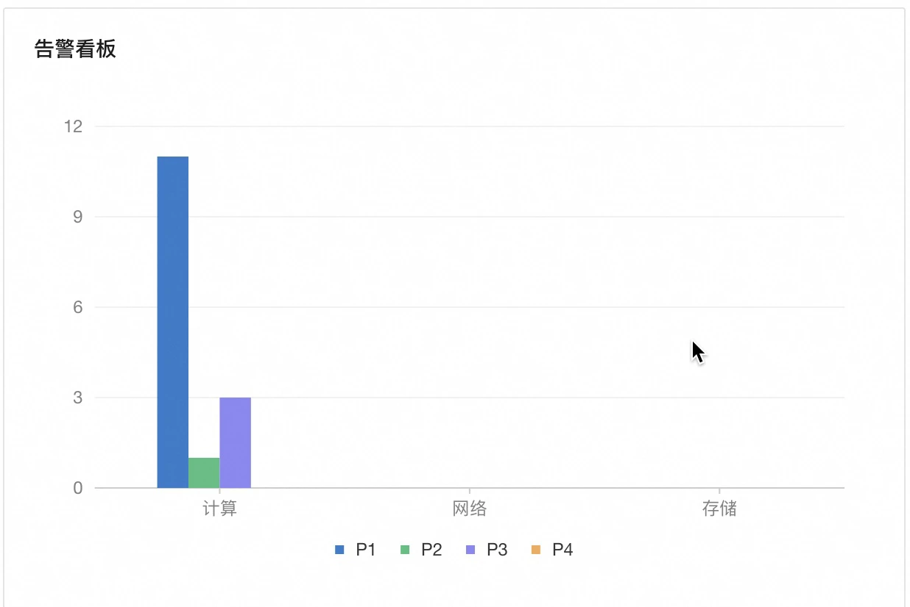

**资源统计**

资源统计中涵盖智算集群、超算集群、存储集群的资源数据。

- 智算集群的总数、服务器数、实例数。

  - 智算集群包括**裸金属-智算算力集群**和**容器-智算算力集群**等。

  - 智算实例包括**智算高网**型实例、**智算纳管**型实例、**智算基础**型实例等。

  - 智算实例仅包括裸金属实例，不包括ECS实例。

- 融合集群的总数、服务器数、实例数。

  - 融合实例包括**融合基础**实例和**融合高网**实例。

- 超算集群的总数、服务器数、实例数。

  - 超算集群包括**裸金属-超算算力集群**等。

  - 超算实例包括**高性能高网**型实例等。

- 存储集群的总数、服务器数、文件系统数。

  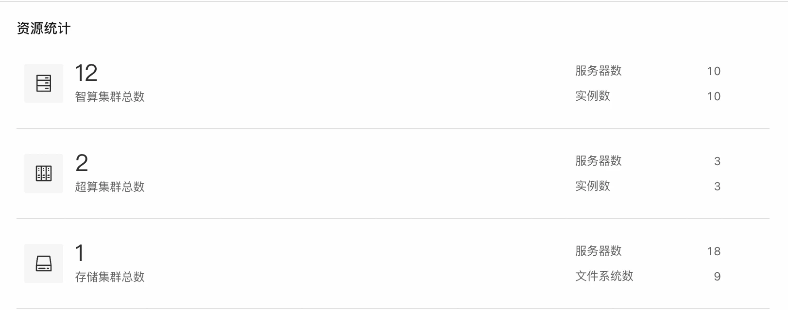

**资源看板**

资源看板中包含智算资源、超算资源和存储资源的使用情况。

> **说明**
>
> - 超算资源不包括智算集群中的CPU核及内存。
>
> - 智算资源不包括超算集群中的GPU卡数和显存。

- 智算资源（GPU卡数量和显存大小）

  - 单击下拉框可以筛选GPU卡类型，如**英伟达**、**海光**等，筛选后只显示对应类型GPU卡的数量及其显存总量。

    > **说明**
    >
    > 可选的GPU卡类型已界面为准。

  - 展示资源的已分配、未分配、总量和分配率。

    - 已分配的资源数量表示已分配给租户的资源数量。

    - 未分配的资源数量表示资源池中的资源数量。

    - 总量表示已分配给租户的资源数量和资源池中的资源数量之和。

    - 分配率表示（资源池中的资源数量）/（已分配给租户的资源数量+资源池中的资源数量）✖️ 100%。

- 融合资源（GPU卡数量和显存大小）

  - 单击下拉框可以筛选GPU卡类型，如**英伟达**、**海光**等，筛选后只显示对应类型GPU卡的数量及其显存总量。

    > **说明**
    >
    > 可选的GPU卡类型已界面为准。

  - 展示资源的已分配、未分配、总量和分配率。

    - 已分配的资源数量表示已分配给租户的资源数量。

    - 未分配的资源数量表示资源池中的资源数量。

    - 总量表示已分配给租户的资源数量和资源池中的资源数量之和。

    - 分配率表示（资源池中的资源数量）/（已分配给租户的资源数量+资源池中的资源数量）✖️ 100%。

- 超算资源（CPU核数量和内存大小）

  - 单击下拉框可以筛选CPU卡类型，如**英特尔**、**海光**等，筛选后只显示对应类型CPU核的数量及其内存总量。

    > **说明**
    >
    > 可选的GPU卡类型已界面为准。

  - 展示资源的已分配、未分配、总量和分配率。

    - 已分配的资源数量表示已分配给租户的资源数量。

    - 未分配的资源数量表示资源池中的资源数量。

    - 总量表示已分配给租户的资源数量和资源池中的资源数量之和。

    - 分配率表示（资源池中的资源数量）/（已分配给租户的资源数量+资源池中的资源数量）✖️ 100%。

- 存储资源

  - 单击下拉框可选存储资源类型，如**APFS**、**CPFS**，筛选后将仅显示对应类型的存储资源使用情况。

  - 展示存储资源的**已使用**、**已分配**、**总量**和**使用率**。

**算力看板**

算力看板中包含GPU卡算力和CPU卡算力使用情况。

- GPU卡算力（单位为TFLOPS）

  - 单击下拉框可以筛选GPU卡类型，筛选后只显示对应类型GPU卡的算力使用情况。

  - 展示时序范围不可选择，算力看板会展示近一周以及当天的总算力、已分配算力、算力分配率。

- CPU卡算力（单位为TFLOPS）

  - 单击下拉框可以筛选CPU卡类型，筛选后只显示对应类型CPU卡的算力使用情况。

  - 展示时序范围不可选择，算力看板会展示近一周以及当天的总算力、已分配算力、算力分配率。

> **说明**
>
> - CPU算力均为超算CPU算力，不包括智算集群中的CPU算力。
>
> - GPU算力均为智算CPU算力，不包括超算集群中的GPU算力。

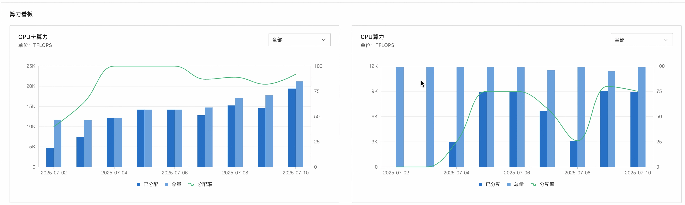

**管控服务**

管控服务模块中展示计算、网络、存储类别管控服务的服务状态。服务状态可为**异常**或**已达终态**。其中**异常**表明对应服务未完成部署，**已达终态**表明对应服务已完成部署。

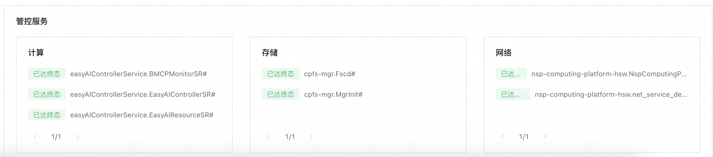

<a id="section-4"></a>

# 4.可视化监控

<a id="section-4-1"></a>

## 4.1. 作业路径分析

本节介绍如何使用作业路径分析。

**使用限制**

仅Hygon DCUK100-AI、ZW810E、昆仑芯P800、METAX C550、摩尔线程S5000和NVIDIA T4、A2、A10、A16支持作业路径分析。

**前提条件**

任务所在集群安装了ai-task-inspector组件，如果还未安装，可以通过**BMCP-集群管理-软件实例**安装**容器运维服务**。

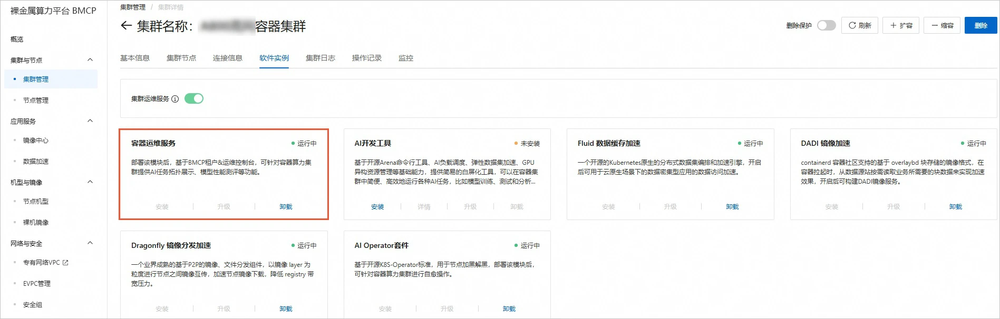

> **说明**
>
> 任务可以通过很多产品发起，如PAI或AI Studio等，只要该任务占用了BMCP节点的GPU资源，就可以使用作业路径分析功能。

**操作步骤**

1. 登录BMCP运维平台。

2. 在左侧导航栏中，单击**可视化监控 > 作业路径分析**。

3. 在**作业路径分析**页面中，通过筛选项寻找**作业ID**，选择完成后，单击**搜索**。

   > **说明**
   >
   > - 先选择**起止时间**，最长允许查询当前时间7天以前的任务。
   >
   > - **节点ID**不是必选项，如果选择了**节点ID**，**集群ID**会自动填写为该节点所在的集群。
   >
   > - **集群ID**和**命名空间**都是必选项，最后选择**作业ID**。
   >
   > - **作业信息**是默认折叠的，可以单击左侧的
   >
   >   图标展开作业信息，作业信息包括作业状态、占
   >
   >   
   >
   >   用的资源和作业起止时间等信息。

4. 单击**作业详情**，右侧会展开**基本信息**和作业运行节点信息。

   - 在**基本信息**页面可以看到**作业状态**、**节点数量**、**GPU卡数量**、**CPU资源**、**内存资源**及作业生命周期。

   - 作业运行节点信息包括**节点ID/名称**、**在线状态**、**节点类型**、**SN**、**所在集群**等信息。

5. 在**作业视图**区域，选择**时间片**，下方画布会展示该时间片内作业的拓扑结构和资源占用，其中拓扑结构包括GPU卡、RDMA卡、交换机等元件及之间的链路关系；资源占用包括GPU使用率、RDMA网卡带宽占用等指标。

   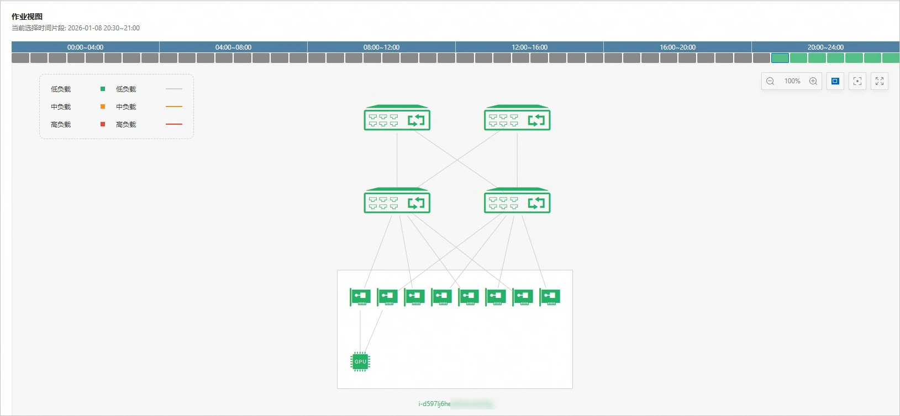

   > **说明**
   >
   > 当鼠标悬停于GPU卡、RDMA等组件时，将会显示该组件的具体名称及其资源占用情况。

<a id="section-5"></a>

# 5.告警管理

<a id="section-5-1"></a>

## 5.1. 资源事件告警

资源事件告警会监控算力资源的各种稳定性指标，包括节点、GPU、RDMA等资源，并对异常事件进行实时告警。本文档介绍如何查看并处理资源事件告警（包括计算和存储资源）。

**前提条件**

CMS（CloudMonitor，云监控）产品已部署并处于终态。

> **说明**
>
> 资源事件告警强依赖CMS产品，使用前请确认CMS产品已经部署并到达终态。

**操作步骤**

1. 登录BMCP运维平台。

2. 在左侧导航栏中，单击**告警管理**。

3. 在**资源事件告警**页面中，可以看到局点内告警列表。

   默认进入**计算**页签。

   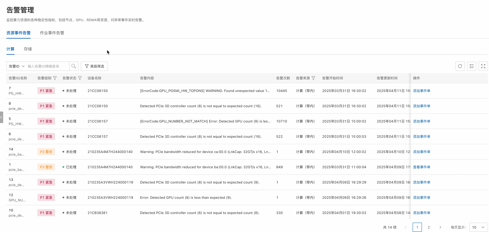

4. 查看并处理**计算**告警。

   <ol type="i">

   <li>

   您可以通过**告警级别**、**告警状态**、**告警来源**、**告警ID**等对告警进行筛选；单击**高级筛选**可以使用**告警ID**、**告警名称**、**告警开始时间**对告警进行组合筛选。

   > **说明**
   >
   > - 告警级别包括：**P1 紧急、P2 严重、P3 警告、P4 提示。**
   >
   > - 告警状态包括<strong>：已处理、未处理。</strong>
   >
   > - 告警来源包括：**计算（带内）、计算（带外）、网络。**

   </li>

   <li>

   对于状态为**未处理**的告警，可以通过单击**添加事件单**处理。

   **添加事件单**时，需要选择**处理方式**，输入**处理人**和**关闭原因**，单击**确定**。

   > **说明**
   >
   > 处理方式包括忽略（认为该告警无需处理）和已修复（该告警对应的故障已被处理）。

   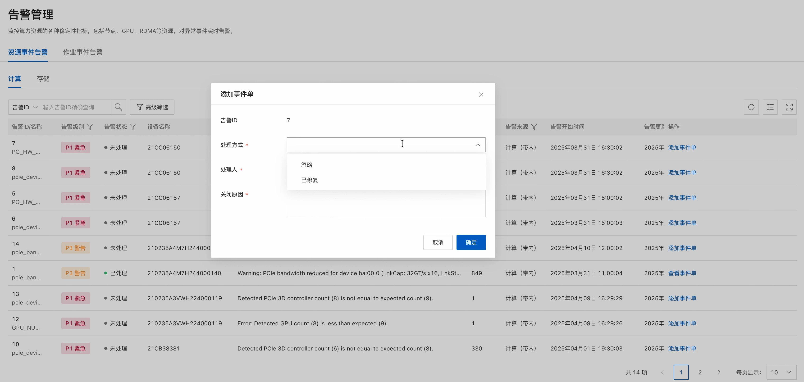

   </li>

   </ol>

5. 单击**存储**页签，查看并处理**存储**告警。

   <ol type="i">

   <li>

   您可以通过**告警级别**、**告警状态**、**告警名称**、**告警内容**、**告警开始时间**等对告警进行筛选；也可以单击**高级筛选**使用**告警名称**、**告警内容**、**告警开始时间**对告警进行组合筛选。

   > **说明**
   >
   > - 告警级别包括：**P1 紧急、P2 严重、P3 警告、P4 提示。**
   >
   > - 告警状态包括<strong>：已处理、未处理。</strong>
   >
   > - 告警来源包括：**计算（带内）、计算（带外）、网络。**

   </li>

   <li>

   单击告警ID，可跳转至**告警详情**页面查看告警的详细信息，并根据业务需要处理告警。

   更多告警信息，请参见<strong>《专有云运维平台 用户指南》</strong>中的<strong>《告警列表》</strong>章节。

   </li>

   </ol>

<a id="section-5-2"></a>

## 5.2. 作业事件告警

作业事件告警指在任务运行期间，所有被该任务占用的计算节点上发生的故障恢复情况。本文档将介绍如何查看作业告警。

**使用限制**

作业事件告警仅支持**容器-智算算力集群**。

**操作步骤**

1. 登录BMCP运维平台。

2. 在左侧导航栏中，单击**告警管理**。

   默认进入**资源事件告警**页签。

3. 单击**作业事件告警**页签，选择**集群ID**、**命名空间**和**作业ID**，然后单击**搜索**，**作业事件告警**将展示该作业生命周期内全部关联的告警。

   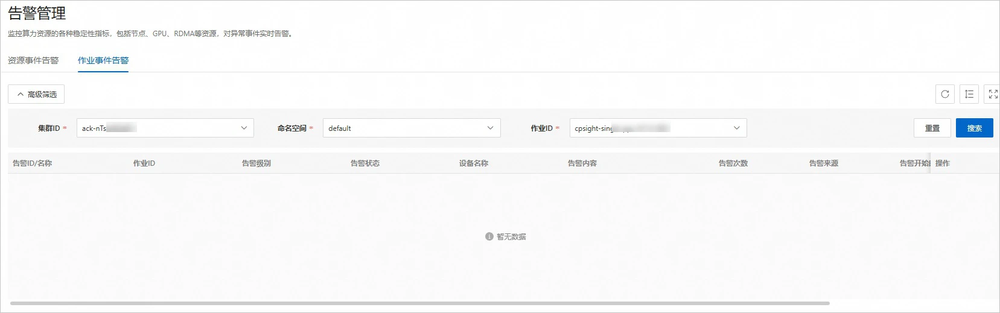

<a id="section-6"></a>

# 6.集群管理

<a id="section-6-1"></a>

## 6.1. 计算

<a id="section-6-1-1"></a>

### 6.1.1. 集群

<a id="section-6-1-1-1"></a>

#### 6.1.1.1. 查看计算集群详情

本节介绍了如何查询BMCP集群及其集群详情（集群基本信息、集群中节点信息、集群操作日志），查询范围包括裸金属-智算算力集群、容器-智算算力集群、裸金属-超算算力集群、融合算力集群。

**前提条件**

已在Apsara Uni-manager运营控制台创建BMCP集群。

**操作步骤**

1. 登录BMCP运维平台。

2. 在左侧导航栏中，单击**集群管理**。

3. 单击**计算 > 集群**页签。

   该页面展示了局点内所有租户拥有的计算集群。

4. 查询计算集群：

   - 基础查询：

     <ol type="a">

     <li>

     支持输入**集群ID**、**集群名称**或下拉选择标签。

     </li>

     <li>

     单击  ，模糊查询符合条件的集群。

     </li>

     </ol>

   - 高级筛选：

     <ol type="a">

     <li>

     单击**高级筛选**。

     </li>

     <li>

     支持关键字自动识别或输入**集群ID**、**集群名称**。

     </li>

     </ol>

     <ol type="i" start="100">

     <li>

     单击**搜索**，进行所选条件复合模糊查询.

     </li>

     </ol>

5. 单击对应集群操作列**详情**，可查看集群的**基本信息**、**集群节点**、**监控**和**操作记录**。

   <ol type="i">

   <li>

   **基本信息**

   基本信息页包括的信息如下表所示。

   <table>
     <tr>
       <th width="89">信息分类</th>
       <th>描述</th>
     </tr>
     <tr>
       <td>基本信息</td>
       <td>基本信息包括<strong>集群ID</strong>、<strong>集群名称</strong>、<strong>集群状态</strong>、<strong>节点数</strong>和<strong>创建时间</strong>等。</td>
     </tr>
     <tr>
       <td>配置信息</td>
       <td>配置信息包括<strong>集群实例规格</strong>、<strong>CPU（核）</strong>、<strong>内存（GB）</strong>、<strong>GPU显存（GB）</strong>和<strong>算力</strong><strong>（TFLOPS）</strong>等。</td>
     </tr>
     <tr>
       <td>存储信息</td>
       <td>存储信息包括高性能存储状态等。</td>
     </tr>
   </table>

   </li>

   <li>

   **集群节点**

   单击**集群节点**页签，即可查看分配到该集群中的**裸金属节点**，无法查看分配到该集群中的**ECS节点**。节点信息包括**节点名称/ID**、**在线状态**、**SN**、**节点IP**、**机型**等。您可以单击目标节点**操作**列的**详情**查看计算节点详情。

   </li>

   <li>

   **监控**

   单击**监控**页签，即可查看集群的监控信息，包括**内存使用率**、**集群负载**和**连接数**等。

   </li>

   <li>

   **操作日志**

   单击操作日志页签，即可查看集群的操作日志。可依据操作类型和操作时间查看该集群的历史操作日志。

   <ol type="a">

   <li>

   单击**操作类型**会弹出下拉框，从中选择一个标签（如：创建集群、删除集群、扩容集群、缩容集群等）即会立刻筛选出对应操作类型的**操作日志**。若不选会展示所有类型的**操作日志**。

   </li>

   <li>

   单击**操作时间**选择**起始日期**与**结束日期**（均可精确到秒）并单击**确定**，会筛选出从起始日期到结束日期内的**操作日志**

   </li>

   </ol>

   <ol type="i" start="100">

   <li>

   单击**操作详情**可以查看该操作内部的原子步骤及其详细信息。

   </li>

   </ol>

   </li>

   </ol>

<a id="section-6-1-2"></a>

### 6.1.2. 节点

<a id="section-6-1-2-1"></a>

#### 6.1.2.1. 查看计算节点详情

本节介绍了如何查询BMCP计算节点及其节点详情（节点基本信息、节点操作日志），查询范围包括已分配给裸金属-智算算力集群、容器-智算算力集群、裸金属-超算算力集群、融合算力集群的节点，以及资源池中未分配的节点。

**操作步骤**

1. 登录BMCP运维平台。

2. 在左侧导航栏中，单击**集群管理**。

3. 在**集群管理**页面中，单击**计算 > 节点**页签进入页面。该页面展示了局点内所有租户拥有的计算节点以及资源池中的计算节点。

4. 查询计算节点：

   - 基础查询：

     <ol type="a">

     <li>

     支持输入节点ID、节点名称、SN、所属集群ID、子网IP、专有网络IP、带外IP或下拉选择标签。

     </li>

     <li>

     单击  ，模糊查询符合条件的节点。

     </li>

     </ol>

   - 高级筛选：

     <ol type="a">

     <li>

     单击**高级筛选**。

     </li>

     <li>

     支持同时输入节点ID、节点名称、SN、所属集群ID、子网IP、专有网络IP、带外IP。

     </li>

     </ol>

     <ol type="i" start="100">

     <li>

     单击**搜索**，进行所选条件复合模糊查询。

     </li>

     </ol>

5. 单击对应节点操作列**详情**，可查看节点的**基本信息**、**监控**和**操作日志**。

   <ol type="i">

   <li>

   基本信息

   基本信息页包含的信息如下表所示。

   <table>
     <tr>
       <th width="89">信息分类</th>
       <th>描述</th>
     </tr>
     <tr>
       <td>基本信息</td>
       <td><strong>基本信息</strong>包括<strong>节点ID</strong>、<strong>节点名称</strong>、<strong>SN</strong>、<strong>地域</strong>、<strong>可用区</strong>等信息</td>
     </tr>
     <tr>
       <td>配置信息</td>
       <td><strong>配置信息</strong>包括节点的<strong>CPU</strong>、<strong>GPU</strong>、<strong>操作系统</strong>、<strong>网络</strong>、<strong>网卡</strong>、<strong>磁盘</strong>等硬件固件信息。</td>
     </tr>
   </table>

   </li>

   <li>

   监控

   单击**监控**页签，即可查看节点的监控信息，包括CPU使用率、内存使用率、负载、连接数等。

   </li>

   <li>

   操作日志

   单击操作日志页签，可依据操作类型查看该节点的历史操作日志。

   <ol type="a">

   <li>

   单击**操作类型**会弹出下拉框，从中选择一个标签（如：申请实例、重新申请、运维实例、挂载实例、挂载存储、卸载存储、请求异常等）即会立刻筛选出对应操作类型的**操作日志**。若不选则不过滤，会展示该节点所有类型的**操作日志**。

   </li>

   <li>

   单击**操作时间**选择**起始日期**与**结束日期**（均精确到日）并单击**确定**，会筛选出从起始日期00:00:00到结束日期23:59:59内的**操作日志**。

   </li>

   </ol>

   <ol type="i" start="100">

   <li>

   单击**操作详情**可以查看该操作内部的全部原子步骤及其详细信息。

   </li>

   </ol>

   </li>

   </ol>

<a id="section-6-2"></a>

## 6.2. 存储

**查看存储集群详情**

1. 登录BMCP运维平台。

2. 在左侧导航栏中，单击**集群管理**。

3. 在**集群管理**页面中，单击**存储**页签。

   默认进入**存储集群**页签。

4. 查看集群的**健康状态**、**磁盘类型**、**文件系统类型**、**节点数量**等信息。

5. 查找目标集群。

   您可以在集群列表右上方的搜索框中输入**集群ID**进行精确查询。

6. 单击目标集群的集群ID或**操作**列的**详情**，查看集群的详细信息。

   - 在**集群详情**页签，查看**文件系统数量**、**节点数量**、**文件系统类型**、**健康状态**、**磁盘类型**等信息。

   - 在**集群节点**页签，查看节点的**管理IP**、**SN**、**机型**、**CPU架构**、**内存**等信息。

     支持通过**节点名称**精确查询。

   - 在**服务**页签，查看服务角色和状态。

     支持通过**服务名称**模糊查询。

     您可以单击目标服务角色**操作**列的**Tianji运维**，跳转至**飞天基础运维平台**，对该服务角色进行操作。

   - 在**监控**页签，查看监控信息，包括读带宽、写带宽、读IOPS等。

**查看客户端集群详情**

1. 在**存储**页签下，单击**客户端集群**。

   查看**集群状态**、**集群类型**、**节点数量**、**Quorum节点数量**、**挂载文件系统**等信息。

2. 查找目标集群。

   您可以在集群列表右上方的搜索框中输入**集群名称**进行精确查询。

3. 单击目标集群的**集群名称**或**操作**列的**详情**，查看集群的详细信息。

   - 在**集群详情**页签，查看集群的节点数量、Quorum节点数量、基本信息。

   - 在**集群节点**页签，查看**节点类型**、**节点状态**等基本信息。

     您也可以单击目标节点**操作**列的**详情**，查看查看集群节点详情。

<a id="section-6-3"></a>

## 6.3. 网络

<a id="section-6-3-1"></a>

### 6.3.1. 获取子网

本节介绍了如何查询以及更新当前局点内全量云接入交换机的信息。

**操作步骤**

1. 登录BMCP运维平台。

2. 在左侧导航栏中，单击**集群管理**。

3. 单击**网络**页签。

   该页面展示了局点内所有云接入交换机，交换机类型包括**HSW**、**CHSW**。展示内容包括每个交换机的**子网名称**、**IP范围**、**网关**、**描述**、**更新时间**等。

4. 在列表页上方，输入**子网名称**进行**模糊查询**。

5. 单击**获取子网**，即可实时获取当前局点内新加入的云接入交换机并同步到页面上。

<a id="section-7"></a>

# 7.资源管理

<a id="section-7-1"></a>

## 7.1. 计算

<a id="section-7-1-1"></a>

### 7.1.1. 服务器

<a id="section-7-1-1-1"></a>

#### 7.1.1.1. 查看服务器详情

本节介绍了如何查询局点内的全量物理服务器列表及其详细信息。

**操作步骤**

1. 登录BMCP运维平台。

2. 在左侧导航栏中，单击**资源管理**。

   默认进入**计算 > 服务器**页签，该页面展示了局点内所有物理服务器。

3. 查询服务器：

   - 基础查询：

     <ol type="a">

     <li>

     支持输入主机名、SN、机型或下拉选择标签。

     </li>

     <li>

     单击  ，模糊查询符合条件的服务器。

     </li>

     </ol>

   - 高级筛选：

     <ol type="a">

     <li>

     单击**高级筛选**。

     </li>

     <li>

     支持同时输入主机名、SN、机型。

     </li>

     </ol>

     <ol type="i" start="100">

     <li>

     单击**搜索**，进行所选条件复合模糊查询。

     </li>

     </ol>

5. 单击目标服务器操作列**详情**，可查看服务器的**基本信息**、**监控**和**操作日志**。

   <ol type="i">

   <li>

   基本信息

   基本信息包含的信息如下表所示。

   <table>
     <tr>
       <th width="89">信息分类</th>
       <th>描述</th>
     </tr>
     <tr>
       <td>基本信息</td>
       <td>基本信息包括<strong>资源ID</strong>、<strong>资源名</strong>称、<strong>SN</strong>、<strong>地狱</strong>、<strong>可用区</strong>等信息。</td>
     </tr>
     <tr>
       <td>配置信息</td>
       <td>配置信息包括服务器的<strong>机型</strong>、<strong>CPU</strong>、<strong>GPU</strong>、<strong>操作系统</strong>、<strong>网络</strong>、<strong>网卡信息</strong>、<strong>磁盘</strong><strong>信息</strong>等硬件固件信息。</td>
     </tr>
   </table>

   </li>

   <li>

   监控

   单击**监控**页签，您可以查看指定时间内的CPU使用率、内存使用率、负载、磁盘读、磁盘写、连接数等监控数据。

   </li>

   <li>

   操作日志

   单击**操作日志**页签，可依据操作类型和操作时间查看该服务器的历史操作日志。

   <ol type="a">

   <li>

   单击**操作类型**会弹出下拉框，从中选择一个标签（如：申请实例、重新申请、运维实例、挂载实例、挂载存储、卸载存储等）即会立刻筛选出对应操作类型的**操作日志**。若不选择，则不过滤，会展示该节点所有类型的**操作日志**。

   </li>

   <li>

   单击**操作时间**选择**起始日期**与**结束日期**（均精确到日）并单击**确定**，会筛选出从起始日期00:00:00到结束日期23:59:59内的**操作日志**。

   </li>

   </ol>

   <ol type="i" start="100">

   <li>

   单击**操作详情**可以查看该操作内部的全部原子步骤及其详细信息。

   </li>

   </ol>

   </li>

   </ol>

<a id="section-7-1-1-2"></a>

#### 7.1.1.2. 注册资源

本文介绍如何注册服务器资源。

**操作步骤**

1. 登录BMCP运维平台。

2. 在左侧导航栏中，单击**资源管理**。

   默认进入**计算 > 服务器**页签，该页面展示了局点内所有物理服务器。

3. 在服务器列表上方，单击**注册资源**。

4. 在弹出的**选择接入方式**框，配置接入方式。

   | 参数项 | 说明 |
   | --- | --- |
   | 接入方式 | 接入方式可选：<br>• CHSW接入<br>• HSW接入 |
   | 待纳管资源 | 选择待纳管的资源。 |

5. 单击**确定**。

6. 在弹出的**注册资源**界面。

   <ol type="i">

   <li>

   配置**基本信息**。

   选择**地域**和**可用区**。

   </li>

   <li>

   配置**资源**信息。

   | 参数项 | 说明 |
   | --- | --- |

   <table>
     <tr>
       <td>资源类型</td>
       <td>• 当接入方式选择<strong>CHSW接入</strong>时，资源类型可选值：<br>• <strong>高性能计算纳管</strong>：使用云平台提供的标准镜像初始化裸金属服务器，开启裸金属实例。<br>• <strong>智算纳管</strong>：面向GPU裸金属服务器，在AI的场景，通过云平台标准镜像完成初始化并启动实例。<br>• 当接入方式选择<strong>HSW接入</strong>时，资源类型可选值：<br>• <strong>智算纳管</strong>：面向GPU裸金属服务器，在AI的场景，通过云平台标准镜像完成初始化并启动实例。<br>• <strong>带内纳管</strong>：不修改原有设备上的操作系统，开启裸金属实例。<br>• <strong>高性能计算纳管</strong>：面向CPU裸金属服务器，在高性能计算的场景，通过云平台标准镜像完成初始化并启动实例。</td>
     </tr>
     <tr>
       <td>架构</td>
       <td>选择资源的架构，可选值：<br>• x86_64<br>• aarch64<br>• sw_64</td>
     </tr>
     <tr>
       <td>机型</td>
       <td>选择机型，如没有可选机型，请先添加机型。</td>
     </tr>
     <tr>
       <td>SN</td>
       <td>• 长度为2～128个字符，不能以特殊字符开头，只可包含特殊字符中的半角句号（.）、下划线（_）、短划线（-）和半角冒号（:）。<br>• 当接入方式选择<strong>CHSW接入</strong>时不需要填写此项。</td>
     </tr>
     <tr>
       <td>设备型号</td>
       <td>• 设备型号为大小写字母数字组合，长度需小于128位。<br>• 当接入方式选择<strong>CHSW接入</strong>时不需要填写此项。</td>
     </tr>
     <tr>
       <td>机房</td>
       <td>• 机房为大小写字母数字组合，长度需小于128位。<br>• 当接入方式选择<strong>CHSW接入</strong>时不需要填写此项。</td>
     </tr>
     <tr>
       <td>房间</td>
       <td>• 长度为2-128个字符，支持输入数字、大小写字母、短划线（-）、下划线（_），示例：1-1-1。<br>• 当接入方式选择<strong>CHSW接入</strong>时不需要填写此项。</td>
     </tr>
     <tr>
       <td>机柜</td>
       <td>• 长度为3个字符，需以大写字母开头，01~24的正整数结尾，例如：F02。<br>• 当接入方式选择<strong>CHSW接入</strong>时不需要填写此项。</td>
     </tr>
     <tr>
       <td>机位号</td>
       <td>• 机位号为1～48的正整数。<br>• 当接入方式选择<strong>CHSW接入</strong>时不需要填写此项。</td>
     </tr>
     <tr>
       <td>维保时间</td>
       <td>选择维保时间。</td>
     </tr>
   </table>

   </li>

   <li>

   配置**镜像**信息。

   | 参数项 | 说明 |
   | --- | --- |
   | 镜像类型 | <strong>镜像类型</strong>可选<strong>公共镜像</strong>、<strong>自定义镜像</strong>。 |
   | 公共/自定义镜像 | 选择镜像。 |

   </li>

   <li>

   配置**网络**信息。

   <table>
     <tr>
       <th width="137">参数项</th>
       <th>说明</th>
     </tr>
     <tr>
       <td>物理机网关</td>
       <td>当接入方式选择<strong>CHSW接入</strong>时不需要填写此项。</td>
     </tr>
     <tr>
       <td>物理机网关端口</td>
       <td>当接入方式选择<strong>CHSW接入</strong>时不需要填写此项。</td>
     </tr>
     <tr>
       <td>子网</td>
       <td>当接入方式选择<strong>CHSW接入</strong>时不需要填写此项。</td>
     </tr>
     <tr>
       <td>子网IP</td>
       <td>当接入方式选择<strong>CHSW接入</strong>时不需要填写此项。</td>
     </tr>
     <tr>
       <td>带外信息</td>
       <td>带外信息默认无需填写，若需要填写，则选择<strong>展开</strong>。</td>
     </tr>
     <tr>
       <td>带外IP</td>
       <td>仅带外信息选择<strong>展开</strong>时必填。</td>
     </tr>
     <tr>
       <td>带外用户名</td>
       <td>仅带外信息选择<strong>展开</strong>时必填。长度为2～128个字符，需以大小写字母开头，支持输入数字和特殊字符，支持的特殊字符包括 ~ ! @ # $ % ^ &amp; * () - _ = + | [ { } ] ; : .。</td>
     </tr>
     <tr>
       <td>带外密码</td>
       <td>仅带外信息选择<strong>展开</strong>时必填。长度为1～128个字符。</td>
     </tr>
   </table>

   </li>

   <li>

   配置**密码**。

   <table>
     <tr>
       <th width="89">参数项</th>
       <th>说明</th>
     </tr>
     <tr>
       <td>登录名</td>
       <td>默认为root，不支持修改。</td>
     </tr>
     <tr>
       <td>登录密码</td>
       <td>密码长度为8~30 个字符，且必须同时包含大写字母、小写字母、数字、特殊字符中的三项。支持的特殊字符包括 ()`~!@#$%^&amp;*_-+=|{}[]:;'&lt;&gt;,.?/。</td>
     </tr>
     <tr>
       <td>确认密码</td>
       <td>再次输入您的登录密码。<strong>确认密码</strong>需要与<strong>登录密码</strong>一致。<br>重要请牢记您所设置的密码，如遗忘可登录裸金属管理运维控制台重置密码。</td>
     </tr>
   </table>

   </li>

   <li>

   配置**资源名称**。

   <table>
     <tr>
       <th width="89">参数项</th>
       <th>说明</th>
     </tr>
     <tr>
       <td>资源名称</td>
       <td>• 长度为2～128个字符，支持大写字母、小写字母、数字、短划线（-）和半角句号（.），且必须以大小写字母或数字开头。<br>• 当接入方式选择<strong>CHSW接入</strong>时不需要填写此项。</td>
     </tr>
     <tr>
       <td>主机名</td>
       <td>• 输入主机名。<br>• 当接入方式选择<strong>CHSW接入</strong>时不需要填写此项。</td>
     </tr>
     <tr>
       <td>资源描述</td>
       <td>长度为0～1000个字符。</td>
     </tr>
   </table>

   </li>

   </ol>

7. 完成配置后，单击**确定**。

> **说明**
>
> 在启用了变更授权的情况下，您需要联系Apsara Uni-manager运维控制台的授权管理员，在**平台运维> 任务中心 > 任务列表**下完成审批，才能成功注册资源。

<a id="section-7-1-1-3"></a>

#### 7.1.1.3. 管理服务器资源状态

本文介绍如何对服务器资源执行启动、重启、停止、删除、初始化操作。

**前提条件**

服务器**资源属主**为**资源池**。

**操作步骤**

1. 登录BMCP运维平台。

2. 在左侧导航栏中，单击**资源管理**。

   默认进入**计算 > 服务器**页签，该页面展示了局点内所有物理服务器。

3. 筛选目标服务器。

4. 在目标服务器**操作**列，单击**资源状态**。

   您可以对单个资源执行启动、重启、停止、删除、释放操作。

   | 操作状态 | 电源状态 | 可以进行的操作 |
   | --- | --- | --- |
   | <strong>未初始化</strong>、<strong>系统已重置</strong> | 无关 | 初始化资源 |
   | 已完成 | 关机 | <strong>启动资源</strong>、<strong>删除资源</strong> |
   | 已完成 | 开机 | <strong>重启资源</strong>、<strong>停止资源</strong>、<strong>删除资源</strong> |

5. 您也可以选择一个或多个服务器资源，然后单击服务器列表底部的**删除资源**和**初始化资源**。

> **说明**
>
> 在启用了变更授权的情况下，您需要联系Apsara Uni-manager运维控制台的授权管理员，在**平台运维> 任务中心 > 任务列表**下完成审批，才能成功删除资源。

<a id="section-7-1-1-4"></a>

#### 7.1.1.4. 远程登录服务器

本文介绍如何远程登录服务器。

**前提条件**

服务器状态是运行中。

**操作步骤**

1. 登录BMCP运维平台。

2. 在左侧导航栏中，单击**资源管理**。

   默认进入**计算 > 服务器**页签，该页面展示了局点内所有物理服务器。

3. 筛选目标服务器。

4. 在目标服务器**操作**列，单击**远程登录**。

5. 在弹出的登录界面上输入密码，单击**确定**。

<a id="section-7-1-1-5"></a>

#### 7.1.1.5. 重新注册服务器

本文介绍如何重新注册服务器。

**操作步骤**

1. 登录BMCP运维平台。

2. 在左侧导航栏中，单击**资源管理**。

3. 在**资源管理**页面中，单击**计算**页签。

   该页面展示了局点内所有物理服务器

4. 在目标服务器操作列，单击  图标，然后单击**重新注册**。

5. 在**重新注册**页面完成基本信息、资源、镜像、网络、密码、资源名称的配置。

   <ol type="i">

   <li>

   在**基本信息**区域，配置**地域**和**可用区**。

   </li>

   <li>

   在**资源**区域，配置**资源类型**、**架构**、**机型**、**SN**、**设备型号**、**机房**、**房间**、**机柜**、**SN**、**机位号**、**维保时间**。

   </li>

   <li>

   在**镜像**区域，配置镜像类型、镜像。

   </li>

   <li>

   在**网络**区域，配置**物理机网关**、**物理机网关端口**、**子网**、**子网IP**、**带外信息**。

   </li>

   <li>

   在**配置密码**区域，配置**登录密码**以及**确认密码**。

   密码长度为8~30 个字符，且必须同时包含大写字母、小写字母、数字、特殊字符中的三项。

   支持的特殊字符包括 ()\`~!@#$%^&\*_-+=|{}[]:;'<>,.?/。

   > **重要**
   >
   > 请牢记您所设置的密码，如遗忘可登录裸金属管理运维控制台重置密码。

   </li>

   <li>

   在**资源名称**区域，配置**资源名称**、**主机名**、**资源描述**。

   > **说明**
   >
   > 资源名称：长度为2～128个字符，支持大写字母、小写字母、数字、短划线(-)和半角句号（.），且必须以大小写字母或数字开头

   </li>

   </ol>

6. 完成配置后，单击**确定**。

<a id="section-7-1-1-6"></a>

#### 7.1.1.6. 服务器资源使能

本文介绍如何启用和禁用服务器资源。

**前提条件**

服务器**资源属主**为**资源池**。

**启用资源**

1. 登录BMCP运维平台。

2. 在左侧导航栏中，单击**资源管理**。

   默认进入**计算 > 服务器**页签，该页面展示了局点内所有物理服务器。

3. 找到**资源使能**为**禁用**的服务器。

4. 选择一种方式启用资源。

   - **启用一个资源**：在目标服务器**操作**列，单击  图标，单击**资源使能 > 禁用**。

   - **批量启用资源**：选中多个服务器左侧的复选框，单击服务器列表底部的**启用资源使能**。

5. 在弹出的确认框，单击**确定**。

**禁用资源**

> **重要**
>
> 禁用后该资源将无法添加到集群。

1. 登录BMCP运维平台。

2. 在左侧导航栏中，单击**资源管理**。

   默认进入**计算 > 服务器**页签，该页面展示了局点内所有物理服务器。

3. 找到**资源使能**为**启用**的服务器。

4. 选择一种方式禁用资源。

   - **禁用一个资源**：在目标服务器**操作**列，单击  图标，单击**资源使能 > 禁用**。

   - **批量禁用资源**：选中多个服务器左侧的复选框，单击服务器列表底部的**禁用资源使能**。

5. 在弹出的确认框，单击**确定**。

<a id="section-7-1-2"></a>

### 7.1.2. GPU卡

<a id="section-7-1-2-1"></a>

#### 7.1.2.1. 查看GPU详情

本节介绍了如何查询局点内已装机的裸金属机器上的GPU卡资源列表以及每张GPU卡的具体信息。

**前提条件**

裸金属机器完成装机后才可查询到机器上拥有的GPU卡。

**操作步骤**

1. 登录BMCP运维平台。

2. 在左侧导航栏中，单击**资源管理**。

3. 在**资源管理**页面中，点击**计算 > GPU卡**页签进入页面。该页面展示了局点内所有已装机服务器上的GPU卡资源。

4. 查询GPU：

   - 基础查询：

     <ol type="a">

     <li>

     支持**GPU ID**、**所属节点ID**、**GPU型号**或下拉选择标签。

     </li>

     <li>

     单击  ，模糊查询符合条件的GPU卡。

     </li>

     </ol>

   - 高级筛选：

     <ol type="a">

     <li>

     单击**高级筛选**。

     </li>

     <li>

     支持同时输入GPU ID、所属节点ID、GPU型号。

     </li>

     </ol>

     <ol type="i" start="100">

     <li>

     单击**搜索**，进行所选条件复合模糊查询。

     </li>

     </ol>

5. 查看所属节点、所属服务器及GPU卡详情。

   <ol type="i" start="5">

   <li>

   单击所属节点，可以查看GPU卡所属计算节点详情。

   </li>

   <li>

   单击所属服务器，可以查看GPU卡所属服务器详情。

   </li>

   <li>

   单击对应GPU卡**操作**列**详情**，可查看GPU卡的**基本信息**。

   基本信息页包含的信息如下表所示。

   <table>
     <tr>
       <th width="111">信息分类</th>
       <th>描述</th>
     </tr>
     <tr>
       <td>GPU卡信息</td>
       <td>包括<strong>GPU ID</strong>、<strong>所属节点</strong>、<strong>所属服务器</strong>、<strong>厂商</strong>、<strong>GPU型号</strong>、<strong>显存容量</strong>、<strong>算力</strong>等信息。</td>
     </tr>
     <tr>
       <td>配置信息</td>
       <td>包括<strong>VBIOS版本</strong>、<strong>驱动名称</strong>、<strong>驱动版本</strong>、<strong>BusInfo</strong>等信息。</td>
     </tr>
   </table>

   </li>

   </ol>

<a id="section-7-2"></a>

## 7.2. 存储

<a id="section-7-2-1"></a>

### 7.2.1. 查看文件系统详情

本文介绍如何查看文件系统资源的详情。

**操作步骤**

1. 登录BMCP运维平台。

2. 在左侧导航栏中，单击**资源管理**。

3. 在**资源管理**页面中，单击**存储**页签。

   默认进入**文件系统页签**。

4. 您可以在文件系统列表上方的搜索框中输入**文件系统名称**进行筛选。也可以单击**高级筛选**，使用**文件系统名称**进行筛选。

5. 单击目标文件系统**存储集群**列的名称，可以查看文件系统的存储集群详情，包括集群文件系统数量、节点数量、容量、健康状态、文件系统类型、集群节点信息、服务角色、监控信息等。

6. 单击目标文件系统**客户端集群**列的名称，可以查看文件系统的客户端集群详情，包括节点数量、Quorum节点数量、集群类型、挂载文件系统路径、缓存的最大文件数量、工作线程、集群节点等信息。

7. 单击目标文件系统**操作**列的详情。

   查看文件系统的详情，包括文件系统名称、存储集群、客户端集群、规格、监控信息等。

<a id="section-7-2-2"></a>

### 7.2.2. 查看服务器资源详情

本文介绍如何查看服务器资源的信息。

**操作步骤**

1. 登录BMCP运维平台。

2. 在左侧导航栏中，单击**资源管理**。

3. 在**资源管理**页面中，单击**存储**页签。

   默认进入**文件系统页签**。

4. 单击**服务器**页签。

   您可以在服务器列表上方的搜索框中输入**主机名**、**IP**、**SN**进行筛选。也可以单击**高级筛选**，使用**主机名**、**IP**、**SN**进行组合查询。

5. 单击目标服务器**存储集群ID**列的ID。

   查看目标服务器的存储集群信息，包括集群文件系统数量、节点数量、容量、健康状态、文件系统类型、集群节点信息、服务角色、监控信息等。

<a id="section-7-2-3"></a>

### 7.2.3. 查看计算节点缓存

本文介绍如何查看计算节点缓存资源的详情。

**操作步骤**

1. 登录BMCP运维平台。

2. 在左侧导航栏中，单击**资源管理**。

3. 在**资源管理**页面中，单击**存储**页签。

   默认进入**文件系统页签**。

4. 单击**计算节点缓存**页签。

   您可以在缓存实例列表上方的搜索框中选择**集群ID**进行筛选。

5. 单击缓存实例**操作**列的**详情**。

   查看缓存实例的详细信息，包括**基本信息**、**worker相关配置参数**、**fuse相关配置参数**。

   - **基本信息**包括**实例标签**、**命名空间**、**读写类型**、**缓存节点数量**、**fuse状态**等。

   - **worker相关配置参数**包括**服务端口**、**后端文件系统**、**缓存页大小**、**回源数据块**等。

   - **fuse相关配置参数**包括**内核缓存**、**缓存分片大小**、**聚合fuse请求大小**、**异步IO类型**等。

<a id="section-7-3"></a>

## 7.3. 网络

<a id="section-7-3-1"></a>

### 7.3.1. 查询网元详情

本节介绍了如何查询局点内全部网元资源（包括DSW、RDSW、HSW、CHSW、EHSW、RASW等）。

**操作步骤**

1. 登录BMCP运维平台。

2. 在左侧导航栏中，单击**资源管理**。

   默认进入**计算**页面。

3. 单击**网络 > 网元**页签进入页面，该页面展示了局点内所有网元资源。

4. 在**网元名称**或**管理IP**搜索框中输入对应信息，查询目标网元。

   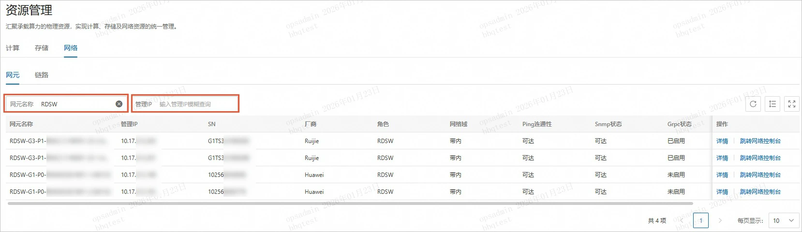

5. 单击对应网元**操作**列**详情**，进入网元详情页面。

   - **基本信息**：展示了**网元名称**、**SN**、**厂商**、**角色**、**网络域**等网元设备的基本信息。

   - **端口**：展示该网元设备的端口信息，包括**端口名称**、**端口速率**、**端口描述**、**管理状态**和**操作状态**等。

   - **监控**：展示该网元设备的**CPU使用率**和**内存使用率**。

   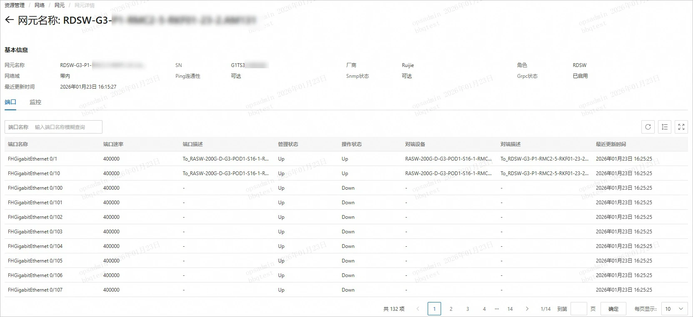

6. 单击对应网元**操作**列**跳转网络控制台**，可以查看CPN网元更详细信息。

   更多信息，请参见<strong>《专有云运维平台 操作指南》</strong>的<strong>《CPN网元》</strong>章节。

   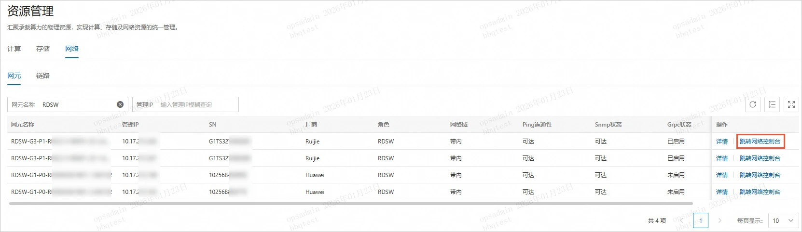

<a id="section-7-3-2"></a>

### 7.3.2. 查看链路详情

本节将介绍如何查询局点内所有链路，包括交换机链路和节点链路，以便于快速识别异常节点。

**操作步骤**

1. 登录BMCP运维平台。

2. 在左侧导航栏中，单击**资源管理**。

   默认进入**计算**页面。

3. 单击**网络 > 链路**页签进入页面，该页面展示了局点内所有链路。

4. 在**链路名称**搜索框中输入对应信息，查询目标链路。

   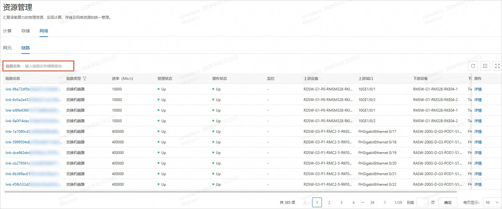

5. 单击**链路名称**或**操作**列**详情**，进入链路详情页面。

   - **链路信息**：展示了**链路名称**、**链路类型**、**速率**、**管理状态**等链路的基本信息。

   - **交换机端口**：展示该交换机的端口信息，包括**端口名称**、**设备**、**端口速率**、**端口描述**、**管理状态**和**操作状态**等。

   - **RDMA网卡端口**：展示该RDMA网卡的端口信息，包括**网卡名称**、**节点**、**MAC地址**、**管理状态**等。

<a id="section-8"></a>

# 8.巡检诊断

<a id="section-8-1"></a>

## 8.1. 诊断

<a id="section-8-1-1"></a>

### 8.1.1. 集群/节点诊断

本节介绍如何对集群或节点进行诊断。

**使用限制**

集群/节点诊断仅支持包含**裸金属节点**的**裸金属-智算算力集群**（智算高网型实例）、**容器-智算算力集群**（智算高网型实例和智算训推优化实例）和**融合算力集群**（融合高网实例和融合基础实例）。

**创建集群/节点诊断任务**

> **重要**
>
> 若本次检测包含耗时诊断项或压力测试，会占用GPU资源，请确认本次操作不会对业务造成影响。

1. 登录BMCP运维平台。

2. 在左侧导航栏中，选择**巡检诊断 > 诊断**。

   默认进入**集群/节点诊断**页签。

3. 单击**创建任务**，在**一键诊断**对话框中，设置**任务名称**，选择**任务类型**、**诊断范围**和**诊断项**，然后单击**确定**。

   单击**子项**列的数字可查看当前支持的诊断项。

   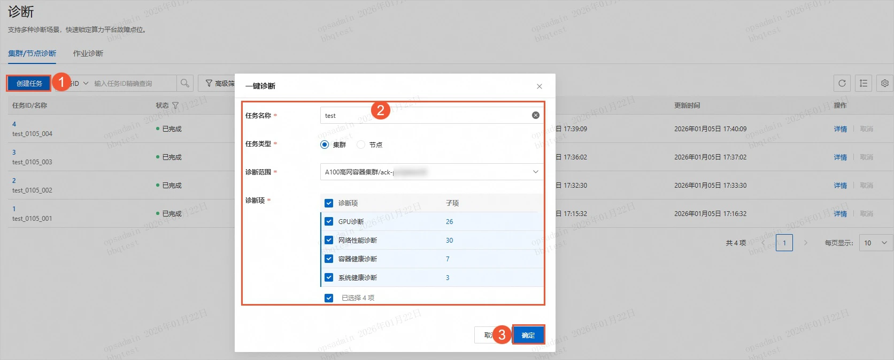

**管理集群/节点诊断任务**

您可以在**集群/节点诊断**页面，查询并管理**集群/节点诊断**任务。

1. 查询**集群/节点诊断**任务列表。

   在筛选列表中，选择筛选选项，并在搜索栏输入相应信息，任务列表中将自动展示符合搜索条件的任务。

   > **说明**
   >
   > 支持通过**任务ID**、**任务名称**和**起止时间**等信息查找诊断任务。
   >
   > 您也可以单击**高级筛选**，同时选择多个筛选项逐级过滤，以便快速查找诊断任务。

2. 取消诊断任务。

   单击状态为**运行中**任务**操作**列的**取消**。

3. 查看诊断详情。

   当诊断任务**状态**变更为**已完成**后，可单击**操作**列的**详情**查看诊断结果。

<a id="section-8-1-2"></a>

### 8.1.2. 作业诊断

本节介绍如何对作业任务涉及到的集群进行诊断。

**使用限制**

作业诊断仅支持包含**裸金属节点**的**容器-智算算力集群**。

**创建作业诊断任务**

> **重要**
>
> 若本次检测包含耗时诊断项或压力测试，会占用GPU资源，请确认本次操作不会对业务造成影响。

1. 登录BMCP运维平台。

2. 在左侧导航栏中，选择**巡检诊断 > 诊断**。

   默认进入**集群/节点诊断**页签。

3. 单击**作业诊断**页签。

4. 单击**创建任务**，在**一键诊断**对话框中，设置**任务名称**，选择**集群ID**、**命名空间**、**作业ID**和**诊断项**，然后单击**确定**。

   单击**子项**列的数字可查看当前支持的诊断项。

   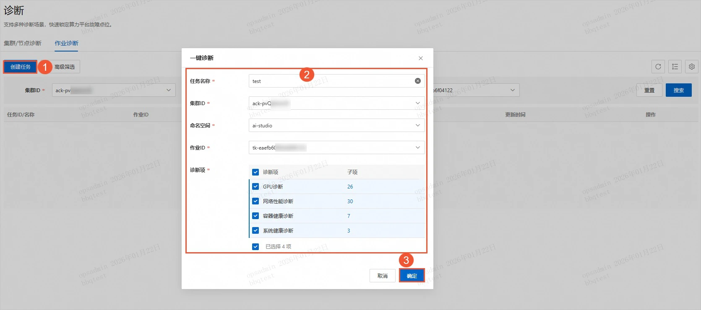

**管理作业诊断任务**

您可以在**作业诊断**页面，查询并管理**作业诊断**任务。

1. 查询**作业诊断**任务列表。

   单击**高级筛选**，选择**集群ID**、**命名空间**和**作业ID**查找诊断任务。

2. 取消诊断任务。

   单击状态为**运行中**任务**操作**列的**取消**。

3. 查看诊断详情。

   当诊断任务**状态**变更为**已完成**后，可单击**操作**列的**详情**查看诊断结果。

<a id="section-8-1-3"></a>

### 8.1.3. 诊断项说明

诊断功能提供集群、节点和作业诊断，本文将为您详细介绍支持的诊断项。

**系统健康诊断**

| 诊断项 | 说明 |
| --- | --- |
| 资源QoS诊断 | 容器引擎containerd异常，ctr命令超时或者hang死。 |
| DNS配置检查 | 检查物理机<code> /etc/resolv.conf </code>的DNS配置。 |
| NIC上联口接线映射检查 | 确认每台服务器 NIC 端口与交换机端口的对应关系是否正确。 |

**网络性能诊断**

| 诊断项 | 说明 |
| --- | --- |
| 网卡速率合规检查 | 检查并确保网卡速率符合系统要求。 |
| BOND口检查 | 检查网络绑定端口的状态和配置。 |
| 网卡与GPU连接关系检查 | 验证网卡与GPU的连接拓扑是否正确。 |
| bonding模块检查 | 检查bonding网络模块是否正确安装。 |
| OS发行版本 | 检查操作系统发行版本。 |
| OS内核版本 | 检查并确保内核版本符合系统要求。 |
| RDMA设备聚合哈希策略 | 检查RDMA设备的聚合哈希策略配置。 |
| RDMA_QOS配置检查 | 检查并优化RDMA服务质量配置。 |
| RDMA设备数量 | 检查RDMA设备数量是否符合预期。 |
| RDMA设备名称和状态 | 检查RDMA设备的名称和运行状态。 |
| RDMA设备聚合模式 | 检查RDMA设备的聚合模式配置。 |
| RDMA设备MTU设置 | 检查并优化RDMA设备的MTU设置。 |
| RDMA设备端口速率 | 检查RDMA设备端口速率是否满足性能要求。 |
| RDMA设备聚合状态 | 检查RDMA设备的聚合状态。 |
| MLX LAG模式检查 | 检查并确认MLX LAG模式配置。 |
| PCIe链路速率和宽度一致性检查 | 检查PCIe链路速率和宽度的一致性。 |
| RDMA设备固件版本一致性检查 | 检查RDMA设备固件版本的一致性。 |
| RDMA网卡驱动加载 | 检查RDMA网卡驱动是否正确加载。 |
| PCIe MRR配置 | 检查PCIe MRR配置。 |
| GDR模块加载 | 检查GDR模块是否正确加载。 |
| LLDP服务运行状态 | 检查LLDP服务的运行状态。 |
| NVIDIA_FABRIC_MA NAGER服务运行状态 | 检查NVIDIA Fabric Manager服务的运行状态。 |
| PCIE链路速率和宽度降速检查 | 检查并修复PCIe链路速率和宽度降速问题。 |
| 上联交换机和端口名称检查 | 检查上联交换机和端口名称配置。 |
| alixpu_peermem 状态检查 | 检查 alixpu_peermem 模块加载状态并重新加载。 |
| XDR 模块安装检查 | 验证 XDR 模块安装完整性并重新安装。 |
| APG ICN 状态检查 | 检查 APG ICN 异常状态并重启相关服务。 |
| GPU掉卡 | 检查GPU是否存在掉卡问题。 |
| 检查IB网卡顺序 | 检查IB网卡顺序是否符合预期。 |
| PCI ACS 状态检查 | 启用PCI ACS功能并重新配置虚拟化设置。 |

**GPU诊断**

> **说明**
>
> GPU诊断项与显卡有关，具体支持的诊断项请以界面显示为准。

| 诊断项 | 说明 |
| --- | --- |
| 系统环境检查 | 检查并修复GPU设备驱动、固件、核心服务、内核数据接口、环境变量和运行时类库。 |
| 网络设备检查 | 检查并更新网络设备驱动和固件，确保满足高网要求。 |
| 历史故障筛查 | 分析并处理系统记录的历史故障。 |
| GPU设备在位状态检查 | 检查并确保GPU设备正常在位。 |
| GPU上行速度检查 | 检查并处理GPU设备上行和互联是否存在降速、降lane问题。 |
| 设备工况检查 | 检查并处理GPU设备过温、降频、内存重度故障等异常状态。 |
| DCGM故障诊断 | 运行DCGM Level 2～Level 4诊断程序，检查并处理设备异常状态。 |
| 设备属性能力检查 | 检查并确认GPU设备是否支持GRDMA等高级功能。 |
| GPU访存带宽测试 | 测试并分析GPU的H2D、D2H、D2D带宽性能。 |
| GPU点对点通信测试 | 测试并评估GPU设备间的点对点通信效率。 |
| Black Scholes算法仿真 | 使用Black Scholes算法评估GPU计算性能。 |
| 重力体模拟 | 通过百万引力体模拟测试GPU算力极限。 |
| CUDA矩阵乘法测试 | 检查并优化CUDA矩阵乘法的数据准确性和性能。 |
| CuBLAS矩阵乘法测试 | 检查并优化CuBLAS矩阵乘法的数据准确性和性能。 |
| GPU烤机测试 | 长时间压力测试GPU，检查设备稳定性。 |
| HBM内存压力测试 | 检查HBM内存的性能和稳定性。 |
| GPU数据拷贝准确性测试 | 验证GPU数据拷贝的准确性。 |
| GPU数据拷贝性能测试 | 测试并优化GPU数据拷贝性能。 |
| 核函数执行性能测试 | 分析并改进核函数启动和执行延迟。 |
| 通用矩阵乘法浮点性能测试 | 测试不同数据类型的矩阵乘法性能。 |
| cuDNN常用函数性能测试 | 测试并优化cuDNN常用函数性能。 |
| cuBLAS常用函数性能测试 | 测试并优化cuBLAS常用函数性能。 |
| 单GPU矩阵乘性能测试 | 测试并优化单GPU大矩阵乘性能。 |
| 多GPU矩阵乘性能测试 | 测试并优化多GPU大矩阵乘性能。 |
| 计算通信重叠性能测试 | 测试GPU计算和通信重叠能力。 |
| NCCL通信性能测试 | 测试并优化NCCL集合通信性能。 |
| HIP GPU访存带宽测试 | 测试并分析基于HIP的GPU H2D、D2H带宽性能。 |
| HIP设备功能属性检查 | 检查并确认GPU设备的功能属性。 |
| HIP设备基础属性检查 | 检查GPU设备的基础属性。 |
| HIP总线带宽测试 | 使用零分数算法测试GPU带宽异常。 |
| HIP设备点对点通信检查 | 检查GPU设备间点对点通信是否使能。 |
| HIP HelloWorld核函数测试 | 验证设备是否可以正确执行HelloWorld核函数。 |
| HIP矩阵乘法测试 | 测试HIP矩阵乘法的数据准确性。 |
| 计算核心压力测试 | 压测DCU计算核心，记录温度和功耗曲线。 |
| 显存压力测试 | 压测DCU显存，记录温度和功耗曲线。 |
| 整部件压力测试 | 同时压测DCU的显存和计算核心，记录温度和功耗曲线。 |
| PCIe带宽测试 | 测试DCU的PCIe带宽。 |
| XHMI带宽测试 | 测试DCU的XHMI带宽。 |
| HBM带宽测试 | 测试DCU的HBM带宽。 |
| 均衡算力测试 | 测试DCU的FP64、FP32、FP16、INT8、INT4均衡算力值。 |
| RCCL通信性能测试 | 测试RCCL的集合通信效率和带宽性能。 |
| HBM双向DMA测试 | 测试主机到设备间HBM的双向DMA正确性和速度。 |
| L3 Cache双向DMA测试 | 测试主机到设备间L3 Cache的双向DMA正确性和速度。 |
| 任务执行测试 | 检验设备计算任务执行能力和效率。 |
| 单机卡间内存拷贝测试（AUTO模式） | 测试单机卡间内存拷贝效率，平衡性能和准确性。 |
| 单机卡间内存拷贝测试（UNIT模式） | 测试单机卡间内存拷贝准确性。 |
| 单机卡间内存拷贝测试（PERF模式） | 测试单机卡间内存拷贝性能。 |
| 峰值功耗测试 | 测试XPU设备峰值功耗，监控温度和功耗变化。 |
| 动态功耗测试 | 测试XPU的动态功耗变化。 |
| 全局内存可用性测试 | 测试XPU全局内存的可用性。 |
| XPU Link功能性测试 | 验证XPU Link的功能可用性。 |
| 算子单元测试 | 执行算子单元测试，统计失败的单元测试数量。 |
| 全局内存读写测试 | 测试XPU全局内存的读写能力。 |
| XPU Link C2C测试 | 测试XPU Link的C2C功能。 |
| 动态功耗测试 | 测试PG1的动态功耗。 |
| PCIe链路性能测试 | 测试PG1的访存性能，包括各种场景下的访存带宽和时延。 |
| 浮点算力验证 | 验证PG1的浮点算力性能是否达标。 |
| 显存压力测试 | 测量PG1内存子系统的性能，包括内存带宽和延迟。 |
| Sahara峰值功耗压力测试 | 极限功耗压力测试。 |
| Sahara稳定功耗压力测试 | 稳定功耗压力测试。 |
| Sahara缓存压力测试 | PG1缓存压力测试。 |
| Sahara SDC压力测试 | SDC压力测试。 |
| ICN端口状态检查 | 检查PG1的ICN端口链接状态。 |
| ICN通信压力测试（单向） | 测试ICN的单向通信性能。 |
| ICN通信压力测试（双向） | 测试ICN的双向通信性能。 |
| PCCL通信性能测试 | 测试PCCL集合通信性能，包括带宽和通信时延。 |
| MXVS浮点算力测试 | 测试不同精度下的浮点算力性能。 |
| MXVS单向PCIe链路测试 | 测量不同场景下的单向访存带宽和时延。 |
| MXVS双向PCIe链路测试 | 测量不同场景下的双向访存带宽和时延。 |
| MXVS单向点对点链路测试 | 测量不同场景下的单向点对点访存带宽和时延。 |
| MXVS双向点对点链路测试 | 测量不同场景下的双向点对点访存带宽和时延。 |
| MXVS MetaX链路测试 | 评估MetaXLink的卡间互联带宽。 |
| MXVS显存压力测试 | 测试HBM的显存带宽。 |
| MXVS压力测试（MetaXLink） | 使算力和功耗达到95%以上，评估GPU稳定性。 |
| MXVS压力测试（XCore） | 使算力和功耗达到95%以上，评估GPU稳定性。 |
| MCCL通信性能测试 | 测试MCCL集合通信性能，包括带宽和通信时延。 |
| MUDNN矩阵乘性能测试 | 通过MUDNN矩阵乘法来测量GPU的浮点性能。 |
| MUDNN矩阵乘稳定性测试 | 通过校验MUDNN矩阵乘结果的正确与否来反映GPU的功能完整性。 |
| MUDNN Unary性能测试 | 显存带宽性能测试。 |
| MUDNN Unary稳定性测试 | 显存功能测试。 |
| MUDNN2维卷积核功能测试（NCHW） | 测试MUDNN2维卷积核的功能完备性（张量为NCHW格式）。 |
| MUDNN2维卷积核功能测试（NHWC） | 测试MUDNN2维卷积核的功能完备性（张量为NHWC格式）。 |
| MUDNN3维卷积核功能测试（NCDHW） | 测试MUDNN3维卷积核的功能完备性（张量为NCDHW格式）。 |
| MUDNN3维卷积核功能测试（NDHWC） | 测试MUDNN3维卷积核的功能完备性（张量为NDHWC格式）。 |
| MUDNN Flash Attention算子功能测试 | 测试MUDNN Flash Attention算子的功能完备性。 |
| 显存读写测试 | 显存读写测试。 |
| MCCL通信性能测试 | 测试MCCL集合通信性能，包括带宽和通信时延。 |

**容器健康诊断**

| 诊断项 | 说明 |
| --- | --- |
| 容器引擎containerd异常检测 | 容器引擎containerd异常，ctr命令超时或者hang死。 |
| runc进程hang死检测 | 有runc进程hang死，会导致对应容器无法操作。 |
| shim进程内存泄漏检测 | shim进程内存泄露，会导致容器无法操作。 |
| shim进程泄露检测 | 容器删除了，但是对应的shim进程还在。 |
| runc文件夹泄露检测 | 容器删除了，但是对应的runc文件夹还在。 |
| systemd健康监测 | 机器<code> systemd/dbus </code> hang死，或者mount挂载点超过5000，会导致systemd卡顿。 |
| 磁盘err信息检测 | dmesg中存在磁盘err信息，会导致容器引擎部分操作失败。 |

<a id="section-9"></a>

# 9.基础配置

<a id="section-9-1"></a>

## 9.1. 机型管理

<a id="section-9-1-1"></a>

### 9.1.1. 添加机型

本文介绍如何添加机型。

**背景信息**

**智算纳管**、**带内纳管**和**高性能计算纳管**的机型可通过**添加机型**增加，其余类型的机型将在朱雀规划阶段自动导入。

**操作步骤**

1. 登录BMCP运维平台。

2. 单击**基础配置 > 机型管理**。

3. 单击机型列表左上方的**添加机型**。

4. 配置参数。

   | 配置项 | 是否必填 | 说明 |
   | --- | --- | --- |
   | 机型类型 | 是 | 选择机型的类型，取值范围：<br>• 智算/带内纳管<br>• 高性能计算纳管<br>说明支持的机型类型以您实际部署环境上的控制台显示为准。 |
   | 机型名称 | 是 | 请输入机型名称。 |
   | CPU架构 | 是 | 请选择CPU的架构。 |
   | CPU厂商 | 是 | 请选择CPU的厂商。 |
   | CPU型号 | 是 | 请输入CPU的型号。 |
   | CPU核数 | 是 | 请输入CPU核数。 |
   | 内存 | 是 | 请输入内存大小，单位为GB。 |
   | 磁盘大小 | 是 | 请输入磁盘大小，单位为GB。 |
   | 磁盘类型 | 是 | 大写英文字母组成。例如：HDD、SSD、SATA。 |
   | GPU厂商 | 否 | 请选择GPU厂商。 |
   | GPU型号 | 否 | 请选择GPU型号。 |
   | GPU数量 | 否 | 请输入GPU数量 |
   | 网卡个数 | 是 | 请输入网卡个数。 |
   | 网卡类型 | 是 | 请选择网卡类型。 |
   | 机器的U数 | 是 | 请输入机器的U数。 |
   | 厂商名 | 是 | 以字母或中文开头，支持数字，支持下划线（_）、短划线（-）、半角句号（.）、半角冒号（:）、半角逗号（,）等特殊字符，长度为2～128个字符。 |
   | 服务器额定功率 | 是 | 请输入服务器额定功率。 |
   | CPU最小安全频率 | 否 | 请输入CPU最小安全频率。 |
   | 描述 | 否 | 请输入描述信息。 |

5. 单击**确定**。

<a id="section-9-1-2"></a>

### 9.1.2. 查询机型

本文介绍如何查询机型。

**操作步骤**

1. 登录BMCP运维平台。

2. 单击**基础配置 > 机型管理**。

3. 在机型列表页面，您可以查看已有的机型信息。

   机型信息包括**规格**、**机型名称**、**机型类型**、**架构**、**CPU核数**、**CPU厂商**、**CPU型号**、**GPU厂商**和**GPU型号**等。

4. 在筛选列表中，选择筛选选项，并在搜索栏输入相应信息，机型列表中将自动展示符合搜索条件的机型。

   > **说明**
   >
   > 支持通过**机型名称**、**CPU厂商**、**CPU型号**、**GPU厂商**和**GPU型号**等机型信息查找目标机型。
   >
   > 您也可以单击**高级筛选**，同时选择多个筛选项逐级过滤，以便快速查找机型。

<a id="section-9-1-3"></a>

### 9.1.3. 修改机型

本文介绍如何修改机型。

**操作步骤**

1. 登录BMCP运维平台。

2. 单击**基础配置 > 机型管理**。

3. 单击目标机型**操作**列的**修改**。

4. 在弹出的**修改机型**对话框，修改机型参数，然后单击**确定**。

<a id="section-9-1-4"></a>

### 9.1.4. 删除机型

本文介绍如何删除机型。

> **警告**
>
> 删除机型之前，请确保无实例使用此机型，删除操作不可逆。

**操作步骤**

1. 登录BMCP运维平台。

2. 单击**基础配置 > 机型管理**。

3. 单击目标机型**操作**列的**删除**。

4. 在弹出的确认框中，单击**确定**。

   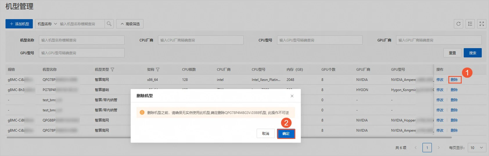

<a id="section-9-2"></a>

## 9.2. 镜像管理

在BMCP运维平台，您可以对当前的自定义镜像和公共镜像进行管理。

<a id="section-9-2-1"></a>

### 9.2.1. 自定义镜像

**上传自定义镜像**

1. 登录BMCP运维平台。

2. 单击**基础配置 > 镜像管理**。

   默认进入**自定义镜像**页签。

3. 单击镜像列表左上方的**自定义镜像上传**。

4. 配置参数。

   | 配置项 | 是否必选 | 说明 |
   | --- | --- | --- |
   | 地域 | 是 | 请选择镜像所属的地域。 |
   | 可用区 | 是 | 请选择镜像所属的可用区。 |
   | 镜像名称 | 是 | 镜像名称会在选择文件后自动生成。 |
   | 系统架构 | 是 | 请选择镜像的系统架构。 |
   | 平台 | 是 | 请选择镜像的平台。 |
   | 内核版本 | 否 | 请输入镜像的内核版本。 |
   | 镜像描述 | 否 | 请输入镜像的描述。 |
   | 镜像上传 | 是 | 选择文件，从本地上传镜像。 |

   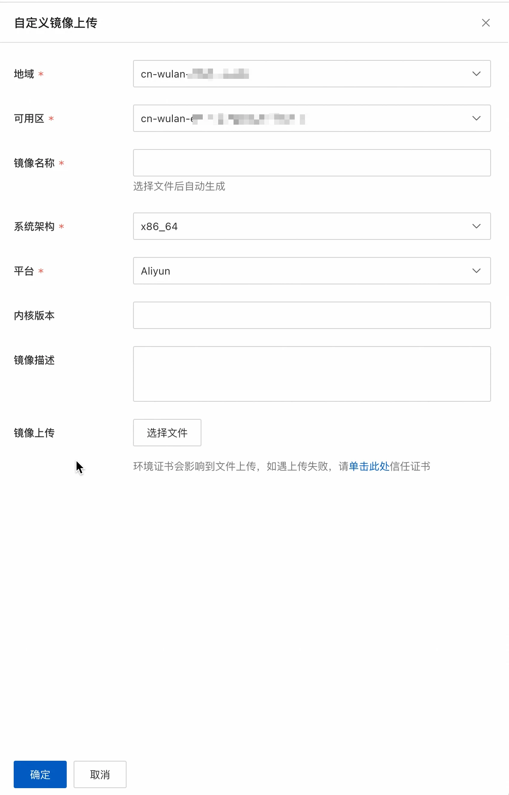

5. 单击**确定**。

**管理自定义镜像**

您可以对自定义镜像进行**删除**、**启用状态**、**禁用状态**、**镜像导出**等操作。

**操作步骤**

1. 登录BMCP运维平台。

2. 单击左侧导航栏的**基础配置 > 镜像管理**。

   默认进入**自定义镜像**页签。

3. 在镜像列表上方，您可以通过镜像名称或镜像ID进行模糊查询。

4. 镜像管理操作。

   <ol type="i">

   <li>

   删除镜像

   <ol type="a">

   <li>

   单击目标镜像**操作**列的**删除镜像**。

   </li>

   <li>

   在弹出的确认框中确认无误后，单击**确定**。

   > **重要**
   >
   > 删除镜像之前，请确保无实例使用此镜像，删除操作不可逆。

   </li>

   </ol>

   </li>

   <li>

   启用镜像

   单击目标镜像**操作**列的**启用状态 > 启用镜像**。

   </li>

   <li>

   禁用镜像

   单击目标镜像**操作**列的**启用状态 > 禁用镜像**。

   </li>

   <li>

   镜像导出

   单击目标镜像**操作**列的**镜像导出**，镜像将会下载至本地。

   </li>

   </ol>

<a id="section-9-2-2"></a>

### 9.2.2. 公共镜像

您可以对公共镜像进行启用、禁用、镜像导出、签名文件导出等操作。

**管理公共镜像**

您可以对公共镜像进行启用、禁用、镜像导出等操作。

**操作步骤**

1. 登录BMCP运维平台。

2. 单击左侧导航栏的**基础配置 > 镜像管理**。

   默认进入**自定义镜像**页签。

3. 单击**公共镜像**页签。

4. 在镜像列表上方，您可以通过镜像名称或镜像ID进行模糊查询。

5. 镜像管理操作。

   <ol type="i">

   <li>

   **启用镜像**

   单击目标镜像**操作**列的**启用状态 > 启用镜像**。

   </li>

   <li>

   **禁用镜像**

   单击目标镜像**操作**列的**启用状态 > 禁用镜像**。

   </li>

   <li>

   **镜像导出**

   单击目标镜像**操作**列的**镜像导出**，镜像将会下载至本地。

   </li>

   <li>

   **签名文件导出**

   单击目标镜像**操作**列的**签名文件导出**，签名文件将会下载至本地。

   </li>

   </ol>

**验证镜像完整性**

BMCP支持用户自验证公共镜像是否被篡改。

**操作步骤**

1. 登录BMCP运维平台。

2. 单击左侧导航栏的**基础配置 > 镜像管理**。

   默认进入**自定义镜像**页签。

3. 单击**公共镜像**页签。

4. 单击镜像列表上方的**下载公钥**。

5. 单击目标镜像**操作**列的**签名文件导出**。

6. 您可以使用如下命令查看镜像是否被篡改： `openssl dgst -sha256 -verify public.key -signature`

   ```text
   signature.bin imagefile 
   ```

   > **说明**
   >
   > - 在执行命令前，请确保公钥、签名文件、待验证的镜像都已下载。
   >
   > - 请根据实际替换如下三个参数：
   >
   >   - `public.key` 为下载的公钥。
   >
   >   - `signature.bin` 为下载的签名文档。
   >
   >   - `imagefile` 为需要验证的镜像文件名。

<a id="section-9-3"></a>

## 9.3. GPU配置

<a id="section-9-3-1"></a>

### 9.3.1. 添加GPU

本文介绍如何添加GPU。

**操作步骤**

1. 登录BMCP运维平台。

2. 单击**基础配置 > GPU配置**。

3. 单击机型列表左上方的**添加GPU**。

4. 配置参数。

   | 配置项 | 是否必填 | 说明 |
   | --- | --- | --- |
   | GPU厂商 | 是 | 输入GPU厂商名称。 |
   | GPU厂商（中文） | 否 | 输入GPU厂商的中文名称。 |
   | GPU型号 | 是 | 输入GPU型号。 |
   | GPU型号（中文） | 否 | 输入GPU型号的中文名称。 |
   | GPU显存大小 | 是 | 输入GPU显存大小，单位为G。 |
   | TFLOPS | 是 | 输入TFLOPS。 |

   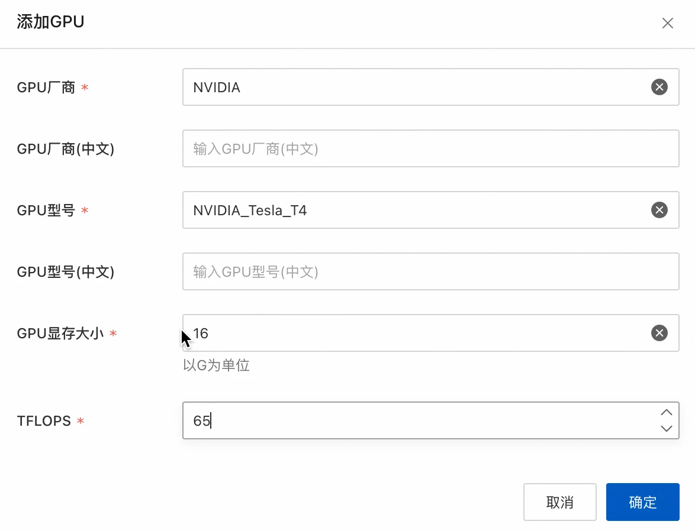

5. 单击**确定**。

<a id="section-9-3-2"></a>

### 9.3.2. 查询GPU

本文介绍如何查询GPU。

**操作步骤**

1. 登录BMCP运维平台。

2. 单击**基础配置 > GPU配置**。

3. 在**GPU配置**页面中，您可以在搜索栏输入**GPU型号**，GPU配置列表中将自动展示符合搜索条件的GPU配置。

   您也可以单击高级筛选，输入GPU型号，然后单击搜索，查询满足条件的GPU配置。

   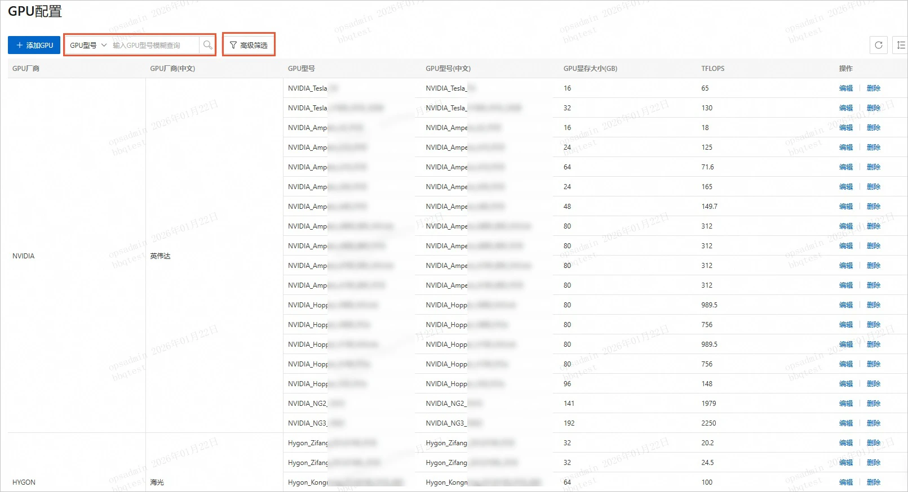

<a id="section-9-3-3"></a>

### 9.3.3. 修改GPU

本文介绍如何修改已添加的GPU信息。

**操作步骤**

1. 登录BMCP运维平台。

2. 单击**基础配置 > GPU配置**。

3. 单击目标GPU**操作**列的**编辑**。

4. 修改参数。您可以修改GPU厂商（中文）、GPU型号（中文）、GPU显存大小、TFLOPS等参数。

   > **说明**
   >
   > GPU厂商和GPU型号不支持修改。

   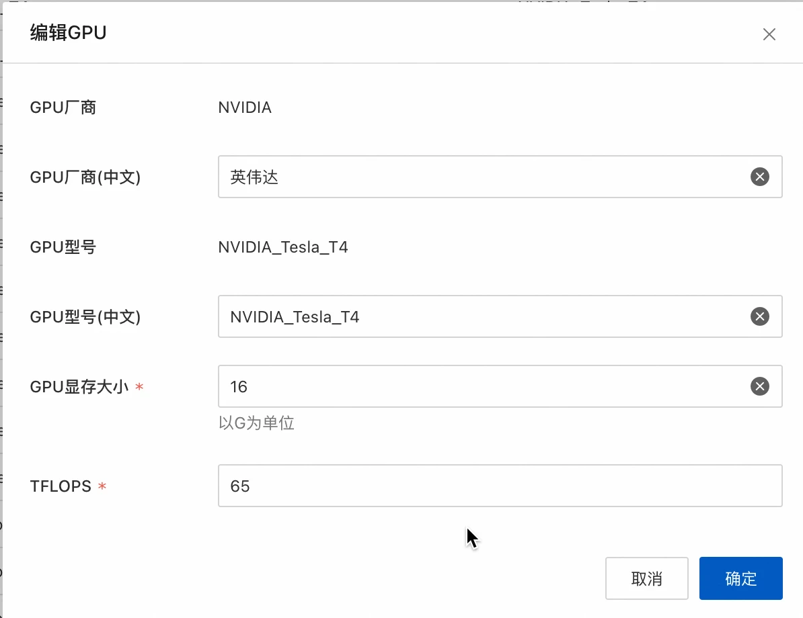

5. 单击**确定**。

<a id="section-9-3-4"></a>

### 9.3.4. 删除GPU

本文介绍如何删除已添加的GPU。

**操作步骤**

1. 登录BMCP运维平台。

2. 单击**基础配置 > GPU配置**。

3. 单击目标GPU操作列的**删除**。

4. 确认GPU信息无误后，单击**确定**。


<a id="section-10"></a>

# 10.日志管理

<a id="section-10-1"></a>

## 10.1. 集群/节点日志

本节介绍如何收集集群、节点或网络上的日志。

**操作步骤**

1. 登录BMCP运维平台。

2. 在左侧导航栏中，单击**日志管理**。

   默认进入**集群/节点日志**页签。

3. 单击**创建任务**，设置**任务名称**，选择**日志类型**、**资源范围**和**时间范围**，然后单击**确定**。

   > **说明**
   >
   > **资源类型**为**集群**时，该集群必须为**裸金属-智算算力集群**、**裸金属-超算算力集群**、**融合算力集群**和包含**裸金属节点**的**容器-智算算力集群**。

   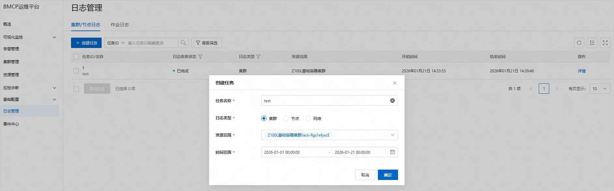

4. 单击日志拉取任务**操作**列的**详情**，可以查看日志拉取任务详情。

   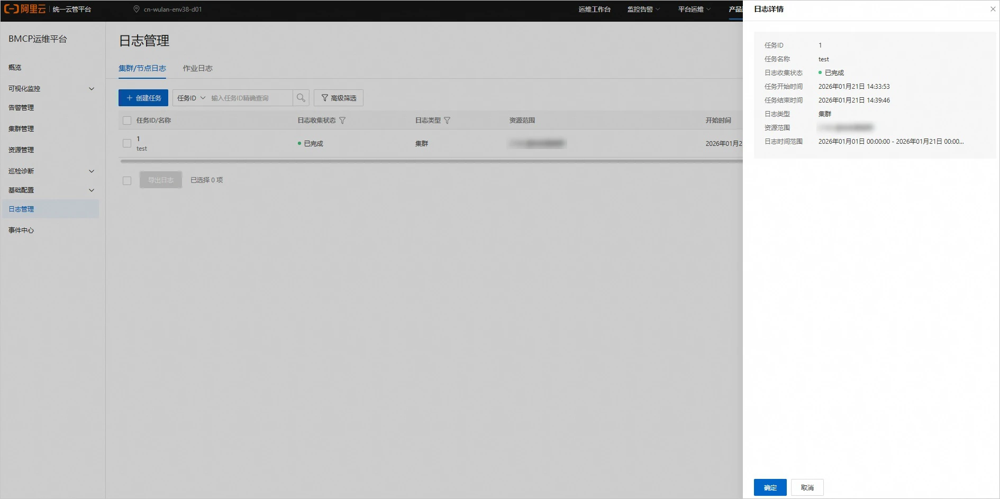

5. 当**日志收集状态**为**已完成**时，勾选日志收集任务，然后单击**导出日志**，即可下载对应的日志压缩文件包。

   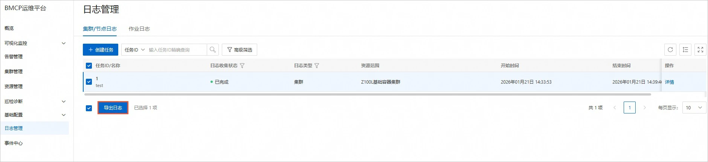

<a id="section-10-2"></a>

## 10.2. 作业日志

本节介绍如何收集作业日志。

**使用限制**

作业日志仅支持仅支持包含**裸金属节点**的**容器-智算算力集群**。

**操作步骤**

1. 登录BMCP运维平台。

2. 在左侧导航栏中，单击**日志管理**。

   默认进入**集群/节点日志**页签。

3. 单击**作业日志**页签。

4. 单击**创建任务**，设置**任务名称**，选择**集群ID**、**命名空间**和**作业ID**，然后单击**确定**。

   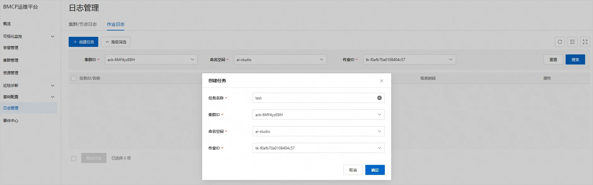

5. 单击日志拉取任务**操作**列的**详情**，可以查看日志拉取任务详情。

   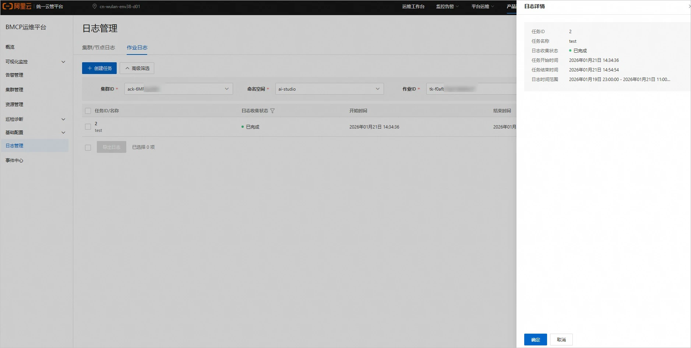

6. 当**日志收集状态**为**已完成**时，勾选日志收集任务，然后单击**导出日志**，即可下载对应的日志压缩文件包。

   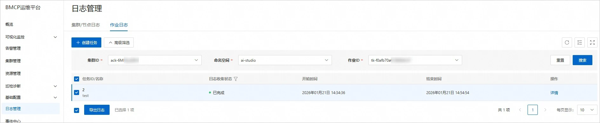

<a id="section-11"></a>

# 11.事件中心

事件中心提供对事件单的管理功能，您可以查看事件单的基本信息（例如事件单编号、状态等）、对事件单进行审批等操作。

**操作步骤**

1. 登录BMCP运维平台。

2. 在左侧导航栏，单击**事件中心**。

3. 在事件单列表上方，可以输入**事件单编号**进行搜索。

4. 在目标事件单操作列，单击**审批**。

5. 在弹出的**事件单详情**页，可以看到事件的**流程信息**、**基本信息**和**问题描述**。

6. 单击**处理**。

7. 选择审批**结果**。

   <ol type="i">

   <li>

   结果选择**通过**：在二次确认界面，手动输入“**我确认已知悉运维操作风险，仍要继续执行**”，单击**确定**。

   </li>

   <li>

   结果选择**拒绝**：单击**确定**。

   </li>

   </ol>

**其他操作**

**修复结单**：审批结果为通过的事件单，可以在**事件单详情**页，单击**修复结单**，单击**确定**。

查看事件单详情：审批完成后，单击事件单列表的操作列中的**详情**，可以查看事件单详细信息。

<a id="section-12"></a>

# 12.实例运维

实例运维模块提供组件包管理、软件栈配套表和升级任务管理功能，帮助运维人员管理裸金属实例的软件组件版本配套和批量升级。

<a id="section-12-1"></a>

## 12.1. 升级任务管理

<a id="section-12-1-1"></a>

### 12.1.1. 创建升级任务

升级任务是 BMCP 运维平台中用于批量升级裸金属实例软件组件版本的任务单元。通过升级任务，运维人员可以将指定组件包的新版本下发到目标机器上，完成软件组件的版本升级。本文介绍如何创建升级任务。

**操作步骤**

1. 登录BMCP运维平台。

2. 单击**实例运维 > 升级任务管理**。

3. 单击任务列表左上方的**创建升级任务**。

4. 在**选择检测机器**步骤中，配置以下参数：

   | 配置项 | 是否必填 | 说明 |
   | --- | --- | --- |
   | 选择组件包 | 是 | 选择需要升级的组件包。下拉列表中将展示系统中可用的组件包。 |
   | 目标机器 | 是 | 选择需要执行升级的目标机器。支持以下三种方式添加目标机器：<br>• <strong>手动输入</strong>：在文本框中输入机器SN号，多个SN以英文逗号（,）分隔，例如：SN-001,SN-002。输入完成后，单击<strong>解析SN</strong>解析并添加机器。<br>• <strong>集群筛选</strong>：在集群列表中选择一个或多个集群，查看集群下的节点列表（包括SN、节点名称、状态、镜像和操作系统信息），勾选需要检测的机器节点。您也可以通过勾选<strong>全选</strong>复选框选择当前集群下的所有节点。<br>• <strong>CSV导入</strong>：单击<strong>下载模板</strong>获取CSV模板文件，按模板格式填写机器信息后，将CSV文件拖拽至上传区域或单击上传区域选择文件上传。 |

5. 单击**下一步**，在**灰度策略**步骤中，配置参数。

   <table>
     <tr>
       <th width="121">配置项</th>
       <th>说明</th>
     </tr>
     <tr>
       <td>灰度模式</td>
       <td>选择灰度发布的方式。支持以下三种：<br>• <strong>全量下发</strong>：一次性将升级任务下发到所有目标机器。<br>• <strong>分波次</strong>：将目标机器按固定数量分批，逐批执行升级。<br>• <strong>按比例</strong>：按目标机器总数的百分比分批执行升级。</td>
     </tr>
     <tr>
       <td>波次大小</td>
       <td>选择<strong>分波次</strong>后，配置每个波次包含的目标机器数量。</td>
     </tr>
     <tr>
       <td>初始百分比</td>
       <td>选择<strong>按比例</strong>后，首次下发升级任务时，执行升级的机器数量占目标机器总数的百分比。后续系统将逐步增加比例，直至所有机器完成升级。</td>
     </tr>
     <tr>
       <td>最大并发</td>
       <td>同时执行升级操作的最大机器数量。系统允许多个波次或批次并行执行，但同时进行升级的机器总数不超过此值。</td>
     </tr>
     <tr>
       <td>单波失败暂停</td>
       <td>开启后，当某个波次或批次升级失败时，系统自动暂停后续升级任务的执行，需手动恢复。</td>
     </tr>
   </table>

6. 单击**确认下发**，在弹出的确认框中输入确认下发，单击**确认**。

<a id="section-12-1-2"></a>

### 12.1.2. 查看升级任务详情

本文介绍如何查看升级任务。

**操作步骤**

1. 登录BMCP运维平台。

2. 单击**实例运维 > 升级任务管理**。

3. 在升级任务列表上方，您可以通过输入**任务ID**/**配套名**搜索。

4. 在升级任务列表中，单击目标任务面**操作**列的**详情**。

5. 在升级任务详情页面，您可以查看已有的升级任务信息。

   升级任务详情包括**任务信息**、**进度概览**和**事件列表**等信息。

<a id="section-12-1-3"></a>

### 12.1.3. 暂停和继续升级任务

本文介绍如何暂停和继续升级任务。

**使用限制**

- 暂停：升级任务状态为**进行中**。

- 继续：升级任务状态为**已暂停**。

**操作步骤**

1. 登录BMCP运维平台。

2. 单击**实例运维 > 升级任务管理**。

3. 在目标升级任务**操作**列，请根据需要选择操作：

   <ol type="i">

   <li>

   单击**暂停**。

   </li>

   <li>

   单击**继续**。

   </li>

   </ol>

<a id="section-12-1-4"></a>

### 12.1.4. 推进下一波升级任务

本文介绍如何推进下一波升级任务。执行该操作后，系统将对下一批目标机器执行升级任务。

**使用限制**

- 升级任务的**灰度模式**为**分波次**。

- 升级任务的**状态**为**进行中**。

**操作步骤**

1. 登录BMCP运维平台。

2. 单击**实例运维 > 升级任务管理**。

3. 在目标升级任务**操作**列，单击  图标，单击**推进下一波**。

4. 在弹出的确认框中，单击**确定**。

<a id="section-12-1-5"></a>

### 12.1.5. 取消升级任务

本文介绍如何取消升级任务。取消操作仅停止未下发任务，已下发的任务不受影响。

**使用限制**

- 升级任务的**灰度模式**为**分波次**或**按比例**。

- 升级任务的**状态**为**进行中**。

**操作步骤**

1. 登录BMCP运维平台。

2. 单击**实例运维 > 升级任务管理**。

3. 在目标升级任务**操作**列，单击  图标，单击**取消**。

4. 在弹出的确认框中，单击**确定**。

<a id="section-12-2"></a>

## 12.2. 组件包管理

<a id="section-12-2-1"></a>

### 12.2.1. 上传组件包

本文介绍如何上传组件包。

**背景信息**

组件包是BMCP运维平台中用于管理和升级裸金属实例软件组件的基本单元。通过上传自定义组件包，您可以为后续的软件栈配套和升级任务提供所需的组件版本。

**使用限制**

- 配套表选择组件包时会直接继承其版本，无需重复填写。

- 上传同名组件包时系统将弹出提醒，您可以选择覆盖已有文件或取消上传。

- 大文件上传期间弹窗会阻塞，暂不支持后台运行，请等待上传完成后再关闭弹窗。

**操作步骤**

1. 登录BMCP运维平台。

2. 单击**实例运维 > 组件包管理**。

3. 单击组件包列表左上方的**上传组件包**。

4. 配置参数。

   | 配置项 | 是否必填 | 说明 |
   | --- | --- | --- |
   | 组件类型 | 是 | 选择组件包的类型，可以选择已有类型如GPU驱动、GPU SDK和CPN网络工具或输入自定义类型。请根据实际组件分类选择。 |
   | 包类型 | 是 | 选择包的类型，可选rpm、deb、binary和tgz。 |
   | 版本 | 是 | 输入组件包的版本号。 |
   | 文件 | 是 | 单击<strong>选择文件</strong>上传组件包文件。您也可以单击<strong>下载TGZ模版</strong>获取标准模板，按照模板格式打包后再上传。 |
   | 描述 | 否 | 输入组件包的描述信息，最多256个字符。 |

5. 单击**确定**。

<a id="section-12-2-2"></a>

### 12.2.2. 查询组件包

本文介绍如何查询组件包。

**操作步骤**

1. 登录BMCP运维平台。

2. 单击**实例运维 > 组件包管理**。

3. 在组件包列表页面，您可以查看已有的组件包信息。

   组件包信息包括**ID**、**组件类型**、**类型**、**版本**、**文件名**、**大小**、**引用**、**来源**、**创建人**、**创建时间**和**更新时间**等。

4. 在筛选列表中，选择筛选选项，并在搜索栏输入相应信息，组件包列表中将自动展示符合条件的组件包。

5. 如需查看某个组件包的详细信息，单击操作列的**详情**。

   详情面板将展示该组件包的完整信息，包括基本信息和关联配套表。

<a id="section-12-2-3"></a>

### 12.2.3. 删除组件包

本文介绍如何删除组件包。

**使用限制**

- 已被软件栈配套表引用的组件包不可删除。

- 系统预置的组件包不可删除。

**操作步骤**

1. 登录BMCP运维平台。

2. 单击**实例运维 > 组件包管理**。

3. 单击目标组件包**操作**列的**删除**。

4. 在弹出的确认框中，单击**确定**。

<a id="section-12-3"></a>

## 12.3. 软件栈配套表

<a id="section-12-3-1"></a>

### 12.3.1. 新建配套

本文介绍如何新建软件栈配套表。

**背景信息**

软件栈配套表用于管理组件版本的配套关系，定义一组组件包之间的版本兼容组合。通过配套表，您可以检测裸金属实例上组件版本的一致性，并支持批量下发升级任务。

**操作步骤**

1. 登录BMCP运维平台。

2. 单击**实例运维 > 软件栈配套表**。

3. 单击配套列表左上方的**新建配套**。

4. 配置参数。

   | 配置项 | 是否必填 | 说明 |
   | --- | --- | --- |
   | 配套名 | 是 | 输入配套表的唯一标识名称。配套名在系统中必须唯一，不可重复。 |
   | 镜像类型 | 否 | 选择镜像类型，默认为<strong>通用镜像</strong>。 |
   | 描述 | 否 | 输入配套表的描述信息。 |

5. 单击**确定**。

<a id="section-12-3-2"></a>

### 12.3.2. 查看配套详情

本文介绍如何查看软件栈配套表的详情信息。

**操作步骤**

1. 登录BMCP运维平台。

2. 单击**实例运维 > 软件栈配套表**。

3. 在配套列表上方，您可以通过输入配套名称模糊搜索。

4. 在配套列表中，单击目标配套**操作**列的**详情**。

5. 在配套详情页面，您可以查看配套的基本信息和组件列表。

<a id="section-12-3-3"></a>

### 12.3.3. 添加组件

本文介绍如何给配套表添加组件。

**操作步骤**

1. 登录BMCP运维平台。

2. 单击**实例运维 > 软件栈配套表**。

3. 在配套列表中，单击目标配套**操作**列的**详情**。

4. 单击**添加组件**。

5. 配置参数。

   | 配置项 | 是否必填 | 说明 |
   | --- | --- | --- |
   | 组件类型 | 是 | 选择组件包的类型，可以选择已有类型如GPU驱动、GPU SDK和CPN网络工具或输入自定义类型。请根据实际组件分类选择。 |
   | 关联组件包 | 否 | 选择是否要关联已上传的组件包。 |
   | 组件包 | 是 | <strong>关联组件包</strong>选<strong>是</strong>出现该配置项，选择要关联的组件包。 |
   | 组件版本 | 是 | 输入组件包的版本号，默认为上传组件包时填入的版本。<br>说明版本匹配规则：实际版本以期望版本为前缀时视为匹配。例如期望版本 535.129 可匹配实际版本 535.129.03。 |

6. 单击**确定**。

<a id="section-12-3-4"></a>

### 12.3.4. 激活/失效配套

本文介绍如何使软件栈配套表激活/失效。

**使用限制**

- 激活配套：配套**就绪状态**为**就绪**，且配套**状态**为**草稿**或**已失效**。

- 失效配套：配套**状态**为**草稿**或**已激活**。

**操作步骤**

1. 登录BMCP运维平台。

2. 单击**实例运维 > 软件栈配套表**。

3. 在目标配套表**操作**列，单击  图标，请根据需要选择操作：

   - 单击**激活**。

   - 单击**失效**。

4. 在弹出的确认框中，单击**确定**。

<a id="section-12-3-5"></a>

### 12.3.5. 检测与升级

通过检测与升级功能，您可以检测裸金属实例上的组件版本是否与配套表一致，并对不一致的组件批量下发升级任务。本文介绍如何通过软件栈配套表检测裸金属实例的组件版本并执行升级。

**前提条件**

- 已创建软件栈配套表，且配套表中已添加需要检测的组件。

- 配套表中的组件已关联对应的组件包，且组件包状态为**就绪**。

- 配套表**已激活**。

**操作步骤**

1. 登录BMCP运维平台。

2. 在左侧导航栏，选择**实例运维 > 软件栈配套表**。

3. 在目标配套表**操作**列，单击**检测与升级**。

   检测与升级流程分为以下两个步骤：

   <ol type="i">

   <li>

   **选择检测机器**：选择需要检测组件版本的裸金属实例。系统提供以下三种方式选择机器：

   <table>
     <tr>
       <th width="93">方式</th>
       <th>说明</th>
     </tr>
     <tr>
       <td>手动输入</td>
       <td>在文本框中输入机器SN号，多个SN以英文逗号（,）分隔，例如：SN-001,SN-002。输入完成后，单击<strong>解</strong><strong>析SN</strong>解析并添加机器。</td>
     </tr>
     <tr>
       <td>集群筛选</td>
       <td>在集群列表中选择一个或多个集群，查看集群下的节点列表（包括SN、节点名称、状态、镜像和操作系统信息），勾选需要检测的机器节点。您也可以通过勾选全选复选框选择当前集群下的所有节点。</td>
     </tr>
     <tr>
       <td>CSV导入</td>
       <td>单击<strong>下载模版</strong>获取CSV模板文件，按模板格式填写机器信息后，将CSV文件拖拽至上传区域或单击上传区域选择文件上传。</td>
     </tr>
   </table>

   </li>

   <li>

   **检测结果**：确认已选择机器后，单击**开始检测**，系统自动检测所选机器上的组件版本是否与配套表定义一致。检测完成后，系统将根据检测结果自动创建升级任务，对版本不一致的组件进行升级。

   </li>

   </ol>

4. （可选）查看升级任务的执行进度。您可以在左侧导航栏选择**实例运维 > 升级任务管理**，查看升级任务的执行状态和详细进度。

<a id="section-12-3-6"></a>

### 12.3.6. 删除配套

本文介绍如何删除软件栈配套表。

**使用限制**

- 系统预置的配套不可删除。

- 自定义的配套状态为**已失效**或**草稿**时可以删除。

**操作步骤**

1. 登录BMCP运维平台。

2. 单击**实例运维 > 软件栈配套表**。

3. 在目标配套表**操作**列，单击  图标，单击**删除**。

4. 在弹出的确认框中，单击**确定**。
