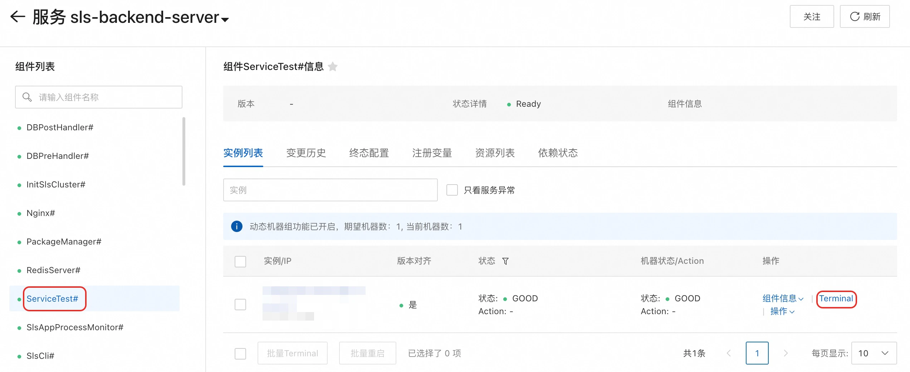

阿里云  
专有云  
日志服务  
运维指南  
产品版本：v3.18.6-SP2607  
文档版本：20260729

**目录**

- [1.运维方式](#section-1)
- [2.运维与诊断](#section-2)
    - [2.1. 通过机器Terminal查看日志](#section-2-1)
    - [2.2. 通过CLI工具维护日志服务](#section-2-2)
    - [2.3. 通过CDS-智能运维查询日志](#section-2-3)
    - [2.4. 通过SLS Pub Ops运维平台管理Project及云账号](#section-2-4)

<a id="section-1"></a>

# 1.运维方式

本文介绍日志服务的运维方式。

- 日志运维：日志服务依赖飞天基础运维平台进行部署，日志运维也主要通过飞天基础运维平台。日志运维有以下两种方式：

  - Terminal：在飞天基础运维平台上通过机器Terminal快速登录到日志服务所在的机器，直接查看日志。

  - CLI：为满足越来越多的自动化日志服务配置需求，日志服务提供命令行工具CLI（Command Line Interface）。CLI工具提供管理Project、Logstore、机器组、消费组、Logtail配置、日志查询等操作。

- 运维大盘：日志服务提供运维大盘，可通过运维大盘对日志服务的Project、云账号等进行统一管理。

**Terminal**

1. 登录Apsara Uni-manager运维控制台。

2. 登录飞天基础运维平台。

   在Apsara Uni-manager运维控制台的顶部菜单栏，选择**平台运维 > 飞天基础运维平台 > 资源管理**。

3. 进入产品集群运维。

   <ol type="i">

   <li>

   在左侧导航栏中，单击**产品集群运维**。

   </li>

   <li>

   在**产品集群运维**页面，在**产品|集群**搜索框输入 `sls` 进行查询。

   搜索结果中 `CdsSlsHybridCluster***` 即为日志服务所在集群。

   </li>

   <li>

   在**操作**列，单击**集群详情**。

   </li>

   </ol>

4. 在**集群详情**页面的**服务列表**页签中，单击目标组件（此处以sls-backend-server.ServiceTest#为例）名称，并单击实例列表**操作**列的**Terminal**。

   

5. 登录机器Terminal，进入到对应的文件目录查看日志。

**CLI**

日志服务命令行工具CLI的主要功能包括：

- 支持大部分的日志服务REST接口。例如管理Project、Logstore、机器组、消费组和Logtail配置等。

- 支持多账号，便于跨地域操作日志。

- 支持基本查询和拉取日志。

- 支持Elasticsearch数据迁移。

- 支持灵活的时间配置。

- 支持高速跨域日志复制，历史数据重新索引与数仓投递。

1. 下载并安装日志服务CLI工具。

   具体操作，请参见日志服务CLI。

2. 获取日志服务的Project名称、Endpoint和访问密钥（AccessKey）。

   具体操作，请参见<strong>《日志服务开发指南》</strong>中的相关章节。

3. 使用日志服务CLI命令查询日志和维护日志服务。

   具体操作，请参见日志服务CLI。

**运维大盘**

运维大盘的主要功能包括：

- Project管理

  - 查看全部的SLS Project信息，搜索Project查看该Project的地域、可用区、等信息、状态、资源配额等信息。

  - 设置Project的可用性。

  - 对Project的资源配额，如logstore上限、shard上限等进行设置。

    具体操作，请参见Project管理。

- 账号管理

  - 对云账号的可用状态进行设置。

  - 限制某账号可创建的Project数量。

    具体操作，请参见账号管理。

<a id="section-2"></a>

# 2.运维与诊断

<a id="section-2-1"></a>

## 2.1. 通过机器Terminal查看日志

在飞天基础运维平台上，通过机器Terminal快速登录到日志服务所在的机器，直接查看日志。

**DBPostHandler#**

- 启动日志：/cloud/app/sls-backend-server/DBPostHandler#/db_post_handler/current/log/start.log

- 服务日志：无

**DBPreHandler#**

- 启动日志：/cloud/app/sls-backend-server/DBPreHandler#/db_pre_handler/current/log/start.log

- 服务日志：无

**InitSlsCluster#**

- 启动日志：/cloud/app/sls-backend-server/InitSlsCluster#/init_sls_cluster/current/log/start.log

- 服务日志：无

**ServiceTest#**

- 启动日志：/cloud/app/sls-backend-server/ServiceTest#/service_test_monitor/current/log/service_monitor.log

- 服务日志：无

**SlsAppProcessMonitor#**

- 启动日志：

  - /cloud/app/sls-backend-server/SlsAppProcessMonitor#/sls_common_worker_monitor/current/log/start.log

  - /cloud/app/sls-backend-server/SlsAppProcessMonitor#/sls_config_service_monitor/current/log/start.log

  - /cloud/app/sls-backend-server/SlsAppProcessMonitor#/sls_etl_framework_monitor/current/log/start.log

  - /cloud/app/sls-backend-server/SlsAppProcessMonitor#/sls_loghub_master_monitor/current/log/start.log

  - /cloud/app/sls-backend-server/SlsAppProcessMonitor#/sls_presto_worker_monitor/current/log/start.log

  - /cloud/app/sls-backend-server/SlsAppProcessMonitor#/sls_query_master_monitor/current/log/start.log

  - /cloud/app/sls-backend-server/SlsAppProcessMonitor#/sls_quota_server_monitor/current/log/start.log

  - /cloud/app/sls-backend-server/SlsAppProcessMonitor#/sls_replay_worker_monitor/current/log/start.log

  - /cloud/app/sls-backend-server/SlsAppProcessMonitor#/sls_shennong_worker_monitor/current/log/start.log

- 服务日志：无

**SlsCommonWorkerDecider#**

- 启动日志：/cloud/app/sls-backend-server/SlsCommonWorkerDecider#/sls_common_worker_decider/current/log/start.log

- 服务日志：无

**SlsConfigManager#**

- 启动日志：/cloud/app/sls-backend-server/SlsConfigManager#/sls_config_manager/current/log/start.log

- 服务日志：无

**SlsConfigServiceDecider#**

- 启动日志：/cloud/app/sls-backend-server/SlsConfigServiceDecider#/sls_config_service_decider/current/log/start.log

- 服务日志：无

**SlsDeployFuxiless#**

- 启动日志：/cloud/app/sls-backend-server/SlsDeployFuxiless#/sls_deploy_fuxiless/current/log/start.log

- 服务日志：无

**SlsEtlFrameworkDecider#**

- 启动日志：/cloud/app/sls-backend-server/SlsEtlFrameworkDecider#/sls_etl_framework_decider/current/log/start.log

- 服务日志：无

**SlsImportOdpsScheduler#**

- 启动日志：/cloud/app/sls-backend-server/SlsImportOdpsScheduler#/sls_import_odps_scheduler/current/log/start.log

- 服务日志：无

**SlsLoghubMasterDecider#**

- 启动日志：/cloud/app/sls-backend-server/SlsLoghubMasterDecider#/sls_loghub_master_decider/current/log/start.log

- 服务日志：无

**SlsPrometheus#**

- 启动日志：/cloud/app/sls-backend-server/SlsPrometheus#/sls_prometheus/current/log/start.log

- 服务日志：无

**SlsQueryMasterDecider#**

- 启动日志：/cloud/app/sls-backend-server/SlsQueryMasterDecider#/sls_query_master_decider/current/log/start.log

- 服务日志：无

**SlsQuotaServerDecider#**

- 启动日志：/cloud/app/sls-backend-server/SlsQuotaServerDecider#/sls_quota_server_decider/current/log/start.log

- 服务日志：无

**SlsReplayWorkerDecider#**

- 启动日志：/cloud/app/sls-backend-server/SlsReplayWorkerDecider#/sls_replay_worker_decider/current/log/start.log

- 服务日志：无

**SlsReplayWorkerDecider#**

- 启动日志：/cloud/app/sls-backend-server/SlsReplayWorkerDecider#/sls_replay_worker_decider/current/log/start.log

- 服务日志：无

**SlsShennongWorkerDecider#**

- 启动日志：/cloud/app/sls-backend-server/SlsShennongWorkerDecider#/sls_shennong_worker_decider/current/log/start.log

- 服务日志：无

**ToolService#**

- 启动日志：

  - /cloud/app/sls-backend-server/ToolService#/init_diamond/current/log/diamond_publish_content.LOG

  - /cloud/app/sls-backend-server/ToolService#/init_diamond/current/log/start.log

  - /cloud/app/sls-backend-server/ToolService#/init_odps/current/log/start.log

  - /cloud/app/sls-backend-server/ToolService#/init_pop/current/log/start.log

  - /cloud/app/sls-backend-server/ToolService#/jdk_uploader/current/log/start.log

- 服务日志：无

<a id="section-2-2"></a>

## 2.2. 通过CLI工具维护日志服务

为满足越来越多的自动化日志服务配置需求，日志服务提供命令行工具CLI（Command Line Interface）。CLI工具提供管理Project、Logstore、机器组、消费组、Logtail配置、日志查询等操作。

**CLI**

日志服务命令行工具CLI的主要功能包括：

- 支持大部分的日志服务REST接口。例如管理Project、Logstore、机器组、消费组和Logtail配置等。

- 支持多账号，便于跨地域操作日志。

- 支持基本查询和拉取日志。

- 支持Elasticsearch数据迁移。

- 支持灵活的时间配置。

- 支持高速跨域日志复制，历史数据重新索引与数仓投递。

1. 下载并安装日志服务CLI工具。

   具体操作，请参见日志服务CLI。

2. 获取日志服务的Project名称、Endpoint和访问密钥（AccessKey）。

   具体操作，请参见**日志服务开发指南**中的**获取AccessKey**和**获取日志服务的Endpoint**章节。

3. 使用日志服务CLI命令查询日志和维护日志服务。

   具体操作，请参见日志服务CLI。

<a id="section-2-3"></a>

## 2.3. 通过CDS-智能运维查询日志

系统对关键性服务的日志进行了统一存储和索引，您可以根据服务类型、项目、存储服务等维度查询指定时间范围内的日志信息。

**背景信息**

日志并非永久保存，系统会定期自动清理日志。不同服务日志的保存时长不同，日志保存时长由日志数据量以及日志重要程度决定，但是阿里云云产品日志的最长保存时间不超过30天。

**操作步骤**

1. 登录Apsara Uni-manager运维控制台。

2. 在顶部菜单栏，选择**产品运维 > 存储运维 > CDS运维·CDS-OPS**。

3. 在左侧导航栏，选择**CDS-智能运维 > 日志查询**。

4. 在**日志查询**页面，选择类型、项目、存储和日期，并配置查询条件。

   

   查询条件由查询语句和分析语句构成，格式为 查询语句`|`分析语句 ，例如 `* | SELECT status, count(*) AS PV GROUP BY status` 。查询语句和分析语句以竖线（|）分割，查询语句的语法为日志服务专有语法。

   查询语句可单独使用，分析语句必须与查询语句一起使用，即分析功能是基于查询结果或全量数据进行的。更多信息，请参见<strong>《CDS用户指南》</strong>中“日志服务”节点下的“查询与分析”章节。

   <table>
     <tr>
       <th width="90">语句类型</th>
       <th>说明</th>
     </tr>
     <tr>
       <td>查询语句</td>
       <td>查询语句用于指定日志查询时的过滤规则，返回符合条件的日志。查询语句可以为关键词、数值、数值范围、空格、星号（*）等。 如果为空格或星号（*），表示无过滤条件。</td>
     </tr>
     <tr>
       <td>分析语句</td>
       <td>分析语句用于对查询结果或全量数据进行计算和统计。</td>
     </tr>
   </table>

5. 单击**查询**。

   系统显示符合条件的日志数据。

   > **说明**
   >
   > 不同类型的日志格式不同，请以实际为准。

**支持查询日志服务哪些类型的日志**

支持查询**日志服务**中以下Logstore的详细日志。这些日志为日志服务自身各服务初始化后生成的日志。

| Logstore | config_name | log path | server role |
| --- | --- | --- | --- |
| action_trail | 无 | <code>/apsara/sls/sls_Sl</code><br><code>sMetaServiceRole/Act</code><br><code>ionTrailOplog.LOG</code> | sls-backend-server.SlsMetaService # |

```text
 /apsara/sls/sls_Et
```

```text
                      sls-backend-
lFrameworkPartitionR
```

```text
无
```

alert-metering

```text
server.SlsEtlFramewor
```

```text
ole/alert_metering.L
```

k#

```text
OG 
```

```text
 /apsara/tubo/TempR
```

```text
oot/sys/DispatchWork
```

```text
dispatch_worker_log
                       er/*dispatch_worker.
```

```text
LOG 
```

sls-backend-

dispatch_worker_log

server.SlsDispatchWor ker#

```text
 /apsara/sls/sls_Di
```

```text
spatchWorkerPartitio
```

dispatch_worker_log_f

```text
uxiless                nRole/*dispatch_work
```

```text
er.LOG 
```

sls-backend-

```text
 /apsara/sls/sls_Et
```

server.SlsEtlFramewor

```text
lFrameworkPartitionR
```

etl_alert_log

```text
etl_alert_log
```

```text
k
```

```text
ole/etl_worker.LOG
```


```text
 /apsara/sls/sls_Et
```

```text
lFrameworkPartitionR
```

etl_framework_log_fuxi

```text
less                   ole/etl_worker.LOG
```


sls-backend-

etl_framework_log

server.SlsEtlFramewor k#

```text
 /apsara/tubo/TempR
```

etl_framework_log

```text
oot/sys/EtlFramework
```

```text
/etl_worker.LOG 
```

```text
 /apsara/tubo/TempR
```

```text
oot/sys/EtlFramework
```

```text
/etl_golang_worker.L
```

etl_golang_worker_log

```text
OG 
```

sls-backend-

etl_golang_worker_log

server.SlsEtlFramewor

```text
 /apsara/sls/sls_Et
```

```text
                      k#
lFrameworkPartitionR
```

etl_golang_worker_log

```text
_fuxiless              ole/etl_golang_worke
```

```text
r.LOG 
  /apsara/sls/sls_Sh
```

```text
ennongReplayWorkerRo
```

oss_shipper_metering_

```text
log_fuxiless           le/oss_shipper_meter
```

```text
ing.LOG 
```

```text
 /apsara/sls/import
```

```text
_odps/scheduler/odps
```

odps_shipper_meterin

```text
g_log                  _shipper_metering.lo
```

```text
g 
```

sls-backend-

```text
 /usr/local/export/
```

etl_metering

server.SlsShennongW orker#

```text
export_*_metering.lo
```

export_metering_log

```text
g 
```

```text
 /usr/local/python-
```

python_etl_metering

```text
etl/metering.log 
```

```text
 /apsara/tubo/TempR
```

```text
oot/sys/ShennongRepl
```

oss_shipper_metering_

```text
log                    ayWorker/oss_shipper
```

```text
_metering.LOG 
```

```text
 /apsara/sls/sls_Sl
```

sls-backend-

export-service-metrics

redis_op_log

server.SlsExportServic

```text
sExportServiceRole/r
```

e#

```text
edis_worker.log 
```

```text
 /apsara/sls/sls_Sl
```

redis_op_log

```text
sExportServiceRole/r
```

```text
edis_worker.log 
```

```text
 /apsara/sls/sls_Sl
```

```text
                      sls-backend-
sExportServiceRole/e
```

export_service_worker

export_service_log

```text
server.SlsExportServic
```

```text
_log                   xport_service_worker
                                             e#
```

```text
.log 
```

```text
 /apsara/sls/sls_Sl
```

export_service_log

```text
sExportServiceRole/E
```

```text
xportService.LOG 
```

```text
 /apsara/tubo/TempR
```

```text
oot/sys/FcTriggerWor
                      无
```

```text
fc_trigger_log
                       ker/fc_trigger.log
```


fc_trigger_log

```text
 /apsara/sls/sls_Fc
```

```text
TriggerWorkerRole/fc  无
```

fc_trigger_log_fuxiless

```text
_trigger.log 
```

```text
 /cloud/app/sls-
```

```text
backend-
```

```text
server/SlsForwarderP
```

```text
无
```

forwarder-grpc

```text
forwarder-grpc         rometheus#/sls_forwa
```

```text
rder_prometheus/curr
```

```text
ent/forwarder-
```

```text
grpc.json 
```

```text
 /apsara/cloud/app/
```

```text
sls-backend-
```

```text
server/SlsForwarderK
```

```text
                       afka#/sls_forwarder_
forwarder-kafka-error                        无
```

```text
kafka/current/sls_fo
```

```text
rwarder_kafka_releas
```

```text
e_64/kafka/logs/erro
```

```text
r.log 
```

forwarder-kafka

```text
 /apsara/cloud/app/
```

```text
sls-backend-
```

```text
server/SlsForwarderK
```

```text
                       afka#/sls_forwarder_
forwarder-kafka-
                                             无
```

```text
access                 kafka/current/sls_fo
```

```text
rwarder_kafka_releas
```

```text
e_64/kafka/logs/acce
```

```text
ss.log 
```

```text
 /apsara/cloud/app/
```

```text
sls-backend-
```

```text
server/SlsForwarderS
```

```text
                                                                    sls-backend-
                                             yslog#/sls_forwarder
forwarder-syslog       forwarder-syslog                             server.SlsForwarderSy
```

```text
_syslog/current/sls_
                      slog#
```

```text
forwarder_syslog_rel
```

```text
ease_64/syslog-
```

```text
forwarder.json 
```

/apsara/tubo/TempRoo t/sys/SlsKmsWrapperS

kms_sql_log

ervice/kms_sql.LOG

sls-backend-

kms_sql_log

server.SlsKmsWrapper Service#

/apsara/sls/sls_KmsWr

kms_sql_log_fuxiless

apperServiceWorker/k ms_sql.LOG

```text
 /apsara/sls/sls_Km
```

```text
sWrapperServiceWorke
```

kms_worker_log_fuxile

```text
ss                     r/sls_kms_wrapper_se
```

```text
rvice_worker.LOG 
```

sls-backend-

kms_worker_log

server.SlsKmsWrapper Service#

```text
 /apsara/tubo/TempR
```

```text
oot/sys/SlsKmsWrappe
```

```text
kms_worker_log         rService/sls_kms_wra
```

```text
pper_service_worker.
```

```text
LOG 
```

无

无

logtail_alarm

sls-backend-

无

无

logtail_status_profile

server.SlsLogtail#

无

无

logtail_suicide_profile

sls-backend-

```text
 /apsara/sls/meteri
```

metering

metering

server.SlsMeteringSer

```text
ng.log 
```

vice#

```text
 /apsara/sls/sls_Sl
```

```text
sMirrorsls-backend-
```

```text
                      sls-backend-
server.SlsMirrorServ
```

```text
mirror_service
```

```text
mirror_service                               server.SlsMirrorServic
```

```text
ice#ServiceRole/mirr
                      e#
```

```text
or_service_worker.LO
```

```text
G 
```

```text
 /apsara/sls/nginx/
```

sls-backend-

nginx_error_log

nginx_error_log

server.Nginx#

```text
logs/error.log 
```

```text
 /apsara/sls/import
```

```text
_odps/scheduler/impo  无
```

offline_scheduler_log

offline_scheduler_log

```text
rt_odps*.log 
```

```text
 /apsara/tubo/TempR
```

pk-query

```text
oot/sys/ShennongWork
```

```text
er/pk_query.LOG 
```

sls-backend-

pk-query

server.SlsShennongW

```text
 /apsara/sls/sls_Sh
```

orker#

```text
ennongWorkerRole/pk_
```

pk-query_fuxiless

```text
query.LOG 
  /apsara/presto/pre
```

```text
sto_data/var/log/gc.
```

presto_gc_log

presto_gc_log

```text
log* 
```

```text
 /apsara/presto/pre
```

```text
sto_data/var/log/htt
```

presto_http

presto_http

```text
p-request.log 
```

```text
 /apsara/presto/pre
```

```text
sto_data/var/log/met
```

presto_metering

presto_metering

```text
ering.log 
```

```text
 /apsara/tubo/TempR
```

```text
oot/sys/PrestoWorker
```

presto_monitor

```text
presto_monitor
                       /presto_monitor.LOG
```


sls-backend-server.SlsPrestoWorke r#

```text
 /apsara/presto/pre
```

```text
sto_data/var/log/ser
```

presto_server

```text
ver.log 
```

presto_server

```text
 /apsara/sls/presto
```

```text
/presto_data/var/log
```

presto_server_fuxiless

```text
/server.log 
```

/apsara/presto/sls_sql_

presto_sql_server

presto_sql_server

server.LOG

/apsara/tubo/TempRoo

presto_worker

t/sys/PrestoWorker/pre sto_worker.LOG

presto_worker

/apsara/sls/sls_Presto

presto_worker_fuxiless

WorkerRole/presto_wo rker.LOG

```text
 /cloud/app/sls-
```

```text
backend-
```

```text
server/SlsPrometheus
```

prometheus-backend-

```text
prometheus-backend-
```

```text
#/sls_prometheus/cur
```

```text
log
```

```text
log
```

```text
rent/aos_sls_prometh
```

```text
eus_release_64/sls_p
```

```text
rometheus.LOG* 
```

sls-backend-server.SlsPrometheus #

```text
 /cloud/app/sls-
```

```text
backend-
```

```text
server/SlsPrometheus
```

prometheus-log

```text
prometheus-log
```

```text
#/sls_prometheus/cur
```

```text
rent/prometheus*.LOG
```

```text
 /apsara/tubo/TempR
```

query_master_log

```text
oot/sys/QueryMaster/
```

```text
query_master.LOG* 
```

sls-backend-

query_master_log

server.SlsQueryMaster #

```text
 /apsara/sls/sls_Qu
```

query_master_log_fuxil

```text
eryMasterRole/query_
```

ess

```text
master.LOG* 
```

```text
 /apsara/sls/sls_Qu
```

```text
                      sls-backend-
eryMasterRole/query_
```

query_master_meterin

query_master_meterin

```text
server.SlsQueryMaster
```

g_log

```text
g_log                  master_metering_*.LO
                                             #
```

```text
G* 
```

```text
 /var/log/redis/sen
```

sls-backend-

redis_sentinel

redis_sentinel_log

server.RedisServer#

```text
tinel.log 
```

```text
 /var/log/redis/red
```

sls-backend-

redis_server

redis_server_log

server.RedisServer#

```text
is.log 
```

```text
 /apsara/sls/sls_Sl
```

```text
sMirrorServiceRole/m
```

sls-backend-

```text
irror_service_schedu
```

replication_status

```text
replication_status
```

server.SlsMirrorServic

```text
le.LOG 
```

e#

```text
 /apsara/sls/sls_Et
```

```text
                      sls-backend-
lFrameworkPartitionR
```

scheduled_sql_meterin

schedule_sql_metering

```text
server.SlsEtlFramewor
```

```text
g                      ole/etl_metering.LOG
```

k


```text
 /apsara/sls/scm_se
```

sls-backend-

```text
rver/scm_server.LOG
```

scm_server

scm_server

server.SlsScmServer#


```text
 /apsara/sls/scm_se
```

sls-backend-

scm_server_oplog

scm_server_oplog

```text
rver/scm_operation.L
```

server.SlsScmServer#

```text
OG 
```

```text
 /apsara/sls/nginx/
```

```text
logs/scmc_access.log
```

scmc_access_log

scmc_access_log


sls-backend-

```text
 /apsara/sls/nginx/
```

server.SlsScmc#

scmc_err_log

scmc_err_log

```text
logs/scmc_err_log 
```

```text
 /apsara/sls/nginx/
```

scmc_op_log

scmc_op_log

```text
logs/scmc_op_log 
```

sls-backend-

无

无

shennong_log_profile

server.SlsShennongW orker#

```text
 /apsara/sls/sls_Co
```

```text
                      sls-backend-
nfigServiceRole/conf
```

sls_config_service_cac

sls_config_service_cac

```text
server.SlsConfigServic
```

he

```text
he                     ig_service_cache.LOG
```

e#


```text
 /apsara/sls_Config
```

```text
ServiceRole/sls_conf
```

sls_configservice_log

```text
ig_service.LOG 
```

sls_configservice_log

```text
 /apsara/sls/sls_Co
```

```text
nfigServiceRole/sls_
```

sls_configservice_log_f

```text
uxiless                config_service.LOG
```


sls-backend-

```text
 /apsara/tubo/TempR
```

server.SlsConfigServic

```text
oot/sys/*ConfigServi
                      e#
```

sls_configservice_quer

```text
                       ce/config_service_qu
y_log
```

```text
ery.LOG 
```

sls_configservice_quer y_log

```text
 /apsara/sls/sls_Co
```

```text
nfigServiceRole/conf
```

sls_configservice_quer

```text
y_log_fuxiless         ig_service_query.LOG
```


<table>
  <tr>
    <td>sls_console_error_log</td>
    <td>sls_console_error_log</td>
    <td><code>/apsara/cloud/app/</code><br><code>sls-backend-</code><br><code>server/SlsConsole#/s</code><br><code>ls_console/current/s</code><br><code>ls_console/logs/erro</code><br><code>r.log</code></td>
    <td rowspan="2">sls-backend-server.SlsConsole#</td>
  </tr>
  <tr>
    <td>sls_console_info_log</td>
    <td>sls_console_info_log</td>
    <td><code>/cloud/app/sls-</code><br><code>backend-</code><br><code>server/SlsConsole#/s</code><br><code>ls_console/current/s</code><br><code>ls_console/logs/info</code><br><code>.log</code></td>
  </tr>
  <tr>
    <td rowspan="2">sls_consumergroup_lo g</td>
    <td>sls_consumergroup_lo g</td>
    <td><code>/apsara/tubo/TempR</code><br><code>oot/sys/QuotaServer/</code><br><code>monitor.LOG</code></td>
    <td rowspan="2">sls-backend-server.SlsQuotaServer #</td>
  </tr>
  <tr>
    <td>sls_consumergroup_lo g_fuxiless</td>
    <td><code>/apsara/sls/sls_Qu</code><br><code>otaServerRole/monito</code><br><code>r.LOG</code></td>
  </tr>
  <tr>
    <td>sls_etl20_coordinator_l og</td>
    <td>sls_etl20_coordinator_l og</td>
    <td><code>/apsara/sls/sls_Sl</code><br><code>sEtl20CoordinatorRol</code><br><code>e/SlsEtl20.LOG*</code></td>
    <td>sls-backend-server.SlsEtl20Coordin atorRole#</td>
  </tr>
  <tr>
    <td>sls_etl20_job_checker_l og</td>
    <td>sls_etl20_job_checker_log</td>
    <td><code>/apsara/sls/sls_Sl</code><br><code>sEtl20JobCheckerRole</code><br><code>/SlsEtl20.LOG*</code></td>
    <td>sls-backend-server.SlsEtl20JobChec kerRole#</td>
  </tr>
  <tr>
    <td>sls_etl20_sts_proxy_log</td>
    <td>sls_etl20_sts_proxy_lo g</td>
    <td><code>/apsara/sls/sls_Sl</code><br><code>sEtl20StsProxyRole/S</code><br><code>lsEtl20.LOG*</code></td>
    <td>sls-backend-server.SlsEtl20StsProx yRole#</td>
  </tr>
  <tr>
    <td>sls_etl20_worker_grou pb_log</td>
    <td>sls_etl20_worker_grou pb_log</td>
    <td><code>/apsara/sls/sls_Sl</code><br><code>sEtl20WorkerGroupBRo</code><br><code>le/SlsEtl20.LOG*</code></td>
    <td>sls-backend-server.SlsEtl20Worker GroupBRole#</td>
  </tr>
  <tr>
    <td>sls_etl20_worker_log</td>
    <td>sls_etl20_worker_log</td>
    <td><code>/apsara/sls/sls_Sl</code><br><code>sEtl20WorkerRole/Sls</code><br><code>Etl20.LOG*</code></td>
    <td>sls-backend-server.SlsEtl20Worker Role#</td>
  </tr>
</table>

```text
 /apsara/sls/sls_Sl
```

```text
                      sls-backend-
sEtl20WorkerGroupFux
```

sls_etl_connector_metr

```text
etl-connector-metrics
```

```text
server.SlsEtl20Worker
```

ics

```text
ilessRole/connector.
```

GroupFuxilessRole#

```text
log 
```

```text
 /apsara/sls/sls_Sl
```

```text
                      sls-backend-
sEtl20WorkerGroupFux
```

sls-etl20-fuxiless-

sls_etl_log

server.SlsEtl20Worker

```text
log_worker-log         ilessRole/work.log
```

GroupFuxilessRole#


```text
 /apsara/sls/fcgi_a
```

sls-backend-

sls_fastcgi_log

sls_fastcgi_log

```text
gent/FastcgiAgent*.L
```

server.SlsFastcgi#

```text
OG 
```

```text
 /apsara/tubo/TempR
```

```text
oot/sys/ShennongWork
```

```text
sls_index_status_log   er/project_index_siz
```

```text
e.LOG 
```

sls-backend-

sls_index_status_log

server.SlsShennongW orker#

```text
 /apsara/sls/sls_Sh
```

```text
ennongWorkerRole/pro
```

sls_index_status_log_f

```text
uxiless                ject_index_size.LOG
```


```text
 /apsara/tubo/TempR
```

```text
oot/sys/LoghubMaster
```

sls_loghub_shard_statu

```text
s_log                  /loghub_master_meta.
```

```text
LOG 
```

sls_loghub_shard_statu s_log

```text
 /apsara/sls/sls_Lo
```

sls_loghub_shard_statu

```text
ghubMasterRole/loghu
```

s_log_fuxiless

```text
b_master_meta.LOG 
```

sls-backend-server.SlsLoghubMast

```text
 /apsara/tubo/TempR
```

```text
                      er#
oot/sys/LoghubMaster
```

```text
sls_loghubmaster_log
                       /sls_loghub_master.L
```

```text
OG 
```

sls_loghubmaster_log

```text
 /apsara/sls/sls_Lo
```

sls_loghubmaster_log_

```text
ghubMasterRole/sls_l
```

fuxiless

```text
oghub_master.LOG 
  /apsara/sls/sls_Sl
```

```text
sMetaServiceRole/Met
```

sls_meta_service

sls_meta_service

```text
aService.LOG 
```

sls-backend-server.SlsMetaService #

```text
 /apsara/sls/sls_Sl
```

sls_meta_service_oplo

sls_meta_service_oplo

```text
sMetaServiceRole/Met
```

g

g

```text
aServiceOplog.LOG 
```

```text
 /apsara/sls_SlsMet
```

```text
eringServiceRole/oms
```

sls-backend-

sls_metering_oms_dat

```text
.log 
```

oms

server.SlsMeteringSer

a

vice#

```text
 /apsara/tubo/TempR
```

sls_metering_service_l

```text
oot/sys/SlsMeteringS
```

og

```text
ervice/stdout.out 
```

```text
 /cloud/log/sls-
```

```text
backend-
```

```text
server/SlsMeteringSe  sls-backend-
```

sls_metering_service_l

```text
rvice#/sls_metering_  server.SlsMeteringSer
```

og

vice#

```text
service_app/tianji/s
```

sls_metering_service_l

```text
tdout 
```

og_fuxiless

```text
 /apsara/sls/fcgi_a
```

```text
gent/monitor_*.LOG
```

sls_monitor_log

sls_monitor_log


```text
 /apsara/sls/fcgi_a
```

```text
gent/metering_*.LOG
```

sls_operation_agg_log

sls_operation_agg_log


sls-backend-server.SlsFastcgi#

```text
 /apsara/sls/fcgi_a
```

sls_operation_log

sls_operation_log

```text
gent/ols_operation*.
```

```text
LOG 
  /apsara/sls/web/lo
```

sls_portal_access_log

sls_portal_access_log

```text
gs/access.log 
```

```text
 /apsara/sls/web/lo
```

sls_portal_api_audit

sls_portal_api_audit

```text
gs/apidetail.log 
```

```text
 /apsara/sls/web/lo
```

sls_portal_http_req

sls_portal_http_req

sls-backend-

```text
gs/httpclient.log 
```

server.SlsWeb#

```text
  /apsara/sls/web/lo
gs/normal.log 
```

sls_portal_normal

sls_portal_normal

```text
 /apsara/sls/web/lo
```

sls_portal_sys_info

sls_portal_sys_info

```text
gs/sysinfo.log 
```

```text
 /apsara/tubo/TempR
```

sls_quotaserver_log

```text
oot/sys/QuotaServer/
```

```text
quota_server.LOG 
```

sls_quotaserver_log

```text
 /apsara/sls/sls_Qu
```

sls_quotaserver_log_fu

```text
otaServerRole/quota_
```

xiless

```text
server.LOG 
```

sls-backend-server.SlsQuotaServer #

```text
 /apsara/tubo/TempR
```

```text
oot/sys/QuotaServer/
```

sls_quotausage_log

```text
charge.LOG 
```

sls_quotausage_log

```text
 /apsara/sls/sls_Qu
```

sls_quotausage_log_fu

```text
otaServerRole/charge
```

xiless

```text
.LOG 
```

```text
 /apsara/tubo/TempR
```

```text
oot/sys/ShennongRepl
```

```text
sls_replayworker_log
                       ayWorker/shennong_re
```

```text
play_worker.LOG 
```

sls-backend-

sls_replayworker_log

server.SlsReplayWork er#

```text
 /apsara/sls/sls_Sh
```

```text
ennongReplayWorkerRo
```

sls_replayworker_log_f

```text
uxiless                le/shennong_replay_w
```

```text
orker.LOG 
```

<table>
  <tr>
    <td>sls_service_error_log</td>
    <td>sls_service_error_log</td>
    <td><code>/alidata/www/logs/</code><br><code>java/sls-</code><br><code>service/applog/error</code><br><code>.log</code></td>
    <td rowspan="2">sls-backend-server.SlsConsoleServi ce#</td>
  </tr>
  <tr>
    <td>sls_service_info_log</td>
    <td>sls_service_info_log</td>
    <td><code>/alidata/www/logs/</code><br><code>java/sls-</code><br><code>service/applog/info.</code><br><code>log</code></td>
  </tr>
  <tr>
    <td rowspan="2">sls_shennongworker_lo g</td>
    <td>sls_shennongworker_lo g</td>
    <td><code>/apsara/tubo/TempR</code><br><code>oot/sys/ShennongWork</code><br><code>er/shennong_worker.L</code><br><code>OG</code></td>
    <td rowspan="2">sls-backend-server.SlsShennongW orker#</td>
  </tr>
  <tr>
    <td>sls_shennongworker_lo g_fuxiless</td>
    <td><code>/apsara/sls/sls_Sh</code><br><code>ennongWorkerRole/she</code><br><code>nnong_worker.LOG</code></td>
  </tr>
  <tr>
    <td>sls_sync_job</td>
    <td>sls-sync-job</td>
    <td><code>/apsara/cloud/app/</code><br><code>sls-backend-</code><br><code>server/SyncJob#/sync</code><br><code>job/current/log/sync</code><br><code>job.log</code></td>
    <td>sls-backend-server.SyncJob#</td>
  </tr>
  <tr>
    <td>sls_tool_service</td>
    <td>sls_tool_service</td>
    <td><code>/apsara/sls/sls_Sl</code><br><code>sToolServiceRole/sls</code><br><code>_tool_service.LOG</code></td>
    <td>sls-backend-server.SlsToolService #</td>
  </tr>
  <tr>
    <td>trace_log</td>
    <td>trace_log</td>
    <td><code>/apsara/shennong_a</code><br><code>gent/tracer/index_wo</code><br><code>rker_trace.LOG</code></td>
    <td rowspan="3">sls-backend-server.SlsShennongW orker#</td>
  </tr>
  <tr>
    <td rowspan="2">worker_input_log</td>
    <td>worker_input_log</td>
    <td><code>/apsara/tubo/TempR</code><br><code>oot/sys/ShennongWork</code><br><code>er/shennong_worker_i</code><br><code>nput.LOG</code></td>
  </tr>
  <tr>
    <td>worker_input_log_fuxil ess</td>
    <td><code>/apsara/sls/sls_Sh</code><br><code>ennongWorkerRole/she</code><br><code>nnong_worker_input.L</code><br><code>OG</code></td>
  </tr>
</table>

<a id="section-2-4"></a>

## 2.4. 通过SLS Pub Ops运维平台管理Project及云账号

通过SLS Pub Ops运维平台可对Project及云账号进行管理。

**登录SLS运维·SLS Pub Ops运维平台**

1. 登录Apsara Uni-manager运维控制台。

2. 在顶部导航栏，选择**产品运维 > 存储运维 > SLS运维·SLS Pub Ops**，进入运维平台。

**Project管理**

1. 登录SLS运维·SLS Pub Ops运维平台。

2. 在左侧导航栏，选择**Project管理**，可查看可用区下全部的SLS Project信息。

3. 在SLS Project搜索栏，您可以输入Project名称或单击**高级搜索**后，在搜索框中输入云账号、地域、可用区等信息，单击**立即查询**，可查询对应的Project信息。

4. 单击Project名称或操作列的**详情**，可查看该Project的基础信息如地域、可用区、登录名、云账号ID信息，以及资源配额如logstore上限、shard上限等信息。

   - 禁用/启用Project：

     - 在基础信息区块，当该Project处于“已开启”状态时，单击状态字段旁的  按钮，可禁用该

       Project。

       > **说明**
       >
       > 禁用后该Project不可用，通过控制台访问会提示“project xxx（project名称）has been forbidden”。

     - 当该Project处于禁用状态时，单击  按钮，可重新启用该Project。

   - 设置Project的资源配额：

     单击**资源配额**旁的**编辑**按钮，在资源配额页面中，设置对应指标项的上限值。

**账号管理**

在账号列表中，云账号表示组织UID以及接入SLS的云产品（如负载均衡SLB、对象存储OSS等产品）的默认账号。可按照组织或接入SLS的云产品设置该账号可创建的Project数量及账号的可用性。

1. 登录SLS运维·SLS Pub Ops运维平台。

2. 在左侧导航栏，选择**账号管理**，可查看账号信息，如状态、账号可创建的Project最大值、修改时间等信息。

3. 单击操作列的**修改**，账号处于启用状态时，单击对话框中的**状态**参数项的  按钮，可禁用该账号。反之

   账号处于禁用状态时，单击  按钮，可启用该账号。

4. 在对话框中的**可创建Project数**参数项，可设置该账号可创建的最大Project数量。
