阿里云  
专有云  
数据库审计与风险控制 运维指南  
产品版本：v3.18.6-SP2607  
文档版本：20260729

**目录**

- [1.运维概述](#section-1)
- [2.快速入门](#section-2)
    - [2.1. 登录Apsara Uni-manager运营控制台](#section-2-1)
    - [2.2. 登录数据库审计与风险控制](#section-2-2)
    - [2.3. 查看仪表盘数据](#section-2-3)
    - [2.4. 查看巡检任务](#section-2-4)
        - [2.4.1. Agent状态检查](#section-2-4-1)
        - [2.4.2. 系统运行情况检查](#section-2-4-2)
- [3.运维API](#section-3)
    - [3.1. 添加资产](#section-3-1)
    - [3.2. 启用安全规则](#section-3-2)
    - [3.3. 禁用安全规则](#section-3-3)
    - [3.4. 获取Agent列表](#section-3-4)
- [4.告警运维](#section-4)
    - [4.1. 告警日志分析](#section-4-1)
    - [4.2. 告警分析思路](#section-4-2)
- [5.常见问题排查](#section-5)
    - [5.1. Agent部署无法审计到数据排查思路](#section-5-1)
        - [5.1.1. 案例1：本地审计审计不到数据](#section-5-1-1)
        - [5.1.2. 案例2：agent部署采集不到数据](#section-5-1-2)
    - [5.2. Agent无法获取linux系统资产的网卡子接口的数据库流量](#section-5-2)
    - [5.3. Agent安装部署问题](#section-5-3)
        - [5.3.1. Agent无法注册到系统排查思路](#section-5-3-1)
        - [5.3.2. Agent安装报错](#section-5-3-2)
    - [5.4. 审计日志显示异常](#section-5-4)
        - [5.4.1. 审计日志报文乱码](#section-5-4-1)
        - [5.4.2. 审计日志中“数据库账号”未显示](#section-5-4-2)
        - [5.4.3. 审计日志发生时间与现实不符](#section-5-4-3)

<a id="section-1"></a>

# 1.运维概述

本文档介绍如何进行日常系统运维及出现问题时的排查处理思路。

<a id="section-2"></a>

# 2.快速入门

<a id="section-2-1"></a>

## 2.1. 登录Apsara Uni-manager运营控制台

本文主要向您介绍如何登录Apsara Uni-manager运营控制台。

**前提条件**

- 登录Apsara Uni-manager运营控制台前，确认您已从部署人员处获取Apsara Uni-manager运营控制台的服务域名地址。

- 推荐使用Chrome浏览器。

**操作步骤**

1. 在浏览器地址栏中，输入Apsara Uni-manager运营控制台的服务域名地址，按回车键。

   

   > **说明**
   >
   > - 单击页面右上角的当前语言可以切换其它语言。
   >
   > - 授权登录是第三方认证中配置了全局IdP设置才会显示，且“授权登录”名称用户可按需自定义。
   >
   > - 由于浏览器证书过期或环境开启HTTPS认证等出现多次单击继续访问或无Apsara Uni-manager运营控制台地址入口等现象，此时需要安装证书才能正常访问。单击页面右上角的**浏览器证书安装**，可打开浏览器证书安装指南。

2. 输入正确的用户名及密码。

   > **说明**
   >
   > - 请向运营管理员获取登录控制台的用户名和密码。
   >
   > - 首次登录Apsara Uni-manager运营控制台时，需要修改登录用户名的密码，请按照提示完成密码修改。为提高安全性，密码长度必须为10~32位，且包含英文字母大小写、阿拉伯数字和特殊符号（感叹号（!）、at（@）、井号（#）、美元符号（$）、百分号（%）等）。

3. 单击**账号登录**。

4. 如果账号已激活MFA多因素认证，请根据以下两种情况进行操作：

   - **管理员强制开启MFA后的首次登录**

     <ol type="a">

     <li>

     在绑定虚拟MFA设备页面中，按页面提示步骤绑定MFA设备。

     </li>

     <li>

     按照步骤2重新输入账号和密码，单击**账号登录**。

     </li>

     </ol>

     <ol type="i" start="100">

     <li>

     输入6位MFA码后单击**认证**。

     </li>

     </ol>

   - **您已开启并绑定MFA**

     输入6位MFA码后单击**认证**。

     > **说明**
     >
     > 绑定并开启MFA的操作请参见《 Apsara Uni-manager运营控制台 用户指南》的**管理多因素认证**章节。

**相关操作**

**忘记密码**

1. 用户忘记登录密码时，单击密码输入框下方的**忘记密码**。

2. 在忘记密码页面，输入**账户名**、**邮箱**和验证码后，单击**确认**。

   

   > **说明**
   >
   > - 账户名请输入当前账号的用户名，邮箱请输入注册账号的Email地址。
   >
   > - 重置密码的链接将发至邮箱，进入链接后用户可输入新密码。

<a id="section-2-2"></a>

## 2.2. 登录数据库审计与风险控制

本文介绍如何登录数据库审计与风险控制系统。

**操作步骤**

1. 登录Apsara Uni-manager运营控制台。

2. 在控制台顶部菜单栏，单击**安全>数据安全>数据库审计**。

3. 进入数据库审计界面后，单击**数据库审计与风险控制。**

4. 选择需要登录的数据库审计与风险控制实例，单击操作栏里的**详情**按钮登录到系统。

<a id="section-2-3"></a>

## 2.3. 查看仪表盘数据

本文介绍数据库审计与风险控制系统如何查看仪表盘数据及各项数据说明。

**操作步骤**

1. 登录数据库审计与风险控制系统。

2. 登录后默认进入仪表盘页面，仪表盘提供可视化图表直观展示系统运行状态，主要包括审计实例数量、态势分析、告警排行和资产主要指标。

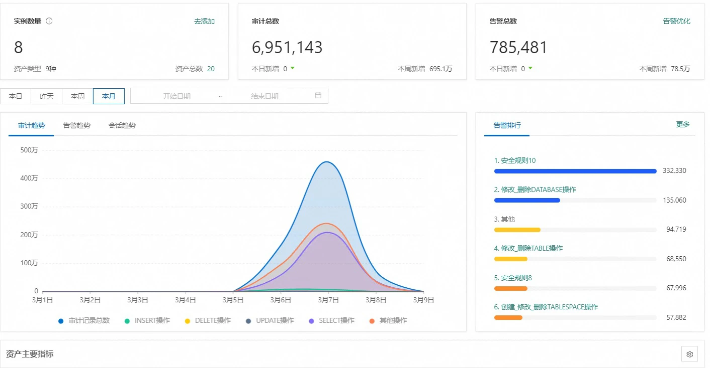

3. 下面对态势分析、告警排行和资产主要指标进行详细说明。

**态势分析**

可以通过时间搜索条件查看指定时间段内的审计趋势、告警趋势、会话趋势，主要关注本日审计趋势量和之前审计量比是否有异常增多或骤减情况，骤增骤减时可和业务侧进行确认，以此判断是否存在异常行为或者审计系统出现漏审情况。

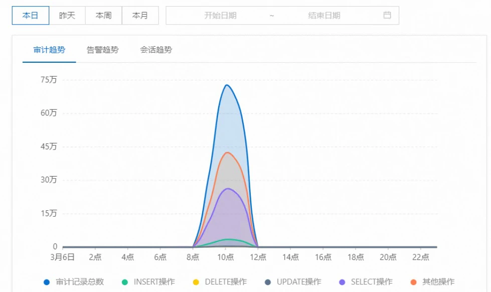

**告警排行**

告警排行统计了指定时间内触发告警次数排行前6的规则名称，帮助客户了解掌握数据库资产可能存在的风险行为，单击**更多**可以跳转到告警分析界面做告警优化。

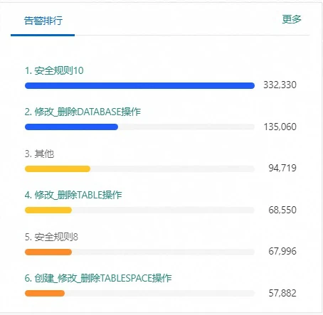

**资产主要指标**

资产主要指标展示了指定时间段内资产汇总信息和资产活跃时间和状态，可分别根据审计数量、告警数量、会话数量、执行失败数量和登录失败数量进行排序了解各资产的审计数据情况。需特别关注**最后活跃时间**，若资产未在活跃时间内，需排查确认资产是否下线或系统审计异常，及时进行资产审计的恢复，避免造成数据的缺失。资产活跃度也可在资产管理页面进行查看。

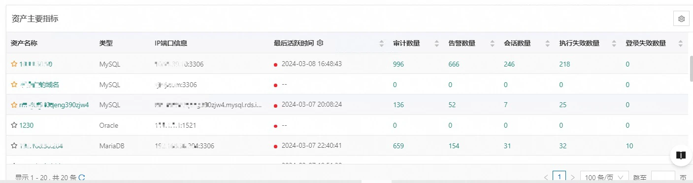

<a id="section-2-4"></a>

## 2.4. 查看巡检任务

<a id="section-2-4-1"></a>

### 2.4.1. Agent状态检查

本文介绍如何进行Agent状态检查。

**操作步骤**

1. 登录数据库审计与风险控制系统。

2. 在左侧导航栏，单击**系统管理 > Agent管理**，进入Agent管理页面。

3. 在搜索框左侧下拉框里，选择查询条件**Agent状态**。

   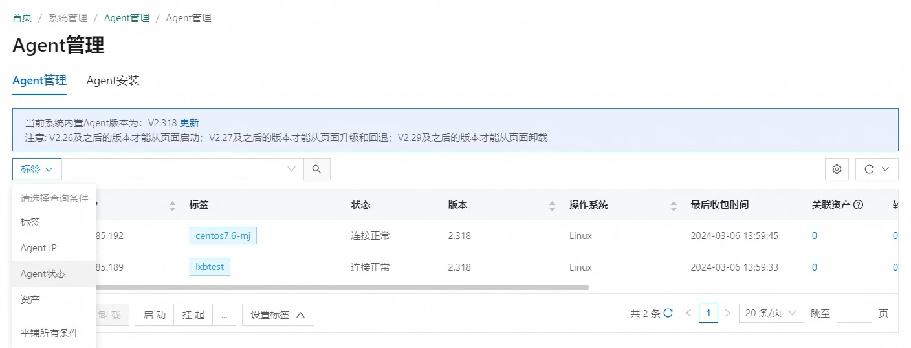

4. 依次在搜索框里查询**连接异常**、**配置链路异常**、**数据链路异常**这些状态异常的Agent，若查询结果为空则所有Agent连接正常，否则需进行Agent异常排查处理。

   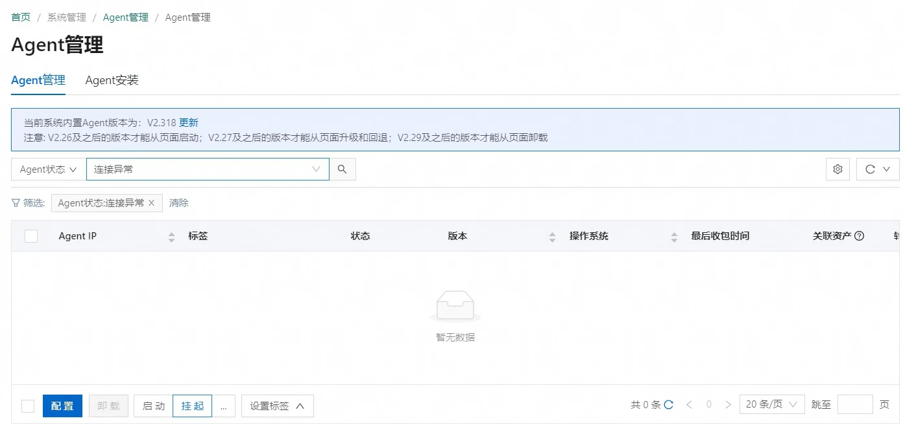

<a id="section-2-4-2"></a>

### 2.4.2. 系统运行情况检查

本文介绍如何进行系统运行情况检查，主要对产品后台各服务运行状态进行检查。

**操作步骤**

1. 需要先登录到对应审计系统的docker环境。

   本质上是分以下两步操作（如果客户现场有更简洁的方式更好）：

   <ol type="i">

   <li>

   登录到跳板机。

   </li>

   <li>

   从跳板机登录对应产品的ECS。

   </li>

   </ol>

   跳板机和产品（审计）的ip和密码都需要查询出来，然后再执行a和b。

2. 进入产品容器中，执行 `service dbfw status` 命令检查后台服务运行状态是否为running正常运行。

   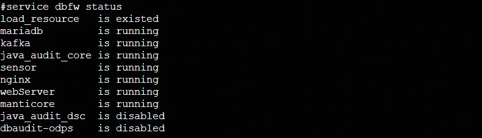

3. 执行 `psen` 查看各进程是否正常运行，如下图所示。

   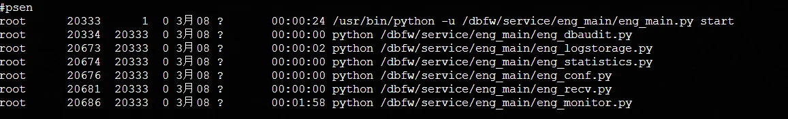

<a id="section-3"></a>

# 3.运维API

通过API对常用功能进行运维

<a id="section-3-1"></a>

## 3.1. 添加资产

本文介绍获取数据库列表信息功能的接口调用信息。

**基本信息**

ID：CreateDatabase

URL：/dbaudit/databases

Method：POST

**请求参数**

| key | 类型 | 名称 | 必须 | 描述 |
| --- | --- | --- | --- | --- |
| name | ChsName | 数据库名称 | 是 | 数据库的名称 |
| version | String | 数据库版本 | 否 | 默认值：空字符串 |
| environment | Noxss | 运行环境 | 否 | 默认值：空字符串 |
| charset | Noxss | 编码 | 否 | 默认值：空字符串 |
| type | Enum | 数据库类型 | 是 | 数据库的类型 |
| saveLine | Strint | 保存行数 | 否 | 默认值：0 |
| twoway | Enum | 流量方向 | 否 | 默认值：0 |
| isAudit | Enum | 状态 | 是 | 是否审计，默认值：1 |
| ipPort | Array&lt;Object&gt; | IP与端口 | 否 | 数据库的IP和端口 |
| instance | Noxss | 实例ID | 否 | 实例ID信息 |
| region | String | 地域(Region) | 否 | 地域信息 |
| typeGroup | String | 资产类型分组 | 否 | 资产类型分组 |
| connInfo | Object | 连接数据库账号信息 | 否 | 默认值：{} |
| certInfo | Object | 数据库加密证书信息 | 否 | 默认值：{} |
| departmentIds | Noxss | 所属部门ID | 否 | 默认值：空字符串 |
| saveSize | Strint | 最大保存长度 | 否 | 默认值：64 |
| auditType | Enum | 审计方式 | 否 | 默认值：1 |
| projectSpace | Array&lt;String&gt; | 项目空间 | 否 | 项目空间 |
| nodeIp | String | 日志采集配置所属节点IP | 否 | 日志采集配置所属节点IP |
| configId | String | 日志采集配置ID | 否 | 日志采集配置ID |

type字段Enum枚举值列表

| 枚举值 | 值描述 |
| --- | --- |
| 1 | Oracle |
| 2 | MySQL |
| 3 | SQL Server |
| 4 | Sybase ASE |
| 5 | DB2 |
| 6 | Informix |
| 7 | Oscar |
| 8 | 达梦(DM) |
| 9 | Cache |
| 10 | PostgreSQL |
| 12 | Teradata |
| 13 | 人大金仓(Kingbase) |
| 14 | GBase |
| 15 | MariaDB |
| 16 | HTTP |
| 17 | TELNET |
| 18 | FTP |
| 22 | Hana |
| 23 | MongoDB |
| 24 | HBase(protobuf) |
| 25 | HBase(thrift) |
| 26 | Hive |
| 27 | Redis |
| 28 | Elasticsearch |
| 29 | Cassandra |
| 30 | HDFS |
| 31 | Impala |
| 32 | GaussDB |
| 33 | LibrA |
| 34 | Graphbase |
| 35 | Greenplum |
| 36 | Spark SQL(thrift) |
| 37 | Spark SQL(RESTful) |
| 38 | SSDB |
| 40 | K-DB |
| 41 | Sybase IQ |
| 42 | ArangoDB |
| 43 | Neo4j |
| 44 | OrientDB |
| 46 | TiDB |
| 48 | Vertica |
| 49 | OceanBase |
| 50 | PolarDB |
| 51 | PolarDB-X |
| 52 | AnalyticDB |
| 55 | HTTPS |
| 56 | MaxCompute(ODPS) |
| 57 | TBase |
| 58 | HighGo |
| 59 | TDSQL-C MySQL |
| 60 | TDSQL-C PostgreSQL |
| 62 | Percona MySQL |
| 64 | Percona MongoDB |
| 65 | Vastbase |
| 68 | Clickhouse HTTP |
| 69 | Clickhouse MySQL |

twoway字段的枚举值

| 枚举值 | 值描述 |
| --- | --- |
| 0 | 单向审计 |
| 1 | 双向审计 |

isAudit的枚举值

| 枚举值 | 值描述 |
| --- | --- |
| 0 | 禁用 |
| 1 | 启用 |

auditType的枚举值

| 枚举值 | 值描述 |
| --- | --- |
| 1 | 解析流量 |
| 2 | 解析自审计日志 |

**返回数据**

| key | 类型 | 描述 |
| --- | --- | --- |
| assetId | String | 资产ID |
| name | String | 资产名称 |
| type | String | 协议类型 |
| version | String | 协议版本 |
| charset | String | 字符集 |
| environment | String | 运行环境 |
| twoway | String | 是否双向审计 |
| isAudit | String | 是否启用审计 |
| saveLine | String | 返回结果保存行数 |
| saveSize | String | 最大保存长度 |
| ipPort | String | 服务的IP和端口信息 |
| connInfo | Password | 连接数据库的账号密码信息 |
| certInfo | Password | 加密证书信息 |
| createTime | String | 创建时间 |
| updateTime | String | 最后变更时间 |
| departmentIds | String | 所属资产组的ID |
| isFocused | null | 是否关注 |
| nodeIp | String | 日志采集配置所属节点IP |
| configId | String | 日志采集配置ID |

**示例**

**成功返回示例**

请求（双大括号包含部分为变量，在postman中可以通过环境变量预先设置）

```bash
curl -X POST '{{host}}/dbaudit/databases' -d 'requestId={{requestId}}&version={{version
}}&clusterKey={{clusterKey}}&clusterTime={{clusterTime}}&clusterUuid=
{{clusterUuid}}&clusterSign={{clusterSign}}'
```

返回

```json
{
  "code": "200",
  "message": "success",
  "success": true,
  "data": {
    "assetId": "ff80808171955d3d01719a7630cd0002",
    "name": "test",
    "type": "3",
    "version": "1.0",
    "charset": "",
    "environment": "",
    "twoway": "1",
    "isAudit": "1",
    "saveLine": "2",
    "saveSize": "33",
    "ipFilter": "",
    "ipPort": "[{\"ip\":\"10.16.80.2\",\"port\":\"3936\"}]",
    "internet": "",
    "connInfo": "{}",
    "certInfo": "{}",
    "extendInfo": "{}",
    "createTime": "2020-04-21 01:59:29",
    "updateTime": "2020-04-21 01:59:29",
    "departmentIds": "",
    "isFocused": null
  },
  "requestId": "aa8b688f-a839-44ea-8e98-c2ec3e79549c",
  "requestTotalCost": 386,
  "configVersion": 8
}
```

**失败返回示例**

请求 （双大括号包含部分为变量，在postman中可以通过环境变量预先设置）

```bash
curl -X POST '{{host}}/dbaudit/databases' -d 'requestId={{requestId}}&version={{version
}}&clusterKey={{clusterKey}}&clusterTime={{clusterTime}}&clusterUuid=
{{clusterUuid}}&clusterSign={{clusterSign}}'
```

返回

```json
{
 "code": "资产[vvwweweql]中已存在相同的IP和端⼝.",
 "success": false,
 "message": "资产[vvwweweql]中已存在相同的IP和端⼝.",
 "requestId": "556af980-0b32-4870-a483-9f433f54e567",
 "requestTotalCost": 129
}
```

<a id="section-3-2"></a>

## 3.2. 启用安全规则

本文介绍启用满足条件的规则功能的接口调用信息。

**基本信息**

ID：CreateEnabledRule

URL：/dbaudit/rule/enabledRules

Method：POST

**请求参数**

| key | 类型 | 名称 | 必须 | 描述 |
| --- | --- | --- | --- | --- |
| assetId | String | 数据库资产ID | 否 | 数据库资产ID |
| ruleId | RuleIds | 查询条件-规则ID | 否 | 默认值：空字符串 |
| name | String | 查询条件-名称关键字 | 否 | 默认值：空字符串 |
| ruleType | String | 查询条件-规则类型 | 否 | 规则类型 |
| level | String | 查询条件-规则等级（逗号分隔） | 否 | 规则等级 |
| groupId | GroupId | 查询条件-规则组 | 否 | 默认值：空字符串 |
| recommendInde x | Number | 推荐规则Index | 否 | 推荐规则Index |
| rangeOperation | String | 推荐范围操作符 | 否 | 推荐范围操作符 |
| assetGroupIds | String | 资产组ID | 否 | 资产组ID |

**返回数据**

无返回数据

**示例**

**成功返回示例**

请求（双大括号包含部分为变量，在postman中可以通过环境变量预先设置）

```bash
curl -X POST '{{host}}/dbaudit/rule/enabledRules' -d 'requestId={{requestId}}&version={
{version}}&clusterKey={{clusterKey}}&clusterTime={{clusterTime}}&clusterUuid={{clusterUuid}}&clusterSign={{clusterSign}}'
```

返回

```json
{
  "code": "200",
  "message": "success",
  "success": true,
  "requestId": "ddf738b1-996c-4378-a91f-5397f70e586e",
  "requestTotalCost": 895
}
```

<a id="section-3-3"></a>

## 3.3. 禁用安全规则

本文介绍禁用满足条件的规则功能的接口调用信息。

**基本信息**

ID：DeleteEnabledRule

URL：/dbaudit/rule/enabledRules

Method：DELETE

或者

URL：/dbaudit/rule/enabledRules/delete

Method：POST

**请求参数**

| key | 类型 | 名称 | 必须 | 描述 |
| --- | --- | --- | --- | --- |
| assetId | String | 数据库资产ID | 否 | 数据库资产ID |
| ruleId | RuleIds | 查询条件-规则ID | 否 | 默认值：空字符串 |
| name | String | 查询条件-名称关键字 | 否 | 默认值：空字符串 |
| ruleType | String | 查询条件-规则类型 | 否 | 默认值：空字符串 |
| level | String | 查询条件-规则等级（逗号分隔） | 否 | 默认值：空字符串 |
| groupId | GroupId | 查询条件-规则组 | 否 | 默认值：空字符串 |
| recommendInde x | Number | 推荐规则Index | 否 | 推荐规则Index |
| rangeOperation | String | 推荐范围操作符 | 否 | 推荐范围操作符 |
| assetGroupIds | String | 资产组ID | 否 | 资产组ID |

**返回数据**

无返回数据

**示例**

**成功返回示例**

请求（双大括号包含部分为变量，在postman中可以通过环境变量预先设置）

```bash
curl -X POST '{{host}}/dbaudit/rule/enabledRules' -d 'requestId={{requestId}}&version={
{version}}&clusterKey={{clusterKey}}&clusterTime={{clusterTime}}&clusterUuid={{clusterUuid}}&clusterSign={{clusterSign}}'
```

返回

```json
{
  "code": "200",
  "message": "success",
  "success": true,
  "requestId": "d0eb25ce-c608-41af-aedb-4fcc7ea91d48",
  "requestTotalCost": 4245
}
```

<a id="section-3-4"></a>

## 3.4. 获取Agent列表

本文介绍获取agent列表功能的接口调用信息。

**基本信息**

ID：DescribeAgents

URL：/dbaudit/agents

Method：GET

**请求参数**

| key | 类型 | 名称 | 必须 | 描述 |
| --- | --- | --- | --- | --- |
| sort | Enum | 排序列的名称 | 否 | 取值：见sort字段的枚举值列表默认值：agentIp |
| dir | Enum | 排序方式 | 否 | 默认值：desc |
| start | Int | 首条记录的偏移量 | 否 | 默认值：0 |
| limit | Int | 每页显示的条数 | 否 | 默认值：10 |
| agentIp | String | 查询条件agentIP | 否 | 默认值：空字符串 |
| agentState | Strint | 查询条件agent状态 | 否 | 默认值：空字符串 |
| tagIdList | String | agent标签ID | 否 | 标签ID列表 |
| assetIdList | String | 资产ID集合 | 否 | 资产ID列表 |

sort字段的枚举值

| 枚举值 | 值描述 |
| --- | --- |
| agentIp | aegnt的IP |
| agentState | agent状态 |
| createTime | 创建时间 |
| agentVersion | 版本信息 |
| systemType | 系统类型 |

dir字段的枚举值

| 枚举值 | 值描述 |
| --- | --- |
| desc | 降序 |
| asc | 升序 |

返回数据

| key | 类型key | 描述 |
| --- | --- | --- |
| list | arrayistl | agent列表 |
| agentIp | String | agent的IP |
| configJson | String | agent配置的JSON |
| agentState | Integer | agent的状态 |
| upgradeState | Integer | 更新时间 |
| agentVersion | null | 版本 |
| systemType | null | 操作系统 |
| createTime | String | agent首次连接时间（yyyy-MM-dd HH:mm:ss）（如果状态为已停止或已挂起或连接异常，此字段为null） |
| lastReceiveTime | String | agent上次收包时间（yyyy-MM-dd HH:mm:ss）（如果状态为已停止或已挂起或连接异常，此字段为null） |
| connectionTime | String | agent本次连接上来的时间（yyyy-MM-dd HH:mm:ss）（如果状态为已停止或已挂起或连接异常，此字段为null） |
| flow | String | agent当前流量（单位Mb）（如果状态为已停止或已挂起或连接异常，此字段为null） |
| agentCpu | String | agent的CPU百分比（0到100的小数，单位%)（如果状态为已停止或已挂起或连接异常或未采集到数据，此字段为null） |
| sysCpu | String | 系统当前CPU百分比（0到100的小数，单位%)（如果状态为已停止或已挂起或连接异常或未采集到数据，此字段为null） |
| agentMem | String | agent内存百分比（0到100的小数，单位%）（如果状态为已停止或已挂起或连接异常或未采集到数据，此字段为null） |
| sysMem | String | 系统的内存百分比（0到100的小数，单位%）（如果状态为已停止或已挂起或连接异常或未采集到数据，此字段为null） |
| dropPackets | String | agent当前丢包数量 |
| sampleTime | String | 实时信息采样时间(yyyy-MM-dd HH:mm:ss) |
| sysReadIO | String | 系统IO读速度 |
| sysWriteIO | String | 系统IO写速度 |
| agentReadIO | String | agent的IO读速度 |
| agentWriteIO | String | agent的IO写速度 |
| tagList | array | agent的标签 |
| agentAssetIdList | String | agent的关联资产 |
| totalCount | Integer | agent的总数 |

<a id="section-4"></a>

# 4.告警运维

各规则匹配顺序：


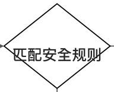


No

No

No

Yes

Yes

Yes


日志

志

<a id="section-4-1"></a>

## 4.1. 告警日志分析

本文介绍如何进行告警日志的分析。

**操作步骤**

1. 登录数据库审计与风险控制系统。

2. 在左侧导航栏，单击**查询分析 > 告警日志**，进入**告警日志**页面。

3. 选择**告警分析**页签，在选择时间范围后，查看此时间内各规则的告警数量，并且可以单击告警数量列名从高到低或从低到高进行排序。

   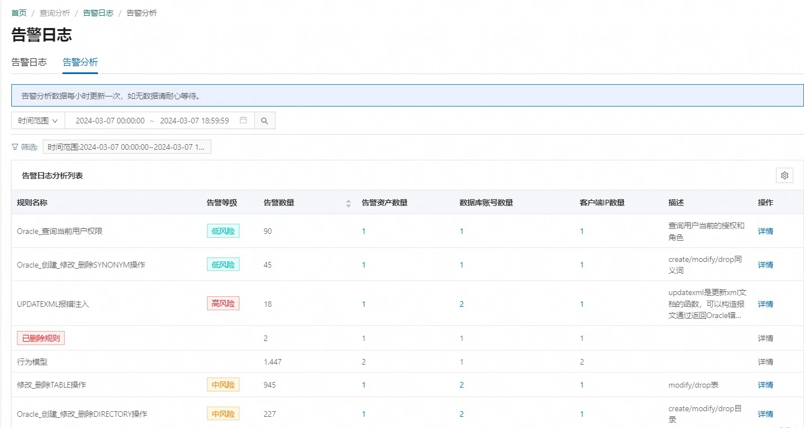

4. 在规则详情区域的基本信息里，单击资产数量链接可编辑已启用该规则的资产，单击白名单数量链接可以启用或禁用该规则上的白名单。

   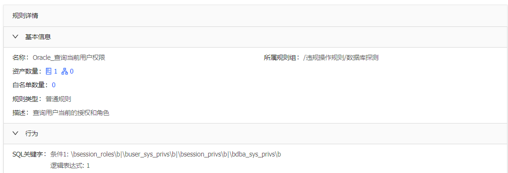

5. 在告警来源区域，可以查看告警的客户端来源IP、登录的数据库账号及对应客户端IP告警的数量，如果**确认此客户端IP（包括应用系统、可信的运维人员终端等）或数据库账号可信，无风险性**，则可以单击操作列下的**不再告警**。

   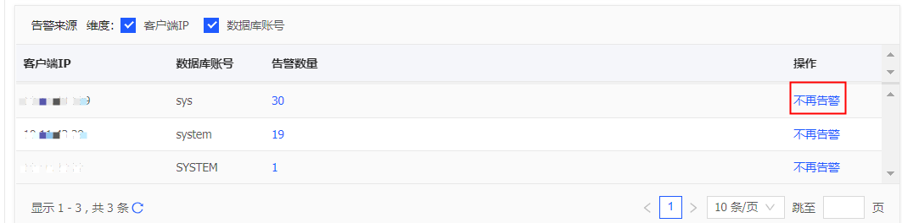

   “不再告警”分为两种方式。

   - 方式一：添加到白名单

     即**规则白名单，在选定满足条件后，只对此条规则有效**。以下图为例，如果满足条件是客户端IP和数据库账号，则当客户端IP 10.x.x.x使用sys数据库账号登录数据库，进行查询用户权限操作，不再触发此规则进行告警。但如果登录数据库后做了其它操作触发了其它规则，仍会产生其它规则的告警日志。

     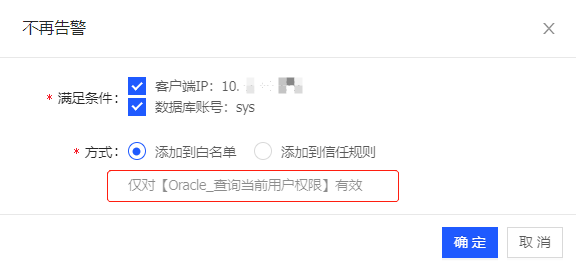

   - 方式二：添加到信任规则

     **信任规则对所有规则有效**。仍以下图为例，如果满足条件是客户端IP和数据库账号，则当客户端IP 10.x.x.x使用sys数据库账号登录数据库，其进行的所有操作都不会告警，即认为符合条件的操作都是可信任的，无需匹配规则进行告警。

     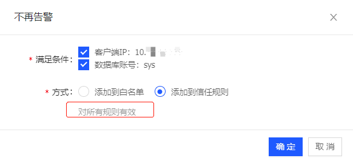

6. 在触发告警的SQL模块区域，可以查看告警日志对应使用的SQL模板及匹配此模板的告警数量，若**确认此SQL模板是可信应用系统/工具或者脚本执行的固定语句**，则可以单击操作列下的**不再告警**。

   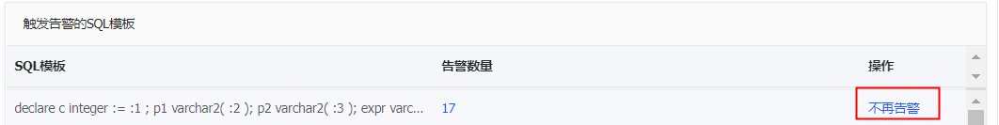

7. 在告警详细界面，根据所需维度**单击对应的告警数量**，会跳转到以这个维度的所有告警日志列表，可以看到产生告警的所有时间点。

   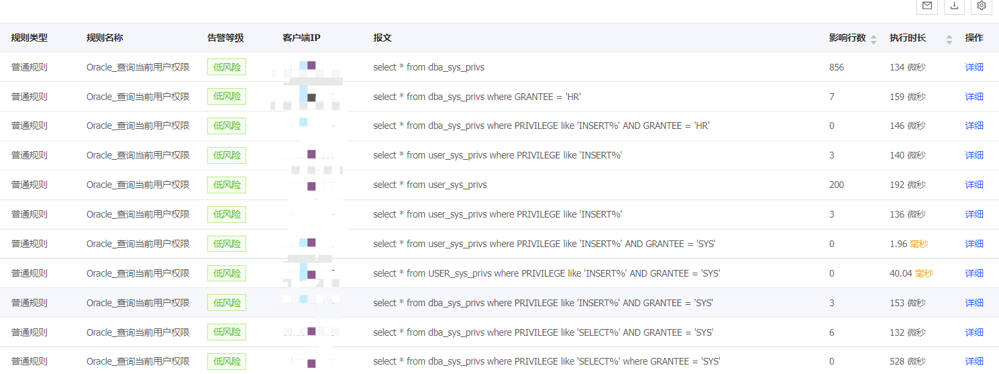

8. 单击告警的**详细**按钮查看告警详情，可以从客户端IP、客户端工具两个信息**判断sql操作是人为发起的，还是应用程序发起的**。（客户端IP若是应用服务器地址或者客户端工具为jdbc驱动则为应用发起），正常情况更关注人为操作；其次查看具体使用了什么操作类型做了什么SQL报文，是否具有风险性。也可单击会话ID信息，查看触发告警时，上下文都操作了什么语句，综合进行判断。

   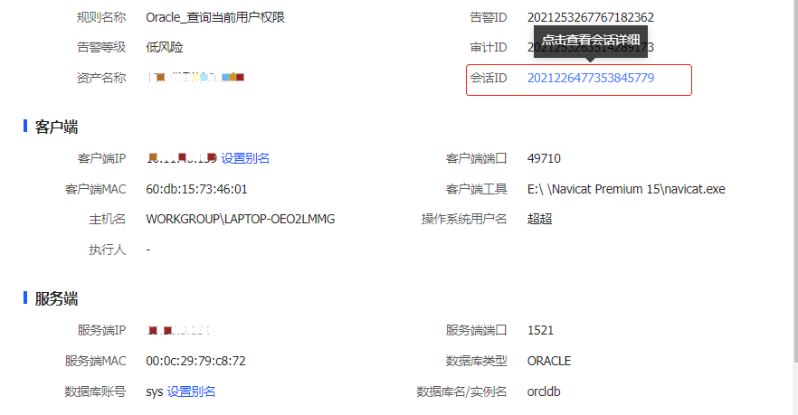

   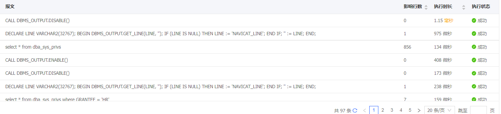

<a id="section-4-2"></a>

## 4.2. 告警分析思路

告警分析大致可以从客户端维度和操作行为维度进行考虑。

**客户端维度**

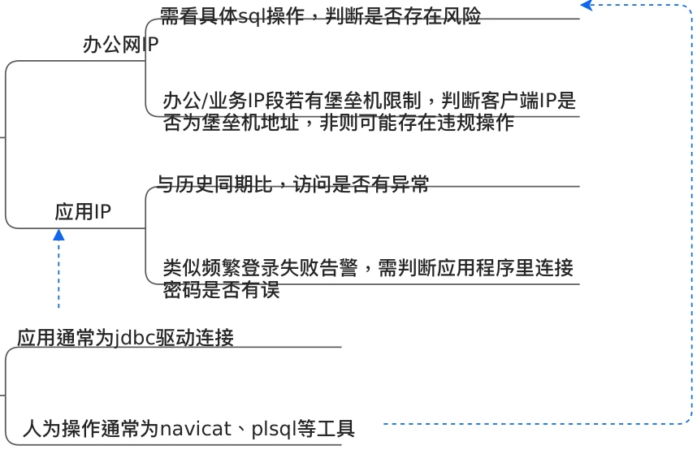

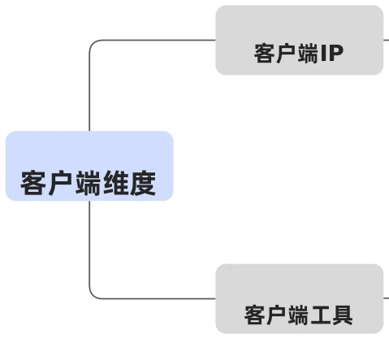

**操作行为维度**

\*更新删除

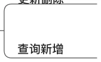

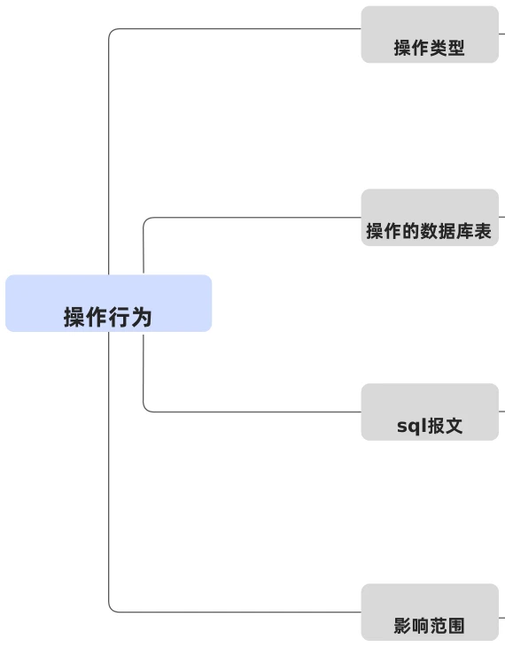

系统表：除查询操作不需关注外，增删改操作均需重点关注，防止造成库崩溃。

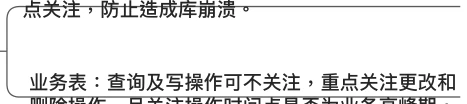

删除操作，且关注操作时间点是否为业务高峰期。

如果触发sql前后都是正常业务sql，看触发sql的语句执行的作用是什么，对系统或数据是否存在风险。

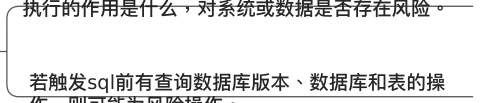

根据匹配的规则特征，结合会话里触发规则的sql前后操作

作，则可能为风险操作。

整张表   典型的无where语句操作，不具有安全性。

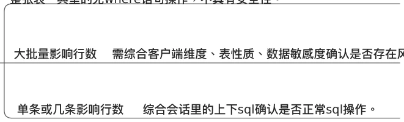

大批量影响行数    需综合客户端维度、表性质、数据敏感度确认是否存在风险。

告警分析后，可针对风险操作、业务误报及降低告警量三方面分别进行以下处置。

风险操作

根据告警日志里的客户端IP、账号进行溯源，对于可被利用的sql做安全性加固。

业务误报

可根据服务端、客户端及行为等多个维度添加规则白名单或信任维度。

降低告警量

针对关注对象、关注时间点、关注操作类型，精细规则配置。

<a id="section-5"></a>

# 5.常见问题排查

<a id="section-5-1"></a>

## 5.1. Agent部署无法审计到数据排查思路

**故障现象**

通过安装审计代理插件（Agent）的方式接收数据库流量但是无法审计到数据。

**可能原因**

- 原因1：系统不支持审计客户环境中的数据库类型。

- 原因2：Agent未注册成功。

- 原因3：Agent所在的数据库服务器对外服务的IP和对外连接通讯的IP不是同一个，数据库资产配置的IP为对外连接通讯的IP。

- 原因4：系统虽然建立了TCP连接，但是实际没有业务触发SQL语句的执行。

- 原因5：Agent捕获的流量被加密。

- 原因6：系统的审计引擎未能正常启动。

- 原因7：Agent所在的数据库服务器上安装了安全防护类软件，导致agent无法正常运行。

**故障处理流程**


无法审计资产数据


否

是


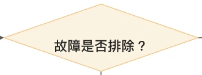


否

是

是

否


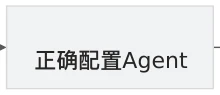

否

是

是

否


是

是

否

否


否

是

是

否


**处理步骤**

1. 检查系统是否支持资产的数据库协议（可参考**产品简介**-**产品优势**里的协议列表）。

2. 检查Agent是否成功注册成功，并且可以从界面看到Agent转发过来的流量。若注册成功进行下一步，若注册失败，请重新安装Agent并正确配置Agent。

   登录系统Web管理平台，在菜单栏选择**系统管理 > Agent管理**，选择**Agent管理**页签，即可查看Agent的连接信息。

   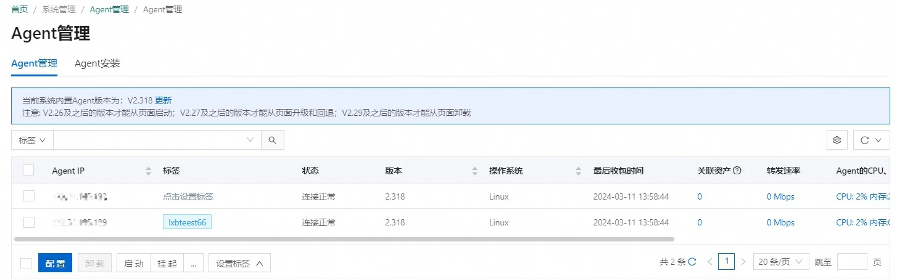

3. 检查资产信息配置是否正确。若配置正确进行下一步；若配置错误，正确配置资产。

   可以通过在服务器查看数据库连接情况，判断数据库对外服务的IP是什么

   - Linux：netstat -ano |grep 数据库端口号

   - Windows：netstat -ano |findstr 数据库端口号

   正常有连接建立，监听状态为ESTABLISHED：

   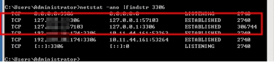

   > **说明**
   >
   > 如果Agent所在的数据库服务器存在多个网口，且对外连接的IP和对外服务的IP不是同一个，在系统上添加资产时则必须设置资产的IP为数据库对外服务的IP。这样资产数据才能被审计。

4. 查看Agent捕获的流量是否被加密。若没有被加密，进行下一步，若被加密，需提供解密证书解密加密流量。

   判断流量是否被加密的方法如下：使用客户端工具连接数据库并执行SQL语句，然后用Wireshark抓取执行的SQL流量，直接过滤执行的SQL语句关键字，查看是否有明文的SQL信息。如果有明文SQL信息，说明没有被加密。反之则说明被加密。

5. 通过数据库流量包确认数据库加密方式。

   抓取到数据库流量，查看protocol对应协议为TLS，且服务器响应客户端消息为server hello。

   查看响应详细信息，cipher suite对应的就是加密算法。

   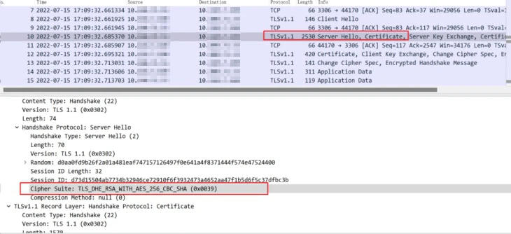

6. 登录系统后台，使用psen命令查看审计引擎是否正常工作；使用**service dbfw status**命令查看审计服务是否正常运行（下图说明审计引擎、审计服务正常工作）。

   

   

   - 如果引擎没有正常工作，执行 `service sensor restart` 命令进行重启尝试。如果重启失败，执行 `tailf/data/logs/consle.log` 命令查看Console日志的运行状态，并且分析有无明显的error报错，根据报错信息采取相应措施。

   - 如果引擎正常工作，请获取技术支持。

**常用故障诊断命令**

| 命令 | 说明 |
| --- | --- |
| <strong>netstat </strong>-an \|grep 13001/13002 | 查看Agent服务端口是否处于监听状态。 |
| <strong>netstat </strong>-an \|grep <em>db_port</em>（<em>db_port</em>指具体的数据库服务端口） | 检查当前数据库业务是否有socket连接。 |
| tcpdump | 检查Agent是否有把流量转发到数据库审计系统。 |
| <strong>tail -f </strong>/data/logs/consle.log | 查看Consle的运行日志。 |

<a id="section-5-1-1"></a>

### 5.1.1. 案例1：本地审计审计不到数据

**故障现象**

数据库和应用部署在同一台Windows服务器上，安装agent后审计不到数据库操作。

**处理过程**

1. cmd命令行执行 `netstat -an|findstr 1521` ，核实连接ip为127.0.0.1。

   ```text
   C:\Users\Administrator>netstat -an|findstr 1521|findstr 127.0.0.1
     TCP    127.0.0.1:1521        0.0.0.0:0               LISTENING
     TCP    127.0.0.1:1521        127.0.0.1:49166         ESTABLISHED
     TCP    127.0.0.1:1521        127.0.0.1:49184         ESTABLISHED
     TCP    127.0.0.1:1521        127.0.0.1:49186         ESTABLISHED
     TCP    127.0.0.1:1521        127.0.0.1:49187         ESTABLISHED
     TCP    127.0.0.1:1521        127.0.0.1:49188         ESTABLISHED
     TCP    127.0.0.1:1521        127.0.0.1:49189         ESTABLISHED
     TCP    127.0.0.1:1521        127.0.0.1:49191         ESTABLISHED
     TCP    127.0.0.1:1521        127.0.0.1:49264         ESTABLISHED
     TCP    127.0.0.1:1521        127.0.0.1:49530         ESTABLISHED
     TCP    127.0.0.1:1521        127.0.0.1:49531         ESTABLISHED
     TCP    127.0.0.1:1521        127.0.0.1:49532         ESTABLISHED
     TCP    127.0.0.1:1521        127.0.0.1:49533         ESTABLISHED
     TCP    127.0.0.1:1521        127.0.0.1:49534         ESTABLISHED
     TCP    127.0.0.1:1521        127.0.0.1:52261         ESTABLISHED  
     TCP    127.0.0.1:1521        127.0.0.1:57839         TIME_WAIT  
     TCP    127.0.0.1:1521        127.0.0.1:57853         TIME_WAIT  
     TCP    127.0.0.1:1521        127.0.0.1:57886         TIME_WAIT 
     TCP    127.0.0.1:49166       127.0.0.1:1521          ESTABLISHED   
   ```

2. 如果连接ip是127.0.0.1，又是windows操作系统作为数据库服务器，那么此时一定要检查windows上面是否生成了loopback网卡，默认windows系统是不会生成的。

   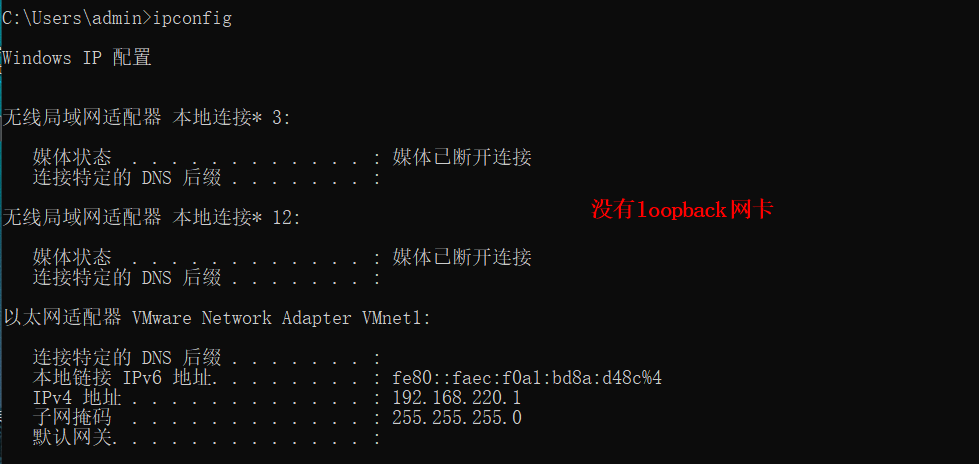

3. 生成loopback网卡需要在安装dbagent时选择安装npcap软件，而这边**安装的winpcap没有生成loopback网卡，agent也就抓取不到走的本地数据库流量。**

**解决方法**

1. 卸载dbagent和winpcap，注意winpcap必须卸载，不然npcap无法安装。

   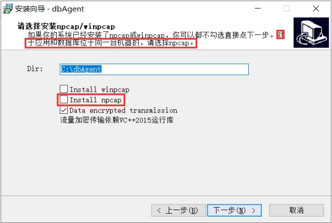

2. 安装npcap的时候一定要选红框中的选项，该选项用于生成loopback网卡。

   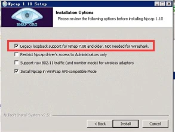

3. 安装完成后生成loopback网卡。

   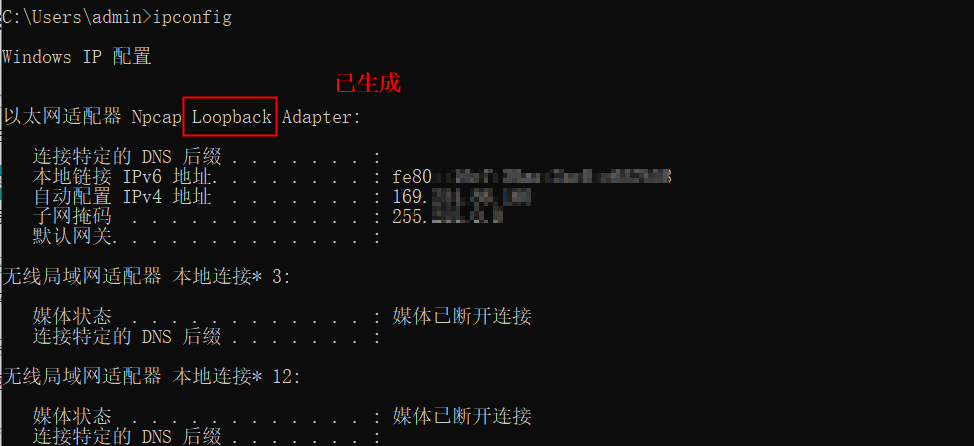

<a id="section-5-1-2"></a>

### 5.1.2. 案例2：agent部署采集不到数据

**故障现象**

agent部署后，采集不到数据库数据。

**处理过程**

1. 执行 `netstat -an|grep` 端口号 命令。

   先排查linux数据库服务器到数审的13001和13002端口是否通信正常，以及自身的12345端口是否正常连通。下图中可以看出端口会话通信正常，说明通信没问题。

   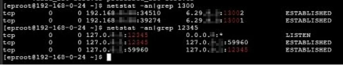

2. 确认连接的数据库ip和数审上配置的是否一致：执行“netstat -an|grep 数据库端口号”命令。本案例排查确认数据库ip填写没问题

   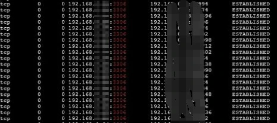

3. 进入到agent安装目录，查看agent日志，发现报错没有权限抓接口的包。

   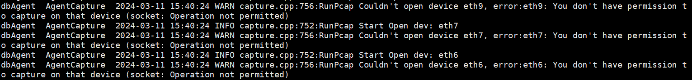

   4. `ps -ef | grep dbagent` 查看进程，**确认非root账号安装，没有抓包权限**。

**解决方法**

使用root账号登录服务器，执行agent安装脚本进行安装。

<a id="section-5-2"></a>

## 5.2. Agent无法获取linux系统资产的网卡子接口的数据库流量

**故障现象**

客户的Linux系统资产中存在网卡子接口，Agent无法采集子接口网卡上的数据库流量。通常情况下，Linux系统的网卡名称为eth0，创建eth0网卡子接口会生成类似eth0:0的网卡。

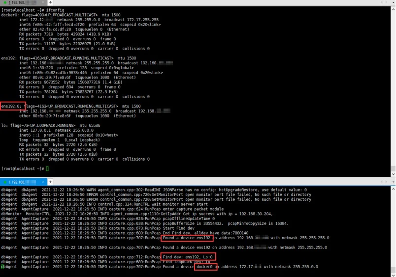

**故障原因**

Agent程序启动时默认会调用libpcap的API接口扫描当前操作系统下所有的网卡设备，但无法识别Linux系统下子接口网卡，导致无法采集子接口网卡的数据库流量。

**处理步骤**

1. 登录系统Web管理平台，在菜单栏选择**系统管理 > Agent管理**，查看成功注册的Agent（Linux系统）信息。

   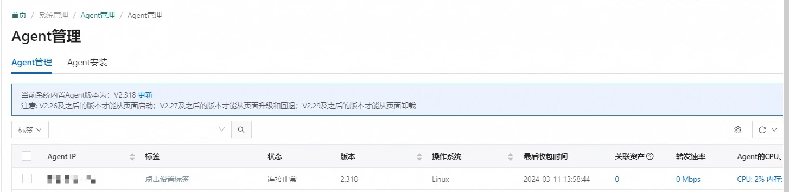

2. 单击此Agent所在行**操作**列中的**配置**。

3. 在弹出的对话框中单击**抓包与过滤设置**，编辑**抓包网口**与抓包过滤串，单击**确定**。

   例如Agent无法自动发现ens192:0的子接口网卡，则设置**抓包网口**为“ens192:0”，如果有多张子接口网卡，用空格隔开。

   **抓包过滤串**需要根据数据库的对外服务IP和端口进行填写。假设数据库对外的服务IP和端口分别是192.168.1.100和1521，则设置**抓包过滤串**为“(host192.168.1.100 and port 1521)”。

   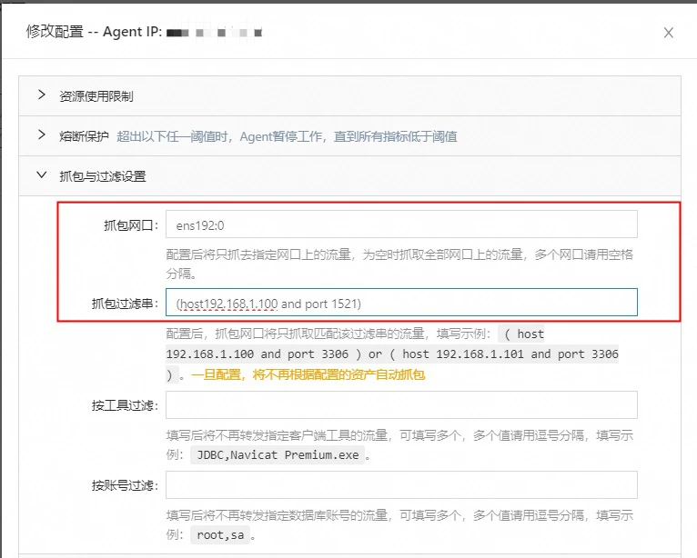

4. 验证Agent能否获取到子接口网卡的数据库流量。

   以root用户登录Agent所在服务器的后台，找到Agent的log文件（在Agent安装路径下）进行查看，如发现已获取子接口网卡的流量的日志，则说明能获取子接口网卡的数据库流量。

   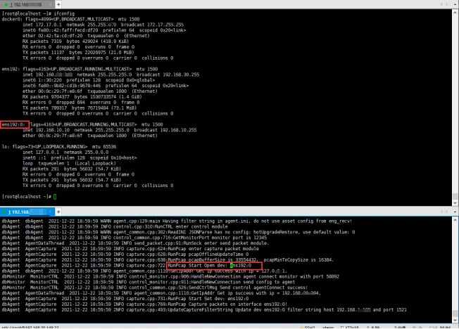

**常用故障诊断命令**

| 命令 | 说明 |
| --- | --- |
| <strong>tail -f </strong>/agent/log/2021xxxx.log<br><strong>vim </strong>/agent/log/2021xxxx.log | 查看Agent输出的日志，方便检索日志信息。 |
| <strong>netstat </strong>-an \|grep 13001/13002 | Agent和数据库审计系统是否正常建立连接socket。 |

<a id="section-5-3"></a>

## 5.3. Agent安装部署问题

<a id="section-5-3-1"></a>

### 5.3.1. Agent无法注册到系统排查思路

**故障现象**

执行Agent安装脚本之后在系统的Agent管理页面无法查看到对应的Agent连接信息。

**可能原因**

- 原因1：审计引擎处于纯旁路模式。

- 原因2：Agent默认下发的配置文件中数据库审计系统的IP错误，导致无法与系统进行连接通讯。

- 原因:3：客户防火墙未开放数据库审计与风险控制系统的Agent服务端口13001和13002。

- 原因4：客户的网络环境中存在NAT地址转换，Agent连接的地址不是真实的数据库审计系统IP。

- 原因5：Agent启动过程中存在报错，导致Agent插件无法正常运行，需要排查Agent的运行日志。

**故障处理流程**


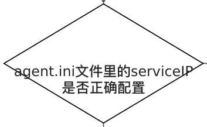


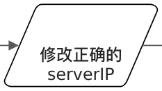

否

是

否

- 是

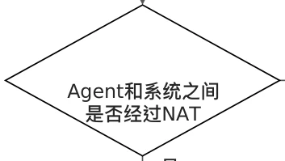


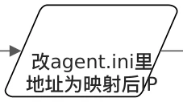

是

否

否

是

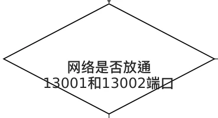

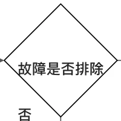

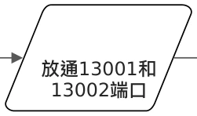

否

是

否

是


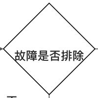

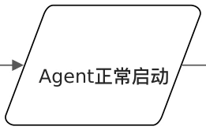

是

否

否


**处理步骤**

1. 登录Agent所在的服务器，进入Agent的安装路径，找到agent.ini配置文件中的serviceIP项，检查填写的审计设备IP是否正确。若正确进入下一步；否则修改serviceIP项。

2. 检查系统所在网络环境是否经过NAT。如果是，需要把Agent配置文件的serviceIP改为数据库审计系统经NAT地址映射之后的IP。如果不是，进行下一步。

3. 登录Agent所在的服务器，使用telnet x.x.x.x 13001/13002命令（x.x.x.x为数据库审计系统IP）来判断网络环境是否开放13001和13002端口（13001和13002端口为Agent与系统通信的端口）。若访问通畅则进行下一步；否则防火墙中开放13001和13002端口。

4. 检查Agent启动过程中是否发生报错。若报错，需要查看Agent安装路径log文件下的日志信息。根据日志信息采取对应措施。若无报错，请寻求技术支持。

**常用故障诊断命令**

| 命令 | 说明 |
| --- | --- |
| <strong>telnet </strong>x.x.x.x 13001/13002 | 检查Agent访问数据库审计系统的端口是否能正常通讯。 |
| <strong>netstat </strong>-an \|grep 13001/13002 | Agent和数据库审计系统是否正常建立连接socket。 |

<a id="section-5-3-2"></a>

### 5.3.2. Agent安装报错

**故障现象**

agent在linux系统安装报错提示已安装。

**处理过程**

1. 执行 `uninstall.sh` 显示卸载成功，但再次执行 `install.sh` 仍然报错已安装。

   

2. 根据提示显示是有在别的路径下安装，所以 `find / -name agent.ini` 来查找都有哪些路径有agent.ini文件（agent.ini为agent的配置文件，也可用别的agent安装目录下文件来查询），结果只有当前安装路径下有。

   3. `ps -ef` 查看是否存在有dbAgent和dbMonitor的进程，发现并没有相关进程运行。

   

4. 经沟通，此服务器之前**安装过agent，但没有执行卸载脚本就把安装目录直接删除**了。

**解决方法**

1. `vi /etc/rc.local` 编辑rc.local文件，删除掉如下图里的两行后保存。


2. 再次安装agent可成功安装。

   

<a id="section-5-4"></a>

## 5.4. 审计日志显示异常

<a id="section-5-4-1"></a>

### 5.4.1. 审计日志报文乱码

**故障现象**

审计日志中的报文内容有乱码。

**解决方法**

修改web界面上资产的编码为查询到的数据库编码，注意修改之后只针对新审计到的日志产生效果，修改后可以多观察5-10分钟，验证新产生的会话是否有乱码内容。

如有乱码现象可获取流量包寻求技术支持。

**sqlserver数据库乱码**

1. 查看sqlserver数据库字符集。

   ```text
   SELECT COLLATIONPROPERTY('Chinese_PRC_Stroke_CI_AI_KS_WS', 'CodePage') ;
   ```

2. 在资产管理列表将资产编码设为对应编码。

**mysql数据库乱码**

1. 查看mysql数据库字符集。

   ```text
   show variables like 'character_set_database';
   ```

2. 在资产管理列表将资产编码设为对应编码。

**oracle数据库乱码**

1. 查看oracle数据库字符集。

   ```sql
   select * from nls_database_parameters;
   ```

2. 在资产管理列表将资产编码设为对应编码。

<a id="section-5-4-2"></a>

### 5.4.2. 审计日志中“数据库账号”未显示

**故障现象**


**可能原因**

- 原因1：配置这个资产之前客户端与服务器间的会话已经开始进行，数据库审计与风险控制系统没有获取到数据账号交互的流量包。

- 原因2：现场网络环境较差，抓包在发给数据库审计与风险控制系统之前就已经丢失。

- 原因3：数据库审计与风险控制系统有丢包现象。

另外，针对sqlserver数据库：sqlserver数据库流量传输过程中，默认会对数据库账号信息进行加密传输，因此数据库审计界面默认无法识别到数据库账号信息。

**解决方法**

在资产配置界面，给对应的资产配置上该数据库sa用户信息。或者根据页面提示创建管理员用户，可下载下载创建用户参考脚本，直接在该数据库创建dbaudit用户，密码为dbaudit。然后配置到界面。


<a id="section-5-4-3"></a>

### 5.4.3. 审计日志发生时间与现实不符

**故障现象**

agent部署后，审计到的数据审计时间和发生时间不符。

**问题原因**

通常是agent所在服务器的系统时间或者时区和实际时间不一致导致。

**处理步骤**

核对时间：  `date -R`


核对时区：


修改时间：

```text
date -s newdate
```

修改时区：

```text
timedatectl set-timezone Asia/Shanghai
timedatectl set-local-rtc 1
hwclock 
service dbfw restart
```
