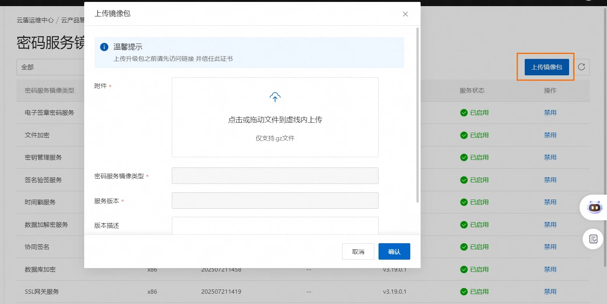
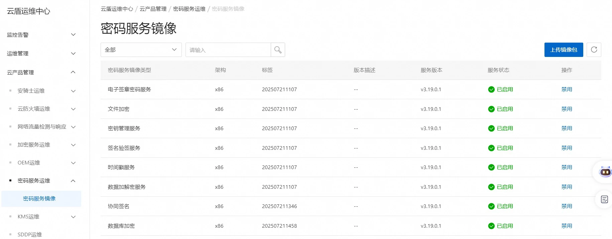
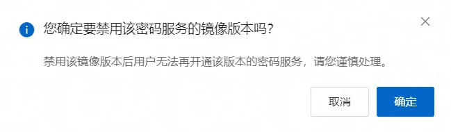
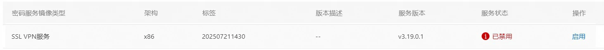
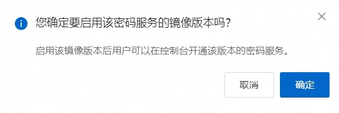

阿里云  
专有云  
密码服务 运维指南  
产品版本：v3.18.6-SP2607  
文档版本：20260729

**目录**

- [1.登录云盾运维中心](#section-1)
- [2.密码服务镜像运维](#section-2)

# 1.登录云盾运维中心

云盾运维中心是云盾产品的运营平台，可以实时监控云盾产品运行状态和业务状态，并将告警发送给用户。实时监控并根据介绍如何登录云盾运维中心。

**前提条件**

- 已从部署人员或管理员处获取Apsara Uni-manager运维控制台的访问地址、用户名和密码。

  Apsara Uni-manager运维控制台访问地址格式为 `region-id.ops.console.intranet-domain-id.com` 。

- 推荐使用Chrome浏览器。

**操作步骤**

1. 打开浏览器。

2. 在地址栏中，输入Apsara Uni-manager运维控制台的访问地址，按回车键。

   

   > **说明**
   >
   > 您可以单击右上角的当前语言切换其它语言。当前支持简体中文、English语言切换。

3. 输入正确的用户名及密码。

   > **说明**
   >
   > - 登录Apsara Uni-manager运维控制台的用户名和密码请从部署人员或管理员处获取。
   >
   > - 若连续输入密码错误三次，系统将启动图片验证码登录功能；若连续输入错误五次，账户将被锁定，请联系管理员进行激活。
   >
   > - 首次登录Apsara Uni-manager运维控制台时，需要修改登录用户名的密码，请按照提示完成密码修改。
   >
   >   为提高安全性，密码必须满足以下要求：
   >
   >   - 必须包含英文大小写字母。
   >
   >   - 必须包含阿拉伯数字（0~9）。
   >
   >   - 必须包含特殊符号，包括感叹号（!）、at（@）、井号（#）、美元符号（$）、百分号（%）等。
   >
   >   - 密码长度为10~20个字符。

4. 单击**同意协议并登录**。

5. 在Apsara Uni-manager运维控制台的顶部菜单栏，选择**产品运维 > 安全运维 > 云盾运维中心**。

**执行结果**

在**云盾运维中心**页面，您可以查看相关信息。

# 2.密码服务镜像运维

本文主要如何上传、查看、禁用、启用密码服务镜像。

**上传镜像包**

请先联系您的商务经理，获取密码服务镜像包。

1. 登录云盾运维中心。

2. 在左侧导航栏，选择**云产品管理**＞**密码服务运维**＞**密码服务镜像**。

3. 在**密码服务镜像**页面右上角，单击**上传镜像包**。

4. 将附件上传到**上传镜像包**对话框中，输入**版本描述**，然后单击**确认**。

   

**查看镜像列表**

1. 登录云盾运维中心。

2. 在左侧导航栏，选择**云产品管理**＞**密码服务运维**＞**密码服务镜像**。

3. 查看密码服务镜像列表。

   

**禁用镜像**

1. 选择**服务状态**为**已启用**的镜像，单击**禁用**按钮。

   > **警告**
   >
   > **禁用**该镜像版本后您将无法再开通该版本的密码服务，请您谨慎处理。

   

2. 确认无误后，单击**确定**。

   

**启用镜像**

1. 选择**服务状态**为**已禁用**的镜像，单击**启用**。

   

2. 确认无误后，单击**确定**。

   
