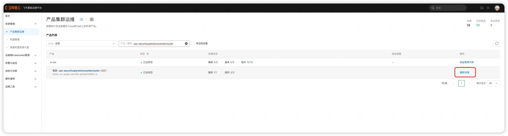
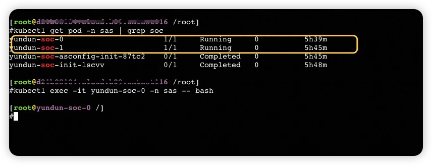
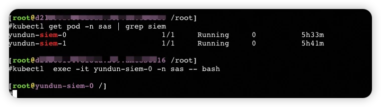
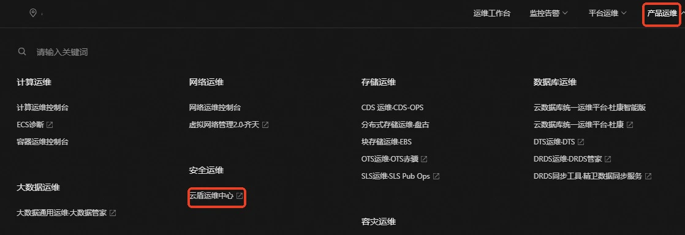
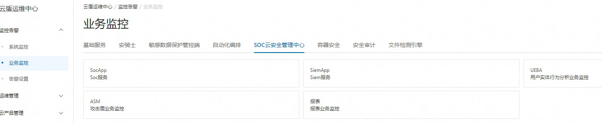
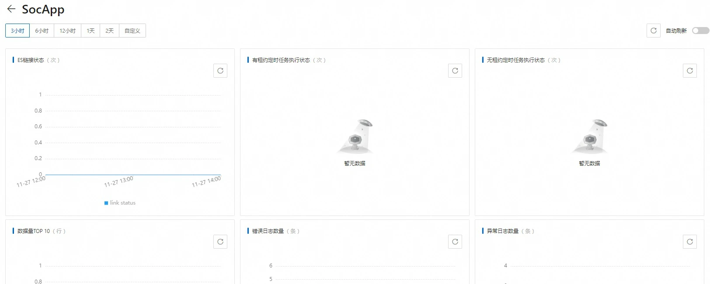
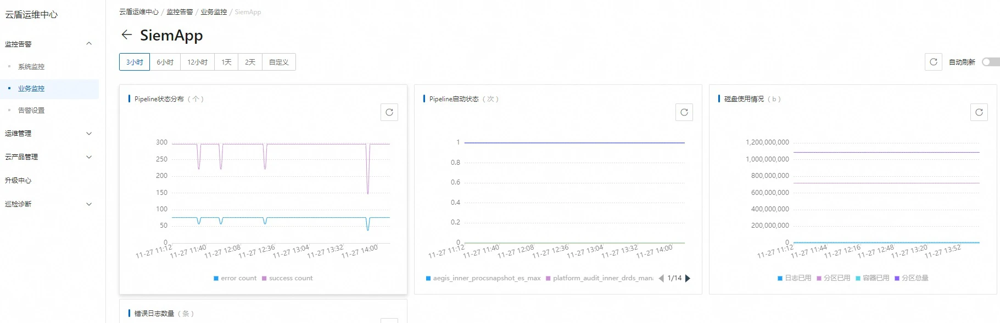
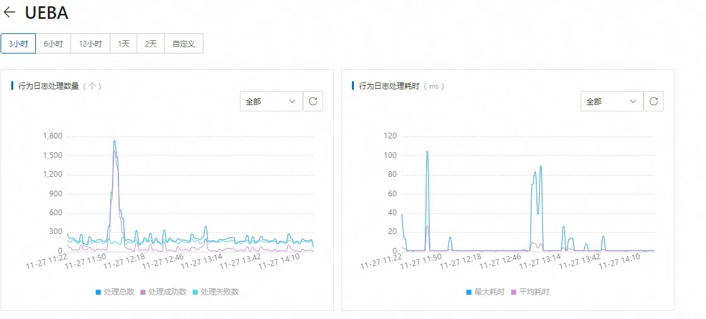
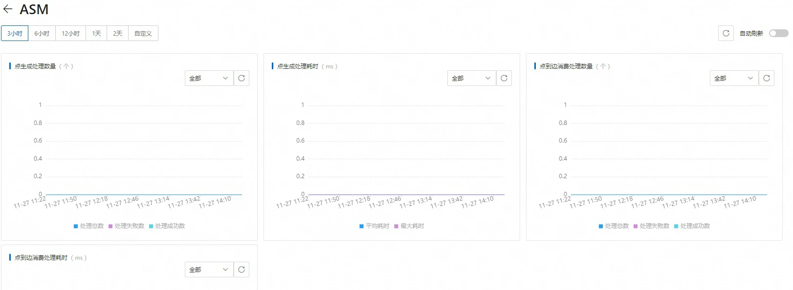
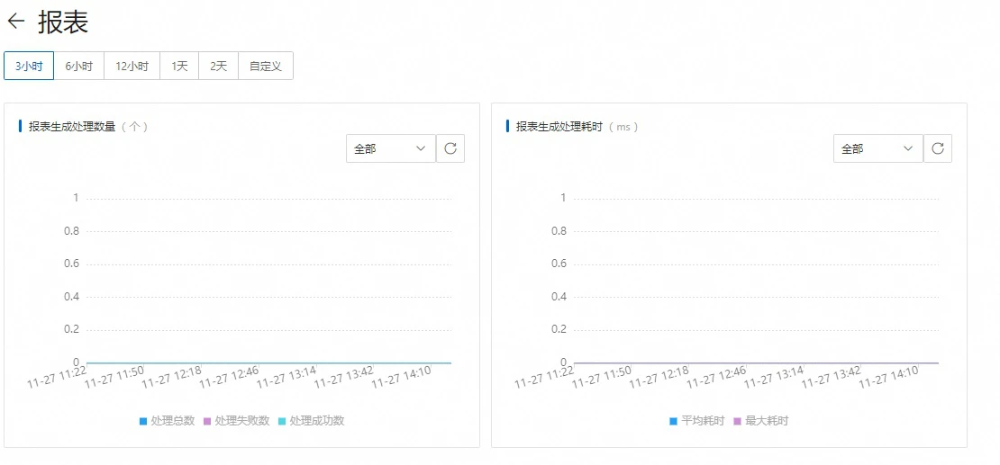

阿里云  
专有云  
云安全管理中心 运维指南  
产品版本：v3.18.6-SP2607  
文档版本：20260729

**目录**

- [1.登录飞天基础运维平台](#section-1)
- [2.云安全管理中心](#section-2)
    - [2.1. 检查服务状态](#section-2-1)
        - [2.1.1. 基础巡检](#section-2-1-1)
        - [2.1.2. 高级巡检](#section-2-1-2)
            - [2.1.2.1. SocApp](#section-2-1-2-1)
            - [2.1.2.2. SiemApp](#section-2-1-2-2)
        - [2.1.3. 业务巡检](#section-2-1-3)
    - [2.2. 重启SocApp服务](#section-2-2)
    - [2.3. 重启SiemApp服务](#section-2-3)

<a id="section-1"></a>

# 1.登录飞天基础运维平台

本文介绍如何登录飞天基础运维平台。

**前提条件**

- 已从部署人员或管理员处获取Apsara Uni-manager运维控制台的访问地址、用户名和密码。

  Apsara Uni-manager运维控制台访问地址格式为*ops*.asconsole.*intranet-domain-id*.com。

- 推荐使用Chrome浏览器。

**操作步骤**

1. 打开浏览器。

2. 在地址栏中，输入Apsara Uni-manager运维控制台的访问地址*ops*.asconsole.*intranet-domain-id*.com，按回车键。

   

   > 您可以单击页面右上角的下拉按钮来进行语言切换。
   >
   > **说明**

3. 输入正确的用户名及密码。

   > 登录Apsara Uni-manager运维控制台的用户名和密码请从部署人员或管理员处获取。
   >
   > **说明**

   首次登录Apsara Uni-manager运维控制台时，需要修改登录用户名的密码，请按照提示完成密码修改。

   为提高安全性，密码必须满足以下要求：

   - 英文大小写字母

   - 阿拉伯数字（0~9）

   - 特殊符号，包括感叹号（！）、at（@）、井号（#）、美元符号（$）、百分号（%）等

   - 密码长度10~20个字符

4. 单击**登录**。

5. 在Apsara Uni-manager运维控制台的顶部菜单栏，选择**平台运维 > 飞天基础运维平台**。

<a id="section-2"></a>

# 2.云安全管理中心

<a id="section-2-1"></a>

## 2.1. 检查服务状态

<a id="section-2-1-1"></a>

### 2.1.1. 基础巡检

云安全管理中心基础巡检主要对产品状态进行巡查。本文介绍如何进行基础巡检。

**操作步骤：**

1. 登录飞天基础运维平台。

2. 在顶部菜单栏，选择**产品运维 > 飞天基础运维平台**。

3. 在左侧导航栏，单击**产品集群运维**。

4. 在**产品 | 集群**搜索框输入sas-securityoperationscentercluster，点击**集群详情**。

   

5. 在**服务列表**页签，点击服务名称。

6. 在**组件列表** 页点击 **yundun-soc** 组件，查看状态详情是否为 Ready。

<a id="section-2-1-2"></a>

### 2.1.2. 高级巡检

Soc高级巡检内容主要为服务状态和功能检查。

<a id="section-2-1-2-1"></a>

#### 2.1.2.1. SocApp

本文介绍如何检查SocApp。

**操作步骤**

1. 登录ops1服务器。

2. 根据不同的pod，分别进入不同的soc容器(一个pod对应一个soc的容器)。

   <ol type="i">

   <li>

   执行 `kubectl get pod -n sas | grep soc` 命令，结果中格式是[yundun-soc-数字]的是soc服务pod名称，如图里黄框中标注的yundun-soc-0、yundun-soc-1

   </li>

   <li>

   执行 `kubectl exec -it [pod`名称`] -n sas -- bash` 命令，进入对应的soc容器中。

   

   </li>

   </ol>

3. 检查Java进程状态。

   执行 `ps aux | grep java | grep soc` ，如果进程存在，则表示正常。

4. 健康状态检查。

   执行 `sudo -u admin /home/admin/yundunsoc/bin/preload.sh` ，如果返回ok，则表示正常。

5. 查看日志。

   - 查看/home/admin/yundunsoc/logs/isoc.log文件：查看云安全管理中心( Soc) 运营中心、风险分析、日志管理等服务运行期间的info日志。

   - 查看/home/admin/yundunsoc/logs/common-default.log文件：查看云安全管理中心( Soc) 资产管理、告警规则等服务运行期间的info日志。

   - 查看/home/admin/yundunsoc/logs/common-error.log文件：云安全管理中心( Soc)服运行出错时的日志信息。

<a id="section-2-1-2-2"></a>

#### 2.1.2.2. SiemApp

1. 登录ops1服务器。

2. 根据不同的pod名称，分别进入不同的siem容器。

   <ol type="i">

   <li>

   执行 `kubectl get pod -n sas | grep siem`  命令，结果中格式是[yundun-siem-数字]的是siem服务pod名称，如图里黄框中标注的yundun-siem-0、yundun-siem-1

   </li>

   <li>

   执行 `kubectl exec -it [pod`名称`] -n sas -- bash` 命令，进入对应的siem容器中。

   

   </li>

   </ol>

3. 检查Java进程状态。

   执行 `ps aux | grep java | grep yundunsiem` ，如果进程存在，则表示正常。

4. 健康状态检查。

   执行 `sudo -u admin /home/admin/yundunsiem/bin/preload.sh`   ，如果返回ok，则表示正常。

5. 查看日志。

   - 查看/home/admin/yundunsiem/logs/importer_all.log文件：查看siemApp服务运行期间的info日志。

   - 查看/home/admin/yundunsiem/logs/common-error.log文件：查看siemApp服运行出错时的日志信息。

   - 查看/home/admin/yundunsiem/logs/common-default.log文件：查看siemApp服务运行期间的中间件服务日志。

<a id="section-2-1-3"></a>

### 2.1.3. 业务巡检

Soc业务巡检内容主要为业务级别的服务状态检查。

1. 进入ASO控制台，点击进入云盾运维中心。

   

2. 进入**监控告警** > **业务监控**页面，选择SOC云安全管理中心页签。

   

3. 进入SocApp服务，查看详细系统监控信息。

   

   | 监控项 | 业务含义 | 异常现象及处理建议 |
   | --- | --- | --- |
   | ES链接状态 | 表示Elasticsearch服务是否可以正常链接。1表示正常链接，0表示异常。 | 当显示0时，确认云盾是否部署ES集群，如未部署，则无需处理。如已部署，请沟通产研同学排查。 |
   | 有租约定时任务执行状态 | N表示该定时任务当前时间已执行N次，0表示该定时任务当前时间未执行。 | 0表示当前时间该任务未执行，但不能代表有异常，需要根据任务执行周期和业务逻辑再分析。 |
   | 无租约定时任务执行状态 | N表示该定时任务当前时间已执行N次，0表示该定时任务当前时间未执行。 | 0表示当前时间该任务未执行，但不能代表有异常，需要根据任务执行周期和业务逻辑再分析。 |
   | 数据量Top10 | 展示yundunsoc库数据量最大的十个表的数据量。 | 正常表数据量都在千万级以下，如果出现亿级数据量的表，可前往yundunsoc库中排查，结合当前局点数据量分析是否正常，或沟通产研同学分析。 |
   | 错误日志数量 | 显示SOC服务日志中的ERROR级别的日志数量。 | 错误日志也是服务正常运行的一部分。如果发现错误日志异常飙升，可观察SOC功能是否大体可用，再查看SOC日志的错误信息含义，可沟通产研同学分析。 |
   | 异常日志数量 | 显示SOC服务日志中的Exception的日志数量。 | 异常日志也是服务正常运行的一部分。如果发现异常日志异常飙升，可观察SOC功能是否大体可用，再查看SOC日志的异常信息含义，可沟通产研同学分析。 |
   | 磁盘使用情况 | 对磁盘的使用情况包含分区总量(磁盘总量)、分区已用（磁盘已用）、容器已用（容器根目录总大小）和日志已用（日志目录总大小）四个指标。 | 当分区已用接近分区总量时，可查看物理机磁盘空间是否存在隐患。容器已用和日志已用没有明确的指标，可以在排查磁盘空间时，分析是否需要清理。 |

4. 进入SiemApp服务，查看详细系统监控信息。

   

   | 监控项 | 业务含义 | 异常现象及处理建议 |
   | --- | --- | --- |
   | Pipeline状态分布 | 服务所有Pipeline，包含内置Pipeline和自定义Pipeline。两个状态指标：成功状态数量和失败状态数量。 | 当失败数量大于0时，表示有Pipeline执行失败，优先查看自定义Pipeline设置是否正确，结合SIEM容器日志分析原因。或沟通产研同学分析。 |
   | Pipeline启动状态 | 内置Pipeline启动状态。1表示该Pipeline当前时间已启动执行，0表示该Pipeline当前时间未启动执行。 | 当出现内置Pipeline启动状态为0时，查看Siem容器相关Pipeline日志，分析具体原因。或沟通产研同学分析。 |
   | 磁盘使用情况 | 对磁盘的使用情况包含分区总量(磁盘总量)、分区已用（磁盘已用）、容器已用（容器根目录总大小）和日志已用（日志目录总大小）四个指标。 | 当分区已用接近分区总量时，可查看物理机磁盘空间是否存在隐患。容器已用和日志已用没有明确的指标，可以在排查磁盘空间时，分析是否需要清理。 |
   | 错误日志数量 | 显示Siem服务日志中的ERROR级别的日志数量。 | 错误日志也是服务正常运行的一部分。如果发现错误日志异常飙升，可观察Siem功能是否大体可用，再查看Siem日志的错误信息含义，可沟通产研同学分析。 |

5. 进入UEBA页签，查看详细系统监控信息。

   

6. 进入ASM页签，查看详细系统监控信息。

   

7. 进入报表页签，查看详细系统监控信息。

   

<a id="section-2-2"></a>

## 2.2. 重启SocApp服务

在云安全管理中心 (Soc) 服务出现故障时，可参考以下操作步骤，重启soc服务：

1. 登录ops机器

2. 执行如下命令，确定soc的pod名称

   ```bash
   kubectl get pod -n sas | grep soc
   ```

   > **重要**
   >
   > 结果中格式是[yundun-soc-数字]的是soc服务pod名称，如yundun-soc-0、yundun-soc-1，后缀不是数字的不是soc的pod名称

3. 执行以下命令， 进入soc容器内部。

   ```bash
   kubectl exec -it [pod名称] -n sas -- bash
   ```

4. 执行以下命令， 查找相关Java进程。

   ```text
     ps aux |grep soc
   ```

5. 执行以下命令， 关闭当前进程。

   ```text
     kill -9 进程Id
   ```

6. 执行以下命令， 重启进程。

   ```bash
     sudo -u admin /home/admin/yundunsoc/bin/appctl.sh restart
   ```

7. 执行以下命令， 检查进程是否重启成功。

   ```bash
     curl http://127.0.0.1:10070/checkpreload.htm
   ```

<a id="section-2-3"></a>

## 2.3. 重启SiemApp服务

在云安全管理中心 (Siem) 服务出现故障时，可参考以下操作步骤，重启siem服务：

1. 登录ops机器

2. 执行如下命令，确定siem的pod名称

   ```bash
   kubectl get pod -n sas | grep siem
   ```

   > **重要**
   >
   > 结果中格式是[yundun-siem-数字]的是siem服务pod名称，如yundun-siem-0、yundun-siem-1，后缀不是数字的不是siem的pod名称

3. 执行以下命令，进入siem容器内部。

   ```bash
   kubectl exec -it [pod名称] -n sas -- bash
   ```

4. 执行以下命令，查找相关Java进程。

   ```text
     ps aux |grep siem
   ```

5. 执行以下命令，关闭当前进程。

   ```text
     kill -9 进程Id
   ```

6. 执行以下命令，重启进程。

   ```bash
     sudo -u admin /home/admin/yundunsiem/bin/appctl.sh restart
   ```

7. 执行以下命令，检查进程是否重启成功。

   ```bash
     curl http://127.0.0.1:10070/checkpreload.htm
   ```
