阿里云  
专有云  
平台侧漏洞扫描 产品白皮书  
产品版本：v3.18.6-SP2607  
文档版本：20260729

**目录**

- [1.前言](#section-1)
- [2.产品概述](#section-2)
    - [2.1. 产品介绍](#section-2-1)
    - [2.2. 应用场景](#section-2-2)
    - [2.3. 功能介绍](#section-2-3)
    - [2.4. 使用限制](#section-2-4)
- [3.产品架构](#section-3)
    - [3.1. 软件架构](#section-3-1)
        - [3.1.1. 部署架构](#section-3-1-1)
        - [3.1.2. 技术架构](#section-3-1-2)
- [4.功能原理](#section-4)
    - [4.1. 产品功能](#section-4-1)
        - [4.1.1. 资产发现](#section-4-1-1)
        - [4.1.2. 资产管理](#section-4-1-2)
        - [4.1.3. 漏洞扫描](#section-4-1-3)
        - [4.1.4. 漏洞管理](#section-4-1-4)
        - [4.1.5. 产品功能块间数据流程描述](#section-4-1-5)

# 1.前言

**读者对象**

客户CIO、阿里云CBM、SA、PDSA、产品使用者等。

**修订记录**

<table>
  <tr>
    <td>发布日期</td>
    <td>修订说明</td>
  </tr>
  <tr>
    <td>2023-09-30</td>
    <td>新增ASO侧漏洞扫描产品。</td>
  </tr>
</table>

# 2.产品概述

云盾是阿里巴巴集团多年来安全技术研究积累的成果，结合阿里云云计算平台强大的数据分析能力。而平台侧漏扫是在云盾众多产品集合中，部署在pass平台的漏洞扫描产品。

## 2.1. 产品介绍

基于ASO侧的漏洞扫描，是从攻击者视角出发，发现平台侧底座及经典网络的暴露面，通过漏洞风险、高危服务等多维度持续监控平台侧资产，帮助企业高效地应对最新安全风险，实现资产透明化管控、全面资产安全风险量化，建立常态化安全运营。

**产品组件**

**漏扫管控介绍**

| 序号 | 组件名称 | 组件说明 |
| --- | --- | --- |
| 1 | yundun-scanner-platform-mo.init | 漏扫服务初始化。 |
| 2 | yundun-scanner-platform-mo.webapi | 漏扫web服务。 |
| 3 | yundun-scanner-platform-mo.sever | 漏扫任务相关服务。 |
| 4 | yundun-scanner-platform-mo.agent | 漏扫扫描引擎服务。 |

**管控依赖组件**

| 序号 | 组件名称 | 组件说明 |
| --- | --- | --- |
| 1 | OSS | 负责存储报表数据、升级包数据等信息的服务。 |
| 2 | MiniRds | 负责存储业务数据的服务。 |
| 3 | Metaq | 专业消息中间件，消息队列基于高可用分布式集群技术，为您提供消息发布订阅、消息轨迹查询、定时（延时）消息、资源统计和监控报警等消息云服务。 |
| 4 | Ops | 专有云运维网关，收敛专有云运维侧所有 API 资源，提供依赖分析/API治理等后续战役的基础数据和设施；天然集成OAM/RAM能力，具备集中鉴权功能，可帮助云产品鉴权，改变当前运维API无鉴权或云产品各自实现鉴权的现状。 |

**产品价值**

云盾漏洞扫描旨在帮助企业自动化发现、维护IT资产风险，从漏洞安全等多个维度持续监控企业安全。根据企业的已知资产自动、快速、准确地检测发现企业的未知资产及所有资产的漏洞，帮助企业更快速、更全面、更智能地管理企业的IT资产和资产安全风险。

**产品背景**

近些年，网络安全威胁的形式也出现了不同的变化，攻击方式从单个兴趣爱好者随意下载的简单工具攻击，向有组织的专业技术人员专门编写的攻击程序转变，攻击目的从证明个人技术实力向商业或国家信息窃取转变。

新攻击形式的变化，仍然会利用各种漏洞，比如：蠕虫勒索病毒WannaCry利用NSA的“永恒之蓝”（EternalBlue）漏洞袭击全球网络，大规模感染全球电脑网络，波及近100个国家，我国大量行业企业内网遭到感染。

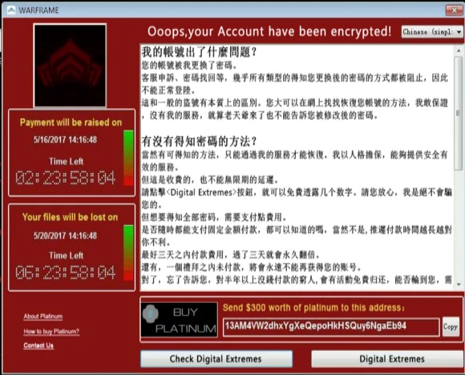

此次勒索病毒席卷全球，网络安全问题再次引起全球的高度重视，同时也反映出我国应对网络安全突发事件的配套法律措施亟待进一步完善。基于网络攻击的低成本性、隐蔽性以及影响范围广等特征，仅仅依靠事后惩治显然不能起到对网络攻击的威慑作用，更难以实现对网络安全的有效保障。此外，攻击者攻击过程并非都会利用0day漏洞，实际上，大多数攻击都是利用的已知漏洞。对于攻击者来说，IT系统的方方面面都存在脆弱性，这些方面包括常见的客户本身的系统漏洞、Web应用漏洞、弱口令，也包括容易被忽略的上下游企业、物联网终端、办公场地的WiFi、客户人员等等，以及容易被忽视的基线安全。

因此在2017年6月1日正式实施《中华人民共和国网络安全法》，在《网络安全法》中力求从源头对网络攻击进行防范，在攻击发生时，确保能够迅速响应与处置，将损害降至最低，最后再对犯罪行为人进行惩处。其第25条规定网络运营者应当制定网络安全事件应急预案；第51条明确要求国家建立网络安全监测预警和信息通报制度，将针对信息系统攻击的规制扩展至事前、事中及事后的全过程，构建出一个涵盖事先监测预警、事中应急响应、事后惩治与恢复的“三位一体”的治理框架，通过对网络攻击中各个连接要点的控制来实现有效防范与治理。

此外，《网络安全法》还规定了网络运营者预防和应对网络攻击行为的责任义务：其中第21条规定，网络运营者应当按照网络安全等级保护制度的要求，履行采取防范计算机病毒和网络攻击、网络侵入等危害网络安全行为的技术措施；第26条规定，网络运营者具有遵守国家有关规定，开展网络安全认证、检测、风险评估等活动，向社会发布网络攻击等网络安全信息的义务，并于第62条明确提出违反本法第26条规定的相关法律责任。

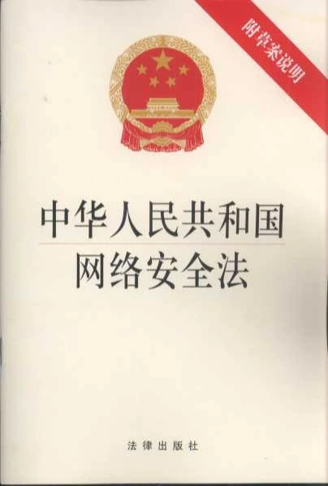

同时《网络安全法》中还重点突出了要加强我国的关键信息基础设施的安全保护，因为关键信息基础设施往往关联着我国的国家安全和社会稳定，明确提出了关键信息基础设施概念和范围并对关键信息基础设施保护提出具体要求，从国家、行业、运营者三个层面明确规定了关键信息基础设施相关主体的安全保护义务，力求系统全面地构建关键信息基础设施安全保障体系，以基础设施牢筑强国战略。所以其重要性不言而喻。

**现状**

目前网络安全建设的重点依然采用以资产为中心，在资产外围进行威胁检测、安全防御等安全能力建设的方式，往往忽略了资产自身的安全加固，导致近几年资产安全问题频发。

从资产管理角度而言，随着IT架构的不断演变和系统应用方式不断创新，IT资产的种类和数量呈现爆发式增长、资产状态变动频繁、资产定位困难，传统企业过去使用的Excel手动登记管理的方式管理效率低下、易漏易错、响应时效长，已不适用于当今资产管理现状。此外，越来越多的互联网企业和传统企业依托公有云厂商提供的服务开展业务或进行数字转型，企业的数字资产正在向云上集中，云上资产的安全与合规显得尤为重要。

从漏洞管理角度而言，传统基于主机漏洞和网络漏洞的扫描器均是通过逐项验证漏洞的方式，对IP或网站进行扫描，效率低下，误报率较高，当风险发生时，很难在短时间内有效探测影响范围，拉长了风险扩散周期，造成威胁不能被第一时间处理，功能单一，不能满足快速发展的安全管理和技术发展需求。

在当前环境已经变化的情况下，网络安全管理人员仍然在用传统的漏洞扫描工具，每季度或半年，仅仅进行网络系统漏洞检查或者Web应用漏洞检查，无法真正对企业本身威胁的暴露面进行全方位的检查。传统的漏洞扫描产品从脆弱性检查覆盖面，到分析报告对管理人员帮助的有效性方面，已经无法胜任。

大家通常认为行业专网是比较安全的，但事实是内部网络由于漏洞修补滞后，攻击者或病毒一旦突破网络隔离，就很容易对内部发起攻击。在云计算普及的今天，网络边界已经变得越来越不清晰，业务场景越来越复杂，企业本身不论是云上还是云下都存在着大量的漏洞及威胁，病毒只要入侵一台设备就瞬间感染网络内缺乏防护的其他设备，云上、云下和内网的设备都不能幸免，并且内网的信息资产和数据价值更大，被攻击后影响也更为严重。

有些客户网络建立已经有20余年且经历了多期的工程建设，导致内部设备种类繁多、数量庞大，但是对设备的管理工作还停留在利用Excel软件进行手动登记的方式，这样的管理资产方式无法精确了解哪些新上线的资产还未加固以及需要下线的设备还没有及时下线，这些设备往往是黑客和病毒发动攻击的有力支点。

**趋势**

信息安全保障工作的落实的一项主要工作内容就是安全保障的全面性、有效性，而要真正做好安全保障，就得确保资产监控覆盖全面、监控周期短、漏洞检测规则更新速度快。

因此，准确完整的IT资产管理和快速准确的漏洞扫描已经成为安全从业人员的共识。然而，当前主流的安全产品在实际环境中使用的时候，会存在大量的误报漏报的情况，资产检测覆盖不全，最新漏洞检测规则无法及时更新，监控周期较长，无法真正做好安全风险监控。

当前网络环境的变化和带来的问题，要求新的安全设备能够及时应对这些变化，并且能按照当前网络安全等级保护制度的要求，为客户的安全评估提供有力手段。

当前网络安全等级保护制度2.0对于资产风险管理要求解读如下：

- **漏洞和风险管理：**

  <ol type="i">

  <li>

  应采取必要的措施识别安全漏洞和隐患，对发现的安全漏洞和隐患及时进行修补或评估可能的影响后进行修补（一级）。

  </li>

  <li>

  应定期开展安全测评，形成安全测评报告，采取措施应对发现的安全问题（三级）。

  </li>

  </ol>

- **审核和核查：**

  应定期进行常规安全检查，检查内容包括系统日常运行、系统漏洞和数据备份等情况（二级/三级）。

- **云计算扩展要求：**

  应根据云服务商和云服务客户的职责划分，实现各自控制部分，包括虚拟化网络、虚拟机、虚拟化安全设备等的运行状况的集中监测。

所以根据等保2.0的要求以及当前网络的环境的情况，新一代的安全评估产品应该具备以下特性：

- 能够全面发现信息系统存在的各种脆弱性问题，覆盖主机漏洞、Web应用漏洞，弱口令漏洞、Web通用漏洞，框架漏洞，运维漏洞等全量漏洞类型，常态化巡检。对监控的资产覆盖面要全、监控周期要短、插件规则更新快。

- 能够快速定位风险类型、资产区域、严重程度，直观展示安全风险和合规风险 。

- 能够结合安全管理制度，支持资产漏洞检查、资产周期复检，形成一套完整的闭环。

- 出现重大的安全漏洞时，可以快速罗列出受影响的设备，从而进行快速的修复，缩短漏洞的影响范围。

- 把握好资产的变更，并且将资产安全责任定位到责任人。

- 能够提供多种灵活部署方式，适应客户不同的需求，并尽量控制安全建设成本。

- 实现Nday漏洞应急响应时间大大缩短，及时梳理受影响资产。

## 2.2. 应用场景

漏洞扫描能够帮助企业自动化运维IT资产及风险，根据企业的已知资产自动、快速、准确检测发现企业的未知资产及所有资产的漏洞，全面分析企业所公开的业务/服务/应用、数据等情况。帮助企业更快速、更全面、更智能地管理企业的IT资产和资产安全风险。

**整体资产安全建设**

协助实现客户资产分级分类管理，完善安全考核机制，加强专有云网络安全体系建设，实时监控和防范资产安全风险。

**常态化风险监控**

专有云资产风险进行自动化监控，资产自动检测、资产智能发现、风险关联分析、漏洞复测验证，7×24h发现可见资产以及脆弱性风险。提高治理资产效率。且持续性的对漏洞进行验证，避免重复告警，保障漏洞的真实性。

**资产安全合规运营**

符合等级保护2.0规范，满足网络安全等级保护要求，提供技术性安全扫描和可视手段，降低信息安全风险，提高安全保护能力，帮助企业履行和落实网络信息安全责任义务。

## 2.3. 功能介绍

平台侧漏扫主要由资产发现、资产监管、风险扫描模块组成，在此基础上衍生出系统配置管理、偏向工具化的扫描任务、可视化报表导出等功能模块。

资产发现模块可对VIP资产等检测，收集资产的指纹，包括服务、应用、协议、框架等信息，进行资产建模，提供完整全面的用户网络资产画像。

风险扫描模块可对处于监管范围内的资产进行漏洞检测，内置丰富的漏洞库。同时采用爬虫技术对网站进行爬取，可以实现深度WEB漏洞检测。

<table>
  <tr>
    <th width="90">功能特性</th>
    <th>说明</th>
  </tr>
  <tr>
    <td>今日概况</td>
    <td>查看漏洞扫描的整体结果。</td>
  </tr>
  <tr>
    <td>资产</td>
    <td>• <strong>资产分析</strong>：查看<strong>资产总数</strong>、<strong>风险资产</strong>和<strong>资产更新</strong>的数量，以及<strong>VIP端口服务</strong>、<strong>资产分</strong><strong>组分布</strong>等统计信息。 • <strong>资产列表</strong>：可以查看<strong>域名资产</strong>和<strong>VIP资产</strong>信息。</td>
  </tr>
  <tr>
    <td>风险</td>
    <td>• <strong>风险分析</strong>：查看<strong>风险概览</strong>、<strong>风险类型分布</strong>、<strong>资产分组风险分布</strong>等统计信息。 • <strong>安全漏洞</strong>：查看通过漏洞扫描功能检测出来的已修复或未修复的安全漏洞。</td>
  </tr>
  <tr>
    <td>任务</td>
    <td>• <strong>任务列表</strong>：查看<strong>资产发现</strong>和<strong>资产风险扫描</strong>任务的信息。 • <strong>模板列表</strong>：创建<strong>资产扫描模板</strong>和<strong>风险扫描模板</strong>。</td>
  </tr>
  <tr>
    <td>报表</td>
    <td>• 支持以列表的形式呈现报表模板信息。 • 支持报表模板创建、批量删除操作。</td>
  </tr>
  <tr>
    <td>配置</td>
    <td>• <strong>监控配置</strong>：管理漏洞扫描中进行监控的项目、执行周期等信息。包括<strong>安全漏洞配</strong><strong>置</strong>和<strong>Agent配置</strong>。 • <strong>通用配置</strong>：设置监控白名单。 • <strong>系统配置</strong>：查看和管理漏洞扫描的系统配置、日志审计和任务状态。</td>
  </tr>
</table>

## 2.4. 使用限制

**版本兼容性**

包含代码兼容、open api、前端配置兼容、数据兼容(DB、SLS、OSS等数据存储)

**云盾漏扫数据库审计版本兼容性**

不支持旧版本数据库审计直接升级至新版本，如果特别需要升级的，需要定制升级包，版本升级可能会有数据库审计无法正常工作的风险。

**大类**

**小类**

**必选**

**标准**

**状态**

**具体情况说明**

版本

否

是否支持向前四

否

个版本的支持

基线

否

是否已在兼容性

否

兼容性

基线填写

接口测试

否

是否已经有兼容

否

性接口测试case

路径

是

需要明确给出升

级路径，如果升级路径有限制，需要在asuf工具中加上路径限制

独立升级

否

是否支持前四个

支持

不支持升级

版本的兼容升级

升级

中断

是

需要明确给出升

对客户业务无影

本身业务中断

级过程中对客户

响

时间约20分钟

业务的影响，本

左右

身业务的中断时间

终态

是

升级后不需要人

支持

工干预到达终态

否

发布时，有严重

不支持

hack

问题需要手动hack，给出workroud方案

监控告警

否

有告警且已经接

否

入告警中心

巡检

否

有巡检用例，对

否

此模块涉及的各种水位情况进行检查

降级

否

当资源（CPU、

否

磁盘）紧张时，有降级方案

运维

应急

否

当功能异常时，

不支持

功能异常时，

有应急手段，半

需人为介入，

小时内恢复业务

定位问题再手动解决问题

补丁

是

可以通过云盾升

不支持

级中心更新此产品涉及到的所有bug源码修复

规则更新

是

可以通过云盾升

支持

级中心更新此产品涉及到的所有规则库更新

容灾

是

支持同城容灾

支持

否

支持ipv6

支持

ipv6

扩容

否

支持横向扩容，

支持

若不同于通用方案，需单独提供扩容方案

大规模

是

需要给出规格模

型，以及不同规模的处理方案

国际化

否

语言+时区，售

支持中文/支持

卖限制说明

多region

是

支持多

支持

暂无相关多

扩展功能

Region，若是

region需求

中心region集中部署的，需要特别说明。

高可用

否

支持高可用，至

支持

管控端有两台

少是两台机器做

做负载均衡

主备

计量计费

否

满足行业云售卖

不支持

要求

license 授权

否

满足行业云售卖

不支持

要求

**限制性说明**

**V3.18.3SP01 限制说明**

- 国际化支持，中英文切换场景，例如：多次切换，历史展示数据会存在中英文混合数据。

**V3.18.3 限制说明**

- v3.18.2版本支持细分至单资源集视角的权限管理，升级到3.18.2版本默认开启，且开启后不可逆。(该变更影响漏洞扫描历史版本的数据归类和页面呈现，历史版本数据将在新版本中无法展示。原因是升级后平台支持对云资产的组织和资源集进行管理，无法对历史资产的对应数据进行归类管理。)

- v3.18.2版本实现SLR授权模式，开启后使用该模式，不开启则使用SR模式。

# 3.产品架构

## 3.1. 软件架构

### 3.1.1. 部署架构

**传统漏洞扫描**

传统漏洞扫描在集团化或网段的部署方面需要针对不同的网段进行引擎的适配，此过程是需要运维人员参与，扫描引擎部署后需要打通管控段和跨网段扫描引擎的安全设备或者安全策略。或者独立部署多台漏洞扫描设备。

公网资源

传统漏扫

传统漏扫公网引擎

管控端

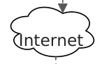

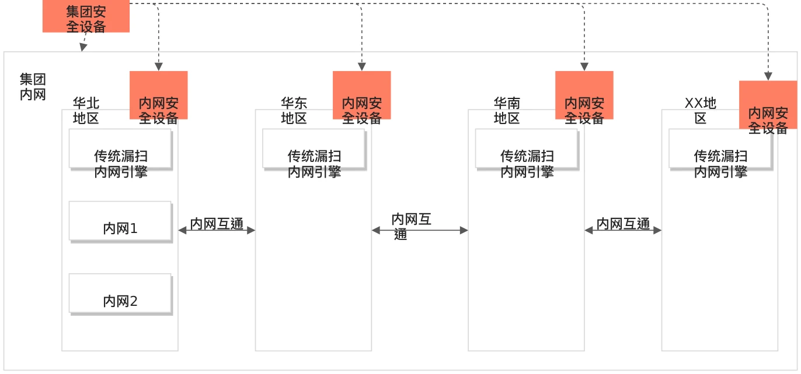

**云盾漏洞扫描**

云盾漏洞扫描在引擎部署方面是将传统漏洞扫描的工作全部自动化，不需要人工的参与，添加了云弹性扩展的属性。

**控制端**

sc_web_assset

sc_report

sc_web_risk

sc_openapi

sc_web_task

sc_thread

sc_account

sc_web_upgrade

ms_install

:8000

scs_agent_stat

scs_task

scs_task_master

scs_sync

scs_gateway

scs_task_manager

**K8S**

:7777

**K8S**

KV存储

对象存储

mysql

MetaQ

**云服务**

**私有云**

**VPC**

**引擎端**

**引擎端**

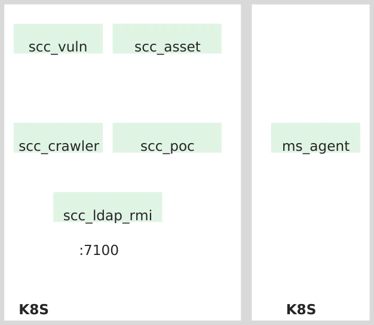

**云盾漏洞扫描漏洞库实时更新对比**

- **传统漏洞扫描**

  漏洞库信息需要独立维护，更新周期长，会影响网络安全。

- **云盾漏洞扫描**

  漏洞库信息集中维护，更新自动化，周期短，覆盖最新的漏洞类型。

**云盾漏洞扫描-云端产品横向扩充对比**

- **传统漏洞扫描**无法使用与云上产品的对接需求，例如打造纵深安全防御体系时的多安全单元的相互联动。

- **云盾漏洞扫描**

  基于云原生打造，可以进行相关云化产品的系统级对接，提供综合数据分析和纵深防御体系构建的前置条件。

### 3.1.2. 技术架构

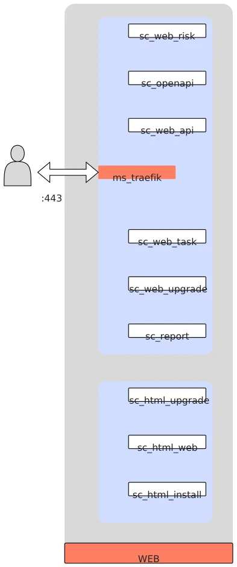

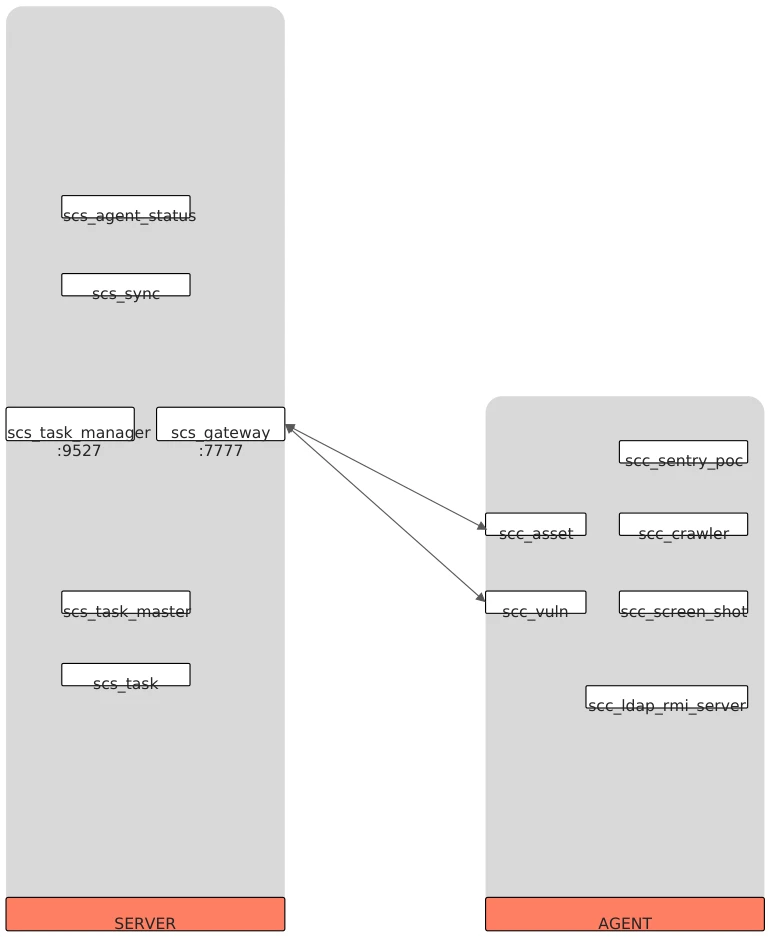

KV

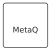

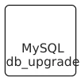

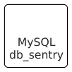

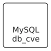

技术架构图中所示服务及模块描述如下：

| 模块名 | 模块描述 |
| --- | --- |
| sc_web_risk | 风险展示模块 |
| sc_openapi | openapi服务 |
| sc_web_api | 向前端提供api接口 |
| sc_web_task | web端任务管理模块 |
| sc_web_upgrade | WEB端升级服务 |
| sc_report | 报表服务 |
| scs_agent_status  agent | 心跳状态上报 |
| scs_sync agent | 上报数据处理服务 |
| scs_task_manager | 任务管理服务 |
| scs_gateway | 网关服务，agent与server通信都经过该服务 |
| scs_task_master | 子任务生成服务 |
| scs_task | 用于给agent下发可执行的任务 |

# 4.功能原理

为了能够快速、准确地发现企业存在的安全风险，云盾漏洞扫描使用了多种关键技术来实现这个目标。

- <strong>资产建模：</strong>对IT资产特征值进行分析，提取企业资产特征值进行分类建立资产模型。

- <strong>指纹识别：</strong>利用深度学习对不同应用与服务的协议请求数据进行拆分，提取特征值，指纹模型自动对其进行识别。

- <strong>精准扫描：</strong>分布式扫描架构，任务调度模块对扫描请求进行拆分，结合指纹识别技术达到精准扫描。

- <strong>高效扫描：</strong>利用无状态的极速扫描技术，可以迅速的获得网络中存在的资产，大幅度提升检测速度。

- <strong>资产风险扫描：</strong>通过基础风险扫描来发现企业自身内部以及外部存在的资产以及资产的威胁暴露面，通过高级风险扫描进行深度的漏洞扫描，以发现严重的系统或者应用漏洞。

- <strong>安全漏洞扫描：</strong>包括基础漏洞扫描、弱口令扫描、网站安全漏洞扫描、基线检测的内容，扫描后的漏洞将自动与资产进行关联。

- <strong>合规漏洞（主机CVE漏洞扫描）：</strong>对主机进行CVE系统漏洞检测，扫描后的漏洞将自动与主机资产、主机端口、服务指纹进行关联。

## 4.1. 产品功能

云盾漏洞扫描快速发现未知的安全风险主要在资产管理这一块，根据用户设置的已知资产利用云盾漏洞扫描的资产建模和指纹识别技术对资产进行分析，准确分辨资产来源，对暴露在外的企业相关资产做到精准识别。

无状态的极速扫描技术，大幅度提升检测速度，同时利用分布式扫描架构模式进行扫描，减少了冗余扫描请求，提高扫描效率，避免因扫描频率高导致服务器负载过高的问题，结合云盾漏洞扫描全面的风险检测能力，对系统漏洞、运维安全、网站风险等进行全面评估，帮助企业快速全面地发现安全风险。

同时云盾漏洞扫描提供最新漏洞应急检测模式，针对最新的安全漏洞帮助企业快速发现解决最新漏洞导致的安全隐患。

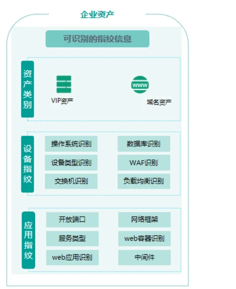

### 4.1.1. 资产发现

云盾漏洞扫描可以根据用户提供的已知资产，准确分辨资产来源，并对其企业资产进行智能化识别，如精准识别主机服务及主机资产的变更状态，支持资产存活状态自动发现，支持对子域名和多级域名的发现。

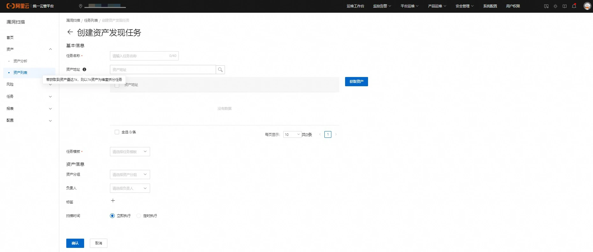

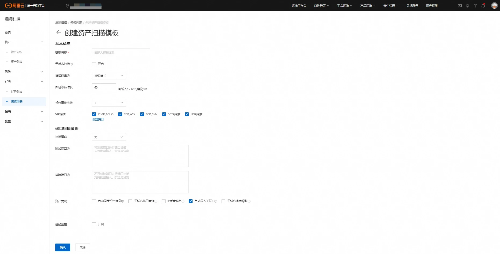

### 4.1.2. 资产管理

包括资产发现、删除、分组及导出管理，资产归属及负责人管理、资产检索等。利用深度学习对不同应用与服务的协议请求数据进行拆分，提取特征值，指纹模型自动对应用、服务等进行识别：

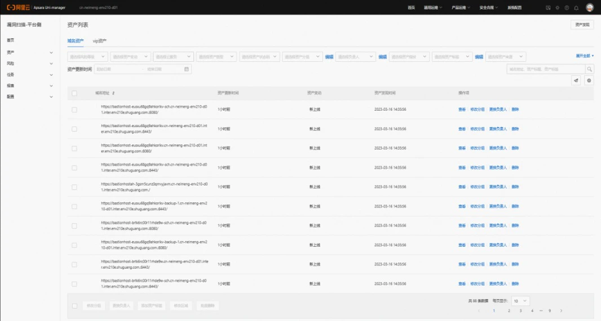

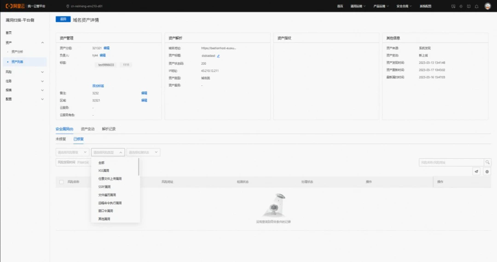

### 4.1.3. 漏洞扫描

漏洞扫描支持基础漏洞扫描、弱口令扫描、安全漏洞扫描、漏洞自动化巡检、基线检测等，其中包括常见的web漏洞类型、常见CMS漏洞以及运维安全漏洞，弱口令支持MySQL、SSH、FTP、SQLServer等常见服务的弱口令扫描。实时更新最新的安全漏洞插件，并支持自定义应急检测，漏洞扫描结果可自动与资产进行关联。

云盾漏洞扫描提供了资产风险扫描模块，分为应急检测、基础风险检测、WEB风险检测，选择应急检测模块可帮助企业资产在新漏洞爆发蔓延之前提供防护，选择基础风险检测也可对重点部分资产进行快速漏洞扫描，支持弱口令漏洞、运维安全漏洞、CMS应用漏洞等多种漏洞类型。

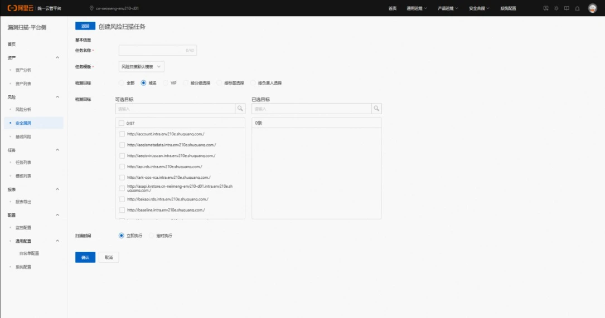

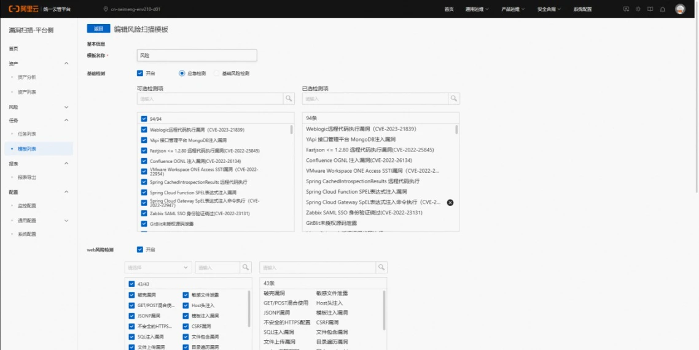

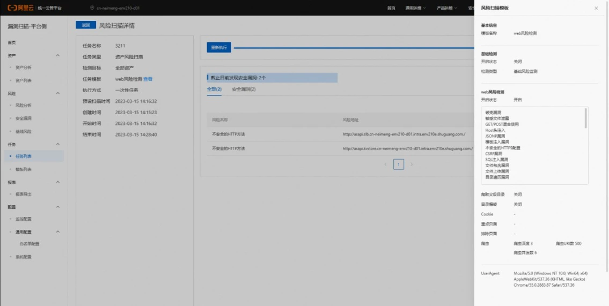

### 4.1.4. 漏洞管理

扫描后的漏洞与资产进行自动关联，使资产风险可视化，帮助企业及时发现风险并进行管理。支持漏洞流程管理，针对漏洞进行忽略，确认以及重新检测等操作。查看漏洞详情、修复建议，帮助企业及时加固。

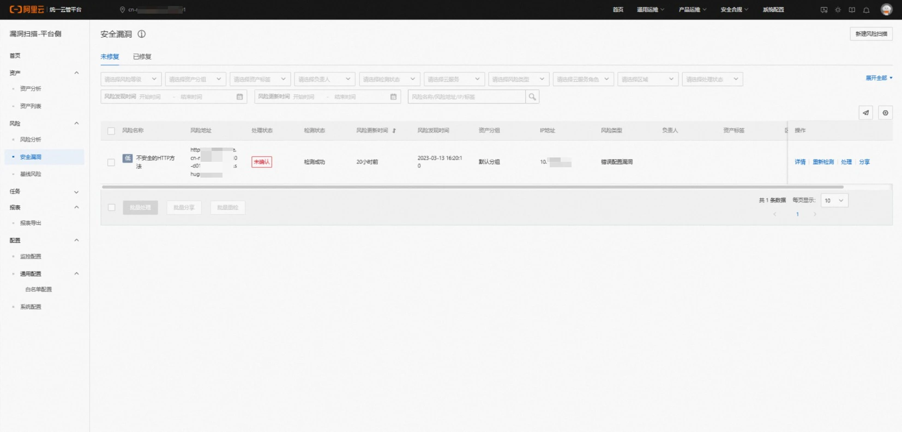

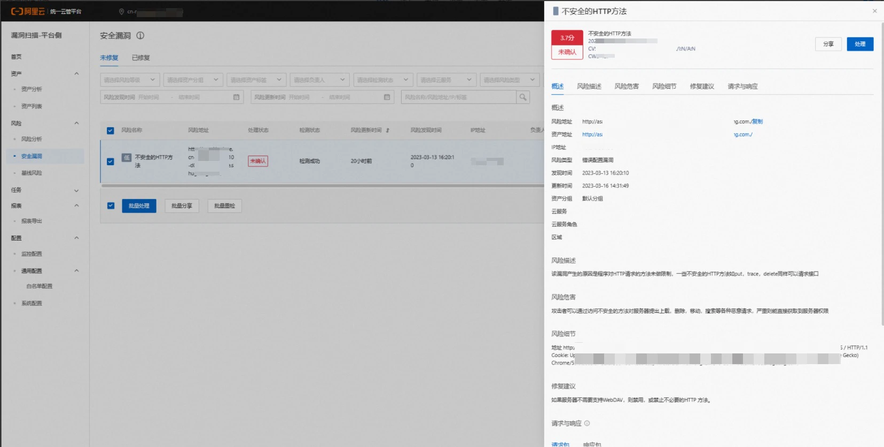

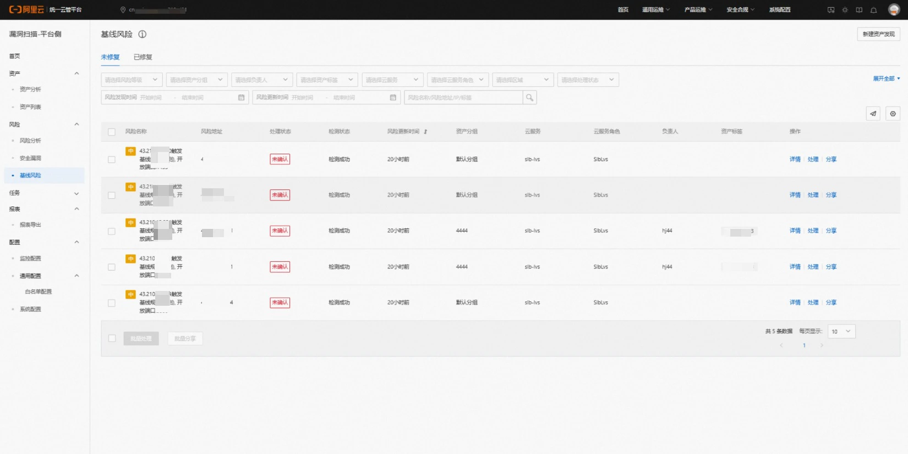

### 4.1.5. 产品功能块间数据流程描述

- 用户通过云盾漏洞扫描将和企业相关的已知资产添加至资产库中。

- 对已有资产的资产特征值进行分析，提取企业资产特征值进行分类建立资产模型。

- 根据企业特性在公网等网络环境中爬取类似特性的资产，并根据资产模型自动识别企业资产。

- 将自动识别的资产录入到资产库中。

- 漏洞扫描和基线核查等模块会根据用户设定的扫描时间对已有资产进行扫描。

- 风险分析模块将企业资产相关的风险以报告形式及时告知相关人员进行风险修复。

- 修复完成之后，用户可对相关风险修复情况及时验证；也可以根据用户设定的定期扫描任务自动验证。

- 出现重大安全漏洞，云盾漏洞扫描通过升级中心及时把插件推送给客户，云盾漏洞扫描可以迅速罗列出受影响的设备，从而进行快速的修复，缩短漏洞的影响范围。

  资产发现

  资产识别

  资产探测

  资产建模

  基础风险检测/应急检测

  漏洞发现

  资产风险扫描

  基线监控

  回归测试

  

  

  资产探测
