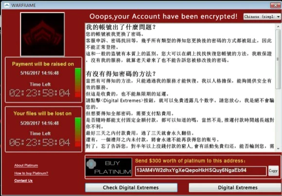
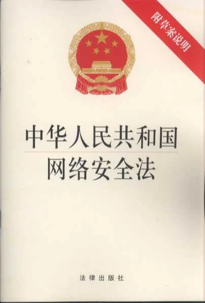
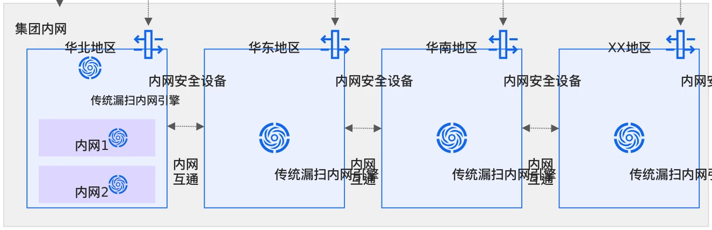
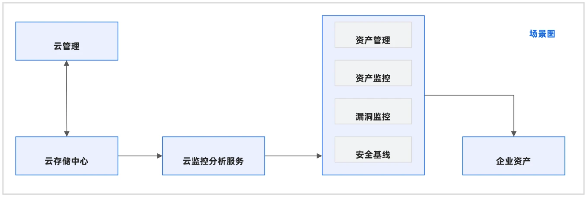
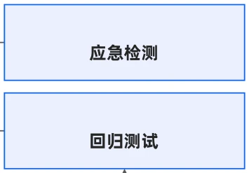
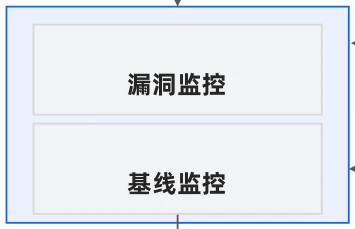
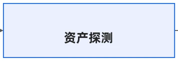

阿里云  
专有云  
租户侧漏洞扫描 产品白皮书  
产品版本：v3.18.6-SP2607  
文档版本：20260729

**目录**

- [1.网络安全环境的变化](#section-1)
- [2.环境变化带来的问题](#section-2)
- [3.云盾漏扫与传统漏扫的对比](#section-3)
- [4.新一代安全评估产品必备的特性](#section-4)
- [5.产品概述](#section-5)
    - [5.1. 产品介绍](#section-5-1)
    - [5.2. 功能介绍](#section-5-2)
    - [5.3. 应用场景](#section-5-3)
    - [5.4. 使用限制](#section-5-4)
- [6.产品架构](#section-6)
    - [6.1. 软件结构](#section-6-1)
- [7.功能原理](#section-7)
    - [7.1. 产品功能](#section-7-1)

# 1.网络安全环境的变化

近些年，网络安全威胁的形式也出现了不同的变化，攻击方式从单个兴趣爱好者随意下载的简单工具攻击，向有组织的专业技术人员专门编写的攻击程序转变，攻击目的从证明个人技术实力向商业或国家信息窃取转变。

新攻击形式的变化，仍然会利用各种漏洞，比如：蠕虫勒索病毒WannaCry利用NSA的“永恒之蓝”（EternalBlue）漏洞袭卷全球网络，大规模感染全球电脑网络，波及近100个国家，我国大量行业企业内网遭到感染。其实攻击者攻击过程并非都会利用0day漏洞，实际上，大多数攻击都是利用的已知漏洞。对于攻击者来说，IT系统的方方面面都存在脆弱性，这些方面包括常见的客户本身的系统漏洞、Web应用漏洞、弱口令，也包括容易被忽略的上下游企业、物联网终端、办公场地的WiFi、客户人员等等，以及容易被忽视的基线安全。

同时，2017年6月1日正式实施《中华人民共和国网络安全法》，在《网络安全法》中重点突出了要加强我国的关键信息基础设施的安全保护，因为关键信息基础设施往往关联着我国的国家安全和社会稳定，所以其重要性不言而喻。

# 2.环境变化带来的问题

在当前环境已经变化的情况下，网络安全管理人员仍然在用传统的漏洞扫描工具，每季度或半年，仅仅进行网络系统漏洞检查或者Web应用漏洞检查，无法真正对企业本身威胁的暴露面进行全方位的检查。传统的漏洞扫描产品从脆弱性检查覆盖面，到分析报告对管理人员帮助的有效性方面，已经无法胜任。

大家通常认为行业专网是比较安全的，但事实是内部网络由于漏洞修补滞后，攻击者或病毒一旦突破网络隔离，就很容易对内部发起攻击。在云计算普及的今天，网络边界已经变得越来越不清晰，业务场景越来越复杂，企业本身不论是云上还是云下都存在着大量的漏洞及威胁，病毒只要入侵一台设备就瞬间感染网络内缺乏防护的其他设备，云上、云下和内网的设备都不能幸免，并且内网的信息资产和数据价值更大，被攻击后影响也更为严重。

有些客户网络建立已经有20余年且经历了多期的工程建设，导致内部设备种类繁多、数量庞大，但是对设备的管理工作还停留在利用Excel软件进行手动登记的方式，这样的管理资产方式无法精确了解哪些新上线的资产还未加固以及需要下线的设备还没有及时下线，这些设备往往是黑客和病毒发动攻击的有力支点。

# 3.云盾漏扫与传统漏扫的对比

**云盾漏扫部署架构对比**

- **传统漏扫**

  传统漏洞扫描在集团化或网段的部署方面需要针对不同的网段进行引擎的适配，此过程是需要运维人员参与，扫描引擎部署后需要打通管控段和跨网段扫描引擎的安全设备或者安全策略。

  或者独立部署多台漏洞扫描设备。

- **云盾漏扫**

  云化漏洞扫描在引擎部署方面是将传统漏扫的工作全部自动化，不需要人工的参与，添加了云弹性扩展的属性。

  

  

  传统漏扫管控端

  传统漏扫公网

  

  集团安全设备

  

  内网安全

  传统漏扫内网引擎

**云盾漏扫漏洞库实时更新对比**

- **传统漏扫**

  漏洞库信息需要独立维护，更新周期长，会影响网络安全。

- **云盾漏扫**

  漏洞库信息集中维护，更新自动化，周期短，覆盖最新的漏洞类型。

**云盾漏扫-云端产品横向扩充对比**

- **传统漏扫**

  无法使用与云上产品的对接需求，例如打造纵深安全防御体系时的多安全单元的相互联动。

- **云盾漏扫**

  基于云原生打造，可以进行相关云化产品的系统级对接，提供综合数据分析和纵深防御体系构建的前置条件。

# 4.新一代安全评估产品必备的特性

信息安全保障工作的落实的一项主要工作内容就是保障安全的全面性、有效性，而要真正做好安全保障，就得确保资产监控覆盖全面、监控周期短、漏洞检测规则更新速度快。

因此，准确完整的IT资产管理和快速准确的漏洞扫描已经成为安全从业人员的共鸣。然而，当前主流的安全产品在实际环境中使用的时候，会存在大量的误报漏报的情况，资产检测覆盖不全，最新漏洞检测规则无法及时更新，监控周期较长，无法真正做好安全风险监控。

当前网络环境的变化和带来的问题，要求新的安全设备能够及时应对这些变化，为客户的安全评估提供有力手段，新一代的安全评估产品应该具备以下特性：

- 能够全面发现信息系统存在的各种脆弱性问题，包括系统漏洞、Web应用漏洞，弱口令，对监控的资产覆盖面要全、监控周期要短、插件规则更新快

- 能够快速定位风险类型、资产区域、严重程度，直观展示安全风险

- 能够结合安全管理制度，支持资产漏洞检查、资产周期复检，形成一套完整的闭环

- 出现重大的安全漏洞可以快速罗列出受影响的设备，从而进行快速的修复且缩短漏洞的影响范围

- 把握好资产的变更，并且将资产安全责任定位到人

- 能够提供多种灵活部署方式，适应客户不同的需求，并尽量控制降低安全建设成本

# 5.产品概述

阿里云云盾漏洞扫描是结合人工智能技术帮助企业及时发现安全风险的智能安全产品。根据用户设置的已知资产结合云盾漏洞扫描的资产学习模型，对资产进行分析，准确分辨资产来源，帮助企业自动发现未知资产，结合云盾漏洞扫描的漏洞检测覆盖能力，帮助企业及时发现未知的安全风险。

云盾漏洞扫描可以7\*24小时对资产、资产漏洞、ACL、安全基线进行监控，帮助企业实时捕捉安全风险，帮助用户第一时间发现企业安全风险。

## 5.1. 产品介绍

云盾漏洞扫描采用资产建模技术，全面发现企业资产，面向企业提供资产全生命周期管理服务，上千个原理扫描插件及时更新，提供精准的资产漏洞扫描以及应急响应能力，对资产进行风险可视化分析，提供从资产发现到风险监测的一体化解决方案。

## 5.2. 功能介绍

**功能特性描述**

云盾漏洞扫描旨在帮助企业自动化发现、维护IT资产风险，从漏洞安全、合规检测以及外部威胁情报分析等多个维度持续监控企业安全。根据企业的已知资产自动、快速、准确地检测发现企业的未知资产及所有资产的漏洞，帮助企业更快速、更全面、更智能地管理IT资产和资产安全风险。

<table>
  <tr>
    <th width="90">功能特性</th>
    <th>说明</th>
  </tr>
  <tr>
    <td>今日概况</td>
    <td>查看漏洞扫描的整体结果。</td>
  </tr>
  <tr>
    <td>资产</td>
    <td>• <strong>资产分析</strong>：查看<strong>资产总数</strong>、<strong>风险资产</strong>以及<strong>资产更新</strong>的数量，并获取主机资产的主机端口、主机服务和操作系统等相关信息。 • <strong>网站资产</strong>：查看和管理接入漏洞扫描的网站资产。 • <strong>主机资产</strong>：查看和管理接入漏洞扫描的主机资产。 • <strong>域名资产</strong>：查看和管理接入漏洞扫描的域名资产。</td>
  </tr>
  <tr>
    <td>风险</td>
    <td>• <strong>风险分析</strong>：查看安全漏洞、合规漏洞以及对外暴露风险的分析情况。 • <strong>安全漏洞</strong>：查看和处理漏洞扫描所检测到的安全漏洞风险。 • <strong>合规漏洞</strong>：查看及确认主机合规漏洞的风险。 • <strong>对外暴露</strong>：查看和确认对外暴露的风险。</td>
  </tr>
  <tr>
    <td>任务</td>
    <td>• <strong>任务列表</strong>：支持以列表的形式呈现资产导入、风险扫描、资产扫描任务的任务信息。 • <strong>模板列表</strong>：创建资产扫描模板和风险扫描模板。</td>
  </tr>
  <tr>
    <td>报表列表</td>
    <td>查看特定资产在一段时间内的安全风险状况，并实施相应的安全防护改进方案。</td>
  </tr>
  <tr>
    <td>配置管理</td>
    <td>• <strong>扫描规则</strong>：对漏洞扫描进行安全扫描规则配置和管理，包括安全漏洞配置、合规漏洞配置、对外暴露配置、目录爆破管理和资产扫描白名单。 • <strong>任务管理</strong>：查看和管理资产导入、风险扫描和资产扫描任务。 • <strong>系统信息</strong>：查看漏洞扫描系统的漏洞库版本。 • <strong>运维检测</strong>：支持通过ping/curl/telnet命令对IP或者域名进行测试，验证漏洞是否存在。 • <strong>日志审计</strong>：记录对资产导入、风险扫描、资产扫描、创建报表和管理扫描规则等类型的操作日志和操作结果。 • <strong>引擎管理</strong>：配置扫描引擎。</td>
  </tr>
</table>

**产品技术及优势**

云盾漏洞扫描采用资产建模技术，全面发现企业资产，面向企业提供资产全生命周期管理服务，上千个原理扫描插件及时更新，提供精准的资产漏洞扫描以及应急响应能力，对资产进行风险可视化分析，提供从资产发现到风险监测的一体化解决方案。

**企业数据可视化**

将平台中散乱的资产、风险等数据进行收集处理，对抽象的资产和系统数据进行可视化呈现，并对网络中的主机信息、网站信息进行安全监测，将关键信息以图表的形式展现出来，可帮助企业快速掌握当前现状，及对后期的业务调整进行支撑。

**灵活精准快速的扫描方式**

无状态的极速扫描技术，大幅度提升检测速度，同时利用分布式扫描架构和任务调度模块对扫描请求进行拆分，结合指纹识别技术达到精准扫描，减少冗余扫描请求，避免因扫描频率高导致服务器负载过高的问题。云盾漏洞扫描的检测速度平均一个C段比普通扫描产品快50%。

**海量漏洞库持续升级，最新高危漏洞快速响应**

云盾漏洞扫描快速更新高危漏洞插件，第一时间报告企业影响范围。数千个独立应用漏洞插件，几百个威胁情报渠道和2000种漏洞类型支持；监控与企业相关的漏洞平台、社交工具的安全动态，与主流漏洞平台合作，漏洞优先知情。

**准确发现IT资产**

云盾漏洞扫描内置资产学习模型，根据企业特性和企业资产特性提取特征值建立企业资产模型，准确分辨资产来源；同时根据企业特性和发现的资产特征进行威胁分析，准确帮助捕捉与企业相关的安全情报。

**多种检查能力合一，风险统一分析**

对于攻击者来说，客户的系统的方方面面都存在脆弱性，这些方面不仅仅包括常见的操作系统漏洞、应用系统漏洞、弱口令、错误安全配置问题以及违反最小化原则开放的不必要的账号、服务、端口等，还包括客户的上下游企业、客户人员、员工无意识的数据泄露、物联网终端设备。

阿里云云盾漏洞扫描能够全方位检测客户系统存在的脆弱性，发现信息系统存在的安全漏洞、安全配置问题、应用系统安全漏洞，检查系统存在的弱口令，收集系统不必要开放的账号、服务、端口，形成整体安全风险报告，帮助安全管理人员先于攻击者发现安全问题，及时进行修补。

目前市场上有很多独立的漏洞扫描、配置检查、Web应用扫描产品，对信息系统进行安全检查后，分别得到不同的检查报告，互相之间没有联系，实际上不同脆弱性的扫描结果都从不同方面反映网络系统的安全风险状态，要了解信息系统总体安全风险状况，需要对脆弱性的所有方面统一进行分析和评估。

阿里云云盾漏洞扫描支持全方位的系统漏洞、Web应用漏洞扫描、基线检测，通过云盾漏洞扫描对网络系统中多个方面的安全脆弱性进行统一分析和风险评估，给出总体安全状态评价，全面掌握信息系统安全风险。

**结合自定义检测，从海量数据快速定位高危资产**

客户的系统规模越来越大，资产数量、漏洞数量越来越多，最终汇总成大量的风险数据，在出现重大漏洞时候，传统的关注扫描漏洞、补丁修补的安全管理工作方式会使安全管理人员疲于应付，且无法保证对重要资产的及时修补。

阿里云云盾漏洞扫描系统在上线后，首先尽量收集系统环境信息，然后建立起资产详细信息和资产漏洞关系列表，最后在出现重大漏洞的时候，利用推送的应急检测服务快速罗列出受影响的设备，迅速进行漏洞修复，缩短漏洞的影响范围。传统的扫描器往往是先更新插件然后再找一个对业务运行影响不大的时间，花费很长的时间对庞杂的资产进行扫描，最后导出一份庞大的报表，逐一找出受该漏洞影响的设备来进行加固。

**促进安全管理流程的建立**

安全管理不仅仅是技术，更重要的是通过流程制度对安全脆弱性风险进行控制，很多公司制定了安全流程制度，但仍然有安全事故发生，人员对流程制度的执行起到关键作用，如何融入管理流程，并促进流程的执行是安全脆弱性管理产品需要解决的问题。

## 5.3. 应用场景

漏洞扫描能够帮助企业自动化运维IT资产及风险，根据企业的已知资产自动、快速、准确检测发现企业的未知资产及所有资产的漏洞，全面分析企业所公开的业务/服务/应用、数据等情况，实时监控企业暴露在外的服务和资产的变化。帮助企业更快速、更全面、更智能地管理企业的IT资产和资产安全风险。

**整体资产安全建设**

协助实现客户资产分级分类管理，完善安全考核机制，加强专有云内外网络安全体系建设，实时监控和防范资产安全风险。

**常态化风险监控**

专有云资产风险进行自动化监控，资产自动检测、资产智能发现、风险关联分析、漏洞复测验证，7×24h发现并内外网可见资产以及脆弱性风险。提高治理资产效率。且持续性的对漏洞进行验证，避免重复告警，保障漏洞的真实性。

**资产安全合规运营**

符合等级保护2.0规范，满足网络安全等级保护要求，提供技术性安全扫描和可视手段，降低信息安全风险，提高安全保护能力，帮助企业履行和落实网络信息安全责任义务。

## 5.4. 使用限制

**版本兼容性**

包含代码兼容、open api、前端配置兼容、数据兼容(DB、SLS、OSS等数据存储)

**云盾漏扫数据库审计版本兼容性**

不支持旧版本数据库审计直接升级至新版本，如果特别需要升级的，需要定制升级包，版本升级可能会有数据库审计无法正常工作的风险。

**大类**

**小类**

**必选**

**标准**

**状态**

**具体情况说明**

版本

否

是否支持向前四

否

个版本的支持

基线

否

是否已在兼容性

否

基线填写

兼容性

接口测试

否

是否已经有兼容

否

性接口测试case

路径

是

需要明确给出升

级路径，如果升级路径有限制，需要在asuf工具中加上路径限制

独立升级

否

是否支持前四个

支持

不支持升级

版本的兼容升级

中断

是

需要明确给出升

对客户业务无影

本身业务中断时

升级

级过程中对客户

响

间约20分钟左

业务的影响，本

右

身业务的中断时间

终态

是

升级后不需要人

支持

工干预到达终态

否

发布时，有严重

不支持

hack

问题需要手动hack，给出workroud方案

监控告警

否

有告警且已经接

否

入告警中心

巡检

否

有巡检用例，对

否

此模块涉及的各种水位情况进行检查

降级

否

当资源（CPU、

否

磁盘）紧张时，有降级方案

运维

应急

否

当功能异常时，

不支持

功能异常时，需

有应急手段，半

人为介入，定位

小时内恢复业务

问题再手动解决问题

补丁

是

可以通过云盾升

不支持

级中心更新此产品涉及到的所有bug源码修复

规则更新

是

可以通过云盾升

支持

级中心更新此产品涉及到的所有规则库更新

<table>
  <tr>
    <td rowspan="9">扩展功能</td>
    <td>容灾</td>
    <td>是</td>
    <td>支持同城容灾</td>
    <td>支持</td>
    <td></td>
  </tr>
  <tr>
    <td>ipv6</td>
    <td>否</td>
    <td>支持ipv6</td>
    <td>支持</td>
    <td></td>
  </tr>
  <tr>
    <td>扩容</td>
    <td>否</td>
    <td>支持横向扩容，若不同于通用方案，需单独提供扩容方案</td>
    <td>支持</td>
    <td></td>
  </tr>
  <tr>
    <td>大规模</td>
    <td>是</td>
    <td>需要给出规格模型，以及不同规模的处理方案</td>
    <td></td>
    <td></td>
  </tr>
  <tr>
    <td>国际化</td>
    <td>否</td>
    <td>语言+时区，售卖限制说明</td>
    <td>支持中文/支持</td>
    <td></td>
  </tr>
  <tr>
    <td>多region</td>
    <td>是</td>
    <td>支持多region，若是中心region集中部署的，需要特别说明</td>
    <td>支持</td>
    <td>暂无相关多region需求</td>
  </tr>
  <tr>
    <td>高可用</td>
    <td>否</td>
    <td>支持高可用，至少是两台机器做主备</td>
    <td>支持</td>
    <td>管控端有两台做负载均衡</td>
  </tr>
  <tr>
    <td>计量计费</td>
    <td>否</td>
    <td>满足行业云售卖要求</td>
    <td>不支持</td>
    <td></td>
  </tr>
  <tr>
    <td>license 授权</td>
    <td>否</td>
    <td>满足行业云售卖要求</td>
    <td>不支持</td>
    <td></td>
  </tr>
</table>

**限制性说明**

**V3.18.3SP01 限制说明**

- 国际化支持，中英文切换场景，例如：多次切换，历史展示数据会存在中英文混合数据。

**V3.18.3 限制说明**

- v3.18.2版本支持细分至单资源集视角的权限管理，升级到3.18.2版本默认开启，且开启后不可逆。(该变更影响漏洞扫描历史版本的数据归类和页面呈现，历史版本数据将在新版本中无法展示。原因是升级后平台支持对云资产的组织和资源集进行管理，无法对历史资产的对应数据进行归类管理。)

- v3.18.2版本实现SLR授权模式，开启后使用该模式，不开启则使用SR模式。

# 6.产品架构

## 6.1. 软件结构

云盾漏洞扫描采用资产建模技术，全面发现企业资产，面向企业提供资产全生命周期管理服务，上千个原理扫描插件实时更新，提供精准的资产漏洞扫描以及应急响应能力，对资产进行风险可视化分析，提供从资产发现到风险监测的一体化解决方案。

云盾漏洞扫描主要包括今日概览模块、资产管理模块、资产发现模块、资产监测模块、漏洞管理模块、漏洞扫描模块、系统管理功能模块等。

**任务调度**

**后台服务**

**数据存储中心**

**巡检引擎**

**资产巡检引擎**

**端口服务分析引擎**

**安全巡检引擎**

**关联**

**关联域名**

**资产建模**

**存活检测**

**端口探测**

**服务识别**

**Web漏**

**主机漏洞**

**弱口令检**

**基线检测**

**IP检索**

**检索**

**洞检测**

**检测**

**测**

**引擎**

**漏洞库资产风险可视化界面**

资产风险可视化界面是任务调度接口和查看后台数据的接口。采用标准的RESETful设计，包含了广泛的功能，通过API接口，可以实现存储服务、消息服务、计算服务等的调度；在资产风险可视化界面当中，报表是对外展示的核心功能，能够提供HTML、EXECL等报表格式。

**数据存储中心**

系统的存储中心是系统内部的数据接口，提供了数据库访问、数据缓存、数据同步等功能。存储中心层屏蔽了数据库系统操作的细节，减少数据库的连接，优化数据库的访问，缓存常用和计算复杂的数据，集中处理数据的逻辑，降低了其他功能模块的维护工作量。

数据存储层提供资产导入的重要接口，也是系统服务层查看扫描出的资产和调用漏洞库的重要基础保障。存储中心层耦合了前台操作和后台操作，后台功能以特定的权限运行，增加了系统的安全性。

存储中心分为账户中心、配置中心、任务中心、策略库、资产以及漏洞中心几大核心的数据模块；账户中心和配置中心，任务中心主要是保持用户的认证信息以及操作状态；策略库是云盾漏洞扫描漏洞监控模块的核心规则内容，可实时从云端获取更新；资产以及漏洞中心则是针对用户的输入，保存系统的扫描和巡检所产生的结果。

**巡检引擎**

巡检引擎是产品的核心层。分为资产巡检引擎、端口服务分析引擎和安全引擎。

资产巡检引擎展示对资产巡检检测的结果，利用无状态资产扫描引擎进行快速的资产探测发现，迅速清点出客户所拥有的资产；利用爬虫与DNS轮询技术，获取关联资产；如子域名，以及对应的IP资产；并能依据资产所在的地理位置，分配监控任务至最近的监控节点，以保证监控的时效性，同时能够更加合理地利用各监控节点资源。

端口服务分析引擎是利用端口存活探测的技术分析资产上面所提供的相对的服务和应用，跟客户本身的资产进行关联形成客户本身独有的资产模型。

安全巡检引擎对资产进行深度的系统漏洞扫描、基线扫描和Web应用漏洞扫描；在云监控服务中，还可以对网络进行安全合规的基线检查，对不合规的设备给予实时的告警。

# 7.功能原理

## 7.1. 产品功能

**产品关键技术**

为了能够快速、准确地发现企业存在的安全风险，云盾漏洞扫描使用了多种关键技术来实现这个目标。

- <strong>资产建模：</strong>对IT资产特征值进行分析，提取企业资产特征值进行分类建立资产模型。

- <strong>指纹识别：</strong>利用深度学习对不同应用与服务的协议请求数据进行拆分，提取特征值，指纹模型自动对其进行识别。

- <strong>精准扫描：</strong>分布式扫描架构，任务调度模块对扫描请求进行拆分，结合指纹识别技术达到精准扫描。

- <strong>高效扫描：</strong>利用无状态的极速扫描技术，可以迅速的获得网络中存在的资产，大幅度提升检测速度。

- <strong>实时监控：</strong>7\*24小时对资产、资产漏洞、ACL、安全基线进行监控。

- <strong>自定义检测：</strong>分为风险自定义检测和资产自定义检测，其中风险自定义检测模块能够解决企业无法响应新型漏洞的问题或企业需要对某部分资产进行针对性的漏洞扫描，资产自定义检测解决企业无法快速感知资产最新的变动情况，并支持端口自定义。

- <strong>资产监测：</strong>通过基础风险监控来发现企业自身内部以及外部存在的资产以及资产的威胁暴露面，通过高级风险监控进行深度的漏洞扫描，发现严重的系统或者应用漏洞。

- <strong>安全漏洞扫描：</strong>包括基础漏洞扫描、弱口令扫描、网站安全漏洞扫描、漏洞自动化巡检、基线检测的内容，扫描后的漏洞将自动与资产进行关联。

- **合规漏洞**（主机CVE漏洞扫描）：对主机进行CVE系统漏洞检测，扫描后的漏洞将自动与主机资产、主机端口、服务指纹进行关联。

**产品关键功能**

云盾漏洞扫描快速发现未知的安全风险主要在资产管理这一块，根据用户设置的已知资产利用云盾漏洞扫描的资产建模和指纹识别技术对资产进行分析，准确分辨资产来源，对暴露在外的企业相关资产做到精准识别。

无状态的极速扫描技术，大幅度提升检测速度，同时利用分布式扫描架构模式进行扫描，减少了冗余扫描请求，提高扫描效率，避免因扫描频率高导致服务器负载过高的问题，结合云盾漏洞扫描全面的风险检测能力，对系统漏洞、运维安全、网站风险等进行全面评估，帮助企业快速全面地发现安全风险。

7\*24小时对资产、资产漏洞、ACL、安全基线进行监控，帮助企业实时捕捉安全风险，帮助用户第一时间发现企业安全风险。

同时云盾漏洞扫描提供最新漏洞应急检测模式，针对最新的安全漏洞帮助企业快速发现解决最新漏洞导致的安全隐患。

- **资产发现**云盾漏洞扫描内置资产学习模型，根据用户提供的已知资产，准确分辨资产来源，定期自动进行资产巡检以发现更多的未知资产，并添加至资产库中。资产学习模型将对其企业资产进行智能化识别，如精准识别主机服务及主机资产的变更状态，支持资产存活状态自动发现，支持配置资产巡检，可按照每天/周/月/自定义方式进行巡检，支持对子域名和多级域名的发现。

- **资产管理**

  包括资产对接、删除、分组及导出管理，资产归属及负责人管理、资产检索及监控管理，利用深度学习对不同应用与服务的协议请求数据进行拆分，提取特征值，指纹模型自动对应用、服务等进行识别；就近调度监控检测服务实现对企业资产的监控。

- **漏洞扫描**

  漏洞扫描支持基础漏洞扫描、弱口令扫描、安全漏洞扫描、漏洞自动化巡检、基线检测及CVE漏洞扫描，其中包括常见的web漏洞类型、最新高危CVE漏洞、常见CMS漏洞以及运维安全漏洞，弱口令支持MySQL、SSH、FTP、SQLServer等常见服务的弱口令扫描。实时更新最新的安全漏洞插件，并支持自定义应急检测，漏洞扫描结果可自动与资产进行关联。

  云盾漏洞扫描提供了丰富的风险检测模块，选择应急检测模块可帮助企业资产在新漏洞爆发蔓延之前提供防护，选择基础风险检测或高级风险检测也可对重点部分资产进行快速漏洞扫描，支持弱口令漏洞、运维安全漏洞、CMS应用漏洞等多种漏洞类型。

- **漏洞管理**

  扫描后的漏洞与资产进行自动关联，使资产风险可视化，帮助企业及时发现风险并进行管理。支持漏洞流程管理，针对漏洞进行忽略，确认以及重新检测等操作。查看漏洞详情、修复建议及支持漏洞分享，帮助企业及时加固。

- **产品功能块间数据流程描述**

  - 用户通过云盾漏洞扫描将和企业相关的已知资产添加至资产库中。

  - 对已有资产的资产特征值进行分析，提取企业资产特征值进行分类建立资产模型。

  - 根据企业特性在公网等网络环境中爬取类似特性的资产，并根据资产模型自动识别企业资产。

  - 将自动识别的资产录入到已有资产中。

  - 漏洞扫描和基线核查等模块会根据用户设定的扫描时间对已有资产进行扫描。

  - 风险分析模块将企业资产相关的风险报告以邮件等方式及时告知相关人员进行风险修复。

  - 修复完成之后，用户可对相关风险修复情况及时验证；也可以根据用户设定的定期扫描任务自动验证。

  - 出现重大安全漏洞，云盾漏洞扫描通过升级中心及时把插件推送给客户，云盾漏洞扫描可以迅速罗列出受影响的设备，从而进行快速的修复，缩短漏洞的影响范围。

  

  

  

  

  

  

  
