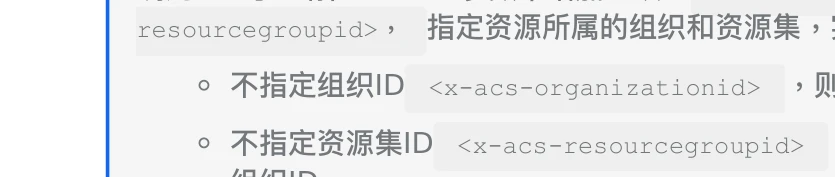
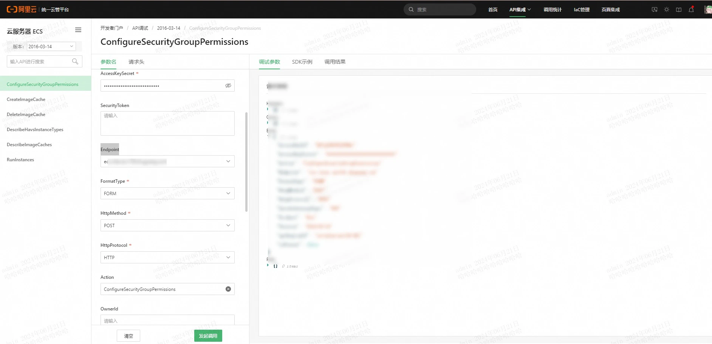
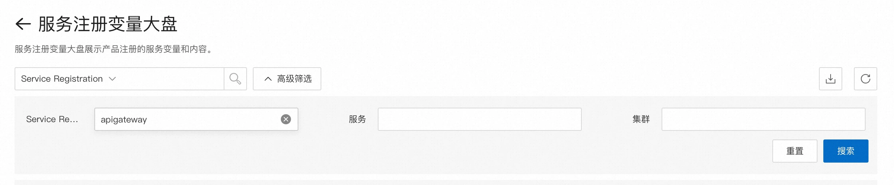

阿里云  
专有云  
敏感数据保护 开发指南  
产品版本：v3.18.6-SP2607  
文档版本：20260729

**目录**

- [1.快速入门](#section-1)
    - [1.1. 开发文档使用说明](#section-1-1)
    - [1.2. API调用流程说明](#section-1-2)
- [2.准备工作](#section-2)
    - [2.1. 登录API与工具控制台](#section-2-1)
    - [2.2. 获取API信息及其EndPoint](#section-2-2)
    - [2.3. 获取AccessKey](#section-2-3)
    - [2.4. 获取STS AccessKey](#section-2-4)
- [3.调用示例](#section-3)
    - [3.1. Java SDK调用示例](#section-3-1)
        - [3.1.1. 快速开始](#section-3-1-1)
        - [3.1.2. 使用手册](#section-3-1-2)
            - [3.1.2.1. 安装Java SDK](#section-3-1-2-1)
            - [3.1.2.2. 使用CommonRequest进行调用](#section-3-1-2-2)
    - [3.2. Python SDK调用示例](#section-3-2)
        - [3.2.1. 快速开始](#section-3-2-1)
        - [3.2.2. 使用手册](#section-3-2-2)
            - [3.2.2.1. 安装Python SDK](#section-3-2-2-1)
            - [3.2.2.2. 使用CommonRequest进行调用](#section-3-2-2-2)
    - [3.3. Go SDK调用示例](#section-3-3)
        - [3.3.1. 快速开始](#section-3-3-1)
        - [3.3.2. 使用手册](#section-3-3-2)
            - [3.3.2.1. 安装Go SDK核心包](#section-3-3-2-1)
            - [3.3.2.2. 使用CommonRequest进行调用](#section-3-3-2-2)
- [4.API公共参数](#section-4)
- [5.敏感数据保护](#section-5)
    - [5.1. 调用方式](#section-5-1)
        - [5.1.1. 请求结构](#section-5-1-1)
        - [5.1.2. 签名机制](#section-5-1-2)
        - [5.1.3. 公共参数](#section-5-1-3)
        - [5.1.4. 返回结构](#section-5-1-4)
    - [5.2. API参考](#section-5-2)
        - [5.2.1. ModifySlsDispatchProductDetail](#section-5-2-1)
        - [5.2.2. DisableSlsDispatchInstanceRelation](#section-5-2-2)
        - [5.2.3. DescribeSlsDispatchProductDetail](#section-5-2-3)
        - [5.2.4. DescribeSlsDispatchInstanceRelation](#section-5-2-4)
        - [5.2.5. DescribeRuleName](#section-5-2-5)
        - [5.2.6. DescribeExistOdpsProject](#section-5-2-6)
        - [5.2.7. CreateSlsDispatchProductDetail](#section-5-2-7)
        - [5.2.8. DescribeDataAssets](#section-5-2-8)
        - [5.2.9. DescribeInstances](#section-5-2-9)
        - [5.2.10. DescribeTables](#section-5-2-10)
        - [5.2.11. DescribePackages](#section-5-2-11)
        - [5.2.12. DescribeColumns](#section-5-2-12)
        - [5.2.13. DescribeOssObjects](#section-5-2-13)
        - [5.2.14. DescribeOssObjectDetail](#section-5-2-14)
        - [5.2.15. DescribeDeparts](#section-5-2-15)
        - [5.2.16. DescribeAccounts](#section-5-2-16)
        - [5.2.17. DescribeAccountDetail](#section-5-2-17)
        - [5.2.18. DescribePrivileges](#section-5-2-18)
        - [5.2.19. DescribeEventTypes](#section-5-2-19)
        - [5.2.20. DescribeEvents](#section-5-2-20)
        - [5.2.21. DescribeEventDetail](#section-5-2-21)
        - [5.2.22. ModifyEventStatus](#section-5-2-22)
        - [5.2.23. ModifyEventTypeStatus](#section-5-2-23)
        - [5.2.24. ModifyDefaultLevel](#section-5-2-24)
        - [5.2.25. DescribeRules](#section-5-2-25)
        - [5.2.26. CreateRule](#section-5-2-26)
        - [5.2.27. ModifyRule](#section-5-2-27)
        - [5.2.28. ModifyRuleStatus](#section-5-2-28)
        - [5.2.29. DeleteRule](#section-5-2-29)
        - [5.2.30. DescribeDataLimitSet](#section-5-2-30)
        - [5.2.31. CreateDataLimit](#section-5-2-31)
        - [5.2.32. DeleteDataLimit](#section-5-2-32)
        - [5.2.33. ExecDatamask](#section-5-2-33)
        - [5.2.34. DescribeDataLimits](#section-5-2-34)
        - [5.2.35. DescribeUserStatus](#section-5-2-35)
        - [5.2.36. DescribeColumns](#section-5-2-36)
        - [5.2.37. AddCategory](#section-5-2-37)
        - [5.2.38. CreateDataLimitFromSources](#section-5-2-38)
        - [5.2.39. CreateDataMaskingTask](#section-5-2-39)
        - [5.2.40. CreateDataMaskingTemplate](#section-5-2-40)
        - [5.2.41. DescribeAnalysisReport](#section-5-2-41)
        - [5.2.42. DescribeInsertPriv](#section-5-2-42)
        - [5.2.43. DescribeInstancePortrait](#section-5-2-43)
        - [5.2.44. DescribeInstanceSourceSet](#section-5-2-44)
        - [5.2.45. DescribeRuleDetail](#section-5-2-45)
        - [5.2.46. DescribeUebaAccountDetail](#section-5-2-46)
        - [5.2.47. DescribeWhiteLists](#section-5-2-47)
        - [5.2.48. ModifyAuthInfo](#section-5-2-48)
        - [5.2.49. ModifyCategory](#section-5-2-49)
        - [5.2.50. ModifyDataMaskingTask](#section-5-2-50)
        - [5.2.51. ModifyDataMaskingTemplate](#section-5-2-51)
        - [5.2.52. MoveCategory](#section-5-2-52)
        - [5.2.53. AddRiskLevel](#section-5-2-53)
        - [5.2.54. DescribeConfigs](#section-5-2-54)
        - [5.2.55. DescribeCategoryTemplateRuleList](#section-5-2-55)
        - [5.2.56. DescribeInstancePrivs](#section-5-2-56)
        - [5.2.57. DeleteRiskLevel](#section-5-2-57)
    - [5.3. 数据字典](#section-5-3)
        - [5.3.1. 操作类型定义](#section-5-3-1)
        - [5.3.2. 资源类型定义](#section-5-3-2)
        - [5.3.3. 风险等级定义](#section-5-3-3)
- [6.错误代码表](#section-6)

<a id="section-1"></a>

# 1.快速入门

<a id="section-1-1"></a>

## 1.1. 开发文档使用说明

本文为您介绍在使用专有云API进行开发工作时，如何查看所需要的产品文档。

**使用流程**

您可以按照以下流程图中步骤，判断自己所需要使用的开发文档。


**前提条件**

通过运维人员或运营管理员获取专有云的版本。

**操作步骤**

您可以通过阿里云专有云文档中心，获取需要的产品文档。

1. 通过浏览器打开专有云文档中心。

2. 根据专有云的版本单击**企业版**、**敏捷版**或**一体机**标签。

3. 在下拉列表中，选择对应的专有云版本。

   

4. 在左侧导航栏中，选择目标产品名称。

5. 单击目标文档区域的**查看详情**或**下载PDF**。

<a id="section-1-2"></a>

## 1.2. API调用流程说明

阿里云专有云支持通过POP网关调用专有云API，为了使您拥有与公有云一致的体验，自企业版V3.16.0开始，专有云API默认使用POP网关方式调用。本文介绍如何通过POP网关调用专有云API。

**流程图**


**调用步骤**

1. 获取AccessKey。

   获取调用时所需要的AccessKey参数，请参见获取AccessKey或获取STS AccessKey。

   > **说明**
   >
   > 推荐使用个人AccessKey或STS AccessKey调用Apsara Uni-manager运营控制台及云产品接口。

2. 获取RegionID。

3. 获取组织ID与资源集ID。

   组织ID需要通过API进行获取，获取方式请参见*Apsara Uni-manager运营控制台开发指南*中的*GetOrga nizationList章节*。

   资源集ID需要通过API进行获取，获取方式请参见*Apsara Uni-manager运营控制台开发指南*中的*ListRe sourceGroup章节*。

   > **说明**
   >
   > 调用API时，请在Header参数中增加组织ID `<x-acs-organizationid>` 和资源集ID `<x-acs-`



> `resourcegroupid>`， 指定资源所属的组织和资源集，实现实例资源的隔离查询。
>
> - 不指定组织ID `<x-acs-organizationid>` ，则默认获取当前用户所属的组织。
>
> - 不指定资源集ID `<x-acs-resourcegroupid>` ，则默认为空，如果指定资源集需要同时指定组织ID。

4. 获取对应的API参考文档。

   您需要查看目标云产品的开发指南，了解API的功能与使用方式，开发指南的使用流程及获取方法请参见开发文档使用说明。

5. 获取云产品Endpoint。

6. 获取云产品SDK并调用云产品API。

<a id="section-2"></a>

# 2.准备工作

<a id="section-2-1"></a>

## 2.1. 登录API与工具控制台

您可以通过Apsara Uni-manager运营控制台登录API与工具控制台。

**前提条件**

- 登录Apsara Uni-manager运营控制台前，确认您已从部署人员处获取Apsara Uni-manager运营控制台的服务域名地址。

- 推荐使用Chrome浏览器

**操作步骤**

1. 在浏览器地址栏中，输入Apsara Uni-manager运营控制台的服务域名地址，按回车键。

2. 输入正确的用户名及密码。

   请向运营管理员获取登录控制台的用户名和密码。

   > **说明**
   >
   > 首次登录Apsara Uni-manager运营控制台时，需要修改登录用户名的密码，请按照提示完成密码修改。为提高安全性，密码长度必须为10~32位，且至少包含以下两种类型：
   >
   > - 英文大写或小写字母（A~Z、a~z）
   >
   > - 阿拉伯数字（0~9）
   >
   > - 特殊符号（感叹号（!）、at（@）、井号（#）、美元符号（$）、百分号（%）等）

3. 单击**登录**。

4. 如果账号已激活MFA多因素认证，请根据以下两种情况进行操作：

   - 管理员强制开启MFA后的首次登录：

     <ol type="a">

     <li>

     在绑定虚拟MFA设备页面中，按页面提示步骤绑定MFA设备。

     </li>

     <li>

     按照步骤2重新输入账号和密码，单击**登录**。

     </li>

     </ol>

     <ol type="i" start="100">

     <li>

     输入6位MFA码后单击**认证**。

     </li>

     </ol>

   - 您已开启并绑定MFA：

     输入6位MFA码后单击**认证**。

     > **说明**
     >
     > 绑定并开启MFA的操作请参见<strong>《Apsara Uni-manager运营控制台用户指南》</strong>中的<strong>《绑定并开启虚拟MFA设备》</strong>章节。

5. 在顶部菜单栏选择**产品** > **应用服务** > **开发者门户**。

<a id="section-2-2"></a>

## 2.2. 获取API信息及其EndPoint

通过POP网关调用API需要您了解产品开放API接口的相关信息，本文为您介绍获取云产品的Endpoint的两种方式。

**背景信息**

为了使专有云保持与公共云相同的使用方式，使您拥有更方便，更一致的体验，建议通过POP网关调用专有云API。

> **说明**
>
> Apsara Uni-manager运营控制台API目录中的API信息仅供调用参考，具体API的使用方式需要参见云产品的开发指南。如果发生不一致情况，以开发指南为准。

**操作步骤**

**通过开发者门户获取Endpoint**

1. 登录Apsara Uni-manager运营控制台。

2. 在顶部菜单栏选择**产品** > **开发工具** > **API与工具** > **开发者门户**。

3. 在**开发者门户**页面，选择**API集成** > **API调试**。

   

4. 在左侧导航栏中选择目标云产品。

5. 在**版本**下拉列表中，选择目标API版本。

6. 在下方API列表中可浏览当前版本的所有API接口。

7. 选中对应接口，在参数名下获取云产品的POP Endpoint信息。

   

**通过飞天基础运维平台获取Endpoint**

通过POP网关调用专有云API时需要使用云产品业务域的Endpoint。您可以在阿里云驻场运维工程师处获取。

您也可以自行获取Endpoint，本文以API网关为例为您介绍获取云产品业务域Endpoint的方法。

1. 登录Apsara Uni-manager运维控制台。

2. 顶部菜单栏选择**平台运维** > **飞天基础运维平台** > **运维工具**。

3. 在左侧导航栏，选择**运维工具** > **服务注册变量大盘**。

4. 在服务注册变量大盘页面，单击**高级筛选**。

5. 在Service Registration文本框中输入 `apigateway` ，单击**搜索**。

   

6. 在 `apigateway` 服务的**Service Registration**列中，单击  图标。

7. 单击 `apigateway` 服务**Service Registration**列的文本信息，在弹出的**注册变量**对话框中，查看apigateway.openapi.endpoint值，即 `Endpoint` 。

<a id="section-2-3"></a>

## 2.3. 获取AccessKey

AccessKey支持RAM和STS两种授权模式，在发起调用时选择使用其中一种AccessKey即可。本文将为您介绍如何获取通过RAM授权的AccessKey。

**背景信息**

AccessKey通过使用AccessKey ID和AccessKey Secret对称加密，实现验证某个请求发送者的身份的功能。其中AccessKey ID用于标示用户，AccessKey Secret是用户用于加密签名的字符串。

AccessKey的两种授权模式如下：

- 通过RAM授权给第三方请求者的AccessKey ID和AccessKey Secret。

- 通过STS授权给第三方请求者的AccessKey ID、AccessKey Secret和Security Token。获取方式请参见获取STS AccessKey。

Apsara Uni-manager运营控制台提供了个人AccessKey和组织AccessKey（只有运营管理员和一级组织管理员可以获取组织AccessKey），推荐使用个人账号AccessKey调用Apsara Uni-manager运营控制台及云产品相关接口。如果使用个人账号AccessKey，需要在Header中添加以下限制性参数，否则可能提示权限不足：

> **警告**
>
> 个人账号AccessKey是由Apsara Uni-manager运营控制台权限体系管控的受限AccessKey，组织AccessKey相对权限较大，需要管理员确认操作的安全性。

<table>
  <tr>
    <th width="206">参数名称</th>
    <th>描述</th>
  </tr>
  <tr>
    <td>x-acs-regionid</td>
    <td>地域，如：cn-hangzhou-*。</td>
  </tr>
  <tr>
    <td>x-acs-organizationid</td>
    <td>Apsara Uni-manager运营控制台中对应的组织ID。获取方法可参见<strong>《Apsara Uni-manager运营控制台开</strong><strong>发指南》</strong>中的<strong>《GetOrganizationList》</strong>文档。</td>
  </tr>
  <tr>
    <td>x-acs-resourcegroupid</td>
    <td>Apsara Uni-manager运营控制台中对应的资源集ID。获取方法可参见<strong>《Apsara Uni-manager运营控制台</strong><strong>开发指南》</strong>中的<strong>《ListResourceGroup》</strong>文档。</td>
  </tr>
  <tr>
    <td>x-acs-instanceid</td>
    <td>进行操作的实例ID，例如，ECS的实例ID可以从ECS列表中查询到。</td>
  </tr>
</table>

**获取个人账号AccessKey**

获取个人账号AccessKey的方法如下：

1. 登录Apsara Uni-manager运营控制台。

2. 在系统界面右上角，单击当前登录用户头像，单击**个人信息**。

3. 在**阿里云AccessKey**区域，您可以查看个人账户的AccessKey信息。

   

   > **说明**
   >
   > Accesskey ID和AccessKey Secret是您访问云资源时的密钥，具有该账号完整的权限，请您妥善保管。

**获取组织AccessKey**

获取组织AccessKey的方法如下：

1. 管理员登录Apsara Uni-manager运营控制台。

2. 在顶部菜单栏，单击**企业**。

3. 在左侧导航栏中，选择**资源管理 > 组织管理**。

4. 在组织结构中，单击目标一级组织名称。

5. 单击**管理Accesskey**。

6. 在弹出的对话框中，查看组织AccessKey信息。

<a id="section-2-4"></a>

## 2.4. 获取STS AccessKey

本文为您介绍如何利用STS方式，调用专有云的产品API。

**背景信息**

阿里云临时安全令牌STS（Security Token Service）是阿里云提供的一种临时访问权限管理服务。您可以选择使用STS方式，调用专有云的产品API。

STS AccessKey由AccessKey ID、AccessKey Secret及Security Token三元组组成，使用STS方式调用云产品API时，三元组缺一不可。

**操作步骤**

1. 获取用户角色的 `RAM Role` 。

   <ol type="i">

   <li>

   登录Apsara Uni-manager运营控制台。

   </li>

   <li>

   单击页面右上角的用户头像，单击**个人信息**。

   </li>

   <li>

   单击**查看当前角色策略**。

   在**当前选择角色策略**对话框中查看 `RAM Role` 。

   </li>

   </ol>

2. 获取STS Accesskey三元组。

   > **说明**
   >
   > 以下代码示例中可变参数均需替换为您实际的相关信息，尖括号（<>）在最终代码中不保留。
   >
   > 涉及替换的可变参数如下：
   >
   > - &lt;yourRegionID>：请替换为您实际的地域ID。
   >
   > - &lt;yourAccessKeyID>：请替换为您实际的AccessKey ID。
   >
   > - &lt;yourAccessKeySecret>：请替换为您实际的AccessKey Secret。
   >
   > - &lt;yourRoleSessionName>：请替换为您当前实际的会话名称。
   >
   >   该名称为用户自定义，通常设置为调用该API的用户身份，例如：用户名。在同一个RAM角色执行的操作中，可以根据不同的 `RoleSessionName` 来区分实际操作者，以实现用户级别的访问审计。长度为2~64个字符，可包含英文字母、数字、半角句号（.）、at（@）、短划线（-）和下划线（_）。
   >
   > - &lt;yourRoleArn>：请替换为您实际的RAM Role。
   >
   > - "sts.aliyuns.com" ：请替换为实际的STS Endpoint。

   ```xml
   public static void main(String[] args) {
       // 创建DefaultAcsClient实例并初始化。
       // 请替换为您实际的地域ID、AccessKey ID、AccessKey Secret。
       DefaultProfile profile = DefaultProfile.getProfile("<yourRegionID>", "
   <yourAccessKeyID>", "<yourAccessKeySecret>");
       HttpClientConfig clientConfig = HttpClientConfig.getDefault();
       clientConfig.setIgnoreSSLCerts(true);
       clientConfig.setProtocolType(ProtocolType.HTTPS);
       profile.setHttpClientConfig(clientConfig);
       IAcsClient client = new DefaultAcsClient(profile);
       String assumeRole = callAssumeRole(client);
       if (StringUtils.isEmpty(assumeRole)) return;
       JSONObject assumeRoleJson = JSONObject.parseObject(assumeRole);
       JSONObject credentials = assumeRoleJson.getJSONObject("Credentials");
       // 获取到STS三元组。
       String stsAK = credentials.getString("AccessKeyId");
       String stsSK = credentials.getString("AccessKeySecret");
       String stsToken = credentials.getString("SecurityToken");
   }

   private static String callAssumeRole(IAcsClient client) {
       CommonRequest request = new CommonRequest();
       // "sts.aliyuns.com" 请替换为实际的STS Endpoint，⼀般格式为sts-
   vpc.${global:region}.${global:internet-domain}。
       request.setSysDomain("sts.aliyuns.com");
       request.setSysProduct("Sts");
       request.setSysAction("AssumeRole");
       request.setSysVersion("2015-04-01");
       request.setSysMethod(MethodType.POST);
       request.setHttpContentType(FormatType.FORM);
       // 业务参数，设置本次调⽤Session的别名，"<yourRoleSessionName>"请您替换为实际值。
       request.putQueryParameter("RoleSessionName", "<yourRoleSessionName>");
       // 扮演的Role⾓⾊ARN，"<yourRoleArn>"请替换为上⼀步获取到的实际Ram Role ARN。
       request.putQueryParameter("RoleArn", "<yourRoleArn>");
       try {
           CommonResponse response = client.getCommonResponse(request);
           return response.getData();
       } catch (ServerException e) {
           System.out.println(e.getErrCode());
           System.out.println(e.getErrMsg());
       } catch (ClientException e) {
           System.out.println(e.getErrCode());
           System.out.println(e.getErrMsg());
       }
       return null;
   }
   ```

3. 通过STS AccessKey三元组调用云产品的接口，下列代码以ECS的 `DescribeZones` 接口为示例。

   > **说明**
   >
   > 以下代码示例中可变参数均需替换为您实际的相关信息，尖括号（<>）在最终代码中不保留。
   >
   > 涉及替换的可变参数如下：
   >
   > - &lt;yourRegionID>：请替换为您实际的地域ID。
   >
   > - &lt;yourStsAccesskeyID>：请替换为您实际的STS Accesskey ID。
   >
   > - &lt;yourStsAccessKeySecret>：请替换为您实际的STS Accesskey Secret。
   >
   > - &lt;yourStsToken>：请替换为实际STS三元组中的SecurityToken。
   >
   > - &lt;yourResourceGroupID>：请替换为您实际的资源集ID。
   >
   > - &lt;yourOrganizationID>：请替换为您实际的组织ID。

   ```xml
   public static void main(String[] args) {
       // "<yourRegionID>"请替换为您实际的地域ID。
       // "<yourStsAccessKeyID>"、"<yourStsAccessKeySecret>"请替换为前⼀步获取到的STS三元组中
   AccessKeyID、AccessKeySecret。
       DefaultProfile profile = DefaultProfile.getProfile("<yourRegionID>", "
   <yourStsAccesskey>", "<yourStsAccessSecret>");
       HttpClientConfig clientConfig = HttpClientConfig.getDefault();
       clientConfig.setIgnoreSSLCerts(true);
       clientConfig.setProtocolType(ProtocolType.HTTPS);
       profile.setHttpClientConfig(clientConfig);
       IAcsClient client = new DefaultAcsClient(profile);
       CommonRequest request = new CommonRequest();
       request.setSysDomain("ecs.aliyuns.com");
       request.setSysProduct("Ecs");
       request.setSysAction("DescribeZones");
       request.setSysVersion("2014-05-26");
       request.setSysMethod(MethodType.POST);
       request.setHttpContentType(FormatType.FORM);
       //"<yourRegionID>" 请替换为您实际的地域ID。
       request.putHeadParameter("x-acs-regionid", "<yourRegionID>");
       // "<yourStsToken>" 请替换为您前⼀步获取到的STS三元组中SecurityToken。
       request.putQueryParameter("SecurityToken", "<yourStsToken>");
       // 非必填，请替换为您实际的资源集ID。
       // request.putHeadParameter("x-acs-resourcegroupid", "<yourResourceGroupID>");
       // 非必填，请替换为您实际的组织ID。
       request.putHeadParameter("x-acs-organizationid", "<yourOrganizationID>");
       try {
           CommonResponse response = client.getCommonResponse(request);
           System.out.println(response.getData());
       } catch (ServerException e) {
           System.out.println(e.getErrCode());
           System.out.println(e.getErrMsg());
       } catch (ClientException e) {
           System.out.println(e.getErrCode());
           System.out.println(e.getErrMsg());
       }
   }
   ```

<a id="section-3"></a>

# 3.调用示例

<a id="section-3-1"></a>

## 3.1. Java SDK调用示例

<a id="section-3-1-1"></a>

### 3.1.1. 快速开始

本节介绍如何获取产品名Java SDK并开始调用。

**环境准备**

- 使用阿里云专有云Java SDK，您需要一个授权账号以及一对AccessKey ID和AccessKey Secret。具体信息，请参见获取AccessKey，并在Apsara Uni-manager运营控制台上获取和查看您的AccessKey。

- 获取Endpoint，具体操作，请参见获取API信息及其EndPoint。

- 阿里云专有云Java SDK需要1.8及以上的JDK。

**安装阿里云专有云Java SDK**

如果您使用Apache Maven来管理Java项目，只需在项目的pom.xml中导入JAR文件。

要使用云盾的开发工具包，必须安装SDK核心库。其中，SDK核心库推荐使用4.5.17及以上版本。

**使用Java SDK**

调用阿里云专有云Java SDK的主要操作步骤如下：

1. 创建并初始化DefaultAcsClient实例。

2. 创建API请求并设置参数。

3. 发起请求并处理应答或异常。

   > **说明**
   >
   > 以下代码示例中可变参数均需替换为您实际的相关信息，尖括号（<>）在最终代码中不保留。
   >
   > 涉及替换的可变参数如下：
   >
   > - &lt;your-region-id>，请替换为您实际的地域ID。
   >
   > - &lt;your-access-key-id>，请替换为您实际的AccessKey ID。
   >
   > - &lt;your-access-key-secret>>，请替换为您实际的AccessKey Secret。
   >
   > - &lt;your-endpoint>，请替换为您当前产品实际的Endpoint。
   >
   > - &lt;API-version>，请替换成接口的版本。
   >
   > - &lt;your-action>，请替换成接口的名称。

```java
import com.aliyuncs.CommonRequest;
import com.aliyuncs.CommonResponse;
import com.aliyuncs.DefaultAcsClient;
import com.aliyuncs.IAcsClient;
import com.aliyuncs.exceptions.ClientException;
import com.aliyuncs.exceptions.ServerException;
import com.aliyuncs.profile.DefaultProfile;
public class Sample {
    public static void main(String[] args) {
        // 创建DefaultAcsClient实例并初始化
        DefaultProfile profile = DefaultProfile.getProfile(
            "<your-region-id>",          // 您的地域ID
            "<your-access-key-id>",      // 您的AccessKey ID
            "<your-access-key-secret>"); // 您的AccessKey Secret
        IAcsClient client = new DefaultAcsClient(profile);
        // 创建API请求并设置参数
        CommonRequest request = new CommonRequest();
        request.setDomain("<your-endpooint>");// 当前产品的服务地址
        request.setVersion("<API-version>");// 接⼝的版本
        request.setAction("<your-action>");// 接⼝的名称
        request.putQueryParameter("PageNumber", "1");
        request.putQueryParameter("PageSize", "30");
        try {
            CommonResponse response = client.getCommonResponse(request);
            System.out.println(response.getData());
        } catch (ServerException e) {
            // TODO Auto-generated catch block
            e.printStackTrace();
        } catch (ClientException e) {
            // TODO Auto-generated catch block
            e.printStackTrace();
        }
    }
}
```

<a id="section-3-1-2"></a>

### 3.1.2. 使用手册

<a id="section-3-1-2-1"></a>

#### 3.1.2.1. 安装Java SDK

本文介绍如何安装及调用云盾Java SDK。

阿里云专有云Java SDK支持1.8及以上版本的JDK，可以通过添加Maven依赖或下载阿里云开发工具包（SDK）的方式安装专有云Java SDK。

要使用云盾的开发工具包，必须安装阿里云Java SDK核心库。SDK核心库推荐使用4.5.17及以上版本。

您在安装阿里云Java SDK核心库时，需要在pom.xml文件中添加以下依赖。关于准确的SDK版本号，请参见阿里云开发工具包（SDK）。

```xml
<!-- Alibaba Cloud SDK for Java -->
<dependency>
    <groupId>com.aliyun</groupId>
    <artifactId>aliyun-java-sdk-core</artifactId>
    <version>4.5.17</version>
</dependency>
```

<a id="section-3-1-2-2"></a>

#### 3.1.2.2. 使用CommonRequest进行调用

通过POP Java SDK访问产品域名，需要了解该产品调用方式。

**前提条件**

目前专有云推荐使用CommonRequest进行调用，可以在Apsara Uni-manager运营控制台**产品** > **开发工具** > **API与工具** > **开发者门户**，选择**API集成** > **API调试**查看推荐SDK版本以及示例代码。

> **重要**
>
> 不建议直接从SDK中心下载SDK到专有云场景下使用，公有云的SDK不一定支持专有云的API，可能存在兼容性问题，请谨慎使用！

**背景信息**

目前仅支持通过RPC方式调用API。

**CommonRequest调用示例**

RPC调用，示例接口信息：接口（CreateDataLimit）、版本（2019-01-03）。

```java
import com.aliyuncs.CommonRequest;
import com.aliyuncs.CommonResponse;
import com.aliyuncs.DefaultAcsClient;
import com.aliyuncs.IAcsClient;
import com.aliyuncs.exceptions.ClientException;
import com.aliyuncs.exceptions.ServerException;
import com.aliyuncs.profile.DefaultProfile;
public class Sample {
    public static void main(String[] args) {
        // 创建DefaultAcsClient实例并初始化
        DefaultProfile profile = DefaultProfile.getProfile(
            "<your-region-id>",          // 您的地域ID
            "<your-access-key-id>",      // 您的AccessKey ID
            "<your-access-key-secret>"); // 您的AccessKey Secret
        IAcsClient client = new DefaultAcsClient(profile);
        // 创建API请求并设置参数
        CommonRequest request = new CommonRequest();
        request.setDomain("<your-endpoint>");// 当前产品实际的Endpoint
        request.setVersion("2019-01-03");// 接⼝的版本
        request.setAction("CreateDataLimit");// 接⼝的名称
        request.putQueryParameter("PageNumber", "1");
        request.putQueryParameter("PageSize", "30");
        try {
            CommonResponse response = client.getCommonResponse(request);
            System.out.println(response.getData());
        } catch (ServerException e) {
            // TODO Auto-generated catch block
            e.printStackTrace();
        } catch (ClientException e) {
            // TODO Auto-generated catch block
            e.printStackTrace();
        }
    }
}
```

> **重要**
>
> 使用HTTPS协议访问OpenAPI时，SDK会默认开启校验SSL/TLS 证书有效性，若您代码环境没有证书环境，则会报错证书校验失败。
>
> 为保障生产环境通信安全，建议您保持开启，若在测试环境必须忽略证书校验，可以通过以下参数设置：
>
> Java
>
> ```text
> HttpClientConfig clientConfig = HttpClientConfig.getDefault();
> // 设置不校验服务端证书
> clientConfig.setIgnoreSSLCerts(true)
> ```

<a id="section-3-2"></a>

## 3.2. Python SDK调用示例

<a id="section-3-2-1"></a>

### 3.2.1. 快速开始

本节介绍如何获取Python SDK并开始调用。

**环境准备**

- 使用Python SDK前，您需要一个授权账号以及一对AccessKey ID和AccessKey Secret。具体信息，请参见获取AccessKey。

- 获取到Endpoint。具体操作，请参见获取API信息及其EndPoint。

**安装Python SDK核心库**

- 如果您使用的是Python 2.x，执行以下命令，安装阿里云SDK核心库：

  ```bash
  pip install aliyun-python-sdk-core
  ```

- 如果您使用的是Python 3.x，执行以下命令，安装阿里云SDK核心库：

  ```bash
  pip3 install aliyun-python-sdk-core-v3
  ```

**使用Python SDK**

以下示例展示调用Python SDK的3个主要步骤：

1. 创建Client实例。

   在创建Client实例时，您需要获取Region ID、AccessKey ID和AccessKey Secret。

2. 创建API请求并设置参数。

3. 发起请求并处理应答或异常。

   > **说明**
   >
   > 以下代码示例中可变参数均需替换为您实际的相关信息，尖括号（<>）在最终代码中不保留。
   >
   > 涉及替换的可变参数如下：
   >
   > - &lt;your_region_id>，请替换为您实际的地域ID。
   >
   > - &lt;your_access_key_id>，请替换为您实际的AccessKey ID。
   >
   > - &lt;your_access_key_secret>，请替换为您实际的AccessKey Secret。
   >
   > - &lt;your-endpoint>，请替换为您实际的产品访问地址。
   >
   > - &lt;API-version>，请替换成接口的版本。
   >
   > - &lt;your-action>，请替换成接口的名称。

   ```python
   from aliyunsdkcore.client import AcsClient
   from aliyunsdkcore.request import
   CommonRequest
   client = AcsClient('{your_access_key_id}',
   '{your_access_key_secret}', '{your_region_id}')
   request = CommonRequest()
   request.set_domain('<your-endpoint>')// 当前产品的服务地址
   request.set_version('<API-version>')// 接⼝的版本
   request.set_action_name('<your-action>')// 接⼝的名称
   # or:
   # request =
   CommonRequest(domain='<your-endpoint>', version='<API-version>',
   action_name='<your-action>')
   request.add_query_param('PageNumber', '1')
   request.add_query_param('PageSize', '30')
   response =
   client.do_action_with_exception(request)

                       
   ```

<a id="section-3-2-2"></a>

### 3.2.2. 使用手册

<a id="section-3-2-2-1"></a>

#### 3.2.2.1. 安装Python SDK

本文档介绍如何安装及调用Python SDK。

阿里云专有云Python SDK支持Python 2.6.x、2.7.x和3.x及以上环境，您可以通过pip安装专有云Python SDK。

> 使用产品的开发工具包，都必须安装阿里云Python SDK核心库。
>
> **说明**

- 如果您使用的是Python 2.x，执行以下命令，安装阿里云SDK核心库：

  ```bash
  pip install aliyun-python-sdk-core
  ```

- 如果您使用的是Python 3.x，执行以下命令，安装阿里云SDK核心库：

  ```bash
  pip3 install aliyun-python-sdk-core-v3
  ```

<a id="section-3-2-2-2"></a>

#### 3.2.2.2. 使用CommonRequest进行调用

本文为您介绍POP Python SDK调用云产品API的方式。

**前提条件**

目前专有云推荐使用CommonRequest进行调用，可以在Apsara Uni-manager运营控制台**产品** > **开发工具** > **API与工具** > **开发者门户**，选择**API集成** > **API调试**查看推荐SDK版本以及示例代码。

> **重要**
>
> 不建议直接从SDK中心下载SDK到专有云场景下使用，公有云的SDK不一定支持专有云的API，可能存在兼容性问题，请谨慎使用！

**背景信息**

目前仅支持通过RPC方式调用API。

**CommonRequest调用示例**

RPC风格，示例接口信息：接口（CreateDataLimit）、版本（2019-01-03）。

```python
from aliyunsdkcore.client import AcsClient
from aliyunsdkcore.request import CommonRequest
client = AcsClient('{your_access_key_id}', '{your_access_key_secret}', 
'{your_region_id}') 
request = CommonRequest()
request.set_domain('<your-endpoint>') //当前产品实际的Endpoint
request.set_version('2019-01-03') //接⼝的版本
request.set_action_name('CreateDataLimit')//接⼝的名称
# or: 
# request = CommonRequest(domain='<your-endpoint>', version='<API-version>', 
action_name='your-action')
request.add_query_param('PageNumber', '1')
request.add_query_param('PageSize', '30')
response = client.do_action_with_exception(request)
```

**HTTPS配置**

下面介绍使用HTTPS协议进行OpenAPI访问。

**使用HTTPS协议**

SDK默认使用HTTPS协议。

```python
from aliyunsdkecs.request.v20140526.DescribeInstancesRequest import 
DescribeInstancesRequest
from aliyunsdkcore.client import AcsClient
client = AcsClient(
    region_id='<region_id>',  # 地域ID
)

request = DescribeInstancesRequest()
request.set_protocol_type('https')  # 使⽤https

client.do_action_with_exception(request)   
```

**忽略证书**

> **重要**
>
> - 使用HTTPS协议访问OpenAPI时，SDK会默认开启校验SSL/TLS证书有效性，若您代码环境没有证书环境，则会报错证书校验失败。
>
> - 为保障生产环境通信安全，建议您保持开启，若在测试环境必须忽略证书校验，可以通过参数 `verify` 设置。

```python
from aliyunsdkcore.client import AcsClient
client = AcsClient(
    region_id='<region_id>',  # 地域ID
    verify=False  # 忽略对 SSL 证书的验证
)
```

**指定CA证书文件**

```python
from aliyunsdkcore.client import AcsClient
client = AcsClient(
    region_id='<region_id>',  # 地域ID
    verify='./cacert.pem'  # 证书路径
)
```

**设置代理**

调用API时您或许需要通过环境变量设置HTTP_PROXY、HTTPS_PROXY。

示例代码如下：

```text
# https的代理 
os.environ["HTTPS_PROXY"] = "http://x.x.x.x:xxxx"

# http的代理
os.environ["HTTP_PROXY"] = "https://x.x.x.x:xxxx"
```

<a id="section-3-3"></a>

## 3.3. Go SDK调用示例

<a id="section-3-3-1"></a>

### 3.3.1. 快速开始

阿里云Go SDK让您不用复杂编程即可访问。本文介绍如何获取阿里云Go SDK并开始调用。

**环境准备**

- 使用Python SDK前，您需要一个授权账号以及一对AccessKey ID和AccessKey Secret。具体信息，请参见获取AccessKey，并在Apsara Uni-manager运营控制台上获取和查看您的AccessKey。

- 获取到Endpoint。具体操作，请参见获取API信息及其EndPoint。

**安装阿里云Go SDK核心包**

阿里云Go SDK支持Go 1.10.x及更高版本，您可以通过执行以下命令安装Go SDK核心包。

```text
go get -u github.com/aliyun/alibaba-cloud-sdk-go/sdk
```

**使用Go SDK**

以下这个代码示例展示了调用阿里云Go SDK的3个主要步骤：

1. 初始化Client实例。

2. 创建API请求并设置参数。

3. 发起请求并处理应答或异常。

   > **说明**
   >
   > 以下代码示例中可变参数均需替换为您实际的相关信息，尖括号（<>）在最终代码中不保留。
   >
   > 涉及替换的可变参数如下：
   >
   > - &lt;your_region_id>，请替换为您实际的地域ID。
   >
   > - &lt;your_access_key_id>，请替换为您实际的AccessKey ID。
   >
   > - &lt;your_access_key_secret>，请替换为您实际的AccessKey Secret。
   >
   > - &lt;your-endpoint>，请替换为您实际的产品访问地址。
   >
   > - &lt;API-version>，请替换成接口的版本。
   >
   > - &lt;your-action>，请替换成接口的名称。

   ```go
   package main
   import (
   "github.com/aliyun/alibaba-cloud-sdk-go/sdk/requests"
   "github.com/aliyun/alibaba-cloud-sdk-go/sdk"
   "fmt"
   )
   func main() {
   client, err := sdk.NewClientWithAccessKey("<your_region_id>",
   "{your_access_key_id}", "{your_access_key_secret}")
   if err != nil {
   panic(err)
    }
    request
   := requests.NewCommonRequest()
   request.Domain = "<your-endpoint>"// 当前产品实际的Endpoint
   request.Version = "<API-version>"// 接⼝的版本
   request.ApiName = "<your-action>" // 接⼝的名称
   request.QueryParams["PageNumber"] = "1"
   request.QueryParams["PageSize"] = "30"
   response, err := client.ProcessCommonRequest(request)
   if err != nil {
   panic(err)
    }
   fmt.Print(response.GetHttpContentString())
   }
   ```

<a id="section-3-3-2"></a>

### 3.3.2. 使用手册

<a id="section-3-3-2-1"></a>

#### 3.3.2.1. 安装Go SDK核心包

本文档介绍如何安装 Go SDK核心包。

阿里云Go SDK支持Go 1.10.x及以上版本，您可以通过执行以下命令安装Go SDK核心包。

```text
go get -u github.com/aliyun/alibaba-cloud-sdk-go/sdk
```

<a id="section-3-3-2-2"></a>

#### 3.3.2.2. 使用CommonRequest进行调用

本文为您介绍POP Go SDK调用的方式。

**前提条件**

目前专有云推荐使用CommonRequest进行调用，可以在Apsara Uni-manager运营控制台**产品** > **开发工具** > **API与工具** > **开发者门户**，选择**API集成** > **API调试**查看推荐SDK版本以及示例代码。

> **重要**
>
> 不建议直接从SDK中心下载SDK到专有云场景下使用，公有云的SDK不一定支持专有云的API，可能存在兼容性问题，请谨慎使用！

**背景信息**

目前仅支持通过RPC方式调用API。

**CommonRequest调用示例**

RPC风格，示例接口信息：接口（CreateDataLimit）、版本（2019-01-03）。

```go
package main
import (
    "github.com/aliyun/alibaba-cloud-sdk-go/sdk/requests"
    "github.com/aliyun/alibaba-cloud-sdk-go/sdk"
    "fmt"
)
func main() {
    client, err := sdk.NewClientWithAccessKey("cn-hangzhou", "{your_access_key_id}", "{
your_access_key_secret}")
    if err != nil {
        panic(err)
    }
    request := requests.NewCommonRequest()
    request.Domain = "<your-endpoint>"// 当前产品实际的Endpoint
    request.Version = "2019-01-03"// 接⼝的版本
    request.ApiName = "CreateDataLimit"// 接⼝的名称
    request.QueryParams["PageNumber"] = "1"
    request.QueryParams["PageSize"] = "30"
    response, err := client.ProcessCommonRequest(request)
    if err != nil {
        panic(err)
    }
    fmt.Print(response.GetHttpContentString())
}
```

**SSL验证**

**摘要**

请求时验证SSL证书行为。

- 设置成 `true` ，禁用证书验证（这是不安全的，请设置证书！）。

- 设置成 `false` ，启用SSL证书验证，默认使用操作系统提供的CA证书。

**默认值**

默认值为 `false` 。

**设置**

> **重要**
>
> 使用HTTPS协议访问OpenAPI时，SDK会默认开启校验SSL证书有效性，若您代码环境没有证书环境，则会报错证书校验失败。为保障生产环境通信安全，建议您保持开启，若在测试环境必须忽略证书校验，可参考如下内容进行设置。

```text
// 设置请求 HTTPSInsecure（只影响当前）
request.SetHTTPSInsecure(true)                           // 设置请求 HTTPSInsecure 为 true
isInsecure := request.GetHTTPSInsecure()                 // 获取请求 HTTPSInsecure
```

当请求未设置时，客户端设置才能生效。

```text
// 设置客户端 HTTPSInsecure（⽤于客户端发送的所有请求）。
client.SetHTTPSInsecure(true)                         // 设置客户端 HTTPSInsecure 为 trueisInsecure := client.GetHTTPSInsecure()               // 获取客户端 HTTPSInsecure
```

**设置代理**

当您在调用实例时，或许会需要设置代理，您可以通过以下两种方式设置代理。

- 通过环境变量设置。

  环境变量HTTP_PROXY、HTTPS_PROXY或者NO_PROXY。

  设置代码如下：

  ```go
  import (
      "os"
  )
  func main(){
   os.Setenv("HTTP_PROXY", "http://x.x.x.x:xxxx") // 设置 HTTP_PROXY 环境变量
   os.Setenv("HTTPS_PROXY", "https://x.x.x.x:xxxx") // 设置 HTTPS_PROXY 环境变量
  }
  ```

- 通过客户端设置。

  设置代码如下：

  ```text
  // 客户端设置代理优先级比环境变量⾼
  client.SetHttpProxy("http://x.x.x.x:xxxx")   // 设置http代理
  client.GetHttpProxy()                          // 获取http代理

  client.SetHttpsProxy("https://x.x.x.x:xxxx")   // 设置https代理
  client.GetHttpsProxy()                           // 获取https代理

  client.SetNoProxy("127.0.0.1,localhost")     // 设置代理⽩名单
  client.GetNoProxy()                          // 获取代理⽩名单
  ```

<a id="section-4"></a>

# 4.API公共参数

**公共请求参数**

公共请求参数是每个接口调用都需要提供的请求参数。

表 1. 公共请求参数表

| 名称 | 类型 | 是否必须 | 描述 |
| --- | --- | --- | --- |
| Format | Strin g | 否 | 返回值的类型，仅支持JSON。 |
| Version | Strin g | 是 | API版本号，以日期形式YYYY-MM-DD输入，取值：<br>• Auditprivate：<strong>2018-01-16</strong>。<br>• yundunnextsoc：<strong>2019-07-23</strong>。<br>• Sas：<strong>2018-12-03</strong>。<br>• aegis：<strong>2016-11-11</strong>。<br>• yundun-css：<strong>2021-10-11</strong>。<br>• secspy：<strong>2019-08-05</strong>。<br>• Ddosprivate：<strong>2018-01-16</strong>。<br>• hsm-private：<strong>2018-06-30</strong>。<br>• Cloudfw：<strong>2017-12-07</strong>。<br>• Sddp：<strong>2019-01-03</strong>。<br>• semawaf：<strong>2020-07-01</strong>。<br>• soar：<strong>2018-12-03</strong>。<br>• Bastionhostprivate：<strong>2023-03-23</strong>。 |
| AccessKeyId | Strin g | 是 | 访问服务使用的密钥ID。 |
| AccessKeySe cret | Strin g | 是 | 访问服务使用的密钥值。 |
| RegionId | Strin g | 是 | 服务所使用的地域ID。 |
| Product | Strin g | 是 | 接口对应的产品名称。取值：<br>• <strong>Auditprivate</strong>：云盾基础组件。<br>• <strong>yundunnextsoc</strong>：云安全管理中心（SOC）。<br>• <strong>Sas</strong>：态势感知。<br>• <strong>aegis</strong>：安骑士。<br>• <strong>yundun-css</strong>：容器防护。<br>• <strong>secspy</strong>：网络流量检测与响应。<br>• <strong>Ddosprivate</strong>：DDoS 清洗。<br>• <strong>hsm-private</strong>：加密服务。<br>• <strong>Cloudfw</strong>：云防火墙。<br>• <strong>Sddp</strong>：敏感数据保护。<br>• <strong>semawaf</strong>：Web应用防火墙。<br>• <strong>soar</strong>：云安全管理中心（SOC）-编排响应。<br>• <strong>Bastionhostprivate</strong>：堡垒机。 |
| EndpointPre | Strin g | 是 | 接口对应的域名前缀。取值：<br>• <strong>auditprivate</strong>：云盾基础组件。<br>• <strong>yundunnextsoc-pop</strong>：云安全管理中心（SOC）。<br>• <strong>tds</strong>：态势感知。<br>• <strong>aegis</strong>：安骑士。<br>• <strong>yundun-css</strong>：容器防护。<br>• <strong>secspy-share</strong>：网络流量检测与响应。<br>• <strong>ddosprivate</strong>：DDoS 清洗。<br>• <strong>hsmprivate</strong>：加密服务。<br>• <strong>cloudfw</strong>：云防火墙。<br>• <strong>sddp-api</strong>：敏感数据保护。<br>• <strong>semawaf</strong>：Web应用防火墙。<br>• <strong>soar</strong>：云安全管理中心（SOC）-编排响应。<br>• <strong>bastionhostprivate</strong>：堡垒机。 |

**公共返回参数**

API返回结果采用统一格式，通过返回HTTP状态码来表示状态：

- 返回2xx HTTP状态码代表调用成功。

- 返回4xx或5xx HTTP状态码代表调用失败。

调用成功返回的数据格式为JSON，每次接口调用，无论成功与否，系统都会返回一个唯一识别码RequestId。

<a id="section-5"></a>

# 5.敏感数据保护

<a id="section-5-1"></a>

## 5.1. 调用方式

<a id="section-5-1-1"></a>

### 5.1.1. 请求结构

云盾的API是RPC风格，该章节介绍API请求格式。

**请求结构说明**

您可以通过发送HTTP请求的方式调用API，具体请求结构如下：

```text
http://endpoint/?Action=xx&parameters
```

其中：

- `endpoint` ，表示调用的云服务接入点，云盾敏感数据保护的接入点为 `sddp-api. [RegionId].example.com` 。

- `Action` ，表示要执行的操作，即接口名。

  例如，使用DescribeDataAssets查询数据资产。

- `parameters` ，表示请求参数，包括公共参数和API自定义参数，每个参数之间使用  `&`  分隔。

  - 公共参数：包含API版本号、身份验证等信息。

  - API自定义参数：包含接口自定义的请求参数，具体参考各接口说明。

**举例说明**

调用DescribeDataAssets查询数据资产的示例。

```text
https://sddp-api.[RegionId].example.com/?
Action=DescribeDataAssets&CurrentPage=1&PageSize=10&AccessKeyId=key-
test&Format=JSON&SecureTransport=true&SignatureMethod=HMAC-
SHA1&SignatureNonce=15215528852396&SignatureVersion=1.0&SourceIp=1xxxx6&Timestamp=2019-04-19Txxxxxxx&Version=2019-01-03&Signature=xxxx%xxxx%3D
```

为了方便阅读，在文档中以如下格式展示API请求。

```text
https://sddp-api.[RegionId].example.com/?Action=DescribeDataAssets
&CurrentPage=1
&PageSize=10
&Format=JSON
&Version=2019-01-03
&Signature=xxxx%xxxx%3D
&SignatureMethod=HMAC-SHA1
&SignatureNonce=15215528852396
&SignatureVersion=1.0
&AccessKeyId=key-test
&Timestamp=2019-04-19T12:00:00Z
```

<a id="section-5-1-2"></a>

### 5.1.2. 签名机制

云盾服务会对每个访问的请求进行身份验证，所以无论使用 HTTP 还是 HTTPS 协议提交请求，都需要在请求中包含签名（Signature）信息。

**API授权**

为了确保您的账号安全，建议您使用子账号的身份凭证调用API。如果您使用RAM账号调用专有网络API，您需要为该RAM账号创建、附加相应的授权策略。

**API签名**

为保证API的安全调用，在调用API时阿里云会对每个API请求通过签名（Signature）进行身份验证。当您手动发起API请求时，需要按照RFC 2104的定义，使用 AccessSecret 对编码、排序后的整个请求串计算HMAC 值作为签名。

本章节以如下原始访问参数为例，说明API签名制作的流程：

| 参数 | 内容 |
| --- | --- |
| 接入点 | <code>http://yundunprivate.[RegionId].example.com/?</code> |
| API自定义参数 | <code>Action=DescribeFeatures</code> |
| 公共参数（不包含<strong>Signature</strong>） | <code>&amp;Timestamp=2016-02-23T12:46:24Z</code><br><code>&amp;Format=JSON</code><br><code>&amp;AccessKeyId=&lt;yourAccessKeyId&gt;</code><br><code>&amp;SignatureMethod=HMAC-SHA1</code><br><code>&amp;SignatureNonce=3ee8c1b8-83d3-44af-a94f-4e0ad82fd6cf</code><br><code>&amp;Version=2018-01-16</code><br><code>&amp;SignatureVersion=1.0</code> |
| Access Key Secret | <code>&lt;yourAccessKeySecret&gt;</code> |

1. 使用请求参数构造规范化的请求字符串（Canonicalized Query String）。

   > 请求参数由公共请求参数（不包括Signature参数自身）和接口自定义参数。
   >
   > **说明**

   <ol type="i">

   <li>

   参数排序。

   按照参数名称的字典顺序对请求参数进行排序。

   </li>

   <li>

   参数编码。对排序之后请求参数的名称和值分别用UTF-8字符集进行URL编码。编码的规则如下：

   - 对于字符 A-Z、a-z、0-9 以及字符“-”、“_”、“.”、“~”不编码。

   - 对于其他字符编码成“%XY”的格式，其中 XY 是字符对应 ASCII 码的 16 进制表示。比如英文的双引号（”）对应的编码就是 %22。

   - 对于扩展的 UTF-8 字符，编码成“%XY%ZA…”的格式。

   - 需要说明的是英文空格（ ）要被编码是 %20，而不是加号（+）。

   </li>

   <li>

   将编码后的参数名称和值用英文等号（=）进行连接。

   </li>

   <li>

   将等号连接得到的参数组合按步骤(a)排好的顺序依次使用&符号连接，即得到规范化请求字符串。

   </li>

   </ol>

2. 将上一步构造的规范化字符串按照下面的规则构造成待签名的字符串。

   ```text
   StringToSign=HTTPMethod + “&” + percentEncode(“/”) + ”&” +
   percentEncode(CanonicalizedQueryString)
   ```

3. 按照RFC 2104的定义，计算待签名字符串 StringToSign 的 HMAC 值。

   > 计算签名时使用的 Key 就是用户持有的 Access Key Secret 并加上一个 & 字符
   >
   > **说明**
   >
   > （ASCII:38），使用的哈希算法是 SHA1 。

4. 按照 Base64 编码规则把上面的 HMAC 值编码成字符串，即得到签名值（Signature）。

   ```text
   LEW8N4y7Uasop******
   ```

5. 将得到的签名值作为 Signature 参数添加到请求参数中，即完成对请求签名的过程。

<a id="section-5-1-3"></a>

### 5.1.3. 公共参数

公共参数是指每个API接口都需要使用到的请求参数，包含API版本号、身份验证等信息。

| 名称 | 类型 | 是否必须 | 描述 |
| --- | --- | --- | --- |
| Version | String | 是 | API版本号，为日期形式：YYYY-MM-DD。取值：2019-01-03 |
| AccessKeyId | String | 是 | 阿里云颁发给用户的访问服务所用的密钥ID。 |
| Signature | String | 是 | 签名结果串。 |
| SignatureMethod | String | 是 | 签名方式。取值：HMAC-SHA1 |
| Timestamp | String | 是 | 请求的时间戳。日期格式按照 ISO8601 标准表示，并需要使用 UTC 时间。<br>格式为：<code> YYYY-MM-DDThh:mm:ssZ </code><br>例如，2014-05-26T12:00:00Z（为北京时间 2014年5月26日20点0分0秒）。 |
| SignatureVersion | String | 是 | 签名算法版本。取值：1.0 |
| SignatureNonce | String | 是 | 唯一随机数，用于防止网络重放攻击。用户在不同请求间要使用不同的随机数值。 |
| ResourceOwnerA ccount | String | 否 | 本次API请求访问到的资源拥有者账户，即登录用户名。 |
| Format | String | 否 | 返回响应的格式。取值：JSON \| XML<br>说明默认值为XML。 |

<a id="section-5-1-4"></a>

### 5.1.4. 返回结构

云盾API返回结构支持 XML 和 JSON 两种格式。用户发送的每次接口调用请求，无论成功与否，系统都会返回一个唯一识别码**RequestId**。

**XML返回结构示例**

```xml
<?xml version="1.0" encoding="UTF-8"?>
<!--结果的根结点-->
<接⼝名称+Response>
    <!--返回请求标签-->
    <RequestId>4C467B38-3910-447D-87BC-AC049166F216</RequestId>
    <!--返回结果数据-->
</接⼝名称+Response>
```

**JSON返回结构示例**

```json
{
"RequestId": "4C467B38-3910-447D-87BC-AC049166F216",
/* 返回结果数据 */
}
```

<a id="section-5-2"></a>

## 5.2. API参考

这是 API 参考内容

<a id="section-5-2-1"></a>

### 5.2.1. ModifySlsDispatchProductDetail

修改产品接入详情。

**请求头**

该接口使用公共请求头，无特殊请求头。请参见公共请求参数文档。

**请求参数**

| 参数名称 | 类型 | 位置 | 是否必选 | 示例 | 说明 |
| --- | --- | --- | --- | --- | --- |
| Lang | Strin g | Query | 否 | zh | 指定请求和接受消息的语言类型。 |
| Id | Strin g | Query | 否 | 11 | ID。 |
| ProductCo de | Strin g | Query | 否 | yunun-dbaudit | 接入的产品编码，接入sddp的时候协商好的内置产品码。 |
| ResourceT ypeCode | Strin g | Query | 否 | RDS | 资产类型。取值：<strong>ODPS、</strong>OSS、RDS、OB等。 |
| SlsAuditIn stanceId | Strin g | Query | 否 | instance12345 | 接入应用id：一个产品码可接入多个应用id。 |

**返回数据**

| 参数名称 | 类型 | 示例 | 说明 |
| --- | --- | --- | --- |
| RequestId | String | 208B016D-4CB9-4A85-96A5-0B8RISEBF271 | 本次调用请求的ID，是由阿里云为该请求生成的唯一标识符，可用于排查和定位问题。 |

**示例**

请求示例

```text
http(s)://[Endpoint]/?Action=ModifySlsDispatchProductDetail
&公共请求参数
```

正常返回示例

`JSON`  格式

```text
HTTP/1.1 200 OK
Content-Type:application/json
{
 "RequestId":"208B016D-4CB9-4A85-96A5-0B8RISEBF271"
}
```

<a id="section-5-2-2"></a>

### 5.2.2. DisableSlsDispatchInstanceRelation

取消实例分发。

**请求头**

该接口使用公共请求头，无特殊请求头。请参见公共请求参数文档。

**请求参数**

| 参数名称 | 类型 | 位置 | 是否必选 | 示例 | 说明 |
| --- | --- | --- | --- | --- | --- |
| Lang | Strin g | Query | 否 | zh | 指定请求和接受消息的语言类型。 |
| Id | Strin g | Query | 否 | 11 | ID。 |
| ProductCo de | Strin g | Query | 否 | yunun-dbaudit | 接入的产品编码，接入sddp的时候协商好的内置产品码。 |
| SlsAuditIn stanceId | Strin g | Query | 否 | test123 | 接入应用id：一个产品码可接入多个应用id。 |
| ResourceT ypeCode | Strin g | Query | 否 | RDS | 资产类型。取值：<strong>ODPS、</strong>OSS、RDS、OB等。 |
| InstanceId | Strin g | Query | 否 | i-8vb1p4olazw5f54audn3 | 实例名。 |

**返回数据**

| 参数名称 | 类型 | 示例 | 说明 |
| --- | --- | --- | --- |
| Items | Array | json格式数据 | 数据表的列的识别结果列表。 |
| -Id | Long | 101 | 任务ID。 |
| -GmtCreate | Long | 145600000 | 创建时间。格式：时间戳。单位：毫秒。 |
| -GmtModified | Long | 1545277010000 | 修改时间。格式：时间戳。单位：毫秒。 |
| -ProductCode | String | yunun-dbaudit | 接入的产品编码，接入sddp的时候协商好的内置产品码。 |
| -ResourceType Code | String | RDS | 资产类型。取值：<strong>ODPS、OSS、RDS、</strong>OB等。 |
| -SlsAuditInstan ceId | String | instance12345 | 接入应用id：一个产品码可接入多个应用id。 |
| -InstanceId | String | 1232122 | 数据资产表所属的资产实例ID。 |
| -AliUid | Long | 125373056700813 6 | aliuid |
| -Status | Integer | 1 | 行业模板状态。取值：<br>• 0：停用。<br>• 1：启用状态。 |
| RequestId | String | 208B016D-4CB9-4A85-96A5-0B8RISEBF271 | 本次调用请求的ID，是由阿里云为该请求生成的唯一标识符，可用于排查和定位问题。 |
| PageSize | Integer | 10 | 结果中每页显示的数据条数。 |
| CurrentPage | Integer | 1 | 结果中显示的当前页的页码。 |
| TotalCount | Integer | 231 | 结果中数据的总条数。 |

**示例**

请求示例

```text
http(s)://[Endpoint]/?Action=DisableSlsDispatchInstanceRelation
&公共请求参数
```

正常返回示例

`JSON`  格式

```text
HTTP/1.1 200 OK
Content-Type:application/json
{
 "TotalCount":231,
 "RequestId":"208B016D-4CB9-4A85-96A5-0B8RISEBF271",
 "PageSize":10,
 "CurrentPage":1,
 "Items":[
  {
   "SlsAuditInstanceId":"instance12345",
   "Status":1,
   "GmtCreate":145600000,
   "ProductCode":"yunun-dbaudit",
   "InstanceId":"1232122",
   "GmtModified":1545277010000,
   "ResourceTypeCode":"RDS",
   "Id":101,
   "AliUid":1253730567008136
  }
 ]
}
```

<a id="section-5-2-3"></a>

### 5.2.3. DescribeSlsDispatchProductDetail

查询产品接入详情。

**请求头**

该接口使用公共请求头，无特殊请求头。请参见公共请求参数文档。

**请求参数**

| 参数名称 | 类型 | 位置 | 是否必选 | 示例 | 说明 |
| --- | --- | --- | --- | --- | --- |
| Lang | Strin g | Query | 否 | zh | 指定请求和接受消息的语言类型。 |
| Id | Strin g | Query | 否 | 11 | ID。 |
| ProductCo de | Strin g | Query | 否 | yunun-dbaudit | 接入的产品编码：接入sddp的时候协商好的内置产品码。 |
| SlsAuditIn stanceId | Strin g | Query | 否 | test123 | 接入应用id：一个产品码可接入多个应用id |
| ResourceT ypeCode | Strin g | Query | 否 | RDS | 资产类型。取值：<strong>ODPS、</strong>OSS、RDS、OB等。 |

**返回数据**

| 参数名称 | 类型 | 示例 | 说明 |
| --- | --- | --- | --- |
| Items | Array | json格式数据 | 数据表的列的识别结果列表。 |
| -Id | Long | 101 | 任务ID。 |
| -GmtCreate | Long | 145600000 | 创建时间。格式：时间戳。单位：毫秒。 |
| -GmtModified | Long | 1545277010000 | 修改时间。格式：时间戳。单位：毫秒。 |
| -ProductCode | String | yunun-dbaudit | 接入的产品编码，接入sddp的时候协商好的内置产品码。 |
| -ResourceType Code | String | RDS | 资产类型。取值：<strong>ODPS、OSS、RDS、</strong>等。OB |
| -Project | String | immtest | 客户日志服务SLS的日志项目。 |
| -Logstore | String | access_log | 客户日志服务SLS的日志库。 |
| -Endpoint | String | oss-cn-shanghai.aliyuncs.com | 客户sls的Endpoint。 |
| -SlsAccessKeyI d | String | EXAMPLE12345678 90 | accesskeyid示例，用于访问阿里云日志服务（SLS）的标识符 |
| -SlsAccessKeyS ecret | String | 1234567890abcdef g | 客户sls的sk Base64加密, 用于登录sls。 |
| -Status | Integer | 1 | 行业模板状态。取值：<br>• 0：停用状态。<br>• 1：启用状态。 |
| -SlsAuditInstan ceId | String | ALIYUN_STS_20231 015000001 | 接入应用id：一个产品码可接入多个应用id。 |
| RequestId | String | 208B016D-4CB9-4A85-96A5-0B8RISEBF271 | 本次调用请求的ID，是由阿里云为该请求生成的唯一标识符，可用于排查和定位问题。 |
| PageSize | Integer | 10 | 结果中每页显示的数据条数。 |
| CurrentPage | Integer | 1 | 结果中显示的当前页的页码。 |
| TotalCount | Integer | 231 | 结果中数据的总条数。 |

**示例**

请求示例

```text
http(s)://[Endpoint]/?Action=DescribeSlsDispatchProductDetail
&公共请求参数
```

正常返回示例

`JSON`  格式

```text
HTTP/1.1 200 OK
Content-Type:application/json
{
 "TotalCount":231,
 "RequestId":"208B016D-4CB9-4A85-96A5-0B8RISEBF271",
 "PageSize":10,
 "CurrentPage":1,
 "Items":[
  {
   "SlsAccessKeyId":"EXAMPLE1234567890",
   "Status":1,
   "SlsAuditInstanceId":"ALIYUN_STS_20231015000001",
   "Project":"immtest",
   "GmtCreate":145600000,
   "Endpoint":"oss-cn-shanghai.aliyuncs.com",
   "ProductCode":"RDS",
   "Logstore":"access_log",
   "GmtModified":1545277010000,
   "ResourceTypeCode":"RDS",
   "SlsAccessKeySecret":"1234567890abcdefg",
   "Id":101
  }
 ]
}
```

<a id="section-5-2-4"></a>

### 5.2.4. DescribeSlsDispatchInstanceRelation

查询分发实例详情。

**请求头**

该接口使用公共请求头，无特殊请求头。请参见公共请求参数文档。

**请求参数**

| 参数名称 | 类型 | 位置 | 是否必选 | 示例 | 说明 |
| --- | --- | --- | --- | --- | --- |
| Lang | Strin g | Query | 否 | zh | 指定请求和接受消息的语言类型。 |
| Id | Strin g | Query | 否 | 11 | ID。 |
| ProductCo de | Strin g | Query | 否 | yunun-dbaudit | 接入的产品编码，接入sddp的时候协商好的内置产品码。 |
| SlsAuditIn stanceId | Strin g | Query | 否 | test123 | 接入应用id：一个产品码可接入多个应用id。 |
| ResourceT ypeCode | Strin g | Query | 否 | RDS | 资产类型。取值：<strong>ODPS、</strong>OSS、RDS、OB等。 |
| InstanceId | Strin g | Query | 否 | i-8vb1p4olazw5f54audn3 | 实例id。 |

**返回数据**

| 参数名称 | 类型 | 示例 | 说明 |
| --- | --- | --- | --- |
| Items | Array | json格式数据 | 数据表的列的识别结果列表。 |
| -Id | Long | 101 | 任务ID。 |
| -GmtCreate | Long | 145600000 | 创建时间。格式：时间戳。单位：毫秒。 |
| -GmtModified | Long | 1545277010000 | 修改时间。格式：时间戳。单位：毫秒。 |
| -ProductCode | String | yunun-dbaudit | 接入的产品编码，接入sddp的时候协商好的内置产品码。 |
| -ResourceType Code | String | RDS | 资产类型。取值：<strong>ODPS、OSS、RDS、</strong>等。OB |
| -SlsAuditInstan ceId | String | test123 | 接入应用id：一个产品码可接入多个应用id。 |
| -InstanceId | String | rm-t9vp1mtym75j0zb1 r | 资产实例ID。 |
| -AliUid | Long | 125373056700813 6 | aliuid |
| -Status | Integer | 1 | 行业模板状态。取值：<br>• 0：停用。：启用状态。<br>• 1 |
| RequestId | String | 208B016D-4CB9-4A85-96A5-0B8RISEBF271 | 本次调用请求的ID，是由阿里云为该请求生成的唯一标识符，可用于排查和定位问题。 |
| PageSize | Integer | 10 | 结果中每页显示的数据条数。 |
| CurrentPage | Integer | 1 | 结果中显示的当前页的页码。 |
| TotalCount | Integer | 231 | 结果中数据的总条数。 |

**示例**

请求示例

```text
http(s)://[Endpoint]/?Action=DescribeSlsDispatchInstanceRelation
&公共请求参数
```

正常返回示例

`JSON`  格式

```text
HTTP/1.1 200 OK
Content-Type:application/json
{
 "TotalCount":231,
 "RequestId":"208B016D-4CB9-4A85-96A5-0B8RISEBF271",
 "PageSize":10,
 "CurrentPage":1,
 "Items":[
  {
   "SlsAuditInstanceId":"",
   "Status":1,
   "GmtCreate":145600000,
   "ProductCode":"RDS",
   "InstanceId":"1232122",
   "GmtModified":1545277010000,
   "ResourceTypeCode":"RDS",
   "Id":101,
   "AliUid":1
  }
 ]
}
```

<a id="section-5-2-5"></a>

### 5.2.5. DescribeRuleName

DescribeRuleName API用于查询敏感数据保护中指定列的分类分级结果。

**请求头**

该接口使用公共请求头，无特殊请求头。请参见公共请求参数文档。

**请求参数**

| 参数名称 | 类型 | 位置 | 是否必选 | 示例 | 说明 |
| --- | --- | --- | --- | --- | --- |
| Lang | Strin g | Query | 否 | zh | 指定请求和接受消息的语言类型。 |
| ColumnId | Long | Query | 是 | 191234849 | 列ID。 |

**返回数据**

| 参数名称 | 类型 | 示例 | 说明 |
| --- | --- | --- | --- |
| RequestId | String | 208B016D-4CB9-4A85-96A5-0B8RISEBF271 | 本次调用请求的ID，是由阿里云为该请求生成的唯一标识符，可用于排查和定位问题。 |
| ruleName | String | 内置阿里巴巴及蚂蚁集团数据安全分类分级模版-个人敏感信息-手机号（中国内地） | 数据资产表中列数据命中的敏感数据识别分类分级结果。 |

**示例**

请求示例

```text
http(s)://[Endpoint]/?Action=DescribeRuleName
&ColumnId=191234849
&公共请求参数
```

正常返回示例

`JSON`  格式

```text
HTTP/1.1 200 OK
Content-Type:application/json
{
 "RequestId":"208B016D-4CB9-4A85-96A5-0B8RISEBF271",
 "ruleName":"内置阿⾥巴巴及蚂蚁集团数据安全分类分级模版-个⼈敏感信息-⼿机号（中国内地）"
}
```

<a id="section-5-2-6"></a>

### 5.2.6. DescribeExistOdpsProject

是否存在名称为sddp的odps项目。

**请求头**

该接口使用公共请求头，无特殊请求头。请参见公共请求参数文档。

**请求参数**

| 参数名称 | 类型 | 位置 | 是否必选 | 示例 | 说明 |
| --- | --- | --- | --- | --- | --- |
| Lang | Strin g | Query | 否 | zh | 指定请求和接受消息的语言类型。 |

**返回数据**

| 参数名称 | 类型 | 示例 | 说明 |
| --- | --- | --- | --- |
| RequestId | String | 208B016D-4CB9-4A85-96A5-0B8RISEBF271 | 本次调用请求的ID，是由阿里云为该请求生成的唯一标识符，可用于排查和定位问题。 |
| OdpsProjectDT O | Struct | project_example | 表示一个ODPS项目的简单数据传输对象示例，用于演示项目名称或基本信息的封装。 |
| -ExistProject | Boolean | true | 是否存在名称为sddp的odps项目。 |
| -ProjectName | String | sddp | 项目名称。 |

**示例**

请求示例

```text
http(s)://[Endpoint]/?Action=DescribeExistOdpsProject
&公共请求参数
```

正常返回示例

`JSON`  格式

```text
HTTP/1.1 200 OK
Content-Type:application/json
{
 "RequestId":"208B016D-4CB9-4A85-96A5-0B8RISEBF271",
 "OdpsProjectDTO":{
  "ExistProject":"",
  "ProjectName":"test-project"
 }
}
```

<a id="section-5-2-7"></a>

### 5.2.7. CreateSlsDispatchProductDetail

创建产品接入详情。

**请求头**

该接口使用公共请求头，无特殊请求头。请参见公共请求参数文档。

**请求参数**

| 参数名称 | 类型 | 位置 | 是否必选 | 示例 | 说明 |
| --- | --- | --- | --- | --- | --- |
| Lang | Strin g | Query | 否 | zh | 指定请求和接受消息的语言类型。 |
| ProductCo de | Strin g | Query | 否 | yunun-dbaudit | 接入的产品编码，接入sddp的时候协商好的内置产品码。 |
| SlsAuditIn stanceId | Strin g | Query | 否 | test123 | 接入应用id：一个产品码可接入多个应用id。 |
| ResourceT ypeCode | Strin g | Query | 否 | RDS | 资产类型。取值：<strong>ODPS、</strong>OSS、RDS、OB等。 |

**返回数据**

| 参数名称 | 类型 | 示例 | 说明 |
| --- | --- | --- | --- |
| RequestId | String | 208B016D-4CB9-4A85-96A5-0B8RISEBF271 | 本次调用请求的ID，是由阿里云为该请求生成的唯一标识符，可用于排查和定位问题。 |

**示例**

请求示例

```text
http(s)://[Endpoint]/?Action=CreateSlsDispatchProductDetail
&公共请求参数
```

正常返回示例

`JSON`  格式

```text
HTTP/1.1 200 OK
Content-Type:application/json
{
 "RequestId":"208B016D-4CB9-4A85-96A5-0B8RISEBF271"
}
```

<a id="section-5-2-8"></a>

### 5.2.8. DescribeDataAssets

调用本接口执行敏感数据保护概览页面的数据资产搜索操作。

**请求参数**

| 名称 | 类型 | 是否必选 | 示例值 | 描述 |
| --- | --- | --- | --- | --- |
| Action | String | 是 | DescribeDataAs sets | 系统规定参数。取值：<strong>DescribeDataAssets</strong>。 |
| Lang | String | 否 | zh | 请求和接收消息的语言类型。<br>• <strong>zh</strong>：中文。<br>• <strong>en</strong>：英文。 |
| Name | String | 否 | test | 搜索的关键词，支持模糊匹配。 |
| RiskLevels | String | 否 | 1 | 数据资产的风险等级ID，多个以半角逗号隔开。<br>• <strong>1</strong>：N/A：未识别到敏感数据。<br>• <strong>2</strong>：S1：1级敏感数据。<br>• <strong>3</strong>：S2：2级敏感数据。<br>• <strong>4</strong>：S3：3级敏感数据。<br>• <strong>5</strong>：S4：4级敏感数据。 |
| RuleId | Long | 否 | 11122200 | 数据资产命中的敏感数据识别规则唯一标识ID。<br>说明如果根据数据资产命中的敏感数据识别规则来搜索数据资产，敏感数据识别规则的ID可调用<strong>DescribeRules</strong>接口获取。 |
| RangeId | Integer | 否 | 1 | 数据资产类型。取值：<strong>1</strong>：MaxCompute项目，<strong>2</strong>：MaxCompute表， <strong>3</strong>：MaxCompute包， <strong>21</strong>：OSS 文件桶，<strong>22</strong>：OSS Object， <strong>51</strong>：RDS库，<strong>52</strong>：RDS表等。 |
| PageSize | Integer | 否 | 10 | 分页查询时，指定每页最多显示的数据条数。 |
| CurrentPage | Integer | 否 | 1 | 分页查询时，设置当前页面的页码。 |

**返回数据**

| 名称 | 类型 | 示例值 | 描述 |
| --- | --- | --- | --- |
| CurrentPage | Integer | 1 | 结果中显示的当前页的页码。 |
| Items | Array of Asset |  | 数据资产列表。 |
| Acl | String | acl | OSS Bucket的ACL权限设置。<br>说明只有在请求参数RangeId取值为21时，该参数才能被返回。 |
| CreationTime | Long | 1536751124000 | 数据资产创建时间。使用时间戳格式，单位：毫秒。 |
| DataType | String | OSS_BUCKET | 数据资产所属的数据类型。 |
| Id | String | 268 | 数据资产的唯一标识ID。 |
| Labelsec | Boolean | true | MaxCompute资产的安全标志。<br>说明只有在请求参数RangeId取值为1时，该参数才能被返回。 |
| Name | String | gxdata | 数据资产名称。 |
| ObjectKey | String | 内部 | OSS存储对象的Key值。<br>只有在请求参数RangeId取值说明为22时，该参数才能被返回。 |
| OdpsRiskLevel Name | String | 1 | 此参数已作废。 |
| Owner | String | dtdep-239-\*\*\*\*\*\* | 数据资产所属者账号。 |
| ProductCode | String | RDS | 数据资产所属产品名称。取值：<strong>MaxCompute、OSS、ADS、OTS、</strong><strong>RDS</strong>等。 |
| ProductId | String | 5 | 数据资产所属产品类型ID。取值：<strong>1</strong>：MaxCompute，<strong>2</strong>：OSS，<strong>3</strong>：ADS，<strong>4</strong>：OTS，<strong>5</strong>：RDS等。 |
| Protection | Boolean | false | MaxCompute资产的防护状态。<br>• <strong>true</strong>：开启。<br>• <strong>false</strong>：关闭。<br>说明只有在请求参数RangeId取值为1时，该参数才能被返回。 |
| RiskLevelId | Long | 1 | 数据资产的风险等级ID。<br>• <strong>1</strong>：N/A：未识别到敏感数据。<br>• <strong>2</strong>：S1：1级敏感数据。<br>• <strong>3</strong>：S2：2级敏感数据。<br>• <strong>4</strong>：S3：3级敏感数据。<br>• <strong>5</strong>：S4：4级敏感数据。 |
| RiskLevelNam e | String | 低等风险等级 | 数据资产的风险等级名称。 |
| RuleName | String | \*\*\*规则 | 数据资产命中的敏感数据识别规则名称。 |
| Sensitive | Boolean | true | 数据资产中是否包含敏感数据。<br>• <strong>true</strong>：包含。<br>• <strong>false</strong>：不包含。 |
| SensitiveCount | Integer | 24 | 数据资产中敏感数据<strong>总数</strong>。取值：MaxCompute中敏感的项目、包或表的<strong>总数</strong>；RDS中敏感的数据库或表的<strong>总数</strong>；OSS中敏感的文件桶或Object的<strong>总数</strong>等。 |
| SensitiveRatio | String | 45% | 在所有数据资产中敏感数据所占的比例。 |
| TotalCount | Integer | 432 | 所有数据资产的<strong>数量</strong>。取值：MaxCompute中项目、包或表的<strong>总数</strong>；RDS中数据库或表的<strong>总</strong><strong>数</strong>；OSS中文件桶或Object的<strong>总数</strong>等。 |
| PageSize | Integer | 10 | 结果中每页显示的数据条数。 |
| RequestId | String | 71064826-726F-4ADA-B879-05D805547\*\*\* | 本次调用请求的ID。 |
| TotalCount | Integer | 20 | 结果中数据的总条数。 |

**示例**

请求示例

```text
http(s)://[Endpoint]/?Action=DescribeDataAssets
&<公共请求参数>
```

正常返回示例

`XML` 格式

```xml
<TotalCount>20</TotalCount>
<PageSize>10</PageSize>
<RequestId>71064826-726F-4ADA-B879-05D805547***</RequestId>
<CurrentPage>1</CurrentPage>
<Items>
    <Owner>dtdep-239-******</Owner>
    <ProductCode>RDS</ProductCode>
    <SensitiveRatio>45%</SensitiveRatio>
    <ObjectKey>内部</ObjectKey>
    <OdpsRiskLevelName>S4</OdpsRiskLevelName>
    <ProductId>5</ProductId>
    <Acl>acl</Acl>
    <RiskLevelId>2</RiskLevelId>
    <Labelsec>0</Labelsec>
    <Name>gxdata</Name>
    <TotalCount>432</TotalCount>
    <CreationTime>1536751124000</CreationTime>
    <DataType>OSS_BUCKET</DataType>
    <Sensitive>true</Sensitive>
    <RiskLevelName>中等⻛险等级</RiskLevelName>
    <Id>268</Id>
    <SensitiveCount>24</SensitiveCount>
    <Protection>false</Protection>
    <RuleName>***规则</RuleName>
</Items>
```

`JSON` 格式

```json
{
    "TotalCount": 20,
    "PageSize": 10,
    "RequestId": "71064826-726F-4ADA-B879-05D805547***",
    "CurrentPage": 1,
    "Items": {
        "Owner": "dtdep-239-******",
        "ProductCode": "RDS",
        "SensitiveRatio": "45%",
        "ObjectKey": "内部",
        "OdpsRiskLevelName": "S4",
        "ProductId": 5,
        "Acl": "acl",
        "RiskLevelId": 2,
        "Labelsec": 0,
        "Name": "gxdata",
        "TotalCount": 432,
        "CreationTime": 1536751124000,
        "DataType": "OSS_BUCKET",
        "Sensitive": true,
        "RiskLevelName": "中等⻛险等级",
        "Id": 268,
        "SensitiveCount": 24,
        "Protection": false,
        "RuleName": "***规则"
    }
}
```

<a id="section-5-2-9"></a>

### 5.2.9. DescribeInstances

调用本接口获取SDDP连接授权的MaxCompute、RDS、OSS等数据资产实例列表。

**请求参数**

| 名称 | 类型 | 是否必选 | 示例值 | 描述 |
| --- | --- | --- | --- | --- |
| Action | String | 是 | DescribeInstanc es | 系统规定参数。取值：<strong>DescribeInstances</strong>。 |
| Lang | String | 否 | zh | 请求和接收消息的语言类型。<br>• <strong>zh</strong>：中文。<br>• <strong>en</strong>：英文。 |
| Name | String | 否 | data | 搜索的关键词，支持模糊匹配。 |
| ProductId | Long | 否 | 1 | 数据资产实例所属的产品ID。取值：<strong>1</strong>：MaxCompute，<strong>2</strong>：OSS，<strong>3</strong>：ADS，<strong>4</strong>：OTS，<strong>5</strong>：RDS等。<br>说明如果根据数据资产实例所属的产品ID来查询数据资产实例，该产品ID可调用<strong>DescribeDataAssets</strong>接口获取。 |
| RiskLevelId | Long | 否 | 2 | 数据资产实例的风险等级ID。<br>• <strong>1</strong>：N/A：未识别到敏感数据。<br>• <strong>2</strong>：S1：1级敏感数据。<br>• <strong>3</strong>：S2：2级敏感数据。<br>• <strong>4</strong>：S3：3级敏感数据。<br>• <strong>5</strong>：S4：4级敏感数据。 |
| RuleId | Long | 否 | 333333 | 数据资产实例命中的敏感数据识别规则ID。<br>说明如果根据数据资产实例命中的敏感数据识别规则来查询数据资产实例，敏感数据识别规则的ID可调用<strong>DescribeRules</strong>接口获取。 |
| ServiceRegionId | String | 否 | cn-hangzhou | 资产所在的地域。 |
| FeatureType | Integer | 否 | 1 | 此参数已废弃。 |
| ProductCode | String | 否 | RDS | 数据资产实例所属产品名称。取值：<strong>MaxCompute、OSS、ADS、</strong><strong>OTS、RDS</strong>等。 |
| PageSize | Integer | 否 | 10 | 分页查询时，指定每页最多显示的数据条数。 |
| CurrentPage | Integer | 否 | 1 | 分页查询时，设置当前页面的页码。 |
| LastFinishTimeSt art | Long | 否 | 1616068534877 | 上一次完成时间起始时间。使用时间戳格式，单位：毫秒。 |
| LastFinishTimeE nd | Long | 否 | 1616068534877 | 上一次完成时间结束时间。使用时间戳格式，单位：毫秒。 |
| UserId | Long | 否 | 1736636408650 000 | 账号ID，用户维度查询用。 |
| UserType | Integer | 否 | 1 | 账号类型，用户维度查询用。<br>• <strong>1</strong>：部门账号。<br>• <strong>2</strong>：用户账号。 |
| SensLevelName | String | 否 | 1 | 此参数已废弃。 |
| Source | String | 否 | OSS | 授权来源。 |
| CheckStatus | Integer | 否 | 2 | 数据检测状态。<br>• <strong>0</strong>：就绪。<br>• <strong>1</strong>：运行中。<br>• <strong>2</strong>：连通性测试中。<br>• <strong>3</strong>：连通性测试通过。<br>• <strong>4</strong>：连通性测试未通过。 |
| NameAccurate | String | 否 | sddp | 按照名称精确匹配，项目/实例/数据库/bucket的名字。 |
| StartTime | Long | 否 | 1616068534877 | 创建开始时间。使用时间戳格式，单位：毫秒。 |
| EndTime | Long | 否 | 1616068534877 | 创建结束时间。使用时间戳格式，单位：毫秒。 |

**返回数据**

| 名称 | 类型 | 示例值 | 描述 |
| --- | --- | --- | --- |
| CurrentPage | Integer | 1 | 结果中显示的当前页的页码。 |
| Items | Array of Instance |  | 数据资产实例列表。 |
| Acl | String | acl | OSS Bucket的ACL权限设置。<br>说明只有在请求参数ProductId取值为2时，该参数才能被返回。 |
| CreationTime | Long | 1536751124000 | 数据资产实例创建时间。使用时间戳格式，单位：毫秒。 |
| DepartName | String | \*\*\*DemoCenter | 数据资产实例所属部门名称。 |
| Id | Long | 268 | SDDP中记录的数据资产实例的唯一标识ID。 |
| InstanceDescri ption | String | 备注 | 实例备注信息。 |
| Labelsec | Boolean | true | MaxCompute资产的安全状态。<br>说明只有在请求参数ProductId取值为1时，该参数才能被返回。 |
| LastFinishTime | Long | 1616068534877 | 上一次完成时间。使用时间戳格式，单位：毫秒。 |
| Name | String | gxdata | 数据资产实例名称。 |
| OdpsRiskLevel Name | String | 1 | 此参数已废弃。 |
| Owner | String | dtdep-239-\*\*\*\*\*\* | 数据资产实例所属者账号。 |
| ProductCode | String | RDS | 数据资产实例所属产品名称。取值：<strong>MaxCompute、OSS、ADS、OTS、</strong><strong>RDS</strong>等。 |
| ProductId | String | 5 | 数据资产实例所属产品ID。取值：<strong>1</strong>：MaxCompute，<strong>2</strong>：OSS，<strong>3</strong>：ADS，<strong>4</strong>：OTS，<strong>5</strong>：RDS等。 |
| Protection | Boolean | false | MaxCompute资产的防护状态。<br>• <strong>true</strong>：防护中。<br>• <strong>false</strong>：未防护。<br>说明只有在请求参数ProductId取值为1时，该参数才能被返回。 |
| RiskLevelId | Long | 4 | 数据资产实例的风险等级ID。<br>• <strong>1</strong>：N/A：未识别到敏感数据。<br>• <strong>2</strong>：S1：1级敏感数据。<br>• <strong>3</strong>：S2：2级敏感数据。<br>• <strong>4</strong>：S3：3级敏感数据。<br>• <strong>5</strong>：S4：4级敏感数据。 |
| RiskLevelNam e | String | 最高风险等级 | 数据资产实例的风险等级名称。 |
| RuleName | String | \*\*\*规则 | 数据资产实例命中的敏感数据识别规则名称。 |
| Sensitive | Boolean | true | 数据资产实例中是否包含敏感数据。<br>• <strong>true</strong>：包含。<br>• <strong>false</strong>：不包含。 |
| SensitiveCount | Integer | 123 | 数据资产实例中包含的敏感数据总数。例如：MaxCompute的敏感项目（包）<strong>总数</strong>；RDS的敏感数据库<strong>总数</strong>；OSS的敏感文件桶<strong>总数</strong>。 |
| TenantName | String | insta_gram | 租户别名。 |
| TotalCount | Integer | 231 | 数据资产实例中数据总数。例如：MaxCompute的项目（包）<strong>总数</strong>；RDS的数据库<strong>总数</strong>；OSS的文件桶总<strong>数</strong>。 |
| PageSize | Integer | 10 | 结果中每页显示的数据条数。 |
| RequestId | String | 71064826-726F-4ADA-B879-05D805547\*\*\* | 结果的请求ID。 |
| TotalCount | Integer | 12 | 结果中数据的总条数。 |

**示例**

请求示例

```text
http(s)://[Endpoint]/?Action=DescribeInstances
&<公共请求参数>
```

正常返回示例

`XML` 格式

```xml
<TotalCount>12</TotalCount>
<PageSize>10</PageSize>
<RequestId>71064826-726F-4ADA-B879-05D805547***</RequestId>
<CurrentPage>1</CurrentPage>
<Items>
    <Owner>dtdep-239-******</Owner>
    <ProductCode>RDS</ProductCode>
    <TenantName/>
    <OdpsRiskLevelName>中等⻛险等级</OdpsRiskLevelName>
    <ProductId>5</ProductId>
    <Acl>acl</Acl>
    <RiskLevelId>4</RiskLevelId>
    <DepartName>***DemoCenter</DepartName>
    <Labelsec>true</Labelsec>
    <Name>gxdata</Name>
    <TotalCount>231</TotalCount>
    <LastFinishTime>1616068534877</LastFinishTime>
    <CreationTime>1536751124000</CreationTime>
    <Sensitive>true</Sensitive>
    <InstanceDescription>备注</InstanceDescription>
    <RiskLevelName>最⾼⻛险等级</RiskLevelName>
    <Id>268</Id>
    <SensitiveCount>123</SensitiveCount>
    <Protection>false</Protection>
    <RuleName>***规则</RuleName>
</Items>
```

`JSON` 格式

```json
{
    "TotalCount": 12,
    "PageSize": 10,
    "RequestId": "71064826-726F-4ADA-B879-05D805547***",
    "CurrentPage": 1,
    "Items": {
        "Owner": "dtdep-239-******",
        "ProductCode": "RDS",
        "TenantName": "",
        "OdpsRiskLevelName": "中等⻛险等级",
        "ProductId": 5,
        "Acl": "acl",
        "RiskLevelId": 4,
        "DepartName": "***DemoCenter",
        "Labelsec": true,
        "Name": "gxdata",
        "TotalCount": 231,
        "LastFinishTime": 1616068534877,
        "CreationTime": 1536751124000,
        "Sensitive": true,
        "InstanceDescription": "备注",
        "RiskLevelName": "最⾼⻛险等级",
        "Id": 268,
        "SensitiveCount": 123,
        "Protection": false,
        "RuleName": "***规则"
    }
}
```

<a id="section-5-2-10"></a>

### 5.2.10. DescribeTables

调用本接口查询SDDP连接授权的MaxCompute、RDS等数据资产的表信息。

**请求参数**

| 名称 | 类型 | 是否必选 | 示例值 | 描述 |
| --- | --- | --- | --- | --- |
| Action | String | 是 | DescribeTables | 系统规定参数。取值：<strong>DescribeTables</strong>。 |
| Lang | String | 否 | zh | 请求和接收消息的语言类型。<br>• <strong>zh</strong>：中文。<br>• <strong>en</strong>：英文。 |
| Name | String | 否 | dats | 搜索的关键词，支持模糊匹配。 |
| ProductId | Long | 否 | 112 | 数据资产表所属产品ID。<br>说明如果根据数据资产表所属的产品ID来查询数据资产表信息，该产品ID可调用<strong>DescribeDataAssets</strong>接口获取。 |
| ProductCode | String | 否 | MaxCompute | 数据资产表所属产品名称，取值：<strong>MaxCompute、OSS、ADS、</strong><strong>OTS、RDS</strong>等。。 |
| RiskLevelId | Long | 否 | 2 | 数据资产表的风险等级ID，每个风险等级ID都有对应的风险等级名称。<br>• <strong>1</strong>：S1，弱风险等级。<br>• <strong>2</strong>：S2，中等风险等级。<br>• <strong>3</strong>：S3，高级风险等级。<br>• <strong>4</strong>：S4，最高风险等级。 |
| RuleId | Long | 否 | 223 | 数据资产表命中的敏感数据识别规则ID。<br>说明如果根据数据资产表命中的敏感数据识别规则ID来查询数据资产表信息，敏感数据识别规则的ID可调用<strong>DescribeRules</strong>接口获取。 |
| InstanceId | Long | 否 | 123432 | 数据资产表所属的资产实例ID。<br>说明如果根据数据资产表所属的资产实例ID来查询数据资产表信息，资产实例ID可调用<strong>DescribeInstances</strong>接口获取。 |
| InstanceName | String | 否 | rm-bp17t1htja573l5 i8\*\*\*\* | 数据资产表中列数据所属的资产实例名称。 |
| RuleName | String | 否 | 身份证（中国内地） | 数据资产表中列数据命中的敏感数据识别规则名称。 |
| SensLevelName | String | 否 | S2 | 敏感等级名。<br>• <strong>S1</strong>：弱风险等级。<br>• <strong>S2</strong>：中等风险等级。<br>• <strong>S3</strong>：高级风险等级。<br>• <strong>S4</strong>：最高风险等级。 |
| PackageId | Long | 否 | 543300 | 数据资产表所属的资产包ID。<br>说明如果根据数据资产表所属的资产包ID来查询数据资产表信息，资产包ID可调用<strong>DescribePackages</strong>接口获取。 |
| PageSize | Integer | 否 | 10 | 分页查询时，指定每页最多显示的数据条数。 |
| CurrentPage | Integer | 否 | 1 | 分页查询时，设置当前页面的页码。 |
| LastScanTimeSt art | Long | 否 | 1616068534877 | 最后一次扫描开始时间。使用时间戳格式，单位：毫秒。 |
| LastScanTimeEn d | Long | 否 | 1616068534877 | 最后一次扫描结束时间。使用时间戳格式，单位：毫秒。 |
| StartTime | Long | 否 | 1616068534877 | 创建开始时间。使用时间戳格式，单位：毫秒。 |
| EndTime | Long | 否 | 1616068534877 | 创建结束时间。使用时间戳格式，单位：毫秒。 |
| InstanceDescript ion | String | 否 | 123 | 实例备注信息。 |

**返回数据**

| 名称 | 类型 | 示例值 | 描述 |
| --- | --- | --- | --- |
| CurrentPage | Integer | 1 | 结果中显示的当前页的页码。 |
| Items | Array of Table |  | 数据资产表的信息列表。 |
| CreationTime | Long | 1536751124000 | 数据资产表的创建时间。使用时间戳格式，单位：毫秒。 |
| Id | Long | 268 | 数据资产表的唯一标识ID。 |
| InstanceDescri ption | String | 123 | 实例备注信息。 |
| InstanceId | Long | 123432 | 数据资产表所属的资产实例ID。 |
| InstanceName | String | rm-bp17t1htja573l5i8\* \*\*\* | 项目/实例/数据库/bucket的名字。 |
| Name | String | gxdata | 数据资产表的名称。 |
| Owner | String | dtdep-239-\*\*\*\*\*\* | 数据资产表所属者的账号。 |
| ProductCode | String | MaxCompute | 数据资产表所属产品名称。 |
| ProductId | String | 1 | 数据资产表的所属产品ID。 |
| RiskLevelId | Long | 2 | 数据资产表的风险等级ID。 |
| RiskLevelNam e | String | 最高风险等级 | 数据资产表的风险等级名称。 |
| RuleList | Array of Rule |  | 规则列表。 |
| Count | Long | 100 | 最小命中次数。 |
| DisplayName | String | test | 显示名。 |
| Name | String | test1 | 名称。 |
| RiskLevelId | Long | 2 | 风险等级。 |
| Sensitive | Boolean | true | 数据资产表中是否包含敏感字段。<br>• <strong>true</strong>：包含。<br>• <strong>false</strong>：不包含。 |
| SensitiveCount | Integer | 32 | 数据资产表中包含的敏感字段总数。 |
| SensitiveRatio | String | 21% | 数据资产表中敏感字段占比。 |
| TenantName | String | TenantName | 租户名。 |
| TotalCount | Integer | 1234 | 数据资产表包含的字段总数。 |
| PageSize | Integer | 10 | 结果中每页最多显示的数据条数。 |
| RequestId | String | 769FB3C1-F4C9-42DF-9B72-7077A89\*\*\*\* | 本次调用请求的ID。 |
| TotalCount | Integer | 13 | 结果中数据的总条数。 |

**示例**

请求示例

```text
http(s)://[Endpoint]/?Action=DescribeTables
&<公共请求参数>
```

正常返回示例

`XML` 格式

```xml
<TotalCount>13</TotalCount>
<PageSize>10</PageSize>
<RequestId>769FB3C1-F4C9-42DF-9B72-7077A89****</RequestId>
<CurrentPage>1</CurrentPage>
<Items>
    <Owner>dtdep-239-******</Owner>
    <InstanceId>123432</InstanceId>
    <ProductCode>MaxCompute</ProductCode>
    <TenantName>TenantName</TenantName>
    <SensitiveRatio>21%</SensitiveRatio>
    <ProductId>1</ProductId>
    <RiskLevelId>2</RiskLevelId>
    <Name>gxdata</Name>
    <InstanceName>rm-bp17t1htja573l5i8****</InstanceName>
    <TotalCount>1234</TotalCount>
    <CreationTime>1536751124000</CreationTime>
    <Sensitive>true</Sensitive>
    <InstanceDescription>123</InstanceDescription>
    <RiskLevelName>最⾼⻛险等级</RiskLevelName>
    <Id>268</Id>
    <SensitiveCount>32</SensitiveCount>
    <RuleList>
        <DisplayName>test</DisplayName>
        <Count>100</Count>
        <RiskLevelId>2</RiskLevelId>
        <Name>test1</Name>
    </RuleList>
</Items>
```

`JSON` 格式

```json
{
    "TotalCount": 13,
    "PageSize": 10,
    "RequestId": "769FB3C1-F4C9-42DF-9B72-7077A89****",
    "CurrentPage": 1,
    "Items": {
        "Owner": "dtdep-239-******",
        "InstanceId": 123432,
        "ProductCode": "MaxCompute",
        "TenantName": "TenantName",
        "SensitiveRatio": "21%",
        "ProductId": 1,
        "RiskLevelId": 2,
        "Name": "gxdata",
        "InstanceName": "rm-bp17t1htja573l5i8****",
        "TotalCount": 1234,
        "CreationTime": 1536751124000,
        "Sensitive": true,
        "InstanceDescription": 123,
        "RiskLevelName": "最⾼⻛险等级",
        "Id": 268,
        "SensitiveCount": 32,
        "RuleList": {
            "DisplayName": "test",
            "Count": 100,
            "RiskLevelId": 2,
            "Name": "test1"
        }
    }
}
```

<a id="section-5-2-11"></a>

### 5.2.11. DescribePackages

调用本接口查询已完成扫描授权的MaxCompute数据包的信息，例如数据包的名称、数据包所属者的账号、数据包的风险等级等。

**请求参数**

| 名称 | 类型 | 是否必选 | 示例值 | 描述 |
| --- | --- | --- | --- | --- |
| Action | String | 是 | DescribePackag es | 系统规定参数。取值：<strong>DescribePackages</strong>。 |
| Lang | String | 否 | zh | 请求和接收消息的语言类型。<br>• <strong>zh</strong>：中文。<br>• <strong>en</strong>：英文。 |
| Name | String | 否 | test | 搜索的关键词，支持模糊匹配。 |
| ProductId | Long | 否 | 2566600 | 数据资产包所属产品ID。<br>说明如果根据数据资产包所属产品ID查询SDPP连接授权的MaxCompute的数据资产包列表，产品ID可调用<strong>DescribeDataAssets</strong>接口获取。 |
| RiskLevelId | Long | 否 | 2 | 数据资产包的风险等级ID。<br>• <strong>1</strong>：S1，弱风险等级。<br>• <strong>2</strong>：S2，中等风险等级。<br>• <strong>3</strong>：S3，高级风险等级。<br>• <strong>4</strong>：S4，最高风险等级。 |
| RuleId | Long | 否 | 266666 | 数据资产包命中的敏感数据识别规则ID。<br>说明如果根据数据资产包命中的敏感数据识别规则ID查询SDPP连接授权的MaxCompute的数据资产包列表，敏感数据识别规则ID可调用<strong>DescribeRules</strong>接口获取。 |
| InstanceId | Long | 否 | 12321 | 数据资产包所属资产实例ID。<br>说明如果根据数据资产包所属资产实例的ID查询SDPP连接授权的MaxCompute的数据资产包列表，资产实例ID可调用<strong>DescribeInstances</strong>接口获取。 |
| PageSize | Integer | 否 | 10 | 每页最多显示的数据条数。 |
| CurrentPage | Integer | 否 | 1 | 当前页的页码。 |

**返回数据**

| 名称 | 类型 | 示例值 | 描述 |
| --- | --- | --- | --- |
| CurrentPage | Integer | 1 | 结果中显示的当前页的页码。 |
| Items | Array of Package |  | 数据资产包信息。 |
| CreationTime | Long | 1536751124000 | 数据资产包创建时间。使用时间戳格式，单位：毫秒。 |
| Id | Long | 111111 | 数据资产包的唯一标识ID。 |
| InstanceId | Long | 223453332 | 数据资产包所属的资产实例ID。 |
| Name | String | gxdata | 数据资产包名称。 |
| Owner | String | cou-2221 | 数据资产包所属者账号。 |
| RiskLevelId | Long | 4 | 数据资产包的风险等级ID。<br>• <strong>1</strong>：S1，弱风险等级。<br>• <strong>2</strong>：S2，中等风险等级。<br>• <strong>3</strong>：S3，高级风险等级。<br>• <strong>4</strong>：S4，最高风险等级。 |
| RiskLevelNam e | String | 最高风险等级 | 资产包的风险等级名称。 |
| Sensitive | Boolean | true | 数据资产包中是否包含敏感数据。<br>• <strong>true</strong>：包含。<br>• <strong>false</strong>：不包含。 |
| SensitiveCount | Integer | 123 | 数据资产包中包含的敏感数据总数。例如：MaxCompute的敏感数据表总数。 |
| TotalCount | Integer | 321 | 数据资产包中包含数据的总数。例如：MaxCompute的数据表总数。 |
| PageSize | Integer | 10 | 结果中每页显示的数据条数。 |
| RequestId | String | 769FB3C1-F4C9-42DF-9B72-7077A8989\*\*\* | 本次调用请求的ID。 |
| TotalCount | Integer | 12 | 结果中数据的总条数。 |

**示例**

请求示例

```text
http(s)://[Endpoint]/?Action=DescribePackages
&<公共请求参数>
```

正常返回示例

`XML` 格式

```xml
<TotalCount>12</TotalCount>
<PageSize>10</PageSize>
<RequestId>769FB3C1-F4C9-42DF-9B72-7077A8989***</RequestId>
<CurrentPage>1</CurrentPage>
<Items>
    <TotalCount>321</TotalCount>
    <Owner>cou-2221</Owner>
    <InstanceId>223453332</InstanceId>
    <CreationTime>1536751124000</CreationTime>
    <Sensitive>true</Sensitive>
    <RiskLevelName>最⾼⻛险等级</RiskLevelName>
    <Id>111111</Id>
    <SensitiveCount>123</SensitiveCount>
    <RiskLevelId>4</RiskLevelId>
    <Name>gxdata</Name>
</Items>
```

`JSON` 格式

```json
{
    "TotalCount": 12,
    "PageSize": 10,
    "RequestId": "769FB3C1-F4C9-42DF-9B72-7077A8989***",
    "CurrentPage": 1,
    "Items": {
        "TotalCount": 321,
        "Owner": "cou-2221",
        "InstanceId": 223453332,
        "CreationTime": 1536751124000,
        "Sensitive": true,
        "RiskLevelName": "最⾼⻛险等级",
        "Id": 111111,
        "SensitiveCount": 123,
        "RiskLevelId": 4,
        "Name": "gxdata"
    }
}
```

<a id="section-5-2-12"></a>

### 5.2.12. DescribeColumns

调用本接口查询SDDP连接授权的MaxCompute、RDS等数据资产表中列的数据。

**请求参数**

| 名称 | 类型 | 是否必选 | 示例值 | 描述 |
| --- | --- | --- | --- | --- |
| Action | String | 是 | DescribeColumn s | 系统规定参数。取值：<strong>DescribeColumns</strong>。 |
| Lang | String | 否 | zh | 请求和接收消息的语言类型。<br>• <strong>zh</strong>：中文。<br>• <strong>en</strong>：英文。 |
| Name | String | 否 | test | 搜索的关键词，支持模糊匹配。 |
| TableId | Long | 否 | 11132334 | MaxCompute、RDS等资产表中的列所属的资产表唯一标识ID。<br>说明如果根据MaxCompute、RDS等资产表的ID查询SDDP连接授权的MaxCompute、RDS等数据资产表中列的数据，资产表ID可调用<strong>DescribeTables</strong>接口获取。 |
| RuleId | Long | 否 | 11111 | 资产表中列数据命中的敏感数据识别规则的唯一标识ID。<br>说明如果根据资产表中列数据命中的敏感数据识别规则的ID查询SDDP连接授权的MaxCompute、RDS等数据资产表中列的数据，敏感数据识别规则ID可调用<strong>DescribeRules</strong>接口获取。 |
| ProductCode | String | 否 | MaxCompute | 数据资产表中列数据所属产品名称。取值：<strong>MaxCompute、OSS、ADS、</strong><strong>OTS、RDS</strong>等。 |
| InstanceId | Long | 否 | 2341234 | 数据资产表中列数据所属的资产实例ID。<br>说明如果根据数据资产表中列数据所属的资产实例的ID查询SDDP连接授权的MaxCompute、RDS等的数据资产表中列的数据，资产实例ID可调用<strong>DescribeInstances</strong>接口获取。 |
| InstanceName | String | 否 | rm-bp17t1htja573l5 i8\*\*\*\* | 数据资产表中列数据所属的资产实例名称。 |
| TableName | String | 否 | it_table | 数据资产表的名称。 |
| RuleName | String | 否 | 身份证（中国内地） | 数据资产表中列数据命中的敏感数据识别规则名称。 |
| SensLevelName | String | 否 | S2 | 敏感等级名。<strong>S1</strong>：弱风险等级。<strong>S2</strong>：中等风险等级。<strong>S3</strong>：高级风险等级。<strong>S4</strong>：最高风险等级。 |
| PageSize | Integer | 否 | 10 | 分页查询时，指定每页最多显示的数据条数。 |
| CurrentPage | Integer | 否 | 1 | 分页查询时，设置当前页面的页码。 |
| RiskLevelId | Long | 否 | 3 | 敏感数据识别规则的风险等级ID。<strong>1</strong>：S1，弱风险等级。<strong>2</strong>：S2，中等风险等级。<strong>3</strong>：S3，高级风险等级。<strong>4</strong>：S4，最高风险等级。 |
| StartTime | Long | 否 | 1536751124000 | 创建开始时间。格式：时间戳。单位：毫秒。 |
| EndTime | Long | 否 | 1536751124000 | 创建结束时间。格式：时间戳。单位：毫秒。 |

**返回数据**

| 名称 | 类型 | 示例值 | 描述 |
| --- | --- | --- | --- |
| CurrentPage | Integer | 1 | 结果中显示的当前页的页码。 |
| Items | Array of Column |  | 数据资产表中列的数据。 |
| CreationTime | Long | 1536751124000 | 数据资产表中列数据的创建时间。格式：时间戳。单位：毫秒。 |
| DataType | String | String | 数据资产表中列数据的数据类型。 |
| Id | String | 268 | 数据资产表中列的唯一标识ID。 |
| InstanceId | Long | 1436009 | 数据资产表中列数据所属的资产实例ID。 |
| InstanceName | String | rm-bp17t1htja573l5i8\* \*\*\* | 项目/实例/数据库/bucket的名字。 |
| Name | String | gxdata | 数据资产表中列的名称。 |
| OdpsRiskLevel Name | String | 1 | 此参数已作废。 |
| OdpsRiskLevel Value | Integer | 1 | 此参数已作废。 |
| ProductCode | String | MaxCompute | 数据资产表中列数据所属产品名称。 |
| RiskLevelId | Long | 2 | 数据资产表中列数据的风险等级ID。<br>• <strong>1</strong>：S1。<br>• <strong>2</strong>：S2。<br>• <strong>3</strong>：S3。<br>• <strong>4</strong>：S4。 |
| RiskLevelNam e | String | S2 | 数据资产表中列数据的风险等级名称。<br>• <strong>S1</strong>：弱风险等级。<br>• <strong>S2</strong>：中等风险等级。<br>• <strong>S3</strong>：高级风险等级。<br>• <strong>S4</strong>：最高风险等级。 |
| RuleId | Long | 1 | 数据资产表中列数据命中的敏感数据识别规则ID。 |
| RuleName | String | \*\*规则 | 数据资产表中列数据命中的敏感数据识别规则名称。 |
| SensLevelNam e | String | S1 | 敏感等级。 |
| Sensitive | Boolean | false | 数据资产表中列数据是否包含敏感数据。<br>• <strong>true</strong>：包含。<br>• <strong>false</strong>：不包含。 |
| TableId | Long | 123 | 数据资产表中列数据所属的资产表ID。 |
| TableName | String | it_table | 数据资产表的名称。 |
| PageSize | Integer | 10 | 结果中每页最多显示的数据条数。 |
| RequestId | String | 769FB3C1-F4C9-4\*\*\*\*\*\* | 本次调用请求的ID。 |
| TotalCount | Integer | 12 | 结果中数据的总条数。 |

**示例**

请求示例

```text
http(s)://[Endpoint]/?Action=DescribeColumns
&<公共请求参数>
```

正常返回示例

`XML` 格式

```xml
<TotalCount>12</TotalCount>
<PageSize>10</PageSize>
<RequestId>769FB3C1-F4C9-4******</RequestId>
<CurrentPage>1</CurrentPage>
<Items>
    <TableId>123</TableId>
    <OdpsRiskLevelValue>1</OdpsRiskLevelValue>
    <ProductCode>MaxCompute</ProductCode>
    <InstanceId>1436009</InstanceId>
    <RuleId>1</RuleId>
    <OdpsRiskLevelName>1</OdpsRiskLevelName>
    <RiskLevelId>2</RiskLevelId>
    <Name>gxdata</Name>
    <InstanceName>rm-bp17t1htja573l5i8****</InstanceName>
    <TableName>it_table</TableName>
    <SensLevelName>S1</SensLevelName>
    <CreationTime>1536751124000</CreationTime>
    <DataType>String</DataType>
    <Sensitive>false</Sensitive>
    <RiskLevelName>S2</RiskLevelName>
    <Id>268</Id>
    <RuleName>**规则</RuleName>
</Items>
```

`JSON` 格式

```json
{
    "TotalCount": 12,
    "PageSize": 10,
    "RequestId": "769FB3C1-F4C9-4******",
    "CurrentPage": 1,
    "Items": {
        "TableId": 123,
        "OdpsRiskLevelValue": 1,
        "ProductCode": "MaxCompute",
        "InstanceId": 1436009,
        "RuleId": 1,
        "OdpsRiskLevelName": 1,
        "RiskLevelId": 2,
        "Name": "gxdata",
        "InstanceName": "rm-bp17t1htja573l5i8****",
        "TableName": "it_table",
        "SensLevelName": "S1",
        "CreationTime": 1536751124000,
        "DataType": "String",
        "Sensitive": false,
        "RiskLevelName": "S2",
        "Id": 268,
        "RuleName": "**规则"
    }
}
```

<a id="section-5-2-13"></a>

### 5.2.13. DescribeOssObjects

调用本接口查询SDDP连接授权的OSS的存储对象列表。

**请求参数**

| 名称 | 类型 | 是否必选 | 示例值 | 描述 |
| --- | --- | --- | --- | --- |
| Action | String | 是 | DescribeOssObj ects | 系统规定参数。取值：<strong>DescribeOssObjects</strong>。 |
| Lang | String | 否 | zh | 请求和接收消息的语言类型。<br>• <strong>zh</strong>：中文。<br>• <strong>en</strong>：英文。 |
| Name | String | 否 | test | 搜索的关键词，支持模糊匹配。 |
| RiskLevelId | Integer | 否 | 2 | OSS存储对象的风险等级ID。<br>• <strong>1</strong>：S1，弱风险等级。<br>• <strong>2</strong>：S2，中等风险等级。<br>• <strong>3</strong>：S3，高级风险等级。<br>• <strong>4</strong>：S4，最高风险等级。 |
| RuleId | Long | 否 | 1222 | OSS存储对象命中的敏感数据识别规则ID。<br>说明如果根据OSS存储对象命中的敏感数据识别规则的ID查询SDDP连接授权的OSS的存储对象列表，敏感数据识别规则ID可调用<strong>DescribeRules</strong>接口获取。 |
| InstanceId | Long | 否 | 1232122 | OSS对象所属资产实例ID。<br>说明如果根据OSS对象所属资产实例的ID查询SDDP连接授权的OSS的存储对象列表，资产实例ID可调用<strong>DescribeInstances</strong>接口获取。 |
| PageSize | Integer | 否 | 12 | 分页查询时，指定每页最多显示的数据条数。 |
| CurrentPage | Integer | 否 | 1 | 分页查询时，设置当前页面的页码。 |
| ServiceRegionId | String | 否 | cn-hangzhou | 资产所在的地域。 |
| LastScanTimeSt art | Long | 否 | 1536751124000 | 最后一次扫描开始时间。格式：时间戳。单位：毫秒。 |
| LastScanTimeEn d | Long | 否 | 1536751124000 | 最后一次扫描结束时间。格式：时间戳。单位：毫秒。 |

**返回数据**

| 名称 | 类型 | 示例值 | 描述 |
| --- | --- | --- | --- |
| CurrentPage | Integer | 1 | 结果中当前页面的页码。 |
| Items | Array of Column |  | OSS存储对象列表。 |
| BucketName | String | oss-duplicate-\*\*\* | Bucket名称。 |
| Category | Long | 900001 | OSS存储对象类型。例如：<strong>900001</strong>（MP4视频文件）、<strong>800015</strong>（PDF文档）、<strong>800005</strong>（OSS配置文件）等。 |
| CategoryName | String | MP4视频文件 | 文件类型名称。 |
| FileId | String | file-22\*\*\* | OSS存储文件ID。 |
| Id | String | 17383 | OSS存储对象的唯一标识ID。 |
| InstanceId | Long | 1232122 | OSS存储对象所属资产实例ID。 |
| Name | String | obj_id | OSS存储对象名称。 |
| RegionId | String | cn-\*\*\* | OSS存储对象所有者所属区域ID。 |
| RiskLevelId | Long | 2 | OSS存储对象的风险等级ID。 |
| RiskLevelNam e | String | 中等风险等级 | OSS存储对象的风险等级名称。 |
| RuleCount | Integer | 100 | 命中规则数量。 |
| RuleList | Array of Rule |  | 规则列表。 |
| Count | Long | 100 | 文件中这个规则命中次数。 |
| Name | String | 身份证 | 搜索的关键词，支持模糊匹配。 |
| RiskLevelId | Long | 2 | OSS存储对象的风险等级ID。<br>• <strong>1</strong>：S1，弱风险等级。<br>• <strong>2</strong>：S2，中等风险等级。<br>• <strong>3</strong>：S3，高级风险等级。<br>• <strong>4</strong>：S4，最高风险等级。 |
| SensitiveCount | Integer | 50 | 命中字段数量。 |
| Size | Long | 20 | 文件大小。 |
| PageSize | Integer | 12 | 结果中每页最多显示的数据条数。 |
| RequestId | String | 769FB3C1-F4C9-42DF-9B72-7077A8989\*\*\* | 本次调用请求的ID。 |
| TotalCount | Integer | 1 | 结果中数据的总条数。 |

**示例**

请求示例

```text
http(s)://[Endpoint]/?Action=DescribeOssObjects
&<公共请求参数>
```

正常返回示例

`XML` 格式

```xml
<DescribeOssObjects>
   <RequestId>769FB3C1-F4C9-42DF-9B72-7077A8989C13</RequestId>
   <TotalCount>4</TotalCount>
   <PageSize>10</PageSize>
   <CurrentPage>1</CurrentPage>
   <Items>
      <RiskLevelName>中等⻛险等级</RiskLevelName>
      <Id>17383</Id>
            <Category>900001</Category>
      <RiskLevelId>2</RiskLevelId>
      <RegionId>cn-***</RegionId>
      <Name>obj_id</Name>
   </Items>
</DescribeOssObjects>
```

`JSON` 格式

```json
{
    "RequestId":"769FB3C1-F4C9-42DF-9B72-7077A8989C13",
    "TotalCount":4,
    "PageSize":10,
    "CurrentPage":1,
    "Items":[
         {
            "RiskLevelName":"中等⻛险等级", 
            "Id":17383,
            "Category":900001,
            "RiskLevelId":2,
            "RegionId":"cn-***", 
            "Name":"obj_id" 
        }
    ]
}
```

<a id="section-5-2-14"></a>

### 5.2.14. DescribeOssObjectDetail

调用本接口查询SDDP连接授权的OSS的单个存储对象的详细信息。

**请求参数**

| 名称 | 类型 | 是否必选 | 示例值 | 描述 |
| --- | --- | --- | --- | --- |
| Action | String | 是 | DescribeOssObj ectDetail | 系统规定参数。取值：<strong>DescribeOssObjectDetail</strong>。 |
| Id | Long | 是 | 12345213 | OSS存储对象的唯一标识ID。<br>说明查询SDDP连接授权的OSS的单个存储对象的详情，需要提供OSS存储对象的唯一标识ID，该ID可调用<strong>DescribeOssObjects</strong>接口获取。 |
| Lang | String | 否 | zh | 请求和接收消息的语言类型。<br>• <strong>zh</strong>：中文。<br>• <strong>en</strong>：英文。 |

**返回数据**

| 名称 | 类型 | 示例值 | 描述 |
| --- | --- | --- | --- |
| OssObjectDeta il | Struct |  | OSS存储对象的详细信息。 |
| BucketName | String | bucke\*\*\* | OSS存储对象所属Bucket的名称。 |
| CategoryName | String | Excel文件 | OSS存储对象类型名称。 |
| Name | String | obj_id | OSS存储对象名称。 |
| RegionId | String | cn-\*\*\* | OSS存储对象所属区域ID。 |
| RiskLevelNam e | String | 中等风险等级 | OSS存储对象的风险等级名称。 |
| RuleList | Array of Rule |  | OSS存储对象命中的敏感数据识别规则列表。 |
| CategoryName | String | MP4视频文件 | 文件类型名称。 |
| Count | Long | 2 | 命中敏感数据识别规则的次数。 |
| RiskLevelId | Long | 2 | OSS存储对象的风险等级ID。 |
| RiskLevelNam e | String | 中等风险等级 | OSS存储对象的风险等级名称。 |
| RuleName | String | \*\*\*规则 | 命中敏感数据识别规则的名称。 |
| RequestId | String | 769FB3C1-F4C9-42DF-9B72-7077A898\*\*\*\* | 本次调用请求的ID。 |

**示例**

请求示例

```text
http(s)://[Endpoint]/?Action=DescribeOssObjectDetail
&<公共请求参数>
```

正常返回示例

`XML` 格式

```xml
<RequestId>769FB3C1-F4C9-42DF-9B72-7077A898****</RequestId>
<OssObjectDetail>
    <BucketName>bucke***</BucketName>
    <CategoryName>Excel⽂件</CategoryName>
    <RiskLevelName>中等⻛险等级</RiskLevelName>
    <RegionId>cn-***</RegionId>
    <Name>obj_id</Name>
    <RuleList>
        <CategoryName>MP4视频⽂件</CategoryName>
        <RiskLevelName>中等⻛险等级</RiskLevelName>
        <Count>2</Count>
        <RiskLevelId>2</RiskLevelId>
        <RuleName>***规则</RuleName>
    </RuleList>
</OssObjectDetail>
```

`JSON` 格式

```json
{
    "RequestId": "769FB3C1-F4C9-42DF-9B72-7077A898****",
    "OssObjectDetail": {
        "BucketName": "bucke***",
        "CategoryName": "Excel⽂件",
        "RiskLevelName": "中等⻛险等级",
        "RegionId": "cn-***",
        "Name": "obj_id",
        "RuleList": {
            "CategoryName": "MP4视频⽂件",
            "RiskLevelName": "中等⻛险等级",
            "Count": 2,
            "RiskLevelId": 2,
            "RuleName": "***规则"
        }
    }
}
```

<a id="section-5-2-15"></a>

### 5.2.15. DescribeDeparts

调用本接口查询资产所属账号的部门列表。

**请求参数**

| 名称 | 类型 | 是否必选 | 示例值 | 描述 |
| --- | --- | --- | --- | --- |
| Action | String | 是 | DescribeDeparts | 系统规定参数。取值：<strong>DescribeDeparts</strong>。 |
| Lang | String | 否 | zh | 指定请求和接收消息的语言类型。<br>• <strong>zh</strong>：中文。<br>• <strong>en</strong>：英文。 |
| FeatureType | Integer | 否 | 2 | 功能类型。<br>• <strong>1</strong>：租户。<br>• <strong>2</strong>：平台。<br>• <strong>3</strong>：运维。 |
| Key | String | 否 | test | 指定搜索的关键词，支持模糊匹配。 |
| AccountType | Integer | 否 | 1 | 指定待搜索类型。<br>• <strong>1</strong>：查询部门。<br>• <strong>2</strong>：查询员工。 |
| PageSize | Integer | 否 | 12 | 每页最多显示的数据条数。 |
| CurrentPage | Integer | 否 | 1 | 当前页的页码。 |

**返回数据**

| 名称 | 类型 | 示例值 | 描述 |
| --- | --- | --- | --- |
| CurrentPage | Integer | 1 | 返回结果中显示的当前页的页码。 |
| Items | Array of Depart |  | 返回的部门列表。 |
| Comment | String | 该部门负责\*\*\*\*。 | 部门的描述信息。 |
| DepartId | Long | 2 | 返回的部门ID。 |
| DepartName | String | test | 返回的部门名称。 |
| Id | Long | 267 | 返回部门的唯一标识ID。 |
| Level | Integer | 2 | 返回部门的所属层级。 |
| ParentDepartI d | Long | 021 | 返回部门的所属父部门ID。 |
| ParentDepartN ame | String | parent | 返回部门的所属父部门名称。 |
| PageSize | Integer | 12 | 返回结果中每页显示数据条数。 |
| RequestId | String | 769FB3C1-F4C9-42DF-9B72-7077A8989\*\*\* | 返回结果的请求ID。 |
| TotalCount | Integer | 1 | 返回数据的总条数。 |

**示例**

请求示例

```text
http(s)://[Endpoint]/?Action=DescribeDeparts
&<公共请求参数>
```

正常返回示例

`XML` 格式

```xml
<TotalCount>1</TotalCount>
<PageSize>12</PageSize>
<RequestId>769FB3C1-F4C9-42DF-9B72-7077A8989***</RequestId>
<CurrentPage>1</CurrentPage>
<Items>
    <Comment>该部⻔负责****。</Comment>
    <ParentDepartId>021</ParentDepartId>
    <Level>2</Level>
    <Id>267</Id>
    <ParentDepartName>parent</ParentDepartName>
    <DepartName>test</DepartName>
    <DepartId>2</DepartId>
</Items>
```

`JSON` 格式

```json
{
    "TotalCount": 1,
    "PageSize": 12,
    "RequestId": "769FB3C1-F4C9-42DF-9B72-7077A8989***",
    "CurrentPage": 1,
    "Items": {
        "Comment": "该部⻔负责****。",
        "ParentDepartId": 21,
        "Level": 2,
        "Id": 267,
        "ParentDepartName": "parent",
        "DepartName": "test",
        "DepartId": 2
    }
}
```

<a id="section-5-2-16"></a>

### 5.2.16. DescribeAccounts

调用本接口查询账号列表。

**请求参数**

| 名称 | 类型 | 是否必选 | 示例值 | 描述 |
| --- | --- | --- | --- | --- |
| Action | String | 是 | DescribeAccount s | 系统规定参数。取值：<strong>DescribeAccounts</strong>。 |
| Lang | String | 否 | zh | 指定请求和接收消息的语言类型。<br>• <strong>zh</strong>：中文。<br>• <strong>en</strong>：英文。 |
| LoginName | String | 否 | tst | 指定待查询账号的登录名。 |
| Key | String | 否 | test | 指定搜索的关键词，支持模糊匹配。 |
| FeatureType | Integer | 否 | 2 | 功能类型。<br>• <strong>1</strong>：租户。<br>• <strong>2</strong>：平台。<br>• <strong>3</strong>：运维。 |
| DepartId | Long | 否 | 0214 | 指定待查询账号所属部门ID。 |
| QueryType | Integer | 否 | 1 | 指定待查询账号的资产类型。<br>• <strong>1</strong>：实例。<br>• <strong>2</strong>：表。<br>• <strong>3</strong>：包。<br>• <strong>4</strong>：列。<br>• <strong>5</strong>：包中表。 |
| ProductCode | String | 否 | RDS | 指定待查询账号资产所属的产品类型编码。取值：<strong>MaxCompute、OSS、</strong><strong>ADS、OTS、RDS</strong>等。 |
| OperationId | Integer | 否 | 2 | 指定待查询员工账号的操作类型ID。 |
| InstanceId | String | 否 | in-6777 | 指定待查询账号的资产实例ID。 |
| TableId | String | 否 | table2222 | 指定待查询账号的资产表ID。 |
| PackageId | String | 否 | pag-3333 | 指定待查询账号的资产包ID。 |
| ColumnId | String | 否 | col3333 | 指定待查询账号的资产列ID。 |
| PageSize | Integer | 否 | 12 | 每页最多显示的数据条数。 |
| CurrentPage | Integer | 否 | 1 | 当前页的页码。 |

**返回数据**

| 名称 | 类型 | 示例值 | 描述 |
| --- | --- | --- | --- |
| CurrentPage | Integer | 1 | 返回结果中显示的当前页的页码。 |
| Items | Array of Account |  | 返回的账号列表。 |
| AccountTypeId | Long | 2 | 账号类型ID。<br>• <strong>2</strong>：DtCenter账号。<br>• <strong>3</strong>：RAM用户（子账号）。 |
| ActiveStatus | String | 激活 | 账号的激活状态。 |
| AliUid | Long | 0533 | 账号ID。 |
| CellphoneNum | String | 130\*\*\*\*\*\* | 账号所属者的手机号码。 |
| CreateTime | Long | 1543300900000 | 账号的创建时间。使用时间戳格式，单位：毫秒。 |
| DataInstance | String | eddd333\*\*\*\* | 账号的资产实例ID。 |
| DeleteStatus | String | 未删除 | 账号的删除状态。 |
| Email | String | test@test.com | 账号所属者的邮箱地址。 |
| EventCount | Struct |  | 账号下资产告警的异常事件统计。 |
| Total | Struct |  | 异常事件处理统计。 |
| ConfirmCount | Long | 2 | 已确认异常事件违例数量。 |
| ExcludeCount | Long | 1 | 已确认异常事件误报数量。 |
| TotalCount | Long | 5 | 异常事件总数量。 |
| UndealCount | Long | 1 | 未处理异常事件数量。 |
| FirstLevelDepa rtId | Long | 021 | 账号所属者的一级部门ID。 |
| FirstLevelDepa rtName | String | parent-tst | 账号所属者的一级部门名称。 |
| FullName | String | sddp | 账号的显示名。 |
| Id | Long | 123111 | 账号的唯一标识ID。 |
| InstanceName | String | instance | 账号的资产实例名称。 |
| LoginDataTim e | Long | 1544493748000 | 返回员工账号的最后登录时间。使用时间戳格式，单位：毫秒。 |
| LoginName | String | login-tst | 账号的登录名。 |
| LoginPolicyNa me | String | policy-test | 账号关联的登录策略ID。 |
| RoleNames | String | role1 | 账号担任的角色名称。 |
| TelephoneNu m | String | 0\*\*\*-3232312 | 返回员工账号的固定电话。 |
| UserId | Long | 111222 | 账号所属用户ID。 |
| PageSize | Integer | 12 | 返回结果中每页显示数据条数。 |
| RequestId | String | 769FB3C1-F4C9-42DF-9B72-7077A8989\*\*\* | 本次调用请求的ID。 |
| TotalCount | Integer | 1 | 返回数据的总条数。 |

**示例**

请求示例

```text
http(s)://[Endpoint]/?Action=DescribeAccounts
&<公共请求参数>
```

正常返回示例

`XML` 格式

```xml
<TotalCount>1</TotalCount>
<PageSize>12</PageSize>
<RequestId>769FB3C1-F4C9-42DF-9B72-7077A8989***</RequestId>
<CurrentPage>1</CurrentPage>
<Items>
    <LoginName>login-tst</LoginName>
    <DataInstance>eddd333****</DataInstance>
    <Email>test@test.com</Email>
    <CreateTime>1543300900000</CreateTime>
    <FirstLevelDepartId>021</FirstLevelDepartId>
    <DeleteStatus>未删除</DeleteStatus>
    <ActiveStatus>激活</ActiveStatus>
    <InstanceName>instance</InstanceName>
    <TelephoneNum>0***-3232312</TelephoneNum>
    <AccountTypeId>2</AccountTypeId>
    <RoleNames>role1</RoleNames>
    <LoginDataTime>1544493748000</LoginDataTime>
    <UserId>111222</UserId>
    <LoginPolicyName>policy-test</LoginPolicyName>
    <FullName>sddp</FullName>
    <Id>123111</Id>
    <CellphoneNum>130******</CellphoneNum>
    <FirstLevelDepartName>parent-tst</FirstLevelDepartName>
    <AliUid>0533</AliUid>
    <EventCount>
        <Total>
            <TotalCount>5</TotalCount>
            <ExcludeCount>1</ExcludeCount>
            <UndealCount>1</UndealCount>
            <ConfirmCount>2</ConfirmCount>
        </Total>
    </EventCount>
</Items>
```

`JSON` 格式

```json
{
    "TotalCount": 1,
    "PageSize": 12,
    "RequestId": "769FB3C1-F4C9-42DF-9B72-7077A8989***",
    "CurrentPage": 1,
    "Items": {
        "LoginName": "login-tst",
        "DataInstance": "eddd333****",
        "Email": "test@test.com",
        "CreateTime": 1543300900000,
        "FirstLevelDepartId": 21,
        "DeleteStatus": "未删除",
        "ActiveStatus": "激活",
        "InstanceName": "instance",
        "TelephoneNum": "0***-3232312",
        "AccountTypeId": 2,
        "RoleNames": "role1",
        "LoginDataTime": 1544493748000,
        "UserId": 111222,
        "LoginPolicyName": "policy-test",
        "FullName": "sddp",
        "Id": 123111,
        "CellphoneNum": "130******",
        "FirstLevelDepartName": "parent-tst",
        "AliUid": 533,
        "EventCount": {
            "Total": {
                "TotalCount": 5,
                "ExcludeCount": 1,
                "UndealCount": 1,
                "ConfirmCount": 2
            }
        }
    }
}
```

<a id="section-5-2-17"></a>

### 5.2.17. DescribeAccountDetail

调用本接口查询单个账号详情。

**请求参数**

| 名称 | 类型 | 是否必选 | 示例值 | 描述 |
| --- | --- | --- | --- | --- |
| Action | String | 是 | DescribeAccount Detail | 系统规定参数。取值：<strong>DescribeAccountDetail</strong>。 |
| AccountTypeId | Long | 是 | 2 | 指定待查询员工账号类型。<br>• <strong>2</strong>：DtCenter账号。<br>• <strong>3</strong>：RAM用户（子账号）。 |
| UserId | Long | 是 | 123341122 | 指定待查询员工账号ID。 |
| Lang | String | 否 | zh | 指定请求和接收消息的语言类型。<br>• <strong>zh</strong>：中文。<br>• <strong>en</strong>：英文。 |

**返回数据**

| 名称 | 类型 | 示例值 | 描述 |
| --- | --- | --- | --- |
| Account | Struct |  | 返回的员工账号列表。 |
| ActiveStatus | String | 激活 | 账号激活状态。 |
| AliUid | Long | 173663640865000 0 | 账号ID。 |
| CellphoneNum | String | 159\*\*\*\*\*\*\*1 | 账号所属用户的手机号码。 |
| CreateTime | Long | 1543384996000 | 账号的创建时间。使用时间戳格式，单位：毫秒。 |
| DataInstance | String | in-3332 | 账号的资产实例ID。 |
| DeleteStatus | String | 未删除 | 账号的删除状态。 |
| Email | String | sdf@qq.com | 账号所属用户的邮箱地址。 |
| EventCount | Struct |  | 账号下资产告警异常事件统计。 |
| Total | Struct |  | 异常事件处理统计。 |
| ConfirmCount | Long | 3 | 已确认异常事件违例数量。 |
| ExcludeCount | Long | 2 | 已确认异常事件误报数量。 |
| TotalCount | Long | 6 | 异常事件总数量。 |
| UndealCount | Long | 1 | 未处理异常事件数量。 |
| FirstLevelDepa rtId | Long | 1 | 账号所属者的一级部门ID。 |
| FirstLevelDepa rtName | String | part01 | 账号所属者的一级部门名称。 |
| FullName | String | yundunsr | 账号的显示名。 |
| Id | Long | 882 | 账号的唯一标识ID。 |
| LoginDataTim e | Long | 1543385065000 | 返回员工账号的最后登录时间。使用时间戳格式，单位：毫秒。 |
| LoginName | String | yundunsr | 账号的登录名。 |
| LoginPolicyNa me | String | policy-ltst | 账号关联的登录策略ID。 |
| PrivilegeList | Array of Privilege |  | 账号的可操作权限列表。 |
| ProductName | String | OSS/ODPS | 可操作的产品，多个产品以“/”隔开。 |
| UseAccountCr eateTime | Long | 1546413235000 | 可操作账号的创建时间毫秒数。 |
| UseAccountId | String | 259 | 可操作账号ID。 |
| UseAccountNa me | String | ram_for_mq_\*\*\* | 可操作账号的名称。 |
| UseAccountTy pe | Integer | 2 | 可操作账号的类型。 |
| UseAccountTy peName | String | test | 可操作账号类型名称。 |
| RoleNames | String | role | 账号担任的角色名称。 |
| TelephoneNu m | String | 0\*\*\*-3232312 | 返回员工账号的固定电话。 |
| UserId | Long | 1045 | 返回员工账号的ID。 |
| RequestId | String | 769FB3C1-F4C9-42DF-9B72-7077A8989\*\*\* | 本次调用请求的ID。 |

**示例**

请求示例

```text
http(s)://[Endpoint]/?Action=DescribeAccountDetail
&<公共请求参数>
```

正常返回示例

`XML` 格式

```xml
<Account>
    <LoginName>yundunsr</LoginName>
    <DataInstance>in-3332</DataInstance>
    <Email>sdf@qq.com</Email>
    <CreateTime>1543384996000</CreateTime>
    <FirstLevelDepartId>1</FirstLevelDepartId>
    <DeleteStatus>未删除</DeleteStatus>
    <ActiveStatus>激活</ActiveStatus>
    <TelephoneNum>0***-3232312</TelephoneNum>
    <RoleNames>role</RoleNames>
    <LoginDataTime>1543385065000</LoginDataTime>
    <UserId>1045</UserId>
    <LoginPolicyName>policy-ltst</LoginPolicyName>
    <FullName>yundunsr</FullName>
    <Id>882</Id>
    <CellphoneNum>159*******1</CellphoneNum>
    <FirstLevelDepartName>part01</FirstLevelDepartName>
    <AliUid>1736636408650000</AliUid>
    <PrivilegeList>
        <UseAccountType>2</UseAccountType>
        <ProductName>OSS/ODPS</ProductName>
        <UseAccountCreateTime>1546413235000</UseAccountCreateTime>
        <UseAccountName>ram_for_mq_***</UseAccountName>
        <UseAccountId>259</UseAccountId>
        <UseAccountTypeName>test</UseAccountTypeName>
    </PrivilegeList>
    <EventCount>
        <Total>
            <TotalCount>6</TotalCount>
            <ExcludeCount>2</ExcludeCount>
            <UndealCount>1</UndealCount>
            <ConfirmCount>3</ConfirmCount>
        </Total>
    </EventCount>
</Account>
<RequestId>769FB3C1-F4C9-42DF-9B72-7077A8989***</RequestId>
```

`JSON` 格式

```json
{
    "Account": {
        "LoginName": "yundunsr",
        "DataInstance": "in-3332",
        "Email": "sdf@qq.com",
        "CreateTime": 1543384996000,
        "FirstLevelDepartId": 1,
        "DeleteStatus": "未删除",
        "ActiveStatus": "激活",
        "TelephoneNum": "0***-3232312",
        "RoleNames": "role",
        "LoginDataTime": 1543385065000,
        "UserId": 1045,
        "LoginPolicyName": "policy-ltst",
        "FullName": "yundunsr",
        "Id": 882,
        "CellphoneNum": "159*******1",
        "FirstLevelDepartName": "part01",
        "AliUid": 1736636408650000,
        "PrivilegeList": {
            "UseAccountType": 2,
            "ProductName": "OSS/ODPS",
            "UseAccountCreateTime": 1546413235000,
            "UseAccountName": "ram_for_mq_***",
            "UseAccountId": 259,
            "UseAccountTypeName": "test"
        },
        "EventCount": {
            "Total": {
                "TotalCount": 6,
                "ExcludeCount": 2,
                "UndealCount": 1,
                "ConfirmCount": 3
            }
        }
    },
    "RequestId": "769FB3C1-F4C9-42DF-9B72-7077A8989***"
}
```

<a id="section-5-2-18"></a>

### 5.2.18. DescribePrivileges

调用本接口查询账号的可操作权限列表。

**请求参数**

| 名称 | 类型 | 是否必选 | 示例值 | 描述 |
| --- | --- | --- | --- | --- |
| Action | String | 是 | DescribePrivileg es | 系统规定参数。取值：<strong>DescribePrivileges</strong>。 |
| AccountId | Long | 是 | 12312 | 指定待查询账号的ID。 |
| Lang | String | 否 | zh | 指定请求和接收消息的语言类型。<br>• <strong>zh</strong>：中文。<br>• <strong>en</strong>：英文。 |
| AccountType | Integer | 否 | 1 | 账号类型。<br>• <strong>1</strong>：部门账号。<br>• <strong>2</strong>：用户账号。 |
| UseAccountId | Long | 否 | 234 | 指定待查询账号的可操作账号ID。 |
| DataTypeIds | String | 否 | ODPS | 指定待查询账号的资源类型。 |
| Key | String | 否 | test | 指定搜索的关键词，支持模糊匹配。 |
| FeatureType | Integer | 否 | 2 | 功能类型。<br>• <strong>1</strong>：租户。<br>• <strong>2</strong>：平台。<br>• <strong>3</strong>：运维。 |
| PageSize | Integer | 否 | 12 | 每页最多显示的数据条数。 |
| CurrentPage | Integer | 否 | 1 | 当前页的页码。 |

**返回数据**

| 名称 | 类型 | 示例值 | 描述 |
| --- | --- | --- | --- |
| CurrentPage | Integer | 1 | 返回结果中显示的当前页的页码。 |
| Items | Array of Privilege |  | 返回的可操作权限列表。 |
| AccountId | Long | 259 | 返回的账号ID。 |
| AccountType | Integer | 2 | 返回的账号类型。<br>• <strong>2</strong>：DtCenter账号。<br>• <strong>3</strong>：RAM用户（子账号）。 |
| DataColumn | String | column | 返回账号的资产列，“\*”表示全部资产列。 |
| DataInstance | String | 341 | 返回账号的资产实例，“\*”表示全部资产实例。 |
| DataPackage | String | package | 返回账号的资产包，“\*”表示全部资产包。 |
| DataTable | String | table | 返回账号的资产表，“\*”表示全部资产表。 |
| DataType | String | ODPS | 返回账号的资产类型。 |
| DataTypeId | String | 21 | 返回账号的资产类型ID。 |
| DataTypeNam e | String | OSS_BUCKET | 返回账号的资产类型名称。 |
| Id | Long | 1 | 返回账号的唯一标识ID。 |
| Operation | String | GET;OPEARETE | 返回账号的可操作权限，多个权限以“;”隔开。 |
| PolicyConditio n | String | 适用 | 返回账号权限的适用条件。 |
| ProductName | String | ODPS/OSS | 返回账号下的产品名称，多个产品以‘/’隔开。 |
| ResourceNam e | String | \*\*\*-bucket | 返回账号下的资产名称。 |
| ResourcePath | String | test/\*\*\* | 返回账号下资产所在路径。 |
| Sensitive | String | false | 账号下资产是否包含敏感数据。 |
| UseAccountId | Long | 259 | 返回账号下可操作账号ID。 |
| UseAccountTy pe | Integer | 2 | 返回账号下可操作账号类型。<br>• <strong>2</strong>：DtCenter账号。<br>• <strong>3</strong>：RAM用户（子账号）。 |
| productCode | String | RDS | 返回账号下产品编码。举例：<strong>MaxCompute、</strong><strong>OSS、ADS、OTS、RDS</strong>等。 |
| PageSize | Integer | 12 | 返回结果中每页显示数据条数。 |
| RequestId | String | 769FB3C1-F4C9-42DF-9B72-7077A8989\*\*\* | 本次调用请求的ID。 |
| TotalCount | Integer | 12 | 结果中数据的总条数。 |

**示例**

请求示例

```text
http(s)://[Endpoint]/?Action=DescribePrivileges
&AccountId=12312
&<公共请求参数>
```

正常返回示例

`XML` 格式

```xml
<TotalCount>12</TotalCount>
<PageSize>12</PageSize>
<RequestId>769FB3C1-F4C9-42DF-9B72-7077A8989***</RequestId>
<CurrentPage>1</CurrentPage>
<Items>
    <UseAccountType>2</UseAccountType>
    <DataTable>table</DataTable>
    <DataInstance>341</DataInstance>
    <AccountId>259</AccountId>
    <ProductName>ODPS/OSS</ProductName>
    <ResourceName>***-bucket</ResourceName>
    <PolicyCondition>适⽤</PolicyCondition>
    <Operation>GET;OPEARETE</Operation>
    <AccountType>2</AccountType>
    <ResourcePath>test/***</ResourcePath>
    <productCode>RDS</productCode>
    <DataTypeId>21</DataTypeId>
    <DataColumn>column</DataColumn>
    <Sensitive>false</Sensitive>
    <DataPackage>package</DataPackage>
    <DataType>ODPS</DataType>
    <DataTypeName>OSS_BUCKET</DataTypeName>
    <Id>1</Id>
    <UseAccountId>259</UseAccountId>
</Items>
```

`JSON` 格式

```json
{
    "TotalCount": 12,
    "PageSize": 12,
    "RequestId": "769FB3C1-F4C9-42DF-9B72-7077A8989***",
    "CurrentPage": 1,
    "Items": {
        "UseAccountType": 2,
        "DataTable": "table",
        "DataInstance": 341,
        "AccountId": 259,
        "ProductName": "ODPS/OSS",
        "ResourceName": "***-bucket",
        "PolicyCondition": "适⽤",
        "Operation": "GET;OPEARETE",
        "AccountType": 2,
        "ResourcePath": "test/***",
        "productCode": "RDS",
        "DataTypeId": 21,
        "DataColumn": "column",
        "Sensitive": false,
        "DataPackage": "package",
        "DataType": "ODPS",
        "DataTypeName": "OSS_BUCKET",
        "Id": 1,
        "UseAccountId": 259
    }
}
```

<a id="section-5-2-19"></a>

### 5.2.19. DescribeEventTypes

调用本接口查询异常事件类型的列表。

**请求参数**

| 名称 | 类型 | 是否必选 | 示例值 | 描述 |
| --- | --- | --- | --- | --- |
| Action | String | 是 | DescribeEventTy pes | 系统规定参数。取值：<strong>DescribeEventTypes</strong>。 |
| Lang | String | 否 | zh | 请求和接收消息的语言类型。<br>• <strong>zh</strong>：中文。<br>• <strong>en</strong>：英文。 |
| ParentTypeId | Long | 否 | 01 | 子类型异常事件所属父类型异常事件ID。<br>• <strong>01</strong>：权限使用异常。<br>• <strong>02</strong>：数据流转异常。<br>• <strong>03</strong>：数据操作异常。<br>• <strong>99</strong>：自定义异常。 |
| ResourceId | Integer | 否 | 5 | 产品的资源类型。取值：<strong>1</strong>：MaxCompute，<strong>2</strong>：OSS，<strong>3</strong>：ADS，<strong>4</strong>：OTS，<strong>5</strong>：RDS等。 |
| Status | Integer | 否 | 1 | 状态。<br>• <strong>1</strong>：可用。<br>• <strong>2</strong>：不可用。 |

**返回数据**

| 名称 | 类型 | 示例值 | 描述 |
| --- | --- | --- | --- |
| EventTypeList | Array of EventType |  | 异常事件类型列表。<br>说明<strong>ParentTypeId</strong>为空时，返回异常事件父类型。 <strong>ParentTypeId</strong>不为空时，返回异常事件子类型。 |
| Code | String | 01 | 父类型异常事件编码。 |
| Description | String | 权限使用异常，\*\*\* | 父类型异常事件描述信息。 |
| Id | Long | 1 | 父类型异常事件的唯一标识ID。 |
| Name | String | 权限使用异常 | 父类型异常事件名称。 |
| SubTypeList | Array of SubType |  | 子类型异常事件列表。 |
| AdaptedProdu ct | String | RDS | 规则适用产品：<strong>MaxCompute、OSS、</strong><strong>ADS、OTS、RDS</strong>等。 |
| Code | String | 0200\*\* | 子类型异常事件编码。 |
| ConfigCode | String | 0100\*\* | 配置编码。 |
| ConfigContent Type | Integer | 1 | 规则项内容格式：<br>• <strong>0</strong>：代表数字(阈值等)。<br>• <strong>1</strong>：文本类(IP等)。 |
| ConfigDescript ion | String | 权限闲置期间超过阈值：目前的阈值定义为${value}个自然日 | 配置描述。 |
| ConfigValue | String | 90 | 配置值。 |
| Description | String | 配置失当-ODPS敏感项目未设置保护，\*\*\*\* | 子类型异常事件描述信息。 |
| EventHitCount | Integer | 5 | 事件命中次数。 |
| Id | Long | 1 | 子类型异常事件唯一标识ID。 |
| Name | String | 配置失当-ODPS敏感项目未设置保护 | 子类型异常事件名称。 |
| Status | Integer | 1 | 子类型异常事件的检测开关。<br>• <strong>1</strong>：开启，即开启SDDP对子类型异常事件的检测功能。<br>• <strong>0</strong>：关闭，即关闭SDDP对子类型异常事件的检测功能。 |
| RequestId | String | 769FB3C1-F4C9-42DF-9B72-7077A8989\*\*\* | 本次调用请求的ID。 |

**示例**

请求示例

```text
http(s)://[Endpoint]/?Action=DescribeEventTypes
&<公共请求参数>
```

正常返回示例

`XML` 格式

```xml
<RequestId>769FB3C1-F4C9-42DF-9B72-7077A8989***</RequestId>
<EventTypeList>
    <Description>权限使⽤异常，***</Description>
    <Id>1</Id>
    <Code>01</Code>
    <Name>权限使⽤异常</Name>
    <SubTypeList>
        <Status>1</Status>
        <AdaptedProduct>5</AdaptedProduct>
        <EventHitCount>5</EventHitCount>
        <ConfigValue>90</ConfigValue>
        <Description>配置失当-ODPS敏感项⽬未设置保护，****</Description>
        <ConfigCode>0100**</ConfigCode>
        <ConfigContentType>1</ConfigContentType>
        <ConfigDescription>权限闲置期间超过阈值：⽬前的阈值定义为${value}个⾃然⽇
</ConfigDescription>
        <Id>1</Id>
        <Code>0200**</Code>
        <Name>配置失当-ODPS敏感项⽬未设置保护</Name>
    </SubTypeList>
</EventTypeList>
```

`JSON` 格式

```json
{
    "RequestId": "769FB3C1-F4C9-42DF-9B72-7077A8989***",
    "EventTypeList": {
        "Description": "权限使⽤异常，***",
        "Id": 1,
        "Code": 1,
        "Name": "权限使⽤异常",
        "SubTypeList": {
            "Status": 1,
            "AdaptedProduct": 5,
            "EventHitCount": 5,
            "ConfigValue": 90,
            "Description": "配置失当-ODPS敏感项⽬未设置保护，****",
            "ConfigCode": "0100**",
            "ConfigContentType": 1,
            "ConfigDescription": "权限闲置期间超过阈值：⽬前的阈值定义为${value}个⾃然⽇",
            "Id": 1,
            "Code": "0200**",
            "Name": "配置失当-ODPS敏感项⽬未设置保护"
        }
    }
}
```

<a id="section-5-2-20"></a>

### 5.2.20. DescribeEvents

调用本接口查询异常事件列表。

**请求参数**

| 名称 | 类型 | 是否必选 | 示例值 | 描述 |
| --- | --- | --- | --- | --- |
| Action | String | 是 | DescribeEvents | 系统规定参数。取值：<strong>DescribeEvents</strong>。 |
| Lang | String | 否 | zh | 请求和接收消息的语言类型。<br>• <strong>zh</strong>：中文。<br>• <strong>en</strong>：英文。 |
| Id | Long | 否 | 12 | SDDP中记录的异常事件的唯一标识ID。 |
| UserId | Long | 否 | 1978132506596 529 | 异常事件的操作人账号ID。 |
| DealUserId | Long | 否 | 1978132506596 000 | 异常事件的处理人账号ID。 |
| Status | String | 否 | 1 | 异常事件的处理状态。<br>• <strong>0</strong>：未处理 。<br>• <strong>1</strong>：确认违例。<br>• <strong>2</strong>：违例排除。 |
| TypeCode | String | 否 | 02 | 父类型异常事件的名称。<br>• <strong>01</strong>：权限使用异常。<br>• <strong>02</strong>：数据流转异常。<br>• <strong>03</strong>：数据操作异常。 |
| SubTypeCode | String | 否 | 数据下载量异常 | 子类型异常事件的名称。<br>说明如果根据子类型异常事件的名称查询异常事件列表，子类型异常事件名称可通过<strong>DescribeEventTypes</strong>接口获取。 |
| StartTime | String | 否 | 1657900000 | 异常事件发生时间，即开始检测异常事件时间。格式：时间戳。单位：毫秒。 |
| EndTime | String | 否 | 1698700000 | 异常事件结束时间，即结束检测异常事件时间。格式：时间戳。单位：毫秒。 |
| PageSize | Integer | 否 | 12 | 分页查询时，指定每页最多显示的数据条数。 |
| CurrentPage | Integer | 否 | 1 | 分页查询时，设置当前页面的页码。 |
| InstanceName | String | 否 | rm-8vbxg56er82c4\* \*\*\*\* | 实例名称。 |
| ProductCode | String | 否 | OSS | 异常事件所属产品名称。取值：<strong>MaxCompute、OSS、ADS、</strong><strong>OTS、RDS</strong>等。 |
| TargetProductCo de | String | 否 | RDS | 数据流转异常类型事件中的目标产品名称。取值：<strong>MaxCompute、OSS、</strong><strong>ADS、OTS、RDS</strong>等。 |
| UserName | String | 否 | adminTest | 用户名。 |

**返回数据**

| 名称 | 类型 | 示例值 | 描述 |
| --- | --- | --- | --- |
| CurrentPage | Integer | 1 | 结果中当前页面的页码。 |
| Items | Array of Event |  | 异常事件列表。 |
| AlertTime | Long | 154529000 | 异常事件的告警时间。格式：时间戳。单位：毫秒。 |
| Backed | Boolean | false | 是否对异常事件进行了检测强化。强化对异常事件检测的能力，可增加检测的准确性，并提升异常事件告警率。<br>• <strong>true</strong>：是。<br>• <strong>false</strong>：否。 |
| DealDisplayNa me | String | yundunsr | 异常事件处理人账号显示名。 |
| DealLoginNam e | String | det1111 | 异常事件处理人账号名。 |
| DealTime | Long | 12223300 | 异常事件处理时间。格式：时间戳。单位：毫秒。 |
| DealUserId | Long | 197813250659600 0 | 异常事件处理人账号ID。 |
| DisplayName | String | yundunsr | 异常事件操作人账号显示名。 |
| EventTime | Long | 1545829129000 | 异常事件发生时间。格式：时间戳。单位：毫秒。 |
| Id | Long | 42233335555 | SDDP中记录的异常事件的唯一标识ID。 |
| LoginName | String | det1111 | 异常事件操作人登录名。 |
| ProductCode | String | RDS | 异常事件所属产品名称。 |
| Status | Integer | 0 | 异常事件处理状态。<br>• <strong>0</strong>：未处理 。<br>• <strong>1</strong>：确认违例 。<br>• <strong>2</strong>：违例排除。 |
| StatusName | String | 待处理 | 异常事件处理状态名称。 |
| SubTypeCode | String | 0200\*\* | 子类型异常事件编码。 |
| SubTypeName | String | 数据下载量异常 | 子类型异常事件名称。 |
| TargetProduct Code | String | RDS | 数据流转异常事件中目标产品名称。 |
| TypeCode | String | 02 | 父类型异常事件编码。 |
| TypeName | String | 数据流转异常 | 父类型异常事件名称。 |
| UserId | Long | 229157443385014 140 | 异常事件操作人账号ID。 |
| WarnLevel | Integer | 2 | 危险等级。 |
| PageSize | Integer | 12 | 结果中每页最多显示的数据条数。 |
| RequestId | String | 769FB3C1-F4C9-42DF-9B72-7077A8989\*\*\* | 本次调用请求的ID。 |
| TotalCount | Integer | 1 | 结果中数据的总条数。 |

**示例**

请求示例

```text
http(s)://[Endpoint]/?Action=DescribeEvents
&<公共请求参数>
```

正常返回示例

`XML` 格式

```xml
<TotalCount>1</TotalCount>
<PageSize>12</PageSize>
<RequestId>769FB3C1-F4C9-42DF-9B72-7077A8989***</RequestId>
<CurrentPage>1</CurrentPage>
<Items>
    <Status>0</Status>
    <LoginName>det1111</LoginName>
    <TypeName>数据流转异常</TypeName>
    <Backed>false</Backed>
    <TypeCode>02</TypeCode>
    <ProductCode>RDS</ProductCode>
    <StatusName>待处理</StatusName>
    <SubTypeCode>0200**</SubTypeCode>
    <AlertTime>154529000</AlertTime>
    <WarnLevel>2</WarnLevel>
    <DealDisplayName>yundunsr</DealDisplayName>
    <DealLoginName>det1111</DealLoginName>
    <SubTypeName>数据下载量异常</SubTypeName>
    <DealUserId>1978132506596000</DealUserId>
    <EventTime>1545829129000</EventTime>
    <TargetProductCode>RDS</TargetProductCode>
    <UserId>229157443385014140</UserId>
    <DisplayName>yundunsr</DisplayName>
    <Id>42233335555</Id>
    <DealTime>12223300</DealTime>
</Items>
```

`JSON` 格式

```json
{
    "TotalCount": 1,
    "PageSize": 12,
    "RequestId": "769FB3C1-F4C9-42DF-9B72-7077A8989***",
    "CurrentPage": 1,
    "Items": {
        "Status": 0,
        "LoginName": "det1111",
        "TypeName": "数据流转异常",
        "Backed": false,
        "TypeCode": 2,
        "ProductCode": "RDS",
        "StatusName": "待处理",
        "SubTypeCode": "0200**",
        "AlertTime": 154529000,
        "WarnLevel": 2,
        "DealDisplayName": "yundunsr",
        "DealLoginName": "det1111",
        "SubTypeName": "数据下载量异常",
        "DealUserId": 1978132506596000,
        "EventTime": 1545829129000,
        "TargetProductCode": "RDS",
        "UserId": 229157443385014140,
        "DisplayName": "yundunsr",
        "Id": 42233335555,
        "DealTime": 12223300
    }
}
```

<a id="section-5-2-21"></a>

### 5.2.21. DescribeEventDetail

调用本接口查询单个异常事件详情，包括异常事件发生时间、异常描述及处理状态等。

**请求参数**

| 名称 | 类型 | 是否必选 | 示例值 | 描述 |
| --- | --- | --- | --- | --- |
| Action | String | 是 | DescribeEventD etail | 系统规定参数。取值：<strong>DescribeEventDetail</strong>。 |
| Id | Long | 是 | 13456723343 | 异常事件的唯一标识ID。<br>说明查询单个异常事件详情，需要提供单个异常事件的唯一标识ID，该ID可调用<strong>DescribeEvents</strong>接口获取。 |
| Lang | String | 否 | zh | 请求和接收消息的语言类型。<br>• <strong>zh</strong>：中文。<br>• <strong>en</strong>：英文。 |

**返回数据**

| 名称 | 类型 | 示例值 | 描述 |
| --- | --- | --- | --- |
| Event | Struct |  | 异常事件详情列表。 |
| AlertTime | Long | 1545829129000 | 异常事件的告警发生时间。使用时间戳格式，单位：毫秒。 |
| Backed | Boolean | false | 是否对异常事件进行了检测强化。强化对异常事件检测的能力，可增加检测的准确性，并提升异常事件告警率。<br>• <strong>true</strong>：是。<br>• <strong>false</strong>：否。 |
| DataInstance | String | in-222\*\*\* | 异常事件所属产品的资产实例名称。 |
| DealDisplayNa me | String | yundunsr | 异常事件处理人账号显示名。 |
| DealLoginNam e | String | det1111 | 异常事件处理人账号登录名。 |
| DealReason | String | 确定为违例 | 异常事件处理原因记录。 |
| DealTime | Long | 1230000 | 异常事件处理时间。使用时间戳格式，单位：毫秒。 |
| DealUserId | Long | 229157443385014 140 | 异常事件处理人账号ID。 |
| Detail | Struct |  | 异常事件详情中的具体内容。 |
| Chart | Array of Chart |  | 异常事件的基线行为画像。 |
| Data | Struct |  | 异常事件检基线行为画像的数据项。 |
| X | String | \[test1,test2,...\] | X轴的数据项的值。 |
| Y | String | \[1,2,3,...\] | Y轴的数据项的值。 |
| Label | String | 基线行为画像 | 异常事件基线行为画像名称。 |
| Type | String | 1 | 图表展示类型。<br>• <strong>1</strong>：柱状图。<br>• <strong>2</strong>：折线图。 |
| XLabel | String | 天数 | X轴数据项的标签描述。 |
| YLabel | String | 值 | Y轴数据项的标签描述。 |
| Content | Array of Content |  | 异常事件内容。 |
| Label | String | 异常描述 | 异常事件内容的标题。 |
| Value | String | 该账号在2019-09-09 00:06:45 至2019-09-09 00:57:37之间使用异常终端(1.2.3.4)访问产品 OSS。 | 异常事件内容的说明。 |
| ResourceInfo | Array of ResourceInfo |  | 异常事件来源信息。 |
| Label | String | 事件风险 | 异常事件来源标题。 |
| Value | String | 来自异常终端鉴权记录可能是由于账号访问权限被外部攻击者获取或者员工在使用非办公终端访问数据 | 异常事件来源的说明。 |
| DisplayName | String | yundunsr | 异常事件操作人账号显示名。 |
| EventTime | Long | 1545829129000 | 异常事件发生时间毫秒数。 |
| HandleInfoList | Array of HandleInfo |  | 处置历史的信息。 |
| CurrentValue | String | sddp-test2 | 处理账号。 |
| DisableTime | Long | 1611139155000 | 禁用时间。使用时间戳格式，单位：毫秒。 |
| EnableTime | Long | 1611139155000 | 解禁时间。使用时间戳格式，单位：毫秒。 |
| HandlerName | String | 移除白名单 | 处置方式。 |
| HandlerType | String | rds_security_ip | 处置类型。 |
| HandlerValue | Integer | 10 | 处置时长。 为空时为永久处置。单位：分钟。 |
| Id | Long | 11 | 处置ID。 |
| Status | Integer | 1 | 解禁状态。<br>• <strong>0</strong>：禁用。<br>• <strong>1</strong>：解禁。<br>• <strong>-1</strong>：解禁失败。<br>• <strong>-2</strong>：启用失败。 |
| Id | Long | 52234 | SDDP中记录的异常事件的唯一标识ID。 |
| LogDetail | String | {"client_ip": \["106.11.XX.XX", "106.11.XX.XX", "106.11.XX.XX", "106.11.XX.XX", "106.11.XX.XX", "106.11.XX.XX", "106.11.XX.XX", "106.11.XX.XX", "106.11.XX.XX"\], "start_time": "2020-05-10 00:00:01", "instance": \["omniscience-data", "punish-beaver-data"\], "end_time": "2020-05-10 00:21:22", "client_ua": \["Java/1.8.0_152", "Java/1.8.0_92", "aliyun-sdk-java/2.0.0", "aliyun-sdk-java/2.8.0(Linux/4.9.151-015.ali3000.alios7.x86_64/amd64;1.8.0_152)"\], "user_name": 151222226129526 2} | 告警日志信息。 |
| LoginName | String | det1111 | 异常事件操作人账号名。 |
| ProductCode | String | MaxCompute | 异常事件所属的产品名称。取值：<strong>MaxCompute、OSS、ADS、OTS、</strong><strong>RDS</strong>等。 |
| Status | Integer | 0 | 异常事件处理状态。<br>• <strong>0</strong>：未处理。<br>• <strong>1</strong>：确认违例 。<br>• <strong>2</strong>：违例排除。 |
| StatusName | String | 待处理 | 异常事件处理状态名称。 |
| SubTypeCode | String | 020008 | 子类型异常事件编码。 |
| SubTypeName | String | 数据下载量异常 | 子类型异常事件名称。 |
| TypeCode | String | 02 | 父类型异常事件编码。 |
| TypeName | String | 数据流转异常 | 父类型异常事件名称。<br>• <strong>01</strong>：权限使用异常。<br>• <strong>02</strong>：数据流转异常。<br>• <strong>03</strong>：数据操作异常。 |
| UserId | Long | 229157443385014 140 | 异常事件操作人账号ID。 |
| RequestId | String | 69FB3C1-F4C9-42DF-9B72-7077A8989\*\*\* | 本次调用请求的ID。 |

**示例**

请求示例

```text
http(s)://[Endpoint]/?Action=DescribeEventDetail
&Id=13456723343
&<公共请求参数>
```

正常返回示例

`XML` 格式

```xml
<RequestId>69FB3C1-F4C9-42DF-9B72-7077A8989***</RequestId>
<Event>
    <Status>0</Status>
    <LoginName>det1111</LoginName>
    <DataInstance>in-222***</DataInstance>
    <TypeName>数据流转异常</TypeName>
    <Backed>false</Backed>
    <TypeCode>02</TypeCode>
    <ProductCode>MaxCompute</ProductCode>
    <StatusName>待处理</StatusName>
    <SubTypeCode>020008</SubTypeCode>
    <AlertTime>1545829129000</AlertTime>
    <DealReason>确定为违例</DealReason>
    <LogDetail>{"client_ip": ["106.11.XX.XX", "106.11.XX.XX", "106.11.XX.XX", 
"106.11.XX.XX", "106.11.XX.XX", "106.11.XX.XX", "106.11.XX.XX", "106.11.XX.XX", "106.11.XX.XX"], "start_time": "2020-05-10 00:00:01", "instance": ["omniscience-data", "punish-beaver-data"], "end_time": "2020-05-10 00:21:22", "client_ua": ["Java/1.8.0_152", "Java/1.8.0_92", "aliyun-sdk-java/2.0.0", "aliyun-sdk-java/2.8.0(Linux/4.9.151-015.ali3000.alios7.x86_64/amd64;1.8.0_152)"], "user_name": 1512222261295262}</LogDetail>
    <DealDisplayName>yundunsr</DealDisplayName>
    <DealLoginName>det1111</DealLoginName>
    <SubTypeName>数据下载量异常</SubTypeName>
    <DealUserId>229157443385014140</DealUserId>
    <EventTime>1545829129000</EventTime>
    <UserId>229157443385014140</UserId>
    <DisplayName>yundunsr</DisplayName>
    <Id>52234</Id>
    <DealTime>1230000</DealTime>
    <HandleInfoList>
        <Status>1</Status>
        <DisableTime>1611139155000</DisableTime>
        <HandlerType>rds_security_ip</HandlerType>
        <CurrentValue>sddp-test2</CurrentValue>
        <HandlerValue>10</HandlerValue>
        <EnableTime>1611139155000</EnableTime>
        <Id>11</Id>
        <HandlerName>移除⽩名单</HandlerName>
    </HandleInfoList>
    <Detail>
        <ResourceInfo>
            <Value>来⾃异常终端鉴权记录可能是由于账号访问权限被外部攻击者获取或者员⼯在使⽤非办公终端
访问数据</Value>
            <Label>事件⻛险</Label>
        </ResourceInfo>
        <Content>
            <Value>该账号在2019-09-09 00:06:45 ⾄ 2019-09-09 00:57:37之间使⽤异常终端(1.2.3.
4)访问产品 OSS。</Value>
            <Label>异常描述</Label>
        </Content>
        <Chart>
            <YLabel>值</YLabel>
            <Type>1</Type>
            <Label>基线⾏为画像</Label>
            <XLabel>天数</XLabel>
            <Data>
                <X>[test1,test2,...]</X>
                <Y>[1,2,3,...]</Y>
            </Data>
        </Chart>
    </Detail>
</Event>
```

`JSON` 格式

```json
{
    "RequestId": "69FB3C1-F4C9-42DF-9B72-7077A8989***",
    Event: {
        "Status": 0,
        "LoginName": "det1111",
        "DataInstance": "in-222***",
        "TypeName": "数据流转异常",
        "Backed": false,
        "TypeCode": 2,
        "ProductCode": "MaxCompute",
        "StatusName": "待处理",
        "SubTypeCode": 20008,
        "AlertTime": 1545829129000,
        "DealReason": "确定为违例",
        "LogDetail": "{\"client_ip\": [\"106.11.XX.XX\", \"106.11.XX.XX\", 
\"106.11.XX.XX\", \"106.11.XX.XX\", \"106.11.XX.XX\", \"106.11.XX.XX\", 
\"106.11.XX.XX\", \"106.11.XX.XX\", \"106.11.XX.XX\"], \"start_time\": \"2020-05-10 00:00:01\", \"instance\": [\"omniscience-data\", \"punish-beaver-data\"], \"end_time\": \"2020-05-10 00:21:22\", \"client_ua\": [\"Java/1.8.0_152\", \"Java/1.8.0_92\", \"aliyun-sdk-java/2.0.0\", \"aliyun-sdk-java/2.8.0(Linux/4.9.151-
015.ali3000.alios7.x86_64/amd64;1.8.0_152)\"], \"user_name\": 1512222261295262}",
        "DealDisplayName": "yundunsr",
        "DealLoginName": "det1111",
        "SubTypeName": "数据下载量异常",
        "DealUserId": 229157443385014140,
        "EventTime": 1545829129000,
        "UserId": 229157443385014140,
        "DisplayName": "yundunsr",
        "Id": 52234,
        "DealTime": 1230000,
        "HandleInfoList": {
            "Status": 1,
            "DisableTime": 1611139155000,
            "HandlerType": "rds_security_ip",
            "CurrentValue": "sddp-test2",
            "HandlerValue": 10,
            "EnableTime": 1611139155000,
            "Id": 11,
            "HandlerName": "移除⽩名单"
        },
        "Detail": {
            "ResourceInfo": {
                "Value": "来⾃异常终端鉴权记录可能是由于账号访问权限被外部攻击者获取或者员⼯在使⽤非
办公终端访问数据",
                "Label": "事件⻛险"
            },
            "Content": {
                "Value": "该账号在2019-09-09 00:06:45 ⾄ 2019-09-09 00:57:37之间使⽤异常终端
(1.2.3.4)访问产品 OSS。",
                "Label": "异常描述"
            },
            "Chart": {
                "YLabel": "值",
                "Type": 1,
                "Label": "基线⾏为画像",
                "XLabel": "天数",
                "Data": {
                    "X": "[test1,test2,...]",
                    "Y": "[1,2,3,...]"
                }
            }
        }
    }
}
```

<a id="section-5-2-22"></a>

### 5.2.22. ModifyEventStatus

调用本接口处理异常事件。

**请求参数**

| 名称 | 类型 | 是否必选 | 示例值 | 描述 |
| --- | --- | --- | --- | --- |
| Action | String | 是 | ModifyEventStat us | 系统规定参数。取值：<strong>ModifyEventStatus</strong>。 |
| Id | Long | 是 | 12345 | 异常事件的唯一标识ID。<br>说明处理异常事件，需要提供异常事件的唯一标识ID，该ID可调用<strong>DescribeEvents</strong>接口获取。 |
| Status | Integer | 是 | 1 | 对异常事件的处理操作。<br>• <strong>1</strong>：误报。<br>• <strong>2</strong>：确认异常并已处理。 |
| Lang | String | 否 | zh | 请求和接收消息的语言类型。<br>• <strong>zh</strong>：中文。<br>• <strong>en</strong>：英文。 |
| Backed | Boolean | 否 | true | 是否对异常事件进行检测强化。强化对异常事件检测的能力，可增加检测的准确性，并提升异常事件告警率。<br>• <strong>true</strong>：是。<br>• <strong>false</strong>：否。 |
| DealReason | String | 否 | 确定为违例 | 异常事件处理原因记录。 |

**返回数据**

| 名称 | 类型 | 示例值 | 描述 |
| --- | --- | --- | --- |
| RequestId | String | 8491DBFD-48C0-4E11-B6FC-6F3892124\*\*\* | 结果的请求ID。 |

**示例**

请求示例

```text
http(s)://[Endpoint]/?Action=ModifyEventStatus
&<公共请求参数>
```

正常返回示例

`XML` 格式

```xml
<RequestId>8491DBFD-48C0-4E11-B6FC-6F3892124***</RequestId>
```

`JSON` 格式

```json
{
    "RequestId": "8491DBFD-48C0-4E11-B6FC-6F3892124***"
}
```

<a id="section-5-2-23"></a>

### 5.2.23. ModifyEventTypeStatus

调用本接口开启SDDP检测子类型异常事件的功能。

**请求参数**

| 名称 | 类型 | 是否必选 | 示例值 | 描述 |
| --- | --- | --- | --- | --- |
| Action | String | 是 | ModifyEventTyp eStatus | 系统规定参数。取值：<strong>ModifyEventTypeStatus</strong>。 |
| Lang | String | 否 | zh | 请求和接收消息的语言类型。<br>• <strong>zh</strong>：中文。<br>• <strong>en</strong>：英文。 |
| SubTypeIds | String | 否 | 020008 | 子类型异常事件唯一标识ID，多个ID以半角逗号隔开。<br>说明开启SDDP检测子类型异常事件的功能，需要提供子类型异常事件唯一标识ID，该ID可调用<strong>DescribeEventTypes</strong>接口获取。 |

**返回数据**

| 名称 | 类型 | 示例值 | 描述 |
| --- | --- | --- | --- |
| RequestId | String | 208B016D-4CB9-4A85-96A5-0B8ED1EBF\*\*\* | 本次调用请求的ID。 |

**示例**

请求示例

```text
http(s)://[Endpoint]/?Action=ModifyEventTypeStatus
&<公共请求参数>
```

正常返回示例

`XML` 格式

```xml
<RequestId>208B016D-4CB9-4A85-96A5-0B8ED1EBF***</RequestId>
```

`JSON` 格式

```json
{
    "RequestId": "208B016D-4CB9-4A85-96A5-0B8ED1EBF***"
}
```

<a id="section-5-2-24"></a>

### 5.2.24. ModifyDefaultLevel

调用本接口修改敏感数据的风险等级定义规则，包括未能识别数据的默认风险等级、归类为“敏感”的数据风险等级。

**请求参数**

| 名称 | 类型 | 是否必选 | 示例值 | 描述 |
| --- | --- | --- | --- | --- |
| Action | String | 是 | ModifyDefaultLe vel | 系统规定参数。取值：<strong>ModifyDefaultLevel</strong>。 |
| Lang | String | 否 | zh | 请求和接收消息的语言类型。<br>• <strong>zh</strong>：中文。<br>• <strong>en</strong>：英文。 |
| DefaultId | Long | 否 | 4 | 未能识别数据的默认风险等级ID。<br>• <strong>1</strong>：S1。<br>• <strong>2</strong>：S2。<br>• <strong>3</strong>：S3。<br>• <strong>4</strong>：S4。 |
| SensitiveIds | String | 否 | S1,S2,S3,S4 | 归类为“敏感”的数据风险等级ID，多个ID以半角逗号隔开。<br>• <strong>S1</strong>：弱风险等级。<br>• <strong>S2</strong>：中等风险等级。<br>• <strong>S3</strong>：高级风险等级。<br>• <strong>S4</strong>：最高风险等级。 |

**返回数据**

| 名称 | 类型 | 示例值 | 描述 |
| --- | --- | --- | --- |
| RequestId | String | 208B016D-4CB9-4A85-96A5-0B8ED1EBF\*\*\* | 结果的请求ID。 |

**示例**

请求示例

```text
http(s)://[Endpoint]/?Action=ModifyDefaultLevel
&<公共请求参数>
```

正常返回示例

`XML` 格式

```xml
<RequestId>208B016D-4CB9-4A85-96A5-0B8ED1EBF***</RequestId>
```

`JSON` 格式

```json
{
    "RequestId": "208B016D-4CB9-4A85-96A5-0B8ED1EBF***"
}
```

<a id="section-5-2-25"></a>

### 5.2.25. DescribeRules

调用本接口查询SDDP中敏感数据识别规则的列表。

**请求参数**

| 名称 | 类型 | 是否必选 | 示例值 | 描述 |
| --- | --- | --- | --- | --- |
| Action | String | 是 | DescribeRules | 系统规定参数。取值：<strong>DescribeRules</strong>。 |
| Lang | String | 否 | zh | 请求和接收消息的语言类型。<br>• <strong>zh</strong>：中文。<br>• <strong>en</strong>：英文。 |
| PageSize | Integer | 否 | 12 | 分页查询时，指定每页最多显示的数据条数。 |
| CurrentPage | Integer | 否 | 1 | 分页查询时，设置当前页面的页码。 |
| CustomType | Integer | 否 | 1 | 敏感数据识别规则的类型。<br>• <strong>0</strong>：表示系统内置。<br>• <strong>1</strong>：表示用户自定义。 |
| Category | Integer | 否 | 2 | 敏感数据识别规则的类型。<br>• <strong>0</strong>：关键字。<br>• <strong>2</strong>：正则表达式。<br>• <strong>3</strong>：算法。<br>• <strong>4</strong>：图像识别。<br>• <strong>5</strong>：关键字（新版）。 |
| Name | String | 否 | \*\*\*规则 | 敏感数据识别规则名称，支持模糊匹配。 |
| RiskLevelId | Long | 否 | 1 | 敏感数据识别规则的风险等级ID。<br>• <strong>1</strong>：S1，弱风险等级。<br>• <strong>2</strong>：S2，中等风险等级。<br>• <strong>3</strong>：S3，高级风险等级。<br>• <strong>4</strong>：S4，最高风险等级。 |
| RuleType | Integer | 否 | 1 | 功能类型。<br>• <strong>1</strong>：数据识别规则。<br>• <strong>2</strong>：审计规则。<br>• <strong>3</strong>：异常检测规则。<br>• <strong>99</strong>：自定义规则。 |
| ProductCode | String | 否 | RDS | 数据资产表中列数据所属产品名称。取值：<strong>MaxCompute、OSS、ADS、</strong><strong>OTS、RDS</strong>等。 |
| ProductId | Long | 否 | 5 | 产品类型。取值：<strong>1</strong>：MaxCompute，<strong>2</strong>：OSS，<strong>3</strong>：ADS，<strong>4</strong>：OTS，<strong>5</strong>：RDS等。 |
| WarnLevel | Integer | 否 | 2 | 危险等级。<br>• <strong>1</strong>：低危。<br>• <strong>2</strong>：中危。<br>• <strong>3</strong>：高危。 |
| ContentCategor y | Integer | 否 | 1 | 内容类型，取值：<strong>1</strong>：SQL注入尝试利用，<strong>2</strong>：SQL注入尝试绕过，<strong>3</strong>：存储过程滥用，<strong>4</strong>：缓冲区溢出，<strong>5</strong>：基于报错的SQL注入等。 |
| Status | Integer | 否 | 1 | 状态。<br>• <strong>1</strong>：正常。<br>• <strong>0</strong>：停用。 |
| KeywordCompati ble | Boolean | 否 | true | 新旧版关键字是否兼容。<br>• <strong>true</strong>：是。<br>• <strong>false</strong>：否。<br>说明旧版请求参数<strong>Category</strong>的关键字类型取值为<strong>0</strong>，新版请求参数<strong>Category</strong>的关键字类型取值为<strong>5</strong>，根据业务选择是否需要兼容。 |
| GroupId | String | 否 | 4_1 | 规则父类分组。 |

**返回数据**

| 名称 | 类型 | 示例值 | 描述 |
| --- | --- | --- | --- |
| CurrentPage | Integer | 1 | 结果中显示的当前页的页码。 |
| Items | Array of Rule |  | 敏感数据识别规则列表。 |
| Category | Integer | 2 | 敏感数据识别规则内容的类型。<br>• <strong>0</strong>：关键字。<br>• <strong>2</strong>：正则表达式。 |
| CategoryName | String | 正则表达式 | 敏感数据识别规则内容所属类型名称。 |
| Content | String | (?:\\\\D\|^)((?: (?:25\[0-4\]\|2\[0-4\]\\\\d\|1\\\\d{2}\|\[1-9\]\\\\d{1})\\\\.)(?: (?:25\[0-5\]\|2\[0-4\]\\\\d\|\[01\]?\\\\d? \\\\d)\\\\.){2}(?:25\[0-5\]\|2\[0-4\]\\\\d\|1\[0-9\]\\\\d\|\[1-9\]\\\\d\|\[1-9\])) (?:\\\\D\|$) | 敏感数据识别规则的内容。 |
| ContentCateg ory | String | 1 | 内容类型，取值：<strong>1</strong>：SQL注入尝试利用，<strong>2</strong>：SQL注入尝试绕过，<strong>3</strong>：存储过程滥用，<strong>4</strong>：缓冲区溢出，<strong>5</strong>：基于报错的SQL注入等。 |
| CustomType | Integer | 1 | 敏感数据识别规则类型。<br>• <strong>0</strong>：系统内置。<br>• <strong>1</strong>：用户自定义。 |
| Description | String | 用于识别IP地址 | 敏感数据识别规则的描述信息。 |
| DisplayName | String | \*\*\*\*test | 敏感数据识别规则的创建人账号显示名。 |
| GmtCreate | Long | 1545277010000 | 敏感数据识别规则的创建时间。格式：时间戳。单位：毫秒。 |
| GmtModified | Long | 1545277010000 | 敏感数据识别规则的修改时间。格式：时间戳。单位：毫秒。 |
| GroupId | String | 4_1 | 规则父类分组。 |
| HitTotalCount | Integer | 3 | 命中次数。 |
| Id | Long | 20000 | 保存记录的敏感数据识别规则的唯一标识ID。 |
| LoginName | String | det1111 | 敏感数据识别规则的创建人账号登录名。 |
| MajorKey | String | key | 主维度key。 |
| Name | String | IP地址 | 敏感数据识别规则的名称。 |
| ProductCode | String | RDS | 数据资产表中列数据所属产品名称。取值：<strong>MaxCompute、OSS、ADS、OTS、</strong><strong>RDS</strong>等。 |
| ProductId | Long | 5 | 产品类型。取值：<strong>1</strong>：MaxCompute，<strong>2</strong>：OSS，<strong>3</strong>：ADS，<strong>4</strong>：OTS，<strong>5</strong>：RDS等。 |
| RiskLevelId | Long | 2 | 敏感数据识别规则的风险等级ID。<br>• <strong>1</strong>：S1。<br>• <strong>2</strong>：S2。<br>• <strong>3</strong>：S3。<br>• <strong>4</strong>：S4。 |
| RiskLevelNam e | String | S2 | 敏感数据识别规则的风险等级名称。<br>• <strong>S1</strong>：弱风险等级。<br>• <strong>S2</strong>：中等风险等级。<br>• <strong>S3</strong>：高级风险等级。<br>• <strong>S4</strong>：最高风险等级。 |
| StatExpress | String | 1 | 统计表达式。 |
| Status | Integer | 1 | 敏感数据识别规则的检测状态。<br>• <strong>0</strong>：关闭。<br>• <strong>1</strong>：开启。 |
| Target | String | RDS | 目标产品编码，取值：<strong>1</strong>：MaxCompute，<strong>2</strong>：OSS，<strong>3</strong>：ADS，<strong>4</strong>：OTS，<strong>5</strong>：RDS等。 |
| UserId | Long | 0 | 敏感数据识别规则的创建人账号ID。 |
| WarnLevel | Integer | 2 | 危险等级。 |
| PageSize | Integer | 12 | 结果中每页显示的数据条数。 |
| RequestId | String | 769FB3C1-F4C9-42DF-9B72-7077A8989\*\*\* | 本次调用请求的ID。 |
| TotalCount | Integer | 23 | 结果中数据的总条数。 |

**示例**

请求示例

```text
http(s)://[Endpoint]/?Action=DescribeRules
&<公共请求参数>
```

正常返回示例

`XML` 格式

```xml
<TotalCount>23</TotalCount>
<PageSize>12</PageSize>
<RequestId>769FB3C1-F4C9-42DF-9B72-7077A8989***</RequestId>
<CurrentPage>1</CurrentPage>
<Items>
    <Status>1</Status>
    <CustomType>1</CustomType>
    <LoginName>det1111</LoginName>
    <Category>2</Category>
    <Description>⽤于识别IP地址</Description>
    <ProductCode>MaxCompute</ProductCode>
    <GmtModified>1545277010000</GmtModified>
    <ProductId>2</ProductId>
    <StatExpress>1</StatExpress>
    <RiskLevelId>2</RiskLevelId>
    <GroupId>4_1</GroupId>
    <MajorKey>key</MajorKey>
    <HitTotalCount>3</HitTotalCount>
    <Name>IP地址</Name>
    <Target>ODPS</Target>
    <GmtCreate>1545277010000</GmtCreate>
    <WarnLevel>2</WarnLevel>
    <Content>(?:\\D|^)((?:(?:25[0-4]|2[0-4]\\d|1\\d{2}|[1-9]\\d{1})\\.)(?:(?:25[0-5]|2[0-4]\\d|[01]?\\d?\\d)\\.){2}(?:25[0-5]|2[0-4]\\d|1[0-9]\\d|[1-9]\\d|[1-9]))(?:\\D|$)</Content>
    <UserId>0</UserId>
    <DisplayName>****test</DisplayName>
    <CategoryName>正则表达式</CategoryName>
    <RiskLevelName>S2</RiskLevelName>
    <Id>20000</Id>
    <ContentCategory>1</ContentCategory>
</Items>
```

`JSON` 格式

```json
{
    "TotalCount": 23,
    "PageSize": 12,
    "RequestId": "769FB3C1-F4C9-42DF-9B72-7077A8989***",
    "CurrentPage": 1,
    "Items": {
        "Status": 1,
        "CustomType": 1,
        "LoginName": "det1111",
        "Category": 2,
        "Description": "⽤于识别IP地址",
        "ProductCode": "MaxCompute",
        "GmtModified": 1545277010000,
        "ProductId": 2,
        "StatExpress": 1,
        "RiskLevelId": 2,
        "GroupId": "4_1",
        "MajorKey": "key",
        "HitTotalCount": 3,
        "Name": "IP地址",
        "Target": "ODPS",
        "GmtCreate": 1545277010000,
        "WarnLevel": 2,
        "Content": "(?:\\\\D|^)((?:(?:25[0-4]|2[0-4]\\\\d|1\\\\d{2}|[1-
9]\\\\d{1})\\\\.)(?:(?:25[0-5]|2[0-4]\\\\d|[01]?\\\\d?\\\\d)\\\\.){2}(?:25[0-5]|2[0-4]\
\\\d|1[0-9]\\\\d|[1-9]\\\\d|[1-9]))(?:\\\\D|$)",
        "UserId": 0,
        "DisplayName": "****test",
        "CategoryName": "正则表达式",
        "RiskLevelName": "S2",
        "Id": 20000,
        "ContentCategory": 1
    }
}
```

<a id="section-5-2-26"></a>

### 5.2.26. CreateRule

调用本接口创建自定义的敏感数据识别规则。

**请求参数**

| 名称 | 类型 | 是否必选 | 示例值 | 描述 |
| --- | --- | --- | --- | --- |
| Action | String | 是 | CreateRule | 系统规定参数。取值：<strong>CreateRule</strong>。 |
| Content | String | 是 | (?:\\\\D\|^)((?: (?:25\[0-4\]\|2\[0-4\]\\\\d\|1\\\\d{2}\|\[1-9\]\\\\d{1})\\\\.)(?: (?:25\[0-5\]\|2\[0-4\]\\\\d\|\[01\]?\\\\d? \\\\d)\\\\.){2} (?:25\[0-5\]\|2\[0-4\]\\\\d\|1\[0-9\]\\\\d\| \[1-9\]\\\\d\|\[1-9\])) (?:\\\\D\|$) | 敏感数据识别规则的内容，支持正则表达式或关键字类型，用于匹配敏感数据的字段或文本。 |
| Name | String | 是 | rule-tst | 敏感数据识别规则名称。 |
| Lang | String | 否 | zh | 请求和接收消息的语言类型。<br>• <strong>zh</strong>：中文。<br>• <strong>en</strong>：英文。 |
| Category | Integer | 否 | 0 | 敏感数据识别规则内容的类型。<br>• 0：关键字。<br>• 2：正则表达式。 |
| StatExpress | String | 否 | 1 | 统计表达式。 |
| RiskLevelId | Long | 否 | 2 | 敏感数据识别规则的风险等级ID。<br>• 1：S1，弱风险等级。<br>• 2：S2，中等风险等级。<br>• 3：S3，高级风险等级。<br>• 4：S4，最高风险等级。 |
| RuleType | Integer | 否 | 1 | 功能类型。<br>• <strong>1</strong>：数据识别规则。<br>• <strong>2</strong>：审计规则。<br>• <strong>3</strong>：异常检测规则。<br>• <strong>99</strong>：自定义规则。 |
| ProductCode | String | 否 | 2 | 数据资产表中列数据所属产品名称。取值：<strong>MaxCompute、OSS、ADS、</strong><strong>OTS、RDS</strong>等。 |
| ProductId | Long | 否 | 2 | 产品类型。取值：<strong>1</strong>：MaxCompute，<strong>2</strong>：OSS，<strong>3</strong>：ADS，<strong>4</strong>：OTS，<strong>5</strong>：RDS等。 |
| WarnLevel | Integer | 否 | 2 | 危险等级。 |
| Description | String | 否 | 身份证 | 描述。 |
| ContentCategor y | Integer | 否 | 1 | 内容类型，取值：<strong>1</strong>：SQL注入尝试利用，<strong>2</strong>：SQL注入尝试绕过，<strong>3</strong>：存储过程滥用，<strong>4</strong>：缓冲区溢出，<strong>5</strong>：基于报错的SQL注入等。 |
| Status | Integer | 否 | 1 | 状态。<br>• <strong>1</strong>：正常。<br>• <strong>0</strong>：停用。 |
| Target | String | 否 | ODPS | 目标产品编码。取值：<strong>MaxCompute、</strong><strong>OSS、ADS、OTS、RDS</strong>等。 |

**返回数据**

| 名称 | 类型 | 示例值 | 描述 |
| --- | --- | --- | --- |
| Id | Integer | 1 | 保存记录的敏感数据识别规则的唯一标识ID。 |
| RequestId | String | 208B016D-4CB9-4A85-96A5-0B8ED1EBF\*\*\* | 本次调用请求的ID。 |

**示例**

请求示例

```text
http(s)://[Endpoint]/?Action=CreateRule
&<公共请求参数>
```

正常返回示例

`XML` 格式

```xml
<RequestId>208B016D-4CB9-4A85-96A5-0B8ED1EBF***</RequestId>
<Id>1</Id>
```

`JSON` 格式

```json
{
    "RequestId": "208B016D-4CB9-4A85-96A5-0B8ED1EBF***",
    "Id": 1
}
```

<a id="section-5-2-27"></a>

### 5.2.27. ModifyRule

调用ModifyRule修改SDDP中自定义的敏感数据识别规则。

**请求参数**

| 名称 | 类型 | 是否必选 | 示例值 | 描述 |
| --- | --- | --- | --- | --- |
| Action | String | 是 | ModifyRule | 系统规定的参数。取值：<strong>ModifyRule</strong>。 |
| Category | Integer | 是 | 2 | 敏感数据识别规则内容的类型。<br>• <strong>0</strong>：关键字。<br>• <strong>2</strong>：正则表达式。 |
| Content | String | 是 | (?:\\\\D\|^)((?: (?:25\[0-4\]\|2\[0-4\]\\\\d\|1\\\\d{2}\|\[1-9\]\\\\d{1})\\\\.)(?: (?:25\[0-5\]\|2\[0-4\]\\\\d\|\[01\]?\\\\d? \\\\d)\\\\.){2} (?:25\[0-5\]\|2\[0-4\]\\\\d\|1\[0-9\]\\\\d\| \[1-9\]\\\\d\|\[1-9\])) (?:\\\\D\|$) | 敏感数据识别规则内容。支持正则表达式或关键字类型，用于匹配敏感数据的字段或文本。 |
| CustomType | Integer | 是 | 1 | 敏感数据识别规则类型。固定取值为<strong>1</strong>，表示用户自定义规则。 |
| Id | Long | 是 | 11100 | 敏感数据识别规则的唯一标识ID。<br>说明修改SDDP中自定义的敏感数据识别规则时，需要提供该规则的唯一标识ID。该ID可通过调用<strong>DescribeRules</strong>接口获取。 |
| Name | String | 是 | esw | 敏感数据识别规则的名称。 |
| Lang | String | 否 | zh | 请求和接收消息的语言类型。<br>• <strong>zh</strong>：中文。<br>• <strong>en</strong>：英文。 |
| StatExpress | String | 否 | {"time":"24","gr oupby":"1001"," having": \[{"key":"2005"," value":"0"}\]}" | 触发告警的条件。规则类型为异常事件规则时触发告警。 |
| RiskLevelId | Long | 否 | 1 | 敏感数据识别规则的风险等级ID。<br>• <strong>1</strong>：S1，弱风险等级。<br>• <strong>2</strong>：S2，中等风险等级。<br>• <strong>3</strong>：S3，高级风险等级。<br>• <strong>4</strong>：S4，最高风险等级。 |
| RuleType | Integer | 否 | 1 | 规则类型。<br>• <strong>1</strong>：数据识别规则。<br>• <strong>2</strong>：审计规则。<br>• <strong>3</strong>：异常事件规则。 |
| ProductCode | String | 否 | RDS | 产品编码。取值：<strong>MaxCompute、</strong><strong>OSS、ADS、OTS、RDS</strong>等。 |
| ProductId | Long | 否 | 5 | 产品ID。取值：<strong>1</strong>：MaxCompute，<strong>2</strong>：OSS，<strong>3</strong>：ADS，<strong>4</strong>：OTS，<strong>5</strong>：RDS等。 |
| WarnLevel | Integer | 否 | 1 | 风险等级。<br>• <strong>1</strong>：低危。<br>• <strong>2</strong>：中危。<br>• <strong>3</strong>：高危。 |
| Description | String | 否 | 用于识别IP地址 | 敏感数据识别规则的描述信息。 |
| ContentCategor y | Integer | 否 | 1 | 内容类型。取值：<strong>1</strong>：SQL注入尝试利用，<strong>2</strong>：SQL注入尝试绕过， <strong>3</strong>：存储过程滥用，<strong>4</strong>：缓冲区溢出，<strong>5</strong>：基于报错的SQL注入等。 |
| Target | String | 否 | ODPS | 目标产品编码。取值：<strong>MaxCompute、</strong><strong>OSS、ADS、OTS、RDS</strong>等。 |

**返回数据**

| 名称 | 类型 | 示例值 | 描述 |
| --- | --- | --- | --- |
| RequestId | String | 7C3AC882-E5A8-4855-BE77-B6837B695\*\*\* | 结果的请求ID。 |

**示例**

请求示例

```text
http(s)://[Endpoint]/?Action=ModifyRule
&<公共请求参数>
```

正常返回示例

`XML` 格式

```xml
<RequestId>7C3AC882-E5A8-4855-BE77-B6837B695***</RequestId>
```

`JSON` 格式

```json
{
    "RequestId": "7C3AC882-E5A8-4855-BE77-B6837B695***"
}
```

<a id="section-5-2-28"></a>

### 5.2.28. ModifyRuleStatus

调用本接口开启或关闭SDDP的敏感数据识别规则的检测功能。

**请求参数**

| 名称 | 类型 | 是否必选 | 示例值 | 描述 |
| --- | --- | --- | --- | --- |
| Action | String | 是 | ModifyRuleStatu s | 系统规定参数。取值：<strong>ModifyRuleStatus</strong>。 |
| Status | Integer | 是 | 1 | 开启或关闭敏感数据识别规则的检测功能。<br>• <strong>0</strong>：关闭 。<br>• <strong>1</strong>：开启。 |
| Lang | String | 否 | zh | 请求和接收消息的语言类型。<br>• <strong>zh</strong>：中文。<br>• <strong>en</strong>：英文。 |
| Id | Long | 否 | 12341 | 敏感数据识别规则的唯一标识ID。<br>说明开启或关闭敏感数据识别规则的检测功能，需要提供敏感数据识别规则的唯一标识ID，该ID可调用<strong>DescribeRules</strong>接口获取。 |
| Ids | String | 否 | 1,2,3,4 | 敏感数据识别规则的唯一标识ID，多个ID用半角逗号隔开。<br>说明开启或关闭敏感数据识别规则的检测功能，需要提供敏感数据识别规则的唯一标识ID，该ID可调用<strong>DescribeRules</strong>接口获取。 |

**返回数据**

| 名称 | 类型 | 示例值 | 描述 |
| --- | --- | --- | --- |
| FailedIds | String | 1,2,3,4 | 修改状态失败的规则ID集合，多个ID按半角逗号隔开。 |
| RequestId | String | 7C3AC882-E5A8-4855-BE77-B6837B695\*\*\* | 结果的请求ID。 |

**示例**

请求示例

```text
http(s)://[Endpoint]/?Action=ModifyRuleStatus
&Status=1
&<公共请求参数>
```

正常返回示例

`XML` 格式

```xml
<FailedIds>1,2,3,4</FailedIds>
<RequestId>7C3AC882-E5A8-4855-BE77-B6837B695***</RequestId>
```

`JSON` 格式

```json
{
    "FailedIds": "1,2,3,4",
    "RequestId": "7C3AC882-E5A8-4855-BE77-B6837B695***"
}
```

<a id="section-5-2-29"></a>

### 5.2.29. DeleteRule

调用本接口删除SDDP中自定义的敏感数据识别规则。

**请求参数**

| 名称 | 类型 | 是否必选 | 示例值 | 描述 |
| --- | --- | --- | --- | --- |
| Action | String | 是 | DeleteRule | 系统规定参数。取值：<strong>DeleteRule</strong>。 |
| Id | Long | 是 | 122300 | 敏感数据识别规则的唯一标识ID。可调用<strong>DescribeRules</strong>接口，查看返回结果中的<strong>Id</strong>，获取敏感数据识别规则ID。 |
| Lang | String | 否 | zh | 请求和接收消息的语言类型。<br>• <strong>zh</strong>：中文。<br>• <strong>en</strong>：英文。 |

**返回数据**

| 名称 | 类型 | 示例值 | 描述 |
| --- | --- | --- | --- |
| RequestId | String | 7C3AC882-E5A8-4855-BE77-B6837B695\*\*\* | 本次调用请求的ID。 |

**示例**

请求示例

```text
http(s)://[Endpoint]/?Action=DeleteRule
&Id=122300
&<公共请求参数>
```

正常返回示例

`XML` 格式

```xml
<RequestId>7C3AC882-E5A8-4855-BE77-B6837B695***</RequestId>
```

`JSON` 格式

```json
{
    "RequestId": "7C3AC882-E5A8-4855-BE77-B6837B695***"
}
```

<a id="section-5-2-30"></a>

### 5.2.30. DescribeDataLimitSet

调用本接口查询指定产品的授权扫描的实例、库、bucket等列表。

**请求参数**

| 名称 | 类型 | 是否必选 | 示例值 | 描述 |
| --- | --- | --- | --- | --- |
| Action | String | 是 | DescribeDataLi mitSet | 系统规定参数。取值：<strong>DescribeDataLimitSet</strong>。 |
| Lang | String | 否 | zh | 指定请求和接收消息的语言类型。<br>• <strong>zh</strong>：中文。<br>• <strong>en</strong>：英文。 |
| ResourceType | Integer | 否 | 5 | 指定待查询产品类型ID。取值：<strong>1</strong>：MaxCompute，<strong>2</strong>：OSS，<strong>3</strong>：ADS，<strong>4</strong>：OTS，<strong>5</strong>：RDS等。 |
| ParentId | String | 否 | db | 指定待查询资产的父级ID，取值：<strong>bucket、db、project</strong>等。 |

**返回数据**

| 名称 | 类型 | 示例值 | 描述 |
| --- | --- | --- | --- |
| DataLimitSet | Struct |  | 返回授权扫描的实例、库、bucket等信息。 |
| DataLimitList | Array of DataLimit |  | 授权扫描的数据列表。 |
| AuditStatus | Integer | 1 | 审计状态。<br>• <strong>1</strong>：开启审计。<br>• <strong>0</strong>：关闭审计。 |
| CheckStatus | Integer | 1 | 数据检测状态。<br>• <strong>0</strong>：就绪。<br>• <strong>1</strong>：运行中。<br>• <strong>2</strong>：连通性测试中。<br>• <strong>3</strong>：连通性测试通过。<br>• <strong>4</strong>：连通性测试未通过。 |
| CheckStatusN ame | String | 联通性检测状态 | 数据检测状态名称。 |
| Connector | String | 连接串 | 数据连接字符串。 |
| EventStatus | Integer | 1 | 防泄漏开关。<br>• <strong>0</strong>：关闭。<br>• <strong>1</strong>：开启（默认）。 |
| GmtCreate | Long | 145600000 | 数据创建时间。格式：时间戳。单位：毫秒。 |
| Id | Long | 1 | 数据的唯一标识ID。 |
| LocalName | String | 华东1（杭州） | 数据所属区域名称。 |
| LogStoreDay | Integer | 10 | 原始日志存储时间。单位：天。 |
| ParentId | String | oss-bucket | 数据所属资产父类型ID。 |
| Port | Integer | 3306 | 自建数据库端口号。 |
| RegionId | String | cn-\*\*\* | 数据所属区域ID。 |
| ResourceType | Long | 5 | 数据来源产品类型。取值：<strong>1</strong>：MaxCompute，<strong>2</strong>：OSS，<strong>3</strong>：ADS，<strong>4</strong>：OTS，<strong>5</strong>：RDS等。 |
| ResourceType Code | String | RDS | 数据来源产品类型编码。取值：<strong>MaxCompute、OSS、ADS、OTS、</strong><strong>RDS</strong>等。 |
| SupportEvent | Boolean | true | 是否支持异常事件检测。<br>• <strong>true</strong>：是。<br>• <strong>false</strong>：否。 |
| UserName | String | tsts | 数据所属用户名。 |
| OssBucketList | Array of OssBucket |  | 授权扫描的OSS对象列表。<br>说明只有您将请求参数<strong>ResourceType</strong>配置为<strong>2</strong>时，才会返回该参数。 |
| BucketName | String | oss-bucket | OSS对象所属存储空间名称。<br>说明只有您将请求参数<strong>ResourceType</strong>配置为<strong>2</strong>时，才会返回该参数。 |
| RegionId | String | cn-\*\*\* | OSS对象所属区域ID。<br>说明只有您将请求参数<strong>ResourceType</strong>配置为<strong>2</strong>时，才会返回该参数。 |
| RegionList | Array of Region |  | 授权扫描的区域列表。 |
| LocalName | String | 杭州 | 区域名称。 |
| RegionId | String | cn-\*\*\* | 区域ID。 |
| ResourceType | Long | 1 | 返回数据的来源产品类型。 |
| ResourceType Code | String | ODPS | 返回数据的来源产品类型编码。 |
| TotalCount | Integer | 100 | 结果中数据的总条数。 |
| RequestId | String | 769FB3C1-F4C9-42DF-9B72-7077A8989\*\*\* | 返回结果的请求ID。 |

**示例**

请求示例

```text
http(s)://[Endpoint]/?Action=DescribeDataLimitSet
&<公共请求参数>
```

正常返回示例

`XML` 格式

```xml
<DataLimitSet>
    <TotalCount>100</TotalCount>
    <ResourceTypeCode>ODPS</ResourceTypeCode>
    <ResourceType>111</ResourceType>
    <DataLimitList>
        <ParentId>oss-bucket</ParentId>
        <Connector>连接串</Connector>
        <UserName>tsts</UserName>
        <SupportEvent>true</SupportEvent>
        <LogStoreDay>10</LogStoreDay>
        <Port>3306</Port>
        <EventStatus>1</EventStatus>
        <CheckStatus>1</CheckStatus>
        <ResourceType>1</ResourceType>
        <LocalName>华东1（杭州）</LocalName>
        <GmtCreate>145600000</GmtCreate>
        <AuditStatus>1</AuditStatus>
        <ResourceTypeCode>ODPS</ResourceTypeCode>
        <Id>1</Id>
        <RegionId>cn-***</RegionId>
        <CheckStatusName>联通性检测状态</CheckStatusName>
    </DataLimitList>
    <OssBucketList>
        <BucketName>oss-bucket</BucketName>
        <RegionId>cn-***</RegionId>
    </OssBucketList>
    <RegionList>
        <RegionId>cn-***</RegionId>
        <LocalName>杭州</LocalName>
    </RegionList>
</DataLimitSet>
<RequestId>769FB3C1-F4C9-42DF-9B72-7077A8989***</RequestId>
```

`JSON` 格式

```json
{
    "DataLimitSet": {
        "TotalCount": 100,
        "ResourceTypeCode": "ODPS",
        "ResourceType": 111,
        "DataLimitList": {
            "ParentId": "oss-bucket",
            "Connector": "连接串",
            "UserName": "tsts",
            "SupportEvent": true,
            "LogStoreDay": 10,
            "Port": 3306,
            "EventStatus": 1,
            "CheckStatus": 1,
            "ResourceType": 1,
            "LocalName": "华东1（杭州）",
            "GmtCreate": 145600000,
            "AuditStatus": 1,
            "ResourceTypeCode": "ODPS",
            "Id": 1,
            "RegionId": "cn-***",
            "CheckStatusName": "联通性检测状态"
        },
        "OssBucketList": {
            "BucketName": "oss-bucket",
            "RegionId": "cn-***"
        },
        "RegionList": {
            "RegionId": "cn-***",
            "LocalName": "杭州"
        }
    },
    "RequestId": "769FB3C1-F4C9-42DF-9B72-7077A8989***"
}
```

<a id="section-5-2-31"></a>

### 5.2.31. CreateDataLimit

调用CreateDataLimit创建SDDP对数据库、项目、存储空间（Bucket）进行扫描的授权。

**请求参数**

| 名称 | 类型 | 是否必选 | 示例值 | 描述 |
| --- | --- | --- | --- | --- |
| Action | String | 是 | CreateDataLimit | 需要执行的操作。取值：<strong>CreateDataLimit</strong>。 |
| ResourceType | Integer | 是 | 1 | 授权扫描的资产所属的产品类型。取值：<strong>1</strong>：MaxCompute，<strong>2</strong>：OSS，<strong>3</strong>：ADS，<strong>4</strong>：OTS，<strong>5</strong>：RDS等。 |
| Lang | String | 否 | zh | 请求和返回消息的语言类型。<br>• <strong>zh</strong>：中文。<br>• <strong>en</strong>：英文。 |
| ServiceRegionId | String | 否 | cn-hangzhou | 资产所在的地域。取值：<br>• <strong>cn-beijing</strong>：华北2 （北京）。<br>• <strong>cn-zhangjiakou</strong>：华北3（张家口）。<br>• <strong>cn-huhehaote</strong>：华北5 （呼和浩特）。<br>• <strong>cn-hangzhou</strong>：华东1 （杭州）。<br>• <strong>cn-shanghai</strong>：华东2（上海）。<br>• <strong>cn-shenzhen</strong>：华南1 （深圳）。<br>• <strong>cn-hongkong</strong>：中国（香港）。 |
| ParentId | String | 否 | test-11\*\* | 资产的名称。 |
| UserName | String | 否 | yhm | 数据库资产的用户名。 |
| Password | String | 否 | passwd | 数据库资产的用户名密码。 |
| AuditStatus | Integer | 否 | 1 | 是否开启审计。取值包括：<br>• <strong>0</strong>：不开启审计。<br>• <strong>1</strong>：开启审计。 |
| AutoScan | Integer | 否 | 1 | 是否在规则发生变更时，自动触发重新扫描。<br>• <strong>0</strong>：不触发自动扫描。<br>• <strong>1</strong>：触发自动扫描。<br>说明规则变更触发自动扫描时，会对数据源中的所有数据进行全量扫描并收取全量扫描费用。 |
| LogStoreDay | Integer | 否 | 30 | 开启审计之后，原始日志的保存时间（单位：天）。<br>• <strong>30</strong>。<br>• <strong>90</strong>。<br>• <strong>180</strong>。<br>• <strong>365</strong>。 |
| EngineType | String | 否 | MySQL | 数据库类型。取值示例：<br>• <strong>MySQL</strong>。<br>• <strong>SQLServer</strong>。 |
| Port | Integer | 否 | 3306 | 数据库连接端口。 |
| OcrStatus | Integer | 否 | 1 | OCR状态。<br>• <strong>0</strong>：关闭。<br>• <strong>1</strong>：开启。 |
| EventStatus | Integer | 否 | 1 | 异常事件检测状态 。<br>• <strong>0</strong>：关闭。<br>• <strong>1</strong>：开启。 |

**返回数据**

| 名称 | 类型 | 示例值 | 描述 |
| --- | --- | --- | --- |
| Id | Integer | 1 | 授权资源的ID。 |
| RequestId | String | 7C3AC882-E5A8-4855-BE77-B6837B695\*\*\* | 本次调用请求的ID。 |

**示例**

请求示例

```text
http(s)://[Endpoint]/?Action=CreateDataLimit
&ResourceType=1
&<公共请求参数>
```

正常返回示例

`XML` 格式

```xml
<RequestId>7C3AC882-E5A8-4855-BE77-B6837B695***</RequestId>
<Id>1</Id>
```

`JSON` 格式

```json
{
    "RequestId": "7C3AC882-E5A8-4855-BE77-B6837B695***",
    "Id": 1
}
```

<a id="section-5-2-32"></a>

### 5.2.32. DeleteDataLimit

调用本接口删除SDDP连接授权的库、实例、Bucket数据资产。

**请求参数**

| 名称 | 类型 | 是否必选 | 示例值 | 描述 |
| --- | --- | --- | --- | --- |
| Action | String | 是 | DeleteDataLimit | 系统规定参数。取值：<strong>DeleteDataLimit</strong>。 |
| Id | Long | 是 | 12033 | 实例、库、Bucket数据资产的唯一标识ID。<br>说明可调用DescribeDataLimits接口，查看返回结果中的Id，获取数据资产的唯一标识ID。 |
| Lang | String | 否 | zh | 请求和接收消息的语言类型。<br>• <strong>zh</strong>：中文。<br>• <strong>en</strong>：英文。 |

**返回数据**

| 名称 | 类型 | 示例值 | 描述 |
| --- | --- | --- | --- |
| RequestId | String | 7C3AC882-E5A8-4855-BE77-B6837B695\*\*\* | 本次调用请求的ID。 |

**示例**

请求示例

```text
http(s)://[Endpoint]/?Action=DeleteDataLimit
&Id=12033
&<公共请求参数>
```

正常返回示例

`XML` 格式

```xml
<RequestId>7C3AC882-E5A8-4855-BE77-B6837B695***</RequestId>
```

`JSON` 格式

```json
{
    "RequestId": "7C3AC882-E5A8-4855-BE77-B6837B695***"
}
```

<a id="section-5-2-33"></a>

### 5.2.33. ExecDatamask

调用ExecDatamask对数据进行动态脱敏。

**请求参数**

| 名称 | 类型 | 是否必选 | 示例值 | 描述 |
| --- | --- | --- | --- | --- |
| Action | String | 是 | ExecDatamask | 需要执行的操作。取值：<strong>ExecDatamask</strong>。 |
| Data | String | 是 | {"dataHeaderLis t": \["name","age"\]," dataList": \[\["lily",18\], \["lucy",17\]\]} | 需要脱敏的数据。采用JSON格式的字符串表述，具体结构如下：<br>• <strong>dataHeaderList</strong>：数据的列名。<br>• <strong>dataList</strong>：需要脱敏的数据，字段顺序和列名一致。 |
| TemplateId | Long | 是 | 1 | 脱敏模板ID。在云盾控制台的<strong>数据安全 &gt;</strong>敏感数据保护 &gt; 敏感数据脱敏 &gt; 脱敏模<strong>板</strong>上创建模板后会生成模板ID，您可以在<strong>敏感数据脱敏</strong>&gt;<strong>脱敏模板</strong>页面获取脱敏模板ID。 |

**返回数据**

| 名称 | 类型 | 示例值 | 描述 |
| --- | --- | --- | --- |
| Data | String | {"dataHeaderList": \["name","age"\],"da taList":\[\["l\*\*y",18\], \["l\*\*y",17\]\]} | 脱敏完成后的数据，采用JSON格式的字符串表述。脱敏数据包含以下内容：<br>• <strong>dataHeaderList</strong>：表示脱敏数据的列名。<br>• <strong>dataList</strong>：表示需要脱敏的数据。字段顺序和脱敏数据的列名一致。 |
| RequestId | String | 813BA9FA-D062-42C4-8CD5-11A7640B96E6 | 请求ID。 |

**示例**

请求示例

```text
http(s)://[Endpoint]/?Action=ExecDatamask
&Data={"dataHeaderList":["name","age"],"dataList":[["lily",18],["lucy",17]]}
&TemplateId=1
&<公共请求参数>
```

正常返回示例

`XML`  格式

```xml
<ExecDatamaskResponse>
      <data>{"dataHeaderList":["name","age"],"dataList":[["l**y",18],["l**y",17]]}</data>
      <requestId>813BA9FA-D062-42C4-8CD5-11A7640B96E6</requestId>
</ExecDatamaskResponse>
```

`JSON`  格式

```json
{
    "data": "{\"dataHeaderList\":[\"name\",\"age\"],\"dataList\":[[\"l**y\",18],[\"l**y
\",17]]}", 
    "requestId": "813BA9FA-D062-42C4-8CD5-11A7640B96E6"
}
```

<a id="section-5-2-34"></a>

### 5.2.34. DescribeDataLimits

调用本接口查询连接授权的实例、库、Bucket数据资产列表。

**请求头**

该接口使用公共请求头，无特殊请求头。请参见公共请求参数文档。

**请求参数**

| 参数名称 | 类型 | 位置 | 是否必选 | 示例 | 说明 |
| --- | --- | --- | --- | --- | --- |
| Lang | Strin g | Query | 否 | zh | 请求和接收消息的语言类型。取值：：中文。<br>• zh：英文。<br>• en |
| PageSize | Integ er | Query | 否 | 10 | 分页查询时，指定每页最多显示的数据条数。 |
| CurrentPa ge | Integ er | Query | 否 | 1 | 分页查询时，设置当前页面的页码。 |
| ResourceT ype | Integ er | Query | 否 | 1 | 实例、库、Bucket数据资产所属产品类型。取值：<br>• 1：MaxCompute<br>• 2：OSS<br>• 3：ADS：OTS<br>• 4：RDS<br>• 5：SELF_DB<br>• 6 |
| ParentId | Strin g | Query | 否 | 1112 | 数据资产所属的父类型资产ID。取值：<br>• MaxCompute的项目名称或ID。<br>• OSS的Bucket名称或ID。<br>• RDS的实例名称或ID或数据库名称或ID。 |
| ServiceRe gionId | Strin g | Query | 否 | cn-hangzhou | 资产所在的地域。 |
| CheckStat us | Integ er | Query | 否 | 3 | 数据检测状态。取值：：就绪。<br>• 0：运行中。<br>• 1<br>• 2：连通性测试中。<br>• 3：连通性测试通过。<br>• 4：连通性测试未通过. |
| AuditStatu s | Integ er | Query | 否 | 1 | 审计状态。取值：：开启审计。<br>• 1：关闭审计。<br>• 0 |
| EngineTyp e | Strin g | Query | 否 | MySQL | 数据库类型。取值：<strong>MySQL</strong>，<strong>SQLSer</strong> ver，<strong>Oracle</strong>，<strong>Post</strong> greSQL，<strong>MongoD</strong> B等。 |
| Datamask Status | Integ er | Query | 否 | 1 | 脱敏权限状态。取值：：开启。<br>• 1：关闭。<br>• 0 |
| Enable | Integ er | Query | 否 | 1 | 识别权限状态。取值：<br>• 1：开启。<br>• 0：关闭。 |
| StartTime | Long | Query | 否 | 1616068534877 | 创建开始时间。格式：时间戳。单位：毫秒。 |
| EndTime | Long | Query | 否 | 1616068534877 | 创建结束时间。格式：时间戳。单位：毫秒。 |

**返回数据**

| 参数名称 | 类型 | 示例 | 说明 |
| --- | --- | --- | --- |
| TotalCount | Integer | 200 | 总数据条数。 |
| RequestId | String | 769FB3C1-F4C9-42DF-9B72-7077A8989\*\*\* | 本次调用请求的ID。 |
| PageSize | Integer | 10 | 每页最多显示的数据条数。 |
| CurrentPage | Integer | 1 | 当前页的页码。 |
| Items | Array |  | 数据资产列表。 |
| -RegionId | String | cn-hangzhou | 资产所在的地域。 |
| -LocalName | String | 华东1（杭州） | 数据所属区域名称。 |
| -ParentId | String | project | 指定待查询资产的父级ID，取值：<strong>bucket、</strong>db、project等。 |
| -Id | Long | 1 | 数据的唯一标识ID。 |
| -UserName | String | tsts | 数据所属用户名。 |
| -GmtCreate | Long | 145600000 | 创建时间。格式：时间戳。单位：毫秒。 |
| -Connector | String |  |  |
| -CheckStatus | Integer | 3 | 数据检测状态。取值：<br>• 0：就绪。<br>• 1：运行中。<br>• 2：连通性测试中。<br>• 3：连通性测试通过。<br>• 4：连通性测试未通过。 |
| -CheckStatusN ame | String | 联通性检测状态 | 数据检测状态名称。 |
| -ResourceType | Long | 5 | 实例、库、Bucket数据资产所属产品类型。取值：<br>• 1：MaxCompute：OSS<br>• 2：ADS<br>• 3：OTS<br>• 4：RDS<br>• 5：SELF_DB<br>• 6 |
| -ResourceType Code | String | RDS | 数据来源产品类型编码。取值：<strong>MaxCompute、OSS、ADS、OTS、</strong>RDS等。 |
| -AuditStatus | Integer | 1 | 审计状态。取值：：开启审计。<br>• 1：关闭审计。<br>• 0 |
| -LogStoreDay | Integer | 30 | 原始日志存储时间。单位：天。 |
| -Enable | Integer | 1 | 识别权限状态。取值：<br>• 1：开启。<br>• 0：关闭。 |
| -AutoScan | Integer | 1 | 是否自动扫描。取值：：不自动。<br>• 0：自动。<br>• 1 |
| -EngineType | String | MySQL | 数据库类型。取值：<strong>MySQL</strong>，<strong>SQLServer</strong>，<strong>Oracle</strong>，<strong>PostgreSQL</strong>，<strong>MongoDB</strong>等。 |
| -ProcessStatus | Integer | 3 | 扫描状态。取值：：无效。<br>• -1<br>• 0：等待。<br>• 1：扫描中。<br>• 2：暂停。<br>• 3：完成。 |
| -ProcessTotalC ount | Integer | 100 | 数据表/文件总数。 |
| -TotalCount | Integer | 100 | 数据资产表包含的字段总数。 |
| -LastFinishedTi me | Long | 145600000 | 最后一次全部扫描完成的时间。<br>• 格式：时间戳<br>• 单位：毫秒 |
| -ErrorCode | String | connect_network_e rror | 错误码。 |
| -ErrorMessage | String | 密码不正确 | 失败原因。 |
| -Port | Integer | 3306 | 自建数据库端口号。 |
| -DbVersion | String | 2.0 | 数据库版本。 |
| -SupportDatam ask | Boolean | true | 是否支持脱敏。取值：：是。<br>• true：否。<br>• false |
| -SupportScan | Boolean | true | 是否支持扫描。取值：<br>• true：是。<br>• false：否。 |
| -SupportAudit | Boolean | true | 是否支持审计。取值：<br>• true：是。<br>• false：否。 |
| -DatamaskStat us | Integer | 1 | 脱敏权限状态。取值：：开启。<br>• 1：关闭。<br>• 0 |
| -SamplingSize | Integer | 5 | 敏感数据采样。取值：<strong>0</strong>、<strong>5</strong>、<strong>10</strong>。单位：条。 |
| -NextStartTime | Long | 1676620236000 | 下一次的执行时间。格式：时间戳。单位：毫秒。 |
| -SupportOcr | Boolean | true | 是否支持ocr。取值：<br>• true：是。：否。<br>• false |
| -OcrStatus | Integer | 1 | OCR状态。取值：<br>• 0：关闭。<br>• 1：开启。 |
| -AgentId | String |  |  |
| -AgentState | Integer |  |  |
| -SupportAgentI nstall | Boolean |  |  |
| -EventStatus | Integer | 1 | 防泄漏开关。取值：<br>• 0：关闭。<br>• 1：开启（默认值）。 |
| -SupportEvent | Boolean | true | 是否支持异常事件检测。取值：<br>• true：是。<br>• false：否。 |
| -InstanceId | String | 12332 | 数据资产表所属的资产实例ID。 |
| -InstanceDescri ption | String | 123 | 实例备注信息。 |
| -TenantName | String | insta_gram | 租户别名。 |

**示例**

`JSON`  格式

```text
HTTP/1.1 200 OK
Content-Type:application/json
{
 "TotalCount":200,
 "RequestId":"769FB3C1-F4C9-42DF-9B72-7077A8989***",
 "PageSize":10,
 "CurrentPage":1,
 "Items":{
  "AgentState":"",
  "Connector":"",
  "SamplingSize":5,
  "ProcessStatus":3,
  "LogStoreDay":30,
  "Port":3306,
  "CheckStatus":3,
  "EventStatus":1,
  "SupportDatamask":true,
  "DbVersion":"2.0",
  "SupportOcr":true,
  "LastFinishedTime":145600000,
  "Enable":1,
  "EngineType":"MySQL",
  "AgentId":"",
  "SupportScan":true,
  "ParentId":"project",
  "UserName":"tsts",
  "SupportAgentInstall":"",
  "SupportEvent":true,
  "InstanceId":"12332",
  "TenantName":"insta_gram",
  "ResourceType":5,
  "LocalName":"华东1（杭州）",
  "GmtCreate":145600000,
  "TotalCount":100,
  "AuditStatus":1,
  "DatamaskStatus":1,
  "AutoScan":1,
  "ResourceTypeCode":"RDS",
  "NextStartTime":1676620236000,
  "SupportAudit":true,
  "InstanceDescription":"123",
  "RegionId":"cn-hangzhou",
  "Id":1,
  "ErrorCode":"connect_network_error",
  "OcrStatus":1,
  "CheckStatusName":"联通性检测状态",
  "ErrorMessage":"密码不正确",
  "ProcessTotalCount":100
 }
}
```

<a id="section-5-2-35"></a>

### 5.2.35. DescribeUserStatus

调用DescribeUserStatus查询用户账号状态。

**请求头**

该接口使用公共请求头，无特殊请求头。请参见公共请求参数文档。

**请求参数**

| 参数名称 | 类型 | 位置 | 是否必选 | 示例 | 说明 |
| --- | --- | --- | --- | --- | --- |
| Lang | Strin g | Query | 否 | zh_cn | 请求和接收消息的语言类型。取值：<br>• zh_cn：默认值，中文（简体）。<br>• en_us：英文（美国）。 |

**返回数据**

| 参数名称 | 类型 | 示例 | 说明 |
| --- | --- | --- | --- |
| RequestId | String | 769FB3C1-F4C9-42DF-9B72-7077A8989C13 | 返回结果的请求ID。 |
| UserStatus | Struct |  | 返回当前登录账号详情列表。 |
| -Authed | Boolean | true | 当前登录账号是否已授权DSC RAM的权限。取值：<br>• true：已授权。<br>• false：未授权。 |
| -Buyed | Boolean | true | 是否购买。取值：<br>• true：是。<br>• false：否。 |
| -OssBucketSet | Boolean | true | 是否设置OSS Bucket。取值：：是。<br>• true<br>• false：否。 |
| -OdpsSet | Boolean | true | 是否设置ODPS项目。取值：：是。<br>• true：否。<br>• false |
| -RdsSet | Boolean | true | 是否设置RDS库。取值：<br>• true：是。<br>• false：否。 |
| -AuthProductLis t | String | RDS | 已经授权过的产品列表，多个值用逗号分隔。例如：<strong>OSS，RDS.</strong> |
| -AccessKeyId | String | LTAI4G67HRBzNR mMhfyv\*\*\*\* | 用户授权的AccessKey ID。 |
| -Trail | Boolean | true | 当前登录账号是否试用DSC服务。取值：<br>• true：试用。<br>• false：非试用。 |
| -InstanceStatus | Integer | 1 | 实例状态。取值：：UN_USE。<br>• -1<br>• 0：NORMAL。<br>• 1： EXPIRED。<br>• 2：OVERDUE。<br>• 3： QUOTA_LIMIT。 |
| -InstanceId | String | ins-\*\*\*\* | 实例ID。 |
| -RemainDays | Integer | 130 | 当前登录账号中资产的保护期剩余天数。 |
| -RenewStatus | Boolean | true | 升级状态。取值：<br>• true：是。<br>• false：否。 |
| -InstanceNum | Integer | 32 | 实例总数量。 |
| -UseInstanceNu m | Integer | 10 | 已使用的实例数量。 |
| -OssSize | Long | 1000 | OSS总存储量。单位：字节。 |
| -UseOssSize | Long | 300 | 已使用的OSS存储量。单位：字节。 |
| -ChargeType | String | PREPAY | 当前登录账号购买DSC服务的付费类型。取值：：预付费。<br>• PREPAY<br>• POSTPAY：后付费。 |
| -LabStatus | Integer | 1 | 是否开通资产实验室功能。取值：<br>• 1：已开通。<br>• 0：未开通。 |
| -Version | String | STANDARD | 用户购买的版本。取值：<br>• STANDARD：standard。<br>• AUDIT：audit。 |
| -DbAuditStatus | Integer | 0 | 数审购买状态。取值：：UN_USE。<br>• -1：NORMAL。<br>• 0<br>• 1： EXPIRED。<br>• 2：OVERDUE。<br>• 3： QUOTA_LIMIT。 |
| -AssetScanned | Boolean | true | 是否已扫描结束。取值：：是。<br>• true<br>• false：否。 |
| -AuditUpgradeS tatus | Boolean | true | 审计能力升级提示状态。取值：：正常。<br>• true：停用。<br>• false |
| -SensitiveTable | Long | 100 | 敏感表数量。 |
| -SensitiveObjec t | Long | 100 | 敏感文件数量。 |
| -DatamaskColu mns | Long | 10 | 昨日脱敏字段数量。 |
| -AlarmCount | Long | 5 | 日均告警次数。 |
| -DivulgeCount | Long | 3 | 日均防泄漏事件数量。 |
| -DisplayTime | String | 2023-10-12 10:20:39 | 显示时间。 |
| -TotalDataMask Columns | Long | 20 | 脱敏字段总数。 |
| -DataMaskTask s | Long | 10 | 昨日脱敏任务数量。 |
| -DataMaskColu mns | Long | 50 | 昨日脱敏字段数量。 |
| -SensitiveTable s | Long | 5 | 敏感表数量。 |
| -SensitiveObjec ts | Long | 3 | 敏感文件数量。 |
| -IncSensitiveTa bles | Long | 6 | 昨日新增敏感表数量。 |
| -IncSensitiveOb jects | Long | 3 | 昨日新增敏感文件数量。 |
| -SensitiveTop | String | name | 主要新增的top。 |
| -DlpTotalCount | Long | 5 | 数据泄漏告警总数。 |
| -DlpCount | Long | 2 | 昨日告警次数。 |
| -SensitiveTotal Top | String | age | 全量的top。 |
| -InstanceTotalC ount | Long | 150 | 实例总数。 |

**示例**

`JSON`  格式

```text
HTTP/1.1 200 OK
Content-Type:application/json
{
 "RequestId":"769FB3C1-F4C9-42DF-9B72-7077A8989C13",
 "UserStatus":{
  "LabStatus":1,
  "InstanceTotalCount":150,
  "TotalDataMaskColumns":20,
  "RenewStatus":true,
  "InstanceNum":32,
  "DataMaskTasks":10,
  "DlpCount":2,
  "DlpTotalCount":5,
  "OssSize":1000,
  "Version":"STANDARD",
  "InstanceStatus":1,
  "SensitiveTable":100,
  "OssBucketSet":true,
  "DisplayTime":"2023-10-12 10:20:39",
  "SensitiveTop":"name",
  "SensitiveTotalTop":"age",
  "OdpsSet":true,
  "SensitiveTables":5,
  "Buyed":true,
  "IncSensitiveTables":6,
  "AuthProductList":"RDS",
  "AlarmCount":5,
  "DbAuditStatus":0,
  "DatamaskColumns":10,
  "RdsSet":true,
  "InstanceId":"ins-****",
  "DataMaskColumns":50,
  "AuditUpgradeStatus":true,
  "SensitiveObjects":3,
  "Trail":true,
  "Authed":true,
  "UseOssSize":300,
  "DivulgeCount":3,
  "AccessKeyId":"LTAI4G67HRBzNRmMhfyv****",
  "ChargeType":"PREPAY",
  "IncSensitiveObjects":3,
  "AssetScanned":true,
  "SensitiveObject":100,
  "RemainDays":130,
  "UseInstanceNum":10
 }
}
```

<a id="section-5-2-36"></a>

### 5.2.36. DescribeColumns

调用DescribeColumns接口查询数据安全中心连接授权的MaxCompute、RDS等数据资产表中列的数据。

**请求头**

该接口使用公共请求头，无特殊请求头。请参见公共请求参数文档。

**请求参数**

| 参数名称 | 类型 | 位置 | 是否必选 | 示例 | 说明 |
| --- | --- | --- | --- | --- | --- |
| Lang | Strin g | Query | 否 | zh_cn | 请求和接收消息的语言类型，默认为<strong>zh_cn</strong>。取值：：中文。<br>• zh_cn：英文。<br>• en_us |
| Name | Strin g | Query | 否 | test | 搜索的关键词，支持模糊匹配。例如，输入<strong>test</strong>，会搜索出搜索项中包含<strong>test</strong>的全部数据信息。 |
| TableId | Long | Query | 否 | 11132334 | MaxCompute、RDS等资产表中的列所属的资产表唯一标识ID。<em>根据资产表的ID查询</em><em>数据安全中心连接授权</em><em>的数据资产表中列的数</em><em>据，资产表ID可调</em><em>用</em><strong><em>DescribeTable</em></strong><em>接口获取。</em><strong><em>s</em></strong> |
| RuleId | Long | Query | 否 | 11111 | 资产表中列数据命中的敏感数据识别规则的唯一标识ID。<em>根据资产表中列数据命</em><em>中的敏感数据识别规则</em><em>的ID，查询数据安全</em><em>中心连接授权的数据资</em><em>产表中列的数据，敏感</em><em>数据识别规则ID可调</em><em>用</em><strong><em>DescribeRules</em></strong><em>接口获取。</em> |
| ProductCo de | Strin g | Query | 否 | MaxCompute | 数据资产表中列数据所属产品名称。例如：<strong>MaxCompute、</strong>OSS、ADS、OTS、RDS。 |
| InstanceId | Long | Query | 否 | 1 | 数据资产表中列数据所属的资产实例ID。<em>根据数据资产表中列数</em><em>据所属的资产实例的</em><em>ID，查询数据安全中</em><em>心连接授权的数据资产</em><em>表中列的数据，资产实</em><em>例ID可调</em><em>用</em><strong><em>DescribeInstan</em></strong><em>接口获取。</em><strong><em>ces</em></strong> |
| InstanceN ame | Strin g | Query | 否 | rm-bp17t1htja573l5i8\*\*\*\* | 数据资产表中列数据所属的资产实例名称。 |
| TableNam e | Strin g | Query | 否 | it_table | 数据资产表的名称。 |
| RuleName | Strin g | Query | 否 | name | 数据资产表中列数据命中的敏感数据识别规则名称。 |
| SensLevel Name | Strin g | Query | 否 | S2 | 敏感等级名。取值：<br>• N/A：未识别到敏感数据。<br>• S1：1级敏感数据。<br>• S2：2级敏感数据。：3级敏感数据。<br>• S3：4级敏感数据。<br>• S4 |
| PageSize | Integ er | Query | 否 | 10 | 列表每页显示的数据最大条数。 |
| CurrentPa ge | Integ er | Query | 否 | 1 | 分页查询时的页码。 |
| RiskLevelI d | Long | Query | 否 | 2 | 敏感数据识别规则的风险等级ID。取值：：N/A。<br>• 1：S1。<br>• 2：S2。<br>• 3：S3。<br>• 4：S4。<br>• 5 |

**返回数据**

| 参数名称 | 类型 | 示例 | 说明 |
| --- | --- | --- | --- |
| TotalCount | Integer | 12 | 结果中数据的总条数。 |
| RequestId | String | 769FB3C1-F4C9-4\*\*\*\*\*\* | 结果的请求ID。 |
| PageSize | Integer | 10 | 结果中每页显示数据条数。 |
| CurrentPage | Integer | 1 | 结果中显示的当前页的页码。 |
| Items | Array |  | 数据资产表中列的数据。 |
| -SampleList | Normal |  |  |
| -Id | String | 268 | 数据资产表中列的唯一标识ID。 |
| -Name | String | gxdata | 数据资产表中列的名称。 |
| -InstanceId | Long | 1 | 数据资产表中列数据所属的资产实例ID。 |
| -TableId | Long | 123 | 数据资产表中列数据所属的资产表ID。 |
| -CreationTime | Long | 1536751124000 | 数据资产表中列数据的创建时间毫秒数。 |
| -Sensitive | Boolean | false | 数据资产表中列数据是否包含敏感数据。取值：<br>• true：数据资产表中列数据包含敏感数据。<br>• false：数据资产表中列数据不包含敏感数据。 |
| -ProductCode | String | MaxCompute | 数据资产表中列数据所属产品名称。取值：<strong>MaxCompute、OSS、ADS、OTS、</strong>RDS等。 |
| -DataType | String | String | 数据资产表中列数据的数据类型。 |
| -OdpsRiskLevel Value | Integer | 3 | 资产的风险等级编码。取值：<br>• 1：N/A。<br>• 2：S1。<br>• 3：S2。<br>• 4：S3。<br>• 5：S4。 |
| -OdpsRiskLevel Name | String | S3 | 资产的风险等级名称。取值：<br>• N/A：未识别到敏感数据。<br>• S1：1级敏感数据。：2级敏感数据。<br>• S2：3级敏感数据。<br>• S3：4级敏感数据。<br>• S4 |
| -RiskLevelId | Long | 2 | 数据资产表中列数据的风险等级ID。取值：<br>• 1：N/A。：S1。<br>• 2：S2。<br>• 3：S3。<br>• 4：S4。<br>• 5 |
| -RiskLevelNam e | String | S2 | 数据资产表中列数据的风险等级名称。取值：<br>• N/A：未识别到敏感数据。：1级敏感数据。<br>• S1：2级敏感数据。<br>• S2：3级敏感数据。<br>• S3：4级敏感数据。<br>• S4 |
| -RuleId | Long | 1 | 数据资产表中列数据命中的敏感数据识别规则ID。 |
| -RuleName | String | name | 数据资产表中列数据命中的敏感数据识别规则名称。 |
| -DepartName | String |  |  |
| -TableName | String | it_table | 订正目标列所属的表名。 |
| -InstanceName | String | rm-bp17t1htja573l5i8\* \*\*\* | 数据资产表中列数据所属的资产实例名称。 |
| -SensLevelNam e | String | S2 | 敏感等级名。取值：：未识别到敏感数据。<br>• N/A<br>• S1：1级敏感数据。<br>• S2：2级敏感数据。<br>• S3：3级敏感数据。<br>• S4：4级敏感数据。 |
| -RevisionStatus | Long | 1 | 订正状态。取值：<br>• 1：已订正。<br>• 0：未订正。 |
| -RevisionId | Long | 12 | 订正记录ID。 |
| -Comment | String | 姓名 | 备注。 |

**示例**

`JSON`  格式

```text
HTTP/1.1 200 OK
Content-Type:application/json
{
 "TotalCount":12,
 "RequestId":"769FB3C1-F4C9-4******",
 "PageSize":10,
 "CurrentPage":1,
 "Items":{
  "TableId":123,
  "Comment":"姓名",
  "OdpsRiskLevelValue":3,
  "InstanceId":1,
  "ProductCode":"MaxCompute",
  "RuleId":1,
  "OdpsRiskLevelName":"S3",
  "RiskLevelId":2,
  "DepartName":"",
  "RevisionId":12,
  "Name":"gxdata",
  "InstanceName":"rm-bp17t1htja573l5i8****",
  "RevisionStatus":1,
  "TableName":"it_table",
  "SensLevelName":"S2",
  "CreationTime":1536751124000,
  "Sensitive":false,
  "DataType":"String",
  "RiskLevelName":"S2",
  "Id":"268",
  "SampleList":"",
  "RuleName":"name"
 }
}
```

<a id="section-5-2-37"></a>

### 5.2.37. AddCategory

调用AddCategory新增识别模板的分类。

**请求头**

该接口使用公共请求头，无特殊请求头。请参见公共请求参数文档。

**请求参数**

| 参数名称 | 类型 | 位置 | 是否必选 | 示例 | 说明 |
| --- | --- | --- | --- | --- | --- |
| CategoryL ist | Repe atList | Query | 否 |  | 新增识别模板的分类列表。 |
| -Name | Strin g |  | 否 | 2 | 分类ID。 |
| -CategoryL evel | Integ er |  | 否 | 1 | 分类级别。例如；<strong>1，2，3，4</strong>。 |
| -CategoryT ype | Integ er |  | 否 | 1 | 分类类型.。取值：：分类。<br>• 0：规则。<br>• 1 |
| -Status | Integ er |  | 否 | 1 | 状态。取值：<br>• 1：正常。<br>• 0：停用。 |
| -RiskLevelI d | Long |  | 否 | S1 | 风险等级ID。 |
| -OrderNum | Integ er |  | 否 | 1 | 同一级别下，排序ID。 |
| -TemplateI d | Long |  | 否 | 1 | 模板ID。 |
| -ParentCat egoryId | Long |  | 否 | 1 | 父分类ID。 |
| -Identificati onScope | Strin g |  | 否 | \[{"Asset":"RDS","Conten t": \[{"Range":"database"," Operator":"regex","Valu e":"advance"}\]}\] | 识别范围信息。 |
| -Identificati onRuleIds | Strin g |  | 否 | 1 | 关联规则ID，多个ID通过逗号分隔。 |
| -Descriptio n | Strin g |  | 否 | test | 分类描述。 |
| TemplateI d | Long | Query | 否 | 1 | 模板ID。 |

**返回数据**

| 参数名称 | 类型 | 示例 | 说明 |
| --- | --- | --- | --- |
| RequestId | String | 208B016D-4CB9-4A85-96A5-0B3CATEBF272 | 阿里云为该请求生成的唯一标识符。 |

**示例**

`JSON`  格式

```text
HTTP/1.1 200 OK
Content-Type:application/json
{
 "RequestId":"208B016D-4CB9-4A85-96A5-0B3CATEBF272"
}
```

<a id="section-5-2-38"></a>

### 5.2.38. CreateDataLimitFromSources

调用CreateDataLimitFromSources批量添加授权。

**请求头**

该接口使用公共请求头，无特殊请求头。请参见公共请求参数文档。

**请求参数**

| 参数名称 | 类型 | 位置 | 是否必选 | 示例 | 说明 |
| --- | --- | --- | --- | --- | --- |
| Lang | Strin g | Query | 否 | zh | 请求和返回消息的语言类型。取值：<br>• zh：中文（默认）。<br>• en：英文。 |
| Enable | Integ er | Query | 否 | 1 | 是否有效。取值：：无效。<br>• 0：有效。<br>• 1 |
| SamplingS ize | Integ er | Query | 否 | 5 | 指定开启数据识别后，敏感数据采样条数。取值：<br>• 0。<br>• 5。<br>• 10。 |
| Datamask Status | Integ er | Query | 否 | 1 | 脱敏状态。取值：：开启。<br>• 1：关闭。<br>• 0 |
| AuditStatu s | Integ er | Query | 否 | 1 | 是否开启审计。取值：<br>• 0：不开启审计。<br>• 1：开启审计。 |
| LogStoreD ay | Integ er | Query | 否 | 30 | 开启审计之后，原始日志的保存时间（单位：天）。取值：。<br>• 30。<br>• 90。<br>• 180。<br>• 365 |
| InstanceS ourceList | Repe atList | Query | 否 |  |  |
| -Id | Long |  | 否 | 1 | 未授权实例ID。 |
| -UserName | Strin g |  | 否 | user | 用户名。 |
| -Password | Strin g |  | 否 | sod\*\*\*\* | 密码。 |
| -Password Status | Integ er |  | 否 | 1 | 密码状态。取值：：正常。<br>• 1：停用。<br>• 0 |
| OcrStatus | Integ er | Query | 否 | 1 | CRO状态。取值：<br>• 1：开启。<br>• 0：关闭。 |
| EventStat us | Integ er | Query | 否 | 1 | 异常事件检测状态。取值：：开启(默认)。<br>• 1：关闭。<br>• 0 |

**返回数据**

| 参数名称 | 类型 | 示例 | 说明 |
| --- | --- | --- | --- |
| RequestId | String | 7C3AC882-E5A8-4855-BE77-B6837B695EF1 | 本次调用请求的ID，是由阿里云为该请求生成的唯一标识符，可用于排查和定位问题。 |

**示例**

`JSON`  格式

```text
HTTP/1.1 200 OK
Content-Type:application/json
{
 "RequestId":"7C3AC882-E5A8-4855-BE77-B6837B695EF1"
}
```

<a id="section-5-2-39"></a>

### 5.2.39. CreateDataMaskingTask

调用CreateDataMaskingTask创建脱敏任务。

**请求头**

该接口使用公共请求头，无特殊请求头。请参见公共请求参数文档。

**请求参数**

| 参数名称 | 类型 | 位置 | 是否必选 | 示例 | 说明 |
| --- | --- | --- | --- | --- | --- |
| Lang | Strin g | Query | 否 | zh_cn | 请求和接收消息的语言类型，默认为<strong>zh_cn</strong>。取值：<br>• zh_cn：中文。<br>• en_us：英文。 |
| TaskName | Strin g | Query | 是 | do | 任务名称。 |
| Remark | Strin g | Query | 否 | test | 备注。 |
| SrcType | Integ er | Query | 否 | 1 | 源产品类型。例如：<strong>1</strong>：ODPS，<strong>2</strong>：OSS，<strong>3</strong>：ADS，<strong>4</strong>：OTS，<strong>5</strong>：RDS。 |
| SrcInstanc eId | Integ er | Query | 否 | 1 | 源项目ID。 |
| SrcTableId | Integ er | Query | 否 | 1 | 源表ID。 |
| SampleSql | Strin g | Query | 否 | select \* from user | 抽样sql。 |
| DstType | Integ er | Query | 否 | 1 | 目标所属的产品。例如：<strong>1</strong>：ODPS，<strong>2</strong>：OSS，<strong>3</strong>：ADS，<strong>4</strong>：OTS，<strong>5</strong>：RDS。 |
| DstInstanc eId | Integ er | Query | 否 | 2 | 目标实例ID。 |
| DstTableN ame | Strin g | Query | 否 | user | 目标表名。 |
| TriggerTy pe | Integ er | Query | 否 | 1 | 触发类型。取值：：人工触发。<br>• 1：定时触发。<br>• 2<br>• 3：人工加定时。 |
| CronJobTy pe | Integ er | Query | 否 | 1 | 定时任务类型。取值：：日。<br>• 1：小时。<br>• 2：月。<br>• 3：周。<br>• 4 |
| TableConfl ict | Integ er | Query | 否 | 1 | 表冲突时处理策略。取值：<br>• 1：删除目标表建同名新表。<br>• 2：在目标表附加数据。 |
| RowConfli ct | Integ er | Query | 否 | 1 | 行冲突时处理策略。取值：：IGNORE。<br>• 1：REPLACE。<br>• 2 |
| Columns | Repe atList | Query | 否 |  | 脱敏列列表。 |
| -SrcName | Strin g |  | 否 | id | 源列名。 |
| -SrcDataTy pe | Strin g |  | 否 | int | 源列数据类型。例如：<strong>int</strong>：数字整型、<strong>varchar</strong>：字符串。 |
| -SrcAttribu te | Integ er |  | 否 | 1 | 源列的属性。取值：：NORMAL。<br>• 0：PRIMARY_KEY。<br>• 1：FOREIGN_KEY。<br>• 2 |
| -SrcRiskLe vel | Integ er |  | 否 | 1 | 源安全等级。取值：<br>• 1：N/A。<br>• 2：S1。：S2。<br>• 3：S3。<br>• 4：S4。<br>• 5 |
| -NeedMask ing | Boole an |  | 否 | true | 是否需要脱敏。取值：<br>• true：是。<br>• false：否。 |
| -Algorithm Category | Strin g |  | 否 | hash | 算法大类名称。 |
| -Algorithm Type | Strin g |  | 否 | md5 | 算法小类名称。 |
| -DstName | Strin g |  | 否 | id | 目标列名。 |
| -DstDataTy pe | Strin g |  | 否 | int | 目标列类型。例如：<strong>int</strong>：数字整型、<strong>varchar</strong>：字符串。 |
| -Algorithm Param | Strin g |  | 否 | 1 | 算法参数。 |
| Schedule | Strin g | Query | 否 | 0 0 \* \* \* ? | 调度周期。 |
| SrcPartitio n | Strin g | Query | 否 | id | 源分区字段，只有SrcType是ODPS的才有。 |
| DstPartitio n | Strin g | Query | 否 | time | 目标分区字段，只有DstType是ODPS的才有。 |
| SrcTableN ame | Strin g | Query | 否 | user | 源表名称。 |
| DstTableG roup | Strin g | Query | 否 | od | 目标表组。 |
| SrcLocalFi leInfo | Strin g | Query | 否 | 1 | 源本地文件描述。 |
| DstTableT ype | Integ er | Query | 否 | 1 | 目标表类型。取值：<br>• 1：NORMAL_TABLE。<br>• 2：DIMENSION_TABLE。 |
| Fragment Keys | Strin g | Query | 否 | id | 分片键，多个取值逗号分隔。 |
| Increment Flag | Integ er | Query | 否 | 1 | 是否开启增量脱敏开关。取值：<br>• 0：否。<br>• 1：是。 |
| Increment Key | Strin g | Query | 否 | id | 增量字段。 |
| SrcFileDeli miter | Strin g | Query | 否 | ; | 源分件分隔符。 |
| DstFileDel imiter | Strin g | Query | 否 | ; | 目的文件分隔符。 |
| FileHasTitl eLine | Integ er | Query | 否 | 1 | 源文件是否有标题行。取值：<br>• 0：否。<br>• 1：是。 |
| SrcOpenW ildcard | Integ er | Query | 否 | 1 | 源文件名是否开启通配。取值：：否。<br>• 0：是。<br>• 1 |
| TemplateI d | Long | Query | 否 | 2 | 模板ID。 |
| UseTempl ate | Integ er | Query | 否 | 1 | 是否使用模板。取值：：否。<br>• 0：是。<br>• 1 |
| OpenWm | Integ er | Query | 否 | 1 | 是否开启水印。取值：：否。<br>• 0：是。<br>• 1 |
| WmAlgorit hm | Strin g | Query | 否 | SPACE | 水印算法。取值：<br>• SPACE：space。<br>• FLOAT_LSB：floatLsb。 |
| WmEmbe dKey | Strin g | Query | 否 | name | 水印嵌入字段。 |
| WmInfo | Strin g | Query | 否 | 水印 | 水印信息。 |
| DstFileTyp e | Integ er | Query | 否 | 1 | 目标文件类型。取值：：RESULT。<br>• 0<br>• 1：SQL。 |
| DstSameF ile | Integ er | Query | 否 | 1 | 是否写到同一个文件。取值：<br>• 1：是。：否。<br>• 0 |
| Concurren tNum | Integ er | Query | 否 | 12 | 子任务的并发度。 |
| DataMask Size | Integ er | Query | 否 | 11 | 只脱敏前N条数据。 |
| DataMask SizeFlag | Integ er | Query | 否 | 1 | 是否开启脱敏前N条数据。取值：<br>• 1：开启。<br>• 0：不开启。 |
| Tables | Repe atList | Query | 否 |  | 脱敏表列表。 |
| -SrcType | Integ er |  | 否 | 1 | 脱敏数据源所属的产品。例如：<strong>1</strong>：ODPS，<strong>2</strong>：OSS，<strong>3</strong>：ADS，<strong>4</strong>：OTS，<strong>5</strong>：RDS。 |
| -SrcInstanc eId | Long |  | 否 | 1 | 源项目ID。 |
| -SrcTableId | Long |  | 否 | 1 | 源表ID。 |
| -SrcTableN ame | Strin g |  | 否 | chool | 源表名称。 |
| -DstType | Integ er |  | 否 | 1 | 脱敏数据目标所属的产品。例如：<strong>1</strong>：ODPS，<strong>2</strong>：OSS，<strong>3</strong>：ADS，<strong>4</strong>：OTS，<strong>5</strong>：RDS。 |
| -DstInstanc eId | Long |  | 否 | 1 | 目标实例ID。 |
| -DstTableN ame | Strin g |  | 否 | user | 目标表名。 |

**返回数据**

| 参数名称 | 类型 | 示例 | 说明 |
| --- | --- | --- | --- |
| RequestId | String | 208B016D-4CB9-4A85-96A5-0BMAS1EBF271 | 阿里云为该请求生成的唯一标识符。 |
| Id | Integer | 1 | 脱敏任务ID。 |

**示例**

`JSON`  格式

```text
HTTP/1.1 200 OK
Content-Type:application/json
{
 "RequestId":"208B016D-4CB9-4A85-96A5-0BMAS1EBF271",
 "Id":1
}
```

<a id="section-5-2-40"></a>

### 5.2.40. CreateDataMaskingTemplate

调用CreateDataMaskingTemplate创建脱敏算法模板。

**请求头**

该接口使用公共请求头，无特殊请求头。请参见公共请求参数文档。

**请求参数**

| 参数名称 | 类型 | 位置 | 是否必选 | 示例 | 说明 |
| --- | --- | --- | --- | --- | --- |
| Lang | Strin g | Query | 否 | zh_cn | 请求和接收消息的语言类型，默认为<strong>zh_cn</strong>。取值：<br>• zh_cn：中文。<br>• en_us：英文。 |
| Template Name | Strin g | Query | 是 | test | 模板名称。 |
| Remark | Strin g | Query | 否 | test | 备注。 |
| MatchTyp e | Integ er | Query | 是 | 1 | 匹配类型。取值：<br>• 1：敏感类型。<br>• 2：字段名称。 |
| Rules | Repe atList | Query | 否 |  |  |
| -MatchKey | Strin g |  | 否 | name | 匹配字段。 |
| -Algorithm Category | Strin g |  | 否 | hash | 算法大类。取值：：哈希脱敏。<br>• hash：遮盖脱敏。<br>• cover<br>• replace：替换脱敏。<br>• convert：变换脱敏。<br>• encrypt：加密脱敏。<br>• shuffle： 洗牌脱敏。<br>• decrypt：数据解密。 |
| -Algorithm Type | Strin g |  | 否 | md5 | 算法小类。取值：<strong>md5、</strong>sha1、sha256等。 |
| -Algorithm Param | Strin g |  | 否 | {"type":2} | 算法参数。 |

**返回数据**

| 参数名称 | 类型 | 示例 | 说明 |
| --- | --- | --- | --- |
| RequestId | String | 208B016D-4CB9-4A85-96A5-0BMAS1EBF271 | 阿里云为该请求生成的唯一标识符。 |

**示例**

请求示例

```text
http(s)://[Endpoint]/?Action=CreateDataMaskingTemplate
&TemplateName=test
&MatchType=1
&公共请求参数
```

正常返回示例

`JSON`  格式

```text
HTTP/1.1 200 OK
Content-Type:application/json
{
 "RequestId":"208B016D-4CB9-4A85-96A5-0BMAS1EBF271"
}
```

<a id="section-5-2-41"></a>

### 5.2.41. DescribeAnalysisReport

调用DescribeAnalysisReport获取分析报表内容。

**请求头**

该接口使用公共请求头，无特殊请求头。请参见公共请求参数文档。

**请求参数**

| 参数名称 | 类型 | 位置 | 是否必选 | 示例 | 说明 |
| --- | --- | --- | --- | --- | --- |
| ReportTyp e | Integ er | Query | 是 | 1 | 报表类型。取值：：总览。<br>• 1：综合分析报表。<br>• 2：等保分析报表。<br>• 3：数据安全法报表。<br>• 4 |
| ItemKeys | Strin g | Query | 否 | name | 报表键值。 |
| PeriodTyp e | Integ er | Query | 否 | 1 | 周期类型。取值：：日。<br>• 1：周。<br>• 2：月。<br>• 3 |
| StartTime | Long | Query | 否 | 1616068534877 | 创建开始时间。格式：时间戳。单位：毫秒。 |
| EndTime | Long | Query | 否 | 1616068536877 | 创建结束时间。格式：时间戳。单位：毫秒。 |

**返回数据**

| 参数名称 | 类型 | 示例 | 说明 |
| --- | --- | --- | --- |
| RequestId | String | 208B016D-4CB9-4A85-96A5-0BMAS1EBF271 | 阿里云为该请求生成的唯一标识符。 |
| Report | Struct |  | 返回结果集合。 |
| -AnalysisObject | Array |  | 分析对象。 |
| --ProductCode | String | RDS | 资产类别，例如：<strong>MaxCompute、OSS、</strong>ADS、OTS、RDS。 |
| --InstanceList | String | isn | 分析对象列表。 |
| --IpAndPorts | String | 8080 | ip和端口。 |
| --StartTime | Long | 1616068534877 | 创建开始时间。格式：时间戳。单位：毫秒。 |
| --EndTime | Long | 1616068534897 | 创建结束时间。格式：时间戳。单位：毫秒。 |
| --ReportReader | String | user | 报告建议阅读人员。 |
| --ReportGenerat eTime | Long | 1616068534897 | 报告生成时间。 |
| -Items | Array |  | 报表项内容。 |
| --ItemKey | String | name | 报表键值。 |
| --Content | String | test | 报表内容。 |
| -ReportCenterC ategoryDTOLis t | Array |  | 详细报表项统计情况。 |
| --ReportCenterD TOList | Array |  | 报表中心对象集合。 |
| ---RuleDescriptio n | String | test | 规则描述。 |
| ---ProductCode | String | RDS | 资产类别。例如：<strong>MaxCompute、OSS、</strong>ADS、OTS、RDS。 |
| ---InstanceId | String | test | 实例ID。 |
| ---IpAndPort | String | 8080 | ip和端口。 |
| ---EngineType | String | MySQL | 引擎类型。例如：MySQL，MariaDB，Oracle，PostgreSQL，S QLServer。 |
| ---RuleOpenNum | Integer | 10 | 规则启用数量。 |
| ---RuleHitNum | Long | 8 | 规则命中数量。 |
| ---DatabaseNum | Long | 5 | 单实例授权数据库数量。 |
| --RuleDescriptio n | String | test | 规则描述。 |
| -StartTime | Long | 1616068534877 | 创建开始时间。格式：时间戳。单位：毫秒。 |
| -EndTime | Long | 1616068534877 | 创建结束时间。格式：时间戳。单位：毫秒。 |

**示例**

`JSON`  格式

```text
HTTP/1.1 200 OK
Content-Type:application/json
{
 "RequestId":"208B016D-4CB9-4A85-96A5-0BMAS1EBF271",
 "Report":{
  "-AnalysisObject":{
   "EndTime":1616068534897,
   "ProductCode":"RDS",
   "ReportReader":"user",
   "StartTime":1616068534877,
   "IpAndPorts":"8080",
   "ReportGenerateTime":1616068534897,
   "InstanceList":"isn"
  },
  "EndTime":1616068534877,
  "-Items":{
   "Content":"test",
   "ItemKey":"eventRuleTop"
  },
  "StartTime":1616068534877,
  "-ReportCenterCategoryDTOList":{
   "RuleDescription":"test",
   "--ReportCenterDTOList":{
    "RuleDescription":"test",
    "RuleHitNum":8,
    "ProductCode":"RDS",
    "InstanceId":"test",
    "RuleOpenNum":10,
    "IpAndPort":"8080",
    "EngineType":"MySQL",
    "DatabaseNum":5
   }
  }
 }
}
```

<a id="section-5-2-42"></a>

### 5.2.42. DescribeInsertPriv

调用DescribeInsertPriv测试写入权限。

**请求头**

该接口使用公共请求头，无特殊请求头。请参见公共请求参数文档。

**请求参数**

| 参数名称 | 类型 | 位置 | 是否必选 | 示例 | 说明 |
| --- | --- | --- | --- | --- | --- |
| Lang | Strin g | Query | 否 | zh_cn | 请求和接收消息的语言类型，默认为<strong>zh_cn</strong>。取值：<br>• zh_cn：中文。<br>• en_us：英文。 |
| Tables | Repe atList | Query | 否 |  | 表集合。 |
| -SrcType | Integ er |  | 否 | 1 | 源产品类型。例如：<strong>1</strong>：ODPS，<strong>2</strong>：OSS，<strong>3</strong>：ADS，<strong>4</strong>：OTS，<strong>5</strong>：RDS。 |
| -SrcInstanc eId | Long |  | 否 | 1 | 源项目ID。 |
| -SrcTableId | Long |  | 否 | 1 | 源表ID。 |
| -SrcTableN ame | Strin g |  | 否 | user | 源表名称。 |
| -DstType | Integ er |  | 否 | 1 | 目标产品类型。例如：<strong>1</strong>：ODPS，<strong>2</strong>：OSS，<strong>3</strong>：ADS，<strong>4</strong>：OTS，<strong>5</strong>：RDS。 |
| -DstInstanc eId | Long |  | 否 | 2 | 目标实例ID。 |
| -DstTableN ame | Strin g |  | 否 | user | 目标表名。 |

**返回数据**

| 参数名称 | 类型 | 示例 | 说明 |
| --- | --- | --- | --- |
| RequestId | String | 208B016D-4CB9-4A85-96A5-0BMAS1EBF271 | 阿里云为该请求生成的唯一标识符。 |
| hasInsertPriv | Boolean | true | 是否有写入权限。取值：<br>• true：有。<br>• false：无。 |

**示例**

`JSON`  格式

```text
HTTP/1.1 200 OK
Content-Type:application/json
{
 "RequestId":"208B016D-4CB9-4A85-96A5-0BMAS1EBF271",
 "hasInsertPriv":true
}
```

<a id="section-5-2-43"></a>

### 5.2.43. DescribeInstancePortrait

调用DescribeInstancePortrait获取当前实例的资产画像。

**请求头**

该接口使用公共请求头，无特殊请求头。请参见公共请求参数文档。

**请求参数**

| 参数名称 | 类型 | 位置 | 是否必选 | 示例 | 说明 |
| --- | --- | --- | --- | --- | --- |
| ProductId | Long | Query | 是 | 1 | 指定待查询产品类型ID。例如：<strong>1</strong>：MaxCompute，<strong>2</strong>：OSS，<strong>3</strong>：ADS，<strong>4</strong>：OTS，<strong>5</strong>：RDS。 |
| InstanceId | Long | Query | 否 | instance-demo-\*\*\*\* | 实例ID。 |
| ItemKeys | Strin g | Query | 否 | assetCount | 键值。 |

**返回数据**

| 参数名称 | 类型 | 示例 | 说明 |
| --- | --- | --- | --- |
| Content | Array |  |  |
| -ItemKey | String | assetCount | 键值。 |
| -Content | String | {"column": {"count":0,"lastCo unt":0,"lastSensitiv eCount":0,"riskCou ntList": \[\],"sensitiveCount": 0,"totalCount":0},"i nstance": {"count":3,"lastCo unt":0,"lastSensitiv eCount":0,"riskCou ntList": \[{"count":3,"id":1," name":"N/A"}\],"sca nCount":0,"sensitiv eCount":0,"totalCo unt":3},"table": {"count":0,"lastCo unt":0,"lastSensitiv eCount":0,"riskCou ntList": \[\],"sensitiveCount": 0,"totalCount":0},"t ype":1,"typeCode": "ODPS"} | 详情内容。 |
| RequestId | String | 5A7E8FB9-5011-5A90-97D9-AE587047\*\*\*\* | 本次调用请求的ID，是由阿里云为该请求生成的唯一标识符，可用于排查和定位问题。 |

**示例**

`JSON`  格式

```text
HTTP/1.1 200 OK
Content-Type:application/json
{
 "RequestId":"5A7E8FB9-5011-5A90-97D9-AE587047****",
 "Content":{
  "Content":"{\"column\":
{\"count\":0,\"lastCount\":0,\"lastSensitiveCount\":0,\"riskCountList\":
[],\"sensitiveCount\":0,\"totalCount\":0},\"instance\":
{\"count\":3,\"lastCount\":0,\"lastSensitiveCount\":0,\"riskCountList\":
[{\"count\":3,\"id\":1,\"name\":\"N/A\"}],\"scanCount\":0,\"sensitiveCount\":0,\"totalCou
\":3},\"table\":
{\"count\":0,\"lastCount\":0,\"lastSensitiveCount\":0,\"riskCountList\":
[],\"sensitiveCount\":0,\"totalCount\":0},\"type\":1,\"typeCode\":\"ODPS\"}",
  "ItemKey":"assetCount"
 }
}
```

<a id="section-5-2-44"></a>

### 5.2.44. DescribeInstanceSourceSet

调用DescribeInstanceSourceSet分页获取授权/未授权的实例折叠列表。

**请求头**

该接口使用公共请求头，无特殊请求头。请参见公共请求参数文档。

**请求参数**

| 参数名称 | 类型 | 位置 | 是否必选 | 示例 | 说明 |
| --- | --- | --- | --- | --- | --- |
| PageSize | Integ er | Query | 否 | 10 | 每页包含资产的数量。 |
| CurrentPa ge | Integ er | Query | 否 | 1 | 当前页的页码。 |
| ServiceRe gionId | Strin g | Query | 否 | cn-hangzhou | 资产所在的地域。 |
| EngineTyp e | Strin g | Query | 否 | MySQL | 引擎类型。例如：MySQL，MariaDB，Or acle，PostgreSQL，SQ LServer。 |
| InstanceId | Strin g | Query | 否 | instance-demo-\*\*\*\* | 实例ID。 |
| DbName | Strin g | Query | 否 | demo | 资产所属的数据库名称。 |
| ProductId | Long | Query | 否 | 1 | 指定待查询产品类型ID。例如：<strong>1</strong>：ODPS，<strong>2</strong>：OSS，<strong>3</strong>：ADS，<strong>4</strong>：OTS，<strong>5</strong>：RDS。 |
| Authed | Boole an | Query | 否 | true | 是否已授权。<br>• true：是。<br>• false：否。 |
| ProductCo de | Strin g | Query | 否 | RDS | 指定待查询产品的名称。例如：<strong>ODPS、OSS、</strong>ADS、OTS、RDS。 |
| AuditEnab le | Strin g | Query | 否 | 1 | 审计状态。：开启。<br>• 1<br>• 0：关闭。 |
| AuthType | Integ er | Query | 否 | 1 | 审计采集模式。取值：：关闭。<br>• -1：云原生。<br>• 0：agent。<br>• 1 |
| VpcId | Strin g | Query | 否 | 1 | VpcId。 |

**返回数据**

| 参数名称 | 类型 | 示例 | 说明 |
| --- | --- | --- | --- |
| Items | Array |  |  |
| -InstanceSourc eList | Array |  |  |
| --RegionId | String | cn-hangzhou | 资产所在的地域。 |
| --RegionName | String | 杭州 | 地域名称。 |
| --InstanceId | String | instance-demo-\*\*\*\* | 实例ID。 |
| --Id | Long | 1 | ID。 |
| --UserName | String | user | 账号的用户名。 |
| --DbName | String | demo | 资产所属的数据库名称。 |
| --DataLimitId | Long | 1 | 已授权记录ID。 |
| --GmtCreate | Long | 1625587423000 | 创建时间。格式：时间戳，单位：毫秒。 |
| --ProductId | Long | 1 | 指定待查询产品类型ID。例如：<strong>1</strong>：ODPS，<strong>2</strong>：OSS，<strong>3</strong>：ADS，<strong>4</strong>：OTS，<strong>5</strong>：RDS。 |
| --AuditStatus | Integer | 1 | 审计授权状态。取值：：已授权。<br>• 1：未授权。<br>• 0 |
| --LogStoreDay | Integer | 30 | 原始日志存储的时间。单位：天。 |
| --Enable | Integer | 1 | 未授权资产是否开启敏感数据识别。取值：：开启。<br>• 1<br>• 0：未开启。 |
| --AutoScan | Integer | 1 | 是否开启自动扫描识别敏感数据。取值：：未开启。<br>• 0：已开启。<br>• 1 |
| --EngineType | String | MySql | 引擎类型，例如：MySQL，MariaDB，Oracle，PostgreSQ L，SQLServer。 |
| --InstanceSize | Long | 409600 | 实例的空间大小，只对OSS资产类型有效。单位：字节。 |
| --PasswordStatu s | Integer | 1 | 密码的使用状态。取值：<br>• 1：使用。<br>• 0：不使用 。 |
| --LastModifyUse rId | String | demo | 最近一次的编辑人员的账号ID。 |
| --LastModifyTim e | Long | 1625587423000 | 最近一次的编辑时间。单位：毫秒。 |
| --TenantId | String | 11 | 租户ID。 |
| --TenantName | String | user1 | 租户名。 |
| --CanModifyUse rName | Boolean | true | 是否允许修改账号、密码。取值：：允许。<br>• true：不允许。<br>• false |
| -RegionId | String | cn-hangzhou | 资产所在的地域。 |
| -RegionName | String | 杭州 | 地域名称。 |
| -InstanceId | String | instance-demo-\*\*\*\* | 实例ID。 |
| -Id | Long | 1 | Id。 |
| -UserName | String | user | 账号的用户名。 |
| -DbName | String | demo | 资产所属的数据库名称。 |
| -DataLimitId | Long | 2 | 已授权记录id。 |
| -GmtCreate | Long | 1625587423000 | 创建时间。格式：时间戳，单位：毫秒。 |
| -ProductId | Long | 1 | 指定待查询产品类型ID。例如：<strong>1</strong>：ODPS，<strong>2</strong>：OSS，<strong>3</strong>：ADS，<strong>4</strong>：OTS，<strong>5</strong>：RDS。 |
| -AuditStatus | Integer | 1 | 审计授权状态。取值：：已授权。<br>• 1：未授权。<br>• 0 |
| -LogStoreDay | Integer | 30 | 原始日志存储的时间。单位：天。 |
| -Enable | Integer | 1 | 未授权资产是否开启敏感数据识别。取值：：开启。<br>• 1：未开启。<br>• 0 |
| -AutoScan | Integer | 1 | 是否开启自动扫描识别敏感数据。取值：：未开启。<br>• 0：已开启。<br>• 1 |
| -EngineType | String | MySQL | 引擎类型。例如：MySQL，MariaDB，Oracle，PostgreSQ L，SQLServer。 |
| -InstanceSize | Long | 409600 | 实例的空间大小，只对OSS资产类型有效。单位：字节。 |
| -PasswordStatu s | Integer | 1 | 密码的使用状态。取值：<br>• 1：使用。<br>• 0：不使用 。 |
| -LastModifyUse rId | String | demo | 最近一次的编辑人员的账号ID。 |
| -LastModifyTim e | Long | 1625587423000 | 最近一次的编辑时间。单位：毫秒。 |
| -TenantId | String | 11 | 租户ID。 |
| -TenantName | String | user1 | 租户名。 |
| -CanModifyUse rName | Boolean | true | 是否允许修改账号、密码。取值：<br>• true：允许。<br>• false：不允许。 |
| RequestId | String | 5A7E8FB9-5011-5A90-97D9-AE587047\*\*\*\* | 本次调用请求的ID，是由阿里云为该请求生成的唯一标识符，可用于排查和定位问题。 |
| PageSize | Integer | 10 | 每页包含资产的数量。 |
| CurrentPage | Integer | 2 | 当前页的页码。 |
| TotalCount | Integer | 100 | 查询到的资产的总数量。 |

**示例**

`JSON`  格式

```text
HTTP/1.1 200 OK
Content-Type:application/json
{
 "TotalCount":100,
 "RequestId":"5A7E8FB9-5011-5A90-97D9-AE587047****",
 "PageSize":10,
 "CurrentPage":2,
 "Items":{
  "UserName":"user",
  "InstanceSize":409600,
  "InstanceId":"instance-demo-****",
  "LogStoreDay":30,
  "TenantName":"user1",
  "ProductId":1,
  "CanModifyUserName":true,
  "LastModifyTime":1625587423000,
  "GmtCreate":1625587423000,
  "TenantId":"11",
  "DataLimitId":2,
  "AuditStatus":1,
  "LastModifyUserId":"demo",
  "-InstanceSourceList":{
   "UserName":"user",
   "InstanceSize":409600,
   "InstanceId":"instance-demo-****",
   "LogStoreDay":30,
   "TenantName":"user1",
   "ProductId":1,
   "CanModifyUserName":true,
   "LastModifyTime":1625587423000,
   "GmtCreate":1625587423000,
   "TenantId":"11",
   "DataLimitId":1,
   "AuditStatus":1,
   "LastModifyUserId":"demo",
   "RegionName":"杭州",
   "AutoScan":1,
   "PasswordStatus":1,
   "Enable":1,
   "DbName":"demo",
   "EngineType":"MySql",
   "RegionId":"cn-hangzhou",
   "Id":1
  },
  "RegionName":"杭州",
  "AutoScan":1,
  "PasswordStatus":1,
  "Enable":1,
  "DbName":"demo",
  "EngineType":"MySQL",
  "RegionId":"cn-hangzhou",
  "Id":1
 }
}
```

<a id="section-5-2-45"></a>

### 5.2.45. DescribeRuleDetail

调用DescribeRuleDetail获取规则详情。

**请求头**

该接口使用公共请求头，无特殊请求头。请参见公共请求参数文档。

**请求参数**

| 参数名称 | 类型 | 位置 | 是否必选 | 示例 | 说明 |
| --- | --- | --- | --- | --- | --- |
| Id | Long | Query | 是 | 1 | ID。 |

**返回数据**

| 参数名称 | 类型 | 示例 | 说明 |
| --- | --- | --- | --- |
| RequestId | String | 769FB3C1-F4C9-42DF-9B72-707RU8989C13 | 请求ID。 |
| RuleDetail | Struct |  |  |
| -Id | Long | 1 | ID。 |
| -GmtCreate | Long | 1616068534877 | 创建时间。 |
| -CustomType | Integer | 1 | 类型。取值：<br>• 0：系统内置。<br>• 1：用户自定义 |
| -Name | String | test | 名称。 |
| -Description | String | testde | 描述。 |
| -UserId | Long | 18138742 | 子账号ID。 |
| -LoginName | String | test | 登录名。 |
| -DisplayName | String | test | 显示名。 |
| -Category | Integer | 0 | 分类。取值：<br>• 0：敏感词。<br>• 1：文件类型。<br>• 2：正则表达式。<br>• 3：算法。 |
| -CategoryName | String | 敏感词 | 分类名称。 |
| -Status | Integer | 1 | 状态。取值：：正常。<br>• 1：停用。<br>• 0 |
| -RiskLevelNam e | String | 一级敏感数据。 | 风险等级名称。 |
| -RiskLevelId | Long | 1 | 风险等级。 |
| -Content | String | test | 内容。 |
| -StatExpress | String | {"time":"24","grou pby":"1002","havin g": \[{"key":"2006","val ue":"11"}\]} | 统计表达式。 |
| -ProductId | Long | 1 | 产品ID。例如：<strong>1</strong>：ODPS，<strong>2</strong>：OSS，<strong>3</strong>：ADS，<strong>4</strong>：OTS，<strong>5</strong>：RDS。 |
| -HitTotalCount | Integer | 2 | 命中次数。 |
| -ProductCode | String | RDS | 数据资产所属的产品名称。例如：<strong>ODPS、</strong>OSS、ADS、OTS、RDS。 |
| -WarnLevel | Integer | 1 | 危险等级。取值：<br>• 1：低危。：中危。<br>• 2：高危。<br>• 3 |
| -Suggestion | String | test | 处理建议。 |
| -MajorKey | String | user | 主维度key。 |
| -ContentCateg ory | String | 1 | 内容类型。例如：<strong>1</strong>：SQL注入尝试利用，<strong>2</strong>：SQL注入尝试绕过， <strong>3</strong>：存储过程滥用，<strong>4</strong>：缓冲区溢出，<strong>5</strong>：基于报错的SQL注入。 |
| -Detail | Struct |  | 异常事件详情中的具体内容。 |
| --Chart | Array |  | 异常事件的基线行为画像。 |
| ---Label | String | 基线行为画像 | 异常事件基线行为画像名称。 |
| ---XLabel | String | 天数 | X轴数据项的标签描述。 |
| ---YLabel | String | 值 | Y轴数据项的标签描述。 |
| ---Type | String | 1 | 图表展示类型。取值：：柱状图。<br>• 1：折线图。<br>• 2 |
| ---Data | Struct |  | 异常事件基线行为画像的数据项。 |
| ----X | String | 1 | X轴的数据项的值。 |
| ----Y | String | 2 | Y轴的数据项的值。 |
| --DetailType | Integer | 1 | 详情类型。取值：<br>• 0：ESCRIPTION。<br>• 1：CHART。 |
| --Description | String | test | 描述。 |

**示例**

`JSON`  格式

```text
HTTP/1.1 200 OK
Content-Type:application/json
{
 "RequestId":"769FB3C1-F4C9-42DF-9B72-707RU8989C13",
 "RuleDetail":{
  "CustomType":1,
  "Status":1,
  "LoginName":"test",
  "Description":"testde",
  "Category":0,
  "ProductCode":"RDS",
  "StatExpress":"{\"time\":\"24\",\"groupby\":\"1002\",\"having\":
[{\"key\":\"2006\",\"value\":\"11\"}]}",
  "ProductId":1,
  "RiskLevelId":1,
  "Name":"test",
  "HitTotalCount":2,
  "MajorKey":"user",
  "Suggestion":"test",
  "GmtCreate":1616068534877,
  "WarnLevel":1,
  "UserId":18138742,
  "Content":"test",
  "DisplayName":"test",
  "CategoryName":"敏感词",
  "-Detail":{
   "Description":"test",
   "DetailType":1,
   "--Chart":{
    "YLabel":"值",
    "Type":"1",
    "Label":"基线⾏为画像",
    "---Data":{
     "X":"1",
     "Y":"2"
    },
    "XLabel":"天数"
   }
  },
  "RiskLevelName":"⼀级敏感数据。",
  "Id":1,
  "ContentCategory":"1"
 }
}
```

<a id="section-5-2-46"></a>

### 5.2.46. DescribeUebaAccountDetail

调用DescribeUebaAccountDetail获取账号的详情。

**请求头**

该接口使用公共请求头，无特殊请求头。请参见公共请求参数文档。

**请求参数**

| 参数名称 | 类型 | 位置 | 是否必选 | 示例 | 说明 |
| --- | --- | --- | --- | --- | --- |
| UserId | Long | Query | 是 | 111 | 账号id。 |
| UserType | Integ er | Query | 是 | 1 | 账号类型。取值：：部门账号。<br>• 1：平台账号。<br>• 2 |

**返回数据**

| 参数名称 | 类型 | 示例 | 说明 |
| --- | --- | --- | --- |
| RequestId | String | 769FB3C1-F4C9-42DF-9B72-707US8989C13 | 阿里云为该请求生成的唯一标识符。 |
| Account | Struct |  |  |
| -UserName | String | test | 账号名。 |
| -FirstAppearTi me | Long | 1616068534877 | 账号首次出现时间。 |
| -LastAppearTim e | Long | 1616068534878 | 账号最后出现时间。 |
| -Email | String | test@test.com | 邮箱。 |
| -DepartmentNa me | String | dept1 | 部门名称。 |
| -DownloadSens itive | Boolean | 0 | 是否下载敏感数据。取值：<br>• 1：是。<br>• 0：否。 |
| -CellphoneNum | String | 123\*\*\*\*3234 | 手机号。 |
| -RiskScore | Float | 100.00 | 风险评分。 |
| -LastRiskScore | Float | 100.00 | 最近的分数。 |
| -InstanceName | String | test | 实例名称。 |

**示例**

请求示例

```text
http(s)://[Endpoint]/?Action=DescribeUebaAccountDetail
&UserId=
&UserType=
&公共请求参数
```

正常返回示例

`JSON`  格式

```text
HTTP/1.1 200 OK
Content-Type:application/json
{
 "Account":{
  "InstanceName":"test",
  "UserName":"test",
  "FirstAppearTime":1616068534877,
  "Email":"test@test.com",
  "DownloadSensitive":false,
  "LastAppearTime":1616068534878,
  "DepartmentName":"dept1",
  "RiskScore":100.0,
  "CellphoneNum":"123****3234",
  "LastRiskScore":100.0
 },
 "RequestId":"769FB3C1-F4C9-42DF-9B72-707US8989C13"
}
```

<a id="section-5-2-47"></a>

### 5.2.47. DescribeWhiteLists

调用DescribeWhiteLists获取白名单列表。

**请求头**

该接口使用公共请求头，无特殊请求头。请参见公共请求参数文档。

**请求参数**

| 参数名称 | 类型 | 位置 | 是否必选 | 示例 | 说明 |
| --- | --- | --- | --- | --- | --- |
| PageSize | Integ er | Query | 否 | 10 | 列表每页显示的数据最大条数。 |
| CurrentPa ge | Integ er | Query | 否 | 1 | 分页查询时的页码。 |
| WhiteListT ype | Integ er | Query | 否 | 1 | 白名单类型。取值：<br>• 1：账号。<br>• 2：ip地址。：ip段。<br>• 3：账号&amp;ip。<br>• 4：账号&amp;ip段。<br>• 5 |
| ProductTy pe | Long | Query | 否 | 1 | 产品id。例如：<strong>1</strong>：ODPS，<strong>2</strong>：OSS，<strong>3</strong>：ADS，<strong>4</strong>：OTS，<strong>5</strong>：RDS。 |
| WhiteList Content | Strin g | Query | 否 | test | 设置的白名单内容。 |

**返回数据**

| 参数名称 | 类型 | 示例 | 说明 |
| --- | --- | --- | --- |
| Items | Array |  |  |
| -Id | Long |  | 白名单id。 |
| -GmtCreate | Long |  | 创建时间 |
| -WhiteListType | Integer | 1 | 白名单类型。取值：<br>• 1：账号。<br>• 2：ip地址。<br>• 3：ip段。<br>• 4：账号&amp;ip。：账号&amp;ip段。<br>• 5 |
| -ProductType | Long | 1 | 产品id。例如：<strong>1</strong>：MaxCompute，<strong>2</strong>：OSS，<strong>3</strong>：ADS，<strong>4</strong>：OTS，<strong>5</strong>：RDS。 |
| -WhiteListNam e | String | 账号 | 白名单类型名字。 |
| -InstanceName | String | test | 实例/桶名字。 |
| -WhiteListCont ent | String | test | 设置的白名单内容。 |
| -AccountType | Integer |  | 账号类型。 |
|  |  |  |  |
| 参数名称 | 类型 | 示例 | 说明 |

<table>
  <tr>
    <td>-RangeType</td>
    <td>Integer</td>
    <td>1</td>
    <td>范围类型。取值：：全部。<br>• 1：具体实例。<br>• 2</td>
  </tr>
  <tr>
    <td>RequestId</td>
    <td>String</td>
    <td>769FB3C1-F4C9-42DF-9B72-707WH8989C13</td>
    <td>请求ID。</td>
  </tr>
  <tr>
    <td>PageSize</td>
    <td>Integer</td>
    <td>10</td>
    <td>列表每页显示的数据最大条数。</td>
  </tr>
  <tr>
    <td>CurrentPage</td>
    <td>Integer</td>
    <td>1</td>
    <td>分页查询时的页码。</td>
  </tr>
  <tr>
    <td>TotalCount</td>
    <td>Integer</td>
    <td>100</td>
    <td>结果中数据的总条数。</td>
  </tr>
</table>

**示例**

`JSON`  格式

```text
HTTP/1.1 200 OK
Content-Type:application/json
{
 "TotalCount":100,
 "RequestId":"769FB3C1-F4C9-42DF-9B72-707WH8989C13",
 "PageSize":10,
 "CurrentPage":1,
 "Items":{
  "InstanceName":"test",
  "WhiteListName":"账号",
  "GmtCreate":"",
  "RangeType":1,
  "WhiteListType":1,
  "ProductType":1,
  "Id":"",
  "AccountType":"",
  "WhiteListContent":"test"
 }
}
```

<a id="section-5-2-48"></a>

### 5.2.48. ModifyAuthInfo

调用ModifyAuthInfo修改授权信息。

**请求头**

该接口使用公共请求头，无特殊请求头。请参见公共请求参数文档。

**请求参数**

| 参数名称 | 类型 | 位置 | 是否必选 | 示例 | 说明 |
| --- | --- | --- | --- | --- | --- |
| AccessKey | Strin g | Query | 否 | test1 | 部门组织ak。 |
| AccessKey Secret | Strin g | Query | 否 | test2 | 部门组织sk。 |
| Id | Long | Query | 是 | 1 | 授权信息ID。 |
| AuthStatu s | Long | Query | 否 | 1 | 授权状态。取值：<br>• 0：未授权。<br>• 1：已授权。 |

**返回数据**

| 参数名称 | 类型 | 示例 | 说明 |
| --- | --- | --- | --- |
| RequestId | String | 208B016D-4CB9-4A85-96A5-0B3ATHEBF272 | 阿里云为该请求生成的唯一标识符。 |

**示例**

`JSON`  格式

```text
HTTP/1.1 200 OK
Content-Type:application/json
{
 "RequestId":"208B016D-4CB9-4A85-96A5-0B3ATHEBF272"
}
```

<a id="section-5-2-49"></a>

### 5.2.49. ModifyCategory

调用ModifyCategory修改识别模板的分类分级。

**请求头**

该接口使用公共请求头，无特殊请求头。请参见公共请求参数文档。

**请求参数**

| 参数名称 | 类型 | 位置 | 是否必选 | 示例 | 说明 |
| --- | --- | --- | --- | --- | --- |
| CategoryL ist | Repe atList | Query | 否 |  |  |
| -Id | Long |  | 否 | 2 | 分类分级id。 |
| -Name | Strin g |  | 否 | test | 名称 |
| -Status | Integ er |  | 否 | 1 | 状态。取值：：正常。<br>• 1：停用。<br>• 0 |
| -CategoryL evel | Integ er |  | 否 | 1 | 分类级别。 |
| -OrderNum | Integ er |  | 否 | 1 | 同一分级下，排序id。 |
| -RiskLevelI d | Long |  | 否 | S1 | 风险等级id。 |
| -TemplateI d | Long |  | 否 | 1 | 模板id。 |
| -ParentCat egoryId | Long |  | 否 | 1 | 父分类id。 |
| -Identificati onScope | Strin g |  | 否 | \[{"Asset":"RDS","Conten t": \[{"Range":"database"," Operator":"regex","Valu e":"advance"}\]}\] | 识别范围信息。 |
| -Identificati onRuleIds | Strin g |  | 否 | 1，2 | 关联规则id，通过逗号分隔。 |
| -Descriptio n | Strin g |  | 否 | test | 描述。 |
| TemplateI d | Long | Query | 否 | 1 | 模板id。 |

**返回数据**

| 参数名称 | 类型 | 示例 | 说明 |
| --- | --- | --- | --- |
| RequestId | String | 208B016D-4CB9-4A85-96A5-0B3CATEBF272 | 阿里云为该请求生成的唯一标识符。 |

**示例**

请求示例

```text
http(s)://[Endpoint]/?Action=ModifyCategory
&公共请求参数
```

正常返回示例

`JSON`  格式

```text
HTTP/1.1 200 OK
Content-Type:application/json
{
 "RequestId":"208B016D-4CB9-4A85-96A5-0B3CATEBF272"
}
```

<a id="section-5-2-50"></a>

### 5.2.50. ModifyDataMaskingTask

调用ModifyDataMaskingTask更新脱敏任务。

**请求头**

该接口使用公共请求头，无特殊请求头。请参见公共请求参数文档。

**请求参数**

| 参数名称 | 类型 | 位置 | 是否必选 | 示例 | 说明 |
| --- | --- | --- | --- | --- | --- |
| Lang | Strin g | Query | 否 | zh_cn | 请求和接收消息的语言类型，默认为zh_cn。取值：<br>• zh_cn：中文。<br>• en_us：英文。 |
| Id | Integ er | Query | 是 | 1 | 脱敏任务ID。 |
| TaskId | Strin g | Query | 是 | 1 | 任务编号。 |
| TaskName | Strin g | Query | 是 | 任务名称 | 任务名称。 |
| Remark | Strin g | Query | 否 | 备注 | 备注。 |
| SrcType | Integ er | Query | 否 | 1 | 源产品类型。例如：<strong>1</strong>：ODPS，<strong>2</strong>：OSS，<strong>3</strong>：ADS，<strong>4</strong>：OTS，<strong>5</strong>：RDS。 |
| SrcInstanc eId | Integ er | Query | 否 | 1 | 源项目ID。 |
| SrcTableId | Integ er | Query | 否 | 1 | 源表ID。 |
| SampleSql | Strin g | Query | 否 | select \* from user | 抽样sql。 |
| DstType | Integ er | Query | 否 | 1 | 目标所属的产品。例如：<strong>1</strong>：ODPS，<strong>2</strong>：OSS，<strong>3</strong>：ADS，<strong>4</strong>：OTS，<strong>5</strong>：RDS。 |
| DstInstanc eId | Integ er | Query | 否 | 2 | 目标实例ID。 |
| DstTableN ame | Strin g | Query | 否 | user | 目标表名。 |
| TriggerTy pe | Integ er | Query | 否 | 1 | 触发类型。取值：<br>• 1：人工触发。<br>• 2：定时触发。：人工加定时。<br>• 3 |
| CronJobTy pe | Integ er | Query | 否 | 1 | 定时任务类型。取值：<br>• 1：日。<br>• 2：小时。<br>• 3：月。<br>• 4：周。 |
| TableConfl ict | Integ er | Query | 否 | 1 | 表冲突时处理策略。取值：：删除目标表建同名<br>• 1新表。：在目标表附加数<br>• 2据。 |
| RowConfli ct | Integ er | Query | 否 | 1 | 行冲突时处理策略。取值：<br>• 1：IGNORE。<br>• 2：REPLACE |
| Columns | Repe atList | Query | 否 |  | 脱敏列列表。 |
| -SrcName | Strin g |  | 否 | id | 源列名。 |
| -SrcDataTy pe | Strin g |  | 否 | int | 源列数据类型。例如：<strong>int</strong>：数字整型、<strong>varchar</strong>：字符串。 |
| -SrcAttribu te | Integ er |  | 否 | 1 | 源列的属性。取值：<br>• 0：NORMAL。<br>• 1：PRIMARY_KEY。：FOREIGN_KEY<br>• 2 |
| -SrcRiskLe vel | Integ er |  | 否 | 2 | 源安全等级。取值：：N/A。<br>• 1<br>• 2：S1。<br>• 3：S2。<br>• 4：S3。<br>• 5：S4。 |
| -NeedMask ing | Boole an |  | 否 | true | 是否需要脱敏。取值：：是。<br>• true：否。<br>• false |
| -Algorithm Category | Strin g |  | 否 | hash | 算法大类名称。 |
| -Algorithm Type | Strin g |  | 否 | md5 | 算法小类名称。 |
| -DstName | Strin g |  | 否 | id | 目标列名。 |
| -DstDataTy pe | Strin g |  | 否 | int | 目标列类型。例如：<strong>int</strong>：数字整型、<strong>varchar</strong>：字符串。 |
| -Algorithm Param | Strin g |  | 否 | 1 | 算法参数。 |
| Schedule | Strin g | Query | 否 | 0 0 \* \* \* ? | 调度周期。 |
| SrcPartitio n | Strin g | Query | 否 | id | 源分区字段，只有SrcType是ODPS的才有。 |
| DstPartitio n | Strin g | Query | 否 | time | 目标分区字段，只有DstType是ODPS的才有。 |
| SrcTableN ame | Strin g | Query | 否 | user | 源表名称。 |
| DstTableG roup | Strin g | Query | 否 | od | 目标表组。 |
| SrcLocalFi leInfo | Strin g | Query | 否 | 1 | 源本地文件描述。 |
| DstTableT ype | Integ er | Query | 否 | 1 | 目标表类型。取值：：<br>• 1 NORMAL_TABLE。：<br>• 2 DIMENSION_TABLE。 |
| Fragment Keys | Strin g | Query | 否 | id | 分片键，多个取值逗号分隔。 |
| Increment Flag | Integ er | Query | 否 | 1 | 是否开启增量脱敏开关。取值：：否。<br>• 0<br>• 1：是。 |
| Increment Key | Strin g | Query | 否 | id | 增量字段。 |
| SrcFileDeli miter | Strin g | Query | 否 | ; | 源分件分隔符。 |
| DstFileDel imiter | Strin g | Query | 否 | ; | 目的文件分隔符。 |
| FileHasTitl eLine | Integ er | Query | 否 | 1 | 源文件是否有标题行。取值：<br>• 0：否。<br>• 1：是。 |
| SrcOpenW ildcard | Integ er | Query | 否 | 1 | 源文件名是否开启通配。取值：：否。<br>• 0：是。<br>• 1 |
| TemplateI d | Long | Query | 否 | 1 | 模板ID。 |
| UseTempl ate | Integ er | Query | 否 | 1 | 是否使用模板。取值：：否。<br>• 0：是。<br>• 1 |
| OpenWm | Integ er | Query | 否 | 1 | 是否开启水印。取值：<br>• 0：否。<br>• 1：是。 |
| WmAlgorit hm | Strin g | Query | 否 | SPACE | 水印算法。取值：：space。<br>• SPACE：<br>• FLOAT_LSB floatLsb。 |
| WmEmbe dKey | Strin g | Query | 否 | name | 水印嵌入字段。 |
| WmInfo | Strin g | Query | 否 | 水印 | 水印信息。 |
| DstFileTyp e | Integ er | Query | 否 | 1 | 目标文件类型。取值：：RESULT。<br>• 0：SQL。<br>• 1 |
| DstSameF ile | Integ er | Query | 否 | 1 | 是否写到同一个文件。取值：：否。<br>• 0<br>• 1：是。 |
| Concurren tNum | Integ er | Query | 否 | 12 | 子任务的并发度。 |
| DataMask Size | Integ er | Query | 否 | 11 | 只脱敏前N条数据。 |
| DataMask SizeFlag | Integ er | Query | 否 | 1 | 是否开启脱敏前N条数据。取值：：开启。<br>• 1：不开启。<br>• 0 |
| Tables | Repe atList | Query | 否 |  | 脱敏表列表。 |
| -SrcType | Integ er |  | 否 | 1 | 源产品类型。例如：<strong>1</strong>：ODPS，<strong>2</strong>：OSS，<strong>3</strong>：ADS，<strong>4</strong>：OTS，<strong>5</strong>：RDS。 |
| -SrcInstanc eId | Long |  | 否 | 12 | 源项目ID。 |
| -SrcTableId | Long |  | 否 | 1 | 源表ID。 |
| -SrcTableN ame | Strin g |  | 否 | chool | 源表名称。 |
| -DstType | Integ er |  | 否 | 1 | 脱敏数据目标所属的产品。例如：<strong>1</strong>：ODPS，<strong>2</strong>：OSS，<strong>3</strong>：ADS，<strong>4</strong>：OTS，<strong>5</strong>：RDS。 |
| -DstInstanc eId | Long |  | 否 | 1 | 目标实例ID。 |
| -DstTableN ame | Strin g |  | 否 | user | 目标表名。 |

**返回数据**

| 参数名称 | 类型 | 示例 | 说明 |
| --- | --- | --- | --- |
| RequestId | String | 208B016D-4CB9-4A85-96A5-0BMAS1EBF271 | 阿里云为该请求生成的唯一标识符。 |

**示例**

`JSON`  格式

```text
HTTP/1.1 200 OK
Content-Type:application/json
{
 "RequestId":"208B016D-4CB9-4A85-96A5-0BMAS1EBF271"
}
```

<a id="section-5-2-51"></a>

### 5.2.51. ModifyDataMaskingTemplate

调用ModifyDataMaskingTemplate修改脱敏算法模板。

**请求头**

该接口使用公共请求头，无特殊请求头。请参见公共请求参数文档。

**请求参数**

| 参数名称 | 类型 | 位置 | 是否必选 | 示例 | 说明 |
| --- | --- | --- | --- | --- | --- |
| Lang | Strin g | Query | 否 | zh_cn | 请求和接收消息的语言类型，默认为zh_cn。取值：<br>• zh_cn：中文。<br>• en_us：英文。 |
| Id | Long | Query | 是 | 1 | 脱敏算法模板id。 |
| Remark | Strin g | Query | 否 | 脱敏 | 备注。 |
| MatchTyp e | Integ er | Query | 是 | 1 | 匹配类型。取值：<br>• 1：敏感类型。：字段名称。<br>• 2 |
| Rules | Repe atList | Query | 否 |  |  |
| -MatchKey | Strin g |  | 否 | name | 匹配字段。 |
| -Algorithm Category | Strin g |  | 否 | hash | 算法大类。取值：：哈希脱敏。<br>• hash：遮盖脱敏。<br>• cover<br>• replace：替换脱敏。<br>• convert：变换脱敏。<br>• encrypt：加密脱敏。<br>• shuffle： 洗牌脱敏。<br>• decrypt：数据解密。 |
| -Algorithm Type | Strin g |  | 否 | md5 | 算法小类。取值：<strong>md5、</strong>sha1、sha256等。 |
| -Algorithm Param | Strin g |  | 否 | {"type":2} | 算法参数。 |

**返回数据**

| 参数名称 | 类型 | 示例 | 说明 |
| --- | --- | --- | --- |
| RequestId | String | 208B016D-4CB9-4A85-96A5-0BMAS1EBF271 | 阿里云为该请求生成的唯一标识符。 |

**示例**

请求示例

```text
http(s)://[Endpoint]/?Action=ModifyDataMaskingTemplate
&Id=1
&MatchType=
&公共请求参数
```

正常返回示例

`JSON`  格式

```text
HTTP/1.1 200 OK
Content-Type:application/json
{
 "RequestId":"208B016D-4CB9-4A85-96A5-0BMAS1EBF271"
}
```

<a id="section-5-2-52"></a>

### 5.2.52. MoveCategory

调用MoveCategory接口移动识别模板的分类。

**请求头**

该接口使用公共请求头，无特殊请求头。请参见公共请求参数文档。

**请求参数**

| 参数名称 | 类型 | 位置 | 是否必选 | 示例 | 说明 |
| --- | --- | --- | --- | --- | --- |
| CategoryL ist | Repe atList | Query | 否 |  | 要移动的识别模板的分类列表。 |
| -Id | Long |  | 否 | 2 | 分类ID。 |
| -CategoryL evel | Integ er |  | 否 | 1 | 分类级别。例如；<strong>1，2，3，4。</strong> |
| -OrderNum | Integ er |  | 否 | 1 | 同一级别下，排序ID。 |
| -TemplateI d | Long |  | 否 | 1 | 模板ID。 |
| -ParentCat egoryId | Long |  | 否 | 1 | 父分类ID。 |
| TemplateI d | Long | Query | 否 | 1 | 模板ID。 |

**返回数据**

| 参数名称 | 类型 | 示例 | 说明 |
| --- | --- | --- | --- |
| RequestId | String | 208B016D-4CB9-4A85-96A5-0B3CATEBF271 | 阿里云为该请求生成的唯一标识符。 |

**示例**

`JSON`  格式

```text
HTTP/1.1 200 OK
Content-Type:application/json
{
 "RequestId":"208B016D-4CB9-4A85-96A5-0B3CATEBF271"
}
```

<a id="section-5-2-53"></a>

### 5.2.53. AddRiskLevel

调用AddRiskLevel添加风险等级。

**请求头**

该接口使用公共请求头，无特殊请求头。请参见公共请求参数文档。

**请求参数**

| 参数名称 | 类型 | 位置 | 是否必选 | 示例 | 说明 |
| --- | --- | --- | --- | --- | --- |
| Id | Long | Query | 是 | 1 | 风险等级ID。 |
| Name | Strin g | Query | 否 | S1 | 风险等级名称。 |
| Descriptio n | Strin g | Query | 否 | 1级敏感数据 | 风险等级描述，您可以自定义描述。 |

**返回数据**

| 参数名称 | 类型 | 示例 | 说明 |
| --- | --- | --- | --- |
| RequestId | String | 208B016D-4CB9-4A85-96A5-0B8RISEBF271 | 阿里云为该请求生成的唯一标识符。 |

**示例**

请求示例

```text
http(s)://[Endpoint]/?Action=AddRiskLevel
&Id=1
&公共请求参数
```

正常返回示例

`JSON`  格式

```text
HTTP/1.1 200 OK
Content-Type:application/json
{
 "RequestId":"208B016D-4CB9-4A85-96A5-0B8RISEBF271"
}
```

<a id="section-5-2-54"></a>

### 5.2.54. DescribeConfigs

调用DescribeInstancePortrait查询异常告警通用配置模块中配置项的列表。

**请求头**

该接口使用公共请求头，无特殊请求头。请参见公共请求参数文档。

**请求参数**

| 参数名称 | 类型 | 位置 | 是否必选 | 示例 | 说明 |
| --- | --- | --- | --- | --- | --- |
| Lang | Strin g | Query | 否 | zh | 请求和接收消息的语言类型。<br>• zh：中文<br>• en：英文 |

**返回数据**

| 参数名称 | 类型 | 示例 | 说明 |
| --- | --- | --- | --- |
| RequestId | String | 769FB3C1-F4C9-42DF-9B72-7077A8989C13 | 结果的请求ID。 |
| ConfigList | Array |  | 异常告警通用配置项列表。 |
| -Id | Long | 2133 | 异常告警通用配置项的唯一标识ID。 |
| -Code | Integer | 1 | 异常告警通用配置模块中配置项的编码。 |
| -Description | String | 日志未有效输出 | 异常告警通用配置项的描述。 |
| -Value | Long | 30 | 异常告警通用配置项的参数值。 |
| -DefaultValue | String | 当日某类日志输出量低于前10天平均值的30% | 异常告警通用配置项参数的默认值描述。 |

**示例**

请求示例

```text
http(s)://[Endpoint]/?Action=DescribeConfigs
&公共请求参数
```

正常返回示例

`JSON`  格式

```text
HTTP/1.1 200 OK
Content-Type:application/json
{
 "RequestId":"769FB3C1-F4C9-42DF-9B72-7077A8989C13",
 "ConfigList":{
  "DefaultValue":"当⽇某类⽇志输出量低于前10天平均值的30%",
  "Description":"⽇志未有效输出",
  "Value":30,
  "Id":2133,
  "Code":1
 }
}
```

<a id="section-5-2-55"></a>

### 5.2.55. DescribeCategoryTemplateRuleList

调用DescribeCategoryTemplateRuleList接口一般用于获取当前使用模板的规则列表，便于了解当前使用模板的规则详情。

**请求头**

该接口使用公共请求头，无特殊请求头。请参见公共请求参数文档。

**请求参数**

| 参数名称 | 类型 | 位置 | 是否必选 | 示例 | 说明 |
| --- | --- | --- | --- | --- | --- |
| Lang | Strin g | Query | 否 | zh_cn | 请求和接收消息的语言类型，默认值为<strong>zh_cn</strong>。取值：：中文（简<br>• zh_cn体）。：英文（美<br>• en_us国）。 |
| PageSize | Integ er | Query | 否 | 10 | 设置每页显示模板规则的条数，默认值为<strong>10</strong>。 |
| CurrentPa ge | Integ er | Query | 否 | 1 | 设置当前页的页码，默认值为<strong>1</strong>。 |
| Status | Integ er | Query | 否 | 1 | 模板规则的开启状态，默认值为<strong>null</strong>。取值：<br>• 0：表示未开启状态。<br>• 1：表示开启状态。<br>• null：表示全部状态，包括：开启和未开启状态。 |
| RiskLevelI d | Long | Query | 否 | 2 | 模板规则的风险等级。取值范围为<strong>1</strong>，默认值~<strong>11</strong>为<strong>null</strong>。取值：：表示无风险。<br>• 1：表示S1级风险等<br>• 2级。：表示S2级风险等<br>• 3级。：表示S3级风险等<br>• 4级。：表示S4级风险等<br>• 5级。：表示S5级风险等<br>• 6级。：表示S6级风险等<br>• 7级。：表示S7级风险等<br>• 8级。：表示S8级风险等<br>• 9级。：表示S9级风险等<br>• 10级。：表示S10级风险<br>• 11等级。<br>• null：表示全部风险等级，包括：无风险、S1、S2、S3、S4、S5、S6、S7、S8、S9和S10级风险等级。 |
| TemplateI d | Long | Query | 否 | 1 | 模板id。 |
| ParentCat egoryIdLis t | Strin g | Query | 否 | 1 | 父分类id。 |
| CustomTy pe | Integ er | Query | 否 | 1 | 类型，0表示系统内置，1表示用户自定义。 |

**返回数据**

| 参数名称 | 类型 | 示例 | 说明 |
| --- | --- | --- | --- |
| TotalCount | Integer | 10 | 当前模板的规则总数。 |
| RequestId | String | 136082B3-B21F-5E9D-B68E-991FFD205D24 | 返回结果的请求ID。 |
| PageSize | Integer | 10 | 每页显示模板规则的条数。 |
| CurrentPage | Integer | 1 | 当前页的页码。 |
| Items | Array |  | 模板规则列表。 |
| -Id | Long | 100 | 该模板规则的唯一标识ID。 |
| -Name | String | 身份证号 | 模板规则名字。 |
| -Description | String | 用于识别身份证号的模板规则 | 规则描述。 |
| -TemplateId | Long | 1 | 模板id。 |
| -ParentCategor yId | Long | 1 | 父分类id。 |
| -OrderNum | Integer | 1 | 同一个categoryLevel下，该分级的排序id。 |
| -CategoryLevel | Integer | 1 | 分类等级。 |
| -Status | Integer | 1 | 模板规则的开启状态。取值：：表示未开启状态。<br>• 0<br>• 1：表示开启状态。<br>• null：表示全部状态，包括：开启和未开启状态。 |
| -CustomType | Integer | 1 | 类型，0表示系统内置，1表示用户自定义。 |
| -RiskLevelId | Long | 2 | 模板规则的风险等级。取值范围为<strong>1</strong> ~<strong>11</strong>。取值：<br>• 1：表示无风险。<br>• 2：表示S1级风险等级。<br>• 3：表示S2级风险等级。：表示S3级风险等级。<br>• 4：表示S4级风险等级。<br>• 5：表示S5级风险等级。<br>• 6：表示S6级风险等级。<br>• 7：表示S7级风险等级。<br>• 8：表示S8级风险等级。<br>• 9<br>• 10：表示S9级风险等级。<br>• 11：表示S10级风险等级。<br>• null：表示全部风险等级，包括：无风险、S1、S2、S3、S4、S5、S6、S7、S8、S9和S10级风险等级。 |
| -IdentificationS cope | String | \[{"Asset":"RDS","C ontent": \[{"Range":"databa se","Operator":"reg ex","Value":"regist er"}\]}, {"Asset":"RDS","Co ntent": \[{"Range":"table"," Operator":"regex", "Value":"register"}\]}, {"Asset":"RDS","Co ntent": \[{"Range":"column ","Operator":"rege x","Value":"register "}\]}, {"Asset":"ODPS","C ontent": \[{"Range":"project ","Operator":"rege x","Value":"register "}\]}, {"Asset":"ODPS","C ontent": \[{"Range":"table"," Operator":"regex", "Value":"register"}\]}, {"Asset":"ODPS","C ontent": \[{"Range":"column ","Operator":"rege x","Value":"register "}\]}\] | 模板规则用于扫描数据的范围。使用JSON数组转化的字符串格式表示。JSON数组中的每个元素是一个扫描数据的范围，包含以下字段：<br>• Asset：String类型，表示资产类型，包括：RDS、DRDS、PolarDB、OTS、ADB、OceanBase。：String类型，表示扫描资产的<br>• Content范围。JSON数组中的每个元素是一个扫描数据的范围，包含以下字段：<br>• Range：String类型，表示匹配范围，包括：Instance、database、table、column、project（只适用于MaxCompute资产类型）、bucket（只适用于OSS资产类型）、object（只适用于OSS资产类型）。：String类型，表示匹配条<br>• Operator件，包括：equals（表示等于）、regex（表示正则匹配）、prefix（表示前缀匹配）、suffix（表示后缀匹配）。<br>• Value：String类型，表示匹配内容。 |
| -IdentificationR uleIds | String | 1001,1002 | 关联的原子模型ID列表，通过半角逗号（,）分隔。 |
| -RiskLevelNam e | String | 高风险 | 风险等级名称。 |

**示例**

请求示例

```text
http(s)://[Endpoint]/?Action=DescribeCategoryTemplateRuleList
&公共请求参数
```

正常返回示例

`JSON`  格式

```text
HTTP/1.1 200 OK
Content-Type:application/json
{
 "TotalCount":10,
 "RequestId":"136082B3-B21F-5E9D-B68E-991FFD205D24",
 "PageSize":10,
 "CurrentPage":1,
 "Items":{
  "Status":1,
  "CustomType":"",
  "Description":"⽤于识别⾝份证号的模板规则",
  "IdentificationScope":"[{\"Asset\":\"RDS\",\"Content\":
[{\"Range\":\"database\",\"Operator\":\"regex\",\"Value\":\"register\"}]},
{\"Asset\":\"RDS\",\"Content\":
[{\"Range\":\"table\",\"Operator\":\"regex\",\"Value\":\"register\"}]},
{\"Asset\":\"RDS\",\"Content\":
[{\"Range\":\"column\",\"Operator\":\"regex\",\"Value\":\"register\"}]},
{\"Asset\":\"ODPS\",\"Content\":
[{\"Range\":\"project\",\"Operator\":\"regex\",\"Value\":\"register\"}]},
{\"Asset\":\"ODPS\",\"Content\":
[{\"Range\":\"table\",\"Operator\":\"regex\",\"Value\":\"register\"}]},
{\"Asset\":\"ODPS\",\"Content\":
[{\"Range\":\"column\",\"Operator\":\"regex\",\"Value\":\"register\"}]}]",
  "RiskLevelId":2,
  "Name":"⾝份证号",
  "IdentificationRuleIds":"1001,1002",
  "OrderNum":"",
  "CategoryLevel":"",
  "RiskLevelName":"",
  "Id":100,
  "TemplateId":"",
  "ParentCategoryId":""
 }
}
```

<a id="section-5-2-56"></a>

### 5.2.56. DescribeInstancePrivs

调用DescribeInstancePrivs接口查询连接授权的MaxCompute、RDS、OSS数据资产实例权限列表。

**请求头**

该接口使用公共请求头，无特殊请求头。请参见公共请求参数文档。

**请求参数**

| 参数名称 | 类型 | 位置 | 是否必选 | 示例 | 说明 |
| --- | --- | --- | --- | --- | --- |
| Lang | Strin g | Query | 否 | zh_cn | 请求和接收消息的语言类型，默认为zh_cn。取值：zh_cn：中文。 en_us：英文。 |
| Type | Long | Query | 否 | 5 | 源产品类型。例如：1：ODPS，2：OSS，3：ADS，4：OTS，5：RDS。 |
| PageSize | Integ er | Query | 否 | 10 | 分页查询时，设置列表中每页显示的数据资产实例的最大条数。默认值：10。 |
| CurrentPa ge | Integ er | Query | 否 | 1 | 分页查询时，设置当前页面的页码。默认值：1。 |

**返回数据**

| 参数名称 | 类型 | 示例 | 说明 |
| --- | --- | --- | --- |
| Items | Array |  | 查询到的数据资产实例详情。 |
| -Id | Long | 1111 | 数据安全中心服务中记录的数据资产实例的唯一标识 ID。 |
| -Type | Long | 5 | 源产品类型。例如：1：ODPS，2：OSS，3：ADS，4：OTS，5：RDS。 |
| -Name | String | aaa | 数据资产实例的名称。 |
| -ReadAccountN um | Long | 1 | 可读账号数目 |
| -WriteAccountN um | Long | 1 | 可写账号数目 |
| -AbnormalPriNu m | Long | 1 | 特殊权限账号数 |
| RequestId | String | 71064826-726F-4ADA-B879-05D8055476FB | 结果的请求 ID。 |
| PageSize | Integer | 10 | 分页查询时，设置列表中每页显示的数据资产实例的最大条数。默认值：10。 |
| CurrentPage | Integer | 1 | 分页查询时，设置当前页面的页码。默认值：1。 |
| TotalCount | Integer | 10 | 查询结果总数 |

**示例**

请求示例

```text
http(s)://[Endpoint]/?Action=DescribeInstancePrivs
&公共请求参数
```

正常返回示例

`JSON`  格式

```text
HTTP/1.1 200 OK
Content-Type:application/json
{
 "TotalCount":"",
 "RequestId":"",
 "PageSize":"",
 "CurrentPage":"",
 "Items":{
  "Type":"",
  "WriteAccountNum":"",
  "EngineType":"",
  "Id":"",
  "RegionId":"",
  "AbnormalPriNum":"",
  "ReadAccountNum":"",
  "Name":""
 }
}
```

<a id="section-5-2-57"></a>

### 5.2.57. DeleteRiskLevel

调用DeleteRiskLevel接口用于删除风险等级的接口。

**请求头**

该接口使用公共请求头，无特殊请求头。请参见公共请求参数文档。

**请求参数**

| 参数名称 | 类型 | 位置 | 是否必选 | 示例 | 说明 |
| --- | --- | --- | --- | --- | --- |
| Id | Long | Query | 是 | 1 | 风险等级的唯一标志 |

**返回数据**

| 参数名称 | 类型 | 示例 | 说明 |
| --- | --- | --- | --- |
| RequestId | String | 71064826-726F-4ADA-B879-05D8055476FB | 结果的请求 ID。 |

<a id="section-5-3"></a>

## 5.3. 数据字典

<a id="section-5-3-1"></a>

### 5.3.1. 操作类型定义

| ID | 说明 |
| --- | --- |
| 1 | Get |
| 2 | CreateDelete |
| 3 | Operate |
| 4 | Read |
| 5 | Write |
| 6 | List |
| 7 | CreateTable |
| 8 | CreateInstance |
| 9 | CreateFunction |
| 10 | CreateResource |
| 11 | CreateJob |
| 12 | CreateVolume |
| 13 | CreateOfflineModel |
| 14 | CreateXflow |
| 15 | All |
| 16 | Describe |
| 17 | Select |
| 18 | Alter |
| 19 | Update |
| 20 | Drop |
| 21 | Create |
| 22 | Delete |
| 23 | Modify |
| 24 | Insert |
| 201 | CreateBucket |
| 202 | ModifyBucket |
| 203 | GetBucket |
| 204 | DeleteBucket |
| 205 | CreateObject |
| 206 | ModifyObject |
| 207 | GetObject |
| 208 | DeleteObject |
| 301 | LoadData |
| 302 | DumpData |
| 303 | Show |

<a id="section-5-3-2"></a>

### 5.3.2. 资源类型定义

| ID | 名称 | 说明 |
| --- | --- | --- |
| 1 | ODPS_PROJECT | MaxCompute项目 |
| 2 | ODPS_TABLE | MaxCompute表 |
| 3 | ODPS_PACKAGE | MaxCompute包 |
| 4 | ODPS_PACKAGE_TABLE | MaxCompute包中表 |
| 5 | ODPS_COLUMN | MaxCompute列 |
| 21 | OSS_BUCKET | OSS bucket |
| 31 | OTS_INSTANCE | OTS实例 |
| 32 | OTS_TABLE | OTS表 |
| 41 | ADS_DATABASE | ADS库 |
| 42 | ADS_TABLE | ADS表 |

<a id="section-5-3-3"></a>

### 5.3.3. 风险等级定义

| ID | 名称 | 说明 |
| --- | --- | --- |
| 1 | S1 | 弱风险等级 |
| 2 | S2 | 中风险等级 |
| 3 | S3 | 高风险等级 |
| 4 | S4 | 最高风险等级 |

<a id="section-6"></a>

# 6.错误代码表

本文介绍云盾API返回的错误代码信息。

表 1. 云盾通用错误代码

| 错误代码 | 错误信息 | 说明 |
| --- | --- | --- |
| yd.error.all.10001 | 权限不够 | 请检查账户权限。 |
| yd.error.all.10002 | 系统错误，请稍后重试 | 请稍后重试。 |
| yd.error.all.10003 | 参数错误 | 请检查请求参数后重试。 |
| yd.error.all.other | 系统异常 | 请稍后重试。 |
| yd.error.all.ConsoleSystemError _1001 | 未知异常 | 请稍后重试。 |
| yd.error.all.ConsoleSystemError _1007 | api已下线 | 请联系阿里云技术支持人员。 |
| yd.error.all.ConsoleSystemError _1008 | postOnly校验失败 | 请检查公共请求参数后重试。 |
| yd.error.all.ConsoleSystemError _1009 | csrfToken为空 | 请检查公共请求参数后重试。 |
| yd.error.all.ConsoleSystemError _1010 | csrfToken校验失败 | 请检查公共请求参数后重试。 |
| yd.error.all.ConsoleSystemError _1011 | regionId为空 | 请检查RegionId请求参数。 |
| yd.error.all.ConsoleSystemError _1012 | regionId格式错误 | 请检查RegionId请求参数。 |
| yd.error.all.ConsoleSystemError _1013 | 参数为空 | 请检查请求参数后重试。 |
| yd.error.all.ConsoleSystemError _1014 | 参数格式错误 | 请检查请求参数后重试。 |
| yd.error.all.ConsoleNeedLogin | 未登录 | 请检查账户权限。 |
| yd.error.all.InvalidApi | 接口异常 | 请稍后重试。 |
| yd.error.all.InvalidParameter | 参数异常 | 请检查请求参数后重试。 |
| yd.error.all.InvalidResult | 返回值异常 | 请稍后重试。 |
| yd.error.all.PropertyConvertFail ed | 转换异常 | 请稍后重试。 |
| yd.error.all.NoPermission | 无权限 | 请检查账户权限。 |
| yd.error.all.ServerError | 服务器异常 | 请稍后重试或联系阿里云技术支持人员。 |
| yd.error.all.UnkownError | 未知异常 | 请稍后重试或联系阿里云技术支持人员。 |

表 2. 态势感知错误代码

| 错误代码 | 错误信息 | 说明 |
| --- | --- | --- |
| yd.error.sas.1 | 您要查询的字段并不在元数据里 | 请检查后重试。 |
| yd.error.sas.2 | 调用任务引擎失败，请重试 | 请稍后重试。 |
| yd.error.sas.3 | 启动任务失败，请重试 | 请稍后重试。 |
| yd.error.sas.4 | 停止任务失败，请重试 | 请稍后重试。 |
| yd.error.sas.5 | 重启任务失败，请重试 | 请稍后重试。 |
| yd.error.sas.6 | 获取任务状态失败，请重试 | 请稍后重试。 |
| yd.error.sas.7 | 删除任务失败，请重试 | 请稍后重试。 |
| yd.error.sas.8 | 您要查询的表还没有配置元数据 | 请检查后重试。 |
| yd.error.sas.100 | 当前请求失败，建议您刷新页面或者稍后重试 | 请稍后重试。 |
| yd.error.sas.101 | 参数错误 | 请检查后重试。 |
| yd.error.sas.103 | 请求失败 | 请稍后重试。 |
| yd.error.sas.400 | 该资产的防护状态为在线，请先卸载安骑士客户端后再尝试删除 | 请先从该主机中卸载安骑士Agent客户端后重试。 |
| yd.error.sas.500 | 系统错误 | 请联系阿里云技术支持人员。 |
| yd.error.sas.501 | 当前版本无此功能 | 您当前版本不支持此功能。 |
| yd.error.sas.502 | 用户没有这台机器的权限 | 您没有操作该主机的权限。 |

表 3. DDoS防护错误代码

| 错误代码 | 错误信息 | 说明 |
| --- | --- | --- |
| yd.error.ddos.400 | 访问服务端异常，请检查请求重试 | 请检查后重试。 |
| yd.error.ddos.500 | 服务端异常，请联系研发 | 请联系阿里云技术支持人员。 |
| yd.error.ddos.UNKNOWN_EXCE PTION | 未知异常 | 请联系阿里云技术支持人员。 |
| yd.error.ddos.REQUEST_TIMEO UT | 请求超时 | 请稍后重试。 |
| yd.error.ddos.SERVER_FAILED | 操作失败 | 请联系阿里云技术支持人员。 |
| yd.error.ddos.NOT_AUTHORIZE D | 没有权限 | 请检查账户权限。 |
| yd.error.ddos.PARAMETER_INVA LID | 参数无效或缺少 | 请求参数有误，请检查后重试。 |
| yd.error.ddos.IP_SEGMENT_INV ALID | IP段不合法，请检查后重新输入 | 请检查请求参数中的IP网段。 |
| yd.error.ddos.IP_SEGMENT_REP EAT | 同一网段不能配置不同区域，请检查后重新输入 | 请检查请求参数中的IP网段。 |
| yd.error.ddos.IP_SEGMENT_ALR EADY | 网段已存在，请重新输入 | 请检查请求参数中的IP网段。 |
| yd.error.ddos.IP_SEGMENT_MAS K_LENGTH_ERR | 掩码长度需小于或等于24字符 | 请检查请求参数中的IP网段的掩码。 |
| yd.error.ddos.QUERY_REGION_L IST_ERR | 读取区域列表失败 | 请稍后重试。 |
| yd.error.ddos.IP_SEGMENT_OPE RATION_ERR | 处理网段操作失败 | 请稍后重试。 |
| yd.error.ddos.QUERY_IP_SEGME NT_ERR | 读取网段信息失败 | 请稍后重试。 |
| yd.error.ddos.MODIFY_IP_SEGM ENT_ERR | 修改网段信息失败 | 请稍后重试。 |
| yd.error.ddos.IP_SEGMENT_TYP E_ERR | 请检查是否设置网段类型（外网网段或内网网段） | 请检查网段类型后重试。 |
| yd.error.ddos.CANCEL_FLOW_C LEAN_ERR | 取消清洗失败，请确认与beaver的网络连接是否正常 | 请检查与流量安全监控模块的网络连接后重试。 |
| yd.error.ddos.QUERY_FLOW_AN ALYSIS_ERR | 获取流量分析结果失败，请确认与beaver的网络连接是否正常 | 请检查与流量安全监控模块的网络连接后重试。 |
| yd.error.ddos.QUERY_BEAVER_URL_ERR | 获取beaver Url失败 | 请检查与流量安全监控模块的网络连接后重试。 |
| yd.error.ddos.SET_VALVE_INVA LID | 阈值校验失败，请确认各阈值后重新输入 | 请检查阈值参数后重试。 |
| yd.error.ddos.VALVE_DEFAULT_ALREADY | 无效的请求，不允许再次添加default阈值 | 无法再次添加默认阈值，只能修改。 |
| yd.error.ddos.NOT_BELONG_BE AVER_IP_SEGMENT | 请检查输入网段是否属于Beaver内网网段 | 请检查网段是否属于流量监控内网网段。 |
| yd.error.ddos.VALVE_DELETE_E RR | default或128.0.XX.XX/XX，阈值不允许删除 | 默认阈值或128.0.XX.XX/XX网段的阈值无法删除 |
| yd.error.ddos.QUERY_CODE_ER R | 读取字典异常 | 请稍后重试。 |
| yd.error.ddos.IS_OPENED | 已开启 | 指定开关已处于开启状态，无法再次开启。 |
| yd.error.ddos.IS_CLOSED | 已关闭 | 指定开关已处于关闭状态，无法再次关闭。 |

表 4. 安骑士错误代码

| 错误代码 | 错误信息 | 说明 |
| --- | --- | --- |
| yd.error.aqs.REQUEST_FAILED | 请求失败， 请稍后重试 | 请稍后重试。 |

表 5. 安全审计错误代码

| 错误代码 | 错误信息 | 说明 |
| --- | --- | --- |
| yd.error.audit.Alert.IdEmpty | 【id】不能为空 | 请检查请求参数后重试。 |
| yd.error.audit.Alert.IdNotExist | 接收人不存在 | 请检查请求参数后重试。 |
| yd.error.audit.Receiver.IdEmpty | 【id】不能为空 | 请检查请求参数后重试。 |
| yd.error.audit.Receiver.IdNotExi st | 接收人不存在 | 请检查请求参数后重试。 |
| yd.error.audit.Receiver.LogTyp eEmpty | 【日志类型】不能为空 | 请检查请求参数后重试。 |
| yd.error.audit.Receiver.LogTyp ePatternWrong | 【日志类型】格式错误 | 请检查请求参数后重试。 |
| yd.error.audit.Receiver.LogSour ceidNotExist | 【日志源】不存在 | 请检查请求参数后重试。 |
| yd.error.audit.Receiver.NameE mpty | 【名称】不能为空 | 请检查请求参数后重试。 |
| yd.error.audit.Receiver.NameLe ngthWrong | 【名称】不能超过200字符 | 请检查请求参数后重试。 |
| yd.error.audit.Receiver.Contact Empty | 【联系方式】不能为空 | 请检查请求参数后重试。 |
| yd.error.audit.Receiver.Contact LengthWrong | 【联系方式】不能超过200字符 | 请检查请求参数后重试。 |
| yd.error.audit.Receiver.Contact NotEmail | 【联系方式】必须为邮件格式 | 请检查请求参数后重试。 |
| yd.error.audit.Dict.NotExist | 字典值【%s】不存在 | 请检查请求参数后重试。 |
| yd.error.audit.Dict.NotBoolean | 字典值非Boolean类型 | 请检查请求参数后重试。 |
| yd.error.audit.Dict.NotInteger | 字典值非Integer类型 | 请检查请求参数后重试。 |
| yd.error.audit.Dict.NotLong | 字典值非Long类型 | 请检查请求参数后重试。 |
| yd.error.audit.Dict.NotFloat | 字典值非Float类型 | 请检查请求参数后重试。 |
| yd.error.audit.Dict.NotDouble | 字典值非Double类型 | 请检查请求参数后重试。 |
| yd.error.audit.Dict.NotString | 字典值非String类型 | 请检查请求参数后重试。 |
| yd.error.audit.EventType.IdEmp ty | 【id】不能为空 | 请检查请求参数后重试。 |
| yd.error.audit.EventType.IdNot Exist | 事件类型不存在 | 请检查请求参数后重试。 |
| yd.error.audit.EventType.LogTy peEmpty | 【日志类型】不能为空 | 请检查请求参数后重试。 |
| yd.error.audit.EventType.LogTy pePatternWrong | 【日志类型】格式错误 | 请检查请求参数后重试。 |
| yd.error.audit.EventType.LogSo urceIdNotExist | 【日志源】不存在 | 请检查请求参数后重试。 |
| yd.error.audit.EventType.Reser vedEmpty | 【是否预留】不能为空 | 请检查请求参数后重试。 |
| yd.error.audit.EventType.Name Empty | 【名称】不能为空 | 请检查请求参数后重试。 |
| yd.error.audit.EventType.Name LengthWrong | 【名称】不能超过200字符 | 请检查请求参数后重试。 |
| yd.error.audit.EventType.Rema rkLengthWrong | 【备注】不能超过200字符 | 请检查请求参数后重试。 |
| yd.error.audit.Rule.IdEmpty | 【id】不能为空 | 请检查请求参数后重试。 |
| yd.error.audit.Rule.IdNotExist | 规则不存在 | 请检查请求参数后重试。 |
| yd.error.audit.Rule.LogTypeEm pty | 【日志类型】不能为空 | 请检查请求参数后重试。 |
| yd.error.audit.Rule.LogTypePatt ernWrong | 【日志类型】格式错误 | 请检查请求参数后重试。 |
| yd.error.audit.Rule.LogSourceId NotExist | 【日志源】不存在 | 请检查请求参数后重试。 |
| yd.error.audit.Rule.NameEmpty | 【名称】不能为空 | 请检查请求参数后重试。 |
| yd.error.audit.Rule.NameLengt hWrong | 【名称】长度不能超过200字符 | 请检查请求参数后重试。 |
| yd.error.audit.Rule.ExpressionE mpty | 【表达式】不能为空 | 请检查请求参数后重试。 |
| yd.error.audit.Rule.ExpressionL engthWrong | 【表达式】长度不成超过500字符 | 请检查请求参数后重试。 |
| yd.error.audit.Rule.ExpressionP atternWrong | 【表达式】正则表达式格式错误 | 请检查请求参数后重试。 |
| yd.error.audit.Rule.EventTypeE mpty | 【事件类型】不能为空 | 请检查请求参数后重试。 |
| yd.error.audit.Rule.EventTypeN otExist | 【事件类型】不存在 | 请检查请求参数后重试。 |
| yd.error.audit.Rule.RiskLevelEm pty | 【风险级别】不能为空 | 请检查请求参数后重试。 |
| yd.error.audit.Rule.ReserverEm pty | 【是否预留】不能为空 | 请检查请求参数后重试。 |
| yd.error.audit.Rule.EnableEmpt y | 【是否启用】不能为空 | 请检查请求参数后重试。 |
| yd.error.audit.Rule.AlerttAbleE mpty | 【是否告警】不能为空 | 请检查请求参数后重试。 |
| yd.error.audit.Rule.AlerttAction Empty | 【告警动作】不能为空 | 请检查请求参数后重试。 |
| yd.error.audit.Rule.AlerttAciton PatternWrong | 【告警动作】格式错误 | 请检查请求参数后重试。 |
| yd.error.audit.Rule.RemarkLeng thWrong | 【备注】不能超过20000字符 | 请检查请求参数后重试。 |
| yd.error.audit.LogConfig.IdEmpt y | 【id】不能为空 | 请检查请求参数后重试。 |
| yd.error.audit.LogConfig.Enable Empty | 【是否启用】不能为空 | 请检查请求参数后重试。 |
| yd.error.audit.LogConfig.AlerttA bleEmpty | 【是否告警】不能为空 | 请检查请求参数后重试。 |
| yd.error.audit.LogConfig.TypeE mpty | 【类型】不能为空 | 请检查请求参数后重试。 |
| yd.error.audit.LogConfig.TypeP atternWrong | 【类型】格式错误 | 请检查请求参数后重试。 |
| yd.error.audit.LogConfig.LogSto rePeriodEmpty | 【日志存储周期】不能为空 | 请检查请求参数后重试。 |
| yd.error.audit.LogConfig.LogArc hivePeriodEmpty | 【日志归档周期】不能为空 | 请检查请求参数后重试。 |
| yd.error.audit.LogConfig.LogArc hivePeriodLengthWrong | 【日志归档周期】不能超过1095天 | 请检查请求参数后重试。 |
| yd.error.audit.LogConfig.LogArc hiveIntervalEmpty | 【日志归档间隔】不能为空 | 请检查请求参数后重试。 |
| yd.error.audit.LogConfig.LogArc hiveIntervalPatternWrong | 【日志归档间隔】格式错误 | 请检查请求参数后重试。 |
| yd.error.audit.LogConfig.EventS torePeriodEmpty | 【事件存储周期】不能为空 | 请检查请求参数后重试。 |
| yd.error.audit.LogConfig.EventS torePeriodLengthWrong | 【事件存储周期】不能超过1095天 | 请检查请求参数后重试。 |
| yd.error.audit.LogConfig.EventA rchivePeriodEmpty | 【事件归档周期】不能为空 | 请检查请求参数后重试。 |
| yd.error.audit.LogConfig.EventA rchivePeriodLengthWrong | 【事件归档周期】不能超过1095天 | 请检查请求参数后重试。 |
| yd.error.audit.LogConfig.EventA rchiveIntervalEmpty | 【事件归档间隔】不能为空 | 请检查请求参数后重试。 |
| yd.error.audit.LogConfig.EventA rchiveIntervalPatternWrong | 【事件归档间隔】格式错误 | 请检查请求参数后重试。 |
| yd.error.audit.LogFilter.IdEmpty | 【id】不能为空 | 请检查请求参数后重试。 |
| yd.error.audit.LogFilter.IdNotExi st | 【id】不存在 | 请检查请求参数后重试。 |
| yd.error.audit.LogFilter.TypeEm pty | 【类型】不能为空 | 请检查请求参数后重试。 |
| yd.error.audit.LogFilter.TypePat ternWrong | 【类型】格式错误 | 请检查请求参数后重试。 |
| yd.error.audit.LogFilter.UserIdE mpty | 【用户】不能为空 | 请检查请求参数后重试。 |
| yd.error.audit.LogFilter.UserIdL engthWrong | 【用户】长度不成超过500字符 | 请检查请求参数后重试。 |
| yd.error.audit.LogFilter.LogType.emtpy | 【日志类型】不能为空 | 请检查请求参数后重试。 |
| yd.error.audit.LogFilter.LogType PatternWrong | 【日志类型】格式错误 | 请检查请求参数后重试。 |
| yd.error.audit.LogFilter.LogSour ceIdNotExist | 【日志源】不存在 | 请检查请求参数后重试。 |
| yd.error.audit.LogSource.IdEmp ty | 【id】不能为空 | 请检查请求参数后重试。 |
| yd.error.audit.LogSource.LogTy peEmpty | 【日志类型】不能为空 | 请检查请求参数后重试。 |
| yd.error.audit.LogSource.CodeE mpty | 【编码】不能为空 | 请检查请求参数后重试。 |
| yd.error.audit.LogSource.CodeL engthWrong | 【编码】长度不能超过50字符 | 请检查请求参数后重试。 |
| yd.error.audit.LogSource.CodeP atternWrong | 【编码】格式错误 | 请检查请求参数后重试。 |
| yd.error.audit.LogSource.CodeN otExist | 【编码】不存在 | 请检查请求参数后重试。 |
| yd.error.audit.LogSource.CodeE xist | 【编码】已存在 | 请检查请求参数后重试。 |
| yd.error.audit.LogSource.Name Empty | 【名称】不能为空 | 请检查请求参数后重试。 |
| yd.error.audit.LogSource.Name LengthWrong | 【名称】长度不能超过200字符 | 请检查请求参数后重试。 |
| yd.error.audit.LogSource.Enabl eEmpty | 【是否启用】不能为空 | 请检查请求参数后重试。 |
| yd.error.audit.LogSource.Alertt AbleEmpty | 【是否告警】不能为空 | 请检查请求参数后重试。 |
| yd.error.audit.LogSource.TypeP atternWrong | 【类型】格式错误 | 请检查请求参数后重试。 |
| yd.error.audit.LogSource.Remar kLengthWrong | 【备注】长度不能超过20000字符 | 请检查请求参数后重试。 |
| yd.error.audit.log.LogSourceIdN otExist | 【日志源】不存在 | 请检查请求参数后重试。 |
| yd.error.audit.ProcessTask.IdE mpty | 【id】不能为空 | 请检查请求参数后重试。 |
| yd.error.audit.ProcessTask.Type Empty | 【任务类型】不能为空 | 请检查请求参数后重试。 |
| yd.error.audit.ProcessTask.Para mEmpty | 【执行参数】不能为空 | 请检查请求参数后重试。 |
| yd.error.audit.ProcessTask.Para mPatternWrong | 【执行参数】格式错误 | 请检查请求参数后重试。 |
| yd.error.audit.System.Error | 系统内部错误 | 请联系阿里云技术支持人员。 |
| yd.error.audit.System.NotFind | 资源未找到 | 请稍后重试。 |
| yd.error.audit.System.AuthError | 权限认证失败 | 请检查账户权限。 |

表 6. 同步中心错误代码

| 错误代码 | 错误信息 | 说明 |
| --- | --- | --- |
| yd.error.scs.100 | 请求参数错误 | 请求参数有误，请检查后重试。 |
| yd.error.scs.101 | 未授权 | 请检查账户权限。 |
| yd.error.scs.102 | 无需更新 | 指定业务规则库无需更新。 |
| yd.error.scs.500 | 内部异常 | 请联系阿里云技术支持人员。 |
| yd.error.ddos.UPGRADE_SWITC H_ERR | 升级通道开关失败 | 请稍后重试。 |
| yd.error.ddos.AUTO_UPGRADE_SWITCH | 自动升级通道操作失败 | 请稍后重试。 |

表 7. 云防火墙错误码

| 错误代码 | 错误信息 |
| --- | --- |
| yd.error.code.200 | 请求成功 |
| yd.error.code.-360100 | 请求方式错误 |
| yd.error.code.-360101 | 认证失败 |
| yd.error.code.-360102 | 本地调用错误 |
| yd.error.code.-360103 | 参数错误，请重试 |
| yd.error.code.-360104 | 应用选择错误，请重试 |
| yd.error.code.-360105 | 获取日志失败 |
| yd.error.code.-360106 | 获取日志失败 |
| yd.error.code.-360107 | uid错误，请重试 |
| yd.error.code.-360108 | 分页错误 |
| yd.error.code.-360109 | 产品不支持 |
| yd.error.code.-360110 | IP地址格式错误，请重新输入 |
| yd.error.code.-360111 | 时间选择错误，请重新选择 |
| yd.error.code.-360112 | 解析错误 |
| yd.error.code.-360113 | 防火墙名错误，请重新输入 |
| yd.error.code.-360114 | 互通类型选择错误，请重新选择 |
| yd.error.code.-360115 | VPC选择错误，请重新选择 |
| yd.error.code.-360116 | 地域选择错误，请重新输入 |
| yd.error.code.-360117 | 目标网段错误，请正确配置目标网段 |
| yd.error.code.-360118 | 指定的VPC防火墙不存在，请重新选择 |
| yd.error.code.-360119 | 防火墙已配置，不能重复新建 |
| yd.error.code.-360120 | 未授权，不可访问，请先授权防火墙权限 |
| yd.error.code.-360121 | 安全组错误 |
| yd.error.code.-360122 | 安全组错误 |
| yd.error.code.-360123 | 调用ECS接口错误 |
| yd.error.code.-360124 | 调用VPC接口错误 |
| yd.error.code.-360125 | 网段CIDR格式错误，请重新选择 |
| yd.error.code.-360126 | 创建交换机错误 |
| yd.error.code.-360127 | 创建网络接口错误 |
| yd.error.code.-360128 | 删除网络接口错误 |
| yd.error.code.-360129 | 未授权，请重试 |
| yd.error.code.-360130 | ECS不可用 |
| yd.error.code.-360131 | 未知错误 |
| yd.error.code.-360132 | 路由表查找失败 |
| yd.error.code.-360133 | 防火墙ID错误 |
| yd.error.code.-360134 | 防火墙状态错误，请稍后再试 |
| yd.error.code.-360135 | 防火墙开关参数错误，请重新选择 |
| yd.error.code.-360136 | 防火墙状态参数错误，请重新选择 |
| yd.error.code.-360137 | 未知用户，请重试 |
| yd.error.code.-360138 | 防火墙VPC参数错误，请重新选择 |
| yd.error.code.-360139 | 防火墙VPC参数错误，请重新选择 |
| yd.error.code.-360140 | 指定的防火墙不存在，请重新选择 |
| yd.error.code.-360141 | 防火墙未配置，请先新建配置 |
| yd.error.code.-360142 | 防火墙已开启 |
| yd.error.code.-360143 | 防火墙已关闭 |
| yd.error.code.-360144 | 防火墙状态错误，不能开启，请稍后再试 |
| yd.error.code.-360145 | 防火墙状态错误，不能关闭，请稍后再试 |
| yd.error.code.-360146 | 防火墙网卡错误，请确认网卡配置 |
| yd.error.code.-360147 | 目标网段错误，请重新选择 |
| yd.error.code.-360148 | 相同网段不能重复配置，请重新选择网段 |
| yd.error.code.-360149 | 目标网段数量超过最大数量限制，请减少网段数量 |
| yd.error.code.-360150 | 防火墙ID错误 |
| yd.error.code.-360151 | 网络接口状态错误 |
| yd.error.code.-360152 | 网络接口错误 |
| yd.error.code.-360153 | 网络接口错误 |
| yd.error.code.-360154 | 网络接口创建超时 |
| yd.error.code.-360155 | 网络接口删除超时 |
| yd.error.code.-360156 | 权限不足，请重试 |
| yd.error.code.-360157 | 路由表不存在 |
| yd.error.code.-360158 | 路由条目错误 |
| yd.error.code.-360159 | 路由创建失败 |
| yd.error.code.-360160 | 路由删除失败 |
| yd.error.code.-360161 | 路由创建超时 |
| yd.error.code.-360162 | 路由删除超时 |
| yd.error.code.-360163 | 路由非法 |
| yd.error.code.-360164 | 任务状态错误 |
| yd.error.code.-360165 | 防火墙开启失败，请重试 |
| yd.error.code.-360166 | 防火墙关闭失败，请重试 |
| yd.error.code.-360167 | 参数错误，请重试 |
| yd.error.code.-360168 | 参数错误，请重试 |
| yd.error.code.-360169 | 参数错误，请重试 |
| yd.error.code.-360170 | 参数错误，请重试 |
| yd.error.code.-360171 | Region错误 |
| yd.error.code.-360172 | 路由操作太频繁 |
| yd.error.code.-360173 | 已配置的VPC防火墙达到最大数量，请购买扩容 |
| yd.error.code.-360174 | 已配置的VPC防火墙达到最大数量，请购买扩容 |
| yd.error.code.-360175 | 参数错误，请重试 |
| yd.error.code.-360176 | 参数错误，请重试 |
| yd.error.code.-360177 | 参数错误，请重试 |
| yd.error.code.-360178 | 未知错误 |
| yd.error.code.-360179 | 调用接口失败 |
| yd.error.code.-360180 | cen对应的VPC数量不足 |
| yd.error.code.-360181 | cen的防火墙已经覆盖，不需要再新建 |
| yd.error.code.-360182 | 安全组不存在 |
| yd.error.code.-360183 | 安全组无法删除 |
| yd.error.code.-360184 | 未知错误 |
| yd.error.code.-360185 | 更新防火墙路由失败 |
| yd.error.code.-360186 | 当前防火墙状态，不允许配置 |
| yd.error.code.-360187 | 此地域VPC数量不足，无法开启VPC防火墙 |
| yd.error.code.-360188 | 配额不足，无法配置VPC防火墙，请先增加配额 |
| yd.error.code.-360189 | 删除时ECS不存在 |
| yd.error.code.-360190 | 调用接口失败 |
| yd.error.code.-360191 | 参数错误，请重试 |
| yd.error.code.-360192 | 所属账号错误，请重新输入 |
| yd.error.code.-360193 | 所属账号未授权，未购买云防火墙 |
| yd.error.code.-360194 | 配置IPS失败 |
| yd.error.code.-360195 | 云企业网VPC数量不足，无法开启VPC边界防火墙 |
| yd.error.code.-360196 | VPC边界防火墙仅支持同地域，不支持跨地域 |
| yd.error.code.-360197 | 任务冲突 |
| yd.error.code.-360198 | 目标网段为空，不允许创建 |
| yd.error.code.-360199 | 加入cen超时 |
| yd.error.code.-360200 | VSwitch创建超时 |
| yd.error.code.-360201 | VSwitch删除超时 |
| yd.error.code.-360202 | 网络实例ID非法 |
| yd.error.code.-360203 | VPC不存在 |
| yd.error.code.-360204 | 创建VPC超时 |
| yd.error.code.-360205 | 创建VPC超时 |
| yd.error.code.-360206 | ECS实例不存在 |
| yd.error.code.-360207 | ECS实例关闭失败，请重试 |
| yd.error.code.-360208 | 获取备份ECS实例失败 |
| yd.error.code.-360209 | HUB VPC不允许创建防火墙 |
| yd.error.code.-360210 | cen ID错误 |
| yd.error.code.-360211 | 参数错误，请重试 |
| yd.error.code.-360212 | 云企业网VPC数量限制，无法开启VPC边界防火墙 |
| yd.error.code.-360213 | cen未找到 |
| yd.error.code.-360214 | 请求超时，请重试 |
| yd.error.code.-360215 | 参数错误，请重试 |
| yd.error.code.-360216 | IDC专线错误 |
| yd.error.code.-360217 | 防火墙模式错误 |
| yd.error.code.-360218 | 调用xnet接口失败 |
| yd.error.code.-360300 | 后台错误 |
| yd.error.code.-360301 | 后台错误 |
| yd.error.code.-360302 | 后台错误 |
| yd.error.code.-360303 | 后台错误 |
| yd.error.code.-360304 | 后台错误 |
| yd.error.code.-360305 | 后台错误 |
| yd.error.code.-360306 | 后台错误 |
| yd.error.code.-360307 | 后台错误 |
| yd.error.code.-360308 | 查询集群ID失败 |
| yd.error.code.-360309 | 更新集群信息失败 |
| yd.error.code.-360310 | 更新物理专线失败 |
| yd.error.code.-360311 | 插入Vlan失败 |
| yd.error.code.-360312 | 查询IP池失败 |
| yd.error.code.-360313 | 更新IP池失败 |
| yd.error.code.-360314 | 更新VPC路由信息失败 |
| yd.error.code.-360315 | 更新VPC状态失败 |
| yd.error.code.-360316 | 插入防火墙ns失败 |
| yd.error.code.-360317 | 更新Vlan失败 |
| yd.error.code.-360318 | 更新防火墙接口信息失败 |
| yd.error.code.-360319 | 更新防火墙网络信息失败 |
| yd.error.code.-360320 | 更新健康检查配置失败 |
| yd.error.code.-360321 | 更新路由表失败 |
| yd.error.code.-360322 | 更新IDC专线失败 |
| yd.error.code.-360323 | 更新IDC路由信息失败 |
| yd.error.code.-360400 | 未知错误 |
| yd.error.code.-360401 | 没有可用的Vlan |
| yd.error.code.-360402 | 调用VPC接口失败 |
| yd.error.code.-360403 | 创建虚墙失败 |
| yd.error.code.-360404 | 物理专线创建失败 |
| yd.error.code.-360405 | 物理专线使能失败 |
| yd.error.code.-360406 | 创建VBR失败 |
| yd.error.code.-360407 | 更新VBR属性失败 |
| yd.error.code.-360408 | 查询VBR失败 |
| yd.error.code.-360409 | 创建RI失败 |
| yd.error.code.-360410 | 更新RI属性失败 |
| yd.error.code.-360411 | 连接RI失败 |
| yd.error.code.-360412 | IDC专线创建失败 |
| yd.error.code.-360413 | IDC专线使能失败 |
| yd.error.code.-360414 | 查询RI失败 |
| yd.error.code.-360415 | 查询VPC探测IP列表失败（VPC-VPC） |
| yd.error.code.-360416 | 查询VPC探测IP列表失败（IDC-VPC） |
| yd.error.code.-360417 | VPC探测模式异常 |
| yd.error.code.-360418 | 实例状态无效 |
| yd.error.code.-193000 | 未知错误 |
| yd.error.code.-193001 | HTTP请求方法不匹配 |
| yd.error.code.-193002 | HTTP调用失败 |
| yd.error.code.-193003 | 操作权限不足 |
| yd.error.code.-193004 | 不支持的操作 |
| yd.error.code.-193005 | 认证错误 |
| yd.error.code.-193006 | DB访问错误 |
| yd.error.code.-193007 | 访问了本地方法 |
| yd.error.code.-193101 | JSON编码失败 |
| yd.error.code.-193102 | JSON解析失败 |
| yd.error.code.-193103 | 解析INT失败 |
| yd.error.code.-193104 | 解析BOOL失败 |
| yd.error.code.-193105 | 解析HTTP BODY失败 |
| yd.error.code.-193201 | 参数不足 |
| yd.error.code.-193202 | 参数超范围 |
| yd.error.code.-193203 | 时间参数超范围 |
| yd.error.code.-193204 | 无效的参数 |
| yd.error.code.-193205 | IP不在引流配置网段内 |
| yd.error.code.-193301 | 重复的网段 |
| yd.error.code.-193302 | 无效的防火墙UUID |
| yd.error.code.-193303 | FW模式正在切换中 |
| yd.error.code.-193304 | FW模式无效 |
| yd.error.code.-193305 | FW模式非法切换 |
| yd.error.code.-193306 | 设备模式切换中 |
| yd.error.code.-193307 | 实例健康检查异常，实例模式无法切换为正常模式 |
| yd.error.code.-193308 | 所有设备均旁路，无法切换实例模式 |
| yd.error.code.-193309 | 实例的工作模式高于设备的工作模式 |
| yd.error.code.-193310 | 传递过来的页码无效 |
| yd.error.code.-193311 | 路由类型错误 |
| yd.error.code.-193312 | 路由删除失败 |
| yd.error.code.-193313 | 路由删除失败 |
| yd.error.code.-193314 | 路由添加失败 |
| yd.error.code.-193315 | 路由添加失败 |
| yd.error.code.-193316 | 错误的防火墙实例ID |
| yd.error.code.-193317 | 防火墙实例不能为空 |
| yd.error.code.-200100 | 请求方式错误 |
| yd.error.code.-200101 | 认证失败 |
| yd.error.code.-200102 | 本地调用错误 |
| yd.error.code.-200103 | 参数错误，请重试 |
| yd.error.code.-200104 | uid错误，请重试 |
| yd.error.code.-200105 | 分页错误 |
| yd.error.code.-200106 | 地址簿IP地址错误，请检查输入 |
| yd.error.code.-200107 | 地址簿已存在 |
| yd.error.code.-200108 | 请求错误，请稍后重试 |
| yd.error.code.-200109 | 地址簿在使用中，无法删除 |
| yd.error.code.-200110 | 参数无效 |
| yd.error.code.-200111 | 参数无效 |
| yd.error.code.-200112 | 参数无效 |
| yd.error.code.-200113 | 参数无效 |
| yd.error.code.-200114 | 参数无效 |
| yd.error.code.-200115 | 参数无效 |
| yd.error.code.-200116 | 参数无效 |
| yd.error.code.-200117 | 安全组规则不存在 |
| yd.error.code.-200118 | 优先级配置错误或已经达到规则数目上限 |
| yd.error.code.-200119 | 优先级配置错误或已经达到规则数目上限 |
| yd.error.code.-200120 | 请求错误，请稍后重试 |
| yd.error.code.-200121 | 域名参数错误，请检查输入 |
| yd.error.code.-200122 | 地址簿内地址数量超出上限 |
| yd.error.code.-200123 | 参数无效 |
| yd.error.code.-200124 | 参数无效 |
| yd.error.code.-200125 | 参数无效 |
| yd.error.code.-200126 | 参数无效 |
| yd.error.code.-200127 | 地址簿内端口数量超出上限 |
| yd.error.code.-200128 | 地址簿端口错误，请检查输入 |
| yd.error.code.-200129 | 地址簿数量超出上限 |
| yd.error.code.-200130 | 地址簿数量超出上限 |
| yd.error.code.-200200 | 后台错误 |
| yd.error.code.-200201 | 后台错误 |
| yd.error.code.-200202 | 后台错误 |
| yd.error.code.-200203 | 后台错误 |
| yd.error.code.-200300 | 后台错误 |
| yd.error.code.-200301 | 后台错误 |
| yd.error.code.-200302 | 后台错误 |
| yd.error.code.-200400 | 未知错误 |
| yd.error.code.-200500 | API调用错误 |
| yd.error.code.200 | 请求成功 |
| yd.error.code.-210100 | 请求方式错误 |
| yd.error.code.-210101 | 认证失败 |
| yd.error.code.-210102 | 本地调用错误 |
| yd.error.code.-210103 | 参数错误，请重试 |
| yd.error.code.-210104 | uid错误，请重试 |
| yd.error.code.-210105 | 分页错误，请重试 |
| yd.error.code.-210106 | 参数错误，请重试 |
| yd.error.code.-210107 | 参数错误，请重试 |
| yd.error.code.-210108 | 参数错误，请重试 |
| yd.error.code.-210109 | 参数错误，请重试 |
| yd.error.code.-210110 | 参数错误，请重试 |
| yd.error.code.-210111 | 参数错误，请重试 |
| yd.error.code.-210200 | 后台错误 |
| yd.error.code.-210201 | 后台错误 |
| yd.error.code.-210202 | 后台错误 |
| yd.error.code.-210203 | 后台错误 |
| yd.error.code.-210300 | 后台错误 |
| yd.error.code.-210301 | 后台错误 |
| yd.error.code.-210302 | 请求错误，请稍后重试 |
| yd.error.code.-210400 | 请求错误，请稍后重试 |
| yd.error.code.200 | 成功 |
| yd.error.code.-230100 | 请求方法错误 |
| yd.error.code.-230101 | 认证失败 |
| yd.error.code.-230102 | 本地请求失败 |
| yd.error.code.-230103 | 接口认证失败 |
| yd.error.code.-230104 | 参数失败 |
| yd.error.code.-230105 | 策略模板已存在 |
| yd.error.code.-230106 | 策略模板不存在 |
| yd.error.code.-230107 | 用户ID错误 |
| yd.error.code.-230108 | 安全组ID错误 |
| yd.error.code.-230109 | 安全组ID错误 |
| yd.error.code.-230110 | 规则方向错误 |
| yd.error.code.-230111 | IP协议错误 |
| yd.error.code.-230112 | 规则策略错误 |
| yd.error.code.-230113 | 策略优先级错误，请重新输入 |
| yd.error.code.-230114 | 策略端口错误，请重新输入 |
| yd.error.code.-230115 | 网段地址错误，请重新输入 |
| yd.error.code.-230116 | 描述内容错误，请重新输入 |
| yd.error.code.-230117 | 策略已存在 |
| yd.error.code.-230118 | 策略不存在 |
| yd.error.code.-230119 | 规则ID错误 |
| yd.error.code.-230120 | 策略数超过规格限制，请排查删除多余的策略 |
| yd.error.code.-230121 | 分页错误 |
| yd.error.code.-230122 | 规则发布中，请稍后重试 |
| yd.error.code.-230123 | 提交状态错误 |
| yd.error.code.-230124 | 策略组回退 |
| yd.error.code.-230125 | 提交信息错误 |
| yd.error.code.-230126 | 没有规则变化，不需要发布 |
| yd.error.code.-230127 | 安全组ID错误 |
| yd.error.code.-230128 | 规则地址铺错误 |
| yd.error.code.-230129 | 规则的网络类型错误，请重选 |
| yd.error.code.-230130 | 规则操作错误 |
| yd.error.code.-230131 | 策略不支持提交 |
| yd.error.code.-230150 | 策略组不存在，请重选 |
| yd.error.code.-230151 | 策略组超出限制 |
| yd.error.code.-230152 | 策略组不允许修改 |
| yd.error.code.-230153 | 策略组前置 |
| yd.error.code.-230154 | 规则ID不合法 |
| yd.error.code.-230200 | 后台错误 |
| yd.error.code.-230300 | 后台错误 |
| yd.error.code.-230301 | 后台错误 |
| yd.error.code.-230302 | 后台错误 |
| yd.error.code.-230400 | 未知错误 |

**流量安全监控**

| 错误代码 | 错误信息 | 说明 |
| --- | --- | --- |
| ErrorNeedLogin.-210204 | need login（未登录） | 未登录，需要进行登录后访问。 |
| ErrorAuthentication.-210101 | authentication error（身份验证错误） | 身份验证错误，请使用正确的角色登录访问。 |
| ErrorParametersAliUid.-210902 | invalid AliUid（无效AliUid参数） | AliUid参数无效，需要传入正确的AliUid。 |
| ErrorParametersIpType.-210920 | invalid para ip type（无效的IP类型参数） | ipType参数无效，需要传入有效的ipType。 |
| ErrorParametersSrcIP.-210919 | invalid para src ip（无效的源IP参数） | SrcIP参数无效，需要传入有效的SrcIP。 |
| ErrorParametersDstIP.-210921 | invalid para dst ip（无效的目的IP参数） | dstIP参数无效，需要传入有效的dstIP。 |
| ErrorParametersPort.-210208 | invalid port, must 0~65535（无效的端口，端口范围0~65535） | 无效的端口参数，端口范围0~65535。 |
| ErrorParametersLiveTime.-210922 | invalid para live time（无效的liveTime参数） | liveTime参数无效，需要传入有效的liveTime。 |
| ErrorDBInsert.-210122 | internal error: sql insert（内部错误:sql insert发生错误） | 内部错误：sql insert发生错误。 |
| ErrorInnerUuid.-210606 | internal error: uuid list is 0（内部错误：UUID列表为空） | 内部错误：UUID列表为空。 |
| ErrorDBSelect.-210124 | internal error: sql select（内部错误:sql select发生错误） | 内部错误:sql select发生错误。 |
| ErrorParasAddressCidrFeild.-210915 | paras addressCidrList filed （重置addressCidrList规则失败） | 重置addressCidrList规则失败。 |
| ErrorPortAddressGroup.-210303 | get port in address group failed（在群组中获取prot失败） | 在群组中获取prot失败。 |
| ErrorPortAddressGroup.-210303 | get port in address group failed（在群组中获取prot失败） | 在群组中获取prot失败。 |
| ErrorSourceAddressGroup.-210304 | get source address in address group failed（在群组中获取源地址失败） | 在群组中获取源地址失败。 |
| ErrorSourceAddressRange.-210306 | source address range error, must be like \\"192.168.XX.XX/192.168.XX.X X\\"（源地址范围错误，举例：\\"192.168.XX.XX/192.168.XX.X X\\"） | 源地址范围错误，举例：\\"192.168.XX.XX/192.168.XX.X X\\"。 |
| ErrorDestAddressGroup.-210305 | get dest address in address group failed（在群组中获取目的地址失败） | 在群组中获取目的地址失败。 |
| ErrorNoBeaverRules.-210226 | no beaver rules for online（没有对应的beaver rules） | 没有对应的beaver rules。 |
| ErrorDBUpdate.-210121 | internal error: sql update（内部错误：sql update发生错误） | 内部错误：sql update发生错误。 |
| ErrorDBDelete.-210123 | internal error: sql delete（内部错误：sql delete发生错误） | 内部错误：sql delete发生错误。 |
| ErrorMarshalJSON.-210125 | internal error: marshal json（内部错误：marshal json发生错误） | 内部错误：marshal json发生错误。 |
