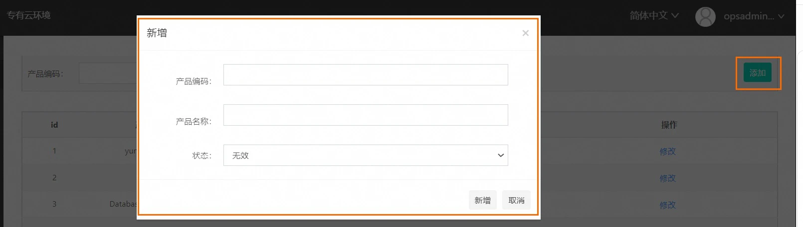
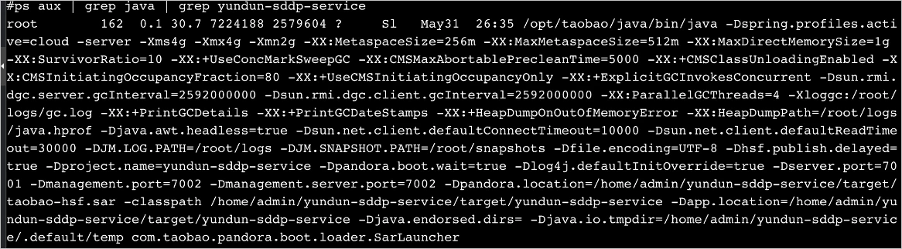
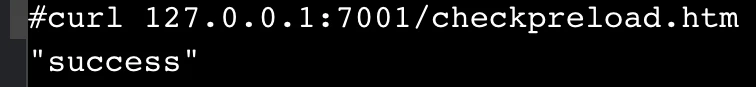

阿里云  
专有云  
敏感数据保护 运维指南  
产品版本：v3.18.6-SP2607  
文档版本：20260729

**目录**

- [1.登录云盾运维中心](#section-1)
- [2.数据安全开放平台](#section-2)
    - [2.1. 接入产品管理](#section-2-1)
    - [2.2. 接入产品详情管理](#section-2-2)
    - [2.3. 数据分发关联管理](#section-2-3)
- [3.检查服务状态](#section-3)
    - [3.1. 登录飞天基础运维平台](#section-3-1)
    - [3.2. 基础巡检](#section-3-2)
    - [3.3. 高级巡检：检查SddpService服务状态](#section-3-3)
    - [3.4. 高级巡检：检查SddpData服务状态](#section-3-4)
    - [3.5. 高级巡检：检查SddpPrivilege服务状态](#section-3-5)
    - [3.6. 高级巡检：检查SddpLog服务状态](#section-3-6)
    - [3.7. 高级巡检：检查SddpAlgorithm服务状态](#section-3-7)
    - [3.8. 高级巡检：检查SddpAsset服务状态](#section-3-8)
    - [3.9. 高级巡检：检查SddpDatamask服务状态](#section-3-9)
    - [3.10. 高级巡检：检查SddpRuleEngine服务状态](#section-3-10)
- [4.重启敏感数据保护服务](#section-4)

<a id="section-1"></a>

# 1.登录云盾运维中心

云盾运维中心是云盾产品的运营平台，可以实时监控云盾产品运行状态和业务状态，并将告警发送给用户。实时监控并根据介绍如何登录云盾运维中心。

**前提条件**

- 已从部署人员或管理员处获取Apsara Uni-manager运维控制台的访问地址、用户名和密码。

  Apsara Uni-manager运维控制台访问地址格式为 `region-id.ops.console.intranet-domain-id.com` 。

- 推荐使用Chrome浏览器。

**操作步骤**

1. 打开浏览器。

2. 在地址栏中，输入Apsara Uni-manager运维控制台的访问地址，按回车键。

   

   > **说明**
   >
   > 您可以单击右上角的当前语言切换其它语言。当前支持简体中文、English语言切换。

3. 输入正确的用户名及密码。

   > **说明**
   >
   > - 登录Apsara Uni-manager运维控制台的用户名和密码请从部署人员或管理员处获取。
   >
   > - 若连续输入密码错误三次，系统将启动图片验证码登录功能；若连续输入错误五次，账户将被锁定，请联系管理员进行激活。
   >
   > - 首次登录Apsara Uni-manager运维控制台时，需要修改登录用户名的密码，请按照提示完成密码修改。
   >
   >   为提高安全性，密码必须满足以下要求：
   >
   >   - 必须包含英文大小写字母。
   >
   >   - 必须包含阿拉伯数字（0~9）。
   >
   >   - 必须包含特殊符号，包括感叹号（!）、at（@）、井号（#）、美元符号（$）、百分号（%）等。
   >
   >   - 密码长度为10~20个字符。

4. 单击**同意协议并登录**。

5. 在Apsara Uni-manager运维控制台的顶部菜单栏，选择**产品运维 > 安全运维 > 云盾运维中心**。

**执行结果**

在**云盾运维中心**页面，您可以查看相关信息。

<a id="section-2"></a>

# 2.数据安全开放平台

<a id="section-2-1"></a>

## 2.1. 接入产品管理

本文介绍如何将云产品接入SDDP。

**支持接入的产品编码及产品名称**

| 产品编码 | 产品 |
| --- | --- |
| yunun-dbaudit | 安华数据库审计 |
| dbaudit | 安恒数据库审计 |
| Database_Audit_System | 闪捷数据库审计 |

**添加接入产品**

1. 登录云盾运维中心。

2. 在左侧导航栏，选择**云产品运维 > SDDP**。

3. 在左侧导航栏，选择**数据安全开放平台 > 接入产品管理**。

4. 在页面右上角单击**添加**，输入**产品编码**、**产品名称**，**选择状态**，然后单击**新增**。

   

5. 返回接入产品列表，查看已接入的产品。

   您也可以输入**产品编码**、**产品名称**或**状态**进行筛选查询。

<a id="section-2-2"></a>

## 2.2. 接入产品详情管理

本文介绍如何添加接入产品的资产。

**支持接入的数据库类型**

| 产品编码 | 产品 | 数据库类型 |
| --- | --- | --- |
| yunun-dbaudit | 安华数据库审计 | RDS、ODPS、PolarDB、PolarDB-x 2.0、ADB- PG、OTS |
| dbaudit | 安恒数据库审计 | RDS |
| Database_Audit_System | 闪捷数据库审计 | RDS |

**添加接入产品的资产**

1. 登录云盾运维中心。

2. 在左侧导航栏，选择**云产品运维 > SDDP**。

3. 在左侧导航栏，选择**数据安全开放平台 > 接入产品管理**。

4. 在页面右上角单击**添加**，完成配置项输入，然后单击**新增**。

   | 配置项 | 说明 |
   | --- | --- |
   | aliUid | 阿里云账号。 |
   | 产品编码 | 接入产品的编码。 |
   | 接入应用id | 应用的ID。 |
   | regionId | 接入产品所属的地域。 |
   | 资产类型 | 不同接入产品支持的资产类型不同。可选项有RDS、OSS、ODPS、OB、RDS-PASS、POLARDB_LOCAL、PolarDB-X、SelfDB、ADB-PG、OTS、ADB-MYSQL。 |
   | 日志采集类型 | 日志采集的类型。例如oss-server。 |
   | 分发渠道 | • sls：SLS提供的ETL方式。<br>• kalfa：消息队列的分发方式。 |
   | project | 日志服务所在的Project。分发渠道为sls时，必填。 |
   | logstore | 日志服务所在的Logstore。分发渠道为sls时，必填。 |
   | endpoint | 日志服务的服务地址。分发渠道为sls时，必填。 |
   | accessKeyId | • 分发渠道为sls时：填写阿里云账号的AccessKey ID。<br>• 分发渠道为kalfa时：填写对应的用户名。 |
   | accessKeySecret(Base64加密) | • 分发渠道为sls时：阿里云账号的AccessKey Secret。<br>• 分发渠道为kalfa时：填写对应的用户名。 |
   | ecsInstanceId | ECS实例ID。分发渠道为kalfa时，必填。 |
   | ecsInstanceIp | ECS实例IP。分发渠道为kalfa时，必填。 |
   | port | 端口。分发渠道为kalfa时，必填。 |
   | ecsDomain | ECS实例域名。分发渠道为kalfa时，必填。 |
   | topic | 分发渠道选择kalfa时需要配置，填入kafka的主题。分发渠道为kalfa时，必填。 |
   | 状态 | 该条接入信息是否生效。支持设置为<strong>无效</strong>或<strong>有效</strong>。 |

<a id="section-2-3"></a>

## 2.3. 数据分发关联管理

本文介绍如何查询数据分发关联关系，以及如何将数据分发关联关系置为无效。

**数据分发关联管理**

1. 登录云盾运维中心。

2. 在左侧导航栏，选择**云产品运维 > SDDP**。

3. 在左侧导航栏，选择**数据安全开放平台 > 接入产品管理**。

4. 输出查询条件，查询数据分发关联数据。

   查询条件支持aliUid、产品编码、接入应用id、资产类型、渠道、实例ID、状态。

5. 如果产品不再需要设置分发关系，可以**单击**操作列的**置为无效**。

<a id="section-3"></a>

# 3.检查服务状态

<a id="section-3-1"></a>

## 3.1. 登录飞天基础运维平台

本文介绍如何登录飞天基础运维平台。

**前提条件**

- 已从部署人员或管理员处获取Apsara Uni-manager运维控制台的访问地址、用户名和密码。

  Apsara Uni-manager运维控制台访问地址格式为 `region-id.ops.console.intranet-domain-id.com` 。

- 推荐使用Chrome浏览器。

**操作步骤**

1. 打开浏览器。

2. 在地址栏中，输入Apsara Uni-manager运维控制台的访问地址 `region-id.aso.intranet-domain-id.com` ，按回车键。

   

   > **说明**
   >
   > 您可以单击右上角的当前语言切换其它语言。当前支持简体中文、英文、繁体中文三种语言切换。

3. 输入正确的用户名及密码。

   > **说明**
   >
   > - 登录Apsara Uni-manager运维控制台的用户名和密码请从部署人员或管理员处获取。
   >
   > - 若连续输入密码错误三次，系统将启动图片验证码登录功能；若连续输入错误五次，账户将被锁定，请联系管理员进行激活。

   首次登录Apsara Uni-manager运维控制台时，需要修改登录用户名的密码，请按照提示完成密码修改。

   为提高安全性，密码必须满足以下要求：

   - 必须包含英文大小写字母。

   - 必须包含阿拉伯数字（0~9）。

   - 必须包含特殊符号，包括感叹号（!）、at（@）、井号（#）、美元符号（$）、百分号（%）等。

   - 密码长度为10~20个字符。

4. 单击**账号登录**。

5. 在Apsara Uni-manager运维控制台的顶部菜单栏，选择**平台运维** > **飞天基础运维平台**。

<a id="section-3-2"></a>

## 3.2. 基础巡检

敏感数据保护基础巡检内容为产品状态巡查。

**操作步骤**

1. 登录飞天基础运维平台。

2. 单击**产品集群运维**。

3. 在**产品 | 集群**搜索框输入**SddpVMCluster**。

4. 单击集群操作列的**集群详情**。

5. 在**服务列表**页签的**服务**搜索框输入**yundun-sddp**，查看服务状态是否正常。

<a id="section-3-3"></a>

## 3.3. 高级巡检：检查SddpService服务状态

进行SddpService服务运行状态检查。

**操作步骤**

1. 登录飞天基础运维平台。

2. 登录SDDP的两台物理机。

   <ol type="i">

   <li>

   选择**产品集群运维**。

   </li>

   <li>

   在**产品 | 集群**搜索框输入**SddpVMCluster**，单击集群操作列的**集群详情**。

   </li>

   <li>

   在**服务列表**页签的**服务**搜索框输入**yundun-sddp**，单击**详情**按钮，进入**服务详情**页面。

   </li>

   <li>

   在**组件列表**区域选择**SddpService#**。

   </li>

   <li>

   查看机器信息，单击**Terminal**登录两台安全审计物理机。

   </li>

   </ol>

3. 登录两个SddpService Docker容器。

   执行 `sudo docker exec -it $(sudo docker ps | grep SddpService | awk '{print $1}') bash` 。

4. 查看SddpService进程状态。

   执行 `ps aux | grep java | grep yundun-sddp-service` ，进程存在表示正常。

   

5. 查看健康检查状态。

   执行 `curl 127.0.0.1:7001/checkpreload.htm` ，返回**success**表示服务正常。

   

6. 查看日志。

   - 查看/home/admin/yundun-sddp-service/logs/common-log.log文件：查看service公共的日志。

   - 查看/home/admin/yundun-sddp-service/logs/application.log文件：查看service应用程序的日志。

   - 查看/home/admin/yundun-sddp-service/logs/common-request.log文件：查看service前端请求的日志。

   - 查看/home/admin/yundun-sddp-service/logs/service-stdout.log文件：查看service 系统日志。

<a id="section-3-4"></a>

## 3.4. 高级巡检：检查SddpData服务状态

进行SddpData服务运行状态检查。

**操作步骤**

1. 登录飞天基础运维平台。

2. 登录SDDP的两台物理机。

   <ol type="i">

   <li>

   选择**产品集群运维**。

   </li>

   <li>

   在**产品 | 集群**搜索框输入**SddpVMCluster**，单击集群操作列的**集群详情**。

   </li>

   <li>

   在**服务列表**页签的**服务**搜索框输入**yundun-sddp**，单击**详情**按钮，进入**服务详情**页面。

   </li>

   <li>

   在**组件列表**区域选择**SddpData#**。

   </li>

   <li>

   查看机器信息，单击**Terminal**登录两台安全审计物理机。

   </li>

   </ol>

3. 登录两个SddpData Docker容器。

   执行 `sudo docker exec -it $(sudo docker ps | grep SddpData | awk '{print $1}') bash` 。

4. 查看SddpData进程状态。

   执行 `ps aux | grep yundun-sddp-data` ，进程存在表示正常。

5. 查看日志。

   查看/home/admin/yundun-sddp-data/logs/sddp.log文件：查看data的日志。

<a id="section-3-5"></a>

## 3.5. 高级巡检：检查SddpPrivilege服务状态

进行SddpPrivilege服务运行状态检查。

**操作步骤**

1. 登录飞天基础运维平台。

2. 登录SDDP的两台物理机。

   <ol type="i">

   <li>

   选择**产品集群运维**。

   </li>

   <li>

   在**产品 | 集群**搜索框输入**SddpVMCluster**，单击集群操作列的**集群详情**。

   </li>

   <li>

   在**服务列表**页签的**服务**搜索框输入**yundun-sddp**，单击**详情**按钮，进入**服务详情**页面。

   </li>

   <li>

   在**组件列表**区域选择**SddpPrivilege#**。

   </li>

   <li>

   查看机器信息，单击**Terminal**登录两台安全审计物理机。

   </li>

   </ol>

3. 登录两个SddpPrivilege Docker容器。

   执行 `sudo docker exec -it $(sudo docker ps | grep SddpPrivilege | awk '{print $1}') bash` 。

4. 查看SddpPrivilege进程状态。

   执行 `ps aux | grep java | grep yundun-sddp-privilege` ，进程存在表示正常。

5. 查看健康检查状态。

   执行 `curl 127.0.0.1:7301/checkpreload.htm` ，返回**success**表示服务正常。

6. 查看日志。

   - 查看/home/admin/yundun-sddp-privilege/logs/exception.log文件：查看异常的日志。

   - 查看/home/admin/yundun-sddp-privilege/logs/application.log文件：查看应用程序的日志。

   - 查看/home/admin/yundun-sddp-privilege/logs/task.log文件：查看任务的日志。

   - 查看/home/admin/yundun-sddp-privilege/logs/service-stdout.log文件：查看系统日志。

<a id="section-3-6"></a>

## 3.6. 高级巡检：检查SddpLog服务状态

进行SddpLog服务运行状态检查。

**操作步骤**

1. 登录飞天基础运维平台。

2. 登录SDDP的两台物理机。

   <ol type="i">

   <li>

   选择**产品集群运维**。

   </li>

   <li>

   在**产品 | 集群**搜索框输入**SddpVMCluster**，单击集群操作列的**集群详情**。

   </li>

   <li>

   在**服务列表**页签的**服务**搜索框输入**yundun-sddp**，单击**详情**按钮，进入**服务详情**页面。

   </li>

   <li>

   在**组件列表**区域选择**SddpLog#**。

   </li>

   <li>

   查看机器信息，单击**Terminal**登录两台安全审计物理机。

   </li>

   </ol>

3. 登录两个SddpLog Docker容器。

   执行 `sudo docker exec -it $(sudo docker ps | grep SddpLog | awk '{print $1}') bash` 。

4. 查看SddpLog进程状态。

   执行 `ps aux | grep java | grep yundun-sddp-log` ，进程存在表示正常。

5. 查看健康检查状态。

   执行 `curl 127.0.0.1:7301/checkpreload.htm` ，返回**success**表示服务正常。

6. 查看日志。

   - 查看/home/admin/yundun-sddp-log/logs/exception.log文件：查看异常的日志。

   - 查看/home/admin/yundun-sddp-log/logs/application.log文件：查看应用程序的日志。

   - 查看/home/admin/yundun-sddp-log/logs/debug.log文件：查看debug的日志。

   - 查看/home/admin/yundun-sddp-log/logs/service-stdout.log文件：查看系统日志。

<a id="section-3-7"></a>

## 3.7. 高级巡检：检查SddpAlgorithm服务状态

进行**SddpAlgorithm**服务运行状态检查。

**操作步骤**

1. 登录飞天基础运维平台。

2. 登录SDDP的物理机。

   <ol type="i">

   <li>

   选择**产品集群运维**。

   </li>

   <li>

   在**产品 | 集群**搜索框输入**SddpVMCluster**，单击集群操作列的**集群详情**。

   </li>

   <li>

   在**服务列表**页签的**服务**搜索框输入**yundun-sddp**，单击**详情**按钮，进入**服务详情**页面。

   </li>

   <li>

   在**组件列表**区域选择**SddpAlgorithm**#。

   </li>

   <li>

   查看机器信息，单击**Terminal**登录安全审计物理机。

   </li>

   </ol>

3. 登录SddpAlgorithm Docker容器。

4. 执行 `sudo docker exec -it $(sudo docker ps | grep SddpAlgorithm | awk '{print $1}') bash` 。

5. 查看SddpAlgorithm进程状态。

   执行 `ps aux | grep java | grep yundun-sddp-algorithm` ，进程存在表示正常。

6. 查看健康检查状态。

   执行 `curl 127.0.0.1:7001/checkpreload.htm` ，返回**success**表示服务正常。

7. 查看日志。

   - 查看/home/admin/yundun-sddp-algorithm/logs/application.log文件：查看应用程序的日志。

   - 查看/home/admin/yundun-sddp-algorithm/logs/debug.log文件：查看debug的日志。

   - 查看/home/admin/yundun-sddp-algorithm/logs/service-stdout.log文件：查看系统日志。

<a id="section-3-8"></a>

## 3.8. 高级巡检：检查SddpAsset服务状态

进行SddpAsset服务运行状态检查。

**操作步骤**

1. 登录飞天基础运维平台。

2. 登录SDDP的两台物理机。

   <ol type="i">

   <li>

   选择**产品集群运维**。

   </li>

   <li>

   在**产品 | 集群**搜索框输入**SddpVMCluster**，单击集群操作列的**集群详情**。

   </li>

   <li>

   在**服务列表**页签的**服务**搜索框输入**yundun-sddp**，单击**详情**按钮，进入**服务详情**页面。

   </li>

   <li>

   在**组件列表**区域选择**SddpAsset#**。

   </li>

   <li>

   查看机器信息，单击**Terminal**登录两台安全审计物理机。

   </li>

   </ol>

3. 登录两个SddpAsset Docker容器。

   执行 `sudo docker exec -it $(sudo docker ps | grep SddpAsset | awk '{print $1}') bash` 。

4. 查看SddpAsset进程状态。

   执行 `ps aux | grep yundun-sddp-asset` ，进程存在表示正常。

5. 查看日志。

   查看/home/admin/logs/asset.log文件：查看asset的日志。

<a id="section-3-9"></a>

## 3.9. 高级巡检：检查SddpDatamask服务状态

进行**SddpDatamask**服务运行状态检查。

**操作步骤**

1. 登录飞天基础运维平台。

2. 登录SDDP的物理机。

   <ol type="i">

   <li>

   选择**产品集群运维**。

   </li>

   <li>

   在**产品 | 集群**搜索框输入**SddpVMCluster**，单击集群操作列的**集群详情**。

   </li>

   <li>

   在**服务列表**页签的**服务**搜索框输入**yundun-sddp**，单击**详情**按钮，进入**服务详情**页面。

   </li>

   <li>

   在**组件列表**区域选择**SddpDatamask**#。

   </li>

   <li>

   查看机器信息，单击**Terminal**登录两台安全审计物理机。

   </li>

   </ol>

3. 登录两个SddpDatamask Docker容器。

4. 执行 `sudo docker exec -it $(sudo docker ps | grep SddpDatamask | awk '{print $1}') bash` 。

5. 查看SddpDatamask进程状态。

   执行 `ps aux | grep java | grep yundun-sddp-datamask` ，进程存在表示正常。

6. 查看健康检查状态。

   执行 `curl 127.0.0.1:7001/checkpreload.htm` ，返回**success**表示服务正常。

7. 查看日志。

   - 查看/home/admin/yundun-sddp-datamask/logs/application.log文件：查看应用程序的日志。

   - 查看/home/admin/yundun-sddp-datamask/logs/debug.log文件：查看debug的日志。

   - 查看/home/admin/yundun-sddp-datamaskhm/logs/service-stdout.log文件：查看系统日志。

<a id="section-3-10"></a>

## 3.10. 高级巡检：检查SddpRuleEngine服务状态

进行**SddpRuleEngine**服务运行状态检查。

**操作步骤**

1. 登录飞天基础运维平台。

2. 登录SDDP的物理机。

   <ol type="i">

   <li>

   选择**产品集群运维**。

   </li>

   <li>

   在**产品 | 集群**搜索框输入**SddpVMCluster**，单击集群操作列的**集群详情**。

   </li>

   <li>

   在**服务列表**页签的**服务**搜索框输入**yundun-sddp**，单击**详情**按钮，进入**服务详情**页面。

   </li>

   <li>

   在**组件列表**区域选择**SddpRuleEngine#**。

   </li>

   <li>

   查看机器信息，单击**Terminal**登录两台安全审计物理机。

   </li>

   </ol>

3. 登录两台SddpRuleEngine Docker容器。

4. 执行 `sudo docker exec -it $(sudo docker ps | grep SddpRuleEngine | awk '{print $1}') bash` 。

5. 查看SddpRuleEngine进程状态。

   执行 `ps aux | grep java | grep ruleengine` ，进程存在表示正常。

6. 查看健康检查状态。

   执行 `curl 127.0.0.1:7001/checkpreload.htm` ，返回**success**表示服务正常。

7. 查看日志。

   - 查看home/admin/ruleengine/logs/common-default.log文件：查看应用程序的日志。

   - 查看home/admin/ruleengine/logs/common-error.log文件：查看报错的日志。

   - 查看home/admin/ruleengine/logs/tomcat_stdout.log文件：查看系统日志。

<a id="section-4"></a>

# 4.重启敏感数据保护服务

在敏感数据保护出现故障时，可参考以下操作步骤，尝试重启相关服务。

**操作步骤**

1. 执行 `ssh` 宿主机`IP` 命令，登录到服务所在的宿主机。

2. 执行如下命令，查找服务对应的imageId。

   `docker ps -a |grep` 服务名称

3. 执行以下命令，进入Docker内部。

   ```bash
    docker exec -it [imageId] /bin/bash 
   ```

4. 重启相关服务。

   - 重启**yundun-sddp-service**服务。

     <ol type="a">

     <li>

     执行以下命令，关闭当前应用进程。

     ```text
       kill -9 $(ps -ef | grep java | grep yundun-sddp-service | grep -v grep | awk 
     '{print$2}') 
     ```

     </li>

     <li>

     执行以下命令，重启应用。

     ```text
      /bin/bash /home/admin/start.sh 
     ```

     </li>

     </ol>

     <ol type="i" start="100">

     <li>

     执行以下命令，检查进程是否重启成功。

     ```bash
      curl 127.0.0.1:7001/checkpreload.htm 
     ```

     返回**success**，则表示服务正常运行。

     </li>

     </ol>

   - 重启**yundun-sddp-log**服务。

     <ol type="a">

     <li>

     执行以下命令，关闭当前应用进程。

     ```text
       kill -9 $(ps -ef | grep java | grep yundun-sddp-log | grep -v grep | awk '{print 
     $2}') 
     ```

     </li>

     <li>

     执行以下命令，重启应用。

     ```text
      /bin/bash /home/admin/start.sh 
     ```

     </li>

     </ol>

     <ol type="i" start="100">

     <li>

     执行以下命令，检查进程是否重启成功。

     ```bash
      curl 127.0.0.1:7301/checkpreload.htm 
     ```

     返回**success**，则表示服务正常运行。

     </li>

     </ol>

   - 重启**yundun-sddp-privilege**服务。

     <ol type="a">

     <li>

     执行以下命令，关闭当前应用进程。

     ```text
       kill -9 $(ps -ef | grep java | grep yundun-sddp-privilege | grep -v grep | awk 
     '{print $2}') 
     ```

     </li>

     <li>

     执行以下命令，重启应用。

     ```text
      /bin/bash /home/admin/start.sh 
     ```

     </li>

     </ol>

     <ol type="i" start="100">

     <li>

     执行以下命令，检查进程是否重启成功。

     ```bash
      curl 127.0.0.1:7301/checkpreload.htm 
     ```

     返回**success**，则表示服务正常运行。

     </li>

     </ol>

   - 重启**yundun-sddp-data**服务。

     <ol type="a">

     <li>

     执行以下命令，关闭当前应用进程。

     ```text
      kill -9 $(ps -ef | grep yundun-sddp-data | grep -v grep | awk '{print $2}') 
     ```

     </li>

     <li>

     执行以下命令，重启应用。

     ```text
      /bin/bash /home/admin/yundun-sddp-data/start.sh 
     ```

     </li>

     </ol>

     <ol type="i" start="100">

     <li>

     执行以下命令，检查进程是否重启成功。

     执行 `ps aux | grep yundun-sddp-data` ，进程存在表示正常。

     </li>

     </ol>

   - 重启**yundun-sddp-SddpAlgorithm**服务。

     <ol type="a">

     <li>

     执行以下命令，关闭当前应用进程。

     ```text
       kill -9 $(ps -ef | grep java | grep yundun-sddp-algorithm | grep -v grep | awk 
     '{print$2}') 
     ```

     </li>

     <li>

     执行以下命令，重启应用。

     ```text
      /bin/bash /home/admin/start.sh 
     ```

     </li>

     </ol>

     <ol type="i" start="100">

     <li>

     执行以下命令，检查进程是否重启成功。

     ```text
      ccurl 127.0.0.1:7001/checkpreload.htm 
     ```

     返回**success**，则表示服务正常运行。

     </li>

     </ol>

   - 重启**yundun-sddp-asset**服务。

     <ol type="a">

     <li>

     执行以下命令，关闭当前应用进程。

     ```text
      kill -9 $(ps -ef | grep yundun-sddp-asset| grep -v grep | awk '{print $2}') 
     ```

     </li>

     <li>

     执行以下命令，重启应用。

     ```text
      /bin/bash /home/admin/yundun-sddp-asset/start.sh 
     ```

     </li>

     </ol>

     <ol type="i" start="100">

     <li>

     执行以下命令，检查进程是否重启成功。

     执行 `ps aux | grep yundun-sddp-asset` ，进程存在表示正常。

     </li>

     </ol>

   - 重启**yundun-sddp-datamask**服务。

     <ol type="a">

     <li>

     执行以下命令，关闭当前应用进程。

     ```text
       kill -9 $(ps -ef | grep java | grep yundun-sddp-datamask| grep -v grep | awk 
     '{print$2}') 
     ```

     </li>

     <li>

     执行以下命令，重启应用。

     ```text
      /bin/bash /home/admin/start.sh 
     ```

     </li>

     </ol>

     <ol type="i" start="100">

     <li>

     执行以下命令，检查进程是否重启成功。

     ```text
      ccurl 127.0.0.1:7001/checkpreload.htm 
     ```

     返回**success**，则表示服务正常运行。

     </li>

     </ol>

   - 重启**yundun-sddp-rule-engine**服务。

     <ol type="a">

     <li>

     执行以下命令，关闭当前应用进程。

     ```text
      kill -9 $(ps -ef | grep java | grep ruleengine| grep -v grep | awk '{print$2}') 
     ```

     </li>

     <li>

     执行以下命令，重启应用。

     ```text
      /bin/bash /home/admin/start.sh 
     ```

     </li>

     </ol>

     <ol type="i" start="100">

     <li>

     执行以下命令，检查进程是否重启成功。

     ```text
      ccurl 127.0.0.1:7001/checkpreload.htm 
     ```

     返回**success**，则表示服务正常运行。

     </li>

     </ol>
