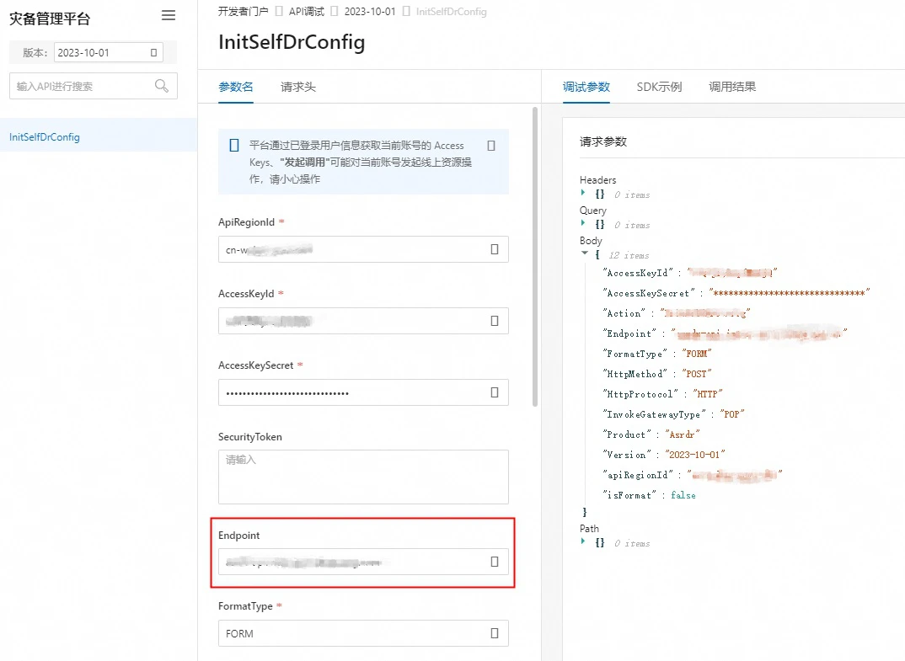
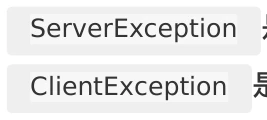

阿里云  
专有云  
灾备管理中心  
异地容灾管理平台 开发指南  
产品版本：v3.18.6-SP2607  
文档版本：20260729

**目录**

- [1.API调用流程说明](#section-1)
- [2.准备工作](#section-2)
    - [2.1. 获取AccessKey](#section-2-1)
    - [2.2. 获取API信息及其Endpoint](#section-2-2)
    - [2.3. 通过POP网关调用专有云API](#section-2-3)
- [3.Java SDK调用示例](#section-3)
    - [3.1. 安装Java SDK](#section-3-1)
    - [3.2. 设置身份验证凭证](#section-3-2)
    - [3.3. 发起调用请求](#section-3-3)
    - [3.4. 错误处理](#section-3-4)
- [4.API参考](#section-4)
    - [4.1. 旧版API（已停止维护）](#section-4-1)
        - [4.1.1. API概览](#section-4-1-1)
        - [4.1.2. 初始化操作](#section-4-1-2)
            - [4.1.2.1. InitUser](#section-4-1-2-1)
        - [4.1.3. 云实例](#section-4-1-3)
            - [4.1.3.1. CreateBackupCloud](#section-4-1-3-1)
            - [4.1.3.2. CreateMainCloud](#section-4-1-3-2)
            - [4.1.3.3. DescribeBackupCloud](#section-4-1-3-3)
            - [4.1.3.4. DescribeCloud](#section-4-1-3-4)
            - [4.1.3.5. ListMainCloud](#section-4-1-3-5)
            - [4.1.3.6. ListSupportRegion](#section-4-1-3-6)
            - [4.1.3.7. UpdateBackupCloud](#section-4-1-3-7)
            - [4.1.3.8. UpdateMainCloud](#section-4-1-3-8)
            - [4.1.3.9. UpdateProductConfig](#section-4-1-3-9)
            - [4.1.3.10. UpdateProductConfig](#section-4-1-3-10)
        - [4.1.4. 保护组](#section-4-1-4)
            - [4.1.4.1. CreateProtectGroup](#section-4-1-4-1)
            - [4.1.4.2. DescribeProtectGroup](#section-4-1-4-2)
            - [4.1.4.3. ListProtectGroup](#section-4-1-4-3)
            - [4.1.4.4. RemoveProtectGroup](#section-4-1-4-4)
            - [4.1.4.5. UpdateProtectGroup](#section-4-1-4-5)
        - [4.1.5. 计划](#section-4-1-5)
            - [4.1.5.1. CreatePlan](#section-4-1-5-1)
            - [4.1.5.2. DescribePlan](#section-4-1-5-2)
            - [4.1.5.3. DescribePlanInstance](#section-4-1-5-3)
            - [4.1.5.4. ListPlan](#section-4-1-5-4)
            - [4.1.5.5. ListPlanInstance](#section-4-1-5-5)
            - [4.1.5.6. RemovePlan](#section-4-1-5-6)
            - [4.1.5.7. StartPlan](#section-4-1-5-7)
            - [4.1.5.8. StartUserTask](#section-4-1-5-8)
            - [4.1.5.9. UpdatePlan](#section-4-1-5-9)
    - [4.2. 新版API](#section-4-2)
        - [4.2.1. API概览](#section-4-2-1)
        - [4.2.2. 云实例](#section-4-2-2)
            - [4.2.2.1. UpdateCloudInstance](#section-4-2-2-1)
            - [4.2.2.2. ListCloudInstances](#section-4-2-2-2)
            - [4.2.2.3. GetCloudInstance](#section-4-2-2-3)
            - [4.2.2.4. DeleteCloudInstance](#section-4-2-2-4)
            - [4.2.2.5. ListCloudCenter](#section-4-2-2-5)
            - [4.2.2.6. CreateCloudInstanceFromCloudCenter](#section-4-2-2-6)
        - [4.2.3. 容灾关系](#section-4-2-3)
            - [4.2.3.1. UpdateDrGroup](#section-4-2-3-1)
            - [4.2.3.2. ListDrGroups](#section-4-2-3-2)
            - [4.2.3.3. GetDrGroup](#section-4-2-3-3)
            - [4.2.3.4. DeleteDrGroup](#section-4-2-3-4)
            - [4.2.3.5. CreateDrGroup](#section-4-2-3-5)
        - [4.2.4. 保护组](#section-4-2-4)
            - [4.2.4.1. UpdateProtectGroup](#section-4-2-4-1)
            - [4.2.4.2. ProtectGroupCtl](#section-4-2-4-2)
            - [4.2.4.3. ListProtectGroups](#section-4-2-4-3)
            - [4.2.4.4. GetProtectGroup](#section-4-2-4-4)
            - [4.2.4.5. DeleteProtectGroup](#section-4-2-4-5)
            - [4.2.4.6. CreateProtectGroup](#section-4-2-4-6)
        - [4.2.5. 同步实体](#section-4-2-5)
            - [4.2.5.1. UpdateSyncGroup](#section-4-2-5-1)
            - [4.2.5.2. SyncGroupCtl](#section-4-2-5-2)
            - [4.2.5.3. ListSyncGroups](#section-4-2-5-3)
            - [4.2.5.4. GetSyncGroup](#section-4-2-5-4)
            - [4.2.5.5. DeleteSyncGroup](#section-4-2-5-5)
            - [4.2.5.6. CreateSyncGroup](#section-4-2-5-6)
        - [4.2.6. 容灾计划](#section-4-2-6)
            - [4.2.6.1. UpdateRecoveryPlan](#section-4-2-6-1)
            - [4.2.6.2. RecoveryTaskCtl](#section-4-2-6-2)
            - [4.2.6.3. ListRecoveryTasks](#section-4-2-6-3)
            - [4.2.6.4. ListRecoveryPlans](#section-4-2-6-4)
            - [4.2.6.5. GetRecoveryTask](#section-4-2-6-5)
            - [4.2.6.6. GetRecoveryPlan](#section-4-2-6-6)
            - [4.2.6.7. DeleteRecoveryTask](#section-4-2-6-7)
            - [4.2.6.8. DeleteRecoveryPlan](#section-4-2-6-8)
            - [4.2.6.9. CreateRecoveryTask](#section-4-2-6-9)
            - [4.2.6.10. CreateRecoveryPlan](#section-4-2-6-10)

<a id="section-1"></a>

# 1.API调用流程说明

阿里云专有云支持通过POP网关调用异地容灾管理平台ASR-DR的API。

**流程图**

异地容灾管理平台ASR-DR的API调用流程如下图所示。


**调用步骤**

1. 获取API信息。

   API信息请参见API参考。

2. 获取AccessKey ID和AccessKey Secret，获取方式请参见获取AccessKey。

3. 获取异地容灾管理平台ASR-DR的Endpoint和Region ID，获取方式请参见获取API信息及其Endpoint。

4. 获取异地容灾管理平台ASR-DR的SDK包和SDK核心库，获取方法请参见通过POP网关调用专有云API。

5. 调用异地容灾管理平台ASR-DR的API。

   > **说明**
   >
   > - 只支持用户账号调用，调用API的用户必须具有运营管理员、组织管理员、全局容灾管理员、组织容灾管理员任一角色。

<a id="section-2"></a>

# 2.准备工作

<a id="section-2-1"></a>

## 2.1. 获取AccessKey

本文介绍获取AccessKey ID和AccessKey Secret的具体操作。

**背景信息**

AccessKey通过使用AccessKey ID和AccessKey Secret对称加密，实现验证某个请求发送者的身份的功能。其中AccessKey ID用于标识用户，AccessKey Secret是用户用于加密签名的字符串。

**获取AccessKey**

Apsara Uni-manager运营控制台提供了个人AccessKey和组织AccessKey。推荐使用个人账号AccessKey调用接口。

> **说明**
>
> - 只有运营管理员和一级组织管理员可以获取组织AccessKey。
>
> - **获取个人账号AccessKey时，请确保登录的用户具备运营管理员、组织管理员、全局容灾管理员、组织容灾管理员任一角色，否则可能导致接口调用失败。**

**获取个人账号AccessKey**

1. 登录Apsara Uni-manager运营控制台。

2. 在系统界面右上角，单击当前登录用户头像，单击**个人信息**。

3. 在**AccessKey**区域，您可以查看个人账户的AccessKey信息。

   

   > **重要**
   >
   > AccessKey ID和AccessKey Secret是您访问云资源时的密钥，具有该账号完整的权限，请您妥善保管。

**获取组织AccessKey**

> **警告**
>
> 个人账号AccessKey是由Apsara Uni-manager运营控制台权限体系管控的受限AccessKey，组织AccessKey相对权限较大，需要管理员确认操作的安全性。

1. 管理员登录Apsara Uni-manager运营控制台。

2. 在顶部菜单栏，单击**企业**。

3. 在左侧导航栏中，选择**资源管理** > **组织管理**。

4. 在组织结构中，单击目标一级组织名称。

5. 单击**管理Accesskey**。

6. 在弹出的对话框中，查看组织AccessKey信息。

<a id="section-2-2"></a>

## 2.2. 获取API信息及其Endpoint

首先，您需要了解产品开放API接口的相关信息，包括产品名称（code）、开放API接口名称、API版本。

**背景信息**

Apsara Uni-manager运营控制台API目录中的API信息仅供调用参考，具体API的使用方式需要参见ASR-DR的开发指南。如果发生不一致情况，以开发指南支持情况为准。

**操作步骤**

1. 登录Apsara Uni-manager运营控制台。

2. 在顶部菜单栏选择**产品** > **应用服务** > **开发者门户**。

3. 在**开发者门户**页面，选择**API集成** > **API调试**。

   

4. 在左侧导航栏中选择**灾备管理平台**。

5. 在**版本**下拉列表中，选择目标API版本。

6. 在下方API列表中可浏览当前版本的所有API接口。

7. 选中对应接口，在参数名下获取ASR-DR的POP Endpoint和其他接口信息。

   

<a id="section-2-3"></a>

## 2.3. 通过POP网关调用专有云API

通过POP Java SDK访问产品域名，需要了解该产品调用方式（RPC或ROA）。

**前提条件**

目前专有云推荐使用CommonRequest进行调用，可以在Apsara Uni-manager运营控制台**产品** > **应用服务** > **开发者门户**，选择**API集成** > **SDK示例**查看推荐SDK版本以及示例代码。

> **重要**
>
> 不建议直接从SDK中心下载SDK到专有云场景下使用，公有云的SDK不一定支持专有云的API，可能存在兼容性问题，请谨慎使用！

**CommonRequest调用示例**

RPC调用，示例接口信息：产品（ASR-DR）、接口（InitSelfDrConfig）、版本（2023-10-01）。

调用示例如下：

```java
import com.aliyuncs.CommonRequest;
import com.aliyuncs.CommonResponse;
import com.aliyuncs.DefaultAcsClient;
import com.aliyuncs.IAcsClient;
import com.aliyuncs.exceptions.ClientException;
import com.aliyuncs.exceptions.ServerException;
import com.aliyuncs.profile.DefaultProfile;
public class InitSelfDrConfig {
    public static void main(String[] args) {
        // 创建DefaultAcsClient实例并初始化
        DefaultProfile profile = DefaultProfile.getProfile(
                // 您的地域ID
                "<your-region-id>",
                // 从环境变量获取RAM账号的AccessKey ID
                System.getenv("ALIBABA_CLOUD_ACCESS_KEY_ID"),
                // 从环境变量获取RAM账号的AccessKey ID
                System.getenv("ALIBABA_CLOUD_ACCESS_KEY_SECRET"));
        IAcsClient client = new DefaultAcsClient(profile);
        // 创建API请求并设置参数
        CommonRequest request = new CommonRequest();
        request.setSysDomain("ASRDR.aliyuncs.com");
        request.setSysVersion("2023-10-01");
        request.setSysAction("InitSelfDrConfig");
        request.putQueryParameter("PageNumber", "1");
        request.putQueryParameter("PageSize", "30");
        try {
            CommonResponse response = client.getCommonResponse(request);
            System.out.println(response.getData());
        } catch (ServerException e) {
            // TODO Auto-generated catch block
            e.printStackTrace();
        } catch (ClientException e) {
            // TODO Auto-generated catch block
            e.printStackTrace();
        }
    }
}
```

ROA调用，示例接口信息：产品（ASR-DR）接口（InitSelfDrConfig）版本（2023-10-01）。

调用示例如下：

```java
import com.aliyuncs.CommonRequest;
import com.aliyuncs.CommonResponse;
import com.aliyuncs.DefaultAcsClient;
import com.aliyuncs.IAcsClient;
import com.aliyuncs.exceptions.ClientException;
import com.aliyuncs.exceptions.ServerException;
import com.aliyuncs.profile.DefaultProfile;
public class InitSelfDrConfig {
    public static void main(String[] args) {
        // 创建DefaultAcsClient实例并初始化
        DefaultProfile profile = DefaultProfile.getProfile(
                // 您的地域ID
                "<your-region-id>",
                // 从环境变量获取RAM账号的AccessKey ID
                System.getenv("ALIBABA_CLOUD_ACCESS_KEY_ID"),
                // 从环境变量获取RAM账号的AccessKey ID
                System.getenv("ALIBABA_CLOUD_ACCESS_KEY_SECRET"));
        IAcsClient client = new DefaultAcsClient(profile);
        // 创建API请求并设置参数
        CommonRequest request = new CommonRequest();
        request.setSysDomain("ASRDR.aliyuncs.com");
        request.setSysVersion("2023-10-01");
        request.setSysUriPattern("/clusters");
        try {
            CommonResponse response = client.getCommonResponse(request);
            System.out.println(response.getData());
        } catch (ServerException e) {
            // TODO Auto-generated catch block
            e.printStackTrace();
        } catch (ClientException e) {
            // TODO Auto-generated catch block
            e.printStackTrace();
        }
    }
}
```

> **重要**
>
> 使用HTTPS协议访问OpenAPI时，SDK会默认开启校验SSL/TLS 证书有效性，若您代码环境没有证书环境，则会报错证书校验失败。
>
> 为保障生产环境通信安全，建议您保持开启，若在测试环境必须忽略证书校验，可以通过以下参数设置：
>
> Java
>
> ```text
> HttpClientConfig clientConfig = HttpClientConfig.getDefault();
> // 设置不校验服务端证书
> clientConfig.setIgnoreSSLCerts(true)
> ```

<a id="section-3"></a>

# 3.Java SDK调用示例

<a id="section-3-1"></a>

## 3.1. 安装Java SDK

本文介绍如何安装异地容灾管理平台ASR-DR的Java SDK。

**环境准备**

阿里云专有云Java SDK需要使用1.8及后续版本的JDK。

**安装阿里云专有云Java SDK**

如果您使用Apache Maven来管理Java项目，只需在项目的pom.xml中导入JAR文件。

调用Java SDK必须安装SDK核心库以及ASR-DR的SDK包。其中，SDK核心库推荐使用4.5.17及以上版本，SDK的版本为1.0.0。

以下为Java pom文件设置示例。

```xml
<dependencies>
    <!--必须要的依赖-->
    <dependency>
        <groupId>com.aliyun</groupId>
        <artifactId>aliyun-java-sdk-asrdr</artifactId>
        <version>1.0.0</version>
    </dependency>
    <dependency>
        <groupId>com.aliyun</groupId>
        <artifactId>aliyun-java-sdk-core</artifactId>
        <version>4.6.0</version>
    </dependency>
</dependencies>
```

<a id="section-3-2"></a>

## 3.2. 设置身份验证凭证

使用阿里云专有云SDK访问阿里云专有云服务时，您需要提供授权的账号进行身份验证。

Java SDK支持通过AccessKey进行身份验证，获取AccessKey ID和AccessKey Secret的方法请参见获取AccessKey，获取Endpoint的方法请参见获取Endpoint，获取Region ID的方法请参见获取Region ID。

使用AccessKey作为访问凭据时，需要在初始化Client时设置凭证。

> **重要**
>
> 请确保包含AccessKey的代码不会泄漏（例如提交到外部公开的GitHub项目），否则将会危害您的信息安全。

```text
//配置请求Endpoint
DefaultProfile.addEndpoint(
    "<EndpointName>",    //请替换为您实际的Endpoint名称：Asrdr
    "<RegionId>",      //请替换为您实际的地域ID
    "<ProductCode>",     //请替换为您实际的产品CODE：Asrdr
    "<Endpoint>"        //请替换为您实际的产品请求域名
);
//配置⾝份验证凭证
DefaultProfile profile = DefaultProfile.getProfile(
    "<yourRegionID>",         // 请替换为您实际的地域ID
    "<yourAccessKeyID>",      // 请替换为您实际的AccessKeyID
    "<yourAccessKeySecret>",  // 请替换为您实际的AccessKeySecret
);
```

> **说明**
>
> - 以上代码示例中 `<yourRegionID>` 、 `<yourAccessKeyID>` 、 `<yourAccessKeySecret>` 均为可变参数，需要替换为其实际值，尖括号（<>）在最终代码中不保留。
>
> - 请使用具备运营管理员、组织管理员、全局容灾管理员、组织容灾管理员任一角色的用户调用异地容灾管理平台ASR-DR的API。

<a id="section-3-3"></a>

## 3.3. 发起调用请求

本文介绍如何使用Java SDK发起请求。

**操作步骤**

1. 新建一个AcsClient。

   ```text
   DefaultAcsClient client = new DefaultAcsClient(profile);
   ```

2. 创建请求。

   

   请求类的命名规范为 ${apiName}Request ，其中<strong>${apiName}</strong>为API名称，例如DescribeBackupCloud。

   ```text
   DescribeBackupCloudRequest request = new DescribeBackupCloudRequest();
   ```

3. 发起调用并处理应答。

   ```java
   // 发起请求，查看结果
   DescribeBackupCloudResponse response = client.getAcsResponse(request);
   System.out.println(response.getData());
   ```

**完整调用示例**

以下代码为异地容灾管理平台ASR-DR的 `DescribeBackupCloud` 接口调用示例。

```java
import com.aliyuncs.asrdr.model.v20220209.*;
import com.aliyuncs.exceptions.ClientException;
import com.aliyuncs.http.MethodType;
import com.chenxue.product.api.base.ApiBaseInfo;
import com.chenxue.product.api.base.ProductBaseApi;
import com.google.gson.Gson;
import org.slf4j.Logger;
import org.slf4j.LoggerFactory;

public class AsrdrApi extends ProductBaseApi {

    public void listPlanInstance(String planId, ApiBaseInfo apiBaseInfo) throws ClientException {
      try {        
        //配置请求Endpoint
        DefaultProfile.addEndpoint(
            "<EndpointName>",    //请替换为您实际的Endpoint名称：Asrdr
            "<RegionId>",      //请替换为您实际的地域ID
            "<ProductCode>",     //请替换为您实际的产品CODE：Asrdr
            "<Endpoint>"        //请替换为您实际的产品请求域名
        );
        //配置⾝份验证凭证
        DefaultProfile profile = DefaultProfile.getProfile(
            "<yourRegionID>",         // 请替换为您实际的地域ID
            "<yourAccessKeyID>",      // 请替换为您实际的AccessKeyID
            "<yourAccessKeySecret>",  // 请替换为您实际的AccessKeySecret
        );
        // 构造客户端
        DefaultAcsClient client = new DefaultAcsClient(profile);
        //构造请求参数
        DescribeBackupCloudRequest request = new DescribeBackupCloudRequest();
        request.setMethod(MethodType.GET);
        request.setVersion("2022-02-09");
        request.setActionName("DescribeBackupCloud");
        //调⽤API
        DescribeBackupCloudResponse response = client.getAcsResponse(request);
        System.out.println(response.getData());
        
      } 
    }
}
```

<a id="section-3-4"></a>

## 3.4. 错误处理

在使用Java SDK时，当服务端或者SDK端出错时，SDK会返回相应的异常信息。这些异常信息中会包含具体的错误信息，包括错误码（Error Code）和错误消息（Error Message）。

一般情况下，您不需要根据Java SDK返回的错误进行处理。您只需要根据服务端的错误提示处理服务端错误即可。



- ServerException 是服务端错误信息。

- ClientException 是SDK端错误信息。

例如，当出现如下错误时，您可以根据具体的错误信息，修改AccessKey的ID即可。

```text
com.aliyuncs.exceptions.ClientException: InvalidAccessKeyId.NotFound : Specified accesskey is not found.
```

如果您需要对SDK的错误进行处理，可以参考如下示例编写代码：

```java
try {
    AcsResponse response = client.getAcsResponse(request);
    // 处理Response
    // ...
} catch (ClientException e) {
    // 这⾥可以添加您⾃⼰的错误处理逻辑
    // 例如，打印具体的错误信息
    System.out.println("ErrorCode=" + e.getErrCode());
    System.out.println("ErrorMessage=" + e.getErrMsg());
    e.printStackTrace();
} catch (ServerException e) {
    e.printStackTrace();
}
```

<a id="section-4"></a>

# 4.API参考

<a id="section-4-1"></a>

## 4.1. 旧版API（已停止维护）

旧版API已于企业版v3.18.6版本停止维护，如有需要请使用新版API。

<a id="section-4-1-1"></a>

### 4.1.1. API概览

<table>
  <tr>
    <td>API</td>
    <td>版本</td>
    <td>描述</td>
  </tr>
  <tr>
    <td>InitUser</td>
    <td>2022-02-09</td>
    <td>初始化用户</td>
  </tr>
  <tr>
    <td>CreateBackupCloud</td>
    <td>2022-02-09</td>
    <td>创建灾备云</td>
  </tr>
  <tr>
    <td>CreateMainCloud</td>
    <td>2022-02-09</td>
    <td>创建主云</td>
  </tr>
  <tr>
    <td>DescribeBackupCloud</td>
    <td>2022-02-09</td>
    <td>查询灾备云信息</td>
  </tr>
  <tr>
    <td>DescribeCloud</td>
    <td>2022-02-09</td>
    <td>查询主云信息</td>
  </tr>
  <tr>
    <td>ListMainCloud</td>
    <td>2022-02-09</td>
    <td>查询主云列表</td>
  </tr>
  <tr>
    <td>ListSupportRegion</td>
    <td>2022-02-09</td>
    <td>获取支持的地域</td>
  </tr>
  <tr>
    <td>UpdateBackupCloud</td>
    <td>2022-02-09</td>
    <td>更新灾备云</td>
  </tr>
  <tr>
    <td>UpdateMainCloud</td>
    <td>2022-02-09</td>
    <td>更新主云</td>
  </tr>
  <tr>
    <td>UpdateProductConfig</td>
    <td>2022-02-09</td>
    <td>更新产品配置</td>
  </tr>
  <tr>
    <td>CreateProtectGroup</td>
    <td>2022-02-09</td>
    <td>创建保护组</td>
  </tr>
  <tr>
    <td>DescribeProtectGroup</td>
    <td>2022-02-09</td>
    <td>查询保护组</td>
  </tr>
  <tr>
    <td>ListProtectGroup</td>
    <td>2022-02-09</td>
    <td>查询保护组列表</td>
  </tr>
  <tr>
    <td>RemoteProtectGroup</td>
    <td>2022-02-09</td>
    <td>删除保护组</td>
  </tr>
  <tr>
    <td>UpdateProtectGroup</td>
    <td>2022-02-09</td>
    <td>更新保护组</td>
  </tr>
  <tr>
    <td>CreatePlan</td>
    <td>2022-02-09</td>
    <td>创建计划</td>
  </tr>
  <tr>
    <td>DescribePlan</td>
    <td>2022-02-09</td>
    <td>查询计划</td>
  </tr>
  <tr>
    <td>DescribePlanInstance</td>
    <td>2022-02-09</td>
    <td>查询计划实例</td>
  </tr>
  <tr>
    <td>ListPlan</td>
    <td>2022-02-09</td>
    <td>查询计划列表</td>
  </tr>
  <tr>
    <td>ListPlanInstance</td>
    <td>2022-02-09</td>
    <td>查询计划实例列表</td>
  </tr>
  <tr>
    <td>RemovePlan</td>
    <td>2022-02-09</td>
    <td>删除计划</td>
  </tr>
  <tr>
    <td>StartPlan</td>
    <td>2022-02-09</td>
    <td>开始执行计划</td>
  </tr>
  <tr>
    <td>StartUserTask</td>
    <td>2022-02-09</td>
    <td>开始执行用户计划</td>
  </tr>
  <tr>
    <td>UpdatePlan</td>
    <td>2022-02-09</td>
    <td>更新计划</td>
  </tr>
</table>

<a id="section-4-1-2"></a>

### 4.1.2. 初始化操作

<a id="section-4-1-2-1"></a>

#### 4.1.2.1. InitUser

调用InitUser初始化用户信息。

**请求头**

该接口使用公共请求头，无特殊请求头。请参见公共请求参数文档。

**请求参数**

| 参数名称 | 类型 | 位置 | 是否必选 | 示例 | 说明 |
| --- | --- | --- | --- | --- | --- |
| UserAcces sKeyId | Strin g | Query | 是 | Su\*\*\*\*\*\*\*\*Uk | 用户AK。 |
| UserAcces sKeySecre t | Strin g | Query | 是 | 78\*\*\*\*\*\*\*\*Zp | 用户SK。 |
| PrimaryKe y | Strin g | Query | 否 | 28\*\*\*\*\*\*\*\*71 | 用户UID。 |

**返回数据**

| 参数名称 | 类型 | 示例 | 说明 |
| --- | --- | --- | --- |
| RequestID | String | 4558c408\*\*\*\*\*\*\*\*3 7b0c94e | 请求ID。 |
| Result | String | SUCCESS | 请求结果，取值含义如下：<br>• SUCCESS：成功<br>• FAILED：失败 |
| Code | String | 200 | 请求返回代码，如为200则请求成功。 |
| NodeHost | String | docker0100170490 17 | 节点名称。 |
| NodeIp | String | 127.0.0.1 | 节点IP。 |
| Data | Struct |  | 用户信息。 |
| -PrimaryKey | String | 28\*\*\*\*\*\*\*\*71 | 用户UID。 |
| -Name | String | admin | 用户名。 |
| -DisplayName | String | admin | 显示名。 |

**示例**

请求示例

```text
http(s)://[Endpoint]/?Action=InitUser
&UserAccessKeyId=Su********Uk
&UserAccessKeySecret=78********Zp
&公共请求参数
```

正常返回示例

`JSON`  格式

```json
{
 "RequestID":"4558c408********37b0c94e",
 "Data":{
  "DisplayName":"admin",
  "PrimaryKey":"28********71",
  "Name":"admin"
 },
 "NodeIp":"127.0.0.1",
 "Code":"200",
 "Result":"SUCCESS",
 "NodeHost":"docker010017049017"
}
```

`XML`  格式

```xml
<RequestID>4558c408********37b0c94e</RequestID>
<Data>
 <DisplayName>admin</DisplayName>
 <PrimaryKey>28********71</PrimaryKey>
 <Name>admin</Name>
</Data>
<NodeIp>127.0.0.1</NodeIp>
<Code>200</Code>
<Result>SUCCESS</Result>
<NodeHost>docker010017049017</NodeHost>
```

<a id="section-4-1-3"></a>

### 4.1.3. 云实例

<a id="section-4-1-3-1"></a>

#### 4.1.3.1. CreateBackupCloud

调用CreateBackupCloud创建灾备云。

**请求头**

该接口使用公共请求头，无特殊请求头。请参见公共请求参数文档。

**请求参数**

| 参数名称 | 类型 | 位置 | 是否必选 | 示例 | 说明 |
| --- | --- | --- | --- | --- | --- |
| Address | Strin g | Quer y | 是 | http://internal.example.xx xxx | 云管API Endpoint。 |
| CloudNam e | Strin g | Quer y | 是 | backup-212e | 云实例名称。 |
| CloudType | Strin g | Quer y | 是 | BACKUP | 云实例的主备类型，必填BACKUP。 |
| CloudOSTy pe | Strin g | Quer y | 是 | ENTERPRISE | 云版本类型，必填ENTERPRISE，只支持专有云企业版。 |
| CloudCons oleType | Strin g | Quer y | 是 | ASCM | 云管类型，必填ASCM，只支持ASCM。 |
| UserAcces sKeyId | Strin g | Quer y | 是 | CU\*\*\*\*\*\*\*\*Yh | 灾备云运营管理员的AK。 |
| UserAcces sKeySecret | Strin g | Quer y | 是 | ClHm\*\*\*\*\*\*\*\*Xxqf | 灾备云运营管理员的SK。 |

**返回数据**

| 参数名称 | 类型 | 示例 | 说明 |
| --- | --- | --- | --- |
| RequestID | String | 4383c8\*\*\*\*\*\*\*\*ad5 3c7 | 请求ID。 |
| Result | String | SUCCESS | 请求结果，取值含义如下：<br>• SUCCESS：成功<br>• FAILED：失败 |
| Code | String | 200 | 请求返回代码，如为200则请求成功。 |
| NodeHost | String | docker0100170490 17 | 节点名称。 |
| NodeIp | String | 127.0.0.1 | 节点IP。 |
| Data | Struct | - | 灾备云详细信息。 |
| -Id | String | ffe130bc\*\*\*\*\*\*\*\*24 c76d6d | 灾备云ID。 |

**示例**

`JSON`  格式

```json
{
 "RequestID":"4383c8********ad53c7",
 "Data":{
  "Id":"ffe130bc********24c76d6d"
 },
 "NodeIp":"127.0.0.1",
 "Code":"200",
 "Result":"SUCCESS",
 "NodeHost":"docker010017049017"
}
```

`XML`  格式

```xml
<RequestID>4383c8********ad53c7</RequestID>
<Data>
 <Id>ffe130bc********24c76d6d</Id>
</Data>
<NodeIp>127.0.0.1</NodeIp>
<Code>200</Code>
<Result>SUCCESS</Result>
<NodeHost>docker010017049017</NodeHost>
```

<a id="section-4-1-3-2"></a>

#### 4.1.3.2. CreateMainCloud

调用CreateMainCloud创建主云。

**请求头**

该接口使用公共请求头，无特殊请求头。请参见公共请求参数文档。

**请求参数**

| 参数名称 | 类型 | 位置 | 是否必选 | 示例 | 说明 |
| --- | --- | --- | --- | --- | --- |
| Address | Strin g | Quer y | 是 | http://internal.example.xx xxx | 云管API Endpoint。 |
| CloudNam e | Strin g | Quer y | 是 | 212e | 云实例名称。 |
| CloudScen e | Strin g | Quer y | 是 | MULTIPLE_CLOUD | 容灾类型，必填MULTIPLE_CLOUD，只支持跨云容灾。 |
| CloudOSTy pe | Strin g | Quer y | 是 | ENTERPRISE | 云版本类型，必填ENTERPRISE，只支持专有云企业版。 |
| CloudCons oleType | Strin g | Quer y | 是 | ASCM | 云管类型，必填ASCM，只支持ASCM。 |
| UserAcces sKeyId | Strin g | Quer y | 是 | CU\*\*\*\*\*\*\*\*Yh | 生产云运营管理员的AK。 |
| UserAcces sKeySecret | Strin g | Quer y | 是 | ClH\*\*\*\*\*\*\*\*xqf | 生产云运营管理员的SK。 |

**返回数据**

| 参数名称 | 类型 | 示例 | 说明 |
| --- | --- | --- | --- |
| RequestID | String | 4383\*\*\*\*\*\*\*\*53c7 | 请求ID。 |
| Result | String | SUCCESS | 请求结果，取值含义如下：<br>• SUCCESS：成功<br>• FAILED：失败 |
| Code | String | 200 | 请求返回代码，如为200则请求成功。 |
| NodeHost | String | B-W0Y1MD6R-1914.local | 节点名称。 |
| NodeIp | String | 127.0.0.1 | 节点IP。 |
| Data | Struct | - | 生产云详细信息。 |
| -Id | String | ffe1\*\*\*\*\*\*\*\*6d6d | 生产云ID。 |

<a id="section-4-1-3-3"></a>

#### 4.1.3.3. DescribeBackupCloud

调用DescribeBackupCloud查询灾备云详情。

**请求头**

该接口使用公共请求头，无特殊请求头。请参见公共请求参数文档。

**返回数据**

| 参数名称 | 类型 | 示例 | 说明 |
| --- | --- | --- | --- |
| RequestID | String | b87055\*\*\*\*\*\*\*\*9f4 33d | 请求ID。 |
| Result | String | SUCCESS | 请求结果，取值含义如下：<br>• SUCCESS：成功<br>• FAILED：失败 |
| Code | String | 200 | 请求返回代码，如为200则请求成功。 |
| NodeHost | String | B-W0Y1MD6R-1914.local | 节点名称。 |
| NodeIp | String | 127.0.0.1 | 节点IP。 |
| Data | Struct |  | 灾备云详细信息。 |
| -Address | String | http://internal.exa mple.xxxxx | 云管API Endpoint。 |
| -CloudName | String | backup-212e | 云实例名称。 |
| -CloudType | String | BACKUP | 云实例的主备类型，只支持BACKUP。 |
| -CloudOSType | String | ENTERPRISE | 云版本类型，只支持专有云企业版ENTERPRISE。 |
| -CloudConsoleT ype | String | ASCM | 云管类型，只支持ASCM。 |
| -UserAccessKe yId | String | CUB\*\*\*\*\*\*\*\*\*\*\*\*Yh | 灾备云运营管理员的AK。 |
| -UserAccessKe ySecret | String | ClH\*\*\*\*\*\*\*\*\*\*\*\*\*\*\*\* \*\*\*\*\*\*\*\*\*qf | 灾备云运营管理员的SK。 |
| -CloudId | String | 0d3aed29\*\*\*\*\*\*\*\*d 6502cd3 | 云实例ID。 |

**示例**

请求示例

```text
http(s)://[Endpoint]/?Action=DescribeBackupCloud
```

正常返回示例

`JSON`  格式

```json
{
 "RequestID":"b87055********9f433d",
 "Data":{
  "CloudOSType":"ENTERPRISE",
  "UserAccessKeySecret":"ClH*************************qf",
  "UserAccessKeyId":"CUB************Yh",
  "Address":"http://internal.example.xxxxx",
  "CloudType":"BACKUP",
  "CloudName":"backup-212e",
  "CloudConsoleType":"ASCM",
  "CloudId":"0d3aed29********d6502cd3"
 },
 "NodeIp":"127.0.0.1",
 "Code":"200",
 "Result":"SUCCESS",
 "NodeHost":"B-W0Y1MD6R-1914.local"
}
```

`XML`  格式

```xml
<RequestID>b87055********9f433d</RequestID>
<Data>
 <CloudOSType>ENTERPRISE</CloudOSType>
 <UserAccessKeySecret>ClH*************************qf</UserAccessKeySecret>
 <UserAccessKeyId>CUB************Yh</UserAccessKeyId>
 <Address>http://internal.example.xxxxx</Address>
 <CloudType>BACKUP</CloudType>
 <CloudName>backup-212e</CloudName>
 <CloudConsoleType>ASCM</CloudConsoleType>
 <CloudId>0d3aed29********d6502cd3</CloudId>
</Data>
<NodeIp>127.0.0.1</NodeIp>
<Code>200</Code>
<Result>SUCCESS</Result>
<NodeHost>B-W0Y1MD6R-1914.local</NodeHost>
```

Asrdr

2022-02-09

DescribeBackupCloud

<a id="section-4-1-3-4"></a>

#### 4.1.3.4. DescribeCloud

调用DescribeCloud查询云实例信息。

**请求头**

该接口使用公共请求头，无特殊请求头。请参见公共请求参数文档。

**请求参数**

| 参数名称 | 类型 | 位置 | 是否必选 | 示例 | 说明 |
| --- | --- | --- | --- | --- | --- |
| CloudId | Strin g | Quer y | 是 | ffe130bc\*\*\*\*\*\*\*\*24c76d6 d | 云实例ID。 |

**返回数据**

| 参数名称 | 类型 | 示例 | 说明 |
| --- | --- | --- | --- |
| RequestID | String | b914\*\*\*\*\*\*\*\*89dc | 请求ID。 |
| Result | String | SUCCESS | 请求结果，取值含义如下：<br>• SUCCESS：成功<br>• FAILED：失败 |
| Code | String | 200 | 请求返回代码，如为200则请求成功。 |
| NodeHost | String | B-W0Y1MD6R-1914.local | 节点名称。 |
| NodeIp | String | 127.0.0.1 | 节点IP。 |
| Data | Struct |  | 云实例详情。 |
| -Address | String | http://internal.exa mple.xxxxx | 云管API Endpoint。 |
| -CloudName | String | 212e | 云实例名称。 |
| -CloudType | String | MAIN | 云实例的主备类型。参数值含义如下：<br>• MAIN：生产云实例<br>• BACKUP：灾备云实例 |
| -CloudOSType | String | ENTERPRISE | 云实例版本类型，只支持专有云企业版，取值为ENTERPRISE。 |
| -CloudConsoleT ype | String | ASCM | 云管类型，取值为ASCM，只支持ASCM。 |
| -UserAccessKe yId | String | CU\*\*\*\*\*\*\*\*Yh | 生产云或灾备云运营管理员的AK。 |
| -UserAccessKe ySecret | String | ClH\*\*\*\*\*\*\*\*\*\*\*\*\*\*\*\* \*\*\*\*\*\*\*\*\*qf | 生产云或灾备云运营管理员的SK。 |
| -CloudId | String | ffe1\*\*\*\*\*\*\*\*6d6d | 云实例ID。 |
| -Status | String | NOT_CONFIGURED | 云实例状态。取值范围如下：<br>• NOT_CONFIGURED：未配置状态<br>• REGULAR：正常状态<br>• UNINITIALIZED：未初始化 |
| -CreatorId | Long | 5003 | 创建云实例的账号ID。 |
| -Version | String | v3.14 | 云实例版本。 |

**示例**

请求示例

```text
http(s)://[Endpoint]/?Action=DescribeCloud
&CloudId=ffe130bc********24c76d6d
&公共请求参数
```

正常返回示例

`JSON`  格式

```json
{
 "RequestID":"b914********89dc",
 "Data":{
  "CloudOSType":"ENTERPRISE",
  "UserAccessKeySecret":"ClH*************************qf",
  "Status":"NOT_CONFIGURED",
  "UserAccessKeyId":"CU********Yh",
  "Address":"http://internal.example.xxxxx",
  "CloudType":"MAIN",
  "Version":"v3.14",
  "CreatorId":5003,
  "CloudName":"212e",
  "CloudConsoleType":"ASCM",
  "CloudId":"ffe1********6d6d"
 },
 "NodeIp":"127.0.0.1",
 "Code":"200",
 "Result":"SUCCESS",
 "NodeHost":"B-W0Y1MD6R-1914.local"
}
```

`XML`  格式

```xml
<RequestID>b914********89dc</RequestID>
<Data>
 <CloudOSType>ENTERPRISE</CloudOSType>
 <UserAccessKeySecret>ClH*************************qf</UserAccessKeySecret>
 <Status>NOT_CONFIGURED</Status>
 <UserAccessKeyId>CU********Yh</UserAccessKeyId>
 <Address>http://internal.example.xxxxx</Address>
 <CloudType>MAIN</CloudType>
 <Version>v3.14</Version>
 <CreatorId>5003</CreatorId>
 <CloudName>212e</CloudName>
 <CloudConsoleType>ASCM</CloudConsoleType>
 <CloudId>ffe1********6d6d</CloudId>
</Data>
<NodeIp>127.0.0.1</NodeIp>
<Code>200</Code>
<Result>SUCCESS</Result>
<NodeHost>B-W0Y1MD6R-1914.local</NodeHost>
```

Asrdr

2022-02-09

DescribeCloud

<a id="section-4-1-3-5"></a>

#### 4.1.3.5. ListMainCloud

调用ListMainCloud查询生产云列表。

**请求头**

该接口使用公共请求头，无特殊请求头。请参见公共请求参数文档。

**请求参数**

| 参数名称 | 类型 | 位置 | 是否必选 | 示例 | 说明 |
| --- | --- | --- | --- | --- | --- |
| PageNum | Integ er | Quer y | 否 | 1 | 查询页数，取值为整数。 |
| PageSize | Integ er | Quer y | 否 | 10 | 每页显示个数，取值为10。 |

**返回数据**

| 参数名称 | 类型 | 示例 | 说明 |
| --- | --- | --- | --- |
| RequestID | String | 49e5\*\*\*\*\*\*\*\*45e7 | 请求ID。 |
| Result | String | SUCCESS | 请求结果，取值含义如下：<br>• SUCCESS：成功<br>• FAILED：失败 |
| Code | String | 200 | 请求返回代码，如为200则请求成功。 |
| NodeHost | String | B-W0Y1MD6R-1914.local | 节点名称。 |
| NodeIp | String | 127.0.0.1 | 节点IP。 |
| Data | Struct |  | 生产云列表。 |
| -Pageable | Struct |  | 分页信息。 |
| --List | Array |  | 单个生产云详情。 |
| ---CloudId | String | eed5\*\*\*\*\*\*\*\*0501 | 生产云ID。 |
| ---CloudName | String | 212e | 生产云名称。 |
| ---Address | String | http://internal.exa mple.xxxxx | 云管API Endpoint。 |
| ---CloudType | String | MAIN | 生产云实例类型，取值为MAIN。 |
| ---CloudOSType | String | ENTERPRISE | 云实例版本类型，只支持专有云企业版，取值为ENTERPRISE。 |
| ---CloudConsoleT ype | String | ASCM | 云管类型，取值为ASCM，只支持ASCM。 |
| ---UserAccessKe yId | String | CU\*\*\*\*\*\*\*\*Yh | 生产云运营管理员的AK。 |
| ---UserAccessKe ySecret | String | ClH\*\*\*\*\*\*\*\*\*\*\*\*\*\*\*\* \*\*\*\*\*\*\*\*\*qf | 生产云运营管理员的SK。 |
| ---Status | String | NOT_CONFIGURED | 生产云状态。取值范围如下：<br>• NOT_CONFIGURED：未配置状态<br>• REGULAR：正常状态<br>• UNINITIALIZED：未初始化 |
| ---CreatorId | Long | 123456 | 创建用户的ID。 |
| ---Version | String | v3.17 | 版本。 |
| --TotalRows | Integer | 2 | 查询到的总行数。 |
| --PageSize | Integer | 10 | 页面显示个数。 |
| --PageNum | Integer | 1 | 页数。 |

**示例**

请求示例

```text
http(s)://[Endpoint]/?Action=ListMainCloud
&公共请求参数
```

正常返回示例

`JSON`  格式

```json
{
 "RequestID":"49e5********45e7",
 "Data":{
  "-Pageable":{
   "PageSize":10,
   "PageNum":1,
   "TotalRows":2,
   "--List":{
    "CloudOSType":"ENTERPRISE",
    "UserAccessKeySecret":"ClH*************************qf",
    "Status":"NOT_CONFIGURED",
    "UserAccessKeyId":"CU********Yh",
    "Address":"http://internal.example.xxxxx",
    "CloudType":"MAIN",
    "Version":"v3.17",
    "CreatorId":123456,
    "CloudName":"212e",
    "CloudConsoleType":"ASCM",
    "CloudId":"eed5********0501"
   }
  }
 },
 "NodeIp":"127.0.0.1",
 "Code":"200",
 "Result":"SUCCESS",
 "NodeHost":"B-W0Y1MD6R-1914.local"
}
```

`XML`  格式

```xml
<RequestID>49e5********45e7</RequestID>
<Data>
 <-Pageable>
  <PageSize>10</PageSize>
  <PageNum>1</PageNum>
  <TotalRows>2</TotalRows>
  <--List>
   <CloudOSType>ENTERPRISE</CloudOSType>
   <UserAccessKeySecret>ClH*************************qf</UserAccessKeySecret>
   <Status>NOT_CONFIGURED</Status>
   <UserAccessKeyId>CU********Yh</UserAccessKeyId>
   <Address>http://internal.example.xxxxx</Address>
   <CloudType>MAIN</CloudType>
   <Version>v3.17</Version>
   <CreatorId>123456</CreatorId>
   <CloudName>212e</CloudName>
   <CloudConsoleType>ASCM</CloudConsoleType>
   <CloudId>eed5********0501</CloudId>
  </--List>
 </-Pageable>
</Data>
<NodeIp>127.0.0.1</NodeIp>
<Code>200</Code>
<Result>SUCCESS</Result>
<NodeHost>B-W0Y1MD6R-1914.local</NodeHost>
```

Asrdr

2022-02-09

ListMainCloud

<a id="section-4-1-3-6"></a>

#### 4.1.3.6. ListSupportRegion

调用ListSupportRegion查询当前用户可见的区域。

**请求头**

该接口使用公共请求头，无特殊请求头。请参见公共请求参数文档。

**请求参数**

| 参数名称 | 类型 | 位置 | 是否必选 | 示例 | 说明 |
| --- | --- | --- | --- | --- | --- |
| CloudId | Strin g | Query | 否 | ffe1\*\*\*\*\*\*\*\*6d6d | 云实例ID。 |
| Organizati onId | Integ er | Query | 否 | 3 | 组织ID。可以调用GetOrganizationList获取组织ID。 |

**返回数据**

| 参数名称 | 类型 | 示例 | 说明 |
| --- | --- | --- | --- |
| RequestID | String | 75ef\*\*\*\*\*\*\*\*dafe8 | 请求ID。 |
| Result | String | SUCCESS | 请求结果，取值含义如下：<br>• SUCCESS：成功<br>• FAILED：失败 |
| Code | String | 200 | 请求返回代码，如为200则请求成功。 |
| NodeHost | String | B-W0Y1MD6R-1914.local | 节点名称。 |
| NodeIp | String | 127.0.0.1 | 节点IP。 |
| Data | Struct |  | 查询结果。 |
| -Regions | String | cn-xxxx-d01 | 支持的Region。 |

**示例**

请求示例

```text
http(s)://[Endpoint]/?Action=ListSupportRegion
&公共请求参数
```

正常返回示例

`JSON`  格式

```json
{
 "RequestID":"75ef********dafe8",
 "Data":{
  "Regions":"cn-xxxx-d01"
 },
 "NodeIp":"127.0.0.1",
 "Code":"200",
 "Result":"SUCCESS",
 "NodeHost":"B-W0Y1MD6R-1914.local"
}
```

`XML`  格式

```xml
<RequestID>75ef********dafe8</RequestID>
<Data>
 <Regions>cn-xxxx-d01</Regions>
</Data>
<NodeIp>127.0.0.1</NodeIp>
<Code>200</Code>
<Result>SUCCESS</Result>
<NodeHost>B-W0Y1MD6R-1914.local</NodeHost>
```

<a id="section-4-1-3-7"></a>

#### 4.1.3.7. UpdateBackupCloud

调用UpdateBackupCloud更新灾备云信息。

**请求头**

该接口使用公共请求头，无特殊请求头。请参见公共请求参数文档。

**请求语法**

```http
PUT https://AsrdrDomain/asr-web/api/v3/cloud/backup/modify HTTP/1.1
```

**请求参数**

| 参数名称 | 类型 | 位置 | 是否必选 | 示例 | 说明 |
| --- | --- | --- | --- | --- | --- |
| Address | Strin g | Quer y | 是 | http://internal.example.xx xxx | 云管API Endpoint。 |
| CloudNam e | Strin g | Quer y | 是 | 212e | 灾备云名称。 |
| CloudType | Strin g | Quer y | 是 | BACKUP | 灾备云的类型，必填BACKUP。 |
| CloudOSTy pe | Strin g | Quer y | 是 | ENTERPRISE | 灾备云的版本类型，必填ENTERPRISE，只支持专有云企业版。 |
| CloudCons oleType | Strin g | Quer y | 是 | ASCM | 云管类型，必填ASCM，只支持ASCM。 |
| UserAcces sKeyId | Strin g | Quer y | 是 | CU\*\*\*\*\*\*\*\*Yh | 灾备云运营管理员的AK。 |
| UserAcces sKeySecret | Strin g | Quer y | 是 | Cl\*\*\*\*\*\*\*\*qf | 灾备云运营管理员的SK。 |
| CloudId | Strin g | Quer y | 是 | 0d3a\*\*\*\*\*\*\*\*2cd3 | 灾备云ID。 |

**返回数据**

| 参数名称 | 类型 | 示例 | 说明 |
| --- | --- | --- | --- |
| RequestID | String | b870\*\*\*\*\*\*\*\*433d | 请求ID。 |
| Result | String | SUCCESS | 请求结果，取值含义如下：<br>• SUCCESS：成功<br>• FAILED：失败 |
| Code | String | 200 | 请求返回代码，如为200则请求成功。 |
| NodeHost | String | B-W0Y1MD6R-1914.local | 节点名称。 |
| NodeIp | String | 127.0.0.1 | 节点IP。 |

**示例**

请求示例

```http
PUT https://AsrdrDomain/asr-web/api/v3/cloud/backup/modify HTTP/1.1
{
"Address":"http://internal.example.xxxxx",
"CloudName":"212e",
"CloudType":"BACKUP",
"CloudOSType":"ENTERPRISE",
"CloudConsoleType":"ASCM",
"UserAccessKeyId":"CU********Yh",
"UserAccessKeySecret":"Cl********qf",
"CloudId":"0d3a********2cd3",
"EscapeLoginPassword":"123456"
}
```

正常返回示例

`JSON`  格式

```json
{
 "RequestID":"b870********433d",
 "NodeIp":"127.0.0.1",
 "Code":"200",
 "Result":"SUCCESS",
 "NodeHost":"B-W0Y1MD6R-1914.local"
}
```

`XML`  格式

```xml
<RequestID>b870********433d</RequestID>
<NodeIp>127.0.0.1</NodeIp>
<Code>200</Code>
<Result>SUCCESS</Result>
<NodeHost>B-W0Y1MD6R-1914.local</NodeHost>
```

<a id="section-4-1-3-8"></a>

#### 4.1.3.8. UpdateMainCloud

调用UpdateMainCloud更新生产云信息。

**请求头**

该接口使用公共请求头，无特殊请求头。请参见公共请求参数文档。

**请求参数**

| 参数名称 | 类型 | 位置 | 是否必选 | 示例 | 说明 |
| --- | --- | --- | --- | --- | --- |
| CloudId | Strin g | Quer y | 是 | ffe1\*\*\*\*\*\*\*\*6d6d | 生产云ID。 |
| Address | Strin g | Quer y | 是 | http://internal.example.xx xxx | 云管API Endpoint。 |
| CloudNam e | Strin g | Quer y | 是 | 212e | 生产云名称。 |
| UserAcces sKeyId | Strin g | Quer y | 是 | CU\*\*\*\*\*\*\*\*Yh | 生产云运营管理员的AK。 |
| UserAcces sKeySecret | Strin g | Quer y | 是 | ClH\*\*\*\*\*\*\*\*qf | 生产云运营管理员的SK。 |

**返回数据**

| 参数名称 | 类型 | 示例 | 说明 |
| --- | --- | --- | --- |
| RequestID | String | 2927\*\*\*\*\*\*\*\*44d9 | 请求ID。 |
| Result | String | SUCCESS | 请求结果，取值含义如下：<br>• SUCCESS：成功<br>• FAILED：失败 |
| Code | String | 200 | 请求返回代码，如为200则请求成功。 |
| NodeHost | String | B-W0Y1MD6R-1914.local | 节点名称。 |
| NodeIp | String | 127.0.0.1 | 节点IP。 |

**示例**

请求示例

```text
http(s)://[Endpoint]/?Action=UpdateMainCloud
&CloudId=ffe1********6d6d
&Address=http://internal.example.xxxxx
&CloudName=212e
&UserAccessKeyId=CU********Yh
&UserAccessKeySecret=ClH********qf
&公共请求参数
```

正常返回示例

`JSON`  格式

```json
{
 "RequestID":"2927********44d9",
 "NodeIp":"127.0.0.1",
 "Code":"200",
 "Result":"SUCCESS",
 "NodeHost":"B-W0Y1MD6R-1914.local"
}
```

`XML`  格式

```xml
<RequestID>2927********44d9</RequestID>
<NodeIp>127.0.0.1</NodeIp>
<Code>200</Code>
<Result>SUCCESS</Result>
<NodeHost>B-W0Y1MD6R-1914.local</NodeHost>
```

Asrdr

2022-02-09

UpdateMainCloud

<a id="section-4-1-3-9"></a>

#### 4.1.3.9. UpdateProductConfig

调用UpdateProductConfig更新生产云产品配置。

**请求头**

该接口使用公共请求头，无特殊请求头。请参见公共请求参数文档。

**请求语法**

```http
PUT https://AsrdrDomain/asr-web/api/v3/cloud/updateConfigList HTTP/1.1
```

**请求参数**

| 参数名称 | 类型 | 位置 | 是否必选 | 示例 | 说明 |
| --- | --- | --- | --- | --- | --- |
| CloudId | Strin g | Query | 是 | 834e\*\*\*\*\*\*\*\*0ffe | 生产云ID。 |
| ConfigReg ionId | Strin g | Query | 是 | cn-xxxx-d01 | Region ID。 |
| Products | Strin g | Query | 是 | DNS | 配置的产品列表。 |
| ConfigList | Strin g | Query | 是 | \[{"id":"dnsAK", "value":"DKL\*\*\*\*\*\*\*\*uv1 ", "product":"DNS"}, {"id":"dnsProductGlobalH ost", "value":"dns-control.pop.xxxx.shugua ng.com", "product":"DNS"}, {"id":"dnsProductHost", "value":"genesisdns.api.xxxx.shuguang.com", "product":"DNS"}, {"id":"dnsSK", "value":"11bt\*\*\*\*\*\*\*\*\*\*\* \*\*\*\*\*\*\*\*\*\*\*\*\*\*HI", "product":"DNS"}\] | 配置列表。 |

**返回数据**

| 参数名称 | 类型 | 示例 | 说明 |
| --- | --- | --- | --- |
| RequestID | String | ae36\*\*\*\*\*\*\*\*e1f7 | 请求ID。 |
| Result | String | SUCCESS | 请求结果，取值含义如下：<br>• SUCCESS：成功<br>• FAILED：失败 |
| Code | String | 200 | 请求返回代码，如为200则请求成功。 |
| NodeHost | String | B-W0Y1MD6R-1914.local | 节点名称。 |
| NodeIp | String | 127.0.0.1 | 节点IP。 |

**示例**

请求示例

```http
PUT https://AsrdrDomain/asr-web/api/v3/cloud/updateConfigList HTTP/1.1
{
"CloudId":"834e********0ffe",
"ConfigRegionId":"cn-xxxx-d01",
"Products":"DNS",
"ConfigList":"[
        {
            "id":"dnsAK",
            "value":"DKL********uv1",
            "product":"DNS"
        },
        {
            "id":"dnsProductGlobalHost",
            "value":"dns-control.pop.xxxx.shuguang.com",
            "product":"DNS"
        },
        {
            "id":"dnsProductHost",
            "value":"genesisdns.api.xxxx.shuguang.com",
            "product":"DNS"
        },
        {
            "id":"dnsSK",
            "value":"11bt*************************HI",
            "product":"DNS"
        }
]"
}
```

正常返回示例

`JSON`  格式

```json
{
 "RequestID":"ae36********e1f7",
 "NodeIp":"127.0.0.1",
 "Code":"200",
 "Result":"SUCCESS",
 "NodeHost":"B-W0Y1MD6R-1914.local"
}
```

`XML`  格式

```xml
<RequestID>ae36********e1f7</RequestID>
<NodeIp>127.0.0.1</NodeIp>
<Code>200</Code>
<Result>SUCCESS</Result>
<NodeHost>B-W0Y1MD6R-1914.local</NodeHost>
```

<a id="section-4-1-3-10"></a>

#### 4.1.3.10. UpdateProductConfig

调用UpdateProductConfig更新生产云产品配置。

**请求头**

该接口使用公共请求头，无特殊请求头。请参见公共请求参数文档。

**请求参数**

| 参数名称 | 类型 | 位置 | 是否必选 | 示例 | 说明 |
| --- | --- | --- | --- | --- | --- |
| CloudId | Strin g | Query | 是 | 834e\*\*\*\*\*\*\*\*0ffe | 生产云ID。 |
| ConfigReg ionId | Strin g | Query | 是 | cn-xxxx-d01 | Region ID。 |
| Products | Strin g | Query | 是 | DNS | 配置的产品列表。 |
| ConfigList | Strin g | Query | 是 | \[{"id":"dnsAK", "value":"DKL\*\*\*\*\*\*\*\*uv1 ", "product":"DNS"}, {"id":"dnsProductGlobalH ost", "value":"dns-control.pop.xxxx.shugua ng.com", "product":"DNS"}, {"id":"dnsProductHost", "value":"genesisdns.api.xxxx.shuguang.com", "product":"DNS"}, {"id":"dnsSK", "value":"11bt\*\*\*\*\*\*\*\*\*\*\* \*\*\*\*\*\*\*\*\*\*\*\*\*\*HI", "product":"DNS"}\] | 配置列表。 |

**返回数据**

| 参数名称 | 类型 | 示例 | 说明 |
| --- | --- | --- | --- |
| RequestID | String | ae36\*\*\*\*\*\*\*\*e1f7 | 请求ID。 |
| Result | String | SUCCESS | 请求结果，取值含义如下：<br>• SUCCESS：成功<br>• FAILED：失败 |
| Code | String | 200 | 请求返回代码，如为200则请求成功。 |
| NodeHost | String | B-W0Y1MD6R-1914.local | 节点名称。 |
| NodeIp | String | 127.0.0.1 | 节点IP。 |

**示例**

请求示例

```text
http(s)://[Endpoint]/?Action=UpdateProductConfig
&CloudId=834e********0ffe
&ConfigRegionId=cn-xxxx-d01
&Products=DNS
&ConfigList=[
        {
            "id":"dnsAK",
            "value":"DKL********uv1",
            "product":"DNS"
        },
        {
            "id":"dnsProductGlobalHost",
            "value":"dns-control.pop.xxxx.shuguang.com",
            "product":"DNS"
        },
        {
            "id":"dnsProductHost",
            "value":"genesisdns.api.xxxx.shuguang.com",
            "product":"DNS"
        },
        {
            "id":"dnsSK",
            "value":"11bt*************************HI",
            "product":"DNS"
        }
]
&公共请求参数
```

正常返回示例

`JSON`  格式

```json
{
 "RequestID":"ae36********e1f7",
 "NodeIp":"127.0.0.1",
 "Code":"200",
 "Result":"SUCCESS",
 "NodeHost":"B-W0Y1MD6R-1914.local"
}
```

`XML`  格式

```xml
<RequestID>ae36********e1f7</RequestID>
<NodeIp>127.0.0.1</NodeIp>
<Code>200</Code>
<Result>SUCCESS</Result>
<NodeHost>B-W0Y1MD6R-1914.local</NodeHost>
```

<a id="section-4-1-4"></a>

### 4.1.4. 保护组

<a id="section-4-1-4-1"></a>

#### 4.1.4.1. CreateProtectGroup

调用CreateProtectGroup创建保护组。

**请求头**

该接口使用公共请求头，无特殊请求头。请参见公共请求参数文档。

**请求参数**

| 参数名称 | 类型 | 位置 | 是否必选 | 示例 | 说明 |
| --- | --- | --- | --- | --- | --- |
| MainCloud Id | Strin g | Query | 是 | ffe1\*\*\*\*\*\*\*\*6d6d | 生产云ID。 |
| BackupClo udId | Strin g | Query | 是 | 0d3a\*\*\*\*\*\*\*\*2cd3 | 灾备云ID。 |
| MainRegio nId | Strin g | Query | 是 | cn-xxxx-d01 | 生产Region。 |
| BackupRe gionId | Strin g | Query | 是 | cn-xxxx-d01 | 灾备Region。 |
| MainOrga nizationId | Strin g | Query | 是 | 3 | 生产云组织ID。可以调用GetOrganizationList获取组织ID。 |
| BackupOr ganization Id | Strin g | Query | 是 | 3 | 灾备云组织ID。可以调用GetOrganizationList获取组织ID。 |
| ProtectGr oupName | Strin g | Query | 是 | openapi-test | 保护组名称。 |
| Direction | Strin g | Query | 是 | FORWARD | 方向。取值范围：<br>• FORWARD：正向<br>• REVERSE：反向 |
| Descriptio n | Strin g | Query | 否 | test | 保护组描述。 |

**返回数据**

| 参数名称 | 类型 | 示例 | 说明 |
| --- | --- | --- | --- |
| RequestID | String | 5daf\*\*\*\*\*\*\*\*f0c7 | 请求ID。 |
| Result | String | SUCCESS | 请求结果，取值含义如下：<br>• SUCCESS：成功<br>• FAILED：失败 |
| Code | String | 200 | 请求返回代码，如为200则请求成功。 |
| NodeHost | String | B-W0Y1MD6R-1914.local | 节点名称。 |
| NodeIp | String | 127.0.0.1 | 节点IP。 |
| Data | Struct |  | 保护组详情。 |
| -ProtectGroupI d | String | 379e\*\*\*\*\*\*\*\*98c7 | 保护组ID。 |

**示例**

请求示例

```text
http(s)://[Endpoint]/?Action=CreateProtectGroup
&MainCloudId=ffe1********6d6d
&BackupCloudId=0d3a********2cd3
&MainRegionId=cn-xxxx-d01
&BackupRegionId=cn-xxxx-d01
&MainOrganizationId=3
&BackupOrganizationId=3
&ProtectGroupName=openapi-test
&Direction=FORWARD
&公共请求参数
```

正常返回示例

`JSON`  格式

```json
{
 "RequestID":"5daf********f0c7",
 "Data":{
  "ProtectGroupId":"379e********98c7"
 },
 "NodeIp":"127.0.0.1",
 "Code":"200",
 "Result":"SUCCESS",
 "NodeHost":"B-W0Y1MD6R-1914.local"
}
```

`XML`  格式

```xml
<RequestID>5daf********f0c7</RequestID>
<Data>
 <ProtectGroupId>379e********98c7</ProtectGroupId>
</Data>
<NodeIp>127.0.0.1</NodeIp>
<Code>200</Code>
<Result>SUCCESS</Result>
<NodeHost>B-W0Y1MD6R-1914.local</NodeHost>
```

<a id="section-4-1-4-2"></a>

#### 4.1.4.2. DescribeProtectGroup

调用DescribeProtectGroup查询保护组详情。

**请求头**

该接口使用公共请求头，无特殊请求头。请参见公共请求参数文档。

**请求参数**

| 参数名称 | 类型 | 位置 | 是否必选 | 示例 | 说明 |
| --- | --- | --- | --- | --- | --- |
| ProtectGr oupId | Strin g | Query | 是 | 379e\*\*\*\*\*\*\*\*98c7 | 保护组ID。 |

**返回数据**

| 参数名称 | 类型 | 示例 | 说明 |
| --- | --- | --- | --- |
| RequestID | String | ebc6\*\*\*\*\*\*\*\*00e7 | 请求ID。 |
| Result | String | SUCCESS | 请求结果，取值含义如下：<br>• SUCCESS：成功<br>• FAILED：失败 |
| Code | String | 200 | 请求返回代码，如为200则请求成功。 |
| NodeHost | String | B-W0Y1MD6R-1914.local | 节点名称。 |
| NodeIp | String | 127.0.0.1 | 节点IP。 |
| Data | Struct |  | 返回数据。 |
| -ProtectGroupD etailVO | Struct |  | 保护组详情。 |
| --ProtectGroupI d | String | 379e\*\*\*\*\*\*\*\*98c7 | 保护组ID。 |
| --Name | String | openapi-test | 保护组名称。 |
| --Direction | String | FORWARD | 保护组反向。取值范围：<br>• FORWARD：正向<br>• REVERSE：反向 |
| --Description | String | 某某业务应用保护组 | 保护组描述。 |
| --MainRegionId | String | region-1 | 生产云区域ID。 |
| --BackupRegionI d | String | region-2 | 灾备云区域ID。 |
| --MainOrganizat ionName | String | asrdr | 生产云组织名称。 |
| --BackupOrgani zationName | String | asrdr | 灾备云组织名称。 |
| --MainOrganizat ionId | Integer | 9 | 生产云组织ID。 |
| --BackupOrgani zationId | Integer | 6 | 灾备云组织ID。 |
| --MaxRPO | Long | 9000 | 保护组最大数据延迟。单位：毫秒。 |
| --AveRPO | Long | 8000 | 保护组平均数据延迟。单位：毫秒。 |
| --AveProgress | String | 100 | 保护组同步实体平均同步进度。 |
| --CanChange | Boolean | true | 保护组是否可修改、迁移等。 |
| --SourceTenantI d | Long | 1666665 | 当保护组存在DataWorks同步实体时返回，表示DataWorks的组织ID。 |
| --DestTenantId | Long | 133434 | 当保护组存在DataWorks同步实体时返回，表示DataWorks的组织ID。 |
| --ProtectState | String | PROTECT | 保护组的保护状态值。取值范围：<br>• PROTECT：保护中<br>• SUSPEND：暂停<br>• REPROTECT：重保护<br>• REPROTECT_FAIL：重保护失败<br>• REDO：重试<br>• PROTECT_START：保护启动中<br>• PROTECT_FAIL：保护失败<br>• PLAN_EXECUTION：计划执行中<br>• PLAN_FAIL： 计划失败<br>• DESTROY：删除中<br>• PROTECT_IDLE：未运行<br>• STOP：停止<br>• START：启动 |
| --RpoAlarmLeve l | String | WARN | 当保护组数据延迟值大于设置的数据延迟阈值，警示级别为WARN，否则为NORMAL。取值范围： \["WARN", "NORMAL"\]。 |
| --CreateTime | Long | 1673333258000 | 保护组创建时间。 |
| --Pageable | Struct |  | 分页信息。 |
| ---List | Array |  | 同步实体信息。 |
| ----EntityId | String | 1f2e\*\*\*\*\*\*\*\*70aa | 同步实体ID。 |
| ----ProtectGroupI d | String | 379e\*\*\*\*\*\*\*\*98c7 | 保护组ID。 |
| ----MainCloudId | String | 39e0\*\*\*\*\*\*\*\*0e1d | 生产云ID。 |
| ----BackupCloudId | String | 28e0\*\*\*\*\*\*\*\*4sds | 灾备云ID。 |
| ----MainRegionId | String | cn-\*\*\*\*-d01 | 生产区域ID。 |
| ----BackupRegionI d | String | cn-\*\*\*\*-d01 | 灾备区域ID。 |
| ----MainOrganizat ionId | Long | 9 | 生产云组织ID。 |
| ----BackupOrgani zationId | Long | 6 | 灾备云组织ID。 |
| ----MainInstanceI d | String | rm-c3\*\*\*\*g6 | 生产实例ID。 |
| ----BackupInstanc eId | String | rm-c3\*\*\*\*g6 | 灾备实例ID。 |
| ----MainInstanceN ame | String | 某某业务生产实例 | 生产实例ID。 |
| ----BackupInstanc eName | String | 某某业务灾备实例 | 灾备实例ID。 |
| ----Priority | Integer | 3 | 同步实体优先级。 |
| ----EntityType | String | RDS | 同步实体产品类型。 |
| ----Direction | String | FORWARD | 保护组方向。取值范围：<br>• FORWARD：正向<br>• REVERSE：反向 |
| ----SyncType | String | HOT | 同步类型。取值范围：<br>• HOT：增量同步<br>• FULL：全量同步 |
| ----Rpo | Long | 2000 | 数据同步延迟。单位：毫秒。 |
| ----RpoTime | Long | 1673320203000 | 获取同步延迟的时间点。 |
| ----Progress | String | 100 | 同步进度。 |

| 参数名称 | 类型 | 示例 | 说明 |
| --- | --- | --- | --- |
| ----Operations | String | DELETE | 同步实体支持的操作。取值范围：<br>• REDO：重试<br>• SUSPEND：暂停<br>• SKIP：跳过整个步骤<br>• REPROTECT：重保护<br>• DELETE：删除<br>• STEPOVER：跳过当前步骤<br>• FORCE_SWITCH：强制切换<br>• START_NOW：立即启动 |
| ----MainOwnerId | String | 127343320203 | 生产实例所属组织PK。 |
| ----BackupOwnerI d | String | 113335620323 | 灾备实例所属组织PK。 |
| ----ProtectState | String | PROTECT | 保护组的保护状态值。取值范围：<br>• PROTECT：保护中<br>• SUSPEND：暂停<br>• REPROTECT：重保护<br>• REPROTECT_FAIL：重保护失败<br>• REDO：重试<br>• PROTECT_START：保护启动中<br>• PROTECT_FAIL：保护失败<br>• PLAN_EXECUTION：计划执行中<br>• PLAN_FAIL： 计划失败<br>• DESTROY：删除中<br>• PROTECT_IDLE：未运行<br>• STOP：停止<br>• START：启动 |
| ----SuspendEndTi me | Long | 113335620323 | 同步实体暂停结束时间。 |
| ----RpoAlarmLeve l | String | WARN | 当保护组数据延迟值大于设置的数据延迟阈值，警示级别为WARN，否则为NORMAL。取值范围： \["WARN", "NORMAL"\]。 |
| ----IsStop | Boolean | false | 同步实体是否处于停止态。 |
| ---TotalRows | Integer | 12 | 数据总条数。 |
| ---PageSize | Integer | 10 | 每页显示个数，取值为10。 |
| ---PageNum | Integer | 1 | 查询页数，取值为整数。 |

**示例**

请求示例

```text
http(s)://[Endpoint]/?Action=DescribeProtectGroup
&ProtectGroupId=379e********98c7
&公共请求参数
```

正常返回示例

`JSON`  格式

```json
{
 "RequestID":"ebc6********00e7",
 "Data":{
  "-ProtectGroupDetailVO":{
   "BackupRegionId":"region-2",
   "Description":"某某业务应⽤保护组",
   "--Pageable":{
    "PageSize":10,
    "PageNum":1,
    "TotalRows":12,
    "---List":{
     "MainCloudId":"39e0********0e1d",
     "BackupInstanceId":"rm-c3****g6",
     "BackupCloudId":"28e0********4sds",
     "Direction":"FORWARD",
     "BackupOrganizationId":6,
     "Rpo":2000,
     "BackupInstanceName":"某某业务灾备实例",
     "MainInstanceId":"rm-c3****g6",
     "Operations":"DELETE",
     "MainOwnerId":"127343320203",
     "RpoTime":1673320203000,
     "MainInstanceName":"某某业务⽣产实例",
     "IsStop":false,
     "BackupRegionId":"cn-****-d01",
     "Progress":"100",
     "SuspendEndTime":113335620323,
     "Priority":3,
     "ProtectState":"PROTECT",
     "EntityId":"1f2e********70aa",
     "EntityType":"RDS",
     "RpoAlarmLevel":"WARN",
     "BackupOwnerId":"113335620323",
     "ProtectGroupId":"379e********98c7",
     "SyncType":"HOT",
     "MainOrganizationId":9,
     "MainRegionId":"cn-****-d01"
    }
   },
   "CanChange":true,
   "DestTenantId":133434,
   "AveProgress":"100",
   "CreateTime":1673333258000,
   "Direction":"FORWARD",
   "ProtectState":"PROTECT",
   "Name":"openapi-test",
   "BackupOrganizationId":6,
   "RpoAlarmLevel":"WARN",
   "ProtectGroupId":"379e********98c7",
   "BackupOrganizationName":"asrdr",
   "MainOrganizationId":9,
   "AveRPO":8000,
   "MainRegionId":"region-1",
   "MainOrganizationName":"asrdr",
   "MaxRPO":9000,
   "SourceTenantId":1666665
  }
 },
 "NodeIp":"127.0.0.1",
 "Code":"200",
 "Result":"SUCCESS",
 "NodeHost":"B-W0Y1MD6R-1914.local"
}
```

`XML`  格式

```xml
<RequestID>ebc6********00e7</RequestID>
<Data>
 <-ProtectGroupDetailVO>
  <BackupRegionId>region-2</BackupRegionId>
  <Description>某某业务应⽤保护组</Description>
  <--Pageable>
   <PageSize>10</PageSize>
   <PageNum>1</PageNum>
   <TotalRows>12</TotalRows>
   <---List>
    <MainCloudId>39e0********0e1d</MainCloudId>
    <BackupInstanceId>rm-c3****g6</BackupInstanceId>
    <BackupCloudId>28e0********4sds</BackupCloudId>
    <Direction>FORWARD</Direction>
    <BackupOrganizationId>6</BackupOrganizationId>
    <Rpo>2000</Rpo>
    <BackupInstanceName>某某业务灾备实例</BackupInstanceName>
    <MainInstanceId>rm-c3****g6</MainInstanceId>
    <Operations>DELETE</Operations>
    <MainOwnerId>127343320203</MainOwnerId>
    <RpoTime>1673320203000</RpoTime>
    <MainInstanceName>某某业务⽣产实例</MainInstanceName>
    <IsStop>false</IsStop>
    <BackupRegionId>cn-****-d01</BackupRegionId>
    <Progress>100</Progress>
    <SuspendEndTime>113335620323</SuspendEndTime>
    <Priority>3</Priority>
    <ProtectState>PROTECT</ProtectState>
    <EntityId>1f2e********70aa</EntityId>
    <EntityType>RDS</EntityType>
    <RpoAlarmLevel>WARN</RpoAlarmLevel>
    <BackupOwnerId>113335620323</BackupOwnerId>
    <ProtectGroupId>379e********98c7</ProtectGroupId>
    <SyncType>HOT</SyncType>
    <MainOrganizationId>9</MainOrganizationId>
    <MainRegionId>cn-****-d01</MainRegionId>
   </---List>
  </--Pageable>
  <CanChange>true</CanChange>
  <DestTenantId>133434</DestTenantId>
  <AveProgress>100</AveProgress>
  <CreateTime>1673333258000</CreateTime>
  <Direction>FORWARD</Direction>
  <ProtectState>PROTECT</ProtectState>
  <Name>openapi-test</Name>
  <BackupOrganizationId>6</BackupOrganizationId>
  <RpoAlarmLevel>WARN</RpoAlarmLevel>
  <ProtectGroupId>379e********98c7</ProtectGroupId>
  <BackupOrganizationName>asrdr</BackupOrganizationName>
  <MainOrganizationId>9</MainOrganizationId>
  <AveRPO>8000</AveRPO>
  <MainRegionId>region-1</MainRegionId>
  <MainOrganizationName>asrdr</MainOrganizationName>
  <MaxRPO>9000</MaxRPO>
  <SourceTenantId>1666665</SourceTenantId>
 </-ProtectGroupDetailVO>
</Data>
<NodeIp>127.0.0.1</NodeIp>
<Code>200</Code>
<Result>SUCCESS</Result>
<NodeHost>B-W0Y1MD6R-1914.local</NodeHost>
```

<a id="section-4-1-4-3"></a>

#### 4.1.4.3. ListProtectGroup

调用ListProtectGroup查询保护组列表。

**请求头**

该接口使用公共请求头，无特殊请求头。请参见公共请求参数文档。

**请求参数**

| 参数名称 | 类型 | 位置 | 是否必选 | 示例 | 说明 |
| --- | --- | --- | --- | --- | --- |
| X-alibaba-asrdr-cloudId | Strin g | Query | 是 | ffe130\*\*\*\*\*\*\*\*c76d6d | 生产云ID。 |
| Direction | Strin g | Query | 否 | FORWARD | 保护组方向。取值范围：<br>• FORWARD：正向<br>• REVERSE：反向 |
| PageNum | Integ er | Query | 是 | 1 | 查询页数，取值为整数。 |
| PageSize | Integ er | Query | 是 | 10 | 每页显示个数，取值为10。 |

**返回数据**

| 参数名称 | 类型 | 示例 | 说明 |
| --- | --- | --- | --- |
| RequestID | String | cf48\*\*\*\*\*\*\*\*8982 | 请求ID。 |
| Result | String | SUCCESS | 请求结果，取值含义如下：<br>• SUCCESS：成功<br>• FAILED：失败 |
| Code | String | 200 | 请求返回代码，如为200则请求成功。 |
| NodeHost | String | B-W0Y1MD6R-1914.local | 节点名称。 |
| NodeIp | String | 127.0.0.1 | 节点IP。 |
| Data | Struct |  | 返回保护组列表。 |
| -ProtectGroupLi st | Array |  | 保护组信息。 |
| --ProtectGroupI d | String | 379\*\*\*\*\*\*\*\*98c7 | 保护组ID。 |
| --Name | String | openapi-test | 保护组名称。 |
| --Direction | String | FORWARD | 保护组方向。取值范围：<br>• FORWARD：正向<br>• REVERSE：反向 |
| --Description | String | 某某业务应用保护组 | 保护组描述。 |
| --MainCloudId | String | 39e0\*\*\*\*\*\*\*\*0e1d | 生产云ID。 |
| --MainOrganizat ionName | String | asrdr | 生产云组织名称。 |
| --BackupOrgani zationName | String | asrdr | 灾备云组织名称。 |
| --MaxRPO | Long | 9000 | 保护组最大数据延迟。单位：毫秒。 |
| --AveRPO | Long | 8000 | 保护组平均数据延迟。单位：毫秒。 |
| --AveProgress | String | 100 | 保护组同步实体平均同步进度。 |
| --ProtectState | String | PROTECT | 保护组的保护状态值。取值范围：<br>• PROTECT：保护中<br>• SUSPEND：暂停<br>• REPROTECT：重保护<br>• REPROTECT_FAIL：重保护失败<br>• REDO：重试<br>• PROTECT_START：保护启动中<br>• PROTECT_FAIL：保护失败<br>• PLAN_EXECUTION：计划执行中<br>• PLAN_FAIL： 计划失败<br>• DESTROY：删除中<br>• PROTECT_IDLE：未运行<br>• STOP：停止<br>• START：启动 |
| --RpoAlarmLeve l | String | WARN | 当保护组数据延迟值大于设置的数据延迟阈值，警示级别为WARN，否则为NORMAL。取值范围： \["WARN", "NORMAL"\]。 |
| --gmtCreate | Long | 1673333258000 | 保护组创建时间。 |
| -TotalRows | Integer | 12 | 数据总条数。 |
| -PageSize | Integer | 10 | 每页显示个数，取值为10。 |
| -PageNum | Integer | 1 | 查询页数，取值为整数。 |
| -TotalPageNum | Integer | 1 | 数据总页数，取值为整数。 |

**示例**

请求示例

```text
http(s)://[Endpoint]/?Action=ListProtectGroup
&X-alibaba-asrdr-cloudId=ffe130********c76d6d
&PageNum=1
&PageSize=10
&公共请求参数
```

正常返回示例

`JSON`  格式

```json
{
 "RequestID":"cf48********8982",
 "Data":{
  "-ProtectGroupList":{
   "Description":"某某业务应⽤保护组",
   "MainCloudId":"39e0********0e1d",
   "AveProgress":"100",
   "gmtCreate":1673333258000,
   "Direction":"FORWARD",
   "ProtectState":"PROTECT",
   "Name":"openapi-test",
   "RpoAlarmLevel":"WARN",
   "ProtectGroupId":"379********98c7",
   "BackupOrganizationName":"asrdr",
   "AveRPO":8000,
   "MainOrganizationName":"asrdr",
   "MaxRPO":9000
  },
  "PageSize":10,
  "PageNum":1,
  "TotalRows":12,
  "TotalPageNum":1
 },
 "NodeIp":"127.0.0.1",
 "Code":"200",
 "Result":"SUCCESS",
 "NodeHost":"B-W0Y1MD6R-1914.local"
}
```

`XML`  格式

```xml
<RequestID>cf48********8982</RequestID>
<Data>
 <-ProtectGroupList>
  <Description>某某业务应⽤保护组</Description>
  <MainCloudId>39e0********0e1d</MainCloudId>
  <AveProgress>100</AveProgress>
  <gmtCreate>1673333258000</gmtCreate>
  <Direction>FORWARD</Direction>
  <ProtectState>PROTECT</ProtectState>
  <Name>openapi-test</Name>
  <RpoAlarmLevel>WARN</RpoAlarmLevel>
  <ProtectGroupId>379********98c7</ProtectGroupId>
  <BackupOrganizationName>asrdr</BackupOrganizationName>
  <AveRPO>8000</AveRPO>
  <MainOrganizationName>asrdr</MainOrganizationName>
  <MaxRPO>9000</MaxRPO>
 </-ProtectGroupList>
 <PageSize>10</PageSize>
 <PageNum>1</PageNum>
 <TotalRows>12</TotalRows>
 <TotalPageNum>1</TotalPageNum>
</Data>
<NodeIp>127.0.0.1</NodeIp>
<Code>200</Code>
<Result>SUCCESS</Result>
<NodeHost>B-W0Y1MD6R-1914.local</NodeHost>
```

<a id="section-4-1-4-4"></a>

#### 4.1.4.4. RemoveProtectGroup

调用RemoveProtectGroup删除保护组。

**请求头**

该接口使用公共请求头，无特殊请求头。请参见公共请求参数文档。

**请求参数**

| 参数名称 | 类型 | 位置 | 是否必选 | 示例 | 说明 |
| --- | --- | --- | --- | --- | --- |
| ProtectGr oupId | Strin g | Query | 是 | 379ea4\*\*\*\*\*\*\*\*d598c7 | 保护组ID。 |

**返回数据**

| 参数名称 | 类型 | 示例 | 说明 |
| --- | --- | --- | --- |
| RequestID | String | 5c4a\*\*\*\*\*\*\*\*1d04 | 请求ID。 |
| Result | String | SUCCESS | 请求结果，取值含义如下：<br>• SUCCESS：成功<br>• FAILED：失败 |
| Code | String | 200 | 请求返回代码，如为200则请求成功。 |
| NodeHost | String | B-W0Y1MD6R-1914.local | 节点名称。 |
| NodeIp | String | 127.0.0.1 | 节点IP。 |

**示例**

请求示例

```text
http(s)://[Endpoint]/?Action=RemoveProtectGroup
&ProtectGroupId=379ea4********d598c7
&公共请求参数
```

正常返回示例

`JSON`  格式

```json
{
 "RequestID":"5c4a********1d04",
 "NodeIp":"127.0.0.1",
 "Code":"200",
 "Result":"SUCCESS",
 "NodeHost":"B-W0Y1MD6R-1914.local"
}
```

`XML`  格式

```xml
<RequestID>5c4a********1d04</RequestID>
<NodeIp>127.0.0.1</NodeIp>
<Code>200</Code>
<Result>SUCCESS</Result>
<NodeHost>B-W0Y1MD6R-1914.local</NodeHost>
```

<a id="section-4-1-4-5"></a>

#### 4.1.4.5. UpdateProtectGroup

调用UpdateProtectGroup更新保护组信息。

**请求头**

该接口使用公共请求头，无特殊请求头。请参见公共请求参数文档。

**请求参数**

| 参数名称 | 类型 | 位置 | 是否必选 | 示例 | 说明 |
| --- | --- | --- | --- | --- | --- |
| ProtectGr oupId | Strin g | Query | 是 | 379e\*\*\*\*\*\*\*\*98c7 | 保护组ID。 |
| ProtectGr oupName | Strin g | Query | 是 | openapi-test-modify | 保护组名称。 |
| Descriptio n | Strin g | Query | 是 | 更新保护组信息。 | 保护组描述。 |

**返回数据**

| 参数名称 | 类型 | 示例 | 说明 |
| --- | --- | --- | --- |
| RequestID | String | 5c4a\*\*\*\*\*\*\*\*1d04 | 请求ID。 |
| Result | String | SUCCESS | 请求结果，取值含义如下：<br>• SUCCESS：成功<br>• FAILED：失败 |
| Code | String | 200 | 请求返回代码，如为200则请求成功。 |
| NodeHost | String | B-W0Y1MD6R-1914.local | 节点名称。 |
| NodeIp | String | 127.0.0.1 | 节点IP。 |

**示例**

请求示例

```text
http(s)://[Endpoint]/?Action=UpdateProtectGroup
&ProtectGroupId=379e********98c7
&ProtectGroupName=openapi-test-modify
&Description=更新保护组信息。
&公共请求参数
```

正常返回示例

`JSON`  格式

```json
{
 "RequestID":"5c4a********1d04",
 "NodeIp":"127.0.0.1",
 "Code":"200",
 "Result":"SUCCESS",
 "NodeHost":"B-W0Y1MD6R-1914.local"
}
```

`XML`  格式

```xml
<RequestID>5c4a********1d04</RequestID>
<NodeIp>127.0.0.1</NodeIp>
<Code>200</Code>
<Result>SUCCESS</Result>
<NodeHost>B-W0Y1MD6R-1914.local</NodeHost>
```

<a id="section-4-1-5"></a>

### 4.1.5. 计划

<a id="section-4-1-5-1"></a>

#### 4.1.5.1. CreatePlan

调用CreatePlan创建计划。

**请求头**

该接口使用公共请求头，无特殊请求头。请参见公共请求参数文档。

**请求语法**

```http
POST https://AsrdrDomain/asr-web/api/v3/plan/create/inner HTTP/1.1
```

**请求参数**

| 参数名称 | 类型 | 位置 | 是否必选 | 示例 | 说明 |
| --- | --- | --- | --- | --- | --- |
| PlanName | Strin g | Query | 是 | openapi-plan-test | 计划名称。 |
| Descriptio n | Strin g | Query | 是 | test | 计划描述。 |
| ProtectGr oupId | Strin g | Query | 是 | 379e\*\*\*\*\*\*\*\*98c7 | 关联的保护组ID。 |
| PlanType | Strin g | Query | 是 | SWITCHOVER | 计划类型。取值范围如下：<br>• FAILOVER：故障切换<br>• FAILBACK：故障回切<br>• SWITCHOVER：演练切换<br>• SWITCHBACK：演练回切 |
|  |  |  |  |  | 任务信息。JSON格式的字符串，格式必须符合规则，否则创建失败。 格式如下： |
|  |  |  |  |  |  |
| 参数名称 | 类型 | 位置 | 是否必选 | 示例 | 说明<code>[</code><br><code>{</code> |
| TaskInfos | Strin g | Query | 是 | \[ { "taskNum": 1, "taskName": "将RDS切换到灾备站点", "taskDescription": "切换", "taskType": "SWITCH", "priority": "3"} \] | <code>"taskNum": 1,</code><br><code>"taskName":</code><br><code>"task",</code><br><code>"taskType":</code><br><code>"MANUALCHECK",</code><br><code>"priority":</code><br><code>"1",</code><br><code>"stage": "",</code><br><code>},</code><br><code>{</code><br><code>"taskNum": 2,</code><br><code>"taskName":</code><br><code>"task",</code><br><code>"taskType":</code><br><code>"SWITCH",</code><br><code>"priority":</code><br><code>"2",</code><br><code>"stage": "S1",</code><br><code>},</code><br><code>{</code><br><code>"taskNum": 3,</code><br><code>"taskName":</code><br><code>"task",</code><br><code>"taskType":</code><br><code>"SWITCH",</code><br><code>"priority":</code><br><code>"2",</code><br><code>"stage": "S2",</code><br><code>},</code><br><code>]</code> |
|  |  |  |  |  |  |
| 参数名称 | 类型 | 位置 | 是否必选 | 示例 | 说明 |
|  |  |  |  |  |  |

**返回数据**

| 参数名称 | 类型 | 示例 | 说明 |
| --- | --- | --- | --- |
| RequestID | String | a62a\*\*\*\*\*\*\*\*bcd1 | 请求ID。 |
| Result | String | SUCCESS | 请求结果，取值含义如下：<br>• SUCCESS：成功<br>• FAILED：失败 |
| Code | String | 200 | 请求返回代码，如为200则请求成功。 |
| NodeHost | String | B-W0Y1MD6R-1914.local | 节点名称。 |
| NodeIp | String | 127.0.0.1 | 节点IP。 |
| Data | Struct | - | 计划详情。 |
| -PlanId | String | e013\*\*\*\*\*\*\*\*4d4c | 计划ID。 |

**示例**

`JSON`  格式

```json
{
 "RequestID":"a62a********bcd1",
 "Data":{
  "PlanId":"e013********4d4c1"
 },
 "NodeIp":"127.0.0.1",
 "Code":"200",
 "Result":"SUCCESS",
 "NodeHost":"B-W0Y1MD6R-1914.local"
}
```

`XML`  格式

```xml
<RequestID>a62a********bcd1</RequestID>
<Data>
 <PlanId>e013********4d4c1</PlanId>
</Data>
<NodeIp>127.0.0.1</NodeIp>
<Code>200</Code>
<Result>SUCCESS</Result>
<NodeHost>B-W0Y1MD6R-1914.local</NodeHost>
```

<a id="section-4-1-5-2"></a>

#### 4.1.5.2. DescribePlan

调用DescribePlan。

**请求头**

该接口使用公共请求头，无特殊请求头。请参见公共请求参数文档。

**请求参数**

| 参数名称 | 类型 | 位置 | 是否必选 | 示例 | 说明 |
| --- | --- | --- | --- | --- | --- |
| PlanId | Strin g | Query | 是 | e013\*\*\*\*\*\*\*\*4d4c | 计划ID。 |

**返回数据**

| 参数名称 | 类型 | 示例 | 说明 |
| --- | --- | --- | --- |
| RequestID | String | 4558\*\*\*\*\*\*\*\*c94e | 请求ID。 |
| Result | String | SUCCESS | 请求结果，取值含义如下：<br>• SUCCESS：成功<br>• FAILED：失败 |
| Code | String | 200 | 请求返回代码，如为200则请求成功。 |
| NodeHost | String | docker0101800081 65 | 节点名称。 |
| NodeIp | String | 127.0.0.1 | 节点IP。 |
| Data | Struct | - | 返回数据。 |
| -PlanDetailDto | Struct | - | 计划详情。 |
| --PlanTasks | Array | - | 计划任务。 |
| ---TaskNum | Integer | 1 | 计划任务编号。 |
| ---TaskName | String | 人工检查任务 | 计划任务名称。 |
| ---TaskDescriptio n | String | 人工检查任务 | 计划描述。 |
| ---TaskType | String | SWITCH | 计划任务类型。取值范围如下：<br>• MANUALCHECK：人工检查任务，完成后需要界面点击确认。<br>• SWITCH：切换任务。 |
| ---Priority | Integer | 3 | 计划任务优先级。 |
| ---Stage | String | S1 | 任务执行阶段，取值范围如下：<br>• S1：切换第一阶段。<br>• S2：切换第二阶段。<br>• ALL：切换不区分阶段。 |
| --PriorityInfoMa p | Array | - | 计划任务序列。 |
| ---EntityInstance s | Array | - | 同步实体信息。 |
| ----SubStepInfo | Array | - | 同步实体子步骤信息。 |
| -----mainStage | String | CONFIGURING | 同步实体主状态。取值范围："CONFIGURING", "PROTECT", "SUSPEND", "S1SWITCHING", "S2SWITCHING", "WAITING", "REPROTECT", "DESTROYING"。 |
| -----stepNo | Integer | 1 | 任务序号。 |
| -----stepName | String | TUNNEL_START | 步骤名称。 |
| -----status | String | Init | 同步实体子步骤状态。取值范围： "Init", "Success", "Failed", "Running", "Skip"。 |
| -----startTime | Long | 1671006381749 | 同步实体子步骤开始时间。 |
| -----endTime | Long | 1671006381749 | 同步实体子步骤结束时间。 |
| -----hasErrorLog | Boolean | false | 同步实体子步骤执行是否有错误日志。 |
| ----PriorityNumbe r | String | 3 | 同步实体任务优先级。 |
| ----SourceInstanc eId | String | rm-sd13\*\*\*\*fp1s | 生产实例ID。 |
| ----SourceInstanc eName | String | asrdr-test-main | 生产实例名称。 |
| ----DestInstanceId | String | rm-sd1z\*\*\*\*o87j | 灾备实例ID。 |
| ----DestInstanceN ame | String | asrdr-test-backup | 灾备实例名称。 |
| ----EntityType | String | RDS | 同步实体产品类型。 取值范围："ADB3", "OSS", "CDSOSS", "RDS", "OTS", "DRDS", "DNS", "MQ", "ODPS", "HBASE", "MONGODB", "REDIS", "LINDORM", "HOLOGRES"。 |
| ----EntityId | String | c596\*\*\*\*\*\*\*\*18e8 | 同步实体ID。 |
| ----DstRegionId | String | cn-\*\*\*\*\*\*\*\*-d01 | 灾备区域ID。 |
| ----SourceRegionI d | String | cn-\*\*\*\*\*\*\*\*-d01 | 生产区域ID。 |
| ----Progress | String | 100 | 任务执行进度。 |
| ----Status | String | PROTECT | 同步实体状态。取值范围："PROTECT", "SUSPEND", "REPROTECT", "REPROTECT_FAIL", "REDO", "PROTECT_START", "PROTECT_FAIL", "PLAN_EXECUTION", "PLAN_FAIL", "DESTROY", "PROTECT_IDLE", "STOP", "START"。 |
| ----ActionStatus | String | RUN | 同步实体命令执行状态。取值范围："RUN", "NOT_RUN", "PROTECT_FAIL", "FINISH", "S1_FINISH", "S2_FINISH", "SKIP", "FAIL", "INVALID"。 |
| ----Stage | String | S1 | 任务执行阶段，取值范围如下：<br>• S1：切换第一阶段。<br>• S2：切换第二阶段。<br>• ALL：切换不区分阶段。 |
| ----Operations | String | DELETE | 同步实体支持的操作。取值范围： "REDO", "SUSPEND", "SKIP", "REPROTECT", "DELETE", "STEPOVER", "FORCE_SWITCH", "START_NOW"。 |
| ---Priority | String | 3 | 计划任务优先级。 |
| --PlanId | String | e013\*\*\*\*\*\*\*\*4d4c | 计划ID。 |
| --PlanName | String | openapi-plan-test | 计划名称。 |
| --PlanType | String | SWITCHOVER | 计划类型。 |
| --Description | String | API测试计划 | 计划描述。 |
| --ProtectGroupI d | String | 379e\*\*\*\*\*\*\*\*98c7 | 计划关联的保护组。 |
| --ProtectGroupN ame | String | openapi-test | 计划关联的保护组名称。 |
| --CreateTime | String | 1673357729205 | 计划创建时间，单位为毫秒。 |
| --MainOrganizat ionId | Integer | 9 | 生产云组织ID。 |
| --BackupOrgani zationId | Integer | 6 | 灾备云组织ID。 |
| --MainRegionId | String | region-1 | 生产云区域ID。 |
| --BackupRegionI d | String | region-2 | 灾备云区域ID。 |
| --RelevancePlan Id | String | sasc\*\*\*\*\*\*\*\*4d4c | 关联的同方向不同类型的计划ID。 |
| --RelevancePlan Name | String | openapi-plan-test | 关联计划名称。 |
| --MainCloudId | String | 39e0\*\*\*\*\*\*\*\*0e1d | 生产云ID。 |
| --BackupCloudId | String | 004a\*\*\*\*\*\*\*\*3972 | 灾备云ID。 |
| --BackupOrgani zationName | String | asrdr | 灾备云组织名称。 |
| --MainOrganizat ionName | String | asrdr | 生产云组织名称。 |

<a id="section-4-1-5-3"></a>

#### 4.1.5.3. DescribePlanInstance

调用DescribePlanInstance获取计划执行详情。

**请求头**

该接口使用公共请求头，无特殊请求头。请参见公共请求参数文档。

**请求语法**

```http
GET https://AsrdrDomain/asr-web/api/v3/plan/instance/detail HTTP/1.1
```

**请求参数**

| 参数名称 | 类型 | 位置 | 是否必选 | 示例 | 说明 |
| --- | --- | --- | --- | --- | --- |
| PlanInstan ceId | Strin g | Query | 是 | fd63\*\*\*\*\*\*\*\*f37d | 计划实例ID。 |

**返回数据**

| 参数名称 | 类型 | 示例 | 说明 |
| --- | --- | --- | --- |
| RequestID | String | 7884\*\*\*\*\*\*\*\*3854 | 请求ID。 |
| Result | String | SUCCESS | 请求结果，取值含义如下：<br>• SUCCESS：成功<br>• FAILED：失败 |
| Code | String | 200 | 请求返回代码，如为200则请求成功。 |
| NodeHost | String | B-W0Y1MD6R-1914.local | 节点名称。 |
| NodeIp | String | 127.0.0.1 | 节点IP。 |
| Data | Struct | - | 计划执行详情。 |
| -PlanInstanceD etail | Struct | - | 执行实例信息。 |
| --PlanTasks | Array | - | 计划任务。 |
| ---TaskNum | Integer | 1 | 计划任务编号。 |
| ---TaskName | String | 人工检查任务 | 计划任务名称。 |
| ---TaskDescriptio n | String | 人工检查任务 | 计划描述。 |
| ---TaskType | String | SWITCH | 计划任务类型。取值范围如下：<br>• MANUALCHECK：人工检查任务，完成后需要界面点击确认。<br>• SWITCH：切换任务。 |
| ---Priority | Integer | 3 | 计划任务优先级。 |
| ---Stage | String | S1 | 任务执行阶段，取值范围如下：<br>• S1：切换第一阶段。<br>• S2：切换第二阶段。<br>• ALL：切换不区分阶段。 |
| ---StartTime | String | 2023-11-20T08:18:49.000+ 0000 | 开始时间。 |
| ---DurationInMilli s | Long | 3002 | 任务持续时间，单位为毫秒。 |
| ---Progress | String | 100 | 任务执行进度，取值为0至100。 |
| ---Status | String | SUCCESS | 计划执行状态。取值范围： "NOTRUNNING", "RUNNING", "SUSPENDING", "SUCCESS", "FAILED"。 |
| --PriorityInfoMo dels | Array | - | 计划任务序列。 |
| ---EntityInstance s | Array | - | 同步实体信息。 |
| ----SubStepInfo | Array | - | 同步实体子步骤信息。 |
| -----MainStage | String | CONFIGURING | 同步实体主状态。取值范围："CONFIGURING", "PROTECT", "SUSPEND", "S1SWITCHING", "S2SWITCHING", "WAITING", "REPROTECT", "DESTROYING"。 |
| -----StepNo | Integer | 1 | 任务序号。 |
| -----StepName | String | TUNNEL_START | 步骤名称。 |
| -----Status | String | Init | 同步实体子步骤状态。取值范围： "Init", "Success", "Failed", "Running", "Skip"。 |
| -----StartTime | Long | 1671006381749 | 同步实体子步骤开始时间。 |
| -----EndTime | Long | 1671006381749 | 同步实体子步骤结束时间。 |
| -----HasErrorLog | Boolean | false | 同步实体子步骤执行是否有错误日志。 |
| ----PriorityNumbe r | String | 3 | 同步实体任务优先级。 |
| ----SourceInstanc eId | String | rm-sd13\*\*\*\*fp1s | 生产实例ID。 |
| ----SourceInstanc eName | String | asrdr-test-main | 生产实例名称。 |
| ----DestInstanceId | String | rm-sd1z\*\*\*\*o87j | 灾备实例ID。 |
| ----DestInstanceN ame | String | asrdr-test-backup | 灾备实例名称。 |
| ----EntityType | String | RDS | 同步实体产品类型。 取值范围： "ADB3", "OSS", "CDSOSS", "RDS", "OTS", "DRDS", "DNS", "MQ", "ODPS", "HBASE", "MONGODB", "REDIS", "LINDORM", "HOLOGRES"。 |
| ----EntityId | String | c596\*\*\*\*\*\*\*\*18e8 | 同步实体ID。 |
| ----DstRegionId | String | cn-\*\*\*\*-d01 | 灾备区域ID。 |
| ----SourceRegionI d | String | cn-\*\*\*\*-d01 | 生产区域ID。 |
| ----Progress | String | 100 | 任务执行进度。 |
| ----Status | String | PROTECT | 同步实体状态。取值范围："PROTECT", "SUSPEND", "REPROTECT", "REPROTECT_FAIL", "REDO", "PROTECT_START", "PROTECT_FAIL", "PLAN_EXECUTION", "PLAN_FAIL", "DESTROY", "PROTECT_IDLE", "STOP", "START"。 |
| ----ActionStatus | String | RUN | 同步实体命令执行状态。取值范围："RUN", "NOT_RUN", "PROTECT_FAIL", "FINISH", "S1_FINISH", "S2_FINISH", "SKIP", "FAIL", "INVALID"。 |
| ----Stage | String | S1 | 任务执行阶段，取值范围如下：<br>• S1：切换第一阶段。<br>• S2：切换第二阶段。<br>• ALL：切换不区分阶段。 |
| ----Operations | String | DELETE | 同步实体支持的操作。取值范围： "REDO", "SUSPEND", "SKIP", "REPROTECT", "DELETE", "STEPOVER", "FORCE_SWITCH", "START_NOW"。 |
| ----TaskId | String | eaad\*\*\*\*\*\*\*\*0da | 同步实体命令ID。 |
| ---Priority | String | 3 | 计划任务优先级。 |
| --MainOrganizat ionId | Integer | 9 | 生产云组织ID。 |
| --BackupOrgani zationId | Integer | 6 | 灾备云组织ID。 |
| --BackupOrgani zationName | String | asrdr | 灾备云组织名称。 |
| --MainOrganizat ionName | String | asrdr | 生产云组织名称。 |
| --CurrentTaskSt ep | String | 1 | 计划执行任务当前任务ID。 |
| --RestTime | String | 233 | 计划执行任务当前剩余时间，单位为秒。 |
| --PlanInstanceSt atus | String | RUNNING | 计划执行状态。取值范围： "NOTRUNNING", "RUNNING", "SUSPENDING", "SUCCESS", "FAILED"。 |
| --MainRegionId | String | region-1 | 生产云区域ID。 |
| --BackupRegionI d | String | region-2 | 灾备云区域ID。 |
| --PlanId | String | sasc\*\*\*\*\*\*\*\*4d4c | 关联的同方向不同类型的计划ID。 |
| --PlanInstanceId | String | d321\*\*\*\*\*\*\*\*\*\*a5e 9 | 关联的同方向不同类型的计划实例ID。 |

**示例**

请求示例

```http
GET https://AsrdrDomain/asr-web/api/v3/plan/instance/detail HTTP/1.1
&PlanInstanceId=fd63********f37d
&公共请求参数
```

正常返回示例 `XML`  格式

```xml
<RequestID>7884********3854</RequestID><Data><-PlanInstanceDetail><--
MainOrganizationId>9</--MainOrganizationId><--MainOrganizationName>asrdr</--
MainOrganizationName><--RelevancePlanId>sasc********4d4c</--RelevancePlanId><--MainCloudId>39e0********0e1d</--MainCloudId><--RestTime>233</--RestTime><--
FailoverMode>DEFAULT</--FailoverMode><--PlanInstanceStatus>RUNNING</--
PlanInstanceStatus><--BackupOrganizationId>6</--BackupOrganizationId><--
BackupOrganizationName>asrdr</--BackupOrganizationName><--PlanTasks><---
TaskType>SWITCH</---TaskType><---TaskDescription>⼈⼯检查任务</---TaskDescription><---TaskName>⼈⼯检查任务</---TaskName><---Priority>3</---Priority><---Progress>100</---
Progress><---Status>SUCCESS</---Status><---TaskNum>1</---TaskNum><---Stage>S1</---
Stage><---DurationInMillis>3002</---DurationInMillis></--PlanTasks><--
BackupRegionId>region-2</--BackupRegionId><--PriorityInfoModels><---Priority /><---EntityInstances><----Progress>100</----Progress><----TaskId>eaad********0da</----TaskId><----EntityType>RDS</----EntityType><----Status>PROTECT</----Status><----
DestInstanceName>asrdr-test-backup</----DestInstanceName><----SourceInstanceId>rm-sd13*
***fp1s</----SourceInstanceId><----DestInstanceId>rm-sd1z****o87j</----DestInstanceId><----ActionStatus>RUN</----ActionStatus><----SubStepInfo><-----status>Init</-----status><
-----startTime>1671006381749</-----startTime><-----mainStage>CONFIGURING</-----mainStage
><-----hasErrorLog>false</-----hasErrorLog><-----stepNo>1</-----stepNo><-----stepName>TU
NNEL_START</-----stepName><-----endTime>1671006381749</-----endTime></----SubStepInfo><-
---PriorityNumber>3</----PriorityNumber><----Operations>DELETE</----Operations><----DstR
egionId>cn-****-d01</----DstRegionId><----EntityId>c596********18e8</----EntityId><----
SourceRegionId>cn-****-d01</----SourceRegionId><----Stage>S1</----Stage><----SourceInsta
nceName>asrdr-test-main</----SourceInstanceName></---EntityInstances></--
PriorityInfoModels><--CurrentTaskStep>1</--CurrentTaskStep><--
BackupCloudId>004a********3972</--BackupCloudId><--MainRegionId>region-1</--
MainRegionId></-PlanInstanceDetail></Data><NodeIp>127.0.0.1</NodeIp><Code>200</Code><Result>SUCCESS</Result><NodeHost>B-W0Y1MD6R-1914.local</NodeHost>
```

<a id="section-4-1-5-4"></a>

#### 4.1.5.4. ListPlan

调用ListPlan获取计划列表。

**请求头**

该接口使用公共请求头，无特殊请求头。请参见公共请求参数文档。

**请求参数**

| 参数名称 | 类型 | 位置 | 是否必选 | 示例 | 说明 |
| --- | --- | --- | --- | --- | --- |
| X-alibaba-asrdr-cloudId | Strin g | Query | 是 | ffe130\*\*\*\*\*\*\*\*c76d6d | 生产云ID。 |
| PlanType | Strin g | Query | 是 | SWITCHOVER | 计划类型。取值范围如下：<br>• FAILOVER：故障切换<br>• FAILBACK：故障回切<br>• SWITCHOVER：演练切换<br>• SWITCHBACK：演练回切 |
| PageNum | Integ er | Query | 是 | 1 | 页数，取值为整数。 |
| PageSize | Integ er | Query | 是 | 10 | 每页显示个数，取值为10。 |

**返回数据**

| 参数名称 | 类型 | 示例 | 说明 |
| --- | --- | --- | --- |
| RequestID | String | 4558\*\*\*\*\*\*\*\*c94e | 请求ID。 |
| Result | String | SUCCESS | 请求结果，取值含义如下：<br>• SUCCESS：成功<br>• FAILED：失败 |
| Code | String | 200 | 请求返回代码，如为200则请求成功。 |
| NodeHost | String | B-W0Y1MD6R-1914.local | 节点名称。 |
| NodeIp | String | 127.0.0.1 | 节点IP。 |
| Data | Struct |  | 返回数据。 |
| -PlanInfos | Array |  | 计划详情。 |
| --PlanId | String | e013\*\*\*\*\*\*\*\*4d4c | 计划ID。 |
| --PlanName | String | openapi-plan-test | 计划名称。 |
| --Description | String | API测试计划 | 计划描述。 |
| --ProtectGroupI d | String | 379ea\*\*\*\*\*\*\*\*98c7 | 计划关联的保护组。 |
| --ProtectGroupN ame | String | openapi-test | 计划关联的保护组名称。 |
| --CreateTime | String | 1673357729205 | 计划创建时间，单位为毫秒。 |
| --Status | String | SUCCESS | 计划执行状态。取值范围：<br>• SUCCESS：执行成功。<br>• RUNNING：运行中。<br>• NOTRUNNING：未运行。<br>• FAILED：执行失败。 |
| --StepStatus | String | SUCCESS | 计划执行状态。取值范围：<br>• SUCCESS：执行成功。<br>• RUNNING：运行中。<br>• NOTRUNNING：未运行。<br>• FAILED：执行失败。 |
| --PlanType | String | SWITCHOVER | 计划类型。 |
| --PlanInstanceN um | Integer | 2 | 计划执行实例数量。 |
| --LatestPlanInst anceId | String | 2339\*\*\*\*\*\*\*\*d284 | 最新的计划实例ID。 |
| --PlanStatus | String | RUNNING | 计划状态。取值范围：<br>• IDLE：空闲。<br>• RUNNING：运行中。 |
| --CloudId | String | 39e0\*\*\*\*\*\*\*\*0e1d | 云实例ID。 |
| --OrganizationId | Long | 6 | 组织ID。 |
| --FailoverMode | String | DEFAULT | 故障计划的类型。取值范围如下：<br>• DEFAULT：默认模式<br>• TRY_RPO：尝试RPO切换<br>• MIN_RTO：最小RTO切换 |
| -TotalRows | Integer | 12 | 总个数。 |
| -PageSize | Integer | 10 | 每页显示个数，取值为10。 |
| -PageNum | Integer | 1 | 页数，取值为整数。 |
| -ForceStart | Boolean | false | 是否支持强制启动计划。 |

**示例**

请求示例

```text
http(s)://[Endpoint]/?Action=ListPlan
&X-alibaba-asrdr-cloudId=ffe130********c76d6d
&PlanType=SWITCHOVER
&PageNum=1
&PageSize=10
&公共请求参数
```

正常返回示例

`JSON`  格式

```json
{
 "RequestID":"4558********c94e",
 "Data":{
  "PageSize":10,
  "PageNum":1,
  "TotalRows":12,
  "ForceStart":false,
  "-PlanInfos":{
   "Status":"SUCCESS",
   "Description":"API测试计划",
   "PlanId":"e013********4d4c",
   "CreateTime":"1673357729205",
   "FailoverMode":"DEFAULT",
   "StepStatus":"SUCCESS",
   "OrganizationId":6,
   "PlanName":"openapi-plan-test",
   "LatestPlanInstanceId":"2339********d284",
   "CloudId":"39e0********0e1d",
   "PlanInstanceNum":2,
   "ProtectGroupId":"379ea********98c7",
   "ProtectGroupName":"openapi-test",
   "PlanType":"SWITCHOVER",
   "PlanStatus":"RUNNING"
  }
 },
 "NodeIp":"127.0.0.1",
 "Code":"200",
 "Result":"SUCCESS",
 "NodeHost":"B-W0Y1MD6R-1914.local"
}
```

`XML`  格式

```xml
<RequestID>4558********c94e</RequestID>
<Data>
 <PageSize>10</PageSize>
 <PageNum>1</PageNum>
 <TotalRows>12</TotalRows>
 <ForceStart>false</ForceStart>
 <-PlanInfos>
  <Status>SUCCESS</Status>
  <Description>API测试计划</Description>
  <PlanId>e013********4d4c</PlanId>
  <CreateTime>1673357729205</CreateTime>
  <FailoverMode>DEFAULT</FailoverMode>
  <StepStatus>SUCCESS</StepStatus>
  <OrganizationId>6</OrganizationId>
  <PlanName>openapi-plan-test</PlanName>
  <LatestPlanInstanceId>2339********d284</LatestPlanInstanceId>
  <CloudId>39e0********0e1d</CloudId>
  <PlanInstanceNum>2</PlanInstanceNum>
  <ProtectGroupId>379ea********98c7</ProtectGroupId>
  <ProtectGroupName>openapi-test</ProtectGroupName>
  <PlanType>SWITCHOVER</PlanType>
  <PlanStatus>RUNNING</PlanStatus>
 </-PlanInfos>
</Data>
<NodeIp>127.0.0.1</NodeIp>
<Code>200</Code>
<Result>SUCCESS</Result>
<NodeHost>B-W0Y1MD6R-1914.local</NodeHost>
```

<a id="section-4-1-5-5"></a>

#### 4.1.5.5. ListPlanInstance

调用ListPlanInstance获取计划执行列表。

**请求头**

该接口使用公共请求头，无特殊请求头。请参见公共请求参数文档。

**请求语法**

```http
GET https://AsrdrDomain/asr-web/api/v3/plan/instance/list HTTP/1.1
```

**请求参数**

| 参数名称 | 类型 | 位置 | 是否必选 | 示例 | 说明 |
| --- | --- | --- | --- | --- | --- |
| PlanId | Strin g | Query | 否 | e013\*\*\*\*\*\*\*\*4d4c | 计划ID。 |
| PageNum | Integ er | Query | 是 | 1 | 页数，取值为整数。 |
| PageSize | Integ er | Query | 是 | 10 | 每页显示个数，取值为10。 |

**返回数据**

| 参数名称 | 类型 | 示例 | 说明 |
| --- | --- | --- | --- |
| RequestID | String | e257\*\*\*\*fb18 | 请求ID。 |
| Result | String | SUCCESS | 请求结果，取值含义如下：<br>• SUCCESS：成功<br>• FAILED：失败 |
| Code | String | 200 | 请求返回代码，如为200则请求成功。 |
| NodeHost | String | B-W0Y1MD6R-1914.local | 节点名称。 |
| NodeIp | String | 127.0.0.1 | 节点IP。 |
| Data | Struct | - | 获取的列表。 |
| -PlanInstanceIn fos | Array | - | 执行计划的实例信息。 |
| --PlanInstanceId | String | fd63\*\*\*\*\*\*\*f37d | 执行计划的实例ID。 |
| --EstimateTime | String | 5000 | 预计结束时间。单位：毫秒。 |
| --Progress | String | 100 | 计划实例执行进度。 |
| --ActivitiProInsId | String | 7510 | 关联的工作流实例ID。 |
| --StartTime | String | 1673404865265 | 开始时间。 |
| --EndTime | String | 167340487214 | 结束时间。 |
| --MainRegionId | String | region-1 | 生产云区域ID。 |
| --BackupRegionI d | String | region-2 | 灾备云区域ID。 |
| --Number | Long | 1 | 计划内部任务序号。 |
| --ContinueTime | Long | 6 | 执行时间，即计划实例执行的结束时间-实例执行的开始时间。 |
| --RtoTime | Long | 122 | 切换时长，单位：毫秒。 |
| -PlanInstanceC ount | Integer | 2 | 计划下的instance数量。 |
| -PageSize | Integer | 10 | 每页显示个数，取值为10。 |
| -PageNum | Integer | 1 | 页数，取值为整数。 |

**示例**

请求示例

```http
GET https://AsrdrDomain/asr-web/api/v3/plan/instance/list HTTP/1.1
&PageNum=1
&PageSize=10
&公共请求参数
```

正常返回示例

`JSON`  格式

```json
{
 "RequestID":"e257****fb18",
 "Data":{
  "PageSize":10,
  "PageNum":1,
  "TotalRows":1,
  "-PlanInstanceInfos":{
   "Progress":"100",
   "BackupRegionId":"region-2",
   "EndTime":"167340487214",
   "Number":1,
   "PlanInstanceId":"fd63*******f37d",
   "StartTime":"1673404865265",
   "EstimateTime":"5000",
   "MainRegionId":"region-1",
   "RtoTime":122
  }
 },
 "NodeIp":"127.0.0.1",
 "Code":"200",
 "Result":"SUCCESS",
 "NodeHost":"B-W0Y1MD6R-1914.local"
}
```

`XML`  格式

```xml
<RequestID>e257****fb18</RequestID>
<Data>
 <PageSize>10</PageSize>
 <PageNum>1</PageNum>
 <TotalRows>1</TotalRows>
 <-PlanInstanceInfos>
  <Progress>100</Progress>
  <BackupRegionId>region-2</BackupRegionId>
  <EndTime>167340487214</EndTime>
  <Number>1</Number>
  <PlanInstanceId>fd63*******f37d</PlanInstanceId>
  <StartTime>1673404865265</StartTime>
  <EstimateTime>5000</EstimateTime>
  <MainRegionId>region-1</MainRegionId>
  <RtoTime>122</RtoTime>
 </-PlanInstanceInfos>
</Data>
<NodeIp>127.0.0.1</NodeIp>
<Code>200</Code>
<Result>SUCCESS</Result>
<NodeHost>B-W0Y1MD6R-1914.local</NodeHost>
```

<a id="section-4-1-5-6"></a>

#### 4.1.5.6. RemovePlan

调用RemovePlan删除计划。

**请求头**

该接口使用公共请求头，无特殊请求头。请参见公共请求参数文档。

**请求参数**

| 参数名称 | 类型 | 位置 | 是否必选 | 示例 | 说明 |
| --- | --- | --- | --- | --- | --- |
| PlanId | Strin g | Query | 是 | e013\*\*\*\*\*\*\*\*4d4c | 计划ID。 |

**返回数据**

| 参数名称 | 类型 | 示例 | 说明 |
| --- | --- | --- | --- |
| RequestID | String | cbfe\*\*\*\*\*\*\*\*c7f4 | 请求ID。 |
| Result | String | SUCCESS | 请求结果，取值含义如下：<br>• SUCCESS：成功<br>• FAILED：失败 |
| Code | String | 200 | 请求返回代码，如为200则请求成功。 |
| NodeHost | String | B-W0Y1MD6R-1914.local | 节点名称。 |
| NodeIp | String | 127.0.0.1 | 节点IP。 |

**示例**

请求示例

```text
http(s)://[Endpoint]/?Action=RemovePlan
&PlanId=e013********4d4c
&公共请求参数
```

正常返回示例

`JSON`  格式

```json
{
 "RequestID":"cbfe********c7f4",
 "NodeIp":"127.0.0.1",
 "Code":"200",
 "Result":"SUCCESS",
 "NodeHost":"B-W0Y1MD6R-1914.local"
}
```

`XML`  格式

```xml
<RequestID>cbfe********c7f4</RequestID>
<NodeIp>127.0.0.1</NodeIp>
<Code>200</Code>
<Result>SUCCESS</Result>
<NodeHost>B-W0Y1MD6R-1914.local</NodeHost>
```

<a id="section-4-1-5-7"></a>

#### 4.1.5.7. StartPlan

调用StartPlan启动计划。

**请求头**

该接口使用公共请求头，无特殊请求头。请参见公共请求参数文档。

**请求参数**

| 参数名称 | 类型 | 位置 | 是否必选 | 示例 | 说明 |
| --- | --- | --- | --- | --- | --- |
| PlanId | Strin g | Query | 是 | 3dcc\*\*\*\*\*\*\*\*9f64 | 计划ID。 |

**返回数据**

| 参数名称 | 类型 | 示例 | 说明 |
| --- | --- | --- | --- |
| RequestID | String | 1e7a\*\*\*\*\*\*\*\*54ad | 请求ID。 |
| Result | String | SUCCESS | 请求结果，取值含义如下：<br>• SUCCESS：成功<br>• FAILED：失败 |
| Code | String | 200 | 请求返回代码，如为200则请求成功。 |
| NodeHost | String | B-W0Y1MD6R-1914.local | 节点名称。 |
| NodeIp | String | 127.0.0.1 | 节点IP。 |
| Data | Struct |  | 执行信息。 |
| -PlanInstanceId | String | fd63\*\*\*\*\*\*\*\*f37d | 计划执行实例ID。 |

**示例**

请求示例

```text
http(s)://[Endpoint]/?Action=StartPlan
&PlanId=3dcc********9f64
&公共请求参数
```

正常返回示例

`JSON`  格式

```json
{
 "RequestID":"1e7a********54ad",
 "Data":{
  "PlanInstanceId":"fd63********f37d"
 },
 "NodeIp":"127.0.0.1",
 "Code":"200",
 "Result":"SUCCESS",
 "NodeHost":"B-W0Y1MD6R-1914.local"
}
```

`XML`  格式

```xml
<RequestID>1e7a********54ad</RequestID>
<Data>
 <PlanInstanceId>fd63********f37d</PlanInstanceId>
</Data>
<NodeIp>127.0.0.1</NodeIp>
<Code>200</Code>
<Result>SUCCESS</Result>
<NodeHost>B-W0Y1MD6R-1914.local</NodeHost>
```

<a id="section-4-1-5-8"></a>

#### 4.1.5.8. StartUserTask

调用StartUserTask启动用户任务。

**请求头**

该接口使用公共请求头，无特殊请求头。请参见公共请求参数文档。

**请求参数**

| 参数名称 | 类型 | 位置 | 是否必选 | 示例 | 说明 |
| --- | --- | --- | --- | --- | --- |
| PlanId | Strin g | Query | 是 | 3dcc\*\*\*\*\*\*\*\*9f64 | 计划ID。 |
| PlanInstan ceId | Strin g | Query | 是 | fd6390\*\*\*\*\*\*\*\*c0f37d | 计划实例ID。 |
| TaskNum | Strin g | Query | 是 | 1 | 任务编号。 |

**返回数据**

| 参数名称 | 类型 | 示例 | 说明 |
| --- | --- | --- | --- |
| RequestID | String | 1e7a\*\*\*\*\*\*\*\*54ad | 请求ID。 |
| Result | String | SUCCESS | 请求结果，取值含义如下：<br>• SUCCESS：成功<br>• FAILED：失败 |
| Code | String | 200 | 请求返回代码，如为200则请求成功。 |
| NodeHost | String | B-W0Y1MD6R-1914.local | 节点名称。 |
| NodeIp | String | 127.0.0.1 | 节点IP。 |

**示例**

请求示例

```text
http(s)://[Endpoint]/?Action=StartUserTask
&PlanId=3dcc********9f64
&PlanInstanceId=fd6390********c0f37d
&TaskNum=1
&公共请求参数
```

正常返回示例

`JSON`  格式

```json
{
 "RequestID":"1e7a********54ad",
 "NodeIp":"127.0.0.1",
 "Code":"200",
 "Result":"SUCCESS",
 "NodeHost":"B-W0Y1MD6R-1914.local"
}
```

`XML`  格式

```xml
<RequestID>1e7a********54ad</RequestID>
<NodeIp>127.0.0.1</NodeIp>
<Code>200</Code>
<Result>SUCCESS</Result>
<NodeHost>B-W0Y1MD6R-1914.local</NodeHost>
```

<a id="section-4-1-5-9"></a>

#### 4.1.5.9. UpdatePlan

调用UpdatePlan更新计划。

**请求头**

该接口使用公共请求头，无特殊请求头。请参见公共请求参数文档。

**请求参数**

| 参数名称 | 类型 | 位置 | 是否必选 | 示例 | 说明 |
| --- | --- | --- | --- | --- | --- |
| PlanId | Strin g | Query | 是 | 3dcc\*\*\*\*\*\*\*\*9f64 | 计划ID。 |
| PlanName | Strin g | Query | 是 | openapi-plan-test-modify | 计划名称。 |
| Descriptio n | Strin g | Query | 是 | 更新计划 | 计划描述。 |
| FailoverM ode | Strin g | Query | 否 | DEFAULT | 故障计划的类型。取值范围如下：<br>• DEFAULT：默认模式<br>• TRY_RPO：尝试RPO切换<br>• MIN_RTO：最小RTO切换 |

**返回数据**

| 参数名称 | 类型 | 示例 | 说明 |
| --- | --- | --- | --- |
| RequestID | String | 4067\*\*\*\*\*\*\*\*1415 | 请求ID。 |
| Result | String | SUCCESS | 请求结果，取值含义如下：<br>• SUCCESS：成功<br>• FAILED：失败 |
| Code | String | 200 | 请求返回代码，如为200则请求成功。 |
| NodeHost | String | B-W0Y1MD6R-1914.local | 节点名称。 |
| NodeIp | String | 127.0.0.1 | 节点IP。 |

**示例**

请求示例

```text
http(s)://[Endpoint]/?Action=UpdatePlan
&PlanId=3dcc********9f64
&PlanName=openapi-plan-test-modify
&Description=更新计划
&公共请求参数
```

正常返回示例

`JSON`  格式

```json
{
 "RequestID":"4067********1415",
 "NodeIp":"127.0.0.1",
 "Code":"200",
 "Result":"SUCCESS",
 "NodeHost":"B-W0Y1MD6R-1914.local"
}
```

`XML`  格式

```xml
<RequestID>4067********1415</RequestID>
<NodeIp>127.0.0.1</NodeIp>
<Code>200</Code>
<Result>SUCCESS</Result>
<NodeHost>B-W0Y1MD6R-1914.local</NodeHost>
```

<a id="section-4-2"></a>

## 4.2. 新版API

<a id="section-4-2-1"></a>

### 4.2.1. API概览

<table>
  <tr>
    <td>API</td>
    <td>版本</td>
    <td>描述</td>
  </tr>
  <tr>
    <td>ListCloudCenter</td>
    <td>2023-10-01</td>
    <td>查询云中心列表</td>
  </tr>
  <tr>
    <td>CreateCloudInstanceFromCloud Center</td>
    <td>2023-10-01</td>
    <td>从云中心创建云实例</td>
  </tr>
  <tr>
    <td>ListCloudInstances</td>
    <td>2025-01-15</td>
    <td>查询云实例列表</td>
  </tr>
  <tr>
    <td>DeleteCloudInstance</td>
    <td>2025-01-15</td>
    <td>删除云实例</td>
  </tr>
  <tr>
    <td>GetCloudInstance</td>
    <td>2025-01-15</td>
    <td>查询云实例</td>
  </tr>
  <tr>
    <td>UpdateCloudInstance</td>
    <td>2025-01-15</td>
    <td>更新云实例</td>
  </tr>
  <tr>
    <td>CreateDrGroup</td>
    <td>2025-01-15</td>
    <td>创建容灾关系</td>
  </tr>
  <tr>
    <td>UpdateDrGroup</td>
    <td>2025-01-15</td>
    <td>更新容灾关系</td>
  </tr>
  <tr>
    <td>GetDrGroup</td>
    <td>2025-01-15</td>
    <td>获取容灾关系</td>
  </tr>
  <tr>
    <td>DeleteDrGroup</td>
    <td>2025-01-15</td>
    <td>删除容灾关系</td>
  </tr>
  <tr>
    <td>ListDrGroups</td>
    <td>2025-01-15</td>
    <td>查询容灾关系列表</td>
  </tr>
  <tr>
    <td>CreateProtectGroup</td>
    <td>2025-01-15</td>
    <td>创建保护组</td>
  </tr>
  <tr>
    <td>DeleteProtectGroup</td>
    <td>2025-01-15</td>
    <td>删除保护组</td>
  </tr>
  <tr>
    <td>GetProtectGroup</td>
    <td>2025-01-15</td>
    <td>查询保护组</td>
  </tr>
  <tr>
    <td>UpdateProtectGroup</td>
    <td>2025-01-15</td>
    <td>更新保护组</td>
  </tr>
  <tr>
    <td>ListProtectGroups</td>
    <td>2025-01-15</td>
    <td>查询保护组列表</td>
  </tr>
  <tr>
    <td>ProtectGroupCtl</td>
    <td>2025-01-15</td>
    <td>保护组控制接口</td>
  </tr>
  <tr>
    <td>CreateSyncGroup</td>
    <td>2025-01-15</td>
    <td>创建同步实体</td>
  </tr>
  <tr>
    <td>ListSyncGroups</td>
    <td>2025-01-15</td>
    <td>查询同步实体列表</td>
  </tr>
  <tr>
    <td>GetSyncGroup</td>
    <td>2025-01-15</td>
    <td>查询同步实体</td>
  </tr>
  <tr>
    <td>UpdateSyncGroup</td>
    <td>2025-01-15</td>
    <td>更新同步实体</td>
  </tr>
  <tr>
    <td>DeleteSyncGroup</td>
    <td>2025-01-15</td>
    <td>删除同步实体</td>
  </tr>
  <tr>
    <td>SyncGroupCtl</td>
    <td>2025-01-15</td>
    <td>同步实体控制接口</td>
  </tr>
  <tr>
    <td>CreateRecoveryPlan</td>
    <td>2025-01-15</td>
    <td>创建容灾计划</td>
  </tr>
  <tr>
    <td>UpdateRecoveryPlan</td>
    <td>2025-01-15</td>
    <td>更新容灾计划</td>
  </tr>
  <tr>
    <td>GetRecoveryPlan</td>
    <td>2025-01-15</td>
    <td>查询容灾计划</td>
  </tr>
  <tr>
    <td>ListRecoveryPlans</td>
    <td>2025-01-15</td>
    <td>查询容灾计划列表</td>
  </tr>
  <tr>
    <td>DeleteRecoveryPlan</td>
    <td>2025-01-15</td>
    <td>删除容灾计划</td>
  </tr>
  <tr>
    <td>CreateRecoveryTask</td>
    <td>2025-01-15</td>
    <td>创建容灾计划任务</td>
  </tr>
  <tr>
    <td>GetRecoveryTask</td>
    <td>2025-01-15</td>
    <td>查询容灾计划任务</td>
  </tr>
  <tr>
    <td>ListRecoveryTasks</td>
    <td>2025-01-15</td>
    <td>查询容灾计划任务列表</td>
  </tr>
  <tr>
    <td>DeleteRecoveryTask</td>
    <td>2025-01-15</td>
    <td>删除容灾计划任务</td>
  </tr>
  <tr>
    <td>RecoveryTaskCtl</td>
    <td>2025-01-15</td>
    <td>容灾计划任务控制接口</td>
  </tr>
</table>

<a id="section-4-2-2"></a>

### 4.2.2. 云实例

<a id="section-4-2-2-1"></a>

#### 4.2.2.1. UpdateCloudInstance

根据云实例ID更新云实例的基本信息，如实例名称、所属资源组等。

**请求头**

该接口使用公共请求头，无特殊请求头。请参见公共请求参数文档。

**请求参数**

| 参数名称 | 类型 | 位置 | 是否必选 | 示例 | 说明 |
| --- | --- | --- | --- | --- | --- |
| cloudInsta nceId | Strin g | Body | 否 | ci-2ze8xn8sb3\*\*\*\*\*\* | 云实例ID。 |
| cloudInsta nceName | Strin g | Body | 否 | hangzhou-public-cloud | 云实例名称。 |
| resourceG roupId | Strin g | Body | 否 | rg-acfmxsn4m4\*\*\*\*\*\* | 资源所属资源组ID。 |

**返回数据**

| 参数名称 | 类型 | 示例 | 说明 |
| --- | --- | --- | --- |
| requestId | String | req-2a7b3c9d | 请求ID，用于问题排查。 |
| success | Boolean | true | 请求是否成功。 |
| code | String | 200 | 返回状态码，200表示成功。 |
| message | String | 操作成功 | 返回提示信息。 |
| data | Struct |  | 返回数据。 |
| -aliyunAccount Uid | String | 150\*\*\*\*\*\*\*\*\*\*453 | 资源所属主账号UID。 |
| -ownerUid | String | 24401087478\*\*\*\* | 资源所有者的用户ID。 |
| -creator | String | 24401087478\*\*\*\* | 资源创建者UID。 |
| -lastModifier | String | 24401087478\*\*\*\* | 资源最后修改者UID。 |
| -resourceRegio nId | String | cn-hangzhou | 资源所属地域ID。 |
| -resourceGroup Id | String | rg-acfmxsn4m4\*\*\*\*\*\* | 资源所属资源组ID。 |
| -createdDate | Long | 1748945001000 | 资源创建时间。 |
| -lastModifiedDa te | Long | 1748945001000 | 资源最后修改时间。 |
| -pk | Long | 10001 | 记录在数据库中的主键ID。 |
| -cloudInstanceI d | String | ci-2ze8xn8sb3\*\*\*\*\*\* | 云实例ID。 |
| -cloudInstance Name | String | hangzhou-public-cloud | 云实例名称。 |
| -scope | String | TENANT | 容灾范围等级。取值范围：<br>• TENANT：租户级容灾。<br>• REGION：站点(Region)级容灾。 |
| -cloudUniqueId | String | cloud-uniq-9f3b2a1c | 通过云接口获取到的云唯一ID。 |
| -cloudOsType | String | ALIYUN_PUBLIC | 云版本类型。取值范围：<br>• AGILITY：敏捷版。<br>• ENTERPRISE：企业版。<br>• ALIYUN_PUBLIC：公共云。 |
| -version | String | v3.18.6 | 云版本号。 |
| -consoleType | String | APSARA | 云管控控制台类型。 |
| -consoleApiEnd point | String | \*\*\*-internal.aliyun-inc.com | 云管控API接入点。 |
| -adminCredenti alsId | String | cred-admin-a7b3\*\*\*\*\*\* | 运营管理员凭据ID。 |
| -accountCrede ntialsId | String | cred-account-2f8c\*\*\*\*\*\* | 主账号凭据ID。 |
| -userCredential sId | String | cred-user-93ad\*\*\*\*\*\* | 子账号凭据ID。 |
| -remoteAccoun tUid | String | 150\*\*\*\*\*\*\*\*\*\*453 | 主账号凭据对应的主账号UID。 |
| -remoteUserUi d | String | 24401087478\*\*\*\* | 子账号凭据对应的子账号UID。 |
| -internetDomai n | String | public-cloud.aliyun.com | 云外网域名。 |
| -intranetDomai n | String | \*\*\*-internal.aliyun-inc.com | 云内网域名。 |
| -localCloud | Boolean | true | 是否为本地云。 |
| -status | String | REGULAR | 云实例状态。取值范围：<br>• NOT_CONFIGURED：未配置。<br>• REGULAR：正常。<br>• UNINITIALIZED：未初始化。 |

**示例**

`JSON`  格式

```json
{
 "requestId": "req-2a7b3c9d",
 "success": true,
 "code": "200",
 "message": "操作成功",
 "data": {
  "aliyunAccountUid": "150**********453",
  "ownerUid": "24401087478****",
  "creator": "24401087478****",
  "lastModifier": "24401087478****",
  "resourceRegionId": "cn-hangzhou",
  "resourceGroupId": "rg-acfmxsn4m4******",
  "createdDate": 1748945001000,
  "lastModifiedDate": 1748945001000,
  "pk": 10001,
  "cloudInstanceId": "ci-2ze8xn8sb3******",
  "cloudInstanceName": "hangzhou-public-cloud",
  "scope": "TENANT",
  "cloudUniqueId": "cloud-uniq-9f3b2a1c",
  "cloudOsType": "ALIYUN_PUBLIC",
  "version": "v3.18.6",
  "consoleType": "APSARA",
  "consoleApiEndpoint": "***-internal.aliyun-inc.com",
  "adminCredentialsId": "cred-admin-a7b3******",
  "accountCredentialsId": "cred-account-2f8c******",
  "userCredentialsId": "cred-user-93ad******",
  "remoteAccountUid": "150**********453",
  "remoteUserUid": "24401087478****",
  "internetDomain": "public-cloud.aliyun.com",
  "intranetDomain": "***-internal.aliyun-inc.com",
  "localCloud": true,
  "status": "REGULAR"
 }
}
```

<a id="section-4-2-2-2"></a>

#### 4.2.2.2. ListCloudInstances

分页查询当前账号下的云实例列表，支持按状态、版本等维度过滤，用于运维和容灾管控场景。

**请求头**

该接口使用公共请求头，无特殊请求头。请参见公共请求参数文档。

**请求参数**

| 参数名称 | 类型 | 位置 | 是否必选 | 示例 | 说明 |
| --- | --- | --- | --- | --- | --- |
| cloudInsta nceId | Strin g | Query | 否 | ci-2ze8xn8sb3\*\*\*\*\*\* | 云实例ID。 |
| cloudInsta nceName | Strin g | Query | 否 | hangzhou-public-cloud | 云实例名称。 |
| status | Strin g | Query | 否 | REGULAR | 云实例状态。取值范围：<br>• NOT_CONFIGURED：未配置。<br>• REGULAR：正常。<br>• UNINITIALIZED：未初始化。 |
| cloudOsTy pe | Strin g | Query | 否 | ALIYUN_PUBLIC | 云版本类型。取值范围：<br>• AGILITY：敏捷版。<br>• ENTERPRISE：企业版。<br>• ALIYUN_PUBLIC：公共云。 |
| cloudInsta nceRegion Id | Strin g | Query | 否 | cn-hangzhou | 云实例地域ID。 |
| pageNum | Integ er | Query | 否 | 1 | 当前页码。 |
| pageSize | Integ er | Query | 否 | 10 | 每页返回记录数。 |

**返回数据**

| 参数名称 | 类型 | 示例 | 说明 |
| --- | --- | --- | --- |
| requestId | String | req-2a7b3c9d | 请求ID，用于问题排查。 |
| success | Boolean | true | 请求是否成功。 |
| code | String | 200 | 返回状态码，200表示成功。 |
| message | String | 操作成功 | 返回提示信息。 |
| data | Struct |  | 返回数据。 |
| -rows | Array |  | 分页查询结果列表。 |
| --aliyunAccount Uid | String | 150\*\*\*\*\*\*\*\*\*\*453 | 资源所属主账号UID。 |
| --ownerUid | String | 24401087478\*\*\*\* | 资源所有者的用户ID。 |
| --creator | String | 24401087478\*\*\*\* | 资源创建者UID。 |
| --lastModifier | String | 24401087478\*\*\*\* | 资源最后修改者UID。 |
| --resourceRegio nId | String | cn-hangzhou | 资源所属地域ID。 |
| --resourceGroup Id | String | rg-acfmxsn4m4\*\*\*\*\*\* | 资源所属资源组ID。 |
| --createdDate | Long | 1748945001000 | 资源创建时间。 |
| --lastModifiedDa te | Long | 1748945001000 | 资源最后修改时间。 |
| --pk | Long | 10001 | 记录在数据库中的主键ID。 |
| --cloudInstanceI d | String | ci-2ze8xn8sb3\*\*\*\*\*\* | 云实例ID。 |
| --cloudInstance Name | String | hangzhou-public-cloud | 云实例名称。 |
| --scope | String | TENANT | 容灾范围等级。取值范围：<br>• TENANT：租户级容灾。<br>• REGION：站点(Region)级容灾。 |
| --cloudUniqueId | String | cloud-uniq-9f3b2a1c | 通过云接口获取到的云唯一ID。 |
| --cloudOsType | String | ALIYUN_PUBLIC | 云版本类型。取值范围：<br>• AGILITY：敏捷版。<br>• ENTERPRISE：企业版。<br>• ALIYUN_PUBLIC：公共云。 |
| --version | String | v3.18.6 | 云版本号。 |
| --consoleType | String | APSARA | 云管控控制台类型。 |
| --consoleApiEnd point | String | \*\*\*-internal.aliyun-inc.com | 云管控API接入点。 |
| --adminCredenti alsId | String | cred-admin-a7b3\*\*\*\*\*\* | 运营管理员凭据ID。 |
| --accountCrede ntialsId | String | cred-account-2f8c\*\*\*\*\*\* | 主账号凭据ID。 |
| --userCredential sId | String | cred-user-93ad\*\*\*\*\*\* | 子账号凭据ID。 |
| --remoteAccoun tUid | String | 150\*\*\*\*\*\*\*\*\*\*453 | 主账号凭据对应的主账号UID。 |
| --remoteUserUi d | String | 24401087478\*\*\*\* | 子账号凭据对应的子账号UID。 |
| --internetDomai n | String | public-cloud.aliyun.com | 云外网域名。 |
| --intranetDomai n | String | \*\*\*-internal.aliyun-inc.com | 云内网域名。 |
| --localCloud | Boolean | true | 是否为本地云。 |
| --status | String | REGULAR | 云实例状态。取值范围：<br>• NOT_CONFIGURED：未配置。<br>• REGULAR：正常。<br>• UNINITIALIZED：未初始化。 |
| -pageNum | Integer | 1 | 当前页码。 |
| -pageSize | Integer | 10 | 每页返回记录数。 |
| -total | Integer | 1 | 总记录数。 |

**示例**

`JSON`  格式

```json
{
 "requestId": "req-2a7b3c9d",
 "success": true,
 "code": "200",
 "message": "操作成功",
 "data": {
  "rows": [
   {
    "aliyunAccountUid": "150**********453",
    "ownerUid": "24401087478****",
    "creator": "24401087478****",
    "lastModifier": "24401087478****",
    "resourceRegionId": "cn-hangzhou",
    "resourceGroupId": "rg-acfmxsn4m4******",
    "createdDate": 1748945001000,
    "lastModifiedDate": 1748945001000,
    "pk": 10001,
    "cloudInstanceId": "ci-2ze8xn8sb3******",
    "cloudInstanceName": "hangzhou-public-cloud",
    "scope": "TENANT",
    "cloudUniqueId": "cloud-uniq-9f3b2a1c",
    "cloudOsType": "ALIYUN_PUBLIC",
    "version": "v3.18.6",
    "consoleType": "APSARA",
    "consoleApiEndpoint": "***-internal.aliyun-inc.com",
    "adminCredentialsId": "cred-admin-a7b3******",
    "accountCredentialsId": "cred-account-2f8c******",
    "userCredentialsId": "cred-user-93ad******",
    "remoteAccountUid": "150**********453",
    "remoteUserUid": "24401087478****",
    "internetDomain": "public-cloud.aliyun.com",
    "intranetDomain": "***-internal.aliyun-inc.com",
    "localCloud": true,
    "status": "REGULAR"
   }
  ],
  "pageNum": 1,
  "pageSize": 10,
  "total": 1
 }
}
```

<a id="section-4-2-2-3"></a>

#### 4.2.2.3. GetCloudInstance

根据云实例ID查询单个云实例的详细信息。

**请求头**

该接口使用公共请求头，无特殊请求头。请参见公共请求参数文档。

**请求参数**

| 参数名称 | 类型 | 位置 | 是否必选 | 示例 | 说明 |
| --- | --- | --- | --- | --- | --- |
| cloudInsta nceId | Strin g | Query | 否 | ci-2ze8xn8sb3\*\*\*\*\*\* | 云实例ID。 |

**返回数据**

| 参数名称 | 类型 | 示例 | 说明 |
| --- | --- | --- | --- |
| requestId | String | req-2a7b3c9d | 请求ID，用于问题排查。 |
| success | Boolean | true | 请求是否成功。 |
| code | String | 200 | 返回状态码，200表示成功。 |
| message | String | 操作成功 | 返回提示信息。 |
| data | Struct |  | 返回数据。 |
| -aliyunAccount Uid | String | 150\*\*\*\*\*\*\*\*\*\*453 | 资源所属主账号UID。 |
| -ownerUid | String | 24401087478\*\*\*\* | 资源所有者的用户ID。 |
| -creator | String | 24401087478\*\*\*\* | 资源创建者UID。 |
| -lastModifier | String | 24401087478\*\*\*\* | 资源最后修改者UID。 |
| -resourceRegio nId | String | cn-hangzhou | 资源所属地域ID。 |
| -resourceGroup Id | String | rg-acfmxsn4m4\*\*\*\*\*\* | 资源所属资源组ID。 |
| -createdDate | Long | 1748945001000 | 资源创建时间。 |
| -lastModifiedDa te | Long | 1748945001000 | 资源最后修改时间。 |
| -pk | Long | 10001 | 记录在数据库中的主键ID。 |
| -cloudInstanceI d | String | ci-2ze8xn8sb3\*\*\*\*\*\* | 云实例ID。 |
| -cloudInstance Name | String | hangzhou-public-cloud | 云实例名称。 |
| -scope | String | TENANT | 容灾范围等级。取值范围：<br>• TENANT：租户级容灾。<br>• REGION：站点(Region)级容灾。 |
| -cloudUniqueId | String | cloud-uniq-9f3b2a1c | 通过云接口获取到的云唯一ID。 |
| -cloudOsType | String | ALIYUN_PUBLIC | 云版本类型。取值范围：<br>• AGILITY：敏捷版。<br>• ENTERPRISE：企业版。<br>• ALIYUN_PUBLIC：公共云。 |
| -version | String | v3.18.6 | 云版本号。 |
| -consoleType | String | APSARA | 云管控控制台类型。 |
| -consoleApiEnd point | String | \*\*\*-internal.aliyun-inc.com | 云管控API接入点。 |
| -adminCredenti alsId | String | cred-admin-a7b3\*\*\*\*\*\* | 运营管理员凭据ID。 |
| -accountCrede ntialsId | String | cred-account-2f8c\*\*\*\*\*\* | 主账号凭据ID。 |
| -userCredential sId | String | cred-user-93ad\*\*\*\*\*\* | 子账号凭据ID。 |
| -remoteAccoun tUid | String | 150\*\*\*\*\*\*\*\*\*\*453 | 主账号凭据对应的主账号UID。 |
| -remoteUserUi d | String | 24401087478\*\*\*\* | 子账号凭据对应的子账号UID。 |
| -internetDomai n | String | public-cloud.aliyun.com | 云外网域名。 |
| -intranetDomai n | String | \*\*\*-internal.aliyun-inc.com | 云内网域名。 |
| -localCloud | Boolean | true | 是否为本地云。 |
| -status | String | REGULAR | 云实例状态。取值范围：<br>• NOT_CONFIGURED：未配置。<br>• REGULAR：正常。<br>• UNINITIALIZED：未初始化。 |

**示例**

`JSON`  格式

```json
{
 "requestId": "req-2a7b3c9d",
 "success": true,
 "code": "200",
 "message": "操作成功",
 "data": {
  "aliyunAccountUid": "150**********453",
  "ownerUid": "24401087478****",
  "creator": "24401087478****",
  "lastModifier": "24401087478****",
  "resourceRegionId": "cn-hangzhou",
  "resourceGroupId": "rg-acfmxsn4m4******",
  "createdDate": 1748945001000,
  "lastModifiedDate": 1748945001000,
  "pk": 10001,
  "cloudInstanceId": "ci-2ze8xn8sb3******",
  "cloudInstanceName": "hangzhou-public-cloud",
  "scope": "TENANT",
  "cloudUniqueId": "cloud-uniq-9f3b2a1c",
  "cloudOsType": "ALIYUN_PUBLIC",
  "version": "v3.18.6",
  "consoleType": "APSARA",
  "consoleApiEndpoint": "***-internal.aliyun-inc.com",
  "adminCredentialsId": "cred-admin-a7b3******",
  "accountCredentialsId": "cred-account-2f8c******",
  "userCredentialsId": "cred-user-93ad******",
  "remoteAccountUid": "150**********453",
  "remoteUserUid": "24401087478****",
  "internetDomain": "public-cloud.aliyun.com",
  "intranetDomain": "***-internal.aliyun-inc.com",
  "localCloud": true,
  "status": "REGULAR"
 }
}
```

<a id="section-4-2-2-4"></a>

#### 4.2.2.4. DeleteCloudInstance

根据云实例ID删除已纳管的云实例。

**请求头**

该接口使用公共请求头，无特殊请求头。请参见公共请求参数文档。

**请求参数**

| 参数名称 | 类型 | 位置 | 是否必选 | 示例 | 说明 |
| --- | --- | --- | --- | --- | --- |
| cloudInsta nceId | Strin g | Query | 否 | ci-2ze8xn8sb3\*\*\*\*\*\* | 云实例ID。 |

**返回数据**

| 参数名称 | 类型 | 示例 | 说明 |
| --- | --- | --- | --- |
| requestId | String | req-2a7b3c9d | 请求ID，用于问题排查。 |
| success | Boolean | true | 请求是否成功。 |
| code | String | 200 | 返回状态码，200表示成功。 |
| message | String | 操作成功 | 返回提示信息。 |

**示例**

`JSON`  格式

```json
{
 "requestId": "req-2a7b3c9d",
 "success": true,
 "code": "200",
 "message": "操作成功"
}
```

<a id="section-4-2-2-5"></a>

#### 4.2.2.5. ListCloudCenter

查询当前 ASRDR 环境可用的云中心列表，用于获取云中心ID以便后续创建云实例。

**请求头**

该接口使用公共请求头，无特殊请求头。请参见公共请求参数文档。

**请求参数**

| 参数名称 | 类型 | 位置 | 是否必选 | 示例 | 说明 |
| --- | --- | --- | --- | --- | --- |
| CloudOsT ype | Strin g | Query | 否 | ENTERPRISE | 云版本类型，取值范围: ENTERPRISE: 企业版ALIYUN_PUBLIC: 公共云 |

**返回数据**

| 参数名称 | 类型 | 示例 | 说明 |
| --- | --- | --- | --- |
| data | Array | \[...\] | 返回的云实例数据。 |
| aliyunAccount Uid | String | 150\*\*\*\*\*\*\*\*\*\*453 | 资源所属主账号UID。此字段为所有资源对象的公共字段，但可用云不属于任何组织和用户，此字段在本接口无意义。 |
| ownerUid | String | 24401087478\*\*\*\* | 资源所有者UID。此字段为所有资源对象的公共字段，但可用云不属于任何组织和用户，此字段在本接口无意义。 |
| creator | String | 24401087478\*\*\*\* | 资源创建者UID。此字段为所有资源对象的公共字段，但可用云不属于任何组织和用户，此字段在本接口无意义。 |
| lastModifier | String | 24401087478\*\*\*\* | 资源最后修改者UID。此字段为所有资源对象的公共字段，但可用云不属于任何组织和用户，此字段在本接口无意义。 |
| resourceRegio nId | String | cn-hangzhou | 资源所属地域ID。此字段为所有资源对象的公共字段，但可用云不属于任何组织和用户，此字段在本接口无意义。 |
| resourceGroup Id | String | rg-acfmxsn4m4\*\*\*\*\*\* | 资源所属资源组ID。此字段为所有资源对象的公共字段，但可用云不属于任何组织和用户，此字段在本接口无意义。 |
| createdDate | Long | 1748945001000 | 资源创建时间。 |
| lastModifiedDa te | Long | 1748945001000 | 资源最后修改时间。 |
| instanceId | String | eed5\*\*\*\*\*\*\*\*0501 | 资源实例ID。 |
| instanceName | String | ASRDR | 资源实例名称。 |
| pk | String | 10001 | 可用云记录主键。 |
| cloudUniqueId | String | cloud-uniq-9f3b2a1c | 云唯一ID。 |
| cloudOsType | String | ENTERPRISE | 云实例版本类型，只支持专有云企业版，取值为ENTERPRISE。 |
| version | String | 3.18.2 | 云版本。 |
| consoleType | String | APSARA | 云管控类型。 |
| consoleApiEnd point | String | \*\*\*-internal.aliyun-inc.com | 云管控API接入点地址。 |
| adminCredenti alsId | String | cred-admin-a7b3\*\*\*\*\*\* | 此字段永远为空。 |
| accountCrede ntialsId | String | cred-account-2f8c\*\*\*\*\*\* | 此字段永远为空。 |
| internetDomai n | String | public-cloud.aliyun.com | 因特网域名。 |
| intranetDomai n | String | \*\*\*-internal.aliyun-inc.com | 内部网域名。 |
| status | String | NOT_CONFIGURED | 生产云状态。取值范围如下：<br>• NOT_CONFIGURED：未配置状态<br>• REGULAR：正常状态<br>• UNINITIALIZED：未初始化 |
| adminCredenti als | Struct | {...} | 运营管理员的访问凭据。 |
| type | String | AccessKey | 凭据类型。 |
| accessKeyId | String | CU\*\*\*\*\*\*\*\*Yh | admin管理员的AK。 |
| accessKeySecr et | String | ClH\*\*\*\*\*\*\*\*\*\*\*\*\*\*\*\* \*\*\*\*\*\*\*\*\*qf | admin管理员的SK。 |
| requestId | String | 49e5\*\*\*\*\*\*\*\*45e7 | 请求ID。 |
| result | String | SUCCESS | 请求结果，取值含义如下：<br>• SUCCESS：成功<br>• FAILED：失败此字段为兼容字段，含义与success字段相同，建议使用success字段 |
| success | Boolean | true | 请求是否成功。 |
| code | String | 200 | 响应状态代码。 |
| nodeHost | String | B-W0\*\*\*\*6R-1914.local | 处理该请求的节点名称。 |
| nodeIp | String | 127.0.0.1 | 处理该请求的节点IP。 |

**示例**

`JSON`  格式

```json
{
 "data": {
  "parsererror": {
   "h3": [
    "This page contains the following errors:",
    "Below is a rendering of the page up to the first error."
   ],
   "div": {
    "_style": "font-family:monospace;font-size:12px",
    "__text": "error on line 29 at column 1: Extra content at the end of the document"
   },
   "_style": "display: block; white-space: pre; border: 2px solid #c77; padding: 0 1em 
0 1em; margin: 1em; background-color: #fdd; color: black"
  },
  "aliyunAccountUid": "150**********453",
  "ownerUid": "24401087478****",
  "creator": "24401087478****",
  "lastModifier": "24401087478****",
  "resourceRegionId": "cn-hangzhou",
  "resourceGroupId": "rg-acfmxsn4m4******",
  "createdDate": "1748945001000",
  "lastModifiedDate": "1748945001000",
  "instanceId": "eed5********0501",
  "instanceName": "ASRDR",
  "pk": "10001",
  "cloudUniqueId": "cloud-uniq-9f3b2a1c",
  "cloudOsType": "ENTERPRISE",
  "version": "3.18.2",
  "consoleType": "APSARA",
  "consoleApiEndpoint": "***-internal.aliyun-inc.com",
  "adminCredentialsId": "cred-admin-a7b3******",
  "accountCredentialsId": "cred-account-2f8c******",
  "internetDomain": "public-cloud.aliyun.com",
  "intranetDomain": "***-internal.aliyun-inc.com",
  "status": "NOT_CONFIGURED",
  "adminCredentials": {
   "type": "AccessKey",
   "accessKeyId": "CU********Yh",
   "accessKeySecret": "ClH*************************qf"
  }
 }
}
```

<a id="section-4-2-2-6"></a>

#### 4.2.2.6. CreateCloudInstanceFromCloudCenter

通过指定云中心ID与运营管理员AK/SK，将云中心已注册的全局云实例纳管为当前账号下的云实例。

**请求头**

该接口使用公共请求头，无特殊请求头。请参见公共请求参数文档。

**请求参数**

| 参数名称 | 类型 | 位置 | 是否必选 | 示例 | 说明 |
| --- | --- | --- | --- | --- | --- |
| CloudCent erId | Strin g | Body | 是 | MULTIPLE\*\*\*\*asaew398 48 | 云中心ID。 |
| CloudInsta nceName | Strin g | Body | 是 | 212e | 云实例名称。 |
| AccountAc cessKeyId | Strin g | Body | 是 | CU\*\*\*\*\*\*\*\*Yh | 生产云运营管理员的AK。 |
| AccountAc cessKeySe cret | Strin g | Body | 是 | CU\*\*\*\*\*\*\*\*Yh | 生产云运营管理员的SK。 |

```json
{
"Department":"3",//ASAPI参数：主账号（租户）
"ResourceGroup":"1",//ASAPI参数：资源组
"RegionId":"cn-hangzhou",//ASAPI参数：地域
}
```

**返回数据**

| 参数名称 | 类型 | 示例 | 说明 |
| --- | --- | --- | --- |
| requestId | String | 4383\*\*\*\*\*\*\*\*53c7 | 请求ID。 |
| result | String | SUCCESS | 请求结果，取值含义如下：<br>• SUCCESS：成功<br>• FAILED：失败 |
| success | Boolean | true | 请求是否成功。 |
| code | String | 200 | 请求返回代码，如为200则请求成功。 |
| nodeHost | String | B-W0Y\*\*\*-1914.local | 节点名称。 |
| nodeIp | String | 127.0.0.1 | 节点IP。 |
| data | Struct |  | 返回数据。 |
| aliyunAccount Uid | String | 150\*\*\*\*\*\*\*\*\*\*453 | 资源所属租户ID。 |
| ownerUid | String | 24401087478\*\*\*\* | 资源所有者UID。 |
| creator | String | 24401087478\*\*\*\* | 资源创建者UID。 |
| lastModifier | String | 24401087478\*\*\*\* | 资源最后修改者UID。 |
| resourceRegio nId | String | cn-hangzhou | 资源所属地域ID。 |
| resourceGroup Id | String | rg-acfmxsn4m4\*\*\*\*\*\* | 资源所属资源组ID。 |
| createdDate | Long | 1748945001000 | 资源创建时间。 |
| lastModifiedDa te | Long | 1748945001000 | 资源最后修改时间。 |
| instanceId | String | 383\*\*\*\*\*\*\*\*53c7 | 实例ID。 |
| instanceName | String | ASRDR | 实例名称。 |
| pk | String | 10001 | 云实例主键。 |
| cloudUniqueId | String | cloud-uniq-9f3b2a1c | 云队列ID。 |
| cloudOsType | String | ENTERPRISE | 云版本类型，必填ENTERPRISE，只支持专有云企业版。 |
| version | String | v3.18.6 | 版本号。 |
| consoleType | String | APSARA | 云管控控制台类型。取值范围：<br>• APSARA：专有云控制台。<br>• ALIYUN：公共云控制台。 |
| consoleApiEnd point | String | \*\*\*-internal.aliyun-inc.com | Console控制台API Endpoint。 |
| adminCredenti alsId | String | cred-admin-a7b3\*\*\*\*\*\* | 运营管理员凭据ID。 |
| accountCrede ntialsId | String | cred-account-2f8c\*\*\*\*\*\* | 主账号凭据ID。 |
| internetDomai n | String | public-cloud.aliyun.com | 因特网域名。 |
| intranetDomai n | String | \*\*\*-internal.aliyun-inc.com | 内部网域名。 |
| status | String | REGULAR | 状态。 |

**示例**

请求示例

```text
http(s)://[Endpoint]/?Action=CreateCloudInstanceFromCloudCenter
&CloudCenterId=MULTIPLE****asaew39848
&CloudInstanceName=212e
&AccountAccessKeyId=CU********Yh
&AccountAccessKeySecret=CU********Yh
&公共请求参数
```

正常返回示例

`JSON`  格式

```json
{
 "requestId": "4383********53c7",
 "result": "SUCCESS",
 "success": true,
 "code": "200",
 "nodeHost": "B-W0Y***-1914.local",
 "nodeIp": "127.0.0.1",
 "data": {
  "aliyunAccountUid": "150**********453",
  "ownerUid": "24401087478****",
  "creator": "24401087478****",
  "lastModifier": "24401087478****",
  "resourceRegionId": "cn-hangzhou",
  "resourceGroupId": "rg-acfmxsn4m4******",
  "createdDate": 1748945001000,
  "lastModifiedDate": 1748945001000,
  "instanceId": "383********53c7",
  "instanceName": "ASRDR",
  "pk": "10001",
  "cloudUniqueId": "cloud-uniq-9f3b2a1c",
  "cloudOsType": "ENTERPRISE",
  "version": "v3.18.6",
  "consoleType": "APSARA",
  "consoleApiEndpoint": "***-internal.aliyun-inc.com",
  "adminCredentialsId": "cred-admin-a7b3******",
  "accountCredentialsId": "cred-account-2f8c******",
  "internetDomain": "public-cloud.aliyun.com",
  "intranetDomain": "***-internal.aliyun-inc.com",
  "status": "REGULAR"
 }
}
```

<a id="section-4-2-3"></a>

### 4.2.3. 容灾关系

<a id="section-4-2-3-1"></a>

#### 4.2.3.1. UpdateDrGroup

根据容灾关系ID更新容灾关系的名称、描述等基础信息。

**请求头**

该接口使用公共请求头，无特殊请求头。请参见公共请求参数文档。

**请求参数**

| 参数名称 | 类型 | 位置 | 是否必选 | 示例 | 说明 |
| --- | --- | --- | --- | --- | --- |
| drGroupId | Strin g | Body | 否 | dg-2a7b3c9d\*\*\*\*\*\* | 容灾关系ID。 |
| drGroupN ame | Strin g | Body | 否 | hangzhou-dr-group | 容灾关系名称。 |
| descriptio n | Strin g | Body | 否 | 用于杭州-上海双活容灾的关系 | 描述信息。 |
| resourceG roupId | Strin g | Body | 否 | rg-acfmxsn4m4\*\*\*\*\*\* | 资源所属资源组ID。 |

**返回数据**

| 参数名称 | 类型 | 示例 | 说明 |
| --- | --- | --- | --- |
| requestId | String | req-2a7b3c9d | 请求ID，用于问题排查。 |
| success | Boolean | true | 请求是否成功。 |
| code | String | 200 | 返回状态码，200表示成功。 |
| message | String | 操作成功 | 返回提示信息。 |
| data | Struct |  | 返回数据。 |
| -regions | Array |  | 地域列表，每项表示该容灾关系下的一个云端地域。 |
| --pk | Long | 10001 | 记录在数据库中的主键ID。 |
| --cloudInstance RegionId | String | cn-hangzhou | 云实例地域ID。 |
| --primary | Boolean | true | 是否为主地域。 |
| --cloudInstance | Struct |  | 关联的云实例。 |
| ---cloudInstanceI d | String | ci-2ze8xn8sb3\*\*\*\*\*\* | 云实例ID。 |
| -aliyunAccount Uid | String | 150\*\*\*\*\*\*\*\*\*\*453 | 资源所属主账号UID。 |
| -ownerUid | String | 24401087478\*\*\*\* | 资源所有者的用户ID。 |
| -creator | String | 24401087478\*\*\*\* | 资源创建者UID。 |
| -lastModifier | String | 24401087478\*\*\*\* | 资源最后修改者UID。 |
| -resourceRegio nId | String | cn-hangzhou | 资源所属地域ID。 |
| -resourceGroup Id | String | rg-acfmxsn4m4\*\*\*\*\*\* | 资源所属资源组ID。 |
| -createdDate | Long | 1748945001000 | 资源创建时间。 |
| -lastModifiedDa te | Long | 1748945001000 | 资源最后修改时间。 |
| -pk | Long | 10001 | 记录在数据库中的主键ID。 |
| -drGroupId | String | dg-2a7b3c9d\*\*\*\*\*\* | 容灾关系ID。 |
| -drGroupName | String | hangzhou-dr-group | 容灾关系名称。 |
| -description | String | 用于杭州-上海双活容灾的关系 | 描述信息。 |
| -scope | String | TENANT | 容灾范围等级。取值范围：<br>• TENANT：租户级容灾。<br>• REGION：站点(Region)级容灾。 |
| -haDrEnabled | Boolean | false | 是否启用容灾高可用。 |
| -status | String | NORMAL | 容灾关系状态。取值范围：<br>• NORMAL：正常。<br>• WARNING：部分异常。<br>• EMERGENCY：应急模式。 |

**示例**

`JSON`  格式

```json
{
 "requestId": "req-2a7b3c9d",
 "success": true,
 "code": "200",
 "message": "操作成功",
 "data": {
  "regions": [
   {
    "pk": 10001,
    "cloudInstanceRegionId": "cn-hangzhou",
    "primary": true,
    "cloudInstance": {
     "cloudInstanceId": "ci-2ze8xn8sb3******"
    }
   }
  ],
  "aliyunAccountUid": "150**********453",
  "ownerUid": "24401087478****",
  "creator": "24401087478****",
  "lastModifier": "24401087478****",
  "resourceRegionId": "cn-hangzhou",
  "resourceGroupId": "rg-acfmxsn4m4******",
  "createdDate": 1748945001000,
  "lastModifiedDate": 1748945001000,
  "pk": 10001,
  "drGroupId": "dg-2a7b3c9d******",
  "drGroupName": "hangzhou-dr-group",
  "description": "⽤于杭州-上海双活容灾的关系",
  "scope": "TENANT",
  "haDrEnabled": false,
  "status": "NORMAL"
 }
}
```

<a id="section-4-2-3-2"></a>

#### 4.2.3.2. ListDrGroups

分页查询当前账号下的容灾关系列表，支持按名称、状态、主备地域等维度过滤。

**请求头**

该接口使用公共请求头，无特殊请求头。请参见公共请求参数文档。

**请求参数**

| 参数名称 | 类型 | 位置 | 是否必选 | 示例 | 说明 |
| --- | --- | --- | --- | --- | --- |
| drGroupId | Strin g | Query | 否 | dg-2a7b3c9d\*\*\*\*\*\* | 容灾关系ID。 |
| drGroupN ame | Strin g | Query | 否 | hangzhou-dr-group | 容灾关系名称。 |
| status | Strin g | Query | 否 | NORMAL | 容灾关系状态。取值范围：<br>• NORMAL：正常。<br>• WARNING：部分异常。<br>• EMERGENCY：应急模式。 |
| primaryRe gionPKs | Strin g | Query | 否 | 100,101 | 主地域主键ID列表，多个以英文逗号分隔。 |
| standbyR egionPKs | Strin g | Query | 否 | 200,201 | 备地域主键ID列表，多个以英文逗号分隔。 |
| resourceG roupId | Strin g | Body | 否 | rg-acfmxsn4m4\*\*\*\*\*\* | 资源所属资源组ID。 |
| pageNum | Integ er | Query | 否 | 1 | 当前页码。 |
| pageSize | Integ er | Query | 否 | 10 | 每页返回记录数。 |

**返回数据**

| 参数名称 | 类型 | 示例 | 说明 |
| --- | --- | --- | --- |
| requestId | String | req-2a7b3c9d | 请求ID，用于问题排查。 |
| success | Boolean | true | 请求是否成功。 |
| code | String | 200 | 返回状态码，200表示成功。 |
| message | String | 操作成功 | 返回提示信息。 |
| data | Struct |  | 返回数据。 |
| -rows | Array |  | 分页查询结果列表。 |
| --regions | Array |  | 地域列表，每项表示该容灾关系下的一个云端地域。 |
| ---pk | Long | 10001 | 记录在数据库中的主键ID。 |
| ---cloudInstance RegionId | String | cn-hangzhou | 云实例地域ID。 |
| ---primary | Boolean | true | 是否为主地域。 |
| ---cloudInstance | Struct |  | 关联的云实例。 |
| ----cloudInstanceI d | String | ci-2ze8xn8sb3\*\*\*\*\*\* | 云实例ID。 |
| --aliyunAccount Uid | String | 150\*\*\*\*\*\*\*\*\*\*453 | 资源所属主账号UID。 |
| --ownerUid | String | 24401087478\*\*\*\* | 资源所有者的用户ID。 |
| --creator | String | 24401087478\*\*\*\* | 资源创建者UID。 |
| --lastModifier | String | 24401087478\*\*\*\* | 资源最后修改者UID。 |
| --resourceRegio nId | String | cn-hangzhou | 资源所属地域ID。 |
| --resourceGroup Id | String | rg-acfmxsn4m4\*\*\*\*\*\* | 资源所属资源组ID。 |
| --createdDate | Long | 1748945001000 | 资源创建时间。 |
| --lastModifiedDa te | Long | 1748945001000 | 资源最后修改时间。 |
| --pk | Long | 10001 | 记录在数据库中的主键ID。 |
| --drGroupId | String | dg-2a7b3c9d\*\*\*\*\*\* | 容灾关系ID。 |
| --drGroupName | String | hangzhou-dr-group | 容灾关系名称。 |
| --description | String | 用于杭州-上海双活容灾的关系 | 描述信息。 |
| --scope | String | TENANT | 容灾范围等级。取值范围：<br>• TENANT：租户级容灾。<br>• REGION：站点(Region)级容灾。 |
| --haDrEnabled | Boolean | false | 是否启用容灾高可用。 |
| --status | String | NORMAL | 容灾关系状态。取值范围：<br>• NORMAL：正常。<br>• WARNING：部分异常。<br>• EMERGENCY：应急模式。 |
| -pageNum | Integer | 1 | 当前页码。 |
| -pageSize | Integer | 10 | 每页返回记录数。 |
| -total | Integer | 1 | 总记录数。 |

**示例**

`JSON`  格式

```json
{
 "requestId": "req-2a7b3c9d",
 "success": true,
 "code": "200",
 "message": "操作成功",
 "data": {
  "rows": [
   {
    "regions": [
     {
      "pk": 10001,
      "cloudInstanceRegionId": "cn-hangzhou",
      "primary": true,
      "cloudInstance": {
       "cloudInstanceId": "ci-2ze8xn8sb3******"
      }
     }
    ],
    "aliyunAccountUid": "150**********453",
    "ownerUid": "24401087478****",
    "creator": "24401087478****",
    "lastModifier": "24401087478****",
    "resourceRegionId": "cn-hangzhou",
    "resourceGroupId": "rg-acfmxsn4m4******",
    "createdDate": 1748945001000,
    "lastModifiedDate": 1748945001000,
    "pk": 10001,
    "drGroupId": "dg-2a7b3c9d******",
    "drGroupName": "hangzhou-dr-group",
    "description": "⽤于杭州-上海双活容灾的关系",
    "scope": "TENANT",
    "haDrEnabled": false,
    "status": "NORMAL"
   }
  ],
  "pageNum": 1,
  "pageSize": 10,
  "total": 1
 }
}
```

<a id="section-4-2-3-3"></a>

#### 4.2.3.3. GetDrGroup

根据容灾关系ID查询单个容灾关系的详细信息。

**请求头**

该接口使用公共请求头，无特殊请求头。请参见公共请求参数文档。

**请求参数**

| 参数名称 | 类型 | 位置 | 是否必选 | 示例 | 说明 |
| --- | --- | --- | --- | --- | --- |
| drGroupId | Strin g | Query | 否 | dg-2a7b3c9d\*\*\*\*\*\* | 容灾关系ID。 |

**返回数据**

| 参数名称 | 类型 | 示例 | 说明 |
| --- | --- | --- | --- |
| requestId | String | req-2a7b3c9d | 请求ID，用于问题排查。 |
| success | Boolean | true | 请求是否成功。 |
| code | String | 200 | 返回状态码，200表示成功。 |
| message | String | 操作成功 | 返回提示信息。 |
| data | Struct |  | 返回数据。 |
| -regions | Array |  | 地域列表，每项表示该容灾关系下的一个云端地域。 |
| --pk | Long | 10001 | 记录在数据库中的主键ID。 |
| --cloudInstance RegionId | String | cn-hangzhou | 云实例地域ID。 |
| --primary | Boolean | true | 是否为主地域。 |
| --cloudInstance | Struct |  | 关联的云实例。 |
| ---cloudInstanceI d | String | ci-2ze8xn8sb3\*\*\*\*\*\* | 云实例ID。 |
| -aliyunAccount Uid | String | 150\*\*\*\*\*\*\*\*\*\*453 | 资源所属主账号UID。 |
| -ownerUid | String | 24401087478\*\*\*\* | 资源所有者的用户ID。 |
| -creator | String | 24401087478\*\*\*\* | 资源创建者UID。 |
| -lastModifier | String | 24401087478\*\*\*\* | 资源最后修改者UID。 |
| -resourceRegio nId | String | cn-hangzhou | 资源所属地域ID。 |
| -resourceGroup Id | String | rg-acfmxsn4m4\*\*\*\*\*\* | 资源所属资源组ID。 |
| -createdDate | Long | 1748945001000 | 资源创建时间。 |
| -lastModifiedDa te | Long | 1748945001000 | 资源最后修改时间。 |
| -pk | Long | 10001 | 记录在数据库中的主键ID。 |
| -drGroupId | String | dg-2a7b3c9d\*\*\*\*\*\* | 容灾关系ID。 |
| -drGroupName | String | hangzhou-dr-group | 容灾关系名称。 |
| -description | String | 用于杭州-上海双活容灾的关系 | 描述信息。 |
| -scope | String | TENANT | 容灾范围等级。取值范围：<br>• TENANT：租户级容灾。<br>• REGION：站点(Region)级容灾。 |
| -haDrEnabled | Boolean | false | 是否启用容灾高可用。 |
| -status | String | NORMAL | 容灾关系状态。取值范围：<br>• NORMAL：正常。<br>• WARNING：部分异常。<br>• EMERGENCY：应急模式。 |

**示例**

`JSON`  格式

```json
{
 "requestId": "req-2a7b3c9d",
 "success": true,
 "code": "200",
 "message": "操作成功",
 "data": {
  "regions": [
   {
    "pk": 10001,
    "cloudInstanceRegionId": "cn-hangzhou",
    "primary": true,
    "cloudInstance": {
     "cloudInstanceId": "ci-2ze8xn8sb3******"
    }
   }
  ],
  "aliyunAccountUid": "150**********453",
  "ownerUid": "24401087478****",
  "creator": "24401087478****",
  "lastModifier": "24401087478****",
  "resourceRegionId": "cn-hangzhou",
  "resourceGroupId": "rg-acfmxsn4m4******",
  "createdDate": 1748945001000,
  "lastModifiedDate": 1748945001000,
  "pk": 10001,
  "drGroupId": "dg-2a7b3c9d******",
  "drGroupName": "hangzhou-dr-group",
  "description": "⽤于杭州-上海双活容灾的关系",
  "scope": "TENANT",
  "haDrEnabled": false,
  "status": "NORMAL"
 }
}
```

<a id="section-4-2-3-4"></a>

#### 4.2.3.4. DeleteDrGroup

根据容灾关系ID删除指定的容灾关系。

**请求头**

该接口使用公共请求头，无特殊请求头。请参见公共请求参数文档。

**请求参数**

| 参数名称 | 类型 | 位置 | 是否必选 | 示例 | 说明 |
| --- | --- | --- | --- | --- | --- |
| drGroupId | Strin g | Query | 否 | dg-2a7b3c9d\*\*\*\*\*\* | 容灾关系ID。 |

**返回数据**

| 参数名称 | 类型 | 示例 | 说明 |
| --- | --- | --- | --- |
| requestId | String | req-2a7b3c9d | 请求ID，用于问题排查。 |
| success | Boolean | true | 请求是否成功。 |
| code | String | 200 | 返回状态码，200表示成功。 |
| message | String | 操作成功 | 返回提示信息。 |

**示例**

`JSON`  格式

```json
{
 "requestId": "req-2a7b3c9d",
 "success": true,
 "code": "200",
 "message": "操作成功"
}
```

<a id="section-4-2-3-5"></a>

#### 4.2.3.5. CreateDrGroup

创建容灾关系，用于在两个或多个云地域之间建立容灾保护关系。

**请求头**

该接口使用公共请求头，无特殊请求头。请参见公共请求参数文档。

**请求参数**

| 参数名称 | 类型 | 位置 | 是否必选 | 示例 | 说明 |
| --- | --- | --- | --- | --- | --- |
| drGroupN ame | Strin g | Body | 否 | hangzhou-dr-group | 容灾关系名称。 |
| descriptio n | Strin g | Body | 否 | 用于杭州-上海双活容灾的关系 | 描述信息。 |
| haDrEnabl ed | Boole an | Body | 否 | false | 是否启用容灾高可用。 |
| resourceG roupId | Strin g | Body | 否 | rg-acfmxsn4m4\*\*\*\*\*\* | 资源所属资源组ID。 |
| regions | Array | Body | 否 |  | 地域列表，每项表示该容灾关系下的一个云端地域。 |
| -pk | Long | Body | 否 | 10001 | 记录在数据库中的主键ID。 |
| -cloudInsta nceRegion Id | Strin g | Body | 否 | cn-hangzhou | 云实例地域ID。 |
| -cloudInsta nce | Struc t | Body | 否 |  | 关联的云实例。 |
| --cloudInsta nceId | Strin g | Body | 否 | ci-2ze8xn8sb3\*\*\*\*\*\* | 云实例ID。 |
| -primary | Boole an | Body | 否 | true | 是否为主地域。 |

**返回数据**

| 参数名称 | 类型 | 示例 | 说明 |
| --- | --- | --- | --- |
| requestId | String | req-2a7b3c9d | 请求ID，用于问题排查。 |
| success | Boolean | true | 请求是否成功。 |
| code | String | 200 | 返回状态码，200表示成功。 |
| message | String | 操作成功 | 返回提示信息。 |
| data | Struct |  | 返回数据。 |
| -regions | Array |  | 地域列表，每项表示该容灾关系下的一个云端地域。 |
| --pk | Long | 10001 | 记录在数据库中的主键ID。 |
| --cloudInstance RegionId | String | cn-hangzhou | 云实例地域ID。 |
| --primary | Boolean | true | 是否为主地域。 |
| --cloudInstance | Struct |  | 关联的云实例。 |
| ---cloudInstanceI d | String | ci-2ze8xn8sb3\*\*\*\*\*\* | 云实例ID。 |
| -aliyunAccount Uid | String | 150\*\*\*\*\*\*\*\*\*\*453 | 资源所属主账号UID。 |
| -ownerUid | String | 24401087478\*\*\*\* | 资源所有者的用户ID。 |
| -creator | String | 24401087478\*\*\*\* | 资源创建者UID。 |
| -lastModifier | String | 24401087478\*\*\*\* | 资源最后修改者UID。 |
| -resourceRegio nId | String | cn-hangzhou | 资源所属地域ID。 |
| -resourceGroup Id | String | rg-acfmxsn4m4\*\*\*\*\*\* | 资源所属资源组ID。 |
| -createdDate | Long | 1748945001000 | 资源创建时间。 |
| -lastModifiedDa te | Long | 1748945001000 | 资源最后修改时间。 |
| -pk | Long | 10001 | 记录在数据库中的主键ID。 |
| -drGroupId | String | dg-2a7b3c9d\*\*\*\*\*\* | 容灾关系ID。 |
| -drGroupName | String | hangzhou-dr-group | 容灾关系名称。 |
| -description | String | 用于杭州-上海双活容灾的关系 | 描述信息。 |
| -scope | String | TENANT | 容灾范围等级。取值范围：<br>• TENANT：租户级容灾。<br>• REGION：站点(Region)级容灾。 |
| -haDrEnabled | Boolean | false | 是否启用容灾高可用。 |
| -status | String | NORMAL | 容灾关系状态。取值范围：<br>• NORMAL：正常。<br>• WARNING：部分异常。<br>• EMERGENCY：应急模式。 |

**示例**

`JSON`  格式

```json
{
 "requestId": "req-2a7b3c9d",
 "success": true,
 "code": "200",
 "message": "操作成功",
 "data": {
  "regions": [
   {
    "pk": 10001,
    "cloudInstanceRegionId": "cn-hangzhou",
    "primary": true,
    "cloudInstance": {
     "cloudInstanceId": "ci-2ze8xn8sb3******"
    }
   }
  ],
  "aliyunAccountUid": "150**********453",
  "ownerUid": "24401087478****",
  "creator": "24401087478****",
  "lastModifier": "24401087478****",
  "resourceRegionId": "cn-hangzhou",
  "resourceGroupId": "rg-acfmxsn4m4******",
  "createdDate": 1748945001000,
  "lastModifiedDate": 1748945001000,
  "pk": 10001,
  "drGroupId": "dg-2a7b3c9d******",
  "drGroupName": "hangzhou-dr-group",
  "description": "⽤于杭州-上海双活容灾的关系",
  "scope": "TENANT",
  "haDrEnabled": false,
  "status": "NORMAL"
 }
}
```

<a id="section-4-2-4"></a>

### 4.2.4. 保护组

<a id="section-4-2-4-1"></a>

#### 4.2.4.1. UpdateProtectGroup

更新保护组的名称、描述等基本信息。

本接口为公开接口，调用时需使用AccessKey进行签名认证。请求协议支持HTTP与HTTPS，认证方式为AK（AccessKey）签名。请确保已创建目标保护组且具备修改权限。

**请求头**

该接口使用公共请求头，无特殊请求头。请参见公共请求参数文档。

**请求参数**

| 参数名称 | 类型 | 位置 | 是否必选 | 示例 | 说明 |
| --- | --- | --- | --- | --- | --- |
| protectGr oupId | Strin g | Body | 否 | 9d03fc62\*\*\*\*\*\*\*\*\*\*\*\*79 bb04a06896 | 待更新的保护组ID |
| protectGr oupName | Strin g | Body | 否 | updated-protect-group | 新的保护组名称 |
| descriptio n | Strin g | Body | 否 | Updated protect group description | 保护组描述信息 |

**返回数据**

| 参数名称 | 类型 | 示例 | 说明 |
| --- | --- | --- | --- |
| requestId | String | 1A2B3C4D-5E6F-7890-ABCD-EF1234567890 | 本次请求的唯一标识ID |
| success | Boolean | true | 请求是否成功 |
| code | String | 200 | 业务状态码 |
| message | String | success | 返回结果描述信息 |
| data | Struct | {...} | 保护组详细信息 |
| -syncGroups | List | \[\] | 保护组中的同步实体列表。 |
| -aliyunAccount Uid | String | 150\*\*\*\*\*\*\*\*\*\*453 | 阿里云账号UID |
| -ownerUid | String | 298\*\*\*\*\*\*\*\*\*\*127 | 资源所有者UID |
| -creator | String | 298\*\*\*\*\*\*\*\*\*\*127 | 创建者标识 |
| -lastModifier | String | 298\*\*\*\*\*\*\*\*\*\*127 | 最后修改者标识 |
| -resourceRegio nId | String | cn-hangzhou | 资源所属地域ID |
| -resourceGroup Id | String | rg-aek2fz5xyz1234 | 资源组ID |
| -createdDate | Long | 1620000000000 | 创建时间戳（毫秒） |
| -lastModifiedDa te | Long | 1650000000000 | 最后修改时间戳（毫秒） |
| -protectGroupI d | String | 9d03fc62\*\*\*\*\*\*\*\*\*\* \*\*79bb04a06896 | 保护组ID |
| -protectGroupN ame | String | production-group-v2 | 保护组名称 |
| -direction | String | FORWARD | 保护组方向。取值范围：<br>• FORWARD：正向<br>• REVERSE：反向 |
| -description | String | Updated description for production DR group | 保护组描述 |
| -mode | String | ACTIVE_ACTIVE | 模式。取值范围：<br>• ACTIVE_ACTIVE：双活模式。<br>• ACTIVE_STANDBY：主备模式。 |
| -status | String | PROTECT | 保护组状态。取值范围："PROTECT", "SUSPEND", "REPROTECT", "REPROTECT_FAIL", "REDO", "PROTECT_START", "PROTECT_FAIL", "PLAN_EXECUTION", "PLAN_FAIL", "DESTROY", "PROTECT_IDLE", "STOP", "START"。 |
| -drGroup | Struct | {...} | 容灾关系。 |
| --drGroupId | String | 9d03fc62\*\*\*\*\*\*\*\*\*\* \*\*79bb04a06896 | 容灾关系ID。 |
| -statusDetail | Struct | {...} | 保护组状态详情。 |
| --protectGroupI d | String | 9d03fc62\*\*\*\*\*\*\*\*\*\* \*\*79bb04a06896 | 保护组ID |
| --direction | String | FORWARD | 保护方向。 |
| --status | String | PROTECT | 同步状态。 |
| --rpoMillis | Long | 1000 | 恢复点目标时间（毫秒）。 |
| --rpoSampleTim e | Long | 1650000000000 | RPO采样时间戳（毫秒）。 |
| --progress | String | 100 | 同步进度。 |

**示例**

`JSON`  格式

```json
{
 "code":"200",
 "data":{
  "statusDetail":{
   "rpoMillis":1000,
   "progress":"100",
   "protectGroupId":"9d03fc62************79bb04a06896",
   "rpoSampleTime":1650000000000,
   "direction":"FORWARD",
   "status":"PROTECT"
  },
  "creator":"298**********127",
  "lastModifiedDate":1650000000000,
  "resourceRegionId":"cn-hangzhou",
  "lastModifier":"298**********127",
  "description":"Updated description for production DR group",
  "syncGroups":"[]",
  "drGroup":{
   "drGroupId":"9d03fc62************79bb04a06896"
  },
  "mode":"ACTIVE_ACTIVE",
  "protectGroupName":"production-group-v2",
  "createdDate":1620000000000,
  "aliyunAccountUid":"150**********453",
  "resourceGroupId":"rg-aek2fz5xyz1234",
  "ownerUid":"298**********127",
  "protectGroupId":"9d03fc62************79bb04a06896",
  "direction":"FORWARD",
  "status":"PROTECT"
 },
 "requestId":"1A2B3C4D-5E6F-7890-ABCD-EF1234567890",
 "success":true,
 "message":"success"
}
```

<a id="section-4-2-4-2"></a>

#### 4.2.4.2. ProtectGroupCtl

对指定的保护组下发控制命令，如切换、回切、暂停等操作。

**请求头**

该接口使用公共请求头，无特殊请求头。请参见公共请求参数文档。

**请求参数**

| 参数名称 | 类型 | 位置 | 是否必选 | 示例 | 说明 |
| --- | --- | --- | --- | --- | --- |
| protectGr oupId | Strin g | Body | 否 | pg-5f1c4e7a\*\*\*\*\*\* | 保护组ID。 |
| switchTe mplateId | Strin g | Body | 否 | st-2a7b3c9d\*\*\*\*\*\* | 切换模板ID。 |
| switchTas kId | Strin g | Body | 否 | st-7c2a4e8d\*\*\*\*\*\* | 切换任务ID。 |
| syncGrou pSwitchTa skId | Strin g | Body | 否 | sgt-3e9b6f2a\*\*\*\*\*\* | 同步组切换任务ID。 |
| switchTyp e | Strin g | Body | 否 | SWITCH_OVER | 切换类型。取值范围：<br>• SWITCH_OVER：切换。<br>• SWITCH_BACK：回切。<br>• DRILL：演练。 |
| cmd | Strin g | Body | 否 | SWITCH_OVER | 保护组控制命令。取值范围：<br>• SWITCH_OVER：切换。<br>• SWITCH_BACK：回切。<br>• ABORT：中止。 |
| options | Strin g | Body | 否 | {"force":false} | 扩展选项，JSON字符串形式。 |

**返回数据**

| 参数名称 | 类型 | 示例 | 说明 |
| --- | --- | --- | --- |
| requestId | String | req-2a7b3c9d | 请求ID，用于问题排查。 |
| success | Boolean | true | 请求是否成功。 |
| code | String | 200 | 返回状态码，200表示成功。 |
| message | String | 操作成功 | 返回提示信息。 |
| data | Struct |  | 返回数据。 |
| -protectGroupI d | String | pg-5f1c4e7a\*\*\*\*\*\* | 保护组ID。 |
| -switchTemplat eId | String | st-2a7b3c9d\*\*\*\*\*\* | 切换模板ID。 |
| -switchTemplat eName | String | sgt-3e9b6f2a\*\*\*\*\*\* | 同步组切换任务ID。 |
| -switchType | String | SWITCH_OVER | 切换类型。取值范围：<br>• SWITCH_OVER：切换。<br>• SWITCH_BACK：回切。<br>• DRILL：演练。 |

**示例**

`JSON`  格式

```json
{
 "requestId": "req-2a7b3c9d",
 "success": true,
 "code": "200",
 "message": "操作成功",
 "data": {
  "protectGroupId": "pg-5f1c4e7a******",
  "switchTemplateId": "st-2a7b3c9d******",
  "syncGroupSwitchTaskId": "sgt-3e9b6f2a******",
  "switchType": "SWITCH_OVER"
 }
}
```

<a id="section-4-2-4-3"></a>

#### 4.2.4.3. ListProtectGroups

查询保护组列表信息，支持按多种条件筛选和分页。

**请求头**

该接口使用公共请求头，无特殊请求头。请参见公共请求参数文档。

**请求参数**

| 参数名称 | 类型 | 位置 | 是否必选 | 示例 | 说明 |
| --- | --- | --- | --- | --- | --- |
| drGroupId | Strin g | Query | 否 | 9d03fc62\*\*\*\*\*\*\*\*\*\*\*\*79 bb04a06896 | 容灾关系ID。 |
| direction | Strin g | Query | 否 | FORWARD | 方向。取值范围：<br>• FORWARD：正向<br>• REVERSE：反向 |
| status | Strin g | Query | 否 | PROTECT | 保护组状态。取值范围："PROTECT", "SUSPEND", "REPROTECT", "REPROTECT_FAIL", "REDO", "PROTECT_START", "PROTECT_FAIL", "PLAN_EXECUTION", "PLAN_FAIL", "DESTROY", "PROTECT_IDLE", "STOP", "START"。 |
| includeSy ncGroups | Boole an | Query | 否 | true | 是否包含同步实体列表。 |
| includeSta tusDetail | Boole an | Query | 否 | true | 是否包含状态详情。 |
| includeSw itchTask | Boole an | Query | 否 | false | 是否包含切换任务信息。 |
| protectGr oupId | Strin g | Query | 否 | 9d03fc62\*\*\*\*\*\*\*\*\*\*\*\*79 bb04a06896 | 保护组ID。 |
| protectGr oupName | Strin g | Query | 否 | MainProtectGroup | 保护组名称。 |
| pageNum | Integ er | Query | 否 | 1 | 页数，取值为整数。 |
| pageSize | Integ er | Query | 否 | 10 | 每页显示个数。 |

**返回数据**

| 参数名称 | 类型 | 示例 | 说明 |
| --- | --- | --- | --- |
| requestId | String | 4C467B3D-5D9A-5E3D-8B9F-1A2B3C4D5E6F | 请求唯一标识 |
| success | Boolean | true | 请求是否成功 |
| code | String | 200 | 业务状态码 |
| message | String | success | 返回信息描述 |
| data | Struct | {...} | 返回数据主体 |
| -rows | Array | ... | 保护组列表 |
| --syncGroups | List | \[\] | 同步组列表 |
| --aliyunAccount Uid | String | 150\*\*\*\*\*\*\*\*\*\*453 | 阿里云账号UID |
| --ownerUid | String | 298\*\*\*\*\*\*\*\*\*\*127 | 资源所有者UID |
| --creator | String | 298\*\*\*\*\*\*\*\*\*\*127 | 创建者 |
| --lastModifier | String | 298\*\*\*\*\*\*\*\*\*\*127 | 最后修改者 |
| --resourceRegio nId | String | cn-hangzhou | 资源所属地域 |
| --resourceGroup Id | String | rg-abc123 | 资源组ID |
| --createdDate | Long | 1700000000000 | 创建时间戳（毫秒） |
| --lastModifiedDa te | Long | 1700000000000 | 最后修改时间戳（毫秒） |
| --protectGroupI d | String | 9d03fc62\*\*\*\*\*\*\*\*\*\* \*\*79bb04a06896 | 保护组ID |
| --protectGroupN ame | String | MainProtectGroup | 保护组名称 |
| --direction | String | FORWARD | 保护组方向。取值范围：<br>• FORWARD：正向<br>• REVERSE：反向 |
| --description | String | 核心业务保护组 | 保护组描述 |
| --mode | String | ACTIVE_ACTIVE | 模式。取值范围：ACTIVE_ACTIVE：双活模式。ACTIVE_STANDBY：主备模式。 |
| --status | String | PROTECT | 保护组状态。取值范围："PROTECT", "SUSPEND", "REPROTECT", "REPROTECT_FAIL", "REDO", "PROTECT_START", "PROTECT_FAIL", "PLAN_EXECUTION", "PLAN_FAIL", "DESTROY", "PROTECT_IDLE", "STOP", "START"。 |
| --drGroup | Struct | {...} | 容灾关系。 |
| ---drGroupId | String | 9d03fc62\*\*\*\*\*\*\*\*\*\* \*\*79bb04a06896 | 容灾关系ID。 |
| --statusDetail | Struct | {...} | 状态详情 |
| ---protectGroupI d | String | 9d03fc62\*\*\*\*\*\*\*\*\*\* \*\*79bb04a06896 | 保护组ID |
| ---direction | String | FORWARD | 方向 |
| ---status | String | PROTECT | 详细状态 |
| ---rpoMillis | Long | 1000 | RPO毫秒数 |
| ---rpoSampleTim e | Long | 1700000000000 | RPO采样时间戳 |
| ---progress | String | 100 | 任务进度 |
| -pageNum | Integer | 1 | 当前页码 |
| -pageSize | Integer | 10 | 每页大小 |
| -total | Integer | 100 | 总记录数 |

**示例**

`JSON`  格式

```json
{
 "code":"200",
 "data":{
  "total":100,
  "rows":[
   {
    "creator":"298**********127",
    "drGroup":[
     {
      "drGroupId":"9d03fc62************79bb04a06896"
     }
    ],
    "lastModifiedDate":1700000000000,
    "resourceRegionId":"cn-hangzhou",
    "lastModifier":"298**********127",
    "description":"核⼼业务保护组",
    "syncGroups":"[]",
    "statusDetail":
     {
      "rpoMillis":1000,
      "progress":"100",
      "protectGroupId":"9d03fc62************79bb04a06896",
      "rpoSampleTime":1700000000000,
      "direction":"FORWARD",
      "status":"PROTECT"
     }
    ,
    "mode":"ACTIVE_ACTIVE",
    "protectGroupName":"MainProtectGroup",
    "createdDate":1700000000000,
    "aliyunAccountUid":"150**********453",
    "resourceGroupId":"rg-abc123",
    "ownerUid":"298**********127",
    "protectGroupId":"9d03fc62************79bb04a06896",
    "direction":"FORWARD",
    "status":"PROTECT"
   }
  ],
  "pageSize":10,
  "pageNum":1
 },
 "requestId":"4C467B3D-5D9A-5E3D-8B9F-1A2B3C4D5E6F",
 "success":true,
 "message":"success"
}
```

<a id="section-4-2-4-4"></a>

#### 4.2.4.4. GetProtectGroup

获取Asrdr产品中的保护组详细信息，支持按需返回同步组、状态详情及切换任务等扩展数据。

：需使用AccessKey（AK）进行签名认证（authType="AK"）

- **认证方式**

  ：HTTP/HTTPS

- **协议支持**

**请求头**

该接口使用公共请求头，无特殊请求头。请参见公共请求参数文档。

**请求语法**

```http
GET /asr-web/api/protectGroup HTTP/1.1
```

**请求参数**

| 参数名称 | 类型 | 位置 | 是否必选 | 示例 | 说明 |
| --- | --- | --- | --- | --- | --- |
| protectGr oupId | Strin g | Query | 否 | 9d03fc62\*\*\*\*\*\*\*\*\*\*\*\*79 bb04a06896 | 保护组ID，用于指定查询目标 |
| includeSy ncGroups | Boole an | Query | 否 | true | 是否返回关联的同步组列表 |
| includeSta tusDetail | Boole an | Query | 否 | true | 是否返回保护组详细状态信息（含RPO等指标） |
| includeSw itchTask | Boole an | Query | 否 | true | 是否返回关联的容灾切换任务信息 |

**返回数据**

| 参数名称 | 类型 | 示例 | 说明 |
| --- | --- | --- | --- |
| requestId | String | 0bc5f3f8-1234-5678-90ab-cdef12345678 | 本次请求的唯一标识ID |
| success | Boolean | true | 请求是否成功 |
| code | String | 200 | 业务状态码 |
| message | String | success | 返回结果的描述信息 |
| data | Struct | {...} | 保护组详细数据对象 |
| -syncGroups | List | \[\] | 关联的同步组列表（当includeSyncGroups=true时返回） |
| -aliyunAccount Uid | String | 123456789012345 6 | 阿里云账号UID |
| -ownerUid | String | 123456789012345 6 | 资源所属主账号UID |
| -creator | String | root | 创建者标识 |
| -lastModifier | String | admin | 最后修改者标识 |
| -resourceRegio nId | String | cn-hangzhou | 资源所在地域ID |
| -resourceGroup Id | String | rg-xxxxx | 资源组ID |
| -createdDate | Long | 1700000000000 | 创建时间戳（毫秒） |
| -lastModifiedDa te | Long | 1700000000000 | 最后修改时间戳（毫秒） |
| -protectGroupI d | String | pg-xxxxx | 保护组ID |
| -protectGroupN ame | String | prod-db-group | 保护组名称 |
| -direction | String | FORWARD | 保护组方向。取值范围：<br>• FORWARD：正向<br>• REVERSE：反向 |
| -description | String | 生产数据库容灾组 | 保护组描述信息 |
| -mode | String | ACTIVE_ACTIVE | 模式。取值范围：ACTIVE_ACTIVE：双活模式。ACTIVE_STANDBY：主备模式。 |
| -status | String | PROTECT | 保护组状态。取值范围："PROTECT", "SUSPEND", "REPROTECT", "REPROTECT_FAIL", "REDO", "PROTECT_START", "PROTECT_FAIL", "PLAN_EXECUTION", "PLAN_FAIL", "DESTROY", "PROTECT_IDLE", "STOP", "START"。 |
| -drGroup | Struct | {...} | 容灾关系。 |
| --drGroupId | String | drg-xxxxx | 容灾关系ID。 |
| -statusDetail | Struct | {...} | 保护组详细状态（当includeStatusDetail=true时返回） |
| --protectGroupI d | String | pg-xxxxx | 保护组ID |
| --direction | String | FORWARD | 保护组方向。取值范围：<br>• FORWARD：正向<br>• REVERSE：反向 |
| --status | String | PROTECT | 保护组状态。取值范围："PROTECT", "SUSPEND", "REPROTECT", "REPROTECT_FAIL", "REDO", "PROTECT_START", "PROTECT_FAIL", "PLAN_EXECUTION", "PLAN_FAIL", "DESTROY", "PROTECT_IDLE", "STOP", "START"。 |
| --rpoMillis | Long | 1000 | 恢复点目标（RPO），单位毫秒 |
| --rpoSampleTim e | Long | 1700000000000 | RPO采样时间戳（毫秒） |
| --progress | String | 100 | 同步进度 |

**示例**

请求示例

```http
GET /asr-web/api/protectGroup HTTP/1.1
&公共请求参数
```

正常返回示例

`JSON`  格式

```json
{
 "code":"200",
 "data":{
  "statusDetail":{
   "rpoMillis":1000,
   "progress":"100",
   "protectGroupId":"pg-xxxxx",
   "rpoSampleTime":1700000000000,
   "direction":"FORWARD",
   "status":"PROTECT"
  },
  "creator":"root",
  "lastModifiedDate":1700000000000,
  "resourceRegionId":"cn-hangzhou",
  "lastModifier":"admin",
  "description":"⽣产数据库容灾组",
  "syncGroups":"[]",
  "drGroup":{
   "drGroupId":"drg-xxxxx"
  },
  "mode":"ACTIVE_ACTIVE",
  "protectGroupName":"prod-db-group",
  "createdDate":1700000000000,
  "aliyunAccountUid":"1234567890123456",
  "resourceGroupId":"rg-xxxxx",
  "ownerUid":"1234567890123456",
  "protectGroupId":"pg-xxxxx",
  "direction":"FORWARD",
  "status":"PROTECT"
 },
 "requestId":"0bc5f3f8-1234-5678-90ab-cdef12345678",
 "success":true,
 "message":"success"
}
```

<a id="section-4-2-4-5"></a>

#### 4.2.4.5. DeleteProtectGroup

删除指定的保护组资源。

：需使用 AccessKey (AK) 进行签名认证（ `authType="AK"` ）

- **认证方式**

  ：DELETE

- **请求方法**

  ：HTTP / HTTPS

- **协议支持**

**请求头**

该接口使用公共请求头，无特殊请求头。请参见公共请求参数文档。

**请求语法**

```http
DELETE /asr-web/api/protectGroup HTTP/1.1
```

**请求参数**

| 参数名称 | 类型 | 位置 | 是否必选 | 示例 | 说明 |
| --- | --- | --- | --- | --- | --- |
| protectGr oupId | Strin g | Query | 否 | 9d03fc62\*\*\*\*\*\*\*\*\*\*\*\*79 bb04a06896 | 待删除的保护组唯一标识ID |

- `protectGroupId`  为可选参数。若指定，则删除对应保护组；若未指定，行为取决于服务端实现（建议

明确指定目标ID以避免误操作） • 请确保操作前已确认保护组状态及关联资源情况

**返回数据**

| 参数名称 | 类型 | 示例 | 说明 |
| --- | --- | --- | --- |
| requestId | String | 4C467B3D-8F0B-4F9A-8F0B-4F9A8F0B4F9A | 本次请求的唯一标识，用于问题追踪 |
| success | Boolean | true | 请求执行结果：true 表示成功，false 表示失败 |
| code | String | 200 | 业务状态码 |
| message | String | success | 返回结果的文本描述 |

- `requestId` ：排查问题时需提供此ID

- `success`  与  `code`  需结合判断： `success=true`  且  `code="200"`  表示操作成功

- 异常时  `message`  字段包含具体失败原因

**示例**

请求示例

```http
DELETE /asr-web/api/protectGroup HTTP/1.1
&公共请求参数
```

正常返回示例

`JSON`  格式

```json
{
 "code":"200",
 "requestId":"4C467B3D-8F0B-4F9A-8F0B-4F9A8F0B4F9A",
 "success":true,
 "message":"success"
}
```

<a id="section-4-2-4-6"></a>

#### 4.2.4.6. CreateProtectGroup

创建容灾保护组。

**请求头**

该接口使用公共请求头，无特殊请求头。请参见公共请求参数文档。

**请求语法**

```http
POST /asr-web/api/protectGroup HTTP/1.1
```

**请求参数**

| 参数名称 | 类型 | 位置 | 是否必选 | 示例 | 说明 |
| --- | --- | --- | --- | --- | --- |
| protectGr oupName | Strin g | Body | 否 | PG-NAME | 保护组名称。 |
| resourceG roupId | Strin g | Body | 否 | rg-bp67acfmxazb4p\*\*\*\* | 资源集ID。 |
| drGroup | Struc t | Body | 否 | drGroup | 容灾关系。 |
| -drGroupId | Strin g | Body | 否 | e64d7c3\*\*\*\*\*\*\*\*\*\*\*\*\*c8 d8ab04c070 | 容灾关系ID。 |
| direction | Strin g | Body | 否 | FORWARD | 方向。取值范围：<br>- FORWARD：正向<br>- REVERSE：反向 |
| descriptio n | Strin g | Body | 否 | 容灾保护组的详细描述示例 | 保护组描述。 |
| mode | Strin g | Body | 否 | ACTIVE_STANDBY | 模式。取值范围：<br>- ACTIVE_ACTIVE：双活模式。<br>- ACTIVE_STANDBY：主备模式。 |

**返回数据**

| 参数名称 | 类型 | 示例 | 说明 |
| --- | --- | --- | --- |
| success | Boolean | true | 是否请求成功。 |
| message | String | success | 错误信息。 |
| data | Struct | data | 返回数据。 |
| -aliyunAccount Uid | String | 150\*\*\*\*\*\*\*\*\*\*453 | 资源所属主账号UID。 |
| -ownerUid | String | 24401087478\*\*\*\* | 资源所有者的用户ID。 |
| -creator | String | 24401087478\*\*\*\* | 资源创建者UID。 |
| -lastModifier | String | 24401087478\*\*\*\* | 资源最后修改者UID。 |
| -resourceRegio nId | String | cn-hangzhou | 资源所属地域ID。 |
| -resourceGroup Id | String | rg-acfmxsn4m4\*\*\*\*\*\* | 资源所属资源组ID。 |
| -createdDate | Long | 1748945001000 | 资源创建时间。 |
| -lastModifiedDa te | Long | 1748945001000 | 资源最后修改时间。 |
| -protectGroupI d | String | 379ea4\*\*\*\*\*\*\*\*d59 8c7 | 保护组ID。 |
| -protectGroupN ame | String | PG-NAME | 保护组名称。 |
| -direction | String | FORWARD | 保护组方向。取值范围：<br>• FORWARD：正向<br>• REVERSE：反向 |
| -description | String | 描述 | 保护组描述。 |
| -mode | String | ACTIVE_STANDBY | 模式。取值范围：ACTIVE_ACTIVE：双活模式。ACTIVE_STANDBY：主备模式。 |
| -status | String | PROTECT | 保护组状态。取值范围："PROTECT", "SUSPEND", "REPROTECT", "REPROTECT_FAIL", "REDO", "PROTECT_START", "PROTECT_FAIL", "PLAN_EXECUTION", "PLAN_FAIL", "DESTROY", "PROTECT_IDLE", "STOP", "START"。 |
| -drGroup | Struct | drGroup | 容灾关系。 |
| --drGroupId | String | e64d7c3\*\*\*\*\*\*\*\*\*\* \*\*\*c8d8ab04c070 | 容灾关系ID。 |
| requestId | String | ebc6\*\*\*\*\*\*\*\*00e7 | 本次调用请求的ID，是由系统生成的唯一标识符，可用于排查和定位问题。 |
| code | String | 200 | 响应状态码。返回200表示成功，其他值表示错误。 |

**示例**

请求示例

```http
POST /asr-web/api/protectGroup HTTP/1.1
```

正常返回示例

`JSON`  格式

```json
{
 "code":"200",
 "data":{
  "creator":"24401087478****",
  "lastModifiedDate":1748945001000,
  "resourceRegionId":"cn-hangzhou",
  "lastModifier":"24401087478****",
  "description":"描述",
  "drGroup":{
   "drGroupId":"e64d7c3*************c8d8ab04c070"
  },
  "mode":"ACTIVE_STANDBY",
  "protectGroupName":"PG-NAME",
  "createdDate":1748945001000,
  "aliyunAccountUid":"150**********453",
  "resourceGroupId":"rg-acfmxsn4m4******",
  "ownerUid":"24401087478****",
  "protectGroupId":"379ea4********d598c7",
  "direction":"FORWARD",
  "status":"PROTECT"
 },
 "requestId":"ebc6********00e7",
 "success":true,
 "message":"success"
}
```

<a id="section-4-2-5"></a>

### 4.2.5. 同步实体

<a id="section-4-2-5-1"></a>

#### 4.2.5.1. UpdateSyncGroup

根据同步组ID更新同步组的产品实例列表、元数据等配置信息。

**请求头**

该接口使用公共请求头，无特殊请求头。请参见公共请求参数文档。

**请求参数**

| 参数名称 | 类型 | 位置 | 是否必选 | 示例 | 说明 |
| --- | --- | --- | --- | --- | --- |
| syncGrou pId | Strin g | Body | 否 | sg-93ad2c8b\*\*\*\*\*\* | 同步组ID。 |
| protectGr oupId | Strin g | Body | 否 | pg-5f1c4e7a\*\*\*\*\*\* | 保护组ID。 |
| type | Strin g | Body | 否 | RDS | 类型。取值范围：<br>• RDS：RDS数据库。<br>• OSS：OSS对象存储。<br>• ECS：ECS云服务器。 |
| productIns tances | Array | Body | 否 |  | 包含的云产品实例列表。 |
| -pk | Long | Body | 否 | 10001 | 记录在数据库中的主键ID。 |
| -productTy pe | Strin g | Body | 否 | RDS | 云产品类型。 |
| -metadata | Strin g | Body | 否 | {"key":"value"} | 元数据，JSON字符串。 |
| metadata | Strin g | Body | 否 | {"key":"value"} | 元数据，JSON字符串。 |

**返回数据**

| 参数名称 | 类型 | 示例 | 说明 |
| --- | --- | --- | --- |
| requestId | String | req-2a7b3c9d | 请求ID，用于问题排查。 |
| success | Boolean | true | 请求是否成功。 |
| code | String | 200 | 返回状态码，200表示成功。 |
| message | String | 操作成功 | 返回提示信息。 |
| data | Struct |  | 返回数据。 |
| -productInstanc es | Array |  | 包含的云产品实例列表。 |
| --pk | Long | 10001 | 记录在数据库中的主键ID。 |
| --productInstanc eId | String | pi-1f8c4e7a\*\*\*\*\*\* | 云产品实例ID。 |
| --productInstanc eName | String | rds-instance-prod | 云产品实例名称。 |
| --productType | String | RDS | 云产品类型。 |
| --productCatego ry | String | DATA_ENTITY | 云产品类别。 |
| --ownerId | String | 24401087478\*\*\*\* | 实例所有者UID。 |
| --metadata | String | {"key":"value"} | 元数据，JSON字符串。 |
| --region | Struct |  | 云实例地域信息。 |
| ---pk | Long | 10001 | 记录在数据库中的主键ID。 |
| ---cloudInstance RegionId | String | cn-hangzhou | 云实例地域ID。 |
| ---primary | Boolean | true | 是否为主地域。 |
| ---cloudInstance | Struct |  | 关联的云实例。 |
| ----cloudInstanceI d | String | ci-2ze8xn8sb3\*\*\*\*\*\* | 云实例ID。 |
| -aliyunAccount Uid | String | 150\*\*\*\*\*\*\*\*\*\*453 | 资源所属主账号UID。 |
| -ownerUid | String | 24401087478\*\*\*\* | 资源所有者的用户ID。 |
| -creator | String | 24401087478\*\*\*\* | 资源创建者UID。 |
| -lastModifier | String | 24401087478\*\*\*\* | 资源最后修改者UID。 |
| -resourceRegio nId | String | cn-hangzhou | 资源所属地域ID。 |
| -resourceGroup Id | String | rg-acfmxsn4m4\*\*\*\*\*\* | 资源所属资源组ID。 |
| -createdDate | Long | 1748945001000 | 资源创建时间。 |
| -lastModifiedDa te | Long | 1748945001000 | 资源最后修改时间。 |
| -syncGroupId | String | sg-93ad2c8b\*\*\*\*\*\* | 同步组ID。 |
| -drGroupId | String | dg-2a7b3c9d\*\*\*\*\*\* | 容灾关系ID。 |
| -protectGroupI d | String | pg-5f1c4e7a\*\*\*\*\*\* | 保护组ID。 |
| -type | String | RDS | 类型。取值范围：<br>• RDS：RDS数据库。<br>• OSS：OSS对象存储。<br>• ECS：ECS云服务器。 |
| -subType | String | RDS | 子类型。取值范围：<br>• RDS：RDS数据库。<br>• OSS：OSS对象存储。<br>• ECS：ECS云服务器。 |
| -category | String | DATA_ENTITY | 实体类别。取值范围：<br>• DATA_ENTITY：数据实体。<br>• INGRESS_ENTITY：入口实体。<br>• SERVICE_ENTITY：服务实体。 |
| -priority | Integer | 1 | 同步链路优先级，数值越小优先级越高。 |
| -syncType | String | HOT | 同步类型。取值范围：<br>• FULL：全量同步。<br>• HOT：增量同步。<br>• NOW：立即增量同步。 |
| -mode | String | ACTIVE_STANDBY | 同步组模式。取值范围：<br>• ACTIVE_ACTIVE：双活模式。<br>• ACTIVE_STANDBY：主备模式。 |
| -direction | String | FORWARD | 同步方向。取值范围：<br>• FORWARD：正向。<br>• REVERSE：反向。<br>• BIDIRECTIONAL：双向同步。 |
| -status | String | PROTECT | 同步组保护状态。取值范围：<br>• PROTECT：保护中。<br>• SUSPEND：暂停中。<br>• PROTECT_FAIL：保护失败。 |
| -metadata | String | {"key":"value"} | 元数据，JSON字符串。 |

**示例**

`JSON`  格式

```json
{
 "requestId": "req-2a7b3c9d",
 "success": true,
 "code": "200",
 "message": "操作成功",
 "data": {
  "productInstances": [
   {
    "pk": 10001,
    "productInstanceId": "pi-1f8c4e7a******",
    "productInstanceName": "rds-instance-prod",
    "productType": "RDS",
    "productCategory": "DATA_ENTITY",
    "ownerId": "24401087478****",
    "metadata": "{\"key\":\"value\"}",
    "region": {
     "pk": 10001,
     "cloudInstanceRegionId": "cn-hangzhou",
     "primary": true,
     "cloudInstance": {
      "cloudInstanceId": "ci-2ze8xn8sb3******"
     }
    }
   }
  ],
  "aliyunAccountUid": "150**********453",
  "ownerUid": "24401087478****",
  "creator": "24401087478****",
  "lastModifier": "24401087478****",
  "resourceRegionId": "cn-hangzhou",
  "resourceGroupId": "rg-acfmxsn4m4******",
  "createdDate": 1748945001000,
  "lastModifiedDate": 1748945001000,
  "syncGroupId": "sg-93ad2c8b******",
  "drGroupId": "dg-2a7b3c9d******",
  "protectGroupId": "pg-5f1c4e7a******",
  "type": "RDS",
  "subType": "RDS",
  "category": "DATA_ENTITY",
  "priority": 1,
  "syncType": "HOT",
  "mode": "ACTIVE_STANDBY",
  "direction": "FORWARD",
  "status": "PROTECT",
  "metadata": "{\"key\":\"value\"}"
 }
}
```

<a id="section-4-2-5-2"></a>

#### 4.2.5.2. SyncGroupCtl

对指定的同步组下发控制命令，如启动、暂停、切换等操作。

：需使用AccessKey（AK）进行签名认证。

- **认证方式**

  ：请求超时时间为10秒（10000毫秒）。

- **超时设置**

  ：支持HTTP与HTTPS协议。

- **协议支持**

**请求头**

该接口使用公共请求头，无特殊请求头。请参见公共请求参数文档。

**请求语法**

```http
POST /asr-web/api/syncGroup/ctl HTTP/1.1
```

**请求参数**

| 参数名称 | 类型 | 位置 | 是否必选 | 示例 | 说明 |
| --- | --- | --- | --- | --- | --- |
| syncGrou pId | Strin g | Body | 否 | sg-93ad2c8b\*\*\*\*\*\* | 同步组ID。 |
| cmd | Strin g | Body | 否 | START | 同步组控制命令。取值范围：<br>• START：启动同步。<br>• STOP：暂停同步。<br>• REPROTECT：重新保护。 |

**返回数据**

| 参数名称 | 类型 | 示例 | 说明 |
| --- | --- | --- | --- |
| requestId | String | req-2a7b3c9d | 请求ID，用于问题排查。 |
| success | Boolean | true | 请求是否成功。 |
| code | String | 200 | 返回状态码，200表示成功。 |
| message | String | 操作成功 | 返回提示信息。 |

**示例**

请求示例

```http
POST /asr-web/api/syncGroup/ctl HTTP/1.1
{

}
```

正常返回示例

`JSON`  格式

```json
{
 "requestId": "req-2a7b3c9d",
 "success": true,
 "code": "200",
 "message": "操作成功"
}
```

<a id="section-4-2-5-3"></a>

#### 4.2.5.3. ListSyncGroups

分页查询同步组列表，支持按保护组、容灾关系、类型、状态等维度过滤。

：需使用AccessKey（AK）进行签名认证（ `authType="AK"` ）。

- **授权要求**

  ：支持HTTP/HTTPS协议，内部调用域名为 `${asrdr_inner_domain}` 。

- **协议说明**

  ：建议设置合理的 `pageSize` （默认值参考业务规范），避免单次查询数据量过大。

- **分页建议**

  ： `states` 参数支持传入多个状态值（具体格式需参考业务约

- **状态查询**定）， `includeStatusDetail` 可控制是否返回详细状态信息。

**请求头**

该接口使用公共请求头，无特殊请求头。请参见公共请求参数文档。

**请求语法**

```http
GET /asr-web/api/syncGroup/list HTTP/1.1
```

**请求参数**

| 参数名称 | 类型 | 位置 | 是否必选 | 示例 | 说明 |
| --- | --- | --- | --- | --- | --- |
| protectGr oupId | Strin g | Query | 否 | pg-5f1c4e7a\*\*\*\*\*\* | 保护组ID。 |
| drGroupId | Strin g | Query | 否 | dg-2a7b3c9d\*\*\*\*\*\* | 容灾关系ID。 |
| syncGrou pId | Strin g | Query | 否 | sg-93ad2c8b\*\*\*\*\*\* | 同步组ID。 |
| type | Strin g | Query | 否 | RDS | 类型。取值范围：<br>• RDS：RDS数据库。<br>• OSS：OSS对象存储。<br>• ECS：ECS云服务器。 |
| category | Strin g | Query | 否 | DATA_ENTITY | 实体类别。取值范围：<br>• DATA_ENTITY：数据实体。<br>• INGRESS_ENTITY：入口实体。<br>• SERVICE_ENTITY：服务实体。 |
| states | Strin g | Query | 否 | PROTECT,SUSPEND | 状态筛选条件，多个状态以英文逗号分隔。取值范围：<br>• PROTECT：保护中。<br>• SUSPEND：暂停中。<br>• PROTECT_FAIL：保护失败。 |
| includeSta tusDetail | Boole an | Query | 否 | false | 是否包含状态详情。 |
| pageNum | Integ er | Query | 否 | 1 | 当前页码。 |
| pageSize | Integ er | Query | 否 | 10 | 每页返回记录数。 |

**返回数据**

| 参数名称 | 类型 | 示例 | 说明 |
| --- | --- | --- | --- |
| requestId | String | req-2a7b3c9d | 请求ID，用于问题排查。 |
| success | Boolean | true | 请求是否成功。 |
| code | String | 200 | 返回状态码，200表示成功。 |
| message | String | 操作成功 | 返回提示信息。 |
| data | Struct |  | 返回数据。 |
| -rows | Array |  | 分页查询结果列表。 |
| --productInstanc es | Array |  | 包含的云产品实例列表。 |
| ---pk | Long | 10001 | 记录在数据库中的主键ID。 |
| ---productInstanc eId | String | pi-1f8c4e7a\*\*\*\*\*\* | 云产品实例ID。 |
| ---productInstanc eName | String | rds-instance-prod | 云产品实例名称。 |
| ---productType | String | RDS | 云产品类型。 |
| ---productCatego ry | String | DATA_ENTITY | 云产品类别。 |
| ---ownerId | String | 24401087478\*\*\*\* | 实例所有者UID。 |
| ---metadata | String | {"key":"value"} | 元数据，JSON字符串。 |
| ---region | Struct |  | 云实例地域信息。 |
| ----pk | Long | 10001 | 记录在数据库中的主键ID。 |
| ----cloudInstance RegionId | String | cn-hangzhou | 云实例地域ID。 |
| ----primary | Boolean | true | 是否为主地域。 |
| ----cloudInstance | Struct |  | 关联的云实例。 |
| -----cloudInstanceI d | String | ci-2ze8xn8sb3\*\*\*\*\*\* | 云实例ID。 |
| --aliyunAccount Uid | String | 150\*\*\*\*\*\*\*\*\*\*453 | 资源所属主账号UID。 |
| --ownerUid | String | 24401087478\*\*\*\* | 资源所有者的用户ID。 |
| --creator | String | 24401087478\*\*\*\* | 资源创建者UID。 |
| --lastModifier | String | 24401087478\*\*\*\* | 资源最后修改者UID。 |
| --resourceRegio nId | String | cn-hangzhou | 资源所属地域ID。 |
| --resourceGroup Id | String | rg-acfmxsn4m4\*\*\*\*\*\* | 资源所属资源组ID。 |
| --createdDate | Long | 1748945001000 | 资源创建时间。 |
| --lastModifiedDa te | Long | 1748945001000 | 资源最后修改时间。 |
| --syncGroupId | String | sg-93ad2c8b\*\*\*\*\*\* | 同步组ID。 |
| --drGroupId | String | dg-2a7b3c9d\*\*\*\*\*\* | 容灾关系ID。 |
| --protectGroupI d | String | pg-5f1c4e7a\*\*\*\*\*\* | 保护组ID。 |
| --type | String | RDS | 类型。取值范围：<br>• RDS：RDS数据库。<br>• OSS：OSS对象存储。<br>• ECS：ECS云服务器。 |
| --subType | String | RDS | 子类型。取值范围：<br>• RDS：RDS数据库。<br>• OSS：OSS对象存储。<br>• ECS：ECS云服务器。 |
| --category | String | DATA_ENTITY | 实体类别。取值范围：<br>• DATA_ENTITY：数据实体。<br>• INGRESS_ENTITY：入口实体。<br>• SERVICE_ENTITY：服务实体。 |
| --priority | Integer | 1 | 同步链路优先级，数值越小优先级越高。 |
| --syncType | String | HOT | 同步类型。取值范围：<br>• FULL：全量同步。<br>• HOT：增量同步。<br>• NOW：立即增量同步。 |
| --mode | String | ACTIVE_STANDBY | 同步组模式。取值范围：<br>• ACTIVE_ACTIVE：双活模式。<br>• ACTIVE_STANDBY：主备模式。 |
| --direction | String | FORWARD | 同步方向。取值范围：<br>• FORWARD：正向。<br>• REVERSE：反向。<br>• BIDIRECTIONAL：双向同步。 |
| --status | String | PROTECT | 同步组保护状态。取值范围：<br>• PROTECT：保护中。<br>• SUSPEND：暂停中。<br>• PROTECT_FAIL：保护失败。 |
| --metadata | String | {"key":"value"} | 元数据，JSON字符串。 |
| -pageNum | Integer | 1 | 当前页码。 |
| -pageSize | Integer | 10 | 每页返回记录数。 |
| -total | Integer | 1 | 总记录数。 |

**示例**

请求示例

```http
GET /asr-web/api/syncGroup/list HTTP/1.1
&公共请求参数
```

正常返回示例

`JSON`  格式

```json
{
 "requestId": "req-2a7b3c9d",
 "success": true,
 "code": "200",
 "message": "操作成功",
 "data": {
  "rows": [
   {
    "productInstances": [
     {
      "pk": 10001,
      "productInstanceId": "pi-1f8c4e7a******",
      "productInstanceName": "rds-instance-prod",
      "productType": "RDS",
      "productCategory": "DATA_ENTITY",
      "ownerId": "24401087478****",
      "metadata": "{\"key\":\"value\"}",
      "region": {
       "pk": 10001,
       "cloudInstanceRegionId": "cn-hangzhou",
       "primary": true,
       "cloudInstance": {
        "cloudInstanceId": "ci-2ze8xn8sb3******"
       }
      }
     }
    ],
    "aliyunAccountUid": "150**********453",
    "ownerUid": "24401087478****",
    "creator": "24401087478****",
    "lastModifier": "24401087478****",
    "resourceRegionId": "cn-hangzhou",
    "resourceGroupId": "rg-acfmxsn4m4******",
    "createdDate": 1748945001000,
    "lastModifiedDate": 1748945001000,
    "syncGroupId": "sg-93ad2c8b******",
    "drGroupId": "dg-2a7b3c9d******",
    "protectGroupId": "pg-5f1c4e7a******",
    "type": "RDS",
    "subType": "RDS",
    "category": "DATA_ENTITY",
    "priority": 1,
    "syncType": "HOT",
    "mode": "ACTIVE_STANDBY",
    "direction": "FORWARD",
    "status": "PROTECT",
    "metadata": "{\"key\":\"value\"}"
   }
  ],
  "pageNum": 1,
  "pageSize": 10,
  "total": 1
 }
}
```

<a id="section-4-2-5-4"></a>

#### 4.2.5.4. GetSyncGroup

根据同步组ID查询单个同步组的详细信息。

：AccessKey 签名认证（authType=AK），签名密钥名：AsrdrOuterSecret

- **认证方式**

  ：HTTP/HTTPS

- **协议支持**

  ：请求超时时间为 10000 毫秒

- **超时设置**

  ：已启用响应日志（responseLog=enable）

- **日志记录**

  ：Asrdr（专有云容灾服务）

- **适用产品**

  ：2025-01-15

- **API版本**

**请求头**

该接口使用公共请求头，无特殊请求头。请参见公共请求参数文档。

**请求语法**

```http
GET /asr-web/api/syncGroup HTTP/1.1
```

**请求参数**

| 参数名称 | 类型 | 位置 | 是否必选 | 示例 | 说明 |
| --- | --- | --- | --- | --- | --- |
| syncGrou pId | Strin g | Query | 否 | sg-93ad2c8b\*\*\*\*\*\* | 同步组ID。 |
| includeSta tusDetail | Boole an | Query | 否 | false | 是否包含状态详情。 |

- `Host`  参数中的  `${asrdr_inner_domain}`  需替换为实际专有云环境分配的ASRDR服务内网域名。

- `includeStatusDetail`  默认值依服务端实现，建议显式指定以确保行为一致。

- 所有Query参数需进行URL编码。

**返回数据**

| 参数名称 | 类型 | 示例 | 说明 |
| --- | --- | --- | --- |
| requestId | String | req-2a7b3c9d | 请求ID，用于问题排查。 |
| success | Boolean | true | 请求是否成功。 |
| code | String | 200 | 返回状态码，200表示成功。 |
| message | String | 操作成功 | 返回提示信息。 |
| data | Struct |  | 返回数据。 |
| -productInstanc es | Array |  | 包含的云产品实例列表。 |
| --pk | Long | 10001 | 记录在数据库中的主键ID。 |
| --productInstanc eId | String | pi-1f8c4e7a\*\*\*\*\*\* | 云产品实例ID。 |
| --productInstanc eName | String | rds-instance-prod | 云产品实例名称。 |
| --productType | String | RDS | 云产品类型。 |
| --productCatego ry | String | DATA_ENTITY | 云产品类别。 |
| --ownerId | String | 24401087478\*\*\*\* | 实例所有者UID。 |
| --metadata | String | {"key":"value"} | 元数据，JSON字符串。 |
| --region | Struct |  | 云实例地域信息。 |
| ---pk | Long | 10001 | 记录在数据库中的主键ID。 |
| ---cloudInstance RegionId | String | cn-hangzhou | 云实例地域ID。 |
| ---primary | Boolean | true | 是否为主地域。 |
| ---cloudInstance | Struct |  | 关联的云实例。 |
| ----cloudInstanceI d | String | ci-2ze8xn8sb3\*\*\*\*\*\* | 云实例ID。 |
| -aliyunAccount Uid | String | 150\*\*\*\*\*\*\*\*\*\*453 | 资源所属主账号UID。 |
| -ownerUid | String | 24401087478\*\*\*\* | 资源所有者的用户ID。 |
| -creator | String | 24401087478\*\*\*\* | 资源创建者UID。 |
| -lastModifier | String | 24401087478\*\*\*\* | 资源最后修改者UID。 |
| -resourceRegio nId | String | cn-hangzhou | 资源所属地域ID。 |
| -resourceGroup Id | String | rg-acfmxsn4m4\*\*\*\*\*\* | 资源所属资源组ID。 |
| -createdDate | Long | 1748945001000 | 资源创建时间。 |
| -lastModifiedDa te | Long | 1748945001000 | 资源最后修改时间。 |
| -syncGroupId | String | sg-93ad2c8b\*\*\*\*\*\* | 同步组ID。 |
| -drGroupId | String | dg-2a7b3c9d\*\*\*\*\*\* | 容灾关系ID。 |
| -protectGroupI d | String | pg-5f1c4e7a\*\*\*\*\*\* | 保护组ID。 |
| -type | String | RDS | 类型。取值范围：<br>• RDS：RDS数据库。<br>• OSS：OSS对象存储。<br>• ECS：ECS云服务器。 |
| -subType | String | RDS | 子类型。取值范围：<br>• RDS：RDS数据库。<br>• OSS：OSS对象存储。<br>• ECS：ECS云服务器。 |
| -category | String | DATA_ENTITY | 实体类别。取值范围：<br>• DATA_ENTITY：数据实体。<br>• INGRESS_ENTITY：入口实体。<br>• SERVICE_ENTITY：服务实体。 |
| -priority | Integer | 1 | 同步链路优先级，数值越小优先级越高。 |
| -syncType | String | HOT | 同步类型。取值范围：<br>• FULL：全量同步。<br>• HOT：增量同步。<br>• NOW：立即增量同步。 |
| -mode | String | ACTIVE_STANDBY | 同步组模式。取值范围：<br>• ACTIVE_ACTIVE：双活模式。<br>• ACTIVE_STANDBY：主备模式。 |
| -direction | String | FORWARD | 同步方向。取值范围：<br>• FORWARD：正向。<br>• REVERSE：反向。<br>• BIDIRECTIONAL：双向同步。 |
| -status | String | PROTECT | 同步组保护状态。取值范围：<br>• PROTECT：保护中。<br>• SUSPEND：暂停中。<br>• PROTECT_FAIL：保护失败。 |
| -metadata | String | {"key":"value"} | 元数据，JSON字符串。 |

**示例**

请求示例

```http
GET /asr-web/api/syncGroup HTTP/1.1
&公共请求参数
```

正常返回示例

`JSON`  格式

```json
{
 "requestId": "req-2a7b3c9d",
 "success": true,
 "code": "200",
 "message": "操作成功",
 "data": {
  "productInstances": [
   {
    "pk": 10001,
    "productInstanceId": "pi-1f8c4e7a******",
    "productInstanceName": "rds-instance-prod",
    "productType": "RDS",
    "productCategory": "DATA_ENTITY",
    "ownerId": "24401087478****",
    "metadata": "{\"key\":\"value\"}",
    "region": {
     "pk": 10001,
     "cloudInstanceRegionId": "cn-hangzhou",
     "primary": true,
     "cloudInstance": {
      "cloudInstanceId": "ci-2ze8xn8sb3******"
     }
    }
   }
  ],
  "aliyunAccountUid": "150**********453",
  "ownerUid": "24401087478****",
  "creator": "24401087478****",
  "lastModifier": "24401087478****",
  "resourceRegionId": "cn-hangzhou",
  "resourceGroupId": "rg-acfmxsn4m4******",
  "createdDate": 1748945001000,
  "lastModifiedDate": 1748945001000,
  "syncGroupId": "sg-93ad2c8b******",
  "drGroupId": "dg-2a7b3c9d******",
  "protectGroupId": "pg-5f1c4e7a******",
  "type": "RDS",
  "subType": "RDS",
  "category": "DATA_ENTITY",
  "priority": 1,
  "syncType": "HOT",
  "mode": "ACTIVE_STANDBY",
  "direction": "FORWARD",
  "status": "PROTECT",
  "metadata": "{\"key\":\"value\"}"
 }
}
```

<a id="section-4-2-5-5"></a>

#### 4.2.5.5. DeleteSyncGroup

根据同步组ID删除指定的同步组。

**接口说明**

：10000 毫秒

- **请求超时**

  ：HTTP / HTTPS

- **请求协议**

**请求头**

该接口使用公共请求头，无特殊请求头。请参见公共请求参数文档。

**请求语法**

```http
DELETE /asr-web/api/syncGroup HTTP/1.1
```

**请求参数**

| 参数名称 | 类型 | 位置 | 是否必选 | 示例 | 说明 |
| --- | --- | --- | --- | --- | --- |
| syncGrou pId | Strin g | Query | 否 | sg-93ad2c8b\*\*\*\*\*\* | 同步组ID。 |

**返回数据**

| 参数名称 | 类型 | 示例 | 说明 |
| --- | --- | --- | --- |
| requestId | String | req-2a7b3c9d | 请求ID，用于问题排查。 |
| success | Boolean | true | 请求是否成功。 |
| code | String | 200 | 返回状态码，200表示成功。 |
| message | String | 操作成功 | 返回提示信息。 |

**示例**

请求示例

```http
DELETE /asr-web/api/syncGroup HTTP/1.1
&公共请求参数
```

正常返回示例

`JSON`  格式

```json
{
 "requestId": "req-2a7b3c9d",
 "success": true,
 "code": "200",
 "message": "操作成功"
}
```

<a id="section-4-2-5-6"></a>

#### 4.2.5.6. CreateSyncGroup

创建一个同步组，用于在保护组下定义具体的数据同步链路。

：需使用AccessKey（AK）进行签名认证（ `authType="AK"` ）

- **认证方式**

  ：支持HTTP/HTTPS，请求超时时间为10秒（ `timeout="10000"` ）

- **协议要求**

  ： `/asr-web/api/syncGroup`

- **调用路径**

  ：

- **注意事项**

  - 请确保调用前已配置有效的云实例区域及产品实例信息

  - `productInstances`  中的  `region.primary`  字段用于标识主区域

**请求头**

该接口使用公共请求头，无特殊请求头。请参见公共请求参数文档。

**请求语法**

```http
POST /asr-web/api/syncGroup HTTP/1.1
```

**请求参数**

| 参数名称 | 类型 | 位置 | 是否必选 | 示例 | 说明 |
| --- | --- | --- | --- | --- | --- |
| drGroupId | Strin g | Body | 否 | dg-2a7b3c9d\*\*\*\*\*\* | 容灾关系ID。 |
| protectGr oupId | Strin g | Body | 否 | pg-5f1c4e7a\*\*\*\*\*\* | 保护组ID。 |
| type | Strin g | Body | 否 | RDS | 类型。取值范围：<br>• RDS：RDS数据库。<br>• OSS：OSS对象存储。<br>• ECS：ECS云服务器。 |
| subType | Strin g | Body | 否 | RDS | 子类型。取值范围：<br>• RDS：RDS数据库。<br>• OSS：OSS对象存储。<br>• ECS：ECS云服务器。 |
| priority | Integ er | Body | 否 | 1 | 同步链路优先级，数值越小优先级越高。 |
| syncType | Strin g | Body | 否 | HOT | 同步类型。取值范围：<br>• FULL：全量同步。<br>• HOT：增量同步。<br>• NOW：立即增量同步。 |
| mode | Strin g | Body | 否 | ACTIVE_STANDBY | 同步组模式。取值范围：<br>• ACTIVE_ACTIVE：双活模式。<br>• ACTIVE_STANDBY：主备模式。 |
| direction | Strin g | Body | 否 | FORWARD | 同步方向。取值范围：<br>• FORWARD：正向。<br>• REVERSE：反向。<br>• BIDIRECTIONAL：双向同步。 |
| productIns tances | Array | Body | 否 |  | 包含的云产品实例列表。 |
| -productIns tanceId | Strin g | Body | 否 | pi-1f8c4e7a\*\*\*\*\*\* | 云产品实例ID。 |
| -productIns tanceNam e | Strin g | Body | 否 | rds-instance-prod | 云产品实例名称。 |
| -productTy pe | Strin g | Body | 否 | RDS | 云产品类型。 |
| -region | Struc t | Body | 否 |  | 云实例地域信息。 |
| --cloudInsta nceRegion Id | Strin g | Body | 否 | cn-hangzhou | 云实例地域ID。 |
| --cloudInsta nce | Struc t | Body | 否 |  | 关联的云实例。 |
| ---cloudInsta nceId | Strin g | Body | 否 | ci-2ze8xn8sb3\*\*\*\*\*\* | 云实例ID。 |
| --primary | Boole an | Body | 否 | true | 是否为主地域。 |
| -metadata | Strin g | Body | 否 | {"key":"value"} | 元数据，JSON字符串。 |
| metadata | Strin g | Body | 否 | {"key":"value"} | 元数据，JSON字符串。 |

**返回数据**

| 参数名称 | 类型 | 示例 | 说明 |
| --- | --- | --- | --- |
| requestId | String | req-2a7b3c9d | 请求ID，用于问题排查。 |
| success | Boolean | true | 请求是否成功。 |
| code | String | 200 | 返回状态码，200表示成功。 |
| message | String | 操作成功 | 返回提示信息。 |
| data | Struct |  | 返回数据。 |
| -productInstanc es | Array |  | 包含的云产品实例列表。 |
| --pk | Long | 10001 | 记录在数据库中的主键ID。 |
| --productInstanc eId | String | pi-1f8c4e7a\*\*\*\*\*\* | 云产品实例ID。 |
| --productInstanc eName | String | rds-instance-prod | 云产品实例名称。 |
| --productType | String | RDS | 云产品类型。 |
| --productCatego ry | String | DATA_ENTITY | 云产品类别。 |
| --ownerId | String | 24401087478\*\*\*\* | 实例所有者UID。 |
| --metadata | String | {"key":"value"} | 元数据，JSON字符串。 |
| --region | Struct |  | 云实例地域信息。 |
| ---pk | Long | 10001 | 记录在数据库中的主键ID。 |
| ---cloudInstance RegionId | String | cn-hangzhou | 云实例地域ID。 |
| ---primary | Boolean | true | 是否为主地域。 |
| ---cloudInstance | Struct |  | 关联的云实例。 |
| ----cloudInstanceI d | String | ci-2ze8xn8sb3\*\*\*\*\*\* | 云实例ID。 |
| -aliyunAccount Uid | String | 150\*\*\*\*\*\*\*\*\*\*453 | 资源所属主账号UID。 |
| -ownerUid | String | 24401087478\*\*\*\* | 资源所有者的用户ID。 |
| -creator | String | 24401087478\*\*\*\* | 资源创建者UID。 |
| -lastModifier | String | 24401087478\*\*\*\* | 资源最后修改者UID。 |
| -resourceRegio nId | String | cn-hangzhou | 资源所属地域ID。 |
| -resourceGroup Id | String | rg-acfmxsn4m4\*\*\*\*\*\* | 资源所属资源组ID。 |
| -createdDate | Long | 1748945001000 | 资源创建时间。 |
| -lastModifiedDa te | Long | 1748945001000 | 资源最后修改时间。 |
| -syncGroupId | String | sg-93ad2c8b\*\*\*\*\*\* | 同步组ID。 |
| -drGroupId | String | dg-2a7b3c9d\*\*\*\*\*\* | 容灾关系ID。 |
| -protectGroupI d | String | pg-5f1c4e7a\*\*\*\*\*\* | 保护组ID。 |
| -type | String | RDS | 类型。取值范围：<br>• RDS：RDS数据库。<br>• OSS：OSS对象存储。<br>• ECS：ECS云服务器。 |
| -subType | String | RDS | 子类型。取值范围：<br>• RDS：RDS数据库。<br>• OSS：OSS对象存储。<br>• ECS：ECS云服务器。 |
| -category | String | DATA_ENTITY | 实体类别。取值范围：<br>• DATA_ENTITY：数据实体。<br>• INGRESS_ENTITY：入口实体。<br>• SERVICE_ENTITY：服务实体。 |
| -priority | Integer | 1 | 同步链路优先级，数值越小优先级越高。 |
| -syncType | String | HOT | 同步类型。取值范围：<br>• FULL：全量同步。<br>• HOT：增量同步。<br>• NOW：立即增量同步。 |
| -mode | String | ACTIVE_STANDBY | 同步组模式。取值范围：<br>• ACTIVE_ACTIVE：双活模式。<br>• ACTIVE_STANDBY：主备模式。 |
| -direction | String | FORWARD | 同步方向。取值范围：<br>• FORWARD：正向。<br>• REVERSE：反向。<br>• BIDIRECTIONAL：双向同步。 |
| -status | String | PROTECT | 同步组保护状态。取值范围：<br>• PROTECT：保护中。<br>• SUSPEND：暂停中。<br>• PROTECT_FAIL：保护失败。 |
| -metadata | String | {"key":"value"} | 元数据，JSON字符串。 |

**示例**

请求示例

```http
POST /asr-web/api/syncGroup HTTP/1.1
```

正常返回示例

`JSON`  格式

```json
{
 "requestId": "req-2a7b3c9d",
 "success": true,
 "code": "200",
 "message": "操作成功",
 "data": {
  "productInstances": [
   {
    "pk": 10001,
    "productInstanceId": "pi-1f8c4e7a******",
    "productInstanceName": "rds-instance-prod",
    "productType": "RDS",
    "productCategory": "DATA_ENTITY",
    "ownerId": "24401087478****",
    "metadata": "{\"key\":\"value\"}",
    "region": {
     "pk": 10001,
     "cloudInstanceRegionId": "cn-hangzhou",
     "primary": true,
     "cloudInstance": {
      "cloudInstanceId": "ci-2ze8xn8sb3******"
     }
    }
   }
  ],
  "aliyunAccountUid": "150**********453",
  "ownerUid": "24401087478****",
  "creator": "24401087478****",
  "lastModifier": "24401087478****",
  "resourceRegionId": "cn-hangzhou",
  "resourceGroupId": "rg-acfmxsn4m4******",
  "createdDate": 1748945001000,
  "lastModifiedDate": 1748945001000,
  "syncGroupId": "sg-93ad2c8b******",
  "drGroupId": "dg-2a7b3c9d******",
  "protectGroupId": "pg-5f1c4e7a******",
  "type": "RDS",
  "subType": "RDS",
  "category": "DATA_ENTITY",
  "priority": 1,
  "syncType": "HOT",
  "mode": "ACTIVE_STANDBY",
  "direction": "FORWARD",
  "status": "PROTECT",
  "metadata": "{\"key\":\"value\"}"
 }
}
```

<a id="section-4-2-6"></a>

### 4.2.6. 容灾计划

<a id="section-4-2-6-1"></a>

#### 4.2.6.1. UpdateRecoveryPlan

根据容灾计划ID更新容灾计划的名称、类型、描述等基础信息。

**请求头**

该接口使用公共请求头，无特殊请求头。请参见公共请求参数文档。

**请求参数**

| 参数名称 | 类型 | 位置 | 是否必选 | 示例 | 说明 |
| --- | --- | --- | --- | --- | --- |
| recoveryPl anId | Strin g | Body | 否 | rp-7c2a4e8d\*\*\*\*\*\* | 容灾计划ID。 |
| recoveryPl anName | Strin g | Body | 否 | hangzhou-failover-plan | 容灾计划名称。 |
| type | Strin g | Body | 否 | DRILL_ONLY | 容灾计划类型。取值范围：<br>• DRILL_ONLY：演练计划。<br>• DRILL_AND_DR：故障计划。 |
| descriptio n | Strin g | Body | 否 | 用于杭州-上海双活容灾的关系 | 描述信息。 |
| resourceG roupId | Strin g | Body | 否 | rg-acfmxsn4m4\*\*\*\*\*\* | 资源所属资源组ID。 |

**返回数据**

| 参数名称 | 类型 | 示例 | 说明 |
| --- | --- | --- | --- |
| requestId | String | req-2a7b3c9d | 请求ID，用于问题排查。 |
| success | Boolean | true | 请求是否成功。 |
| code | String | 200 | 返回状态码，200表示成功。 |
| message | String | 操作成功 | 返回提示信息。 |
| data | Struct |  | 返回数据。 |
| -aliyunAccount Uid | String | 150\*\*\*\*\*\*\*\*\*\*453 | 资源所属主账号UID。 |
| -ownerUid | String | 24401087478\*\*\*\* | 资源所有者的用户ID。 |
| -creator | String | 24401087478\*\*\*\* | 资源创建者UID。 |
| -lastModifier | String | 24401087478\*\*\*\* | 资源最后修改者UID。 |
| -resourceRegio nId | String | cn-hangzhou | 资源所属地域ID。 |
| -resourceGroup Id | String | rg-acfmxsn4m4\*\*\*\*\*\* | 资源所属资源组ID。 |
| -createdDate | Long | 1748945001000 | 资源创建时间。 |
| -lastModifiedDa te | Long | 1748945001000 | 资源最后修改时间。 |
| -recoveryPlanId | String | rp-7c2a4e8d\*\*\*\*\*\* | 容灾计划ID。 |
| -recoveryPlanN ame | String | hangzhou-failover-plan | 容灾计划名称。 |
| -pk | Long | 10001 | 记录在数据库中的主键ID。 |
| -type | String | DRILL_ONLY | 容灾计划类型。取值范围：<br>• DRILL_ONLY：演练计划。<br>• DRILL_AND_DR：故障计划。 |
| -scope | String | TENANT | 容灾范围等级。取值范围：<br>• TENANT：租户级容灾。<br>• REGION：站点(Region)级容灾。 |
| -stability | String | STABLE | 计划稳定性。 |
| -description | String | 用于杭州-上海双活容灾的关系 | 描述信息。 |
| -drGroup | Struct |  | 关联的容灾关系。 |
| --drGroupId | String | dg-2a7b3c9d\*\*\*\*\*\* | 容灾关系ID。 |

**示例**

`JSON`  格式

```json
{
 "requestId": "req-2a7b3c9d",
 "success": true,
 "code": "200",
 "message": "操作成功",
 "data": {
  "aliyunAccountUid": "150**********453",
  "ownerUid": "24401087478****",
  "creator": "24401087478****",
  "lastModifier": "24401087478****",
  "resourceRegionId": "cn-hangzhou",
  "resourceGroupId": "rg-acfmxsn4m4******",
  "createdDate": 1748945001000,
  "lastModifiedDate": 1748945001000,
  "recoveryPlanId": "rp-7c2a4e8d******",
  "recoveryPlanName": "hangzhou-failover-plan",
  "pk": 10001,
  "type": "DRILL_ONLY",
  "scope": "TENANT",
  "stability": "STABLE",
  "description": "⽤于杭州-上海双活容灾的关系",
  "drGroup": {
   "drGroupId": "dg-2a7b3c9d******"
  }
 }
}
```

<a id="section-4-2-6-2"></a>

#### 4.2.6.2. RecoveryTaskCtl

对指定的容灾任务下发控制命令，如启动、暂停、中止等操作。

**请求头**

该接口使用公共请求头，无特殊请求头。请参见公共请求参数文档。

**请求参数**

| 参数名称 | 类型 | 位置 | 是否必选 | 示例 | 说明 |
| --- | --- | --- | --- | --- | --- |
| recoveryT askId | Strin g | Body | 否 | rt-3e9b6f2a\*\*\*\*\*\* | 容灾任务ID。 |
| recoveryPl anId | Strin g | Body | 否 | rp-7c2a4e8d\*\*\*\*\*\* | 容灾计划ID。 |
| cmd | Strin g | Body | 否 | START | 容灾任务控制命令。取值范围：<br>• START：启动。<br>• ABORT：中止。<br>• COMPLETE：完成。 |
| options | Strin g | Body | 否 | {"force":false} | 扩展选项，JSON字符串形式。 |

**返回数据**

| 参数名称 | 类型 | 示例 | 说明 |
| --- | --- | --- | --- |
| requestId | String | req-2a7b3c9d | 请求ID，用于问题排查。 |
| success | Boolean | true | 请求是否成功。 |
| code | String | 200 | 返回状态码，200表示成功。 |
| message | String | 操作成功 | 返回提示信息。 |
| data | Struct |  | 返回数据。 |
| -recoveryTaskI d | String | rt-3e9b6f2a\*\*\*\*\*\* | 容灾任务ID。 |
| -recoveryPlanId | String | rp-7c2a4e8d\*\*\*\*\*\* | 容灾计划ID。 |
| -runMode | String | DRILL | 运行模式。取值范围：<br>• DRILL：容灾演练。<br>• DR：故障切换(灾难恢复)。 |
| -status | String | RUNNING | 容灾任务状态。取值范围：<br>• PENDING：排队中。<br>• RUNNING：执行中。<br>• COMPLETED：执行完成。 |
| -strategy | Struct |  | 任务执行策略选项。 |
| --skipCheckpoin tSequence | Boolean | false | 是否跳过Checkpoint执行步骤。 |
| --autoComplete HoldSequenceI fSuccess | Boolean | false | 执行成功时是否自动完成Hold步骤。 |
| --forceWaitingR ecover | Boolean | false | 是否强制进入等待切回状态。 |

**示例**

`JSON`  格式

```json
{
 "requestId": "req-2a7b3c9d",
 "success": true,
 "code": "200",
 "message": "操作成功",
 "data": {
  "recoveryTaskId": "rt-3e9b6f2a******",
  "recoveryPlanId": "rp-7c2a4e8d******",
  "runMode": "DRILL",
  "status": "RUNNING",
  "strategy": {
   "skipCheckpointSequence": false,
   "autoCompleteHoldSequenceIfSuccess": false,
   "forceWaitingRecover": false
  }
 }
}
```

<a id="section-4-2-6-3"></a>

#### 4.2.6.3. ListRecoveryTasks

分页查询容灾任务列表，支持按计划、状态、运行模式等维度过滤。

**请求头**

该接口使用公共请求头，无特殊请求头。请参见公共请求参数文档。

**请求参数**

| 参数名称 | 类型 | 位置 | 是否必选 | 示例 | 说明 |
| --- | --- | --- | --- | --- | --- |
| recoveryT askId | Strin g | Query | 否 | rt-3e9b6f2a\*\*\*\*\*\* | 容灾任务ID。 |
| recoveryPl anId | Strin g | Query | 否 | rp-7c2a4e8d\*\*\*\*\*\* | 容灾计划ID。 |
| recoveryPl anName | Strin g | Query | 否 | hangzhou-failover-plan | 容灾计划名称。 |
| status | Strin g | Query | 否 | RUNNING | 容灾任务状态。取值范围：<br>• PENDING：排队中。<br>• RUNNING：执行中。<br>• COMPLETED：执行完成。 |
| runMode | Strin g | Query | 否 | DRILL | 运行模式。取值范围：<br>• DRILL：容灾演练。<br>• DR：故障切换。 |
| schedulab le | Boole an | Query | 否 | true | 是否可被调度。 |
| includeSe quenceTa sks | Boole an | Query | 否 | false | 是否包含执行步骤子任务列表。 |
| latestTask Only | Boole an | Query | 否 | true | 是否仅返回最新任务。 |
| pageNum | Integ er | Query | 否 | 1 | 当前页码。 |
| pageSize | Integ er | Query | 否 | 10 | 每页返回记录数。 |

**返回数据**

| 参数名称 | 类型 | 示例 | 说明 |
| --- | --- | --- | --- |
| requestId | String | req-2a7b3c9d | 请求ID，用于问题排查。 |
| success | Boolean | true | 请求是否成功。 |
| code | String | 200 | 返回状态码，200表示成功。 |
| message | String | 操作成功 | 返回提示信息。 |
| data | Struct |  | 返回数据。 |
| -rows | Array |  | 分页查询结果列表。 |
| --recoveryTaskI d | String | rt-3e9b6f2a\*\*\*\*\*\* | 容灾任务ID。 |
| --recoveryPlanId | String | rp-7c2a4e8d\*\*\*\*\*\* | 容灾计划ID。 |
| --runMode | String | DRILL | 运行模式。取值范围：<br>• DRILL：容灾演练。<br>• DR：故障切换。 |
| --status | String | RUNNING | 容灾任务状态。取值范围：<br>• PENDING：排队中。<br>• RUNNING：执行中。<br>• COMPLETED：执行完成。 |
| --strategy | Struct |  | 任务执行策略选项。 |
| ---skipCheckpoin tSequence | Boolean | false | 是否跳过Checkpoint执行步骤。 |
| ---autoComplete HoldSequenceI fSuccess | Boolean | false | 执行成功时是否自动完成Hold步骤。 |
| ---forceWaitingR ecover | Boolean | false | 是否强制进入等待切回状态。 |
| -pageNum | Integer | 1 | 当前页码。 |
| -pageSize | Integer | 10 | 每页返回记录数。 |
| -total | Integer | 1 | 总记录数。 |

**示例**

`JSON`  格式

```json
{
 "requestId": "req-2a7b3c9d",
 "success": true,
 "code": "200",
 "message": "操作成功",
 "data": {
  "rows": [
   {
    "recoveryTaskId": "rt-3e9b6f2a******",
    "recoveryPlanId": "rp-7c2a4e8d******",
    "runMode": "DRILL",
    "status": "RUNNING",
    "strategy": {
     "skipCheckpointSequence": false,
     "autoCompleteHoldSequenceIfSuccess": false,
     "forceWaitingRecover": false
    }
   }
  ],
  "pageNum": 1,
  "pageSize": 10,
  "total": 1
 }
}
```

<a id="section-4-2-6-4"></a>

#### 4.2.6.4. ListRecoveryPlans

分页查询当前账号下的容灾计划列表，支持按类型、所属容灾关系、保护组等维度过滤。

**请求头**

该接口使用公共请求头，无特殊请求头。请参见公共请求参数文档。

**请求参数**

| 参数名称 | 类型 | 位置 | 是否必选 | 示例 | 说明 |
| --- | --- | --- | --- | --- | --- |
| type | Strin g | Query | 否 | DRILL_ONLY | 容灾计划类型。取值范围：<br>• DRILL_ONLY：演练计划。<br>• DRILL_AND_DR：故障计划。 |
| protectGr oupId | Strin g | Query | 否 | pg-5f1c4e7a\*\*\*\*\*\* | 保护组ID。 |
| drGroupId | Strin g | Query | 否 | dg-2a7b3c9d\*\*\*\*\*\* | 容灾关系ID。 |
| recoveryPl anId | Strin g | Query | 否 | rp-7c2a4e8d\*\*\*\*\*\* | 容灾计划ID。 |
| recoveryPl anName | Strin g | Query | 否 | hangzhou-failover-plan | 容灾计划名称。 |
| pageNum | Integ er | Query | 否 | 1 | 当前页码。 |
| pageSize | Integ er | Query | 否 | 10 | 每页返回记录数。 |

**返回数据**

| 参数名称 | 类型 | 示例 | 说明 |
| --- | --- | --- | --- |
| requestId | String | req-2a7b3c9d | 请求ID，用于问题排查。 |
| success | Boolean | true | 请求是否成功。 |
| code | String | 200 | 返回状态码，200表示成功。 |
| message | String | 操作成功 | 返回提示信息。 |
| data | Struct |  | 返回数据。 |
| -rows | Array |  | 分页查询结果列表。 |
| --aliyunAccount Uid | String | 150\*\*\*\*\*\*\*\*\*\*453 | 资源所属主账号UID。 |
| --ownerUid | String | 24401087478\*\*\*\* | 资源所有者的用户ID。 |
| --creator | String | 24401087478\*\*\*\* | 资源创建者UID。 |
| --lastModifier | String | 24401087478\*\*\*\* | 资源最后修改者UID。 |
| --resourceRegio nId | String | cn-hangzhou | 资源所属地域ID。 |
| --resourceGroup Id | String | rg-acfmxsn4m4\*\*\*\*\*\* | 资源所属资源组ID。 |
| --createdDate | Long | 1748945001000 | 资源创建时间。 |
| --lastModifiedDa te | Long | 1748945001000 | 资源最后修改时间。 |
| --recoveryPlanId | String | rp-7c2a4e8d\*\*\*\*\*\* | 容灾计划ID。 |
| --recoveryPlanN ame | String | hangzhou-failover-plan | 容灾计划名称。 |
| --pk | Long | 10001 | 记录在数据库中的主键ID。 |
| --type | String | DRILL_ONLY | 容灾计划类型。取值范围：<br>• DRILL_ONLY：演练计划。<br>• DRILL_AND_DR：故障计划。 |
| --scope | String | TENANT | 容灾范围等级。取值范围：<br>• TENANT：租户级容灾。<br>• REGION：站点(Region)级容灾。 |
| --stability | String | STABLE | 计划稳定性。 |
| --description | String | 用于杭州-上海双活容灾的关系 | 描述信息。 |
| --drGroup | Struct |  | 关联的容灾关系。 |
| ---drGroupId | String | dg-2a7b3c9d\*\*\*\*\*\* | 容灾关系ID。 |
| -pageNum | Integer | 1 | 当前页码。 |
| -pageSize | Integer | 10 | 每页返回记录数。 |
| -total | Integer | 1 | 总记录数。 |

**示例**

`JSON`  格式

```json
{
 "requestId": "req-2a7b3c9d",
 "success": true,
 "code": "200",
 "message": "操作成功",
 "data": {
  "rows": [
   {
    "aliyunAccountUid": "150**********453",
    "ownerUid": "24401087478****",
    "creator": "24401087478****",
    "lastModifier": "24401087478****",
    "resourceRegionId": "cn-hangzhou",
    "resourceGroupId": "rg-acfmxsn4m4******",
    "createdDate": 1748945001000,
    "lastModifiedDate": 1748945001000,
    "recoveryPlanId": "rp-7c2a4e8d******",
    "recoveryPlanName": "hangzhou-failover-plan",
    "pk": 10001,
    "type": "DRILL_ONLY",
    "scope": "TENANT",
    "stability": "STABLE",
    "description": "⽤于杭州-上海双活容灾的关系",
    "drGroup": {
     "drGroupId": "dg-2a7b3c9d******"
    }
   }
  ],
  "pageNum": 1,
  "pageSize": 10,
  "total": 1
 }
}
```

<a id="section-4-2-6-5"></a>

#### 4.2.6.5. GetRecoveryTask

根据容灾任务ID或容灾计划ID查询容灾任务的详细信息。

**请求头**

该接口使用公共请求头，无特殊请求头。请参见公共请求参数文档。

**请求参数**

| 参数名称 | 类型 | 位置 | 是否必选 | 示例 | 说明 |
| --- | --- | --- | --- | --- | --- |
| recoveryT askId | Strin g | Query | 否 | rt-3e9b6f2a\*\*\*\*\*\* | 容灾任务ID。 |
| recoveryPl anId | Strin g | Query | 否 | rp-7c2a4e8d\*\*\*\*\*\* | 容灾计划ID。 |

**返回数据**

| 参数名称 | 类型 | 示例 | 说明 |
| --- | --- | --- | --- |
| requestId | String | req-2a7b3c9d | 请求ID，用于问题排查。 |
| success | Boolean | true | 请求是否成功。 |
| code | String | 200 | 返回状态码，200表示成功。 |
| message | String | 操作成功 | 返回提示信息。 |
| data | Struct |  | 返回数据。 |
| -recoveryTaskI d | String | rt-3e9b6f2a\*\*\*\*\*\* | 容灾任务ID。 |
| -recoveryPlanId | String | rp-7c2a4e8d\*\*\*\*\*\* | 容灾计划ID。 |
| -runMode | String | DRILL | 运行模式。取值范围：<br>• DRILL：容灾演练。<br>• DR：故障切换(灾难恢复)。 |
| -status | String | RUNNING | 容灾任务状态。取值范围：<br>• PENDING：排队中。<br>• RUNNING：执行中。<br>• COMPLETED：执行完成。 |
| -strategy | Struct |  | 任务执行策略选项。 |
| --skipCheckpoin tSequence | Boolean | false | 是否跳过Checkpoint执行步骤。 |
| --autoComplete HoldSequenceI fSuccess | Boolean | false | 执行成功时是否自动完成Hold步骤。 |
| --forceWaitingR ecover | Boolean | false | 是否强制进入等待切回状态。 |

**示例**

`JSON`  格式

```json
{
 "requestId": "req-2a7b3c9d",
 "success": true,
 "code": "200",
 "message": "操作成功",
 "data": {
  "recoveryTaskId": "rt-3e9b6f2a******",
  "recoveryPlanId": "rp-7c2a4e8d******",
  "runMode": "DRILL",
  "status": "RUNNING",
  "strategy": {
   "skipCheckpointSequence": false,
   "autoCompleteHoldSequenceIfSuccess": false,
   "forceWaitingRecover": false
  }
 }
}
```

<a id="section-4-2-6-6"></a>

#### 4.2.6.6. GetRecoveryPlan

根据容灾计划ID查询单个容灾计划的详细信息。

**请求头**

该接口使用公共请求头，无特殊请求头。请参见公共请求参数文档。

**请求参数**

| 参数名称 | 类型 | 位置 | 是否必选 | 示例 | 说明 |
| --- | --- | --- | --- | --- | --- |
| recoveryPl anId | Strin g | Query | 否 | rp-7c2a4e8d\*\*\*\*\*\* | 容灾计划ID。 |

**返回数据**

| 参数名称 | 类型 | 示例 | 说明 |
| --- | --- | --- | --- |
| requestId | String | req-2a7b3c9d | 请求ID，用于问题排查。 |
| success | Boolean | true | 请求是否成功。 |
| code | String | 200 | 返回状态码，200表示成功。 |
| message | String | 操作成功 | 返回提示信息。 |
| data | Struct |  | 返回数据。 |
| -aliyunAccount Uid | String | 150\*\*\*\*\*\*\*\*\*\*453 | 资源所属主账号UID。 |
| -ownerUid | String | 24401087478\*\*\*\* | 资源所有者的用户ID。 |
| -creator | String | 24401087478\*\*\*\* | 资源创建者UID。 |
| -lastModifier | String | 24401087478\*\*\*\* | 资源最后修改者UID。 |
| -resourceRegio nId | String | cn-hangzhou | 资源所属地域ID。 |
| -resourceGroup Id | String | rg-acfmxsn4m4\*\*\*\*\*\* | 资源所属资源组ID。 |
| -createdDate | Long | 1748945001000 | 资源创建时间。 |
| -lastModifiedDa te | Long | 1748945001000 | 资源最后修改时间。 |
| -recoveryPlanId | String | rp-7c2a4e8d\*\*\*\*\*\* | 容灾计划ID。 |
| -recoveryPlanN ame | String | hangzhou-failover-plan | 容灾计划名称。 |
| -pk | Long | 10001 | 记录在数据库中的主键ID。 |
| -type | String | DRILL_ONLY | 容灾计划类型。取值范围：<br>• DRILL_ONLY：演练计划。<br>• DRILL_AND_DR：故障计划。 |
| -scope | String | TENANT | 容灾范围等级。取值范围：<br>• TENANT：租户级容灾。<br>• REGION：站点(Region)级容灾。 |
| -stability | String | STABLE | 计划稳定性。 |
| -description | String | 用于杭州-上海双活容灾的关系 | 描述信息。 |
| -drGroup | Struct |  | 关联的容灾关系。 |
| --drGroupId | String | dg-2a7b3c9d\*\*\*\*\*\* | 容灾关系ID。 |

**示例**

`JSON`  格式

```json
{
 "requestId": "req-2a7b3c9d",
 "success": true,
 "code": "200",
 "message": "操作成功",
 "data": {
  "aliyunAccountUid": "150**********453",
  "ownerUid": "24401087478****",
  "creator": "24401087478****",
  "lastModifier": "24401087478****",
  "resourceRegionId": "cn-hangzhou",
  "resourceGroupId": "rg-acfmxsn4m4******",
  "createdDate": 1748945001000,
  "lastModifiedDate": 1748945001000,
  "recoveryPlanId": "rp-7c2a4e8d******",
  "recoveryPlanName": "hangzhou-failover-plan",
  "pk": 10001,
  "type": "DRILL_ONLY",
  "scope": "TENANT",
  "stability": "STABLE",
  "description": "⽤于杭州-上海双活容灾的关系",
  "drGroup": {
   "drGroupId": "dg-2a7b3c9d******"
  }
 }
}
```

<a id="section-4-2-6-7"></a>

#### 4.2.6.7. DeleteRecoveryTask

根据容灾任务ID删除指定的容灾任务记录。

**请求头**

该接口使用公共请求头，无特殊请求头。请参见公共请求参数文档。

**请求参数**

| 参数名称 | 类型 | 位置 | 是否必选 | 示例 | 说明 |
| --- | --- | --- | --- | --- | --- |
| recoveryT askId | Strin g | Query | 否 | rt-3e9b6f2a\*\*\*\*\*\* | 容灾任务ID。 |

**返回数据**

| 参数名称 | 类型 | 示例 | 说明 |
| --- | --- | --- | --- |
| requestId | String | req-2a7b3c9d | 请求ID，用于问题排查。 |
| success | Boolean | true | 请求是否成功。 |
| code | String | 200 | 返回状态码，200表示成功。 |
| message | String | 操作成功 | 返回提示信息。 |

**示例**

`JSON`  格式

```json
{
 "requestId": "req-2a7b3c9d",
 "success": true,
 "code": "200",
 "message": "操作成功"
}
```

<a id="section-4-2-6-8"></a>

#### 4.2.6.8. DeleteRecoveryPlan

根据容灾计划ID删除指定的容灾计划。

**请求头**

该接口使用公共请求头，无特殊请求头。请参见公共请求参数文档。

**请求参数**

| 参数名称 | 类型 | 位置 | 是否必选 | 示例 | 说明 |
| --- | --- | --- | --- | --- | --- |
| recoveryPl anId | Strin g | Query | 否 | rp-7c2a4e8d\*\*\*\*\*\* | 容灾计划ID。 |

**返回数据**

| 参数名称 | 类型 | 示例 | 说明 |
| --- | --- | --- | --- |
| requestId | String | req-2a7b3c9d | 请求ID，用于问题排查。 |
| success | Boolean | true | 请求是否成功。 |
| code | String | 200 | 返回状态码，200表示成功。 |
| message | String | 操作成功 | 返回提示信息。 |
|  |  |  |  |
| 参数名称 | 类型 | 示例 | 说明 |

**示例**

`JSON`  格式

```json
{
 "requestId": "req-2a7b3c9d",
 "success": true,
 "code": "200",
 "message": "操作成功"
}
```

<a id="section-4-2-6-9"></a>

#### 4.2.6.9. CreateRecoveryTask

基于已有容灾计划创建并启动一个容灾任务，用于执行演练或灾难恢复。

**请求头**

该接口使用公共请求头，无特殊请求头。请参见公共请求参数文档。

**请求参数**

| 参数名称 | 类型 | 位置 | 是否必选 | 示例 | 说明 |
| --- | --- | --- | --- | --- | --- |
| recoveryPl anId | Strin g | Body | 否 | rp-7c2a4e8d\*\*\*\*\*\* | 容灾计划ID。 |
| runMode | Strin g | Body | 否 | DRILL | 运行模式。取值范围：<br>• DRILL：容灾演练。<br>• DR：故障切换(灾难恢复)。 |
| strategy | Struc t | Body | 否 |  | 任务执行策略选项。 |
| -skipCheck pointSequ ence | Boole an | Body | 否 | false | 是否跳过Checkpoint执行步骤。 |
| -autoComp leteHoldS equenceIf Success | Boole an | Body | 否 | false | 执行成功时是否自动完成Hold步骤。 |
| -forceWaiti ngRecove r | Boole an | Body | 否 | false | 是否强制进入等待切回状态。 |

**返回数据**

| 参数名称 | 类型 | 示例 | 说明 |
| --- | --- | --- | --- |
| requestId | String | req-2a7b3c9d | 请求ID，用于问题排查。 |
| success | Boolean | true | 请求是否成功。 |
| code | String | 200 | 返回状态码，200表示成功。 |
| message | String | 操作成功 | 返回提示信息。 |
| data | Struct |  | 返回数据。 |
| -recoveryTaskI d | String | rt-3e9b6f2a\*\*\*\*\*\* | 容灾任务ID。 |
| -recoveryPlanId | String | rp-7c2a4e8d\*\*\*\*\*\* | 容灾计划ID。 |
| -runMode | String | DRILL | 运行模式。取值范围：<br>• DRILL：容灾演练。<br>• DR：故障切换(灾难恢复)。 |
| -status | String | PENDING | 容灾任务状态。取值范围：<br>• PENDING：排队中。<br>• RUNNING：执行中。<br>• COMPLETED：执行完成。 |
| -strategy | Struct |  | 任务执行策略选项。 |
| --skipCheckpoin tSequence | Boolean | false | 是否跳过Checkpoint执行步骤。 |
| --autoComplete HoldSequenceI fSuccess | Boolean | false | 执行成功时是否自动完成Hold步骤。 |
| --forceWaitingR ecover | Boolean | false | 是否强制进入等待切回状态。 |

**示例**

`JSON`  格式

```json
{
 "requestId": "req-2a7b3c9d",
 "success": true,
 "code": "200",
 "message": "操作成功",
 "data": {
  "recoveryTaskId": "rt-3e9b6f2a******",
  "recoveryPlanId": "rp-7c2a4e8d******",
  "runMode": "DRILL",
  "status": "PENDING",
  "strategy": {
   "skipCheckpointSequence": false,
   "autoCompleteHoldSequenceIfSuccess": false,
   "forceWaitingRecover": false
  }
 }
}
```

<a id="section-4-2-6-10"></a>

#### 4.2.6.10. CreateRecoveryPlan

在指定容灾关系下创建容灾计划，用于演练或灾难恢复场景。

**请求头**

该接口使用公共请求头，无特殊请求头。请参见公共请求参数文档。

**请求参数**

| 参数名称 | 类型 | 位置 | 是否必选 | 示例 | 说明 |
| --- | --- | --- | --- | --- | --- |
| recoveryPl anName | Strin g | Body | 否 | hangzhou-failover-plan | 容灾计划名称。 |
| type | Strin g | Body | 否 | DRILL_ONLY | 容灾计划类型。取值范围：<br>• DRILL_ONLY：演练计划。<br>• DRILL_AND_DR：故障计划。 |
| descriptio n | Strin g | Body | 否 | 用于杭州-上海双活容灾的关系 | 描述信息。 |
| resourceG roupId | Strin g | Body | 否 | rg-acfmxsn4m4\*\*\*\*\*\* | 资源所属资源组ID。 |
| drGroup | Struc t | Body | 否 |  | 关联的容灾关系。 |
| -drGroupId | Strin g | Body | 否 | dg-2a7b3c9d\*\*\*\*\*\* | 容灾关系ID。 |

**返回数据**

| 参数名称 | 类型 | 示例 | 说明 |
| --- | --- | --- | --- |
| requestId | String | req-2a7b3c9d | 请求ID，用于问题排查。 |
| success | Boolean | true | 请求是否成功。 |
| code | String | 200 | 返回状态码，200表示成功。 |
| message | String | 操作成功 | 返回提示信息。 |
| data | Struct |  | 返回数据。 |
| -aliyunAccount Uid | String | 150\*\*\*\*\*\*\*\*\*\*453 | 资源所属主账号UID。 |
| -ownerUid | String | 24401087478\*\*\*\* | 资源所有者的用户ID。 |
| -creator | String | 24401087478\*\*\*\* | 资源创建者UID。 |
| -lastModifier | String | 24401087478\*\*\*\* | 资源最后修改者UID。 |
| -resourceRegio nId | String | cn-hangzhou | 资源所属地域ID。 |
| -resourceGroup Id | String | rg-acfmxsn4m4\*\*\*\*\*\* | 资源所属资源组ID。 |
| -createdDate | Long | 1748945001000 | 资源创建时间。 |
| -lastModifiedDa te | Long | 1748945001000 | 资源最后修改时间。 |
| -recoveryPlanId | String | rp-7c2a4e8d\*\*\*\*\*\* | 容灾计划ID。 |
| -recoveryPlanN ame | String | hangzhou-failover-plan | 容灾计划名称。 |
| -pk | Long | 10001 | 记录在数据库中的主键ID。 |
| -type | String | DRILL_ONLY | 容灾计划类型。取值范围：<br>• DRILL_ONLY：演练计划。<br>• DRILL_AND_DR：故障计划。 |
| -scope | String | TENANT | 容灾范围等级。取值范围：<br>• TENANT：租户级容灾。<br>• REGION：站点(Region)级容灾。 |
| -stability | String | STABLE | 计划稳定性。 |
| -description | String | 用于杭州-上海双活容灾的关系 | 描述信息。 |
| -drGroup | Struct |  | 关联的容灾关系。 |
| --drGroupId | String | dg-2a7b3c9d\*\*\*\*\*\* | 容灾关系ID。 |

**示例**

`JSON`  格式

```json
{
 "requestId": "req-2a7b3c9d",
 "success": true,
 "code": "200",
 "message": "操作成功",
 "data": {
  "aliyunAccountUid": "150**********453",
  "ownerUid": "24401087478****",
  "creator": "24401087478****",
  "lastModifier": "24401087478****",
  "resourceRegionId": "cn-hangzhou",
  "resourceGroupId": "rg-acfmxsn4m4******",
  "createdDate": 1748945001000,
  "lastModifiedDate": 1748945001000,
  "recoveryPlanId": "rp-7c2a4e8d******",
  "recoveryPlanName": "hangzhou-failover-plan",
  "pk": 10001,
  "type": "DRILL_ONLY",
  "scope": "TENANT",
  "stability": "STABLE",
  "description": "⽤于杭州-上海双活容灾的关系",
  "drGroup": {
   "drGroupId": "dg-2a7b3c9d******"
  }
 }
}
```
