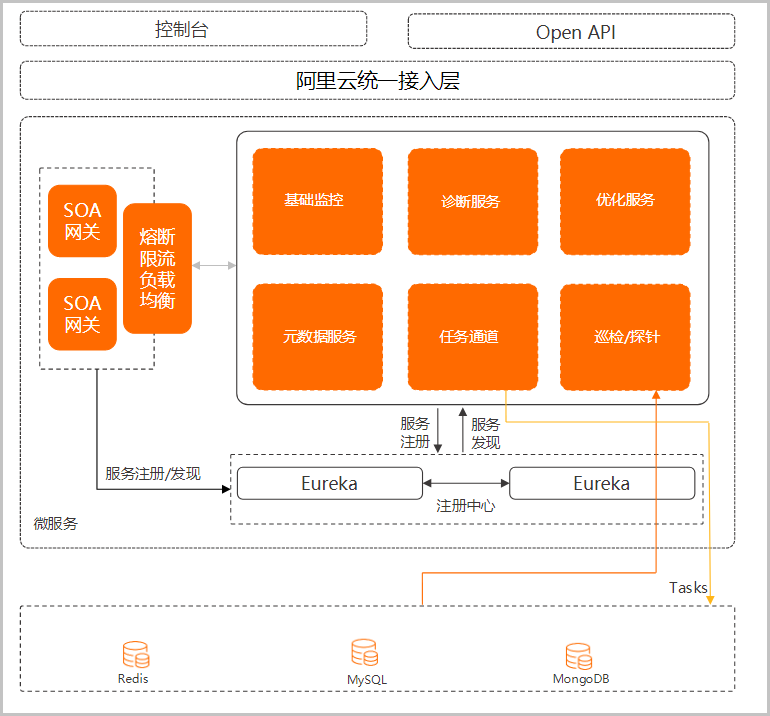
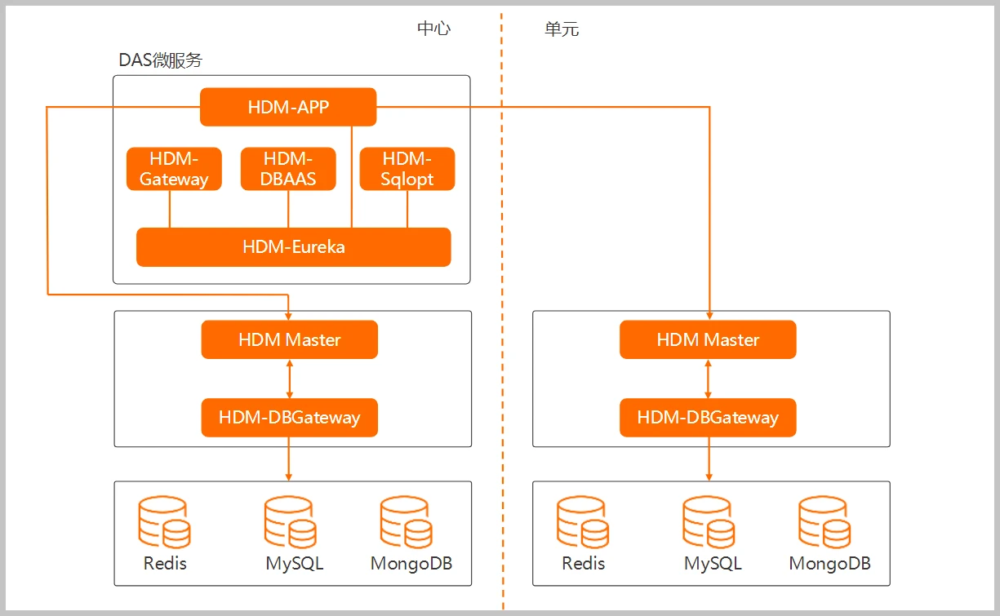
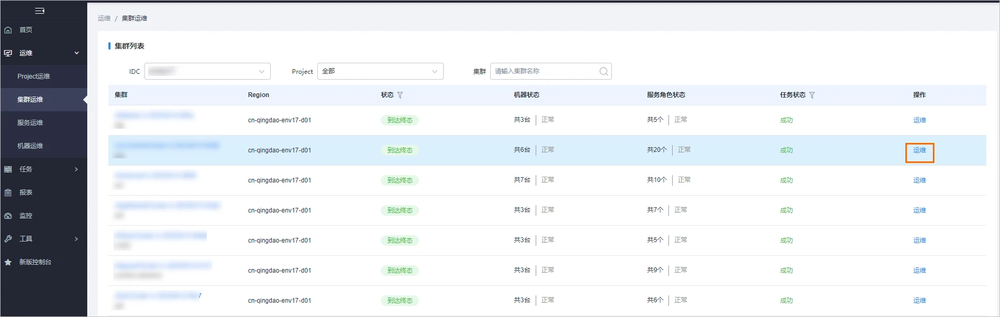
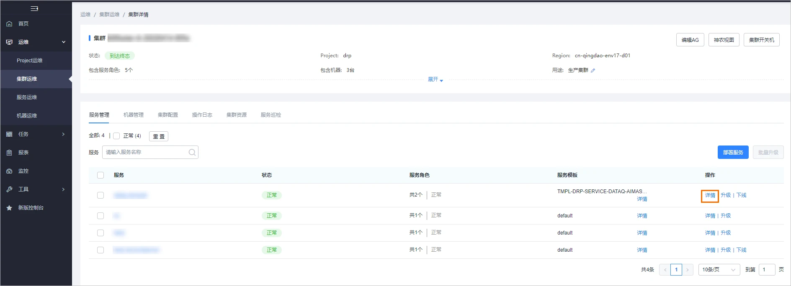
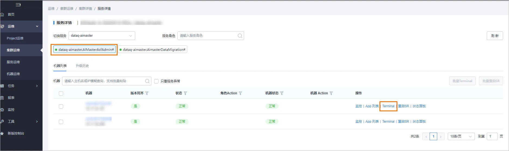
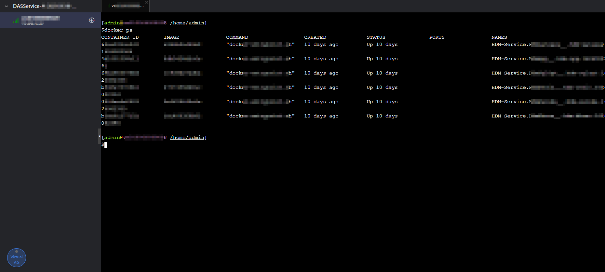
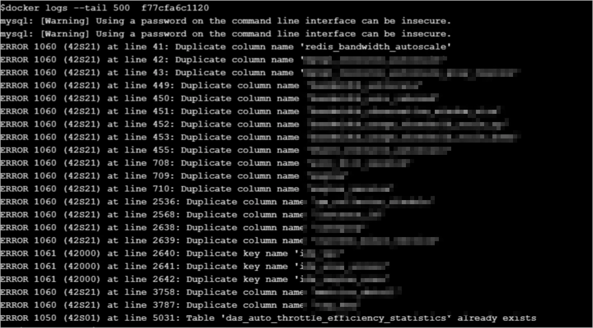

阿里云  
专有云  
数据库自治服务  
运维指南  
产品版本：v3.18.6-SP2607  
文档版本：20260729

**目录**

- [1.产品架构](#section-1)
- [2.组件架构](#section-2)
- [3.排查组件问题](#section-3)
- [4.组件命令及作用](#section-4)

<a id="section-1"></a>

# 1.产品架构

数据库自治服务DAS（Database Autonomy Service）是一种基于机器学习和专家经验实现数据库自感知、自修复、自优化、自运维及自安全的云服务，帮助您消除人工操作引发的服务故障，有效保障数据库服务的稳定、安全及高效。

DAS通过巡检或探针模块接入RDS MySQL、RDS PostgreSQL、云数据库Redis版和云数据库MongoDB版四种数据库引擎，为其提供诊断优化服务，提供了基础监控、诊断服务、优化服务、元数据服务、任务通道等功能：

- 基础监控：DAS提供基础监控功能，帮助您快速定位所有实例中CPU使用率、QPS、TPS等基础监控指标TOP 5的实例，使数据库实例运行在最佳状态。DAS能够基于机器学习和细粒度的监控数据，实现7 X 24小时的异常检测，相比基于阈值的告警方式，能够更为及时的发现数据库的异常变化。

- 诊断服务：DAS提供了实例的诊断报告，您可以发起诊断或查看诊断报告；也可通过DAS的一键诊断功能直观地查看数据库性能情况的全貌，快速确认是否存在异常，提升数据库性能。

- 优化服务：DAS提供自助优化和自动优化服务，可自动识别业务数据库实例工作负载上的慢查询，主动完成诊断，生成优化建议，评估后编排优化任务，自动完成后续的优化上线操作及性能跟踪。

- 元数据服务：DAS利用元数据实现数据标准化管理，并驱动合适粒度的数据服务，实现大数据时代的数据自服务平台，推动数据共享和价值释放。

- 任务通道：DAS可根据用户需求，通过Command Channel来下发给对应的数据库，保证了任务的并发和传输效率。

- 巡检/探针：DAS提供自动化巡检，在此过程中生成的可视化巡检报告可用于进一步分析和存档，便于日常运维和掌握站点的健康信息，大大减轻运维人员的排查问题负担和时间。

DAS采用微服务的技术架构，各功能模块通过服务注册的方式注册到eureka中，通过SOA网关提供统一的接口，DAS的系统架构图如下所示：



<a id="section-2"></a>

# 2.组件架构

DAS各个组件的集成构成了具体功能的实现，DAS组件采用中心和单元相结合的架构，方便您进行网络及设备运维。

DAS各个服务组件的架构如下：

- DAS Agent集群包含hdm-master和hdm-dbgateway服务组件。

- DAS Service集群包含hdm-eureka、hdm-sqlopt、hdm-redis、hdm-gateway、hdm-daskafka、hdm-dbaas、hdm-app服务组件。

如下图所示，DAS微服务组件部署在中心的地域，hdm-master和hdm-dbgateway服务组件，支持多地域，可部署在各个地域。



> 关于如何排查组件问题，详情请参见排查组件问题。
>
> **说明**

<a id="section-3"></a>

# 3.排查组件问题

当集群服务中的组件存在未达终态等异常，可以根据本文排查组件问题。

**前提条件**

- 已从部署人员或管理员处获取Apsara Uni-manager运维控制台的访问地址、用户名和密码。

  Apsara Uni-manager运维控制台访问地址格式为*ops*.asconsole.*intranet-domain-id*.com。

- 推荐使用Chrome浏览器。

**操作步骤**

1. 通过Apsara Uni-manager运维控制台进入飞天基础运维平台。

   <ol type="i">

   <li>

   在浏览器地址栏中，输入Apsara Uni-manager运维控制台的服务域名地址，按回车键。

   </li>

   <li>

   输入正确的用户名及密码，并单击**登录**。

   > 登录Apsara Uni-manager运维控制台的用户名和密码请从部署人员或管理员处获
   >
   > **说明**
   >
   > 取。

   首次登录Apsara Uni-manager运维控制台时，需要修改登录用户名的密码，请按照提示完成密码修改。

   为提高安全性，密码必须满足以下要求：

   - 英文大小写字母

   - 阿拉伯数字（0~9）

   - 特殊符号，包括感叹号（！）、at（@）、井号（#）、美元符号（$）、百分号（%）等

   - 密码长度10~20个字符

   </li>

   <li>

   在Apsara Uni-manager运维控制台的顶部菜单栏单击**产品运维**。

   </li>

   <li>

   在**云平台运维**区域，单击**飞天基础运维平台**。

   </li>

   </ol>

2. 在左侧导航栏，选择**运维 > 集群运维**。

3. 在目标集群的右侧操作列，单击**运维**。

   

4. 进入集群，选择具体的服务，单击右侧操作列的**详情**。

   

5. 在**服务详情**页选择对应的**服务角色**，并在**机器列表**页签单击对应机器的**Terminal**进入到相应的宿主机中。

   

6. 进入到宿主机后，执行如下命令查询宿主机上的容器：

   ```bash
   docker ps
   ```

   

7. 执行如下命令查看对应容器下的日志信息。

   请求：

   ```bash
   docker logs --tail 500 <容器ID>
   ```

   返回示例如下：

   

8. 根据日志中的错误信息排查容器中状态异常的组件。

<a id="section-4"></a>

# 4.组件命令及作用

各个组件的集成构成了具体功能的实现，本文主要介绍DAS各个服务组件的相关命令、说明及影响。

**DAS Agent集群**

- hdm-master：

  该组件是hdm-dbgateway的服务端，用来管理hdm-dbgateway，同时也是和hdm-app交互的组件。

  | 命令 | 说明 | 影响 |
  | --- | --- | --- |
  | <code>Service hdm-master</code><br><code>restart</code> | 重启应用 | 重启前会先关闭hdm-master，关闭之后实例探测、实时性能和实例会话功能无法使用。 |
  | <code>Servicehdm-master stop</code> | 关闭应用 | 关闭hdm-master，关闭之后实例探测、实时性能和实例会话功能无法使用。 |

  > 默认无需配置。
  >
  > **说明**

- hdm-dbgateway：

  该组件是DAS核心组件，提供实例探测、指标采集和任务执行等功能。

  | 命令 | 说明 | 影响 |
  | --- | --- | --- |
  | <code>/opt/dbgateway/bin/dbgate</code><br><code>way-manager-d restart</code> | 重启应用 | 影响DAS所有诊断优化功能。 |
  | <code>/opt/dbgateway/bin/dbgate</code><br><code>way-manager-d stop</code> | 关闭应用 | 影响DAS所有诊断优化功能。 |

  > 默认无需配置，如有需要，您可以去  `/opt/dbgateway/conf/dbgateway.conf` 文件
  >
  > **说明**
  >
  > 地址下进行配置。

**DAS Service集群**

- hdm-eureka：

  该组件是DAS微服务中的服务注册和发现组件。

  | 命令 | 说明 | 影响 |
  | --- | --- | --- |
  | <code>sh /home/admin/hdm-</code><br><code>eureka/start.sh</code> | 重启应用 | 影响DAS微服务的服务发现和服务注册。 |
  | <code>sh /home/admin/hdm-</code><br><code>eureka/stop.sh</code> | 关闭应用 | 影响DAS微服务的服务发现和服务注册。 |

  > 默认无需配置。
  >
  > **说明**

- Hdm-gateway：

  该组件是DAS微服务的网关组件，用于进行统一鉴权、服务限流和熔断等操作。

  一般情况下无需配置，只有在依赖的Redis实例出现异常的情况下，需要修改Redis的访问地址，其修改方法如下：

  <ol type="i">

  <li>

  登录hdm-gateway所在的容器。

  </li>

  <li>

  执行命令： `env | grep REDIS_IP_LIST`

  </li>

  <li>

  得到Redis的实例列表，选择当前可用的IP填写到 `spring.redis.url` 中。

  </li>

  </ol>

  配置项如下表：

  | 配置 | 说明 | 取值范围 |
  | --- | --- | --- |
  | <code> spring.redis.ur </code>l | hdm-gateway所依赖的Redis实例的访问地址。 | 无 |

  | 命令 | 说明 | 影响 |
  | --- | --- | --- |
  | <code>sh /home/admin/hdm-</code><br><code>gateway/start.sh</code> | 重启应用 | 影响DAS所有接口调用。 |
  | <code>sh /home/admin/hdm-</code><br><code>gateway/stop.sh</code> | 关闭应用 | 影响DAS所有接口调用。 |

- Hdm-dbaas：

  该组件是DAS访问管控元数据模块的组件。

  | 命令 | 说明 | 影响 |
  | --- | --- | --- |
  | <code>sh /home/admin/hdm-</code><br><code>dbaas/start.sh</code> | 重启应用 | 影响DAS访问元数据的接口。 |
  | <code>sh /home/admin/hdm-</code><br><code>dbaas/stop.sh</code> | 关闭应用 | 影响DAS访问元数据的接口。 |

  > 默认无需配置，只有在依赖的Redis出现异常的情况下需要修改Redis的访问地址。
  >
  > **说明**

- Hdm-app：

  该组件是DAS核心组件，提供诊断优化相关的接口。

  | 命令 | 说明 | 影响 |
  | --- | --- | --- |
  | <code>sh /home/admin/hdm-</code><br><code>app/start.sh</code> | 重启应用 | 影响DAS诊断优化相关的接口。 |
  | <code>sh /home/admin/hdm-</code><br><code>app/stop.sh</code> | 关闭应用 | 影响DAS诊断优化相关的接口。 |

- Hdm-sqlopt：

  该组件是DAS的SQL诊断优化组件。

  | 命令 | 说明 | 影响 |
  | --- | --- | --- |
  | <code>sh /home/admin/hdm-</code><br><code>sqlopt/startall-</code><br><code>services.sh</code> | 重启应用 | 影响DAS的SQL诊断优化功能。 |
  | <code>sh /home/admin/hdm-</code><br><code>sqlopt/stopall-</code><br><code>services.sh</code> | 关闭应用 | 影响DAS的SQL诊断优化功能。 |

  > 默认无需配置，只有在依赖的Redis出现异常的情况下需要修改Redis的访问地址。
  >
  > **说明**

**附录**

您可以参考如下表格，找到各组件对应的相关日志文件名称及其查询路径。

<table>
  <tr>
    <th width="159">组件</th>
    <th>日志文件名及查询路径</th>
  </tr>
  <tr>
    <td>Hdm-eureka</td>
    <td><code>/home/admin/hdm-eureka/logs/eureka.log</code></td>
  </tr>
  <tr>
    <td>Hdm-gateway</td>
    <td><code>/home/admin/hdm-gateway/logs/gateway.log</code></td>
  </tr>
  <tr>
    <td>Hdm-dbaas</td>
    <td><code>/home/admin/hdm-dbaas/logs/hdm-dbaas.log</code></td>
  </tr>
  <tr>
    <td>Hdm-app</td>
    <td><code>/home/admin/hdm-app/logs/hdm-app.log</code></td>
  </tr>
  <tr>
    <td>Hdm-sqlopt</td>
    <td><code>• /home/admin/hdm-sqlopt/advisor /logs/advisor.log</code><br><code>• /home/admin/hdm-sqlopt/front /logs/front.log</code><br><code>• /home/admin/hdm-sqlopt/monitor /logs/monitor.log</code><br><code>• /home/admin/hdm-sqlopt/pp/logs/pp.log</code><br><code>• /home/admin/hdm-sqlopt/scheduler /logs/scheduler.log</code><br><code>• /home/admin/hdm-sqlopt/stats/logs/stats.log</code></td>
  </tr>
  <tr>
    <td>Hdm-master</td>
    <td><code>/opt/hdm-master/log/hdm-master.log</code></td>
  </tr>
  <tr>
    <td>Hdm-dbgateway</td>
    <td><code>/opt/dbgateway/log/dbgateway.log</code></td>
  </tr>
</table>
