阿里云  
专有云  
云监控  
最佳实践  
产品版本：v3.18.6-SP2607  
文档版本：20260729

**目录**

- [1.云服务器 ECS](#section-1)
    - [1.1. Linux实例CPU使用率或负载较高问题的排查与处理](#section-1-1)
    - [1.2. Windows实例CPU使用率较高问题的排查与处理](#section-1-2)
    - [1.3. Linux实例内存使用率较高问题的排查与处理](#section-1-3)
    - [1.4. Windows实例内存使用率较高问题的排查与处理](#section-1-4)
    - [1.5. Linux系统磁盘I/O负载较高问题的排查与处理](#section-1-5)
    - [1.6. Windows系统磁盘I/O负载较高问题的排查与处理](#section-1-6)
    - [1.7. Linux实例磁盘空间满问题的排查与处理](#section-1-7)
    - [1.8. Windows实例磁盘空间满问题的排查与处理](#section-1-8)
    - [1.9. GPU稳定性最佳实践](#section-1-9)
    - [1.10. CPU利用率高演练](#section-1-10)
    - [1.11. 内存溢出（OOM）演练](#section-1-11)
    - [1.12. 磁盘容量利用率高演练](#section-1-12)
    - [1.13. 磁盘IO高负载演练](#section-1-13)
- [2.容器服务 Kubernetes 版](#section-2)
    - [2.1. 节点异常问题排查](#section-2-1)
    - [2.2. 存储异常问题排查](#section-2-2)
    - [2.3. 节点池部署集最佳实践](#section-2-3)
- [3.文件存储 NAS](#section-3)
    - [3.1. 查看NAS容量监控](#section-3-1)
- [4.对象存储 OSS](#section-4)
    - [4.1. 访问OSS出现网络异常如何处理?](#section-4-1)
    - [4.2. OSS性能最佳实践](#section-4-2)
- [5.云解析DNS](#section-5)
    - [5.1. 域名解析请求量如何计算？](#section-5-1)
    - [5.2. 云解析DNS如何实现故障切换](#section-5-2)
- [6.负载均衡](#section-6)
    - [6.1. 如何修改监听的健康检查配置？](#section-6-1)
    - [6.2. ALB健康检查异常排查方法](#section-6-2)
- [7.检索分析服务 Elasticsearch版](#section-7)
    - [7.1. 集群负载不均问题的分析方法及解决方案](#section-7-1)
    - [7.2. 集群磁盘使用率过高和read_only问题的排查与处理方法](#section-7-2)
    - [7.3. fielddata内存使用率高问题的排查与处理方法](#section-7-3)
- [8.实时计算 Flink版](#section-8)
    - [8.1. 检查点和快照超时的诊断方法与调优策略](#section-8-1)
    - [8.2. 废弃或恢复监控指标](#section-8-2)
- [9.实时数仓 Hologres](#section-9)
    - [9.1. 连接数管理](#section-9-1)
    - [9.2. 监控指标常见问题](#section-9-2)
    - [9.3. 基于Paimon的Hologres Serverless数据湖解决方案](#section-9-3)
- [10.云原生大数据计算服务 MaxCompute](#section-10)
    - [10.1. 项目空间](#section-10-1)
    - [10.2. 小文件优化及作业诊断常见问题](#section-10-2)
    - [10.3. 合并小文件](#section-10-3)
    - [10.4. 数据重排](#section-10-4)
- [11.云数据RDS](#section-11)
    - [11.1. RDS PostgreSQL CPU利用率高问题](#section-11-1)
    - [11.2. RDS PostgreSQL慢SQL问题](#section-11-2)
    - [11.3. RDS MySQL内存使用问题](#section-11-3)
    - [11.4. RDS MySQL慢SQL问题](#section-11-4)
    - [11.5. RDS MySQL空间不足问题](#section-11-5)
    - [11.6. RDS MySQL I/O高问题](#section-11-6)
    - [11.7. RDS MySQL活跃线程数高问题](#section-11-7)
    - [11.8. RDS SQL Server CPU使用率高问题](#section-11-8)
    - [11.9. RDS SQL Server I/O高问题](#section-11-9)
    - [11.10. RDS SQL Server空间不足问题](#section-11-10)
    - [11.11. 空间管理](#section-11-11)
    - [11.12. RDS SQL Server出现死锁时的处理方法](#section-11-12)
- [12.数据传输服务DTS](#section-12)
    - [12.1. 常见问题](#section-12-1)
    - [12.2. 如何解决增量迁移延迟或同步延迟](#section-12-2)
    - [12.3. 如何解决全量迁移慢或迁移卡住](#section-12-3)
- [13.云数据库 MongoDB版](#section-13)
    - [13.1. 排查MongoDB CPU使用率高的问题](#section-13-1)
    - [13.2. 回收磁盘碎片以提升磁盘利用率](#section-13-2)
    - [13.3. 设置数据分片以充分利用Shard性能](#section-13-3)
    - [13.4. 解决因磁盘空间耗尽导致的锁定或无法写入问题](#section-13-4)
    - [13.5. 报错与异常处理](#section-13-5)
- [14.云数据库Redis](#section-14)
    - [14.1. 如何处理数据倾斜](#section-14-1)
    - [14.2. 排查实例CPU使用率高的问题](#section-14-2)
    - [14.3. 排查实例内存使用率高的问题](#section-14-3)
    - [14.4. 排查实例流量使用率高的问题](#section-14-4)
    - [14.5. 大Key和热Key](#section-14-5)
        - [14.5.1. Top Key统计](#section-14-5-1)
        - [14.5.2. 离线全量Key分析](#section-14-5-2)
        - [14.5.3. 通过读写分离缓解热点Key问题](#section-14-5-3)
- [15.云原生多模数据库 Lindorm](#section-15)
    - [15.1. 监控报警最佳实践](#section-15-1)
    - [15.2. 问题汇总](#section-15-2)
- [16.云原生数据仓库AnalyticDB](#section-16)
    - [16.1. 查询过程中报磁盘超出限制是什么原因，应该怎么处理？](#section-16-1)
    - [16.2. 统计信息收集任务导致CPU负载过高，查询响应时间受到影响如何处理？](#section-16-2)
- [17.云原生数据库PolarDB MySQL版](#section-17)
    - [17.1. PolarDB MySQL版CPU使用率高](#section-17-1)
    - [17.2. PolarDB代理配置与流量异常](#section-17-2)
    - [17.3. PolarDB死锁](#section-17-3)
    - [17.4. InnoDB Physiological Logging](#section-17-4)
    - [17.5. 分析MySQL unique key check问题](#section-17-5)
    - [17.6. MySQL InnoDB空间文件](#section-17-6)
    - [17.7. PolarDB MySQL运维能力优化](#section-17-7)
    - [17.8. PolarDB MySQL计算能力优化](#section-17-8)
- [18.云原生数据库PolarDB PostgreSQL版](#section-18)
    - [18.1. 等待事件](#section-18-1)
    - [18.2. 锁](#section-18-2)
    - [18.3. SLRU](#section-18-3)
    - [18.4. 内存诊断](#section-18-4)
    - [18.5. 磁盘空间诊断](#section-18-5)
    - [18.6. CPU使用率高排查方法](#section-18-6)
- [19.云消息队列 Kafka 版](#section-19)
    - [19.1. 使用云消息队列 Kafka 版时出现消息堆积](#section-19-1)
    - [19.2. 删除Group后仍然收到消息堆积的告警信息](#section-19-2)
    - [19.3. 为什么告警堆积量和控制台堆积量不一致？](#section-19-3)
    - [19.4. 报警项状态显示数据不足怎么办？](#section-19-4)
    - [19.5. 发布者最佳实践](#section-19-5)
    - [19.6. 订阅者最佳实践](#section-19-6)
- [20.云消息队列 RabbitMQ版](#section-20)
    - [20.1. 消息保存时长是多久？](#section-20-1)
    - [20.2. 常用排查定位查询语句](#section-20-2)
- [21.云消息队列 RocketMQ 版](#section-21)
    - [21.1. 消息在云消息队列 RocketMQ 版中能保存多久？](#section-21-1)
    - [21.2. 配置消息监控告警实现风险预警](#section-21-2)
- [22.灾备管理](#section-22)
    - [22.1. 直接删除ECS容灾站点对报错，如何解决？](#section-22-1)
    - [22.2. 云盘异步复制型容灾启动复制时，控制台提示容灾站点实例规格异常如何处理？](#section-22-2)
- [23.云盾堡垒机](#section-23)
    - [23.1. 堡垒机连接性问题诊断工具](#section-23-1)
    - [23.2. 基础配置相关问题](#section-23-2)
- [24.漏洞扫描](#section-24)
    - [24.1. 漏洞修复最佳实践](#section-24-1)
- [25.数据库审计](#section-25)
    - [25.1. D100的Agent状态异常怎么办？](#section-25-1)
    - [25.2. 存储空间占满后如何处理？](#section-25-2)
    - [25.3. 数据库审计的审计日志、会话日志如何在日志服务SLS中查看？](#section-25-3)
- [26.特权管理访问](#section-26)
    - [26.1. 存储设置](#section-26-1)
    - [26.2. 基础配置相关问题](#section-26-2)
    - [26.3. 运维相关问题](#section-26-3)
- [27.裸金属算力平台 BMCP](#section-27)
    - [27.1. 告警治理](#section-27-1)
        - [27.1.1. NV](#section-27-1-1)
        - [27.1.2. PG](#section-27-1-2)
        - [27.1.3. MX](#section-27-1-3)
        - [27.1.4. KLX](#section-27-1-4)
        - [27.1.5. Hygon](#section-27-1-5)
        - [27.1.6. Huawei](#section-27-1-6)
- [28.附录](#section-28)
    - [28.1. Linux系统常用命令](#section-28-1)
    - [28.2. 如何配置Linux实例的swap分区？](#section-28-2)
    - [28.3. 使用atop工具监控Linux系统指标](#section-28-3)
    - [28.4. 如何配置Windows实例的虚拟内存？](#section-28-4)
    - [28.5. 如何处理Linux实例中的OOM问题？](#section-28-5)
    - [28.6. 获取Request ID](#section-28-6)
    - [28.7. RDS MySQL临时文件导致实例磁盘空间满且出现“锁定中”状态](#section-28-7)
    - [28.8. MySQL Binlog文件导致实例空间满的解决办法](#section-28-8)
    - [28.9. 使用OPTIMIZE TABLE命令释放MySQL实例的表空间](#section-28-9)
    - [28.10. MySQL系统文件导致实例空间满的解决方法](#section-28-10)
    - [28.11. RDS MySQL General log常见问题](#section-28-11)
    - [28.12. RDS MySQL数据文件占满磁盘空间导致出现“锁定中”状态](#section-28-12)
    - [28.13. 数据同步链路规格说明](#section-28-13)
    - [28.14. 数据迁移链路规格说明](#section-28-14)
    - [28.15. 使用telnet命令检测Lindorm端口连通性](#section-28-15)
    - [28.16. Lindorm连接问题与解决方法](#section-28-16)
    - [28.17. 日志字段说明](#section-28-17)

<a id="section-1"></a>

# 1.云服务器 ECS

<a id="section-1-1"></a>

## 1.1. Linux实例CPU使用率或负载较高问题的排查与处理

在使用 Linux 实例时，如果遇到实例运行卡顿或服务响应时长较长等问题，可能是 CPU 使用率或负载过高导致，您可以参考本文内容排查并解决问题。

> **说明**
>
> 内容来源于阿里云公共云云服务器ECS文档，排查方案仅供参考，需要根据实际环境进行操作。

**告警说明**

<table>
  <tr>
    <td>云产品</td>
    <td>报警指标</td>
    <td>报警名称</td>
    <td>报警描述</td>
    <td>报警规则</td>
    <td>报警等级</td>
  </tr>
  <tr>
    <td>ECS</td>
    <td>CPUUtilizatio n</td>
    <td>检测CPU利用率异常</td>
    <td>CPU利用率异常</td>
    <td>统计值(Average) 大于 90% 持续3个周期</td>
    <td>critical</td>
  </tr>
  <tr>
    <td>ECS</td>
    <td>CPUUtilizatio n</td>
    <td>检测CPU利用率异常</td>
    <td>CPU利用率异常</td>
    <td>统计值(Average) 大于 80% 持续3个周期</td>
    <td>warn</td>
  </tr>
</table>

**问题现象**

使用 Linux 系统的ECS实例时，出现如下现象。

- 系统运行卡顿、服务响应时长较长、应用性能下降等问题。

- 通过ECS控制台查看实例 CPU 使用率监控时，发现CPU使用率或者负载过高（参考值：当前CPU 使用率> 80%，可认为CPU使用率过高，当前负载值>0.5，可以认为负载值过高）。

- 收到CPU使用率或者负载超过设定阈值的告警信息。

**可能原因**

CPU最为常见的两个观测指标是CPU使用率和CPU负载情况。关于这两个指标值过高的可能原因如下。

- CPU使用率过高的常见原因：

  - 异常的进程或服务占用大量 CPU 资源，导致 CPU 使用率过高。

  - 业务程序及业务场景对实例的 CPU 性能要求较高，实例的 CPU 性能不足以支撑业务开展所需的 CPU 性能要求。

- CPU负载过高的常见原因：

  - 单一进程长时间占用CPU。

  - 磁盘或网络I/O出现瓶颈。

**排查步骤**

要定位实例CPU负载过高的问题，您可以参见下述操作步骤进行问题的排查定位。

**使用top命令查看进程的CPU资源使用信息**

top命令是Linux系统中常用的性能分析工具，可以实时显示系统中各进程的资源占用情况。

**使用介绍**

```text
top [-n] [-d] 
```

> **说明**
>
> [-n]：刷新次数。如果不指定刷新次数，但指定了刷新时间间隔，刷新操作不会自动停止，您需要按 `q` 键退出top程序。
>
> [-d] ：刷新时间间隔。

**使用示例**

1. 使用Workbench登录Linux实例。

   登录方法请参考《云服务器ECS》>《用户指南》中的《使用Workbench工具以SSH协议登录Linux实例》章节。

2. 执行如下命令，查看系统中各进程的资源占用情况，该命令会每2秒统计一次各进程相关信息，统计5次后退出top命令。

   ```text
   top -n 5 -d 2
   ```

   系统显示示例如下。 关于回显信息介绍的更多信息，请参见系统摘要信息及进程指标监控字段说明。

   ```text
   top - 17:27:13 up 27 days,  3:13,  1 user,  load average: 0.02, 0.03, 0.05
   Tasks:  94 total,   1 running,  93 sleeping,   0 stopped,   0 zombie
   %Cpu(s):  0.3 us,  0.1 sy,  0.0 ni, 99.5 id,  0.0 wa,  0.0 hi,  0.0 si,  0.1 st
   KiB Mem:   1016656 total,   946628 used,    70028 free,   169536 buffers
   KiB Swap:        0 total,        0 used,        0 free.   448644 cached Mem
   PID USER      PR  NI    VIRT    RES    SHR S %CPU %MEM     TIME+ COMMAND
   1 root        20   0   41412   3824   2308 S  0.0  0.4   0:19.01 systemd
   2 root        20   0       0      0      0 S  0.0  0.0   0:00.04 kthreadd
   ```

3. 在top命令的交互模式下，可以通过按键与top命令进行交互。关于交互模式的更多信息，请参见使用top命令的交互模式。

   - 通过 `P` 键，可以对CPU使用率进行倒序排列，方便定位系统中占用CPU较高的进程。

   - 通过 `M` 键，您可以对系统内存使用情况进行排序。如果有多核CPU，数字键1可以显示每核CPU的负载状况。

> **说明**
>
> - 如需查看每个进程ID对应的程序文件，您可以运行 `ll /proc/<PID>/exe` 命令，其中&lt;PID>需替换为实际的程序PID。
>
> - 如果已查询出占用CPU资源较多的非业务进程信息，需要终止该进程，您可以在top命令的交互模式下结束对应进程，具体操作，请参见通过PID结束对应进程。

**使用vmstat命令查看系统资源使用信息**

vmstat（Virtual Memory Statistics）是用于报告虚拟内存统计信息的命令，可以使用该命令，从系统维度查看操作系统的虚拟内存、进程、CPU等指标信息。

**常用参数说明**

vmstat命令的使用格式如下。

```text
vmstat [-n] [delay [count]] 
```

<table>
  <tr>
    <th width="89">参数选项</th>
    <th>说明</th>
  </tr>
  <tr>
    <td>-n</td>
    <td>只在开始时显示一次各字段名称。</td>
  </tr>
  <tr>
    <td>[delay]</td>
    <td>刷新时间间隔。如果不指定，只显示一条结果。</td>
  </tr>
  <tr>
    <td>[count]</td>
    <td>刷新次数。如果不指定刷新次数，但指定了刷新时间间隔，刷新操作不会自动停止，您需要按<code> Ctrl </code>+<code> C </code>键退出vmstat程序。</td>
  </tr>
</table>

**使用示例**

执行如下命令，使用vmstat每1秒统计一次各进程的CPU使用情况，连续统计4次。

```text
vmstat -n 1 4
```

返回示例类似如下。

```text
procs -----------memory---------- ---swap-- -----io---- -system-- ------cpu-----
 r  b   swpd   free   buff  cache   si   so    bi    bo   in   cs us sy id wa st
 1  0      0 2684984 310452 2364304    0    0     5    17   19   35  4  2 94  0  0
 0  0      0 2687504 310452 2362268    0    0     0   252 1942 4326  5  2 93  0  0
 0  0      0 2687356 310460 2362252    0    0     0    68 1891 4449  3  2 95  0  0
 0  0      0 2687252 310460 2362256    0    0     0     0 1906 4616  4  1 95  0  0
```

回显结果主要字段说明如下。

- r：表示系统中CPU等待处理的线程。一个CPU每次只能处理一个线程，所以该数值越大，通常表示系统运行越慢。

- us：用户模式消耗的CPU时间百分比。该值较高时，说明用户进程消耗的CPU时间比较多。如果该值长期超过50%，则需要对程序算法或代码等进行优化。

- sy：内核模式消耗的CPU时间百分比。

- wa：I/O等待消耗的CPU时间百分比。该值较高时，说明IO等待比较严重，这可能是磁盘大量作随机访问造成的，也可能是磁盘性能出现了瓶颈。

- id：处于空闲状态的CPU时间百分比。如果该值持续为0，同时sy是us的两倍，则通常说明系统面临CPU资源短缺。

**处理CPU使用率高的问题**

常见CPU占用较多问题的原因及解决方案如下。

| 问题现象 | 原因 | 解决方案 |
| --- | --- | --- |
| 异常用户程序或进程长时间占用大量CPU资源，导致CPU使用率和负载较高。 | 该程序为异常程序或进程，运行时占用过多CPU资源。 | • 通过在top工具定位到占用CPU资源较多的程序的PID，并通过如下方式结束进程。<br>警告在您结束进程前，请务必确保您了解该进程的相关信息，避免因误操作导致您的业务中断。<br>• 通过<code> sudo kill -15 &lt;PID&gt; </code>来结束该进程。<br>• 在top命令交互模式下结束进程，具体操作，请参见通过PID结束对应进程。<br>• 如果怀疑进程为恶意程序，您可以对其进行查杀。 |
| 正常用户程序或进程长时间占用大量CPU资源。导致CPU使用率和负载较高。 | 该程序为正常业务程序或进程，运行时占用过多CPU资源。 | 如果实例出现CPU性能瓶颈，您可以结合实际情况选择相应的处理策略。<br>• 升级实例规格<strong>。</strong>相关操作。请参见《云服务器ECS》&gt;《用户指南》中的《变更实例规格》章节。<br>• 优化业务程序。 |
| 单个业务程序或进程偶发CPU使用率及负载较高，但持续时间较短，且发生频率较低。 | 业务程序需要优化，以解决特殊业务场景（加解密，高并发等）触发的CPU资源占用过高问题。 | 优化业务程序。 |
| 没有单个程序或进程占用大量CPU资源，但整体CPU使用率较高，负载较低。 | 当前实例的服务正常运行所需CPU资源性能大于实例的CPU性能。 | 如果实例出现CPU性能瓶颈，您可以选择升级实例规格<strong>。</strong>相关操作，请参见《云服务器ECS》&gt;《用户指南》中的《变更实例规格》章节。 |

**常见问题**

**CPU使用率较低但负载较高**

**问题现象**

当前Linux系统没有业务程序运行。通过top命令观察，发现CPU使用率不高，但是CPU负载（load average）却非常高，如下图所示。

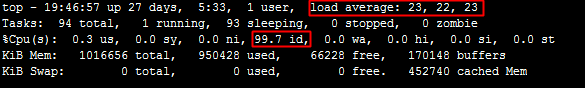

**可能原因**

该问题可能是因为僵尸（zombie）进程过多导致。load average是对CPU负载进行评估的，其值越高说明其任务队列越长，处于等待执行的任务越多。

**解决方案**

您可以通过 `ps -axjf` 命令查看是否存在<strong>D+</strong>状态进程，该状态是指不可中断的睡眠状态。

处于该状态的进程无法终止，也无法自行退出，只能通过恢复其依赖的资源或者重启系统来解决。

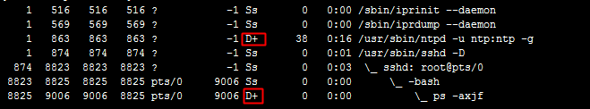

**kswapd0进程占用CPU较高**

**问题现象**

ECS实例运行卡顿，使用 `top` 命令查看，kswapd0进程占用了99% CPU。

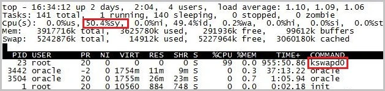

**可能原因**

出现该问题可能是系统此时在持续进行换页操作，导致占用大量CPU资源。

kswapd0是虚拟内存管理中负责换页的进程，当ECS实例物理内存不足时，kswapd0会执行换页操作，换页操作会消耗大量的CPU资源。

**解决方案**

您可以通过修改vm.swappiness内核参数来控制交换空间的大小，来解决kswapd0进程占用CPU较高的问题。

1. 使用Workbench登录Linux实例。

   登录方法请参考《云服务器ECS》>《用户指南》中的《使用Workbench工具以SSH协议登录Linux实例》章节。

2. 通过调整swappiness参数解决kswapd0进程占用CPU较高的问题，具体操作，请参见调整swappiness参数。

**CPU使用率过高但通过top命令查询不到异常进程**

**问题现象**

使用ECS实例的过程中，如果遇到CPU使用率高达100%等异常情况，且无法通过top、htop等命令查询到消耗CPU资源的具体进程。

**可能原因**

该问题可能是系统遭遇计算机病毒或恶意程序攻击导致。

**解决方案**

1. 查看云监控监控数据。

   <ol type="i">

   <li>

   登录ECS控制台。

   </li>

   <li>

   在左侧导航栏，单击**实例ID。**

   </li>

   <li>

   单击**监控**页签，在**操作系统监控**页签下，查看该主机的**CPU使用率**并记录CPU使用率变高的具体时间点。

   </li>

   </ol>

2. 查看Linux系统相关的命令修改记录。

   以下示例以top命令为例进行演示，实际操作中，您需要替换为实际需要查看的命令，如ps等。

   <ol type="i">

   <li>

   使用Workbench登录Linux实例。

   登录方法请参考《云服务器ECS》>《用户指南》中的《使用Workbench工具以SSH协议登录Linux实例》章节。

   </li>

   <li>

   查看命令文件状态信息。

   执行如下命令，查看当前Linux系统命令文件状态信息。

   ```bash
   sudo stat /usr/bin/top
   ```

   回显信息示例如下。

   ```text
     File: /usr/bin/top
     Size: 134864          Blocks: 264        IO Block: 4096   regular file
   Device: 253,3   Inode: 658539      Links: 1
   Access: (0755/-rwxr-xr-x)  Uid: (    0/    root)   Gid: (    0/    root)
   Access: 2025-04-15 13:45:41.240874421 +0800
   Modify: 2024-09-26 16:44:05.000000000 +0800
   Change: 2025-04-15 13:45:24.822222315 +0800
    Birth: 2025-04-15 13:45:24.804221600 +0800
   ```

   关于回显信息中的参数说明如下。

   - Access：文件最后一次被访问时间。

   - Modify：文件内容最后一次被修改的时间。

   - Change：文件元数据被修改的时间。

   - Birth：文件被创建的时间。

   </li>

   <li>

   查看命令软件包信息。

   **Alibaba Cloud Linux/CentOS/RHEL/Fedora**

   <ol type="a">

   <li>

   查看命令文件路径

   ```bash
   sudo which top
   ```

   回显结果示例如下。

   ```text
   /usr/bin/top
   ```

   </li>

   <li>

   查看软件所属软件包

   ```bash
   sudo rpm -qf /usr/bin/top
   ```

   回显结果示例如下，说明该命令属于procps-ng软件包。

   ```text
   procps-ng-3.3.10-28.el7.x86_64
   ```

   </li>

   </ol>

   <ol type="i" start="100">

   <li>

   通过包管理工具校验软件包

   ```bash
   sudo rpm -V procps-ng
   ```

   - 回显结果为空，表明文件正常。

   - 回显结果示例如下，说明文件有被修改。

     ```text
     ??5?????? c /etc/sysctl.conf
     ```

     - `??5??????`  表示文件属性（如权限、所有者、大小等）与原始安装记录不符。

     - `c`  表示文件内容被修改。

   </li>

   </ol>

   **Ubuntu/Debian**

   <ol type="a">

   <li>

   查看命令文件路径

   ```bash
   sudo which top
   ```

   回显结果示例如下。

   ```text
   /usr/bin/top
   ```

   </li>

   <li>

   查看软件所属软件包

   ```bash
   sudo dpkg -S /usr/bin/top
   ```

   回显结果示例如下，说明该命令属于procps软件包。

   ```text
   procps: /usr/bin/top
   ```

   </li>

   </ol>

   <ol type="i" start="100">

   <li>

   通过包管理工具校验软件包

   ```bash
   sudo dpkg -V procps
   ```

   - 回显结果为空，表明文件正常。

   - 回显结果示例如下，说明文件有被修改。

     ```text
     ??5?????? c /etc/sysctl.conf
     ```

     - `??5??????`  表示文件属性（如权限、所有者、大小等）与原始安装记录不符。

     - `c`  表示文件内容被修改。

   </li>

   </ol>

   > **说明**
   >
   > 如果您通过上述检查后，依然怀疑您的命令被恶意程序修改过，您可以选择使用包管理工具重新安装该软件包。

   </li>

   </ol>

3. 查询当前实例是否连接到异常域名。

   运行如下命令，查看网络接口的连接信息。

   ```text
   iftop -i [$Device] -n -P
   ```

   > **说明**
   >
   > [$Device]请替换为当前系统使用的网卡，如eth0。

   系统显示类似如下，若您没有连接过crypto-pool.fr，则crypto-pool.fr是异常域名。

   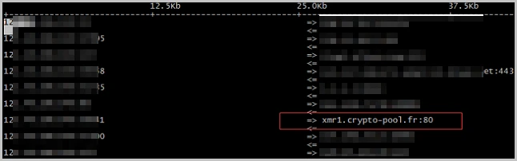

4. 综合以上表现，如果在某个时间点之后，您的实例出现异常进程占用CPU资源过高，且实例有与异常域名或IP的网络通讯，那么很有可能您的实例遭遇了病毒或是恶意软件的攻击，您可以参考如下步骤处理该问题。

   <ol type="i">

   <li>

   通过快照备份ECS实例数据，具体操作，请参见《云服务器ECS》>《用户指南》中的《创建快照》章节。

   </li>

   <li>

   使用遭遇病毒或恶意软件攻击之前的有效快照恢复实例数据，具体操作，请参见《云服务器ECS》>《用户指南》中的《使用快照回滚云盘》章节。

   </li>

   <li>

   通过云安全中心对实例进行病毒查杀，提升主机防护能力。

   </li>

   </ol>

**相关文档**

- 关于Windows系统CPU使用率高的问题排查及解决方案，请参见Windows实例CPU使用率较高问题的排查与处理。

- 如果需要提前采集CPU指标以便分析异常，您可以使用atop工具。相关内容，请参见使用atop工具监控Linux系统指标。

<a id="section-1-2"></a>

## 1.2. Windows实例CPU使用率较高问题的排查与处理

在Windows系统中，可以通过任务管理器、资源监视器等工具查看CPU使用率。本文主要介绍Windows实例中CPU使用率较高问题的排查及解决方法。

> **说明**
>
> 内容来源于阿里云公共云云服务器ECS文档，排查方案仅供参考，需要根据实际环境进行操作。

**告警说明**

<table>
  <tr>
    <td>云产品</td>
    <td>报警指标</td>
    <td>报警名称</td>
    <td>报警描述</td>
    <td>报警规则</td>
    <td>报警等级</td>
  </tr>
  <tr>
    <td>ECS</td>
    <td>CPUUtilizatio n</td>
    <td>检测CPU利用率异常</td>
    <td>CPU利用率异常</td>
    <td>统计值(Average) 大于 90% 持续3个周期</td>
    <td>critical</td>
  </tr>
  <tr>
    <td>ECS</td>
    <td>CPUUtilizatio n</td>
    <td>检测CPU利用率异常</td>
    <td>CPU利用率异常</td>
    <td>统计值(Average) 大于 80% 持续3个周期</td>
    <td>warn</td>
  </tr>
</table>

**问题现象**

使用 Windows 系统的ECS实例时，出现如下现象。

- 系统运行卡顿、服务响应时长较长、应用性能下降等问题。

- 通过ECS控制台查看实例 CPU 使用率监控时，发现CPU使用率或者负载过高（参考值：当前CPU 使用率> 80%，可认为CPU使用率过高，当前负载值>0.5，可以认为负载值过高）。

- 收到CPU使用率或者负载超过设定阈值的告警信息。

**可能原因**

CPU使用率较高可能有以下原因。

- ECS实例遭到病毒木马入侵。

- ECS实例中第三方杀毒软件运行占用较高CPU资源。

- ECS实例中应用程序异常、驱动异常、高I/O使用率或高中断处理的应用程序。

**排查步骤使用资源监视器查看CPU使用率指标**

在Windows实例中，可以通过任务管理器、资源监视器等工具定位CPU使用率过高的问题。本文以Windows Server 2022系统为例，介绍如何通过资源监视器定位CPU使用率较高的问题。

1. 通过VNC方式连接ECS实例。

   具体信息，请参见《云服务器ECS》>《用户指南》中的《通过VNC连接实例》章节。

2. 在桌面底部单击**搜索**按钮，并输入 **资源监视器** ，单击**确定**。

3. 在**资源监视器**页面中，查看各进程是否有CPU使用率过高的现象。

   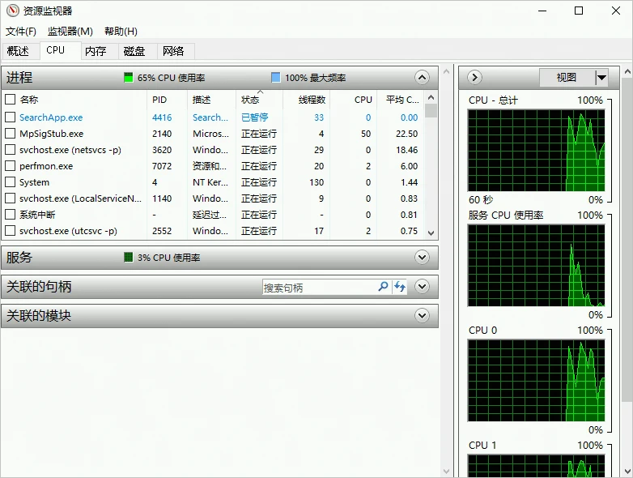

4. 针对占用CPU资源较高的进程，查看对应的进程ID和进程的程序名。

5. 打开任务管理器，任务管理器的**详细信息**页签下，找到之前资源监视器查看到的异常进程名和对应的PID。右键单击进程名称，选择**打开文件所在的位置(O)**，查看进程是否为恶意程序。

**处理CPU使用率高的问题**

常见CPU占用较多问题的原因及解决方案如下：

| 问题现象 | 原因 | 解决方案 |
| --- | --- | --- |
| 异常用户程序或进程长时间占用大量CPU资源，导致CPU使用率和负载较高。 | 该程序为异常程序或进程，运行时占用过多CPU资源。 | • 通过资源监视器工具定位到占用CPU资源较多的程序的PID，并通过资源监视器或任务管理器结束进程。<br>警告在您结束进程前，请务必确保您了解该进程的相关信息，避免因误操作导致您的业务中断。<br>• 如果怀疑进程为恶意程序，您可以对其进行查杀。 |
| 正常用户程序或进程长时间占用大量CPU资源。导致CPU使用率和负载较高。 | 该程序为正常业务程序或进程，运行时占用过多CPU资源。 | 如果实例出现CPU性能瓶颈，您可以结合实际情况选择相应的处理策略。<br>• 升级实例规格。相关操作。请参见《云服务器ECS》&gt;《用户指南》中的《变更实例规格》章节。<br>• 优化业务程序。 |
| 单个业务程序或进程偶发CPU使用率及负载较高，但持续时间较短，且发生频率较低。 | 业务程序需要优化，以解决特殊业务场景（加解密，高并发等）触发的CPU资源占用过高问题。 | 优化业务程序。 |
| 没有单个程序或进程占用大量CPU资源，但整体CPU使用率较高，负载较低。 | 当前实例的服务正常运行所需CPU资源性能大于实例的CPU性能。 | 如果实例出现CPU性能瓶颈，您可以选择升级实例规格。相关操作，请参见《云服务器ECS》&gt;《用户指南》中的《变更实例规格》章节。 |

**常见工具**

以下是关于Windows系统中定位CPU使用率过高问题工具的简要说明。

**任务管理器**

任务管理器可以直观查看应用程序列表，定位占用CPU较高的应用程序，如下是任务管理器页面。

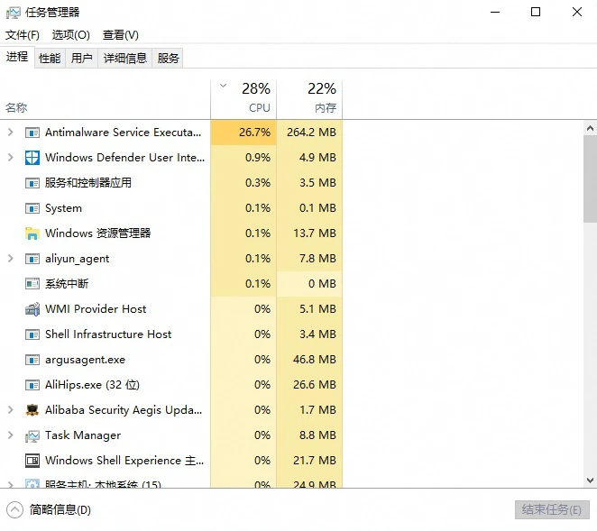

在性能页面检查CPU使用率时，右键单击CPU使用率图示，单击**将图形更改为(H) > 逻辑处理器(L)**。

如下图显示了2个逻辑CPU的使用率。

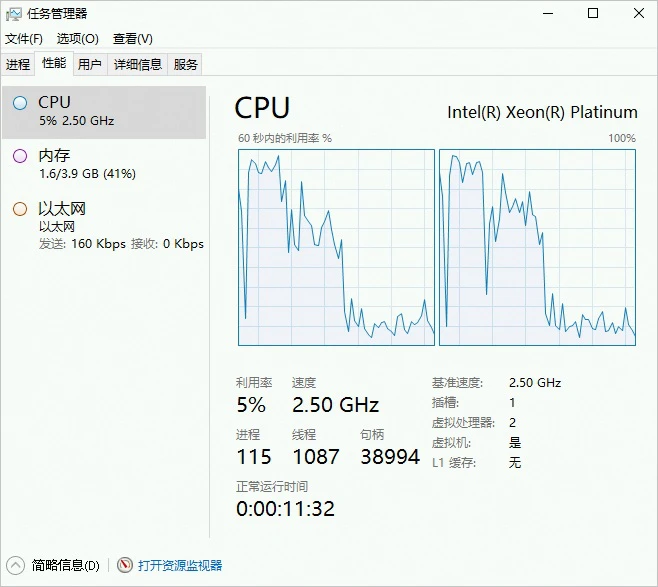

当单个进程的CPU使用率飙升至接近100%时，而其它进程的CPU使用率变化不大，则可能是网络I/O处理造成的。

**资源监视器**

资源监视器可以直观查看CPU使用率，还可以通过句柄和模块搜索对应的进程。


**Process Explorer**

Process Explorer是一款Microsoft Sysinternals工具，通过配置正确的Symbols，检查对应应用程序的线程调用的Call Stack，用以定位可能的问题驱动。下载Process Explorer工具，请参见Process Explorer。

如下图是Process Explorer工具使用页面。

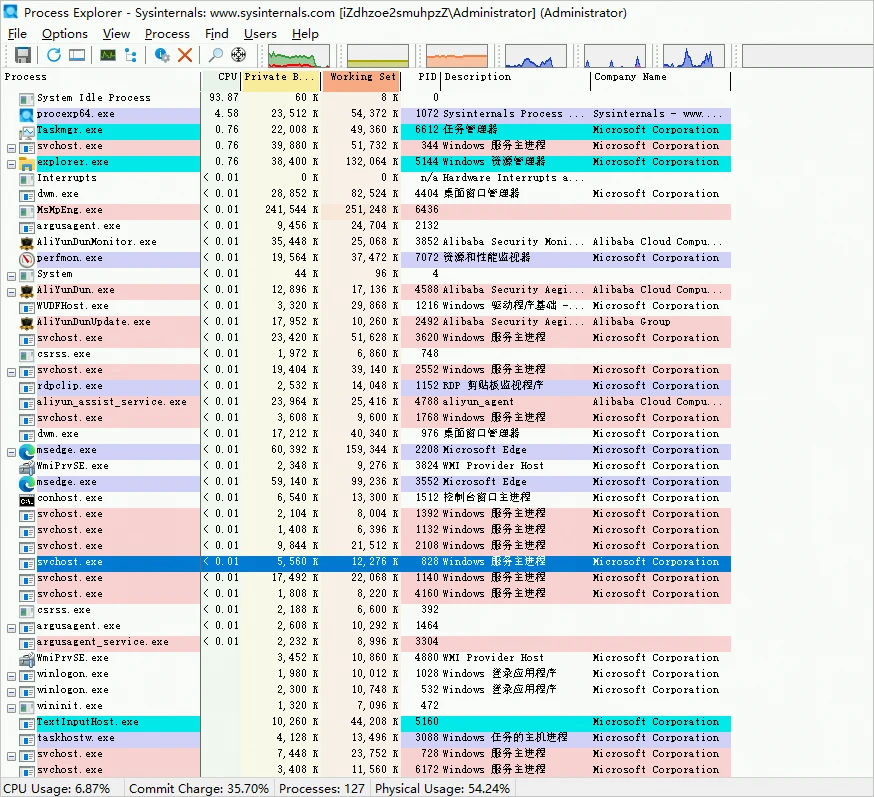

**性能监视器**

性能监视器（Performance Monitor）是Microsoft专业收集各个组件性能计数器的工具。对于系统CPU资源消耗，有多个Counter来检查。

Performance有如下三个核心参数。

- `\Processor(_Total)\% Processor Time` ：CPU执行非空闲线程的时间百分比。 `\Processor(_Total)\% Processor Time` = `\Processor(*)\% User Time` + `\Processor(*)\% Privileged Time` .

- `\Processor(*)\% User Time` ：表示处理器用于执行程序代码的时间消耗，可以确定哪个应用程序或函数调用消耗了较多的时间。

- `\Processor(*)\% Privileged Time` ：应用程序在内核中执行系统调用（例如驱动、IRP，上下文切换等）操作的时间。如果操作系统花费多于30%的时间在 `Privileged Time` ，则说明实例正在进行高I/O吞吐相关的操作。

  当 `% Privileged Time` 很高时，需要进一步检查 `% DPC Time` 、 `% Interrupt Time` 以及 `Context Switches/sec` 的情况。

  - 高 `% DPC Time` 、 `% Interrupt Time` 表示未知设备出现大量的操作或者很差的性能问题。

  - `Context Switch` 值很高时，说明内核在CPU上对进程或线程进行切换。更多详情，请参见The Case of the 2 Million Context Switches和Mark Russinovich's The Case of the System Process CPU Spikes。

    `Context Switches/sec` 值很高表示有大量的线程处于Ready状态，需要减少线程的数量解决问题。

**相关文档**

如需解决Linux系统CPU使用率高的问题，请参见Linux实例CPU使用率或负载较高问题的排查与处理。

<a id="section-1-3"></a>

## 1.3. Linux实例内存使用率较高问题的排查与处理

> **说明**
>
> 内容来源于阿里云公共云云服务器ECS文档，排查方案仅供参考，需要根据实际环境进行操作。

**告警说明**

<table>
  <tr>
    <td>云产品</td>
    <td>报警指标</td>
    <td>报警名称</td>
    <td>报警描述</td>
    <td>报警规则</td>
    <td>报警等级</td>
  </tr>
  <tr>
    <td>ECS</td>
    <td>memory_use dutilization</td>
    <td>检测内存使用率异常</td>
    <td>内存使用率异常</td>
    <td>统计值(Average) 大于 90% 持续3个周期</td>
    <td>critical</td>
  </tr>
  <tr>
    <td>ECS</td>
    <td>memory_use dutilization</td>
    <td>检测内存使用率异常</td>
    <td>内存使用率异常</td>
    <td>统计值(Average) 大于 80% 持续3个周期</td>
    <td>warn</td>
  </tr>
</table>

**问题现象**

使用Linux实例时，出现如下现象。

- 系统运行卡顿、服务响应时长较长、应用性能下降等问题。

- 通过ECS控制台查看实例内存使用率监控时，发现内存使用率过高（参考值：当前内存使用率> 80%，可认为内存使用率过高）。

- 收到内存使用率超过设定阈值的告警信息。

**可能原因**

引起内存使用率过高的常见原因如下：

- 异常的进程或服务占用大量内存，导致内存使用率过高。

- 业务程序的业务流量过大，实例的物理内存不足以支撑业务开展所需的内存用量。

**排查步骤**

**使用top查看实例内存使用率情况**

您可以参考以下步骤，解决内存使用率过高的问题。

1. 远程连接ECS实例。具体操作，请参见《云服务器ECS》>《用户指南》中的《连接实例》章节。

2. 查找当前实例中占用内存过高的进程。

   执行如下命令，从进程维度查看CPU、内存等资源的使用情况。

   ```text
   top
   ```

   > **说明**
   >
   > 您可输入小写字母 
   >
   > `q`退出top命令。

   按下 `M` 键以按照进程的内存使用率进行排序，回显信息示例如下，表明进程号为13183的进程占用最多的内存。

   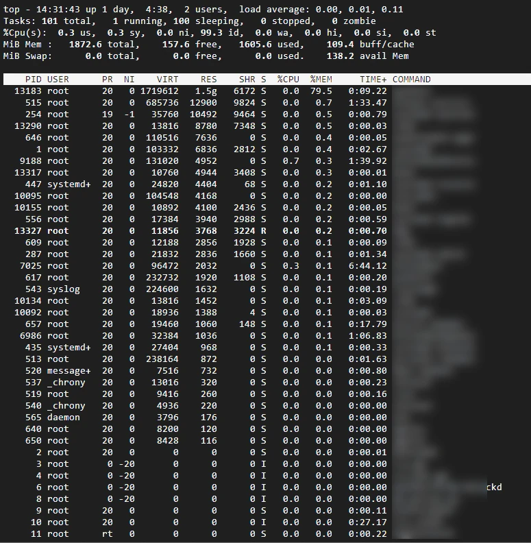

   系统摘要信息及进程指标监控字段说明如下：

   系统摘要信息字段说明：

   <table>
     <tr>
       <th width="106">参数（行）</th>
       <th>说明</th>
     </tr>
     <tr>
       <td>top</td>
       <td>主机名、信息采样日期和时间点。<br>• 当前时间<br>• up：系统启动时间<br>• user：当前登录用户数<br>• load average：系统负载，即任务队列的平均长度。三个数值分别为 1分钟、5分钟、15分钟前到现在的平均值。</td>
     </tr>
     <tr>
       <td>Tasks</td>
       <td>各种状态的进程的统计信息。<br>• total：所有任务个数。<br>• running：运行中进程个数。<br>• sleeping：休眠中进程个数。<br>• stopped：停止进程个数。<br>• zombie：僵尸进程个数。</td>
     </tr>
     <tr>
       <td>%Cpu(s)</td>
       <td>cpu使用率情况。<br>• us：用户空间占CPU的百分比<br>• sy：内核空间占CPU的百分比<br>• ni：用户进程空间改变过优先级<br>• id：空闲CPU占用率<br>• wa：等待输入输出的CPU时间百分比<br>• hi：硬中断占用百分比<br>• si：软中断占用百分比<br>• st：steal time</td>
     </tr>
     <tr>
       <td>MiB Mem</td>
       <td>内存使用量统计。<br>• total：物理内存总量。<br>• free：空闲内存量<br>• used：使用的内存量<br>• buff/cache：用作内核缓存的内存量。</td>
     </tr>
     <tr>
       <td>MiB Swap</td>
       <td>交换分区使用量统计。<br>• total：交换区内存总量。<br>• free：空闲交换区总量。<br>• used：使用的交换区总量。<br>• avail Mem：缓冲的交换区总量。</td>
     </tr>
   </table>

   进程列表指标信息字段说明：

   <table>
     <tr>
       <th width="113">参数（列）</th>
       <th>说明</th>
     </tr>
     <tr>
       <td>PID</td>
       <td>进程的ID</td>
     </tr>
     <tr>
       <td>USER</td>
       <td>进程所属用户</td>
     </tr>
     <tr>
       <td>PR</td>
       <td>进程的优先级别，越小越优先被执行</td>
     </tr>
     <tr>
       <td>NI</td>
       <td>进程优先值</td>
     </tr>
     <tr>
       <td>VIRT</td>
       <td>进程占用的虚拟内存</td>
     </tr>
     <tr>
       <td>RES</td>
       <td>进程占用的物理内存</td>
     </tr>
     <tr>
       <td>SHR</td>
       <td>进程使用的共享内存</td>
     </tr>
     <tr>
       <td>S</td>
       <td>进程的状态。<br>• R：运行状态。<br>• S：休眠状态。<br>• Z：僵死状态。<br>• D：不可中断的睡眠状态<br>• T：跟踪/停止状态</td>
     </tr>
     <tr>
       <td>%CPU</td>
       <td>进程占用CPU的使用率</td>
     </tr>
     <tr>
       <td>%MEM</td>
       <td>进程使用的物理内存和总内存的百分比</td>
     </tr>
     <tr>
       <td>TIME+</td>
       <td>该进程启动后占用的总的CPU时间，即占用CPU使用时间的累加值。</td>
     </tr>
     <tr>
       <td>COMMAND</td>
       <td>进程启动命令名称</td>
     </tr>
   </table>

**处理内存使用率高的问题**

内存占用较多问题的原因及解决方案如下。

| 问题现象 | 原因 | 解决方案 |
| --- | --- | --- |
| 单个用户程序或进程长时间占用大量内存 | 异常程序，进程占用过多内存。 | • 通过在top工具定位到占用内存资源较多的程序的PID，并通过如下方式结束进程。警告在您结束进程前，请务必确保您了解该进程的相关信息，避免因误操作导致您的业务中断。<br>• 通过<code> sudo kill -15 &lt;PID&gt; </code>来结束该进程。<br>• 在top命令交互模式下结束进程，具体操作，请参见通过PID结束对应进程。<br>• 如果怀疑进程为恶意程序，您可以对其进行查杀。 |
| 正常用户程序或进程长时间占用大量内存资源。导致内存使用率较高。 | 该程序为正常业务程序或进程，运行时占用过多内存资源。 | 如果实例出现内存资源瓶颈，您可以结合实际情况选择相应的处理策略。<br>• 升级实例规格。相关操作。请参见《云服务器ECS》&gt;《用户指南》中的《变更实例规格》章节。<br>• 优化业务程序。 |
| 单个程序或进程偶发过高内存占用，但持续时间较短，且发生频率较低。 | 程序或进程中存在瞬时流量或定时任务，导致短时间内消耗大量内存。 | • 临时方案：可以通过设置swap分区缓解该问题。具体操作，请参见如何配置Linux实例的swap分区？<br>• 永久方案：升级实例规格，相关操作，请参见《云服务器ECS》&gt;《用户指南》中的《变更实例规格》章节。 |
| 没有单个程序或进程占用大量内存资源，但整体内存使用率较高 | 当前实例的服务正常运行所需内存资源大于实例的内存规格。 | 如果实例出现内存资源瓶颈，您可以选择升级实例规格。相关操作，请参见《云服务器ECS》&gt;《用户指南》中的《变更实例规格》章节。 |

**相关文档**

- 关于Windows系统内存使用率高的问题排查及解决方案，请参见Windows实例内存使用率较高问题的排查与处理。

- 如果需要提前采集内存指标以便分析异常，您可以使用atop工具。相关内容，请参见使用atop工具监控Linux系统指标。

<a id="section-1-4"></a>

## 1.4. Windows实例内存使用率较高问题的排查与处理

当您在使用Windows实例时遇到内存使用率过高，导致实例运行卡顿等问题时，您可以通过排查以定位内存使用率过高的原因，本文为您介绍上述问题的排查方法及解决方案。

> **说明**
>
> 内容来源于阿里云公共云云服务器ECS文档，排查方案仅供参考，需要根据实际环境进行操作。

**告警说明**

<table>
  <tr>
    <td>云产品</td>
    <td>报警指标</td>
    <td>报警名称</td>
    <td>报警描述</td>
    <td>报警规则</td>
    <td>报警等级</td>
  </tr>
  <tr>
    <td>ECS</td>
    <td>memory_use dutilization</td>
    <td>检测内存使用率异常</td>
    <td>内存使用率异常</td>
    <td>统计值(Average) 大于 90% 持续3个周期</td>
    <td>critical</td>
  </tr>
  <tr>
    <td>ECS</td>
    <td>memory_use dutilization</td>
    <td>检测内存使用率异常</td>
    <td>内存使用率异常</td>
    <td>统计值(Average) 大于 80% 持续3个周期</td>
    <td>warn</td>
  </tr>
</table>

> **说明**
>
> 本文档以Windows 2022为例，不同版本的操作系统界面略有差异，请您以目标操作系统的实际界面为准。

**问题现象**

使用Windows系统的ECS实例时，出现系统卡顿、内部服务响应慢等问题。在通过ECS控制台查看实例内存监控时，发现内存使用率过高或收到内存使用率过高的告警信息。

**可能原因**

引起内存使用率过高的常见原因如下：

- 异常的进程或服务占用大量内存，导致内存使用率过高。

- 业务程序的业务流量过大，实例的物理内存不足以支撑业务开展所需的内存用量。

**排查步骤**

要定位内存使用率过高的问题，您可以参见下述操作步骤进行问题的排查定位。

**查看实例总内存使用率**

您可以使用Windows系统中默认安装的**任务管理器**应用查看内存使用情况。

1. 使用Workbench终端连接登录Windows实例（RDP）。

   详情见《云服务器ECS》>《用户指南》中的《使用Workbench工具以RDP协议登录Windows实例》。

2. 在Windows桌面左下角的搜索框中，输入**任务管理器**，并按 `Enter`键 打开**任务管理器**程序。

3. 在**任务管理器**界面中单击**性能**页签，然后单击左侧**内存**，查看内存使用情况。

   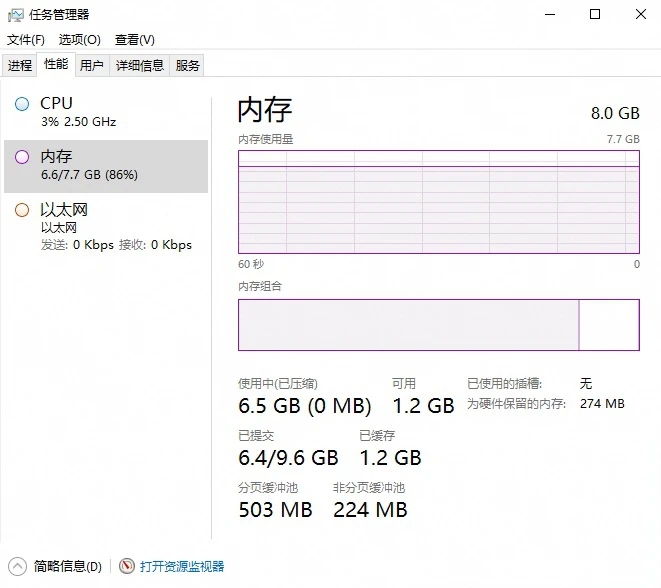

**查看进程占用的内存详情**

您可以使用Windows系统中默认安装的**资源监视器**应用查看内存等资源的使用情况，该应用支持查看单个进程的内存使用情况。

1. 在Windows桌面左下角的搜索框中，输入**资源监视器**，并按 `Enter`键 打开**资源监视器**程序。

2. 在**资源监视器**界面中单击**内存**页签，以查看各个进程的内存使用情况。对于各个进程，可以通过查看<strong>提交（KB）</strong>内存的大小，以确定消耗内存较多的进程，然后根据您的实际业务，判断此进程是否正常。

   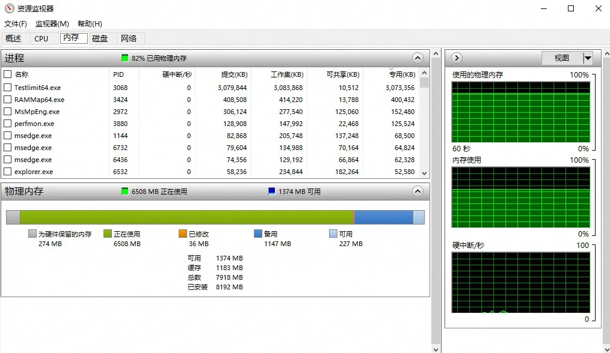

   物理内存的使用包含如下几个部分，各部分的相关说明如下。

   - 为硬件保留的内存：系统为硬件设备预留的一部分物理内存。这些设备包括 GPU（图形处理单元）、声卡、网卡、蓝牙模块等。被保留的内存无法被普通应用程序直接使用，而是专门用于支持硬件设备的正常运行。

   - 正在使用内存：由进程、驱动程序、操作系统使用的内存。

   - 已修改内存：内容必须写入磁盘才能用于其他用途的内存。

   - 备用内存：包含未使用的缓存数据和代码的内存。

   - 可用内存：不包含任何有效数据，当进程、驱动程序、操作系统需要申请更多内存时优先使用的内存。

   - 缓存：当文件被打开时，系统会将文件保存在缓存中，方便下次快速读写。Windows 2008 R2及以后版本，对该缓存的使用做了限制，有一部分物理内存不会被缓存使用，保证系统即使在缓存过大的时候，也有可用物理内存，满足程序使用需求。

**查看系统进程占用的内存详情**

如果通过任务管理器及性能监视器没有找到占用内存较多的进程信息，但实例内存使用率很高，那么很有可能是系统进程的内存占用过高，此时，您可以使用微软官方提供的**RAMMap**工具进一步分析问题，该工具支持查看系统进程在 RAM 中缓存了多少文件数据，以及内核和设备驱动程序使用了多少 RAM等功能。

1. 下载并解压**RAMMap**工具。

   访问微软官网下载RAMMap工具，下载后对压缩文件进行解压。

2. 双击打开**RAMMap**工具并查看内存占用详情。

   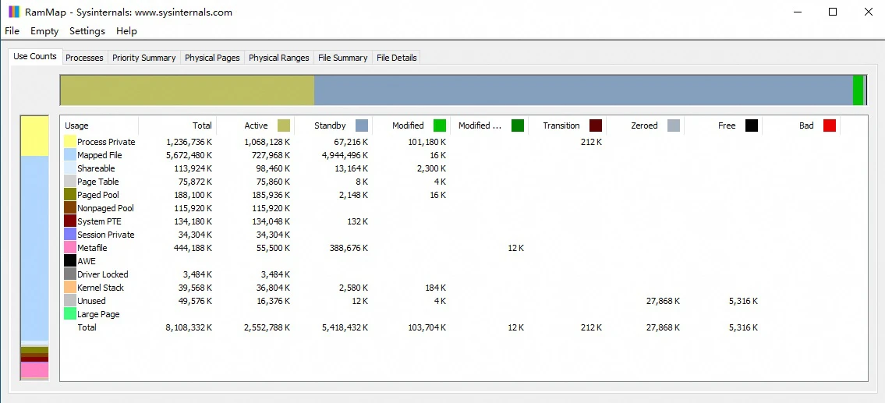

   RAMMap工具的选项卡会以不同方式显示资源使用信息，每个选项卡的显示方式说明如下。

   - 使用计数：按类型和分页列表列出的使用情况摘要。

   - 进程：进程工作集大小。

   - 优先级摘要：确定备用列表大小优先级。

   - 物理页：所有物理内存的每页使用量。

   - 物理范围：物理内存地址。

   - 文件摘要：RAM 中的文件数据（按文件显示）。

   - 文件详细信息：按文件显示的各个物理页。

**处理内存使用率高的问题**

内存占用较多问题的原因及解决方案如下。

| 问题现象 | 原因 | 解决方案 |
| --- | --- | --- |
| 单个用户程序或进程长时间占用大量内存 | 异常程序，进程占用过多内存。 | 通过在<strong>任务管理器</strong>或者<strong>资源监视器</strong>中定位到内存占用较多的程序，在该程序上右键点击，并选择<strong>结束程序</strong>即可。<br>警告在您结束进程前，请务必确保您了解该进程的相关信息，避免因误操作导致您的业务中断。 |
| • 没有单个程序或进程占用大量内存。<br>• 占用大量内存的程序或进程是正常的业务进程。 | 当前实例的服务正常运行所需内存容量大于实例的物理内存量。 | 建议您评估升级实例规格，以增加实例的物理内存。相关操作，请参见《云服务器ECS》&gt;《用户指南》中的《变更实例规格》章节。 |
| 单个程序或进程偶发过高内存占用，但持续时间较短，且发生频率较低。 | 程序或进程中存在瞬时流量或定时任务，导致短时间内消耗大量内存。 | • 临时方案：可以通过设置虚拟内存缓解该问题。具体操作，请参见如何配置Windows实例的虚拟内存？<br>• 永久方案：升级实例规格，相关操作，请参见《云服务器ECS》&gt;《用户指南》中的《变更实例规格》章节。 |

**相关文档**

关于处理Linux系统内存使用率高的问题，请参见Linux实例内存使用率较高问题的排查与处理。

<a id="section-1-5"></a>

## 1.5. Linux系统磁盘I/O负载较高问题的排查与处理

使用Linux实例时，如果遇到实例运行卡顿或文件读写速度较慢等问题，可能是磁盘I/O 负载高导致，您可以参考本文内容排查并解决问题。

> **说明**
>
> 内容来源于阿里云公共云云服务器ECS文档，排查方案仅供参考，需要根据实际环境进行操作。

**告警说明**

<table>
  <tr>
    <td>云产品</td>
    <td>报警指标</td>
    <td>报警名称</td>
    <td>报警描述</td>
    <td>报警规则</td>
    <td>报警等级</td>
  </tr>
  <tr>
    <td>ECS</td>
    <td>disk_io_util</td>
    <td>检测磁盘IO利用率异常</td>
    <td>磁盘IO利用率异常</td>
    <td>统计值(Average) 大于 90% 持续3个周期</td>
    <td>critical</td>
  </tr>
  <tr>
    <td>ECS</td>
    <td>disk_io_util</td>
    <td>检测磁盘IO利用率异常</td>
    <td>磁盘IO利用率异常</td>
    <td>统计值(Average) 大于 80% 持续3个周期</td>
    <td>warn</td>
  </tr>
</table>

**问题现象**

使用Linux系统的ECS实例时，出现如下现象。

- 出现系统运行卡顿、文件读写变慢、应用性能下降或内部服务响应慢等问题。

- 通过ECS控制台查看实例磁盘I/O负载监控时，发现磁盘I/O负载过高（参考值：当前I/O读写≥该云盘I/O性能指标的80%，可认为I/O负载过高）。

- 收到了磁盘I/O负载超过设定阈值的告警信息。

**可能原因**

引起磁盘I/O负载过高的常见原因如下：

- 异常的进程或服务占用大量磁盘I/O，导致磁盘I/O负载过高。

- 业务程序及业务场景对实例的磁盘I/O负载要求较高，实例的磁盘I/O性能不足以支撑业务开展所需的磁盘I/O性能要求。

**排查步骤**

要定位磁盘I/O负载过高的问题，您可以参见下述操作步骤进行问题的排查定位。

**使用iostat查看整体磁盘I/O负载**

iostat是一款Linux系统中监控I/O性能的工具，可以查看磁盘整体I/O负载情况。

1. 执行如下命令，查看系统I/O负载情况。

   ```bash
   sudo iostat -d -m 3 5
   ```

   **遇到“iostat: command not found” 问题如何处理？**

   > **说明**
   >
   > - -d：仅显示设备统计信息，不显示CPU使用情况。
   >
   > - -m：以MB为单位显示。
   >
   > - 3：统计时间间隔。
   >
   > - 5：统计次数。

   回显结果示例如下。

   ```text
   Linux 5.10.134-18.al8.x86_64 (iZbpxxxxxxxxxxxxxxxaqhZ)  04/07/2025      _x86_64_        (4 CPU)

   Device             tps    MB_read/s    MB_wrtn/s    MB_read    MB_wrtn
   vda             145.67         0.00       126.81          0        380
   vdb               0.00         0.00         0.00          0          0

   Device             tps    MB_read/s    MB_wrtn/s    MB_read    MB_wrtn
   vda             161.33         0.00       127.24          0        381
   vdb               0.00         0.00         0.00          0          0
   ......
   ```

   显示结果中各项参数说明如下。更多参数说明，请运行 `man iostat` 查看。

   - Device：磁盘名称。

   - tps：每秒I/O请求数。

   - MB_read/s：每秒文件读取速度。

   - MB_wrtn/s：每秒文件写入速度。

   - MB_read：读取的文件大小。

   - MB_wrtn：写入的文件大小。

> **重要**
>
> - 若检测到磁盘I/O实际性能显著低于阿里云官方公布的块存储服务性能指标，建议您优先检查磁盘分区是否完成4K对齐。通过确认分区对齐状态，可快速定位因对齐配置不当导致的性能损耗问题。
>
> - 关于块存储性能的更多信息，请参见《云服务器ECS》>《用户指南》中的《存储集》章节。

**使用iotop查看进程的磁盘IO负载**

iotop是一个用来监视磁盘I/O使用状况的工具，可以查看单个进程的磁盘IO负载。

1. 执行如下命令，安装iotop。

   - Alibaba Cloud Linux / CentOS / Fedora

     ```bash
     sudo zypper install -y iotop
     ```

   - Ubuntu / Debian

     ```bash
     sudo apt install -y iotop
     ```

   - openSUSE

     ```bash
     sudo zypper install -y iotop
     ```

2. 执行如下命令，查看磁盘I/O负载。

   ```bash
   sudo iotop -P -k -d 3
   ```

   > **说明**
   >
   > - -P：显示PID。
   >
   > - -k：以KB为单位显示。
   >
   > - -d：统计时间间隔，单位为秒，默认值为1。

   回显结果示例如下。如需退出程序，请按 `q` 键。

   ```text
   Total DISK READ :       0.00 K/s | Total DISK WRITE :   80373.45 K/s
   Actual DISK READ:       0.00 K/s | Actual DISK WRITE:  127781.85 K/s
   ```

   ```text
       PID  PRIO  USER     DISK READ  DISK WRITE  SWAPIN     IO>    COMMAND                                        
   ```

   ```text
     17250 be/4 root        0.00 K/s 80354.87 K/s  0.00 % 95.99 % dd if=/dev/zero of=/mnt/dev_vdb/swap bs=1M count=10240
     15192 be/3 root        0.00 K/s    6.64 K/s  0.00 % 60.56 % [jbd2/vdb1-8]
     17152 be/4 root        0.00 K/s    0.00 K/s  0.00 % 59.55 % [kworker/u8:0
   ......
   ```

   关于回显结果的参数说明如下，更多参数说明，可执行 `iotop -h` 查询。

   - PID：进程ID。

   - DISK READ：进程读操作的I/O速度。

   - DISK WRITE：进程写操作的I/O速度。

   - SWAPIN：进程等待从交换空间（Swap Space）换入（Swap In）内存页面所占用的 CPU 时间百分比。

   - IO>：进程因 I/O 等待所占用的 CPU 时间百分比（包括 Swap 换入和磁盘 I/O 等待）。

   - COMMAND：进程的命令名称。

> **说明**
>
> 如果定位到kjournald进程占用较高磁盘I/O资源，建议修改对应分区的Journal size参数解决该问题。具体操作，请参见kjournald进程占用较高磁盘I/O资源问题处理。

**处理磁盘I/O负载高的问题**

常见磁盘I/O负载高问题原因及解决方案如下。

<table>
  <tr>
    <th>问题现象</th>
    <th>原因</th>
    <th>解决方案</th>
  </tr>
  <tr>
    <td>异常用户程序或进程长时间占用大量磁盘I/O资源。</td>
    <td>该程序为异常程序或进程，运行时占用过多磁盘I/O资源。</td>
    <td>通过在iotop工具定位到占用磁盘I/O资源较多的程序的PID，并通过<code> sudo kill -9 &lt;PID&gt; </code>来结束该进程。<br>警告在您结束进程前，请务必确保您了解该进程的相关信息，避免因误操作导致您的业务中断。</td>
  </tr>
  <tr>
    <td>正常用户程序或进程长时间占用大量磁盘I/O资源。</td>
    <td>该程序为正常业务程序或进程，运行时占用过多磁盘I/O资源。</td>
    <td rowspan="2">如果云盘出现磁盘I/O性能瓶颈，您可以根据实际情况选择对应的处理方案：<br>• 变更云盘类型：当使用SSD云盘出现磁盘I/O瓶颈时，您可以选择更换云盘类型为ESSD，以提升云盘性能。相关操作，请参见《云服务器ECS》&gt;《用户指南》中的《变更云盘类型》章节。<br>• 升级实例规格：当升级云盘规格时，遇到实例规格限制无法升级性能更好的云盘时，您可以先升级实例规格。相关操作，请参见《云服务器ECS》&gt;《用户指南》中的《变更实例规格》。</td>
  </tr>
  <tr>
    <td>• 没有单个程序或进程占用大量磁盘I/O资源。<br>• 单个程序或进程偶发磁盘I/O占用过高，但持续时间较短，且发生频率较低。</td>
    <td>当前实例的服务正常运行所需磁盘I/O资源性能大于实例的磁盘I/O性能。</td>
  </tr>
</table>

**常见问题**

**检查磁盘分区是否完成4K对齐**

您可以参考如下操作，以确认当前磁盘设备分区是否完成4k对齐。下述示例中以 `/dev/vdb1` 设备分区为例，实际使用中请您根据实际情况替换设备分区名称。

> **说明**
>
> 4K对齐是指将分区的起始位置和文件系统的逻辑簇的起始位置与硬盘的物理扇区大小（通常为4KB）进行对齐。以提升磁盘I/O性能。

1. 运行如下命令，查看设备分区是否4k对齐。

   ```bash
   sudo parted /dev/vdb1 align-check optimal 1
   ```

   回显结果示例如下，表明该设备分区已经4K对齐。您可以跳过下述步骤，继续查看处理磁盘I/O负载高的问题。

   ```text
   1 aligned
   ```

2. 如果设备分区没有完成4k对齐，请手动进行处理，具体操作，请参见《云服务器ECS》>《用户指南》中的《重新初始化数据盘》章节。

3. 在完成设备分区4k对齐后，您可以重新查询磁盘I/O读写性能，以确认是否达到阿里云官方公布的块存储服务性能指标。

**kjournald进程占用较高磁盘I/O资源问题处理**

- 问题现象：使用iotop排查分析，发现kjournald进程占用了大量磁盘I/O资源。

- 问题原因：该问题通常是由于 `ext3` 文件系统设置的 `Total Journal size` 太小导致。

  **说明**

  kjournald是ext3文件系统的核心日志管理进程，负责执行I/O操作的日志记录与同步。在持续向ext3文件系统执行写入操作时，该进程会不断累加日志占用空间。当预写日志（Journal）的大小达到预先设定的Total Journal Size阈值时，系统将触发强制日志落盘操作。此时，进程会阻塞后续写入请求直至同步完成，可能引发CPU资源争用加剧、内存占用激增及整体I/O性能下降等问题。

- 解决方案：

  - 使用Workbench登录Linux实例。

    详情见《云服务器ECS》>《用户指南》中的《使用Workbench工具以RDP协议登录Windows实例》。

  - 执行如下命令，查看相应分区的Journal size大小。下述示例中以 `/dev/vdb1` 设备为例，实际使用中请您根据实际情况替换设备名称。

    ```bash
    sudo dumpe2fs /dev/vdb1 | grep -i Journal
    ```

    回显结果示例如下，表示 `/dev/xvda1` 分区的 `Total Journal size` 为64 M。

    ```text
    dumpe2fs 1.46.0 (29-Jan-2020)
    Filesystem features:      has_journal ext_attr resize_inode dir_index filetype sparse_super large_file
    Journal inode:            8
    Journal backup:           inode blocks
    Journal features:         (none)
    Total journal size:       64M
    Total journal blocks:     16384
    Journal sequence:         0x00000001
    Journal start:            0
    ```

  - 执行如下命令，查询该设备当前的挂载信息。

    ```bash
    sudo mount | grep /dev/vdb1
    ```

    回显信息示例如下，记录该信息以供后续重新挂载该设备。

    ```text
    /dev/vdb1 on /mnt/dev_vdb type ext4 (rw,relatime)
    ```

  - 执行如下命令，卸载该设备。

    ```bash
    sudo umount /dev/vdb1
    ```

    > **说明**
    >
    > 如果卸载时出现如下报错： `umount: /mnt/dev_vdb: target is busy` ，表明当前设备正在使用，您可以结束等待该设备。

  - 执行如下命令，修改Journal size大小为 400 M。您可以结合实际业务场景、块存储设备参数等因素进行综合考虑，以设置合适的Total journal size大小。

    ```bash
    sudo mke2fs -J size=400 /dev/vdb1
    ```

  - 修改完成后，运行如下命令，重新挂载该设备。

    ```bash
    sudo mount /dev/vdb1 /mnt/dev_vdb/
    ```

**相关文档**

- 关于Windows系统磁盘I/O负载高的问题排查定位，请参见Windows系统磁盘I/O负载较高问题的排查与处理。

- 关于如何使用atop工具监控Linux系统指标的更多信息，请参见使用atop工具监控Linux系统指标。

<a id="section-1-6"></a>

## 1.6. Windows系统磁盘I/O负载较高问题的排查与处理

在使用Windows实例时，如果遇到实例运行卡顿或文件读写速度较慢等问题，可能是磁盘I/O 负载高导致，您可以参考本文内容排查并解决问题。

> **说明**
>
> 内容来源于阿里云公共云云服务器ECS文档，排查方案仅供参考，需要根据实际环境进行操作。

**告警说明**

<table>
  <tr>
    <td>云产品</td>
    <td>报警指标</td>
    <td>报警名称</td>
    <td>报警描述</td>
    <td>报警规则</td>
    <td>报警等级</td>
  </tr>
  <tr>
    <td>ECS</td>
    <td>disk_io_util</td>
    <td>检测磁盘IO利用率异常</td>
    <td>磁盘IO利用率异常</td>
    <td>统计值(Average) 大于 90% 持续3个周期</td>
    <td>critical</td>
  </tr>
  <tr>
    <td>ECS</td>
    <td>disk_io_util</td>
    <td>检测磁盘IO利用率异常</td>
    <td>磁盘IO利用率异常</td>
    <td>统计值(Average) 大于 80% 持续3个周期</td>
    <td>warn</td>
  </tr>
</table>

**问题现象**

使用Windows系统的ECS实例时，出现如下现象。

- 出现系统运行卡顿、文件读写变慢、应用性能下降或内部服务响应慢等问题。

- 通过ECS控制台查看实例磁盘I/O负载监控时，发现磁盘I/O负载过高（参考值：当前I/O读写≥该云盘I/O性能指标的80%，可认为I/O负载过高）。

- 收到了磁盘I/O负载超过设定阈值的告警信息。

**可能原因**

引起磁盘I/O负载过高的常见原因如下：

- 异常的进程或服务占用大量磁盘I/O，导致磁盘I/O负载过高。

- 业务程序及业务场景对实例的磁盘I/O负载要求较高，实例的磁盘I/O性能不足以支撑业务开展所需的磁盘I/O性能要求。

**排查步骤**

要定位磁盘I/O负载过高的问题，您可以参见下述操作步骤进行问题的排查定位。

**查看进程占用的磁盘I/O负载详情**

您可以使用Windows系统中默认安装的**资源监视器**应用查看磁盘I/O负载等资源的使用情况，该应用支持查看单个进程的磁盘I/O负载情况。

1. 在Windows桌面左下角的搜索框中，输入**资源监视器**，并按 `Enter`键 打开**资源监视器**程序。

2. 在**资源监视器**界面中单击**磁盘**页签，以查看各个进程的磁盘I/O负载情况。

   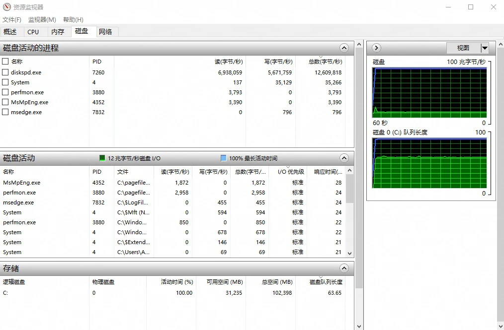

**处理磁盘I/O负载高的问题**

磁盘I/O负载高问题的原因及解决方案如下。

<table>
  <tr>
    <th>问题现象</th>
    <th>原因</th>
    <th>解决方案</th>
  </tr>
  <tr>
    <td>异常用户程序或进程长时间占用大量磁盘I/O资源。</td>
    <td>该程序为异常程序或进程，运行时占用过多磁盘I/O资源。</td>
    <td>通过在<strong>资源监视器</strong>中定位到占用磁盘I/O资源较多的程序，在该程序上右键单击，然后单击<strong>结束程序</strong>即可。警告在您结束进程前，请务必确保您了解该进程的相关信息，避免因误操作导致您的业务中断。</td>
  </tr>
  <tr>
    <td>正常用户程序或进程长时间占用大量磁盘I/O资源。</td>
    <td>该程序为正常业务程序或进程，运行时占用过多磁盘I/O资源。</td>
    <td rowspan="2">如果云盘出现磁盘I/O性能瓶颈，您可以根据实际情况选择对应的处理方案：<br>• 变更云盘类型：当使用SSD云盘出现磁盘I/O瓶颈时，您可以选择更换云盘类型为ESSD，以提升云盘性能。相关操作，请参见《云服务器ECS》&gt;《用户指南》中的《变更云盘类型》章节。<br>• 升级实例规格：当升级云盘规格时，遇到实例规格限制无法升级性能更好的云盘时，您可以先升级实例规格。相关操作，请参见《云服务器ECS》&gt;《用户指南》中的《变更实例规格》。</td>
  </tr>
  <tr>
    <td>• 没有单个程序或进程占用大量磁盘I/O资源。<br>• 单个程序或进程偶发磁盘I/O占用过高，但持续时间较短，且发生频率较低。</td>
    <td>当前实例的服务正常运行所需磁盘I/O资源性能大于实例的磁盘I/O性能。</td>
  </tr>
</table>

**相关文档**

关于Linux系统的I/O负载高问题的处理方案，请参见Linux系统磁盘I/O负载较高问题的排查与处理。

<a id="section-1-7"></a>

## 1.7. Linux实例磁盘空间满问题的排查与处理

通常情况下，您的Linux实例所拥有的磁盘空间是有限的。如果您的应用服务部署在Linux实例上，随着应用服务的持续运行和存储文件的不断增加，磁盘剩余空间将逐渐减少。当您的磁盘空间不足时，服务将无法继续将文件写入磁盘，从而可能导致服务异常。本文介绍判断磁盘空间不足的方法及其相应的解决方案。

> **说明**
>
> 内容来源于阿里云公共云云服务器ECS文档，排查方案仅供参考，需要根据实际环境进行操作。

**告警说明**

<table>
  <tr>
    <td>云产品</td>
    <td>报警指标</td>
    <td>报警名称</td>
    <td>报警描述</td>
    <td>报警规则</td>
    <td>报警等级</td>
  </tr>
  <tr>
    <td>ECS</td>
    <td>diskusage_uti lization</td>
    <td>检测磁盘使用率异常</td>
    <td>磁盘使用率异常</td>
    <td>统计值(Average) 大于 95% 持续3个周期</td>
    <td>critical</td>
  </tr>
  <tr>
    <td>ECS</td>
    <td>diskusage_uti lization</td>
    <td>检测磁盘使用率异常</td>
    <td>磁盘使用率异常</td>
    <td>统计值(Average) 大于 85% 持续3个周期</td>
    <td>warn</td>
  </tr>
</table>

**问题现象**

在Linux系统的云服务器ECS实例中创建文件或运行应用时，如出现 `No space left on device` 的错误提示，这表明您的磁盘空间已不足。此时，您需排查导致磁盘空间不足的原因，并根据具体情况采取相应措施以解决磁盘不足的问题。

**可能原因**

磁盘空间不足的问题通常有以下几类原因：

- 磁盘分区空间使用率达到100%。

- 磁盘分区Inode使用率达到100%。

- 磁盘存在已删除未释放的僵尸文件。

  > **说明**
  >
  > 已删除的文件可能由于在删除之前其文件句柄处于打开状态，从而导致在文件删除时未能释放文件空间。

- 挂载点被覆盖。

  > **说明**
  >
  > 如果原有文件系统的目录下已经存在大量文件，在该挂载点（目录）挂载新设备后，原挂载点将被覆盖。然而，您系统内的应用可能仍会继续对原有文件系统空间进行读写操作，此时可能会出现您的应用报告空间不足的情况，然而在使用 `df` 或 `du` 命令查看磁盘文件目录的容量使用情况时却无法反映出这一点。这是因为 `df` 或 `du` 命令统计的是当前挂载点所对应的分区的使用情况。

- Docker相关文件占用空间较大。

- inotify watches达到上限。

  > **说明**
  >
  > inotify是Linux系统中一种监控文件系统事件的机制，广泛应用于实时监控文件系统中的文件变化。该错误实际上与磁盘空间无关，并不表示磁盘存储空间已满。本文档对这一报错进行了补充说明，以便帮助您排查并解决该问题。

**排查方法和解决方案**

出现 `No space left on device` 错误提示的原因有多种，请根据具体问题的原因进行相应处理。

**说明**

以下排查方法和解决方案需要远程连接到需要安装的ECS实例。具体操作，请参见《云服务器ECS》>《用户指南》中的《使用Workbench工具以SSH协议登录Linux实例》章节。

> **警告**
>
> 在以下操作中，如需通过删除文件来释放磁盘空间，请务必在删除之前确认该文件已不再需要，以防止因删除文件导致的数据丢失或对您的业务产生不利影响。建议在手动删除文件之前进行磁盘备份，您可以选择自行拷贝文件，或通过快照方式进行数据备份。关于如何创建快照，请参见《云服务器ECS》>《用户指南》中的《创建快照》章节。

**磁盘分区空间使用率达到100%**

**排查方法**

检查磁盘的当前使用率，并识别高占用的文件。

1. 执行以下命令，查看磁盘使用率。

   ```text
   df -h
   ```

   回显信息如下所示。示例中分区 `/dev/vda3` 的使用率达到100%。

   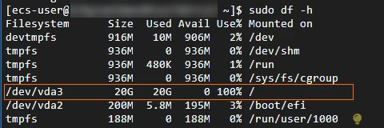

2. 执行以下命令，进入根目录，查看哪个目录占用磁盘空间较大。

   ```bash
   sudo du -sh /* | sort -rh | head -n 10
   ```

   回显信息如下所示。从图示中可以看出， `/home` 目录占用空间最大，因此需要继续查看 `/home` 目录下哪个文件或目录占用空间较大。请您根据实际情况进行操作。

   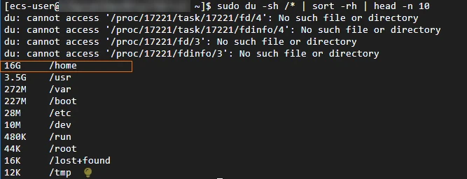

3. 执行以下命令，逐级查看哪个目录占用磁盘空间较大。

   例如在本示例中，进入较大的 `/home` 目录，继续查看 `/home` 目录下哪个文件或目录较大。

   ```bash
   sudo du -sh /home/* | sort -rh | head -n 10
   ```

   回显信息如下所示。从图示可以看出， `ecs-user` 目录占用了最大的存储空间，因此需要进一步检查ecs-user目录下的具体文件或子目录，以确定哪些项占用了较大空间。

   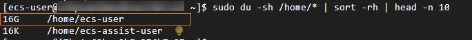

   以此类推，最终确定在 `/home/ecs-user/` 目录下，有无效的可删除的大文件。

   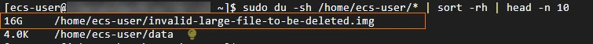

**解决方案**

请您根据业务场景及实际情况进行判断，并采取相应措施。

- 清理占用空间较大且不再需要的文件或目录：结合业务情况判断，删除不再需要的文件或目录。

- 扩容或新购云盘：如果业务不允许删除磁盘中文件或通过清理文件也无法释放更多空间，您可以根据实际业务场景和需求扩容磁盘或者新购磁盘。具体操作，请参见《云服务器ECS》>《用户指南》中的《扩容云盘》、《挂载数据盘》章节。

**磁盘分区Inode使用率达到100%**

磁盘分区Inode是文件系统中的一个重要概念，文件系统内每个文件和目录都由一个唯一的Inode标识。每个磁盘分区在格式化时会预分配一定数量的Inodes，但是如果文件系统中存在大量小文件或目录，Inode资源也可能成为系统资源的瓶颈。当所有Inodes都被分配完毕，即使磁盘还有剩余空间，也无法再创建新的文件或目录。此时，需要清理不必要的文件以释放Inode，或者增加Inode数量来解决磁盘分区Inode使用率达到100%的问题。

**排查方法**

执行以下命令，查询Inode使用率。

```text
df -i
```

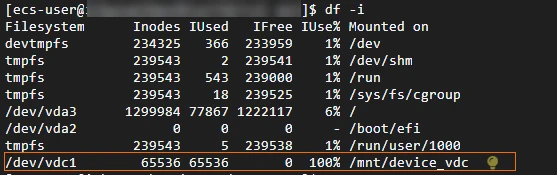

**解决方案**

如果Inode使用率达到或者接近100%，可以通过以下两种方式进行处理：

- **通过清理Inode占用高的文件或者目录，以降低Inode的使用量**

  如果不方便格式化磁盘以增加Inode数量，可以参考以下步骤，清理Inode占用量高的文件或者目录。

  <ol type="i">

  <li>

  执行以下命令，分析根目录下的每个二级目录有多少个文件。

  ```text
  for i in /*; do echo $i; sudo find $i | wc -l; done
  ```

  系统显示类似如下信息。图示例可以看出 `/mnt` 目录下的文件数最多，因此需要继续查看 `/mnt` 目录下哪个目录文件数最多，文件数越多说明Inode占用越高。请您根据实际情况进行操作。

  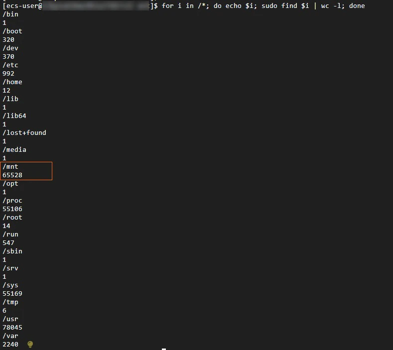

  </li>

  <li>

  执行以下命令，以查看本示例中 `Inode` 使用率最高的 `/mnt` 目录下哪个文件或目录的 `Inode` 使用率较高。

  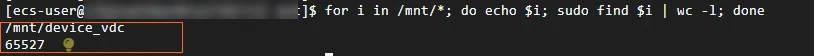

  </li>

  <li>

  以此类推，最终定位 `Inode` 使用率过高的文件或目录，然后进行相应的清理操作。

  </li>

  </ol>

- **通过重新格式化磁盘，以增加Inode的数量**

  - 如果不允许清理磁盘中的文件，或者在清理可清理文件后 `Inode` 使用率仍然较高，则需要通过备份数据、重新格式化磁盘以增加Inode数量、再将数据拷回的方式，完成数据的保留并增加文件系统的Inode数量。

    <ol type="a">

    <li>

    执行以下命令，查询磁盘分区格式。

    ```text
    lsblk -f
    ```

    回显结果示例如下：

    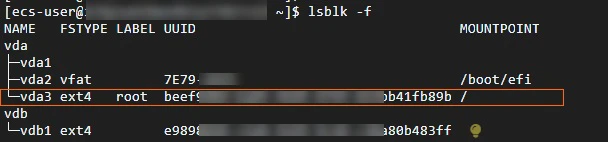

    如上所示，目标磁盘的分区格式为ext4。

    </li>

    <li>

    请根据您实际的磁盘分区格式，参考以下示例进行操作，以实现 `Inode` 数量的增加。

    - ext\*文件系统

      > **警告**
      >
      > - 卸载文件系统，这可能会导致您的应用服务中断，请选择您业务合适的时间进行。
      >
      > - 重新格式化磁盘时磁盘内的数据将被删除，请确保数据已经得到有效备份后，再进行以下操作。您可以自行拷贝文件，也可以通过快照方式进行数据备份，创建快照的具体操作请参见《云服务器ECS》>《用户指南》中的《创建快照》章节。

      <ol type="a">

      <li>

      执行以下命令，以卸载文件系统。 本示例以卸载 `/mnt/device_vdc` 为例，请您根据实际情况进行操作。

      ```bash
      sudo umount /mnt/device_vdc
      ```

      </li>

      <li>

      执行以下命令，以重新建立文件系统并增加Inode节点的数量。

      本示例以磁盘分区为/dev/vdc、文件系统类型为ext4、Inode节点数为163,840为例，请您根据实际情况进行操作。

      ```bash
      sudo mkfs.ext4 /dev/vdc -N 163840
      ```

      > **说明**
      >
      > 在Linux系统中，对于ext\*分区格式的Inode数量通常是根据磁盘容量大小生成的，通常采用1:16KB的比例。例如，以40GB云盘为例，其Inode节点数通常为2,621,440，而其支持的最大值为2^32（约为43亿）。您可以根据实际的云盘容量大小乘以一定的放大系数（例如1.2）来选择适合您业务需求的Inode值。

      </li>

      </ol>

      <ol type="i" start="100">

      <li>

      执行以下命令，以重新挂载目录。本示例以将 `/dev/vdc` 设备挂载至 `/mnt/device_vdc/` 目录为例，请您根据实际情况进行操作。

      ```bash
      sudo mount /dev/vdc1 /mnt/device_vdc/
      ```

      </li>

      <li value="500">

      （可选）执行以下命令，查看并确认修改后的Inode节点数。

      ```text
      df -i
      ```

      系统显示如下信息，表明Inode数量调整成功，您可以继续拷贝备份数据，以恢复相关数据或应用。

      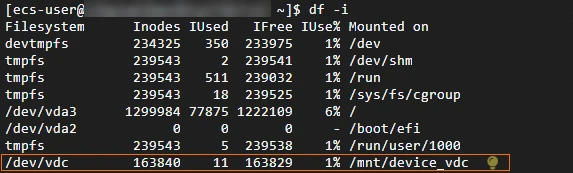

      </li>

      </ol>

    - xfs文件系统

      > **警告**
      >
      > - 卸载文件系统，这可能会导致您的应用服务中断，请选择您业务合适的时间进行。
      >
      > - 重新格式化磁盘时磁盘内的数据将被删除，请确保数据已经得到有效备份后，再进行以下操作。您可以自行拷贝文件，也可以通过快照方式进行数据备份，创建快照的具体操作请参见《云服务器ECS》>《用户指南》中的《创建快照》章节。

      <ol type="a">

      <li>

      执行以下命令，以卸载文件系统。 本示例以卸载 `/mnt/device_vdc` 为例，请您根据实际情况进行操作。

      ```bash
      sudo umount /mnt/device_vdc
      ```

      </li>

      <li>

      执行以下命令，以重新建立文件系统并增加Inode节点的数量。

      本示例以磁盘分区为/dev/vdc、文件系统类型为xfs、将默认maxpct=25改为40为例，请您根据实际情况进行操作。

      ```bash
      sudo mkfs.xfs -f -i maxpct=40 /dev/vdc
      ```

      > **说明**
      >
      > 在Linux系统中，xfs分区格式的Inode数量通常是根据磁盘容量大小生成的，受磁盘容量和maxpct参数的共同影响。默认情况下，容量在1TB以下的文件系统Inode比例为25%，容量在50TB以下的文件系统比例为5%，而超过50TB的文件系统比例则为1%。您可以根据实际需求选择适合您业务的Inode值。

      </li>

      </ol>

      <ol type="i" start="100">

      <li>

      执行以下命令，以重新挂载目录。本示例将/dev/vdc设备挂载在/mnt/device_vdc/目录，请您根据实际情况进行操作。

      ```bash
      sudo mount /dev/vdc /mnt/device_vdc/
      ```

      </li>

      <li value="500">

      （可选）执行以下命令，查看并确认修改后的Inode节点数。

      ```text
      df -i
      ```

      系统显示类似如下信息，表示Inode数调整成功，您可以继续拷贝备份数据，以恢复相关数据或应用。

      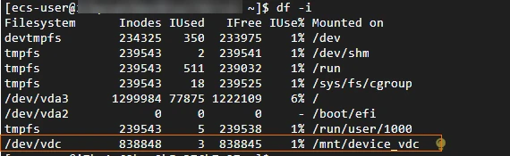

      </li>

      </ol>

    </li>

    </ol>

**存在僵尸文件**

如果磁盘分区容量和Inode容量均正常，可能是系统中存在大量已被删除（显示为 `deleted` ）的文件，这些文件仍被系统内进程占用，导致系统无法释放相应的磁盘空间。由于这些文件已被标记为删除，通过 `df` 或 `du` 命令无法进行统计。如果僵尸文件数量过多，将占用较大的磁盘空间。您可以参考以下步骤以查看并删除僵尸文件。

**排查方法**

1. 如果系统没有预装lsof，选择以下合适命令来安装lsof。

   - Alibaba Cloud Linux、CentOS

     ```bash
     sudo yum install -y lsof
     ```

   - Debian、Ubuntu

     ```bash
     sudo apt install -y lsof
     ```

2. 执行以下命令，查看僵尸文件占用情况。

   ```bash
   sudo lsof | grep delete | sort -k7 -rn | more
   ```

   系统显示类似如下信息，其中第7列为对应文件的大小（单位为Byte），您可以将第七列值累加以查看总文件大小和您非预期的磁盘使用空间是否接近，接近即为僵尸文件占用了您磁盘空间。

   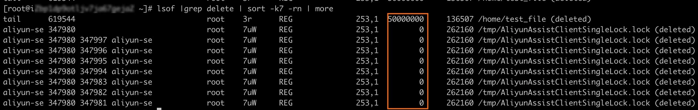

**解决方案**

如果存在僵尸文件，可通过以下两种方式释放句柄清除僵尸文件，从而释放磁盘空间。

- 重启服务器清除

  重启服务器，系统会退出当前的进程，释放调用的deleted文件的句柄。

  > **警告**
  >
  > 重启服务器可能会影响业务，请您选择合适时间进行重启。

- 通过kill命令清除

  根据 `lsof` 命令列出的PID进程号（通常为第二列），使用 `kill` 命令结束占用这些文件的服务进程。

  <ol type="i">

  <li>

  执行以下命令，列出PID进程号。

  ```text
  lsof | grep delete 
  ```

  </li>

  <li>

  根据您的业务情况，确保对应进程可以停止或者重启，执行以下命令，停止占用这些文件的服务进程。

  ```text
  kill <进程号>
  ```

  > **警告**
  >
  > 如果服务器正在运行业务，可能会影响到业务，请慎重操作。

  </li>

  </ol>

**挂载点被覆盖**

在排除了上述三个原因后，如果仍无法确定磁盘空间不足的原因，可能是由于挂载点被覆盖所导致。您可以通过以下方法进行确认。

**排查方法**

1. 运行以下命令，查看挂载信息。

   ```text
   mount
   ```

   回显信息如下所示。

   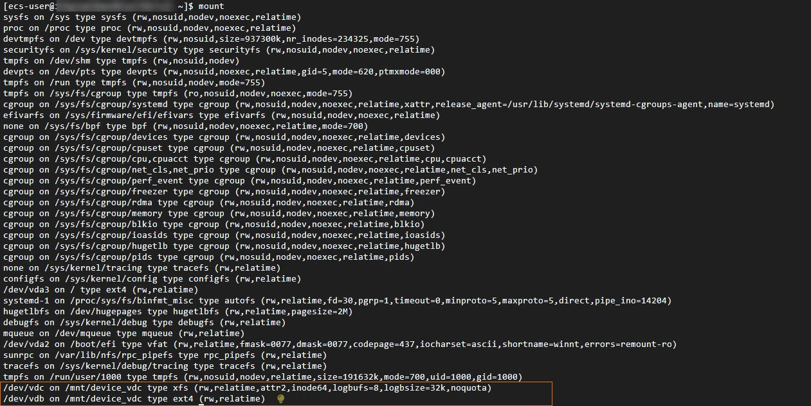

   可以看到有两个设备被挂载到了/mnt/device_vdc目录下，所以该目录可能存在挂载点覆盖。

2. 运行以下命令，查看当前分区挂载信息。

   ```text
   df -h
   ```

   回显结果示例如下，

   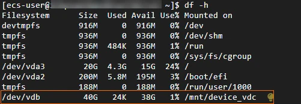

**解决方案**

解决挂载点被覆盖的问题，通常通过先取消磁盘分区挂载，再检查原挂载目录下的空间占用情况。

运行以下命令，卸载文件系统。 本示例以卸载 `/mnt/device_vdc` 为例，请您根据实际情况进行操作。

> **警告**
>
> 卸载文件系统，这可能会导致您的应用服务中断，请选择您业务合适的时间进行。

```bash
sudo umount /mnt/device_vdc
```

取消磁盘分区的挂载后，需检查原挂载目录下的空间占用情况，并根据具体情况采取相应的处置方案。

**Docker相关文件占用空间较大**

如果您在 `ECS` 实例上运行 `Docker` 服务，随着运行的容器数量不断增加， `Docker` 中未使用的镜像和已不再使用的容器将占用额外的存储空间。当您的磁盘空间不足时，您可以参考以下处理方式，对 `Docker` 中不再使用的文件进行清理，从而降低磁盘使用率。

> **重要**
>
> 下述方法仅适用于您的实例运行 `Docker` 服务，且 `Docker` 相关服务占用空间较大导致的磁盘空间满问题排查及处理。

您可以运行以下命令，以确认实例上是否安装 `Docker` 服务。

```bash
sudo docker -v
```

回显结果示例如下，表明您的实例正在运行 `Docker` 服务。

```text
Docker version 26.1.3, build b72abbb
```

**排查方法**

1. 执行如下命令，查看磁盘空间使用率情况。

   ```bash
   sudo df -h
   ```

   回显结果示例如下，表明磁盘空间使用率已达100%。

   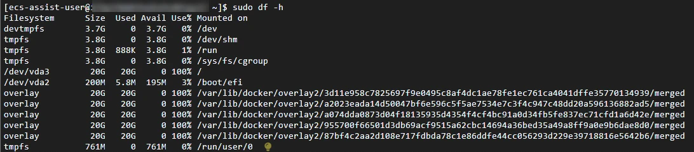

2. 执行如下命令，查看 `Docker` 服务相关的文件磁盘占用情况。

   ```bash
   sudo docker system df
   ```

   回显结果示例如下：

   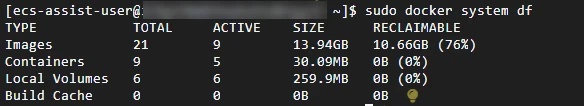

   如上所示，显示 `Docker` 镜像占用大量空间（可回收空间占76%），可以清理无用镜像以释放磁盘空间。

   > **说明**
   >
   > 如果运行 `sudo docker system df` 命令后发现并没有太多可清理Docker服务相关文件，您可以参考磁盘分区空间使用率达到100%进行排查，重新定位占用空间较大的无用文件并清理。

**解决方案**

如果确定是Docker服务相关文件占用太多空间，您可以参考如下方式进行文件清理。

运行如下命令，以清理无用文件。

```bash
sudo docker system prune
```

回显结果示例如下，输入**Y**键以确认执行清理操作。

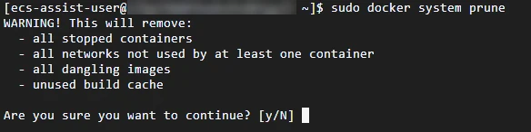

> **重要**
>
> `sudo docker system prune` 命令会清理如下文件，在确认清理操作前请您核实需要清理的内容。
>
> - 所有已停止的容器
>
> - 所有当前未被容器使用的网络
>
> - 所有dangling镜像（即无tag的镜像）
>
> - 不再使用的构建缓存

**inotify watches达到上限**

如果您在使用如 `tail -f` 命令时遇到类似 `tail: cannot watch '...': No space left on device` 的报错，说明您的系统存在 `inotify watches` 达到上限的情况，您可以通过提高系统的 `inotify watches` 上限来规避这个问题。

**排查方法**

执行以下命令，查看 `inotify watches` 当前的上限值。

```bash
cat /proc/sys/fs/inotify/max_user_watches
```

**解决方案**

执行以下命令，修改inotify watches的上限值。

```bash
sudo sysctl fs.inotify.max_user_watches=<新的上限值>
```

将 `<`新的上限值`>` 替换为您希望设置的新的inotify watches上限值。

> **说明**
>
> 提升该上限值可能导致inotify占用更多系统内存。因此，在修改上限值之前，请仔细考虑系统的内存和性能情况以及可能产生的影响。您可以执行 `man 7 inotify` 命令了解更多关于inotify watches和相关设置的详细信息。

**相关文档**

如果您的磁盘空间经常不足或数据存储需求急剧增加，建议根据业务情况对存储方案进行优化。有关详细信息，请参见以下优化建议。

- 如果您的磁盘空间存储大量的图片、视频等文件，且没有高并发读写的情况，可以考虑使用对象存储OSS。OSS是一款海量、安全、低成本、高可靠的云存储服务，可以根据数据量的增加自动扩展存储空间，无需手动扩容。您可以使用ossfs将OSS Bucket挂载到ECS实例上，应用程序无需修改代码即可像操作本地文件一样操作OSS中的文件。

- 如果您的业务场景对高并发读写和共享有要求，可以考虑使用文件存储NAS来存储文件。NAS提供了简单的可扩展文件存储以供与ECS配合使用，可提供高性能、高并发的共享存储服务，可以根据数据量的增加自动扩展存储空间，无需手动扩容。

- 如果您在磁盘中存储了大量日志文件，可以考虑将日志存储到日志服务，便于查询日志的同时，减少磁盘占用。

<a id="section-1-8"></a>

## 1.8. Windows实例磁盘空间满问题的排查与处理

当您Windows实例的磁盘空间满或不足时，可能会导致系统运行缓慢、应用程序无法正常运行等问题。本文主要为您介绍Windows实例磁盘空间满或不足的解决方法，并提供一些磁盘日常维护建议。

> **说明**
>
> 内容来源于阿里云公共云云服务器ECS文档，排查方案仅供参考，需要根据实际环境进行操作。

**告警说明**

<table>
  <tr>
    <td>云产品</td>
    <td>报警指标</td>
    <td>报警名称</td>
    <td>报警描述</td>
    <td>报警规则</td>
    <td>报警等级</td>
  </tr>
  <tr>
    <td>ECS</td>
    <td>diskusage_uti lization</td>
    <td>检测磁盘使用率异常</td>
    <td>磁盘使用率异常</td>
    <td>统计值(Average) 大于 95% 持续3个周期</td>
    <td>critical</td>
  </tr>
  <tr>
    <td>ECS</td>
    <td>diskusage_uti lization</td>
    <td>检测磁盘使用率异常</td>
    <td>磁盘使用率异常</td>
    <td>统计值(Average) 大于 85% 持续3个周期</td>
    <td>warn</td>
  </tr>
</table>

**解决方案**

本文以Windows Server 2019为例，请您根据实际环境进行操作。

**方法1：释放磁盘空间**

您可以通过清理磁盘中不需要的文件来解决磁盘空间满的问题，具体操作步骤如下：

1. 查找占用磁盘空间过多的文件。

   <ol type="i">

   <li>

   远程连接Windows实例。

   登录方法请参考《云服务器ECS》>《用户指南》中的《Windows环境中通过远程桌面连接Windows实例》章节。

   </li>

   <li>

   在桌面上双击**此电脑**。

   </li>

   <li>

   单击要清理的磁盘，按下键盘的**Ctrl+E**键。

   </li>

   <li>

   在顶部导航栏选择**搜索 > 大小**，然后根据系统定义大小筛选磁盘的大文件。

   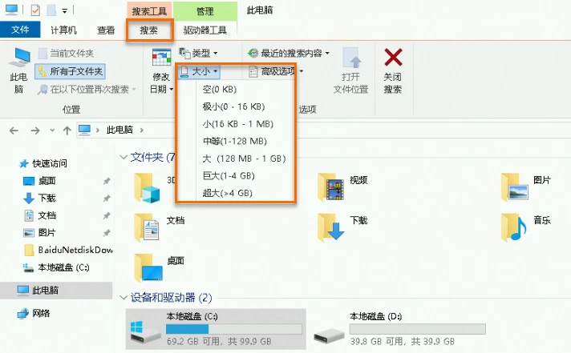

   > **说明**
   >
   > 您也可以自定义文件大小范围进行检索，例如：
   >
   > - 在搜索框输入*大小：>500M*，会检索该磁盘大于500 M的文件。
   >
   > - 在搜索框输入*大小：> 100M < 500M* ，会检索大于100 M但小于500 M的文件。

   </li>

   </ol>

2. 删除不需要的文件。

   推荐您使用Windows系统自带的磁盘清理工具删除文件，并清空回收站。

   <ol type="i">

   <li>

   在底部搜索栏输入**磁盘清理**，选择要清理的磁盘，然后单击**确定**。

   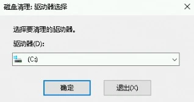

   系统开始扫描该磁盘上可以删除的文件，这个过程可能需要一些时间，请您耐心等待。

   </li>

   <li>

   根据需要选择要删除的文件，然后单击**确定**。

   </li>

   </ol>

**方法2：扩容或新购磁盘**

如果业务不允许删除磁盘中的文件或通过清理文件也无法释放更多空间，您可以根据实际业务场景和需求扩容磁盘或者新购磁盘。具体操作，请参见《云服务器ECS》>《用户指南》中的《扩容云盘》、《挂载数据盘》章节。

**磁盘日常维护建议**

**定期压缩保存文件**

针对磁盘中一些定期生成的文件，可以通过压缩工具（推荐使用WinRAR）并设置压缩策略定期压缩后保存，避免占用过大的空间，以提高磁盘使用率。

1. （条件必选）如果您的系统没有压缩工具，下载并安装WinRAR工具，官方下载地址请参见WinRAR。

   本示例使用WinRAR中文版。

2. 找到需要压缩的文件，右键单击该文件，选择**添加到压缩文件**。

3. 设置压缩文件生成路径以及其他参数。

   <ol type="i">

   <li>

   在**压缩文件名和参数**对话框中单击**备份**选项卡，然后勾选**按掩码产生压缩文件名**，注意此时不要单击**确定**。

   </li>

   <li>

   单击**常规**选项卡，单击**浏览**来定义压缩文件的路径。单击**配置**，选择**保存当前配置为新配置**。

   </li>

   <li>

   在弹出的**配置参数**对话框中，输入**配置名**，选中**保存压缩文件名**、**保存选定文件名**、**在桌面创建快捷方式**，单击**确定**。

   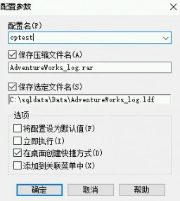

   </li>

   <li>

   然后在**压缩文件名和参数**对话框，单击**确定**。

   此时桌面会生成一个压缩包的快捷键。

   </li>

   </ol>

4. 设置文件压缩策略。

   <ol type="i">

   <li>

   在**控制面板**页面单击**系统和安全**，在**管理工具**处单击**计划任务**，然后在**任务计划程序**对话框中，单击**创建基本任务**。

   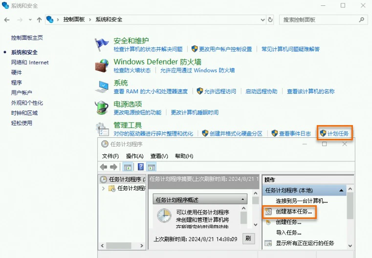

   </li>

   <li>

   根据页面引导设置任务参数。

   其中在设置**启动程序**步骤时，需要输入**程序或脚本**，浏览选择桌面上已生成的压缩包。

   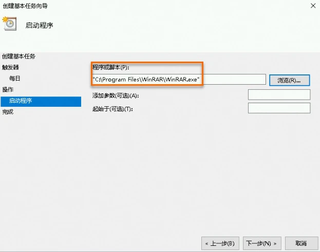

   </li>

   </ol>

**定期清理不必要的应用程序**

您可以在**控制面板**中的**程序和功能**页面，定期查看并卸载不再使用的应用程序，以节省系统空间。

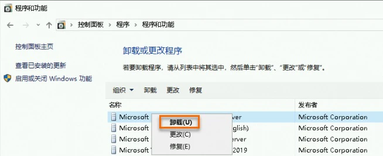

**定期清理磁盘**

在由多台ECS实例组成的分布式应用系统中，每台实例上的应用程序会生成大量的日志文件。随着时间的推移，这些日志文件迅速累积，占用大量磁盘空间，可能导致磁盘空间不足，影响应用性能和服务的稳定性。您可以通过系统运维管理 OOS（CloudOps Orchestration Service）设置一条或多条规则批量、定时、自动清理磁盘文件，防止因磁盘空间不足引发性能问题，确保系统稳定运行。

**监控磁盘使用空间**

您也可以通过云监控控制台查看磁盘已用存储空间、磁盘使用率、Inode使用率等信息。同时可以为磁盘监控指标设置报警规则，当磁盘空间使用率达到报警条件时，会给您发送报警通知，以便您及时清理。

**优化存储模式防止频繁出现磁盘满的问题**

如果您的磁盘空间频繁耗尽或者数据存储需求高速增长，可根据业务情况优化存储方案，防止频繁出现磁盘满的问题。

- 如果您的磁盘空间存储大量的图片、视频等文件，且没有高并发读写的情况，可以考虑使用对象存储OSS。OSS是一款海量、安全、低成本、高可靠的云存储服务，可以根据数据量的增加自动扩展存储空间，无需手动扩容。您可以使用ossfs将OSS Bucket挂载到ECS实例上，应用程序无需修改代码即可像操作本地文件一样操作OSS中的文件。

- 如果您的业务场景对高并发读写和共享有要求，可以考虑使用文件存储NAS来存储文件。NAS提供了简单的可扩展文件存储以供与ECS配合使用，可提供高性能、高并发的共享存储服务，可以根据数据量的增加自动扩展存储空间，无需手动扩容。

- 如果您在磁盘中存储了大量日志文件，可以考虑将日志存储到日志服务，便于查询日志的同时，减少磁盘占用。

<a id="section-1-9"></a>

## 1.9. GPU稳定性最佳实践

随着AI、深度学习、科学计算和大数据处理等技术的发展，GPU成为高性能计算的关键组件。为保障服务器稳定运行，阿里云提供巡检服务以提前发现硬件故障，支持您通过自助诊断功能快速定位问题。

> **重要**
>
> 本文仅适用于Linux操作系统。

> **说明**
>
> 内容来源于阿里云公共云云服务器ECS文档，排查方案仅供参考，需要根据实际环境进行操作。

**应用场景**

- GPU服务器问题诊断

  通过阿里云ECS自主诊断服务功能对GPU服务器潜在隐患进行诊断，从而能够快速定位问题。

- GPU服务运维

  - 阿里云检测到GPU硬件问题时，将主动向您发送运维事件通知。您只需查询和响应ECS系统事件，即可实现故障的自动恢复。

  - 您可以通过自助诊断系统或调用ReportInstancesStatus反馈一台或多台GPU实例所发生的异常问题。阿里云在收到上报后会对实例进行异常检测，如果确实存在异常，将主动向您发送运维事件通知。您只需对系统事件作出响应，即可实现故障的自动恢复。

  > **重要**
  >
  > 响应系统事件后，实例将重启，从而引发业务中断的风险。建议您在业务低峰期选择以下一种方式进行服务重启。
  >
  > - 直接在窗口期之前响应系统事件。
  >
  > - 修改预约重启时间。

**GPU硬件设备诊断**

在GPU实例的运行过程中，可能会出现潜在的故障隐患或安全风险，例如显卡故障或驱动程序错误等问题。您可以通过以下方法进行诊断：

- 通过ECS管理控制台启动GPU设备健康检查功能，以便自主诊断当前实例的GPU卡或驱动是否存在异常。

- 通过云助手插件对当前实例的GPU卡状态及驱动状态等进行全面诊断，从而快速识别使用GPU时遇到的常见问题（例如GPU卡异常、驱动异常等）。一旦诊断出异常情况，系统能够自动发起运维措施，例如向您发送通知等。

**通过自助问题排查功能诊断GPU**

请参考《云服务器ECS》>《用户指南》中的《异构GPU检查》章节。

**通过云助手一键诊断GPU**

1. 访问ECS控制台-云助手。

2. 在页面左侧顶部，选择目标资源所在的资源组和地域。

   

3. 在**ECS实例**页签下的实例列表，单击实例所在行操作栏的**执行命令**。

4. 在**创建执行命令**面板的**命令信息**区域，完成参数配置。

   主要参数项如下图所示，其他参数保持默认。

   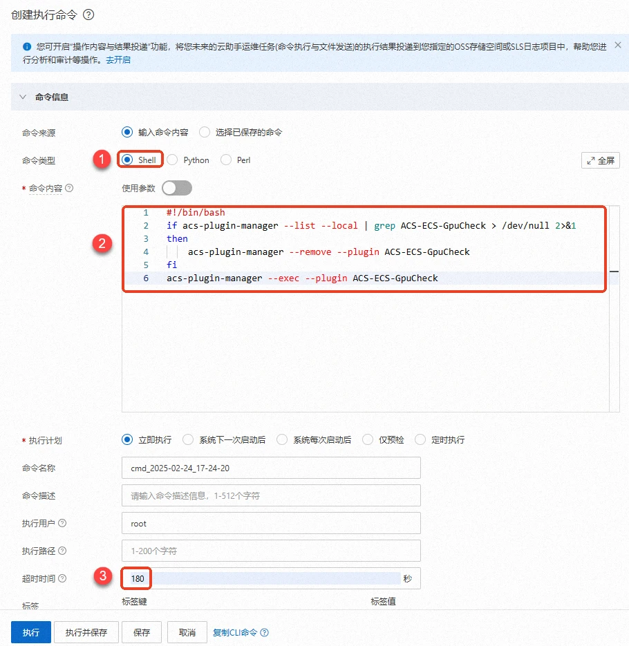

   > **重要**
   >
   > 参数取值必须严格遵循下文所提供的取值设置，否则可能会导致云助手执行失败。

   - 命令类型：Shell。

   - 命令内容：复制如下命令。有关Shell命令的示例，请参见Linux系统常用命令。

     ```text
     if acs-plugin-manager --list --local | grep ACS-ECS-GpuCheck > /dev/null 2>&1
     then
         acs-plugin-manager --remove --plugin ACS-ECS-GpuCheck
     fi
     acs-plugin-manager --exec --plugin ACS-ECS-GpuCheck
     ```

   - 超时时间：命令执行超时时间。当执行命令的任务超时后，云助手将强制终止任务进程。

     > **说明**
     >
     > **超时时间**仅支持设置为正整数，单位为秒，取值范围：10～86400秒（24小时）。

5. 单击**执行**，通过云助手命令诊断GPU实例健康状态。

   - 执行结果中各检查项均显示 `OK` 状态，表示GPU诊断无异常。

     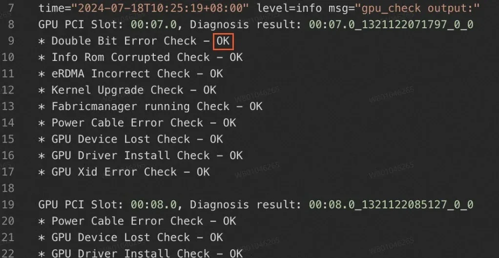

   - 执行结果中某个或多个检查项显示 `Failed` 状态，表示GPU诊断出现异常。

     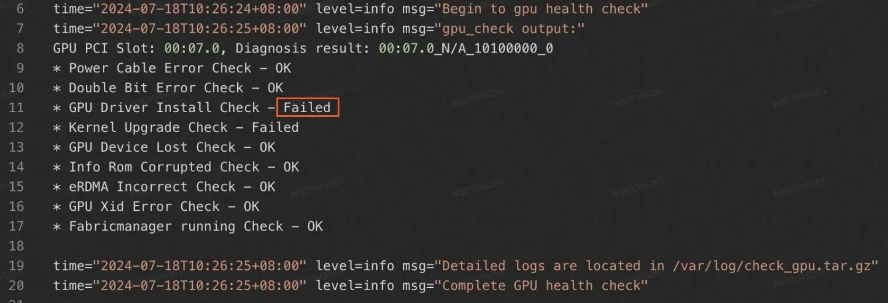

   诊断信息说明：

   | 诊断项 | 诊断说明 | 异常处理措施 |
   | --- | --- | --- |
   | Double Bit Error Check | 检测GPU的Double Bit Error情况。 | 根据错误数不同会提示您重启实例。 |
   | Info Rom Corrupted Check | 检测GPU的infoROM固件信息。 | 向您发送运维通知。 |
   | eRDMA Incorrect Check | 检测GPU的eRDMA网卡状态。 | 向您发送运维通知。 |
   | Kernel Upgrade Check | 检测由于Kernel升级导致驱动异常情况。 | 需您卸载驱动后重新安装驱动。 |
   | Fabricmanager running Check | 检测<code> Fabricmanager </code>组件运行状态。 | 需您安装或启动<code> Fabricmanager </code>组件服务。 |
   | Power Cable Error Check | 检测GPU电源线及供电状态。 | 向您发送运维通知。 |
   | GPU Device Lost Check | 检测GPU丢卡情况。 | 向您发送运维通知。 |
   | GPU Driver Install Check | 检测GPU驱动的安装状态。 | 需您安装驱动。 |
   | GPU Xid Error Check | 检测GPU Xid Error异常情况。 | 根据不同的XID错误提示您重启实例。 |

<a id="section-1-10"></a>

## 1.10. CPU利用率高演练

CPU利用率是衡量业务系统是否健康的一个重要指标，为使业务达到足够的稳定性，CPU利用率需保持在合理的范围内。过高的CPU利用率会导致业务延迟甚至中断。通过注入高CPU故障，可以测试业务系统在特定CPU负载时的反应、检测系统恢复能力、验证监控和告警机制的有效性等，并基于演练结果制定应对策略，确保生产环境高CPU利用率时系统能够迅速恢复正常运行，降低业务中断风险。

> **说明**
>
> 内容来源于阿里云公共云云服务器ECS文档，排查方案仅供参考，需要根据实际环境进行操作。

**实现原理**

本方案使用云助手插件 `ecs-fault-highcpu` ，启动注入进程 `AliFaultHighCpu` 以特定占空比消耗CPU时间片。

**使用指南**

**演练准备**

请确保您的ECS实例已安装云助手Agent，并且**云助手状态**为**正常**。

**故障注入**

1. 使用具有sudo访问权限的用户，运行云助手插件 `ecs-fault-highcpu` 。

   ```bash
   sudo acs-plugin-manager --exec --plugin ecs-fault-highcpu --params inject,[cpu-percent=paramA],[cpu-list=param
   B]
   ```

   `[]` 内为可选故障注入参数，参数说明：

   - cpu-percent（可选）：要达到的CPU利用率，为空时默认100。

     > **说明**
     >
     > cpu-percent为注入进程的CPU利用率，总CPU利用率还会受到其他进程的影响。

   - cpu-list（可选）：用于对特定vCPU绑定负载，如cpu-list=0-2/4表示对core 0、core 1、core 2和core 4绑定CPU负载，为空时对全部vCPU绑定负载。

2. 查看故障注入是否成功。

   - 在ECS实例中，执行 `top` 命令，CPU利用率上升，说明故障注入成功。其中内核态（sy）和用户态（us）之和约等于设置的CPU利用率。

     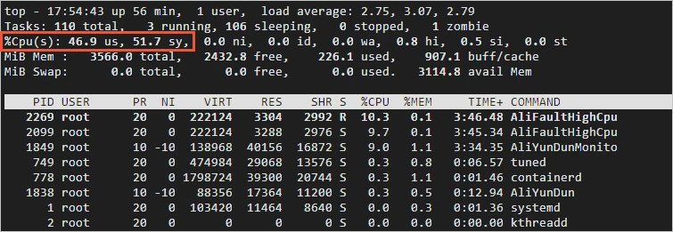

   - 在云监控监控图表中，注入后CPU利用率上升，说明故障注入成功。

     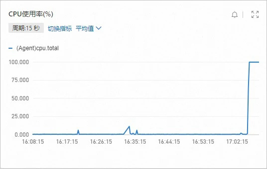

**故障恢复**

您可以使用以下方式，恢复ECS实例状态。

- 方法一（推荐）：在ECS实例中执行故障恢复命令，查看CPU利用率是否下降到故障注入前的水平。

  ```bash
  sudo acs-plugin-manager --exec --plugin ecs-fault-highcpu --params recover
  ```

  如下所示，CPU利用率已下降到故障注入前的水平，系统已恢复正常。

  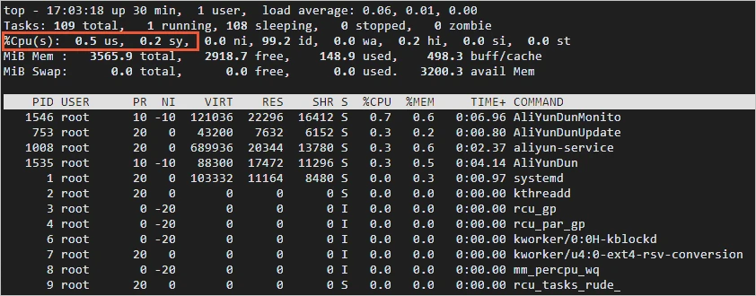

- 方法二：自行终止名为 `AliFaultHighCpu` 的进程。

  为不影响后续重复对该场景故障注入，终止 `AliFaultHighCpu` 进程后，再次执行方法一的故障恢复命令。

  ```bash
  sudo kill <AliFaultHighCpu PID>
  ```

<a id="section-1-11"></a>

## 1.11. 内存溢出（OOM）演练

通过注入进程不断消耗内存，模拟云服务器ECS发生OOM（即内存溢出）情况，测试业务进程是否会被终止、检测系统恢复能力、验证监控和告警机制的有效性等，并基于演练结果制定应对策略，确保生产环境发生OOM时系统能够迅速恢复正常运行，降低业务中断风险。

**什么是OOM和OOM Killer？**

OOM（Out Of Memory）指在操作系统中出现可用内存不足，无法满足进程的内存申请需求的场景，可能会导致进程、系统不稳定。为应对此场景，Linux操作系统通过OOM Killer内核机制对各个进程评分（oom_score），优先终止优先级低，内存占用多的进程以释放内存，防止因系统内存耗尽而触发不可控的业务和系统崩溃。

**实现原理**

本方案使用云助手插件 `ACS-ECS-HighMemory` ，注入前计算需要分配的内存大小，然后启动 `trigger_oom` 注入进程，并以一定速率消耗内存，直至达到目标内存占用。发生OOM时，操作系统根据进程评分选择终止的进程，该评分由进程占用内存大小和该进程的 `oom_score_adj` 计算所得。因此，在故障注入时可以调整注入进程的 `oom_score_adj` 参数，使操作系统在OOM发生时选择终止业务进程或注入进程。 `oom_score_adj` 参数取值范围-1000到1000，默认值为0，值越高该进程越容易被终止，为-1000时表示禁止OOM Killer终止该进程。

**使用指南**

**演练准备**

请确保您的ECS实例已安装云助手Agent，并且**云助手状态**为**正常**。

**故障注入**

1. 登录ECS实例。

   登录方法请参考《云服务器ECS》>《用户指南》中的《使用Workbench工具以SSH协议登录Linux实例》章节。

2. 使用具有sudo访问权限的用户，运行云助手插件 `ACS-ECS-HighMemory` 。

   ```bash
   sudo acs-plugin-manager --exec --plugin ACS-ECS-HighMemory --params inject,[score=paramA],[percent=paramB],
   [rate=paramC],[duration=paramD]
   ```

   `[]` 内为可选故障注入参数，参数说明：

   - score（可选）：用于设置注入进程的 `oom_score_adj` 取值范围为 -1000到1000，通过设置该参数选择在OOM发生时终止注入进程或业务进程。若需终止业务进程，请为注入进程设置一个负值，如-100，如业务进程未被终止，请调小score值。

   - percent（可选）：系统总内存目标占用大小，不填该参数时默认触发OOM。

   - rate（可选）：内存占用速率，单位为MB/s，默认为0表示无限制。

   - duration（可选）：达到目标占用内存后的持续时间，单位为秒，超时自动释放内存，默认为300（秒）。

3. 检查故障注入是否成功。

   - 未发生OOM场景：

     - 执行 `top` 命令，系统已使用内存达到目标使用率，说明故障注入成功。

     - 在控制台实例监控或云监控中，若内存使用率达到目标使用率，说明故障注入成功。

       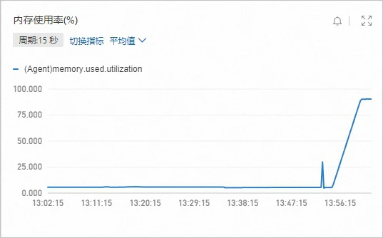

   - OOM场景：在系统日志中搜索与 `Out of memory` 相关的日志。

     ```text
     dmesg -T | grep "Out of memory" 
     ```

     如下所示，表示ECS实例中已发生OOM，说明故障注入成功。并判断终止的进程是否为目标进程，如未杀死目标进程可调整 `score` 参数。

     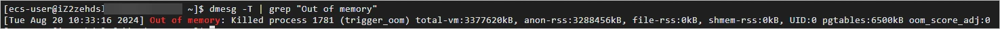

**故障恢复**

如指定目标内存使用率，您可以使用以下方式，移除注入的故障。

- 方法一（推荐）：在ECS实例中执行故障恢复命令，查看内存使用率是否下降到故障注入前的水平。

  ```bash
  sudo acs-plugin-manager --exec --plugin ACS-ECS-HighMemory --params recover
  ```

- 方法二：等待超时自动释放故障，系统默认在达到设置的内存使用率后，持续300秒后自动释放内存。

未指定目标内存使用率，会触发OOM场景，一般系统会自动恢复。建议对ECS执行重启，防止非预期的进程被意外终止。

**演练案例**

1. 故障注入，预期占用90%内存，速率20 MB/s，持续时间120s。

   ```bash
   sudo acs-plugin-manager --exec --plugin ACS-ECS-HighMemory --params inject,percent=90,rate=20,duration=120
   ```

   回显类似如下所示时，说明故障注入成功。

   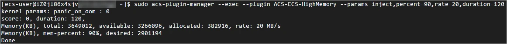

2. 查看注入效果。

   - 使用top命令查看

     <ol type="a">

     <li>

     执行 `top` 命令后，按 `M` 键按内存占用大小排序，然后按 `m` 键显示内存占用进度条。

     可以看到当前内存使用率为90.2%，注入进程 `trigger_oom` 占用内存84.4%。

     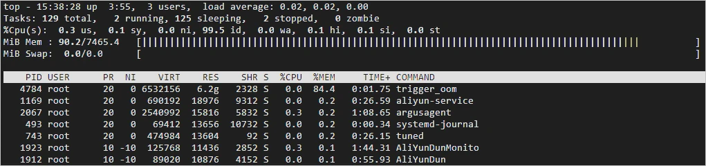

     </li>

     <li>

     超时后，系统自动释放内存。内存回到演练前水平，注入进程退出。

     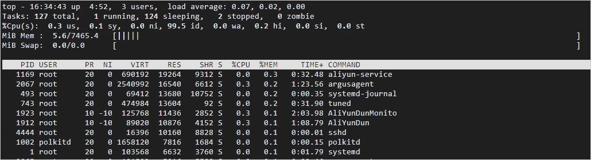

     </li>

     </ol>

   - 在控制台实例详情监控查看

     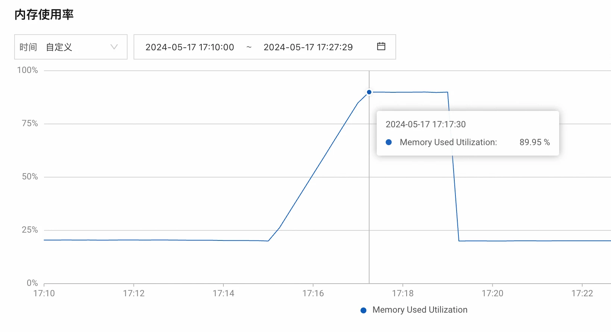

     查看控制台实例详情，监控中的内存使用率图表，系统的内存使用率在注入后内存以一定速率上升，随后到达目标内存90%，持续120秒后内存使用率跌至注入前水平，演练恢复。

**常见的OOM原因及解决方案**

- 内存占用较高会出现系统卡顿、内部服务响应速度变慢，您可以排查并分析内存过高原因并解决。具体操作，请参见Linux实例CPU使用率或负载较高问题的排查与处理。

- 出现OOM可能是因为实例本身可使用的内存太少或某一个资源被频繁申请导致系统资源耗尽等，您可以分析OOM出现的原因并解决。具体操作，请参见如何处理Linux实例中的OOM问题？

<a id="section-1-12"></a>

## 1.12. 磁盘容量利用率高演练

磁盘容量利用率过高，可能会引发系统性能下降、系统崩溃、数据丢失等问题。通常由数据积累、临时文件堆积等原因引起。通过此演练场景验证在磁盘利用率高甚至占满情况下，系统能否稳定运行以及保障数据不丢失。

> **说明**
>
> 内容来源于阿里云公共云云服务器ECS文档，排查方案仅供参考，需要根据实际环境进行操作。

**实现原理**

本方案使用云助手插件 `ACS-ECS-FillDisk` ，输入目标路径和目标磁盘容量利用率，通过fallocate生成指定大小的临时文件，从而使磁盘达到预定容量，恢复时需手动删除临时文件。

**使用指南**

**演练准备**

请确保您的ECS实例已安装云助手Agent，并且**云助手状态**为**正常**。

**故障注入**

1. 登录ECS实例。

   登录方法请参考《云服务器ECS》>《用户指南》中的《使用Workbench工具以SSH协议登录Linux实例》章节。

2. 使用具有sudo访问权限的用户，运行云助手插件 `ACS-ECS-FillDisk` 。

   ```bash
   sudo acs-plugin-manager --exec --plugin ACS-ECS-FillDisk --params inject,[dir=paramA],[percent=paramB]
   ```

   `[]` 内为可选故障注入参数，参数说明：

   - dir（选填）：磁盘目录，默认 `/` 。

   - percent（选填）：目标磁盘容量使用率，默认80%。

   > **说明**
   >
   > 如果fallocate过程中由于空间不足等情况导致注入失败，会删除产生的临时文件。

   显示如下所示时，说明云助手插件 `ACS-ECS-FillDisk` 执行成功。

   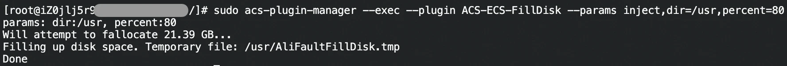

3. 执行 `df {dir}` 命令，查看故障注入是否成功。

   如显示以下结果，说明故障注入成功。

   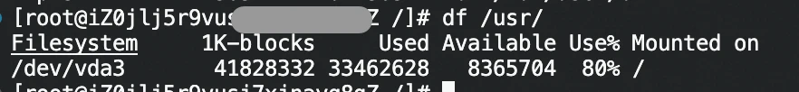

**故障恢复**

登录ECS并执行 `rm -f {dir}/AliFaultFillDisk.tmp`  删除临时文件，其中 `dir` 为注入时指定临时文件的路径。

**磁盘容量不足解决方案**

- 磁盘容量不足时，您可以扩容来解决，具体操作，请参见《云服务器ECS》>《用户指南》中的《扩容云盘》。

- 在ACK场景下，您可以在存储卷的使用率高于某个阈值时自动扩容云盘存储卷。

<a id="section-1-13"></a>

## 1.13. 磁盘IO高负载演练

IO高负载是一种常见的故障现象，可能由于过高的业务进程负载、非预期的非业务进程占用、内存资源不足等因素导致。IO高负载可能会导致业务性能受损，数据丢失等风险。因此通过此演练场景验证系统在IO高负载时的告警和恢复情况。

> **说明**
>
> 内容来源于阿里云公共云云服务器ECS文档，排查方案仅供参考，需要根据实际环境进行操作。

**实现原理**

本方案使用云助手插件 `ACS-ECS-HighIo` ，内部使用dd工具（data duplicator）实现复制和转换文件以提高磁盘IO负载，具体说明如下：

- 对于读模式，先写入一个临时文件到目标路径，通过循环读取对应文件模拟读压力。

- 对于写模式，通过循环写入模拟写入压力。

**使用指南**

**演练准备**

请确保您的ECS实例已安装云助手Agent，并且**云助手状态**为**正常**。

**故障注入**

1. 登录ECS实例。

   登录方法请参考《云服务器ECS》>《用户指南》中的《使用Workbench工具以SSH协议登录Linux实例》章节。

2. 使用具有sudo访问权限的用户，运行云助手插件 `ACS-ECS-HighIo` 。

   ```bash
   sudo acs-plugin-manager --exec --plugin ACS-ECS-HighIo --params inject,[model=paramA],[dir=paramB],[bs=paramC],[count=paramD],[duration=paramE]
   ```

   `[]` 内为可选故障注入参数，参数说明：

   - model（可选）：读/写模式，取值read/write，默认为read。

   - dir（可选）：目标路径，通过指定路径来实现对不同磁盘的压力测试，默认为系统根目录。

   - bs（可选）：块大小，格式同dd命令中bs块参数格式，用于控制每次读写的块大小，该参数可影响读写速率，为了保证占满IO，默认为1M。

   - count（可选）：一次读取循环的块数量，默认为1024。

   - duration（可选）：持续时间，单位秒，默认为300（秒）。

   显示如下所示时，说明云助手插件 `ACS-ECS-HighIo` 执行成功。

   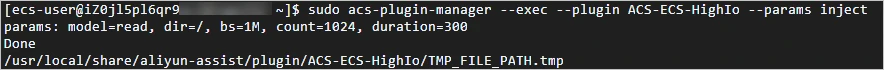

3. 执行 `iotop` 命令，查看故障注入是否成功。

   显示如下所示时，说明故障注入成功。

   

**故障恢复**

在ECS实例中执行故障恢复命令，查看I/O读写是否恢复到故障注入前的水平。

> **重要**
>
> 演练完毕后必须执行一次该命令，以删除产生的临时文件。

```bash
sudo acs-plugin-manager --exec --plugin ACS-ECS-HighIo --params recover
```

**演练案例**

1. 故障注入：对 `usr` 路径进行读取，持续60s。

   ```bash
   sudo acs-plugin-manager --exec --plugin ACS-ECS-HighIo --params inject,dir=/usr,duration=60
   ```

   显示故障注入参数和注入结果，以及存放临时文件的目录文件。

   

2. 在 `usr` 目录下，查看当前注入的临时文件，可以看到产生了 `AliFaultHighio.tmp` 临时文件。

   

3. 执行iotop命令，查看磁盘I/O读写情况。

   

4. 执行故障恢复命令。

   ```bash
   sudo acs-plugin-manager --exec --plugin ACS-ECS-HighIo --params recover
   ```

<a id="section-2"></a>

# 2.容器服务 Kubernetes 版

<a id="section-2-1"></a>

## 2.1. 节点异常问题排查

本文介绍关于节点异常问题的诊断流程、排查思路、常见问题及解决方案。

> **说明**
>
> 内容来源于阿里云公共云容器服务 Kubernetes 版文档，排查方案仅供参考，需要根据实际环境进行操作。

**本文目录**

<table>
  <tr>
    <th width="170">类别</th>
    <th>内容</th>
  </tr>
  <tr>
    <td>诊断流程</td>
    <td>诊断流程</td>
  </tr>
  <tr>
    <td>常见排查方法</td>
    <td>• 节点故障诊断<br>• 检查节点的详情<br>• 检查节点的状态<br>• 检查节点的事件<br>• 采集节点的诊断日志<br>• 检查节点的关键组件<br>• 检查节点的监控<br>• 检查节点的安全组</td>
  </tr>
  <tr>
    <td>常见问题及解决方案</td>
    <td>• 节点关键组件异常处理<br>• Kubelet异常处理<br>• Dockerd异常处理-RuntimeOffline<br>• containerd异常处理-RuntimeOffline<br>• NTP异常处理-NTPProblem<br>• 节点PLEG异常-PLEG is not healthy<br>• 节点资源异常处理<br>• 节点调度资源不足<br>• 节点CPU不足<br>• 节点内存不足-MemoryPressure<br>• 节点索引节点不足-InodesPressure<br>• 节点PID不足-NodePIDPressure<br>• 节点磁盘空间不足-DiskPressure<br>• 节点IP资源不足-InvalidVSwitchId.IpNotEnough<br>• 节点网络异常处理节点网络异常<br>• 节点其他异常处理<br>• 节点异常重启<br>• 如何解决auditd进程占用大量磁盘IO或者系统日志中出现audit: backlog limit exceeded错误的问题</td>
  </tr>
</table>

**诊断流程**

节点异常排查


正常

根据异常状态

根据异常日志

Y

进行排查

进行排查

Y

N

Y


检查节点的

检查节点

运行节点

N

N

Y

N

N

状态信息

诊断日志

故障诊断

N


检查节点

检查节点

运行节点

N

Y

N

N

N

关键组件

诊断日志

故障诊断

Kubelet

Y

Y

Y

Y

未解决

未解决

排查

参考

参考节点

根据异常日志

N

网络异常处理

进行排查

ECS

Kubelet异常处理

提交工单处理


1. 查看节点是否处于异常状态。具体操作，请参见检查节点的状态。

   - 若节点处于**未就绪**状态，可参考如下步骤进行排查：

     <ol type="a">

     <li>

     检查节点状态信息，查看PIDPressure、DiskPressure、MemoryPressure等节点类型的状态是否为**True**。若某一节点类型的状态为**True**，则根据相应异常状态关键字进行排查。具体操作，请参见Dockerd异常处理-RuntimeOffline、节点内存不足-MemoryPressure和节点索引节点不足-InodesPressure等进行解决。

     </li>

     <li>

     检查节点的关键组件和日志。

     - Kubelet

       <ol type="a">

       <li>

       检查Kubelet的状态、日志、配置等是否存在异常。具体操作，请参见检查节点的关键组件。

       </li>

       <li>

       若Kubelet存在异常，请参见Kubelet异常处理操作。

       </li>

       </ol>

     - Dockerd

       <ol type="a">

       <li>

       检查Dockerd的状态、日志、配置等是否存在异常。具体操作，请参见检查节点的关键组件。

       </li>

       <li>

       若Dockerd存在异常，请参见Dockerd异常处理-RuntimeOffline操作。

       </li>

       </ol>

     - containerd

       <ol type="a">

       <li>

       检查containerd的状态、日志、配置等是否存在异常。具体操作，请参见检查节点的关键组件。

       </li>

       <li>

       若containerd存在异常，请参见containerd异常处理-RuntimeOffline操作。

       </li>

       </ol>

     - NTP

       <ol type="a">

       <li>

       检查NTP服务的状态、日志、配置等是否存在异常。具体操作，请参见检查节点的关键组件。

       </li>

       <li>

       若NTP服务存在异常，请参见NTP异常处理-NTPProblem操作。

       </li>

       </ol>

     </li>

     </ol>

     <ol type="i" start="100">

     <li>

     采集并检查节点的诊断日志，请参见采集节点的诊断日志。

     </li>

     <li value="500">

     检查节点的监控，查看节点CPU、内存、网络等资源负载情况是否存在异常。具体操作，请参见检查节点的监控。若节点负载异常，请参见节点CPU不足和节点内存不足-MemoryPressure等解决。

     </li>

     </ol>

   - 若节点处于**未知**状态，可参考如下步骤进行排查。

     <ol type="a">

     <li>

     检查节点ECS实例状态是否为**运行中**。

     </li>

     <li>

     检查节点的关键组件。

     - Kubelet

       <ol type="a">

       <li>

       检查Kubelet的状态、日志、配置等是否存在异常。具体操作，请参见检查节点的关键组件。

       </li>

       <li>

       若Kubelet存在异常，请参见Kubelet异常处理操作。

       </li>

       </ol>

     - Dockerd

       <ol type="a">

       <li>

       检查Dockerd的状态、日志、配置等是否存在异常。具体操作，请参见检查节点的关键组件。

       </li>

       <li>

       若Dockerd存在异常，请参见Dockerd异常处理-RuntimeOffline操作。

       </li>

       </ol>

     - containerd

       <ol type="a">

       <li>

       检查containerd的状态、日志、配置等是否存在异常。具体操作，请参见检查节点的关键组件。

       </li>

       <li>

       若containerd存在异常，请参见containerd异常处理-RuntimeOffline操作。

       </li>

       </ol>

     - NTP

       <ol type="a">

       <li>

       检查NTP服务的状态、日志、配置等是否存在异常。具体操作，请参见检查节点的关键组件。

       </li>

       <li>

       若NTP服务存在异常，请参见NTP异常处理-NTPProblem操作。

       </li>

       </ol>

     </li>

     </ol>

     <ol type="i" start="100">

     <li>

     检查节点的网络连通性。具体操作，请参见检查节点的安全组。若节点网络存在异常，请参见节点网络异常解决。

     </li>

     <li value="500">

     采集并检查节点诊断日志，请参见采集节点的诊断日志。

     </li>

     </ol>

     <ol type="a" start="5">

     <li>

     检查节点的监控，查看节点CPU、内存、网络等资源负载情况是否存在异常。具体操作，请参见检查节点的监控。若节点负载异常，请参见节点CPU不足和节点内存不足-MemoryPressure解决。

     </li>

     </ol>

2. 若根据诊断流程未能排查问题，请使用容器服务ACK提供的故障诊断功能进行排查。具体操作，请参见节点故障诊断。

**常见排查方法**

**节点故障诊断**

当节点出现故障时，您可以使用容器服务ACK提供的故障诊断功能，一键诊断节点异常。

1. 登录容器服务管理控制台，在左侧导航栏选择**集群列表**。

2. 在**集群列表**页面，单击目标集群名称，然后在左侧导航栏，选择**节点管理 > 节点**。

3. 在**节点**页面，单击目标诊断节点右侧**操作**列下的**更多 > 故障诊断**。

4. 在弹出的面板单击**发起诊断**，然后在控制台页面查看诊断结果以及对应的修复建议。

**检查节点的详情**

1. 登录容器服务管理控制台，在左侧导航栏选择**集群列表**。

2. 在**集群列表**页面，单击目标集群名称，然后在左侧导航栏，选择**节点管理 > 节点**。

3. 在**节点**页面，单击目标节点名称或者目标节点右侧**操作**列下**详情**，查看节点的详情。

**检查节点的状态**

1. 登录容器服务管理控制台，在左侧导航栏选择**集群列表**。

2. 在**集群列表**页面，单击目标集群名称，然后在左侧导航栏，选择**节点管理 > 节点**。

3. 在**节点**页面，可查看对应节点的状态。

   - 若节点状态为**就绪**，说明节点运行正常。

   - 若节点状态不是**就绪**，可单击目标节点名称或者目标节点右侧**操作**列下的**详情**，查看异常状态节点的详情。

     > **说明**
     >
     > 若您要收集InodesPressure、DockerOffline、RuntimeOffline等类型的状态信息，需要在集群中安装node-problem-detector并创建事件中心，该功能在创建集群时默认选中。

**检查节点的事件**

1. 登录容器服务管理控制台，在左侧导航栏选择**集群列表**。

2. 在**集群列表**页面，单击目标集群名称，然后在左侧导航栏，选择**节点管理 > 节点**。

3. 在**节点**页面，单击目标节点名称或者目标节点右侧**操作**列下的**详情**，查看节点的详情。

   在节点详情页面的最下方，可查看节点事件信息。

**采集节点的诊断日志**

- 通过控制台，使用容器智能运维平台提供的节点诊断功能收集诊断日志，请参见《容器服务ACK》>《用户指南》中的《节点诊断》章节。

- 使用脚本收集诊断日志。

**检查节点的关键组件**

- **Kubelet**：

  - 查看Kubelet状态

    登录对应节点，在节点上执行如下命令，查看Kubelet进程状态。

    ```bash
    systemctl status kubelet
    ```

    预期输出：

    

  - 查看Kubelet日志

    登录对应节点，在节点上执行如下命令，可查看Kubelet日志信息。关于更多查看Kubelet日志的方式，请参见采集节点的诊断日志。

    ```text
    journalctl -u kubelet
    ```

  - 查看Kubelet配置

    登录对应节点，在节点上执行如下命令，可查看Kubelet配置信息。

    ```bash
    cat /etc/systemd/system/kubelet.service.d/10-kubeadm.conf
    ```

- **运行时**：

  - 检查Dockerd

    - 查看Dockerd状态

      登录对应节点，在节点上执行如下命令，查看Dockerd进程状态。

      ```bash
      systemctl status docker
      ```

      预期输出：

      

    - 查看Dockerd日志

      登录对应节点，在节点上执行如下命令，可查看Dockerd的日志信息。关于更多查看Dockerd日志的方式，请参见采集节点的诊断日志。

      ```text
      journalctl -u docker
      ```

    - 查看Dockerd配置

      登录对应节点，在节点上执行如下命令，可查看Dockerd配置信息。

      ```bash
      cat /etc/docker/daemon.json
      ```

  - 检查containerd

    - 查看containerd状态

      登录对应节点，在节点上执行如下命令，查看containerd进程状态。

      ```bash
      systemctl status containerd
      ```

      预期输出：

      

    - 查看containerd日志

      登录对应节点，在节点上执行如下命令，可查看containerd日志信息。关于更多查看containerd日志的方式，请参见采集节点的诊断日志。

      ```text
      journalctl -u containerd
      ```

- **检查NTP**：

  - 查看NTP服务状态

    登录对应节点，在节点上执行如下命令，查看Chronyd进程的状态。

    ```bash
    systemctl status chronyd
    ```

    预期输出：

    

  - 查看NTP服务日志

    登录对应节点，在节点上执行如下命令，可查看NTP日志信息。

    ```text
    journalctl -u chronyd
    ```

**检查节点的监控**

- **云监控**

  阿里云容器服务ACK集群集成了监控服务，可登录云监控控制台查看对应ECS实例的基本监控信息。

- **Prometheus监控**

  <ol type="i">

  <li>

  登录容器服务管理控制台，在左侧导航栏选择**集群列表**。

  </li>

  <li>

  在**集群列表**页面，单击目标集群名称，然后在左侧导航栏，选择**运维管理 > Prometheus 监控**。

  </li>

  <li>

  在**Prometheus 监控**页面，单击**节点监控**页签，然后再单击**集群节点监控详情**页签。

  </li>

  <li>

  在**集群节点监控详情**页面选择待查看的节点，可查看对应节点的CPU、内存、磁盘等监控信息。

  </li>

  </ol>

**检查节点的安全组**

关于如何检查节点的安全组，请参见《云服务器ECS》>《用户指南》中的《安全组》章节。

**Kubelet异常处理**

**问题原因**

通常是Kubelet进程异常、运行时异常、Kubelet配置有误等原因导致。

**问题现象**

Kubelet状态为**inactive**。

**解决方案**

1. 执行如下命令重启Kubelet。重启Kubelet不会影响运行中的容器。

   ```bash
   systemctl restart kubelet
   ```

2. Kubelet重启后，登录节点执行以下命令，再次查看kubelet状态是否恢复正常。

   ```bash
   systemctl status kubelet
   ```

3. 若Kubelet重启后状态仍异常，请登录节点执行以下命令查看Kubelet日志。

   ```text
   journalctl -u kubelet
   ```

   - 若日志中有明确的异常信息，请根据异常关键字进行排查。

   - 若确认是Kubelet配置异常，请执行如下命令修改Kubelet配置。

     ```bash
     vi /etc/systemd/system/kubelet.service.d/10-kubeadm.conf   #修改Kubelet配置。
     systemctl daemon-reload;systemctl restart kubelet         #重新加载配置并重启Kubelet。
     ```

**Dockerd异常处理-RuntimeOffline**

**问题原因**

通常是Dockerd配置异常、进程负载异常、节点负载异常等原因导致。

**问题现象**

- Dockerd状态为**inactive**。

- Dockerd状态为**active (running)**，但未正常工作，导致节点异常。通常有 `docker ps` 、 `docker exec` 等命令执行失败的现象。

- 节点状态中**RuntimeOffline**为**True**。

- 若集群配置了集群节点异常报警，则节点Dockerd异常时可收到相关报警。

**解决方案**

1. 执行如下命令重启Dockerd。

   ```bash
   systemctl restart docker
   ```

2. Dockerd重启后，登录节点执行以下命令，再次查看Dockerd状态是否恢复正常。

   ```bash
   systemctl status docker
   ```

3. 若Dockerd重启后状态仍异常，请登录节点执行以下命令查看Dockerd日志。

   ```text
   journalctl -u docker
   ```

**containerd异常处理-RuntimeOffline**

**问题原因**

通常是containerd配置异常、进程负载异常、节点负载异常等原因导致。

- containerd状态为**inactive**。

- 节点状态中**RuntimeOffline**为**True**。

- 若集群配置了集群节点异常报警，则节点containerd异常时可收到相关报警。

**解决方案**

1. 执行如下命令重启containerd。

   ```bash
   systemctl restart containerd
   ```

2. containerd重启后，登录节点执行以下命令，再次查看containerd状态是否恢复正常。

   ```bash
   systemctl status containerd
   ```

3. 若containerd重启后状态仍异常，请登录节点执行以下命令查看containerd日志。

   ```text
   journalctl -u containerd
   ```

**NTP异常处理-NTPProblem**

**问题原因**

通常是NTP进程状态异常导致。

**问题现象**

- Chronyd状态为**inactive**。

- 节点状态中**NTPProblem**为**True**。

- 若集群配置了集群节点异常报警，则节点时间服务异常时可收到相关报警。

**解决方案**

1. 执行如下命令重启Chronyd。

   ```bash
   systemctl restart chronyd
   ```

2. Chronyd重启后，登录节点执行以下命令，再次查看Chronyd状态是否恢复正常。

   ```bash
   systemctl status chronyd
   ```

3. 若Chronyd重启后状态仍异常，请登录节点执行以下命令查看Chronyd日志。

   ```text
   journalctl -u chronyd
   ```

**节点PLEG异常-PLEG is not healthy**

**问题原因**

Pod生命周期事件生成器PLEG（Pod Lifecycle Event Generator）会记录Pod生命周期中的各种事件，如容器的启动、终止等。 `PLEG is not healthy` 异常通常是由于节点上的运行时进程异常或者节点Systemd版本缺陷导致。

**问题现象**

- 节点状态**NotReady**。

- 在Kubelet日志中，可看到如下日志。

  ```text
  I0729 11:20:59.245243    9575 kubelet.go:1823] skipping pod synchronization - PLEG is not healthy: pleg was 
  last seen active 3m57.138893648s ago; threshold is 3m0s.
  ```

- 若集群配置了集群节点异常报警，则节点PLEG异常时可收到相关报警。

**解决方案**

1. 依次重启节点关键组件Dockerd/Contatinerd、Kubelet，重启后查看节点是否恢复正常。

2. 若节点关键组件重启后节点仍未恢复正常，可尝试重启异常节点。具体操作，请参见《云服务器ECS》>《用户指南》中的《重启实例》章节。

   > **警告**
   >
   > 重启节点可能会导致您的业务中断，请谨慎操作。

3. 若异常节点系统为CentOS 7.6，参见 使用CentOS 7.6系统时kubelet日志含有“PLEG is not healthy”进行排查 。

**节点调度资源不足**

**问题原因**

通常是集群中的节点资源不足导致。

**问题现象**

当集群中的节点调度资源不足时，会导致Pod调度失败，出现以下常见错误信息：

- 集群CPU资源不足：**0/2 nodes are available: 2 Insufficient cpu**

- 集群内存资源不足：**0/2 nodes are available: 2 Insufficient memory**

- 集群临时存储不足：**0/2 nodes are available: 2 Insufficient ephemeral-storage**

其中调度器判定节点资源不足的计算方式为：

- 集群节点CPU资源不足的判定方式：当前Pod请求的CPU资源总量>（节点可分配的CPU资源总量-节点已分配的CPU资源总量）

- 集群节点内存资源不足的判定方式：当前Pod请求的内存资源总量>（节点可分配的内存资源总量-节点已分配的内存资源总量）

- 集群节点临时存储不足的判定方式：当前Pod请求的临时存储总量>（节点可分配的临时存储总量-节点已分配的临时存储总量）

如果当前Pod请求的资源总量大于节点可分配的资源总量减去节点已分配的资源总量，Pod就不会调度到当前节点。

执行以下命令，查看节点的资源分配信息：

```bash
kubectl describe node [$nodeName]
```

关注输出中的如下部分：

```text
Allocatable:
  cpu:                3900m
  ephemeral-storage:  114022843818
  hugepages-1Gi:      0
  hugepages-2Mi:      0
  memory:             12601Mi
  pods:               60
Allocated resources:
  (Total limits may be over 100 percent, i.e., overcommitted.)
  Resource           Requests    Limits
  --------           --------    ------
  cpu                725m (18%)  6600m (169%)
  memory             977Mi (7%)  16640Mi (132%)
  ephemeral-storage  0 (0%)      0 (0%)
  hugepages-1Gi      0 (0%)      0 (0%)
  hugepages-2Mi      0 (0%)      0 (0%)
```

其中：

- **Allocatable**：表示本节点可分配的（CPU/内存/临时存储）资源总量。

- **Allocated resources**：表示本节点已经分配的（CPU/内存/临时存储）资源总量。

**解决方案**

当节点调度资源不足时，需降低节点负载，方法如下：

- 删除或减少不必要的Pod，降低节点的负载。具体操作，请参见《容器服务ACK》>《用户指南》中的《管理容器组（Pod）》章节。

- 根据自身业务情况，限制Pod的资源配置。具体操作，请参见《容器服务ACK》>《用户指南》中的《管理容器组（Pod）》章节。

  您可以使用ACK提供的资源画像功能，基于资源使用量的历史数据获得容器粒度的资源规格推荐，简化为容器配置Request和Limit的复杂度。

- 在集群中添加新的节点。具体操作，请参见《容器服务ACK》>《用户指南》中的《创建节点池》章节。

- 为节点进行升配。

更多信息，请参见节点CPU不足、节点内存不足-MemoryPressure和节点磁盘空间不足-DiskPressure。

**节点CPU不足**

**告警说明**

<table>
  <tr>
    <td>云产品</td>
    <td>报警指标</td>
    <td>报警名称</td>
    <td>报警描述</td>
    <td>报警规则</td>
    <td>报警等级</td>
  </tr>
  <tr>
    <td>ACK</td>
    <td>node.cpu.utili zation</td>
    <td>检测节点CPU利用率异常</td>
    <td>节点CPU利用率异常</td>
    <td>统计值(Average) 大于 80 持续3个周期</td>
    <td>critical</td>
  </tr>
  <tr>
    <td>ACK</td>
    <td>node.cpu.utili zation</td>
    <td>检测节点CPU利用率异常</td>
    <td>节点CPU利用率异常</td>
    <td>统计值(Average) 大于 70 持续3个周期</td>
    <td>warn</td>
  </tr>
</table>

**问题原因**

通常是节点上的容器占用CPU过多导致节点的CPU不足。

**问题现象**

- 当节点CPU不足时，可能会导致节点状态异常。

- 若集群配置了集群节点异常报警，则节点CPU使用率>=85%时可收到相关报警。

**解决方案**

- 通过节点的监控查看CPU增长曲线，确认异常出现时间点，检查节点上的进程是否存在CPU占用过高的现象。具体操作，请参见检查节点的监控。

- 降低节点的负载，具体操作，请参见节点调度资源不足。

- 如需重启节点，可尝试重启异常节点。具体操作，请参见节点异常重启。

  > **重要**
  >
  > 重启节点可能会导致您的业务中断，请谨慎操作。

**节点内存不足-MemoryPressure**

**告警说明**

<table>
  <tr>
    <td>云产品</td>
    <td>报警指标</td>
    <td>报警名称</td>
    <td>报警描述</td>
    <td>报警规则</td>
    <td>报警等级</td>
  </tr>
  <tr>
    <td>ACK</td>
    <td>node.memor y.utilization</td>
    <td>检测节点内存利用率异常</td>
    <td>节点内存利用率异常</td>
    <td>统计值(Average) 大于 80 持续3个周期</td>
    <td>critical</td>
  </tr>
  <tr>
    <td>ACK</td>
    <td>node.memor y.utilization</td>
    <td>检测节点内存利用率异常</td>
    <td>节点内存利用率异常</td>
    <td>统计值(Average) 大于 70 持续3个周期</td>
    <td>warn</td>
  </tr>
</table>

**问题原因**

通常是节点上的容器占用内存过多导致节点的内存不足。

**问题现象**

- 当节点的可用内存低于 `memory.available` 配置项时，则节点状态中**MemoryPressure**为**True**，同时该节点上的容器被驱逐。关于节点驱逐，请参见节点压力驱逐。

- 当节点内存不足时，会有以下常见错误信息：

  - 节点状态中**MemoryPressure**为**True**。

  - 当节点上的容器被驱逐时：

    - 在被驱逐的容器事件中可看到关键字**The node was low on resource: memory**。

    - 在节点事件中可看到关键字**attempting to reclaim memory**。

  - 可能会导致系统OOM异常，当出现系统OOM异常时，节点事件中可看到关键字**System OOM**。

- 若集群配置了集群节点异常报警，则节点内存使用率>=85%时可收到相关报警。

**解决方案**

- 通过节点的监控查看内存增长曲线，确认异常出现时间点，检查节点上的进程是否存在内存泄露现象。具体操作，请参见检查节点的监控。

- 降低节点的负载，具体操作，请参见节点调度资源不足。

- 如需重启节点，可尝试重启异常节点。具体操作，请参见节点异常重启。

  > **重要**
  >
  > 重启节点可能会导致您的业务中断，请谨慎操作。

**节点索引节点不足-InodesPressure**

**问题原因**

通常是节点上的容器占用索引节点过多导致节点的索引节点不足。

**问题现象**

- 当节点的可用索引节点低于 `inodesFree` 配置项时，则节点状态中**InodesPressure**为**True**，同时该节点上的容器被驱逐。关于节点驱逐，请参见节点压力驱逐。

- 当节点索引点不足时，通常会有以下常见错误信息：

  - 节点状态中**InodesPressure**为**True**。

  - 当节点上的容器被驱逐时：

    - 被驱逐的容器事件中可看到关键字**The node was low on resource: inodes**。

    - 节点事件中可看到关键字**attempting to reclaim inodes**。

- 若集群配置了集群节点异常报警，则节点索引节点不足时可收到相关报警。

**解决方案**

- 通过节点的监控查看索引节点增长曲线，确认异常出现时间点，检查节点上的进程是否存在占用索引节点过多现象。具体操作，请参见检查节点的监控。

- 其他问题相关操作，请参见Linux实例磁盘空间满问题的排查与处理。

**节点PID不足-NodePIDPressure**

**问题原因**

通常是节点上的容器占用PID过多导致节点的PID不足。

**问题现象**

- 当节点的可用PID低于 `pid.available` 配置项时，则节点状态中**NodePIDPressure**为**True**，同时该节点上的容器被驱逐。关于节点驱逐，请参见节点压力驱逐。

- 若集群配置了集群节点异常报警，则节点PID不足时可收到相关报警。

**解决方案**

1. 执行如下命令，查看节点的最大PID数和节点当前的最大PID。

   ```text
   sysctl kernel.pid_max  #查看最⼤PID数。
   ps -eLf|awk '{print $2}' | sort -rn| head -n 1   #查看当前的最⼤PID。
   ```

2. 执行如下命令，查看占用PID最多的前5个进程。

   ```text
   ps -elT | awk '{print $4}' | sort | uniq -c | sort -k1 -g | tail -5
   ```

   预期输出：

   ```text
   #第⼀列为进程占⽤的PID数，第⼆列为当前进程号。
   73 9743
   75 9316
   76 2812
   77 5726
   93 5691
   ```

3. 根据进程号找到对应进程和所属的Pod，分析占用PID过多的原因并优化对应代码。

4. 降低节点的负载。具体操作，请参见节点调度资源不足。

5. 如需重启节点，可尝试重启异常节点。具体操作，请参见节点异常重启。

   > **警告**
   >
   > 重启节点可能会导致您的业务中断，请谨慎操作。

**节点磁盘空间不足-DiskPressure**

**告警说明**

<table>
  <tr>
    <td>云产品</td>
    <td>报警指标</td>
    <td>报警名称</td>
    <td>报警描述</td>
    <td>报警规则</td>
    <td>报警等级</td>
  </tr>
  <tr>
    <td>ACK</td>
    <td>node.disk.util ization</td>
    <td>检测节点磁盘利用率异常</td>
    <td>节点磁盘利用率异常</td>
    <td>统计值(Average) 大于 90 持续3个周期</td>
    <td>critical</td>
  </tr>
  <tr>
    <td>ACK</td>
    <td>node.disk.util ization</td>
    <td>检测节点磁盘利用率异常</td>
    <td>节点磁盘利用率异常</td>
    <td>统计值(Average) 大于 85 持续3个周期</td>
    <td>warn</td>
  </tr>
</table>

**问题原因**

通常是节点上的容器占用磁盘过多、镜像文件过大导致节点的磁盘空间不足。

**问题现象**

- 当节点的可用磁盘空间低于 `imagefs.available` 配置项时，则节点状态中**DiskPressure**为**True**。

- 当可用磁盘空间低于 `nodefs.available` 配置项时，则该节点上的容器全部被驱逐。关于节点驱逐，请参见节点压力驱逐。

- 当磁盘空间不足时，通常会有以下常见错误信息：

  - 节点状态中**DiskPressure**为**True**。

  - 当触发镜像回收策略后，磁盘空间仍然不足以达到健康阈值（默认为80%），在节点事件中可看到关键字**failed to garbage collect required amount of images**。

  - 当节点上的容器被驱逐时：

    - 被驱逐的容器事件中可看到关键字**The node was low on resource: [DiskPressure]**。

    - 节点事件中可看到关键字**attempting to reclaim ephemeral-storage**或**attempting to reclaim nodefs**。

- 若集群配置了集群节点异常报警，则节点磁盘使用率>=85%时可收到相关报警。

**解决方案**

- 通过节点的监控查看磁盘增长曲线，确认异常出现时间点，检查节点上的进程是否存在占用磁盘空间过多的现象。具体操作，请参见检查节点的监控。

- 若有大量文件在磁盘上未清理，请清理文件。具体操作，请参见Linux实例磁盘空间满问题的排查与处理

- 根据自身业务情况，限制Pod的 `ephemeral-storage` 资源配置。具体操作，请参见《容器服务ACK》>《用户指南》中的《管理容器组（Pod）》。

- 建议使用阿里云存储产品，尽量避免使用HostPath数据卷。更多信息，请参见存储的产品文档。

- 节点磁盘扩容。

- 降低节点的负载。具体操作，请参见节点调度资源不足。

**节点IP资源不足-InvalidVSwitchId.IpNotEnough**

**问题原因**

通常是节点上的容器数过多导致IP资源不足。

**问题现象**

- Pod启动失败，状态为**ContainerCreating**。检查Pod的日志有类似如下报错，包含错误信息关键字**InvalidVSwitchId.IpNotEnough**。

  ```text
  time="2020-03-17T07:03:40Z" level=warning msg="Assign private ip address failed: Aliyun API Error: RequestId: 
  2095E971-E473-4BA0-853F-0C41CF52651D Status Code: 403 Code: InvalidVSwitchId.IpNotEnough Message: The 
  specified VSwitch \"vsw-AAA\" has not enough IpAddress., retrying"
  ```

- 若集群配置了集群节点异常报警，则节点IP资源不足时可收到相关报警。

**解决方案**

降低节点上的容器数量。具体操作，请参见节点调度资源不足。其他相关操作，请参见Terway网络场景中交换机的IP资源不足。

**节点网络异常**

**问题原因**

通常是节点运行状态异常、安全组配置有误或网络负载过高导致。

**问题现象**

- 节点无法登录。

- 节点状态**Unknown**。

- 若集群配置了集群节点异常报警，则节点公网流出带宽使用率 >=85%时可收到相关报警。

**解决方案**

- 若节点无法登录，请参考以下步骤进行排查：

  - 检查节点实例状态是否为**运行中**。

  - 检查节点的安全组配置。具体操作，请参见检查节点的安全组。

- 若节点的网络负载过高，请参考以下步骤进行排查：

  - 通过节点的监控查节点网络增长曲线，检查节点上的Pod是否存在占用网络带宽过多的现象。具体操作，请参见检查节点的监控。

  - 使用网络策略控制Pod的网络流量。具体操作，请参见《容器服务ACK》>《用户指南》中的《网络策略》章节。

**节点异常重启**

**问题原因**

通常是节点负载异常等原因导致。

**问题现象**

- 在节点重启的过程中，节点状态为**NotReady**。

- 若集群配置了集群节点异常报警，则节点异常重启时可收到相关报警。

**解决方案**

1. 执行以下命令，查看节点重启时间。

   ```text
   last reboot
   ```

   预期输出：

   

2. 查看节点的监控，根据重启时间排查出现异常的资源，请参见检查节点的监控。

3. 查看节点的内核日志，根据重启时间排查异常日志，请参见采集节点的诊断日志。

**如何解决auditd进程占用大量磁盘IO或者系统日志中出现audit: backlog limit exceeded错误的问题**

**问题原因**

部分集群的存量节点上默认配置了Docker相关的auditd审计规则，当节点使用了Docker容器运行时，这些审计规则会触发系统记录Docker操作相关的审计日志。在某些情况下（节点上大量容器集中反复重启、容器内应用短时间内写入海量文件、内核Bug等），会低概率出现系统大量写入审计日志影响节点磁盘IO，进而出现auditd进程占用大量磁盘IO的现象或者系统日志中出现**audit: backlog limit exceeded**错误的问题。

**问题现象**

该问题只影响使用Docker容器运行时的节点。当您在节点上执行相关命令时，具体的问题现象如下：

- 执行**iotop -o -d 1**命令时，结果显示auditd进程的 `DISK WRITE` 指标持续大于或等于1MB/s。

- 执行**dmesg -d**命令时，结果中存在包含关键字 `audit_printk_skb` 的日志。比如 `audit_printk_skb: 100 callbacks suppressed` 。

- 执行**dmesg -d**命令时，结果中存在关键字 `audit: backlog limit exceeded` 。

**解决方案**

您可以通过以下操作，检查您的节点中出现的以上问题是否与节点的auditd配置有关：

1. 登录集群节点。

2. 执行以下命令，检查auditd规则。

   ```bash
   sudo auditctl -l | grep -- ' -k docker'
   ```

   如果该命令的输出中包含如下信息，说明该节点出现的问题与auditd配置有关。

   ```text
   -w /var/lib/docker -k docker
   ```

如果通过以上检查确认是该问题影响了集群节点，您可以选择以下三种解决方案的任一方案解决问题。

- **升级集群版本**

  您可以通过升级集群版本来修复该问题。具体操作，请参见《容器服务ACK》>《用户指南》中的《升级集群》章节。

- **使用containerd容器运行时**对于无法升级的集群，可以通过使用containerd代替Docker作为节点容器运行时的方法规避该问题。需要对每个使用Docker容器运行时的节点池进行如下操作：

  <ol type="i">

  <li>

  通过克隆节点池的方式新建一个以containerd为容器运行时的节点池，同时确保新节点池除容器运行时配置外的其他配置都与被克隆的目标节点池保持一致。

  </li>

  <li>

  在业务低峰期对目标节点池内的节点逐个进行排空节点操作，确保已无业务服务部署在目标节点池中。

  </li>

  </ol>

- **更新节点上的auditd配置**

  对于无法升级集群也不能使用containerd容器运行时的场景，可以通过手动更新节点上的auditd配置的方法规避该问题。需要对每个使用Docker容器运行时的节点进行如下操作。

  <ol type="i">

  <li>

  登录集群节点。

  </li>

  <li>

  执行以下命令，删除Docker相关的auditd规则。

  ```bash
  sudo test -f /etc/audit/rules.d/audit.rules && sudo sed -i.bak '/ -k docker/d' 
  /etc/audit/rules.d/audit.rules
  sudo test -f /etc/audit/audit.rules && sudo sed -i.bak '/ -k docker/d' /etc/audit/audit.rules
  ```

  </li>

  <li>

  执行以下命令，应用新的auditd规则。

  ```text
  if service auditd status |grep running || systemctl status auditd |grep running; then
      sudo service auditd restart || sudo systemctl restart auditd
      sudo service auditd status || sudo systemctl status auditd
  fi
  ```

  </li>

  </ol>

<a id="section-2-2"></a>

## 2.2. 存储异常问题排查

本文介绍关于存储相关异常问题诊断流程和排查思路。

> **说明**
>
> 内容来源于阿里云公共云容器服务 Kubernetes 版文档，排查方案仅供参考，需要根据实际环境进行操作。

**诊断流程**


1. 查看Pod事件，确认Pod无法启动是由存储问题导致。

   ```bash
   kubectl describe pods <pod-name>
   ```

   若Pod处于下图所示的状态，说明存储已成功挂载。此时Pod未启动（例如CrashLoopBackOff）不属于存储问题，请提交工单处理。

   

2. 查看CSI存储插件是否正常工作。

   ```bash
   kubectl get pod -n kube-system |grep csi
   ```

   预期输出：

   ```text
   NAME                       READY   STATUS             RESTARTS   AGE
   csi-plugin-***             4/4     Running            0          23d
   csi-provisioner-***        7/7     Running            0          14d
   ```

   > **说明**
   >
   > 如果Pod状态非Running，使用 `kubectl describe pods <pod-name> -n kube-system` 查看具体Container退出的原因及Pod的Event。

3. 查询CSI存储插件是否为最新版本。

   ```bash
   kubectl get ds csi-plugin -n kube-system -oyaml |grep image
   ```

   预期输出：

   ```text
   image: registry.cn-****.aliyuncs.com/acs/csi-plugin:v*****-aliyun
   ```

   存储插件最新版本信息，请参见csi-provisioner和csi-plugin，若存储插件不是最新版本，请升级CSI插件。

   其他存储组件升级失败问题排查，请参见组件升级失败问题排查。

4. 排查Pod Pending问题。

   - 云盘的Pod Pending问题处理，请参见下文云盘 Pod的状态为非Running。

   - NAS的Pod Pending问题处理，请参见下文NAS Pod的状态为非Running。

   - OSS的Pod Pending问题处理，请参见下文OSS Pod的状态为非Running。

5. 排查PVC处于非Bound问题。

   - 云盘的PVC非Bound问题处理，请参见下文云盘 PVC的状态为非Bound。

   - NAS的PVC非Bound问题处理，请参见下文NAS PVC的状态为非Bound。

   - OSS的PVC非Bound问题处理，请参见下文OSS PVC的状态为非Bound

6. 如果排查后问题仍未解决，请提交工单处理。

**组件升级失败问题排查**

若组件升级失败，请参考以下操作，进行csi-provisioner和csi-plugin组件升级失败问题排查。

**csi-provisioner**

- 该组件默认是2个副本的Deployment，互斥部署在不同节点上。若升级失败，请先确认集群中是否只有一个可用节点。

- 该组件的历史版本（1.14及之前）为StatefulSet，如果集群中存在StatefulSet类型的csi-provisioner，请执行 `kubectl delete sts csi-provisioner` 删除，然后登录容器服务管理控制台重新安装csi-provisioner组件。具体操作，请参见《容器服务ACK》>《用户指南》中的《组件》。

**csi-plugin**

- 检查集群是否存在 `NotReady` 的节点，如果存在， csi-plugin对应的DaemonSet会升级失败。

- 若组件升级失败但所有Plugin均正常，可能是组件中心检测到升级超时自动回滚。遇到此问题，请提交工单处理。

**云盘异常问题排查**

> **重要**
>
> - Pod所属节点与云盘必须在同一地域和可用区，不支持跨地域和跨可用区使用。
>
> - 不同规格的ECS节点支持挂载的云盘类型不同。

**Pod的状态为非Running**

**问题现象**

PVC为Bound状态，Pod为非Running状态。

**问题原因**

- 没有满足条件的节点可以调度。

- 云盘挂载出现问题。

- ECS节点和云盘类型不匹配。

**解决方案**

- 通过将Pod调度到其他节点快速恢复。具体操作，请参见《容器服务ACK》>《用户指南》中的《调度应用至指定节点》章节。

- 通过 `kubectl describe pods <pod-name>` 查看Pod的Event。

  - 根据不同Event提示信息处理。

  - 若没有相关Event信息，请提交工单处理。

- 由于ECS节点和云盘类型不匹配导致的，请选择合适类型的云盘。

- 其他ECS OpenAPI类型问题的处理方法，请参见ErrorCode。

**PVC的状态为非Bound**

**问题现象**

PVC为非Bound状态，Pod为非Running状态。

**问题原因**

- 静态方式：由于PVC和PV之间的Selector无法满足互相绑定的条件导致。例如：PVC中Selector配置与PV中的不一致，StorageClass Name不一致、PV状态是Release等问题。

- 动态方式：由于csi-provisioner组件的某种原因未能创建出对应的云盘。

**解决方案**

- 静态方式：请检查相关的YAML书写是否正确。

  > **说明**
  >
  > 若PV的状态是Release，则该PV无法被复用，需要将云盘ID取出重新创建PV。

- 动态方式：通过 `kubectl describe pvc <pvc-name> -n <namespace>` 查看PVC的Event。

  - 根据不同Event提示信息处理。

  - 若没有相关Event信息，请提交工单处理。

- 可能是ECS OpenAPI创建云盘时出现了问题，请参见ECS错误中心进行排查。如果排查失败，请提交工单处理。

**NAS异常问题排查**

> **重要**
>
> - 节点挂载NAS时，节点与NAS必须在同一个VPC网络下。若不在同一VPC，请使用云企业网打通。
>
> - NAS支持跨可用区挂载。
>
> - 极速型NAS以及CPFS2.0挂载目录需要以 `/share` 开头。

**Pod的状态为非Running**

**问题现象**

PVC为Bound状态，Pod为非Running状态。

**问题原因**

- 挂载NAS时使用了 `fsGroups` ，文件较多，导致chmod速度较慢。

- 安全组中限制了2049端口，导致NAS无法挂载。

- NAS和节点不在同一个VPC下。

**解决方案**

- 检查是否设置 `fsGroups` ，如有，去掉后重启Pod并重新挂载。

- 确认Pod调度的节点是否限制了2049端口，如果该端口被限制，将2049端口放开后，重新挂载。

- 确认NAS和节点在同一VPC下，若不在同一VPC，请使用云企业网打通。

- 其他问题，通过 `kubectl describe pods <pod-name>` 查看Pod的Event。

  - 根据Event提示信息处理。

  - 若没有相关Event信息，请提交工单处理。

**PVC的状态为非Bound**

**问题现象**

PVC为Bound状态，Pod为非Running状态。

**问题原因**

- 静态方式：由于PVC和PV之间的Selector无法满足互相绑定的条件导致。例如：PVC中Selector配置与PV中的不一致，StorageClass Name不一致、PV状态是Release等问题。

- 动态方式：由于csi-provisioner组件的某种原因未能挂载NAS。

**解决方案**

- 静态方式：请检查相关的YAML书写是否正确。

  > **说明**
  >
  > 若PV的状态是Release，则该PV无法被复用，需要将PV中的Service取出，重新创建PV。

- 动态方式：通过 `kubectl describe pvc <pvc-name> -n <namespace>` 查看PVC的Event。

  - 根据Event提示信息处理。

  - 若没有相关Event信息，请提交工单处理。

**OSS异常问题排查**

> **重要**
>
> - 节点挂载OSS时，PV中需填写AccessKey信息，可通过Secret方式使用 。
>
> - 跨地域使用OSS时，需将Bucket URL改成公网地址，同一地域建议使用内网地址。

**Pod的状态为非Running**

**问题现象**

PVC为Bound状态，Pod状态为非Running。

**问题原因**

- 挂载OSS时使用了 `fsGroups` ，文件较多，导致chmod速度较慢。

- 跨地域使用了内网地址，导致无法连接到Bucket Endpoint。

**解决方案**

- 检查是否设置 `fsGroups` ，如有，去掉后重启Pod并重新挂载。

- 检查是否跨地域且使用内网访问Bucket，如是，请改用公网地址。

- 其他问题，通过 `kubectl describe pods <pod-name>` 查看Pod的Event。

  - 根据Event提示信息处理。

  - 若没有相关Event信息，请提交工单处理。

**PVC的状态为非Bound**

**问题现象**

PVC为非Bound状态，Pod为非Running状态。

**问题原因**

- 静态方式：PVC和PV之间的Selector无法满足互相绑定的条件。例如：PVC中Selector配置与PV中的不一致，StorageClass Name不一致、PV状态是Release等。

- 动态方式：csi-provisioner组件的某种原因导致未能挂载OSS。

**解决方案**

- 静态方式：检查相关的YAML书写是否正确。

  > **说明**
  >
  > 若PV状态是Release，则该PV无法复用，需取出Bucket地址重新创建PV。

- 动态方式：通过 `kubectl describe pvc <pvc-name> -n <namespace>` 查看PVC的Event。

  - 根据Event提示信息处理。

  - 若没有相关Event信息，请提交工单处理。

<a id="section-2-3"></a>

## 2.3. 节点池部署集最佳实践

部署集是控制ECS实例分布的策略。该策略将ECS实例分散部署在不同的物理服务器上，以提升业务的高可用性和底层容灾能力。本文介绍如何为节点池指定部署集以及典型的使用场景。

**前提条件**

- 已创建部署集。具体操作，请参见<strong>《云服务器 ECS》</strong>>**《用户指南》**>**《部署集》**>**《创建部署集》**。

- 已确保部署集内ECS实例配额充足（默认为20台），所需机型库存充足。

**使用限制**

- 每个节点池仅支持绑定一个部署集。

- 专有宿主机上的ECS不支持绑定部署集。

- 部署集不支持手动添加或移除节点。您可以通过扩缩容节点池，调整部署集中的节点数。具体操作，请参见<strong>《容器服务ACK》</strong>><strong>《用户指南》</strong>中的<strong>《扩容节点池》</strong>章节。

- 部署集功能开启后，一个可用区内最多支持创建20台ECS实例，一个阿里云地域下能创建的ECS实例数量为**20×可用区数量**（可用区数量由节点池选择的交换机决定）。

**功能介绍**

在同可用区下，通常会选择跨主机部署服务以保证高可用性。当一台物理服务器出问题时，会影响到应用的所有副本。为了解决这个问题，ECS提供了部署集功能。

为节点池指定部署集后，节点池弹出的ECS实例将部署在不同的物理服务器上。通过亲和性配置，使应用对底层的节点拓扑进行感知，均匀地分布在不同节点上，保证应用的容灾能力和高可用性。

关于部署集的更多信息，请参见<strong>《云服务器 ECS》</strong>>**《用户指南》**>**《部署集》**；关于部署集支持的实例规格族，请参见<strong>《云服务器ECS》</strong>>**《开发指南》**>**《API参考》**>**《部署集》**>**《DescribeDeploymentSetSupportedInstanceTypeFamily》**。

**通过控制台为节点池指定部署集**

> **重要**
>
> - 选择部署集后，节点池内最大节点数会受限，请谨慎选择。
>
> - 部署集默认支持节点上限为**20×可用区数量**，请确保部署集内配额充足，避免节点弹出失败。

1. 登录容器服务控制台，在控制台左侧导航栏，单击**集群**。

2. 在**集群列表**页面，单击目标集群名称，然后在左侧导航栏，选择**节点管理 > 节点池**。

3. 在**节点池**页面右上角，单击**创建节点池**。

4. 在**创建节点池**对话框，单击**显示高级选项**展开高级选项设置，选择**部署集**，进行相关配置，然后单击**确认配置**。

   关于其他配置项的说明，请参见<strong>《容器服务ACK》</strong>><strong>《用户指南》</strong>中的<strong>《创建节点池》</strong>章节。

**场景一：服务在同一个节点池中，同一个应用的Pod之间反亲和，一个节点只能调度一个Pod**

1. 创建节点池并指定部署集。

   <ol type="i">

   <li>

   创建包含三个节点的节点池，并为节点池指定部署集ID。具体操作，请参见通过控制台为节点池指定部署集。

   </li>

   <li>

   在**节点池**页面，单击目标节点。在节点池详情页的**节点管理**页签，查看节点信息。

   若显示创建的三个目标节点，表明节点池创建成功。

   </li>

   <li>

   登录云服务器ECS控制台，在左侧导航栏选择**部署集与弹性 > 部署集**，查看部署集信息。

   若节点池中的三个节点均属于所选的部署集，表明节点池指定部署集成功。更多信息，请参见<strong>《云服务器 ECS》</strong>>**《用户指南》**>**《部署集》**。

   </li>

   </ol>

2. 部署应用。

   <ol type="i">

   <li>

   使用以下YAML，创建nginx.yaml。

   基于反亲和性配置三个应用的Pod，将不同的Pod调度到节点池不同的节点。

   ```yaml
   apiVersion: apps/v1
   kind: Deployment
   metadata:
     name: nginx
     labels:
       app: nginx
   spec:
     replicas: 3
     selector:
       matchLabels:
         app: nginx
     template:
       metadata:
         name: nginx
         labels:
           app: nginx
       spec:
         affinity:
           podAntiAffinity:
             requiredDuringSchedulingIgnoredDuringExecution:  # 设置调度策略。
             - labelSelector:
                 matchExpressions:
                 - key: app
                   operator: In
                   values:
                   - nginx
               topologyKey: kubernetes.io/hostname
         nodeSelector:
             alibabacloud.com/nodepool-id: <nodepool-id>  # 指定节点池ID。
         containers:
         - name: nginx
           image: nginx
           resources:
             limits:
               cpu: 1
             requests:
               cpu: 1
   ```

   </li>

   <li>

   执行以下命令，部署应用。

   ```bash
   kubectl apply -f nginx.yaml
   ```

   </li>

   </ol>

3. 查看Pod的调度信息。

   <ol type="i">

   <li>

   登录容器服务控制台，在左侧导航栏，单击**集群**。

   </li>

   <li>

   在**集群列表**页面，单击目标集群名称，然后在左侧导航栏，选择**工作负载 > 无状态**。

   </li>

   <li>

   在**无状态**页面，单击目标工作负载名称，在工作负载详情页的**容器组**页签，查看Pod信息。

   若三个不同的Pod调度到节点池的不同节点，表明Pod调度成功。

   </li>

   </ol>

**场景二：服务在同一个节点池中，同一个应用的Pod按照可用区和节点均匀调度打散**

1. 创建节点池并指定部署集。

   <ol type="i">

   <li>

   创建包含四个节点的节点池，为节点池指定部署集ID，并选择多可用区的vSwitch。具体操作，请参见通过控制台为节点池指定部署集。

   </li>

   <li>

   在左侧导航栏，选择**节点管理 > 节点**，查看节点信息。

   若创建的四个目标节点分布在四个可用区，表明节点池创建成功。根据ESS的均匀分布策略，弹出的ECS实例将分布在不同的四个可用区，且均加入了部署集。

   </li>

   <li>

   登录云服务器ECS控制台，在左侧导航栏选择**部署集与弹性 > 部署集**，查看部署集信息。

   若节点池中的四个节点均属于所选的部署集，表明节点池指定部署集成功。更多信息，请参见<strong>《云服务器 ECS》</strong>>**《用户指南》**>**《部署集》**。

   </li>

   </ol>

2. 部署应用。

   <ol type="i">

   <li>

   使用以下YAML，创建nginx.yaml。

   通过Pod拓扑分布约束，将同一个应用的Pod按照可用区和节点均匀调度打散。

   ```yaml
   apiVersion: apps/v1
   kind: Deployment
   metadata:
     name: nginx
     labels:
       app: nginx
   spec:
     replicas: 4
     selector:
       matchLabels:
         app: nginx
     template:
       metadata:
         name: nginx
         labels:
           app: nginx
       spec:
         topologySpreadConstraints:
           - maxSkew: 1
             topologyKey: kubernetes.io/hostname
             whenUnsatisfiable: DoNotSchedule
             labelSelector:
                 matchLabels:
                   app: nginx
           - maxSkew: 1
             topologyKey: topology.kubernetes.io/zone
             whenUnsatisfiable: DoNotSchedule
             labelSelector:
                 matchLabels:
                   app: nginx
         nodeSelector:
             alibabacloud.com/nodepool-id: <nodepool-id>  # 指定节点池ID。
         containers:
         - name: nginx
           image: nginx
           resources:
             limits:
               cpu: 1
             requests:
               cpu: 1
   ```

   </li>

   <li>

   执行以下命令，部署应用。

   ```bash
   kubectl apply -f nginx.yaml
   ```

   </li>

   </ol>

3. 查看Pod的调度信息。

   <ol type="i">

   <li>

   登录容器服务控制台，然后在左侧导航栏，单击**集群**。

   </li>

   <li>

   在**集群列表**页面，单击目标集群名称，然后在左侧导航栏，选择**工作负载 > 无状态**。

   </li>

   <li>

   在**无状态**页面，单击目标工作负载名称，在工作负载详情页的**容器组**页签，查看Pod信息。

   若同一个应用的四个Pod已按照可用区和节点均匀调度打散，表明Pod调度成功。

   </li>

   </ol>

<a id="section-3"></a>

# 3.文件存储 NAS

<a id="section-3-1"></a>

## 3.1. 查看NAS容量监控

文件存储NAS已与云监控无缝集成。通过容量监控功能，您可以实时了解文件系统的使用情况，例如查看文件系统存储空间数据量、低频读写数据量、文件数、已使用数据量等。本文介绍如何查看NAS的容量监控数据。

> **说明**
>
> 内容来源于阿里云公共云文件存储NAS文档，排查方案仅供参考，需要根据实际环境进行操作。

**前提条件**

- 已创建NAS文件系统。具体操作，请参见《文件存储NAS》>《用户指南》中的《创建文件系统》章节。

- 已开通云监控服务。

  您可以登录云监控产品详情页，根据页面提示开通服务。

**注意事项**

- 2024年05月21日之后创建的极速型NAS文件系统默认支持容量监控。

- 2024年01月19日～2024年05月21日创建的极速型NAS文件系统需要升级才能支持容量监控，请提交工单处理。

- 2024年01月19日之前创建的极速型NAS文件系统不支持容量监控。

**通过云监控控制台查看**

1. 登录云监控控制台。

2. 在左侧导航栏，选择**云资源监控**>**云产品监控**。

3. 在**云产品监控**页面，输入**NAS**后，单击**文件存储NAS**。

4. 在**文件存储NAS**页面，选择**地域**和**文件存储NAS**页签后，单击目标文件系统或在**操作**列单击**监控图表**。

5. 在监控图表详情页面，选择**文件系统容量**页签，查看目标文件系统的容量监控详情。

   云监控默认展示1小时内的监控信息，您可以直接单击选择预设时间段或者自行选择所需日期范围，日期范围不能超过30天。

**通过云监控API查看**

NAS的监控数据支持通过云监控API查询，具体如下：

- DescribeMetricMetaList - 查询云监控开放的监控项详情：查询云监控开放的时序类指标监控项描述，接口详情参见《云监控》>《云监控API参考》中的《DescribeMetricMetaList》章节。

- DescribeMetricList - 查询指定云产品的指定监控项的监控数据：查询指定时间段内的云产品时序指标监控数据，接口详情参见《云监控》>《云监控API参考》中的《DescribeMetricList》章节。

- DescribeMetricLast - 查询指定监控项的最新监控数据：查询指定监控对象的最新监控数据，接口详情参见《云监控》>《云监控API参考》中的《DescribeMetricLast》章节。

NAS的请求参数说明如下表所示。

| 名称 | 说明 |
| --- | --- |
| Namespace | 云服务的数据命名空间，NAS为acs_nas。 |

<table>
  <tr>
    <td>MetricName</td>
    <td>监控项名称。取值如下：<br>• 通用型NAS<br>• AlignedSize<br>• SecondaryAlignedSize<br>• FileCount<br>• OfflineReadQuantity<br>• OfflineWriteQuantity<br>• ArReadQuantity<br>• ArWriteQuantity<br>• ArDeletePenaltyOpCount<br>• ArTruncatePenaltyOpCount<br>• ArRetrievePenaltyOpCount<br>• 极速型NAS<br>• ExtremeCapacity<br>• ExtremeCapacityUsed<br>• ExtremeInodeLimit<br>• ExtremeInodeUsed</td>
  </tr>
  <tr>
    <td>Dimensions</td>
    <td>维度Map，用于查询指定资源的监控数据。格式为<code> {"userId":"xxxxxx","fileSystemId":"xxxxx"} </code><br>说明Dimensions传入时需要使用JSON字符串表示该Map对象，必须按顺序传入。</td>
  </tr>
</table>

**相关文档**

- 您可以通过设置报警规则，及时获取异常数据信息。在异常数据发生后，技术人员能及时响应与处理，从而尽快恢复业务。

- 您也可以为多个文件系统创建分组，从分组维度管理报警规则，查看监控数据，降低管理复杂度，提高监控使用效率。

- 如果您需要查看文件系统的最大容量或使用容量，请参见《文件存储 NAS》>《用户指南》中的《查看文件系统详情》章节。

- 如果您需要查看已挂载文件系统的服务器，请参见《文件存储 NAS》>《用户指南》中的《挂载点》章节。

<a id="section-4"></a>

# 4.对象存储 OSS

<a id="section-4-1"></a>

## 4.1. 访问OSS出现网络异常如何处理?

发生网络异常有可能是您使用的OSS域名不合适，但多数网络异常都是客户端网络不稳定导致的，本文将针对不同情况给出网络异常的解决办法。

> **说明**
>
> 内容来源于阿里云公共云对象存储OSS文档，排查方案仅供参考，需要根据实际环境进行操作。

**背景信息**

如果您请求OSS时收到了OSS的响应，即使这个响应的HttpCode不是200，也说明您当前的网络跟OSS服务之间是连通的。这类问题您只需获取OSS响应中的Request ID，打开OSS自助诊断工具进行问题诊断检测即可。关于如何获取Request ID，请参见获取Request ID。

本文所示的网络异常是指您的请求没有到达OSS的服务器之前就发生了中断，您可以通过获取Request ID来判断您的请求有没有到达OSS，请求没有到达OSS时Request ID为空。

**Connection refused**

**问题原因**

- 您的客户端和OSS不在同一地域的阿里云内网中。只有在与OSS同地域的阿里云产品中才可以通过内网Endpoint访问OSS，比如您有一个cn-hangzhou的OSS Bucket，则可以在一台cn-hangzhou的ECS上通过oss-cn-hangzhou-internal.aliyuncs.com域名访问OSS。

- 客户端跟OSS虽然在同一个地域，但是客户端可能有一些特殊限制，比如端口未开放等。

**解决方案**

- 检查您的域名中是否带internal，改用不带internal的公网Endpoint发起请求。如果公网Endpoint可以正常请求，说明您当前的客户端不适合使用内网Endpoint。

- 建议在出现问题的客户端通过ping命令访问OSS的公网Endpoint地址，比如： `ping oss-cn-hangzhou.aliyuncs.com` ，如果无法ping通请使用telnet命令测试80/443端口是否正常。

**ConnectionTimeOut**

**问题原因**

- 您所在的网络环境可能处在运营商网络边缘节点，向运营商网络请求成功率比较低。

- 上传大文件超时。

- 配置的超时时间过短。

**解决方案**

- 开通CDN加速，利用CDN边缘加速节点，减少手机或PC网络对运营商网络的依赖。

- 采用分片断点上传，每个分片的大小不超过1 MB。

- 增大超时时间，并开启失败重传机制。更多SDK示例代码，请参见简介。

**Socket timeout or Socket closed**

**问题原因**

连接OSS超时。

**解决方案**

增大超时时间。例如，Java SDK可以通过ClientConfiguration.setSocketTimeout设置Socket层传输数据的超时时间。更多SDK示例代码，请参见简介。

**Connection reset**

**问题原因**

- 客户端网络异常。

- 代码中配置的Endpoint不准确。

- 因攻击或者发布违法内容的原因导致Bucket被切入沙箱。

- OSS域名被运营商劫持。

**解决方案**

- 排查客户端网络是否正常

  在出现报错的设备上通过ping命令访问所在地域的OSS访问域名，或者打开阿里昆仑诊断工具查看您的网络是否有异常。当网络异常时请排查解决。

- 排查代码配置

  在客户端网络正常的前提下，通过ping命令访问代码中使用的OSS域名，确保域名拼写正常。

  > **说明**
  >
  > 代码中的Endpoint必须要带HTTP或HTTPS协议头，比如：https://oss-cn-hangzhou.aliyuncs.com。

  更多SDK示例代码，请参见简介。

- 确认Bucket是否进入沙箱

  进入沙箱的表现为部分请求可以正常响应，但服务质量将被降级。

- 抓包排查

  如果经过上述排查后仍未解决您的问题，请使用Wireshark工具抓包后联系OSS技术支持进行排查。

**相关文档**

连接重置常见原因及排查方法

<a id="section-4-2"></a>

## 4.2. OSS性能最佳实践

本文介绍利用阿里云OSS分布式架构提升OSS数据处理速度、降低数据延迟、加速应用程序响应能力的多种方法，旨在优化OSS性能表现。

> **说明**
>
> 内容来源于阿里云公共云对象存储OSS文档，排查方案仅供参考，需要根据实际环境进行操作。

**将顺序前缀改为随机性前缀**

为了优化OSS的数据分布和提升处理效率，建议您采用随机性前缀替代传统的顺序前缀来命名您的文件。OSS根据文件key的UTF-8编码顺序自动划分数据分区，以支持大规模文件管理和高并发请求。然而，在使用顺序前缀（如时间戳或按字典序排列的字符串）的情况下，可能引起部分分区过载现象，即大量文件集中在少数几个分区中。

例如，当您的请求速率超过2000次/秒时（下载、上传、删除、拷贝、获取元数据信息等操作算1次操作，批量删除N个文件、列举N个文件等操作算N次操作），会带来以下问题：

- 热点分区形成：高频率的请求集中在某些特定分区，使之变成热点分区，导致分区的I/O能力被耗尽，或被系统自动限制请求速率。

- 请求速率受限：热点分区的存在会触发系统进行持续的分区数据再均衡，这个过程可能会延长请求处理时间。

  > **说明**
  >
  > 分区数据再均衡基于实时系统状态和处理能力分析，而非固定拆分规则，使用顺序前缀命名的文件也可能在重新均衡后仍处于热点分区。

为解决以上问题，您可以将文件key的顺序前缀改为随机性前缀，使得文件索引（以及I/O负载）均匀地分布在多个分区。

- 向文件key添加十六进制哈希前缀

  如果您使用日期与客户ID生成文件key，则包含顺序时间戳前缀：

  ```text
  sample-bucket-01/2024-07-19/customer-1/file1
  sample-bucket-01/2024-07-19/customer-2/file2
  sample-bucket-01/2024-07-19/customer-3/file3
  ...
  sample-bucket-01/2024-07-20/customer-2/file4
  sample-bucket-01/2024-07-20/customer-5/file5
  sample-bucket-01/2024-07-20/customer-7/file6
  ...
  ```

  针对这种情况，您可以对客户ID计算哈希（即MD5），并取若干字符的哈希前缀作为文件key的前缀。假如取4个字符的哈希前缀，那么经过改造后的文件key示例变为：

  ```text
  sample-bucket-01/9b11/2024-07-19/customer-1/file1
  sample-bucket-01/9fc2/2024-07-19/customer-2/file2
  sample-bucket-01/d1b3/2024-07-19/customer-3/file3
  ...
  sample-bucket-01/9fc2/2024-07-20/customer-2/file4
  sample-bucket-01/f1ed/2024-07-20/customer-5/file5
  sample-bucket-01/0ddc/2024-07-20/customer-7/file6
  ...
  ```

  加入4个字符组成的十六进制哈希来作为前缀，则每个字符有0~9以及a~f共16种取值，4个字符共有16 4=65536种可能的字符组合。在存储系统中，这些数据理论上会被持续划分至最多65536个分区，以每个分区操作2000次/秒的性能瓶颈标准，再结合您业务的请求速率，可以评估哈希桶的个数是否合适。

  如果您想要列出文件key中带有特定日期的文件，例如列出sample-bucket-01里带有2024-07-19的文件，您只要对sample-bucket-01进行列举（即通过多次调用ListObject接口，分批次地获得sample-bucket-01下的所有文件），然后合并带有该日期的文件即可。

- 反转文件key

  如果您使用了毫秒精度的Unix时间戳生成文件key，同样属于顺序前缀：

  ```text
  sample-bucket-02/1513160001245.log
  sample-bucket-02/1513160001722.log
  sample-bucket-02/1513160001836.log
  sample-bucket-02/1513160001956.log
  ...
  sample-bucket-02/1513160002153.log
  sample-bucket-02/1513160002556.log
  sample-bucket-02/1513160002859.log
  ...
  ```

  这种情况可以考虑通过反转时间戳前缀来避免文件key包含顺序前缀，反转后结果如下：

  ```text
  sample-bucket-02/5421000613151.log
  sample-bucket-02/2271000613151.log
  sample-bucket-02/6381000613151.log
  sample-bucket-02/6591000613151.log
  ...
  sample-bucket-02/3512000613151.log
  sample-bucket-02/6552000613151.log
  sample-bucket-02/9582000613151.log
  ...
  ```

  由于文件key中的前3位数字代表毫秒时间，会有1000种取值。而第4位数字，每1秒钟就会改变一次。同理第5位数字每10秒钟就会改变一次。以此类推，反转文件key将极大地增强前缀的随机性，从而将负载压力均匀地分摊在各个分区上，避免出现性能瓶颈。

**使用字节范围提取**

当下载OSS中的大文件（大于100 MB）时，由于网络环境不稳定可能导致传输中断。如果您只需要下载文件的部分内容，而不是下载完整文件的情况下，可以使用HTTP Range请求获取文件的部分内容。请求方法说明如下：

```text
Get /ObjectName HTTP/1.1Host:examplebucket.oss-cn-hangzhou.aliyuncs.comDate:Fri, 19 Jul 2024 17:27:45 
GMTAuthorization:SignatureValueRange:bytes=[$ByteRange]
```

根据HTTP协议规范，Range请求头允许客户端指定希望接收的数据片段有效区间位于0至 `content-length - 1` 的范围内。

**使用OSS传输加速**

当您需要实现Bucket远距离数据传输加速（例如从中国内地向非中国内地Bucket请求加速上传或下载文件），上传和下载GB、TB级大文件时，您可以开启传输加速。传输加速利用全球分布的云机房，将全球各地用户对Bucket的访问，经过智能路由解析至就近的接入点，使用优化后的网络及协议，为云存储的上传、下载提供端到端的加速方案。

**对频繁访问的内容使用缓存**

为提升OSS高频访问内容的访问速度，推荐使用CDN加速访问。CDN的工作原理是将静态内容复制至全球各地的边缘节点，让用户可以从最近的节点快速获取内容，从而大幅提升网站访问速度和稳定性。

具体而言，当用户请求OSS某个文件时，CDN首先检查边缘节点是否存在该文件。若不存在或文件已过期，则向源站OSS请求内容并复制至附近边缘节点。当源站OSS内容变更时，CDN自动更新边缘节点缓存，确保源站与CDN边缘节点内容同步。

借助以上方案，CDN可以有效减轻源站OSS负载，提高内容访问速度及稳定性，特别适用于全球用户广泛分布的企业。

**使用最新版本OSS SDK**

OSS SDK为优化OSS性能的建议准则提供了内置支持。使用阿里云最新版本OSS SDK对于性能提升的帮助主要体现在以下几个方面：

- 新特性的支持：新版SDK通常包含最新的功能和改进，能够利用OSS的新特性，例如最新的API、优化的算法和更高效的编码方式，从而提高性能。

- 错误处理和重试机制：新版SDK通常包含更完善的错误处理和重试机制，能够自动处理常见的错误，例如HTTP 503错误，减少因网络问题导致的失败操作，提高成功率。

- 传输管理：新版SDK会提供更高级别的传输管理功能，自动扩展连接并在适当的时候使用范围请求，实现高效的吞吐量。

- 多线程支持：新版SDK通常支持多线程编程模型，可以并行处理多个请求，提高数据处理速度。

- 内存管理优化：考虑到内存资源的有效利用，新版SDK在内存管理层面进行了深度优化，旨在减少不必要的内存开销，提升内存使用效率。

- 兼容性增强：新版SDK致力于修复历史遗留问题，持续增强与各类第三方软件库及操作系统平台的兼容性。

如何获取阿里云最新版本OSS SDK，请参见SDK简介。

**在同一地域内中结合使用OSS和ECS**

为了充分利用阿里云OSS和ECS的优势，推荐您在同一地域内部署您的ECS实例和OSS存储空间。这种部署策略能够显著减少数据传输的延迟时间，提升数据读取速度，从而增强应用的整体性能。 当您的ECS实例和OSS存储空间位于同一个地域时，通过内网Endpoint进行通信，可以免除内网流量费用。这意味着，在ECS实例与OSS之间传输大量数据时，无需额外支付高额的网络带宽费用，降低了总体成本。

**对时延敏感的应用程序进行超时重试**

OSS针对管控类API，如GetService（ListBuckets）、PutBucket、GetBucketLifecycle等进行QPS限制。如果应用程序产生高请求速率，可能会收到HTTP 503减速响应。如果发生这类错误，建议您延迟几秒后进行重试。

单个阿里云账号的总QPS为10,000，如果您需要更高的QPS，请联系技术支持。注意，在整体访问QPS未超过上述阈值的情况下，如果请求集中在特定分区，服务端也可能会因为超过单分区的服务能力而限流并返回503；如果请求前缀合理打散，OSS会自动扩展分区数量来支持更高QPS的访问，您只需要等待并重试即可。

当您发出大量不同大小的请求时（例如超过128 MB），建议您测量吞吐量，并重试最慢的5%请求。当您发出较小的请求时（例如小于512 KB），时延通常在数十毫秒以内。建议您在2秒后重试GET或PUT操作。如果需要额外的重试，最好的做法是退出。例如，建议您在2秒后重试，然后等4秒后再次重试。

如果您的应用程序向OSS发出固定大小的请求，您期望每个请求的响应时间趋于一致。在这种情况下，推荐的策略是识别最慢的1%请求并重试。通常情况下，即使一次重试也能有效减少时延。

**通过水平扩展和并行请求实现高吞吐量**

OSS是一个超大的分布式系统。为了帮助您利用其规模，建议您将并行请求水平扩展到OSS服务终端节点，这种扩展方式有助于通过网络将负载分布在多个路径上。

对于高吞吐量传输，建议您在多个线程或多个实例中同时启动多个请求连接来并行上传和下载数据。对于某些应用程序，您可以通过在不同的线程或实例中同时启动多个请求来实现并行连接。扩展策略取决于您的应用程序和您访问的对象的结构。

当您要调整并发的请求数时，性能测量非常重要。建议从单个请求开始，测量当前的网络带宽以及其他资源的使用情况，从而识别瓶颈资源（即使用率最高的资源），以及可能的并发请求数。例如，如果一次处理一个请求导致CPU使用率为10%，则表明最多可以支持10个并发请求。

**水平扩展存储连接**

将请求分散在多个连接上是横向扩展性能的常见设计模式。当您构建高性能应用程序时，可将OSS作为一个大的分布式系统，而不是像传统存储服务器那样作为单个网络终端节点。您可以通过向OSS发送多个并发请求来实现最佳性能。将这些请求分散到不同的连接上，可以最大限度地利用阿里云OSS的可访问带宽。OSS对存储空间的连接数没有限制。

**增加重试次数**

鉴于阿里云OSS的规模较大，如果第一次请求速度较慢，您可以尝试发送重试请求。您可以通过OSS SDK配置超时和重试值，并根据您应用程序的容错要求进行调整。

<a id="section-5"></a>

# 5.云解析DNS

<a id="section-5-1"></a>

## 5.1. 域名解析请求量如何计算？

> **说明**
>
> 内容来源于阿里云公共云云解析DNS文档，排查方案仅供参考，需要根据实际环境进行操作。

**内置权威加速区域名的解析请求量如何计算？**

内置权威加速区域名不受缓存影响，即域名生效范围内的终端DNS查询请求多少次就有多少解析请求量。

**内置权威普通区域名的解析请求量如何计算？**

内置权威普通区域名受缓存影响，例如 `www.example.com` 解析记录TTL值为60s，那么当第一次DNS查询请求时，需要去内置权威查询记录。如果缓存服务器只有一台，此后的60s之内解析记录都会命中缓存，不会去内置权威查询。所以理论上该域名解析记录一天内的解析请求量为：24\*3600/60 = 1440

> **说明**
>
> 由于云上的LocalDNS（100.100.2.136/100.100.2.138）以集群提供解析服务，DNS请求查询会被分摊到多台缓存服务器上，缓存服务器之间的缓存记录不共享。当集群上的每台服务器都有缓存的情况下，才能100%命中缓存而不去内置权威请求查询。所以控制台显示解析请求量比您理论算出的数据大属于正常现象。

**开启子域名递归解析代理对域名解析请求量有何影响？**

当没有开启子域名递归解析代理时，若域名生效范围内的ECS发起的域名解析请求没有命中内置权威中的解析记录，查询结果为NXDOMAIN，此场景是计算域名解析请求量的。

当开启子域名递归解析代理时，DNS请求查询既没有命中内置权威中的解析记录，也没有命中转发规则，就会去公网递归查询。不管是否能够获取到解析记录，都计算域名解析请求量的。

> **重要**
>
> 内网DNS域名解析请求量是否计数取决于是否命中了业务规则，只要命中业务规则，不管是否获取到解析记录都计算域名解析请求量。

<a id="section-5-2"></a>

## 5.2. 云解析DNS如何实现故障切换

本文介绍如何通过DNS实现故障隔离或故障切换。

> **说明**
>
> 内容来源于阿里云公共云云解析DNS文档，排查方案仅供参考，需要根据实际环境进行操作。

**使用场景**

企业的线上网站或应用，一般是使用公网权威解析产品设置智能解析，来提升用户跨运营商（或地区）的访问速度和访问质量。例如域名 `dns-example.com` 的智能解析配置如下：

| 记录类型 | 主机记录 | 解析请求来源 | 记录值 | TTL |
| --- | --- | --- | --- | --- |
| A | www | 中国联通 | 192.0.x.x | 10分钟 |
| A | www | 中国移动 | 192.1.x.x | 10分钟 |
| A | www | 中国默认 | 192.2.x.x | 10分钟 |

**按照上述配置智能解析效果是：**

- 联通用户通过域名，访问应用服务的IP地址：192.0.x.x；

- 移动用户通过域名，访问应用服务的IP地址：192.1.x.x；

- 其他用户通过域名，访问应用服务的默认IP地址：192.2.x.x；

**按照上面的智能解析效果，如果联通IP地址192.0.x.x出现不可使用时，会对用户造成什么影响？**

- 联通用户通过域名，访问应用服务的IP地址：无法访问

- 移动用户通过域名，访问应用服务的IP地址：192.1.x.x；

- 其他用户通过域名，访问应用服务的默认IP地址：192.2.x.x；

**当联通运营商IP不可用情况下，如何实现将联通用户访问流量自动切换到其他运营商IP上？**

可通过公网权威解析和全局流量管理（GTM） 两款产品配合使用，来达到此效果。全局流量管理支持IP地址健康检查功能，并会根据健康检查的结果，来判断运营商IP地址是否出现故障，如果出现故障，则会将域名解析切换到备份的运营商IP上，并最终帮用户实现自动故障转移的功效。

<a id="section-6"></a>

# 6.负载均衡

<a id="section-6-1"></a>

## 6.1. 如何修改监听的健康检查配置？

> **说明**
>
> 内容来源于阿里云公共云负载均衡文档，排查方案仅供参考，需要根据实际环境进行操作。

1. 登录应用型负载均衡ALB控制台。

2. 在左侧导航栏，选择**应用型负载均衡ALB > 服务器组**。

3. 在**服务器组**页面，找到目标服务器组，然后单击服务器组ID。

4. 在服务器详情界面，单击右上角的**编辑**，根据需求修改健康检查配置。然后单击**提交**。

5. 更多信息，请参见《负载均衡》>《用户指南》中的《健康检查》章节。

<a id="section-6-2"></a>

## 6.2. ALB健康检查异常排查方法

ALB通过健康检查来判断后端服务器的业务可用性，开启健康检查功能后，当某台后端服务器健康检查出现异常时，ALB会自动将新的请求分发到其他健康检查正常的后端服务器上，避免了局部后端服务器异常对总体服务的影响从而保证业务高可用。当出现健康检查异常时，您可参考本文进行排查解决。

> **说明**
>
> 内容来源于阿里云公共云负载均衡文档，排查方案仅供参考，需要根据实际环境进行操作。

**问题描述**

ALB实例的监听对应的**健康检查状态**显示**异常**。

**问题原因**

如果您是首次配置健康检查时出现异常，主要原因是健康检查配置问题。可以通过以下两类原因进行排查。

- 健康检查参数设置错误

- 监听端口问题

如果您是配置成功后健康检查出现异常，主要原因是后端服务器出现问题。可以通过以下三类原因进行排查。

- 安全类防护软件问题

- 路由配置错误问题

- 后端服务器负载过高

**解决方案**

**首次配置健康检查出现异常**

**原因一：健康检查参数设置错误**

1. 登录应用型负载均衡ALB控制台。

2. 在顶部菜单栏，选择ALB实例所属的地域。

3. 在左侧导航栏，选择**应用型负载均衡ALB > 服务器组**。

4. 在**服务器组**页面，找到目标ALB实例挂载的服务器组，然后单击服务器组ID。

5. 在服务组详情页面，在**健康检查**区域单击**编辑健康检查**。

6. 在**编辑健康检查**对话框，检查健康检查参数设置是否正常，建议按照默认提供的健康检查参数进行设置。

   更多信息，请参见《负载均衡》>《用户指南》中的《健康检查》章节。

**原因二：监听端口问题**

1. 登录应用型负载均衡ALB控制台。

2. 在顶部菜单栏，选择ALB实例所属的地域。

3. 在左侧导航栏，选择**应用型负载均衡ALB > 服务器组**。

4. 在**服务器组**页面，找到目标ALB实例挂载的服务器组，然后单击服务器组ID。

5. 在服务器组详情页，单击**后端服务器**页签，查看并记录后端服务器端口。

6. 在服务组详情页面，单击**详细信息**页签，在**健康检查**区域单击**编辑健康检查**。在**编辑健康检查**对话框，查看并记录健康检查参数。

7. 登录后端服务器，使用nc或curl命令对后端服务器进行探测。

   关于如何登录ECS，请参见《云服务器 ECS》>《用户指南》中的《连接实例》章节。

   ```bash
   # nc命令：
   echo -e "[$Method] [$PATH] [$VERSION]\r\nHost: [$Domain]\r\n\r\n" | nc -t [$IP] [$Port] #格式
   echo -e "HEAD /index.html HTTP/1.0\r\nHost: wwww.example.org\r\n\r\n" | nc -t 127.0.0.1 80 #示例

   # curl命令：
   curl -X [$Method] -H "Host: [$Domain]" -I http://[$IP]:[$Port][$PATH]  #格式
   curl -X HEAD --http1.0 -H "Host: www.example.org" -I http://127.0.0.1:80/index.html #示例
   ```

   > **说明**
   >
   > - [$Method]为该服务器组设置的健康检查方法。
   >
   > - [$PATH]为该服务器组设置的健康检查路径。
   >
   > - [$VERSION]为该服务器组设置的健康检查中HTTP协议的版本，例如HTTP/1.0。
   >
   > - [$Domain]为该服务器组设置的健康检查域名，如果该值为“-----”，说明默认使用各后端ECS实例的内网IP为域名，可以使用[$IP]代替。
   >
   > - [$IP]为后端ECS实例内网IP地址。
   >
   > - [$Port]为该服务器组设置的健康检查的探测端口，如果没有手动配置过健康检查端口，默认使用的是后端ECS实例端口，如果配置了健康检查端口，则使用配置的健康检查端口。

8. 查看命令执行结果的状态码，结合业务判断返回的状态码是否属于正常情况下的返回。

   - 如果判断返回的状态码是属于正常情况下的返回，且该状态码未在健康检查中配置，请修改健康检查的健康状态返回码。

   - 如果判断返回的状态码异常，请参见下表进行排查。下表列出了可能返回的HTTP状态码及排查方法。

     | 状态码 | 描述 | 排查方法 |
     | --- | --- | --- |
     | 400 | 客户端HTTP请求格式异常 | HTTP头部格式错误，例如content length为空、HTTP请求发送到HTTPS端口等。请检查HTTP请求的格式。 |
     | 404 | 未找到目标资源 | 请检查请求的URL是否正确。 |
     | 405 | 健康检查请求方法不支持 | 请检查后端服务是否支持健康检查的请求方法。 |
     | 500 | 服务器内部错误，无法完成请求 | 请检查后端服务的业务逻辑。 |
     | 503 | 服务器暂时不可用 | 请检查后端服务的业务逻辑或负载是否过高。 |

**配置成功后健康检查出现异常**

**原因一：安全类防护软件问题**

> **说明**
>
> - 升级后的ALB实例默认使用其所在交换机网段的私网地址（Local IP）与后端ECS通信，请确保后端ECS实例没有对ALB实例的Local IP进行任何形式的屏蔽，包括iptables或其他任何第三方安全策略软件。您可以登录应用型负载均衡ALB控制台，在实例详情页面查看Local IP。
>
> - 升级前的ALB实例使用内网地址段100.64.0.0/10与后端ECS通信，请确保后端ECS实例没有对ALB实例的该网段进行任何形式的屏蔽，包括iptables或其他任何第三方安全策略软件。

ALB实例升级请参考《负载均衡》>《用户指南》中的《创建和管理负载均衡》章节。

因为ALB通过内部保留地址段中的IP地址与后端ECS实例通信，ALB的该地址段被屏蔽会导致健康检查异常，ALB将无法正常工作。本文以Iptables检查100.64.0.0/10为例介绍。

1. 登录问题后端ECS实例，执行以下命令，查看filter表的所有规则。

   ```text
   iptables -nL
   ```

   如果返回类似以下信息，说明后端ECS实例禁止ALB内网地址段请求。

   

2. 执行以下命令，删除此规则即可。

   ```text
   iptables -t filter -D INPUT -s 100.64.0.0/10 -j DROP
   ```

3. 执行以下命令，确认没有禁止ALB内网地址段请求。

   ```text
   iptables -nL
   ```

**原因二：路由配置错误问题**

> **说明**
>
> 该原因仅适用于升级前的ALB实例，升级后的ALB实例默认使用其所在交换机网段的私网地址（Local IP）与后端ECS通信，不涉及地址段100.64.0.0/10的配置。

ALB实例升级请参考《负载均衡》>《用户指南》中的《创建和管理负载均衡》章节。

当ALB实例使用的内网地址段100.64.0.0/10在后端ECS上的路由配置错误时，也会导致ALB实例收不到健康检查探测的数据包，造成健康检查异常。本文以Linux下的route命令为例，检查路由配置情况。

1. 登录问题后端ECS实例，执行以下命令，检查当前系统的路由配置情况。

   ```text
   route -n
   ```

   若您发现存在路由条目的Destination为100.64.0.0，Genmask为255.192.0.0，且Gateway没有指向对应网卡的默认网关（当Destination为0.0.0.0时，Gateway显示的信息就是默认网关），则该路由配置错误。

   

2. 执行以下命令，删除配置错误的100.64.0.0/10路由。

   ```text
   route del -net 100.64.0.0/10
   ```

**原因三：后端ECS实例负载过高**

参见Linux实例CPU使用率或负载较高问题的排查与处理，查看是否是服务器负载过高导致的问题。

<a id="section-7"></a>

# 7.检索分析服务 Elasticsearch版

<a id="section-7-1"></a>

## 7.1. 集群负载不均问题的分析方法及解决方案

导致阿里云Elasticsearch（简称ES）的负载不均问题的原因很多，目前主要包括shard设置不合理、segment大小不均、冷热数据需求、负载均衡及多可用区架构部署的长连接不释放等。本文介绍ES集群负载不均问题的分析方法及解决方案。

> **说明**
>
> 内容来源于阿里云公共云检索分析服务Elasticsearch版文档，排查方案仅供参考，需要根据实际环境进行操作。

**告警说明**

<table>
  <tr>
    <td>云产品</td>
    <td>报警指标</td>
    <td>报警名称</td>
    <td>报警描述</td>
    <td>报警规则</td>
    <td>报警等级</td>
  </tr>
  <tr>
    <td>Elastics earch</td>
    <td>NodeCPUUtil</td>
    <td>检测节点CPU利用率异常</td>
    <td>节点CPU利用率异常</td>
    <td>统计值(Average) 大于 90% 持续3个周期</td>
    <td>critical</td>
  </tr>
  <tr>
    <td>Elastics earch</td>
    <td>NodeCPUUtil</td>
    <td>检测节点CPU利用率异常</td>
    <td>节点CPU利用率异常</td>
    <td>统计值(Average) 大于 80% 持续3个周期</td>
    <td>warn</td>
  </tr>
</table>

**问题现象**

- 节点间磁盘使用率差距不大，监控中节点CPU使用率或load_1m呈现明显的负载不均衡现象。

- 节点间磁盘使用率差距很大，监控中节点CPU使用率或load_1m呈现明显的负载不均衡现象。

**问题原因**

- Shard设置不合理。

  > **重要**
  >
  > 大多数负载不均问题是由于shard设置不合理导致，建议优先排查。

- Segment大小不均。

- 存在典型的冷热数据需求场景。

  > **重要**
  >
  > 冷热数据场景（例如查询中添加了routing、查询频率较高的热点数据）必然导致数据出现负载不均。

- 采用负载均衡及多可用区架构部署时，由于长连接不释放可能会导致流量不均（很少出现），详情请参见长连接不均匀。

> **重要**
>
> 其他情况导致的负载不均问题，请联系阿里云技术支持工程师排查。

**Shard设置不合理**

- 场景

  A公司有一个阿里云ES实例，该实例配置为：3个主节点16核32GB、9个数据节点32核64GB，主要数据保存在test索引上。当在业务高峰期的时候（16:21~18:00左右），查询QPS为2000左右（查询中没有冷热数据分离）、写入QPS为1000、2个节点的CPU达到100，负载过高影响ES服务。

  

- 分析

  <ol type="i">

  <li>

  优先检查查询期间的网络及ECS情况。如果ECS环境正常，再查看网络流量监控。

  根据监控结果发现异常期间（16:21）网络请求上升，查询QPS上升，对应的CPU节点负载大幅增高。结合查询策略，初步判断负载高的节点主要承担了查询请求。

  

  </li>

  <li>

  使用 `GET _cat/shards?v` ，查看索引的shard信息。

  从结果可以看到test索引的shard在负载高的节点上呈现的数量较多，说明shard分配不均；然后查看磁盘使用率监控图，显示负载高的节点使用率比其他节点高。由此可以得出，shard分配不均衡导致存储不均，在业务查询或写入中，存储高的节点承担主要的查询和写入。

  </li>

  <li>

  使用 `GET _cat/indices?v` ，查看索引信息。

  从结果可以看到索引的主shard数量为5，副shard数量为1。结合集群配置，发现存在节点shard分配不均的现象，其次集群中存在被删除的文档。ES在检索过程中也会检索.del文件，然后过滤标记有.del的文档，大大地降低检索效率，耗费规格资源，建议在业务低峰期进行force merge。

  

  </li>

  <li>

  查看主日志及searching慢日志。

  从结果可以看到查询请求都是普通的term查询，且主日志正常，可以排除ES集群本身出现问题以及存在消耗CPU的查询语句的情况。

  </li>

  </ol>

- 总结

  通过以上分析，可以判断CPU负载不均主要是由于shard分布不均导致的。重新分配分片，确保主shard数与副shard数之和是集群数据节点的整数倍，集群的CPU负载趋于稳定。优化后的CPU趋势图如下。

  

- 解决方案

  在创建索引时，合理规划shard，详情请参见Shard评估建议。

**Shard评估建议**

Shard大小和数量是影响ES集群稳定性和性能的重要因素之一。ES集群中任何一个索引都需要有一个合理的shard规划。合理的shard规划能够防止因业务不明确，导致分片庞大消耗ES本身性能的问题。

> **说明**
>
> ES 7.x以下版本的索引默认包含5个主shard，1个副shard；ES 7.x 及以上版本的索引默认包含1个主shard，1个副shard。

- 建议在小规格节点下，单个shard大小不要超过30GB。对于更高规格的节点，单个shard大小不要超过50GB。

- 对于日志分析或者超大索引场景，建议单个shard大小不要超过100GB。

- 建议shard的个数（包括副本）要尽可能等于数据节点数，或者是数据节点数的整数倍。

  > **说明**
  >
  > 主分片不是越多越好，因为主分片越多，ES性能开销也会越大。

- 建议单节点shard总数按照单节点内存\*30进行评估，如果shard数量太多，极易引起文件句柄耗尽，导致集群故障。

- 建议单个节点上同一索引的shard个数不要超5个。

- 如果您使用了自动创建索引功能，可通过设置场景模板，调整索引shard均衡。

**Segment大小不均**

- 场景

  A公司ES集群忽然出现单个节点CPU飙升，影响查询性能。查询主要集中在test索引、shard设置为3主1副、shard分配均衡、索引中存在大量的delete.doc，且优先排除了底层主机问题。

  

- 分析

  <ol type="i">

  <li>

  在查询body中添加 `"profile": true` 。

  根据结果可以看到test索引的1号shard查询时间比其他shard长。

  </li>

  <li>

  查询中分别指定 `preference=_primary` 和 `preference=_replica` ，body中添加 `"profile": true` ，分别查看主副shard查询消耗的时间。

  根据结果定位出索引的1号shard耗时主要体现在主shard上，判断和shard有关。

  </li>

  <li>

  使用 `GET _cat/segments/index?v&h=shard,segment,size,size.memory,ip` 及 `GET _cat/shards?v` ，查看索引的1号shard的信息。

  从结果可以看到索引的1号shard中存在比较大的segment，且doc数量比正常的副shard多。由此可以判断负载不均与segment大小不均有关。

  > **说明**
  >
  > 造成主副shard的doc数量不一致的原因有很多，例如以下两种情况：
  >
  > - 如果一直有doc写入shard，由于主副数据同步有一定延迟，会导致数据不一致。但一般停止写入后，主副doc数量是一致的。
  >
  > - 如果使用自动生成docid的方式写入doc，由于主shard写入完成后会转发请求到副shard，因此在此期间，如果执行了删除操作，例如并行发送Delete by Query请求删除了主分片上刚写完的doc，那么副shard也会执行此删除请求；然后主shard又转发写入请求到副shard上，对于自动生成的id，doc将直接写入副shard，不进行检查，最终导致主副shard的doc数量不一致，同时在 `doc.delete` 中也可以看到主shard中存在大量的删除文档。

  </li>

  </ol>

- 解决方案（任选一种）

  - 在业务低峰期进行force merge，将缓存中的delete.doc彻底删除，将小segment合并成大segment。

  - 重启主shard所在节点，触发副shard升级为主shard。并且重新生成副shard，副shard复制新的主shard中的数据，保持主副shard的segment一致。

  优化后的负载监控图如下。

  

**长连接不均匀**

- 场景

  A公司为实现ES集群跨区域容灾部署，分别在b区和c区部署高可用架构，在持续提供业务操作时，集群中c区节点负载明显比b区高，并且已经排除数据分配不均及硬件问题。

  

- 分析

  <ol type="i">

  <li>

  观察近4天两区域节点的CPU监控。

  根据结果可以看到两区域节点CPU出现较大负载变动。

  

  </li>

  <li>

  观察节点TCP连接。

  根据结果可以看到两个区域下的连接数相差很大。判定与网络不均相关。

  

  </li>

  <li>

  排查客户端的连接情况。

  客户端使用长连接，新建连接比较少，恰恰命中了多可用区网络独立调度的风险（网络服务是基于连接数独立调度的，每个调度单元会选择自己认为最优的节点进行创建，独立调度的性能会更高，但独立调度的风险是当新连接比较少的时候，有一定概率出现大部分调度单元都选择相同的节点去建立连接）。ES的协调节点对于请求的转发是同区域优先，即ES将请求转到其他区域的可能性较小，这样就导致当前区域出现负载不均的问题。

  </li>

  </ol>

- 解决方案（任选一种）

  - 客户端配置 `httpClientBuilder.setConnectionTimeToLive()` 。例如，配置连接有效时长为5分钟： `httpClientBuilder.setConnectionTimeToLive(5, TimeUnit.MINUTES)` 。详细信息，请参见HttpAsyncClientBuilder。

    > **说明**
    >
    > 客户端配置链接有效时长需要使用ES推荐的httpClientBuilder.setConnectionTimeToLive()，配置别的参数效果可能不太明显，例如：httpClientBuilder.setKeepAliveStrategy()。

  - 并发重启客户端，重新建立连接。

  - 使用单独的协调节点，通过工作职责划分来降低风险。使用协调节点转发复杂流量，即使负载高，也不会影响到后面的数据节点。

  优化后的负载监控图如下。

  

**单个索引分片不均匀**

- 场景：观察每个节点分片较均衡，但是业务索引在负载较高的节点分布的分片数比较多或承载单分片数据量多。

- 解决方案：设置控制每个节点上分配给单个索引的最大分片数量index.routing.allocation.total_shards_per_node，参数取值计算公式为 （主`+`副本数）`/`数据节点个数 ，参数值需为整数，小数向上取整。

  ```text
  PUT   index_name/_settings
  {
    { "index.routing.allocation.total_shards_per_node" : "3" }
  }
  ```

<a id="section-7-2"></a>

## 7.2. 集群磁盘使用率过高和read_only问题的排查与处理方法

本文介绍当您遇到磁盘使用率超过85%，甚至达到100%，导致阿里云Elasticsearch集群或Kibana无法正常提供服务时，采用的排查方式。

> **说明**
>
> 内容来源于阿里云公共云检索分析服务Elasticsearch版文档，排查方案仅供参考，需要根据实际环境进行操作。

**告警说明**

<table>
  <tr>
    <td>云产品</td>
    <td>报警指标</td>
    <td>报警名称</td>
    <td>报警描述</td>
    <td>报警规则</td>
    <td>报警等级</td>
  </tr>
  <tr>
    <td>Elastics earch</td>
    <td>NodeDiskUtil</td>
    <td>检测节点磁盘利用率异常</td>
    <td>节点磁盘利用率异常</td>
    <td>统计值(Average) 大于 85% 持续3个周期</td>
    <td>critical</td>
  </tr>
  <tr>
    <td>Elastics earch</td>
    <td>NodeDiskUtil</td>
    <td>检测节点磁盘利用率异常</td>
    <td>节点磁盘利用率异常</td>
    <td>统计值(Average) 大于 80% 持续3个周期</td>
    <td>warn</td>
  </tr>
</table>

> **重要**
>
> 免责声明：本文档可能包含第三方产品信息，该信息仅供参考。阿里云对第三方产品的性能、可靠性以及操作可能带来的潜在影响，不进行任何暗示或其他形式的承诺。

**问题描述**

- 在进行索引请求时，返回类似 `index read_only` 的报错。例如 `FORBIDDEN/12/index read-only / allow delete (api)];]` 。

- 集群处于Red状态，严重情况下存在节点未加入集群的情况（可通过 `GET _cat/nodes?` 查看），并且存在未分配的分片（可通过 `G ET _cat/allocation?v` 查看）。

  > **说明**
  >
  > Red状态代表部分主分片不可用，可能已经丢失数据。

- 通过Kibana控制台创建管道、注册Beats时报错： `internal server error` 。

- 通过阿里云Elasticsearch控制台的集群监控页面，或者登录Kibana控制台进入监控页面，动态查看近一段时间的集群负载，磁盘使用率曾达到100%。

**问题原因**

上述问题是由于磁盘使用率过高导致的。数据节点的磁盘使用率存在以下三个水位线，超过水位线可能会影响阿里云Elasticsearch或Kibana服务：

- 超过85%，会导致新的分片无法分配。

- 超过90%，阿里云Elasticsearch会尝试将对应节点中的分片迁移到其他磁盘使用率比较低的数据节点中。

- 超过95%，系统会对阿里云Elasticsearch集群中的每个索引强制设置 `read_only_allow_delete` 属性，此时索引将无法写入数据，只能读取和删除对应索引。

  

**解决方案**

1. 执行以下命令删除数据。

   > **警告**
   >
   > 数据删除后将无法恢复，请谨慎操作。您也可以选择保留数据，但需进行磁盘扩容，详情请参见《检索分析服务Elasticsearch版》>《用户指南》中的《集群扩缩容》章节。

   ```bash
   curl -u <username>:<password> -XDELETE http://<host>:<port>/<index-name>
   ```

   - `<host>` 表示阿里云Elasticsearch实例的公网或内网地址，建议使用前先确认相关白名单是否开启。

   - 执行命令后，如果集群无法响应，建议触发强制重启，在重启阶段尝试执行删除命令。

2. 检测集群索引是否依然为read_only状态，如果是，执行以下命令，将集群中所有索引的 `index.blocks.read_only_allow_delete` 属性设置为 `null` ，使集群中不再存在read_only状态的索引。

   ```text
   PUT _settings
   {  
      "index.blocks.read_only_allow_delete": null
   }
   ```

3. 检测集群是否依然为Red状态，如果是，可使用 `_cat/allocation?v` 命令查看集群中是否存在未分配的分片。

4. 如果存在未分配的分片，可执行 `GET _cluster/allocation/explain` 命令查看未分配分片的原因。如果原因如下图，请手动执行 `P OST /_cluster/reroute?retry_failed=true` 命令。

   

5. 等待分片下发完成后，查看集群状态。如果集群状态依然为Red，请联系阿里云技术支持工程师解决。

**更多信息**

为避免磁盘使用率过高影响阿里云Elasticsearch服务，建议开启磁盘使用率监控报警，及时查收报警短信，提前做好防御措施。

<a id="section-7-3"></a>

## 7.3. fielddata内存使用率高问题的排查与处理方法

如果您在针对_id主键或开启fielddata的text类型字段做排序、聚合查询、脚本查询等操作时，遇到搜索结果返回慢、页面加载延迟等体验问题，可以优先根据本文查看fielddata内存使用情况，如果fielddata内存使用率较高，可以参考本文定位并解决该问题。

> **说明**
>
> 内容来源于阿里云公共云检索分析服务Elasticsearch版文档，排查方案仅供参考，需要根据实际环境进行操作。

**背景信息**

大量Elasticsearch（ES）集群运维案例显示，fielddata内存使用率越小越好，fielddata不需要占用明显的堆内存。但在Elasticsearch（ES）运维场景中，经常会遇到fielddata内存使用率高，严重时导致整个集群不可用的监控场景。

**问题场景**

fieldata缓存主要包含field data和global ordinals，占用fielddata的业务场景主要包含：

> **说明**
>
> 前两个场景占用fielddata缓存较多，且影响较大，请优先关注。

- 针对 `_id` 主键做排序、agg查询和脚本查询操作。

  解决方案：

  - Elasticsearch官方文档中指出禁止对 `_id` 进行聚合、排序和脚本操作，建议将 `_id` 数据复制到开启 `doc_values` 的字段进行对应操作。

  - Kibana Discover通过 `_id` 查询数据时，下拉提示功能会自动触发聚合。

    

    建议在Kibana > StackManagement > 高级设置中关闭 `filterEditor:suggestValues` ，避免在Kibana中根据主键进行搜索时，执行大量 `_id` 字段的聚合分析。

    

- 对开启fielddata的text类型字段进行聚合、排序和脚本查询操作。

  解决方案：

  text字段默认关闭fielddata，开启后可进行聚合、排序和脚本查询操作。如果加载高基数text字段，fielddata会占用大量的堆内存，并且堆内存占用是永久的，建议将字段类型改成keyword。

- keyword和ip等类型的字段，进行terms aggregations和composite aggregations等查询。

- join字段的parent和child文档aggregations。

**问题排查**

您可以通过高级监控报警、fielddata API和热线程三种方式，查看fileddata内存使用率是否过高。

**高级监控报警**

> **说明**
>
> 阿里云Elasticsearch高级监控报警服务在社区版监控的基础上扩展了更细粒度的监控，尤其对集群运维提供了非常大的帮助。

1. 登录阿里云Elasticsearch控制台。

2. 在左侧导航栏，单击**高级监控报警**。

3. 在**高级监控报警**页面，选择**监控可视化 > 指标监控**。

4. 在**默认基础指标**页签中，查看**fielddata内存使用**指标。

   

**fielddata API**

> **说明**
>
> 1. 登录目标阿里云Elasticsearch实例的Kibana控制台，根据页面提示进入Kibana主页。
>
>    登录Kibana控制台的具体操作，请参见《检索分析服务Elasticsearch版》>《用户指南》中的《登录Kibana控制台》章节。
>
>    本文以阿里云Elasticsearch 7.10.0版本为例，其他版本操作可能略有差别，请以实际界面为准。
>
> 2. 单击右上角的**Dev tools**。
>
> 3. 在**Console**页签中，执行以下命令，查看各个节点的fielddata内存占用情况（fielddata.memory_size）。
>
>    ```text
>    GET _cat/nodes?v&h=ip,heap.percent,heap.current,heap.max,ram.current,ram.percent,fielddata.memory_size
>    ```
>
>    预期结果如下。
>
>    

**热线程**

通过线程分析当前集群正在处理哪类耗时任务，以便聚焦根因定位。

```text
GET _nodes/hot_threads
```

通过以下结果可以看到，热线程正在处理fielddata.ordinals.GlobalOrdinalsBuilder，即在构建全局序数。


**问题分析**

您可以通过fielddata API和日志两种方式，分析导致fielddata内存占用高问题的原因。

**fielddata API**

执行以下命令，获取占用fielddata内存占用高的字段，分析和业务的哪类查询相关。

```text
GET _cat/fielddata?v&s=size:desc
```

预期结果如下。


**日志聚焦查询**

通过在阿里云Elasticsearch控制台中分析实例慢日志，查看是否存在导致fielddata内存占用高问题的操作，详细信息请参见《检索分析服务Elasticsearch版》>《日志说明》中的《查看日志》章节。例如以下日志中存在查询时按照_id排序的操作，导致fielddata内存占用高。


**解决方案**

您可以通过以下方案，临时解决fielddata内存占用高的问题：

- 通过_cache/clear指定fielddata，清理fielddata缓存。如果不指定，将清理所有缓存。

  ```text
   POST _cache/clear?fielddata=true
  ```

  > **重要**
  >
  > - 通过API清理缓存是一种临时方案，请结合业务环境评估后操作。该操作会加长查询耗时，消耗额外的计算资源，可能会加重集群服务压力。
  >
  > - 建议您从业务具体查询角度进行优化，否则即使进行了清理操作，后续查询压力仍可能回升至较高水平。例如，_id的查询场景，建议您新建一个字段，把数据写入新字段，通过新字段做查询。

- 强制重启集群。

  具体操作请参见《检索分析服务Elasticsearch版》>《用户指南》中的《重启实例或节点》章节。

  > **说明**
  >
  > 因fielddata内存占用高，导致fielddata占用大量的堆内存且集群不可访问时，建议优先选择强制重启集群，恢复集群可访问状态。

<a id="section-8"></a>

# 8.实时计算 Flink版

<a id="section-8-1"></a>

## 8.1. 检查点和快照超时的诊断方法与调优策略

本文为您介绍检查点和快照超时的诊断方法和调优策略。

> **说明**
>
> 内容来源于阿里云公共云实时计算Flink版文档，排查方案仅供参考，需要根据实际环境进行操作。

**运行原理**

Flink的状态管理核心机制依赖于Chandy-Lamport算法，以确保数据的一致性和可靠性。在此框架下，检查点和快照的执行过程可以概括为两个主要阶段：

1. 同步阶段：此阶段的关键在于Barrier的对齐和同步资源的维护。Barrier作为一种特殊的数据记录，在算子之间传递时，其对齐的时间与数据记录的延迟成正相关关系。

2. 异步阶段：在此阶段算子会将本地状态数据上传至远程的持久化存储系统，上传时间的长短与状态数据的大小成正比。

> **说明**
>
> 当Flink作业面临反压问题时，同步阶段的执行可能会变得缓慢，从而导致检查点和快照超时。因此，在遇到检查点和快照超时问题，并且监测到作业存在反压时，优先解决反压问题，以提高作业的整体效率和稳定性。

**问题诊断方法**

在反压问题解决后，如果检查点与快照仍出现超时现象，则首先应分析同步阶段的对齐时间是否过长，随后考虑是否由庞大的状态数据引起。

**Checkpoint UI**

在**运维中心 > 作业运维**页面**作业日志**页签下的**Checkpoints > Checkpoints 历史**中，观察不同级别（作业、算子、单并发）的Checkpoint指标，分析检查点和快照超时原因。


您可以着重观察超时的Checkpoint的异常算子或正在进行的Checkpoint的算子，定位思路如下：

- 其Sync Duration和Alignment Duration是否较长：如是，则可基本判定其瓶颈在同步阶段上，需要优先解决同步阶段问题。

- 其Async Duration是否较长，以及其Checkpointed Data Size是否较大：如是，则可基本判定其瓶颈在异步阶段状态上传上。

**Checkpoint指标**

在**运维中心 > 作业运维**页面**监控告警**页签查看lastCheckpointDuration和lastCheckpointSize指标，来粗粒度分析历史Checkpoint的耗时和大小。

**调优策略**

在进行性能调优之前，首先要确保运行时性能达到预期。如果当前性能水平不足，应优先根据运行时性能优化指南进行调整。在满足基本性能要求后，为了进一步提高检查点和快照的效率，可以考虑以下策略。

| 策略 | 策略说明 | 使用场景 | 配置方法 | 注意事项 |
| --- | --- | --- | --- | --- |
| 使用Unaligned Checkpoint和Buffer Debloating | 可以有效解决因等待数据对齐而导致的超时问题，适用于各种规模的作业。 | 检查点或快照同步超时 | 运行参数中配置，详情请参见Unaligned checkpoints和Buffer debloating使用方式。 | 请参见Limitation s。 |
| 增加运行时的并发资源 | 通过增加并发资源，可以减少单个并发任务的状态量，从而加速异步快照的处理流程。 | 检查点或快照异步超时 | 在资源配置或细粒度资源配置中增加并发，详情请参见《实时计算Flink版》&gt;《用户指南（Flink企业版）》中的《作业开发》章节。 | 无。 |
| 使用原生快照 | 相比标准快照，原生快照生成速度更快，存储占用更小。 | 快照异步超时 | 对运行中的作业，创建原生格式的作业快照。 | 原生快照无法保证跨大版本兼容。 |

<a id="section-8-2"></a>

## 8.2. 废弃或恢复监控指标

如果您不需要实时计算Flink版监控告警功能或某些监控指标，您可以关闭对应工作空间的监控告警或废弃具体指标，以节省费用，后续有需要时可以重新恢复指标采集。本文为您介绍如何关闭监控告警、废弃监控指标，以及对应的恢复操作。

> **说明**
>
> 内容来源于阿里云公共云实时计算Flink版文档，排查方案仅供参考，需要根据实际环境进行操作。

**注意事项**

- 使用RAM用户、RAM角色等身份访问时，需要具有访问应用实时监控服务权限。

- Flink工作空间必须使用Prometheus监控服务，才可废弃或恢复监控指标。

**关闭/恢复监控告警**

> **重要**
>
> 卸载工作空间对应的监控告警Prometheus实例，会停止采集对应工作空间的监控数据，并导致作业的监控数据曲线丢失。

1. 找到目标工作空间对应的Prometheus实例。

   <ol type="i">

   <li>

   登录实时计算控制台。

   </li>

   <li>

   单击目标工作空间**操作**列下的

   **> 监控指标配置**。

   

   

   </li>

   <li>

   上方的名称即为该工作空间对应的Prometheus实例名称，单击页面左上方的  。

   </li>

   </ol>

2. 关闭/恢复监控告警。

   <ol type="i">

   <li>

   单击目标实例名称**操作**列的**卸载**关闭监控告警，或单击**安装**恢复监控告警。

   </li>

   <li>

   在弹出的对话框中，单击**确认**。

   </li>

   </ol>

**废弃具体监控指标**

您可以针对工作空间进行具体指标的废弃。

1. 找到目标工作空间对应的Prometheus实例。

   <ol type="i">

   <li>

   登录实时计算控制台。

   </li>

   <li>

   单击目标工作空间**操作**列下的

   **> 监控指标配置**。

   

   进入应用实时监控服务ARMS控制台，上方的名称即为该工作空间对应的Prometheus实例名称。

   </li>

   </ol>

2. 废弃具体指标。

   <ol type="i">

   <li>

   在左侧导航栏，选择**服务发现**。

   </li>

   <li>

   在**指标**页签，查找目标的指标名称。

   直接搜索具体指标名称，或者在输入 

   `flink`后进行搜索，查看Flink全托管平台上的所有监控指标。

   </li>

   </ol>

3. 选中要废弃的监控指标，单击对应**操作**列的**废弃**。

4. 在**管理已废弃指标**对话框中确认指标名称，单击**确定**。

**恢复具体监控指标**

1. 找到目标工作空间对应的Prometheus实例。

   <ol type="i">

   <li>

   登录实时计算控制台。

   </li>

   <li>

   单击目标工作空间**操作**列下的

   **> 监控指标配置**。

   

   进入应用实时监控服务ARMS控制台，上方的名称即为该工作空间对应的Prometheus实例名称。

   </li>

   </ol>

2. 恢复具体指标。

   <ol type="i">

   <li>

   在左侧导航栏，选择**服务发现**。

   </li>

   <li>

   单击页面右上角的**管理已废弃指标**。

   </li>

   <li>

   在**管理已废弃指标**对话框中，删除指标名称，即可恢复采集该指标。

   

   </li>

   <li>

   单击**确定**。

   </li>

   </ol>

<a id="section-9"></a>

# 9.实时数仓 Hologres

<a id="section-9-1"></a>

## 9.1. 连接数管理

本文将为您介绍如何对实例中的连接进行诊断和管理。

> **说明**
>
> 内容来源于阿里云公共云实时数仓 Hologres文档，排查方案仅供参考，需要根据实际环境进行操作。

**连接和Query管理概述**

Hologres兼容PostgreSQL，可以通过查询pg_stat_activity视图信息来查看实例连接信息，以达到分析实例连接状态和诊断运行SQL的目的。具体涉及的操作内容如下所示：

- 查询实例的默认最大连接数：不同的实例规格对应不同的默认连接数，通过命令查询当前实例规格的最大连接数。

- HoloWeb可视化管理连接：通过HoloWeb可视化查看活跃连接，并进行管理如Kill等操作。

- 通过SQL查询连接信息：通过查询实例、DB的连接数、每个连接状态以及终止空闲连接，更好的管理实例。

- 释放连接：通过SQL函数，释放指定连接资源。

- 管理员预留连接：用于在连接数达到最大时对连接进行管理操作。

- 单个用户连接数限制：为单个用户设置连接数上限，以防止某个用户占用过多连接造成资源浪费。

- 自动释放空闲连接：开启自动释放空闲连接功能自动释放长期不使用连接。

- 连接数使用最佳实践：使用Hologres连接数的最佳实践建议。

**查询pg_stat_activity视图信息**

pg_stat_activity是一个非常有用的视图，可以分析排查当前运行的SQL任务以及一些异常问题。您可以执行如下命令查看实例连接和Query的运行信息。

```sql
select * from pg_stat_activity ;
```

pg_stat_activity视图的参数说明如下所示。

| 字段 | 描述 |
| --- | --- |
| datid | Hologres后端连接到的数据库的OID。 |
| datname | Hologres后端连接到的数据库的名称。 |
| pid | Hologres后端的进程ID。 |
| usesysid | 登录到Hologres后端的用户OID。 |
| usename | 当前连接的用户名。 |

<table>
  <tr>
    <td>application_name</td>
    <td>客户端的应用类型。其中常见的应用类型如下：<br>• 阿里云Flink（VVR版）：<code> {client_version}_ververica-connector-hologres </code>。<br>• 开源Flink：<code> {client_version}_hologres-connector-flink </code>。<br>• DataWorks数据集成离线同步读取Hologres：<code> datax_{jobId} </code>。<br>• DataWorks数据集成离线同步写入Hologres：<code> {client_version}_datax_{jobId} </code>。<br>• DataWorks数据集成实时同步：<code> {client_version}_streamx_{jobId} </code>。<br>• HoloWeb：<code> holoweb </code>。<br>• 在MaxCompute中通过外部表的方式访问Hologres：<code> MaxCompute </code>。<br>• Holo Client发起的读Hologres Binlog进程：<code> holo_client_replication </code>。该类型的任务不会显示Query内容。<br>• 其余应用建议业务上在连接Hologres时连接串上显式指定<code> application_name </code>。</td>
  </tr>
  <tr>
    <td>client_addr</td>
    <td>客户端的IP地址。显示的IP地址可能是被解析过的，不保证一定是源端IP。</td>
  </tr>
  <tr>
    <td>client_hostname</td>
    <td>客户端的主机名。</td>
  </tr>
  <tr>
    <td>client_port</td>
    <td>客户端的端口。</td>
  </tr>
  <tr>
    <td>backend_start</td>
    <td>后台进程开始的时间。</td>
  </tr>
  <tr>
    <td>xact_start</td>
    <td>该进程的当前事务被启动的时间。<br>• 如果没有活动事务，则为空。<br>• 如果当前查询是该进程的第一个事务，这一列等于<strong>query_start</strong>。</td>
  </tr>
  <tr>
    <td>query_start</td>
    <td>当前活动查询开始的时间，如果当前连接状态不是active，取值为上一个查询开始的时间。</td>
  </tr>
  <tr>
    <td>state_change</td>
    <td>连接的状态（state）上一次被改变的时间。</td>
  </tr>
  <tr>
    <td>wait_event_type</td>
    <td>后端正在等待的事件类型，如果不存在则为NULL。可能的取值有：<br>• LWLock：后端正在等待一个轻量级锁。<br>• Lock：后端正在等待一个重量级锁。<code> wait_event </code>将标识等待的锁的类型。<br>• BufferPin：服务器进程正在等待访问一个数据缓冲区，而此时没有其他进程正在检查该缓冲区。<br>• Activity：服务器进程处于闲置状态。被用于在其主处理循环中等待活动的系统进程。<br>• Extension：服务器进程正在一个扩展模块中等待活动。<br>• Client：服务器进程正在等待来自用户应用的某种查询，并且该服务器预期某种与其内部处理无关的事情发生。<br>• PC：服务器进程正在等待来自服务器中另一个进程的某种活动。<br>• Timeout：服务器进程正在等待一次超时发生。<br>• IO：服务器进程正在等待一次IO完成。</td>
  </tr>
  <tr>
    <td>wait_event</td>
    <td>如果后端当前正在等待，则是等待事件的名称，否则为 NULL。</td>
  </tr>
  <tr>
    <td>state</td>
    <td>表示连接的状态。常见的状态如下：<br>• active：活跃。<br>• idle：空闲。<br>• idle in transaction：长事务中的空闲状态。<br>• idle in transaction（Aborted）：已失败事务中的空闲状态。<br>• \N: 状态为空，表示非用户连接的进程，一般属于系统后台的维护进程，可以忽略。</td>
  </tr>
  <tr>
    <td>backend_xid</td>
    <td>Hologres后端的顶层事务标识符。</td>
  </tr>
  <tr>
    <td>backend_xmin</td>
    <td>当前后端的xmin范围。</td>
  </tr>
  <tr>
    <td>query</td>
    <td>后端最近执行的查询。如果<strong>state</strong>为<code> active </code>，将会显示当前正在执行的查询。在所有其他状态下，显示上一个被执行的查询。</td>
  </tr>
  <tr>
    <td>backend_type</td>
    <td>当前后端的类型。可能的类型为autovacuum launcher、autovacuum worker、logical replication launcher、logical replication worker、parallel worker、background writer、client backend、checkpointer、startup、walreceiver、walsender以及 walwriter。除此之外还包括后端的执行组件，例如PQE等。<br>说明需要关注<code> client backend </code>类型，代表应用的连接。</td>
  </tr>
</table>

**使用说明**

仅超级管理员（Superuser）可以看到所有连接信息，普通用户只能看到自己的连接信息。

**查询实例的默认最大连接数**

不同的实例规格对应不同的默认连接数，您可以通过以下命令查询当前实例规格的最大连接数。命令执行完成后显示结果为单个FrontEnd节点的连接数，总连接数需要乘实例的FrontEnd节点数，不同实例的Frontend节点数请参见《实时数仓Hologres》>《用户指南》中的《实例规格概述》章节。

- 查询当前实例的最大连接数，Hologres V1.3.23及以上版本支持。

  ```text
  select instance_max_connections();
  ```

- 查询单个FrontEnd（FE）节点的最大连接数。实例总连接数即为FE数量乘以单个节点的最大连接数。

  ```text
  show max_connections;
  ```

**HoloWeb可视化管理连接**

您可以通过HoloWeb可视化查看活跃连接并进行管理。

1. 登录HoloWeb控制台。

2. 单击顶部导航栏的**诊断与优化**。

3. 在左侧导航栏单击**活跃连接管理**。

4. 进入**活跃连接管理**页面，配置好参数，可查看实例的连接以及相关信息。

   > **说明**
   >
   > 仅Superuser账号可以看到全部连接信息，普通用户只能看到自己的连接信息。

   参数说明如下。

   <table>
     <tr>
       <th width="168">参数</th>
       <th>说明</th>
     </tr>
     <tr>
       <td>实例名</td>
       <td>Hologres实例名称。</td>
     </tr>
     <tr>
       <td>数据库</td>
       <td>Hologres数据库名称，可选择指定数据库，不选择则默认展示全部数据库。</td>
     </tr>
     <tr>
       <td>Database</td>
       <td>连接的数据库名称。<br>说明若数据库名称为Postgres，则说明是后台运维连接，可忽略。</td>
     </tr>
     <tr>
       <td>User Name</td>
       <td>连接的用户账号。</td>
     </tr>
     <tr>
       <td>Client Address</td>
       <td>客户端IP地址，但不一定是真实的IP，可能是经过路由转发的出口IP。</td>
     </tr>
     <tr>
       <td>Application Name</td>
       <td>连接的应用名称。</td>
     </tr>
     <tr>
       <td>State</td>
       <td>连接的状态，常见的状态如下。<br>• active：活跃。<br>• idle：空闲。<br>• idle in transaction：长事务中的空闲状态。<br>• idle in transaction（Aborted）：已失败事务中的空闲状态。</td>
     </tr>
     <tr>
       <td>Query Start</td>
       <td>Query开始时间。</td>
     </tr>
     <tr>
       <td>Query</td>
       <td>执行的Query。<br>说明若是Query太长，可能会被截断。</td>
     </tr>
     <tr>
       <td>PID</td>
       <td>Query的pid。</td>
     </tr>
     <tr>
       <td>操作</td>
       <td>• Kill：不符合预期的连接可直接Kill或者批量删除。<br>• 详情：单击可以看到详细的连接信息。</td>
     </tr>
   </table>

**通过SQL查询连接信息**

若您更倾向于使用SQL的方式查询连接信息，可以通过以下方式操作。

1. 查询当前数据库的连接数。

   您可以通过如下命令查看当前数据库的连接数。

   - Hologres V1.1及以上版本。

     ```text
     SELECT  datname::TEXT
             ,COUNT(1) AS COUNT
     FROM    pg_stat_activity
     WHERE   backend_type = 'client backend'AND     application_name != 'hologres'GROUP BY datname::TEXT;
     ```

   - Hologres V0.10及以下版本。

     ```text
     SELECT  datname
             ,COUNT(1) AS COUNT
     FROM    pg_stat_activity
     WHERE   backend_type = 'client backend'AND     application_name != 'hologres'GROUP BY datname;
     ```

2. 查看每个连接的状态。

   您可以在Hologres管控台通过HoloWeb查看每个实例的连接状态，也可以执行如下语句，通过查询pg_stat_activity视图来获取所有JDBC或PSQL连接的状态。

   ```sql
   select * from pg_stat_activity where backend_type = 'client backend' and state = '<statename>';
   ```

   其中**statename**是需要填写的状态参数名，包括以下几种：

   - idle：空闲连接，表示进程在等待新的客户端命令。

   - active：活跃连接，表示进程正在执行查询操作。

   - idle in transaction：表示进程处于一个事务中，但是当前没有执行查询操作。

   - idle in transaction (aborted)：表示进程处于一个事务中，该事务存在语句错误，并且进程当前没有执行查询操作。

   - fastpath function call：表示进程正在执行一个 `fast-path` 函数。

   - disabled：表示进程的 `track activities` 被禁用。

   例如，您可以执行如下命令查询当前实例的空闲连接。

   ```sql
   select * from pg_stat_activity where backend_type = 'client backend' and state = 'idle';
   ```

   Holoweb等Hologres周边组件会通过JDBC的方式占用一定的连接数，如果您的连接数满足需求，无需关心此类连接数的占用。当SQL连接数长期接近或达到 `max_connections` 时，意味着您需要检查您的应用是否存在连接数泄漏情况，需要在应用端合理设置连接池大小，或者您也可以根据下面章节释放空闲连接，详情请参见释放连接。

3. 查看每个接入节点的连接数

   查询实例当前每个FrontEnd节点的连接数，Hologres V1.3.23版本起支持。当前没有连接使用的FE节点不会显示在查询结果中。

   ```sql
   select * from hologres.hg_connections;
   ```

   查询结果字段含义如下：

   - fe_id：FE节点的编码。

   - used_connections：FE节点当前已使用的连接数。

   - max_connections：FE节点的最大连接数，同 `show max_connections` 命令的返回值。

**释放连接**

如果您遇到如下情况，则说明系统连接数（或者某个接入节点）已经达到上限：

- 连接数达到甚至超出 `max_connections` 的取值，您可以在Hologres管控台的监控告警页查看连接数。

- 产生 `FATAL: sorry, too many clients already connection limit exceeded for superusers` 报错。

- 产生 `FATAL: remaining connection slots are reserved for non-replication superuser connections` 报错。

当您有上述情况产生，可以通过Superuser账号连接实例，执行如下语句查看空闲连接是否过多。

```sql
select * from pg_stat_activity where backend_type = 'client backend' and state = 'idle';
```

如果查询结果显示空闲进程过多，并且确定是无用的空闲连接时，可以找到上述语句结果中的**pid**字段，并执行如下语句释放空闲连接。

```text
select pg_cancel_backend(<pid>);     -- cancel该连接上的queryselect pg_terminate_backend(<pid>);  --杀掉对应的后台连
接进程--批量终⽌后台IDLE连接进程，释放连接SELECT pg_terminate_backend(pid)
        ,query
        ,datname
        ,usename
        ,application_name
        ,client_addr
        ,client_port
        ,backend_start
        ,state
FROM    pg_stat_activity
WHERE   length(query) > 0AND     pid != pg_backend_pid()
AND     backend_type = 'client backend'AND     state = 'idle'AND     application_name != 'hologres'AND     query 
not like '%pg_cancel_backend%';
```

**管理员预留连接**

Hologres会为Superuser预留连接，不同的实例规格预留的连接数不同，详情请参见《实时数仓Hologres》>《用户指南》中的《实例规格概述》章节。Superuser预留连接用于在连接数达到最大时对连接进行管理操作（如终止idle连接），普通用户的连接数最大为max_connections减去预留连接。在实践中，不建议普通用户使用Superuser账号操作数据库，否则会导致连接全部占满，且无法通过管理渠道释放连接。

**单个用户连接数限制**

**限制单个用户的连接数上限**

由于Hologres兼容PostgreSQL，因此支持为单个用户设置连接数上限，以防止某个用户占用过多连接造成资源浪费。

通过执行如下语句限制单个用户在单个接入节点上的最大连接数，如果实例有多个节点，则总的连接数上限为 单个节点连接数 `*` 节点数 。

- 语法示例

  ```text
  ALTER ROLE "云账号ID" CONNECTION LIMIT <number>; 
  ```

- 参数说明

  <table>
    <tr>
      <th width="91">参数</th>
      <th>说明</th>
    </tr>
    <tr>
      <td>云账号ID</td>
      <td>需要限制的账号ID，如果为RAM用户，需要在账号UID前加p4_。</td>
    </tr>
    <tr>
      <td>number</td>
      <td>限制的连接数个数。取值范围为[-1 , N]，-1表示取消用户的连接数限制。</td>
    </tr>
  </table>

- 使用示例

  如下示例限制RAM用户**283813xxxx**一个节点最多只有一个连接。

  ```text
  ALTER ROLE "p4_283813xxxx" CONNECTION LIMIT 1; 
  ```

**查看每个用户限制的单节点连接数**

通过执行如下语句查看当前已经为实例用户设置的单节点限制连接数。

```text
SELECT rolname, rolconnlimit
FROM pg_roles
WHERE rolconnlimit <> -1;
```

查询示例结果如下：

```text
       rolname | rolconnlimit 
---------------+--------------
 p4_283813xxxx |      1
(1 row)
```

**自动释放空闲连接**

当实例存在连接数长期接近或达到上限值时，可能存在连接泄漏情况，可以开启自动释放空闲连接功能来释放长期不使用连接。当连接空闲时间（无SQL执行）超过设置时间时，连接会自动被断开。

- 使用限制

  仅Hologres V0.10.25及以上版本支持自动释放空闲连接功能，如果您的实例是V0.10.25以下版本，请您使用自助升级或加入实时数仓Hologres交流群申请升级实例。加入在线支持钉钉群请参见如何获取更多的在线支持？

- 语法示例

  - session级别。

    ```text
    -- 连接在10分钟没有执⾏sql的情况，会⾃动断开，单位为毫秒。SET idle_session_timeout = 600000;
    ```

  - 数据库级别。

    ```text
    -- 连接在10分钟没有执⾏sql的情况，会⾃动断开，单位为毫秒。ALTER DATABASE  <db_name> SET idle_session_timeout = 600000;
    ```

    **db_name**为要开启自动释放空闲连接功能的数据库名称。

**连接数使用最佳实践**

在使用Hologres连接数时的最佳实践建议如下所示。

- 善用Superuser账号

  - 不建议使用Suerpser账号直接操作实例或者连接应用，否则当连接数超过实例默认连接数之后，账号将无法连接实例。

  - 建议专门设置一个Superuser账号为运维账号，当出现连接数超过实例默认连接数、Query卡死等紧急情况时，使用该Superuser账号登录HoloWeb管理连接和Query。

- 设置合理的连接池

  - 为了业务安全考虑，Hologres不会在后台自动释放连接，建议业务上给应用设置合理的连接池机制，让空闲连接及时释放。

  - 定期清理空闲连接，防止空闲连接占用过多连接影响线上业务。

**常见报错**

- 错误提示：执行sql时报错： `terminating connection due to idle state timeout` 。

- 可能原因：为实例设置了自动释放连接的超时，超过设置的超时时间后，连接就会自动断连，然后出现报错。

- 解决方案：重新连接，或者修改空闲连接超时时间为更大的数值，修改空闲连接超时时间操作请参见《实时数仓Hologres》>《用户指南》中的《连接数管理》章节。

<a id="section-9-2"></a>

## 9.2. 监控指标常见问题

本文为您介绍Hologres监控指标相关的常见问题。

> **说明**
>
> 内容来源于阿里云公共云实时数仓Hologres文档，排查方案仅供参考，需要根据实际环境进行操作。

**内存使用率高的原因及解决方法？**

Hologres实例的内存使用率为内存综合使用率。Hologres的内存资源采用预留模式，在没有查询的时候，也会有数据表的元数据、索引、数据缓存等加载到内存中，以便加快检索和计算，此时内存使用率不为零是正常情况。理论上在无查询的情况，内存使用率达到30%~40%左右都属于正常现象。

一些情况下，会使得内存使用率持续升高，甚至接近80%。主要原因如下：

- 表越来越多，数据总量越来越大，以至于数据规模远大于当前计算规格。由于内存使用率和元数据、索引量存在正相关关系，因此，表的数量越多，数据量越大，索引越多，都会导致内存使用率升高。

- 索引不合理，例如表的列特别多，TEXT列居多，设置了过多的Bitmap或Dictionary索引。此情况可以考虑去掉一些Bitmap或者Dictionary索引，详情请参见《实时数仓Hologres》>《用户指南》中的《ALTER TABLE》章节。

但是当内存使用率稳定增长，长期接近80%时，通常意味着内存资源可能成为了系统的瓶颈，可能会影响实例的稳定性和或性能。稳定性影响体现在当元数据等过大，超额占据了正常Query可用的内存空间时，在查询过程中，可能会偶发 `SERVER_INTERNAL_ERROR` 、 `ERPC_ERROR_CONNECTION_CLOSED` 、 `Total memory used by all existing queries exceeded memory limitation` 等报错。性能影响体现在当元数据等过大，超额占据了正常Query本来能够使用的缓存空间，从而缓存命中会减少，Query延迟会增加。

因此当内存长期接近80%时，有如下几个操作建议。

- 删除不再查询的数据，以释放元数据等占用的内存。

- 设置合理的索引，若是业务场景用不上的bitmap和dictionary，可以去掉，但不建议直接去掉，需要根据业务情况具体分析。

- 升配实例的计算和存储资源。对于升配的建议是：

  - 普通场景：可以容许读磁盘数据的延迟，响应时间要求不严格，1CU（1Core+4GB内存）可以支持50~100GB的数据存储。

  - 响应时间要求低的Serving场景：最好查询热点数据全在内存的缓存中。内存中缓存的比例默认占总内存的30%，即1CU（1Core+4GB内存）其中1.3GB用于数据缓存，同时数据缓存还会被表的元数据所使用一些。举个例子，低响应要求的场景，热点数据如果是100GB，那么最好要求100GB 在缓存可用（实际上数据读出来解压后，占用内存不止100GB），因此至少需要约320GB内存以上，从而推算计算资源至少需要96CU左右。

**为什么只有一个任务，Hologres实例CPU使用率就达到100%？**

Hologres实例的CPU使用率为实例的CPU综合使用率。Hologres因其可以充分发挥多核并行计算的能力，通常来说单个查询可以迅速将CPU使用率提高到100%，这说明计算资源得到了充分利用。CPU使用率高不是问题，CPU使用率高了之后，查询慢写入慢才是问题，需要综合分析。

**CPU使用率长期达到100%如何解决？**

当Hologres实例CPU使用率长期接近100%时（例如CPU使用率连续3小时满载100%，或者连续12小时达到90%以上等），说明实例负载非常高，这通常意味着CPU资源成为了系统的瓶颈，需要分析具体的业务场景和查询，以判断原因。可以从以下几方面进行排查。

- 排查一：QPS或者RPS明显上涨。

  对比CPU使用率上涨前和上涨后的QPS和RPS监控指标，如果有明显的上涨趋势，而导致CPU使用率上涨。

  解决方法如下。

  - 查询数据（select）行为导致CPU使用率上涨，可以通过慢Query日志，排查耗时较长的Query，对Query进行针对性优化。

  - 执行 `insert` 、 `update` 或 `delete` 操作导致CPU使用率上涨，建议通过慢Query日志排查Query是否未走Fixed Plan，如下SQL所示。未走Fixed Plan的 `insert` 、 `update` 或 `delete` 命令会产生表锁，Query并发会造成锁等待，可以从业务上判断是否可以改写为走Fixed Plan的SQL，避免表锁，降低CPU水位。

    ```text
    --示例查看过去⼀⼩时未走fixed plan的insert/update/delete
    select *
    from hologres.hg_query_log
    where query_start >= now() - interval '3 h'
        and command_tag in ('INSERT','UPDATE','DELETE')
        and 'HQE'=ANY(engine_type)
    order by query_start desc limit 500;
    ```

  - SQL都已经合理，但是CPU使用率还是比较高，说明实例资源已到瓶颈，可以适当的扩容或者使用多实例共享存储部署从而读写分离，详情请参见《实时数仓Hologres》>《用户指南》中的《实例列表》或《主从实例读写分离部署（共享存储）》章节。

- 排查二：未有明显的QPS或者RPS上涨，存在运行时间较长的Query。

  通过监控指标发现没有明显的QPS或者RPS上涨，但是CPU使用率却突然上涨并且持续一段时间，可以通过 正在运行`Query`持续时长 监控指标查看是否有运行时间较长的Query，若监控指标显示有运行时长超过半个小时或者一小时的Query，说明是该Query导致的CPU使用率高。使用如下命令通过活跃Query查询运行的Query，并结束Query，从而降低CPU使用率。

  ```text
  --查看运⾏时间较⻓的query
  SELECT current_timestamp - query_start as runtime, datname::text, usename, query, pid::text
      FROM pg_stat_activity
      WHERE state != 'idle'
      order by 1 desc;

  --取消query执⾏
  select pg_cancel_backend(<pid>);
  ```

- 排查三：未有明显的QPS或者RPS上涨，存在消耗CPU较高的Query。

  通过监控指标发现没有明显的QPS或者RPS上涨，但是CPU使用率却突然上涨并且持续一段时间，可以通过如下命令从慢Query日志查看消耗CPU较高的Query，从而定位CPU消耗的操作，并根据Query优化SQL。

  ```text
  -- 查询最近3⼩时消耗比较⾼的Query
  select status as "状态",
  duration as "耗时(ms)",
  query_start as "开始时间",
  (read_bytes/1048576)::text || ' MB' as "读取量",
  (memory_bytes/1048576)::text || ' MB' as "内存",
  (shuffle_bytes/1048576)::text || ' MB' as "Shuffle",
  (cpu_time_ms/1000)::text || ' s' as "CPU时间",
  physical_reads as "读盘量",
  query_id as "QueryID",
  query
  from hologres.hg_query_log
  where query_start > current_timestamp - interval'3 h'
  and command_tag in ('SELECT','INSERT','UPDATE','DELETE')
  and duration > 1000
  order by duration desc,
  read_bytes desc,
  shuffle_bytes desc,
  memory_bytes desc,
  cpu_time_ms desc,
  physical_reads desc
  limit 500;
  ```

- 排查四：PQE的SQL导致CPU使用率达到100%。

  通过监控指标发现未有明显的QPS或者RPS上涨，可以使用如下SQL命令从慢Query日志查询是否有新增的PQE SQL，导致CPU使用率上涨。如果存在PQE SQL，则需要优化SQL中走PQE引擎的算子。

  ```text
  --查询最近3⼩时走PQE的query
  select *
  from hologres.hg_query_log
  where query_start > current_timestamp - interval'3 h'
      and 'PQE'=ANY(engine_type)
  order by query_start desc limit 500;
  ```

- 排查五：对表修改过Bitmap或者Dictionary索引。

  对表修改过Bitmap或者Dictionary索引，修改后会触发后台异步执行Compaction，占用一定的CPU资源，同时实例的存储量可能会出现先上升后回落的情况，可以使用如下SQL命令示例从慢Query日志查询是否有修改过索引。

  ```text
  --查询最近3⼩时内执⾏过修改索引的记录
  select *
  from hologres.hg_query_log
  where query_start >= now() - interval '3 h'
  and command_tag in ('CALL')
  order by query_start desc limit 500;
  ```

<a id="section-9-3"></a>

## 9.3. 基于Paimon的Hologres Serverless数据湖解决方案

本文介绍基于Paimon的Hologres Serverless数据湖解决方案，适用于存储在OSS中的Paimon湖数据灵活加速的场景，无需预留资源，可按需使用，并按使用量付费。该方案提供的灵活、可扩展的数据湖架构，便于您更好地管理和利用数据，提升数据驱动决策和业务创新的能力。

> **说明**
>
> 内容来源于阿里云公共云实时数仓Hologres文档，排查方案仅供参考，需要根据实际环境进行操作。

**背景信息**

Apache Paimon是一种流批统一的湖存储格式，支持高吞吐的写入和低延迟的查询。目前阿里云大数据平台常见的计算引擎（例如Flink、Hologres、MaxCompute、EMR Spark）都与Paimon有着较为完善的集成度。您可以借助Apache Paimon快速地在云端OSS上构建自己的数据湖存储服务，并接入上述计算引擎实现数据湖的分析，详情请参见Apache Paimon。

Hologres共享集群是针对MaxCompute和OSS数据湖外部表设计的Serverless在线查询加速服务，基于Hologres存储计算分离的云原生架构，以共享集群资源的形式，加速分析存储在OSS中的湖数据，按需使用。

**整体架构**


**前提条件**

- 已购买Hologres共享集群实例。

- 已开通DLF元数据构建服务。

- （可选）如果您需要使用DLF自定义数据目录功能（catalog），请先在DLF中新建数据目录，该数据目录将在后续创建Foreign Server时被使用。

- 已开通OSS数据湖存储。

- 已开通OSS-HDFS服务。

> **说明**
>
> Hologres独享实例同样支持读取Paimon和其他湖格式，实际使用方式与共享集群实例相同，本文仅以共享集群实例为例。

**注意事项**

- 仅Hologres V2.1.6及以上版本支持查询Paimon数据湖的数据。

- Hologres共享集群仅支持读取OSS数据湖数据，不支持导入OSS数据，如需导入OSS数据至Hologres内部表，请使用独享实例。

**操作步骤**

1. 购买EMR新版数据湖实例。

   登录EMR on ECS控制台，创建EMR集群。重点参数配置如下：

   <table>
     <tr>
       <th width="137">配置项</th>
       <th>描述</th>
     </tr>
     <tr>
       <td>业务场景</td>
       <td>选择<strong>数据湖</strong>。</td>
     </tr>
     <tr>
       <td>可选服务</td>
       <td>必选服务为：Spark、Hive和Paimon，其余服务根据需要自行选择。</td>
     </tr>
     <tr>
       <td>元数据</td>
       <td>选择<strong>DLF统一元数据</strong>。</td>
     </tr>
     <tr>
       <td>DLF数据目录</td>
       <td>• 如果您需要使用DLF自定义数据目录，请选择已创建的catalog，例如paimon_catalog。<br>• 您也可以选择默认的default目录。使用DLF default catalog，在Hologres共享集群中创建Foreign Server时，无需指定<code> dlf_catalog </code>参数。</td>
     </tr>
     <tr>
       <td>集群存储根路径</td>
       <td>选择一个开通了OSS-HDFS服务的Bucket路径。</td>
     </tr>
   </table>

2. 构建数据源。

   以TPC-H 10GB数据为例，使用EMR Hive构建textfile格式的数据源。

   > **重要**
   >
   > 生成数据时，需将 `./dbgen -vf -s 100` 命令替换为 `./dbgen -vf -s 10` 。

3. 使用Spark创建Paimon表。

   <ol type="i">

   <li>

   登录Spark-SQL。

   ```text
   spark-sql --conf spark.sql.catalog.paimon=org.apache.paimon.spark.SparkCatalog --conf 
   spark.sql.catalog.paimon.metastore=dlf
   ```

   </li>

   <li>

   创建数据库。

   ```text
   -- 创建数据库CREATE DATABASE paimon_db location 'oss://${oss-hdfs-bucket}/tpch_10G/paimon_tpch_10g/';
   ```

   `${oss-hdfs-bucket}` ：为上述已开通OSS-HDFS的Bucket名称。

   </li>

   <li>

   创建Paimon表并导入上述构建数据源中准备的textfile数据。

   ```sql
   -- 切换⾄刚创建的数据库
   use paimon_db;

   -- 创建表并导入数据CREATE TABLE nation_paimon 
   TBLPROPERTIES (
       'primary-key' = 'N_NATIONKEY'
   )
   AS SELECT * from ${source}.nation_textfile;

   CREATE TABLE region_paimon
   TBLPROPERTIES (
       'primary-key' = 'R_REGIONKEY'
   )
   AS SELECT * FROM ${source}.region_textfile;

   CREATE TABLE supplier_paimon
   TBLPROPERTIES (
       'primary-key' = 'S_SUPPKEY'
   )
   AS SELECT * FROM ${source}.supplier_textfile;

   CREATE TABLE customer_paimon
   partitioned BY (c_mktsegment)
   TBLPROPERTIES (
       'primary-key' = 'C_CUSTKEY'
   )
   AS SELECT * FROM ${source}.customer_textfile;

   CREATE TABLE part_paimon
   partitioned BY (p_brand)
   TBLPROPERTIES (
       'primary-key' = 'P_PARTKEY'
   )
   AS SELECT * FROM ${source}.part_textfile;

   CREATE TABLE partsupp_paimon
   TBLPROPERTIES (
       'primary-key' = 'PS_PARTKEY,PS_SUPPKEY'
   )
   AS SELECT * FROM ${source}.partsupp_textfile;

   CREATE TABLE orders_paimon
   partitioned BY (o_orderdate)
   TBLPROPERTIES (
       'primary-key' = 'O_ORDERKEY'
   )
   AS SELECT * FROM ${source}.orders_textfile;

   CREATE TABLE lineitem_paimon
   partitioned BY (l_shipdate)
   TBLPROPERTIES (
       'primary-key' = 'L_ORDERKEY,L_LINENUMBER'
   )
   AS SELECT * FROM ${source}.lineitem_textfile;
   ```

   `${source}` ：为Hive中\*_textfile表所在的数据库名称。

   </li>

   </ol>

4. 在Hologres共享集群中创建Foreign Server。

   > **说明**
   >
   > 创建EMR新版数据湖实例时：
   >
   > - 如果**DLF数据目录**选择的是自定义数据目录，下述 `dlf_catalog` 参数值需填写该自定义目录。
   >
   > - 如果**DLF数据目录**选择的是default默认目录，执行时则无需配置 `dlf_catalog` 参数，直接删除该参数即可。

   ```text
   -- 创建Foreign SeverCREATE SERVER IF NOT EXISTS dlf_server FOREIGN data wrapper dlf_fdw options 
   (
       dlf_catalog 'paimon_catalog',
       dlf_endpoint 'dlf-share.cn-shanghai.aliyuncs.com',
       oss_endpoint 'cn-shanghai.oss-dls.aliyuncs.com'
   );
   ```

5. 在Hologres共享集群中创建Paimon表的外部表。

   ```text
   IMPORT FOREIGN SCHEMA paimon_db LIMIT TO
   (
     lineitem_paimon
   )
   FROM SERVER dlf_server INTO public options (if_table_exist 'update');
   ```

6. 查询数据。

   以Q1为例，SQL语句如下：

   ```text
   SELECT
     l_returnflag,
     l_linestatus,
     SUM(l_quantity) AS sum_qty,
     SUM(l_extendedprice) AS sum_base_price,
     SUM(l_extendedprice * (1 - l_discount)) AS sum_disc_price,
     SUM(l_extendedprice * (1 - l_discount) * (1 + l_tax)) AS sum_charge,
     AVG(l_quantity) AS avg_qty,
     AVG(l_extendedprice) AS avg_price,
     AVG(l_discount) AS avg_disc,
     COUNT(*) AS count_order
   FROM
     lineitem_paimon
   WHERE
     l_shipdate <= date '1998-12-01' - interval '120' DAYGROUP BY
     l_returnflag,
     l_linestatus
   ORDER BY
     l_returnflag,
     l_linestatus;
   ```

<a id="section-10"></a>

# 10.云原生大数据计算服务 MaxCompute

<a id="section-10-1"></a>

## 10.1. 项目空间

本文为您介绍如何使用PyODPS对项目空间进行基本操作。

> **说明**
>
> 内容来源于阿里云公共云云原生大数据计算服务MaxCompute文档，排查方案仅供参考，需要根据实际环境进行操作。

**前提条件：准备运行环境**

PyODPS支持在DataWorks的PyODPS节点或本地PC环境中运行，运行前您需先选择运行工具并准备好运行环境。

- 使用DataWorks：创建好PyODPS 2节点或PyODPS 3节点，详情请参见《云原生大数据计算服务MaxCompute》>《用户指南》中的《通过DataWorks使用PyODPS》章节。

- 使用本地PC环境：安装好PyODPS并初始化ODPS入口对象。

**获取项目空间**

使用MaxCompute入口对象的 `get_project()` 方法获取项目空间。

```text
project = o.get_project('project_name')  # 指定项⽬名称时，获取特定项⽬。
project = o.get_project()              # 不指定项⽬名称时，获取当前项⽬。
```

该方法需要提供**project_name**即项目空间名称。指定项目空间名称时，则获取特定项目；如果不指定项目空间名称，则获取当前项目空间名称。

**验证项目空间是否存在**

使用 `o.exist_project()` 方法，检验某个项目空间是否存在。

```text
print(o.exist_project('doc_test'))
```

返回 `True` 则表示项目空间*doc_test*存在。

<a id="section-10-2"></a>

## 10.2. 小文件优化及作业诊断常见问题

本文为您介绍小文件优化以及作业诊断时的常见问题。

> **说明**
>
> 内容来源于阿里云公共云云原生大数据计算服务MaxCompute文档，排查方案仅供参考，需要根据实际环境进行操作。

<table>
  <tr>
    <th width="106">问题类别</th>
    <th>常见问题</th>
  </tr>
  <tr>
    <td>小文件优化</td>
    <td>MaxCompute什么情况下会产生小文件？如何解决小文件问题？</td>
  </tr>
  <tr>
    <td>作业诊断</td>
    <td>• 执行并发插入操作报错，如何处理？<br>• 运行作业时，报错ODPS-0130121，如何解决？<br>• 创建的Shell任务执行失败，在ECS服务器执行显示成功，运维中心无法查看失败的原因，如何解决？<br>• DataWorks-运维中心-任务管理中查看某个任务属性，为何显示的状态是暂停？<br>• 执行数据集成操作时，右上角总是弹出消息框提示Order字段是否已经删除，是什么原因？<br>• odpscmd -f执行SQL文件失败，没有提示报错信息，如何解决？<br>• Shell任务执行时，调度资源管理添加的其中一台服务器一直显示停止状态，重新执行了初始化还是显示停止，是什么原因？<br>• 使用DataWorks时，很多数据同步任务处于等待状态是什么原因？<br>• Shell任务执行时，调度资源管理添加的其中一台服务器一直显示停止状态，重新执行了初始化还是显示停止，是什么原因？</td>
  </tr>
</table>

**MaxCompute什么情况下会产生小文件？如何解决小文件问题？**

- 产生场景：

  MaxCompute使用盘古分布式文件系统是按块（Block）存放的，通常文件大小比块大小小的文件（默认块大小为64MB），被称为小文件。

  以下场景会产生小文件：

  - Reduce计算过程会产生大量小文件。

  - Tunnel数据采集过程中会生成小文件。

  - Job执行过程中生成的各种临时文件、回收站保留的过期的文件等，主要分类有以下几种：

    - TABLE_BACKUP：回收站中超过保留天数的表。

    - FUXI_JOB_TMP：作业运行临时目录。

    - TMP_TABLE：作业运行中产生的临时表。

    - INSTANCE：作业运行时保留在META表中的日志。

    - LIFECYCLE：超过生命周期的数据表或分区。

    - INSTANCEPROFILE：作业提交及执行完成后的Profile信息。

    - VOLUME_TMP：没有META信息，但在盘古上有路径的数据。

    - TEMPRESOURCE：用户自定义函数使用的一次性临时资源文件。

    - FAILOVER：系统发生失效转移（Failover）时保留的临时文件。

  可以通过如下命令查看表中的小文件数量。

  ```text
  desc extended + 表名          
  ```

- 问题影响：

  小文件过多会带来以下影响：

  - 影响启动Map Instance，默认情况下一个小文件对应一个Instance，造成浪费资源，影响整体的执行性能。

  - 过多的小文件给盘古文件系统带来压力，且影响空间的有效利用，严重的会直接导致盘古文件系统不可服务。

- 处理方式：

  不同原因产生的小文件，需要有不同的处理方法：

  - Reduce过程中产生的小文件。您需要使用Insert Overwrite源表（或分区）即可，或者将数据写入到新表删除源表。

  - Tunnel数据采集过程中产生的小文件，通过如下方式处理：

    - 调用Tunnel SDK时，当缓存达到64MB时提交一次。

    - 使用客户端时避免频繁上传小文件，建议积累较大时一次性上传。

    - 如果导入的是分区表，建议给分区设置生命周期，过期不用的数据自动清理。

    - Insert Overwrite源表（或分区）。

    - ALTER合并模式，通过如下命令进行合并。

      ```sql
      ALTER TABLE tablename [PARTITION] MERGE SMALLFILES;                         
      ```

**执行并发插入操作报错，如何处理？**

- 问题现象

  执行并发插入操作时，返回报错如下。

  ```text
  ODPS-0110999: Critical! Internal error happened in commit operation and rollback failed, possible breach of atomicity - Rename directory failed during DDLTask.       
  ```

- 产生原因

  MaxCompute没有并发控制，可能有多个任务在修改这张表。这种情况下，有极小的概率在最后的META操作时，发生并发冲突导致执行异常。同时ALTER、INSERT操作都会发生此情况。

- 解决措施

  建议您将此表修改为分区表，每个SQL语句插入的数据写入单独的分区里，这样便可以执行并发操作。

**运行作业时，报错ODPS-0130121，如何解决？**

- 问题现象

  运行作业时，返回报错如下。

  ```text
  FAILED:ODPS-0130121:Invalid argument type - line 1:7 'testfunc':in function class
  ```

- 产生原因内建函数接收到的参数类型不正确。

- 解决措施

  建议您检查输入参数的数据类型，确保满足函数入参要求。

**创建的Shell任务执行失败，在ECS服务器执行显示成功，运维中心无法查看失败的原因，如何解决？**

可以在ECS上执行以下代码，命令重启Agent后，重新执行任务。

```text
su - admin
/home/admin/alisatasknode/target/alisatasknode/bin/serverctl restart
```

如果还是看不到运行日志，配置IP `10.116.134.123` 访问8000端口后再试。

**DataWorks-运维中心-任务管理中查看某个任务属性，为何显示的状态是暂停？**

在**配置中心 > 项目配置**中查看是否启用了此任务。

- 如果启用了此任务，请查看此任务的上游任务是否执行失败。

- 如果没有启用此任务，请右键单击工作节点查看是否运行正常，或将此任务重新命名后配置调度。

**执行数据集成操作时，右上角总是弹出消息框提示Order字段是否已经删除，是什么原因？**

首先查看数据库中的Order字段是否已经被删除。

清除缓存后，将同步任务重新配置或者重新创建同步任务，再次执行验证。

**odpscmd -f执行SQL文件失败，没有提示报错信息，如何解决？**

首先需要获取任务的运行日志或者报错信息，才能定位问题。

通过Shell执行 `odpscmd -f` 命令，日志信息会打印在Shell中。不过在Shell中调用正常，但是在crontab中调用时会报错且没有日志。

针对这种情况，您可以在crontab中把任务执行的输出记录下来，后续出了问题可以在日志文件里获取任务的日志。执行语句为 `odpscmd -f xxx.sql >> path/to/odpscmd.log 2>&1` 。

**使用DataWorks时，很多数据同步任务处于等待状态是什么原因？**

同步任务使用公共调度资源时一直在等待状态，您可以通过离线同步提速或限速实现最大化的同步速度。

您也可以添加自己的调度资源。

**Shell任务执行时，调度资源管理添加的其中一台服务器一直显示停止状态，重新执行了初始化还是显示停止，是什么原因？**

- 如果是云产品互联网络，请确认注册使用的机器名称是否为机器的真实名称。在ECS上执行 `hostname` 命令，返回的结果即为机器名称，不支持自定义名称。

- 如果是专有网络，请确认是否修改过ECS的主机名称，注意这里不是指实例名。如果修改过主机名称，在ECS上执行 `cat /etc/hosts` 命令查询是否绑定正确。

<a id="section-10-3"></a>

## 10.3. 合并小文件

分布式文件系统按块（Block）存放数据，文件大小比块大小（64MB）小的文件称为小文件。分布式系统不可避免会产生小文件，比如SQL或其他分布式引擎的计算结果、Tunnel数据采集。合并小文件可以达到优化系统性能的目的。本文为您介绍如何在MaxCompute中合并小文件。

> **说明**
>
> 内容来源于阿里云公共云云原生大数据计算服务MaxCompute文档，排查方案仅供参考，需要根据实际环境进行操作。

**背景信息**

小文件过多，会带来以下问题：

- MaxCompute处理单个大文件比处理多个小文件更有效率，小文件过多会影响整体的执行性能。

- 小文件过多会给Pangu文件系统带来一定的压力，影响存储空间的有效利用。

因此从存储和性能两方面考虑，都需要将计算过程中产生的小文件合并。MaxCompute在小文件处理方面的功能日趋完善，主要体现在以下方面：

- 默认情况下，当作业完成之后，如果满足一定的条件，系统会自动分配一个Fuxi Task进行小文件合并，即使用过程中经常看到的MergeTask。

- 默认情况下，一个Fuxi Instance不再只能处理一个小文件，而是最多可以处理100个小文件，同时可以通过 `odps.sql.mapper.merge.limit.size` 参数来控制读取文件总大小。

- MaxCompute后台会定期扫描元数据库，对小文件较多的表或分区进行小文件合并，这个合并过程对您透明。

但是通过元数据发现仍然存在大量的小文件未被合并掉，例如有的表一直在写入，无法自动执行合并操作，需要您先将写入作业停止，然后再手工进行小文件合并操作。

**注意事项**

- 使用合并小文件功能需要用到计算资源。

- 合并小文件命令不支持Transactional表，如果需要对Transactional表进行小文件合并。

**查看表的文件数**

- 命令语法

  您可以通过如下命令查看表的文件数：

  ```text
  desc extended <table_name> [partition (<pt_spec>)];
  ```

- 参数说明

  - **table_name**：必填。待查看表的名称。

  - **pt_spec**：可选。待查看分区表的指定分区。格式为 `(partition_col1 = partition_col_value1, partition_col2 = partition_col_value2, ...)` 。

- 结果示例

  如下图所示， `odl_bpm_wfc_task_log` 表的示例分区有3607个文件， 分区大小274MB （287869658Byte），平均文件大小约为0.07MB，需要进行小文件合并。

  

**解决方案**

通过元数据检测，分区中含有100个以上的文件且平均文件大小小于64MB的都可以进行小文件合并，合并的方案有如下两种。

- 即时合并

  使用如下命令进行小文件即时合并。

  ```sql
  ALTER TABLE <table_name> [partition (<pt_spec>)] MERGE SMALLFILES;
  ```

  对 `odl_bpm_wfc_task_log` 表执行即时合并操作，完成后如下所示文件数减少为19个，存储大小也减少到37MB，在合并小文件的同时，存储效率也有了明显提升。

  

  一般情况下，使用默认参数可以达到合并小文件的效果。但MaxCompute同时提供一些参数完成定制需求，常用的一些参数如下：

  ```text
   set odps.merge.cross.paths=true|false 
  ```

  设置是否跨路径合并，对于表下面有多个分区的情况，合并过程会将多个分区生成独立的MergeAction进行合并，所以对于 `odps.merge.cross.paths` 设置为true，并不会改变路径个数，只是分别去合并每个路径下的小文件。

  ```text
   set odps.merge.smallfile.filesize.threshold = 64 
  ```

  设置合并文件的小文件大小阈值，文件大小超过该阈值，则不进行合并，单位为MB。此参数可以不进行设置，不设置时，则使用全局变量 `odps_g_merge_filesize_threshold` ，该参数值默认为32MB，设置时必须大于32MB。

  ```text
   set odps.merge.maxmerged.filesize.threshold = 500 
  ```

  设置合并输出文件量的大小，输出文件大于该阈值，则创建新的输出文件，单位为MB。此参数可以不进行设置，不设置时，则使用全局变 `odps_g_max_merged_filesize_threshold` ，该参数值默认为500MB，设置时必须大于500MB。

- PyODPS脚本合并

  通过PyODPS异步提交任务，合并前一天任务产出的小文件，脚本示例如下：

  ```python
  import os
  from odps import ODPS

  # 确保 ALIBABA_CLOUD_ACCESS_KEY_ID 环境变量设置为⽤户 Access Key ID，# ALIBABA_CLOUD_ACCESS_KEY_SECRET 环境变量设置
  为⽤户 Access Key Secret，# 不建议直接使⽤ Access Key ID / Access Key Secret 字符串
  o = ODPS(
      os.getenv('ALIBABA_CLOUD_ACCESS_KEY_ID'),
      os.getenv('ALIBABA_CLOUD_ACCESS_KEY_SECRET'),
      project='your-default-project',
      endpoint='your-end-point',
  )

  #注意需要替换$table_name为所需的表名
  table_name = $table_name
  t = odps.get_table(table_name)

  #设置merge选项
  hints = {'odps.merge.maxmerged.filesize.threshold': 256}

  #examples for multi partition
  insts = []
  #iterate_partitions list列举ds=$datetime下所有分区，分区格式也可能是其他格式for partition in 
  t.iterate_partitions(spec="ds=%s" % $datetime):
      instance=odps.run_merge_files(table_name, str(partition), hints=hints)
    #从这个logview的Waiting Queue点进去，才可以找到真正执⾏的logviewprint(instance.get_logview_address())
      insts.append(instance)

  #等待分区结果for inst in insts:
      inst.wait_for_completion()
  ```

  运行上述脚本需要提前安装PyODPS，安装方法请参见PyODPS。

**使用案例**

`tbcdm.dwd_tb_log_pv_di` 是数据稳定性体系识别出来的需要合并小文件的物理表，通过元数据 `tbcdm.dws_rmd_merge_task_1d` 提供的信息，如下图所示，可以看出此表相关分区的文件个数大部分都在1000以上，多的甚至达到7000以上，但平均文件大小有些还不到1MB。


使用如下命令采用即时合并方案对其进行小文件合并。

```sql
set odps.merge.cross.paths=true;
set odps.merge.smallfile.filesize.threshold=128;
set odps.merge.max.filenumber.per.instance = 2000;
alter table tbcdm.dwd_tb_log_pv_di partition (ds='20151116') merge smallfiles;
```

合并小文件后结果如下图所示：


<a id="section-10-4"></a>

## 10.4. 数据重排

在MaxCompute的使用过程中，如果已经积累了大量数据占用了大量存储资源，且已经通过削减数据存储生命周期和删除非必要数据等方式进行了治理，在您的存储预算有限，计算资源还有冗余的情况下，可以考虑使用数据重排方式对存储空间进行优化。本文以MaxCompute公共数据集中表为例为您介绍如何通过数据重排方式进行存储优化。

> **说明**
>
> 内容来源于阿里云公共云云原生大数据计算服务MaxCompute文档，排查方案仅供参考，需要根据实际环境进行操作。

**背景信息**

数据重排就是根据数据的特征把具有相同列值字段通过排序放在一块，以提高压缩率。MaxCompute中支持以下排序方式对数据进行重排：

- ORDER BY：全局排序，将数据全部放到一个Reducer排序，详情请参见《云原生大数据计算服务MaxCompute》>《用户指南》中的《SELECT操作》章节。

- DISTRIBUTE BY：控制Map结果的分发，它会将具有相同字段的Map输出分发到同一个Reducer上做处理，详情请参见《云原生大数据计算服务MaxCompute》>《用户指南》中的《SELECT操作》章节。

- SORT BY：局部排序，其在数据进入Reducer前完成排序，只能保证一个Reducer内的数据是按照指定字段排序，详情请参见《云原生大数据计算服务MaxCompute》>《用户指南》中的《SELECT操作》章节。

- CLUSTER BY : 可以理解为DISTRIBUTE BY和SORT BY某个特定字段，而且只能升序排列。

因为ORDER BY是全局排序，对计算性能的开销较大，而且集中在单个Reduce上排序并不能起到分布式处理的效果，所以可以通过 `DISTRIBUTE BY+SORT BY` 和 `CLUSTER BY` 两种方式来进行数据重排。

**注意事项**

- 进行数据重排会占用和消耗计算资源，如果您的实例为按量付费规格，将产生计算费用，请您根据实际情况评估是否通过数据重排方式进行存储优化。

- 使用 `DISTRIBUTE BY+SORT BY` 、 `CLUSTER BY` 排序方法进行数据排序前请查看表中数值的分布情况，对列值占比大的列进行重排，存储优化效果会比较好。

- 表数据越大，进行数据重排后，存储优化效果会更好。

**使用示例**

本文将MaxCompute公共数据集TPC-DS中1 TB规格的 `customer` 表分别以 `DISTRIBUTE BY+SORT BY` 、 `CLUSTER BY` 两种排序方法重排后写入新的数据表，比较写入前后表的大小以验证存储优化效果，步骤如下：

1. 创建数据接收表。

   使用如下命令创建数据接收表 `storage_test1` 和 `storage_test2` 。

   ```sql
   create table if not exists <storage_test1|storage_test2>(
   c_customer_sk bigint,
   c_customer_id char(16),
   c_current_cdemo_sk bigint,
   c_current_hdemo_sk bigint,
   c_current_addr_sk bigint,
   c_first_shipto_date_sk bigint,
   c_first_sales_date_sk bigint,
   c_salutation char(10),
   c_first_name char(20),
   c_last_name char(30),
   c_preferred_cust_flag char(1),
   c_birth_day bigint,
   c_birth_month bigint,
   c_birth_year bigint,
   c_birth_country varchar(20),
   c_login char(13),
   c_email_address char(50),
   c_last_review_date_sk char(10)
   );
   ```

2. 数据重排。

   使用如下命令将TPC-DS公共数据集中 `customer` 表的数据排序后写入到数据接收表。

   > **说明**
   >
   > 重排前请查看表中数值的分布情况，对列值占比大的列进行重排效果会比较好（ `customer` 表中 `c_email_address` 字段列值占比较大）。

   - 使用 `DISTRIBUTE BY+SORT BY` 方式进行数据重排：

     ```sql
     SET odps.namespace.schema = true;
     insert overwrite table storage_test1 
     select * from bigdata_public_dataset.tpcds_1t.customer 
     distribute by c_email_address 
     sort by c_email_address;
     ```

   - 使用 `CLUSTER BY` 方式进行重排：

     > **说明**
     >
     > 使用 `CLUSTER BY` 方式进行重排后，可能会出现在部分场景下不支持实时插入数据的情况。

     ```sql
     SET odps.namespace.schema = true;
     insert overwrite table storage_test2 
     select * from bigdata_public_dataset.tpcds_1t.customer 
     cluster by c_email_address;
     ```

3. 数据重排效果验证。

   使用如下DESC命令，分别查看 `bigdata_public_dataset.tpcds_1t.customer` 和数据接收表 `storage_test1` 、 `storage_test2` 的表大小。

   ```text
   SET odps.namespace.schema = true;
   desc bigdata_public_dataset.tpcds_1t.customer;
   ```

   返回表大小为：469939587 bytes。

   ```text
   desc storage_test1;
   ```

   返回表大小为： 449472614 bytes。

   ```text
   desc storage_test2;
   ```

   返回表大小为：449565021 bytes。

   使用 `DISTRIBUTE BY+SORT BY` 方式重排数据，存储优化了约4.355%（ `(469939587-449472614)/469939587*100%` ）。

   使用 `CLUSTER BY` 方式重排数据，存储优化了约4.336%（ `(469939587-449565021)/469939587*100%` ）。

<a id="section-11"></a>

# 11.云数据RDS

<a id="section-11-1"></a>

## 11.1. RDS PostgreSQL CPU利用率高问题

> **说明**
>
> 内容来源于阿里云公共云云数据库RDS文档，排查方案仅供参考，需要根据实际环境进行操作。

**告警说明**

<table>
  <tr>
    <td>云产品</td>
    <td>报警指标</td>
    <td>报警名称</td>
    <td>报警描述</td>
    <td>报警规则</td>
    <td>报警等级</td>
  </tr>
  <tr>
    <td>RDS</td>
    <td>CpuUsage_ne w</td>
    <td>检测CPU使用率异常</td>
    <td>CPU使用率异常</td>
    <td>统计值(Average) 大于 90% 持续3个周期</td>
    <td>critical</td>
  </tr>
  <tr>
    <td>RDS</td>
    <td>CpuUsage_ne w</td>
    <td>检测CPU使用率异常</td>
    <td>CPU使用率异常</td>
    <td>统计值(Average) 大于 80% 持续3个周期</td>
    <td>warn</td>
  </tr>
</table>

**查看CPU利用率**

对于RDS PostgreSQL实例来说，CPU利用率持续高于80%，通常表明系统处于高负载的情况，并且很可能存在较严重的性能问题。

在**监控与报警**页面的**标准监控**中，查看CPU利用率信息。

**基本概念**

- CPU利用率：CPU执行的工作时间的比例，包含了所有符合条件的活动的时钟周期，例如阻塞等待I/O而导致较高的利用率。CPU利用率又被分为内核时间和用户时间。

- 用户时间：执行用户态（User Mode）程序的时间被称为用户时间。

- 内核时间：执行系统态（System Mode）代码的时间为内核时间，包含系统调用，内核线程和中断的时间。

- 上下文切换：内核程序切换CPU让其在不同的地址空间上操作。

- 中断：由物理设备发送给内核的信号，通常是请求I/O服务。

**扫描行高导致的CPU利用率高**

- 现象：

  在**监控与报警**页面的**标准监控**中可以看到，CPU利用率和操作行数很高。

  通过查看操作行数的详细信息可以发现，数据库中存在大量的全表扫描行，这是导致CPU利用率高的主要原因。此时应该定位到导致该问题的SQL，对其进行优化。

  

  > **说明**
  >
  > 单击每个监控项后的  查看各个监控项包含的指标。

- 解决方案：通过自治服务定位问题SQL，并对其进行优化。更多信息，请参见《云原生数据库 PolarDB》>《用户指南》中的《慢SQL》章节。

**活跃会话高导致的CPU利用率高**

- 现象：

  在**监控与报警**页面的**标准监控**中可以看到，CPU利用率较高，此时系统态占用达到了23%，说明可能存在大量的系统调用或者中断。

  通过操作行数可以看到，全表扫描数其实并不高。再查看连接数，发现此时活跃会话数已达到279个，由于本示例中使用的实例规格为2核4GB，当279个会话同时运行时，CPU会频繁地进行上下文切换，导致系统态占用增加，降低了CPU实际去执行SQL的时间。

  > **说明**
  >
  > 正常情况下，合理的活跃会话数量应当是当前CPU核数的2~3倍，例如实例规格为2核4GB时，活跃会话数应当维持在4~6个，此时的CPU使用效率最高。

  

  > **说明**
  >
  > 单击每个监控项后的  查看各个监控项包含的指标。

- 解决方案：考虑进行实例规格的升级，或者降低活跃会话的数量，使其保持在一个合理的范围内。

<a id="section-11-2"></a>

## 11.2. RDS PostgreSQL慢SQL问题

> **说明**
>
> 内容来源于阿里云公共云云数据库RDS文档，排查方案仅供参考，需要根据实际环境进行操作。

**查看慢SQL**

- 在慢SQL中查看

  <ol type="i">

  <li>

  访问RDS实例列表，在上方选择地域，然后单击目标实例ID。

  </li>

  <li>

  在左侧导航栏中，选择**自治服务>慢 SQL**。详细操作请参见《云原生数据库 Polar DB》>《用户指南》中的《慢SQL》章节。

  慢SQL功能支持SQL优化，您可以根据诊断结果、优化建议以及预期的优化收益来决定是否采纳相应建议。

  </li>

  </ol>

- 在日志管理中查看

  <ol type="i">

  <li>

  访问RDS实例列表，在上方选择地域，然后单击目标实例ID。

  </li>

  <li>

  在左侧导航栏中单击**日志管理**。

  </li>

  <li>

  在**日志管理**页面选择查询**慢日志明细**，选择时间范围，单击**查询**。

  系统记录7天内数据库中执行时间超过log_min_duration_statement参数值的SQL语句，并进行相似语句去重。

  > **说明**
  >
  > log_min_duration_statement参数的作用是设定慢日志判定的阈值，单位为毫秒（ms）。其默认值为1000，意味着响应时间超过1秒（s）的SQL将被记录到慢SQL日志中。通过设置实例参数，可以修改该参数的取值。

  </li>

  </ol>

**通过EXPLAIN命令分析慢SQL**

定位到慢SQL后，可以通过EXPLAIN命令查询该SQL的执行计划，以帮助您深入了解目标SQL的执行成本。

> **说明**
>
> 可以通过设置实例参数启用参数auto_explain.log_analyze、auto_explain.log_buffers和auto_explain.log_min_duration，以便在**慢日志明细**中查看慢SQL的执行计划。

```text
EXPLAIN [ ( option [, ...] ) ] statement
```

EXPLAIN命令中的option可选参数如下：

| 参数 | 数据类型 | 说明 |
| --- | --- | --- |
| ANALYZE | boolean | 执行SQL语句并返回实际运行时间。默认值：<code> FALSE </code>。 |
| VERBOSE | boolean | 显示关于计划的额外信息。默认值：<code> FALSE </code>。 |
| COST | boolean | 显示执行计划中每一个计划节点的启动时间、总执行成本、预估行数以及每行的宽度。默认值：<code> TRUE </code>。 |
| BUFFERS | boolean | 缓冲区使用的信息。例如：共享块命中、读取、标记为脏和写入的次数、本地块命中、读取、标记为脏和写入的次数、临时块读取和写入的次数。默认值：<code> FALSE </code>。 |
| TIMING | boolean | 显示实际启动时间以及在每个计划节点中花费的时间。默认值：<code> TRUE </code>说明仅当ANALYZE为<code> TRUE </code>时，此参数方可使用。 |
| SUMMARY | boolean | 在查询计划后面包含摘要信息（例如共计花费多长时间）。默认值：<code> FALSE </code>。说明仅当ANALYZE为<code> TRUE </code>时，此参数方可使用。 |
| FORMAT | 无 | 指定输出格式，取值：<br>• TEXT（默认值）<br>• XML<br>• JSON<br>• YAML |

例如，执行 `EXPLAIN SELECT * FROM test;` 返回的结果如下：

```text
                     QUERY PLAN
----------------------------------------------------
 Seq Scan on test  (cost=0.00..1.01 rows=1 width=4)
(1 row)
```

上面的返回结果中， `cost=0.00..1.01 rows=1 width=4` 为估算出的SQL预计执行成本，其中 `0.00` 为启动SQL语句到返回第一行数据所需的启动成本， `1.01` 为返回所有行所需的总成本。

**EXPLAIN (ANALYZE) DML-SQL 注意事项**

**EXPLAIN (ANALYZE)** 语句的工作方式类似于**EXPLAIN**，主要区别在于**EXPLAIN (ANALYZE)** 语句实际会执行SQL。如果SQL涉及数据变更，即DML SQL（**UPDATE**、**INSERT**或**DELETE**），务必在事务中执行**EXPLAIN (ANALYZE)**，查看完成后再进行回滚。

命令示例：

```text
BEGIN;
EXPLAIN (ANALYZE) <DML(UPDATE/INSERT/DELETE) SQL>;
ROLLBACK;
```

**如何阅读执行计划**

EXPLAIN命令的输出可以看作是一个树状结构，即查询计划树。树的每一个节点包含节点类型、作用对象及其他属性信息。其中节点类型分如下几大类：

- 控制节点（Control Node）

- 扫描节点（ScanNode）

- 物化节点（Materialization Node）

- 连接节点（Join Node）

其中扫描节点又包含多种扫描方式，本文列举常用的几个进行详细介绍：

- Seq Scan：

  顺序扫描全表，一般用在查询没有索引的表，例如 `explain(ANALYZE,VERBOSE,BUFFERS) select * from class where st_no=2;` 命令的返回结果如下：

  ```text
  QUERY PLAN 
  --------------------------------------------------------------------------------------------------
  Seq Scan on public.class (cost=0.00..26.00 rows=1 width=35) (actual time=0.136..0.141 rows=1 loops=1) 
  //Seq Scan on public.class表示这个节点的类型和作⽤对象，即在class表上进⾏全表扫描。
  //(cost=0.00..26.00 rows=1 width=35)表示该节点的成本估计，0.00是节点启动成本，26.00为该节点的成本，rows是该节点输出⾏的估
  计值，width是该节点输出⾏的平均宽度。
  //(actual time=0.136..0.141 rows=1 loops=1) 表示该节点的真实执⾏信息，0.136表示该节点启动时间，单位为ms。0.141表示该节点
  耗时，单位为ms。rows代表实际输出⾏。loops代表节点循环次数。
      Output: st_no, name //代表SQL输出结果集的各个列，仅在EXPLAIN命令中的VERBOSE选项为on时才会显示。
      Filter: (class.st_no = 2) //表示Seq Scan节点中Filter操作，即全表扫描时对每⾏记录进⾏过滤操作，过滤条件为class.st_no 
  = 2。
      Rows Removed by Filter: 1199 //表示过滤了多少⾏记录，属于Seq Scan节点的VERBOSE信息，仅在EXPLAIN命令中的VERBOSE选项
  为on时才会显示。
      Buffers: shared hit=11 //表示在共享缓存中命中了11个数据块，属于Seq Scan节点的BUFFERS信息，仅在EXPLAIN命令中的
  BUFFERS选项为on时才会显示。

  Planning time: 0.066 ms //表示⽣成查询计划的⽤时。
  Execution time: 0.160 ms //表示实际的SQL执⾏⽤时，不包括⽣成查询计划的⽤时。
  ```

- Index Scan：

  索引扫描，主要用在WHERE条件中存在索引列的情况，例如，假设 `st_no` 列中存在索引，则 `EXPLAIN (ANALYZE,VERBOSE,BUFFERS) SELECT * FROM class WHERE st_no=2;` 命令的返回结果如下：

  ```text
  QUERY PLAN 
  --------------------------------------------------------------------------------------------------
  Index Scan using no_index on public.class (cost=0.28..8.29 rows=1 width=35) (actual time=0.022..0.023 rows=1 loops=1) 
  //表示使⽤public.class表的no_index索引对表进⾏索引扫描。
       Output: st_no, name 
       Index Cond: (class.st_no = 2) //表示索引扫描的条件为class.st_no = 2。
       Buffers: shared hit=3 
  Planning time: 0.119 ms 
  Execution time: 0.060 ms 
  (6 rows)
  ```

  从上述结果可以看出，使用索引之后，在相同条件下对同一张表的扫描速度变快了。需要扫描的数据块少了之后，需要的成本变小了，速度也更快了。

- Index Only Scan：

  覆盖索引扫描，仅返回指定的索引列，例如 `EXPLAIN (ANALYZE,VERBOSE,BUFFERS) SELECT st_no FROM class WHERE st_no=2;` 命令的返回结果如下：

  ```text
  QUERY PLAN 
  --------------------------------------------------------------------------------------------------
  Index Only Scan using no_index on public.class (cost=0.28..4.29 rows=1 width=4) (actual time=0.015..0.016 
  rows=1 loops=1) 
  //表示使⽤public.class表的no_index索引对表进⾏覆盖索引扫描。
      Output: st_no Index Cond: (class.st_no = 2) 
      Heap Fetches: 0 //表示需要扫描的数据块的个数。
      Buffers: shared hit=3 
  Planning time: 0.058 ms 
  Execution time: 0.036 ms 
  (7 rows)
  ```

- Bitmap Index Scan：

  利用Bitmap结构扫描。Bitmap Index Scan与Index Scan都是基于索引的扫描，但Bitmap Index Scan节点返回的是一个位图而不是一个元组，位图中每位代表了一个扫描到的数据块。

- Bitmap Heap Scan：

  Bitmap Heap Scan一般作为Bitmap Index Scan的父节点，将Bitmap Index Scan返回的位图转换为对应的元组。相比Index Scan，Bitmap Index Scan将随机读转换成了按照数据块的物理顺序读取，这在数据量比较大的时候会极大地提升扫描性能。例如 `EXPLAIN (ANALYZE,VERBOSE,BUFFERS) SELECT * FROM class WHERE st_no=2;` 命令的返回结果如下：

  ```text
  QUERY PLAN 
  --------------------------------------------------------------------------------------------------
  Bitmap Heap Scan on public.class (cost=4.29..8.30 rows=1 width=35) (actual time=0.025..0.025 rows=1 loops=1) 
  Output: st_no, name 
  //表示对public.class表进⾏Bitmap Heap扫描。
  Recheck Cond: (class.st_no = 2)
  //表示Bitmap Heap Scan的Recheck操作的条件是class.st_no = 2。
  Heap Blocks: exact=1//表示准确扫描到的数据块个数是1。
  Buffers: shared hit=3-> Bitmap Index Scan on no_index (cost=0.00..4.29 rows=1 width=0) (actual 
  time=0.019..0.019 rows=1 loops=1) 
  //表示使⽤no_index索引进⾏位图索引扫描。
  Index Cond: (class.st_no = 2) 
  //表示位图索引的条件为class.st_no = 2。
  Buffers: shared hit=2 
  Planning time: 0.088 ms 
  Execution time: 0.063 ms 
  (10 rows)
  ```

  > **说明**
  >
  > - 在大多数情况下，Index Scan要比Seq Scan快。
  >
  > - 如果获取的结果集在所有数据中占比很大时，Index Scan因为要先扫描索引再读表数据，所以反而会比Seq Scan慢。
  >
  > - 如果获取的结果集的占比比较小，但是元组数很多时，Bitmap Index Scan的性能要比Index Scan好。
  >
  > - 如果获取的结果集能够被索引覆盖，则Index Only Scan因为仅需扫描索引，正常情况下性能最好。如果存在可见性映射表（Virtual Map）未生成等特殊情况，性能则会下降。

**SQL优化示例**

本节将列举两个示例，分别使用EXPLAIN命令对SQL优化前后的表进行分析，以对比优化前后的差异。

**无索引表的优化**

例如存在没有创建索引的表t1，可以通过 `CREATE TABLE ON t1(id);` 创建优化SQL：

- 优化前：对表t1执行 `EXPLAIN ANALYZE SELECT * FROM t1 WHERE id =1;` ，结果显示全表扫描，总执行时间为302.381 ms。

- 优化后：重新执行 `EXPLAIN ANALYZE SELECT * FROM t1 WHERE id =1;` 命令，结果显示总执行时间缩短至0.052 ms，相比优化前提升了数千倍。

**非最佳索引表的优化**

1. 创建表t2，插入100万条随机数据，并对 `id` 列创建索引。

   ```sql
   CREATE TABLE t2(id int,name int);
   INSERT INTO t2 SELECT random()*(id/100),random()*(id/100) FROM generate_series(1,1000000) t(id);
   CREATE INDEX idx_t2_id ON t2(id);
   ```

2. 执行 `EXPLAIN ANALYZE SELECT * FROM t2 WHERE id=10 AND name=13;` 命令，返回的结果如下。

   ```text
                                                      QUERY PLAN
   ```

   ```text
   ----------------------------------------------------------------------------------------------------------------
   ```

   ```text
    Index Scan using t2_id_idx on t2  (cost=0.42..12.12 rows=1 width=8) (actual time=0.098..2.631 rows=88 loops=1
   )
      Index Cond: (id = 10)
      Filter: (name = 13)
      Rows Removed by Filter: 4461
    Planning Time: 0.081 ms
    Execution Time: 2.655 ms
   (6 rows)
   ```

   通过计划可以看出已经做了索引扫描，但是还存在 `name` 列的条件过滤，还有优化的空间。

3. 通过 `CREATE INDEX on t2(id,name);` 给t2表中的 `id` 列和 `name` 列各增加一个索引。

4. 执行 `EXPLAIN ANALYZE SELECT * FROM t2 WHERE id=10 AND name=13;` 命令，返回结果如下。

   ```text
                                                           QUERY PLAN
   ```

   ```text
   ----------------------------------------------------------------------------------------------------------------
   ```

   ```text
   --------
    Index Only Scan using t2_id_name_idx on t2  (cost=0.42..15.48 rows=18 width=8) (actual time=0.028..0.134 rows=88 loops=1)
      Index Cond: ((id = 10) AND (name = 13))
      Heap Fetches: 88
    Planning Time: 0.198 ms
    Execution Time: 0.157 ms
   (5 rows)
   ```

   总执行时间缩短至 `0.157ms` ，优化成功。

<a id="section-11-3"></a>

## 11.3. RDS MySQL内存使用问题

> **说明**
>
> 内容来源于阿里云公共云云数据库RDS文档，排查方案仅供参考，需要根据实际环境进行操作。

**告警说明**

<table>
  <tr>
    <td>云产品</td>
    <td>报警指标</td>
    <td>报警名称</td>
    <td>报警描述</td>
    <td>报警规则</td>
    <td>报警等级</td>
  </tr>
  <tr>
    <td>RDS</td>
    <td>MemoryUsag e_new</td>
    <td>检测内存使用率异常</td>
    <td>内存使用率异常</td>
    <td>统计值(Average) 大于 90% 持续3个周期</td>
    <td>critical</td>
  </tr>
  <tr>
    <td>RDS</td>
    <td>MemoryUsag e_new</td>
    <td>检测内存使用率异常</td>
    <td>内存使用率异常</td>
    <td>统计值(Average) 大于 80% 持续3个周期</td>
    <td>warn</td>
  </tr>
</table>

**背景信息**

实例内存使用率和缓冲池命中率是RDS MySQL的关键指标。如果内存使用率过高，会有内存耗尽风险；如果缓冲池命中率低，大量的数据页无法命中缓冲池的数据页，需要从磁盘读取数据，造成I/O吞吐增加和延迟增加。

**查看内存使用情况**

RDS管理控制台提供多种查看活跃线程的方法：

- 监控与报警

  在控制台的**监控与报警**页面，单击**监控**页签，可以查看实例的**MySQL CPU/内存 利用率**和**InnoDB Buffer Pool 命中率**。

  

  

- 数据库自治服务DAS

  在控制台的**自治服务 > 性能趋势**页面，单击**性能趋势**页签，查看**MySQL CPU/内存 利用率**和**InnoDB Buffer Pool 命中率**情况。

  

  

您还可以使用performance_schema，设置相关的内存仪表（instrumentation），通过内存占用统计表查看内存占用。详情请参见MySQL官方文档。

- 要在实例启动时开启内存检测，您可以在控制台修改performance_schema参数，RDS MySQL5.6设置为ON，RDS MySQL5.7、8.0设置为1，设置方法请参见《云原生数据库 PolarDB》>《用户指南》中的《设置集群参数》章节。设置完成后重启实例即生效。

- 要在实例运行中开启内存检测，请执行如下命令：

  ```sql
  update performance_schema.setup_instruments set enabled = 'yes' where name like 'memory%';
  ```

从各个维度统计内存消耗的相关表如下：

- memory_summary_by_account_by_event_name：统计指定账号（用户和主机组合）的事件和事件名称。

- memory_summary_by_host_by_event_name：统计指定主机的事件和事件名称。

- memory_summary_by_thread_by_event_name：统计指定线程的事件和事件名称。

- memory_summary_by_user_by_event_name：统计指定用户的事件和事件名称。

- memory_summary_global_by_event_name：统计指定事件名称的事件。

**RDS MySQL内存高常见原因**

通常InnoDB Buffer Pool的内存占用是最大的，Buffer Pool的内存占用上限受到Buffer Pool配置参数的限制，但是还有很多内存是在请求执行中动态分配和调整的，例如内存临时表消耗的内存、prefetch cache、table cache、哈希索引、行锁对象等，详细的内存占用和相关参数限制，请参见MySQL官方文档。

**多语句（multiple statements）**

MySQL支持将多个SQL语句用英文分号（;）分隔，然后一起发给MySQL，MySQL会逐条处理SQL，但是某些内存需要等到所有的SQL执行结束才释放。

这种multiple statements的发送方式，如果一次性发送的SQL非常多，例如达到数百兆，SQL实际执行过程中各种对象分配累积消耗的内存非常大，很有可能导致MySQL进程内存耗尽。

一般场景下，如果存在大批量的multiple statements，网络流量会有突增，可以从网络流量监控和SQL洞察，判断是否有这种现象。建议业务实现中尽量避免multiple statements的SQL发送方式。


**缓冲池（Buffer Pool）问题**

所有表的数据页都存放在缓冲池中，查询执行的时候如果需要的数据页直接命中缓冲池，就不会发生物理I/O，SQL执行的效率较高，缓冲池采用LRU算法管理数据页，所有的脏页放到Flush List链表中。

RDS MySQL的InnoDB Buffer Pool大小默认设置为内存的75%，这部分内存通常是实例内存中占比最大的。

Buffer Pool相关的常见问题：

- 数据页预热不足导致查询的延迟较高。通常发生在实例重启、冷数据读取或缓冲池命中率较低的场景，建议升级实例规格或大促前预热数据。

- 脏页累积太多。当未刷新脏页的最旧LSN和当前LSN的距离超过76%时，会触发用户线程同步刷新脏页，导致实例性能严重下降。优化方式是均衡写入负载、避免写入吞吐过高、调整刷新脏页参数或升级实例规格等。

- 高内存实例的参数**innodb_buffer_pool_instances**设置较小。高QPS负载情况下，缓冲池的锁竞争会比较激烈。建议高内存的实例将参数**innodb_buffer_pool_instances**设置为8或16，甚至更高。

**临时表**

内存临时表大小受到参数**tmp_table_size**和**max_heap_table_size**限制，超过限制后将转化为磁盘临时表，如果瞬间有大量的连接创建大量的临时表，可能会造成内存突增。MySQL 8.0实现了新的temptable engine，所有线程分配的内存临时表大小之和必须小于参数**temptable_max_ram**，**temptable_max_ram**默认为1 GB，超出后转换为磁盘临时表。

**其他原因**

如果实例内表特别多或QPS很高，Table Cache可能也会消耗内存，建议实例避免创建太多表或设置参数**table_open_cache**过大。

自适应哈希索引占用的内存默认是Bufffer Pool的1/64。如果查询或写入长度非常大的Blob大字段，会对大字段动态分配内存，也会造成内存增加。

还有非常多的原因会造成内存上涨，如果出现内存使用率异常增加或实例内存耗尽，您可以参考MySQL官方文档排查上涨原因。

<a id="section-11-4"></a>

## 11.4. RDS MySQL慢SQL问题

在相同业务场景下，架构设计和库表索引设计会影响查询性能，良好的设计可以提高查询性能，反之会出现很多慢SQL（执行时间很长的SQL语句）。本文介绍导致慢SQL的原因和解决方案。

> **说明**
>
> 内容来源于阿里云公共云云数据库RDS文档，排查方案仅供参考，需要根据实际环境进行操作。

**SQL异常**

- 原因及现象

  SQL异常的原因很多，例如库表结构设计不合理、索引缺失、扫描行数太多等。

  您可以在控制台的**SQL洞察**页面，查看慢SQL的执行耗时、执行次数等信息。

- 解决方案

  根据实际业务情况优化SQL。

**实例瓶颈**

- 原因及现象

  实例到达瓶颈的原因一般有如下几种：

  - 业务量持续增长而没有扩容。

  - 硬件老化，性能有损耗。

  - 数据量一直增加，数据结构也有变化，导致原来不慢的SQL变成慢SQL。

  您可以在控制台的**监控与报警**页面，单击**标准监控**页签，在**资源监控**内查看实例的资源使用情况。如果资源使用率各项指标都接近100%，可能是实例到达了瓶颈。

- 解决方案

  判断实例是否到达瓶颈，较好的方法是先测试出实例的性能基准值，例如用SysBench进行性能测试指导，复杂场景下的QPS和TPS很少会超过基准值。

  确认实例到达瓶颈后，建议升级实例规格。

**版本升级**

- 原因及现象

  实例升级版本可能会导致SQL执行计划发生改变，执行计划中连接类型从好到坏的顺序是system>const>eq_ref>ref>fulltext>ref_or_null>index_merge>unique_subquery>index_subquery>range>index>all。更多信息，请参见MySQL官方文档。

  range和index连接类型时，如果SQL请求变慢，业务又不断重发请求，导致并行SQL查询比较多，会导致应用线程释放变慢，最终连接池耗尽，影响整个业务。

  您可以在控制台的**监控与报警**页面，单击**标准监控**页签，在**资源监控**内查看实例的连接数情况。

- 解决方案

  根据执行计划分析索引使用情况、扫描的行数等，预估查询效率，重构SQL语句、调整索引，提升查询效率。

**参数设置不当**

- 原因及现象

  参数**innodb_buffer_pool_instances**、**join_buffer_size**等设置不当会导致性能变慢。

  您可以在控制台的**参数设置**页面，单击**修改历史**页签，查看实例的参数修改情况。

  

- 解决方案

  调整相关参数，使其适合业务场景。

**缓存失效**

- 原因及现象

  缓存可以很好地承担大量查询，但是并不能保证缓存命中率100%，如果缓存失效，也会有大量的查询路由到数据库端，导致性能下降。

  您可以在控制台的**监控与报警**页面，单击**标准监控**页签，在**引擎监控**内查看实例的缓存命中率、QPS、TPS等。

- 解决方案

  可以使用Thread Pool、Fast Query Cache、自动SQL限流等功能提高性能。

**批量操作**

- 原因及现象

  如果有大批量的数据导入、删除、查询操作，会导致SQL执行变慢。

  可以从磁盘空间、SQL洞察或者慢查询里找到对应语句。例如查看Binlog大小，正常情况单个Binlog大小是500 MB，如果超过500 MB的，可以查看是否有异常。

  您也可以在控制台的**监控与报警**页面，单击**标准监控**页签，在**资源监控**和**引擎监控**内查看实例的磁盘空间、IOPS、事务等情况。

  

- 解决方案

  在业务低峰期执行大批量操作，或将大批量操作拆分后分批执行。

**未关闭事务**

- 原因及现象

  如果某个任务突然变慢，查看CPU和IOPS的使用率并不高，而且活跃会话持续增多，通常是因为存在未关闭的事务。

- 解决方案

  检查导致事务冲突的锁并中止对应的SQL语句。

**定时任务**

- 原因及现象

  如果实例负载随时间有规律性变化，可能是存在定时任务。

  > **说明**
  >
  > 您可以在**监控与报警**页面的**标准监控**页签查看相关监控信息。

- 解决方案

  调整定时任务的执行时间，建议在业务低峰期执行。

<a id="section-11-5"></a>

## 11.5. RDS MySQL空间不足问题

RDS MySQL实例的空间使用率是日常需要重点关注的监控项之一，如果实例的存储空间不足，会导致严重后果，例如数据库无法写入、数据库无法备份、存储空间扩容任务耗时过长等。本文介绍查看空间使用情况的方式，以及各种空间问题的原因和解决方案。

> **说明**
>
> 内容来源于阿里云公共云云数据库RDS文档，排查方案仅供参考，需要根据实际环境进行操作。

**查看空间使用情况**

RDS MySQL实例存储空间包含用户数据库数据、系统数据库数据、各类日志和临时表文件等，您可以通过RDS标准监控查看存储空间使用情况。

1. 登录RDS控制台，单击实例ID进入实例详情页。

2. 在**监控与报警**功能中选择**标准监控**，通过**MySQL存储空间使用量**视图查看实例存储空间使用情况。

3. 您可以单击视图标题旁的  标志，查看视图内各参数含义。


> **说明**
>
> 数据库系统文件和日志文件（log）会占用一定的存储空间，其大小与数据库负载及保留策略等因素密切相关。

**解决方案概述**

实例存储空间不足的直接原因是实例内各类文件的堆积。您需要在查看实例存储空间情况时，重点关注以下文件的空间使用量，根据不同的文件类型选择不同的解决方案。

| 文件名称 | 标准监控中对应参数名 | 空间分析中对应参数名 | 解决方案 |
| --- | --- | --- | --- |
| 临时文件 | <code>temp_file_size</code> | <code> </code>临时文件数据量<code> </code> | 临时文件堆积导致空间不足 |
| Binlog文件 | <code>binlog_size</code> | <code> binlog</code>使用量<code> </code> | Binlog（本地日志）文件堆积导致空间不足 |
| undo log文件 | <code>undolog_size</code> | <code> undo log</code>使用量<code> </code> | 系统文件堆积导致空间不足 |
| general log文件 | <code>general_log_size</code> | <code> </code>常规日志使用量<code> </code> | 常规日志文件堆积导致空间不足 |
| 用户数据文件 | <code>user_data_size</code> | <code> </code>用户数据库使用量<code> </code> | 用户数据文件堆积导致空间不足 |

除上述文件之外，您还需关注实例的空间碎片与数据库索引：

- 空间碎片堆积也会造成可用存储空间不足，详情请参见空间碎片堆积导致空间不足。

- 当数据库使用了不合理的索引策略时，会造成索引文件堆积，进而引发实例空间不足问题，详情请参见索引文件堆积导致空间不足。

> **说明**
>
> 紧急情况下，建议您优先变更配置，详情参见《PolarDB MySQL本地盘版》>《用户指南》中的《变更配置》章节，尽快解锁实例，业务访问恢复后再根据文件堆积情况清理存储空间。一般情况下，实例会在磁盘扩容后五分钟左右解锁。扩容时长与存储类型及数据量密切相关，您可以在任务中心查看磁盘扩容进度。

**临时文件堆积导致空间不足**

MySQL实例可能会由于查询语句的排序、分组、关联表产生的临时表文件，或者大事务未提交前产生的binlog cache文件，导致实例磁盘空间满。为避免数据丢失，RDS会将实例锁定，在锁定之后，将无法进行写入操作。

解决方案：详情请参见RDS MySQL临时文件堆积解决办法。

- MySQL 5.7及以下实例：建议您重启实例，系统会自动删除临时文件。

- MySQL 8.0实例：实例锁定时会结束所有用户会话并开始自动回滚，系统会在回滚结束后自动释放临时文件。

- 如果实例长时间未自动解锁，您需要通过 `show processlist` 命令查看所有会话状态，找到状态为 `Copy to tmp table` 、 `Sending data` 等的会话，并使用 `kill` 命令手动结束。

**Binlog（本地日志）文件堆积导致空间不足**

MySQL实例可能会由于大事务快速生成Binlog文件，导致实例空间满，为避免数据丢失，会对实例进行自动锁定，磁盘锁定之后，将无法进行写入操作。

解决方案：详情请参见MySQL Binlog文件导致实例空间满的解决办法。

- 一键上传Binlog：您可以使用RDS的一键上传Binlog功能，将RDS实例存储空间中的Binlog文件上传至OSS中保存，上传完成后RDS将自动删除已上传的Binlog文件。

- 修改本地日志保留策略：您可以在RDS控制台的**备份恢复**页面，选择**备份策略**页签，单击**本地日志保留策略**右侧的**编辑**修改本地日志的保留时长、最大存储空间占有率、可用存储空间等参数。实例中本地日志存储量达到设定阈值后，系统将按时间顺序从最早的本地日志开始删除，直到本地日志存储量低于阈值。

**空间碎片堆积导致空间不足**

InnoDB是按页（Page）管理表空间的。当使用 `delete` 或 `update` 语句删除或更新数据时，该命令只会将记录的位置或数据页标记为“可复用”，而磁盘文件的大小并不会改变，即表空间不会直接回收。当原空间无法复用时，会形成实例空间碎片，占用实例存储空间。

解决方案：详情请参见MySQL空间碎片堆积解决办法。

- 通过命令行整理空间碎片：您可以使用 `optimize table` 命令整理表空间碎片。

- 通过DMS优化数据表：您可以登录RDS MySQL实例，在DMS控制台中右键单击任意表名并选择**批量操作表**，勾选需要空间碎片整理的表名，并选择**表维护 > 优化表**。

- 开启空间碎片自动回收：您可以在RDS控制台的**自治服务 > 一键诊断 > 自治中心**中单击**自治功能开关**，开启自治功能后，可以在**优化和限流**页签中开启**空间碎片自动回收**功能。

**系统文件堆积导致空间不足**

系统文件过大主要是由于undo文件过大。当存在对InnoDB表长时间不结束的查询语句，而且在查询过程中表有大量的数据变化时，系统会生成大量的undo信息，占用大量存储空间，导致存储空间耗尽。为避免数据丢失，RDS会自动锁定实例，实例运行状态显示为锁定中。

解决方案：详情请参见MySQL系统文件堆积解决方法。

- MySQL 8.0：系统会自动清理undo文件。

- MySQL 5.7：

  - 实例 `innodb_undo_tablespaces` 参数取值为 `2` 时，表示实例允许使用独立的undo表空间存储undo数据，可以进行清理。当undo文件大小超过 `innodb_max_undo_log_size` 参数值且其中的日志不再被任何活动的事务所需要时，系统会对undo文件进行 `truncate` 操作，清理过大的文件并释放空间。

  - 实例 `innodb_undo_tablespaces` 参数取值为 `0` 时，表示不使用独立的undo表空间，undo文件存储在系统表空间ibdata1中，不可以进行清理。您可以通过以下两种方式处理：

    - 方式一：新建实例并使用DTS迁移数据，详情请参见《PolarDB MySQL本地盘版》>《用户指南》中的《一键迁移》章节。

    - 方式二：将数据库版本升级至MySQL 8.0，详情请参见升级数据库版本。

- MySQL 5.5、MySQL 5.6：不支持清理undo文件，建议将实例升级为MySQL 5.7版本的高可用系列实例或MySQL 8.0实例。

  > **说明**
  >
  > MySQL 5.7高可用系列实例的 `innodb_undo_tablespaces` 参数取值为2，允许使用独立的undo表空间存储undo数据，可以清理undo文件。

**常规日志文件堆积导致空间不足**

当RDS MySQL开启了general log后，该文件记录了用户的所有操作，包括每条SQL语句的执行细节，无论是查询、插入、更新还是删除操作。当业务访问量较大或长期未清理general log文件时，该文件将持续增长。若不及时处理，最终将耗尽实例存储空间。

解决方案：详情请参见MySQL general log文件堆积解决办法。

- 关闭常规日志采集：关闭general log（运行参数值设为OFF），以防止产生新的日志。

- 删除常规日志文件：您可以登录RDS实例并执行 `TRUNCATE TABLE mysql.general_log;` 命令删除常规日志。

- 建议您在日常使用数据库的过程中关闭general log，仅在调试或跟踪问题时临时开启general log，使用完成后及时清理与关闭。

**用户数据文件堆积导致空间不足**

用户数据文件长时间未整理或在表结构中使用 `blob` 、 `text` 和较长的 `varchar` 字段会占用大量的实例存储空间进而导致存储空间满的问题。为避免数据丢失，RDS MySQL会对实例进行自动锁定，锁定之后将无法进行写入操作。

解决方案：详情请参见RDS MySQL数据文件堆积解决办法。

- 删除无用数据：使用 `drop` 或 `truncate` 命令清理无用数据。

- 压缩数据：对于一些大字段数据，您可以先进行数据压缩，再传入数据库存储，减少存储空间使用量。

**索引文件堆积导致空间不足**

数据库索引会以文件形式存储在磁盘中，当您使用了不合理的索引策略或创建了大量的二级索引，会导致索引文件过大或堆积，造成实例存储空间不足。

解决方案：

- 选择合适的字段创建索引：除主键索引外，建议您选择在被频繁查询、需要排序或经常用于表间连接的字段上创建索引。同时，建议您考虑创建联合索引而非单列索引，节约磁盘空间。

- 删除无用索引：对于长时间不使用的索引或无用索引，可以考虑删除以节约磁盘空间。同时，也建议您优化数据结构，减少二级索引数量。

  > **说明**
  >
  > 删除索引可能导致阻塞，建议在业务低峰期操作，或者使用DMS的无锁结构变更功能，以减少变更带来的影响。

<a id="section-11-6"></a>

## 11.6. RDS MySQL I/O高问题

RDS MySQL的I/O性能受硬件层存储介质、软件层数据库内核架构和具体SQL语句（扫描或修改数据量）的影响。本文介绍实例I/O高的原因和解决方案。

> **说明**
>
> 内容来源于阿里云公共云云数据库RDS文档，排查方案仅供参考，需要根据实际环境进行操作。

**高吞吐导致实例I/O高**

- 现象

  如果表上有很多索引或大字段，频繁地更新、删除、插入，读取数据和刷新脏页时会有大量的I/O。

  您可以在控制台的**自治服务 > 性能趋势**页面，单击**性能趋势**页签，查看读写负载情况。

- 解决方案

  建议降低读写频率或升级实例规格、优化刷新脏页相关的参数来解决高吞吐问题。和刷新脏页相关的参数如下：

  - **innodb_max_dirty_pages_pct**：缓冲池中允许的脏页百分比，默认值为75。

  - **innodb_max_dirty_pages_pct_lwm**：脏页比例的低水位线。当缓冲池里的脏页比例超过这个低水位线时，能够触发脏页预刷功能，逐步控制脏页比例。默认值为0，表示禁用该功能。

    > **说明**
    >
    > **innodb_max_dirty_pages_pct_lwm**的值不能大于**innodb_max_dirty_pages_pct**的值，否则会强制修改为与**innodb_max_dirty_pages_pct**相同。

  - **innodb_io_capacity**：设置InnoDB后台任务每秒执行的I/O操作数的上限，影响刷新脏页和写入缓冲池的速率。默认值为20000。

  - **innodb_io_capacity_max**：如果刷新操作过于落后，InnoDB可以超过**innodb_io_capacity**的限制进行刷新，但是不能超过本参数的值。默认值为40000。

**临时表导致实例I/O高**

- 现象

  如果临时目录很大，可能存在慢SQL排序、去重等操作导致创建很大的临时表。临时表写入也会造成I/O增加。

  您可以在控制台的**自治服务 > 性能趋势**页面，单击**性能趋势**页签，查看tmp或other目录大小。

- 解决方案

  建议进行SQL优化，避免慢SQL。数据库自治服务DAS提供自助SQL优化功能。

**读取冷数据导致实例I/O高**

- 现象

  如果SQL查询或修改的数据不在缓冲池（Buffer Pool），则需要从存储中读取，可能会产生大量的I/O吞吐。

  您可以在控制台的**自治服务 > 性能趋势**页面，单击**性能趋势**页签，查看Buffer Pool命中率。

- 解决方案

  根据业务场景重新设计缓存策略，或者升级实例规格。

**DDL语句导致实例I/O高**

- 现象

  DDL语句可能会重建表空间，期间会扫描全表数据、创建索引排序、刷新新表产生的脏页，这些都会导致大量的I/O吞吐。另外一种场景是删除大表造成的I/O抖动。

  您可以在控制台的**监控与报警**页面，单击**标准监控**页签内的**标准视图**，可以查看实例的磁盘空间和IOPS信息。

- 解决方案

  可以使用阿里云自研内核AliSQL提供的异步删除大文件功能解决问题。

**大事务写Binlog导致实例I/O高**

- 现象

  事务只有在提交时才会写Binlog文件，如果存在大事务，例如一条Delete语句删除大量的行，可能会产生几十GB的Binlog文件，Binlog文件刷新到磁盘时，会造成很高的I/O吞吐。

- 解决方案

  建议尽量将事务拆分，避免大事务和降低刷新磁盘频率。

**附：InnoDB I/O系统介绍**

InnoDB通过一套独立的I/O系统来处理数据页的读取和写入，如果SQL请求的数据页不在Buffer Pool中，会产生物理I/O，需要读写底层存储的数据：

- 读数据页操作

  通过同步I/O实现，同步I/O调用底层的读接口。

- 写数据页操作

  通过异步I/O实现，例如后台线程刷新脏页，后台I/O线程会异步的将脏页刷到磁盘。

除了对普通数据文件的读写I/O操作，写Redo日志、写Undo日志、写Binlog日志、排序临时表、重建DDL表空间等也会造成大量I/O。

<a id="section-11-7"></a>

## 11.7. RDS MySQL活跃线程数高问题

本文介绍RDS MySQL活跃线程数高的原因及解决方案。

> **说明**
>
> 内容来源于阿里云公共云云数据库RDS文档，排查方案仅供参考，需要根据实际环境进行操作。

**背景信息**

活跃线程数或活跃连接数是衡量MySQL负载状态的关键指标，通常来说一个比较健康的实例活跃连接数应该低于10，高规格和高QPS的实例活跃连接数可能20、30，如果出现几百、上千的活跃连接数，说明出现了SQL堆积和响应变慢，严重时会导致实例停止响应，无法继续处理SQL请求。

**查看活跃线程数**

RDS管理控制台提供多种查看活跃线程数的方法：

- 监控与报警

  在控制台的**监控与报警**页面，单击**标准监控**页签内的**标准视图**，可以查看实例的活跃线程数监控信息。

- 数据库自治服务DAS

  在控制台的**自治服务 > 性能趋势**页面，单击**性能趋势**页签，查看会话连接情况，如果线程数过高，说明实例会话有阻塞。

**排查慢SQL堆积问题**

- 现象

  如果通过监控发现活跃线程数升高，首先通过 `show processlist;` 命令查看是否有慢SQL。如果有很多扫描行数太多的SQL，容易导致活跃连接数升高。

  您可以在控制台的**自治服务 > 慢SQL**页面，查看慢SQL的相关信息。

- 解决方案

  使用SQL限流功能或结束会话，降低慢SQL的影响。

**排查表缓存（Table Cache）问题**

- 现象

  Table Cache不足时，会导致大量SQL处于 `Opening table` 状态，在QPS过高或者表很多的场景容易出现。

- 解决方案

  将参数**table_open_cache**（不需要重启实例）和**table_open_cache_instances**（需要重启实例）调大。

**排查元数据锁（MDL）问题**

- 现象出现MDL锁时，会导致大量SQL处于 `Waiting for table metadata lock` 的状态，在DDL prepare和commit阶段，DDL语句需要获取MDL锁，如果表上有未提交事务或慢SQL，会阻塞DDL操作，DDL操作又会阻塞其他的SQL，最终导致活跃线程数升高。

- 解决方案

  中止未提交事务、慢SQL或正在执行的DDL都可以解决问题。

**排查行锁冲突问题**

- 现象

  行锁冲突表现为**Innodb_row_lock_waits**和**Innodb_row_lock_time**监控项的指标升高。

  您可以在控制台的**自治服务 > 性能趋势**页面，单击**性能趋势**页签，查看**行锁**内的监控项，

- 解决方案

  您可以通过 `show engine innodb status;` 命令查看是否有大量会话处于 `Lock wait` 状态，如果有，说明行锁冲突比较严重，需要通过优化热点更新、降低事务大小、及时提交事务等方法避免行锁冲突。

<a id="section-11-8"></a>

## 11.8. RDS SQL Server CPU使用率高问题

当CPU使用率较高或CPU使用率激增时，可能会影响查询性能，导致业务响应变慢。本文介绍如何查看RDS SQL Server实例的CPU使用情况，并提供排查高CPU使用率问题的方法。

> **说明**
>
> 内容来源于阿里云公共云云数据库RDS文档，排查方案仅供参考，需要根据实际环境进行操作。

**告警说明**

<table>
  <tr>
    <td>云产品</td>
    <td>报警指标</td>
    <td>报警名称</td>
    <td>报警描述</td>
    <td>报警规则</td>
    <td>报警等级</td>
  </tr>
  <tr>
    <td>RDS</td>
    <td>CpuUsage_ne w</td>
    <td>检测CPU使用率异常</td>
    <td>CPU使用率异常</td>
    <td>统计值(Average) 大于 90% 持续3个周期</td>
    <td>critical</td>
  </tr>
  <tr>
    <td>RDS</td>
    <td>CpuUsage_ne w</td>
    <td>检测CPU使用率异常</td>
    <td>CPU使用率异常</td>
    <td>统计值(Average) 大于 80% 持续3个周期</td>
    <td>warn</td>
  </tr>
</table>

**查看CPU使用情况**

您可以在RDS管理控制台查看RDS SQL Server实例的CPU使用情况。

> **说明**
>
> - 共享型实例会复用CPU，因此即使实例本身的CPU使用率不高，也可能会因为复用CPU导致性能出现瓶颈。如果对数据库性能的稳定性要求较高，建议使用独享型规格的实例。如需变更实例规格，请参见《PolarDB MySQL本地盘版》>《用户指南》中的《变更配置》章节。
>
> - 此外，如果实例规格较低但业务并发较高，也可能导致CPU打满。如果对数据库性能的稳定性要求较高，建议提升实例规格到较高规格。

- 方法一：通过监控与报警查看

  访问RDS实例详情页的**监控与报警**页面，在**标准监控**页签下查看CPU使用率信息。

  

- 方法二：通过自治服务查看

  - 不支持RDS SQL Server 2008 R2云盘版实例。

  - 实例所在地域目前仅支持：华东1（杭州）、华东2（上海）、华北1（青岛）、华北2（北京）、华北3（张家口）、华北5（呼和浩特）、华北6（乌兰察布）、华南1（深圳）、华南2（河源）、华南3（广州）、西南1（成都）、中国（香港）、新加坡、阿联酋（迪拜）。

  访问RDS实例详情页的**自治服务** > **性能优化**页面，在**性能洞察**页签下查看CPU使用率信息。

  

**分析性能指标**

**产生原因**

对于突发的CPU使用率明显增高情况，常见原因有如下几种：

- 数据库查询请求数量突然增加。例如业务负载骤增，或数据缓存服务层出现缓存穿透等。

- 查询请求的开销突然增加。例如应用中出现新的低效查询请求，或某些查询语句的执行计划发生了改变等。

- 查询语句的执行计划编译频率明显增加。例如当实例的缓存压力增大时，执行计划缓存的数量和命中率会显著下降，将导致数据库无法重用已有的执行计划，从而需要频繁地重新编译查询语句的执行计划，增加系统整体的开销。

- 参数嗅探（Parameter Sniffing）导致的CPU高，当多数负载使用的已缓存执行计划并非最优时，就会出现这种情况。

**分析问题**

访问RDS实例详情页的**自治服务** > **性能优化**页面，在**性能洞察**页签下重点关注如下性能指标，以判断CPU使用率增高的原因。

> **说明**
>
> 由于页面最多仅展示8类指标，若您找不到下文指标，请单击**性能洞察**页面右上角的**自定义指标**，在弹出的全量指标页面中，通过调整下方滚动条，筛选目标指标。

<table>
  <tr>
    <td>指标名称</td>
    <td>分析原因</td>
    <td></td>
  </tr>
  <tr>
    <td>QPS</td>
    <td>如果<strong>QPS</strong>和CPU使用率同步增高，说明是数据库查询请求数量增加导致的CPU使用率增高，即CPU高的原因不在数据库层面，应当从应用层面分析是什么原因导致数据库查询请求数量增加。</td>
    <td></td>
  </tr>
  <tr>
    <td>Page_Lookups/s ec</td>
    <td><strong>Page_Lookups/sec</strong>指执行中的查询请求平均每秒累积的逻辑读页数，<strong>Page_Lookups/sec</strong>高的原因通常是查询语句的执行效率较差，该值如果较高，则查询请求的CPU开销也一定较高。如果<strong>Page_Lookups/sec</strong>和CPU使用率同步增高，但<strong>QPS</strong>变化不大，说明数据库中出现了查询语句执行开销增高的情况，需要进一步分析是哪些类型的查询语句导致了较高的CPU资源消耗，并针对具体的查询语句进行优化。</td>
    <td></td>
  </tr>
  <tr>
    <td>Sqlcompliation s</td>
    <td><strong>Sqlcompliations</strong>是指平均每秒查询请求的编译次数，如果<strong>Sqlcompliations</strong>和CPU使用率同步增高，但<strong>QPS</strong>变化不大，可能是查询请求的编译开销导致的CPU增高；还可以进一步检查与执行计划缓存数量相关的性能指标<strong>Cache_Object_Counts</strong>和<strong>Cache_Pages</strong>，如果这些性能指标的值下降也很明显，则很可能是实例的缓存压力过大。提高实例的内存规格是较有效的解决方法，您可以通过变更配置来变更实例规格。</td>
    <td></td>
  </tr>
</table>

**参考案例**

以下为一个实际的参考案例。


从CPU使用率监控中可以看到，CPU的升高主要出现在9:10~9:20和9:30~9:40这两个时段。该时段内实例的**QPS**并没有增加，9:40之后**QPS**才开始增加，因此CPU使用率的增高并不是数据库查询请求数量的增加导致的。

同时段**Sqlcompliations**的值也无明显升高，并且其绝对值也很低，因此查询编译开销也不是导致CPU升高的原因。

**Page_Lookups/sec**的值增高与CPU使用率的增高时间基本一致，因此较大的可能性是9:10~9:20和9:30~9:40这两个时段内有某些执行开销较高的查询请求存在，导致了实例整体CPU使用率的明显升高。

在这种情况下，需要进一步分析在上述时段内有哪些查询语句的执行导致了较高的CPU资源消耗。另外**Page_Lookups/sec**的值升高一定会导致CPU使用率升高，但也会有些查询语句的执行开销很高而逻辑读开销并不高，这时要分析对应时段内的查询语句以定位原因，您可以通过《PolarDB MySQL本地盘版》>《用户指南》中的《SQL审计》章节查看相关语句。

**分析活动会话**

**产生原因**

RDS SQL Server实例的CPU使用率突然增高，最常见原因是数据库中出现了某些执行效率较差的查询语句。您可以使用自治服务中**性能洞察**功能的平均活跃会话AAS（Average Active Sessions）定位和分析这类查询语句。

**分析问题**


RDS每10秒会检查一次SQL Server实例中的活动会话（Active Session）信息，并记录当前活跃查询的SQL语句、查询哈希（Query Hash）、执行计划以及等待事件类型等。CPU开销高的查询语句在执行过程中，其等待事件类型（Waits）通常为CPU。

**SQL Hash**列的值是对SQL语句进行结构参数化之后的哈希值，用于标识和聚合相同结构的SQL语句，便于将SQL语句按照结构进行归类聚合统计，利用**SQL Hash**可以直接在系统视图sys.dm_exec_query_stats中基于query_hash列的值进行检索，从而获得该语句的最新执行情况统计信息。

**排查方法**

- 单击**SQL Hash**列的超链接，查看该语句本身的AAS统计结果。

- 单击**执行计划**列的**分析**，查看SQL语句的执行计划，以及自治服务分析后给出的性能优化参考建议。

  

以上建议是基于常规的优化策略，对于结构较为简单的SQL语句来说，效果会比较好，但对于复杂的SQL语句，建议您在参考以上优化建议的基础上，对执行计划的信息进行具体的分析并做实际测试验证。

**分析Top SQL**

**产生原因**

通过自治服务性能洞察中的AAS功能，您可以轻松定位特定时段内导致CPU使用率升高的SQL语句，但是不能提供各类SQL语句的执行频率、平均CPU开销、整体CPU资源消耗占比等信息。为了优化实例的整体CPU资源效率，获取这些资源消耗最高的SQL语句的详细统计信息是至关重要的。

**分析问题**

SQL Server支持自动汇总统计SQL语句和存储过程等对象的执行信息，并可通过 `sys.dm_exec_query_stats` 和 `sys.dm_exec_procedure_stats` 等系统视图直接查看，便于定位各类资源开销的Top SQL。

> **说明**
>
> 自治服务性能优化中的TOP SQL、TOP Objects报表，以及Management Studio中的Top query类报表，实际均基于这些系统视图，虽然使用方便，但不如直接查询系统视图灵活。


**优化参数**

SQL Server实例的最大并行度（MAXDOP，Max Degree of Parallelism）用于控制单个查询执行时可调度的并行工作线程数量上限，其本质是通过多处理器协同处理来加速复杂查询。对于CPU密集型查询，适当提高并行度可缩短执行时间，但会占用更多系统调度资源并可能引发并发争用。配置时需权衡查询响应时间与系统整体吞吐量，建议遵循以下原则：

- 高并发场景（如OLTP系统）

  当系统需处理大量并发请求且多数查询执行时间较短（<5秒）时，建议设置 `MAXDOP≤4` ，若存在高频索引操作或分区表扫描，可针对性设置 `MAXDOP=1` 以规避并行计划开销。

- 低并发场景（如OLAP/报表系统）

  对单条复杂查询（如大数据聚合、星型连接）可提升并行度，推荐值 `MAXDOP=min`（（逻辑`CPU`数`/`并发查询数），`8`） ，请遵循微软官方建议最大不超过逻辑CPU的75%（如64核系统建议≤48）。

RDS SQL Server实例的默认值为 `MAXDOP=2` ，此配置平衡了并行效率与资源争用风险，您可以通过  `EXECUTE sp_rds_configure 'max degree of parallelism', <value>`  实现该参数的动态修改，但需注意修改后需监控CXPACKET等待类型和 `Scheduler Busy%` （SQL Server调度器用于处理任务的时间占比），建议配合 `cost threshold for parallelism` （默认为5）共同优化。

<a id="section-11-9"></a>

## 11.9. RDS SQL Server I/O高问题

实例I/O过高时，容易影响查询性能。本文介绍查看I/O吞吐情况的方式以及如何排查I/O高问题。

> **说明**
>
> 内容来源于阿里云公共云云数据库RDS文档，排查方案仅供参考，需要根据实际环境进行操作。

**背景信息**

I/O处理能力主要体现在IOPS和I/O吞吐量两个方面，IOPS一般不会成为实例的性能瓶颈，而I/O吞吐量达到上限导致出现性能瓶颈的情况较多。

**I/O吞吐限制**

- 本地盘实例

  本地SSD盘实例的架构是多个实例共享同一物理机的本地SSD盘，只限制了单个实例的最大IOPS，没有限制单个实例的I/O吞吐量，因此实际上单个实例的最大I/O吞吐量可以达到1 GB/Sec以上，但同时也存在I/O吞吐资源争抢问题。如果您需要独享I/O吞吐资源，建议选择独占物理机规格。

- 云盘实例

  云盘实例采用单个实例独立挂载云盘的架构，因此I/O资源是完全隔离和独享的。单个实例的 I/O 吞吐量上限取决于以下两个因素：

  - 实例的计算规格：RDS SQL Server云盘实例的计算规格主要基于ECS 6代规格，I/O吞吐量受相应规格限制。

  - 存储类型及容量：RDS SQL Server云盘实例支持的存储类型包括SSD云盘、ESSD云盘和高性能云盘，I/O吞吐量受相应存储类型和容量限制。

**查看I/O吞吐情况**

**说明**

不支持RDS SQL Server 2008 R2云盘版实例。

1. 访问RDS实例列表，在上方选择地域，然后单击目标实例ID。

2. 在左侧导航栏单击**自治服务** > **性能优化**，单击**性能洞察**页签。

3. 在右侧单击**自定义指标**，选中**IO吞吐量**相关性能指标，单击**确定**。

   > **说明**
   >
   > **IO吞吐量**的性能指标说明如下：
   >
   > - IO_Throughput_Read_Kb：每秒磁盘读I/O吞吐量。
   >
   > - IO_Throughput_Write_kb：每秒磁盘写I/O吞吐量。
   >
   > - IO_Throughput_Total_Kb：每秒磁盘读I/O吞吐量和写I/O吞吐量之和。

   

**分析与优化I/O吞吐**

RDS SQL Server实例的I/O负载主要由数据文件的读请求和事务日志文件的读写请求组成。数据文件的读请求操作主要包括查询请求产生的数据页读取和数据库备份产生的数据页读取，事务日志文件在做备份时会有较多的读I/O负载，其他情况主要是写I/O负载。

当发现实例的I/O吞吐较高时，您可以在**自定义指标**中增加以下性能指标，然后分析是哪种负载导致的I/O吞吐升高。

| 性能指标 | I/O类型 | 说明 |
| --- | --- | --- |
| Page_Reads | 读 | 由于未命中缓存，每秒从数据文件中读取的数据页的个数。 |
| Page_Write | 写 | 每秒向数据文件中写入的数据页的个数。 |
| Log_Bytes_Flushed/sec | 写 | 每秒向日志文件中写入的字节数。 |
| Backup_Restore_Throughput/sec | 读 | 每秒由备份或还原操作产生的数据和日志文件读写的字节数。 |

> **说明**
>
> 每个数据页的大小为8 KB。

**案例分析**


从I/O吞吐量可以发现，实例的I/O吞吐中读I/O占比较大，写I/O占比较小。其中8点到22点这段时间是I/O负载相对平稳的时段，1点到3点和22点到0点，各有一个明显的I/O吞吐高峰，具体的分析还需要结合其他性能数据。

- 结合Page性能可以发现，1点左右的I/O吞吐量突增主要是读取数据页造成的，峰值达到了50000页左右，即400 MB/sec。

- 结合Page性能、Log性能、备份吞吐量可以发现，2点到3点左右的I/O吞吐高峰由数据页读取（峰值约40 MB/sec）、数据页写入（峰值约40 MB/sec）、日志文件写入（峰值约30 MB/sec）和日志备份（峰值约50 MB/sec）共同组成，累积的I/O吞吐峰值约150 MB/sec。

- 结合Page性能、Log性能可以发现，8点到22点期间的I/O吞吐大部分是数据页的读取，约80~100 MB/sec，其次是数据页的写入，约30 MB/sec，最后是日志文件的写入，约5 MB/sec。

- 结合备份吞吐量可以发现，22点到0点的I/O吞吐高峰完全是备份造成的，持续在220 MB/sec以上。

**数据页读取I/O吞吐高**

数据页读取（Page Reads）的I/O吞吐高是导致RDS SQL Server实例I/O吞吐高的原因中最常见的一种，主要原因是实例的缓存不足，导致查询请求在执行过程中由于缓存无法命中（cache miss），从而需要在磁盘中读取大量的数据页。

诊断缓存的一个常用性能指标是页生命周期（Page Life Expectancy），表示平均每个缓存的数据页在内存中驻留的时间，单位为秒。时间越短，意味着实例的缓存压力越大。

通常建议Page Life Expectancy的阈值至少不低于300秒，实例的内存规格越高，建议阈值也越大，公式如下：

建议阈值 `= (`缓冲池内存大小 `/ 4 ) x 300`

例如16 GB内存规格实例，可用于缓冲池的内存不超过12 GB，建议阈值设置为： `(12 / 4) x 300 = 900`（秒）

> **说明**
>
> 更多信息，请参见Page Life Expectancy (PLE) in SQL Server。

如果是数据页读取I/O高导致的实例I/O吞吐负载过高，建议变更配置，而不是升级实例的磁盘性能等级。

在数据库层面也可以通过减少数据页总量来降低数据页读取负载，例如归档清理历史数据、启用表数据压缩、删除低价值索引、整理索引碎片等。

**数据页写入和日志文件写入I/O吞吐高**

数据页写入和日志文件写入I/O吞吐高，可以通过自治服务观察写I/O吞吐高期间是否有频繁的DML类的写入操作（INSERT、DELETE、UPDATE、MERGE等）或DDL类的写入操作（CREATE INDEX、ALTER INDEX等），处理建议如下：

- DML类写入操作

  首先评估是否为常规业务行为，如果不是，例如为临时性的数据处理或归档操作，请尽量在业务低峰期执行此类操作；如果是，建议变更配置，例如从ESSD PL1到PL2。

  同时建议优化索引结构，删除不必要的非聚集索引。

- DDL类写入操作

  通常是数据维护类或临时性的行为，请尽量在业务低峰期执行此类操作。

  同时建议在创建索引、重建索引等操作时，在SQL语句中使用MAXDOP限制任务执行的并行度，降低执行过程中的磁盘I/O吞吐峰值，但是会延长DDL操作的执行时间。

**备份I/O吞吐高**

目前RDS SQL Server仅支持在主实例上进行数据备份，会导致主实例的磁盘I/O吞吐增高，其中数据备份（尤其是全量备份）的影响最大，日志备份的影响较小。

由于备份操作是保障RDS数据安全和可靠性必不可少的，因此对于备份导致的I/O吞吐高，建议备份SQL Server数据来降低对业务的影响。

您可以在实例的**备份恢复**页面内查看数据备份的耗时，然后避开业务高峰期，选择合适的备份时间。


- 如果一次全量备份大约需要6小时，每天9点到21点是业务高峰期，22点到1点有后台数据处理任务，您可以把备份时间设为01:00-02:00，这样8点之前全量备份就可以完成。备份周期可以设置为每天都备份，需要执行还原操作时，效率也会提高。

- 如果一次全量备份大约需要15小时，工作日任何时间段进行备份都会影响业务，建议将备份周期设置为周六和周日，缺点是如果要通过备份指定时间点还原数据，还原操作的耗时会较长。

如果调整备份时间无法避免全量备份操作和业务的冲突，建议升级实例的磁盘性能等级，或者拆分数据，减少单个实例上的数据量，缩短全量备份所需的时间。

<a id="section-11-10"></a>

## 11.10. RDS SQL Server空间不足问题

RDS SQL Server实例的空间使用率是日常需要重点关注的监控项之一，实例的存储空间不足，会导致严重后果，例如数据库无法写入、数据库无法备份、存储空间扩容任务耗时过长等。本文介绍如何查看空间使用情况以及排查空间问题。

> **说明**
>
> 内容来源于阿里云公共云云数据库RDS文档，排查方案仅供参考，需要根据实际环境进行操作。

**查看空间使用情况**

- 方法一：您可以在实例的**基本信息**页面查看存储空间使用情况，但此页面只展示当前的空间使用总量，不会展示各类数据分别占用的磁盘空间信息，也没有空间使用的历史信息。

  

- 方法二：您可以在实例的**监控与报警**页面，在**监控**页面下查看实例各类数据占用的磁盘空间信息和历史变化曲线。

  

- 方法三：您也可以使用客户端工具（例如SSMS），查看实例的空间使用信息。

  常用的查看SQL Server数据库空间使用信息的命令如下。

  | 系统视图或命令 | 说明 |
  | --- | --- |
  | <code>sp_helpdb</code> | 查看所有数据库各自的总空间大小（数据文件与日志文件大小之和）。 |
  | <code>sp_spaceused</code> | 查看当前数据库的名称、已使用空间大小和未分配空间大小。 |
  | <code>DBCC SQLPERF(LOGSPACE)</code> | 查看所有数据库各自的日志文件总空间大小以及实际已使用日志空间大小。 |
  | <code>DBCC SHOWFILESTATS</code> | 查看当前数据库的所有数据文件空间大小以及实际已使用数据空间大小。 |
  | <code>SELECT * FROM sys.master_files</code> | 查看所有数据库各自的数据和日志文件的大小。 |
  | <code>SELECT * FROM</code><br><code>sys.dm_db_log_space_usage</code> | 查看当前数据库的日志空间总空间和实际已使用日志空间大小。仅适用于SQL Server 2012及以上版本。 |
  | <code>SELECT * FROM</code><br><code>sys.dm_db_file_space_usage</code> | 查看当前数据库的数据文件总空间和实际已使用数据空间大小。仅适用于SQL Server 2012及以上版本。 |

如果发现实例的空间使用率过高，首先应该在RDS管理控制台的**监控与报警**页面中检查数据、日志、临时文件、其他文件各部分的空间使用情况，确认是哪种文件的空间增长过快，并进一步评估能否采取措施释放空间或避免空间快速增长。详细的分析与解决方案请参见下文。

**回收和释放数据空间**

**分析原因**

数据空间的总大小（即所有数据文件大小总和）是由已分配（Allocated）空间和未分配（Unallocated）空间两部分组成：

- 已分配空间包括已使用（Used）空间和未使用（Unused）空间，未使用空间只能分配给同一表或索引新增的记录使用，其他数据库对象无法直接使用。

- 未分配空间是由完全未分配的区（Extent）构成的，每个区是连续的64 KB空间。未分配空间不和任何数据库对象关联，这部分空间可以通过收缩文件的方式释放。

在数据量持续增长的情况下，未分配空间通常很小，所以直接收缩文件效果很差，建议首先对已分配空间进行优化和回收，然后再考虑收缩文件。

**回收数据空间**

通常数据空间的回收有如下几种方式：

- **归档数据**

  删除数据库中不常用的数据（例如早期的历史数据），或者根据需要迁移到其他数据库实例中，或者以其他形式归档保存，通过直接减少数据量来降低已使用数据空间大小。

  这种方式是控制数据空间增长的有效手段，但是对数据库对象结构及相关应用逻辑的设计有一定要求，需要应用设计和开发人员的参与配合。

- **压缩数据**

  SQL Server 2016及以上版本实例，或2016以下的企业版实例，内置数据压缩功能，您可以在单个表、索引或分区上开启压缩功能，包括行压缩和页压缩。更多信息，请参见Data Compression。

  数据压缩比由表结构、列的数据类型和数值分布情况等决定，跨度较大，例如从10%到90%。SQL Server中提供了一个专用的存储过程sp_estimate_data_compression_savings可以帮助您快速评估在指定的表或索引上开启压缩可以节省多少数据存储空间。

  > **说明**
  >
  > - 修改表或索引上的压缩选项设置是DDL操作，大表执行此类操作会造成长时间锁表，可能影响业务，建议在业务低峰期修改。
  >
  > - RDS SQL Server企业版实例可以设置参数**ONLINE**为ON，然后执行修改操作，基本不会影响正常业务。
  >
  > - 数据压缩会增加CPU开销，因此需要根据实际业务情况进行评估，建议只在大表上启用数据压缩。

**收缩数据文件**

上文数据空间回收操作通常可以有效降低数据空间大小，但如果实例空间仍然有压力，可以通过以下两种方式解决：

> **重要**
>
> 单次对SQL Server数据库进行大范围收缩可能导致大量事务日志增长和长时间阻塞，建议使用方式一循环小批次进行收缩。

- 方式一：分批次循环收缩数据文件，建议每次收缩5 GB。示例如下：

  ```text
  -- 仅适⽤于SQL Server 2012及以上版本使⽤，使⽤前指定DECLARE @dbName NVARCHAR(128) = 'YourDBName'  -- 数据库名称DECLAR
  E @fileName NVARCHAR(128)  -- 数据⽂件名DECLARE @targetSize INT = 2000   -- ⽬标⼤⼩（MB）DECLARE @shrinkSize INT 
  = 5120   -- 循环收缩时每次收缩的⼤⼩（MB），建议每次5GBDECLARE @currentSize INT         -- 当前⼤⼩DECLARE @freeSize I
  NT            -- 空闲空间⼤⼩DECLARE @usedSize INT            -- 已使⽤空间⼤⼩DECLARE @sql NVARCHAR(500)       
  DECLARE @waitTime INT = 10      -- 每次收缩后等待时间（秒）-- 获取数据⽂件名SELECT @fileName = name
  FROM sys.master_files
  WHERE database_id = DB_ID(@dbName)
  AND type_desc = 'ROWS'-- 循环收缩
  WHILE 1 = 1BEGIN-- 获取当前空间⼤⼩、空闲空间⼤⼩，已使⽤空间⼤⼩DECLARE @sql0 NVARCHAR(MAX) = N'
      USE [' + @dbName + '];
      SELECT
        @currentSize = (SUM(total_page_count) * 1.0 / 128),
        @freesize = (SUM(unallocated_extent_page_count) * 1.0 / 128)
      FROM sys.dm_db_file_space_usage
      WHERE database_id = DB_ID();'EXEC sp_executesql 
        @sql0,
        N'@currentSize INT OUTPUT, @freesize INT OUTPUT',
        @currentSize OUTPUT,
        @freesize OUTPUT
      
      PRINT '当前⼤⼩:' + CAST(@currentSize AS VARCHAR(10)) + 'MB'
      PRINT '空闲⼤⼩:' + CAST(@freeSize AS VARCHAR(10)) + 'MB'set @usedSize=@currentSize - @freeSize
      PRINT '已使⽤⼤⼩:' + CAST(@usedSize AS VARCHAR(10)) + 'MB'-- 检查⽬标⼤⼩是否⼩于已使⽤空间⼤⼩
      IF @targetSize <= @usedSizeBEGIN
          PRINT '设置⽬标⼤⼩过⼩，请重新指定⼤⼩，targetsize不能⼩于： ' + CAST(@usedSize AS VARCHAR(20)) + 'MB'
          BREAK
      END-- 如果达到⽬标⼤⼩则退出
      IF @currentSize <= @targetSizeBEGIN
          PRINT '收缩完成，当前⼤⼩: ' + CAST(@currentSize AS VARCHAR(20)) + 'MB'
          BREAK
      END-- 计算本次收缩后的⼤⼩DECLARE @newSize INT = @currentSize - @shrinkSize
      IF @newSize < @targetSizeSET @newSize = @targetSize-- 执⾏收缩SET @sql = 'USE [' + @dbName + '];DBCC SHRINK
  FILE (N''' + @fileName + ''', ' + CAST(@newSize AS VARCHAR(20)) + ')'
      PRINT '执⾏收缩: ' + @sqlEXEC (@sql)
      
      -- 等待⼀段时间后继续
      PRINT '等待 ' + CAST(@waitTime AS VARCHAR(10)) + ' 秒后继续...'
      WAITFOR DELAY '00:00:10'END
  ```

- 方式二：执行 `DBCC SHRINKFILE` 命令直接收缩单个数据文件，将数据文件中未分配空间释放给操作系统。更多信息，请参见Shrink a Database和DBCC SHRINKFILE (Transact-SQL)。

  ```text
  DBCC SHRINKFILE(<⽂件ID>, <期望收缩后的⼤⼩（单位MB）>)
  ```

  

  以上图为例，一个区（Extent）的大小为64 KB，数据文件的总空间大小为 （`1673344 x 64`）`/ 1024 = 104584 MB` ，已分配空间为 （`1313432 x 64`）`/ 1024 = 82089.5 MB` ，即压缩后数据文件空间的总大小不会低于 `82089.5 MB`  。因此要将该数据文件空间的总大小缩小到 `90000 MB` ，可执行如下命令：

  ```text
  DBCC SHRINKFILE(1, 90000)
  ```

**常见问题**

**执行** `SHRINKFILE` **命令后，为什么长时间无法完成且进度百分比一直不更新？**

问题描述

在阿里云RDS SQL Server实例中，用户尝试对数据库数据文件或日志文件执行SHRINKFILE操作以回收空闲空间时，可能会遇到以下问题：

- `SHRINKFILE` 命令长时间未完成。

- 进度百分比（ `percent_complete` ）长时间不更新。

此类问题通常由长事务阻塞引发，特别是在数据库启用了快照隔离（Snapshot Isolation）的情况下，快照版本的保留会阻止 `SHRINKFILE` 操作的正常完成。

解决方案

1. 通过SSMS连接RDS SQL Server实例。

2. 执行以下查询，确认 `SHRINKFILE` 操作的状态和进度：

   ```text
   SELECT 
       r.session_id AS [SPID],
       r.start_time AS [开始时间],
       r.status AS [状态],
       r.command AS [命令类型],
       r.wait_type AS [等待类型],
       r.wait_time AS [等待时间(ms)],
       r.last_wait_type AS [上次等待类型],
       t.text AS [执⾏语句],
       r.percent_complete AS [执⾏进度]
   FROM 
       sys.dm_exec_requests r
   CROSS APPLY 
       sys.dm_exec_sql_text(r.sql_handle) t;
   ```

   如果status列显示为suspended，且percent_complete列的值长时间未更新，则表明SHRINKFILE被阻塞，则执行下一步检查。

   

3. 查看RDS SQL Server错误日志，寻找类似如下的日志信息：

   ```text
   DBCC SHRINKFILE for file ID 1 is waiting for the snapshot
   transaction with timestamp 15 and other snapshot transactions linked to
   timestamp 15 or with timestamps older than 109 to finish.
   ```

   示例如下：

   此日志表示数据库开启了快照， `SHRINKFILE` 操作被快照事务阻塞，无法继续执行。

   

4. 执行以下查询，检查数据库快照开启情况：

   ```text
   SELECT 
       name,
       is_read_committed_snapshot_on,
       snaphost_isolation_state,
       snapshot_isolation_state_desc
   FROM 
       sys.databases;
   ```

   如果 `is_read_committed_snapshot_on=1` 或 `snapshot_isolation_state_desc=ON` ，则表示数据库启用了快照能力，需进一步排查长事务。

   

5. 执行如下SQL，检查可能导致阻塞的长事务，以及长事务的持续时间：

   ```sql
   SELECT db_name(exe.database_id),tr.* FROM sys.dm_tran_active_snapshot_database_transcations AS tr JOIN sys.dm_exec_requests AS exe ON tr.session_id=exe.session_id;
   ```

   执行完成后，需重点关注 `session_id` 和 `elapsed_time_seconds` 字段。其中， `elapsed_time_seconds` 表示事务的持续时间，该值越大表明事务运行时间越长，越需要引起关注。如果发现某些长事务可能是导致阻塞的原因，可以考虑参考下一步终止（ `KILL` ）这些事务，并观察 `SHRINKFILE` 操作是否得以恢复。

   > **说明**
   >
   > `SHRINKFILE` 操作被阻塞的原因并不一定局限于当前操作的数据库存在长事务，其他启用了快照的数据库中的长事务也可能成为阻塞的根源，尤其是在涉及跨库查询的场景下。因此，在排查时需全面检查所有相关数据库的事务状态，以确保问题得到准确定位和解决。

   

6. 如果通过上述步骤确认某个或某些长事务是导致 `SHRINKFILE` 操作被阻塞的原因，则需评估是否可以通过终止（ `KILL` ）这些长事务来恢复 `SHRINKFILE` 的正常执行。需注意，终止长事务会导致其对应的事务操作被回滚，因此在执行 `KILL` 操作前，请充分评估回滚对业务的影响。如果因业务原因无法终止长事务，请参考如下建议：

   - 等待长事务自然结束：在长事务完成后，再次尝试执行 `SHRINKFILE` 操作。

   - 终止 `SHRINKFILE` 操作：若当前窗口时间不适合继续等待，可选择终止 `SHRINKFILE` 操作，并重新规划一个合适的维护窗口时间再执行。

**回收临时文件空间**

**分析原因**

`tempdb` 数据库是SQL Server中专门用于存储临时数据的系统数据库。多种场景均会频繁使用 `tempdb` 的数据文件空间，例如：

- 用户对象（User Objects）：如用户创建的临时表。

- 内部对象（Internal Objects）：SQL Server内部生成的临时表。

- 版本存储（Version Store）：当数据库启用快照隔离或读已提交快照时，版本控制信息会被存储在 `tempdb` 中。

如果某些操作（如长事务、大量临时表创建、快照隔离等）占用了大量空间，文件会被“撑大”，即文件大小显著超出正常范围。更多详情，请参见微软官网教程（tempdb database）。

**解决方案**

RDS SQL Server数据库包含数据文件和日志文件，其对应回收方法如下：

**数据文件空间回收**

如果 `tempdb` 的数据文件空间被撑大，虽然可以尝试使用  `SHRINKFILE`  命令进行收缩，但根据实际经验，这种方式效果有限。因此，通常建议在业务低峰期直接重启实例以释放 `tempdb` 空间，如微软官方教程（Shrink the tempdb database）所述。

您可以参考以下方案，分析tempdb数据文件的空间占用情况：

**场景一：tempdb数据文件空间处于撑大状态**

1. 若tempdb数据文件空间正在被大量使用，可以执行如下SQL，通过系统视图 `sys.dm_db_file_space_usage` 查看各类对象占用的 `tempdb` 空间（User Objects、Internal Objects、Version Store）：

   `sys.dm_db_file_space_usage` 使用方法，请参见微软官方教程。

   ```text
   SELECTSUM(version_store_reserved_page_count) AS [version store pages used], 
       (SUM(version_store_reserved_page_count) * 1.0 / 128) AS [version store object space in MB], 
       SUM(user_object_reserved_page_count) AS [user object pages used], 
       (SUM(user_object_reserved_page_count) * 1.0 / 128) AS [user object space in MB], 
       SUM(internal_object_reserved_page_count) AS [internal_object pages used], 
       (SUM(internal_object_reserved_page_count) * 1.0 / 128) AS [internal_object space in MB] 
   FROM 
       sys.dm_db_file_space_usage;
   ```

2. 如果用户对象（User Objects）、内部对象（internal objects）占用较高。

   <ol type="i">

   <li>

   执行如下SQL，进一步通过系统视图 `sys.dm_db_session_space_usage` 查看具体哪些会话占用 `tempdb` 空间较多：

   `sys.dm_db_session_space_usage` 使用方法，请参见微软官方教程。

   ```text
   SELECT 
       session_id, 
       SUM(user_objects_alloc_page_count) AS [user object pages used], 
       (SUM(user_objects_alloc_page_count) * 1.0 / 128) AS [user object space in MB], 
       SUM(internal_objects_alloc_page_count) AS [internal_object pages used], 
       (SUM(internal_objects_alloc_page_count) * 1.0 / 128) AS [internal_object space in MB] 
   FROM 
       sys.dm_db_session_space_usage 
   GROUP BY 
       session_id;
   ```

   </li>

   <li>

   根据返回的会话ID，查询该会话当前执行的SQL语句：

   ```text
   SELECT 
       r.session_id AS [SPID], 
       r.start_time AS [开始时间], 
       r.status AS [状态], 
       r.command AS [命令类型], 
       r.wait_type AS [等待类型], 
       r.wait_time AS [等待时间(ms)], 
       r.last_wait_type AS [上次等待类型], 
       t.text AS [执⾏语句] 
   FROM 
       sys.dm_exec_requests r 
   CROSS APPLY 
       sys.dm_exec_sql_text(r.sql_handle) t 
   WHERE 
       r.session_id = xxx; ---xxx为上⼀步查询到的session_id
   ```

   </li>

   </ol>

3. 如果版本存储（Version Store）占用较高，则可能是由于数据库启用了快照隔离功能，导致大量快照版本信息存储在tempdb中。

   <ol type="i">

   <li>

   查询哪些数据库启用了快照隔离：

   ```text
   SELECT 
       name, 
       is_read_committed_snapshot_on, 
       snapshot_isolation_state 
   FROM sys.databases;
   ```

   若 `is_read_committed_snapshot_on` 或 `snapshot_isolation_state` 字段值为1，则表示对应数据库开启了快照隔离功能，如下所示：

   

   </li>

   <li>

   通过系统视图 `sys.dm_tran_active_snapshot_database_transactions` 检查哪些session上存在长时间未提交的事务，导致了Version Store中的记录无法被自动清理：

   ```sql
   SELECT * FROM sys.dm_tran_active_snapshot_database_transactions ORDER BY elapsed_time_seconds DESC;
   ```

   如下所示：

   

   </li>

   <li>

   获取 `session_id` 后，可以查询 `sys.sysprocesses` 和 `sys.dm_exec_requests/sys.dm_exec_sql_text` 确认会话状态和执行命令：

   ```sql
   SELECT * FROM sys.sysprocesses WHERE spid = xxx;  --spid值为上⼀步查到的session_id
   ```

   如下所示：

   

   </li>

   <li>

   如果会话status处于 `sleeping` 状态，可以使用以下SQL命令检查执行语句：

   ```text
   DBCC INPUTBUFFER(xxx);  --xxx为上⼀步查到的会话ID（spid）
   ```

   如下所示：

   

   </li>

   </ol>

**场景二：tempdb数据文件空间已重启释放，追查历史撑大原因**

如果没有现场数据，则只能通过AAS（Average Active Sessions）和慢日志、审计日志进行分析。具体步骤如下：

1. 分析tempdb空间上涨和结束时间

   首先，需要对tempdb空间使用量的增长趋势进行分析，在RDS实例详情页**监控与报警 > 标准监控**页面中，重点关注**实例空间**中 `tmp_size` 指标上涨的起始时间和结束时间。由于SQL操作开始执行时，tempdb可能仍存在可用的空闲空间，这些空间会被优先复用，因此实际的空间扩展时间可能晚于SQL操作的启动时间。只有在tempdb的现有空间耗尽后，系统才会触发文件扩展操作以分配新的存储空间。

   

2. 通过AAS（Average Active Sessions）分析

   在RDS实例详情页**自治服务 > 性能优化 > 性能洞察**页面中，选择目标时间段（适当向前调整时间范围，以便全面捕捉相关操作），通过分析该时间段内的SQL执行记录，识别是否存在大量使用磁盘临时表的操作。

   例如，可以检查是否涉及类似 `#RKD_SJ` 的临时表创建与使用情况。这些临时表的频繁使用可能是导致tempdb空间增长的主要原因之一。

   

3. 通过慢日志关键字过滤分析

   在RDS实例详情页**自治服务 > 慢SQL**页面中，通过对慢查询日志进行关键字过滤，观察SQL执行时间和开启执行时间，进一步分析是否结束时间和tempdb空间上涨结束时间吻合。

   

**日志文件空间回收**

如果 `tempdb` 的日志文件空间被撑大，通常是由于长事务导致日志无法截断，您可以：

1. 重点检查日志重用等待类型（ `sys.database` 中的 `log_reuse_wait_desc` 字段），若日志重用等待类型为 `ACTIVE_TRANSACTION` ，则表明存在长事务。

2. 进一步检查 `tempdb` 数据库中运行了哪些长事务，主动结束长事务后，可以使用 `SHRINKFILE` 收缩日志文件。

您可以参考以下方案，分析tempdb日志文件的空间占用情况：

1. 首先检查数据库日志文件状态：

   在执行结果中，关注tempdb日志空间状态，如果 `LogReuseWaitDescription` 为 `NOTHING` ，则可以直接 `SHRINKFILE` 收缩日志文件；如果不为 `NOTHING` ，常见为 `ACTIVE_TRANSACTION` 则表示存在活跃长事务，需要结束长事务后才能 `SHRINKFILE` 收缩日志文件。

   ```text
   SELECT
   name AS [DatabaseName],
   recovery_model_desc AS [RecoveryModel],
   log_reuse_wait_desc AS [LogReuseWaitDescription]
   FROM sys.databases;
   ```

   

2. 由于tempdb日志文件撑大常见于活跃长事务，因此需要检查长事务的处理情况。可以通过以下SQL命令检查tempdb库下最长的事务并评估是否需要结束：

   ```text
   USE tempdb;
   GO
   DBCC OPENTRAN;
   GO
   ```

   如下所示，关注会话ID（SPID）和事务开始时间（Start time）：

   

3. 进一步可以检查上一步获取到的会话ID在做什么以及会话状态：

   ```sql
   SELECT * FROM sys.sysprocesses WHERE spid = xxx;--spid值为上⼀步查到的SPID
   ```

   如下示例：

   

4. 如果会话status处于 `sleeping` 状态，可以使用以下SQL命令检查执行语句：

   ```text
   DBCC INPUTBUFFER(xxx);  --xxx为上⼀步查到的会话ID（spid）
   ```

   如下所示：

   

**回收其他文件空间**

**分析原因**

其他文件空间在此指 `sqlserver.other_size` 、 `mastersize` 、 `modelsize` 、 `msdbsize` 等占用的空间大小。这些文件通常都很小，但是某些情况下占用的空间会很大，例如：

- 错误日志 `errorlog` 较多，错误日志文件大小增长到几GB甚至更大。

- 严重异常时自动产生的内存转储（memory dump）文件。

**解决方案**

1. 您可以在RDS实例详情页**监控与报警**页面的**标准监控**页签下，查看这些文件所占用的空间大小。

   

2. 若 `errorlog` 占用较大，您可在**日志管理**页面对错误日志进行清理。具体操作，请参见参见《PolarDB MySQL本地盘版》>《用户指南》中的《日志管理》章节。

   > **说明**
   >
   > 若出现其他文件（例如 `sqlserver.other_size` ）占用过大的情况，请联系技术支持人员，技术支持人员会协助您锁定原因并处理。

**扩容存储空间**

如果RDS实例空间使用率过高，且参考上文后无法有效降低空间使用率，建议及时扩容实例存储空间。具体操作，详情参见《PolarDB MySQL本地盘版》>《用户指南》中的《变更配置》章节。

<a id="section-11-11"></a>

## 11.11. 空间管理

自治服务的空间管理功能通过提供分层监控与分析，帮助用户从实例层面深入到数据库，再从数据库深入到表，全面查看实例基本信息、空间总览、空间数据图表信息及空间变化趋势，帮助您从多个维度发现和定位数据库空间相关问题和异常。

> **说明**
>
> 内容来源于阿里云公共云云数据库RDS文档，排查方案仅供参考，需要根据实际环境进行操作。

**前提条件**

- 不支持RDS SQL Server 2008 R2云盘版实例。

- 实例所在地域目前仅支持：华东1（杭州）、华东2（上海）、华北1（青岛）、华北2（北京）、华北3（张家口）、华北5（呼和浩特）、华北6（乌兰察布）、华南1（深圳）、华南2（河源）、华南3（广州）、西南1（成都）、中国（香港）、新加坡、阿联酋（迪拜） 。

**查看各项空间指标**

1. 访问RDS实例列表，在上方选择地域，然后单击目标实例ID。

2. 在左侧导航栏中，选择**自治服务 > 一键诊断 > 空间分析**，即可查看如下信息：

   - **空间概况**

     整体查看空间情况，包括一周变化量、剩余可用空间、已使用空间、预计增长。详细参数说明如下。

     

     表 1. 空间总览参数说明

     <table>
       <tr>
         <th width="121">参数</th>
         <th>说明</th>
       </tr>
       <tr>
         <td>近一周变化量</td>
         <td>RDS实例空间近一周变化量和平均增长量。<br>说明<br>• 平均增长量指从创建实例开始到当前时间平均每天的增长量。<br>• 取值为负值时表示空间降低。</td>
       </tr>
       <tr>
         <td>剩余可用空间</td>
         <td>RDS实例剩余可用空间和可用天数。</td>
       </tr>
       <tr>
         <td>已使用空间</td>
         <td>RDS实例已使用空间和使用天数。</td>
       </tr>
       <tr>
         <td>预计增长</td>
         <td>根据用户目前对空间使用规律，预测RDS实例空间增长到80%和100%需要的天数。</td>
       </tr>
       <tr>
         <td>数据更新时间</td>
         <td>RDS实例空间管理页面数据的产生时间。</td>
       </tr>
       <tr>
         <td>重新分析</td>
         <td>如果您觉得<strong>数据更新时间</strong>过久，您也可以单击<strong>重新分析</strong>按钮并确认，让系统后台异步重新采集数据。<br>说明后台异步重新采集数据，请您等待几分钟后刷新页面查看结果。</td>
       </tr>
     </table>

   - **空间变化趋势**

     以折线图形式展示用户RDS实例空间变化情况，可以查看近一天、近一周、近一月的图形，包括实例的总空间、数据空间和日志空间。

     

<a id="section-11-12"></a>

## 11.12. RDS SQL Server出现死锁时的处理方法

> **说明**
>
> 内容来源于阿里云公共云云数据库RDS文档，排查方案仅供参考，需要根据实际环境进行操作。

**问题描述**

当应用程序频繁读写某个表或者资源时，容易出现死锁现象。出现死锁时，SQL Server会选择终止其中一个事务，并且向发起该事务的客户端发送类似如下的错误信息：

```text
Error Message：Msg 1205, Level 13, State 47, Line 1Transaction (Process ID 53) was deadlocked on lock resources with another process and has been chosen as the deadlock victim. Rerun the transaction.
```

**解决方案**

1. 使用客户端连接实例。

2. 监控相关视图。

   <ol type="i">

   <li>

   执行如下SQL语句，循环监控 `SYS.SYSPROCESSES` 。

   ```text
   WHILE 1 = 1BEGINSELECT * FROM SYS.SYSPROCESSES WHERE BLOCKED <> 0;
   WAITFOR DELAY '[$Time]';
   END;
   ```

   > **说明**
   >
   > 您可以自定义 `[$Time]` 循环间隔时间，此处以 `00:00:01` 为例。

   系统显示类似如下：

   

   > **说明**
   >
   > 监控结果中 `blocked` 列的值为阻塞该会话的阻塞源会话ID， `waitresource` 为被阻塞的会话等待的资源。从上述结果可以看到，spid 53和spid 56相互阻塞，形成了死锁。

   </li>

   <li>

   执行如下SQL语句，循环监控 `sys.dm_tran_locks` 和 `sys.dm_os_waiting_tasks` 等视图。

   ```text
   while 1=1BeginSELECT
       db.name DBName,
       tl.request_session_id,
       wt.blocking_session_id,
       OBJECT_NAME(p.OBJECT_ID) BlockedObjectName,
       tl.resource_type,
       h1.TEXT AS RequestingText,
       h2.TEXT AS BlockingText,
       tl.request_mode
       FROM sys.dm_tran_locks AS tl
       INNER JOIN sys.databases db ON db.database_id = tl.resource_database_id
       INNER JOIN sys.dm_os_waiting_tasks AS wt ON tl.lock_owner_address = wt.resource_address
       INNER JOIN sys.partitions AS p ON p.hobt_id = tl.resource_associated_entity_id
       INNER JOIN sys.dm_exec_connections ec1 ON ec1.session_id = tl.request_session_id
       INNER JOIN sys.dm_exec_connections ec2 ON ec2.session_id = wt.blocking_session_id
       CROSS APPLY sys.dm_exec_sql_text(ec1.most_recent_sql_handle) AS h1
       CROSS APPLY sys.dm_exec_sql_text(ec2.most_recent_sql_handle) AS h2
       waitfor delay '[$Time]'End
   ```

   系统显示类似如下：

   

   返回参数说明如下：

   | 参数 | 说明 |
   | --- | --- |
   | <code>DBName</code> | request_session_id操作的数据库。 |
   | <code>request_session_id</code> | 当前请求的会话ID，即被阻塞的会话。 |
   | <code>blocking_session_id</code> | 阻塞源会话ID。 |
   | <code>BlockedObjectName</code> | 被阻塞的会话操作的对象。 |
   | <code>resource_type</code> | 等待的资源类型。 |
   | <code>RequestingText</code> | 当前会话执行的语句，即被阻塞的语句。 |
   | <code>BlockingText</code> | 阻塞源会话执行的语句。 |
   | <code>request_mode</code> | 当前会话请求的锁模式。 |

   </li>

   <li>

   如果您的实例版本是RDS SQL Server 2012，还可以使用SQL Server Profiler来监控和抓取死锁图谱，如下所示：

   

   抓取的死锁图谱如下所示：

   

   </li>

   </ol>

**调优建议**

可以参考以下步骤，进行调优。

- 关闭阻塞源会话，可以帮助快速解除阻塞。

- 查看是否有长时间未提交的事务，及时提交事务。

- 如果有S锁导致的死锁，并且您的应用允许脏读，可以使用 `WITH (NOLOCK)` 查询提示。例如在查询中写入 `SELECT * FROM table WITH (NOLOCK);` 使查询在执行时避免申请锁，从而避免死锁。

- 检查应用程序逻辑，按顺序访问某个资源。

**相关操作**

您可以在RDS控制台查看RDS SQL Server数据库中的死锁及其详细信息。

<a id="section-12"></a>

# 12.数据传输服务DTS

<a id="section-12-1"></a>

## 12.1. 常见问题

> **说明**
>
> 内容来源于阿里云公共云数据传输服务DTS文档，排查方案仅供参考，需要根据实际环境进行操作。

**如何计算同步延迟？**

同步延迟是指同步到目标数据库中的最新数据的时间戳，与源数据库的当前时间戳之间的差值。单位为毫秒。

> **说明**
>
> 正常情况的延迟在1000毫秒以内。

**DTS全量迁移任务长时间没进度，如何处理？**

若待迁移的表为无主键的表，全量迁移会非常慢。建议为源库待迁移的表增加主键后再进行迁移。

**DTS全量迁移速度慢，如何处理？**

可能是需要迁移的数据量比较大，请耐心等待。您可以进入任务详情页面，在**任务管理**的**全量迁移**模块查看迁移进度。

**DTS实例的延迟指标是什么？**

DTS实例的延迟时间，正常情况在1000毫秒以内，若超过1000毫秒则DTS实例为延迟状态。延迟状态持续超过5分钟，则视为DTS实例服务不可用。

**DTS实例总是显示延迟，如何处理？**

可能原因如下：

- 源端数据库实例使用不同账号创建了多个DTS任务，导致实例的负载过高，请使用同一个账号创建任务。

- 目标端数据库实例的内存不足，请做好业务安排后重启目标库实例。若无法解决问题，请升级目标端实例规格或进行主备切换。

  > **说明**
  >
  > 主备切换过程中可能导致网络闪断，请确保您的应用程序具有自动重连机制。

**DTS任务的延迟大概是多少？**

DTS任务延迟时间无法估算，因为延迟受限于源实例的运行负载、传输网络的带宽、网络延时、目标实例写入性能等多种因素的影响。

<a id="section-12-2"></a>

## 12.2. 如何解决增量迁移延迟或同步延迟

本文介绍导致DTS增量迁移延迟或同步延迟过大的常见原因，以及相应的解决方法。您可以逐一排查这些原因，并根据解决方法恢复任务。

> **说明**
>
> 内容来源于阿里云公共云数据传输服务 DTS文档，排查方案仅供参考，需要根据实际环境进行操作。

**问题描述**

DTS在进行增量任务时，迁移任务或同步任务出现延迟超过1000毫秒的情况。

**可能原因**

- 原因1：任务规格受限，且任务数据量过大。DTS的增量迁移或同步链路的各个规格有对应的RPS限制，当源库的数据写入量过大时（例如有大事务），达到了规格限流，就会导致任务延迟。

  您可以在控制台上查看任务流量或者执行**一键诊断**功能，检查当前链路是否到达相应规格的限制。查看方式，请参见数据同步链路规格说明和数据迁移链路规格说明。

- 原因2：目标实例规格受限：目标库实例的写入性能已达到瓶颈。

  以目标实例为RDS MySQL为例，您可以在RDS控制台的**监控与报警**页面查看实例的CPU、内存、I/O等资源负载情况，并对照相应的实例规格，确认是否达到实例规格的限制。

- 原因3：可能存在热点更新，影响性能。无主键表可能会导致热点行更新；源库对单一表或者单一行的高频度更新也会导致热点更新。

  以源实例为RDS MySQL为例，您可以通过**SQL洞察和审计**页面查看源实例执行的事务情况，判断是否存在热点更新，比如事务集中在某几张特定的表上。

- 原因4：源库实例的读取性能达到瓶颈或网络带宽被打满。

  以源实例为RDS MySQL为例，您可以在RDS控制台的**监控与报警**页面查看实例的IOPS等指标，并对照相应的实例规格，确认是否达到实例规格的限制。

- 原因5：当DTS无法连接数据库或由于其他报错导致DTS写入数据至目标库发生异常时，DTS会进行多次重试，从而表现出同步延迟。此时您可以在控制台上查看任务是否处于**重试中**状态，并单击**查看原因并修复**，查看重试原因并进行相应修复。

  比如，当目标库实例为云原生数据仓库 AnalyticDB MySQL 版（AnalyticDB for MySQL）时，如源库执行变更字段类型的DDL操作，会导致DTS同步任务出现延迟，处于**重试中**状态。这是因为目标实例云原生数据仓库 AnalyticDB MySQL 版（AnalyticDB for MySQL）不支持字段类型变更，而DTS会在云原生数据仓库 AnalyticDB MySQL 版（AnalyticDB for MySQL）中多次重试DDL操作且执行失败，从而表现出同步延迟。

- 原因6：目标库带有触发器（trigger），会产生较大延迟。

  以MySQL数据库为例，可以使用如下命令查看是否有触发器。

  ```sql
  select * from information_schema.triggers where trigger_schema='<数据库名>';
  ```

- 原因7：在目标库被同步的表存在既有主键又有唯一键等表结构复杂的情况下，当目标库存在除DTS外其他业务写入时可能会导致目标库存在锁表和慢SQL。

- 原因8：源库存在大量DDL操作。

  以源实例为RDS MySQL为例，您可以通过**SQL洞察和审计**页面查看源实例中DDL的执行情况，判断是否存在大量DDL操作。

- 原因9：远距离传输导致的网络延迟。

  您可以在任务列表页面查看源库和目标库实例所属地域。

- 原因10：源库和目标库中的表结构不一致。

- 原因11：控制台显示可能有延迟。

**解决方法**

- 解法1：升级DTS增量迁移或同步的链路规格，提高迁移性能。

- 解法2：升级目标库的实例规格，提高目标库实例写入性能。

  以目标库实例为RDS MySQL为例，请参见《PolarDB MySQL本地盘版》>《用户指南》中的《变更配置》章节，升级实例配置。

- 解法3：在存在热点行更新的情况时，等待热点更新完毕。或者从业务上考虑尽量避免热点更新。

- 解法4：提升源库实例性能或升级网络带宽。

  以目标库实例为RDS MySQL为例，请参见《PolarDB MySQL本地盘版》>《用户指南》中的《变更配置》章节，升级实例配置。

- 解法5：在控制台上查看具体的报错内容，并进行相应修复。

  本案例中，DTS在目标实例云原生数据仓库 AnalyticDB MySQL 版（AnalyticDB for MySQL）中多次执行DDL操作且失败，导致DTS同步延迟，并进入重试状态。如需恢复同步任务，建议您先将执行过DDL的表移出同步对象，待延时降0毫秒后，再删除目标库对应表，最后将该表重新加入同步对象。

- 解法6：建议删除或禁用目标库的触发器（trigger）。

  以MySQL数据库为例，可以使用命令 `DROP TRIGGER [ IF EXISTS ] [`数据库名`] <`触发器名`>;` 删除触发器。

- 解法7：检查目标库实例的锁状态、慢SQL以及表结构，然后调整目标库写入或者目标库表结构来解决目标库写入锁以及慢SQL问题。

  本案例以MySQL数据库为例，介绍锁状态和慢SQL、库表结构的查询方式，以及对应解决方式。

  - 锁状态和慢SQL：使用命令 `SHOW PROCESSLIST;` 查询锁表或者慢SQL进程，然后执行命令 `KILL [CONNECTION | QUERY]thread_id` 删除该进程。

  - 库表结构：使用命令 `show create table <`数据库名`>.<`表名`>;` 查看表结构。以存在唯一键为例，请从业务上评估是否需要该唯一键，如不需要，则可以在目标库执行命令 `alter table <`数据库名`>.<`表名`> drop index <`唯一键名`>;` 进行删除。

- 解法8：如DTS任务已经成功运行，则源库应避免执行批量DDL。如必须执行DDL，请尽量在业务低峰期执行。

  > **说明**
  >
  > 建议您在配置任务阶段不勾选无需同步的DDL。

- 解法9：远距离传输导致的网络延迟无法避免，您可以通过专线接入源库和目标库实例减少延迟。

- 解法10：根据实际情况调整表结构，确保源库和目标库的表结构保持一致。

- 解法11：请再观察几分钟，并刷新控制台。

**更多信息**

增量任务延迟的解决方案，请参见如何解决全量迁移慢或迁移卡住。

<a id="section-12-3"></a>

## 12.3. 如何解决全量迁移慢或迁移卡住

本文介绍DTS全量同步或迁移慢的常见原因，以及相应的解决方法。您可以逐一排查这些原因，并根据解决方法恢复任务。

**问题现象**

DTS在全量数据同步或迁移阶段时，可能会出现耗时很久的现象，或者出现任务卡住的迹象。

**可能原因**

- 源库待同步或迁移的数据量大或无主键。

- 源库创建了多个DTS任务。

- 源或目标库连接异常。例如，数据库设置了白名单、账号权限不足、账号密码错误等。

- 源或目标库的性能、网络延时、网络带宽等原因。

- 目标库不支持写入数据。例如，目标库为只读数据库、磁盘已满、存在死锁情况等。

**排查方法**

您可以根据如下方法进行排查：

- 排查源库：

  - 预估迁移时间：

    <ol type="a">

    <li>

    排查源库待迁移对象的数据量级。

    </li>

    <li>

    尝试迁移部分表，用作基础评估时间，比如10G数据量完成迁移的时长，以此来预估整体迁移时间。

    </li>

    </ol>

  - 排查任务并行情况：检查是否同时建立了多个任务。

    > **说明**
    >
    > 多任务并行可能造成一时性的资源紧张，建议分批分时段建立任务。

  - 排查账号密码准确性：检查源库的用户名及密码是否正确。

    使用配置任务时指定的用户名和密码从远程连接访问源库，测试数据库能否连通。以MySQL数据库为例，建立连接的命令为 `mysql -h<`源库`IP`或者域名`> -P<`源库端口号`> -u<`用户名`> -p<`密码`>` 。

  - 排查白名单设置：如源库为自建库，您可以检查源库的安全设置中是否已完整添加DTS服务器的IP白名单。

  - 排查主键和索引情况：检查源库大表是否都有主键或唯一索引。以MySQL数据库为例，您可输入命令 `show create table <`数据库名`>.<`表名`>;` ，查询源库大表是否都有主键或唯一索引。

    > **说明**
    >
    > 普通索引或无索引可能会出现多数据现象。

- 排查目标库：

  - 排查账号密码准确性：检查目标库的用户名及密码是否正确。

    使用配置任务时指定的用户名和密码从远程连接访问目标库，测试数据库能否连通。以MySQL数据库为例，建立连接的命令为 `mysql -h<`目标库`IP`或者域名`> -P<`目标库端口号`> -u<`用户名`> -p<`密码`>` 。

  - 排查白名单设置：如目标库为自建库，您可以检查目标库的安全设置中是否已完整添加DTS服务器的IP白名单。

  - 排查实例类型：检查目标库实例是否为只读实例（不支持写入）。

    以MySQL数据库为例，您可以通过如下命令查询并修改数据库状态。

    <ol type="a">

    <li>

    输入命令 `show global variables like '%read_only%';` ，如返回read_only及super_read_only为ON，则表示MySQL数据库设置为只读。

    </li>

    <li>

    输入如下命令，将MySQL从只读状态设置为读写状态。

    ```text
    unlock tables;
    set global read_only=0;
    ```

    </li>

    </ol>

    > **说明**
    >
    > 如MySQL数据库为只读状态，则read_only参数设置为1或TRUE；如MySQL数据库为读写状态，则read_only参数设置为0或FALSE。更多信息，请参见MySQL官网。

  - 排查磁盘空间：检查目标库的磁盘空间是否已满。

    以RDS MySQL实例为例，您可以在RDS MySQL控制台查看存储空间的使用情况。查看方式，请参见RDS MySQL空间不足问题。

  - 排查性能负荷情况：检查目标库的负荷状况，是否达到了性能瓶颈。

    以目标实例为RDS MySQL为例，您可以在RDS控制台的**监控与报警**页面查看实例的CPU、内存、I/O等资源负载情况，并对照相应的实例规格，确认是否达到实例规格的限制。

  - 排查死锁情况：检查目标库是否存在死锁。

    以MySQL数据库为例，您可通过如下命令查询、删除死锁。

    <ol type="a">

    <li>

    查看是否锁表： `show OPEN TABLES whereIn_use > 0;` 。

    </li>

    <li>

    查询锁表或者慢SQL进程： `SHOW PROCESSLIST;` 。

    </li>

    </ol>

    <ol type="i" start="100">

    <li>

    删除该进程： `KILL [CONNECTION | QUERY]thread_id` 。

    </li>

    </ol>

    > **说明**
    >
    > 出现死锁，会导致数据无法写入。

- 排查网络：检查网络的连通性是否正常，网络带宽是否存在限制，在条件允许的情况下建议升级带宽。

  > **说明**
  >
  > 您可以通过OS命令（如ping, telnet等）或使用第三方工具测试网络的连通性及网络延时。

**更多信息**

增量任务延迟的解决方案，请参见如何解决增量迁移延迟或同步延迟。

<a id="section-13"></a>

# 13.云数据库 MongoDB版

<a id="section-13-1"></a>

## 13.1. 排查MongoDB CPU使用率高的问题

在使用云数据库MongoDB的时候您可能会遇到MongoDB CPU使用率很高或者CPU使用率接近100%的问题，从而导致数据读写处理异常缓慢，影响正常业务。本文主要帮助您从应用的角度排查MongoDB CPU使用率高的问题。

> **说明**
>
> 内容来源于阿里云公共云云数据库 MongoDB 版文档，排查方案仅供参考，需要根据实际环境进行操作。

**告警说明**

<table>
  <tr>
    <td>云产品</td>
    <td>报警指标</td>
    <td>报警名称</td>
    <td>报警描述</td>
    <td>报警规则</td>
    <td>报警等级</td>
  </tr>
  <tr>
    <td>Mongo DB</td>
    <td>CPUUtilizatio n_new</td>
    <td>检测CPU利用率异常</td>
    <td>CPU利用率异常</td>
    <td>统计值(Average) 大于 80% 持续3个周期</td>
    <td>critical</td>
  </tr>
  <tr>
    <td>Mongo DB</td>
    <td>CPUUtilizatio n_new</td>
    <td>检测CPU利用率异常</td>
    <td>CPU利用率异常</td>
    <td>统计值(Average) 大于 60% 持续3个周期</td>
    <td>warn</td>
  </tr>
</table>

**分析MongoDB数据库正在执行的请求**

1. 通过Mongo Shell连接实例。

   不同类型实例的连接方法参见《云数据库 MongoDB》>《用户指南》中的《通过Mongo Shell连接云数据库MongoDB实例》章节。

2. 执行 `db.currentOp()` 命令，查看数据库当前正在执行的操作。

   回显信息如下：

   ```json
   {
           "desc" : "conn632530",
           "threadId" : "140298196924160",
           "connectionId" : 632530,
           "client" : "11.192.159.236:57052",
           "active" : true,
           "opid" : 1008837885,
           "secs_running" : 0,
           "microsecs_running" : NumberLong(70),
           "op" : "update",
           "ns" : "mygame.players",
           "query" : {
               "uid" : NumberLong(31577677)
           },
           "numYields" : 0,
           "locks" : {
               "Global" : "w",
               "Database" : "w",
               "Collection" : "w"
           },
           ....
       }
   ```

   您需要重点关注如下字段：

   | 字段 | 说明 |
   | --- | --- |
   | <code>client</code> | 发起请求的客户端地址。 |
   | <code>opid</code> | 识别当前操作的标识符。如果需要终止当前操作，您可以通过执行<code> db.killOp(opid) </code>终止。 |
   | <code>secs_running</code> | 当前操作已经执行的时间，单位：秒。如果已经执行的时间较长，建议您查看请求是否合理。 |
   | <code>microsecs_running</code> | 当前操作已经执行的时间，单位：微秒。如果已经执行的时间较长，建议您查看请求是否合理。 |
   | <code>ns</code> | 当前操作的目标集合。 |
   | <code>op</code> | 当前操作的类型，通常是查询、插入、更新和删除中的一种。 |
   | <code>locks</code> | 跟锁相关的信息，详情请参见并发介绍。 |

   > **说明**
   >
   > `db.currentOp()` 命令的更多信息，请参见db.currentOp()。

您可以通过 `db.currentOp()` 命令查看当前正在执行的操作，分析是否有不正常耗时的请求正在执行。例如您的业务平时CPU使用率不高，运维管理人员连到MongoDB数据库执行了一些需要全表扫描的操作导致CPU使用率非常高，业务响应缓慢，此时需要重点关注执行时间非常耗时的操作。

> **说明**
>
> 如果发现有异常的请求，您可以找到该请求对应的 `opid` ，执行 `db.killOp(opid)` 终止该请求。
>
> `db.killOp()` 命令的更多信息，请参见db.killOp()。

**分析MongoDB数据库的慢请求**

如果您的应用刚刚上线，MongoDB实例的CPU使用率马上处于持续很高的状态，并且执行 `db.currentOp()` 命令后，在输出结果中未发现异常请求，您需要分析数据库的慢请求。

1. 在控制台查看慢日志。如何查看，请参见《云数据库 MongoDB》>《用户指南》中的《慢日志》章节。

2. 分析慢请求日志，查找引起MongoDB实例的CPU使用率升高的原因。

   以下为某个慢日志示例：

   ```json
   {
     "atype": "slowOp",
     "param": {
       "op": "query",
       "ns": "abbott_analysis.uaidScanInfo",
       "query": {
         "find": "uaidScanInfo",
         "filter": {
           "dateType": 2,
           "companyCode": "GMP"
         },
         "ntoreturn": -1,
         "sort": {
           "scanDateTime": -1
         }
       },
       "keysExamined": 0,
       "docsExamined": 2181021,
       "hasSortStage": true,
       "cursorExhausted": true,
       "numYield": 17059,
       "locks": {
         "Global": {
           "acquireCount": {
             "r": {
               "$numberLong": "34120"
             }
           },
           "acquireWaitCount": {
             "r": {
               "$numberLong": "7"
             }
           },
           "timeAcquiringMicros": {
             "r": {
               "$numberLong": "3152"
             }
           }
         },
         "Database": {
           "acquireCount": {
             "r": {
               "$numberLong": "17060"
             }
           }
         },
         "Collection": {
           "acquireCount": {
             "r": {
               "$numberLong": "17060"
             }
           }
         }
       },
       "nreturned": 0,
       "responseLength": 20,
       "millis": 4878,
       "planSummary": "COLLSCAN"
     },
     "result": "OK"
   }
   ```

通常在慢请求日志中，您需要重点关注如下信息：

- 全表扫描（关键字： `COLLSCAN` 、 `docsExamined` ）

  - 全集合（表）扫描 `COLLSCAN`  。

    当一个操作请求（如查询、更新、删除等）需要全表扫描时，将非常占用CPU资源。在查看慢请求日志时发现 `COLLSCAN` 关键字，很可能是这些查询占用了CPU资源。

    > **说明**
    >
    > 如果这种请求比较频繁，建议对查询的字段建立索引的方式来优化。

  - 通过查看 `docsExamined` 的值，可以查看到一个查询扫描了多少文档。该值越大，请求所占用的CPU开销越大。

- 不合理的索引（关键字： `IXSCAN` 、 `keysExamined` ）

  > **说明**
  >
  > - 索引不是越多越好，索引过多会影响写入、更新的性能。
  >
  > - 如果您的应用偏向于写操作，索引可能会影响性能。

  通过查看 `keysExamined` 字段，可以查看到一个使用了索引的查询，扫描了多少条索引。该值越大，CPU开销越大。

  如果索引建立的不太合理，或者是匹配的结果很多，这样即使使用索引，请求开销也不会优化很多，执行的速度也会很慢。

  如下所示，假设某个集合的数据，x字段取值的重复率很高（假设只有1、2），而y字段取值的重复率很低。

  ```text
  { x: 1, y: 1 }
  { x: 1, y: 2 }
  { x: 1, y: 3 }
  ......
  { x: 1, y: 100000} 
  { x: 2, y: 1 }
  { x: 2, y: 2 }
  { x: 2, y: 3 }
  ......
  { x: 1, y: 100000}
  ```

  要实现 {x: 1, y: 2} 这样的查询。

  ```text
  db.createIndex( {x: 1} )         //效果不好，因为x相同取值太多
  db.createIndex( {x: 1, y: 1} )   //效果不好，因为x相同取值太多
  db.createIndex( {y: 1 } )        //效果好，因为y相同取值很少
  db.createIndex( {y: 1, x: 1 } )  //效果好，因为y相同取值很少
  ```

  关于{y: 1}与{y: 1, x: 1}的区别，请参见MongoDB索引原理及复合索引官方文档。

- 大量数据排序（关键字： `SORT` 、 `hasSortStage` ）

  当查询请求里包含排序的时候， 请求中的 `hasSortStage` 字段会为 `true` 。如果排序无法通过索引满足，MongoDB会在查询结果中进行排序，而排序这个动作将非常消耗CPU资源，这种情况需要对经常排序的字段建立索引的方式进行优化。

  > **说明**
  >
  > 当您在慢日志里发现 `SORT` 关键字时，可以考虑通过索引来优化排序。

其他还有诸如建立索引、 `aggregation` （遍历、查询、更新、排序等动作的组合）等操作也可能非常耗CPU资源，但本质上也是上述几种场景。

您也可以将MongoDB实例接入至数据库自治服务DAS（Database Autonomy Service）。在DAS控制台中，您可以对MongoDB实例的实时性能、实时会话、慢日志、磁盘空间等信息进行监控和管理，详情请参见《云数据库 MongoDB》>《用户指南》中的《快速入门》章节。

**服务能力评估**

经过上述分析数据库正在执行的请求和分析数据库慢请求两轮优化之后，整个数据库的查询相对合理，所有的请求都高效地使用了索引。如果经过两轮优化后，还存在CPU资源被占满的问题，则可能是实例的服务能力已经达到上限导致，建议您通过如下方法解决：

1. 通过查看监控信息分析实例资源的使用状态，详情请参见《云数据库 MongoDB》>《用户指南》中的《监控信息》章节。

2. 对MongoDB数据库进行测试，便于您了解在您的业务场景下，当前实例是否满足所需要的设备性能和服务能力。

如果您需要升级实例，可以参考《云数据库 MongoDB》>《用户指南》中的《变更副本集实例配置》章节。

<a id="section-13-2"></a>

## 13.2. 回收磁盘碎片以提升磁盘利用率

因数据插入、更新等操作长时间累积或者删除数据会导致产生磁盘碎片，本文介绍如何使用 `compact` 命令回收磁盘碎片，从而提升磁盘利用率。该命令适用于回收Primary和Secondary节点的磁盘碎片。

> **说明**
>
> 内容来源于阿里云公共云云数据库 MongoDB 版文档，排查方案仅供参考，需要根据实际环境进行操作。

建议使用空间分析（参见《云数据库 MongoDB》>《用户指南》中的《空间分析》章节）功能回收磁盘碎片，控制台操作更简单且业务影响较小。空间分析仅回收Hidden节点的碎片，如需回收Primary节点和Secondary节点的碎片，需先进行主备切换，参见《云数据库MongoDB》>《用户指南》中的《主备切换》章节。

目前仅以下版本支持使用空间分析功能回收磁盘碎片：

- MongoDB 8.0：所有小版本。

- MongoDB 7.0：所有小版本。

- MongoDB 6.0：所有小版本。

- MongoDB 5.0：所有小版本。

- MongoDB 4.4：大于等于5.0.7版本。

- MongoDB 4.2：大于等于4.0.23版本。

**前提条件**

实例的存储引擎为WiredTiger。

**注意事项**

- 数据备份：回收磁盘碎片前，建议手动备份MongoDB数据。详情参见《云数据库 MongoDB》>《用户指南》中的《手动备份实例》章节。

- `compact` 命令影响：

  `compact` 是进行空间整理与回收的命令，可以进行磁盘碎片回收。

  - 读写阻塞与性能影响

    - MongoDB 4.4之前的版本执行 `compact` 命令会导致集合所属的数据库被锁定，且该数据库的读写操作将被阻塞。碎片过多时， `compact` 命令的执行时间会比较长，此时可能会出现Hidden节点复制延迟大的风险。建议您在业务低峰期操作，并根据业务写入情况适当调大Oplog大小，或者升级数据库大版本（见《云数据库 MongoDB》>《用户指南》中的《升级数据库版本》章节）至MongoDB 4.4及之后再进行碎片回收操作。

    - MongoDB 4.4及之后的版本 `compact` 命令不再阻塞业务读写，但执行过程中可能会影响性能，建议在业务低峰期操作。

  - 节点重搭

    - MongoDB 3.4全版本、MongoDB 4.0全版本、MongoDB 4.2的早期小版本（小于等于4.0.22版本）、MongoDB 4.4的早期小版本（小于等于5.0.6版本）实例，正在执行 `compact` 命令的节点会进入RECOVERING状态，如果持续时间过长，该节点会被实例探活组件认定为节点不健康从而触发相应的重搭操作。

    - 上述版本之后的MongoDB实例，执行 `compact` 命令的节点将维持在SECONDARY状态，不会触发重搭操作。

- `compact` 命令无效：

  以下场景可能会导致 `compact` 命令执行无效，更多介绍请参见开源代码。

  - 物理集合大小小于1 MB。

  - 文件前80%的存储空间中，空闲存储空间小于20%；文件前90%的存储空间中，空闲存储空间小于10%。

- 回收时间：执行 `compact` 命令回收磁盘碎片所需的时间与集合数据量、系统负载等因素有关。

- 其他：

  - 执行 `compact` 命令时，可能会出现释放的存储空间小于空闲的存储空间的情况。如果出现上述情况，请确保前一个 `compact` 命令执行完毕后再发起下一个，避免频繁重复执行。

  - `compact` 命令可以在磁盘空间满导致实例锁定的情况下执行。

**背景信息**

**为什么会产生磁盘碎片？**

- 形成：在删除云数据库MongoDB实例的数据后，这些被删除数据使用的存储空间会被标记为空闲，随后写入的新数据可能会被直接存储到这部分空闲的存储空间中，也可能会先扩展文件的存储空间再存储到文件末尾。上述情况将导致一部分空闲的存储空间不会被使用，这些未被使用的空闲存储空间被称之为磁盘碎片。

- 影响：磁盘碎片越多，磁盘的有效利用率就越低。比如磁盘大小100GB，碎片空间占据20GB，业务数据占据60GB，那么数据库实例的磁盘利用率为80%，但磁盘的有效利用率为60%。

**什么时候需要回收磁盘碎片？**

- 一次性删除大量数据

  在删除大量数据后，这些文档占据的磁盘空间并不会被主动归还给操作系统，而是优先用于承载后续可能的写入，这可能导致磁盘上存在大量未被有效利用的碎片空间。

  **重要**

  手动删除数据与自动过期（TTL）机制，均不会自动触发磁盘碎片回收，需要您手动回收磁盘碎片。

- 长时间运行高写入工作负载

  如果您的实例长时间运行高写入工作负载（例如，频繁执行数据插入、更新、删除等操作），随着时间推移，磁盘上零散分布的碎片化空间将不断增加，从而累积产生大量磁盘碎片。

- 磁盘空间紧张且确认有>20%的碎片空间

  当您的数据库实例的磁盘空间变得紧张时（例如，磁盘利用率达到85%-90%以上），回收磁盘碎片可以释放被碎片占用的存储空间，从而降低磁盘利用率并缓解磁盘空间压力。

**查看磁盘存储空间**

**查看指定集合存储空间状况**

您可以执行 `db.runCommand({collStats: <collection_name>})` 命令，查看指定集合的存储空间状况。部分关键字介绍如下：

- `size` ：表示集合的逻辑存储大小。

- `storageSize` ：表示集合的物理存储大小。

- `freeStorageSize` ：表示磁盘碎片中空闲并可以被回收的磁盘空间，云数据库MongoDB 4.4及以上版本支持查看。

在执行 `remove` 命令删除文档后， `size` 的值会减少，但是 `storageSize` 的值不一定会减少。可观察 `freeStorageSize` 在 `storageSize` 中的占比，占比率较高时，代表磁盘碎片率较高。

> **说明**
>
> 关于 `size` 、 `storageSize` 和 `freeStorageSize` 关键字的更多信息，请参见collStats-Output。

**预估回收的磁盘碎片空间**

1. 通过MongoDB Shell连接云数据库MongoDB实例。关于副本集实例，为降低业务影响，建议您连接副本集实例的Secondary节点操作。

   不同类型实例的连接方法参见《云数据库 MongoDB》>《用户指南》中的《通过Mongo Shell连接云数据库MongoDB实例》章节。

2. 将数据库切换至集合所在的数据库。

   语法：

   ```text
   use <database_name>
   ```

   参数说明： `<database_name>` 为集合所在的数据库名称。

   > **说明**
   >
   > 您可以通过 `show dbs` 命令查询现有的数据库。

   示例：

   切换至test_database数据库。

   ```text
   use test_database
   ```

3. 查看集合需回收的磁盘碎片空间。

   语法：

   ```text
   db.<collection_name>.stats().wiredTiger["block-manager"]["file bytes available for reuse"]
   ```

   参数说明： `<collection_name>` 为集合名称。

   > **说明**
   >
   > 您可以通过 `show tables` 命令查询现有的集合。

   示例：

   ```text
   db.test_database_collection.stats().wiredTiger["block-manager"]["file bytes available for reuse"]
   ```

   返回结果如下：

   ```text
   207806464
   ```

   该返回结果表示预估回收的磁盘碎片空间为207806464 Byte。

**回收磁盘碎片**

**单节点或副本集实例**

- 单节点实例只有一个StandAlone节点，您只需要连接主节点（Primary节点），执行 `compact` 命令回收主节点（Primary节点）的磁盘碎片。

- 副本集实例具有多个节点，主节点（Primary节点）和从节点（Secondary节点）均需进行回收操作。

  > **重要**
  >
  > - 为降低业务影响，建议您优先回收Secondary节点的磁盘碎片，然后进行主备切换，将Primary节点切换到Secondary节点，再回收新Secondary节点的磁盘碎片。主备切换的具体操作，请参考《云数据库 MongoDB》>《用户指南》中的《副本集实例设置主备切换》章节。
  >
  > - 如果副本集实例具有只读节点（ReadOnly节点），您还需要回收只读节点（ReadOnly节点）的磁盘碎片，执行的回收命令与回收主从节点磁盘碎片的命令相同。

1. 通过Mongo Shell连接单节点或副本集实例。

   不同类型实例的连接方法参见《云数据库 MongoDB》>《用户指南》中的《通过Mongo Shell连接云数据库MongoDB实例》章节。

2. 将数据库切换至集合所在的数据库。

   语法：

   ```text
   use <database_name>
   ```

   参数说明： `<database_name>` 为集合所在的数据库名称。

   > **说明**
   >
   > 您可以通过 `show dbs` 命令查询现有的数据库。

   示例：

   切换至replica_database数据库。

   ```text
   use replica_database
   ```

3. 查看回收磁盘碎片前数据库占用的磁盘空间。

   ```text
   db.stats()
   ```

   > **说明**
   >
   > 该命令可以直接复制执行，无需修改。

4. 回收集合的磁盘碎片。

   语法：

   ```text
   db.runCommand({compact:"<collection_name>",force:true})
   ```

   参数说明：

   - `<collection_name>` ：集合名称。

     > **说明**
     >
     > 您可以通过 `show tables` 命令查询现有的集合。

   - `force` ：可选项，取值固定为true。

     如果您在4.2及以下版本的云数据库MongoDB实例主节点（Primary节点）上执行该命令，该参数为必填项。

   示例：

   ```text
   db.runCommand({compact:"sharded_collection"})
   ```

   执行成功的返回结果如下：

   ```json
   { "ok" : 1 }
   ```

5. 查看回收磁盘碎片后数据库占用的磁盘空间。

   ```text
   db.stats()
   ```

   > **说明**
   >
   > 该命令可以直接复制执行，无需修改。

**分片集群实例**

分片集群实例只需要回收Shard组件中对应节点的磁盘碎片。Mongos组件和ConfigServer组件均不存储用户数据，并且增加和更新操作偏多，删除操作偏少，因此不需要回收磁盘碎片。

> **说明**
>
> 分片集群实例的只读节点不支持 `compact` 命令，所以无法回收只读节点（ReadOnly节点）的磁盘碎片。

1. 通过Mongo Shell连接分片集群实例。

   不同类型实例的连接方法参见《云数据库 MongoDB》>《用户指南》中的《通过Mongo Shell连接云数据库MongoDB实例》章节。

2. 将数据库切换至集合所在的数据库。

   语法：

   ```text
   use <database_name>
   ```

   参数说明： `<database_name>` 为集合所在的数据库名称。

   > **说明**
   >
   > 您可以通过 `show dbs` 命令查询现有的数据库。

   示例：

   切换至sharded_database数据库。

   ```text
   use sharded_database
   ```

3. 查看回收磁盘碎片前数据库占用的磁盘空间。

   ```text
   db.stats()
   ```

   > **说明**
   >
   > 该命令可以直接复制执行，无需修改。

4. 回收集合的磁盘碎片。

   Shard组件中主节点（Primary节点）和从节点（Secondary节点）均需进行回收操作。

   **重要**

   为降低业务影响，建议您优先回收Secondary节点的磁盘碎片，然后进行主备切换，将Primary节点切换到Secondary节点，再回收新Secondary节点的磁盘碎片。主备切换的具体操作，请参考《云数据库 MongoDB》>《用户指南》中的《切片集群实例设置主备切换》章节。

   - 回收Shard组件中从节点（Secondary节点）的磁盘碎片。

     本操作在mongo shell和mongosh中执行存在一定差异，请根据您使用的客户端来选择对应的操作方法。

     > **说明**
     >
     > 相比较mongosh 1.x版本，2.x版本新增了支持设置读写偏好参数。具体说明，请参见Read Preference。

     **mongo shell**

     语法：

     ```text
     db.runCommand({runCommandOnShard:"<Shard ID>","command":{compact:"<collection_name>"},$queryOptions: {$readP
     reference: {mode: 'secondary'}}})
     ```

     参数说明：

     - `<Shard ID>` ：Shard组件的ID。

       > **说明**
       >
       > 您可以登录MongoDB管理控制台，在目标实例**基本信息**页面的**Shard列表**区域查看Shard组件的ID。

     - `<collection_name>` ：集合名称。

       > **说明**
       >
       > 您可以通过 `show tables` 命令查询现有的集合。

     示例：

     ```text
     db.runCommand({runCommandOnShard:"shard01","command":{compact:"sharded_collection"},$queryOptions: 
     {$readPreference: {mode: 'secondary'}}})
     ```

     **mongosh 1.x**

     语法：

     ```text
     db.getMongo().setReadPref('secondary')
     db.runCommand({runCommandOnShard:"<Shard ID>","command":{compact:"<collection_name>"}})
     ```

     参数说明：

     - `<Shard ID>` ：Shard组件的ID。

       > **说明**
       >
       > 您可以登录MongoDB管理控制台，在目标实例**基本信息**页面的**Shard列表**区域查看Shard组件的ID。

     - `<collection_name>` ：集合名称。

       > **说明**
       >
       > 您可以通过 `show tables` 命令查询现有的集合。

     示例：

     ```text
     db.getMongo().setReadPref('secondary')
     db.runCommand({runCommandOnShard:"d-2ze91ae9d55d6604","command":{compact:"test"}})
     ```

     **mongosh 2.x**

     语法：

     ```text
     db.runCommand({runCommandOnShard:"<Shard ID>","command":{compact:"<collection_name>"}},{readPreference: "sec
     ondary"})
     ```

     参数说明：

     - `<Shard ID>` ：Shard组件的ID。

       > **说明**
       >
       > 您可以登录MongoDB管理控制台，在目标实例**基本信息**页面的**Shard列表**区域查看Shard组件的ID。

     - `<collection_name>` ：集合名称。

       > **说明**
       >
       > 您可以通过 `show tables` 命令查询现有的集合。

     示例：

     ```text
     db.runCommand({runCommandOnShard:"d-2ze657bce53fb6d4","command":{compact:"test_collection"}}, { readPreferen
     ce: "secondary" })
     ```

   - 回收Shard组件中主节点（Primary节点）的磁盘碎片。

     语法：

     ```text
     db.runCommand({runCommandOnShard:"<Shard ID>","command":{compact:"<collection_name>",force:true}})
     ```

     参数说明：

     - `<Shard ID>` ：Shard组件的ID。

       > **说明**
       >
       > 您可以登录MongoDB管理控制台，在目标实例**基本信息**页面的**Shard列表**区域查看Shard组件的ID。

     - `<collection_name>` ：集合名称。

       > **说明**
       >
       > 您可以通过 `show tables` 命令查询现有的集合。

     - `force` ：可选项，取值固定为true。

       如果您的分片集群实例版本为4.2及以下版本，该参数为必填项。

     示例：

     ```text
     db.runCommand({runCommandOnShard:"shard01","command":{compact:"sharded_collection",force:true}})
     ```

5. 查看回收磁盘碎片后数据库占用的磁盘空间。

   ```text
   db.stats()
   ```

   > **说明**
   >
   > 该命令可以直接复制执行，无需修改。

**常见问题**

Q：执行命令报错，“Compaction interrupted on table:xxx due to cache eviction pressure' on server xxx. ”。

A：低版本的小规格实例在执行 `compact` 的过程中，可能因缓存压力而中途退出，建议在业务低峰期操作。

**相关文档**

解决因磁盘空间耗尽导致的锁定或无法写入问题。

<a id="section-13-3"></a>

## 13.3. 设置数据分片以充分利用Shard性能

您可以对分片集群实例中的集合设置数据分片，以充分利用Shard节点的存储空间和计算性能。

> **说明**
>
> 内容来源于阿里云公共云云数据库 MongoDB 版文档，排查方案仅供参考，需要根据实际环境进行操作。

**背景信息**

如果没有对集合设置数据分片，数据将被集中存放在一个Shard节点中，这将导致其他Shard节点的存储空间和计算性能无法被充分利用。


**前提条件**

实例类型为分片集群实例。

**注意事项**

- MongoDB 对片键（Shard Key）的修改能力随着版本迭代不断增强：

  - 4.4 版本以前：片键一旦设置，则固定不变，无法修改或删除。

  - 从 4.4 版本开始：可以使用 refineCollectionShardKey命令，通过为片键添加后缀字段的方式来优化它。

  - 从 5.0 版本开始：引入了 reshardCollection命令，支持完全更换一个集合的片键。

- 执行了数据分片操作后，均衡器会对满足条件的数据进行拆分，这将占用实例的资源，请在业务低峰期操作。

  > **说明**
  >
  > 您可以在设置数据分片之前，调整均衡器的活动窗口，指定它在业务低峰期执行均衡操作。

- 片键的选取将影响分片集群实例的性能，关于片键选取的案例介绍，请参见Shard Keys。

**分片策略介绍**

| 分片策略 | 说明 | 适用场景 |
| --- | --- | --- |
| 基于范围的分片 | MongoDB按照片键的值的范围将数据拆分为不同的块（chunk），每个块包含了一段范围内的数据。<br>• 优点： mongos可以快速定位请求需要的数据，并将请求转发到相应的Shard节点中。<br>• 缺点： 可能导致数据在Shard节点上分布不均衡，容易造成读写热点，且不具备写分散性。 | 片键的值不是单调递增或单调递减、片键的值基数大且重复的频率低、需要范围查询等业务场景。 |
| 基于Hash值的分片 | MongoDB计算单个字段的哈希值作为索引值，并以哈希值的范围将数据拆分为不同的块。<br>• 优点：可以将数据更加均衡地分布在各Shard节点中，具备写分散性。<br>• 缺点：不适合进行范围查询，进行范围查询时，需要将读请求分发到所有的Shard节点。 | 片键的值存在单调递增或递减、片键的值基数大且重复的频率低、需要写入的数据随机分发、数据读取随机性较大等业务场景。 |

除了上述两种分片策略，您还可以配置复合片键，例如由一个低基数的键和一个单调递增的键组成。

**操作步骤**

本文以mongodbtest数据库，customer集合为例介绍操作流程。

1. 连接实例。

   参见《云数据库 MongoDB》>《用户指南》中的《通过Mongo Shell连接云数据库MongoDB实例》章节。

2. 对集合所在的数据库启用分片功能。

   > **重要**
   >
   > 如果您的实例是MongoDB 6.0及以上版本，可跳过此步骤，更多信息，请参见sh.enableSharding()。

   ```text
   sh.enableSharding("<database>")
   ```

   参数说明： `<database>` 为数据库名。

   示例：

   ```text
   sh.enableSharding("mongodbtest")
   ```

   > **说明**
   >
   > 您可以通过 `sh.status()` 查看分片状态。

3. 对片键的字段建立索引。

   ```text
   db.<collection>.createIndex(<keyPatterns>,<options>)
   ```

   参数说明：

   - `<collection>` ：集合名。

   - `<keyPatterns>` ：包含用于建立索引的字段和索引类型。

     常见的索引类型如下：

     - 1：创建升序索引

     - -1：创建降序索引

     - "hashed"：创建哈希索引

   - `<options>` ：表示接收可选参数，详情请参见db.collection.createIndex()，本操作示例中暂未使用到该字段。

   创建升序索引示例：

   ```text
   db.customer.createIndex({name:1})
   ```

   创建哈希索引示例：

   ```text
   db.customer.createIndex({name:"hashed"})
   ```

4. 对集合设置数据分片。

   ```text
   sh.shardCollection("<database>.<collection>",{ "<key>":<value> } ) 
   ```

   参数说明：

   - `<database>` ：数据库名。

   - `<collection>` ：集合名。

   - `<key>` ：分片的键，MongoDB将根据片键的值进行数据分片。

     ```xml
      <value> 
     ```

     - 1：表示基于范围分片，通常能很好地支持基于片键的范围查询。

     - “hashed”：表示基于哈希分片，通常能将写入均衡分布到各Shard节点中。

   基于范围分片的配置示例：

   ```text
   sh.shardCollection("mongodbtest.customer",{"name":1})
   ```

   基于哈希分片的配置示例：

   ```text
   sh.shardCollection("mongodbtest.customer",{"name":"hashed"})
   ```

**后续操作**

经过一段时间的运行或数据写入后，您可以在Mongo Shell中执行 `sh.status()` ，查看数据在各Shard节点中的分布信息。


您也可以通过执行 `db.stats()` 查看该数据库在各Shard节点的数据存储情况。


<a id="section-13-4"></a>

## 13.4. 解决因磁盘空间耗尽导致的锁定或无法写入问题

当MongoDB实例的磁盘空间被耗尽后，实例的状态将转变为锁定中，处于该状态的实例将无法写入或删除数据。本文将介绍如何排查因磁盘空间耗尽导致的无法写入问题。

> **说明**
>
> 内容来源于阿里云公共云云数据库 MongoDB 版文档，排查方案仅供参考，需要根据实际环境进行操作。

**故障表现**

- 部署的应用程序突然无法将数据写入数据库，但是可以正常读取数据。

- 管理人员通过Mongo Shell连接数据库进行排查时，测试写入一条数据，返回错误信息： `not authorized on xxxx to execute command` ，例如：

  ```text
  db.customer.insert({"name":"zhangsan"})
  WriteCommandError({
          "operationTime" : Timestamp(1563437183, 1),
          "ok" : 0,
          "errmsg" : "not authorized on db1 to execute command { insert: \"customer\", ordered: true, lsid: { id: UUID(\"8d43461c-5c51-49ef-b9b3-9xxxxxxxxf\") }, $clusterTime: { clusterTime: Timestamp(1563437183, 1), signature: { hash: BinData(0, 0C3FAAE747xxxxxx), keyId: 668293399xxxxxx } }, $db: \"db1\" }",
          "code" : 13,
          "codeName" : "Unauthorized",
          "$clusterTime" : {
                  "clusterTime" : Timestamp(1563437183, 1),
                  "signature" : {
                          "hash" : BinData(0,"DD+q50dPTuIQKTzytT5SiTPYX4Q="),
                          "keyId" : NumberLong("66xxxxxxxx")
                  }
          }
  })
  ```

- 管理人员通过MongoDB控制台，查看到实例的状态处于**锁定中**。

  > **说明**
  >
  > 由于分片集群架构的特殊性，当分片集群实例磁盘空间被占满后，实例不会显示为**锁定中**。

**检查磁盘空间是否被耗尽**

1. 登录MongoDB管理控制台。

2. 在页面左上角，选择实例所在的资源组和地域。

3. 根据实例类型，在左侧导航栏单击**副本集实例列表**或**分片集群实例列表**。

4. 找到目标实例，单击实例ID。

5. 根据实例类型，选择下述步骤进行操作。

   > **说明**
   >
   > 磁盘空间使用率的数据采集粒度为5分钟。

   - 单节点或副本集实例

     在**基本信息**页面，确认实例状态及磁盘空间的使用率信息。本案例中，实例状态为**锁定中**，同时查看到实例的磁盘空间使用率超过了100%，由此可判断磁盘空间被耗尽。

     

   - 分片集群实例

     <ol type="a">

     <li>

     单击左侧导航栏的**监控信息**。

     </li>

     <li>

     在**监控信息**页面顶部，筛选所需查看的Shard节点。

     

     > **说明**
     >
     > 以 `d` 开头的节点ID为Shard节点，以 `s` 开头的节点ID为Mongos节点。

     </li>

     </ol>

     <ol type="i" start="100">

     <li>

     查看磁盘空间使用率。本案例中，查看到Shard节点的磁盘空间的使用率超过了100%，由此可判断磁盘空间被耗尽。

     

     </li>

     </ol>

**解决方法**

- 通过变更实例配置来提升实例的磁盘空间。

  不同的实例规格对应的最大磁盘空间有所不同，详情请参见《云数据库 MongoDB》>《用户指南》中的《实例规格表》章节。

- 副本集实例的最高规格中，可配置的最大磁盘空间为3,000GB。如果您的业务预期会超过此限制，建议使用分片集群架构，通过扩展Shard节点的方式横向扩展磁盘空间，最高可扩展至96,000GB。

  源实例的数据可通过DTS迁移至新的分片集群实例。

**优化建议**

如果您的实例使用 `db.collection.remove` 命令删除了大量数据或没有整理过碎片，您可以回收磁盘碎片以提升磁盘利用率。

<a id="section-13-5"></a>

## 13.5. 报错与异常处理

本文介绍使用云数据库MongoDB时出现的错误信息、异常情况，其可能的原因以及解决措施。

> **说明**
>
> 内容来源于阿里云公共云云数据库 MongoDB 版文档，排查方案仅供参考，需要根据实际环境进行操作。

| 错误信息 | 报错原因及解决方法 |
| --- | --- |
| Specified parameter AccountDescription is not valid. | 备份恢复至新实例时，请检查新实例名称是否符合限制条件。 |
| Shard total number is out of range. | 恢复分片集群到新实例时，请检查新实例的分片数是否和原实例保持一致。 |
| • The downgrading dbinstance storage does not supported.<br>• 实例暂时不支持降低磁盘空间配置。 | MongoDB不支持降低实例的存储空间。如果需要降低存储空间，您可以通过创建新实例，用新实例替换原实例的方法实现，参见《云数据库MongoDB》&gt;《用户指南》中的《变更副本集实例配置》、《变更分片集群实例配置》章节。 |
| Classic network has not been supported, try to use VPC. | 所有保有经典网络类型的MongoDB实例将停止续费、变更实例规格、转换计费方式等操作。 |
| There is not enough resource for your operation. | 实例变配时，目标可用区资源不足。您可以尝试变更为其他规格，或提交工单联系技术支持协助处理。 |
| The operation is not permitted due to type of the instance. | 如果您重置密码时报错，请检查实例类型。Serverless实例不支持重置密码，如需修改，请提交工单联系技术支持协助处理。 |
| 源库的oplog未开启。 | 若您在配置数据迁移任务时失败，请检查实例类型。单节点架构不支持开启oplog，不支持DTS增量迁移，建议配置为全量迁移。 |
| The Request references an incorrect order sales component.Contact the customer support. | 购买MongoDB实例时，不同可用区的资源支持情况不同，您可以尝试修改可用区、更换实例规格，或提交工单联系技术支持协助处理。 |
| User Request was denied due to user flow control. | 为了管理和控制对API的访问，阿里云对API调用频率存在约束限制。 |
| database config lack of read privileges. | 云数据库MongoDB通过DTS迁移时，源和目标数据库的数据库账号需要具备相应权限。 |
| Specified restore time is not valid. | 通过API恢复实例时，请检查恢复时间是否有效，参数格式为<em>yyyy-MM-</em><em>dd</em>T<em>HH:mm:ss</em>Z（UTC 时间）。例如，北京时间为“2024-11-08 20:00:00”，需要减去8小时转换为UTC时间，对应结果为“2024-11-08T12:00:00Z”。 |
| server returned error on SASL authentication step: BSON field 'saslContinue.mechanism' is an unknown field. | 跨版本恢复实例时，身份验证机制不同时会导致认证失败。MongoDB 4.0版本的默认验证机制为SCRAM-SHA-251，MongoDB 5.0及以上版本的默认验证机制为SCRAM-SHA-256。推荐跨版本恢复实例时，使用更早版本的mongorestore工具，例如4.0版本。 |
| TypeError: db.xxx.find is not a function. | 集合命名可能命中关键词，建议使用<code> db.getCollection("xxx").find </code>查询，或者修改集合名称。 |
| createUser failed: Command failed with error xx (Unauthorized): 'not authorized on admin to execute command xxx. | 阿里云账号权限收敛，不再支持创建拥有admin系统库可写权限的账号，以避免向admin系统库写入数据时可能引发的性能抖动问题。 |
| Specified network type does not matched. | 当实例已添加经典安全组，您将无法同时添加专有安全组。 |
| Instance's MinorVersion is not supported for this API. | 实例小版本低，建议升级数据库小版本。 |
| The instance is at the End of Full Support (EOFS) stage. | 该实例版本已经进入EOFS阶段，不支持续费，建议升级数据库大版本。 |
| The resource is out of usage. | 出现该报错表示创建或变配实例时，资源出现问题。建议您在出现报错时获取Request ID，并提交工单联系技术支持处理。 |

**连接访问与网络相关报错**

<table>
  <tr>
    <td>错误信息</td>
    <td>报错原因及解决方法</td>
  </tr>
  <tr>
    <td><code>network error while attempting to run command</code><br><code>'isMaster' on host 'dds-</code><br><code>xxxx.mongodb.rds.aliyuncs.com:3717' :exception:</code><br><code>connect failed</code></td>
    <td>• 原因一：实例连接数耗尽。解决方法：<br>i. 检查连接数是否耗尽。ii. 优化连接使用。<br>• 原因二：白名单设置问题。解决方法：将正确的IP地址修改白名单，参见《云数据库 MongoDB》&gt;《用户指南》中的《设置白名单》章节。</td>
  </tr>
  <tr>
    <td><code>• Timed out after 3000ms while waiting for a</code><br><code>server that matches</code><br><code>ReadPreferenceServerSelector{readPreference=pri</code><br><code>mary}. exception=</code><br><code>(com.mongodb.MongoSocketReadException:</code><br><code>Prematurely reached end of stream)</code><br><code>• Socket recv() errno:54 Connection reset by</code><br><code>peer x.x.x.x:27017</code></td>
    <td>可能该实例的连接数已经达到上限，无法为新的连接请求建立连接。解决方法：<br>1. 检查连接数是否耗尽。<br>2. 优化连接使用。</td>
  </tr>
  <tr>
    <td><code>MongoDB.Driver.MongoWaitQueueFullException:</code><br><code>The wait queue for acquiring a connection to</code><br><code>server xxx is full.</code></td>
    <td>MongoDB 驱动程序的等待队列已满，可能由于连接池设置较小或出现高并发请求等原因导致，从而无法提供可用连接。解决方法：<br>1. 建议您优先检查对应报错程序的连接池配置，例如确保设置了合理的连接池大小。<br>2. 若程序侧调整后问题依然存在，您可检查MongoDB实例侧的连接数是否耗尽。</td>
  </tr>
  <tr>
    <td><code>(TooManyLogicalSessions) Unable to add session</code><br><code>into the cache because the number of active</code><br><code>sessions is too high.</code></td>
    <td>并发连接过多时，可能会耗尽可用会话。解决方法：<br>1. 排查因连接数耗尽导致连接失败的问题。<br>2. 如果连接数未发现异常，排查实例其他性能是否无法满足业务需求。<br>i. 通过副本集查看常用资源（例如CPU使用率和内存使用率）的运行情况，确认实例规格大小是否满足业务需求。ii. 如果实例规格过小，但负载较高，可在业务低峰期变更实例配置。</td>
  </tr>
  <tr>
    <td><code>• getaddrinfo failed.</code><br><code>• No suitable servers found</code><br><code>(`serverSelectionTryOnce` set).</code></td>
    <td>请检查实例连接地址是否正确，连接地址说明，请参见：<br>• 《云数据库 MongoDB》&gt;《用户指南》中的《副本集实例连接说明》章节。<br>• 《云数据库 MongoDB》&gt;《用户指南》中的《分片集群实例连接说明》章节。</td>
  </tr>
  <tr>
    <td><code>• Failed to connect to 10.*.*.8:3717 after</code><br><code>5000 milliseconds, giving up.Error: couldn't</code><br><code>connect to server 10.*.*.8:3717 (10.*.*.8),</code><br><code>connection attempt failed</code><br><code>• pymongo.errors.ServerSelectionTimeoutError:</code><br><code>dds-xxxx.mongodb.rds.aliyuncs.com:3717:</code><br><code>[Errno 113] No route to host,dds-</code><br><code>xxxx.mongodb.rds.aliyuncs.com:3717</code><br><code>• InvalidInstanceId.NotFound: The instance</code><br><code>not in current vpc.</code></td>
    <td>云服务器ECS实例通过私网连接云数据库MongoDB失败。解决方法：<br>1. 检查白名单设置。确保云服务器ECS实例的私网IP地址修改白名单。<br>2. 确保ECS实例与MongoDB实例网络互通。ECS与MongoDB实例在同一个专有网络中（VPC ID相同），可直接通过私网连接。跨VPC时，可参考以下方式调整。<br>• 迁移实例至同一VPC中。<br>• 确保待互通网段不冲突，在不同VPC之间建立连接。</td>
  </tr>
  <tr>
    <td><code>org.springframework.data.mongodb.UncategorizedMo</code><br><code>ngoDbException: Timeout while receiving</code><br><code>message; nested exception is</code><br><code>com.mongodb.MongoSocketReadTimeoutException:</code><br><code>Timeout while receiving message</code></td>
    <td>• 原因一：异常的慢查询占用实例资源，导致CPU使用率激增甚至到达峰值。解决方法：检查是否有慢查询，建议进行添加索引优化。具体方法请参见排查MongoDB CPU使用率高的问题。<br>• 原因二：应用端连接池的配置错误引起，如超时时间的设置等。</td>
  </tr>
  <tr>
    <td><code>• "errmsg": "not master", "code": 10107,</code><br><code>"codeName": "NotMaster"</code><br><code>• "errmsg": "not master", "code": 10107,</code><br><code>"codeName": "NotWritablePrimary"</code><br><code>• Time out after 30000ms while waiting for a</code><br><code>server that matches writableServerSelector.</code><br><code>• Command failed with error 10107</code><br><code>(NotWritablePrimary): 'not primary' on server</code> <code>xxx </code>.<br><code>• Explain's child command cannot run on this</code><br><code>node. Are you explaining a write command on a</code><br><code>secondary?</code><br><code>• not master and slaveOk=false.</code><br><code>• MongoNotPrimaryException: Command failed</code><br><code>with error 10107 (NotMaster): 'not master' on</code><br><code>server xxx.</code><br><code>• reason: TopologyDescription { type:</code><br><code>'ReplicaSetNoPrimary',...}</code></td>
    <td>当前写入数据的节点不是主节点（Primary节点）。原因：仅主节点可以执行写操作。如果您的业务之前通过主节点（Primary节点）的地址连接，副本集实例主备切换后，实际连接的节点角色变成了从节点（Secondary节点），写入会失败。解决方法：<br>• 推荐生产环境的应用程序通过ConnectionStringURI地址连接数据库。当某个节点出现故障时，不会因为主备切换而影响应用的读写操作，连接地址说明请参见：<br>• 《云数据库 MongoDB》&gt;《用户指南》中的《副本集实例连接说明》章节。<br>• 《云数据库 MongoDB》&gt;《用户指南》中的《分片集群实例连接说明》章节。<br>• 手动切换节点角色（参见《云数据库 MongoDB》&gt;《用户指南》中的《切换节点角色》章节）。将业务实际连接的单节点地址对应节点切换为主节点。请为业务设计重连机制和异常处理能力，连接闪断后可自动重连，保障业务稳定运行。</td>
  </tr>
  <tr>
    <td><code>[Unauthorized] cloud instance error, disk</code><br><code>locked, plz check and upgrade your disk quota,</code></td>
    <td>磁盘满导致实例锁定。解决方法：解决因磁盘空间耗尽导致的锁定或无法写入问题。</td>
  </tr>
  <tr>
    <td><code>(AuthenticationFailed) Authentication</code><br><code>failed.</code></td>
    <td>• 原因一：数据库账号的密码中包含特殊字符<code> !@#$%^&amp;*()_+= </code>。<br>• 原因二：数据库账号的密码错误。解决方法：确认账号及密码信息，或重置密码后重试。参见《云数据库MongoDB》&gt;《用户指南》中的《重置密码》章节。<br>• 原因三：实例连接地址中鉴权数据库错误。解决方法：在连接串中填写正确的鉴权数据库。<br>• 原因四：客户端版本过低。解决方法：Mongo Shell版本必须3.0及以上版本，安装步骤请参见官方文档 Install MongoDB。其他语言客户端的版本要求请参见Driver兼容性文档。</td>
  </tr>
  <tr>
    <td><code>• !xxx@dds-xxx.mongodb.rds.aliyuncs.com: event</code><br><code>not found</code></td>
    <td>数据库账号的密码中包含特殊字符<code> !@#$%^&amp;*()_+= </code>。</td>
  </tr>
  <tr>
    <td><code>error getting cluster ID: (CommandNotFound)</code><br><code>replSetGetConfig is forbidden by cloud provider</code><br><code>for security reason</code></td>
    <td>云数据库MongoDB不支持<code> replSetGetConfig </code>命令。</td>
  </tr>
</table>

**4.2版本升级至4.4报错**

<table>
  <tr>
    <td>错误信息</td>
    <td>报错原因及解决方法</td>
  </tr>
</table>

<table>
  <tr>
    <td>CHECK_USER_COLLECTIONS_IN_ADMIN_FAILED</td>
    <td>原因： admin 库中有非系统集合（collection）。由于安全考虑，4.4 版本后 root 以及自定义账号不可再拥有 admin 库的写权限，因此需要将这些自定义集合转移到其他库。解决方法：<br>1. 使用如下的命令，将 old_collection 集合移动到 new_db 中的new_collection 集合，新旧集合的名称可以是一样的。<br><code>db.getSiblingDB("admin").runCommand({renameCollection</code><br><code>"&lt;admin.old_collection&gt;", to: "</code><br><code>&lt;new_db.new_collection&gt;"})</code><br>重要如果集合较大可能运行时间较久，期间对于此集合的写入都会被阻塞，请预留充足的运维窗口用于迁移。<br>2. 等待 rename 完成后，使用 drop 操作将原集合删除掉，之后即可升级至4.4 版本。<br><code>db.getSiblingDB("admin").getCollection("</code><br><code>&lt;old_collection&gt;").drop()</code></td>
  </tr>
  <tr>
    <td>CHECK_USERS_AND_ROLES_FAILED</td>
    <td>原因：admin 库有自定义高权限账号（user）存在。由于安全考虑，4.4 版本后 root 以及自定义账号不可再拥有 admin 库的写权限，因此需要移除自定义账号的admin库写权限。解决方法：需要处理的账号和角色会在控制台错误提示中展示："user my_user has high privilege role readWrite"，可以使用如下的命令，将 my_user 账号下 admin 库的 readWrite 角色移除。<br>重要执行移除命令前，请务必确认业务未使用此账号对 admin 写入。<br><code>db.getSiblingDB("admin").runCommand({revokeRolesFromUser</code><br><code>: "my_user", roles: [{role: "readWrite", db:</code><br><code>"admin"}]})</code></td>
  </tr>
</table>

<a id="section-14"></a>

# 14.云数据库Redis

<a id="section-14-1"></a>

## 14.1. 如何处理数据倾斜

在云数据库 Tair（兼容 Redis）集群架构实例中，若个别数据分片节点（Data Node）的内存使用率、CPU使用率或带宽使用率等性能指标远远高于其他数据分片，该集群可能已产生数据倾斜。数据倾斜严重时，会导致实例在整体内存使用率不高的情况下，发生内存逐出（Key eviction）、内存溢出OOM（Out Of Memory）、实例响应时间上升等异常情况。

> **说明**
>
> 内容来源于阿里云公共云云数据库Redis文档，排查方案仅供参考，需要根据实际环境进行操作。

**快速处理**

本章节介绍如何确认是否存在数据倾斜，以及查找、处理大Key的方法。

1. 访问**CloudDBA** > 实时性能，查看各数据分片节点的**内存使用率**是否均衡。

   本示例中，db-0数据分片节点的**内存使用率**显著高于其他数据分片节点，该实例存在数据倾斜。

   

   > **说明**
   >
   > 您还可以使用诊断实例功能，一键排查当前实例是否存在倾斜的情况。

2. 查看每个数据分片节点的Key总数。

   在本示例中，可以看到db-0、db-1和db-2数据分片节点的Key总数分别是2.59、2.60和2.59 Million（百万）个，各数据分片节点中Key数量是相对均衡的，此时大概率可以确定db-0数据分片节点中存在大Key。

   > **说明**
   >
   > 若各数据分片节点的Key数量不均衡，则表示业务中可能存在Key名称设计不规范，例如使用了Hash Tags等，客户端在通过CRC算法时，将Key都写至同一数据分片节点中。此时您需要从业务侧进行改造，避免在Key名称中使用 `{}` 。

3. 使用离线全量Key分析功能，快速找出大Key。

   该功能将分析实例的备份文件，不会对在线业务产生影响。分析完成后，您可以查看**Top 500 BigKey**，在本示例中，名为mylist的Key为大Key。

   

4. （可选）您也可以连接到具体的数据分片节点中，进行查询与分析。

   - 集群架构代理模式：可以使用阿里云自研的ISCAN命令，在指定的数据分片节点上执行SCAN命令。

   - 集群架构直连模式：可以通过DescribeDBNodeDirectVipInfo API接口获取各数据分片节点的VIP，再通过客户端连接待分析的数据分片节点进行分析。

5. 解决方案。

   - 临时：升级实例规格。

   - 长期（推荐）：进行业务改造，合理地拆分大Key。

关于导致数据倾斜的详细原因和处理方法请见下文，本文也适用于排查标准架构内存使用率、CPU使用率、带宽使用率和延迟等性能指标高的问题。

**为什么会产生数据倾斜**

云数据库 Tair（兼容 Redis）集群架构实例作为一个分布式系统，整个数据库空间会被分为16384个槽（Slot），每个数据分片节点将存储与处理指定Slot的数据（Key），例如3分片集群实例，3个分片分别负责的Slot为：[0,5460]、[5461,10922]、[10923,16383]。当用户写入或更新数据时，客户端会通过CRC算法计算出Key所属的Slot，具体公式为 `Slot=CRC16(key)%16384` ，并将数据写入Slot所属的数据分片节点。通常情况下，各数据分片节点的Key数量是均匀分布的，同时内存使用率、CPU使用率等性能指标也是相近的。

但在使用数据库的过程中，可能会由于前期规划不足、不规范的数据写入及突发的访问量，造成数据量倾斜或数据访问倾斜，最终引起数据倾斜。

> **说明**
>
> - 数据倾斜通常是指大多数据分片节点的性能指标较低，而个别节点的性能指标较高的情况，高或低没有明确的标准。您可以在查看性能监控的**数据节点**页面中查看各数据分片节点的对应指标，通常情况下，若某数据分片节点（最高）的性能指标高出其他数据分片节点（最低）20%及以上时，可认为已产生数据倾斜，差值越大，数据倾斜程度越严重。
>
> - 当单数据分片节点的内存使用率达100%时，该数据分片节点会触发数据逐出（默认策略为volatile-lru）。

下图介绍两个典型的数据倾斜场景，如下图所示，虽然Key均匀地分布在集群中，每个数据分片节点2个Key，但仍产生了数据倾斜：

**Key**

**QPS**

**Size**

**Healthy**

<table>
  <tr>
    <td>50000</td>
    <td>100</td>
  </tr>
  <tr>
    <td>200</td>
    <td>bytes 1</td>
  </tr>
</table>

NO

"key5"

NO

**Mbytes**

Tair Cluster Protocol (ECS)


"key8"

100

200

YES

bytes


"key8"

"key9"

......

Shard

- `Shard 1` 节点中 `key1` 的QPS明显高于其他Key，属于典型的数据访问倾斜，会导致该Key所在的数据分片节点CPU使用率、带宽使用率升高，从而影响该分片上所有Key的处理。

- `Shard 2` 节点中 `key5` 的QPS虽然不高，但该Key的大小为1 MB，属于典型的数据量倾斜，会导致该Key所在的数据分片节点的内存使用率、带宽使用率升高，从而影响该分片上所有Key的处理。

**临时方案**

因此，若实例已产生数据倾斜，您可以通过如下临时方案进行过渡。

| 倾斜场景 | 可能原因 | 临时方案 |
| --- | --- | --- |
| 内存倾斜 | 大Key、Hash Tags。 | 升级实例规格，具体操作请参见变更实例配置。参见《云数据库 Redis》&gt;《用户指南》中的《变更配置》章节。<br>重要<br>• 变配时实例会进行数据倾斜预检查，若您选择的实例规格无法解决内存倾斜问题，实例会进行拦截与报错，请您调大实例规格后重试。<br>• 在成功升级实例规格后，会改善内存倾斜问题，但可能也引起带宽倾斜或CPU倾斜。 |
| 带宽倾斜 | 大Key、热Key、高消耗命令。 | 提升实例中指定1个或多个分片的带宽。<br>说明单个实例分片可增加带宽的上限为192MB/s，若业务流量仍大于该值，则只能在业务层进行改造。 |
| CPU使用率倾斜 | 大Key、热Key、高消耗命令。 | • 如果热点Key分布在不同Slot，可以尝试在业务低峰期增加数据分片节点，使热点Key分散。<br>• 优化高消耗命令，例如减少每次SCAN命令获取Key的数量。<br>说明请在业务低峰期扩容，因为扩容期间数据迁移操作会消耗CPU。 |

同时，您也可以在短时间内可降低大Key、热Key的请求量，暂缓数据倾斜问题，但大Key、热Key问题只能通过业务上的改造才能解决。建议您及时对实例进行数据倾斜的原因排查，并根据对应处理方法在业务层进行改造，对实例进行优化，更多信息请参见多种数据倾斜原因的处理方法。

**多种数据倾斜原因的处理方法**

请提前规划业务增长率，合理地拆分大Key，并保持规范的数据写入，才能解决数据倾斜的根源问题。

| 产生倾斜原因 | 说明 | 处理方法 |
| --- | --- | --- |
| 大Key | 大Key通常以Key的大小和Key中成员的数量来综合判定。常见于在KKV（Key-key-value）类型的数据结构中，例如Hash、List、Set、Zset等，存放过多或过大的field，从而导致单个Key过大，产生实例数据倾斜。 | • 避免使用大Key。<br>• 对大Key进行拆分，例如将含有数万成员的一个HASH Key拆分为多个HASH Key，并确保每个Key的成员数量在合理范围。 |
| 热Key | 热Key指某个Key或者少部分Key的操作QPS明显高于其他Key。常见于压测时选了单一Key或秒杀场景下热点商品ID Key。更多关于热Key信息，请参考大Key和热Key。 | • 请避免使用热Key。<br>• 使用QueryCache特性，缓存热点数据。 |
| 高消耗命令 | 不同的命令具有不同的复杂度，高复杂度的命令会消耗大量性能资源，例如<code> HGETALL </code>命令的复杂度为O(n)，该命令会随着您存储的Field越多，消耗越大。同时，简单的<code> SET </code>或<code> GET </code>命令也会在Value过大时，消耗大量数据分片节点的性能资源。 | • 可通过查询慢日志功能查询数据分片节点的慢日志。<br>• 可通过时延洞察查看消耗大量性能资源的命令。<br>• 业务侧需减少或禁止使用高消耗命令，如需禁用命令，可以在<strong>参数设置</strong>中配置<code> #no_loose_disabled-</code><code>commands </code>参数。 |
| Hash Tags | 若Key名称中包含<code> {} </code>，例如<code> {item}id1 </code>，则Tair仅会对<code> {} </code>中的内容进行Slot计算并选择数据分片节点。若存在<code> {item}id1 </code>、<code> {item}id2 </code>、<code> {item}id3 </code>等大量Key，由于<code> {} </code>中的内容相同，上述Key均会被分配至同一数据分片节点，导致该数据分片节点的内存资源、性能消耗大幅升高。 | • 避免在Key名称中使用<code> {} </code>。<br>说明如需在Key名称中使用<code> {} </code>，需保证<code> {} </code>中的内容尽可能不同，从而使Key尽量均匀地分布在集群的不同数据分片节点上。 |

**常见问题**

- Q：集群实例中有大Key，可以升级大Key所在的数据分片节点的实例规格吗？

  A：不可以，云数据库 Tair（兼容 Redis）实例不支持单独升级某个分片节点的实例规格，仅支持同时升级所有分片节点的实例规格。

- Q：集群实例中有大Key，新增分片节点并重新分布Key可以解决该问题吗？

  A：不会解决，新的分片节点会帮原有分片节点分担部分内存压力。但云数据库 Tair（兼容 Redis）的数据分布粒度为Key级，大Key是无法被自动拆分的。由于大Key没被解决掉，在重新分布Key后，仍会一个分片节点的内存是高于其他分片节点，此时仍存在数据倾斜。推荐的方法是拆分大Key，让大Key变成多个小Key。

<a id="section-14-2"></a>

## 14.2. 排查实例CPU使用率高的问题

> **说明**
>
> 内容来源于阿里云公共云云数据库Redis文档，排查方案仅供参考，需要根据实际环境进行操作。

**告警说明**

<table>
  <tr>
    <td>云产品</td>
    <td>报警指标</td>
    <td>报警名称</td>
    <td>报警描述</td>
    <td>报警规则</td>
    <td>报警等级</td>
  </tr>
  <tr>
    <td>Redis</td>
    <td>StandardCpu Usage</td>
    <td>检测标准CPU使用率异常</td>
    <td>标准CPU使用率异常</td>
    <td>统计值(Average) 大于 80% 持续3个周期</td>
    <td>critical</td>
  </tr>
  <tr>
    <td>Redis</td>
    <td>StandardCpu Usage</td>
    <td>检测标准CPU使用率异常</td>
    <td>标准CPU使用率异常</td>
    <td>统计值(Average) 大于 65% 持续3个周期</td>
    <td>warn</td>
  </tr>
</table>

Tair（以及Redis开源版）实例的CPU使用率升高可能是由于以下三种原因：高并发、高吞吐的业务消耗较多CPU资源，如果CPU资源未达到瓶颈，属于正常业务场景；业务运行超预期，Redis开源版实例的CPU资源无法满足业务需求，可通过增加分片数、副本数或者升级为Tair（企业版）来解决资源瓶颈；使用不当，例如高消耗命令、热Key、大Key等，导致CPU使用率异常升高。当平均CPU使用率高于70%、连续5分钟内的CPU平均峰值使用率高于90%时，您需要及时关注并排查该问题，以保障应用的稳定运行。

**哪些因素会导致CPU使用率异常升高**

- 高消耗命令：即时间复杂度为O(N)的命令，其中N为较大值，例如KEYS、HGETALL或使用MGET、MSET、HMSET、HMGET一次操作大量Key等。通常情况下，命令的时间复杂度越高，在执行时会消耗越多的资源，从而导致CPU使用率上升。

  由于命令执行单元为单线程的特性，实例在执行高消耗命令时会引发排队导致应用响应变慢。极端情况下，甚至可能导致实例被整体阻塞，引发应用超时中断或流量跳过缓存层直接到达后端的数据库侧，引发雪崩效应。

  > **说明**
  >
  > 关于各命令对应的时间复杂度信息，请参见Commands。

- 热Key：某个或某部分Key的请求访问次数显著超过其他Key时，代表此时可能产生了热Key。热Key将会消耗实例的大量CPU资源，从而影响其他Key的访问时延。并且，在集群架构中，如果热Key较为集中地分布在部分数据分片节点，可能会导致CPU使用率倾斜（个别分片的CPU使用率远超其他分片）。

- 大Key：大Key会占用更多的内存，同时，对大Key的访问会显著增加实例的CPU负载和流量。大Key在一定程度上更容易形成热点从而造成CPU使用率高。如果大Key较为集中地分布在部分数据分片节点，可能会导致CPU使用率倾斜、带宽使用率倾斜及内存使用率倾斜。

- 短连接：频繁地建立连接，导致实例的大量资源消耗在连接处理上。

- AOF：实例默认开启了AOF（append-only file），当实例处于高负载状态时，AOF的写盘行为将会导致CPU使用率升高及实例整体的响应时延增加。

**CPU使用率异常升高的现象分类**

CPU使用率高，有以下三种常见现象：

- 在某个时间段，CPU使用率突然升高，甚至到100%。原因排查和解决方案，请参见CPU使用率突然升高。

- 某个数据节点的CPU使用率较高，而其他数据节点的CPU使用率较低。原因排查和解决方案，请参见数据节点CPU使用率不一致。

- 某个Proxy节点的CPU使用率较高，而其他Proxy节点的CPU使用率较低。原因排查和解决方案，请参见代理节点CPU使用率不一致。

请根据不同现象，分别采取措施降低CPU使用率。

**CPU使用率突然升高**

如果实例全局的CPU使用率升高，可参考以下步骤排查并优化。

**排查并禁用高消耗命令**

排查步骤

1. 通过性能监控功能，确认CPU使用率高的具体时间段。具体操作，请参见《云数据库 Redis》>《用户指南》中的《查看监控数据》章节。

2. 通过下述方法，找出高消耗的命令：

   查询慢日志功能会记录执行超过指定时间阈值（默认为20毫秒）的命令。根据指定时间段和节点的慢查询语句和执行时长，可找出执行时间较长的高消耗命令。

解决办法

- 评估并禁用高风险命令和高消耗命令，例如FLUSHALL、KEYS、HGETALL等。

- 可选：根据业务情况，选择下述方法对实例进行调整：

  - 调整实例为读写分离功能，对高消耗命令或应用进行分流。

  - 调整实例为内存型，利用其多线程的特性降低CPU使用率。

  > **说明**
  >
  > 如何变更实例的架构和类型，请参见《云数据库 Redis》>《用户指南》中的《变更配置》章节。

**排查并优化短连接**

排查步骤

1. 通过性能监控功能，确认CPU使用率高的具体时间段。具体操作，请参见《云数据库 Redis》>《用户指南》中的《查看监控数据》章节。

2. 在性能监控页面，查看是否有CPU使用率较高，连接数较高，但QPS（每秒访问次数）未达到预期的现象。如果有，说明可能存在短连接，请参考下文的解决方法。

解决方法

- 将短连接调整为长连接，例如使用JedisPool连接池连接。具体操作，请参见《云数据库 Redis》>《用户指南》中的《使用客户端程序连接》章节。

- 调整实例为内存型，Tair内存型具备短连接优化特性。

**关闭AOF**

实例默认开启了AOF（append-only file），当实例处于高负载状态时，再频繁地执行AOF会一定程度上导致CPU使用率升高。

在业务允许的前提下，您可以考虑关闭持久化。另外将实例的数据备份时间设定到低访问/维护时间窗口内，降低影响。

> **警告**
>
> 如果您的实例为内存型，关闭AOF后，您将无法通过AOF文件恢复数据（即无法使用按时间点恢复），仅能按备份集恢复，请谨慎操作。

**评估服务能力**

经过上文的步骤排查优化后，在业务正常运行的情况下，还是经常遇到实例整体的负载较高（平均CPU使用率在70%以上），可能存在性能瓶颈。

首先，应排查是否存在异常的业务访问，例如异常的命令、来自某台应用主机的异常访问等，此类情况需要从业务上进行优化。如果均为正常访问，此时的高负载是正常业务行为，为保障业务平稳运行，建议升级实例的规格，或将其升级为集群架构或读写分离功能。

> **说明**
>
> 为保障业务的正常运行，在正式升级实例前，建议先购买一个按量付费的实例，完成业务负载和兼容性测试，测试完成后可将其释放。

**数据节点CPU使用率不一致**

如果实例为集群架构或读写分离功能，您发现实例的部分数据分片节点的CPU使用率高，而其他数据分片节点的CPU使用率较低，可参考以下步骤排查并优化。

**排查并优化热点Key**

排查步骤

1. 通过性能监控功能，确认CPU使用率高的具体时间段。具体操作，请参见《云数据库 Redis》>《用户指南》中的《查看监控数据》章节。

2. 在Top Key统计的历史页面，选择CPU使用率高的数据节点，然后根据步骤1，选择时间筛选条件，单击**查看**，可看到CPU使用率高的时间段内有哪些热点Key。

解决方法

- 按业务逻辑（如用户ID、时间范围）拆分热Key。

- 如果热Key的产生来自于读请求，您可以将实例改造成读写分离架构来降低每个数据分片的读请求压力。

  > **说明**
  >
  > 在请求量极大的场景下，读写分离架构会产生不可避免的延迟，此时会有读取到脏数据的问题。因此，在读、写压力都较大且对数据一致性要求很高的场景下，读写分离架构并不是最优方案。

**排查并禁用高消耗命令**

排查步骤

1. 通过性能监控功能，确认CPU使用率高的具体时间段。具体操作，请参见《云数据库 Redis》>《用户指南》中的《查看监控数据》章节。

2. 通过下述方法，找出高消耗的命令：

   查询慢日志功能会记录执行超过指定时间阈值（默认为20毫秒）的命令。根据指定时间段和节点的慢查询语句和执行时长，可找出执行时间较长的高消耗命令。

解决办法

评估并禁用高风险命令和高消耗命令，例如FLUSHALL、KEYS、HGETALL等。

**排查并优化大Key**

排查步骤

1. 通过性能监控功能，确认CPU使用率高的具体时间段。具体操作，请参见《云数据库 Redis》>《用户指南》中的《查看监控数据》章节。

2. 在离线全量Key分析页面，单击**立即分析**。选择CPU使用率高的数据节点，单击**确定**，可看到CPU使用率高的时间段内有哪些大Key。

解决方法

根据业务的实际情况，将大Key拆分为小Key，以分散请求压力。

**代理节点CPU使用率不一致**

如果实例为集群架构或读写分离功能，您发现实例的部分Proxy节点的CPU使用率高，而其他代理分片节点的CPU使用率较低，可参考以下步骤排查并优化。

排查步骤

在性能趋势的代理节点页面，确认连接数使用率是否均衡。

解决方法

根据连接数使用率是否均衡，采取下述措施：

- 均衡：重启业务所属的客户端或Proxy节点使连接重分配。

- 不均衡：通常因**pipeline**或**batch**的操作规模过大引起，需要减少对应的操作规模，例如将其拆分为多个操作来执行。

**相关文档**

- 查询过去一个月内指定时间段的CPU使用率、内存使用率、流量使用率等监控指标，请参见请参见《云数据库 Redis》>《用户指南》中的《查看监控数据》章节。

- 设置CPU使用率报警，当CPU使用率超过阈值，系统将发送告警信息到告警接收人。

- 内存使用率高、内存使用率倾斜，请参见排查实例内存使用率高的问题。

- 流量使用率高的问题，请参见排查实例流量使用率高的问题。

- 查找优化大Key和热Key的详细方法，请参见大Key和热Key。

<a id="section-14-3"></a>

## 14.3. 排查实例内存使用率高的问题

当云数据库 Tair（兼容 Redis）内存不足时，可能导致Key频繁被逐出、响应时间上升、QPS（每秒访问次数）不稳定等问题，进而影响业务运行。如果发现实例内存占满或收到内存告警，可参考本文判断内存占用是否长期过高、内存占用是否突然上升、是否发生内存倾斜，并通过拆分大Key，设置过期策略，升级规格等方法解决问题。

> **说明**
>
> 内容来源于阿里云公共云云数据库Redis文档，排查方案仅供参考，需要根据实际环境进行操作。

**告警说明**

<table>
  <tr>
    <td>云产品</td>
    <td>报警指标</td>
    <td>报警名称</td>
    <td>报警描述</td>
    <td>报警规则</td>
    <td>报警等级</td>
  </tr>
  <tr>
    <td>Redis</td>
    <td>StandardMe moryUsage</td>
    <td>检测内存使用率异常</td>
    <td>内存使用率异常</td>
    <td>统计值(Average) 大于 90% 持续3个周期</td>
    <td>critical</td>
  </tr>
  <tr>
    <td>Redis</td>
    <td>StandardMe moryUsage</td>
    <td>检测内存使用率异常</td>
    <td>内存使用率异常</td>
    <td>统计值(Average) 大于 80% 持续3个周期</td>
    <td>warn</td>
  </tr>
</table>

**内存使用率高的现象分类**

内存使用率高，通常分为以下三种情况：

- 内存使用率在较长一段时间内一直处于较高水位。通常，当内存使用率超过95%时需要及时关注。

- 内存使用率一直较低，但从某个时间点开始突然上升至较高水位，甚至达到100%。

- 实例整体的内存使用率较低，但某个数据分片节点的内存使用率接近100%。

请根据不同情况，分别采取措施降低内存使用率。

**内存使用率长期处于高水位的解决办法**

1. 查询现有的Key是否符合业务预期，及时清理无用的Key。

2. 通过缓存分析功能，分析大Key分布和Key的TTL过期策略。具体操作，请参见《云数据库 Redis》>《用户指南》中的《离线全量Key分析》章节。

   <ol type="i">

   <li>

   分析Key是否有合理的TTL策略。

   > **说明**
   >
   > 以下示例中，所有的Key均未设置过期时间，建议根据业务需求来衡量，并在应用端设置合理的过期时间。

   图 4. Key的过期时间分布示例

   

   </li>

   <li>

   对大Key进行评估，然后在业务侧对大Key进行拆分。

   图 5. 大Key分析示例

   

   </li>

   </ol>

3. 根据业务需求，设置合理的数据逐出策略（即调整**maxmemory-policy**参数的值）。具体操作，请参见《云数据库 Redis》>《用户指南》中的《设置参数》章节。

   > **说明**
   >
   > 实例默认的数据逐出策略为volatile-lru。

4. 根据业务需求，设置合理的过期Key主动删除的执行频率（即调整**hz**参数的值）。

   > **说明**
   >
   > **hz**的取值建议在100以内，如果该值过大将对CPU的使用率产生较大影响。您也可以设置为自动调整（要求实例的大版本为兼容Redis 5.0及以上版本）。

5. 经过上述步骤优化后，内存使用率依旧较高，可评估升级至更大内存的规格，以承载更多数据并改善性能。具体操作，请参见《云数据库 Redis》>《用户指南》中的《变更配置》章节。

**内存使用率突然上升的解决办法**

**问题原因**

内存使用率突然升高的主要原因如下：

- 短时间内大量写入新数据。

- 短时间内大量创建新连接。

- 突发访问产生大量流量超过网络带宽，导致输入缓冲区和输出缓冲区积压。

- 客户端处理速度跟不上实例的处理速度，导致输出缓冲区积压。

**解决方案**

请依次排查内存使用率突然升高的原因，并参考对应的解决方案解决问题。

**排查是否写入大量新数据**

排查方法：

查看性能监控的入流量与写QPS。如果入流量与写QPS的趋势与内存使用率的趋势一致，说明大量的数据写入导致内存使用率突然升高。

解决方案：

1. 通过设置Key的过期时间自动清理不再需要的Key，或手动删除不再需要的Key。

2. 升级实例规格，通过增加内存容量缓解内存使用率升高的问题。详情请参见《云数据库 Redis》>《用户指南》中的《变更配置》章节。

3. 如果您的实例为标准版，扩容内存规格后仍无法解决内存使用率高的问题，可以考虑升级为集群版，将数据分布到多个数据分片节点上，减轻单个数据分片节点的内存压力。详情请参见《云数据库 Redis》>《用户指南》中的《变更配置》章节。

**排查是否创建大量新连接**

排查方法：

查看性能监控的连接数。如果连接数突然增长，且与内存使用率的趋势一致，说明大量新建连接导致内存使用率突然升高。

解决方案：

1. 排查是否存在连接泄漏。

2. 设置连接超时时间，自动关闭空闲连接。

**排查是否突发流量导致输入和输出缓冲区积压**

排查方法：

1. 查看性能监控的出入口流量使用率是否达到100%。

2. 执行 `MEMORY STATS` 命令，查看clients.normal占用的内存是否过多。

   **说明**

   clients.normal反映了所有普通客户端连接的输入和输出缓冲区所占用的内存总量。

解决方案：

1. 排查业务流量突发原因。

2. 增加实例的网络带宽。

3. 升级实例规格，以保证输入输出缓冲区的使用。详情请参见《云数据库 Redis》>《用户指南》中的《变更配置》章节

**排查是否因客户端性能问题导致输出缓冲区积压**

排查方法：

在实例中，执行 `MEMORY DOCTOR` 命令，查看 `big_client_buf` 的值。当big_client_buf=1时，代表至少有一个客户端的输出缓冲区占用内存较大。

解决方案：

执行 `CLIENT LIST` 命令，查看哪个客户端的输出缓冲区内存占用量（ `omem` ）较大。排查该客户端应用是否存在性能问题。

**数据分片节点内存使用率高的解决方法**

**现象**

如果实例为集群架构，您可能从以下一种或几种现象发现数据分片节点的内存使用率高：

- 收到了云监控的内存使用率告警。告警信息中显示某个数据节点的内存使用率高，超过了阈值。

- 实例诊断报告显示内存使用率发生倾斜。

- 在性能监控页面查看实例的内存使用率和数据节点的内存使用率，发现实例的内存使用率不高，但某个数据分片节点的内存使用率较高。

**问题原因**

如果实例的内存使用率不高，但某个数据分片节点的内存使用率较高，说明发生了内存倾斜。

**解决方案**

**检查是否存在大Key，并拆分大Key**

查找大Key

通过离线全量Key分析找出大Key。

更多找出大Key的方法，请参见大Key和热Key。

拆分大Key

例如将含有数万成员的一个HASH Key拆分为多个HASH Key，并确保每个Key的成员数量在合理范围。在集群架构实例中，拆分大Key能对数据分片间的内存平衡起到显著作用。

**检查是否使用了Hash Tag**

如果使用了Hash Tag，请根据业务实际情况，评估将一个Hash Tag拆分为多个Hash Tag，使数据更加均匀地分布在不同的数据分片节点上。

**扩容实例规格**

扩容实例规格，可以增加实例每个分片的内存，是改善内存倾斜的临时解决方案，具体操作请参见《云数据库 Redis》>《用户指南》中的《变更配置》章节。

> **重要**
>
> - 变配时实例会进行数据倾斜预检查，若您选择的实例规格无法解决内存倾斜问题，实例会进行拦截与报错，请您调大实例规格后重试。
>
> - 在成功升级实例规格后，会改善内存倾斜问题，但可能也引起带宽倾斜或CPU倾斜。

**附录1：Redis内存占用介绍**

Redis的内存占用主要由以下三部分组成：

<table>
  <tr>
    <th width="154">内存占用</th>
    <th>说明</th>
  </tr>
  <tr>
    <td>链路内存（动态）</td>
    <td>主要包括Input Buff、Output Buff、JIT Overhead、Fake Lua Link、Lua执行缓存等，例如可执行<strong>INFO</strong>命令，通过返回结果的<strong>Clients</strong>中查看客户端缓存信息。<br>说明Input buff与Output buff与每个客户端的连接有关，通常较小。当执行客户端Range类操作或大Key收发较慢时，Input buff与Output buff占用的内存会增大，从而影响数据区，甚至会造成内存溢出OOM（Out Of Memory）。</td>
  </tr>
  <tr>
    <td>数据内存</td>
    <td>用户数据区，即实际存储的Value信息，通常作为重点分析的对象。</td>
  </tr>
  <tr>
    <td>管理内存（静态）</td>
    <td>启动时较小且相对恒定，该区域由管理数据的Hash内存开销、Repl-buff与aof-buff的内存开销（约32 MB～64 MB）等构成。<br>说明当Key数量特别多时（例如几亿个），会占用较大的内存。</td>
  </tr>
</table>

> **说明**
>
> 大部分OOM场景是由于动态内存管理失效引起，例如限流时请求堆积导致动态内存快速上升、过于复杂或不合理的Lua脚本也可能导致OOM。Tair（企业版）增强了对动态内存的控制，推荐选用。

**附录2：查看内存占用情况的其他方法**

**使用MEMORY STATS命令查看内存占用情况**

在Redis中，执行**MEMORY STATS**命令查询内存使用详情。

Redis实例的内存开销主要由两部分组成：

- 业务数据的内存开销，该部分一般作为重点分析对象。

- 非业务数据的内存开销，例如主备复制的积压缓冲区、Redis进程初始化消耗的内存等。

返回示例及各参数对应的解释如下：

> **说明**
>
> 下述返回信息中，内存数值的单位为字节。

```text
 1) "peak.allocated" //Redis进程⾃启动以来消耗内存的峰值。
 2) (integer) 79492312
 3) "total.allocated" //Redis使⽤其分配器分配的总字节数，即当前的总内存使⽤量。
 4) (integer) 79307776
 5) "startup.allocated" //Redis启动时消耗的初始内存量。
 6) (integer) 45582592
 7) "replication.backlog" //复制积压缓冲区的⼤⼩。
 8) (integer) 33554432
 9) "clients.slaves" //主备复制中所有备节点的读写缓冲区⼤⼩。
10) (integer) 17266
11) "clients.normal" //除备节点外，所有其他客户端的读写缓冲区⼤⼩。
12) (integer) 119102
13) "aof.buffer" //AOF持久化使⽤的缓存和AOF重写时产⽣的缓存。
14) (integer) 0
15) "db.0"  //业务数据库的数量。
16) 1) "overhead.hashtable.main" //当前数据库的hash链表开销内存总和，即元数据内存。
    2) (integer) 144
    3) "overhead.hashtable.expires" //⽤于存储key的过期时间所消耗的内存。
    4) (integer) 0
17) "overhead.total" //数值=startup.allocated+replication.backlog+clients.slaves+clients.normal+aof.buffer+db.X。18) (integer) 79273616
19) "keys.count" //当前Redis实例的key总数
20) (integer) 2
21) "keys.bytes-per-key" //当前Redis实例每个key的平均⼤⼩，计算公式：(total.allocated-startup.allocated)/keys.count。22) (integer) 16862592
23) "dataset.bytes" //纯业务数据占⽤的内存⼤⼩。
24) (integer) 34160
25) "dataset.percentage" //纯业务数据占⽤的内存比例，计算公式：dataset.bytes*100/(total.allocated-startup.allocated)。26) "0.1012892946600914"
27) "peak.percentage" //当前总内存与历史峰值的比例，计算公式：total.allocated*100/peak.allocated。
28) "99.767860412597656"
29) "fragmentation" //内存的碎⽚率。
30) "0.45836541056632996"
```

**使用MEMORY DOCTOR命令查看内存诊断建议**

在Redis中，执行**MEMORY DOCTOR**命令获取内存诊断建议。

图 3. 诊断结果示例


MEMORY DOCTOR会从以下维度为Redis实例的提供内存诊断建议，您可以根据诊断建议制定相应的优化策略：

```text
    int empty = 0;     /* Instance is empty or almost empty. */
    int big_peak = 0;       /* Memory peak is much larger than used mem. */
    int high_frag = 0;      /* High fragmentation. */
    int high_alloc_frag = 0;/* High allocator fragmentation. */
    int high_proc_rss = 0;  /* High process rss overhead. */
    int high_alloc_rss = 0; /* High rss overhead. */
    int big_slave_buf = 0;  /* Slave buffers are too big. */
    int big_client_buf = 0; /* Client buffers are too big. */
    int many_scripts = 0;   /* Script cache has too many scripts. */
```

**使用MEMORY USAGE命令查看指定Key占用的内存**

在Redis中，执行**MEMORY USAGE**命令查询指定Key消耗的内存（单位为字节）。

命令执行示例：

```text
MEMORY USAGE Key0089393003
```

返回信息如下：

```text
(integer) 1000072
```

<a id="section-14-4"></a>

## 14.4. 排查实例流量使用率高的问题

云数据库 Tair（兼容 Redis）实例作为更靠近应用服务的数据层，通常会执行较多的数据存取并消耗网络带宽。不同的实例规格对应的最大带宽有所不同，当超过该规格的最大带宽时，将对应用服务的数据访问性能造成影响。

> **说明**
>
> 内容来源于阿里云公共云云数据库Redis文档，排查方案仅供参考，需要根据实际环境进行操作。

**步骤一：查询流量使用率**

查看性能监控实例在指定时段的流量使用率。若您已明确流量突增的时间段，可跳过此步骤，直接查看步骤二：快速排查。

本案例中，入流量和出流量的使用率快速上升并持续维持在100%，如下图所示：

- 通常来说，流量的平均使用率持续保持在80%时需引起注意，可能流量不足。

- 需关注的监控指标为入流量使用率（**Intranet In Ratio**）和出流量使用率（**Intranet Out Ratio**）。

  图 1. 流量使用率示例

  

**步骤二：快速排查**

有多种情况可能导致实例流量的突增，您可以根据以下内容逐一进行排查。

> **说明**
>
> 在进行排查之前，如遇紧急情况，您可以先手动临时手动增加实例带宽，以降低对业务的影响，从而获得较长的时间窗口来排查问题。

**大Key、热key**

您可以先通过Top Key统计功能（参见《云数据库 Redis》>《用户指南》中的《Top Key统计》章节）排除是否存在大Key、热Key。若存在，该功能会在控制台展示具体Key信息。

> **说明**
>
> 影响：大Key会引发流量突增，而热Key则会引发流量持续上升。


- 若存在大Key，建议按业务逻辑（如用户ID、时间范围）拆分、减少对大Key的访问或删除不必要的大Key等，更多信息请参见大Key和热Key。

- 若存在热Key，也建议按业务逻辑拆分，或通过通过读写分离缓解热点Key。

**慢请求**

您可以通过慢请求（参见《云数据库 Redis》>《用户指南》中的《慢请求》章节）查看近期是否执行过慢请求。若存在，该功能会在控制台展示具体命令信息。

> **说明**
>
> 影响：慢请求可能会导致后续命令阻塞，同时也会引发带宽流量突增。

若存在，您可以考虑在生产环境禁用KEYS、HGETALL等高危命令等。

**业务流量增长**

若经过上述步骤优化后，流量使用率依旧较高，可以考虑是业务流量的自然增长。您可评估变更实例配置至更大内存的规格，或者变更实例配置版本架构（例如升级至集群架构或读写分离架构），以承载更大的网络流量。

若存在周期性的流量高峰，例如每天晚上22:00达到流量高峰，您可以使用开启带宽弹性伸缩或定时升级Tair临时带宽功能。

<a id="section-14-5"></a>

## 14.5. 大Key和热Key

Big keys（大Key）与Hot keys（热Key）可能导致服务性能下降、请求超时，甚至引发系统故障。本文介绍如何快速找出和优化大Key与热Key，分析其产生原因及影响，并提供预防措施以降低对业务的影响。

> **说明**
>
> 内容来源于阿里云公共云云数据库Redis文档，排查方案仅供参考，需要根据实际环境进行操作。

**步骤一：快速找出大Key和热Key**

**阿里云控制台工具**

Tair和Redis在控制台提供了Top Key统计和离线全量Key分析功能帮助您快速找出大Key与热Key。

<table>
  <tr>
    <th>方法</th>
    <th>使用限制</th>
    <th>说明</th>
    <th>操作步骤</th>
  </tr>
  <tr>
    <td>Top Key统计（推荐）</td>
    <td>仅Redis开源版5.0及以上版本和Tair（企业版）内存型、持久内存型支持该功能。</td>
    <td>• 实时显示每个分片中各数据类型前三的大Key和热Key信息。<br>• 支持查看4天内大Key和热Key的历史信息。</td>
    <td rowspan="2">1. 访问实例列表，在上方选择地域，然后单击目标实例ID。<br>2. 在左侧导航栏，单击<strong>CloudDBA &gt; 实时Top</strong> <strong>Key统计</strong>或<strong>离线全量Key分析</strong>。</td>
  </tr>
  <tr>
    <td>离线全量Key分析</td>
    <td>单副本实例或磁盘型实例不支持该功能。</td>
    <td>• 对RDB备份文件进行定制化的分析，得出Key在内存中的占用和分布、Key过期时间等信息。<br>• 时效性差，RDB文件较大时耗时较长。<br>• 无法分析热Key信息。</td>
  </tr>
</table>

如果您的实例不能使用上述功能，请参考以下方法。

**其他方法找出大Key和热Key**

| 方法 | 优缺点 | 说明 |
| --- | --- | --- |
| 通过redis-cli的<strong>bigkeys</strong>、<strong>m</strong> <strong>emkeys</strong>和<strong>hotk</strong> <strong>eys</strong>参数 | • 优点：方便、快速、安全。<br>• 缺点：分析结果不可定制化，准确性与时效性差；需要遍历实例当前所有Key，可能影响实例性能。 | redis-cli的<strong>bigkeys</strong>、<strong>memkeys</strong>与<strong>hotkeys</strong>参数能获取Key的整体统计信息与每个数据类型中Top1的大Key或热Key。区别如下：<br>• <strong>bigkeys</strong>：统计大Key信息，集合或列表类型返回元素个数。<br>• <strong>memkeys</strong>：统计大Key信息，返回所有数据类型所占内存大小。<br>• <strong>hotkeys</strong>：统计热Key信息。支持的数据类型：STRING、LIST、HASH、SET、ZSET、STREAM。以<strong>bigkeys</strong>为例，命令示例为<code> redis-cli -h r-</code><code>***************.redis.rds.aliyuncs.com -a &lt;password&gt; --</code><code>bigkeys </code>。 |
| 通过内置命令对目标Key进行分析 | • 优点：对线上服务影响小。<br>• 缺点：返回的Key序列化长度并不等同于它在内存空间中的真实长度，因此不够准确，仅可作为参考。 | 对不同数据类型的目标Key，分别通过如下风险较低的命令进行分析，来判断目标Key是否符合大Key判定标准。<br>• STRING类型：<strong>STRLEN</strong>命令，返回对应Key的value的字节数。<br>• LIST类型：<strong>LLEN</strong>命令，返回对应Key的列表长度。<br>• HASH类型：<strong>HLEN</strong>命令，返回对应Key的成员数量。<br>• SET类型：<strong>SCARD</strong>命令，返回对应Key的成员数量。<br>• ZSET类型：<strong>ZCARD</strong>命令，返回对应Key的成员数量。<br>• STREAM类型：<strong>XLEN</strong>命令，返回对应Key的成员数量。<br>说明<strong>DEBUG OBJECT</strong>与<strong>MEMORY USAGE</strong>命令在执行时需占用较多资源，且时间复杂度为O(N)，有阻塞实例的风险，不建议使用。 |
| 通过业务层定位热Key | • 优点：可准确并及时地定位热Key。<br>• 缺点：业务代码复杂度的增加，同时可能会降低一些性能。 | 通过在业务层增加相应的代码对实例的访问进行记录并异步汇总分析。 |
| 通过redis-rdb-tools工具以定制化方式找出大Key | • 优点：支持定制化分析，对线上服务无影响。<br>• 缺点：时效性差，RDB文件较大时耗时较长。 | Redis-rdb-tools是通过Python编写的开源工具，支持定制化分析RDB快照文件。下载备份集后，您可以根据业务需求分析实例中所有Key的内存占用情况，并支持灵活地查询。 |
| 通过<strong>MONITOR</strong>命令找出热Key | • 优点：方便、安全。<br>• 缺点：会占用CPU、内存、网络资源，时效性与准确性较差。 | <strong>MONITOR</strong>命令能够忠实地打印实例中的所有请求，包括时间信息、Client信息、命令以及Key信息。在发生紧急情况时，可以通过短暂执行<strong>MONITOR</strong>命令并将返回信息输入至文件，在关闭<strong>MONITOR</strong>命令后，对文件中请求进行归类分析，找出这段时间中的热Key。<br>说明由于<strong>MONITOR</strong>命令对实例性能消耗较大，非特殊情况不推荐使用<strong>MONITOR</strong>命令。 |

**步骤二：优化大Key与热Key**

**大Key**

| 方案 | 适用场景 | 操作建议 |
| --- | --- | --- |
| 清理过期数据 | 大量过期数据堆积，如HASH中未清理的增量数据。 | 通过<strong>HSCAN</strong>命令配合<strong>HDEL</strong>命令对失效数据进行清理，避免清理大量数据造成实例阻塞。 |
| 压缩大Key | JSON、XML文本数据等可压缩数据，如日志、配置。 | • 序列化时启动压缩，如GZIP、Snappy。<br>• 使用二进制序列化协议，如Protocol Buffers。说明压缩和解压缩操作需要消耗额外的CPU资源，可能影响处理性能。 |
| 拆分大Key | 高频访问的HASH、ZSET等，如排行榜。 | • 按照业务逻辑拆分，如用户ID、时间范围。<br>• 使用分片键设计，如：user:1001:shard1、user:1001:shard2。拆分大Key能有效避免数据倾斜。 |
| 转存大Key | String类型大文件或BLOB。 | 将不适用数据存至其它存储（如OSS），并在实例中删除此类数据。<br>• Redis开源版4.0及之后版本：您可以通过<strong>UNLINK</strong>命令安全地删除大Key甚至特大Key，该命令通过异步方式清理 Key，避免阻塞主线程。<br>• Redis开源版4.0之前的版本：建议先通过<strong>SCAN</strong>命令读取部分数据，然后进行删除，避免一次性删除大量key导致主线程阻塞。 |

**热Key**

| 方案 | 适用场景 | 操作建议 |
| --- | --- | --- |
| 在集群架构中对热Key进行复制 | 热Key作为整体存储在单一分片，无法通过迁移部分数据分散请求。 | 将热Key复制并迁移至其他数据分片，例如将热Key foo复制出3个内容完全一样的Key并命名为foo2、foo3、foo4，将这三个Key迁移到其他数据分片来解决单个数据分片的热Key压力。<br>说明该方案的缺点是需修改代码维护多个副本，且多副本间的数据一致性难以保障（例如更新操作需同步所有副本）。建议将该方案作为临时解决方案，用于缓解紧急问题。 |
| 节点管理 | 读多写少 | 如果开启后读请求负载依旧很高，可通过增加只读节点数量进一步缓解读请求负载。<br>说明在请求量极大的场景下，主备同步会产生不可避免的延迟，此时会出现读取到脏数据的问题。因此，在读、写压力都较大且对数据一致性要求很高的场景下，不推荐开启读写分离。 |

**步骤三：预防大Key和热Key影响业务**

**大Key和热Key产生的原因**

Tair和Redis的最小数据分布粒度为Key。单个Key将存储在特定的数据分片中，且不会被拆分。业务规划不足、无效数据的堆积以及访问量的突增等因素，均会使实例产生大Key与热Key，如：

| 类别 | 原因 |
| --- | --- |
| 大Key | • 在不适用的场景下使用Tair和Redis，易造成Key的value过大，如使用String类型的Key存放大体积二进制文件型数据；<br>• 业务上线前规划设计不足，没有对Key中的成员进行合理的拆分，造成个别Key中的成员数量过多；<br>• 未定期清理无效数据，造成如HASH类型Key中的成员持续不断地增加；<br>• 使用LIST类型Key的业务消费侧发生代码故障，造成对应Key的成员只增不减。 |
| 热Key | • 预期外的访问量陡增，如突然出现的爆款商品、访问量暴涨的热点新闻、直播间某主播搞活动带来的大量刷屏点赞、游戏中某区域发生多个工会之间的战斗涉及大量玩家等。 |

**大Key和热Key带来的影响**

<table>
  <tr>
    <td>类别</td>
    <td>影响</td>
  </tr>
  <tr>
    <td>大Key</td>
    <td>• 客户端执行命令的时长变慢。<br>• 实例内存达到<strong>maxmemory</strong>上限时，可能导致操作阻塞、重要Key被逐出，甚至内存溢出（OOM）。<br>• 集群架构下，某个数据分片的内存使用率远超其他数据分片，无法使数据分片的内存资源达到均衡。<br>• 对大Key执行读请求，会使实例的带宽使用率被占满，导致自身服务变慢，同时易波及相关的服务。<br>• 对大Key执行删除操作，易造成主库较长时间的阻塞，进而可能引发同步中断或主备切换。</td>
  </tr>
  <tr>
    <td>热Key</td>
    <td>• 占用大量的CPU资源，同时可能增加网络带宽的使用，进而影响其他请求并导致整体性能降低。<br>• 集群架构下，产生访问倾斜，即某个数据分片被大量访问，而其他数据分片处于空闲状态，可能引起该数据分片的连接数被耗尽，新的连接建立请求被拒绝等问题。<br>• 在抢购或秒杀场景下，可能因商品对应库存Key的请求量过大，超出实例处理能力造成超卖。<br>• 热Key的请求压力数量超出实例的承受能力，容易造成缓存击穿，即大量请求将被直接指向后端的存储层，导致存储访问量激增甚至宕机，从而影响其他业务。</td>
  </tr>
</table>

**预防策略**

| 策略 | 说明 |
| --- | --- |
| 报警设置 | 设置合理的CPU、内存、连接数使用率等报警阈值进行报警，例如内存使用率超过70%、内存在1小时内增长率超过20%等。出现报警时，按照本文步骤一和步骤二的指引定位并优化大Key和热Key，在其发展到影响业务之前解决。 |
| 使用Tair（企业版）避开失效数据的清理工作 | 针对hash类型的大key场景，Tair（企业版）提供了增强型数据结构 exHash。它支持为每个 field 设置过期时间和版本。通过合理使用 TairHash，可以显著减少运维负担、简化业务代码复杂度，并有效应对大 Key 和热 Key 带来的问题。 |

<a id="section-14-5-1"></a>

### 14.5.1. Top Key统计

当Tair和Redis内存使用率升高或CPU使用率升高时，您可以使用**Top Key统计**功能快速找到大Key和热Key。本功能支持展示实例中实时和历史的大Key、热Key信息，包括元素数量多的Key、占用内存大的Key、访问频次高的热Key，帮助您有效解决实例性能问题。

> **说明**
>
> 内容来源于阿里云公共云云数据库Redis文档，排查方案仅供参考，需要根据实际环境进行操作。

**大Key和热Key的统计排名机制**

为避免对数据库造成额外的资源占用，本功能仅会统计客户端操作（读、写）过的Key，并仅保留和展示每种Key类型的Top数量，而不会实时扫描数据库中的所有Key。同时，在实例重启后或HA切换后，原先统计的TopKey信息将被清空，统计将重新开始，因此长时间未操作过的Key可能不会被纳入统计。如需了解数据库中所有Key的内存占用、数量分布等信息，请使用离线全量Key分析功能。

| Key类型 | 适用版本 | 统计机制 | 展示说明 |
| --- | --- | --- | --- |
| 大Key（子元素数量） | • Redis开源版5.0及以上。<br>• Tair（企业版）内存型、持久内存型。 | 元素数量（如Hash中的field数、Set中的member数等）达到阈值（默认2000）及以上时，被统计为大Key。可通过设置参数<code> bigkey-threshold </code>自定义阈值。参见《云数据库 Redis》&gt;《用户指南》中的《设置参数》章节。<br>说明若参数设置未显示此参数，请升级小版本与代理版本后重试。参见《云数据库Redis》&gt;《用户指南》中的《升级小版本》章节。 | 最多展示每个数据类型排名前3的大Key，当Key的元素数量相同时优先展示先写入的Key。<br>说明若实例总共仅展示3个大Key，请升级小版本与代理版本后重试。参见《云数据库Redis》&gt;《用户指南》中的《升级小版本》章节。 |
| 大Key（内存占用） | Tair（企业版）内存型云原生版且小版本25.6.0.0及以上。 | • Key的总内存占用大于阈值（默认500 MB）时，被统计为大Key。可通过设置参数<code> bigkey-mem-threshold </code>自定义阈值。参见《云数据库 Redis》&gt;《用户指南》中的《设置参数》章节。<br>• Key的单个子元素内存占用大于50MB时，被统计为大Key。 | 最多支持展示排名前3的Key，当Key的大小相同时按字符串字典序排序。 |
| 热Key（QPS） | • Redis开源版5.0及以上。<br>• Tair（企业版）内存型、持久内存型。 | Key的QPS超过5000时，被记录为热Key。可通过设置参数<code> hotkey-threshold </code>自定义阈值。<br>说明支持统计不存在的Key。当数据类型显示not-exist-key，代表此Key不存在但存在高频访问。 | 在同一时间内，系统最多展示前50个热Key，支持实时展示其精确QPS。<br>说明建议您升级实例版本至Redis开源版7.0.18、6.0.2.9、5.5.2.9或Tair内存型5.0.50、25.2.0.0版本及以上。在上述版本之前：热Key的QPS统计阈值为3000且不支持调整，同时仅能展示其大致的QPS范围，且Redis开源版仅支持统计20个热Key。 |
| 热Key（流量） | Tair（企业版）内存型云原生版且小版本25.2.0.0及以上。 | Key的访问流量超过1MB/s时，被记录为热Key。<br>• 默认不开启，可通过设置参数<code> #no_loose_high-cost-key-</code><code>enabled </code>为<code> yes </code>开启此项统计。<br>• 可通过设置参数<code> #no_loose_high-cost-</code><code>key-traffic-bytes-threshold </code>调整统计阈值（单位B/s）。 | 在同一时间内，系统最多展示前50个热Key，支持实时展示其精确出、入流量和访问频次。 |

**本功能支持统计的数据结构如下：**

- Redis原生数据结构：String、List、Hash、Set、Zset、Stream

- Tair自研数据结构：TairString、TairHash、TairGIS、TairBloom、TairDoc、TairCpc、TairZset、TairRoaring、TairTS、TairSearch

  **说明**

  Tair（企业版）持久内存型仅支持统计TairHash 和 TairString。

**操作步骤**

1. 访问实例列表，在上方选择地域，然后单击目标实例ID。

2. 在左侧导航栏，单击**CloudDBA > Top Key统计**。

3. 根据业务需求，选择查询实时数据或历史数据。

   图 1. Key分析

   

   > **说明**
   >
   > - 如果实例为集群架构或读写分离架构，您还可以在**当前节点**下拉框中选择要展示数据的节点。
   >
   > - 查询历史数据时，支持查询最近4天的大Key和热Key信息，且最大查询时间范围不能超过3小时。

**相关API**

| DAS产品的API接口 | 说明 |
| --- | --- |
| DescribeHotBigKeys | 获取当前内存中实时的热Key和大Key信息。 |
| DescribeTopHotKeys | 获取一段时间内排名前20的热Key信息。 |
| DescribeTopBigKeys | 获取一段时间内排名前20的大Key信息。 |
| DescribeHotKeys | 获取Redis实例的热Key信息。 |

**常见问题**

- Q：为什么大Key（子元素数量）中会显示String类型Key？

  A：在Redis开源版和部分早期Tair版本中会显示String类型长度大于阈值（默认为2000）的Key。

**相关文档**

- 若业务中存在超过10万个元素的排行榜（采用Zset数据结构），建议考虑使用Tair自研的数据结构exZset。

  结合TairJedis客户端，您可以轻松实现分布式架构排行榜。即您只需关注和操作一个Key，而Tair会自动将数据以及计算任务分布至多个子Key中，从而有效避免产生超大Key和热Key的问题。

- 排查Redis CPU使用率高的原因，请参见排查实例CPU使用率高的问题。

- 排查Redis内存使用率高的原因，请参见排查实例内存使用率高的问题。

<a id="section-14-5-2"></a>

### 14.5.2. 离线全量Key分析

通过离线全量Key分析功能来分析云数据库 Tair（兼容 Redis）的备份文件，可以快速发现实例中的大Key，帮助您掌握Key在内存中的占用和分布、Key过期时间等信息，为您的优化操作提供数据支持，帮助您避免因Key倾斜引发的内存不足、性能下降等问题。

> **说明**
>
> 内容来源于阿里云公共云云数据库Redis文档，排查方案仅供参考，需要根据实际环境进行操作。

该功能由**CloudDBA**的缓存分析提供。

**注意事项**

- 单副本实例类型或磁盘型实例不支持该功能。

- 如果实例规格已发生变更，则不支持分析实例变更前的备份文件。

- **离线全量Key分析**功能只支持分析Redis开源版数据结构和以下Tair自研数据结构：TairString、TairHash、TairGIS、TairBloom、TairDoc、TairCpc、TairZset，若存在其他Tair自研数据结构会导致分析任务失败。

**操作步骤**

1. 访问实例列表，在上方选择地域，然后单击目标实例ID。

2. 在左侧导航栏，单击**CloudDBA > 离线全量Key分析**。

   **离线全量Key分析**页签默认展示最近一天缓存分析结果列表，您可以根据需求选择其他时间段。

3. 在**离线全量Key分析**页签，单击页面右侧的**立即分析**。

4. 在弹出的对话框中，设置分析的节点与方式。

   

   <table>
     <tr>
       <th width="121">参数</th>
       <th>说明</th>
     </tr>
     <tr>
       <td>选择分析节点</td>
       <td>选择需要执行缓存分析的节点ID。<br>说明您可以选择分析整个实例，也可以只选中某个节点进行分析。</td>
     </tr>
     <tr>
       <td>分析方式</td>
       <td>您可以按照界面提示，选择不同的备份文件。<br>• <strong>使用上一个备份文件</strong>：分析当前最新的备份文件。<br>• <strong>选择历史备份文件</strong>：允许选择并分析任意历史备份文件。<br>• <strong>新建备份, 并使用最新的备份进行分析</strong>：立即新建一次备份，待备份完成后对其进行分析，该方式可分析实例当前的状态。<br>说明在分析已存在的备份文件时，请确认备份文件的时间点，是否符合预期。</td>
     </tr>
     <tr>
       <td>分隔符</td>
       <td>根据需要，输入用于识别Key前缀的分隔符。当分隔符为默认的<code> :;,_-+@=&#124;# </code>时，不需要输入。</td>
     </tr>
   </table>

5. 单击**确定**。

   > **说明**
   >
   > 系统执行分析并展示分析状态，您可以单击**刷新**以更新分析状态。

6. 找到已完成的分析任务，单击其**操作**列的**详情**展示详细的分析结果。

   - **基本信息**：展示实例基本属性和缓存分析方法等信息。

     

   - **相关节点**：展示实例内各节点的内存情况和Key统计信息。

     

     当实例为集群或读写分离架构，且选择的分析节点为整个实例时，**详情**页才会展示**相关节点**信息并提供节点选择的功能。

   - **详情**：展示实例或节点的Key内存占有情况、Key数量分布情况、Key中元素的内存占用和分布情况、Key过期时间分布、大Key排名等信息。

     

**常见问题**

- Q：分析出大量已过期的Key怎么办？

  A：当业务中数据设置了过期时间，且实例在同一时间（时间段）过期大量Key时，可能会出现该情况。此时，除了依靠实例自动清除过期数据外，您可以通过控制台上的**清除数据**功能快速清除过期Key。

- Q：若使用RAM账号，操作时提示权限不足怎么办？

  A：请对RAM账号进行授权并重试。

- Q：在同一个实例中，为什么执行离线分析任务的速度时快时慢？

  A：离线分析任务是异步任务，分析速度还与**CloudDBA**的当前总任务数有关，当总任务数较多时，该离线分析任务需排队等待，分析任务的耗时就会变长。

- Q：如何处理报错 `decode rdbfile error: rdb: unknown object type 116 for key` ？

  A：该报错表示实例中存在非标准的Bloom结构，暂不支持分析。

- Q：如何处理报错 `decode rdbfile error: rdb: invalid file format` ？

  A：该报错表示所选的备份文件无效，请检查实例是否在该备份时间点后进行了变配；或者实例是否开启了透明数据加密TDE（该功能无法分析已加密的信息）。

- Q：如何处理报错 `decode rdbfile error: rdb: unknown module type` ？

  A：该报错表示备份文件中存在Tair自研数据结构，暂不支持分析。

- Q：如何处理新建备份, 并使用最新的备份进行分析后报错 `XXX backup failed`  ？

  A：该实例当前存在正在执行的BGSAVE或BGREWRITEAOF命令，导致创建用于缓存分析任务的备份时出现了失败的情况。建议您选择业务低峰期新建备份, 并使用最新的备份进行分析或者选择历史备份文件进行分析。

- Q：为什么缓存分析结果展示的Key内存占有会小于实际已用内存？

  A：因为缓存分析仅解析Key与其Value在RDB中序列化后占用的大小，这仅占实例已用内存的一部分。除此之外，实例已用内存还包含了如下内存占用：

  - 在JeMalloc分配内存后，字节对齐部分所占用的内存大小，以及Key与其Value所对应的Struct、指针大小等。例如在2.5亿个Key时，字节对齐、Struct和指针，这三部分的内存大小加起来约有2~3 GB。

  - 客户端输出缓冲区、查询缓冲区、AOF重写缓冲区和主备复制的Backlog等。

**相关API**

| API接口 | 说明 |
| --- | --- |
| CreateCacheAnalysisJob | 创建缓存分析任务。 |
| DescribeCacheAnalysisJob | 查询缓存分析任务详情。 |
| DescribeCacheAnalysisJobs | 查询缓存分析任务列表。 |

**相关文档**

Top Key统计

<a id="section-14-5-3"></a>

### 14.5.3. 通过读写分离缓解热点Key问题

为缓解热点Key带来大量读请求的影响，您可以启用读写分离功能并增加只读节点，系统能够将读请求分散至各个节点。这将降低主节点的压力，并提升系统的整体吞吐量和稳定性。

> **说明**
>
> 内容来源于阿里云公共云云数据库Redis文档，排查方案仅供参考，需要根据实际环境进行操作。

**功能概述**

读写分离架构的所有只读节点通过异步复制主节点的数据（最终一致性），整体数据同步延迟低。这意味着在部分写入量较大的情况下，可能会发生数据同步延迟，此时应用程序能够容忍稍旧的数据。例如下述场景：

- 缓存数据：网址首页的HTML缓存等，更新频率低。

- 游戏排行榜：小时级别排行榜，其轻微的更新延迟对用户影响并不显著。

- 天气预报数据：用户频繁查询天气，数据则按照预定时间进行更新。

**增加只读节点的直接作用**

- 分担主节点负载：主节点仅负责100%写请求、1/N的读请求（N为总节点数，例如1个主节点、3个只读节点，即N为4）。这降低了主节点的CPU压力、网络压力，以及连接开销。

- 提高系统吞吐量：每个只读节点可独立处理读请求，整体读性能呈线性扩展。在理想情况下，增加N个只读节点可提升N倍读性能。

- 降低响应延迟：将读请求分散到多个节点后，可减少单个请求的排队等待时间。

不仅支持为标准（主从）架构开启读写分离，也支持为集群架构开启读写分离，可为集群的每个数据分片节点增加对应的只读节点。

**如何开启**

前提条件：

- 部署模式为云原生。

- 实例为Redis开源版或Tair（企业版）内存型、持久内存型。

- 实例规格为1 GB及以上。

- 实例类型为高可用。

开启方法：在实例详情页中，单击左侧导航栏的**节点管理**，并打开**读写分离**开关。

**客户端连接**

**单可用区实例**

通常情况下，读写分离架构实例仍提供一个连接地址，实例将通过Proxy组件实现路由分发。您无需修改代码，开箱即用。

**双可用区实例**

在双可用区、读写分离架构实例，实例将分别提供主、备可用区连接地址。其中备可用区连接地址仅用于读请求，可实现就近访问，缩短读请求延迟。

例如实例为杭州I（主可用区）、杭州J（备可用区）。

- 位于杭州I的客户端（ECS实例）可以连接实例的主可用区地址，并执行读写操作。代码如下：

  ```java
  import redis.clients.jedis.Jedis;
  import redis.clients.jedis.JedisPool;
  import redis.clients.jedis.JedisPoolConfig;

  public class MasterReadWrite {
      public static void main(String[] args) {
          JedisPoolConfig config = new JedisPoolConfig();
          config.setMaxIdle(200);
          config.setMaxTotal(300);
          config.setTestOnBorrow(false);
          config.setTestOnReturn(false);

          // 配置主可⽤区连接地址、端⼝、账号密码信息。String host = "r-bp1vtq8tnrquy****pd.redis.rds.aliyuncs.com";
          int port = 6379;
          String password = "default:Passw***2";
      
          JedisPool pool = new JedisPool(config, host, port, 3000, password);
          Jedis jedis = null;
          try {
              jedis = pool.getResource();
              // 执⾏相关操作，示例如下。
              jedis.set("foo", "bar");
              System.out.println(jedis.get("foo"));
          }
          catch (Exception e) {
              // 超时或其他异常处理。
              e.printStackTrace();
          }
          finally {
              if (jedis != null) {
                  jedis.close();
              }
          }
          pool.destroy();    // 当应⽤退出，需销毁资源时，调⽤此⽅法。此⽅法会断开连接、释放资源。
      }
  }
  ```

- 位于杭州J的客户端（ECS实例）可以连接实例的备可用区地址，并仅执行读操作（如需执行写操作，仍需连接主可用区地址）。代码如下：

  ```java
  import redis.clients.jedis.Jedis;
  import redis.clients.jedis.JedisPool;
  import redis.clients.jedis.JedisPoolConfig;

  public class ReplicaRead {
      public static void main(String[] args) {
          JedisPoolConfig config = new JedisPoolConfig();
          config.setMaxIdle(200);
          config.setMaxTotal(300);
          config.setTestOnBorrow(false);
          config.setTestOnReturn(false);

          // 配置备可⽤区连接地址、端⼝、账号密码信息。String host = "r-bp1vtq8tnrquy****pd.redis.rds.aliyuncs.com";
          int port = 6379;
          String password = "default:Passw***2";

          JedisPool pool = new JedisPool(config, host, port, 3000, password);
          Jedis jedis = null;
          try {
              jedis = pool.getResource();
              // 执⾏相关操作，示例如下。
              System.out.println(jedis.get("foo"));
          }
          catch (JedisDataException e) {
              // 捕获写操作异常（如果误操作执⾏了写操作）。
              e.getMessage();
          }
          catch (Exception e) {
              // 超时或其他异常处理。
              e.printStackTrace();
          }
          finally {
              if (jedis != null) {
                  jedis.close();
              }
          }
          pool.destroy();    // 当应⽤退出，需销毁资源时，调⽤此⽅法。此⽅法会断开连接、释放资源。
      }
  }
  ```

<a id="section-15"></a>

# 15.云原生多模数据库 Lindorm

<a id="section-15-1"></a>

## 15.1. 监控报警最佳实践

为确保业务的稳定运行，您需要监控实例的资源使用情况和业务请求响应情况，并设定相应的报警规则。根据实际需求，合理配置报警规则，以便在资源不足或业务受损时及时采取措施，确保业务可靠性和可用性。

> **说明**
>
> 内容来源于阿里云公共云云原生多模数据库 Lindorm文档，排查方案仅供参考，需要根据实际环境进行操作。

**系统指标**

**CPU与负载**

该模块用于监控系统的CPU使用率与负载，包含指标：CPU利用率、CPU WIO使用率、CPU空闲率、平均负载。其中CPU使用率包括用户使用率（User）和系统使用率（System）。

在设置报警规则时，建议您根据业务特性和对延迟的敏感程度来设置<strong>CPU空闲率（%）</strong>的报警值。通常情况下，CPU利用率的升高会导致响应时间的增加，但不同性质的业务受影响的程度不同。例如，当CPU利用率超过40%时在线型业务的响应可能会受到影响，而对于部分离线型业务，即使CPU利用率达到100%其业务运行也不会受到影响。因此，建议您根据业务自身情况来合理设置报警值。当CPU使用率过高时，可以通过扩容或升配来满足业务需求。

<strong>CPU WIO使用率(%)</strong>表示CPU在等待IO操作时所占用的时间比例，该指标过高表示读写磁盘遇到瓶颈。在判断机器的健康状态时，可以将<strong>CPU WIO使用率(%)</strong>和**每分钟平均负载(load1)**（下文简称Load指标）一起分析。Load指标综合了CPU利用率和磁盘使用率。

机器可以承受的负载通常与其CPU配置相关。例如购买的机器CPU为8核，当Load指标的值大于8即意味着CPU的处理开始排队，机器处于亚健康状态。如果CPU利用率不高，但Load指标偏高，则代表磁盘的使用率过高。当CPU负载过高或WIO使用率过高时，建议您扩容或者升配，以免影响业务。

**网络和磁盘**

该模块用于监控机器的网络和磁盘情况。您需要关注机器的网络流量、磁盘读写情况和IOPS指标，避免其超过ECS实例和云盘的限流阈值。

不同规格的ECS实例具备不同的网络带宽。如果对网络和磁盘限制有疑问，请联系Lindorm技术支持为您解答。

> **说明**
>
> 您可以根据Lindorm实例的存储类型，参考对应的ECS性能参数：
>
> - 性能型云存储：请参考SSD云盘相关的性能参数。
>
> - 标准型云存储：请参考高效云盘ESSD相关的性能参数。
>
> - 本地盘：请参考本地盘的性能参数。

非本地盘机型的ECS云盘存在总带宽上限，如果读加写的流量超过ECS云盘带宽，也会出现限流导致业务受损。在使用过程中，您需要密切关注磁盘和网络使用情况，防止超出底层机器的网络或磁盘限制。

**集群存储详情**

集群存储详情主要监控实例的存储空间使用情况。您需要关注<strong>存储（热存）水位（%）</strong>和<strong>冷存水位（%）</strong>指标，当两者中的任意一个水位百分比超过95%，系统将自动禁止数据写入。

建议您合理设置容量告警线（建议75%~80%）并及时关注告警消息，存储空间的已用占比达到设置的阈值时，及时扩容避免影响业务。

**宽表引擎指标**

**集群负载**

集群负载指标主要监控以下几项：

- <strong>宽表计算节点内存使用比率(%)：</strong>表示宽表引擎当前堆内存已使用的比率。如果堆的使用比率长期过高，可能会导致宽表引擎OOM或Full GC，进而影响业务。堆内存大小是会波动的，如果您临时过度使用了堆内存，系统将通过垃圾回收（GC）等方式使堆的大小自然下降。当堆内存大小持续超过某个阈值时，需要进行关注。因此，当该数值过高时，建议升级宽表节点的规格，以增大内存。在配置报警规则时，建议将规则配置为：该比率大于85%~90%且持续30~60分钟后报警。

- **RS的region数(个)**：每个宽表节点上的数据分片个数。宽表引擎会把表按范围切片并分布到各个机器上，由master统一管理分配。每个分片（Region）都会占用元数据内存空间，因此Region数量过多会导致机器内存不足。您需要控制Region的数量，例如减少表的数量、减少建表时预分区的个数。

  以下是不同配置下，单个机器的Region个数建议：

  <table>
    <tr>
      <td>机器配置（内存大小）</td>
      <td>单机建议的分片个数</td>
    </tr>
    <tr>
      <td>8 GB</td>
      <td>&lt; 500</td>
    </tr>
    <tr>
      <td>16 GB</td>
      <td>&lt; 1000</td>
    </tr>
    <tr>
      <td>32 GB</td>
      <td>&lt; 2000</td>
    </tr>
    <tr>
      <td>64 GB</td>
      <td>&lt; 3000</td>
    </tr>
    <tr>
      <td>128 GB</td>
      <td>&lt; 5000</td>
    </tr>
  </table>

  以上数值仅供参考，实际使用时您可以通过 宽表计算节点内存使用量 `/` 宽表计算节点内存总量 来判断实例是否存在内存不足的问题。

- **HandlerQueue长度(个)**：表示服务器上请求排队的情况。如果HandlerQueue长度大于0，则表示请求在服务器上需排队处理，预示着服务器资源无法承载当前请求量，因此无法及时处理请求，建议您升级实例配置来增加CPU资源。

- **Compaction队列长度(个)**：表示服务器上Compaction任务的排队情况。当写入量增多时，需要执行的Compaction操作会随之增多，可能会出现需要排队执行的现象。

  **说明**

  - **Compaction队列长度**大于0不代表实例一定处于不健康状态。假设业务的写入高峰和写入低谷有比较明显的周期，白天写入高峰，晚上写入低谷，那么白天Compaction任务可能存在积压（即**Compaction队列长度**大于0），但在晚上的业务低谷期，系统将自动处理这些积压的任务，此时**Compaction队列长度**会减少到0，这说明实例是健康的。此外，如果Compaction队列长度长期稳定在某一个值，表示实例处于稳定状态，无需关注。

  - 如果**Compaction队列长度**持续上涨且没有下降趋势，说明实例资源不足，需要增加节点或升级配置来增加CPU资源，以便及时处理Compaction任务。Compaction任务的积压在短时间内不会影响业务，但长期积压会导致分片内文件过多，可能会影响读RT。如果文件数量持续增长可能会出现反压写现象，导致写入RT增加甚至超时。

- **Region的平均文件数**：表示分片内平均文件的个数，数量越多，读RT越大。每个文件元数据都会占用内存，如果文件总数过多可能导致Full GC或OOM。

- **Region的最大文件数**：Lindorm对单个Region内的文件数量存在限制，如果超过该限制会出现反压写现象导致写超时。

**读请求**

主要包含以下几类监控项：

- Get监控项：包括**Get请求量(个/秒)**、**Get平均RT(毫秒)**、<strong>Get P99 RT(毫秒)</strong>三项。该监控项是指根据完整的主键信息，在Lindorm服务器执行一次点查调用，获取相关的监控指标，包括QPS，平均RT和P99 RT。如果您使用了BatchGet操作，无论BatchGet操作中包含多少行，都只会被视为一次点查调用。由于BatchGet操作是在单个服务器上以串行方式执行，因此如果仅使用了BatchGet操作，或同时使用了BatchGet操作和单行Get操作，平均RT的值会高于单行Get操作的RT。

- Scan监控项：包括**Scan请求量(个/秒)**、**Scan平均RT(毫秒)**、<strong>Scan P99 RT(毫秒)</strong>三项。该监控项用于监控范围扫描操作（Scan请求）的相关指标。Lindorm服务器会将大范围的Scan请求拆分并以流式的方式返回，<strong>Scan请求量(个/秒)</strong>和<strong>Scan平均RT(毫秒)</strong>分别指将Scan请求拆分后，每秒发送到服务器的扫描子调用数量和每个扫描操作的平均耗时，因此<strong>Scan请求量(个/秒)</strong>显示的Scan请求的数量可能会比实际使用时发起的Scan请求数量多。同时，完整Scan请求的耗时也由多个子扫描请求的耗时组成。

- 读监控项：包括**读请求量(个/秒)**、**读平均RT(毫秒)**、**读流量**三项。该监控项同时包含了Get和Scan请求的监控项，用于统计实例每秒返回多少行数据、返回每行数据的平均耗时。Get请求和Scan请求可能一次请求返回多行，因此该监控项能够更真实地反映实例的读吞吐。

**写请求**

- **写流量**：该监控项用于监控写入宽表引擎的流量吞吐，单位为KB/s。宽表写入底层存储时，宽表的列会被转化为键值对（KeyValue）形式，因此写入的列相比于业务实际写入的列更多，数据量更大。建议您通过该指标来判断Lindorm宽表引擎的写入吞吐。

  写入吞吐过大，可能会导致Compaction任务积压，进而影响实例的稳定性，请您根据业务需求综合考虑并选择合适的CPU配置。

  以下是不同配置下的写入吞吐参考：

  | CPU配置 | 建议的写入吞吐 |
  | --- | --- |
  | 4核 | &lt; 5 MB/s |
  | 8核 | &lt; 10 MB/s |
  | 16核 | &lt; 30 MB/s |
  | 32核 | &lt; 60 MB/s |

  以上值仅供参考，实际使用时您可以进一步结合**Compaction队列长度**、**Region的平均文件数**以及**Region的最大文件数**来综合考虑。

- **超过Memstore上限次数(次)**：Lindorm宽表在写入时会先将数据写入对应Region的内存缓存（Memstore）中，当Memstore过大时，系统将触发一次Flush操作将数据刷写到磁盘上。如果业务的写入热点过于集中，写入请求集中在某几个Region上，就会造成这些Region的Memstore过大，会导致出现反压写现象，从而影响写吞吐。因此当该指标大于0时，您需要考虑写入是否存在热点现象，或写入TPS已经超过实例能够承受的最大值导致来不及将数据刷写至磁盘上。您可以通过Hash算法将主键打散，避免热点的产生。

<a id="section-15-2"></a>

## 15.2. 问题汇总

本文汇总了在使用Lindorm宽表引擎时可能会遇到的常见问题及其解决方案。

> **说明**
>
> 内容来源于阿里云公共云云原生多模数据库 Lindorm文档，排查方案仅供参考，需要根据实际环境进行操作。

**问题汇总**

**连接问题**

- 使用Lindorm-cli连接宽表引擎失败是什么原因？

- 宽表引擎常见的端口号有哪些？

**小版本升级**

升级宽表小版本有什么影响？需要多久？

**存储相关（Compaction等）**

- Compaction操作相关

- 已设置了TTL，但是存储还在持续上涨是什么原因？

- 如何通过设置压缩算法和编码方式来减少存储空间？

- 磁盘（存储空间）达到容量上限该如何处理？

- 为什么磁盘（存储空间）达到容量上限后无法删除数据？

- 宽表引擎支持变更节点数量、扩缩容磁盘吗？

**数据管理**

- 常用表属性的单位有哪些需要注意？

- 建表时NUMREGIONS参数应该如何设置？

- 通过ALTER TABLE修改表属性有什么影响？

- 写入的列超过最大写入限制是什么原因？

- 删除数据的方式和注意事项有哪些？

- 如何验证数据是否已进入冷存储？

- 为什么数据没有进入冷存储？

**数据查询**

- 问题汇总

- 为什么二级索引查询不到为null的数据？

**监控**

- 监控上冷存token指标的含义是什么？

- 监控配置建议有哪些？

**HBase相关**

- HBase增强版是否支持SQL？

- 开源HBase客户端用户需要注意什么？

**连接**

**使用Lindorm-cli连接宽表引擎失败是什么原因？**

请根据以下内容逐一排查：

- 是否为公网连接，如果是，需获取公网IP并将其添加至Lindorm白名单。

- 是否使用了VPN等代理但未添加至白名单。

- 服务端口是否可用，您可以使用telnet命令检测Lindorm端口连通性。

- 如果使用ECS连接Lindorm宽表引擎，请参考Lindorm连接问题与解决方法排查问题。

**宽表引擎常见的端口号有哪些？**

| 端口号 | 说明 |
| --- | --- |
| 30060 | SQL端口（Avatica协议） |
| 33060 | SQL端口（MySQL协议） |
| 30020 | 宽表端口（HBase兼容协议、Java访问方式） |
| 9042 | CQL端口（Cassandra协议兼容） |

**小版本升级**

**升级宽表小版本有什么影响？需要多久？**

升级宽表小版本可能导致单个节点短暂断开连接，每个Server滚动重启，升级期间Region会下线再上线。升级完成后，系统会重新平衡负载。

影响评估：对低负载实例影响较小；对高负载或时延敏感实例可能有一定影响，建议在业务低峰期进行。

耗时估算：每个节点约需5~30分钟，具体时间取决于Region数量及负载。

**存储相关（Compaction）**

**Compaction操作相关**

**`Compaction`** **操作的作用是什么？**

清理过期数据（TTL）、清理删除操作的遗留标记（deleteMarker）、归档冷热数据、压缩数据减少空间占用。

**`Compaction`** **操作的自动触发周期是多久？**

系统默认的自动触发周期为20天。在TTL场景下，默认周期为 min(TTL值, 20天)。您可以通过以下两种方式修改自动触发周期： `min(ttl,20`天`)` 。您可以通过以下方式修改自动触发周期：

- 通过SQL语句ALTER TABLE修改，例如将自动触发周期修改为2天： `ALTER TABLE <tableName> SET 'COMPACTION_MAJOR_PERIOD'='172800000';` 。

  **说明**

  `COMPACTION_MAJOR_PERIOD` 单位为毫秒（ms）。

- 通过集群管理系统（Lindorm Insight）的表变更管理，修改**Compaction 周期**。

**`Compaction`** **操作是否可以手动触发？**

可以，您可以通过SQL语句执行Major Compaction。

> **重要**
>
> 实例负载过高的情况下手动触发可能会有风险，请谨慎使用。

**`Compaction`** **操作对业务有什么影响？**

业务影响：

系统通常会自动分配多个线程执行Compaction操作，不同规格默认使用的线程数量不同，规格越高处理执行效率越高，相反，则可能出现大量任务排队的情况。同时，Compaction操作处理数据时会消耗CPU，CPU资源充足时Compaction操作对业务没有太大的影响，反而有助于提升读性能、释放存储空间、压缩数据等。

负载监控：

您可以通过监控信息查看宽表引擎指标中的**Compaction队列长度(个)**，如果该数值持续增长或始终持平，则说明Compaction队列可能存在大量排队任务。

优化建议：

如果CPU利用率小于40%，宽表2.6.5以上版本支持自动根据load调整参数，直接升级小版本即可。如果CPU利用率大于40%，建议您变更实例节点。

**如何查看** **`Compaction`** **操作任务的状态？**

通过实例监控查看宽表引擎指标中的**Compaction队列长度(个)**。如果该数值在持续减少，或周期性地增加之后开始减少，并不是始终增长或一直持平状态（大于一天持续增加或持平），则为正常状态，反之为不正常状态。

**已设置了TTL，但是存储还在持续上涨是什么原因？**

您可以通过实例监控查看宽表引擎指标中的**Compaction队列长度(个)**，确认是否存在任务积压情况，如果积压较多就会出现数据清理滞后的现象。如果CPU利用率小于40%，宽表2.6.5以上版本支持自动根据load调整参数，直接升级小版本即可。如果CPU利用率大于40%，建议您增加宽表引擎节点数量。

如果队列无任务则说明Compaction操作正常执行中。如果此时读写（I/O负载）较低，可以手动执行Compaction操作或调整 `major compaction` 周期，例如将自动触发周期修改为2天： `ALTER TABLE <tableName> SET 'COMPACTION_MAJOR_PERIOD'='172800000';` 。

> **说明**
>
> `COMPACTION_MAJOR_PERIOD` 单位为毫秒（ms）。
>
> 系统周期默认为20天。在TTL场景下，默认周期为 `min(ttl,20`天`)` 。

**如何通过设置压缩算法和编码方式来减少存储空间？**

您可以将表的压缩算法COMPRESSION设置为 `ZSTD` ，编码方式DATA_BLOCK_ENCODING设置为 `INDEX` ，并执行major compact以减少存储空间。

**重要**

如果您是通过SQL方式创建的表，则默认已设置，无需重复设置。

具体如下：

- SQL：支持通过Lindorm-cli连接并使用宽表引擎执行SQL语句或通过集群管理系统（Lindorm Insight）执行SQL语句。

  ```sql
  -- 修改压缩算法为ZSTD，编码⽅式为INDEXALTER TABLE <tablename> SET 'COMPRESSION' = 'ZSTD','DATA_BLOCK_ENCODING' = '
  INDEX';
  ALTER TABLE <tablename> COMPACT;
  -- Region较多时请等待⼀段时间 
  ```

  您可以通过实例监控查看宽表引擎指标中的<strong>Compaction队列长度(个)</strong>查看任务进度。

- HBase API：建表并插入数据

  ```text
  alter 'ns:tablename', {NAME=>'family', DATA_BLOCK_ENCODING => 'INDEX',COMPRESSION => 'ZSTD'}
  //Region较多时请等待⼀段时间
  major_compact 'ns:tablename'
  //Region较多时请等待⼀段时间
  ```

  您可以通过实例监控查看宽表引擎指标中的<strong>Compaction队列长度(个)</strong>查看任务进度。

- 通过集群管理系统（Lindorm Insight）修改：

  通过表变更管理修改压缩类型为ZSTD，并通过概览页面查看表的详情，在详情最下方查看Compaction任务详情。

**磁盘（存储空间）达到容量上限该如何处理？**

您可以通过以下方式处理：

- 变更热存储容量。

- 通过DROP TABLE直接删除无用的表。

- 通过TRUNCATE TABLE清空表中数据。

**重要**

请勿使用DELETE直接删除数据，原因如下：

Lindorm为充分发挥写入性能，删除操作并非是先读取再删除，而是直接写入删除标记以确保这些数据不再被查询到，等到下次触发 `Compaction` 操作才会被彻底清理。

**为什么磁盘（存储空间）达到容量上限后无法删除数据？**

请勿使用DELETE直接删除数据，原因如下：

Lindorm为充分发挥写入性能，删除操作并非是先读取再删除，而是直接写入删除标记（Delete Marker）以确保需删除的数据不再被查询到，等到下次触发 `Compaction` 操作这些数据才会被彻底清理。

同时，磁盘达到容量上限后系统将禁止所有数据的写入，包括删除标记。删除标记无法写入将导致需删除的数据无法通过 `Compaction` 操作清理，因此该操作无法立即释放空间。

**宽表引擎支持变更节点数量、扩缩容磁盘吗？**

变更节点数量是引擎级别的操作，扩缩容磁盘为实例级别的操作。

- 本地盘实例和云盘实例均支持变更实例节点。

- 本地盘实例不支持扩缩容磁盘，云盘实例支持变更热存储容量和变更容量型云存储容量。缩容磁盘需要拷贝数据，需要的时间比较久，请耐心等待。

**数据管理**

**常用表属性的单位有哪些需要注意？**

- `major compaction` 周期：表属性（table_options）参数用于设置 `major compaction` 周期，单位为毫秒（ms），支持在建表时指定Major Compaction周期。

- 时间戳：单位为毫秒（ms），HINT中可能会使用秒（s）作为单位，例如 `/*+ _l_ts_(%s) */` 。

- 数据有效期TTL：单位为秒（s），可以在建表时指定数据有效期和压缩算法。

**建表时NUMREGIONS参数应该如何设置？**

不指定NUMREGIONS时，默认为1个分区，建议初始将NUMREGIONS设置为 `Server`节点数 `* 4` 个。单个分区中的数据达到8 GB时，分区将会自动分裂，或底层数据读写QPS总和达到1000以上，系统将自动识别热点并判断是否需要分裂分区。

建议您升级小版本至宽表引擎2.4.x以上版本，热点自愈功能将更加完善。

**通过ALTER TABLE修改表属性有什么影响？**

通过ALTER TABLE修改表属性会使表的所有Region均关闭再开启，基本无影响。如果您的业务对读性能较敏感，例如需达到毫秒级，请在业务低峰期进行操作。

**写入的列超过最大写入限制是什么原因？**

写入的列超过最大写入限制时会报错：

```text
  com.alibaba.lindorm.client.exception.IllegalDataException: Column [xxx] is too big, max length is 2097152 bytes 
but has 7621168 bytes. 
```

针对VARBINARY类型的列长度无限制。

单个Cell默认不能超过2 MB，您同时还需要考虑实例的负载和存储空间大小，负载不大的情况下可以通过SQL语句临时修改非主键列最大写入限制（不推荐）： `ALTER TABLE <tablename> SET 'MAX_NONPK_LEN'='4194304';` （单位为字节）。

> **重要**
>
> 如果需要修改非主键列最大写入限制，建议您参考以下说明升配：
>
> - 如果节点内存为32 GB，建议MAX_NONPK_LEN最大不超过5 MB。
>
> - 如果节点内存为64 GB，建议MAX_NONPK_LEN最大不超过10 MB。

**删除数据的方式和注意事项有哪些？**

目前Lindorm仅支持通过TRUNCATE TABLE清空表中数据或指定完整主键删除部分数据。删除完成后，如果对读RT要求较敏感请手动执行major compact，如果业务对读RT不敏感，您可以等待 `Compaction` 周期定期清理。

**说明**

指定完整主键的删除操作不支持范围删除，需要先查询出完整的主键再通过等值条件进行删除。

**如何验证数据是否已进入冷存储？**

- 您可以先指定主键查询全部待验证的数据，再指定相同的主键通过HINT查询热数据。对比查询结果，如果查询结果相同则说明数据未进入冷存储。如果查询全部数据和通过HINT查询热数据结果不同，且查询全部数据时查不到冷数据，则表示数据已进入冷存储。

- 您可以提前通过集群管理系统（Lindorm Insight）的概览查看表的**冷存储**与**热存储**的大小，与数据归档后冷存储与热存储的大小进行对比。

**为什么数据没有进入冷存储？**

主要原因可能如下：

- 未执行flush操作

  请先执行 `flush` 操作将数据刷写至磁盘上，再执行Compaction操作。

- Compaction积压

  您可以通过变更热存储容量或变更实例规格来增加CPU资源，以解决Compaction积压的问题。

  **说明**

  是否出现Compaction积压可以通过实例监控中的<strong>宽表引擎指标——集群负载 > Compaction队列长度(个)</strong>来确定。如果持续大于0且个数不断增加，则说明已出现Compaction积压。

- 数据指定了时间戳

**数据查询**

**为什么二级索引查询不到为** **`null`** **的数据？**

在使用主键重排和多列索引的情况下，第一个非主键列值为NULL时不会构建二级索引，因此仅非主键列中存在具体的值才能在索引表中查询到。

**监控**

**监控上冷存token指标的含义是什么？**

冷存储适用于读取较少的数据归档场景，因此建议尽量少读取冷数据。冷存Token指标是针对冷存储限流的监控，冷存Token数值持续减少表示有部分请求被限流了。

**监控配置建议有哪些？**

您可以参考《云原生多模数据库Lindorm》>《用户指南》中的《宽表引擎》进行配置。

**HBase相关**

**HBase增强版是否支持SQL？**

云数据库HBase增强版是由宽表引擎（兼容HBase或Cassandra）提供的，使用方式与Lindorm宽表引擎一致，支持SQL使用方式。您可以通过Lindorm-cli连接并使用宽表引擎：

```text
./lindorm-cli -url jdbc:lindorm:table:url=http://ld-bp17j28j2y7pm****-proxy-lindorm-
pub.lindorm.rds.aliyuncs.com:30060 -username xxx -password xxx
# 连接以后执⾏
lindorm:default> show databases;
```

> **说明**
>
> 连接前请确保网络畅通，您可以使用telnet命令检测Lindorm端口连通性。同时，您需要将客户端IP加入白名单。

**开源HBase客户端用户需要注意什么？**

使用开源HBase客户端不支持鉴权，不支持多可用区。连接宽表引擎前，请安装HBase SDK。

<a id="section-16"></a>

# 16.云原生数据仓库AnalyticDB

<a id="section-16-1"></a>

## 16.1. 查询过程中报磁盘超出限制是什么原因，应该怎么处理？

> **说明**
>
> 内容来源于阿里云公共云云原生数据仓库AnalyticDB文档，排查方案仅供参考，需要根据实际环境进行操作。

当AnalyticDB for MySQL集群为弹性模式时，查询有可能会使用batch模式，查询会把查询的中间结果写入磁盘，这时候如果中间结果集较大，就有可能触发磁盘空间超出限制的情况。

<table>
  <tr>
    <th>ErrorCode</th>
    <th>异常原因</th>
    <th>处理办法</th>
  </tr>
  <tr>
    <td>OUT_OF_SPILL_SPACE(32007)</td>
    <td rowspan="2">当前落盘大小超过磁盘的限制，磁盘没有足够空间落盘。</td>
    <td rowspan="2">磁盘超出限制是因为使用BSP模型运行Batch类型查询任务，大量的数据Shuffle和算子状态落盘导致磁盘空间不足、超出使用限制。需要关注采用BSP模型运行的Batch类型查询任务的峰值内存、数据扫描量和数据Shuffle量，并且适当减少此类查询的并发数量。如果集群规格比较大（计算节点多于32台），可以将<code> batch_hash_partition_count </code>（默认为32）参数值修改为大于等于计算节点数。例如，集群有64台计算节点，则可以将参数值调整为64，这样可以将数据分布到更多计算节点，减少磁盘超出限制的可能。若仍无法解决，请联系阿里云技术支持。</td>
  </tr>
  <tr>
    <td></td>
  </tr>
</table>

<a id="section-16-2"></a>

## 16.2. 统计信息收集任务导致CPU负载过高，查询响应时间受到影响如何处理？

> **说明**
>
> 内容来源于阿里云公共云云原生数据仓库AnalyticDB文档，排查方案仅供参考，需要根据实际环境进行操作。

当查询响应时间受到影响时，依次参考以下方案处理：

- 调整运维时间到业务低峰期。

  ```text
  set adb_config O_CBO_MAINTENANCE_WINDOW_DURATION = [04:00-05:00];
  ```

- 如果无法评估合适的低峰期，可以适当下调系统查询IO限制，默认50 MB，调整时建议不低于16 MB。

  ```text
  set adb_config CSTORE_IO_LIMIT_SYSTEM_QUERY_BPS = 52428800;
  ```

- 将统计信息收集工作划分到指定的资源组，如低优先级资源组，来隔离负载。详情请参见自动收集统计信息。

  ```text
  set adb_config O_CBO_AUTONOMOUS_STATS_ACCOUNT = [user_name];
  ```

- 上调列的过期比例，以减少收集工作量。列的过期比例默认为0.1（10%），取值范围（0,1），建议上调值不超过0.5。

  ```text
  set adb_config O_CBO_STATS_EXPIRED_RATIO = 0.1;
  ```

如果以上方案均不能解决问题，可以尝试关闭统计信息自治功能（ `set adb_config O_CBO_AUTONOMOUS_STATS_ENABLED=false;` ） 。但是关闭自动收集统计信息后，可能会出现查询性能回退。后续如果需要统计信息，需要您手动维护。详情请参见手动收集统计信息。

**自动收集统计信息**

**开启或关闭自动收集统计信息的功能**

AnalyticDB for MySQL支持自动收集统计信息功能，该功能默认开启，您可以通过下列命令关闭或重新开启自动收集统计信息的功能。

```text
SET adb_config O_CBO_AUTONOMOUS_STATS_ENABLED = [false｜true];
```

**开启或关闭自动收集列组统计信息的功能**

3.1.9.2及以上内核版本的集群支持自动收集列组统计信息功能，该功能默认关闭，您可以通过下列命令开启或关闭自动收集列组统计信息的功能。

```text
SET adb_config O_CBO_MAINTENANCE_WINDOW_COLLECT_GROUP_STATS_ENABLED = [false｜true];
```

> **说明**
>
> 使用自动收集列组统计信息功能时，需确保已开启自动收集统计信息功能。

**设置运维时间**

自动收集统计信息的运维时间默认为04:00~05:00。您可以通过下列命令修改运维时间，建议设置在业务低峰期。开始时间与结束时间的间隔最短不能小于1分钟，最长不能超过3小时。开始时间要早于结束时间。设置错误时，会使用默认时间。

> **说明**
>
> 运维时间与集群当前时间所在时区保持一致。

```text
SET adb_config O_CBO_MAINTENANCE_WINDOW_DURATION = [04:00-05:00];
```

**设置收集统计信息的数据量阈值**

使用如下命令设置收集统计信息的数据量阈值。默认值为5000000000（50亿行），单位为行。

```text
SET adb_config O_CBO_MAINTENANCE_WINDOW_COLLECTOR_ROW_LIMIT = 10000;
```

当表的行数超过数据量阈值时：

- 3.1.9.2以下内核版本的集群，收集统计信息时会跳过该表。

- 3.1.9.2及以上内核版本的集群，采样收集该表的统计信息。

**开启或关闭收集统计信息的负载限制**

运维时间内，AnalyticDB for MySQL会限制自动收集统计信息时的负载，减少扫描表时IO资源占用。默认值true （开启限速）。如果运维时间内资源空闲，可以关闭负载限制以加快统计信息更新。

```text
SET adb_config O_CBO_AUTONOMOUS_STATS_SCAN_RATE_LIMIT_ENABLED = [false｜true];
```

**在指定资源组收集统计信息**

自动收集统计信息默认使用系统账号执行命令。如果希望在指定资源组执行自动收集统计信息的命令，可以通过下列命令指定数据库账号。指定数据库账号后，AnalyticDB for MySQL将在该数据库账号绑定的资源组中执行自动收集统计信息的命令。请确保该数据库账号拥有所有表所有列的查询权限，且已绑定资源组。

```text
SET adb_config O_CBO_AUTONOMOUS_STATS_ACCOUNT = [user_name];
```

**设置列的过期比例**

列的过期比例默认为0.1（10%）。当表的UPDATE、DELETE、INSERT或REPLACE等操作影响的行数相对于表的总行数的比例大于过期比例时，会判定该表的统计信息过期，AnalyticDB for MySQL会在运维时间内对过期的表的所有列重新收集统计信息。列的过期比例未超过设置的比例时，在运维时间内也不会自动收集统计信息。

```text
SET adb_config O_CBO_STATS_EXPIRED_RATIO = 0.1;
```

**手动收集统计信息**

**收集全表统计信息**

`ANALYZE TABLE` 命令会扫描全表来收集统计信息，对于数据量大的表，全表收集统计信息需消耗更多的时间，建议在业务低峰期执行或采样收集统计信息。

**语法**

```text
ANALYZE TABLE [schema_name.]table_name [UPDATE [BASIC|HISTOGRAM|GROUP_STATS]] [ON column_name[,...]] [WITH ENABL
E SAMPLING]
```

**参数**

| 参数 | 是否必选 | 说明 |
| --- | --- | --- |
| <code>schema_name</code> | 否 | 数据库名称。 |
| <code>table_name</code> | 是 | 表名。AnalyticDB for MySQL将收集该表的统计信息。一个<code> ANALYZE TABLE </code>语句只能指定一个表，可以指定内表或外表。 |
| <code>UPDATE</code><br><code>[BASIC&#124;HISTOGRAM&#124;GRO</code><br><code>UP_STATS]</code> | 否 | 指定统计信息的类型，取值：<br>• BASIC（默认值）：基础统计信息。<br>• HISTOGRAM：直方图。<br>• GROUP_STATS：列组统计信息。重要仅3.1.9.2及以上内核版本的集群支持列组统计信息功能。 |
| <code>ON</code><br><code>column_name[,...]</code> | 否 | 指定需要收集统计信息的列。如果不指定列，则会收集该表所有列的统计信息。 |
| <code>WITH ENABLE</code><br><code>SAMPLING</code> | 否 | 采样收集统计信息。重要仅3.1.9.2及以上内核版本的集群支持采样收集基础统计信息、直方图和列组统计信息。 |

**示例**

- 收集 `adb_demo.customer` 表所有列的基础统计信息。可以选择以下任意一种方式：

  ```text
  ANALYZE TABLE adb_demo.customer;
  ```

  ```text
  ANALYZE TABLE adb_demo.customer UPDATE BASIC;
  ```

- 收集 `adb_demo.customer` 表 `customer_id` 列的基础统计信息。

  ```text
  ANALYZE TABLE adb_demo.customer UPDATE BASIC ON customer_id;
  ```

- 收集 `adb_demo.customer` 表 `customer_id` 和 `login_time` 列的直方图信息。

  ```text
  ANALYZE TABLE adb_demo.customer UPDATE HISTOGRAM ON customer_id,login_time;
  ```

- 采样收集 `adb_demo.customer` 表 `customer_id` 和 `login_time` 列的列组统计信息。

  ```text
  ANALYZE TABLE adb_demo.customer UPDATE GROUP_STATS ON customer_id,login_time with enable sampling;
  ```

**收集分区统计信息**

**版本限制**

仅3.1.9.1及以上内核版本的企业版、基础版及湖仓版集群支持使用 `ANALYZE TABLE` 命令全量收集OSS外表分区的基础统计信息。

> **说明**
>
> 请在云原生数据仓库AnalyticDB MySQL控制台**集群信息**页面的**配置信息**区域，查看和升级内核版本。

**语法**

```text
ANALYZE TABLE table_name WITH PARTITIONS = ARRAY[ARRAY[PARTITION_KEYS] [, PARTITION_KEYS, ....]]
```

**参数说明**

| 参数 | 是否必选 | 说明 |
| --- | --- | --- |
| <code>table_name</code> | 是 | 表名。AnalyticDB for MySQL将收集该表的统计信息。一个<code> ANALYZE TABLE </code>语句只能指定一个表，可以指定内表或外表。 |
| <code>PARTITION_KEYS</code> | 是 | 指定需要收集统计信息的分区。 |

**示例**

- 收集 `test1` 分区表中2023-01和2023-02两个分区的统计信息。

  ```text
  ANALYZE TABLE test1 WITH PARTITIONS = ARRAY[ARRAY['2023-01'], ARRAY['2023-02']];
  ```

- 收集 `test2` 分区表中（1,1）和（1,0）两个分区的统计信息。

  ```text
  ANALYZE TABLE test2 WITH PARTITIONS = ARRAY[ARRAY[1, 1], ARRAY[1, 0]];
  ```

<a id="section-17"></a>

# 17.云原生数据库PolarDB MySQL版

<a id="section-17-1"></a>

## 17.1. PolarDB MySQL版CPU使用率高

CPU作为数据库的核心资源，是日常运维中重点关注的对象。CPU的过度使用将导致应用响应时间（RT）的增加、业务的卡顿，甚至更严重的情况可能导致数据库实例挂起（hang死）、发生高可用（HA）问题，从而严重影响现网任务。因此，正常情况下，CPU的监控应设定安全水位，一旦超出安全水位应及时进行处理，以避免引发不可预期的严重后果。

> **说明**
>
> 内容来源于阿里云公共云云原生数据库PolarDB MySQL版文档，排查方案仅供参考，需要根据实际环境进行操作。

**告警说明**

<table>
  <tr>
    <td>云产品</td>
    <td>报警指标</td>
    <td>报警名称</td>
    <td>报警描述</td>
    <td>报警规则</td>
    <td>报警等级</td>
  </tr>
  <tr>
    <td>PolarD B</td>
    <td>CpuUsage_ne w</td>
    <td>检测CPU利用率异常</td>
    <td>CPU利用率异常</td>
    <td>统计值(Average) 大于 70% 持续3个周期</td>
    <td>warn</td>
  </tr>
</table>

**现网业务中的CPU使用率**

随着业务的增长，数据库集群的规格可能已经不能满足业务流量的上涨需求。此时由于流量的不断增长，数据库集群的使用率逐渐提升，CPU使用率也逐渐升高。如果从性能曲线进行观察，必然存在某个指标（如QPS/IOPS）呈上涨趋势，与CPU使用率上涨趋势相似。如下图所示：

| QPS（每秒请求数）<br> | CPU使用率<br> |
| --- | --- |

此时，如果CPU出现瓶颈，基本可以断定数据库集群规格已不足以支撑当前的业务流量，此时最好对数据库集群增加只读节点或者扩容集群规格。

> **说明**
>
> 如果数据库集群出现无法连接或正在执行的DML语句失败，请检查当前数据库集群规格的CPU资源是否已不足以支撑当前业务场景。如果确认CPU资源不足，请及时对集群进行扩容操作以确保系统稳定运行。

- 如果大部分业务场景都是读请求，可以通过增加或删除节点，进行集群横向扩容，以分流读请求。

- 如果大部分业务场景都是写请求，此时增加只读节点不会对性能起到提升作用，需要对集群规格进行手动变配，例如：由4C规格变更为8C规格。

**非预期内CPU使用率增长**

导致CPU使用率非预期增长的情况比较复杂，本文主要针对比较常见的几个现象进行说明，包括慢查询、活跃线程高、内核配置不合理以及系统BUG。

**慢查询**

正常情况下，CPU使用率的增长，一般是由于SQL语句不合理，产生了慢查询，同时活跃线程堆积导致CPU使用率过高。但是一定要区分清楚，是由于慢查询导致的CPU使用率高，还是由于其他资源满载导致查询变慢导致的CPU使用率高。

您可以在PolarDB控制台的**诊断与优化 > 慢SQL**菜单中，查看慢查询情况。如果慢查询中有数据，就需要对这些数据进行分析。如果在**慢日志明细**页签中，**扫描行**远远大于**返回行**数，则说明是慢查询导致的CPU使用率过高。


> **说明**
>
> 此处主要针对TP类查询进行分析，需要排除掉 `count` 类查询，一些AP类查询的**扫描行**数确实很大。

TP类查询业务的读写数据量都非常小，如果某个查询的扫描数据量非常大，那么大概率是由于索引缺失导致。例如下述查询语句在慢查询列表中显示扫描数据量为1万+，但返回数据为1条，那么很明显在 `name` 列上有索引缺失的情况。

```sql
SELECT * FROM table1 WHERE name='testname';
```

那么可以通过下述语句确认在 `name` 列上是否有索引。

```text
SHOW index FROM table1;
```

- 如果 `name` 列上没有索引，可以通过下述语句添加索引列，消除此类大数据量扫描导致的慢查询。

  ```sql
  ALTER TABLE table1 ADD KEY ix_name (name);
  ```

- 如果 `name` 列上有索引，可以通过下述语句查看SQL语句的执行计划，确认是否使用了正确的索引。

  ```text
  EXPLAIN SELECT * FROM table1 WHERE name='testname';
  ```

  如果发现 `name` 列有索引，但没有被使用，有可能是出现了统计信息不准确导致生成了错误的执行计划。可以通过下述语句重新生成表上的统计信息用以纠正错误计划。

  ```text
  ANALYZE TABLE table1;
  ```

  执行完成后，再通过下述语句确认是否使用了正确的索引。

  ```text
  EXPLAIN SELECT * FROM table1 WHERE name='testname';
  ```

**活跃线程高**

活跃线程高一定会带来CPU使用率的增长。抽象来说，MySQL实现中，每一个CPU只能在同一时间内处理一个请求。假设是16C规格的集群，最多只能同时处理16个请求。但是要注意，这里的请求指的是内核层面，而非应用的并发层面。您可以在PolarDB控制台的**诊断与优化 > 一键诊断 > 会话管理**菜单中，查看会话情况。

如果排除掉慢查询导致的请求无法正常处理，活跃线程堆积一般都是由于现网业务流量增长造成的。通过查看性能监控指标，如果整体流量以及请求趋势和活跃线程的堆积趋势一致，那么说明集群资源已经达到上限，此时需要通过对数据库集群增加只读节点或者扩容集群规格来解决。

需要注意的是，在活跃线程达到临界点时，可能在CPU层面开始产生争抢，内核中会产生大量的mutex排他锁，此时性能曲线表现特征为高CPU使用率、高活跃线程、低IO或低QPS。另外一种情况是突然的业务洪峰，建立连接速度非常快，也可能在CPU层面产生大量争抢，从而导致请求堆积。此类问题一般可以通过开启集群的Thread Pool特性进行流控缓解。如果活跃线程有所缓解，同时还要注意应用侧是否已经产生了业务堆积，如果CPU负载较高同时活跃线程依然高居不下，此时则同样要考虑是不是对集群进行扩容操作。

另有一种情况是前端连接风暴导致集群流量瞬间堆积，此时流量属于异常流量，一般出现在流量数据被爬虫拉取数据的场景下。此时可以通过SQL限流的方式进行请求拒绝，具体操作请参见《PloarDB V2.0_MySQL本地盘版》>《用户指南》中的《会话管理》章节。

**内核配置不合理**

自建MySQL的参数是通用场景下的标准配置，对于个别业务可能不太适用，需要进行微调。有些问题在业务上线初期数据量较少的情况下不会触发，但是随着时间的推移，业务数据量增大，在特定条件下有些问题就会暴露出来。

比较常见的问题会出现内存使用争抢。在MySQL体系中，内存主要作为数据缓存使用，这意味着数据需要不断地迭代，最常用是 `buffer pool` 和 `innodb_adaptive_hash_index` 内存区域。整个数据库系统的缓存区域，是数据交换最为频繁的位置，如果内存不足和内存页争抢，则会出现各种异常的堆积和慢查询。最典型的表现是数据库突然CPU上涨打满，并且出现慢查询。经过排查后发现该问题并非索引缺失，这个时候就有可能是内存系统发生了问题。

例如：在进行 `truncate table` 操作时，MySQL要遍历 `buffer pool` 将 `truncate` 表的数据页全部驱逐。此时大规格的集群中，如果 `innodb_buffer_pool_instances` 配置为1并且并发相对较高的情况下，就有可能出现争抢问题。这个问题在业务上线初期就可以发现，一般来说可以将 `innodb_buffer_pool_instances` 的取值与CPU核数对齐，将 `buffer pool` 进行分桶，就可以规避此类问题。

另外一种场景是 `innodb_adaptive_hash_index` 出现争抢，比较明显的表现是执行下述命令时会出现大量的 `hash0hash.cc` 等待。

```text
SHOW ENGINE innodb STATUS;
```

在AHI显示段中，会出现明显的数据倾斜。如下图所示：


此类问题可以将 `innodb_adaptive_hash_index` 参数关闭，也就是直接弃用AHI特性，已有数据表明在混合读写的场景下AHI也有可能带来负面的性能影响，关闭后对整体业务的影响不是很大。

**系统BUG**

系统BUG是相对少见的问题，例如早期出现的进程死锁以及因表上统计信息置为0而导致的全表扫描等。随着产品的快速迭代，因系统BUG引发的CPU问题相对较少。然而，在排查此类问题时，涉及很多的内核层面信息，您自行处理可能有一定的难度。建议联系阿里云技术支持以进行问题排查。

<a id="section-17-2"></a>

## 17.2. PolarDB代理配置与流量异常

PolarDB集群支持读写分离方式接入业务，但在实际业务场景中，经常出现节点上流量负载不均，可能导致单节点承担大量的流量从而被拖垮，最终造成整个集群雪崩。本文主要描述PolarDB代理的配置方法以及流量不均时如何定位处理。

> **说明**
>
> 内容来源于阿里云公共云云原生数据库PolarDB MySQL版文档，排查方案仅供参考，需要根据实际环境进行操作。

**数据库代理配置说明**

在RDS MySQL产品中，数据库代理需要单独购买并配置，而在PolarDB MySQL版中，默认即开启数据库代理功能，同时功能也比MySQL的数据库代理更为强大。数据库代理的参数说明如下：

- 主地址：读写方式不可配置，直接指向主节点，只能配置连接地址，无法配置代理功能。

- 集群地址：读写方式可配置，支持标准代理配置，不可删除。

- 自定义地址：读写方式可配置，支持标准代理配置，可删除。

- 读写模式：读写模式包括只读和可读可写。只读类型的连接地址如果只使用单节点，尽量不要应用在生产环境中。

  > **说明**
  >
  > - 配置读写模式时，系统表查询会被路由到主节点，即使节点没有配置在当前连接地址上，可能对一些业务场景有影响。例如：
  >
  >   ```sql
  >   select * from information_schema.processlist;
  >   ```
  >
  > - 在可读可写模式下，即使没有配置主节点，写请求会自动路由到主节点。
  >
  > - 如果对一致性有要求，推荐使用会话一致性，可以满足大部分的业务场景。如果一少部分业务的一致性要求不能在同一会话中完成，可以考虑使用hint方式强制读取主节点，例如：
  >
  >   ```text
  >   /*FORCE_MASTER*/ select * from information_schema.processlist;
  >   ```

- 主库是否接受读：满足一致性需求的前提下，将读请求全部分流到只读节点执行，如果不满足一致性需求（只读同步完成），流量还是会路由到主节点。

- 事务拆分：将事务头部的读取语句拆分到只读节点上以承担主节点压力。

  

- 一致性级别

  - 最终一致性：不考虑数据的同步情况，按负载进行节点请求的调度，会出现写入的数据未同步完成，只读节点上读取不到的情况。

    

  - 会话一致性：简单理解就是指在同一个连接里的前后请求，一般在写入后立即请求数据时使用，也是PolarDB推荐的一致性配置。

    

  - 全局一致性：每一个会话都要判断只读节点是否已经同步到最新数据，对一致性要求最高的场景下启用。

    

- 连接池

  - 会话级连接池：用以缓存连接信息，主要在连接风暴的场景下使用。例如PHP大量短连接的场景下，无法控制连接到集群的总连接数。

  - 事务级连接池：标准连接池方案，对长连接进行复用，类似Druid等连接池中间件，控制连接集群的总连接数。

- 并行查询：该选项仅在PolarDB MySQL版8.0版本集群只读类型的连接地址中可配置。如果只读类型的连接地址承接一些AP类业务流量，可以单独提供只读节点给此连接地址，并且尽量和TP业务节点不要重合。同时对并行查询的并行度单独调整，以充分利用CPU资源执行并行查询。

**流量不均时的定位处理**

如果在观察集群的性能时，发现集群的流量不均衡，则需要定位原因，防止流量倾斜导致的集群性能问题。具体场景如下：

- 主节点负载高，只读节点负载低

  - 场景一：业务侧直接连接了主地址导致读请求没有被分流。特别是在RDS一键迁移到PolarDB场景的最终切换过程中，默认原RDS地址会切换到PolarDB集群的主地址上，这种场景下会导致流量全部流转到主节点。此类问题需要业务侧调整连接地址为集群地址或自定义地址。

  - 场景二：使用的是读写分离地址，但业务上有大量的写请求，在代理层会把所有的写请求路由到主节点。此类场景下可以尝试将**主库是否接受读**设置为是，以及开启**事务拆分**功能，尽可能让只读节点承担一些读流量。

- 只读节点负载高，主节点负载低

  此场景一般是预期内的只读节点承接流量，例如将**主库是否接受读**设置为是，并开启**事务拆分**功能，同时大量的请求都是读请求时，此场景是比较理想的PolarDB流量分配方案。即使只读节点资源不够，也可以通过快速添加新的只读节点来分担负载。监控曲线如下图所示：

  

- 连接地址的复用

  由于PolarDB可以自定义多个连接地址，不同的连接地址数据库节点也可以复用，就有可能造成流量交叉导致集群负载不均衡。例如TP业务和AP业务有不同的连接地址，但配置了相同的只读节点，如果出现交叉使用的节点负载异常，很有可能就是由于不同业务之间的资源争抢造成的。可以尝试将问题节点从某个连接地址中去掉，再对比负载情况。

- 集群性能异常

  在某些场景下，由于集群自身问题导致资源负载高，例如不同节点分配的流量会导致AHI的分配也不相同，从而导致某个节点上出现资源争抢问题，此时就要定位具体原因以优化节点性能。另外数据库代理层是按负载情况分配的，如果单节点负载高，流量也会自动向负载低的节点倾斜，可能导致集群性能整体出现问题。

- 异常流量来源

  目前PolarDB还未完全接入DAS的历史数据诊断功能，如果需要定位异常流量来源，只能观察当前连接请求的情况。您可以在控制台的**一键诊断 > 会话管理**菜单中，查看用Hosts维度统计的会话，以确认是否有非预期的业务来源访问。同时可将正常节点与异常节点做对比以定位异常流量来源。

  

<a id="section-17-3"></a>

## 17.3. PolarDB死锁

本文主要介绍了利用DAS的锁分析功能与SQL洞察功能进行死锁定位的方法。

> **说明**
>
> 内容来源于阿里云公共云云原生数据库PolarDB MySQL版文档，排查方案仅供参考，需要根据实际环境进行操作。

**背景信息**

死锁是关系型数据库系统中最为常见的错误，出现在不同事务中同时对某些数据访问加锁时，都要等待对方请求中的数据而无法获取锁。数据库系统会自动牺牲回滚代价最小的事务，从而导致对应的写请求失败。更严重的情况是在大量死锁发生时，会导致数据库系统效率低下，大量进程堆积进而引发性能问题。正常情况下，死锁都是由于逻辑加锁的顺序导致的，也就是我们常说的ABA死锁。如下图所示：


上图中tran_A与tran_B两个请求分别持有对方所需要的第二次update的行锁，就形成了死锁。如下图所示：


此时您的业务系统会收到如下报错信息：

```text
Error : Deadlock found when trying to get lock; try restarting transaction
```

> **说明**
>
> 本文所说的死锁是指deadlock，而非事务锁造成的阻塞（block）。

**死锁定位**

您可以登录PolarDB控制台，在**诊断与优化 > 一键诊断**菜单中选择**锁分析**，单击**创建分析**。如果集群存在死锁，会在**发现死锁**列出现**是**。


目前诊断功能只能拉取最后一次死锁，同样是从innodb status中获取的。如果集群不重启，死锁信息会一直保留最后一组日志，所以需要确认诊断后的日志是不是存量死锁问题，也就是说发现的死锁不一定是新出现的死锁。

发现死锁后，单击**查看详情**，会显示格式化后的死锁信息。如下：


- Thread id：线程ID，和SQL洞察中的线程ID对应。

- 涉及表：死锁出现的表。有时可能左右表不一致，是因为事务中请求的表不一致。

- 等待锁索引名：DML语句会将锁加在索引行上，所以获取不到的锁一定是在某个索引上。

- 事务SQL：引发死锁的SQL语句。

**异常会话定位**

您可以在PolarDB控制台，**诊断与优化 > 一键诊断**菜单中选择**会话管理**。查看**实例会话**和**会话统计**的详细情况。执行SQL请求时，出现异常参数会话，您可点击选中当前异常会话，选择**结束选中会话**或选择**优化选中会话**来进行异常会话的分析设置。


**事务流定位**

事务流定位的前提条件是在死锁发生前，PolarDB控制台已经开启了SQL洞察功能，才能对执行过的语句进行定位。

通过死锁定位，可以获取到回滚的事务、发生死锁的语句、thread_id。同时也可以发现死锁的牺牲事务thread_id为1622，成功事务thread id为1746。登录PolarDB控制台，在**日志与审计 > SQL洞察**菜单中的**搜索**页面先对牺牲事务进行查询定位：


在**日志列表**中**状态**列显示为 失败`(1213)` ， `error 1213` 就是死锁回滚的编码，可以用来定位发生回滚的事务。


**日志列表**默认按照秒级排序，如果要获取时序的事务流，需要通过<strong>执行时间（毫秒）</strong>进行排序。

> **说明**
>
> **日志列表**中的SQL语句太多，将无法通过<strong>执行时间（毫秒）</strong>进行排序。需要继续缩小搜索的时间范围，减小返回的SQL数据。

然后再对执行成功的事务thread id为1746进行查询定位：


通过分析日志可获取事务时间线：


> **说明**
>
> 如果业务系统没有开启事务，则可能是在框架中配置的。正常情况下开始语句都是 `set autocommit=0` ，有begin开始事务的场景比较少。

至此死锁的事务流已经分析出来了，可以交由产品研发人员进行定位了。

<a id="section-17-4"></a>

## 17.4. InnoDB Physiological Logging

本文介绍了InnoDB的重做日志（Redo Log）类型。

> **说明**
>
> 内容来源于阿里云公共云云原生数据库PolarDB MySQL版文档，排查方案仅供参考，需要根据实际环境进行操作。

**物理日志（Physical logging）**

物理日志是指在日志中保存一个页中发生改变的字节，是纯物理格式的日志，逐字节的记录数据的改动。比如 `[start,end,'xxxx']` 格式的内容改动。

- **优点**

  高效率，并且可以直接修改物理格式，任何操作都不需要重新遍历Btree到指定页面。

- **缺点**

  产生的日志量大。

  例如：一次 `DELETE` 操作，逻辑日志只需要记录MLOG_COMP_REC_DELETE offset，但实际执行过程中需要修改prev_ record->next_record、next_record->prev_record、checksum和PAGE_DIR_SLOT_MIN_N_OWNED，可能还需要更新dir slot等信息。如果使用物理日志，这些信息涉及到的内容在页面不同的位置，需要记录的日志非常多。

  除此之外，在页面整理或SMO场景中会记录大量的冗余日志。例如，当一个页面内部有大量的删除操作且有碎片需要整理时，需要重新组织页面结构。如果使用物理日志，需要将所有记录重新插入到当前页面，且需要重新记录offset。而逻辑日志只需要记录MLOG_PAGE_REORGANIZE。对于16 KB的页面来说，使用逻辑日志时，只需要记录几个字节。而物理日志则需要记录大约16 KB的内容。

**逻辑日志（Logical Logging）**

逻辑日志记录的是对于表的操作，类似于MySQL数据库上层产生的二进制日志（Binlog）。记录的是操作，与物理格式无关。

- **优点**

  记录非常高效。例如， `DELETE` 操作只需要记录几个字节。在SMO和页面整理等场景更加明显。

- **缺点**

  因为逻辑日志记录的是record_id，那么所有改动均需要重新遍历Btree，且需要使用index lock串行修改逻辑。而物理日志因为页面之前完全没有依赖，可以并行回放，所以故障恢复效率最高。

**物理逻辑日志（Physiological Logging）**

大部分商业数据库选择物理逻辑日志，其设计思想为：“physical to a page, logical within a page”，即根据物理页记录日志，根据不同的逻辑操作类型写入日志。 InnoDB也一样，尽可能地将逻辑日志和物理日志的优点结合起来。

在InnoDB存储引擎中，每种重做日志有固定的头部格式，如下图所示：


可以看出 `redo_log_type` 定义了逻辑操作的类型， `space` 和 `page_no` 表示在哪个物理页产生的日志。因此，InnoDB存储引擎的所有重做日志都是物理逻辑日志。

InnoDB重做日志类型是逻辑操作类型，一些操作类型需要修改记录，会记录offset。且大量的操作是一些逻辑操作，如MLOG_1BYTE、MLOG_2BYTE和MLOG_INIT_FILE_PAGE等。

对于 `INSERT` 、 `UPDATE` 和 `DELETE` 等操作可以保证记录到页面级别，在故障恢复时，不需要重新执行Btree遍历找到页面就可以并行回放日志，从而加快故障恢复。

PolarDB针对当前InnoDB日志一些冗余的地方也做了改进。例如，增加了record长度信息，减少了连续mtr中的page id记录等。

<a id="section-17-5"></a>

## 17.5. 分析MySQL unique key check问题

本文将介绍MySQL unique key check问题现象以及产生该问题的原因。

> **说明**
>
> 内容来源于阿里云公共云云原生数据库PolarDB MySQL版文档，排查方案仅供参考，需要根据实际环境进行操作。

**InnoDB unique check问题**

Unique secondary index是用户经常使用的场景，用来保证index上record的唯一性。但是大量的用户在使用unique secondary index后，会发现偶尔会有死锁或者锁等待异常的情况。

理论上，PolarDB默认使用read-commit isolation level，在RC隔离级别下绝大部分场景不会使用GAP lock。因此，死锁的概率比较低。

关于InnoDB事务锁介绍请参见InnoDB lock sys。

使用MySQL Bugs#68021中的case描述一下这个问题。

```sql
-- Prepare test data
CREATE TABLE `ti` (
  `session_ref_id` bigint(16) NOT NULL AUTO_INCREMENT,
  `customer_id` bigint(16) DEFAULT NULL,
  `client_id` int(2) DEFAULT '7',
  `app_id` smallint(2) DEFAULT NULL,
  PRIMARY KEY (`session_ref_id`),
  UNIQUE KEY `uk1` (`customer_id`,`client_id`,`app_id`)
) ENGINE=InnoDB DEFAULT CHARSET=utf8;

INSERT INTO ti (session_ref_id, customer_id, client_id, app_id) VALUES (4000, 8000, 10, 5);
INSERT INTO ti (session_ref_id, customer_id, client_id, app_id) VALUES (4090, 9000, 10, 5);
INSERT INTO ti (session_ref_id, customer_id, client_id, app_id) VALUES (6000, 10000, 10, 5);
INSERT INTO ti (session_ref_id, customer_id, client_id, app_id) VALUES (7000, 14000, 10, 5);
```

**session 1**：删除行（4090, 9000, 10, 5），然后插入一行（5000, 9000, 10, 5）。

```text
-- session 1
session1 > start transaction;
Query OK, 0 rows affected (0.00 sec)

session1 > DELETE FROM ti WHERE session_ref_id = 4090;
Query OK, 1 row affected (0.00 sec)

session1 > INSERT INTO ti (session_ref_id, customer_id, client_id, app_id) VALUES (5000, 9000, 10, 5);
Query OK, 1 row affected (0.00 sec)
```

**session 2**：插入（NULL, 8001, 10, 5）时出现了锁等待。理论上不应该有锁等待， 因为pk是自增的，而二级索引（8001, 10, 5）并没有和任何record冲突。插入（NULL, 7999, 10, 5）时却没有问题，二级索引（7999, 10, 5）同样也没有和任何二级索引冲突。

```text
-- session 2
session2 > set innodb_lock_wait_timeout=1;
Query OK, 0 rows affected (0.00 sec)

session2 > start transaction;
Query OK, 0 rows affected (0.00 sec)

session2 > INSERT INTO ti (session_ref_id, customer_id, client_id, app_id) VALUES (NULL, 8001, 10, 5);
ERROR 1205 (HY000): Lock wait timeout exceeded; try restarting transaction

session2 > INSERT INTO ti (session_ref_id, customer_id, client_id, app_id) VALUES (NULL, 7999, 10, 5);
Query OK, 1 row affected (0.00 sec)
```

通过以下命令，查看事务锁信息。

> **说明**
>
> 您需要使用高权限账号或拥有performance_schema库上的SELECT权限的普通账号，执行以下命令。

```sql
select ENGINE_TRANSACTION_ID, index_name, lock_type, lock_mode, LOCK_STATUS, lock_data  from 
performance_schema.data_locks;
```

显示结果如下：

```text
+-----------------------+------------+-----------+------------------------+-------------+--------------+
| ENGINE_TRANSACTION_ID | index_name | lock_type | lock_mode              | LOCK_STATUS | lock_data    |
+-----------------------+------------+-----------+------------------------+-------------+--------------+
|              99537179 | NULL       | TABLE     | IX                     | GRANTED     | NULL         |
|              99537179 | uk1        | RECORD    | X,GAP,INSERT_INTENTION | WAITING     | 9000, 10, 5  |
|              99537176 | NULL       | TABLE     | IX                     | GRANTED     | NULL         |
|              99537176 | PRIMARY    | RECORD    | X,REC_NOT_GAP          | GRANTED     | 4090         |
|              99537176 | uk1        | RECORD    | X,REC_NOT_GAP          | GRANTED     | 9000, 10, 5  |
|              99537176 | uk1        | RECORD    | S                      | GRANTED     | 9000, 10, 5  |
|              99537176 | uk1        | RECORD    | S                      | GRANTED     | 10000, 10, 5 |
|              99537176 | uk1        | RECORD    | S,GAP                  | GRANTED     | 9000, 10, 5  |
+-----------------------+------------+-----------+------------------------+-------------+--------------+
```

可以看出，**session 1**在uk1上持有（10000, 10, 5）和（9000, 10, 5）上的next-key lock。**session 2**在插入（8001,10,5）记录时， 使用的是正常的 `INSERT` 逻辑，在插入数据时需要申请insert record的下一个key上的GAP|insert_intention lock，但和trx1上持有的（9000,10,5）next-key lock冲突，所以需要等待。

如果插入（7999,10,5），需要申请的insert record下一个key是（8000,10,5）的GAP|insert_intention lock，并且没有冲突，那么就能够插入成功。

通过以下pseudocode了解二级索引的unique check的流程。

```text
find the B-tree page in the secondary index you want to insert the value to
    assert the B-tree page is latched
    equal-range = the range of records in the secondary index which conflict with your value 
    if(equal-range is not empty){
      release the latches on the B-tree and start a new mini-transaction
      for each record in equal-range
        lock gap before it, and the record itself (this is what LOCK_S does)
      also lock the gap after the last(equal-range)
      also (before Bug #32617942 was fixed) lock the record after last(equal-range)
      once you are done with all of the above, find the B-tree page again and latch it again
    }
    insert the record into the page and release the latch on the B-tree page.
```

可以看出，在二级唯一索引插入record时，分成了两个阶段。

1. 判断当前的物理记录上是否有冲突的record（delete-marked 是不冲突）。

2. 如果没有冲突，执行插入操作。

阶段1和阶段2之间必须有锁来保证（可以是lock，也可以是latch）。否则，阶段1判断没有冲突可以执行插入操作，但在阶段1和阶段2之间另外一个事务插入了一个冲突的record，那么阶段2再插入时，会产生冲突。

所以当前的实现为：如果gap上存在至少一个相同的record，大概率是delete-marked record。那么，需要给整个range都加上gap X lock。加了gap X lock后，就可以禁止其他事务在这个gap区间插入数据，也就是通过lock来保证阶段1和阶段2的原子性。

如果gap上没有相同的record，那么就不需要任何gap lock。例如，一个只包含pk、sk的table。

已经存在的二级索引记录（1, 1）、（4, 2）、（10(delete-mark)，3）、（10(d), 8）、（10(d), 11）、（10(d), 21）和（15, 9）需要插入二级索引（10, 6），那么就需要给（10,3）、（10, 8）、（10,11）、（10,21）和（15, 9） 都加上next-key lock。

> **说明**
>
> 您需要为（15, 9）加上next-key lock，来保证类似（10,100）这样的record也不允许被插入。但是，如果这里（15, 9）修改为（15000, 9），这里被锁的gap区间非常大。

如果将next-key lock去掉，会带来严重的bug，导致二级索引的唯一性约束出现问题，unique-index上会出现相同的record。

简化上述二级索引，因为（10, 5）是一样的，可以将（9000,10, 5）简化成9000。二级索引在page上的简化结构如下图：


红色表示record已经被删除，蓝色表示未被删除。

将next-key lock改为record lock后，如果这个时候插入record（99,13000）和（120,13000）。

第一个record在unique check时对（13000,100）、（13000,102）、（13000,108）...（13000,112）所有的二级索引加records lock， insert时对（13000, 100）加GAP|insert_intention lock。

第二个record在unique check时对（13000, 100）、（13000, 102）、 （13000, 108）...（13000, 112）所有的二级索引加records lock，插入时对（13000,112）加GAP|inser_intention lock。

这时两个record都可以同时插入成功，但unique key约束失效。Mtr case详情参见bug。

**MySQL官方修复InnoDB unique check问题的两个思路**

- **区分用于事务的lock和用于Unique check的lock**。

  InnoDB的lock必须遵守2PL的原则。基于此，next-key lock用做unique check，判断完成以后不能马上释放，必须等事务结束才能够释放。因此，MySQL官方希望区分真正的用于事务的lock和用于unique check的lock，这两种类型的lock的生命周期应该是不一样的，前者需要等到事务结束才能够释放，后者可以在当前STATEMENT结束以后就可以释放，Issue中Fungo提出：理论上，unique check判断完成后就应该马上释放。但STATEMENT生命周期太长，在 `INSERT INTO VALUES` 场景，前面的 `INSERT` 会影响后面的 `INSERT` 。

  MySQL官方已经在一些地方增加了lock_duation_t::AT_LEAST_STATEMENT类型，但是，InnoDB的lock还存在锁继承和锁复用。例如，当前需要申请一个GAP lock时，当前事务因为unique check已经存在该GAP lock，且当前的实现默认是所有的lock都在事务提交的时候一起释放，那么这次申请直接返回true。但是，如果unique check申请的GAP lock提前释放，这里就会发生冲突。因此，锁复用时也需要考虑生命周期问题。

  另外，如果在gap中有record被purge或者插入一个新的record，那么就继承了一个生命周期为STATEMENT的场景，unique check引入的GAP lock释放时该lock也要释放。

- **通过latch来做unique check**。

  Latch的生命周期远远小于lock，通常来说latch=short-lived，lock=long-lived，可以在mtr提交时释放。

  如果有大量的delete-marked record，就会覆盖多个page，mtr持有的latch就会很多，mtr是InnoDB Btree修改的最小单位，如果mtr持有的page latch过多，Btree的并发性能会下降。

  另外，因为Undo purge等操作需要持有page latch，可能在持有page latch的过程中进行IO操作，那么持有latch的时间较长，造成unique check判断的时间也会过长。latch的冲突和lock的冲突处理方式不一样，latch冲突为当前线程等待的方式。lock冲突后，当前事务会进入到事务锁等待，需要等发生冲突的lock释放以后重新唤醒。详情可以参见Goetz 的文章。

如果在 `row_ins_scan_sec_index_for_duplicate()` 函数中将next_key lock修改为record lock，在 `INSERT` 阶段，将 `INSERT` 时申请的 `LOCK_X | LOCK_GAP | LOCK_INSERT_INTENTION;` 修改为 `LOCK_X | LOCK_ORDINARY | LOCK_INSERT_INTENTION;` 那么就演变成持有record lock，等待LOCK_ORDINARY | LOCK_INSERT_INTENTION，session2和session3就会互相冲突，无法同时插入。

**执行INSERT操作时，为什么要持有LOCK_GAP而不是LOCK_ORDINARY？**

例如，原来已经存在record 1、4、10，需要插入record 6、7。

Trx抢的是record 10的lock，且record 10是next record。此时record6、7 都还未在Btree中，如果为record 10加上LOCK_ORDINARY，那么插入record 6、7 就会互相等待死锁。因此只能为record 10加LOCK_GAP。

对于有可能冲突的sk，会出现互相等待死锁的现象。

例如，如果现有record（1,1）、（4,2）、（10(delete-mark),3）、 （10(d),8）、（10(d),11）、 （10(d),21）、（15,9）。需要插入trx1:（10,6）、trx2:（10,7）。您需要在trx1插入成功后，再插入trx2。

首先，您需要给（10,3）、（10,8）、（10,11）和（10,21）加records lock。插入的位置是在（10,3）和（10,8）之间，那么在申请（10,8）的LOCK_X | LOCK_ORDINARY | insert_intention时，和已经持有的records lock互相冲突，处于死锁状态。

插入（10,6）和（10,9）也一样，需要给所有（10,x）都加records lock。插入时trx1申请（10, 8）的LOCK_ORDINARY，且持有trx2需要的（10, 11）的records lock。trx2申请（10, 11）的LOCK_X 或LOCK_ORDINARY，持有trx1想要的（10, 8）的records lock。因此也会出现死锁冲突。

**更多信息**

Primary key也是unique key index，为什么primary key不存在此问题？

在secondary index中，由于MVCC的存在，当删除一个record，再在插入一个新的record时，保留delete marked record。

在primary index中， `DELETE` 后又 `INSERT` 一个数据，会将该record delete marked标记修改为non-delete marked，然后在undo log中记录一个delete marked的record。如果查询历史版本，会通过MVCC从undo log中恢复该数据。因此，不会出现相同的delete mark record跨多个page的情况，也就不会出现上述case中（13000,100）在page1, （13000,112）在page3的情况。

在 `INSERT` 时，和上面的二级索引插入2阶段类似，需要有latch或者lock进行保护。primary index通过持有page X latch就可以保证两个阶段的原子性，从而两次的 `INSERT` 不可能同时插入成功，从而避免了这个问题。

**结论**

在 `DELETE` + `INSERT` 、 `INSERT`  …  `ON DUPLICATE KEY UPDATE` 和 `REPLACE INTO` 等场景中，为了实现判断插入记录与现有物理记录是否冲突和插入记录这两个阶段的原子性，unique check时会给所有的相同的record和下一个record加next-key lock。导致后续insert record虽然没有冲突，但仍然会被block，进而可能会出现死锁问题。

<a id="section-17-6"></a>

## 17.6. MySQL InnoDB空间文件

本文介绍了MySQL InnoDB空间文件的概念及其基本结构。

> **说明**
>
> 内容来源于阿里云公共云云原生数据库PolarDB MySQL版文档，排查方案仅供参考，需要根据实际环境进行操作。

**简介**

InnoDB除重做日志外均使用统一的结构进行管理，包括系统表空间、用户表空间、撤销日志以及临时表空间。这个结构统称空间文件。

**inno_space**

Inno_space是一个可以直接访问InnoDB内部文件的命令行工具，可以打印出文件的内部结构。它不依赖任何外部文件，只需要执行**make**命令就可以得到可执行文件，做到了开箱即用。

Inno_space除支持打印出文件的具体结构之外，同时还能修复损坏页面。例如，InnoDB表文件中的页面损坏导致实例无法正常启动。如果损坏的只是叶子页，inno_space可以跳过损坏的页面，从而保证实例能够启动，并且将找回大部分的数据。

Inno_space还提供分析表文件中的数据的功能。例如，是否存在过多的空闲页面，从而给用户建议是否需要执行优化表（Optimize Table）操作等。

**InnoDB空间文件基本结构**

InnoDB空间文件管理整个InnoDB文件系统。基本结构如下：

- **页**

  在InnoDB中，16 KB大小的页（page）是最小的原子单元。其他的大小都在页之上，因此：

  1 page=16 KB=16384 bytes

  1 extent=64 pages=1 MB

  FSP_HDR page=256 extents=16384 pages=256 MB

  Page有最基础的38字节的FIL Header和8字节的FIL Trailer。

  

  主要内容有：

  <ol type="i">

  <li>

  **Checksum**：当前页面的checksum，用来判断页面是否有损坏。

  </li>

  <li>

  **Page Number**：Page Number可以计算出页面在文件上的偏移量。也可以参考Page Number值来判断一个页面是否被初始化。

  </li>

  <li>

  **Previous Page/Next Page**：该字段只有在索引页面才有意义，而且只有在叶子页时才有用，在非叶子页时没有意义。

  </li>

  <li>

  **LSN for last page modification**：最后一次修改页面的64位日志序列号LSN。

  </li>

  <li>

  **Page Type**：当前页的具体类型。例如：btree index leaf-page、undo log page、btree index non-leaf page、insert buffer、fresh allocated page、属于ibdata1的系统页等。页类型决定当前页的用途。

  </li>

  <li>

  **Flush LSN**：保存的是已经刷到磁盘的页面的最大LSN信息。只有在space 0 page 0这个页面中有意义。

  - **用途**：在实例启动时读取Flush LSN，可以确保在Flush LSN之前的页面已经刷入磁盘。Flush LSN之后的重做日志是没有检查点的日志，但其实重做日志里面已经存在检查点信息。

  - **写入**：在进行宕机或强制执行检查点（checkpoint）时，通过 `fil_write_flushed_lsn_to_data_files` 写入。

  - **读取**：在实例启动时，fil_read_first_page会读取LSN信息， 用于更新启动时的**min_flushed_lsn**和**max_flushed_lsn**。因为重做日志模块还没有初始化，可以参考这两个LSN做一些简单的判断。

  </li>

  <li>

  **Space ID**：存储当前页所在的空间ID（MySQL 8.0已经将该字段删除）。

  </li>

  </ol>

  通过inno_space命令行工具可以查看文件对应的内部结构：

  ```text
  ./inno -f ~/git/primary/dbs2250/sbtest/sbtest1.ibd -p 10
  ```

  查询结果如下：

  ```text
  ==========================block==========================
  FIL Header:CheckSum: 2065869235Page number: 10Previous Page: 9Next Page: 11Page LSN: 554513658770Page Type: 17855Flush LSN: 0 
  ```

- **空间文件（Space file）**

  一个空间文件是232个页面的合集，连续64个页面称之为extent（区），256个连续的区会有一个XDES（extent descriptor）进行管理，第一个XDES称之为FSP_HDR，除此之外还有一些额外的信息。下图为基本文件组织结构，无论是撤销空间、系统空间还是用户的表空间都是这种结构：

  

  上图可以看出：

  - page 0：FSP_HDR（file space header）。FSP_HDR页包含一个FSP头结构，记录空间大小和空闲页列表等信息。

  - page 1：插入缓冲位图页（insert buffer bitmap）。

  - page 2：INODE页，用于存储有文件段相关的列表。

- **系统空间（The system space）**

  系统空间的space id=0，文件名为ibdata1，即系统文件。

  

  - page 0，1，2 ：分别为FSP_HDR页、IBUF_BITMAP页和INODE页。

  - page 3：保存和插入缓存相关的信息。

  - page 4：保存插入缓存的索引结构的root页，插入缓存也是一个Btree树。

  - page 5：记录和InnoDB事务操作相关的信息，例如最近一次的事务ID、MySQL的二进制日志信息以及双写缓冲区的位置信息。

  - page 6：保存第一个回滚段（rollback segment）页，您可以根据需要分配额外的页或者整个区段来存储回滚段数据。

    

  - page 7：保存与数据字典相关的头信息。

  - page 64-127：保存双写缓冲区的第一个块。

  - page 128-191：保存双写缓冲区的第二个块。

  系统表空间其他页所在的索引、回滚段和重做日志等，当您需要时再进行分配。

  通过inno_space打开ibdata1文件可以查看如下信息：

  ```text
  File path /home/zongzhi.czz/git/primary/log2250/ibdata1 path
  File size 209715200start           end             count           type
  0               0               1               FSP HDR
  1               1               1               INSERT BUFFER BITMAP
  2               2               1               INDEX NODE PAGE
  3               3               1               SYSTEM PAGE
  4               4               1               INDEX PAGE
  5               5               1               TRX SYSTEM PAGE
  6               7               2               SYSTEM PAGE
  8               8               1               SDI INDEX PAGE
  9               12799           12790           FRESHLY ALLOCATED PAGE
  ```

  通过inno_space打开一个普通的用户表空间：

  ```text
  /inno -f ~/git/primary/dbs2250/sbtest/sbtest1.ibd -c list-page-type
  ```

  查询结果如下：

  ```text
  File path /home/zongzhi.czz/git/primary/dbs2250/sbtest/sbtest1.ibd path, page num 0
  page num 0
  ==========================space page type==========================
  File size 2604662784
  start           end             count           type
  0               0               1               FSP HDR
  1               1               1               INSERT BUFFER BITMAP
  2               2               1               INDEX NODE PAGE
  3               3               1               SDI INDEX PAGE
  4               16383           16380           INDEX PAGE
  16384           16384           1               XDES
  16385           16385           1               INSERT BUFFER BITMAP
  16386           31990           15605           INDEX PAGE
  31991           31999           9               FRESHLY ALLOCATED PAGE
  32000           32767           768             INDEX PAGE
  32768           32768           1               XDES
  32769           32769           1               INSERT BUFFER BITMAP
  32770           49151           16382           INDEX PAGE
  49152           49152           1               XDES
  49153           49153           1               INSERT BUFFER BITMAP
  49154           65535           16382           INDEX PAGE
  65536           65536           1               XDES
  65537           65537           1               INSERT BUFFER BITMAP
  65538           81919           16382           INDEX PAGE
  81920           81920           1               XDES
  ```

- **单独表空间（File Per Table）**

  以 `.ibd` 为后缀的文件即单独表空间文件。结构如下：

  

  - page 0，1，2：分别为FSP_HDR页、IBUF_BITMAP页和INODE页。

  - page 3：主键聚簇的根（root）页。

  - page 4：二级聚簇的根页。由 `CREATE TABLE` 指定。例如：如下page 4是k_1索引的root页。

    ```sql
    Create Table: CREATE TABLE `sbtest1` (
      `id` int(11) NOT NULL AUTO_INCREMENT,
      `k` int(11) NOT NULL DEFAULT '0',
      `c` char(120) NOT NULL DEFAULT '',
      `pad` char(60) NOT NULL DEFAULT '',
      PRIMARY KEY (`id`),
      KEY `k_1` (`k`)
    ) ENGINE=InnoDB AUTO_INCREMENT=237723 DEFAULT CHARSET=latin1
    1 row in set (0.00 sec)
    ```

    如果运行过程中再添加新的索引页，新的索引的根页会分散在其他页上。

    例如：执行 `ALTER TABLE` ，额外增加一个索引：

    ```sql
    alter table sbtest1 add index idx_c(c);
    ```

    通过inno_space工具可以看到每一个索引的根页信息。

    ```text
    ./inno -f ~/git/primary/dbs2250/sbtest/sbtest1.ibd -c index-summary
    ```

    查询结果如下：

    ```text
    File path /home/zongzhi.czz/git/primary/dbs2250/sbtest/sbtest1.ibd path, page num 0
    ==========================Space Header==========================
    Space ID: 15
    Highest Page number: 158976
    Free limit Page Number: 152256
    FREE_FRAG page number: 24
    Next Seg ID: 7
    File size 2604662784
    ========Primary index========
    Primary index root page space_id 15 page_no 4
    Btree hight: 2
    <<<Leaf page segment>>>
    SEGMENT id 4, space id 15
    Extents information:
    FULL extent list size 2140
    FREE extent list size 0
    PARTIALLY FREE extent list size 1
    Pages information:
    Reserved page num: 137056
    Used page num: 137003
    Free page num: 53

    <<<Non-Leaf page segment>>>
    SEGMENT id 3, space id 15
    Extents information:
    FULL extent list size 1
    FREE extent list size 0
    PARTIALLY FREE extent list size 1
    Pages information:
    Reserved page num: 160
    Used page num: 116
    Free page num: 44

    ========Secondary index========
    Secondary index root page space_id 15 page_no 31940
    Btree hight: 2
    <<<Leaf page segment>>>
    SEGMENT id 6, space id 15
    Extents information:
    FULL extent list size 7
    FREE extent list size 0
    PARTIALLY FREE extent list size 219
    Pages information:
    Reserved page num: 14465
    Used page num: 12160
    Free page num: 2305

    <<<Non-Leaf page segment>>>
    SEGMENT id 5, space id 15
    Extents information:
    FULL extent list size 0
    FREE extent list size 0
    PARTIALLY FREE extent list size 0
    Pages information:
    Reserved page num: 19
    Used page num: 19
    Free page num: 0

    **Suggestion**
    File size 2604662784, reserved but not used space 39354368, percentage 1.51%
    Optimize table will get new fie size 2565308416
    ```

    以上示例可以看出：

    - tablespace id为15。

    - Btree的高度为3层。

    - 由于Secondary Index只存索引，所以Primary Index占用的空间是Secondary Index的10倍。

    - Primary Index上大量的页都已经用尽， 而Secondary Index会有20%左右的空闲页。

    整体而言，空闲页只占了文件的1.51%左右，所以不需要进行表优化（Optimize Table）。

<a id="section-17-7"></a>

## 17.7. PolarDB MySQL运维能力优化

本文将介绍传统数据库在处理大表时所采用的解决方案并分析PolarDB体系下针对这些大表的优化处理方法。

> **说明**
>
> 内容来源于阿里云公共云云原生数据库PolarDB MySQL版文档，排查方案仅供参考，需要根据实际环境进行操作。

**DDL运维能力优化**

**并行DDL**

传统的DDL操作依赖于单核处理和传统硬盘设计，这使得针对大表的DDL操作耗时较长，延迟过高。以创建二级索引为例，过高的延迟DDL操作会阻塞后续依赖新索引的DML查询操作。多核处理器的发展为并行数据定义语言（DDL）的使用提供了更强大的硬件支持。同时，固态硬盘（Solid State Disk，简称SSD）的普及使得随机访问延迟与顺序访问延迟的差距大大缩小。因此，采用并行DDL技术加速大表的索引创建显得尤为重要。

PolarDB的并行DDL功能能够充分利用数据库的硬件资源，大幅度降低DDL操作的执行时间，避免阻塞后续相关的DML操作，从而缩短DDL操作的窗口期。

并行DDL上线以来，已经成功帮助众多客户解决了在大表中添加索引时遇到的难题。根据真实用户反馈，启用并行DDL功能后，对于一张5 TB、60亿行的大表，仅需1小时即可完成二级索引的添加。

下图展示了在使用不同并行线程数时，使用并行DDL在不同数据量的表中为数据类型为INT的字段b创建二级索引所带来的DDL执行效率提升比例。可以看到，当开启32个线程时，最高可实现2000%的性能提升。


**秒级DDL（添加字段）**

在使用传统方法进行加列操作时，往往需要重新构建整个表的数据，这会消耗大量系统资源。PolarDB的秒级加字段功能，在进行加列操作时，只需更改表的定义信息，无需修改已有的数据。


**秒级修改字符集**

UTF-8编码是一种广泛使用的字符编码方式。在社区版MySQL中，当使用UTF-8时，系统默认采用utf8mb3编码集。此编码集最多使用3个字节存储字符。当需要存储emoji等信息时，通常需要将utf8mb3字符集转换为utf8mb4。然而，字符集的转换往往涉及到表的重建，这个过程可能耗时较长，并对业务造成一定影响。PolarDB支持在秒级内将字符集从utf8mb3修改为utf8mb4。借助这一功能，您可以便捷地完成字符集的转换，让您的数据库更好地支持多种字符和符号。

```sql
ALTER TABLE tablename MODIFY COLUMN test_column varchar(60) CHARACTER SET utf8mb4, ALGORITHM = INPLACE;
```

> **说明**
>
> 使用上述语句时，若返回 `ERROR 1846 (0A000): ALGORITHM=INPLACE is not supported. Reason: Cannot change column type INPLACE. Try ALGORITHM=COPY.` 这意味着当前操作无法以inplace算法执行。建议您仔细核对相关的使用限制。

在不指定 `ALGORITHM` 或选择 `ALGORITHM=DEFAULT` 的情况下，PolarDB会自动找到执行效率最高的算法来完成修改操作。将列的字符集从utf8mb3转为utf8mb4时，可以无视表的大小，在秒级完成操作。以下是相关的示例语句：

```sql
ALTER TABLE tablename MODIFY COLUMN test_column varchar(60) CHARACTER SET utf8mb4, ALGORITHM = DEFAULT;
ALTER TABLE tablename MODIFY COLUMN test_column varchar(60) CHARACTER SET utf8mb4;
```

**快速Truncate或Drop大表**

在社区版MySQL 5.7中，执行 `TRUNCATE TABLE` 和 `DROP TABLE` 操作时，需要扫描整个缓存池（Buffer Pool），将与表空间对应的所有数据页从LRU list和FLUSH list中删除。当Buffer Pool较大时，相关操作可能会耗时较长。为此，PolarDB对DDL过程中Buffer Pool的管理机制进行了优化，从而显著提升了Buffer Pool的扫描效率，进而加快了 `TRUNCATE TABLE` 和 `DROP TABLE` 的执行速度。

**使用方法**

您可以通过 `loose_innodb_flush_pages_using_space_id` 参数开启Faster TRUNCATE/DROP TABLE功能。

**使用效果**

在不同规格的集群中，记录了开启和关闭Faster TRUNCATE或DROP TABLE功能后，对t1表和t2表进行 `TRUNCATE TABLE` 操作所需的执行时间（以秒为单位）。其中，t1表插入8196行数据，用于模拟小表 `TRUNCATE` 情况，t2表插入2097152行，用于模拟大表 `TRUNCATE` 情况。实验结果如下所示：

t1

t2

Buffer

集群规格

Pool（GB）

提升率

提升率

ON

OFF

ON

OFF

<table>
  <tr>
    <td>64核512 GB</td>
    <td>374</td>
    <td>0.01</td>
    <td>5.2</td>
    <td>99.81%</td>
    <td>0.11</td>
    <td>9.48</td>
    <td>98.84%</td>
  </tr>
  <tr>
    <td>32核256 GB</td>
    <td>192</td>
    <td>0.02</td>
    <td>2.45</td>
    <td>99.18%</td>
    <td>0.1</td>
    <td>2.65</td>
    <td>96.23%</td>
  </tr>
  <tr>
    <td>16核128 GB</td>
    <td>96</td>
    <td>0.01</td>
    <td>1.73</td>
    <td>99.42%</td>
    <td>0.12</td>
    <td>1.86</td>
    <td>93.55%</td>
  </tr>
  <tr>
    <td>8核64 GB</td>
    <td>42</td>
    <td>0.01</td>
    <td>0.73</td>
    <td>98.63%</td>
    <td>0.12</td>
    <td>0.79</td>
    <td>84.81%</td>
  </tr>
  <tr>
    <td>4核32 GB</td>
    <td>24</td>
    <td>0.02</td>
    <td>0.45</td>
    <td>95.56%</td>
    <td>0.13</td>
    <td>0.53</td>
    <td>75.47%</td>
  </tr>
  <tr>
    <td>4核16 GB</td>
    <td>12</td>
    <td>0.03</td>
    <td>0.23</td>
    <td>86.96%</td>
    <td>0.12</td>
    <td>0.35</td>
    <td>65.71%</td>
  </tr>
</table>

从上表可以看出，开启Faster TRUNCATE或DROP TABLE功能后，能显著提升 `TRUNCATE TABLE` 操作的执行效率。

**非阻塞DDL**

在执行DDL操作时，如果目标表上存在未提交的长事务或大查询，DDL操作将持续等待获取MDL-X锁。在PolarDB中，MDL-X锁具有最高优先级，因此在等待期间，DDL操作将阻塞对目标表的新事务。这种情况可能导致业务连接的堆积和阻塞，从而严重影响业务运行，甚至可能导致整个系统崩溃。

为了解决这一问题，PolarDB针对在线 DDL提供了非阻塞DDL功能。开启该功能后，DDL语句的锁策略将与工具（如gh-ost和DMS的无锁变更）保持一致，确保无锁或无损地执行业务。同时，由于PolarDB的DDL流程是内核原生实现，其性能显著优于外部工具，DDL操作将具备类似于外围工具的无损特性，并保持内核的高性能，从而显著减少对业务的影响。

**使用方法**

您可以通过loose_polar_nonblock_ddl_mode参数开启Nonblock DDL功能。开启后，在业务高峰期执行DDL时，即使无法获取锁，也不会对业务产生影响。

**使用效果**

- 关闭Nonblock DDL，TPS持续跌至0。默认超时时间为31536000，严重影响业务。

  

- 开启Nonblock DDL，TPS周期性下降，但未跌至0。对业务影响较小，能保证业务系统的稳定。

  

- 使用gh-ost进行表结构无锁变更，TPS周期性跌0。对业务影响很大，这是cut-over阶段短暂锁表造成的。

  

- 性能对比：使用SysBench工具下oltp_read_write模拟业务负载，通过下图可以看出开启Nonblock DDL并使用传统的加列方式（INSTANT、INPLACE、COPY）比使用gh-ost工具耗时更少。

  

**总结**

**传统单节点**


**兼容生态**

**传统分库分表**

**大量业务改造**

**不易扩展**

**易扩展/更多的任务分摊**

从当前云产品的发展趋势来看，几乎所有主要云产品提供商都推出了兼容性最强的解决方案，并将其作为云平台的核心产品。

对于云服务提供商而言，兼容性是最重要的需求之一。对于许多中小型客户而言，100%的兼容性是一个重要的参考指标。客户将产品迁移至云端时，往往会考虑现有开发人员的技术栈和存量代码。因此，任何不兼容的情况出现都会导致开发人员需要付出额外的学习成本，同时也会增加对现有业务进行改造的成本，从而给客户带来额外的支出。当然，随着业务的壮大，可能会出现大表影响业务发展的情况，性能不再满足需求且没有数据清理方案，那时再考虑相关问题也为时未晚。

<a id="section-17-8"></a>

## 17.8. PolarDB MySQL计算能力优化

本文将介绍传统数据库在处理大表时所采用的解决方案并分析PolarDB MySQL版体系下针对这些大表的优化处理方法。

> **说明**
>
> 内容来源于阿里云公共云云原生数据库PolarDB MySQL版文档，排查方案仅供参考，需要根据实际环境进行操作。

在传统MySQL数据库架构设计中，由于早期服务器的I/O能力和存储空间受到限制，加之MySQL 5.5之前缺乏在线DDL特性，对大表进行维护时可能会导致业务异常。因此，在MySQL生态中形成了“单表建议不超过500万行”的实践准则。该准则主要用于规避大表所带来的性能下降和运维复杂性等问题。

为了解决单表过大的问题，许多业务架构师采用了分库分表方案，通过拆分数据以扩展存储和计算能力，但这显著增加了业务复杂度：需要改造SQL逻辑、维护路由规则，且拆分过程容易影响系统稳定性。

PolarDB MySQL版集群采用了共享分布式存储架构，已支持单表存储10 TB级数据或超10亿行记录，使得在多数场景下无需进行数据拆分。与单表相比，分库分表会带来显著的复杂性提升，因此，在非必要情况下，不应过早进行过度优化。

**本地存储能力优化**

**海量弹性存储空间**

在许多业务快速发展的阶段，面对海量数据的存储需求，企业往往会考虑进行数据拆分。然而，这种考虑并不是因为计算能力遇到瓶颈，更多时候是因为单一集群的存储容量达到了上限。最初设计时，如果未能充分考虑数据的海量存储方式，或者是在业务逻辑中无法进行有效的清理或归档，那么就可能面临存储瓶颈。

PolarDB MySQL版采用了计算存储分离和共享分布式存储架构。与传统数据库MySQL相比，PolarDB MySQL版的分布式存储设计使其集群最大支持500 TB的存储空间。PolarDB MySQL版的存储架构由一组通过RDMA硬件连接的Chunk Server（采用PFS技术）构成，为上层提供块设备接口。计算节点通过RDMA网络将存储挂载到计算节点中，底层的Chunk对计算过程完全透明。

这一近乎海量的存储空间，使您不用再为磁盘容量限制和扩缩容问题苦恼，只需专注于业务的需求设计。无需进行复杂的数据拆分（如分库分表），这大大降低了业务系统的复杂程度。

**...**

**Application**


**智能代理**

**计算节点**

**分布式存储**

**ParallelRaft**

**计算能力优化**

**索引并发控制的优化**

限制单集群性能的一个主要因素是大表性能问题。为了有效解决这一问题，PolarDB MySQL版进行了深入的探索和验证。针对大表的插入场景的痛点，仔细研究了各个模块机制中的瓶颈，并进行了相应的优化。经过基准测试和实践业务场景的验证，实现了最高可达10倍的性能提升。

PolarDB MySQL版对单集群的索引大锁进行了优化，创新性地引入了支持并发分裂的Polar Index，从而显著降低了大量并发访问时的冲突开销。在公有云线上业务的实际场景中，性能提升达到了3倍，而在高并发TPC-C场景下，性能更是提升了11倍。

> **说明**
>
> TPC-C是业界常用的一套Benchmark，由TPC委员会制定发布，用于评测数据库的联机交易处理（偏向OLTP）能力。


**表文件扩展优化**

随着数据的不断写入，数据表文件的扩展是不可避免的。高频的数据插入会增加表空间扩展的频率。在MySQL中，表空间的扩展是一个比较消耗系统资源的操作，因此，高频的扩展操作会直接影响事务的执行性能。为优化大表插入场景中的文件扩展开销，PolarDB MySQL版基于自研的分布式文件系统，在表文件扩展过程中，减少对文件系统元信息的修改。这一设计使得文件扩展时锁的开销不再成为瓶颈，从而显著提升了PolarDB MySQL版在大批量数据写入场景下的性能。


**Redo日志写入优化**

高负载的插入操作必然会产生大量的Redo日志。为了确保事务的持久性，事务必须在所有Redo日志成功写入磁盘后才能返回。因此，Redo日志的写入延迟和吞吐量直接影响着数据库的性能。PolarDB MySQL版创新性地推出了Redo并行写入机制，有效地解决了大表日志落盘的痛点。目前，Redo日志的最高吞吐量已达到4 GB/s，而单集群的IO吞吐极限更是高达5.2 GB/s。


**逻辑预读、IO调度、并行二级索引插入优化**

整体而言，针对云上数据库的痛点（结合线上经验与系统实验），PolarDB MySQL版在单集群处理大表时的性能能够满足绝大多数业务需求。


**性能测试**

**说明**

- Sysbench是一个跨平台且支持多线程的模块化基准测试工具，用于评估系统在运行高负载的数据库时相关核心参数的性能表现。

- 本文中TPC-C的实现基于TPC-C的基准测试，并不能与已发布的TPC-C基准测试结果相比较，本文中的测试并不符合TPC-C基准测试的所有要求。

作为对照，我们分别使用Sysbench工具向PolarDB MySQL版插入400亿行数据（10 TB）和40亿行数据（1 TB）、500万行数据（125 GB）的测试实验。整体来看，在高并发场景下，单个大表的性能与单个小表的性能基本相当。此外，真实生产环境中不会像压测场景出现如此密集的写入导致脏页一直维持在非常高的水位。完全可以承载一般业务流量。


<a id="section-18"></a>

# 18.云原生数据库PolarDB PostgreSQL版

<a id="section-18-1"></a>

## 18.1. 等待事件

> **说明**
>
> 内容来源于阿里云公共云云原生数据库PolarDB PostgreSQL版文档，排查方案仅供参考，需要根据实际环境进行操作。

等待事件一般表示SQL执行过程中等待获取某种资源。

可通过**polar_stat_activity**视图查看哪类等待事件较多：

```text
SELECTCASE WHEN wait_event_type IS NULL THEN 'CPU' ELSE wait_event_type END, 
    CASE WHEN wait_event IS NULL THEN 'CPU' ELSE wait_event END, 
    COUNT(*) AS wait_count 
FROM 
    polar_stat_activity 
WHERE 
    state='active' AND backend_type='client backend'GROUP BY wait_event_type, wait_event ORDER BY wait_count DES
C; \watch 1
```

- 如果CPU等待事件持续较多，即持续大于等于CPU核数的80%，则可认为CPU存在瓶颈。

- 如果I/O事件持续出现且较多，则认为I/O存在瓶颈。

- 如果lwlock事件持续出现且较多，则认为lwlock争抢严重，lwlock保护的是数据库内部的数据结构。

- 如果lock事件持续出现且较多，则认为lock争抢严重，lock是数据库的表锁或者行锁。

<a id="section-18-2"></a>

## 18.2. 锁

> **说明**
>
> 内容来源于阿里云公共云云原生数据库PolarDB PostgreSQL版文档，排查方案仅供参考，需要根据实际环境进行操作。

锁分为lwlock和lock，当出现锁争抢严重时，需根据具体情况分析。

- lwlock：等待事件中的 wait_event 描述了具体的lwlock。

- lock

  - **polar_stat_activity**中的 wait_object 字段表示是哪个进程在持有锁。

  - 也可在**pg_locks**视图中进行锁分析。

<a id="section-18-3"></a>

## 18.3. SLRU

> **说明**
>
> 内容来源于阿里云公共云云原生数据库PolarDB PostgreSQL版文档，排查方案仅供参考，需要根据实际环境进行操作。

SLRU可以获取相关监控信息。

可直接通过调用**polar_stat_slru**函数来获取相关监控信息。

```sql
select * from polar_stat_slru();
```

<a id="section-18-4"></a>

## 18.4. 内存诊断

内存诊断有普通内存诊断和共享内存诊断两种方式，具体内存诊断方式根据需求而定。

> **说明**
>
> 内容来源于阿里云公共云云原生数据库PolarDB PostgreSQL版文档，排查方案仅供参考，需要根据实际环境进行操作。

**普通内存**

可以通过观察**polar_stat_activity_rt**视图，如下所示：

```text
SELECT pid, rss
FROM polar_stat_activity_rt 
ORDER BY rss
DESC; \watch 1
```

进而可通过**polar_backends_mcxt**查看该进程中哪个内存上下文占用最多。

> **说明**
>
> 由于当前未有关于PolarDB PostgreSQL版的内存上下文的详细介绍, 当前只能通过内核代码或SQL进行更进一步的分析。

**共享内存**

共享内存可直接通过**polar_stat_shmem**查看分布情况。

<a id="section-18-5"></a>

## 18.5. 磁盘空间诊断

PolarDB PostgreSQL版数据库主体空间主要被用户数据和WAL日志占用。

> **说明**
>
> 内容来源于阿里云公共云云原生数据库PolarDB PostgreSQL版文档，排查方案仅供参考，需要根据实际环境进行操作。

**查询数据空间**

查询数据空间包括以下内容：

- 数据库

  通过PG客户端执行<strong>\\l+</strong> ，可以查看每个数据库的空间占用情况注意该操作需要遍历目录树，会有较高的CPU和IO开销。

- 表

  对于占用空间较大的数据库，可以通过客户端连接到该数据库，执行<strong>\\d+</strong> 查看该数据库每个表的空间占用情况。

**查询WAL日志**

执行以下SQL可查看当前WAL日志占用空间：

```sql
SELECT pg_size_pretty(SUM(size)) FROM pg_ls_waldir();
```

PolarDB PostgreSQL版默认回收WAL日志。WAL日志用于确保在内存中的数据尚未写入磁盘之前，若发生崩溃，内存中的数据将会面临丢失的风险。当内存中的数据成功写入磁盘后，相应的WAL日志将会被回收。

如果存在WAL日志占用空间较大问题，需要关注是否存在非活跃复制槽等非预期场景导致WAL日志累积。

> **说明**
>
> 对于存在活跃状态为 `false` 的复制槽问题，可通过 `SELECT * FROM pg_replication_slots;` 进一步检查。

<a id="section-18-6"></a>

## 18.6. CPU使用率高排查方法

PolarDB PostgreSQL版使用过程中，可能会出现CPU使用率异常升高甚至达到满载的情况。本文将介绍造成这种情况的常见原因和排查方法，以及对应的解决方案。

> **说明**
>
> 内容来源于阿里云公共云云原生数据库PolarDB PostgreSQL版文档，排查方案仅供参考，需要根据实际环境进行操作。

**常见原因及排查方法**

**业务量上涨**

当CPU使用率上升时，最有可能的情况是业务量的上涨导致数据库使用的计算资源增多。

**排查方法**

需要排查目前数据库的活跃连接数是否比平时多，您可以通过以下两种方法进行排查：

- 如果数据库配备了监控系统，则活跃连接数的变化情况可以通过图表的形式观察到。

- 如果数据库没有配备监控系统，则需要连接到数据库，执行以下命令来获取当前活跃连接数。

  ```sql
  SELECT COUNT(*) FROM pg_stat_activity WHERE state NOT LIKE 'idle';
  ```

  > **说明**
  >
  > 其中：
  >
  > - `pg_stat_activity` 是PolarDB PostgreSQL版的内置系统视图，该视图返回的每一行都是一个正在运行中的PolarDB PostgreSQL版进程。
  >
  > - `state` 表示进程当前的状态。取值如下：
  >
  >   - `active` ：进程正在执行查询。
  >
  >   - `idle` ：进程空闲，正在等待新的客户端命令。
  >
  >   - `idle in transaction` ：进程处于事务中，但目前暂未执行查询。
  >
  >   - `idle in transaction (aborted)` ：进程处于事务中，且有一条语句发生过错误。
  >
  >   - `fastpath function call` ：进程正在执行一个fast-path函数。
  >
  >   - `disabled` ：进程的状态采集功能被关闭。

  上述命令可以查询到所有非空闲状态的进程数，即可能占用CPU的活跃连接数。如果活跃连接数较平时更多，则CPU使用率上升是由于业务量上涨导致。

**慢查询**

如果CPU使用率上升，而活跃连接数的变化范围处在正常范围内，则有可能出现了较多性能较差的慢查询。这些慢查询可能在很长一段时间里占用了较多的CPU，导致CPU使用率上升。

PolarDB PostgreSQL版提供了慢查询日志的功能，执行时间高于 `log_min_duration_statement` 的SQL将会被记录到慢查询日志中。然而当CPU占用率接近满载时，将会导致整个系统的停滞，所有SQL的执行可能都变慢，所以慢查询日志中记录的信息可能非常多，不易排查。

**排查方法**

**定位执行时间较长的慢查询**

`pg_stat_statements` 插件能够记录数据库服务器上所有SQL语句在优化和执行阶段的统计信息。由于该插件需要使用共享内存，因此插件名已经被配置在 `shared_preload_libraries` 参数中。

> **说明**
>
> 如果当前数据库中没有创建 `pg_stat_statements` 插件，执行以下命令，创建该插件。该过程将会注册插件提供的函数及视图：
>
> ```text
> CREATE EXTENSION IF NOT EXISTS pg_stat_statements;
> ```

1. `pg_stat_statements` 插件和数据库系统本身都会不断累积统计信息。为了排查CPU异常升高后这段时间内的问题，需要将数据库和

插件中留存的统计信息清空，然后开始收集从当前时刻开始的统计信息：

```text
-- 清空当前数据库的统计信息SELECT pg_stat_reset();
-- 清空 pg_stat_statements 插件截⽌⽬前收集的统计信息SELECT pg_stat_statements_reset();
```

2. 等待1~2分钟，使数据库和插件充分采集这段时间内的统计信息。

3. 统计信息收集完毕后，参考以下命令查询执行时间最长的5条SQL。

   ```sql
   SELECT * FROM pg_stat_statements ORDER BY total_plan_time DESC LIMIT 5;
   SELECT * FROM pg_stat_statements ORDER BY total_exec_time DESC LIMIT 5;
   ```

**定位读取Buffer数量较多的慢查询**

当一张表缺少索引，而对该表的查询基本上都是点查时，数据库将不得不使用全表扫描，并在内存中使用过滤条件来过滤掉大量的无效记录，导致CPU使用率大幅上升。

通过 `pg_stat_statements` 插件的统计信息，参考以下命令，查询截止目前读取Buffer数量最多的5条SQL。

```sql
SELECT * FROM pg_stat_statements
ORDER BY shared_blks_hit + shared_blks_read DESC
LIMIT 5;
```

通过PolarDB PostgreSQL版内置系统视图 `pg_stat_user_tables` 中的统计信息，也可以统计出使用全表扫描时扫描次数最多的表。

参考以下命令，查询具备一定规模数据量（元组约为10万个）且使用全表扫描获取到的元组数量最多的5张表。

```sql
SELECT * FROM pg_stat_user_tables
WHERE n_live_tup > 100000 AND seq_scan > 0ORDER BY seq_tup_read DESC
LIMIT 5;
```

**定位长时间执行不结束的慢查询**

通过系统内置视图 `pg_stat_activity` ，可以查询出长时间执行不结束的SQL，这些SQL有极大可能造成CPU使用率过高。

参考以下命令，查询执行时间最长，且当前还未退出的5条SQL。

```text
SELECT*,
    extract(epoch FROM (NOW() - xact_start)) AS xact_stay,
    extract(epoch FROM (NOW() - query_start)) AS query_stay
FROM pg_stat_activity
WHERE state NOT LIKE 'idle%'ORDER BY query_stay DESC
LIMIT 5;
```

结合前一步中排查到的使用全表扫描次数最多的表，参考以下命令，获取在该表上执行时间超过一定阈值（例如10s）的慢查询。

```sql
SELECT * FROM pg_stat_activity
WHERE
    state NOT LIKE 'idle%' AND
    query ILIKE '%表名%' AND
    NOW() - query_start > interval '10s';
```

**解决方案**

- 对于异常占用CPU较高的SQL，如果仅有个别非预期SQL，则可以通过给后端进程发送信号的方式，先让SQL执行中断，使CPU使用率恢复正常。参考以下命令，以慢查询执行所使用的进程pid（ `pg_stat_activity` 视图的 `pid` 列）作为参数，中止相应的进程的执行。

  ```text
  SELECT pg_cancel_backend(pid);
  SELECT pg_terminate_backend(pid);
  ```

- 如果执行较慢的SQL是业务上必要的SQL，则需要对它进行调优。可以对SQL涉及到的表进行采样，更新其统计信息，使优化器能够产生更加准确的执行计划。

  > **说明**
  >
  > 采样需要占用一定的CPU，最好在业务低谷期进行。

  ```text
  ANALYZE 表名;
  ```

- 对于全表扫描较多的表，可以在常用的过滤列上创建索引，使用索引扫描，减少全表扫描在内存中过滤不符合条件的记录所造成的CPU浪费。

<a id="section-19"></a>

# 19.云消息队列 Kafka 版

<a id="section-19-1"></a>

## 19.1. 使用云消息队列 Kafka 版时出现消息堆积

使用云消息队列 Kafka 版时，可能会发现Group中出现消息堆积。本文介绍如何判断消息堆积是否属于正常情况，以及处理方法。

> **说明**
>
> 内容来源于阿里云公共云云消息队列 Kafka版文档，排查方案仅供参考，需要根据实际环境进行操作。

**客户端消费流程**

了解客户端消费流程，有助于理解消息是否堆积。一般情况下，客户端消费流程大致如下：


若本地缓存都被消费，

KafkaConsumer.poll()

则向Broker发起Fetch请求

用户消费逻辑

Kafka B

集群

若存在未消费的缓存消息，则最

最多返回fetch.max.bytes

多返回max.poll.records条消息

的消息量，并缓存在本地

Kafka Consumer客户端

**判断消息堆积是否属于正常情况**

如果发现Group中出现消息堆积，请参见下列步骤，判断消息堆积是否属于正常情况：

1. 登录云消息队列 Kafka 版控制台。

2. 在顶部菜单栏，选择地域。

3. 在左侧导航栏，单击实例列表。

4. 在实例列表页面，单击目标实例名称。

5. 在实例详情页面，单击左侧菜单栏中的Group管理。

6. 在Group管理页面，找到目标Group，在其操作列，选择更多>消费状态 。

7. 在消费状态页签，每间隔1分钟记录一次各个Topic分区的最近消费时间、堆积量和消息位点，然后进行下列判断：

   > **说明**
   >
   > 消息位点可通过单击**详情**按钮进行查看。

   - 最近消费时间与当前时间接近，并且堆积量保持在一个稳定的数值之间波动，没有持续扩大。 说明客户端一直在拉取最新消息，没有消息堆积，属于正常情况。

     > **说明**
     >
     > 消息堆积量会根据消息量、消费端位点提交频率的变化而变化，数值大并不一定表示堆积。例如，某个Topic的发送频率为10000 tps，消费端位点提交频率为1 s提交1次，正常情况下展示的堆积量可能会一直在10000左右波动，但并非意味着消息堆积了。

   - 堆积量逐步扩大，并且消息位点一直不变。 客户端的消费线程因为某些原因卡住，没有继续消费，也没有继续向服务端提交位点，属于异常情况，即消息的确堆积了。请参见下文的消息堆积的处理方式章节进行处理。

   - 堆积量逐步扩大，同时消费位点在前进。 说明客户端还在消费中，但是消息的消费速度慢于消息的发送速度。由于消息是客户端主动从服务端批量拉取，客户端消费流程中的步骤1一般不会是消费的瓶颈。此时，需要排查步骤2的消费耗时，请参见下文的消息堆积的处理方式章节进行处理。

     > **说明**
     >
     > 消息堆积大多是消费速度过慢或者消费线程阻塞造成的，建议不要在消费逻辑中有太多耗时的操作。

   - 分区消息堆积，下游消费却无异常。下游可能采用了 `assign` 消费模式，位点是您自己管理的。这种情况下虽然显示了堆积，实际上您可能已经消费了，但是没有提交位点。建议您及时手动提交位点解决消息堆积问题。

**消息堆积的处理方式**

经过上述判断，确认消息的确存在堆积情况时，建议打印消息的消费耗时，或者根据堆栈信息查看线程执行情况。根据以下方案适当调整以加快消息的消费速度，避免出现消息堆积。

- 增加Consumer实例个数。可以在进程内直接增加（需要保证每个实例对应一个线程），也可以部署多个消费实例进程。需要注意的是，实例个数超过分区数量后就不再能提高速度，否则将会有消费实例不工作。

- 增加消费线程。

> **说明**
>
> - Java进程可以通过Jstack打印消费者进程的堆栈信息。
>
> - 若出现消息堆积，同时控制台上消费状态出现异常，可能有Rebalance 现象，在Rebalance期间不会进行消费，导致大量堆积，具体原因是有大量客户端在此上下线。

<a id="section-19-2"></a>

## 19.2. 删除Group后仍然收到消息堆积的告警信息

> **说明**
>
> 内容来源于阿里云公共云云消息队列 Kafka版文档，排查方案仅供参考，需要根据实际环境进行操作。

**问题现象**

使用阿里云云消息队列 Kafka 版时，删除Group后，仍然收到消息堆积的告警信息。

**可能原因**

发生消息堆积告警信息的原因如下：

- 2.0.0以前的Kafka服务端版本，开源Kafka未提供删除Group和消费位点的OpenAPI，因此删除Group，只是从控制台逻辑删除，并不会实际删除服务端消费位点等信息。堆积告警是根据消息位点判断处理的，因此您还会收到堆积告警。

- 删除Group后，消费线程未停止或者未发生Rebalance，那么消费线程还可以继续正常消费，因此还会收到堆积告警。

**解决方案**

删除Group后，如果您不希望继续收到消息堆积的告警信息，请参见以下操作进行处理：

- 确认服务端版本，请根据服务端版本情况执行以下操作：

  - 2.2.0及以上版本，请根据以下方式操作：

    - 若Group中没有存活的消费者线程（存活的消费者线程即以Subscribe方式订阅的消费者线程），直接删除Group，如果删除Group后，仍然收到告警信息，请排查是否有消费线程在提交消费位点。

    - 若Group内有任一存活的消费者线程，则可以将不需要统计消息堆积的分区的消费位点重置到位点0，该分区的堆积信息将不再被统计。具体操作，请参见《云消息队列Kafka版》>《用户指南》中的《重置Consumer Group消费位点》章节。

  - 2.2.0以前的版本，请根据情况选择如下一种方式操作：

    - 等待位点过期（过期时间为消费位点保留时间）。该版本对应的开源Apache Kafka未提供删除消费位点的接口，无法直接删除。位点在超过消费位点保留期限后，如果没有任何更新，就会被过期清理。

    - 若无法等待消费位点过期，请在确保Group存在的情况下，通过控制台按分区重置位点方式将不需要统计消息堆积的分区的消费位点重置到0，该分区的堆积信息将不再被统计。具体操作，请参见《云消息队列Kafka版》>《用户指南》中的《重置Consumer Group消费位点》章节。

    - 若Group中没有存活的消费者线程，您可以将服务端版本升级至2.2.0或以上版本，重新创建Group，再删除。

  > **说明**
  >
  > 在2.2.0及以上版本中，只要Group内有任一存活的消费者线程，即使该Group下的消费位点超过了消费位点保留时间，消费位点不会被删除。

- 如果以上方法无法解决您的问题，您可以禁用消息堆积的监控告警。关于如何禁用消息堆积的告警规则，请参见《云监控》>《用户指南》。

<a id="section-19-3"></a>

## 19.3. 为什么告警堆积量和控制台堆积量不一致？

本文为您介绍告警堆积量和控制台堆积量不一致的原因。

> **说明**
>
> 内容来源于阿里云公共云云消息队列 Kafka版文档，排查方案仅供参考，需要根据实际环境进行操作。

**问题现象**

告警堆积量与控制台堆积量之间存在不一致现象。


**可能原因**

**原因一**

分区消息堆积量=分区最大位点-分区消费位点，而消息总堆积量则为各分区堆积量的总和。

例如：在一个实例中，有m个消费组和n个Topic，并且每个消费组都订阅了所有Topic，在计算某个消费组的消息堆积量时，有下面两种方式：

- 一般请求方式

  首先会发起一次RPC请求以获取该消费组的消费位点，然后再发起一次RPC请求以获取对应Topic的分区最大位点。此时，至少会产生 `m * n * Broker`节点数 次RPC请求，这将大大影响监控的计算效率。

- 批处理请求方式

  先获取所有消费组的消费位点，然后再批量请求获取所有订阅分区的最大位点。通过这种方式，能够将RPC请求的次数从 `m * n * Broker`节点数 缩减到仅为Broker节点数。由于批量请求的特性，获取消费位点的时间和获取分区最大位点的时间之间必然存在延迟，延迟期间分区的最大位点可能因消息发送而持续增大。这将导致在获取到消费位点与获取到分区最大位点之间产生时间差，从而引发消息堆积量的误差。

控制台**Group 详情**页面中的**消息堆积总量**是通过单独请求当前消费组的消费位点和分区最大位点来获取的，由于这两轮RPC请求之间的时间差相对较小，因此和实际消息堆积量的误差较小。监控中的消息堆积量采用批处理请求方式进行获取，因获取到消费位点与获取到分区最大位点之间产生时间差，必然会导致堆积量的误差，所以会出现告警堆积量与控制台堆积量之间存在不一致现象。

**原因二**

当用户的消费速率过慢且磁盘容量水位过高时，实例中的消息数据可能在未消费的情况下被删除，从而导致Group的分区消费位点小于最小位点。这种情况下开源Kafka和云消息队列 Kafka 版有不同的处理方式：

- 开源Kafka

  统计堆积量时默认会忽略该堆积量。

- 云消息队列 Kafka 版

  为了帮助您更快速地发现分区消费位点异常问题，监控报警策略会将该异常消费位点通过堆积报警的方式进行反馈，您可以根据实际情况进行处理。

云消息队列 Kafka 版为方便您在控制台上区分异常分区和正常分区，控制台**Group 详情**页面中的**消息堆积总量**不会统计该异常堆积量，因此监控中的堆积量会远大于控制台显示消息堆积量，所以会出现告警堆积量与控制台堆积量之间存在不一致现象。

**说明**

- 如果您认为该报警可以忽略，可以通过控制台将消费位点重置为0，此时云消息队列 Kafka 版监控报警将不再对该Group对应的Topic进行堆积量的报警。重置消费位点的相关操作，请参见《云消息队列Kafka版》>《用户指南》中的《重置Consumer Group消费位点》章节。

- 如果您需要临时关闭此功能，请提交工单申请。

具体现象如下图所示：

- 控制台消息堆积总量和告警堆积总量不一致。

  

- 控制台消息堆积总量没有统计异常堆积量。

  

- 没有统计异常堆积量的Topic消费详情中存在分区消费位点小于最小位点的情况。

  

<a id="section-19-4"></a>

## 19.4. 报警项状态显示数据不足怎么办？

本文为您介绍如何报警项状态显示数据不足的可能原因和解决方案。

> **说明**
>
> 内容来源于阿里云公共云云消息队列 Kafka版文档，排查方案仅供参考，需要根据实际环境进行操作。

**问题现象**

配置了报警规则，但在**资源关联的报警规则**面板的**状态**列显示**数据不足**。

**可能原因**

您使用的云消息队列 Kafka 版实例版本过旧，请将实例的小版本升级至最新版本以支持报警数据上报。

**解决方案**

1. 登录云消息队列 Kafka 版控制台。

2. 在**概览**页面的**资源分布**区域，选择地域。

3. 在**实例列表**页面，单击目标实例名称。

4. 在**实例详情**页面单击**实例信息**页签。

5. 在**基础信息**区域，单击**小版本**右侧的**内部版本升级**。

6. 在**升级实例版本**面板，完成以下操作：

   <ol type="i">

   <li>

   认真阅读<strong>升级必读！</strong>中的内容。

   </li>

   <li>

   在**紧急联系人**文本框，输入您的姓名。

   </li>

   <li>

   在**紧急联系电话**文本框，输入您的紧急联系电话。

   </li>

   <li>

   在**执行时间**中选择需执行的时间。

   </li>

   <li>

   单击**确定**。

   </li>

   </ol>

<a id="section-19-5"></a>

## 19.5. 发布者最佳实践

本文介绍云消息队列 Kafka 版发布者的最佳实践，帮助您降低发送消息的错误率。本文最佳实践基于Java客户端。对于其他语言的客户端，其基本概念与思想是相通的，但实现细节可能存在差异。

> **说明**
>
> 内容来源于阿里云公共云云消息队列 Kafka版文档，排查方案仅供参考，需要根据实际环境进行操作。

**发送消息**

发送消息的示例代码如下：

```text
Future<RecordMetadata> metadataFuture = producer.send(new ProducerRecord<String, String>(
        topic,   //消息主题。null,   //分区编号。建议为null，由Producer分配。
        System.currentTimeMillis(),   //时间戳。
        String.valueOf(value.hashCode()),   //消息键。
        value   //消息值。
));
```

**Key和Value**

0.10.2版本的云消息队列 Kafka 版的消息有以下两个字段：

- Key：消息的标识。

- Value：消息内容。

为了便于追踪，请为消息设置一个唯一的Key。您可以通过Key追踪某消息，打印发送日志和消费日志，了解该消息的发送和消费情况。

如果消息发送量较大，建议不要设置Key，并使用黏性分区策略。黏性分区策略详情，请参见黏性分区策略

> **重要**
>
> 在0.11.0以及之后的版本，云消息队列 Kafka 版开始支持headers，如果您需要使用headers，需要将服务端升级至2.2.0版本。

**失败重试**

分布式环境下，由于网络等原因偶尔发送失败是常见的。导致这种失败的原因可能是消息已经发送成功，但是ACK失败，也有可能是确实没发送成功。

云消息队列 Kafka 版是VIP网络架构，长时间不进行通信连接会被主动断开，因此，不是一直活跃的客户端会经常收到 `connection reset by peer` 错误，建议重试消息发送。

您可以根据业务需求，设置以下重试参数：

- `retries` ：消息发送失败时的重试次数。

- `retry.backoff.ms` ，消息发送失败的重试间隔，建议设置为 `1000` ，单位：毫秒。

**异步发送**

发送接口是异步的，如果您想接收发送的结果，可以调用metadataFuture.get(timeout, TimeUnit.MILLISECONDS)。

**线程安全**

Producer是线程安全的，且可以往任何Topic发送消息。通常情况下，一个应用对应一个Producer。

**Acks**

Acks的说明如下：

- `acks=0` ：无需服务端的Response、性能较高、丢数据风险较大。

- `acks=1` ：服务端主节点写成功即返回Response、性能中等、丢数据风险中等、主节点宕机可能导致数据丢失。

- `acks=all` ：服务端主节点写成功且备节点同步成功才返回Response、性能较差、数据较为安全、主节点和备节点都宕机才会导致数据丢失。

为了提升发送性能， 建议设置为 `acks=1` 。

**提升发送性能（减少碎片化发送请求）**

一般情况下，一个云消息队列 Kafka 版Topic会有多个分区。云消息队列 Kafka 版Producer客户端在向服务端发送消息时，需要先确认往哪个Topic的哪个分区发送。我们给同一个分区发送多条消息时，Producer客户端将相关消息打包成一个Batch，批量发送到服务端。Producer客户端在处理Batch时，是有额外开销的。一般情况下，小Batch会导致Producer客户端产生大量请求，造成请求队列在客户端和服务端的排队，并造成相关机器的CPU升高，从而整体推高了消息发送和消费延迟。一个合适的Batch大小，可以减少发送消息时客户端向服务端发起的请求次数，在整体上提高消息发送的吞吐和延迟。

Batch机制，云消息队列 Kafka 版Producer端主要通过两个参数进行控制：

- `batch.size`  : 发往每个分区（Partition）的消息缓存量（消息内容的字节数之和，不是条数）。达到设置的数值时，就会触发一次网络请求，然后Producer客户端把消息批量发往服务器。如果 `batch.size` 设置过小，有可能影响发送性能和稳定性。建议保持默认值16384。单位：字节。

- `linger.ms`  : 每条消息在缓存中的最长时间。若超过这个时间，Producer客户端就会忽略 `batch.size` 的限制，立即把消息发往服务器。建议根据业务场景， 设置 `linger.ms` 在100~1000之间。单位：毫秒。

因此，云消息队列 Kafka 版Producer客户端什么时候把消息批量发送至服务器是由 `batch.size` 和 `linger.ms` 共同决定的。您可以根据具体业务需求进行调整。为了提升发送的性能，保障服务的稳定性， 建议您设置 `batch.size=16384` 和 `linger.ms=1000` 。

此外，建议在发送消息时使用 2.4 及以上版本的客户端，该版本默认开启粘性分区策略，可大幅减少碎片化发送，提升整体发送性能。关于粘性分区相关KIP和性能报告，请参见KIP-480: Sticky Partitioner - Apache Kafka - Apache Software Foundation。

**黏性分区策略**

只有发送到相同分区的消息，才会被放到同一个Batch中，因此决定一个Batch如何形成的一个因素是云消息队列 Kafka 版Producer端设置的分区策略。云消息队列 Kafka 版Producer允许通过设置Partitioner的实现类来选择适合自己业务的分区。在消息指定Key的情况下，云消息队列 Kafka 版Producer的默认策略是对消息的Key进行哈希，然后根据哈希结果选择分区，保证相同Key的消息会发送到同一个分区。

在消息没有指定Key的情况下，云消息队列 Kafka 版2.4版本之前的默认策略是循环使用主题的所有分区，将消息以轮询的方式发送到每一个分区上。但是，这种默认策略Batch的效果会比较差，在实际使用中，可能会产生大量的小Batch，从而使得实际的延迟增加。鉴于该默认策略对无Key消息的分区效率低问题，云消息队列 Kafka 版在2.4版本引入了黏性分区策略（Sticky Partitioning Strategy）。

黏性分区策略主要解决无Key消息分散到不同分区，造成小Batch问题。其主要策略是如果一个分区的Batch完成后，就随机选择另一个分区，然后后续的消息尽可能地使用该分区。这种策略在短时间内看，会将消息发送到同一个分区，如果拉长整个运行时间，消息还是可以均匀地发布到各个分区上的。这样可以避免消息出现分区倾斜，同时还可以降低延迟，提升服务整体性能。

如果您使用的云消息队列 Kafka 版Producer客户端是2.4及以上版本，默认的分区策略就采用黏性分区策略。如果您使用的Producer客户端版本小于2.4，可以根据黏性分区策略原理，自行实现分区策略，然后通过参数 `partitioner.class` 设置指定的分区策略。

关于黏性分区策略实现，您可以参考如下Java版代码实现。该代码的实现逻辑主要是根据一定的时间间隔，切换一次分区。

```java
public class MyStickyPartitioner implements Partitioner {

    // 记录上⼀次切换分区时间。private long lastPartitionChangeTimeMillis = 0L;
    // 记录当前分区。private int currentPartition = -1;
    // 分区切换时间间隔，可以根据实际业务选择切换分区的时间间隔。private long partitionChangeTimeGap = 100L;
    
    public void configure(Map<String, ?> configs) {}

    /**
     * Compute the partition for the given record.
     *
     * @param topic The topic name
     * @param key The key to partition on (or null if no key)
     * @param keyBytes serialized key to partition on (or null if no key)
     * @param value The value to partition on or null
     * @param valueBytes serialized value to partition on or null
     * @param cluster The current cluster metadata
     */public int partition(String topic, Object key, byte[] keyBytes, Object value, byte[] valueBytes, Cluster cluster) {

        // 获取所有分区信息。
        List<PartitionInfo> partitions = cluster.partitionsForTopic(topic);
        int numPartitions = partitions.size();

        if (keyBytes == null) {
            List<PartitionInfo> availablePartitions = cluster.availablePartitionsForTopic(topic);
            int availablePartitionSize = availablePartitions.size();

            // 判断当前可⽤分区。if (availablePartitionSize > 0) {
                handlePartitionChange(availablePartitionSize);
                return availablePartitions.get(currentPartition).partition();
            } else {
                handlePartitionChange(numPartitions);
                return currentPartition;
            }
        } else {
            // 对于有key的消息，根据key的哈希值选择分区。return Utils.toPositive(Utils.murmur2(keyBytes)) % 
numPartitions;
        }
    }

    private void handlePartitionChange(int partitionNum) {
        long currentTimeMillis = System.currentTimeMillis();

        // 如果超过分区切换时间间隔，则切换下⼀个分区，否则还是选择之前的分区。if (currentTimeMillis - 
lastPartitionChangeTimeMillis >= partitionChangeTimeGap
            || currentPartition < 0 || currentPartition >= partitionNum) {
            lastPartitionChangeTimeMillis = currentTimeMillis;
            currentPartition = Utils.toPositive(ThreadLocalRandom.current().nextInt()) % partitionNum;
        }
    }

    public void close() {}

}
```

**OOM**

结合云消息队列 Kafka 版的Batch设计思路，云消息队列 Kafka 版会缓存消息并打包发送，如果缓存太多，则有可能造成OOM（Out of Memory）。

- `buffer.memory`  : 发送的内存池大小。如果内存池设置过小，则有可能导致申请内存耗时过长，从而影响发送性能，甚至导致发送超时。建议 `buffer.memory ≧ batch.size *` 分区数 `* 2` 。单位：字节。

- `buffer.memory` 的默认数值是32 MB，对于单个Producer而言，可以保证足够的性能。

  > **重要**
  >
  > 如果您在同一个JVM中启动多个Producer，那么每个Producer都有可能占用32 MB缓存空间，此时便有可能触发OOM。

- 在生产时，一般没有必要启动多个Producer；如有特殊情况需要，则需要考虑 `buffer.memory` 的大小，避免触发OOM。

**分区顺序**

单个分区（Partition）内，消息是按照发送顺序储存的，是基本有序的。

默认情况下，云消息队列 Kafka 版为了提升可用性，并不保证单个分区内绝对有序，在升级或者宕机时，会发生少量消息乱序（某个分区挂掉后把消息Failover到其它分区）。

如果业务要求分区保证严格有序，请在创建Topic时选择使用Local存储。

<a id="section-19-6"></a>

## 19.6. 订阅者最佳实践

本文主要介绍云消息队列 Kafka 版订阅者的最佳实践，帮助您减少消费消息出错的可能性。

> **说明**
>
> 内容来源于阿里云公共云云消息队列 Kafka版文档，排查方案仅供参考，需要根据实际环境进行操作。

**消费消息基本流程**

云消息队列 Kafka 版订阅者在订阅消息时的基本流程为：Poll数据→执行消费逻辑→再次Poll数据，详情参见下图。


若本地缓存都被消费，

KafkaConsumer.poll()

则向Broker发起Fetch请求

用户消费逻辑

Kafka B

集群

若存在未消费的缓存消息，则最

最多返回fetch.max.bytes

多返回max.poll.records条消息

的消息量，并缓存在本地

Kafka Consumer客户端

**负载均衡**

每个Group可以包含多个消费实例，即可以启动多个云消息队列 Kafka 版Consumer，并把参数 `group.id` 设置成相同的值。属于同一个Group的消费实例会负载消费订阅的Topic。

例如Group A订阅了Topic A，并开启三个消费实例C1、C2、C3，则发送到Topic A的每条消息最终只会传给C1、C2、C3的某一个。云消息队列 Kafka 版默认会均匀地把消息传给各个消息实例，以做到消费负载均衡。

云消息队列 Kafka 版负载均衡消费的内部原理是，把订阅的Topic的分区，平均分配给各个消费实例。因此，消费实例的个数不要大于分区的数量，否则会有消费实例分配不到任何分区而处于空跑状态。这个负载均衡发生的时间，除了第一次启动上线之外，后续消费实例发生重启、增加、减少等变更时，都会触发一次负载均衡。

**消费客户端（Consumer）频繁出现Rebalance**

心跳超时会引发Rebalance，可以通过参数调整、提高消费速度等方法解决。

**分区个数**

分区个数主要影响的是消费者的并发数量。

对于同一个Group内的消费者来说，一个分区最多只能被一个消费者消费。因此，消费实例的个数不要大于分区的数量，否则会有消费实例分配不到任何分区而处于空跑状态。

控制台的默认分区个数是12，可以满足绝大部分场景的需求。您可以根据业务使用量进行增加。不建议分区数小于12，否则可能影响消费发送性能；也不建议超过100个，否则易引发消费端Rebalance。

> **重要**
>
> 分区增加后，将不能减少，请小幅度调整。

**多个订阅**

云消息队列 Kafka 版支持以下多个订阅方式：

- Group订阅多个Topic。

  一个Group可以订阅多个Topic，多个Topic的消息被Group中的Consumer均匀消费。例如Group A订阅了Topic A、Topic B、Topic C，则这三个Topic中的消息，被Group中的Consumer均匀消费。

  Group订阅多个Topic的示例代码如下：

  ```text
  String topicStr = kafkaProperties.getProperty("topic");
  String[] topics = topicStr.split(",");
  for (String topic: topics) {
  subscribedTopics.add(topic.trim());
  }
  consumer.subscribe(subscribedTopics);
  ```

- Topic被多个Group订阅。

  一个Topic可以被多个Group订阅，且各个Group独立消费Topic下的所有消息。例如Group A订阅了Topic A，Group B也订阅了Topic A，则发送到Topic A的每条消息，不仅会传一份给Group A的消费实例，也会传一份给Group B的消费实例，且这两个过程相互独立，相互没有任何影响。

**一个Group对应一个应用**

建议一个Group对应一个应用，即不同的应用对应不同的代码。如果您需要将不同的代码写在同一个应用中，请准备多份不同的kafka.properties。例如kafka1.properties、kafka2.properties。

**消费位点**

每个Topic会有多个分区，每个分区会统计当前消息的总条数，这个称为最大位点MaxOffset。

云消息队列 Kafka 版Consumer会按顺序依次消费分区内的每条消息，记录已经消费了的消息条数，称为消费位点ConsumerOffset。

剩余的未消费的条数（也称为消息堆积量）=MaxOffset-ConsumerOffset。

**消费位点提交**

云消息队列 Kafka 版消费者有两个相关参数：

- **enable.auto.commit**：是否采用自动提交位点机制。默认值为true，表示默认采用自动提交机制。

- **auto.commit.interval.ms**： 自动提交位点时间间隔。默认值为1000，即1s。

这两个参数组合的结果就是，每次poll数据前会先检查上次提交位点的时间，如果距离当前时间已经超过参数**auto.commit.interval.ms**规定的时长，则客户端会启动位点提交动作。

因此，如果将**enable.auto.commit**设置为true，则需要在每次poll数据时，确保前一次poll出来的数据已经消费完毕，否则可能导致位点跳跃。

如果想自己控制位点提交，请把**enable.auto.commit**设为false，并调用 `commit(offsets)` 函数自行控制位点提交。

**消费位点重置**

以下两种情况，会发生消费位点重置：

- 当服务端不存在曾经提交过的位点时（例如客户端第一次上线）。

- 当从非法位点拉取消息时（例如某个分区最大位点是10，但客户端却从11开始拉取消息）。

Java客户端可以通过**auto.offset.reset**来配置重置策略，主要有三种策略：

- latest：从最大位点开始消费。

- earliest：从最小位点开始消费。

- none：不做任何操作，即不重置。

> **说明**
>
> - 建议设置成latest，而不要设置成earliest，避免因位点非法时从头开始消费，从而造成大量重复。
>
> - 如果是您自己管理位点，可以设置成none。

**拉取大消息**

消费过程是由客户端主动去服务端拉取消息的，在拉取大消息时，需要注意控制拉取速度，注意修改配置：

- **max.poll.records**：每次Poll获取的最大消息数量。如果单条消息超过1 MB，建议设置为1。

- **fetch.max.bytes**：设置比单条消息的大小略大一点。

- **max.partition.fetch.bytes**：设置比单条消息的大小略大一点。

拉取大消息的核心是逐条拉取的。

**拉取公网**

通过公网消费消息时，通常会因为公网带宽的限制导致连接被断开，此时需要注意控制拉取速度，修改配置：

1. **fetch.max.bytes**：建议设置成公网带宽的一半（注意该参数的单位是bytes，公网带宽的单位是bits）

2. **max.partition.fetch.bytes**：建议设置成fetch.max.bytes的三分之一或者四分之一。

**消息重复和消费幂等**

云消息队列 Kafka 版消费的语义是at least once， 也就是至少投递一次，保证消息不丢失，但是无法保证消息不重复。在出现网络问题、客户端重启时均有可能造成少量重复消息，此时应用消费端如果对消息重复比较敏感（例如订单交易类），则应该做消息幂等。

以数据库类应用为例，常用做法是：

- 发送消息时，传入key作为唯一流水号ID。

- 消费消息时，判断key是否已经消费过，如果已经被消费，则忽略，如果没消费过，则消费一次。

如果应用本身对少量消息重复不敏感，则不需要做此类幂等检查。

**消费失败**

云消息队列 Kafka 版是按分区逐条消息顺序向前推进消费的，如果消费端拿到某条消息后执行消费逻辑失败，例如应用服务器出现了脏数据，导致某条消息处理失败，等待人工干预，那么有以下两种处理方式：

- 失败后一直尝试再次执行消费逻辑。这种方式有可能造成消费线程阻塞在当前消息，无法向前推进，造成消息堆积。

- 云消息队列 Kafka 版没有处理失败消息的设计，实践中通常会打印失败的消息或者存储到某个服务（例如创建一个Topic专门用来放失败的消息），然后定时检查失败消息的情况，分析失败原因，根据情况处理。

**消费延迟**

云消息队列 Kafka 版的消费机制是由客户端主动去服务端拉取消息进行消费的。因此，如果客户端能够及时消费，则不会产生较大延迟。如果产生了较大延迟，请先关注是否有堆积，并注意提高消费速度。

**消费阻塞以及堆积**

消费端最常见的问题就是消费堆积，最常造成堆积的原因是：

- 消费速度跟不上生产速度，此时应该提高消费速度，详情请参见提高消费速度。

- 消费端产生了阻塞。

消费端拿到消息后，执行消费逻辑，通常会执行一些远程调用，如果这个时候同步等待结果，则有可能造成一直等待，消费进程无法向前推进。

消费端应该竭力避免堵塞消费线程，如果存在等待调用结果的情况，建议设置等待的超时时间，超时后作为消费失败进行处理。

**提高消费速度**

提高消费速度有以下两个办法：

- 增加Consumer实例个数。

  可以在进程内直接增加（需要保证每个实例对应一个线程，否则没有太大意义），也可以部署多个消费实例进程；需要注意的是，实例个数超过分区数量后就不再能提高速度，将会有消费实例不工作。

- 增加消费线程。

  增加Consumer实例本质上也是增加线程的方式来提升速度，因此更加重要的性能提升方式是增加消费线程，最基本的步骤如下：

  <ol type="i">

  <li>

  定义一个线程池。

  <ol type="i" start="2">

  <li>

  Poll数据。

  </li>

  </ol>

  </li>

  <li value="3">

  把数据提交到线程池进行并发处理。

  </li>

  <li>

  等并发结果返回成功后，再次poll数据执行。

  </li>

  </ol>

**消息过滤**

云消息队列 Kafka 版自身没有消息过滤的语义。实践中可以采取以下两个办法：

- 如果过滤的种类不多，可以采取多个Topic的方式达到过滤的目的。

- 如果过滤的种类多，则最好在客户端业务层面自行过滤。

实践中请根据业务具体情况进行选择，也可以综合运用上面两种办法。

**消息广播**

云消息队列 Kafka 版没有消息广播的语义，可以通过创建不同的Group来模拟实现。

**订阅关系**

同一个Group内，各个消费实例订阅的Topic最好保持一致，避免给排查问题带来干扰。

<a id="section-20"></a>

# 20.云消息队列 RabbitMQ版

<a id="section-20-1"></a>

## 20.1. 消息保存时长是多久？

> **说明**
>
> 内容来源于阿里云公共云云消息队列RabbitMQ版文档，排查方案仅供参考，需要根据实际环境进行操作。

云消息队列 RabbitMQ 版成功消费与未成功消费的所有消息的最大保留时长为3天。

<a id="section-20-2"></a>

## 20.2. 常用排查定位查询语句

本文介绍基于云消息队列 RabbitMQ 版当前日志快速查询和分析问题的方法。当您遇到消息不符合预期、消费异常、消息堆积时，通过该方法可以帮助您高效识别出异常、保证业务正常运行。

> **说明**
>
> 内容来源于阿里云公共云云消息队列RabbitMQ版文档，排查方案仅供参考，需要根据实际环境进行操作。

**前提条件**

已开启日志管理功能并配置索引。

**常用语句概览**

- 根据Exchange查询发送IP列表

- 根据Queue查询消费IP列表

- 查询消息轨迹

- 查询Queue的消费情况

- 死信消息查询

本文仅列举常用SLS查询语句。

**根据Exchange查询发送IP列表**

在日志搜索框中输入以下查询语句，查询发送IP列表。

```text
* and Action : SendMessage and Code : 200 |select 
  split_part(ResourceName,',',2) as exchange_name, 
  split_part(ResourceName, ',', 3) as routing_key, 
  RemoteAddress as ip_port, 
  count(*) as total_send_num 
group by 
  exchange_name, routing_key, ip_port 
order by 
  total_send_num DESC 
limit 1000000 
```

查询结果如下所示：


**根据Queue查询消费IP列表**

在日志搜索框中输入以下查询语句，查询消费IP列表。

```text
* and Action : PushMessage and Code : 200 |select 
  InstanceId as instance_id,
  VHost as virtual_host, 
  Queue as queue_name, 
  RemoteAddress as ip_port, 
  count(*) as push_total_num 
group by 
  instance_id,virtual_host, ip_port, queue_name 
order by 
  push_total_num DESC
limit 10000000
```

查询结果如下所示：


**查询消息轨迹**

在日志搜索框中输入查询语句，查询消息轨迹。

- 通过Message ID查询消息轨迹

  ```text
  InstanceId:amqp-cn-i7m29o3s**** and VHost:cycle**** and ResourceName:msgId=27127757-44dc-4373-afc5-f8ea12f****
  ```

  查询结果如下所示：

  

  客户端调用 `BasicConsume` 订阅，可以查询到消息的发送和服务端的推送轨迹， `SendMessage` 对应客户端调用 `BasicPublish` 、 `PushMessage` 对应服务端推送消息给客户端；如果客户端采用 `BasicGet` 拉取消息，则**Action**为 `BasicGet` 而不是 `PushMessage` 。

  > **说明**
  >
  > - 如果日志结果中 `SendMessage` 只有一条，但是 `PushMessage(BasicGet)` 对应多条，可能是客户端没有在首条 `PushMessage(BasicGet)` 的消费超时时间内调用 `BasicAck` 确认消息，导致服务端以为客户端没有消费成功而重新推送该条消息。
  >
  > - 如果日志结果中除了 `SendMessage` 和 `PushMessage` 之外，还存在 `SendDlqMessage` 日志， `SendDlqMessage` 日志表示当前消息转入死信。

- 查询消息是否被消费

  ```text
  InstanceId:amqp-cn-i7m29o3s**** and VHost:cycle**** and Queue:cycleCheckQueue**** and 
  ConnectionId:00163efffe08281f-00004e11-0009732f-799c0af9bc4e4913-96b3**** and  ChannelId:1 and 
  (ResourceName:deliveryTag=90 or Property:deliveryTag=90) and RemoteAddress:"/192.168.XX.XX:XXXX"            
  ```

  其中，**ConnectionId**、**ChannelId**、**deliveryTag**、**RemoteAddress**都是通过 `PushMessage` 日志获取。**RemoteAddress**是客户端的IP地址，**ConnectionId**是当前Connection的唯一标识，**ChannelId**是当前Channel的唯一标识， `deliveryTag` 是服务端对当前消息的唯一标识； `DeleteMessage` 日志则是客户端成功消费消息的标记。

  查询结果如下所示：

  

  如果客户端调用 `BasicConsume` 时设置 `autoAck=false` ，则需要客户端调用 `BasicAck` 服务端才能确认消息被客户端正常消费并删除，而且 `BasicAck` 必须在 `PushMessage` 时间戳之后的消费超时时间内调用，超过消费超时时间服务端则认为客户端消费失败，并会重新推送该消息到客户端。

  > **说明**
  >
  > - 客户端已经调用 `BasicAck` ，但是查询消息是否被消费时，发现日志中并没有 `DeleteMessage` 日志，说明当前消息并没有成功消费，可以观察 `PushMessage` 和 `BasicAck` 时间差，大于消费超时时间则表示当前 `BasicAck` 是无效调用。
  >
  > - 如果只查询到 `PushMessage` 和 `DeleteMessage` ，没有查到 `BasicAck` ，可能是 `BasicAck(deliveryTag, multiple=true)` 一次性Ack了 `deliveryTag` 之前的所有消息。

**查询Queue的消费情况**

在日志搜索框中输入查询语句，查询 `SendMessage` 、 `PushMessage(BasicGet)` 、 `BasicAck` 、 `DeleteMessage` 。当四者的百分比相同的时候，表示客户端的发送与消费速度基本持平，当前Queue无消息堆积或是有极少消息堆积。

```text
InstanceId:amqp-cn-i7m29o3s**** and Vhost:cycle**** and Queue: cycleCheckQueue**** and (SendMessage or 
PushMessage or BasicAck  or DeleteMessage)
```

查询结果如下所示：


如果查询的日志出现以下几种情况，请根据可能的原因分析：

- 日志搜索结果中没有 `DeleteMessage` ，可能是由于客户端在调用 `BasicConsume` 或 `BasicGet` 时，设置了 `autoAck=true` ，或者是客户端所有的 `BasicAck` 请求时间已经超过了消费超时时间，导致这些调用无效。

- 日志搜索结果中发现 `PushMessage` 的百分比相比 `SendMessage` 较少，可能是客户端的订阅者过少，建议多开Connection并创建新的Consumer。

- 日志搜索结果中发现 `SendMessage` 和 `PushMessage` 的日志百分比相当，但是 `DeleteMessage` 的百分比则相对较少，可能是客户端存在大量 `BasicAck` 的请求时间已经超过了消费超时时间，变成无效请求。

- 日志搜索结果中发现 `SendMessage` 、 `PushMessage` 、 `DeleteMessage` 日志百分比大致相同，但是 `BasicAck` 日志相对较少，考虑是否在代码中使用了 `BasicAck(multiple=true)` 。

**死信消息查询**

日志搜索框输入查询语句，查询对应消息。

- 消息TTL到期进入死信队列

  ```text
  InstanceId:amqp-cn-i7m29o3s**** and VHost:dlq**** and ResourceName:msgId=02a162ba-f842-440f-bfd4-2595dd19****
  ```

  查询结果如下所示：

  

  `SendMessage` 对应您调用 `BasicPublish` 发送消息， `SendDlqMessage` 对应该消息TTL过期后发送到对应的死信队列中。

  > **说明**
  >
  > 仅当您配置了死信队列才会有该条日志。

- Queue的TTL到期进入死信队列

  <ol type="i">

  <li>

  设置Queue的死信属性以及TTL。

  ```text
  Map<String, Object> argument = new HashMap<>();
  argument.put("x-dead-letter-exchange", [exchangeName]);
  argument.put("x-dead-letter-routing-key", [routingKey]);
  argument.put("x-message-ttl", [ttl]);
  channel.queueDeclare([queueName], true, false, false, argument);
  ```

  </li>

  <li>

  日志搜索框输入如下，可以得到 `SendMessage` 和 `SendDlqMessage` 日志。

  ```text
  InstanceId:amqp-cn-i7m29o3s**** and VHost:dlq**** and ResourceName:msgId=034a75c5-d957-422f-822e-72dfad2a***
  *
  ```

  

  </li>

  </ol>

- 调用 `BasicReject` 、 `BasicNack` 时， `requeue=false`

  ```text
  InstanceId:amqp-cn-i7m29o3s**** and VHost:dlq**** and (ResourceName:msgId=034a75c5-d957-422f-822e-
  72dfad2a**** or ResourceName:deliveryTag=1)
  ```

  

  其中 `PushMessage` 日志表示服务端推送消息到客户端，客户端在收到消息后调用 `BasicReject(requeue=false)` ，对应 `SendDlqMessage` 日志表示消息被路由到死信队列中。

<a id="section-21"></a>

# 21.云消息队列 RocketMQ 版

<a id="section-21-1"></a>

## 21.1. 消息在云消息队列 RocketMQ 版中能保存多久？

> **说明**
>
> 内容来源于阿里云公共云云消息队列 RocketMQ版文档，排查方案仅供参考，需要根据实际环境进行操作。

- 5.0系列实例：

  - 最短24小时。

  - 最长720小时。

- 4.0系列实例：

  - 标准版：存储时长为3天，超过时间将自动滚动删除。

  - 企业铂金版：存储时长为3天，若您购买实例的存储空间规格不足时，云消息队列 RocketMQ 版会按存储时间滚动删除最早的消息，此时消息的存储时长可能不足3天。

<a id="section-21-2"></a>

## 21.2. 配置消息监控告警实现风险预警

云消息队列 RocketMQ 版支持通过云监控配置告警规则，以便您可以实时监控实例的运行状态和关键的业务指标，并能够及时收到异常的告警通知，实现生产环境的风险预警。

> **说明**
>
> 内容来源于阿里云公共云云消息队列 RocketMQ版文档，排查方案仅供参考，需要根据实际环境进行操作。

**背景信息**

云消息队列 RocketMQ 版提供全托管的消息服务，对于每个规格的实例都有明确的SLA保障，您购买实例后即可保证消息收发TPS、消息存储、网络吞吐等指标达到规格规定的能力。

您无需担心实例性能问题，但实际生产环境中仍需要关注实际的业务消耗、业务规模等是否达到最高水位或实例的规格限制。云消息队列RocketMQ 版联合阿里云云监控提供了开箱即用且免费的监控报警服务，可帮助您解决如下问题：

- 实例规格水位监控预警

  若您实际使用的指标值超过实例的规格限制，云消息队列 RocketMQ 版会进行强制限流。提前配置实例规格水位告警可以提前发现规格超限风险并及时升配，避免因限流导致的业务故障。

- 业务逻辑错误监控预警

  您在消息收发时可能会收到异常报错，配置调用错误告警可以提前在业务反馈前发现异常，帮助您提前判断异常来源并及时修复。

- 业务性能指标监控预警

  如果您的消息链路有相关性能指标要求，例如RT耗时、消息延迟等，提前配置业务指标告警可以帮助您提前治理业务风险。

**告警配置原则**

云消息队列 RocketMQ 版提供了丰富的Metrics指标和告警监控项。各监控项可分为运行水位、收发性能、异常错误事件三类告警。

根据大量生产环境实践经验，建议您根据以下原则配置如下告警：

> **说明**
>
> 以下核心监控项仅为基础推荐配置项，云消息队列 RocketMQ 版提供了全面、丰富的监控指标项，您可以根据业务需求进行更细粒度和更全面的告警配置。

| RocketMQ监控告警分类 | 重要监控告警 | 最佳配置时机 | 关注人员角色 |
| --- | --- | --- | --- |
| 实例运行水位和消耗指标 | • 实例发送API调用频率<br>• 实例消费API调用频率<br>• 公网下行带宽消耗 | • 配置时机：实例创建成功后立即配置。<br>• 原因分析：实例级的水位消耗和单个Topic、Group无关，应该考虑整体水位是否超限。 | 资源运维人员 |
| 消息收发性能指标 | • 具体Topic的发送TPS<br>• 具体Group的消费TPS<br>• Group消费堆积<br>• Group消费延迟时间 | • 配置时机：业务开发上线后立即配置。<br>• 原因分析：每个业务上线后需要对当前业务的收发性能容忍能力做预警。 | • 资源运维人员<br>• 业务开发人员 |
| 消息收发异常事件 | • 死信消息产生<br>• 限流次数 | • 配置时机：业务开发上线后立即配置。<br>• 原因分析：每个业务上线后需要对失败情况做预警，方便分析生产问题。 | • 资源运维人员<br>• 业务开发人员 |

**告警配置操作入口**

1. 登录云消息队列 RocketMQ 版控制台，在左侧导航栏单击**实例列表**。

2. 在顶部菜单栏选择地域，如**华东1（杭州）**，然后在实例列表中，单击目标实例名称。

3. 在左侧导航栏单击**监控报警**，然后单击**创建报警规则**。

**最佳实践**

**配置实例发送/消费API调用TPS峰值告警**

- 背景：云消息队列 RocketMQ 版 5.0实例规格明确规定了消息收发基础规格TPS上限，即消息收发API调用频率。若实例消息收发API调用TPS峰值超过规格限制，会导致实例被限流。实例的消息收发基础规格TPS上限，请参见配额与限制。

- 未配置风险：若未配置该监控告警，实例消息收发API调用超限不会提前预警，实例被限流后，导致部分消息收发请求失败。

- 配置时机：建议实例创建完成且配置好消息收发比例后配置告警。调整消息收发比例按照如下步骤操作：

  <ol type="i">

  <li>

  在**实例详情**页面，单击**基本信息**页签。

  </li>

  <li>

  单击**编辑**，进入**修改配置**面板，即可调整收发请求比例。

  </li>

  </ol>

**配置实例发送API调用TPS峰值告警**


- 建议阈值：建议设置为实例发送TPS峰值上限的70%。即消息发送TPS峰值上限为5000，则阈值设置为3500。

  - 专业版和铂金版实例支持突发流量弹性，可以先开启弹性TPS功能，按照弹性规格上限（发送TPS峰值上限+弹性发送TPS峰值）的70%进行评估。

  - Serverless实例支持自适应弹性能力，按照实例的弹性发送TPS峰值的70%进行评估。

  - 实例的发送TPS峰值上限、弹性发送TPS峰值可以在控制台的**实例详情**页面中查看。

- 告警处理：收到实例发送API调用频率告警后，建议按照如下步骤处理：

  <ol type="i">

  <li>

  在**实例详情**页面中，单击**仪表盘**页签。

  </li>

  <li>

  在**限流相关指标**区域查看**生产 TPS 水位**中**生产 TPS MAX 值**的曲线，确定达到告警阈值的时间规律。

  </li>

  <li>

  在**实例概览**区域查看**生产者发送到服务端的消息速率（条/分钟）**，根据达到告警阈值的时间规律，找出发送异常的Topic，根据曲线分析业务变化是否合理。

  </li>

  <li>

  如果业务变化异常，则应该联系业务方进一步分析异常原因。

  </li>

  <li>

  如果业务变化正常，说明实例规格不足以支撑业务流量，建议立即通过实例升降配调整消息收发计算规格。

  </li>

  </ol>

**配置实例消费API调佣TPS峰值告警**


- 建议阈值：建议设置为实例接收TPS峰值上限的70%。即消息接收TPS峰值上限为5000，则阈值设置为3500。

  - 专业版和铂金版实例支持突发流量弹性，可以先开启弹性TPS功能，按照弹性规格上限（接收TPS峰值上限+弹性接收TPS峰值）的70%进行评估。

  - Serverless实例支持自适应弹性能力，按照实例的弹性接收TPS峰值的70%进行评估。

  - 实例的接收TPS峰值上限、弹性接收TPS峰值可以在控制台的**实例详情**页面中查看。

- 告警处理：收到实例消费API调用频率告警后，建议按照如下步骤处理：

  <ol type="i">

  <li>

  在**实例详情**页面中，单击**仪表盘**页签。

  </li>

  <li>

  在**限流相关指标**区域查看**消费 TPS 水位**中**消费 TPS MAX 值**的曲线，确定达到告警阈值的时间规律。

  </li>

  <li>

  在**实例概览**区域查看**服务端投递给消费者的消息速率（条/分钟）**，根据达到告警阈值的时间规律，找出消费异常的Group ID，根据曲线分析业务变化是否合理。

  </li>

  <li>

  如果业务变化异常，则应该联系业务方进一步分析异常原因。

  </li>

  <li>

  如果业务变化正常，说明实例规格不足以支撑业务流量，建议立即通过实例升降配调整消息收发计算规格。

  </li>

  </ol>

**配置生产/消费者每分钟发送/接收消息数量告警**

- 背景：云消息队列 RocketMQ 版支持监控Topic和Group级别的消息收发TPS指标，通过该监控项可针对特定业务的消息收发TPS进行预警，帮助您及时了解业务规模。

- 未配置风险：Topic的消息收发TPS代表业务的调用频率，如未配置该告警，流量跌零或突发暴涨不会提前预警，有可能会产生业务预期之外的风险。

- 配置时机：建议业务上线且流量平稳后配置告警。

**配置生产者每分钟发送消息数量告警**


- 建议阈值：业务侧上线后根据实际平稳期流量预估报警阈值。

- 告警处理：收到消息收发TPS告警后，建议按照如下步骤处理：

  <ol type="i">

  <li>

  在**Topic 管理**页面，单击报警规则中配置的Topic名称。

  </li>

  <li>

  在**Topic 详情**页面单击**仪表盘**页签。

  </li>

  <li>

  查看<strong>消息量(条/分钟)</strong>中**生产**的曲线，基于业务模型判断曲线变化的合理性，分析是否异常。

  </li>

  </ol>

**配置消费者每分钟接受消息数量告警**


- 建议阈值：业务侧上线后根据实际平稳期流量预估报警阈值。

- 告警处理：收到消息收发TPS告警后，建议按照如下步骤处理：

  <ol type="i">

  <li>

  在**Group 管理**页面，单击报警规则中配置的Group ID。

  </li>

  <li>

  在**Group 详情**页面单击**仪表盘**页签。

  </li>

  <li>

  查看<strong>消息生产消费速率变化趋势 (条/分钟)</strong>中<strong>消费速率（条/分钟）</strong>的曲线，基于业务模型判断曲线变化的合理性，分析是否存在异常。

  </li>

  </ol>

**配置公网下行带宽告警**

- 背景：云消息队列 RocketMQ 版 5.0系列实例支持开通公网访问能力，但公网访问受下行带宽限制。如果超过规格中的带宽限制，可能会导致公网链路的访问受损。

- 未配置风险：若未配置该告警，实例的公网流量超过带宽限制不会提前预警，会导致部分报文丢弃、客户端调用超时或失败。

- 配置时机：建议非Serverless实例创建完成且开启公网访问能力后配置告警。

  **说明**

  Serverless实例支持弹性带宽，可以不用配置告警。


- 建议阈值：建议设置为规格上限的70%，因为流量带宽采集工具只能采集到50%，所以设定的阈值为在规格上限的70%的基础上再降50%。例如，您购买的实例流量带宽为1 Mb/s，则建议告警阈值设置为43750 B/s。实例的公网带宽信息可以在控制台的**实例详情**页面**基本信息**页签中**运行信息**区域查看。

  **说明**

  阈值估算的时候要先把Mb/s转化为B/s，然后再进行计算。例如： `1 Mb/s=1×10^6 bits/s=(1×10^6)/8 B/s=125000 B/s` ，设置的阈值为： `125000 B/s×0.7×0.5=43750 B/s` 。

- 告警处理：收到公网下行流量带宽告警后，建议按照如下步骤处理：

  <ol type="i">

  <li>

  在**实例详情**页面中，单击**仪表盘**页签。

  </li>

  <li>

  在**计费指标概览**区域查看**公网下行流量带宽**指标中**下行带宽**的曲线，确定达到告警阈值的时间规律。需要注意阈值和指标中的单位统一。

  </li>

  <li>

  在**实例概览**区域查看**生产者发送到服务端的消息速率（条/分钟）**、**服务端投递给消费者的消息速率（条/分钟）**，根据达到告警阈值的时间规律，找出数据异常的Topic和Group。并根据曲线分析业务变化是否合理。

  </li>

  <li>

  如果业务变化异常，则应该联系业务方进一步分析异常原因。

  </li>

  <li>

  如果业务变化正常，说明实例规格不足以支撑业务流量，建议立即通过实例升降配调整公网带宽规格。

  </li>

  </ol>

**配置消息堆积量告警**

> **说明**
>
> 消息堆积量统计存在一定的波动性和误差，几十条规模的消息堆积不建议配置为监控阈值，如果业务对少量堆积也非常敏感，建议使用消费堆积延迟时间阈值来监控。

- 背景：云消息队列 RocketMQ 版支持按照ConsumerGroup粒度监控消息堆积量，可以用来预警下游消费堆积故障场景。

- 未配置风险：消息堆积告警是云消息队列 RocketMQ 版的典型场景和能力，但是对于部分需要实时处理消息的场景，需要及时关注并控制未处理的消息量，避免因为消费堆积造成业务受损。

- 配置时机：建议业务上线且流量平稳后配置告警。


- 建议阈值：业务侧上线后根据可容忍的经验评估报警阈值。

- 告警处理：收到消息堆积量告警后，建议按照如下步骤处理：

  <ol type="i">

  <li>

  在**Group 管理**页面，单击报警规则中配置的Group ID。

  </li>

  <li>

  在**Group 详情**页面单击**仪表盘**页签。

  </li>

  <li>

  查看**堆积相关指标**中**堆积量**的曲线，分析堆积量的变化趋势，找到最初产生堆积的时刻。

  </li>

  <li>

  基于业务的变更及应用日志，分析初始堆积时刻的变化因素，找到堆积原因。

  </li>

  <li>

  根据堆积原因，判断是进行消费者应用扩容还是修复消费逻辑缺陷。

  </li>

  </ol>

**配置消费堆积延迟时间告警**

> **说明**
>
> 消费堆积延迟时间是根据当前消费组所有未消费消息中，最早一条堆积消息的延迟时间计算，因此具备累积性和敏感性。收到消费堆积延迟时间告警后，您需要先判断业务受损是少量消息消费被卡住还是全局的消费延迟。

- 背景：云消息队列 RocketMQ 版支持按照ConsumerGroup粒度监控消费堆积延迟时间，可以为消费堆积场景提供更具体的分析指标。

- 未配置风险：消息堆积是云消息队列 RocketMQ 版的典型场景和能力，但是对于部分需要实时处理消息的场景，需要及时关注并控制堆积消息的延时时间，避免因为消费延迟造成业务受损。

- 配置时机：建议业务上线且流量平稳后配置告警。


- 建议阈值：业务侧上线后根据可容忍的经验评估报警阈值。

- 告警处理：收到消息堆积量告警后，建议按照如下步骤处理：

  <ol type="i">

  <li>

  在**Group 管理**页面，单击报警规则中配置的Group ID。

  </li>

  <li>

  在**Group 详情**页面单击**仪表盘**页签。

  </li>

  <li>

  查看**堆积相关指标**中**堆积量**的曲线，分析堆积量的变化趋势，找到最初产生堆积的时刻。

  </li>

  <li>

  基于业务的变更及应用日志，分析初始堆积时刻的变化因素，找到堆积原因。

  </li>

  <li>

  根据堆积原因，判断是进行消费者应用扩容还是修复消费逻辑缺陷。

  </li>

  </ol>

**配置限流次数告警**

- 背景：云消息队列 RocketMQ 版支持将指定实例触发限流的事件作为监控项，通过对限流次数的监控，可以帮助您了解当前业务的受损情况。

- 未配置风险：限流次数越多，说明实例规格超限越严重，应该及时升级实例规格。

- 配置时机：业务上线且流量平稳后。

  - 实例级限流次数：建议实例创建后配置告警。

  - Topic和Group级别限流次数：建议业务上线且流量平稳后配置告警。


- 建议阈值：业务侧上线后根据可容忍的经验评估报警阈值。

- 告警处理：收到限流次数告警后，建议按照如下步骤处理：

  <ol type="i">

  <li>

  在**实例详情**页面中，单击**仪表盘**页签。

  </li>

  <li>

  在**限流相关指标**区域查看**被限流请求分布（生产）**，分析限流出现的时间点和规律。

  </li>

  <li>

  在**实例概览**区域查看<strong>生产者发送到服务端的消息速率（条/分钟）</strong>指标，根据限流出现的时间点和规律找出数据异常的Topic，并查看该Topic曲线，判断流量上涨是否符合业务预期。

  </li>

  <li>

  基于以上原因分析，如果流量上涨符合预期，则进行规格升配；若不符合预期，则排查异常流量来源。

  </li>

  </ol>

<a id="section-22"></a>

# 22.灾备管理

<a id="section-22-1"></a>

## 22.1. 直接删除ECS容灾站点对报错，如何解决？

> **说明**
>
> 内容来源于阿里云公共云混合云容灾服务文档，排查方案仅供参考，需要根据实际环境进行操作。

- **问题现象**

  直接删除容灾站点对会报如下错误信息。

  

- **解决方法**

  <ol type="i">

  <li>

  删除演练保护组。

  在**容灾站点对**页面，单击目标容灾站点对，选择**故障演练**页签。单击目标演练保护组**操作**列中的**删除故障演练组**，完成确认，即可删除。删除故障演练组会删除演练过程中创建的ECS、云盘、弹性网卡、快照、镜像等资源。

  

  </li>

  <li>

  将实例从保护组中移除。

  在**保护组**页签中，单击**操作**列的**管理保护实例**。

  

  在保护实例列表中，单击**操作**列的**移除保护实例**。完成确认，即可删除。

  

  </li>

  <li>

  删除保护组。

  在**保护组**页签中，单击目标保护组**操作**列中的  ，选择**保护组管理 > 删除**。完成确认，即可删除。

  

  </li>

  <li>

  删除交换机映射及安全组映射。

  在**网络与安全**页签中，删除交换机映射及安全组映射。完成确认，即可删除。

  

  

  </li>

  <li>

  删除站点对。

  在容灾站点对列表中，单击目标站点对**操作**列中的**删除**。完成确认，即可删除。

  

  </li>

  </ol>

<a id="section-22-2"></a>

## 22.2. 云盘异步复制型容灾启动复制时，控制台提示容灾站点实例规格异常如何处理？

> **说明**
>
> 内容来源于阿里云公共云混合云容灾服务文档，排查方案仅供参考，需要根据实际环境进行操作。

这是因为保护实例的实例规格在容灾站点不可用或无库存。请按照界面提示，通过修改实例规格修改为支持的规格类型。同时，当提示操作系统异常、IP地址异常时，您可以通过修改操作系统、修改容灾端IP来解决操作系统和IP地址冲突问题。

<a id="section-23"></a>

# 23.云盾堡垒机

<a id="section-23-1"></a>

## 23.1. 堡垒机连接性问题诊断工具

运维时如果出现无法登录堡垒机或者资产的情况，您可以使用连接性诊断工具自主排查客户端到堡垒机或者堡垒机到资产间的运维连接问题，并根据结果迅速定位问题，提高运维连接问题的排查效率。本文介绍如何使用连接性诊断工具。

> **说明**
>
> 内容来源于阿里云公共云运维安全中心（堡垒机）文档，排查方案仅供参考，需要根据实际环境进行操作。

**使用说明**

请确保您的堡垒机实例已升级到V3.2.33版本。

**通过堡垒机控制台进行诊断排查**

RAM用户可以在堡垒机控制台的主机运维或数据库运维页面进行连接性问题诊断，具体操作步骤如下：

1. 登录堡垒机控制台，在顶部菜单栏，选择堡垒机所在的地域。

2. 在堡垒机实例列表，定位到目标实例，单击**管理**。

3. 在左侧导航栏，选择**资产运维 > 主机运维**或**资产运维 > 数据库运维**。

4. 在**主机运维**或**数据库运维**页面，单击**客户端连接堡垒机问题诊断**。

   您也可以在主机或数据库资产列表**操作**列，单击**诊断**。

   

5. 在**自助诊断**页面，进行资产连通性诊断或堡垒机运维地址连接诊断。

   堡垒机连接服务器诊断

   资产连通性诊断工具可以排查堡垒机到资产间的运维连接问题。资产连通性诊断工具根据您选择的目标资产地址、账户登录名、运维连接配置、来源信息，分析堡垒机到资产间的网络可达性及账户有效性。

   <ol type="i">

   <li>

   在**堡垒机连接服务器诊断**页签，选择已授权的资产IP、资产账户登录名以及资产运维连接地址，单击开始诊断。

   </li>

   <li>

   在诊断结果区域，根据诊断结果以及建议排查问题。

   

   </li>

   </ol>

   客户端连接堡垒机诊断

   堡垒机运维地址连接诊断工具可以排查客户端到堡垒机间的运维连接问题。

   <ol type="i">

   <li>

   在**客户端连接堡垒机诊断**页签，选择堡垒机运维连接地址及客户端访问IP，单击开始诊断。

   </li>

   <li>

   在诊断结果区域，根据诊断结果以及建议排查问题。

   

   </li>

   </ol>

**通过堡垒机运维门户进行诊断排查**

本地用户可以在运维门户自助诊断页面进行连接性问题诊断，具体操作步骤如下：

1. 登录运维门户。

2. 在左侧导航栏，单击**自助诊断**。

3. 在**自助诊断**页面，进行资产连通性诊断或堡垒机运维地址连接诊断。

   堡垒机连接服务器诊断资产连通性诊断工具可以排查堡垒机到资产间的运维连接问题。资产连通性诊断工具根据您选择的目标资产地址、账户登录名、运维连接配置、来源信息，分析堡垒机到资产间的网络可达性及账户有效性。

   <ol type="i">

   <li>

   在**堡垒机连接服务器诊断**页签，选择已授权的资产IP、资产账户登录名以及资产运维连接地址，单击开始诊断。

   </li>

   <li>

   在诊断结果区域，根据诊断结果以及建议排查问题。

   

   </li>

   </ol>

   客户端连接堡垒机诊断

   堡垒机运维地址连接诊断工具可以排查客户端到堡垒机间的运维连接问题。

   <ol type="i">

   <li>

   在**客户端连接堡垒机诊断**页签，选择堡垒机运维连接地址及客户端访问IP，单击开始诊断。

   </li>

   <li>

   在诊断结果区域，根据诊断结果以及建议排查问题。

   

   </li>

   </ol>

<a id="section-23-2"></a>

## 23.2. 基础配置相关问题

本文介绍堡垒机基础配置相关问题及解决方案。

> **说明**
>
> 内容来源于阿里云公共云运维安全中心（堡垒机）文档，排查方案仅供参考，需要根据实际环境进行操作。

**如何进入堡垒机管理界面？**

1. 登录堡垒机控制台。

2. 在堡垒机控制台上方，选择堡垒机实例所在的地域。

3. 在左侧导航栏，单击**实例**。

4. 在**实例**页面，定位到目标堡垒机实例，单击**管理**。

**购买堡垒机后为什么看不到实例？**

您可能没有选择堡垒机实例所在地域。请您在堡垒机控制台上方，选择堡垒机实例所在地域后再进行查看。


**只能通过堡垒机实例登录主机或数据库进行运维，不允许以其他方式登录，应如何配置？**

您可以通过以下方式进行配置：

- 如果是云上ECS或RDS数据库资产，可以在ECS安全组或数据库白名单配置访问规则，限制仅允许堡垒机出口IP作为源地址访问资产，或使用云防火墙限制访问资产时的来源IP为堡垒机出口IP。

  > **说明**
  >
  > - 设置安全组规则的具体操作，请参见《云服务器ECS》>《用户指南》中的《管理安全组规则》章节。
  >
  > - 设置RDS数据库白名单，请参见《云数据库RDS》>《用户指南》中的《设置白名单》章节。

- 如果是其它云上主机、数据库或线下IDC服务器，可以在防火墙等访问控制设置中配置访问规则，限制仅堡垒机出口IP可访问此资产。

堡垒机出口IP位置如下图所示：


**堡垒机连接地址仅支持域名吗？**

为保证堡垒机控制台安全，V3.2.X版本堡垒机运维仅支持域名访问，原V3.1版本及V2版本仅支持IP连接。

**如何在ECS服务器的安全组中设置放行堡垒机出口IP的规则？**

使用堡垒机对ECS服务器进行运维前，您需要在服务器的安全组中设置放行堡垒机的出口IP的规则。您的ECS服务器中配置了放行堡垒机出口IP的规则后，堡垒机才能和您的ECS服务器正常通信，进行运维审计操作。您可以执行以下步骤设置安全组规则：

1. 登录堡垒机控制台。

2. 在堡垒机控制台上方，选择堡垒机实例所在的地域。

3. 在左侧导航栏，单击**实例**。

4. 在**实例**页面，定位到进行运维操作的堡垒机实例，将鼠标移动到**出口IP**上方。

   

   > **说明**
   >
   > 如果堡垒机访问的是服务器公网IP，则来源IP是公网出口IP；如果堡垒机访问的是服务器内网IP，则来源IP是私网出口IP。

5. 复制并保存该堡垒机的公网IP地址和私网IP地址。

6. 在ECS服务器的安全组中设置放行堡垒机公网IP和私网IP的规则和端口（SSH（22），RDP（3389））。设置安全组规则的具体操作，请参见《云服务器ECS》>《用户指南》中的《管理安全组规则》章节。

**堡垒机如何关闭公网运维？**

1. 登录堡垒机控制台。

2. 在堡垒机控制台上方，选择堡垒机实例所在的地域。

3. 在左侧导航栏，单击**实例**。

4. 在**实例**页面，定位到目标堡垒机实例，单击  图标。

   

**将ECS实例导入堡垒机进行运维管控后，是否还能直接连接ECS实例IP？**

堡垒机本身对ECS实例的IP没有进行策略控制，仍然可以直接连接该ECS实例的IP。

> **说明**
>
> 为了确保运维的合规性及完整性，建议您通过ECS安全组配置访问规则，限制仅允许堡垒机出口IP作为源地址访问资产，不允许以其他方式登录。设置安全组规则的具体操作，请参见《云服务器ECS》>《用户指南》中的《管理安全组规则》章节。

**堡垒机开放哪些端口，是否可以修改？**

堡垒机默认开放以下端口：

- 443（HTTPS端口，Web管理页面）

- 60022（SSH运维端口）

- 63389（RDP运维端口）

- 9443（审计端口）

> **说明**
>
> V2和V3.1版本不支持修改系统默认端口。V3.2版本支持修改系统默认端口。1~1024为堡垒机保留端口，自定义端口时请不要修改为保留端口。

**在堡垒机实例中，如何设置通过内网IP登录ECS服务器？**

您可以通过以下两种方式进行设置：

- 方式一：通过导入ECS实例方式导入的ECS服务器，默认是使用内网IP登录。

- 方式二：修改主机IP类型为内网IP。具体操作步骤如下：

  <ol type="i">

  <li>

  在**资产管理 > 主机**页面，选择需要修改运维连接IP的主机，选择**批量 > 修改运维连接IP**。

  </li>

  <li>

  在**修改运维连接IP**对话框，将**主机IP类型**选择为**内网IP**，单击**确定**。

  </li>

  </ol>

**ECS服务器使用的不是SSH、RDP等协议的标准端口，堡垒机实例该如何配置？**

堡垒机实例支持自定义运维端口，您可以在登录堡垒机实例后，修改运维端口。具体操作步骤如下：

1. 在**资产管理 > 主机**页面，定位到目标服务器，选择**批量 > 修改运维端口**。

2. 在**修改运维端口**页面，选择使用的协议并输入自定义的运维端口号，单击**确定**。

**上传配置备份不成功或提示报错？**

您需要确认下是否满足以下场景：

- 查看两台堡垒机实例版本是否一致，如V3.2.37版本的配置备份无法导入到V3.2.38版本。

- 查看是否为高规格实例配置导入低规格实例，此场景会导致导入失败。

- 查看是否为企业双擎版配置导入到基础版，此场景会导致导入失败。

> **重要**
>
> 配置备份数据不包含改密任务，如果您之前的实例配置了改密任务，需要在新实例手动设置。如果向设置了改密任务的堡垒机实例同步配置备份，改密任务数据会被清空。

**AD/LDAP用户状态为什么显示“用户源已删除”？**

堡垒机会定期同步AD/LDAP认证服务器上的用户状态，如果AD/LDAP用户已在服务器上删除或用户的Base DN与堡垒机上配置的Base DN不一致，AD/LDAP用户状态会展示为**用户源已删除**。

> **说明**
>
> AD/LDAP用户登录堡垒机时会到服务器上进行认证。
>
> 

**导出的资产列表文件，账户密码显示为空？**

导出资产信息表格时，如果资产密码为纯数字，账户密码处的单元格可能会出现空白，需要切换为分数格式查看。

**堡垒机上可以下载哪些工具？**

| 工具名称 | 说明 | 使用方式 |
| --- | --- | --- |
| 单点登录器 | 堡垒机支持SSO单点登录运维方式，运维人员可通过Web页面使用单点登录器自动调用本地客户端以建立会话，从而省去单独配置客户端的步骤。 | 下载和安装单点登录器 |
| 离线播放器 | 堡垒机支持将会话审计录像归档至对象存储OSS，归档后的录像文件可通过离线播放器打开，满足本地审计及录像文件备份的需求。 | 导出会话录像至OSS |

<a id="section-24"></a>

# 24.漏洞扫描

<a id="section-24-1"></a>

## 24.1. 漏洞修复最佳实践

云安全中心提供漏洞管理功能，支持扫描和修复常见漏洞类型，帮助您更全面地了解并及时修复资产中的漏洞风险。本文介绍漏洞扫描修复的优先级、流程及使用云安全中心修复漏洞的最佳实践。

> **说明**
>
> 内容来源于阿里云公共云云安全中心文档，排查方案仅供参考，需要根据实际环境进行操作。

**漏洞修复优先级**

漏洞修复的优先级由以下因素决定：

- 技术影响

- 利用成熟度（PoC、EXP、蠕虫或病毒工具化）

- 风险威胁（服务器权限失陷与否）

- 受影响数量级（互联网受影响IP量级决定漏洞被黑客关注程度）

云安全中心提供的漏洞修复紧急度得分计算模型可以评估漏洞修复的紧急程度，帮助您决策漏洞修复的优先级。

漏洞修复紧急度得分与修复优先级对照表如下：

| 优先级 | 描述 | 修复紧急度得分 | 修复建议 |
| --- | --- | --- | --- |
| 高 | 该评级是针对未经身份验证的远程攻击者可以轻松利用并导致系统受损（任意代码执行）而无需用户交互的漏洞。此类漏洞通常为蠕虫、勒索软件等利用的漏洞。 | 13.5分以上 | 该漏洞需尽快修复。 |
| 中 | 该评级适用于潜在可能危及资源的机密性、完整性或可用性的缺陷。此类漏洞通常为暂无法真实可利用，但官方或互联网上披露的评级较高漏洞，建议持续关注。 | 7.1~13.5分 | 该漏洞可延后修复。 |
| 低 | 该评级适用于能被成功利用可能性极低或者成功利用后无实际风险的漏洞。此类漏洞通常是程序源代码中的BUG缺陷，以及对合规场景和业务性能有影响的漏洞。 | 7分以下 | 该漏洞可暂不修复。 |

**漏洞修复决策方案**

1. 当您的资产中检测出存在多个漏洞时，可能无法确认优先修复哪个漏洞。针对这个问题，可以在**漏洞管理**页面，打开**仅显示真实风险漏洞**开关，过滤出修复优先级较高的漏洞。

   云安全中心真实风险漏洞模型依据阿里云漏洞脆弱性评分系统、时间因子、实际环境因子和资产重要性因子对漏洞进行评估，结合实际攻防场景下漏洞是否可被利用（PoC、EXP）及其危害严重性，帮助您自动过滤出存在真实安全风险的漏洞。开启该功能可以帮助企业提高资产中可被黑客利用的风险漏洞的补救效率以及补救措施的有效性。

   

2. 对于不同类型的漏洞，云安全中心建议您优先修复**应急漏洞**和**Web-CMS漏洞**，这两类漏洞均为阿里云安全工程师确认的高危漏洞。接着再修复应用漏洞、Windows系统漏洞和Linux软件漏洞。

3. 您需要根据实际业务情况、服务器的使用情况以及漏洞修复可能造成的影响来判定漏洞是否需要优先修复。

**漏洞修复流程**

为了确保在漏洞修复过程中目标服务器系统的正常运行，降低异常情况发生的可能性，在漏洞修复过程中建议按照以下流程进行修复：

1. 扫描漏洞。

   <ol type="i">

   <li>

   登录云安全中心控制台。在控制台左上角，选择需防护资产所在的区域：**中国**或**全球（不含中国）**。在左侧导航栏，选择**风险治理 >漏洞管理**。

   </li>

   <li>

   在**漏洞管理**页面右上角，单击**漏洞管理设置**。

   </li>

   <li>

   在**漏洞管理设置**面板检查漏洞管理设置，确保扫描范围能够覆盖所有服务器的各类漏洞。

   

   </li>

   <li>

   返回**漏洞管理**页面，单击**一键扫描**。

   检查当前账号下所有服务器的漏洞状态，确保所检测的漏洞信息是即时的。

   </li>

   </ol>

2. 修复前测试。

   在修复漏洞前，修复人员应在测试环境中部署待修复漏洞的相关补丁，从兼容性和安全性方面进行测试，并在测试完成后编写漏洞修复测试报告。漏洞修复测试报告应包含漏洞修复情况、漏洞修复的时长、补丁本身的兼容性、漏洞修复可能造成的影响。

3. 备份服务器数据。

   为了避免出现不可预料的后果，在正式开始漏洞修复前，修复人员应使用备份恢复系统对待修复漏洞的服务器数据进行备份。例如，使用ECS的快照功能备份目标ECS实例的数据。修复Windows系统漏洞和Linux软件漏洞可以使用自动创建快照并修复功能，应急漏洞、应用漏洞需要您前往ECS管理控制台创建快照。建议您在导出存在漏洞的ECS服务器清单后，使用自动快照功能备份数据。更多信息，请参见《云服务器ECS》>《用户指南》中的《创建自动快照策略》章节。

4. 修复漏洞。

   在目标服务器部署修复漏洞的相关补丁及执行修复操作时，应至少有两名修复人员在场，一人负责操作，另一人负责记录，防止出现误操作的情况。

5. 修复后验证。

   修复人员验证目标服务器系统上的漏洞是否已被修复，确保漏洞已修复且目标服务器没有出现任何异常情况。

**漏洞修复说明**

**应急漏洞、应用漏洞**

云安全中心只支持检测应急漏洞、应用漏洞并提供修复建议，不支持一键修复。您需要根据漏洞详情中提供的修复建议，登录受影响服务器手动修复漏洞。


> **重要**
>
> - 由于云安全中心漏洞修复在测试中无法覆盖所有系统环境，漏洞补丁修复行为仍存在一定风险。为了防止出现不可预料的后果，建议您先通过ECS管理控制台创建快照并自行搭建环境充分测试修复方案。检测出应急漏洞或应用漏洞的云服务器ECS可以在ECS控制台创建快照进行数据备份。推荐您在导出所有存在漏洞的ECS服务器列表后，使用自动快照策略创建快照。更多信息，请参见《云服务器ECS》>《用户指南》中的《创建自动快照策略》章节。
>
> - 对于部分因业务影响或未发布安全版本而不能修复的漏洞，建议根据官方提供的临时缓解方法进行攻击防御。
>
> - 对于业务无影响并且有安全版本的漏洞，建议将软件升级到安全版本进行修复。

**Linux软件漏洞、Windows系统漏洞**

云安全中心支持自动检测和一键修复Linux软件漏洞、Windows系统漏洞，建议您在登录云安全中心控制台的漏洞详情页，处理对应漏洞。

资产中存在多个Linux软件漏洞时，您可以使用批量修复功能。仅Linux软件漏洞支持批量修复功能。批量修复功能会自动识别您选择的漏洞公告对应的资产，并修复这些资产中您所选择的漏洞。以下步骤介绍批量修复Linux软件漏洞的具体操作。

1. 登录云安全中心控制台。在控制台左上角，选择需防护资产所在的区域：**中国**或**全球（不含中国）**。在左侧导航栏，选择**风险治理 >漏洞管理**。

2. 在**漏洞管理**页面的**Linux软件漏洞**页签，选中需要批量修复的漏洞并单击**批量修复**。

   > **说明**
   >
   > 批量修复漏洞时，基于性能考虑建议一次修复的漏洞个数不超过100个。需要修复的漏洞超过100个时，可以分次创建快照并进行修复。

3. 在**批量修复**对话框，查看云安全中心识别出的需要修复漏洞的资产列表，选择**自动创建快照并修复**或**不建立快照备份直接修复**，并单击**立即修复**。

如果批量修复漏洞失败，请检查服务器网络连接是否正常、磁盘空间是否已占满。

**Web-CMS漏洞**

云安全中心支持检测并一键修复Web-CMS漏洞。Web-CMS漏洞检测功能可监控网站目录并识别通用建站软件中存在的漏洞。修复Web-CMS漏洞的操作和Linux软件漏洞类似。

<a id="section-25"></a>

# 25.数据库审计

<a id="section-25-1"></a>

## 25.1. D100的Agent状态异常怎么办？

> **说明**
>
> 内容来源于阿里云公共云数据安全中心文档，排查方案仅供参考，需要根据实际环境进行操作。

1. 登录数据库审计控制台，在左侧导航栏选择**系统配置 > Agent管理**，在**Agent管理**页面**Agent连接管理**页签中该查看该Agent状态。如果您无法获取Agent所在ECS的IP信息，进行以下操作：

   <ol type="i">

   <li>

   登录ECS服务器，执行 `ps aux|grep rmagent` 命令查看Agent进程是否启动。

   </li>

   <li>

   如果进程不存在，需要您执行 `/usr/local/rmagent/start_rmagent.sh` 命令手动启动。

   </li>

   <li>

   如果手动执行后，Agent进程还未启动，则需要查看Agent运行日志。登录安装Agent的服务器，在 `/tmp/rmagent/` 目录中，查看Agent日志文件 `rmagent.log` 。

   </li>

   <li>

   在日志文件末行中，查看数据头信息的日期和时间是否为最新的。

   </li>

   <li>

   若不是则表示进程未启动，需要您在Agent管理页面的**Agent安装**页签中单击**授权Token**，将下载最新的token更新到 `/usr/local/rmagent` 目录中，再次执行上述步骤b。

   </li>

   </ol>

2. 如果有Agent状态显示为“异常”，可以单击**操作**列的**配置**，根据提示内容对状态异常的Agent配置参数进行调整。配置说明参考下表。

   <table>
     <tr>
       <th width="191">配置项</th>
       <th>说明</th>
     </tr>
     <tr>
       <td>系统CPU使用率阈值</td>
       <td>系统CPU使用率超过设定值时，Agent将被挂起，停止抓包，待使用率减少后唤醒Agent。建议您根据实际使用场景设置合理的阈值。</td>
     </tr>
     <tr>
       <td>系统内存使用率阈值</td>
       <td>系统内存使用率超过该值时，Agent将被挂起，停止抓包，待使用率减少后唤醒Agent。建议您根据实际使用场景设置合理的阈值。</td>
     </tr>
     <tr>
       <td>Agent CPU最大使用率</td>
       <td>Agent CPU最大使用率，超过设定值时，Agent将被挂起，并会继续抓包，但是会导致审计数据不全面，待使用率减少后唤醒Agent。建议您根据实际使用场景设置合理的阈值。</td>
     </tr>
     <tr>
       <td>Agent内存最大使用率</td>
       <td>Agent内存使用率超过设定值时，Agent将被挂起，停止抓包，待使用率减少后唤醒Agent。建议您根据实际使用场景设置合理的阈值。</td>
     </tr>
   </table>

> **说明**
>
> 如果您的问题仍未解决，可群联系相关支持人员进行咨询。

<a id="section-25-2"></a>

## 25.2. 存储空间占满后如何处理？

> **说明**
>
> 内容来源于阿里云公共云数据安全中心文档，排查方案仅供参考，需要根据实际环境进行操作。

数据库审计的审计记录存储在阿里云**日志服务SLS**中，存储时长可设置为30天~185天。日志服务依据存储时间自动清理过期审计记录，存储空间占满后，您可以参考以下两种处理方案：

**扩容存储空间**

1. 登录云盾数据库审计控制台，在左侧导航栏，选择**D100实例**。

2. 单击目标实例**存储信息**模块下的**扩容**。

3. 在**变配**页面的**日志存储**选项中选择扩容空间的大小，可扩容空间为10TB~200TB。

4. 选中**我已阅读并同意数据库审计服务协议**。

5. 单击**立即购买**并完成支付。

**OSS投递**

日志服务支持将Logstore中的数据自动归档到**对象存储OSS**，可以发挥日志更多的效用。OSS数据支持自由设置生命周期，可以长时间存储日志。您可以通过以下步骤创建OSS投递任务。

前提条件：

- 已开通日志服务，创建Project和Logstore，并成功采集到日志数据。

- 已开通OSS服务，并在日志服务Project所在地域创建Bucket。

  日志服务Project和OSS的Bucket必须位于相同地域，不支持跨地域投递数据。

> **重要**
>
> 投递后并被清理的数据为备份数据，无法通过数据库审计直接查看。如果您需要查看已备份数据，可以将OSS中的数据导入日志分析服务，导入完成后，可查看已备份数据。

1. 登录云盾数据库审计控制台，在左侧导航栏，选择**D100实例**。

2. 单击目标实例**存储信息**模块下的**配置**。

3. 在**存储管理**对话框中，单击**OSS备份**。

4. 在**OSS投递管理**页面创建OSS投递任务。

<a id="section-25-3"></a>

## 25.3. 数据库审计的审计日志、会话日志如何在日志服务SLS中查看？

> **说明**
>
> 内容来源于阿里云公共云数据安全中心文档，排查方案仅供参考，需要根据实际环境进行操作。

数据库审计的审计日志、会话日志存储在阿里云日志服务SLS（Log Service）中，在数据库审计系统查看到的审计日志、会话日志来源是SLS日志服务存储的数据。

您可以在日志服务控制台查看和下载数据库审计服务创建的Project和Logstore中记录的日志数据。

审计日志

- Logstore名称：dbaudit-audit-\*，其中\*代表用户数据库审计实例ID。

- 关于审计日志字段含义的详细说明，请参见日志字段说明。

会话日志

- logstore名称：dbaudit-session-\*，其中\*代表用户数据库审计实例ID。

- 关于会话日志字段含义的详细说明，请参见日志字段说明。

<a id="section-26"></a>

# 26.特权管理访问

<a id="section-26-1"></a>

## 26.1. 存储设置

> **说明**
>
> 内容来源于阿里云公共云运维安全中心（堡垒机）文档，排查方案仅供参考，需要根据实际环境进行操作。

1. 登录特权访问管理中心控制台。

2. 在左侧导航栏，单击**系统设置**。

3. 在**存储设置**页签，设置录像、日志存储时长等。

   | 场景 | 说明 | 操作 |
   | --- | --- | --- |
   | 查看录像存储状态 | 查看当前PAM录像总存储空间和剩余存储空间。如果当前存储容量无法满足您的需求，您可以进行扩容。<br>说明开发者版录像默认存储空间为20 GB；轻量版录像默认存储空间为200 GB。 | 在<strong>存储设置</strong>区域，查看<strong>录像存储状态</strong>。 |
   | 设置录像存储时长 | 您可以增加或减少录像存储时长。开发者版本最大录像存储时长可设置为180天；轻量版本最大录像存储时长可设置为365天。<br>警告设置存储时长后，在您存储即将占满时，该时间段前的数据将会在24小时内自动执行删除任务，请谨慎操作。例如您2023年08月10日将存储时间设置为6天，在您存储即将占满时，系统会自动清理2023年08月04日之前的所有数据，2023年08月04日至2023年08月10日的数据会保留。 | i. 在<strong>存储设置</strong>区域，单击图标。<br>ii. 在<strong>编辑录像存储时长</strong>对话框，确认提示信息，并设置录像时长。 |
   | 日志投递到SLS | 开发者版或轻量版支持将审计日志归档到日志服务SLS（Simple Log Service）。审计日志归档到SLS后，您可以对审计日志进行查询和分析，同时支持将日志通过SLS转发到Splunk等第三方平台。 | i. 在<strong>存储设置</strong>区域，单击<strong>投递设置</strong>。ii. 在<strong>中心项目Project所在区域</strong>下拉列表中，选择日志中心化存储的目标地域。iii. 在云产品列表中，打开PAM<strong>操作日志</strong>开关并设置<strong>存储方式</strong>列的存储时间。iv. 查看PAM审计日志。<br>a. 在左侧导航栏，单击图标。<br>b. 选择<strong>中心化</strong> &gt; <strong>PAM</strong>，查看审计日志。 |

<a id="section-26-2"></a>

## 26.2. 基础配置相关问题

本文介绍PAM基础配置相关问题及解决方案。

> **说明**
>
> 内容来源于阿里云公共云运维安全中心（堡垒机）文档，排查方案仅供参考，需要根据实际环境进行操作。

**PAM是否能过等保？**

PAM支持资产的统一运维管控及审计，您可以根据需要通过的等级及评估单位的要求，判断相关功能是否符合标准。

**如何理解PAM三权分立的权限管理？**

PAM可以通过RAM用户授权配置多种管理权限，包括管理员权限、审计员权限、只读权限，以保障PAM管理安全。

**PAM的日志保存时间仅为180天，如何进行统计管理和备份呢？**

开发者版或轻量版支持将审计日志归档到日志服务 SLS（Simple Log Service）。审计日志归档到SLS后，您可以对审计日志进行查询和分析，同时支持将日志通过SLS转发到Splunk等第三方平台。

**RAM用户登录PAM控制台后，无法添加登录凭据，提示无权限？**

未授予RAM用户管理PAM的权限（AliyunBastionhostPamFullAccess）。

**如何为RAM用户授权资产？**

当前PAM仅支持对自建用户进行细粒度资产授权。不支持为RAM用户设置细粒度授权策略。

**PAM是否支持导入非中国内地资产？**

不支持。

**在PAM托管K8s集群后，是否支持在PAM修改镜像或伸缩Pod？**

不支持。PAM目前仅支持对Pod的运维管理（包括授权等）和审计。

**PAM无法同步到资产?**

可能的原因如下：

- 资产不在PAM支持的地域内。

- 资产是经典网络类型。经典网络类型的资产不支持同步。

<a id="section-26-3"></a>

## 26.3. 运维相关问题

本文介绍通过PAM运维相关问题以及解决方案。

**用户登录运维员工作台失败锁定次数和时间有什么限制？**

用户登录运维工作台时，如果连续输入密码的错误次数达到10次，系统将会自动锁定该用户，并在5分钟后自动解除。目前暂不支持自定义密码尝试次数、锁定时长以及解锁时长。

**用户登录运维员工作台运维资产时，会话最大空闲时间是多少？**

用户登录运维员工作台运维资产时，会话最大空闲时间默认为10分钟，如果在该时间内无任何操作，系统将自动断开当前会话。此外会话的最大连接时长12小时，超过该时间系统也将断开当前会话。

仅轻量版支持修改会话最大空闲时间和会话最大连接时长（**系统设置 > 接入设置**），免费版和开发者版不支持修改。

**PAM控制台运维ECS资产时，运维连接不可用？**

如果远程连接不可用，请您将鼠标悬停至**运维**，PAM会做依赖性检查，您可以按照页面提示进行排查，满足所有检查条件后，即可进行远程连接。检查项如下：

- **资产是否绑定网络域**：检查资产是否已绑定网络域。如未绑定，请您单击**一键绑定**，按照页面提示进行操作。

- **绑定的网络域状态**：检查资产绑定的网络域状态是否为启用状态。如果显示未启用，请单击**启用**；如果初始化失败，说明您的网络域配置不正确，请单击**去变配**，修改您的网络域配置。

- **资产托管状态**：检查资产是否已托管。


**已托管的资产更换操作系统后运维提示报错：资产公钥指纹错误？**

您可以参考以下步骤解决：

1. 登录特权访问管理中心控制台。

2. 在左侧导航栏，单击**资产运维**。

3. 在对应资产页签，定位到目标资产，在**操作**列，选择  **> 详情**。

   

4. 在详情面板，删除资产指纹后，重新进行运维连接即可解决。

**PAM断开客户端连接影响正在下载的任务吗？**

文件传输开始后即使断开连接，下载任务也不会中断。

<a id="section-27"></a>

# 27.裸金属算力平台 BMCP

<a id="section-27-1"></a>

## 27.1. 告警治理

**本文档适用于**

- OS：Alinux3/Alinux3 Pro

- GPU卡

  - NV：A100/A800/H200/H20

  - PG: 810E/810

  - MX: C550

  - KLX: P800(OAM socket)

  - HUAWEI: 901B

  - Hygon: DCU

<a id="section-27-1-1"></a>

### 27.1.1. NV

<table>
  <tr>
    <th>序号</th>
    <th>告警名称</th>
    <th>告警中文名</th>
    <th>告警等级</th>
    <th>描述</th>
  </tr>
  <tr>
    <td colspan="5">检测命令相关</td>
  </tr>
  <tr>
    <td>1</td>
    <td>GPU_SMI_EXISTENCE</td>
    <td>SMI命令不存在</td>
    <td>P3</td>
    <td>检测到lspci命令有GPU设备的机器没有SMI命令。</td>
  </tr>
  <tr>
    <td>2</td>
    <td>GPU_SMI_GPU_LOST</td>
    <td>SMI检测到掉卡</td>
    <td>P2</td>
    <td>smi命令获取到的GPU卡数量与预期不符。</td>
  </tr>
  <tr>
    <td>3</td>
    <td>GPU_SMI_POWER_LOST</td>
    <td>外置电源线未插</td>
    <td>P1</td>
    <td>外置电源线未插。</td>
  </tr>
  <tr>
    <td>4</td>
    <td>GPU_SMI_DRIVER_NOT_LOADED</td>
    <td>NVIDIA驱动未加载</td>
    <td>P3</td>
    <td>NVIDIA driver 未加载。</td>
  </tr>
  <tr>
    <td>5</td>
    <td>GPU_SMI_ROMERR</td>
    <td>GPU INFOROM损坏</td>
    <td>P3</td>
    <td>GPU inforom 损坏。</td>
  </tr>
  <tr>
    <td>6</td>
    <td>GPU_SMI_LINK_STATUS_INACTIVE</td>
    <td>GPU NVLINK 连接失效</td>
    <td>P2</td>
    <td>GPU NVLINK 连接失效。</td>
  </tr>
  <tr>
    <td>7</td>
    <td>GPU_PCIE_GPU_LOST</td>
    <td>PCIE检测到掉卡</td>
    <td>P2</td>
    <td>pcie命令获取到的GPU卡数量与预期不符。</td>
  </tr>
  <tr>
    <td>8</td>
    <td>GPU_PCIE_BANDWIDTH_DOWNGRA DE</td>
    <td>PCIE带宽降级</td>
    <td>P3</td>
    <td>pcie带宽降级。</td>
  </tr>
  <tr>
    <td>9</td>
    <td>GPU_SMI_FAN_SPEED_MSGERROR</td>
    <td>GPU风扇转速无法查询</td>
    <td>P4</td>
    <td>GPU nvidia-smi 风扇信息返回ERR。</td>
  </tr>
  <tr>
    <td>10</td>
    <td>GPU_SMI_TOPO_NS</td>
    <td>GPU TOPO异常</td>
    <td>P2</td>
    <td>GPU topo异常，一般指向nvlink断联。</td>
  </tr>
  <tr>
    <td>11</td>
    <td>GPU_SMI_ECC_UNSUPPORTED_OR_E RROR</td>
    <td>ECC检测命令失效</td>
    <td>P4</td>
    <td>ECC检测命令失效。</td>
  </tr>
  <tr>
    <td>12</td>
    <td>GPU_SMI_ECC_UC_ERR_HIGH</td>
    <td>UCE数量超限告警</td>
    <td>P2</td>
    <td>sram/dram的UCE数量大于4。</td>
  </tr>
  <tr>
    <td>13</td>
    <td>GPU_SMI_ROWREMAPPING_ERR</td>
    <td>GPU ROW重映射失败</td>
    <td>P2</td>
    <td>ramapped row 错，误无法自愈。</td>
  </tr>
  <tr>
    <td>14</td>
    <td>GPU_SMI_THROTTLE</td>
    <td>GPU降频告警</td>
    <td>P3</td>
    <td>GPU出现降频状态。</td>
  </tr>
  <tr>
    <td>15</td>
    <td>GPU_SMI_TEMPHIGH</td>
    <td>GPU高温告警</td>
    <td>P2</td>
    <td><em>GPU 带内高温。</em></td>
  </tr>
  <tr>
    <td>16</td>
    <td>GPU_SMI_KERNEL_INTERRUPT_ISSU E</td>
    <td>中断通信异常告警</td>
    <td>P3</td>
    <td>GPU 与 CPU 之间的中断通信异常。</td>
  </tr>
  <tr>
    <td colspan="5">XID相关</td>
  </tr>
  <tr>
    <td>17</td>
    <td>GPU_XID_GRAPHICSENGINE_EXCEPT ION</td>
    <td>GPU计算引擎异常</td>
    <td>P3</td>
    <td>通常是应用数组越界、指令错误导致的计算引擎异常。</td>
  </tr>
  <tr>
    <td>18</td>
    <td>GPU_XID_MEMORY_PAGE_FAULT</td>
    <td>GPU内存页错误</td>
    <td>P3</td>
    <td>GPU内存页错误。</td>
  </tr>
  <tr>
    <td>19</td>
    <td>GPU_XID_DOUBLE_BIT_ECC_ERROR</td>
    <td>GPU内存多bit错误</td>
    <td>P4</td>
    <td>GPU内存多bit错误。</td>
  </tr>
  <tr>
    <td>20</td>
    <td>GPU_XID_MICROCONTROLLER_BREA KPOINT</td>
    <td>GPU微控制器断点告警</td>
    <td>P2</td>
    <td>GPU 微控制器断点告警。</td>
  </tr>
  <tr>
    <td>21</td>
    <td>GPU_XID_MICROCONTROLLER_HALT</td>
    <td>GPU微控制器halt告警</td>
    <td>P2</td>
    <td>GPU微控制器halt告警。</td>
  </tr>
  <tr>
    <td>22</td>
    <td>GPU_XID_RETIREMENT_OR_ROW_RE MAPPING_RECORDING</td>
    <td>检测到RETIREMENT或REMAPPING事件</td>
    <td>P4</td>
    <td>当任务遭遇GPU 内存硬件错误时，自纠错机制会将错误的内存区域retire或者remap，信息需记录到infoROM中才能永久生效。</td>
  </tr>
  <tr>
    <td>23</td>
    <td>GPU_XID_RETIREMENT_OR_ROW_RE MAPPING_FAILURE</td>
    <td>检测到RETIREMENT或REMAPPING记录失败</td>
    <td>P3</td>
    <td>检测到RETIREMENT或REMAPPING记录失败。</td>
  </tr>
  <tr>
    <td>24</td>
    <td>GPU_XID_NVLINK_ERROR</td>
    <td>GPU NVLINK连接失效</td>
    <td>P2</td>
    <td>GPU NVLINK连接失效。</td>
  </tr>
  <tr>
    <td>25</td>
    <td>GPU_XID_FALLEN_OFF_BUS</td>
    <td>GPU驱动掉卡</td>
    <td>P1</td>
    <td>GPU驱动掉卡。</td>
  </tr>
  <tr>
    <td>26</td>
    <td>GPU_XID_HIGH_ECC_ERR_RATE</td>
    <td>GPU内存单bit ECC错误比例过高</td>
    <td>P3</td>
    <td>GPU内存单bit ECC错误比例过高。</td>
  </tr>
  <tr>
    <td>27</td>
    <td>GPU_XID_CONTAINED_ECC_ERR</td>
    <td>GPU内存ECC成功抑制记录</td>
    <td>P4</td>
    <td>GPU内存ECC成功抑制记录。</td>
  </tr>
  <tr>
    <td>28</td>
    <td>GPU_XID_CONTAINED_ECC_ERR_FAI LURE</td>
    <td>GPU内存ECC抑制失败</td>
    <td>P3</td>
    <td>GPU内存ECC抑制失败。</td>
  </tr>
  <tr>
    <td>29</td>
    <td>GPU_XID_RPC_TIMEOUT</td>
    <td>GPU GSP CORE RPC超时</td>
    <td>P2</td>
    <td>GPU GSP CORE RPC超时。</td>
  </tr>
  <tr>
    <td>30</td>
    <td>GPU_XID_ERROR</td>
    <td>GPU XID提示</td>
    <td>P4</td>
    <td>日志中不在上述告警范围内的XID信息，程度较轻，由统一的告警码GPU_XID_ERROR告出。</td>
  </tr>
</table>

**GPU_SMI_EXISTENCE**

**告警条件**

机器通过lspci命令能看到nvidia设备存在，但是执行nvidia-smi 提示命令不存在

**可能原因**

1. NVIDIA 驱动未安装。 `nvidia-smi`  是 NVIDIA 显卡驱动的一部分。如果未安装驱动，该命令将不可用。

2. 驱动安装失败或损坏。即使安装了驱动，若安装过程中出现错误或驱动文件损坏，也可能导致  `nvidia-smi`  不存在。

3. 环境变量未正确配置。 `nvidia-smi`  的路径（如  `/usr/bin/nvidia-smi` ）未加入系统环境变量  `PATH` ，导致终端无法识别该命令。

4. 使用了开源驱动（nouveau）。若系统使用开源驱动（如  `nouveau` ），则不会提供  `nvidia-smi`  工具。

5. CUDA 工具包未包含驱动。CUDA 工具包仅包含开发工具，不包含完整的 NVIDIA 显卡驱动。

**处理方案**

- 确认驱动是否安装。

- 安装或重新安装驱动（推荐使用包管理器）。

- 检查环境变量和显卡识别状态。

**GPU_SMI_GPU_LOST**

**告警条件**

通过nvidia-smi命令查到的GPU数量小于8

**可能原因**

1. 硬件连接问题

   - PCIe 插槽接触不良或松动。

   - 显卡物理损坏（如电容爆裂、烧毁）。

   - 电源供电不足或不稳定。

2. 驱动问题

   - 驱动程序崩溃或版本不兼容。

   - 多版本驱动冲突（如  `nvidia`  和  `nvidia-uvm`  模块冲突）。

3. 固件/BIOS 问题

   - GPU 固件（VBIOS）损坏或过时。

   - BIOS 中 PCIe 插槽配置错误（如 Gen3/Gen4 设置不当）。

4. 系统配置问题

   - 系统未正确识别 PCIe 设备（如  `lspci`  无法看到 GPU）。

   - 内核模块未加载或加载失败。

   - 多实例 GPU（MIG）配置错误。

5. 电源/散热问题

   - GPU 过热触发保护机制（Thermal Throttling）。

   - 电源功率不足（如 800W 电源驱动多卡 3090）。

6. 其他软件冲突

   - 容器环境（如 Docker/Kubernetes）未正确映射 GPU。

   - 虚拟化平台（如 VMware/KVM）未启用 GPU 直通。

**处理方案**

| 问题类型 | 排查方法 | 解决建议 |
| --- | --- | --- |
| 硬件连接问题 | <code> lspci </code>, 重新插拔 GPU | 检查插槽和电源连接 |
| 驱动问题 | <code> lsmod </code>, <code> dmesg </code>, 更新驱动 | 重新安装或更新驱动 |
| PCIe 链路故障 | <code> lspci -v </code> 检查链路状态 | 更换插槽或主板 |
| 过热/功耗不足 | <code> nvidia-smi </code> 查看温度和功耗 | 清理散热器，检查电源功率 |
| BIOS 配置错误 | BIOS 中检查 PCIe 设置 | 调整 Gen 速率和供电模式 |
| 容器/虚拟化配置错误 | 检查 Docker/Kubernetes/GPU 直通配置 | 确保 GPU 资源正确映射 |

以下是几个典型场景：

- 错误 1：PCIe 链路中断：伴随着XID告警，有如下告警内容。

NVRM: GPU 0000:01:00.0 has fallen off the bus. 解决：检查 PCIe 插槽和电源连接，重启系统。

- 错误 2：驱动未加载：伴随着GPU_SMI_EXISTENCE告警。

解决：重新安装驱动，确保内核版本兼容。

- 错误 3：GPU 过热：伴随着GPU_SMI_TEMPHIGH告警。 解决：清理风扇灰尘，增加散热，降低负载。

**GPU_SMI_POWER_LOST**

**告警条件**

nvidia-smi 的 return code = 8

**可能原因**

- 外部供电线未正确连接（如 PCIe 供电线未插紧）。

- 电源线损坏或接口松动。

- 电源单元（PSU）功率不足，无法满足设备需求。

**处理方案**

| 问题原因 | 解决方法 |
| --- | --- |
| 电源线未插紧 | 重新插拔并确保稳固。 |
| 电源线损坏 | 更换新线缆。 |
| PSU 功率不足 | 升级更高功率 PSU。 |
| BIOS 设置错误 | 调整 PCIe 供电模式。 |
| 接口氧化或灰尘 | 清洁接口后重试。 |

**GPU_SMI_DRIVER_NOT_LOADED告警条件**

nvidia-smi的 return code = 9

本告警是NVIDIA 驱动或相关工具（如  `nvidia-smi` 、 `dcgmi` ）返回的错误代码，表示 NVIDIA 驱动未正确加载。

**可能原因**

- **NVIDIA 驱动未安装**

  驱动未正确安装或未匹配当前内核版本。

- **内核模块未加载**

  NVIDIA 内核模块（ `nvidia` 、 `nvidia_modeset`  等）未加载到内核。

- **内核版本不兼容**

  安装的驱动与当前内核版本不兼容。

- **X Server 冲突**

  X Server（图形界面服务）正在运行时，NVIDIA 驱动可能无法加载。

- **开源驱动冲突**

  系统启用了开源驱动  `nouveau` ，与 NVIDIA 闭源驱动冲突。

- **驱动安装不完整**

  安装过程中中断或缺少依赖包（如  `linux-headers` ）。

- **系统重启后未自动加载驱动**

  系统启动时未加载 NVIDIA 内核模块。

**处理方案**

根据可能原因自查，解决冲突或正确安装驱动。

| 问题 | 解决方法 |
| --- | --- |
| 驱动未安装 | 使用 <code> apt </code>/<code> yum </code> 安装驱动。 |
| 内核模块未加载 | 手动加载 <code> modprobe nvidia </code>。 |
| 内核版本不兼容 | 卸载旧驱动并安装兼容版本。 |
| <code> nouveau </code> 冲突 | 禁用 <code> nouveau </code> 并重新安装驱动。 |
| X Server 冲突 | 停止 X Server 后安装驱动。 |

**GPU_SMI_ROMERR**

**告警条件**

nvidia-smi的 return code = 14

Return code 14 是 NVIDIA 驱动或工具（如  `nvidia-smi` 、 `dcgmi` ）返回的错误代码，表示 GPU 的 infoROM 损坏或无法读取。infoROM 是 GPU 的固件部分，存储了设备的硬件信息（如型号、序列号、固件版本等）。如果 infoROM 损坏，驱动可能无法正确识别GPU，导致功能异常。

**可能原因**

- **GPU 硬件故障**

  显存或固件芯片损坏：物理损坏可能导致 infoROM 无法读取。

  焊接问题：GPU 与主板的连接不良（如 PCIe 插槽松动）。

- **固件版本不兼容**

  安装的驱动与 GPU 固件版本不兼容（如旧驱动不支持新固件）。

- **infoROM 更新失败**

  在更新 GPU 固件时操作中断或失败，导致 infoROM 被破坏。

- **BIOS/UEFI 设置问题**

  系统 BIOS 中的设置（如 PCIe 电源管理）可能影响 GPU 的固件读取。

- **驱动或系统更新问题**

  系统更新后，内核模块或驱动与 GPU 固件不兼容。

**处理方案**

- **检查系统日志**

  查看是否有  `infoROM`  或  `corrupted`  相关的错误信息。

  ```text
  bashdmesg | grep -i nvidia
  ```

- **尝试恢复 infoROM**

  使用  `nvidia-smi`  检查 infoROM 状态，如果输出为空或报错，说明 infoROM 无法读取。

  ```text
  bashnvidia-smi --query-gpu=firmware.info.rom_version --format=csv
  ```

  使用  `nvidia-modprobe`  重新加载驱动，如果成功，会重新生成  `/dev/nvidia*`  设备文件。

  ```text
  bashsudo nvidia-modprobe
  ```

  使用  `nvidia-xconfig`  重建 Xorg 配置文件。

  ```text
  bashsudo nvidia-xconfig
  ```

**GPU_SMI_LINK_STATUS_INACTIVE**

**告警条件**

nvidia-smi nvlink --status 返回inactive

**可能原因**

- **物理连接未正确配置**

  原因：NVLink 需要通过专用电缆连接多块 GPU，若未连接或连接错误，状态为  `inactive` 。

- **驱动或固件版本过旧**

  原因：驱动或 GPU 固件版本不支持 NVLink。

- **BIOS/UEFI 设置未启用 NVLink**

  原因：服务器 BIOS 中禁用了 NVLink 功能。

- **NVLink 未启用**

  原因：NVLink 功能未在系统中启用。

- **多 GPU 拓扑未正确配置**

  原因：多 GPU 未正确组网（如未使用 NVSwitch 或未正确绑定）。

**处理方案**

| 原因 | 解决方案 |
| --- | --- |
| 未连接 NVLink 电缆 | 正确连接 NVLink 电缆。 |
| 驱动版本过旧 | 更新到支持 NVLink 的驱动版本。 |
| BIOS 未启用 NVLink | 进入 BIOS 启用 NVLink 模式。 |
| NVLink 未启用 | 使用 <code> nvidia-smi --nvlink-enable </code> 启用。 |

**GPU_PCIE_GPU_LOST**

**告警条件**

lspci 获取到的GPU设备数量小于预期值。

**可能原因**

- **物理连接问题**

  GPU 未正确安装：部分 GPU 未插紧或电源线未连接。

  PCIe 插槽未启用：服务器 BIOS 中某些 PCIe 插槽被禁用。

  NVLink 电缆未连接：多 GPU 需要 NVLink 电缆连接（如 A100/H100 服务器）。

- **BIOS/UEFI 设置问题**

  PCIe 插槽被禁用：部分服务器 BIOS 中默认禁用部分 PCIe 插槽。

  NVLink 模式未启用：多 GPU 需在 BIOS 中启用 NVLink 支持。

- **硬件故障**

  GPU 或主板故障：某块 GPU 或 PCIe 插槽损坏。

  电源不足：服务器电源不足以支持所有 GPU。

**处理方案**

- **检查物理连接**

  - 确认所有 GPU 已正确安装

  - 检查 GPU 是否插紧在 PCIe 插槽中。

  - 确保所有 电源线已连接。

- **检查 NVLink 电缆（如 A100/H100 服务器）**

  - 多 GPU 之间需通过 NVLink 电缆连接。

  - 确保 NVLink 电缆无损坏且连接正确。

  - 驱动问题

- **常见问题及解决方法**

  - 问题 1：lspci 显示部分 GPU 但 nvidia-smi 未显示

    可能原因：驱动未正确加载或 GPU 被黑屏。

    解决方法：重新安装 NVIDIA 驱动。 使用 nvidia-modprobe 重新加载驱动

  - 问题 2：lspci 未显示某块 GPU 可能原因：硬件故障或 BIOS 设置问题。 解决方法： 检查 BIOS 中是否启用该插槽。 重新插拔GPU 并检查物理连接。

  - 问题 3：nvidia-smi 报错 No devices were found 可能原因：驱动未正确安装或 GPU 未被识别。 解决方法： 卸载旧驱动并重新安装

**GPU_PCIE_BANDWIDTH_DOWNGRADE**

**告警条件**

lspci 发现 LnkSta 小于 LnkCap，比如：

LnkCap: Port #0, Speed 16GT/s, Width x16

LnkSta: Speed 8GT/s, Width x8

**可能原因**

- **PCIe 插槽带宽限制**

  原因：GPU 安装在低带宽插槽（如 x8 或 x4）。

- **BIOS/UEFI 设置限制**

  原因：BIOS 中默认限制了 PCIe 带宽或通道数。

  常见设置：

  - `PCIe Gen Support` （如 Gen3/Gen4 被限制）。

  - `PCIe Slot Bandwidth Limit` （如 x8/x16 被限制）。

- **硬件兼容性问题**

  原因：主板与 GPU 的 PCIe 版本不匹配（如主板为 PCIe 3.0，GPU 为 PCIe 4.0）。

- **电源或散热问题**

  原因：过热或电源不足导致链路降速。

- **电缆或插槽故障**

  原因：PCIe 电缆损坏或插槽接触不良。

- **驱动或固件版本过旧**

  原因：驱动未正确协商带宽。

**处理方案**

- **检查 BIOS/UEFI 设置**

  - 进入 BIOS：重启服务器并进入 BIOS 设置界面（通常按  `Del` 、 `F2`  或  `Esc` ）。

  - 调整 PCIe 设置：

    - 启用最大 PCIe 速度（如  `PCIe Gen4` ）。

    - 启用最大通道数（如  `x16` ）。

    - 禁用带宽限制

- **强制恢复带宽**

  ```bash
  bash
  nvidia-smi -pm 1 # 启⽤持久模式
  nvidia-smi -pl <power_limit> # 设置功耗限制（如 300W）

  //重启服务器：
  bash
  sudo reboot
  ```

  | 原因 | 解决方案 |
  | --- | --- |
  | BIOS 限制带宽 | 修改 BIOS 设置，启用最大 PCIe 带宽。 |
  | 插槽带宽不足 | 将 GPU 移至 x16 插槽。 |
  | 硬件不兼容 | 升级主板或 GPU 到兼容版本。 |
  | 驱动/固件过旧 | 更新驱动和固件。 |
  | 温度过高或电源不足 | 优化散热和电源配置。 |

**GPU_SMI_FAN_SPEED_MSGERROR**

**告警条件**

nvidia-smi查询风扇转速出现err。

**可能原因**

- **风扇状态异常**

- **BIOS/UEFI 设置问题**

  原因：BIOS 中禁用了风扇控制或温度监控功能。

- **GPU 温度过高**

  原因：GPU 温度过高导致风扇进入保护模式（如风扇全速运行但仍报错）。

**处理方案**

| 原因 | 解决方案 |
| --- | --- |
| 风扇硬件故障 | 更换风扇或 GPU。 |
| 驱动未加载 | 重新加载或更新驱动。 |
| BIOS 设置错误 | 启用风扇控制。 |
| 温度过高 | 优化散热并设置温度限制。 |
| 固件版本过旧 | 更新 GPU 固件。 |

**GPU_SMI_TOPO_NS告警条件**

nvidia-smi 查询到的topo中有非（X或OK）的状态

OK或X 表示GPU 间支持 P2P（Peer-to-Peer）直接内存访问，其他状态下GPU间无法正常P2P访问。

**可能原因**

- **PCIe 拓扑限制**

  原因：GPU 未连接到同一 PCIe 根复合体（Root Complex），导致无法直接通信。

- **NVLink 未启用或损坏**

  原因：NVLink 电缆未连接或固件/驱动未启用。一般伴随NVLink 状态告警。

**处理方案**

| 原因 | 解决方案 |
| --- | --- |
| 硬件不支持 P2P | 使用 Tesla/A100/H100 等服务器级 GPU。 |
| PCIe 拓扑不支持 | 重新配置 PCIe 插槽和 NVLink 电缆。 |
| 驱动/固件过旧 | 更新驱动和固件。 |
| BIOS 设置限制 | 启用 P2P/NVLink 模式。 |
| 内存映射问题 | 调整 BIOS 设置或硬件拓扑。 |

**GPU_SMI_ECC_UC_ERR_HIGH**

**告警条件**

nvidia-smi 获取到的 DRAM UCE或者SRAM UCE过高。

- DRAM UCE：显存中的 不可纠正错误，通常由显存芯片损坏或物理缺陷引起。

- SRAM UCE：GPU 内部缓存（如 L2 缓存）的 不可纠正错误，通常由缓存单元损坏或电压不稳定导致。

- Correctable Errors：可纠正错误（如 ECC 显存中的单比特错误），通常无需立即处理。

**可能原因**

- **硬件故障**

  显存芯片损坏：DRAM UCE 增加。

  缓存单元损坏：SRAM UCE 增加。

  电源不稳定：电压波动导致显存/缓存错误。

  温度过高：高温导致硬件不稳定。

- **驱动或固件问题**

  驱动版本过旧：未正确报告错误或修复机制失效。

  固件版本不兼容：GPU 固件与驱动不匹配。

- **应用负载问题**

  高负载导致错误累积：深度学习训练、渲染等高压任务可能暴露硬件缺陷。

  内存访问异常：应用代码存在越界访问或内存泄漏。

- **环境因素**

  静电干扰：服务器机房静电或电磁干扰。

  散热不良：GPU 温度过高导致硬件老化。

**处理方案**

**步骤 1：确认错误来源**

1. 查看错误计数

   ```text
   bashnvidia-smi --query-gpu=memory.correctable_errors,memory.uncorrectable_errors --format=csv
   ```

   如果  `uncorrectable_errors`  持续增加，需立即处理。

2. 检查系统日志

   ```text
   bashdmesg | grep -i nvidia
   ```

   如果出现  `ECC error`  或  `Memory error` ，说明硬件可能损坏。

3. 使用  `dcgmi`  工具分析

   ```text
   bashdcgmi diag -r <GPU_ID>
   ```

4. 查看详细错误报告（如  `ECC errors` 、 `Memory errors` ）。

**步骤 2：硬件级检查与修复**

- 如果 UCE 持续增加且无法修复，可能是 显存或缓存硬件损坏。

  - 解决方案：联系 NVIDIA 或设备厂商申请 RMA（返修）。

  - 验证方法：将 GPU 移至其他服务器测试是否仍报错。

1. 确保电源稳定：

   - 使用万用表检查 12VHPWR/U.2 电源线是否接触良好。

   - 确保电源功率足够（如 8x A100 需 3000W 以上电源）。

2. 优化散热：

   - 使用  `nvidia-smi --query-gpu=temperature.gpu --format=csv`  检查温度。

   - 清理服务器内部灰尘，确保风扇正常运行。

**步骤 3：启用 ECC 显存（如支持）**

1. 检查是否支持 ECC

   ```text
   bashnvidia-smi -q | grep "ECC"
   ```

   如果显示  `ECC Mode: Enabled` ，说明已启用 ECC。

2. 启用 ECC（如未启用）

   ```text
   bashnvidia-smi -pm 1  # 启⽤持久模式
   nvidia-smi --ecc-config=1  # 启⽤ ECC
   ```

**步骤 4：调整应用负载**

降低 GPU 负载：暂停高压任务（如深度学习训练），观察 UCE 是否减少。使用  `nvidia-smi -pl <power_limit>`  限制功耗，降低温度。

优化应用代码：

检查是否存在内存越界访问或内存泄漏。 使用 nvprof 或 Nsight Systems 分析应用性能。

**GPU_SMI_ROWREMAPPING_ERR**

**告警条件**

nvidia-smi -q -d ROW_REMAPPER 出现err

ROW_REMAPPER用于处理GPU显存中的错误，当显存出现可纠正或不可纠正错误时，系统会尝试将损坏的行映射到备用行。如果出现err，可能是显存错误过多，导致无法映射，或者驱动未能正确读取信息。

**可能原因**

- **显存错误导致行映射失败**

  原因：显存中出现大量 不可纠正错误（Uncorrectable Errors），超出备用行（Bank）容量。

- **驱动或固件版本过旧**

  原因：驱动或 GPU 固件不支持 ROW_REMAPPER 功能。

- **BIOS/UEFI 设置限制**

  原因：服务器 BIOS 中禁用了行映射（Row Remapping）功能。

- **硬件故障**

  原因：显存芯片损坏或 GPU 硬件故障。

- **内核模块未正确加载**

  原因：NVIDIA 内核模块（ `nvidia_uvm` ）未加载或损坏。

**处理方案**

| 原因 | 解决方法 |
| --- | --- |
| 显存错误过多 | 更换 GPU 或启用 ECC。 |
| 驱动/固件过旧 | 更新驱动和固件。 |
| BIOS 设置错误 | 启用 Row Remapping。 |
| 硬件故障 | 联系 NVIDIA 支持。 |
| 内核模块问题 | 重新加载驱动模块。 |

**GPU_SMI_THROTTLE**

**告警条件**

nvidia-smi -q -d PERFORMANCE 出现active状态

active表示硬件降频事件（如HW Slowdown、Thermal Slowdown等）被激活。这通常意味着GPU因为某些原因降低了频率，从而影响了性能。

**可能原因**

- **温度过高（Thermal Slowdown）**

  原因：GPU 温度超过 慢速阈值（Slowdown Temp），触发降频保护。

- **电源限制（Power Brake Slowdown）**

  原因：GPU 功耗超过 电源限制（Power Limit），触发降频。

- **硬件故障（HW Slowdown）**

  原因：GPU 硬件内部错误（如显存故障、电压不稳定）导致降频。

- **驱动或固件问题**

  原因：驱动版本过旧或固件不兼容。

- **BIOS/UEFI 设置限制**

  原因：服务器 BIOS 中禁用了高性能模式或电源管理。

- **散热或风扇问题**

  原因：风扇损坏或散热不良导致 GPU 温度过高。

**处理方案**

| 原因 | 解决方法 |
| --- | --- |
| 温度过高 | 优化散热并提高风扇速度。 |
| 功耗限制 | 调整功耗限制（<code> -pl </code>）。 |
| 显存故障 | 更换 GPU 或启用 ECC。 |
| 驱动/固件问题 | 更新驱动和固件。 |
| BIOS 设置错误 | 启用高性能模式。 |

**GPU_SMI_TEMPHIGH**

**告警条件**

nvidia-smi获取到的温度超过slowdown_temp或shutdown_temp。

**可能原因**

- **散热系统故障**

  原因：风扇损坏、散热器堵塞或冷却液不足。

- **应用负载过高**

  原因：深度学习训练、渲染等高压任务导致 GPU 高温。

- **环境温度过高**

  原因：服务器机房或设备所在环境温度过高。

- **风扇控制模式被禁用**

  原因：GPU 风扇控制模式被手动设置为  `Manual`  且未配置有效值。

- **功耗限制过低**

  原因：功耗限制（Power Limit）过低导致 GPU 全速运行并过热。

- **BIOS/UEFI 设置限制**

  原因：BIOS 中禁用了风扇控制或温度保护功能。

- **驱动或固件版本过旧**

  原因：驱动未正确管理温度或固件不兼容。

- **硬件故障**

  原因：GPU 显存或芯片损坏导致异常发热。

**处理方案**

| 原因 | 解决方案 |
| --- | --- |
| 散热系统故障 | 清理灰尘或更换风扇。 |
| 负载过高 | 降低 GPU 利用率或优化代码。 |
| 环境温度过高 | 改善机房通风或使用液冷。 |
| 驱动/固件问题 | 更新驱动和固件。 |
| 硬件故障 | 更换 GPU 或散热器。 |

**GPU_SMI_KERNEL_INTERRUPT_ISSUE**

**告警条件**

nvidia-smi 的 return code = 10

**可能原因**

该错误通常出现在 NVIDIA GPU 驱动或内核模块运行时，表示 GPU 与 CPU 之间的中断通信异常。中断是 GPU 向 CPU 发送信号（如任务完成、错误通知）的关键机制，若中断异常可能导致：

- GPU 无法正常工作（如  `nvidia-smi`  无法识别设备）。

- 系统崩溃或内核 panic。

- 高负载下任务失败或性能下降。

**处理方案**

| 排查方向 | 关键操作 |
| --- | --- |
| 硬件连接 | 重新插拔 GPU，检查 PCIe 插槽和电源线。 |
| 驱动兼容性 | 更新或回滚驱动版本。 |
| BIOS 配置 | 调整 PCIe 设置和节能模式。 |
| 系统日志分析 | 使用 <code> dmesg </code> 和 <code> journalctl </code> 定位中断异常。 |
| 固件更新 | 联系 NVIDIA 支持更新 VBIOS。 |

<a id="section-27-1-2"></a>

### 27.1.2. PG

<table>
  <tr>
    <th>序号</th>
    <th>告警名称</th>
    <th>告警中文名</th>
    <th>告警等级</th>
    <th>描述</th>
  </tr>
  <tr>
    <td colspan="5">检测命令相关</td>
  </tr>
  <tr>
    <td>1</td>
    <td>GPU_SMI_EXISTENCE</td>
    <td>SMI命令不存在</td>
    <td>P3</td>
    <td>检测到lspci命令有GPU设备的机器没有SMI命令。</td>
  </tr>
  <tr>
    <td>2</td>
    <td>GPU_SMI_GPU_LOST</td>
    <td>SMI检测到掉卡</td>
    <td>P2</td>
    <td>smi命令获取到的GPU卡数量与预期不符。</td>
  </tr>
  <tr>
    <td>3</td>
    <td>GPU_SMI_POWER_LOST</td>
    <td>外置电源线未插</td>
    <td>P1</td>
    <td>外置电源线未插。</td>
  </tr>
  <tr>
    <td>4</td>
    <td>GPU_SMI_DRIVER_NOT_LOADED</td>
    <td>NVIDIA驱动未加载</td>
    <td>P3</td>
    <td>NVIDIA driver 未加载。</td>
  </tr>
  <tr>
    <td>5</td>
    <td>GPU_SMI_ROMERR</td>
    <td>GPU INFOROM损坏</td>
    <td>P3</td>
    <td>GPU inforom 损坏。</td>
  </tr>
  <tr>
    <td>6</td>
    <td>GPU_SMI_LINK_STATUS_INACTIVE</td>
    <td>GPU NVLINK 连接失效</td>
    <td>P2</td>
    <td>GPU NVLINK 连接失效。</td>
  </tr>
  <tr>
    <td>7</td>
    <td>GPU_PCIE_GPU_LOST</td>
    <td>PCIE检测到掉卡</td>
    <td>P2</td>
    <td>pcie命令获取到的GPU卡数量与预期不符。</td>
  </tr>
  <tr>
    <td>8</td>
    <td>GPU_PCIE_BANDWIDTH_DOWNGRA DE</td>
    <td>PCIE带宽降级</td>
    <td>P3</td>
    <td>pcie带宽降级。</td>
  </tr>
  <tr>
    <td>9</td>
    <td>GPU_SMI_FAN_SPEED_MSGERROR</td>
    <td>GPU风扇转速无法查询</td>
    <td>P4</td>
    <td>GPU nvidia-smi 风扇信息返回ERR。</td>
  </tr>
  <tr>
    <td>10</td>
    <td>GPU_SMI_TOPO_NS</td>
    <td>GPU TOPO异常</td>
    <td>P2</td>
    <td>GPU topo异常，一般指向nvlink断联。</td>
  </tr>
  <tr>
    <td>11</td>
    <td>GPU_SMI_ECC_UNSUPPORTED_OR_E RROR</td>
    <td>ECC检测命令失效</td>
    <td>P4</td>
    <td>ECC检测命令失效。</td>
  </tr>
  <tr>
    <td>12</td>
    <td>GPU_SMI_ECC_UC_ERR_HIGH</td>
    <td>UCE数量超限告警</td>
    <td>P2</td>
    <td>sram/dram的UCE数量大于4。</td>
  </tr>
  <tr>
    <td>13</td>
    <td>GPU_SMI_ROWREMAPPING_ERR</td>
    <td>GPU ROW重映射失败</td>
    <td>P2</td>
    <td>ramapped row 错误无法自愈。</td>
  </tr>
  <tr>
    <td>14</td>
    <td>GPU_SMI_THROTTLE</td>
    <td>GPU降频告警</td>
    <td>P3</td>
    <td>GPU出现降频状态。</td>
  </tr>
  <tr>
    <td>15</td>
    <td>GPU_SMI_TEMPHIGH</td>
    <td>GPU高温告警</td>
    <td>P2</td>
    <td><em>GPU 带内高温。</em></td>
  </tr>
  <tr>
    <td>16</td>
    <td>GPU_SMI_KERNEL_INTERRUPT_ISSU E</td>
    <td>中断通信异常告警</td>
    <td>P3</td>
    <td>GPU 与 CPU 之间的中断通信异常。</td>
  </tr>
  <tr>
    <td colspan="5">XID相关</td>
  </tr>
  <tr>
    <td>17</td>
    <td>GPU_XID_INVALID_COMMAND</td>
    <td>驱动程序代码故障</td>
    <td>P3</td>
    <td>驱动程序代码故障，详细内容根据告警内容中的XID区分xid：384|2699|8576。</td>
  </tr>
  <tr>
    <td>18</td>
    <td>GPU_XID_ICN_ERROR</td>
    <td>GPU ICN 连接错误</td>
    <td>P3</td>
    <td>GPU ICN 连接错误，详细内容根据告警内容中的XID区分xid：480|4481|4224|42 25|4226|4227|271 1|2702|2703。</td>
  </tr>
  <tr>
    <td>19</td>
    <td>GPU_XID_DOUBLE_BIT_ECC_ERROR</td>
    <td>GPU内存多bit错误</td>
    <td>P4</td>
    <td>GPU内存多bit错误，详细内容根据告警内容中的XID区分xid：642|1154|1665|19 22|2706|2700|269 6|4997|5005。</td>
  </tr>
  <tr>
    <td>20</td>
    <td>GPU_XID_KILL_OVER_TIME</td>
    <td>GPU进程kill失败</td>
    <td>P3</td>
    <td>GPU进程kill失败xid：16256。</td>
  </tr>
  <tr>
    <td>21</td>
    <td>GPU_XID_FALLEN_OFF_BUS</td>
    <td>GPU驱动掉卡</td>
    <td>P1</td>
    <td>GPU驱动掉卡xid：16257。</td>
  </tr>
  <tr>
    <td>22</td>
    <td>GPU_XID_ERROR</td>
    <td>GPU XID提示</td>
    <td>P4</td>
    <td>日志中不在上述告警范围内的XID信息，程度较轻，由统一的告警码GPU_XID_ERROR告出。</td>
  </tr>
</table>

**GPU_XID_INVALID_COMMAND**

**告警条件**

收到该事件表明驱动程序代码故障。

**可能原因**

- 系统内存不稳定。

- 用户态驱动(umd)或者有小概率是内核态驱动(kmd)向硬件发送了非法命令。

**处理方案**

- 使用 `ppudbg` 或 `ppu-smi` 进行复位操作。

- 如果上述未纠正错误，重启机器。

**GPU_XID_ICN_ERROR**

**告警条件**

收到该事件表明ICN存在问题。

**可能原因**

- XID 4480: ICN-PRC: icn c2c tx：当接收方没有响应请求时将触发该事件。

- XID 4481: ICN-PRC: ppuid discovery fail：当ppuid发现超时且未收到响应时，将触发该事件。

PPUID发现Tx/Rx超时并失败。CFG_ppuid和CFG_ppuid_vld必须先由SW设置。切换CFG_ppuid_disc_en以再次触发发现数据包。这是在内核模式驱动程序加载期间完成的，如果尝试了几次但仍然发现失败，报告错误，硬件团队将对其进行诊断。

- XID 4224: ICN-SWITCH: routine no path：当路由表中dst ppu条目的所有位都为0或 MinLink=0 时，会触发该事件。

- XID 4225: ICN-SWITCH: routine loop path：当dst ppu等于src ppu时会触发该事件。

  - 路由表出错。

  - 将local DMA copy 命令发送到了 ICN ring。

- XID 4226: ICN-SWITCH: rx_port_en：当rx_data有效但rx_port_en为0时会触发该事件，将丢弃数据包。

- XID 2702, 2703: ICN-PHUB: request timeout：禁用与MAC DB的物理链接时，会触发该事件。

**处理方案**

使用 `os reboot` 重启机器。

**GPU_XID_KILL_OVER_TIME**

**告警条件**

进程kill失败。

**可能原因**

任务依赖关系不正确。

**处理方案**

使用 `ppu-smi -r` 复位设备。

<a id="section-27-1-3"></a>

### 27.1.3. MX

<table>
  <tr>
    <th>序号</th>
    <th>告警名称</th>
    <th>告警中文名</th>
    <th>告警等级</th>
    <th>描述</th>
  </tr>
  <tr>
    <td colspan="5">检测命令相关</td>
  </tr>
  <tr>
    <td>1</td>
    <td>GPU_SMI_EXISTENCE</td>
    <td>SMI命令不存在</td>
    <td>P3</td>
    <td>检测到lspci命令有沐曦设备的机器没有smi命令。</td>
  </tr>
  <tr>
    <td>2</td>
    <td>GPU_SMI_GPU_LOST</td>
    <td>SMI检测到掉卡</td>
    <td>P2</td>
    <td>smi命令获取到的GPU卡数量与预期不符。</td>
  </tr>
  <tr>
    <td>3</td>
    <td>GPU_SMI_POWER_STATE</td>
    <td>外置电源线未插</td>
    <td>P2</td>
    <td>GPU供电模块异常。</td>
  </tr>
  <tr>
    <td>4</td>
    <td>GPU_PCIE_GPU_LOST</td>
    <td>PCIE检测到掉卡</td>
    <td>P2</td>
    <td>pcie命令获取到的GPU卡数量与预期不符。</td>
  </tr>
  <tr>
    <td>5</td>
    <td>GPU_PCIE_BANDWIDTH_DOW NGRADE</td>
    <td>PCIE带宽降级</td>
    <td>P3</td>
    <td>pcie带宽降级。</td>
  </tr>
  <tr>
    <td colspan="5">XID相关</td>
  </tr>
  <tr>
    <td>6</td>
    <td>GPU_XID_METAX_ATU</td>
    <td>GPU卡ATU故障</td>
    <td>P2</td>
    <td>ATU 检测到存在非法 VA 地址访问。</td>
  </tr>
  <tr>
    <td>7</td>
    <td>GPU_XID_METAX_XCORE（对应几种可能场景）</td>
    <td>GPU卡 XCORE shader故障</td>
    <td>P2</td>
    <td>1. 分发到 GPU 的 kernel 程序执行出现问题。<br>i. error type = 1：卡内部 SRAM没有初始化导致ii. error type = 2，即非法指令，用户编写的 kernel 函数不正确iii. error type = 4一般是非对齐访问导致的，检查用户编写的kernel 函数。iv. error type = 8，即 xnack error，会有对应的 ATU fault触发<br>2. CE Dequeue Timeoutd导致的硬件资源释放失败。</td>
  </tr>
  <tr>
    <td>8</td>
    <td>GPU_XID_METAX_RAS（对应几种可能场景）</td>
    <td>HBM显存坏页错误</td>
    <td>P2</td>
    <td>1. HBM显存坏页。<br>2. 其他硬件问题。</td>
  </tr>
  <tr>
    <td>9</td>
    <td>GPU_XID_METAX_SMI</td>
    <td>SMI命令不存在（告警原因同GPU_SMI_EXISTENCE）</td>
    <td>P2</td>
    <td>引用GPU驱动失败。</td>
  </tr>
  <tr>
    <td>10</td>
    <td>GPU_XID_METAX_SMP</td>
    <td></td>
    <td>P2</td>
    <td>等待SMP响应超时。</td>
  </tr>
  <tr>
    <td>11</td>
    <td>GPU_XID_METAX_BASE</td>
    <td></td>
    <td>P2</td>
    <td>PCIe BAR 空间不足。</td>
  </tr>
  <tr>
    <td>12</td>
    <td>GPU_XID_METAX_MC（对应几种可能场景）</td>
    <td></td>
    <td>P2</td>
    <td>1. 虚拟地址冲突错误。<br>2. HBM 显存耗尽。<br>3. 系统内存耗尽。</td>
  </tr>
  <tr>
    <td>13</td>
    <td>GPU_XID_METAX_INT</td>
    <td></td>
    <td>P2</td>
    <td>INT 中断溢出错误。</td>
  </tr>
  <tr>
    <td>14</td>
    <td>GPU_XID_METAX_PCI</td>
    <td></td>
    <td>P2</td>
    <td>PCIe AER 错误。</td>
  </tr>
  <tr>
    <td>15</td>
    <td>GPU_XID_METAX_MON</td>
    <td></td>
    <td>P2</td>
    <td>发生了 Fatal Error 或者Uncorrectable Error。</td>
  </tr>
  <tr>
    <td>16</td>
    <td>GPU_XID_MXCD_RINGBUF</td>
    <td></td>
    <td>P2</td>
    <td>CE Dequeue Timeoutd导致的硬件资源释放失败。</td>
  </tr>
  <tr>
    <td>17</td>
    <td>GPU_XID_MXCD_IOCTL</td>
    <td></td>
    <td>P2</td>
    <td>软件参数非法或条件不满足。</td>
  </tr>
  <tr>
    <td>18</td>
    <td>GPU_XID_MXGVM_BASE（对应几种可能场景）</td>
    <td></td>
    <td>P2</td>
    <td>1. 映射 GPU 卡 PCIe BAR 失败。<br>2. GPU 卡不支持 SRIOV 功能。<br>3. 检查到 GPU 卡的 SRIOV MMIO空间不足。<br>4. 开启 GPU 卡 SRIOV 虚拟化失败。</td>
  </tr>
  <tr>
    <td>19</td>
    <td>GPU_XID_MXGVM_SOC（对应几种可能场景）</td>
    <td></td>
    <td>P2</td>
    <td>1. 在 GPU 卡初始化过程中，GPU 驱动与 GPU 卡 SMP 通信超时。<br>2. GPU 卡的 VBIOS 固件版本与当前GPU 驱动不兼容。</td>
  </tr>
  <tr>
    <td>20</td>
    <td>GPU_XID_MXGVM_MXIOV</td>
    <td></td>
    <td>P2</td>
    <td>GPU 卡 FLR 复位失败。</td>
  </tr>
  <tr>
    <td>21</td>
    <td>GPU_XID_MXGVM_ATU（对应几种可能场景）</td>
    <td></td>
    <td>P2</td>
    <td>1. GPU 卡 PCIe 通讯断开。<br>2. GPU 卡 ATU Fault。</td>
  </tr>
</table>

> **说明**
>
> 以下处理方案仅涉及NV卡不包含的告警码，与NV卡相同的告警码请参考NV卡处理方案。

**GPU_XID_METAX_ATU**

**告警条件**

GPU 卡 ATU 检测到存在非法 VA 地址访问（ATU Fault）。

**可能原因**

- 页表所处的 HBM 不稳定。

- KMD 页表管理逻辑出错。

- 非法 VA 或者越界访问，用户用 GDB 跟踪或者检查自己的代码是否可能导致非法 VA 或者越界访问。

**处理方案**

1. 检查代码是否有非法va或者越界访问。

   ```text
   查看进程⻚表的⽅法：不要退出或者 kill ⽤户进程，新建⼀个窗⼝⽤ root ⽤户登录，执⾏ cat
   /sys/kernel/debug/mxcd/vm 命令，这个 debugfs 接⼝会列出当前所有进程使⽤的内存块的
   GPU 虚拟地址和物理地址，然后查看出现 fault 的 VA 是否包含在任何⼀个内存块中：
   user va 0x803400000-> pa 0xff264000 size 0x100000 domain XTT cset 0x3
   user va 0x804200000-> pa 0x21b000 size 0x1000 domain VRAM cset 0x3
   ```

2. 如无法解决，联系厂商报修。

**GPU_XID_METAX_XCORE**

**告警条件**

在执行 GPU 应用程序过程中，如果分发到 GPU 的 kernel 程序执行出现问题，GPU 驱动可能会记录一些GPU 硬件内部的 XCORE shader 错误信息。

**可能原因**

根据日志打印的内容：METAX.Bxxxx.XCORE.ERROR shader exception, pasid x error_type xxx(x)

pasid x：表示哪个进程下发的任务触发了 XCORE shader error

error_type xxx：表示触发了哪种类型的 XCORE shader error

- 0x1：fwe_err

- 0x2：illegal_inst

- 0x4：mem_viol (non align access)

- 0x8：xnack_error

- 0x10：out_of_range

- 0x20：fuc_error

- 0x40：timeout_error

**处理方案**

- 若 error type = 1，即 fwe error，一般是卡内部 SRAM 没有初始化导致，报 bug 给硬件厂商。

- 若 error type = 2，即非法指令，确保用户编写的 kernel 函数正确并且编译器正确使用，如果无法解决，报 bug 给硬件厂商。

- 若 error type = 4，即 memory violation，一般是非对齐访问导致的，检查用户编写的 kernel 函数。

- 若 error type = 8，即 xnack error，会有对应的 ATU fault 触发，根据提示信息进一步调试

**GPU_XID_METAX_RAS**

**告警条件**

当 GPU 内核驱动检查到 HBM 显存坏页错误时，会尝试对这些 HBM 显存坏页进行隔离处理，避免 GPU应用程序继续使用这些 HBM 显存坏页，并打印如下信息 `METAX.Bxxxx.RAS.ERROR xxx-yyy page_offset x size x(Bytes) info x` 。

**可能原因**

- 驱动故障

- 硬件故障

**处理方案**

- 可以尝试将业务进程全部退出，重新执行业务。若重新执行业务还会遇到同样的坏页错误，可以尝试 warm reset 或重启服务器进行恢复。

- GPU HBM 内存颗粒有问题，可以尝试换卡。

<a id="section-27-1-4"></a>

### 27.1.4. KLX

<table>
  <tr>
    <th>序号</th>
    <th>告警名称</th>
    <th>告警中文名</th>
    <th>告警等级</th>
    <th>描述</th>
  </tr>
  <tr>
    <td colspan="5">检测命令相关</td>
  </tr>
  <tr>
    <td>1</td>
    <td>GPU_SMI_EXISTENCE</td>
    <td>SMI命令不存在</td>
    <td>P3</td>
    <td>检测到lspci命令有GPU设备的机器没有SMI命令。</td>
  </tr>
  <tr>
    <td>2</td>
    <td>GPU_SMI_GPU_LOST</td>
    <td>SMI检测到掉卡</td>
    <td>P2</td>
    <td>smi命令获取到的GPU卡数量与预期不符。</td>
  </tr>
  <tr>
    <td>3</td>
    <td>GPU_PCIE_GPU_LOST</td>
    <td>PCIE检测到掉卡</td>
    <td>P2</td>
    <td>pcie命令获取到的GPU卡数量与预期不符。</td>
  </tr>
  <tr>
    <td>4</td>
    <td>GPU_SMI_LINK_STATUS_INACTIVE</td>
    <td>GPU 连接失效</td>
    <td>P2</td>
    <td>GPU NVLINK 连接失效。</td>
  </tr>
  <tr>
    <td>5</td>
    <td>GPU_PCIE_BANDWIDTH_DOWNGRA DE</td>
    <td>PCIE带宽降级</td>
    <td>P3</td>
    <td>pcie带宽降级。</td>
  </tr>
  <tr>
    <td>6</td>
    <td>GPU_STATE_ERROR</td>
    <td>GPU状态异常</td>
    <td>P2</td>
    <td>检测到GPU状态异常。（/proc/kunlun/dev 1/state）</td>
  </tr>
  <tr>
    <td>7</td>
    <td>GPU_SMI_ECC_UC_ERR_HIGH</td>
    <td>UCE数量超限告警</td>
    <td>P2</td>
    <td>dram的UCE数量大于0。</td>
  </tr>
  <tr>
    <td>8</td>
    <td>GPU_SMI_THROTTLE</td>
    <td>GPU降频告警</td>
    <td>P3</td>
    <td>GPU出现降频状态。</td>
  </tr>
  <tr>
    <td>9</td>
    <td>GPU_SMI_TEMPHIGH</td>
    <td>GPU高温告警</td>
    <td>P2</td>
    <td><em>GPU 带内高温。</em></td>
  </tr>
  <tr>
    <td colspan="5">XID相关</td>
  </tr>
  <tr>
    <td>10</td>
    <td>GPU_XID_TEMPHIGH</td>
    <td>GPU高温告警</td>
    <td>P3</td>
    <td>昆仑卡温度功率异常。</td>
  </tr>
  <tr>
    <td>11</td>
    <td>GPU_XID_SSE_ERROR</td>
    <td>GPU SSE异常</td>
    <td>P2</td>
    <td>GPU SSE异常。</td>
  </tr>
  <tr>
    <td>12</td>
    <td>GPU_XID_DOUBLE_BIT_ECC_ERROR</td>
    <td>GPU内存多bit错误</td>
    <td>P4</td>
    <td>GPU内存多bit错误。</td>
  </tr>
  <tr>
    <td>13</td>
    <td>GPU_XID_ERROR</td>
    <td>其他XID ERROR</td>
    <td>P4</td>
    <td>其他XID ERROR</td>
  </tr>
</table>

> **说明**
>
> 以下处理方案仅涉及NV卡不包含的告警码，与NV卡相同的告警码请参考NV卡处理方案。

**GPU_STATE_ERROR**

**告警条件**

/proc/kunlun/dev1/state 文件中记录的GPU状态不是RUNNING或者NORMAL，可能会导致GPU 设备掉卡/无法使用。

**可能原因**

该错误通常表明检测到GPU状态异常。

**处理方案**

- 首先尝试复位 `xpu-smi -r` ，一般都可以解决。

- 若复位失败，可以尝试重启主机。

- 若主机重启后依然失败，请联系厂商报修。

**GPU_XID_SSE_ERROR**

**告警条件**

- meaasge中出现Xid3。

- 可能会导致任务异常退出/hang。

**可能原因**

该错误通常表明检测到昆仑卡SSE异常。

**处理方案**

请联系厂商报修。

<a id="section-27-1-5"></a>

### 27.1.5. Hygon

| 告警名称 | 告警等级 | 描述 |
| --- | --- | --- |
| GPU_SMI_EXISTENCE | P3 | 检测到lspci命令有GPU设备的机器没有smi命令。 |
| GPU_SMI_GPU_LOST | P2 | smi命令获取到的GPU卡数量与预期不符。 |
| GPU_SMI_LINK_STATUS_INACTIVE | P2 | GPU LINK异常。 |
| GPU_PCIE_GPU_LOST | P2 | pcie命令获取到的GPU卡数量与预期不符。 |
| GPU_PCIE_BANDWIDTH_DOWNGRADE | P3 | pcie带宽降级。 |

<a id="section-27-1-6"></a>

### 27.1.6. Huawei

| 告警名称 | 告警等级 | 描述 |
| --- | --- | --- |
| GPU_SMI_EXISTENCE | P3 | 检测到lspci命令有GPU设备的机器没有smi命令。 |
| GPU_SMI_GPU_LOST | P2 | smi命令获取到的GPU卡数量与预期不符。 |
| GPU_SMI_LINK_STATUS_INACTIVE | P2 | GPU LINK异常。 |
| GPU_PCIE_GPU_LOST | P2 | pcie命令获取到的GPU卡数量与预期不符。 |
| GPU_PCIE_BANDWIDTH_DOWNGRADE | P3 | pcie带宽降级。 |

<a id="section-28"></a>

# 28.附录

<a id="section-28-1"></a>

## 28.1. Linux系统常用命令

Linux通常被广泛应用于服务器操作系统领域，绝大多数Linux服务器操作系统默认不提供图形用户界面。服务器管理员需通过命令行界面与Linux服务器进行交互。本文将为您介绍Linux系统中的常用命令。

**管理进程**

**ps**

**命令介绍**

ps命令是Process Status的缩写，用来查看当前系统中正在运行的进程信息快照。

**常用参数说明**

| 参数 | 含义 |
| --- | --- |
| -A | 显示所有程序。 |
| -a | 显示现行终端机下的所有程序。 |
| -e | 此选项的效果和指定“A”选项相同。 |
| -f | 显示UID、PPIP、C与STIME栏位。 |
| -u | 以用户为主的格式来显示程序状态。 |
| -U | 列出属于该用户的程序的状态，也可以使用用户名来指定。 |
| -x | 显示所有程序，不以终端机来区分。 |

> **说明**
>
> 更多参数说明，可运行 `man ps` 进行查看。

**使用示例**

- 查看所有进程信息。

  ```text
  ps -ef
  ```

- 通过程序名称关键字查找程序进程信息（指定-e、-f参数）。

  ```text
  ps -ef | grep <key_word>
  ```

  请将上述命令中的 `<key_word>` 替换为您指定的关键字。

- 通过程序名称关键字查找程序进程信息（指定-a、-u、-x参数）。

  ```text
  ps -aux | grep <key_word>
  ```

  请将上述命令中的 `<key_word>` 替换为您指定的关键字。

- 查看进程树信息。

  ```text
  ps -ejH
  ```

- 查看包含线程数据的进程信息。

  ```text
  ps -eLf
  ```

- 使用自定义字段格式展示线程信息。

  ```text
  ps -eo pid,tid,class,rtprio,ni,pri,psr,pcpu,stat,wchan:14,comm
  ```

- 查看指定PID的指标的信息，示例中PID为1，指标信息为comm=。

  ```text
  ps -q 1 -o comm=
  ```

**top**

**命令介绍**

top命令为Linux系统运行中的进程提供了动态实时视图，可以显示系统的概览信息及Linux内核当前管理的进程列表。

**常用参数说明**

| 参数选项 | 说明 |
| --- | --- |
| -d | 指定top命令刷新频率。 |
| -p | 指定PID以监控指定进程的状态。 |
| -s | 在安全模式下运行top命令，此模式下将去除交互模式带来的潜在危险。 |
| -i | 使top不显示任何闲置或者僵死进程。 |
| -c | 显示完整命令而不是只显示命令名称。 |

**资源监控字段说明**

下图展示了部分监控字段及其数值，具体数值会因采样周期的不同而有所变化。该图仅供参考，具体数据应以您的实际数据为准。


主要参数说明如下

**系统摘要信息及进程指标监控字段说明**

**系统摘要信息字段说明**

<table>
  <tr>
    <th width="105">参数（行）</th>
    <th>说明</th>
  </tr>
  <tr>
    <td>top</td>
    <td>主机名、信息采样日期和时间点。<br>• 当前时间<br>• up：系统启动时间<br>• user：当前登录用户数<br>• load average：系统负载，即任务队列的平均长度。三个数值分别为 1分钟、5分钟、15分钟前到现在的平均值。</td>
  </tr>
  <tr>
    <td>Tasks</td>
    <td>各种状态的进程的统计信息。<br>• total：所有任务个数。<br>• running：运行中进程个数。<br>• sleeping：休眠中进程个数。<br>• stopped：停止进程个数。<br>• zombie：僵尸进程个数。</td>
  </tr>
  <tr>
    <td>%Cpu(s)</td>
    <td>cpu使用率情况。<br>• us：用户空间占CPU的百分比<br>• sy：内核空间占CPU的百分比<br>• ni：用户进程空间改变过优先级<br>• id：空闲CPU占用率<br>• wa：等待输入输出的CPU时间百分比<br>• hi：硬中断占用百分比<br>• si：软中断占用百分比<br>• st：steal time</td>
  </tr>
  <tr>
    <td>MiB Mem</td>
    <td>内存使用量统计。<br>• total：物理内存总量。<br>• free：空闲内存量<br>• used：使用的内存量<br>• buff/cache：用作内核缓存的内存量。</td>
  </tr>
  <tr>
    <td>MiB Swap</td>
    <td>交换分区使用量统计。<br>• total：交换区内存总量。<br>• free：空闲交换区总量。<br>• used：使用的交换区总量。<br>• avail Mem：缓冲的交换区总量。</td>
  </tr>
</table>

**进程列表指标信息字段说明**

<table>
  <tr>
    <th width="113">参数（列）</th>
    <th>说明</th>
  </tr>
  <tr>
    <td>PID</td>
    <td>进程的ID</td>
  </tr>
  <tr>
    <td>USER</td>
    <td>进程所属用户</td>
  </tr>
  <tr>
    <td>PR</td>
    <td>进程的优先级别，越小越优先被执行</td>
  </tr>
  <tr>
    <td>NI</td>
    <td>进程优先值</td>
  </tr>
  <tr>
    <td>VIRT</td>
    <td>进程占用的虚拟内存</td>
  </tr>
  <tr>
    <td>RES</td>
    <td>进程占用的物理内存</td>
  </tr>
  <tr>
    <td>SHR</td>
    <td>进程使用的共享内存</td>
  </tr>
  <tr>
    <td>S</td>
    <td>进程的状态。<br>• R：运行状态。<br>• S：休眠状态。<br>• Z：僵死状态。<br>• D：不可中断的睡眠状态<br>• T：跟踪/停止状态</td>
  </tr>
  <tr>
    <td>%CPU</td>
    <td>进程占用CPU的使用率</td>
  </tr>
  <tr>
    <td>%MEM</td>
    <td>进程使用的物理内存和总内存的百分比</td>
  </tr>
  <tr>
    <td>TIME+</td>
    <td>该进程启动后占用的总的CPU时间，即占用CPU使用时间的累加值。</td>
  </tr>
  <tr>
    <td>COMMAND</td>
    <td>进程启动命令名称</td>
  </tr>
</table>

**使用示例**

- **按指定采集频率查看系统指标**

  运行如下命令，按指定采集频率展示系统指标。示例中指定采集频率为3 秒一次。

  ```text
  top 3
  ```

  > **说明**
  >
  > 执行top命令，默认会以5s的采集频率展示系统指标。

- **定制top命令指标展示界面**

  默认情况下top命令展示的指标如系统摘要信息及进程指标监控字段说明所示。如需修改展示的指标界面，您可以在top交互式命令界面下按 `f` 键，以便筛选您需要的指标视图。

  

  在视图字段管理界面，相关操作，请参见下表。

  | 按键 | 说明 |
  | --- | --- |
  | ↑，↓ | 进行字段选择。 |
  | → | 选择整列，之后可以使用上下键移动整列的显示位置。 |
  | 空格 | 选择隐藏还是显示该字段，带\*的为显示。 |
  | s | 将当前光标所在列设置为排序列。 |
  | q | 退出视图字段管理界面。 |

- **使用top命令的交互模式**

  运行top命令后，系统将进入交互模式。在该模式下，用户可以通过按键与命令进行交互。有关交互模式所支持的命令，请参见下表。

  | 按键 | 说明 |
  | --- | --- |
  | 1 | 展示每个逻辑CPU的指标状况。 |
  | u | 按u键之后，输入Linux系统用户名，可以查看该用户相关的进程。 |
  | E | 切换内存指标的计量单位，在Kib、MiB、GiB、TiB、PiB、EiB之间切换。 |
  | x | 显示排序列。 |
  | y | 显示运行中的进程。 |
  | ? | 显示帮助信息。 |

- **通过PID号找到对应的进程名及所在目录**

  执行 `top` 命令动态显示进程信息。 以aliyun-service程序为例，查看到PID为1325 。

  

  执行以下命令查看对应程序的目录。

  ```bash
  cd /proc/1352
  ls -ail
  ```

  

- **通过PID结束对应进程**

  执行top命令，进入交互模式后，按 `k` 键，输入要结束进程的PID之后按 `Enter` 键以结束对应进程。

  

**kill**

**命令介绍**

kill命令用于在Linux中手动结束进程。

**常用参数说明**

| 参数 | 说明 |
| --- | --- |
| -l | 列出可用的信号的名称。 |
| -L | 在表格中列出信号名称。 |

**使用示例**

- 杀死所有可以杀死的进程。

  ```bash
  sudo kill -9 -1
  ```

- 显示信号编号 11 所代表的信号名称。

  ```bash
  sudo kill -l 11
  ```

- 在表格中列出所有可用的信号。

  ```bash
  sudo kill -L
  ```

- 结束指定PID的进程。

  ```bash
  sudo kill -9 <PID>
  ```

  请将上述命令中的 `<PID>` 替换为您指定的进程PID。

**killall**

**命令介绍**

`killall` 命令用于在Linux中通过进程名称结束进程。

**常用参数说明**

| 参数 | 说明 |
| --- | --- |
| -g | 杀死属于该进程组的进程。 |
| -i | 交互模式，杀死进程前会征求确认信息。 |
| -v | 报告信号是否成功发送。 |

**使用示例**

杀死top进程。

```bash
sudo killall top
```

**查看系统信息**

在使用Linux实例过程中，可以使用uname命令查询系统信息。

**uname**

**命令介绍**

`uname` 命令用于输出系统信息。

**常用参数说明**

| 选项 | 说明 |
| --- | --- |
| -a | 输出全部信息。 |
| -s | 输出内核名称。 |
| -n | 输出网络节点主机名。 |
| -r | 输出内核发行版本。 |
| -v | 输出内核版本信息。 |
| -m | 输出机器硬件名称。 |
| -P | 输出处理器类型。 |
| -i | 输出硬件平台信息。 |
| -o | 输出操作系统信息。 |

**使用示例**

- 查看全部系统信息。

  ```text
  uname -a
  ```

- 执行 `uname -m` 或 `arch` 命令查看CPU架构，不同架构回显信息如下：

  ARM架构显示：

  

  x86架构显示：

  

**dmidecode**

`dmidecode`  命令主要用于从Linux系统 BIOS（基本输入输出系统）中提取和显示与硬件相关的信息。它读取 DMI（桌面管理接口）表，提供关于计算机硬件配置的详细信息，包括但不限于：

1. 系统信息：包括制造商、产品名称、版本、序列号、系统型号等。

2. 处理器信息：包括处理器的型号、速度、核心数等信息。

3. 内存信息：包括内存插槽的数量、容量、类型、速度等信息。

4. 主板信息：包括主板的制造商、版本、序列号等。

5. BIOS 信息：包括 BIOS 的版本、发布日期等。

6. 电源信息：电源相关的规格和型号。

7. 设备信息：包括各种硬件组件的信息，如网络适配器等。

- 输出系统的完整 DMI 信息。

  ```bash
  sudo dmidecode
  ```

  预期结构如下：

  ```text
  # dmidecode 3.5
  Getting SMBIOS data from sysfs.
  SMBIOS 2.8 present.
  9 structures occupying 451 bytes.
  Table at 0x7BBCB000.
  Handle 0x0100, DMI type 1, 27 bytes
  System Information
          Manufacturer: Alibaba Cloud
          Product Name: Alibaba Cloud ECS
          Version: pc-i440fx-2.1
          Serial Number: a430fe54-aef6-4eae-a1ef-63******beb
          UUID: a430fe54-aef6-4eae-a1ef-63******beb
          Wake-up Type: Power Switch
          SKU Number: Not Specified
          Family: Not Specified
  Handle 0x0300, DMI type 3, 21 bytes
  Chassis Information
          Manufacturer: Alibaba Cloud
          Type: Other
          Lock: Not Present
          Version: pc-i440fx-2.1
          Serial Number: Not Specified
          Asset Tag: Not Specified
          Boot-up State: Safe
          Power Supply State: Safe
          Thermal State: Safe
          Security Status: Unknown
          OEM Information: 0x00000000
          Height: Unspecified
          Number Of Power Cords: Unspecified
          Contained Elements: 0
  Handle 0x0400, DMI type 4, 42 bytes
  Processor Information
          Socket Designation: CPU 0
          Type: Central Processor
          Family: Other
          Manufacturer: Alibaba Cloud
          ID: 54 06 05 00 FF FB 8B 1F
          Version: pc-i440fx-2.1
          Voltage: Unknown
          External Clock: Unknown
          Max Speed: Unknown
          Current Speed: Unknown
          Status: Populated, Enabled
          Upgrade: Other
          L1 Cache Handle: Not Provided
          L2 Cache Handle: Not Provided
          L3 Cache Handle: Not Provided
          Serial Number: Not Specified
          Asset Tag: Not Specified
          Part Number: Not Specified
          Core Count: 1
          Core Enabled: 1
          Thread Count: 2
          Characteristics: None
  Handle 0x1000, DMI type 16, 23 bytes
  Physical Memory Array
          Location: Other
          Use: System Memory
          Error Correction Type: Multi-bit ECC
          Maximum Capacity: 2 GB
          Error Information Handle: Not Provided
          Number Of Devices: 1
  Handle 0x1100, DMI type 17, 40 bytes
  Memory Device
          Array Handle: 0x1000
          Error Information Handle: Not Provided
          Total Width: Unknown
          Data Width: Unknown
          Size: 2 GB
          Form Factor: DIMM
          Set: None
          Locator: DIMM 0
          Bank Locator: Not Specified
          Type: RAM
          Type Detail: Other
          Speed: Unknown
          Manufacturer: Alibaba Cloud
          Serial Number: Not Specified
          Asset Tag: Not Specified
          Part Number: Not Specified
          Rank: Unknown
          Configured Memory Speed: Unknown
          Minimum Voltage: Unknown
          Maximum Voltage: Unknown
          Configured Voltage: Unknown
  Handle 0x1300, DMI type 19, 31 bytes
  Memory Array Mapped Address
          Starting Address: 0x00000000000
          Ending Address: 0x0007FFFFFFF
          Range Size: 2 GB
          Physical Array Handle: 0x1000
          Partition Width: 1
  Handle 0x2000, DMI type 32, 11 bytes
  System Boot Information
          Status: No errors detected
  Handle 0x0000, DMI type 0, 26 bytes
  BIOS Information
          Vendor: EFI Development Kit II / OVMF
          Version: 0.0.0
          Release Date: 02/06/2015
          Address: 0xE8000
          Runtime Size: 96 kB
          ROM Size: 64 kB
          Characteristics:
                  BIOS characteristics not supported
                  Targeted content distribution is supported
                  UEFI is supported
                  System is a virtual machine
          BIOS Revision: 0.0
  Handle 0xFEFF, DMI type 127, 4 bytes
  End Of Table
  ```

- 如果只想查看特定的DMI信息，可以使用  `-t`  参数，例如仅输出与内存相关的信息：

  ```bash
  sudo dmidecode -t memory
  ```

  预期结果如下：

  ```text
  # dmidecode 3.5
  Getting SMBIOS data from sysfs.
  SMBIOS 2.8 present.
  Handle 0x1000, DMI type 16, 23 bytes
  Physical Memory Array
          Location: Other
          Use: System Memory
          Error Correction Type: Multi-bit ECC
          Maximum Capacity: 2 GB
          Error Information Handle: Not Provided
          Number Of Devices: 1
  Handle 0x1100, DMI type 17, 40 bytes
  Memory Device
          Array Handle: 0x1000
          Error Information Handle: Not Provided
          Total Width: Unknown
          Data Width: Unknown
          Size: 2 GB
          Form Factor: DIMM
          Set: None
          Locator: DIMM 0
          Bank Locator: Not Specified
          Type: RAM
          Type Detail: Other
          Speed: Unknown
          Manufacturer: Alibaba Cloud
          Serial Number: Not Specified
          Asset Tag: Not Specified
          Part Number: Not Specified
          Rank: Unknown
          Configured Memory Speed: Unknown
          Minimum Voltage: Unknown
          Maximum Voltage: Unknown
          Configured Voltage: Unknown
  ```

**查看物理CPU和内存信息**

> **说明**
>
> - 总核数 = 物理CPU个数 × 每颗物理CPU的核数
>
> - 总逻辑CPU数 = 物理CPU个数 × 每颗物理CPU的核数 × 超线程数

通过如下命令，可以查看物理CPU和内存相关信息。

- 查看物理CPU个数。

  ```bash
  cat /proc/cpuinfo| grep "physical id"| sort| uniq| wc -l
  ```

- 查看每个物理CPU中core的个数，即CPU核数。

  ```bash
  cat /proc/cpuinfo| grep "cpu cores"| uniq
  ```

- 查看逻辑CPU的个数。

  ```bash
  cat /proc/cpuinfo| grep "processor"| wc -l
  ```

- 查看CPU型号。

  ```bash
  cat /proc/cpuinfo | grep name | cut -f2 -d: | uniq -c
  ```

- 查看内存信息。

  ```bash
  cat /proc/meminfo
  ```

**查看CPU详细信息**

执行 `lscpu` 命令查看CPU详细信息，不同架构回显信息如下：

- ARM架构显示：

  

- x86架构显示：

  

**查看OS信息**

执行 `cat /proc/version` 命令查看OS信息及编译器版本，不同架构回显信息如下：

- x86架构显示：

  

- ARM架构显示：

  

**查看管理磁盘**

**df**

**命令介绍**

`df` 命令用于报告文件系统磁盘空间使用情况。

**常用参数说明**

| 选项 | 说明 |
| --- | --- |
| -a | 包含伪（pseudo）、重复和无法访问的文件系统。 |
| -B | 输出前将块大小转换为指定大小。 |
| -h | 以 1024 为幂显示大小（例如，1023M）。 |
| -H | 以 1000 为幂输出大小（例如，1.1G）。 |
| -k | 等效于 --block-size=1K。 |
| -l | 仅列出本地的文件系统。 |
| -t | 只显示指定类型的文件系统信息。 |

**使用示例**

查看磁盘空间使用情况，结果以MB为单位。

```text
df -BM
```

回显结果示例如下。

```text
Filesystem     1M-blocks  Used Available Use% Mounted on
tmpfs               742M   22M      721M   3% /run
/dev/vda3         39943M 2542M    35556M   7% /
tmpfs              3708M    0M     3708M   0% /dev/shm
tmpfs                 5M    0M        5M   0% /run/lock
tmpfs               742M    1M      742M   1% /run/user/0
```

**lsblk**

**命令介绍**

`lsblk` 命令用于列出块设备信息。

**常用参数说明**

| 参数 | 说明 |
| --- | --- |
| -a | 列出所有设备，包含空设备及内存盘设备。 |
| -b | SIZE列使用bytes作为输出。 |
| -f | 输出信息中包含文件系统。 |

**使用示例**

- 查看块设备信息，包含文件系统信息。

  ```text
  lsblk -f
  ```

  回显结果示例如下。

  ```text
  NAME   FSTYPE FSVER LABEL UUID                                 FSAVAIL FSUSE% MOUNTPOINTS
  vda                                                                           
  |-vda1                                                                        
  |-vda2 vfat   FAT32       6175-F96E                                           
  `-vda3 ext4   1.0         df02e0a1-d28d-41b1-99c2-58f2b684cc79   34.7G     6% /
  ```

- 获取磁盘序列号SN。

  不同Linux发行版获取方法可能存在差异，以下方法适用于Alibaba Cloud Linux 3/CentOS 7/Ubuntu18。参考以下步骤进行操作。

  <ol type="i">

  <li>

  查看系统挂载的块存储设备。

  ```text
  lsblk
  ```

  </li>

  <li>

  使用以下命令获取存块储设备的磁盘序列号SN，此处以vda设备为例。

  ```text
  udevadm info --query=all --name=/dev/vda | grep ID_SERIAL
  ```

  </li>

  </ol>

**blkid**

**命令介绍**

`blkid` 命令用于查看块设备属性信息。

**使用示例**

**查看块设备属性信息**

```text
blkid  /dev/vda
```

回显结果示例如下。

```text
/dev/vda: PTUUID="bdee1c7f-46fc-4838-9a74-9exxxxxxxxaf" PTTYPE="gpt"
```

**fdisk**

**命令介绍**

`fdisk` 命令是Linux分区表操作工具。

**常用参数说明**

| 参数 | 说明 |
| --- | --- |
| -l | 列出指定设备的分区表信息。 |
| -u | 以扇区数而不是以柱面数的形式显示分区表中各分区的信息。 |

**使用示例**

查看设备分区情况。

```bash
sudo fdisk -lu
```

回显结果示例如下。

```text
Disk /dev/vda: 40 GiB, 42949672960 bytes, 83886080 sectors
Units: sectors of 1 * 512 = 512 bytes
Sector size (logical/physical): 512 bytes / 512 bytes
I/O size (minimum/optimal): 512 bytes / 512 bytes
Disklabel type: gpt
Disk identifier: BDEE1C7F-46FC-4838-9A74-9E57F8FD63AF

Device      Start      End  Sectors  Size Type
/dev/vda1    2048     4095     2048    1M BIOS boot
/dev/vda2    4096   413695   409600  200M EFI System
/dev/vda3  413696 83886046 83472351 39.8G Linux filesystem
```

**mount**

**命令介绍**

`mount` 命令用于挂载一个文件系统。

**常用参数说明**

| 参数 | 说明 |
| --- | --- |
| -a | 挂载所有在<code> /etc/fstab </code>文件中描述的文件系统。 |
| -L | 以给定的标签挂载分区。 |
| -r | 以只读模式挂载文件系统。 |
| -w | 以读写模式挂载文件系统。 |
| -U | 以指定的<code> uuid </code>挂载分区。 |

**使用示例**

- 挂载fstab中配置的所有文件系统。

  ```bash
  sudo mount -a
  ```

- 以读写模式挂载指定文件系统。

  ```bash
  sudo mount -w /dev/vdb1 /mnt
  ```

**umount**

**命令介绍**

`umount` 命令用于卸载一个文件系统。

**常用参数说明**

| 参数 | 说明 |
| --- | --- |
| -r | 如果卸载失败，尝试以只读方式重新挂载。 |
| -a | 卸载所有在<code> /etc/mtab </code>文件中描述的文件系统。 |
| -t | 只卸载指定类型的文件系统。如果要一次指定多个文件系统， 可以用逗号分隔。 |
| -f | 强制卸载。 |

**使用示例**

强制卸载指定分区。

```bash
sudo umount -f /dev/vdb1
```

**管理服务**

**systemctl**

**命令介绍**

`systemctl` 命令用于服务管理。

**常用参数说明**

| 参数 | 说明 |
| --- | --- |
| -a | 表示列出所有已加载的单元或者属性。 |

**常用单元命令**

<table>
  <tr>
    <th width="80">命令</th>
    <th>说明</th>
  </tr>
  <tr>
    <td>start</td>
    <td>启动指定的已加载单元。</td>
  </tr>
  <tr>
    <td>stop</td>
    <td>停止指定的已加载单元。</td>
  </tr>
  <tr>
    <td>restart</td>
    <td>重新启动指定的已加载单元。</td>
  </tr>
  <tr>
    <td>reload</td>
    <td>要求指定的单元重新加载它们的配置。</td>
  </tr>
  <tr>
    <td>status</td>
    <td>显示指定单元的运行时状态信息。常见的服务运行状态如下所示。<br>• active (running)：服务正在后台运行。<br>• active (exited)：服务已经运行过并已退出。<br>• active (waiting)：该服务正在运行，但正在等待由特定条件或事件触发。<br>• inactive：服务当前未运行。</td>
  </tr>
</table>

**常用单元文件命令**

| 命令 | 说明 |
| --- | --- |
| enable | 启用指定的单元或单元实例。 |
| disable | 停用指定的单元或单元实例。 |

**使用示例**

- 重新启动 `nginx` 服务。

  ```bash
  sudo systemctl restart nginx
  ```

- 查看 `nginx` 服务状态。

  ```bash
  sudo systemctl status nginx
  ```

- 设置 `nginx` 服务开机启动。

  ```bash
  sudo systemctl enable nginx
  ```

- 查看开机启动的服务列表。

  ```bash
  sudo systemctl list-unit-files --type=service --state=enabled
  ```

**管理资源占用**

**lsof**

**命令介绍**

`lsof` 命令用于列出打开的文件。

> **说明**
>
> 如果您使用的Linux发行版没有预装lsof工具，您可以使用对应的软件包管理工具进行安装。
>
> - Alibaba Cloud Linux、CentOS、RHEL： `sudo yum install lsof` 。
>
> - Ubuntu、Debian： `sudo apt install lsof` 。

**常用参数说明**

| 参数 | 说明 |
| --- | --- |
| -p | 输出指定进程打开的文件。 |
| -l | 输出中使用ID代替用户名。 |
| -u | 输出指定用户打开的文件。 |
| -c | 输出<code> COMMAND </code>列中包含指定关键字的项。 |
| -d | 输出包含指定描述符的项。 |
| -i | 输出符合指定条件的项。可选参数如下：<br>• 46：分别指 IPv4、IPv6。<br>• protocol：可指定TCP和UDP。<br>• hostname：网络主机名。<br>• hostaddr：IP 地址。<br>• service：包含在<code> /etc/services </code>中的名称。<br>• port：端口号，可以是多个。 |

**回显信息说明**

运行lsof命令后的回显信息示例如下：


相关参数说明如下。

| 参数 | 说明 |
| --- | --- |
| COMMAND | 命令名称。 |
| PID | 进程ID。 |
| TID | 线程ID，如果为空代表列出的是进程。 |
| TASKCMD | 任务名称，通常与 COMMAND 相同。 |
| USER | 用户ID号或登录名。 |
| FD | 文件描述符。 |
| TYPE | 与文件关联的节点类型。 |
| DEVICE | 设备号。 |
| SIZE/OFF | 文件大小/偏移量，以字节为单位。 |
| NODE | 文件结点。 |
| NAME | 文件挂载点和文件所在的系统。 |

**使用示例**

- 列出指定进程打开的文件

  ```bash
  sudo  lsof -p 1
  ```

  请将上述命令中的 `1` 进程PID替换为您指定的进程PID。

- 查看指定用户相关进程打开的文件

  ```bash
  sudo lsof -u <user-name>
  ```

  请将上述命令中的 `<user-name>` 替换为您指定的Linux系统用户名。

- 查看打开指定文件的相关进程信息

  ```bash
  sudo lsof <file-name>
  ```

  请将上述命令中的 `<file-name>` 替换为您指定的文件名。

- 输出 TYPE 为 IPv4 的所有项

  ```bash
  sudo lsof -i 4
  ```

**netstat**

**命令介绍**

`netstat` 命令用于显示TCP、UDP的端口和进程等相关情况。

**常用参数说明**

| 参数 | 说明 |
| --- | --- |
| -t | 仅显示TCP相关选项。 |
| -u | 仅显示UDP相关选项。 |
| -i | 显示网卡列表。 |
| -n | 拒绝显示别名，能显示数字的全部转化为数字。 |
| -l | 仅列出在Listen（监听）的服务状态。 |
| -p | 显示建立相关链接的程序名。 |
| -s | 显示网络统计信息。 |

**使用示例**

- 查看8000端口的占用情况。

  ```text
  netstat -tunlp | grep 8000
  ```

  请将上述命令中的 `8000` 端口替换为您指定的进程PID。

- 查看所有TCP端口使用情况。

  ```text
  netstat -ntlp
  ```

**vmstat**

**命令介绍**

vmstat（Virtual Memory Statistics）是用于报告虚拟内存统计信息的命令，可以使用该命令，从系统维度查看操作系统的虚拟内存、进程、CPU等指标信息。

**常用参数说明**

vmstat命令的使用格式如下。

```text
vmstat [-n] [delay [count]] 
```

<table>
  <tr>
    <th width="89">参数选项</th>
    <th>说明</th>
  </tr>
  <tr>
    <td>-n</td>
    <td>只在开始时显示一次各字段名称。</td>
  </tr>
  <tr>
    <td>[delay]</td>
    <td>刷新时间间隔。如果不指定，只显示一条结果。</td>
  </tr>
  <tr>
    <td>[count]</td>
    <td>刷新次数。如果不指定刷新次数，但指定了刷新时间间隔，刷新操作不会自动停止，您需要按<code> Ctrl </code>+<code> C </code>键退出vmstat程序。</td>
  </tr>
</table>

**使用示例**

执行如下命令，使用vmstat每1秒统计一次各进程的CPU使用情况，连续统计4次。

```text
vmstat -n 1 4
```

返回示例类似如下。

```text
procs -----------memory---------- ---swap-- -----io---- -system-- ------cpu-----
 r  b   swpd   free   buff  cache   si   so    bi    bo   in   cs us sy id wa st
 1  0      0 2684984 310452 2364304    0    0     5    17   19   35  4  2 94  0  0
 0  0      0 2687504 310452 2362268    0    0     0   252 1942 4326  5  2 93  0  0
 0  0      0 2687356 310460 2362252    0    0     0    68 1891 4449  3  2 95  0  0
 0  0      0 2687252 310460 2362256    0    0     0     0 1906 4616  4  1 95  0  0
```

回显结果主要字段说明如下。

- r：表示系统中CPU等待处理的线程。一个CPU每次只能处理一个线程，所以该数值越大，通常表示系统运行越慢。

- us：用户模式消耗的CPU时间百分比。该值较高时，说明用户进程消耗的CPU时间比较多。如果该值长期超过50%，则需要对程序算法或代码等进行优化。

- sy：内核模式消耗的CPU时间百分比。

- wa：I/O等待消耗的CPU时间百分比。该值较高时，说明IO等待比较严重，这可能是磁盘大量作随机访问造成的，也可能是磁盘性能出现了瓶颈。

- id：处于空闲状态的CPU时间百分比。如果该值持续为0，同时sy是us的两倍，则通常说明系统面临CPU资源短缺。

**获取用户登录信息**

Linux系统中用户登录记录相关文件说明如下。

- 用户登录信息通常记录在 `/var/run/utmp` 、 `/var/log/wtmp` 、 `/var/log/btmp` 、 `/var/log/lastlog` 等文件中。

- `who` 、 `w` 和 `users` 等命令通过 `/var/run/utmp` 文件查询当前登录用户的信息。

- `last` 命令通过 `/var/log/wtmp` 文件查询当前与过去登录系统的用户的信息。

- `lastb` 命令通过 `/var/log/btmp` 文件查询所有登录系统失败的用户的信息。

- `lastlog` 命令通过 `/var/log/lastlog` 文件查询用户最后一次登录的信息。

**who**

`who` 命令用于查看当前登录系统的用户信息，返回结果类似如下。


**w**

`w` 命令显示当前登录的用户名并显示该用户当前执行的任务，返回结果类似如下。


**users**

`users` 命令用于显示当前登录的用户名，返回结果类似如下。


**last**

last命令用于查看截止当前登录过系统的所有用户信息，返回结果类似如下。


**lastb**

`lastb` 命令显示所有登录系统失败的用户的信息，返回结果类似如下。


**lastlog**

`lastlog` 命令用于查看用户最后一次登录系统的信息，返回结果类似如下。


**cat /var/log/secure**

`cat /var/log/secure` 命令用于查询所有用户登录系统的记录，返回结果类似如下。


**管理用户**

在Linux系统中，您可以通过 `useradd` 、 `wheel` 、 `passwd` 和 `userdel` 等命令有效地管理系统用户及其权限。

**useradd**

**命令介绍**

`useradd`  命令主要用于添加新用户。该命令和 `adduser` 功能基本相同。创建完成后，您可以通过 `cat /etc/passwd | grep username` 查看用户信息。

- 在创建用户时，需要root权限或相应的sudo权限。

- 使用  `useradd`  创建用户后，建议立即设置用户密码。

- 确保在创建用户时，主组和附加组是存在的，否则会导致添加用户失败。

**常用参数说明**

| 参数 | 说明 |
| --- | --- |
| -d | 指定用户的主目录。如果不指定，系统会使用默认的 <code> /home/</code>用户名<code> </code> 作为主目录。 |
| -m | 创建用户的主目录。如果指定了 <code> -d </code> 选项，同时也添加此选项，则会创建该目录。 |
| -s | 指定用户的登录 Shell，默认是 <code> /bin/bash </code>。 |
| -g | 指定用户的主组。如果组不存在，则需要先创建。 |
| -G | 指定用户加入的附加组。多个附加组直接用英文逗号隔开。 |
| -p | 为用户设置密码。注意，该密码需要经过加密，不应直接在命令行中使用明文密码。示例如下：<br><code>sudo useradd -p $(openssl passwd -6 '</code>明文密码<code>') newusername</code> |
| -u | 指定用户的用户ID。 |
| -e | 设置账户的有效期，格式为 YYYY-MM-DD。 |

**使用示例**

- 创建一个新用户  `jack` ，并为其指定主目录和登录 Shell目录：

  ```text
  useradd -m -d /home/jack -s /bin/bash jack
  ```

  创建完成后，您可以通过 `cat /etc/passwd | grep jack` 查看到如下信息：

  ```text
  jack:x:1000:1000::/home/jack:/bin/bash
  ```

  用户创建后，可以使用  `passwd`  命令为用户设置密码：

  ```text
  passwd jack
  ```

- 创建一个新用户  `alice` ，并将其添加到  `developers`  组：

  ```text
  useradd -m -G developers alice
  ```

- 创建一个新用户  `bob` ，并设置用户ID为 1001：

  ```text
  useradd -m -u 1001 bob
  ```

- 添加拥有root权限的用户。步骤如下：

  > **重要**
  >
  > 建议遵循安全最佳实践，仅在必要的情况下授予用户root权限。

  <ol type="i">

  <li>

  使用  `useradd`  命令创建一个新用户 `john` 。

  ```text
  useradd john
  ```

  </li>

  <li>

  为新创建的用户设置密码。

  ```text
  passwd john
  ```

  </li>

  <li>

  为了让新用户拥有 root 权限，可以将用户添加到  `wheel`  组中。 `wheel`  组通常用于授予用户 sudo 权限。执行 `grep '^wheel:' /etc/group` 查询wheel组成员。

  ```bash
  sudo usermod -aG wheel john
  ```

  </li>

  <li>

  测试新用户的sudo权限。切换到新用户，并尝试使用  `sudo`  命令：

  ```bash
  su - john
  sudo ls /root
  ```

  如果一切正常，会被要求输入密码，输入正确的密码后，系统将列出  `/root`  目录的内容，表明新用户拥有 sudo 权限，也可以使用john进行远程登录。

  </li>

  <li>

  （可选）修改sudoers文件。在文件中，为用户添加特定的权限。

  ```bash
  sudo visudo
  ```

  </li>

  </ol>

**userdel**

**命令介绍**

`userdel`  命令主要用于删除用户账户。

**常用参数说明**

| 参数 | 说明 |
| --- | --- |
| -r | 同时删除用户的主目录和该目录下的文件。 |
| -f | 强制删除用户，即使用户当前正在登录。 |

**使用示例**

- 删除用户  `john` ：

  切换到root用户，执行 `cat /etc/passwd | grep john` 查看用户目录，返回如下信息，

  ```text
  john:x:1001:1001::/home/john:/bin/bash
  ```

  删除名为  `john`  的用户，但其用户目录和文件仍然会保留。

  ```text
  userdel john
  ```

- 删除用户  `john`  及其用户目录和所有与该用户相关的文件，

  ```text
  userdel -r username
  ```

- 强制删除用户，即使该用户当前正在使用系统。

  ```text
  userdel -f username
  ```

**wheel**

**命令介绍**

`wheel`  是一个用户组，主要功能是控制谁可以使用  `su`  命令切换到超级用户账户（通常是root用户）。

- `wheel`  组默认已经存在。如果不存在，可以使用 `sudo groupadd wheel` 命令创建。

- 默认的情况下，普通用户通过su命令且输入了正确的root密码，就可以切换到root用户，对系统进行管理和配置。

- 为了加强系统的完全性，可以使用Linux特殊的wheel用户组来限制普通用户切换到root管理员用户，只有加入到wheel组，才可以使用su切换到root管理员用户。

**使用示例**

- 检查用户是否在 wheel 组中。

  ```text
  groups username
  ```

- 将用户添加到 wheel 组中。

  ```bash
  sudo usermod -aG wheel username
  ```

  使用  `visudo`  命令安全编辑 `/etc/sudoers`  文件， `%wheel ALL=(ALL) ALL` 表示  `wheel`  组的成员可以使用  `sudo`  执行所有命令。

  如果想要允许  `wheel`  组的用户无密码使用  `sudo` ，可以修改为：

  ```text
  %wheel ALL=(ALL) NOPASSWD: ALL
  ```

<a id="section-28-2"></a>

## 28.2. 如何配置Linux实例的swap分区？

在Linux系统中，如果系统需要更多的内存资源并且物理内存已满时，将使用swap分区（交换空间）。使用交换空间为不活跃的进程和数据提供临时存储，并防止物理内存满时内存不足。交换空间充当物理内存的扩展，并允许系统在物理内存耗尽时继续平稳运行。

> **重要**
>
> - 开启swap分区可能会导致内存I/O性能下降。当ECS实例内存不足时，建议优先通过修改实例规格增加实例的物理内存。若因业务需要开启swap分区，请参见本文进行配置。
>
> - 如果您使用的是普通云盘，不建议使用swap分区，因为其I/O性能较低，会导致性能下降和I/O瓶颈。其他类型云盘可以根据实际情况使用swap分区，但应合理配置以避免频繁的swap分区操作，确保系统性能和稳定性。

**查看swap分区配置**

1. 远程登录Linux实例。

   使用Workbench登录Linux实例。登录方法请参考云服务器ECS《用户指南》中的《使用Workbench工具以SSH协议登录Linux实例》章节。

2. 执行以下命令，查看swap分区的配置。

   ```text
   swapon --show
   ```

   - 如果回显信息为空，表示系统没有swap分区，您可以根据需要配置swap分区。

     

   - 如果出现类似以下回显信息，表示系统已开启swap分区，您可以根据需要关闭swap分区。

     

**配置swap分区**

**开启swap分区**

1. 执行以下命令，创建用于交换分区的文件。

   ```bash
   sudo dd if=/dev/zero of=/var/swap bs=1M count=1024
   ```

   > **说明**
   >
   > 其中：
   >
   > - `of` 的值 `/var/swap` 是变量，表示交换分区的标识，请您自定义设置，该变量值不能和已有分区标识相同。
   >
   > - `bs` 和 `count` 的值表示创建的交换文件的大小，您可以自定义设置，该命令中 `bs=1M count=1024` 表示设置交换文件的大小为1 GB。

2. 执行以下命令，将文件格式化为swap分区。

   ```bash
   sudo mkswap /var/swap
   ```

   

   > **说明**
   >
   > 如果使用 `mkswap` 命令创建swap时出现类似 `mkswap: error: swap area needs to be at least 40 KiB` 报错，表示指定的swap分区文件太小，swap分区文件至少应该大于40 KB，您需要重新创建更大的交换文件。

3. 执行以下命令，开启swap分区。

   ```bash
   sudo chmod 600 /var/swap
   sudo swapon /var/swap
   ```

4. 执行以下命令，验证swap分区是否已开启。

   ```text
   swapon --show
   ```

   如下回显信息表示swap分区已开启。

   

5. 在 `/etc/fstab` 文件中写入新分区信息，配置开机自动挂载swap分区。

   ```bash
   echo '/var/swap none swap defaults 0 0' | sudo tee -a /etc/fstab
   ```

6. 查看新分区信息。

   ```bash
   cat /etc/fstab
   ```

   结果如下所示，可以查询已配置的swap分区信息。

   

7. 重启ECS实例后，再次检查swap分区是否自动启用。

   ```text
   swapon --show
   ```

8. （条件可选）编辑 `/etc/rc.local` 文件， 排查是否有 `swapoff -a`  命令。如果有将其修改为  `swapon -a` ，确保  `/etc/rc.local`  中的命令与  `/etc/fstab`  的配置一致，以确保swap分区能够正常启用。

**相关操作**

在Linux系统中，可以通过设置 `swappiness` 参数来确定系统对swap分区的使用原则， `swappiness` 参数取值范围为0到100。

- `swappiness` 值越低，表示最大限度地使用物理内存，物理内存使用完毕后，才会使用swap分区。

- `swappiness` 值越高，表示积极地使用swap分区，并且把内存中的数据及时地置换到swap分区。

> **重要**
>
> 调整swap参数是一项需要谨慎操作的任务，因为不恰当地修改可能会导致系统性能下降或虚拟内存使用不符合预期，请您根据实际业务场景并在充分了解参数作用的基础上谨慎操作。如果您不确定是否需要调整，建议保持默认配置。

1. 编辑 `/etc/sysctl.conf` 文件，以物理内存少于10%时才使用swap分区为例，需要调整以下参数值。

   ```text
   vm.swappiness=10
   ```

2. 保存并退出，然后执行以下命令使配置生效。

   ```bash
   sudo sysctl -p
   ```

3. 执行以下命令，验证 `swappiness` 参数配置是否生效。

   ```bash
   cat /proc/sys/vm/swappiness
   ```

   如下回显信息表示 `swappiness` 参数配置已生效。

   

**关闭swap分区**

1. 执行以下命令，关闭swap分区。

   ```bash
   sudo swapoff /var/swap
   ```

   > **说明**
   >
   > 其中 `/var/swap` 为swap分区标识，请您根据实际环境替换。

2. 编辑 `etc/fstab` 文件，并删除类似以下的swap相关挂载信息，取消swap自动挂载。

   ```text
   /var/swap none swap defaults 0 0
   ```

3. 保存并退出，然后执行以下命令，确认swap分区是否已经关闭。

   ```text
   swapon --show
   ```

   如果回显信息为空，表示系统已关闭swap分区。

   

<a id="section-28-3"></a>

## 28.3. 使用atop工具监控Linux系统指标

`atop` 是一款用于监控 `Linux` 系统资源与进程的工具，能够报告所有进程的活动。它以一定频率记录系统和进程的活动。当ECS实例出现问题时，您可以获取相应的 `atop` 日志文件进行分析。本文将介绍如何在 `Linux` 实例中安装、使用及自定义 `atop` 配置。

**工具介绍**

`atop` 采集的数据涵盖了CPU、内存、磁盘和网络的资源使用情况以及进程运行状态，并能够以日志文件的形式保存至磁盘。对于每个进程，系统将显示CPU使用率、内存增长、磁盘使用率、优先级、用户名、状态及退出码等信息。您可以通过 `atop` 配置文件自定义日志采集的频率、日志文件的存储路径以及轮转策略等参数。

**安装工具**

本步骤以Alibaba Cloud Linux操作系统的ECS实例为例，为您介绍如何安装atop监控工具。

1. 远程连接ECS实例。

   登录方法请参考云服务器ECS《用户指南》中的《使用Workbench工具以SSH协议登录Linux实例》章节。

2. 按照您的操作系统，执行对应的安装命令。

   **Alibaba Cloud Linux 3/2**

   <ol type="i">

   <li>

   执行如下命令，安装atop。

   ```bash
   sudo yum install -y atop
   ```

   </li>

   <li>

   执行如下命令，启动atop服务。

   ```bash
   sudo systemctl start atop
   ```

   </li>

   </ol>

   **CentOS 7/8**

   <ol type="i">

   <li>

   执行如下命令，安装atop。

   ```bash
   sudo yum install -y atop
   ```

   </li>

   <li>

   执行如下命令，启动atop服务。

   ```bash
   sudo systemctl start atop
   ```

   </li>

   </ol>

   **Ubuntu / Debian**

   <ol type="i">

   <li>

   更新软件源中的所有软件列表。

   ```bash
   sudo apt update 
   ```

   </li>

   <li>

   执行如下命令，安装atop。

   ```bash
   sudo apt install -y atop
   ```

   </li>

   <li>

   执行如下命令，启动atop服务。

   ```bash
   sudo systemctl start atop
   ```

   </li>

   </ol>

   **CentOS Stream 9**

   <ol type="i">

   <li>

   执行如下命令，下载并安装atop。

   ```bash
   sudo wget https://www.atoptool.nl/download/atop-2.11.0-1.el9.x86_64.rpm && sudo rpm -i atop-2.11.0-
   1.el9.x86_64.rpm
   ```

   </li>

   <li>

   执行如下命令，启动atop服务。

   ```bash
   sudo systemctl start atop
   ```

   </li>

   </ol>

   **Fedora**

   <ol type="i">

   <li>

   执行如下命令，安装atop。

   ```bash
   sudo yum install -y atop
   ```

   </li>

   <li>

   执行如下命令，启动atop服务。

   ```bash
   sudo systemctl start atop
   ```

   </li>

   </ol>

   **openSUSE**

   <ol type="i">

   <li>

   执行如下命令，安装atop。

   ```bash
   sudo zypper install -y atop atop-daemon
   ```

   </li>

   <li>

   执行如下命令，启动atop服务。

   ```bash
   sudo systemctl start atop
   ```

   </li>

   </ol>

   **Rocky Linux 9**

   <ol type="i">

   <li>

   执行如下命令，安装atop。

   ```bash
   sudo wget https://www.atoptool.nl/download/atop-2.11.0-1.el9.x86_64.rpm && sudo rpm -i atop-2.11.0-
   1.el9.x86_64.rpm
   ```

   </li>

   <li>

   执行如下命令，启动atop服务。

   ```bash
   sudo systemctl start atop
   ```

   </li>

   </ol>

   > **说明**
   >
   > 如果上述列举的操作系统未包含您的发行版，请访问 `atop` 官方网站以获取安装信息。更多内容，请参见下载atop。

**（可选）配置监控周期及日志保留时间**

您可以参考以下步骤，以完成自定义 atop 监控周期、日志保留时间及日志存储路径的设置。有关配置文件的更多信息，可点击下方进行了解。

**配置文件介绍**

在Alibaba Cloud Linux 3/2、CentOS 7/8和Fedora系统中，atop的配置文件是 `/etc/sysconfig/atop` 。而在Ubuntu、Debian和openSUSE系统中，配置文件是 `/etc/default/atop` 。默认配置文件的内容如下所示：

```text
LOGOPTS=""
LOGINTERVAL=600
LOGGENERATIONS=28
LOGPATH=/var/log/atop
```

有关配置文件的说明如下：

- LOGOPTS：用于控制日志文件记录选项的一个重要参数，允许您自定义日志文件的保存路径、命名规则、滚动周期以及其他与日志记录相关的选项。默认为空，表示不使用任何额外选项。

- LOGINTERVAL：监控周期，默认的监控周期为600秒。

  > **重要**
  >
  > 在默认配置文件中，监控周期被设定为每600秒一次。如需通过atop工具采集历史日志以追踪和定位异常问题，建议您根据自身的实际场景和需求调整默认采集频率，以便更迅速地识别和定位问题。

- LOGGENERATIONS：日志保留时间，为避免 `atop` 长时间运行占用太多磁盘空间，默认的日志保留时间为28天。

- LOGPATH：指定 `atop` 日志文件的路径。默认值为 `/var/log/atop` 。

1. 配置atop监控周期和日志保留时间。

   <ol type="i">

   <li>

   执行如下命令，打开 `atop` 配置文件。

   **Alibaba Cloud Linux 3/2 、CentOS 7/8、Fedora**

   ```bash
   sudo vim /etc/sysconfig/atop
   ```

   **Ubuntu、Debian、openSUSE、CentOS Stream 9、Rocky Linux 9**

   ```bash
   sudo vim /etc/default/atop
   ```

   </li>

   <li>

   按 `i` 进入编辑模式。

   </li>

   <li>

   根据自身需求调整监控周期、日志保留时间及日志存储路径配置。示例中将监控周期修改为30秒，日志保留时间设定为10天，而日志路径则维持默认设置。

   ```text
   LOGOPTS=""
   LOGINTERVAL=30
   LOGGENERATIONS=10
   LOGPATH=/var/log/atop
   ```

   > **重要**
   >
   > - 设置较小的监控周期可以使监控时间的颗粒度更细，但同时会增加系统的I/O负担，并导致生成的日志文件变大。若您在生产环境中使用atop，请根据自身需求合理设置，避免日志文件过大或日志记录占用过多I/O资源，从而影响实际业务的正常运行。
   >
   > - 日志保留时间越长，意味着您能够查看更早时间的历史日志。然而，这也将占用更多的磁盘空间，因此请根据自身需求进行合理设置。

   </li>

   <li>

   按 `Esc` 键，输入 `:wq` ，保存并退出编辑。

   </li>

   </ol>

2. 执行如下命令，重启atop服务。

   ```bash
   sudo systemctl restart atop
   ```

**使用工具**

使用atop工具进行Linux系统指标监控时，您需要关注常用命令及资源监控字段的含义。有关详细内容，可点击下方进行了解。

**常用命令介绍**

打开日志文件后，您可以在交互命令模式下使用以下命令。

- g：切换回默认的综合输出视图。

- c：显示进程列完整命令行。

- m：按照进程内存使用率进行降序筛选。

- d：按照进程磁盘使用率进行降序筛选。

- a：按照进程资源综合使用率进行降序筛选。

- n：按照进程网络使用率进行降序筛选。

- t：跳转到下一个监控采集点。

- T：跳转到上一个监控采集点。

- b：指定时间点，格式为YYYYMMDDhhmm。

**资源监控字段含义介绍**

下图展示了部分监控字段及其数值，具体数值会因采样周期的不同而有所变化。该图仅供参考，具体数据应以您的实际数据为准。


主要参数说明如下：

| 参数（行） | 说明 |
| --- | --- |
| ATOP | 主机名、信息采样日期和时间点。 |
| PRC | 进程整体运行情况。<br>• sys、user：分别代表进程在内核态和用户态的运行时间。<br>• #proc：进程总数。<br>• #trun：处于running状态进程数。<br>• #tslpi：处于sleeping interruptible状态的进程数。<br>• #tslpu：处于sleeping uninterruptible状态的进程数。<br>• #zombie：僵死进程的数量。<br>• #exit：atop采样周期内退出的进程数。 |
| CPU | CPU整体的使用情况，即多核CPU作为一个整体CPU资源的使用情况。CPU行各个字段数字相加结果为N\*100%，其中N为CPU的核数。<br>• sys、user：CPU在用于处理进程时，进程在内核态及用户态所占CPU的时间比例。<br>• irq：CPU用于处理中断的时间比例。<br>• idle：CPU处在完全空闲状态的时间比例。<br>• wait：CPU处在进程等待磁盘IO导致CPU空闲状态的时间比例。 |
| CPL | CPU负载情况。<br>• avg1、avg5和avg15：分别代表过去1分钟、5分钟和15分钟内运行队列中的平均进程数量。<br>• csw：上下文切换次数。<br>• intr：中断发生次数。 |
| MEM | 内存的使用情况。<br>• tot：物理内存总量。<br>• free：空闲内存的大小。<br>• cache：用于页缓存的内存大小。<br>• buff：用于文件缓存的内存大小。<br>• slab：系统内核占用的内存大小。 |
| SWP | 交换空间的使用情况。<br>• tot：交换区总量。<br>• free：空闲交换空间大小。 |
| PAG | 虚拟内存分页情况。swin、swout：分别代表换入和换出内存页数。 |
| DSK | 磁盘使用情况，每一个磁盘设备对应一列，如果有vdb设备，那么将会增加一行DSK信息。<br>• vda：磁盘设备标识。<br>• busy：磁盘处于busy状态的时间比例。<br>• read、write：分别代表读、写请求的数量。 |
| NET | 多列NET展示了网络状况，包括传输层TCP和UDP、IP层以及各活动的网口信息。<br>• \*\*\*\*i：各层或活动网口接收包大小。<br>• \*\*\*\*o：各层或活动网口发送包大小。 |

> **重要**
>
> 当您在命令行界面运行 `atop` 命令时，默认会进入交互命令模式，在交互命令模式下，您可以通过在键盘输入支持的命令进行数据筛选，例如，按 `m` 键切换为内存信息视图。按 `q` 退出交互命令模式。有关支持的命令列表，请参见常用命令介绍。您也可以在交互命令模式下按 `?` 键以获取更多信息。

**查看实时系统指标**

- 每 5 秒查看一次系统指标。

  ```text
  atop 5
  ```

- 查看当前时间之后5分钟内（共30次，间隔10秒）的系统指标。

  ```text
  atop -M 10 30
  ```

- 查看当前时间之后10分钟（10 次，间隔 60 秒）的系统指标，并将结果写入文件。

  ```text
  atop -M 60 10 > /log/atop.mem
  ```

**查看历史指标日志**

atop启动后，会默认将采集记录存放在 `/var/log/atop` 目录下的日志文件中。您可以通过执行如下命令，查看相关历史指标日志。

> **说明**
>
> - 请使用下方示例的 `atop -r` 相关命令查看指标日志，请勿使用文本编辑器打开atop日志文件。
>
> - 使用atop查看历史指标日志时，请确保您所指定日期的历史指标日志已存在于atop日志文件路径中，若文件不存在会出现 `stat raw file: No such file or directory` 报错。

- 查看当天历史指标日志。

  ```text
  atop -r 
  ```

- 查看昨天历史指标日志。

  ```text
  atop -r y
  ```

- 查看指定日期内的历史指标日志。示例中，指定日期为2024年11月06日。

  ```text
  atop -r 20241106
  ```

- 查看指定日期内自指定时间起的历史指标日志。示例中，指定日期为2024年11月06日，开始时间为14:00。

  ```text
  atop -r 20241106 -b 14:00
  ```

- 查看指定日期内，指定时间段的历史指标日志。示例中，指定的日期为2024年11月5日，时间段为00:04至00:08。

  ```text
  atop -r 20241105 -b 00:04 -e 00:08
  ```

**查看系统活动报告**

- 查看当前系统在 1 分钟内（12 次，间隔 5 秒）的CPU使用率报告。

  ```text
  atopsar -c 5 12
  ```

- 查看当天指定时间段的内存指标报告。示例中，时间段为18:00至18:01。

  ```text
  atopsar -m -b 18:00 -e 18:01
  ```

- 查看指定日期内，指定时间段的内存指标报告。示例中，指定的日期为2024年11月5日，时间段为18:00至18:01。

  ```text
  atopsar -m -r 20241105 -b 18:00 -e 18:01
  ```

**其他操作**

**配置天级别日志轮转策略**

您可以参考以下步骤，为atop配置按天轮转日志策略，从而实现每天生成一个atop指标日志文件。

1. （条件可选）根据自身需求调整监控周期、日志保留时间及日志存储路径配置，相关操作，请参见（可选）配置监控周期及日志保留时间。

2. 执行如下命令，将每日日志轮转相关服务设置为开机启动并启动服务。

   ```bash
   sudo systemctl enable --now atop atopacct atop-rotate.timer
   ```

> **说明**
>
> 以上示例设置为每天生成一个日志文件，如果您的业务需要对日志进行更加复杂的处理，您可以结合 `logrotate` 或自定义脚本等方式实现日志管理。

**加载可选的netatop内核模块**

如需监测网络使用率，可安装网络监控模块netatop。本示例以 `Alibaba Cloud Linux 3` 系统为例，为您展示如何为 `atop` 加载可选的 `netatop` 内核模块。

> **说明**
>
> `netatop` 能够监测每个进程或线程发送和接收的TCP及UDP数据包统计信息。在 `atop` 中， `netatop` 并未默认安装。如需在其他 `Linux` 发行版上加载可选的 `netatop` 内核模块，请参考 `atop` 官方手册进行安装。更多内容，请参见Module netatop。

1. 执行如下命令，为当前内核安装内核开发包及编译所需软件环境。

   ```bash
   sudo yum install -y kernel-devel dkms elfutils-libelf-devel
   ```

2. 执行如下命令，下载最新版本netatop源码至指定目录。

   ```bash
   cd /usr/src/ && sudo wget https://www.atoptool.nl/download/netatop-3.2.2.tar.gz --no-check-certificate
   ```

3. 执行如下命令，解压源码并进入源码目录。

   ```bash
   sudo tar -zxvf netatop-3.2.2.tar.gz && cd netatop-3.2.2
   ```

4. 执行如下命令，基于源码构建并安装模块和守护程序。

   ```bash
   sudo make && sudo make install
   ```

5. 执行如下命令，启动 `netatop` 服务。

   ```bash
   sudo systemctl start netatop
   ```

<a id="section-28-4"></a>

## 28.4. 如何配置Windows实例的虚拟内存？

在Windows系统中，虚拟内存通常称为页面文件（Pagefile）。当Windows系统的内存无法满足当前运行的所有进程时，系统会将一些不常用的数据从内存转移至硬盘上的虚拟内存，合理地配置虚拟内存可以提高系统性能与稳定性。

> **重要**
>
> 开启虚拟内存可能会导致内存I/O性能下降。当ECS实例内存不足时，建议优先通过修改实例规格增加实例的内存。若因业务需要开启虚拟内存，请参见本文进行配置。

**使用场景**

以下是一些常见情况下需要开启虚拟内存的场景。

- 内存不足或使用率过高

  - 如果您的系统安装的内存较小（例如4 GB或更少），可能会频繁触发内存不足的情况。在这种情况下，可以开启虚拟内存，帮助系统处理更多的并发任务或应用程序。

  - 如果系统监控工具显示内存使用率常常接近100%，您可以考虑增加内存或开启虚拟内存以确保系统的稳定性，否则可能会导致某些应用程序或系统崩溃。

- 运行大型应用程序或多任务处理

  运行一些大型图形和设计软件（如Adobe Photoshop）、数据分析软件（如大数据分析工具）、游戏等时，通常需要大量内存，开启虚拟内存可以确保这些应用程序的顺利运行。

**配置建议**

**虚拟内存的位置**

- 避免使用C盘：强烈建议不要将虚拟内存的页面文件设置在C盘（通常是系统盘）。C盘通常用于存放操作系统及应用程序文件，其磁盘空间有限。如果将页面文件配置在C盘，可能导致系统性能下降和可用性问题。

- 推荐使用其他分区：将虚拟内存配置在除C盘以外的其他分区上，能够减轻C盘的负担，提高虚拟内存的访问效率。

**虚拟内存的大小**

- 自动管理虚拟内存：建议您使用系统自动管理虚拟内存的大小，Windows可以根据当前系统使用情况动态调整页面文件的大小，以优化性能。

- 自定义设置虚拟内存：如果您有特定的需求，建议根据内存的大小来设置虚拟内存的初始值和最大值。

  - 初始大小：设置为内存大小的1至1.5倍，可以提供足够的空间来应对大多数情况下的内存需求，而不需要频繁调整页面文件的大小。

  - 最大值：设置为内存大小的2至3倍，可以提供足够的缓冲空间，确保系统在高负载情况下仍然能够正常运行。

**其他建议**

- 监控性能：定期监控系统性能，特别是在运行大型应用程序或游戏时。如果发现系统频繁使用虚拟内存，建议您考虑增加内存。

- 防止碎片化：定期整理磁盘，减少碎片化的问题，确保虚拟内存的运行效率。

- 确保系统运行正常：检查正在使用虚拟内存的应用程序，确保它们运行正常。

**配置虚拟内存**

> **说明**
>
> 本文操作以Windows Server 2016为例，请您以实际环境为准。

1. 使用Workbench终端连接登录Windows实例（RDP）。

   详情见云服务器ECS《用户指南》中的《使用Workbench工具以RDP协议登录Windows实例》。

2. 在Windows Server桌面，右键单击  图标，然后单击**系统**。

3. 选择**高级系统设置**。

4. 在**高级**页签的**性能**区域单击**设置**。

   

5. 在**高级**页签的**虚拟内存**区域单击**更改**。

   

6. 在**虚拟内存**对话框中，根据实际需求选择系统自动管理虚拟内存、自定义设置虚拟内存或关闭虚拟内存。

   - **自动管理虚拟内存**

     <ol type="a">

     <li>

     选中**自动管理所有驱动器的分页文件大小**。

     </li>

     <li>

     单击**确定**完成配置。

     </li>

     </ol>

     

   - **自定义设置虚拟内存**

     <ol type="a">

     <li>

     取消选中**自动管理所有驱动器的分页文件大小**。

     </li>

     <li>

     选择虚拟内存文件存放的驱动器。

     </li>

     </ol>

     <ol type="i" start="100">

     <li>

     选择**自定义大小**，输入**初始大小**与**最大值**，然后单击**设置**。

     </li>

     <li value="500">

     单击**确定**完成配置。

     </li>

     </ol>

     

   - **关闭虚拟内存**

     <ol type="a">

     <li>

     取消选中**自动管理所有驱动器的分页文件大小**。

     </li>

     <li>

     选择虚拟内存文件存放的驱动器。

     </li>

     </ol>

     <ol type="i" start="100">

     <li>

     选择**无分页文件**，然后单击**设置**。

     </li>

     <li value="500">

     单击**确定**完成配置。

     </li>

     </ol>

     

7. 重启ECS实例，使配置生效。

<a id="section-28-5"></a>

## 28.5. 如何处理Linux实例中的OOM问题？

本文介绍如何识别、分析并解决Linux实例中的OOM问题。

**背景信息**

OOM（Out of Memory）是Linux内核在系统内存严重不足时，为了保证系统稳定性而强行释放进程内存的一种机制。当系统内存资源不足时，日志中可能会出现大量的Out of Memory信息，这会导致系统无法为程序或进程分配足够的内存空间，从而影响程序的正常运行或进程的数据读写。

**可能原因**

如果您在Linux实例上运行程序时，频繁发生OOM，可能是以下原因。

- Linux实例的配置过低，无法满足程序运行所需的内存资源，引发OOM。

- 应用程序代码对内存的使用不当，引发OOM。

**排查步骤**

关于OOM的问题，请参考以下步骤进行排查：

1. 查看OOM相关日志。

   通常情况下，你可以运行如下命令，以查看Linux系统日志。

   ```bash
   sudo less /var/log/messages
   sudo less /var/log/syslog
   ```

   在日志中通过 `oom` 或者 `kill` 作为关键字进行搜索，以查看OOM问题的相关日志信息。如果是业务应用导致的OOM事件，您可以通过业务应用日志进一步定位导致OOM问题的原因。

2. 查看当前系统内存使用率情况。

   <ol type="i">

   <li>

   您可以使用 `top` 或者 `free` 命令查看Linux实例内存使用率情况，具体操作，请参见Linux实例CPU使用率或负载较高问题的排查与处理。

   </li>

   <li>

   您也可以使用云监控来查看主机的内存指标信息。

   </li>

   </ol>

**处理建议**

根据您排查的结果，可以选择对应的处理方案。

| 问题原因 | 处理建议 |
| --- | --- |
| Linux实例的配置过低，无法满足程序运行所需的内存资源。 | 升级实例内存配置。<br>重要更改实例规格的过程中，您需要停止并重新启动ECS实例，建议您在非业务高峰期时执行该操作，减少对您业务造成的影响。 |
| 应用程序代码对内存的使用不当。 | 优化应用程序代码，如对批量查询请求进行分页等。 |

**相关文档**

关于使用atop工具监控Linux系统指标，请参见使用atop工具监控Linux系统指标。

<a id="section-28-6"></a>

## 28.6. 获取Request ID

对象存储OSS为接收到的每个请求分配唯一的服务器请求ID，作为关联各类日志信息的标识符。当您在使用OSS过程中遇到错误且希望阿里云技术支持提供协助时，需要提交失败请求的Request ID，以便技术支持快速定位并解决问题。本文介绍获取Request ID的多种方式。

**通过SDK获取Request ID**

以下仅列举常见SDK获取Request ID的代码示例。

Node.js

Python

Java

PHP

Go

```java
import com.aliyun.oss.*;
import com.aliyun.oss.common.auth.*;
import com.aliyun.oss.common.comm.SignVersion;
import com.aliyun.oss.model.PutObjectRequest;
import com.aliyun.oss.model.PutObjectResult;
import java.io.File;

public class Demo {

    public static void main(String[] args) throws Exception {
        // Endpoint以华东1（杭州）为例，其它Region请按实际情况填写。
        String endpoint = "https://oss-cn-hangzhou.aliyuncs.com";
        // 从环境变量中获取访问凭证。运⾏本代码示例之前，请确保已设置环境变量OSS_ACCESS_KEY_ID和OSS_ACCESS_KEY_SECRET。
        EnvironmentVariableCredentialsProvider credentialsProvider = 
CredentialsProviderFactory.newEnvironmentVariableCredentialsProvider();
        // 填写Bucket名称，例如examplebucket。
        String bucketName = "examplebucket";
        // 填写Object完整路径，完整路径中不能包含Bucket名称，例如exampledir/exampleobject.txt。
        String objectName = "exampledir/exampleobject.txt";
        // 填写本地⽂件的完整路径，例如D:\\localpath\\examplefile.txt。
        // 如果未指定本地路径，则默认从示例程序所属项⽬对应本地路径中上传⽂件。
        String filePath= "D:\\localpath\\examplefile.txt";
        // 填写Bucket所在地域。以华东1（杭州）为例，Region填写为cn-hangzhou。
        String region = "cn-hangzhou";
        
        // 创建OSSClient实例。
        // 当OSSClient实例不再使⽤时，调⽤shutdown⽅法以释放资源。
        ClientBuilderConfiguration clientBuilderConfiguration = new ClientBuilderConfiguration();
        clientBuilderConfiguration.setSignatureVersion(SignVersion.V4);        
        OSS ossClient = OSSClientBuilder.create()
        .endpoint(endpoint)
        .credentialsProvider(credentialsProvider)
        .clientConfiguration(clientBuilderConfiguration)
        .region(region)               
        .build();

        try {
            // 创建PutObjectRequest对象。
            PutObjectRequest putObjectRequest = new PutObjectRequest(bucketName, objectName, new 
File(filePath));
            // 如果需要上传时设置存储类型和访问权限，请参考以下示例代码。
            // ObjectMetadata metadata = new ObjectMetadata();
            // metadata.setHeader(OSSHeaders.OSS_STORAGE_CLASS, StorageClass.Standard.toString());
            // metadata.setObjectAcl(CannedAccessControlList.Private);
            // putObjectRequest.setMetadata(metadata);
            
            // 上传⽂件。
            PutObjectResult result = ossClient.putObject(putObjectRequest);           
        } catch (OSSException oe) {
            System.out.println("Caught an OSSException, which means your request made it to OSS, "
                    + "but was rejected with an error response for some reason.");
            System.out.println("Error Message:" + oe.getErrorMessage());
            System.out.println("Error Code:" + oe.getErrorCode());
            System.out.println("Request ID:" + oe.getRequestId());
            System.out.println("Host ID:" + oe.getHostId());
        } catch (ClientException ce) {
            System.out.println("Caught an ClientException, which means the client encountered "
                    + "a serious internal problem while trying to communicate with OSS, "
                    + "such as not being able to access the network.");
            System.out.println("Error Message:" + ce.getMessage());
        } finally {
            if (ossClient != null) {
                ossClient.shutdown();
            }
        }
    }
}
```

**通过浏览器直接访问OSS文件时获取Request ID**

您可以通过浏览器直接访问OSS文件时，您可以参考如下步骤获取Request ID。

1. 以Windows系统为例，在浏览器页面按 `F12` 键，打开开发者工具页面。

2. 在开发者工具页面，单击**Network**。

3. 在开发者工具页面，单击**Name**页签，选中目标文件。

4. 单击**Headers**页签，在**Response Headers**区域，从**x-oss-request-id**获取对应操作的Request ID。


**通过实时日志获取Request ID**

您可以通过OSS控制台实时查询Bucket、Object级别的各类请求日志，请求日志中包含Request ID的信息。

1. 登录OSS管理控制台。

2. 单击左侧导航栏的**Bucket列表**，然后单击目标Bucket名称。

3. 选择**日志查询**。

4. 按 `Ctrl+F` 键，搜索 

   `request_id`。

**通过ossutil工具获取Request ID**

运行ossutil工具的命令时，在返回日志中获取Request ID。


**在Linux系统中通过命令行获取Request ID**

在Linux系统中通过命令行获取Request ID的操作步骤如下。

1. 获取文件URL。

   <ol type="i">

   <li>

   登录OSS管理控制台。

   </li>

   <li>

   单击**Bucket 列表**，然后单击目标Bucket名称。

   </li>

   <li>

   选择**文件管理**。

   </li>

   <li>

   单击目标文件右侧的**详情**，然后单击**复制文件URL**。

   </li>

   </ol>

2. 执行以下命令，获取HTTP响应头中的Request ID。

   ```bash
   curl -voa "[$URL]"
   ```

   <strong>[$URL]</strong>填写复制的文件URL。

   返回结果如下。

   

**通过OSS控制台上传文件时获取Request ID**

以下以上传文件为例，说明如何通过开发者工具获取对应操作的Request ID。

1. 打开开发者工具。

   <ol type="i">

   <li>

   以Windows系统为例，在浏览器页面按 `F12` 键，打开开发者工具页面。

   </li>

   <li>

   在开发者工具页面，单击**Network**。

   </li>

   </ol>

2. 上传文件。

   <ol type="i">

   <li>

   在OSS管理控制台，单击左侧导航栏的**Bucket列表**，然后单击目标Bucket名称。

   </li>

   <li>

   单击左侧导航栏的**文件管理**。

   </li>

   <li>

   上传文件。具体操作，请参见《对象存储 OSS》>《用户指南》中的《上传文件》章节。

   </li>

   </ol>

3. 通过开发者工具获取Request ID。

   <ol type="i">

   <li>

   在开发者工具页面，单击**Name**页签，选中目标文件。

   </li>

   <li>

   单击**Headers**页签，在**Response Headers**区域，从**x-oss-request-id**获取对应操作的Request ID。

   

   </li>

   </ol>

<a id="section-28-7"></a>

## 28.7. RDS MySQL临时文件导致实例磁盘空间满且出现“锁定中”状态

> **说明**
>
> 内容来源于阿里云公共云云数据库RDS文档，排查方案仅供参考，需要根据实际环境进行操作。

**问题描述**

阿里云云数据库RDS MySQL实例由于临时文件占用磁盘空间较多，导致实例的运行状态为“锁定中”。


**问题原因**

MySQL实例可能会由于查询语句的排序、分组、关联表产生的临时表文件，或者大事务未提交前产生的binlog cache文件，导致实例磁盘空间满。为避免数据丢失，RDS会将实例锁定，在锁定之后，将无法进行写入操作。

**解决方案**

在紧急情况下建议扩容实例存储空间，扩容后需要耐心等待一段时间（5分钟左右），方可解锁实例，关于如何升级实例配置，请参见《PolarDB MySQL本地盘版》>《用户指南》中的《变更配置》章节。

若您无法扩容实例存储空间，根据版本不同按照以下方法处理：

- MySQL 5.7及以下大版本：RDS MySQL临时文件导致实例磁盘空间满且出现“锁定中”状态。

- MySQL 8.0大版本：锁定时会结束所有用户会话，会话被结束后会自动开始回滚，回滚根据当时正在执行的查询不同需要消耗不同的时间，实例空间会在事务回滚完成后自行释放。

  如果长时间不能自动解锁，请参考以下操作处理：

  <ol type="i">

  <li>

  通过DMS连接实例。

  </li>

  <li>

  执行以下SQL语句，查看数据库的会话。

  ```text
  show processlist
  ```

  </li>

  <li>

  单击显示结果中的State，进行状态排序，在状态栏查看是否有大量“Copy to tmp table”、“Sending data”等信息，然后记录该会话的ID值。

  

  </li>

  <li>

  执行以下SQL语句，终止会话。

  ```text
  kill [$ID];
  ```

  > **说明**
  >
  > [$ID]为上一步获取的ID值，注意确认终止该会话不会影响业务。

  </li>

  </ol>

**后续维护**

若锁定问题已解决，请参考以下步骤，预防再次出现锁定问题：

- 在资源不足时，实例自动扩容存储空间。

- 针对查询产生的临时文件，应该优化SQL语句，避免频繁使用order by、group by操作，可以适当的将tmp_table_size和max_heap_table_size值调大，但是为了减少磁盘使用而调高tmp_table_size和max_heap_table_size并不明智，因为内存资源远比磁盘资源宝贵。您可以通过explain加SQL语句查看是否使用内部临时表，示例如下，在Extra字段中有“Using temporary”字样，则代表会使用内部临时表。

  ```text
  explain select * from alarm group by created_on order by default;
  ```

  系统显示类似如下。

  

- 针对binlog cache，应该减少执行大事务的情况，尤其应该减少在多个连接同时执行大事务的情况，如果大事务比较多，可以适当将binlog_cache_size值调大，但是同样不建议为了节省磁盘空间调整这个参数，建议使用短连接执行大事务，降低临时空间开销。

- 建议您监控磁盘使用率，及时清理数据或进行数据拆分，使磁盘使用率不超过80%。

<a id="section-28-8"></a>

## 28.8. MySQL Binlog文件导致实例空间满的解决办法

> **说明**
>
> 内容来源于阿里云公共云云数据库RDS文档，排查方案仅供参考，需要根据实际环境进行操作。

**问题描述**

阿里云RDS MySQL版实例由于Binlog文件占满磁盘空间，会导致实例自动锁定，在实例详情页面的运行状态为“锁定中”。且在实例的监控与报警页面磁盘空间图中确认日志空间使用量较高，下图为示例图，具体值以实际环境为准。


**问题原因**

MySQL实例可能会由于大事务快速生成Binlog文件，导致实例空间满，为避免数据丢失，会对实例进行自动锁定，磁盘锁定之后，将无法进行写入操作。

**解决方案**

**前提条件**

对于RDS MySQL 5.5、5.6、5.7和8.0版本的实例，建议您提前扩容磁盘，保证磁盘使用率不超过80%，扩容方法请参见《PolarDB MySQL本地盘版》>《用户指南》中的《变更配置》章节。

**注意事项**

执行清理无用本地日志步骤前，请先查看以下注意事项：

- Binlog文件记录实例的事务信息，是RDS实例高可用和可恢复性的基础，建议不要关闭。可以通过一键上传Binlog功能上传到OSS来释放磁盘空间或者修改删除本地日志（Binlog）。

- 清理Binlog文件有延迟，请耐心等待实例日志空间使用量的下降。

- 一键上传Binlog会在后台异步提交清理任务，且清理任务会将已写入的Binlog上传到OSS（非用户购买的OSS）上，然后再从实例空间中删除Binlog文件，当前正在被写入的Binlog文件由于未完成写入，是不可以被清理的。因此，清理过程会有一定延迟，建议您单击一键上传Binlog后耐心等待一定时间，请勿多次单击该按钮，可以在基本信息页中查看磁盘空间是否增大。

- 由于DML等操作（比如涉及大字段的DML操作）会快速生成Binlog，可能会导致上传Binlog文件到备份空间并且从实例空间中删除的处理速度跟不上实例生成Binlog文件的速度，在这种情况下，建议您考虑升级磁盘空间，并且排查Binlog快速生成的原因。

**一键上传Binlog**

1. 登录RDS管理控制台，在页面左上角，选择实例所在地域。

2. 找到目标实例，单击实例ID。

3. 在左侧导航栏中单击**备份恢复**。

4. 单击页面上方的**一键上传Binlog**，在弹出的对话框中单击**确定**。

   > **说明**
   >
   > - 一键上传Binlog功能会有一定延迟，请耐心等待15分钟左右。
   >
   > - 本操作会删除最新的两个本地日志文件外的所有日志文件，如果只有两个日志文件，本操作不会删除任何文件。
   >
   > - 基础系列实例不支持一键上传Binlog功能，建议您参见后续修改本地日志（Binlog）文件设置删除本地日志。

**修改本地日志（Binlog）文件设置**

1. 登录RDS管理控制台，在页面左上角，选择实例所在地域。

2. 找到目标实例，单击实例ID。

3. 在左侧导航栏中单击**备份恢复**。

4. 在**备份策略**页签下，单击**本地日志保留策略**后的**编辑**，根据您的实际情况，设置对应的值。

   > **说明**
   >
   > 保留时长若设置为0，表示本地不保存Binlog日志，直接上传至OSS。

   

<a id="section-28-9"></a>

## 28.9. 使用OPTIMIZE TABLE命令释放MySQL实例的表空间

当MySQL表数据量较大时，通过  `DELETE`  语句清理数据并不会直接释放磁盘空间，仅会将数据库记录或数据页标记为可重用。若需要真正回收表空间并减少磁盘占用，可通过 `OPTIMIZE TABLE` 实现。

> **说明**
>
> 内容来源于阿里云公共云云数据库RDS文档，排查方案仅供参考，需要根据实际环境进行操作。

**前提条件**

- 仅InnoDB和MyISAM引擎支持 `OPTIMIZE TABLE` 语句。

- 实例剩余磁盘空间必须大于等于需释放表的空间。

  > **说明**
  >
  > 如果实例剩余磁盘空间不足，请务必先扩容磁盘空间。后续操作完成后，可按需缩容磁盘空间。

**注意事项**

- 必须先删除大量数据：如果未先通过 `DELETE` 删除大量数据，直接执行 `OPTIMIZE TABLE` 将无法有效降低表空间使用率。

- 磁盘空间占用的短暂增加：执行 `OPTIMIZE TABLE` 时，MySQL会创建一个临时表来存储重组后的数据，这会导致磁盘空间在短时间内增加。操作完成后，临时表会被删除，磁盘空间占用会恢复正常。

- 性能影响与高峰期风险：在RDS MySQL 5.7和8.0 中， `OPTIMIZE TABLE` 使用Online DDL方式执行，支持并发DML操作。然而，对大表执行该操作可能引发突发的IO和Buffer资源占用，存在锁表或资源抢占风险，业务高峰期还可能导致实例不可用或监控中断。因此，建议选择业务低峰期执行以避免对正常业务造成影响。

**通过命令行操作**

1. 通过客户端连接RDS MySQL实例。

2. 使用 `DELETE` 语句清理不需要的数据，根据业务实际情况删除即可。

3. 执行 `OPTIMIZE TABLE` 命令，释放表空间。

   ```text
   OPTIMIZE TABLE <$Database1>.<Table1>,<$Database2>.<Table2>;
   ```

   > **说明**
   >
   > - <$Database1>与<$Database2>为数据库名，&lt;Table1>与&lt;Table2>为表名。
   >
   > - 在InnoDB引擎中执行 `OPTIMIZE TABLE` 语句时，会出现以下提示信息，该信息是正常执行返回的结果，您可忽略信息，确认返回“ok”即可。详情请参见OPTIMIZE TABLE Statement。
   >
   >   ```text
   >   Table does not support optimize, doing recreate + analyze instead
   >   ```

**通过DMS操作**

1. 通过DMS登录RDS数据库。

2. 在左侧选择目标实例的实例ID，然后双击目标库，右键单击任意表名，然后选择**批量操作表**。

3. 勾选需要释放空间的表名，然后选择**表维护 > 优化表**。

   

4. 在弹出的对话框中确认变更信息正确，然后单击**确认**即可。

<a id="section-28-10"></a>

## 28.10. MySQL系统文件导致实例空间满的解决方法

RDS MySQL实例系统文件（主要是undo文件）过大，使存储空间占满，导致实例自动锁定时，您可以参照本文的指引来解锁并清理undo文件。

> **说明**
>
> 内容来源于阿里云公共云云数据库RDS文档，排查方案仅供参考，需要根据实际环境进行操作。

**问题描述**

RDS MySQL实例存储空间满，实例运行状态为锁定中。在查看监控信息中，查看实例存储空间使用量，undo文件过大。

**问题原因**

系统文件过大主要是由于undo文件过大。当存在对InnoDB表长时间不结束的查询语句，而且在查询过程中表有大量的数据变化时，系统会生成大量的undo信息，占用大量存储空间，导致存储空间耗尽。为避免数据丢失，RDS会自动锁定实例，实例运行状态显示为锁定中。

> **说明**
>
> 对于RDS MySQL 8.0，系统会自动清理undo文件，不会出现此问题。

**解决方法**

**步骤一：解锁实例**

扩容实例存储空间后可解锁实例。扩容存储空间的详细操作请参见《PolarDB MySQL本地盘版》>《用户指南》中的《变更配置》章节。

**步骤二：清理undo文件**

- 对于RDS MySQL 5.7：

  连接RDS MySQL实例并执行如下语句，查询 `innodb_undo_tablespaces` 参数的值。

  ```text
  SHOW VARIABLES LIKE 'innodb_undo_tablespaces';
  ```

  - 当 `innodb_undo_tablespaces` 取值为2时，表示实例允许使用独立的undo表空间存储undo数据，可以进行清理。

    当undo文件大小超过 `innodb_max_undo_log_size` 参数值且其中的日志不再被任何活动的事务所需要时，系统会对undo文件进行 `truncate` 操作，清理过大的文件并释放空间。

    > **说明**
    >
    > `innodb_undo_tablespaces` 参数只能在实例创建时指定，创建后不再允许修改。因此对于早期已创建的RDS MySQL 5.7实例，由于创建时未指定，此时若 `innodb_undo_tablespaces=0` 则无法通过升级内核小版本切换到独立undo表空间模式。

  - 当 `innodb_undo_tablespaces` 取值为0时，表示不使用独立的undo表空间，undo文件存储在系统表空间ibdata1中，不可以进行清理。

    如果您希望清理这部分数据，您可以创建新的实例并迁移数据，或者将实例升级至RDS MySQL 8.0版本。详细操作请参见升级数据库版本。

    > **重要**
    >
    > - 升级数据库版本可能存在兼容性问题，请仔细阅读升级数据库版本中的功能限制和版本差异。
    >
    > - 数据库迁移或升级过程中，RDS会进行实例切换，请您尽量在业务低峰期执行迁移或升级操作，并确保您的应用有自动重连机制。实例切换的影响请参见实例切换的影响。

- 对于RDS MySQL 5.5、5.6，不支持清理undo文件，建议将实例升级至RDS MySQL 5.7、8.0版本。详细操作请参见升级数据库版本。

  如果您计划将实例升级至RDS MySQL 5.7版本时，请选择高可用系列。该系列的 `innodb_undo_tablespaces` 取值为2，允许使用独立的undo表空间存储undo数据，可以进行清理。

  > **重要**
  >
  > - 升级数据库版本可能存在兼容性问题，请仔细阅读升级数据库版本中的功能限制和版本差异。
  >
  > - 数据库升级过程中，RDS会进行实例切换，请您尽量在业务低峰期执行升级操作，并确保您的应用有自动重连机制。实例切换的影响请参见实例切换的影响。

**后续维护**

- 减少并及时优化慢SQL。

- 尽量在业务低峰期进行索引创建删除、表结构修改、表维护和表删除操作。

- 监控和清理执行时间过长的会话或事务。

<a id="section-28-11"></a>

## 28.11. RDS MySQL General log常见问题

当开启general log后，该文件会记录用户的所有操作，包括每条SQL语句的执行细节。当访问量大或者长时间不清理general log文件时，会占用大量的存储空间，导致存储空间耗尽。本文为您列举general log相关的常见问题和解决方法。

> **说明**
>
> 内容来源于阿里云公共云云数据库RDS文档，排查方案仅供参考，需要根据实际环境进行操作。

**背景信息**

基于以下原因，RDS MySQL选择TABLE作为general log的默认存储格式：

1. 保存为FILE格式用户无法进行查询和直接下载，因为用户无法直接访问RDS MySQL的文件。

2. general log和slow log同时受log_output参数影响，RDS MySQL在采集slow log时使用了rotate的机制，需要保存为TABLE格式。

**General log占据大量存储空间**

**问题描述**

RDS MySQL实例存储空间已满，通过以下排查步骤可初步判断是general log文件过大的问题。

1. 查看实例存储空间使用量，sys_data_size文件过大。

2. 查看实例参数，实例已开启general_log（运行参数值为ON）。

**问题原因**

当RDS MySQL开启了general log后，该文件记录了用户的所有操作，包括每条SQL语句的执行细节，无论是查询、插入、更新还是删除操作。当业务访问量较大或长期未清理general log文件时，该文件将持续增长。若不及时处理，最终将耗尽实例存储空间。

**General log导致性能问题**

**问题描述**

连接数上升，CPU使用率升高。通过 `SHOW PROCESSLIST` 或者查看innodb_trx表等方式，可见大量连接处于Waiting for table level lock状态。

**问题原因**

RDS MySQL选择TABLE作为general log的默认存储格式，各线程串行写入general log，而写入general log时需获取元数据锁(MDL)和表级锁，该表级锁导致了“Waiting for table level lock”状态的出现。

**General log导致RTO变长**

**问题描述**

实例崩溃恢复时间变长，在此期间实例处于无法连接状态。

**问题原因**

实例非正常Shutdown，general log的Crash标记位会被置为true，导致实例重启后进入到自动恢复的逻辑，当表很大时，恢复时间很长，此过程中实例无法连接。

**解决方法**

**清理general log文件**

1. 关闭general log（运行参数值设为OFF），以防止产生新的日志。详情请参见《PolarDB MySQL本地盘版》>《用户指南》中的《设置实例参数》章节。

2. 使用高权限账号连接RDS MySQL实例，执行如下语句清理general log文件，等待一段时间后，可以在实例监控处查看general log占用情况。

   > **说明**
   >
   > RDS MySQL 5.6版本实例不支持通过TRUNCATE命令清理general log文件。如需进行清理，请联系阿里云技术支持。

   ```text
   TRUNCATE TABLE mysql.general_log;
   ```

建议您在日常使用数据库的过程中关闭general log，仅在调试或跟踪问题时临时开启general log，使用完成后及时清理与关闭，以防数据库访问量大或长时间不清理general log导致文件堆积，占满实例存储空间。如您需要查看与分析SQL语句执行详情，可以选择以下两种方式：

- （推荐）开启SQL洞察和审计：系统自动记录与分析执行的SQL语句，相关洞察与审计数据存储在数据库自治服务DAS中，不占用RDS实例存储空间且不影响实例性能。

- 临时开启general log：您可以设置实例参数调试或跟踪问题，通过以下命令查询SQL语句执行情况，在调试完成后关闭并清理general log文件。

  ```sql
  SELECT * FROM mysql.general_log;
  ```

<a id="section-28-12"></a>

## 28.12. RDS MySQL数据文件占满磁盘空间导致出现“锁定中”状态

RDS MySQL实例可能会由于数据文件长时间未整理导致实例空间被占满，为避免数据丢失，RDS MySQL会对实例进行自动锁定，磁盘锁定之后，将无法进行写入操作。

> **说明**
>
> 内容来源于阿里云公共云云数据库RDS文档，排查方案仅供参考，需要根据实际环境进行操作。

**问题描述**

云数据库RDS MySQL实例由于写入的数据太多，导致数据文件占满磁盘空间，从而导致实例的运行状态为**锁定中**。


**问题原因**

RDS MySQL实例可能会由于数据文件长时间未整理导致实例空间满，为避免数据丢失，RDS MySQL会对实例进行自动锁定，锁定之后将无法进行写入操作。

**解决方案**

**前提条件**

RDS MySQL 5.6、5.7、8.0版本的实例，确认内核小版本大于等于20190815。如果内核小版本小于20190815，需要在升级内核小版本后才能执行清理数据的操作。


**注意事项**

- 删除表前请确保已进行手动备份，以免造成损失。

- RDS MySQL中 `delete` 命令是无法释放空间，推荐使用 `drop` 或 `truncate` 命令释放空间。

- 使用OPTIMIZE TABLE命令释放MySQL实例的表空间操作将会锁表，建议在业务低峰期操作。

- 清理数据文件有延迟，请耐心等待实例已使用空间的下降。

**操作步骤**

根据实际情况选择相应的方法处理。

- 扩容实例

  您可以变更配置。详情参见《PolarDB MySQL本地盘版》>《用户指南》中的《变更配置》章节。

  变配任务结束后，等待约5分钟，RDS MySQL实例会进行解锁。

- 删除无用数据或无用表

  > **重要**
  >
  > - 删除表前请确保已进行手动备份，以免造成损失。
  >
  > - 清理后，等待约5分钟，RDS MySQL实例才会解锁。

  <ol type="i">

  <li>

  通过DMS登录RDS数据库。

  </li>

  <li>

  在**SQL Console**页，执行如下命令查看数据库的文件大小，确认其中可以删除的历史数据或无用数据。

  ```sql
  SELECT file_name, concat(TOTAL_EXTENTS,'M') as 'FIle_size' FROM INFORMATION_SCHEMA.FILES order by TOTAL_EXTE
  NTS DESC
  ```

  </li>

  <li>

  使用 `drop` 或 `truncate` 命令清理数据。

  - **drop**：使用 `drop table <`数据库名`>.<`表名`>` 删除不需要的表。

  - **truncate**：使用 `truncate table <`数据库名`>.<`表名`>` 删除不需要的表。

  </li>

  </ol>

<a id="section-28-13"></a>

## 28.13. 数据同步链路规格说明

本文介绍数据同步各链路规格的说明。

**注意事项**

- 该性能规格参考的是测试数据，不作为产品SLA的评判标准。

- 使用DTS可实现数据秒级同步到目标实例，但受限于源实例的运行负载、传输网络的带宽、网络延时、目标实例写入性能等多种因素的影响，DTS同步任务会出现延迟增大的情况，无法绝对保证秒级延迟。

- 全量同步任务的性能不受链路规格的限制。

**名词解释**

- 规格：数据传输服务为用户提供了不同性能的链路规格，以同步的记录数为衡量标准。

- RPS：表示每秒增量同步至目标表的数据行数，如每秒增量同步源库5000行数据至目标表，则RPS为5000。

**数据同步规格说明**

数据同步根据同步链路的同步性能上限，定义了七种规格：micro、small、medium、large、xlarge、2xlarge、4xlarge，当满足以下条件时，各个规格的同步性能上限才能达到下表中的性能上限。

- 源实例的压力要大于等于各规格对应的性能上限。

- 目标实例的写入性能不是瓶颈，能够支持各规格对应的性能压力。

- 源实例/目标实例与DTS服务器的网络延迟小于等于2 ms。

| 规格定义 | 性能上限（RPS）参考 |
| --- | --- |
| micro | 200以内 |
| small | 2,000 |
| medium | 5,000 |
| large | 11,000 |
| xlarge | 17,000 |
| 2xlarge | 34,000 |
| 4xlarge | 68,000 |

> **说明**
>
> - 规格的线上运行性能受网络环境、源实例和目标实例的性能、延迟等因素影响，实际的性能值会有差异，表中性能上限值仅供参考，不在SLA承诺范围内。
>
> - 不建议将micro规格的实例用于生产环境。

<a id="section-28-14"></a>

## 28.14. 数据迁移链路规格说明

本文介绍数据迁移各链路规格的说明及性能测试情况。

**注意事项**

- 该性能规格参考的是测试数据，不作为产品SLA的评判标准。

- 使用DTS可实现数据秒级增量迁移到目标实例，但受限于源实例的运行负载、传输网络的带宽、网络延时、目标实例写入性能等多种因素的影响，DTS增量迁移任务会出现延迟增大的情况，无法绝对保证秒级延迟。

- 全量迁移任务的性能不受链路规格的限制。

**名词解释**

<table>
  <tr>
    <th width="90">名词</th>
    <th>说明</th>
  </tr>
  <tr>
    <td>规格</td>
    <td>数据传输为用户提供的不同性能的链路规格，以增量迁移性能为衡量标准。</td>
  </tr>
  <tr>
    <td>表数量</td>
    <td>该测试模型下表的总数。</td>
  </tr>
  <tr>
    <td>记录大小</td>
    <td>增量数据迁移时每条记录的大小。</td>
  </tr>
  <tr>
    <td>RPS</td>
    <td>表示每秒增量迁移至目标表的数据行数，如每秒增量迁移源库5000行数据至目标表，则RPS为5000。</td>
  </tr>
</table>

> **说明**
>
> - 如果一条SQL语句中包含对多行数据的操作，则计为多条数据记录变化；对同一条记录反复增删改则计为多条数据记录变化。
>
> - 每次COMMIT操作也会被计为一次数据记录变化的次数。

**数据迁移规格说明**

数据迁移根据迁移链路的迁移性能上限，定义了五种规格：small、medium、large、xlarge、2xlarge，当满足以下条件时，各个规格的迁移性能上限才能达到下表中的性能上限。

- 源实例的压力要大于等于各规格对应的性能上限。

- 目标实例的写入性能不是瓶颈，能够支持各规格对应的性能压力。

- 源实例/目标实例与DTS服务器的网络延迟小于等于2 ms。

| 规格定义 | 性能上限（RPS）参考 |
| --- | --- |
| small | 2,000。 |
| medium | 5,000。 |
| large | 6,000。 |
| xlarge | 7,000。 |
| 2xlarge | 11,000。 |

> **说明**
>
> 规格的线上运行性能受网络环境、源实例和目标实例的性能、延迟等因素影响，实际的性能值会有差异，表中性能上限值仅供参考，不在SLA承诺范围内。

**测试模型**

测试流程：在两个RDS MySQL实例之间创建增量迁移任务，在源RDS MySQL上进行压测，检测增量数据迁移的性能表现。

表 1. 测试环境配置

| 实例 | RDS 实例配置 | 参考极限性能 |
| --- | --- | --- |
| 源实例 | • 实例规格：rds.mys2.8xlarge<br>• 内存：48,000MB<br>• 最大连接数：2,000 | • 最大QPS：18,000<br>• 最大IOPS：14,000 |
| 目标实例 | • 实例规格：rds.mys2.8xlarge<br>• 内存：48,000MB<br>• 最大连接数：2,000 | • 最大QPS：18,000<br>• 最大IOPS：14,000 |

测试模型：

- 测试表数量为20。

- 测试表均有主键。

- 记录大小为1 KB。

- 每个事务平均包含两条DML操作，一条COMMIT，其中INSERT、UPDATE、DELETE的比例为3:1:2。

**测试结果**

| 源实例地区 | 目标实例地区 | 实例间网络延迟（毫秒） | 规格 | RPS |
| --- | --- | --- | --- | --- |
| 华东1（杭州） | 华东1（杭州） | 0.26 | small | 2,566 |
| 华东1（杭州） | 华东1（杭州） | 0.26 | medium | 4,726 |
| 华东1（杭州） | 华东1（杭州） | 0.26 | large | 6,378 |
| 华东1（杭州） | 华北1（青岛） | 26 | small | 2,469 |
| 华东1（杭州） | 华北1（青岛） | 26 | medium | 4,856 |
| 华东1（杭州） | 华北1（青岛） | 26 | large | 5,439 |
| 华东1（杭州） | 华北2（北京） | 26 | small | 2,533 |
| 华东1（杭州） | 华北2（北京） | 26 | medium | 5,038 |
| 华东1（杭州） | 华北2（北京） | 26 | large | 6,829 |
| 华东1（杭州） | 美国西部 1（硅谷） | 175 | small | 1,753 |
| 华东1（杭州） | 美国西部 1（硅谷） | 175 | medium | 2,837 |
| 华东1（杭州） | 美国西部 1（硅谷） | 175 | large | 3,884 |
| 亚太东南 1（新加坡） | 美国西部 1（硅谷） | 198 | small | 1,104 |
| 亚太东南 1（新加坡） | 美国西部 1（硅谷） | 198 | medium | 1,724 |
| 亚太东南 1（新加坡） | 美国西部 1（硅谷） | 198 | large | 2,256 |

> **说明**
>
> 上述测试模型的数据是各种数据迁移链路规格的极限性能，如果数据迁移的表没有主键、网络延迟大、存在更新热点或者源实例与目标实例存在性能瓶颈时，无法达到上表中的增量迁移性能。

<a id="section-28-15"></a>

## 28.15. 使用telnet命令检测Lindorm端口连通性

本文介绍如何使用telnet命令检测Lindorm端口的连通性。

> **说明**
>
> 内容来源于阿里云公共云云原生多模数据库 Lindorm文档，排查方案仅供参考，需要根据实际环境进行操作。

**前提条件**

ECS系统中已经安装了Telnet（Linux）或开启了Telnet客户端（Windows）。

**背景信息**

如果Lindorm服务出现了连接问题，并且使用ping命令检测ECS与Lindorm之间的连接成功，您需要进一步使用telnet命令检测服务端口是否可用。

**操作步骤**

1. 查看连接地址。

   参见《云原生多模数据库 Lindorm》>《用户指南》中的《查看连接地址》章节。

2. 登录ECS系统并在命令行中使用如下命令。

   ```text
   telnet <host> <port>
   ```

   查询示例：

   ```text
   telnet ld-bp1mq0tdzbx1m****-proxy-lindorm-pub.lindorm.aliyuncs.com:33060
   ```

   > **说明**
   >
   > - 命令中的host为步骤1查询的连接地址，port为连接地址的端口号。
   >
   > - Windows系统和Linux系统中都可以使用该命令。

3. 查看测试结果，连接地址以Lindorm时序引擎地址为例。

   

**结果分析**

如果Lindorm连接存在问题，但可以在ECS上使用telnet连接到Lindorm实例，则ECS本身与Lindorm之间的连接无异常，请排查其它因素，例如客户端、业务代码，以及业务环境导致的Lindorm服务阻塞等问题。

<a id="section-28-16"></a>

## 28.16. Lindorm连接问题与解决方法

本文介绍云原生多模数据库 Lindorm连接问题与解决方法。

在ECS实例上通过专有网络访问Lindorm实例需要确保ECS与Lindorm之间可以相互连接。如果二者无法互访，可能是下列原因引起的。

| 问题原因 | 解决方法 |
| --- | --- |
| 未将ECS实例的<strong>主私网IP</strong>地址添加到Lindorm的白名单中。 | 将ECS的<strong>主私网IP</strong>地址添加至Lindorm的白名单。 |
| ECS的安全组规则阻塞了对Lindorm内网地址和端口的访问。 | 添加安全组规则，使其允许访问。 |
| ECS与Lindorm的网络类型不同。 | 网络类型不同有以下几种情况：<br>• 经典网络下无法访问VPC环境。<br>• 同一个VPC网络下跨交换机，请添加安全组规则和网络ACL规则。<br>• 不同VPC网络下默认是无法访问，请配置高速通道。<br>• 非阿里云环境访问。例如使用您公司内网环境，请开通公网访问或通过专线接入。 |

如果您排查以上原因后仍然无法连接Lindorm实例，请提交工单。

<a id="section-28-17"></a>

## 28.17. 日志字段说明

**日志字段说明**

| 日志字段名称 | 描述 |
| --- | --- |
| a | 审计日志ID。 |
| alarmLevel | 是否存在告警标识。取值：<br>• 0：否<br>• 1：是 |
| alarmName | 告警等级。取值：<br>• 1：低危<br>• 2：中危<br>• 3：高危 |
| b | 会话ID。 |
| c | 模板ID。 |
| c1 | 内部字段，无需关注。 |
| c2 | 报文结构。 |

<table>
  <tr>
    <td>c3</td>
    <td>操作对象类型。取值：<br>• 1000：select<br>• 2000：insert<br>• 3000：update<br>• 4000：delete<br>• 5000：truncate<br>• 6001：create_database<br>• 6005：create_user<br>• 7001：alter_database<br>• 7005：alter_user<br>• 8001：drop_database<br>• 8005：drop_user<br>• 12000：grant<br>• 13000：revoke</td>
  </tr>
  <tr>
    <td>c4</td>
    <td>内部字段，无需关注。</td>
  </tr>
  <tr>
    <td>c5</td>
    <td>内部字段，无需关注。</td>
  </tr>
  <tr>
    <td>d</td>
    <td>报文原文。</td>
  </tr>
  <tr>
    <td>dmac</td>
    <td>数据库MAC值。</td>
  </tr>
  <tr>
    <td>e</td>
    <td>影响行数。</td>
  </tr>
  <tr>
    <td>f</td>
    <td>数据库名称或数据库实例的唯一标识符SID（System IDentifier）。</td>
  </tr>
  <tr>
    <td>g</td>
    <td>执行时长。</td>
  </tr>
  <tr>
    <td>h</td>
    <td>SQL长度。</td>
  </tr>
  <tr>
    <td>i</td>
    <td>返回结果集。</td>
  </tr>
  <tr>
    <td>iid</td>
    <td>数据库审计实例ID。</td>
  </tr>
  <tr>
    <td>j</td>
    <td>返回结果集大小。</td>
  </tr>
  <tr>
    <td>k</td>
    <td>是否告警标识。</td>
  </tr>
  <tr>
    <td>l</td>
    <td>发生时间。</td>
  </tr>
  <tr>
    <td>logType</td>
    <td>日志类型。</td>
  </tr>
  <tr>
    <td>m</td>
    <td>执行结果描述（显示执行出错时的错误信息）。</td>
  </tr>
  <tr>
    <td>n</td>
    <td>执行状态，见字段值字段</td>
  </tr>
  <tr>
    <td>o</td>
    <td>内部字段，无需关注。</td>
  </tr>
  <tr>
    <td>opObj</td>
    <td>内部字段，无需关注。</td>
  </tr>
  <tr>
    <td>p</td>
    <td>内部字段，无需关注。</td>
  </tr>
  <tr>
    <td>param</td>
    <td>SQL参数。</td>
  </tr>
  <tr>
    <td>pickIp</td>
    <td>内部字段，无需关注。</td>
  </tr>
  <tr>
    <td>pickUser</td>
    <td>内部字段，无需关注。</td>
  </tr>
  <tr>
    <td>q</td>
    <td>数据库类型。</td>
  </tr>
  <tr>
    <td>r</td>
    <td>客户端IP。</td>
  </tr>
  <tr>
    <td>relateInfo</td>
    <td>内部字段，无需关注。</td>
  </tr>
  <tr>
    <td>s</td>
    <td>客户端端口。</td>
  </tr>
  <tr>
    <td>smac</td>
    <td>客户端MAC地址。</td>
  </tr>
  <tr>
    <td>sqlModule</td>
    <td>SQL模板。</td>
  </tr>
  <tr>
    <td>t</td>
    <td>数据库IP。</td>
  </tr>
  <tr>
    <td>tenant</td>
    <td>租户。</td>
  </tr>
  <tr>
    <td>u</td>
    <td>数据库端口。</td>
  </tr>
  <tr>
    <td>uid</td>
    <td>阿里云账号ID。</td>
  </tr>
  <tr>
    <td>v</td>
    <td>登录账号。</td>
  </tr>
  <tr>
    <td>w</td>
    <td>客户端工具。</td>
  </tr>
  <tr>
    <td>x</td>
    <td>客户端主机名。</td>
  </tr>
  <tr>
    <td>y</td>
    <td>操作系统用户名。</td>
  </tr>
  <tr>
    <td>z</td>
    <td>操作类型。</td>
  </tr>
</table>

**操作类型取值说明**

| 操作类型取值 | 描述 |
| --- | --- |
| 0 | UNKNOWN |
| 1 | Select |
| 2 | Insert |
| 3 | Update |
| 4 | Delete |
| 5 | Truncate |
| 6 | Create |
| 7 | Alter |
| 8 | Drop |
| 9 | Savepoint |
| 10 | Commit |
| 11 | Rollback |
| 12 | Grant |
| 13 | Revoke |
| 14 | Call |
| 15 | Desc |
| 16 | Describe |
| 17 | Comment |
| 18 | Rename |
| 19 | Load |
| 20 | Unload |
| 21 | Abort |
| 22 | Explain |
| 23 | Shutdown |
| 24 | Kill |
| 25 | Exec |
| 26 | Execute |
| 27 | Login |
| 28 | Logout |
| 29 | Begin |
| 30 | Set |
| 31 | Use |
| 32 | Disassociate |
| 33 | Audit |
| 34 | Associate |
| 35 | Analyze |
| 36 | Noaudit |
| 37 | Lock |
| 38 | Merge |
| 39 | User |
| 40 | Description |
| 41 | If |
| 42 | With |
| 43 | Declare |
| 44 | Flashback |
| 45 | Terminate |
| 46 | Show |
| 47 | Upsert |
| 48 | Ping |
| 49 | Replace |
| 50 | Database |
| 51 | Flush |
| 52 | Mysqladmin |
| 53 | Reset |
| 54 | Cancel |
| 55 | Find |
| 56 | Get |
| 57 | Ismaster |
| 58 | Runcommand |
| 59 | Admincommand |
| 60 | Do |
| 61 | Return |
| 62 | Copy |
| 63 | Repair |
