阿里云  
专有云  
云监控  
用户指南  
产品版本：v3.18.6-SP2607  
文档版本：20260729

**目录**

- [1.云监控概述](#section-1)
- [2.概览](#section-2)
- [3.监控助手](#section-3)
- [4.智能探索分析](#section-4)
    - [4.1. UModel探索](#section-4-1)
    - [4.2. 实体拓扑探索](#section-4-2)
- [5.告警中心](#section-5)
    - [5.1. 告警概览](#section-5-1)
    - [5.2. 告警列表](#section-5-2)
    - [5.3. 告警规则](#section-5-3)
    - [5.4. 通知策略](#section-5-4)
    - [5.5. 屏蔽策略](#section-5-5)
- [6.云资源监控](#section-6)
    - [6.1. 主机监控](#section-6-1)
        - [6.1.1. 安装插件](#section-6-1-1)
        - [6.1.2. 进程监控](#section-6-1-2)
        - [6.1.3. 查看主机监控详情](#section-6-1-3)
    - [6.2. 云产品监控](#section-6-2)
        - [6.2.1. 云监控指标说明](#section-6-2-1)
            - [6.2.1.1. 弹性计算](#section-6-2-1-1)
                - [6.2.1.1.1. Kubernetes容器监控](#section-6-2-1-1-1)
                - [6.2.1.1.2. 云服务器ECS](#section-6-2-1-1-2)
                - [6.2.1.1.3. 弹性高性能计算E-HPC](#section-6-2-1-1-3)
                - [6.2.1.1.4. 裸金属算力平台BMCP（节点）](#section-6-2-1-1-4)
                - [6.2.1.1.5. 裸金属算力平台BMCP（裸金属-智算算力集群）](#section-6-2-1-1-5)
                - [6.2.1.1.6. 裸金属算力平台BMCP（容器-智算算力集群）](#section-6-2-1-1-6)
                - [6.2.1.1.7. 裸金属算力平台BMCP（裸金属-超算算力集群）](#section-6-2-1-1-7)
                - [6.2.1.1.8. 裸机管理 BMS](#section-6-2-1-1-8)
            - [6.2.1.2. 数据库](#section-6-2-1-2)
                - [6.2.1.2.1. 云数据库RDS](#section-6-2-1-2-1)
                - [6.2.1.2.2. 云数据库RDS（新链路）](#section-6-2-1-2-2)
                - [6.2.1.2.3. 数据库PolarDB（集群版）](#section-6-2-1-2-3)
                - [6.2.1.2.4. 数据库PolarDB（主备版）](#section-6-2-1-2-4)
                - [6.2.1.2.5. PolarDB集分一体版](#section-6-2-1-2-5)
                    - [6.2.1.2.5.1. PolarDB集分一体版（计算节点）](#section-6-2-1-2-5-1)
                    - [6.2.1.2.5.2. PolarDB集分一体版（数据节点）](#section-6-2-1-2-5-2)
                - [6.2.1.2.6. 云原生分布式数据库PolarDB-X 1.0](#section-6-2-1-2-6)
                - [6.2.1.2.7. 云数据库MongoDB版](#section-6-2-1-2-7)
                - [6.2.1.2.8. 云数据库MongoDB版（新链路）](#section-6-2-1-2-8)
                - [6.2.1.2.9. 云数据库Redis版](#section-6-2-1-2-9)
                - [6.2.1.2.10. 云数据库Redis版（新链路）](#section-6-2-1-2-10)
                - [6.2.1.2.11. 云原生数据仓库AnalyticDB PostgreSQL](#section-6-2-1-2-11)
                - [6.2.1.2.12. 云原生数据仓库AnalyticDB PostgreSQL（新链路）](#section-6-2-1-2-12)
                - [6.2.1.2.13. 云原生数据仓库AnalyticDB MySQL版3.0](#section-6-2-1-2-13)
                - [6.2.1.2.14. 数据传输服务DTS](#section-6-2-1-2-14)
                    - [6.2.1.2.14.1. 数据传输服务DTS（订阅任务）](#section-6-2-1-2-14-1)
                    - [6.2.1.2.14.2. 数据传输服务DTS（迁移任务）](#section-6-2-1-2-14-2)
                    - [6.2.1.2.14.3. 数据传输服务DTS（同步任务）](#section-6-2-1-2-14-3)
                - [6.2.1.2.15. 云原生多模数据库Lindorm](#section-6-2-1-2-15)
                - [6.2.1.2.16. 云原生多模数据库 Lindorm2.0](#section-6-2-1-2-16)
                - [6.2.1.2.17. 多模态AI数据湖](#section-6-2-1-2-17)
            - [6.2.1.3. 存储与CDN](#section-6-2-1-3)
                - [6.2.1.3.1. 云存储网关CSG](#section-6-2-1-3-1)
                - [6.2.1.3.2. 文件存储NAS](#section-6-2-1-3-2)
                - [6.2.1.3.3. 对象存储OSS](#section-6-2-1-3-3)
                - [6.2.1.3.4. 表格存储Tablestore](#section-6-2-1-3-4)
                - [6.2.1.3.5. 文件存储CPFS](#section-6-2-1-3-5)
                - [6.2.1.3.6. 文件系统APFS](#section-6-2-1-3-6)
                - [6.2.1.3.7. EFS-NAS文件存储](#section-6-2-1-3-7)
            - [6.2.1.4. 网络](#section-6-2-1-4)
                - [6.2.1.4.1. NAT网关](#section-6-2-1-4-1)
                - [6.2.1.4.2. 负载均衡SLB](#section-6-2-1-4-2)
                - [6.2.1.4.3. 应用型负载均衡](#section-6-2-1-4-3)
                - [6.2.1.4.4. 弹性公网IP](#section-6-2-1-4-4)
                - [6.2.1.4.5. VPN网关](#section-6-2-1-4-5)
                - [6.2.1.4.6. 域名解析DNS-租户内网域名](#section-6-2-1-4-6)
                - [6.2.1.4.7. 域名解析DNS-租户转发域名](#section-6-2-1-4-7)
                - [6.2.1.4.8. 云企业网](#section-6-2-1-4-8)
            - [6.2.1.5. 应用服务](#section-6-2-1-5)
                - [6.2.1.5.1. API网关](#section-6-2-1-5-1)
            - [6.2.1.6. 互联网中间件](#section-6-2-1-6)
                - [6.2.1.6.1. 消息队列MQ（RocketMQ）](#section-6-2-1-6-1)
                - [6.2.1.6.2. 消息队列 MQ（tiangong）](#section-6-2-1-6-2)
                - [6.2.1.6.3. 消息队列Kafka](#section-6-2-1-6-3)
                - [6.2.1.6.4. API网关](#section-6-2-1-6-4)
                - [6.2.1.6.5. 企业级分布式应用服务EDAS（独享注册中心）](#section-6-2-1-6-5)
            - [6.2.1.7. 大数据（数加）](#section-6-2-1-7)
                - [6.2.1.7.1. 实时计算Realtime Compute（Blink）](#section-6-2-1-7-1)
                - [6.2.1.7.2. 实时计算Realtime Compute（Flink）](#section-6-2-1-7-2)
                - [6.2.1.7.3. 数据总线DataHub](#section-6-2-1-7-3)
                - [6.2.1.7.4. 检索分析服务Elasticsearch版](#section-6-2-1-7-4)
                    - [6.2.1.7.4.1. Elasticsearch（ECS版）](#section-6-2-1-7-4-1)
                    - [6.2.1.7.4.2. Elasticsearch（K8s版）](#section-6-2-1-7-4-2)
                - [6.2.1.7.5. 交互式分析Hologres](#section-6-2-1-7-5)
                - [6.2.1.7.6. 交互式分析Hologres（新链路）](#section-6-2-1-7-6)
                - [6.2.1.7.7. 大数据计算MaxCompute](#section-6-2-1-7-7)
                - [6.2.1.7.8. 大数据计算MaxCompute（配额组）](#section-6-2-1-7-8)
                - [6.2.1.7.9. 实时计算（Flink）存算分离版](#section-6-2-1-7-9)
            - [6.2.1.8. 安全（云盾）](#section-6-2-1-8)
                - [6.2.1.8.1. 租户侧堡垒机](#section-6-2-1-8-1)
                - [6.2.1.8.2. 数据库审计](#section-6-2-1-8-2)
                - [6.2.1.8.3. 数据静态脱敏与水印](#section-6-2-1-8-3)
                - [6.2.1.8.4. 特权访问管理](#section-6-2-1-8-4)
                - [6.2.1.8.5. 漏扫引擎](#section-6-2-1-8-5)
                - [6.2.1.8.6. NFV云防火墙](#section-6-2-1-8-6)
                - [6.2.1.8.7. Web应用防火墙](#section-6-2-1-8-7)
                - [6.2.1.8.8. CSP密码服务](#section-6-2-1-8-8)
            - [6.2.1.9. 人工智能与机器学习](#section-6-2-1-9)
                - [6.2.1.9.1. AI Studio（在线服务）](#section-6-2-1-9-1)
                - [6.2.1.9.2. AI Studio（模型评测）](#section-6-2-1-9-2)
                - [6.2.1.9.3. AI Studio（Notebook建模）](#section-6-2-1-9-3)
                - [6.2.1.9.4. AI Studio（任务建模）](#section-6-2-1-9-4)
                - [6.2.1.9.5. AI Studio（可视化建模）](#section-6-2-1-9-5)
                - [6.2.1.9.6. AI Studio（模型调优）](#section-6-2-1-9-6)
                - [6.2.1.9.7. AI Studio（批量推理）](#section-6-2-1-9-7)
                - [6.2.1.9.8. AI Studio（在线服务组）](#section-6-2-1-9-8)
                - [6.2.1.9.9. AI Studio（资源池）](#section-6-2-1-9-9)
                - [6.2.1.9.10. 百炼专属版](#section-6-2-1-9-10)
                - [6.2.1.9.11. A-Speed（高性能推理服务）](#section-6-2-1-9-11)
                - [6.2.1.9.12. 弹性容错服务](#section-6-2-1-9-12)
        - [6.2.2. 管理云产品监控](#section-6-2-2)
    - [6.3. Kubernetes容器监控](#section-6-3)
    - [6.4. 应用分组](#section-6-4)
        - [6.4.1. 创建应用分组](#section-6-4-1)
        - [6.4.2. 管理应用分组](#section-6-4-2)
        - [6.4.3. 可用性监控](#section-6-4-3)
            - [6.4.3.1. 创建可用性监控](#section-6-4-3-1)
            - [6.4.3.2. 管理可用性监控](#section-6-4-3-2)
            - [6.4.3.3. 状态码说明](#section-6-4-3-3)
    - [6.5. 指标仓库](#section-6-5)
        - [6.5.1. 时序指标](#section-6-5-1)
        - [6.5.2. 系统事件](#section-6-5-2)
            - [6.5.2.1. 云产品事件监控指标说明](#section-6-5-2-1)
            - [6.5.2.2. 查看事件监控指标](#section-6-5-2-2)
- [7.AI可观测](#section-7)
    - [7.1. 全息视图](#section-7-1)
    - [7.2. 智能体](#section-7-2)
    - [7.3. 数据中心](#section-7-3)
    - [7.4. 模型推理](#section-7-4)
    - [7.5. 模型训练](#section-7-5)
    - [7.6. AI算力](#section-7-6)
- [8.ARMS应用监控](#section-8)
    - [8.1. 应用列表](#section-8-1)
    - [8.2. 应用拓扑](#section-8-2)
    - [8.3. 链路分析](#section-8-3)
- [9.可视化](#section-9)
    - [9.1. 自定义大盘](#section-9-1)
- [10.报警服务](#section-10)
    - [10.1. 报警历史](#section-10-1)
    - [10.2. 报警规则](#section-10-2)
        - [10.2.1. 创建报警规则](#section-10-2-1)
        - [10.2.2. 管理报警规则](#section-10-2-2)
        - [10.2.3. CMS报警外发的通知策略](#section-10-2-3)
    - [10.3. 报警模板](#section-10-3)
        - [10.3.1. 通用报警模板](#section-10-3-1)
        - [10.3.2. 创建报警模板](#section-10-3-2)
        - [10.3.3. 管理报警模板](#section-10-3-3)
    - [10.4. 一键报警](#section-10-4)
    - [10.5. 报表导出](#section-10-5)
- [11.可用性监控](#section-11)
    - [11.1. 可用性探测实现链路说明](#section-11-1)
    - [11.2. 服务可用性监控](#section-11-2)
    - [11.3. 云产品可用性监控](#section-11-3)
- [12.事件中心](#section-12)
    - [12.1. 系统事件](#section-12-1)
        - [12.1.1. 云产品系统事件说明](#section-12-1-1)
        - [12.1.2. 查看系统事件](#section-12-1-2)
        - [12.1.3. 创建系统事件报警规则](#section-12-1-3)
        - [12.1.4. 管理系统事件报警规则](#section-12-1-4)
- [13.统计分析](#section-13)
    - [13.1. 监控排序](#section-13-1)
    - [13.2. 数据订阅](#section-13-2)
- [14.接入中心](#section-14)
    - [14.1. 日志监控](#section-14-1)
    - [14.2. 自定义监控](#section-14-2)
    - [14.3. 自定义事件](#section-14-3)

<a id="section-1"></a>

# 1.云监控概述

云监控（CloudMonitor）是一项针对阿里专有云飞天企业版资源进行监控的服务，为云上用户提供开箱即用的企业级开放型一站式监控解决方案。

**背景信息**

云监控提供云产品监控、主机监控、报警服务、告警中心、统计分析、事件监控、应用分组、报表导出、指标仓库、服务可用性监控的能力。云监控涵盖各个云产品实例，例如ECS、SLB、OSS、SLS等基于事件和自定义指标（云服务实例指标）监控。

云监控提供全方位更高效、全面的监控服务。使用云监控，不但可以提升系统服务可用时长，还可以降低企业IT运维监控成本。

**操作须知**

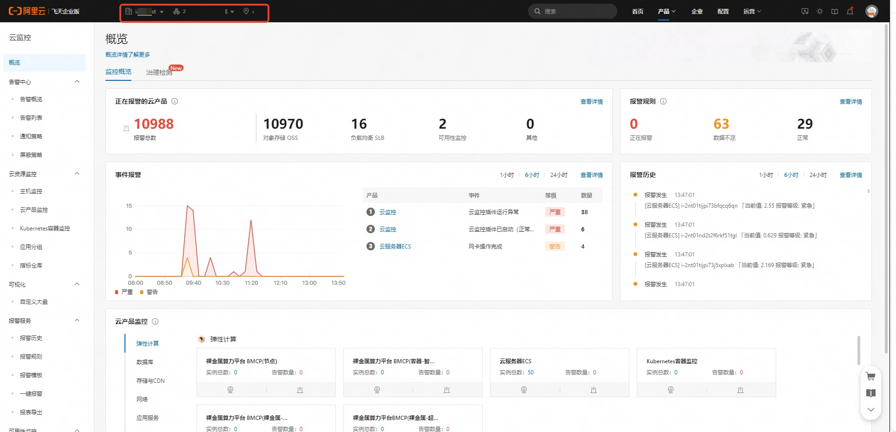

> **重要**
>
> - 云监控的业务数据支持分域，可在顶部菜单栏左侧按照组织、资源集和地域切换进行展示。
>
> - 请不要在Root组织下进行相关操作。

> **说明**
>
> 列表信息展示时：
>
> - 列表上方会显示  、  、  、  等按钮，您可根据实际需要调整列表展示。
>
>    ：表示刷新列表。
>
>    ：选择默认或紧凑展示列表信息。
>
>    ：设置显示或隐藏列表的展示项。鼠标悬浮在展示项上，单击展示项右侧的  ，还
>
>   可以调整展示项的显示顺序。
>
>    ：进入列表全屏模式。
>
> - 列表支持自定义拖拽列宽，您可以根据实际情况拖拽列宽进行展示。列宽配置存储在浏览器本地Storage中，清除Storage后会失效。

<a id="section-2"></a>

# 2.概览

**背景**

在云监控管理中，通过ASCM自定义角色功能，可以为不同的运维账号分配差异化的访问权限。当账号登录CMS云监控平台查看当前页面的监控数据时，系统会根据该账号的角色权限，仅展示其有权访问的产品线监控数据。这种细粒度的权限管控既保障了监控数据的安全隔离，避免敏感信息泄露，又简化了运维人员的操作界面，使其专注于自己负责的产品线，提升运维效率和数据安全性。

**监控概览**

云监控概览信息可全面了解阿里云上的资源使用情况、业务的运行状况和健康度，并及时收到异常报警做出反应，保证应用程序顺畅运行。监控概览页面包含正在报警的云产品、报警规则、事件报警、报警历史、云产品监控5个模块。

1. 登录Apsara Uni-manager运营控制台。

2. 单击顶部菜单栏的**产品**，选择**迁移与运维管理** > **运维与监控** > **云监控**。

3. 在左侧导航栏，单击**概览**。

4. 在**概览**页面，单击**监控概览**页签，查看概览信息。

   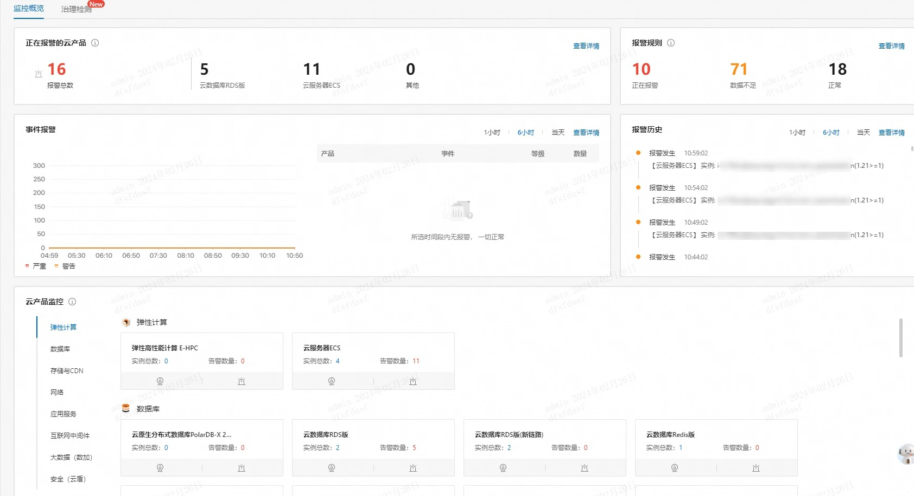

   <table>
     <tr>
       <th width="152">模块</th>
       <th>描述</th>
     </tr>
     <tr>
       <td>正在报警的云产品</td>
       <td>• 被云监控纳管并且开启了报警服务的云产品，在当前时间正在发生的报警数量。<br>• 单击<strong>查看详情</strong>可跳转至<strong>报警历史</strong>，查看报警明细。</td>
     </tr>
     <tr>
       <td>报警规则</td>
       <td>• 展示报警规则状态为<strong>正在报警</strong>、<strong>数据不足</strong>和<strong>正常</strong>的报警规则数量。<br>说明<strong>报警规则</strong>状态为<strong>数据不足</strong>可能的情况有：<br>• 云产品自身对该服务指标没有数据上报。<br>• 该云产品实例被删除 。<br>• 该云产品实例在SLS logstore中未创建或丢失，需要进一步排查等。<br>• 单击<strong>查看详情</strong>可跳转至<strong>报警规则</strong>，查看报警规则明细。</td>
     </tr>
     <tr>
       <td>事件报警</td>
       <td>• 事件报警提供各云产品系统事件运行状态，在业务故障时，便于快速分析并定位问题。<br>• 单击<strong>查看详情</strong>可跳转至<strong>系统事件</strong>，查看事件报警明细。</td>
     </tr>
     <tr>
       <td>报警历史</td>
       <td>• 支持云监控并且开启了报警服务的云产品，当前时间正在发生的报警明细数据。<br>• 单击<strong>查看详情</strong>跳转至<strong>报警历史</strong>，查看报警明细。</td>
     </tr>
     <tr>
       <td>云产品监控</td>
       <td>• 云监控自动获取当前账号下云产品资源的实例总数和告警数量。<br>• 单击云产品名称跳转至云产品监控，查看各实例的监控图表和报警规则。<br>• 单击可查看该云产品报警规则。<br>• 单击可查看该云产品监控信息。</td>
     </tr>
   </table>

**治理检测**

治理检测通过分析当前组织资源集的资源实例指标和报警规则，对指标有效性和报警有效性进行评估诊断，并提供一键修复和建议。

1. 在**概览**页面，单击**治理检测**页签，查看治理检测信息。

   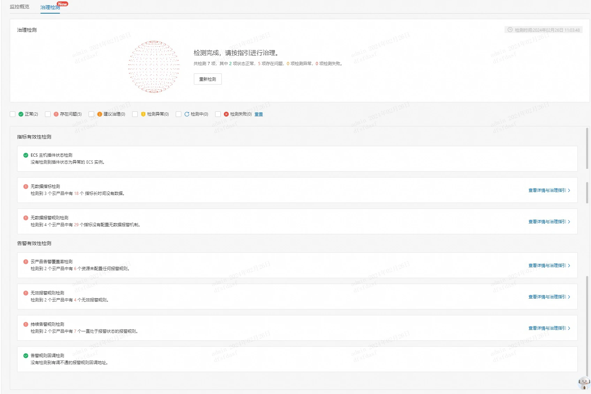

   <table>
     <tr>
       <th width="90">模块</th>
       <th>描述</th>
     </tr>
     <tr>
       <td>检测区域</td>
       <td>在治理检测区域，单击<strong>立即检测</strong>或<strong>重新检测</strong>。<br>说明<br>• 如果没有检测过，显示为<strong>立即检测</strong>。<br>• 如果检测过，显示为<strong>重新检测</strong>，并且展示最近一次的检测结果。</td>
     </tr>
   </table>

   <table>
     <tr>
       <td>检测详情</td>
       <td>当检测的结果存在问题时，可以单击检测项右侧的<strong>查看详情与治理指引</strong>，在<strong>检测详情</strong>面板，查看具体的检测机制、检测范围和需要治理的对象信息等。<br>• 指标有效性检测<br>• <strong>ECS主机插件状态检测</strong>：检测ECS所有实例的插件状态是否都时进行中。<br>• <strong>无数据报警规则检测</strong>：检测云产品所有指标是否在当前组资源集下有配置至少1个实例绑定无数据报警机制。<br>• <strong>无数据指标检测</strong>：检测云产品所有指标是都有数据输入，并且能够最终被用户查询。<br>• 告警有效性检测<br>• <strong>持续告警规则检测</strong>：检测最近24小时内，报警规则是否一直处于报警状态。<br>• <strong>告警规则回调检测</strong>：检测最近24小时内，报警规则回调地址是否有调用失败的情况。<br>• <strong>无效报警规则检测</strong>：检测云产品资源是否存在无效报警规则。<br>• <strong>云产品告警覆盖率检测</strong>：检测云产品资源是否存在未配置任何报警规则。<br>说明<br>• 如果某云产品有针对一级组织下所有的实例开启的一键报警，则默认当前云产品的所有实例均覆盖报警规则。<br>• 如果某云产品的报警规则是针对当前资源集（指定资源集）生效，则当前账号下指定资源集下的云产品的所有实例均覆盖报警规则。<br>• 如果一个资源实例中至少有一个指标存在报警规则，则认为该资源实例覆盖了报警规则。</td>
     </tr>
   </table>

<a id="section-3"></a>

# 3.监控助手

监控助手是集成于云监控平台的智能运维助理，通过自然语言对话实现“对话即管理”，帮助用户高效完成资源监控、告警处置、数据查询与智能诊断等复杂运维任务。

**操作步骤**

1. 登录Apsara Uni-manager运营控制台。

2. 单击顶部菜单栏的**产品**，选择**迁移与运维管理** > **运维与监控** > **云监控**。

3. 在左侧导航栏，单击**监控助手**。

   

   在界面可获取到以下信息：

   <ol type="i">

   <li>

   快速问答。

   - 问题咨询

     可一键查询指标清单。

   - 健康巡检

     可一键对所有的ECS进行可用性巡检。

   - 数据查询

     可快速查询最近24小时内触发次数最多的告警规则。

   - 异常诊断

     可快速分析当前告警次数最多的告警原因。

   </li>

   <li>

   搜索过滤。

   - 在界面左侧可按照全部、已完成、进行中以及最近和定时任务过滤会话。

   - 在界面左上角单击  ，输入会话内容，可快速搜索会话。

   </li>

   <li>

   重命名会话

   鼠标悬浮在会话上，单击会话后的  ，选择**重命名**，编辑后按回车键。

   </li>

   <li>

   置顶会话

   鼠标悬浮在会话上，单击会话后的  ，选择**置顶**，目标会话即被置顶。

   </li>

   <li>

   删除会话

   鼠标悬浮在会话上，单击会话后的  ，选择**删除**，目标会话被删除。

   </li>

   </ol>

4. 新任务。

   - 单击左侧的**新任务**，在输入框输入指令，或者上传附件，然后单击  ，创建并执行新任务，支持多种运

     维场景。

   - 同时可在输入框的右下角切换模型。

5. 技能。

   技能可在对话中扩展飞天助理的能力，系统预置**云产品文档检索**、**任务编排规划**、**PDF文档处理**、**Excel表格处理**四个技能，同时支持自定义技能。

   <ol type="i">

   <li>

   在**技能**页签，单击**上传技能**。

   </li>

   <li>

   单击弹框中的**上传技能**，选择本地的技能.zip包，然后单击**确认**。

   > **说明**
   >
   > 解压后必须包含SKILL.md格式的文件。

   </li>

   <li>

   开启、禁用技能。

   单击自定义技能后的  ，可开启或禁用技能。

   </li>

   <li>

   删除技能。

   单击自定义技能后的  ，可删除技能。

   </li>

   </ol>

6. 记忆。

   系统自动学习用户操作习惯并沉淀为可复用的记忆，同时支持手动创建自定义流程或偏好设置。

   <ol type="i">

   <li>

   新建记忆

   <ol type="a">

   <li>

   在**记忆**页签，单击**新建**，设置标题和内容，输入希望系统记住的内容，支持Markdown 格式。

   </li>

   <li>

   单击**保存**。

   </li>

   </ol>

   </li>

   <li>

   编辑记忆。

   鼠标悬浮在目标记忆上，单击记忆后方的编辑图标，更新标题和内容，然后单击**保存**。

   </li>

   <li>

   删除记忆。

   鼠标悬浮在目标记忆上，单击记忆后方的删除图标，然后单击弹框中的**确认删除**。

   </li>

   </ol>

7. 定时任务。

   支持按计划自动执行或手动触发周期性运维任务，同时支持自定义定时任务。

   <ol type="i">

   <li>

   新建任务。

   <ol type="a">

   <li>

   在**定时任务**页签，单击**新建定时任务**，设置任务名换、计划时间及执行内容。

   </li>

   <li>

   单击**保存**或**立即执行**。

   </li>

   </ol>

   </li>

   <li>

   启用或禁用定时任务。

   单击定时任务卡片上的  ，可启用或者禁用定时任务。

   </li>

   <li>

   立即执行定时任务。

   鼠标悬浮在任务卡片上，单击**立即执行**，即可跳过预设计划，即时运行该任务并获取最新结果。

   </li>

   <li>

   编辑任务。

   鼠标悬浮在任务卡片上，单击**编辑任务**，更新任务名换、计划时间及执行内容，然后单击**保存**或**立即执行**。

   </li>

   <li>

   删除任务。

   鼠标悬浮在任务卡片上，单击**删除**，在确认删除弹框中单击**删除**。

   </li>

   </ol>

<a id="section-4"></a>

# 4.智能探索分析

<a id="section-4-1"></a>

## 4.1. UModel探索

UModel 探索是云监控平台提供的可视化资源关系图谱工具，通过图形化方式展示云环境中各类实体（Entity）及其关联关系，帮助用户直观理解复杂的基础设施拓扑结构。

**核心价值**

- 全局可视：一键查看全量节点、链接的完整资源网络。

- 关系洞察：清晰呈现资源间的包含、关联等依赖关系。

- 快速定位：支持按类型、域筛选，精准定位目标资源。

- 详情透视：单击任意节点可查看其完整配置与元数据。

**操作步骤**

1. 登录Apsara Uni-manager运营控制台。

2. 单击顶部菜单栏的**产品**，选择**迁移与运维管理** > **运维与监控** > **云监控**。

3. 在左侧导航栏，选择**智能探索分析 > UModel探索。**

4. 当前页面展示以下信息：

   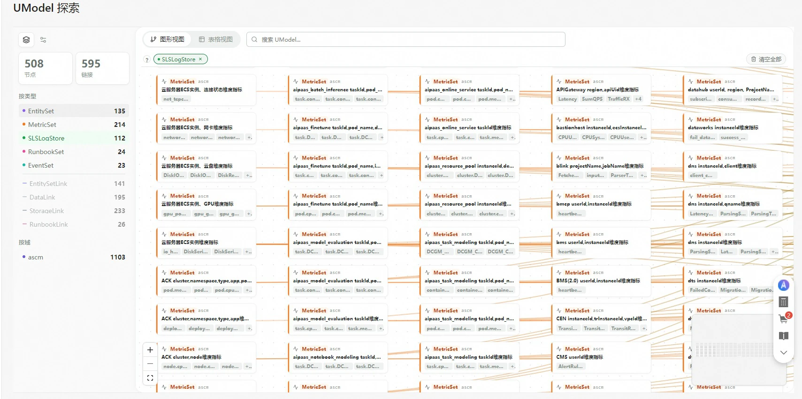

   - 全局统计面板

     实时展示当前视图中的资源总量，包括节点总数和链接总数。

   - 分类筛选

     按类型或域的维度过滤，可聚焦特定资源子集，单击任一类型或域标签，主视图将仅显示选项中及其附近的关联项；叠加筛选会在聚焦范围内继续叠加搜索、类型或域筛选；清空筛选即可回到完整结果。

   - 视图模式

     支持**图形视图**和**表格视图**，两种视图可自由切换，默认展示图形视图。

   - 节点卡片信息

     每个节点卡片包含类型标识、资源名称、所属域等信息，单击卡片弹框展示详细信息。

   - 搜索在搜索框可按照类型或域快速定位节点。

   - 缩放视图

     画布左下角可放大、缩小、适配视图，也可滚动鼠标缩放视图。

5. 设置。

   <ol type="i">

   <li>

   单击左上角的设置图标 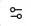 ，进入设置页签。

   </li>

   <li>

   画布

   画布背景的视觉呈现样式，用户可根据偏好或场景需求切换。支持**不显示**、**点状**、**直线**、**交叉**四种样式。

   </li>

   <li>

   关系

   定义图谱中“关系”的语义层级，决定哪些关联被可视化。支持**真实视图**和**逻辑视图**。

   </li>

   <li>

   显示

   默认不勾选，不勾选仅渲染当前可视区域内的元素，滚动或缩放时动态加载。

   </li>

   </ol>

<a id="section-4-2"></a>

## 4.2. 实体拓扑探索

实体拓扑探索是云监控平台提供的实例级资源关系可视化工具，聚焦于具体云资源实例（如 ECS、RDS、VPC 等）及其物理/逻辑连接关系，展示真实运行的单个资源对象构成的动态网络。

**核心价值**

- 实例透视：从宏观架构下沉到微观实例，查看每个资源的详细属性。

- 关系追踪：清晰呈现安全组、网络接口、磁盘等组件间的绑定与依赖。

- 故障定位：通过入向/出向关系快速判断影响范围或根因路径。

- 实时状态：数据源自动同步，反映当前生产环境的真实拓扑。

**操作步骤**

1. 登录Apsara Uni-manager运营控制台。

2. 单击顶部菜单栏的**产品**，选择**迁移与运维管理** > **运维与监控** > **云监控**。

3. 在左侧导航栏，选择**智能探索分析 > 实体拓扑探索。**

4. 当前页面展示以下信息：

   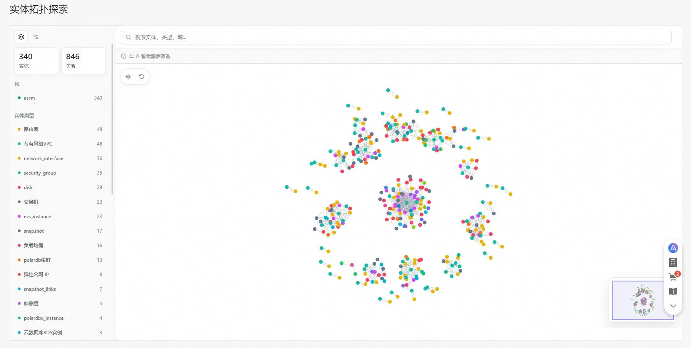

   - 全局统计面板

     实时展示当前视图中的资源规模，包括实体总数和关系总数。

   - 分类筛选

     按域、实体类型、关系的维度过滤，可聚焦特定资源子集；

   - 聚焦

     单击任一实体，主视图将仅显示选中实体及其附近实体；叠加筛选会在聚焦范围内继续叠加搜索、类型、域或关系筛选；清空筛选即可回到完整结果。

   - 实体信息

     每个实体包含IP、实例名称、度数、ID等信息，单击实体弹框展示详细信息。

   - 搜索

     在搜索框可按照实体、类型或域快速定位节点。

   - 适配视图

     在画布左上角单击  适配视图，也可滚动鼠标缩放视图。

5. 设置

   <ol type="i">

   <li>

   单击左上角的设置图标  ，进入设置页签。

   </li>

   <li>

   视图

   控制图谱的布局算法和组织方式，适应不同分析场景：

   力导向：适合局部探索的弹性拓扑图。

   分组：按实体类型分组，便于总览。

   </li>

   <li>

   显示

   设置是否显示实体标签、分组标签、缩略图，是否可拖拽移动实体。

   </li>

   </ol>

<a id="section-5"></a>

# 5.告警中心

**应用价值**

- 提供统一的集中告警界面，可集中展示云产品的告警数据。

- 提供统一的外发策略，可针对云产品配置统一的告警外发策略。

**功能特性**

<table>
  <tr>
    <th width="90">特性</th>
    <th>特性描述</th>
  </tr>
  <tr>
    <td>告警概览</td>
    <td>告警信息的统计视图，识别问题的焦点内容。</td>
  </tr>
  <tr>
    <td>告警列表</td>
    <td>支持查看当前正在上报的告警和历史告警列表以及报警趋势。统计维度包含两个统计维度（正在告警（告警状态：待处理、处理中）列表、历史告警（告警状态：已关闭）列表）。</td>
  </tr>
  <tr>
    <td>通知策略</td>
    <td>针对已发生的告警进行过滤、合并、降噪，目的在于减少低优先级/不必要的告警通知干扰用户，有效解决告警泛滥、信息散乱的问题，帮助用户甄选高优先级和关注的告警。</td>
  </tr>
  <tr>
    <td>屏蔽策略</td>
    <td>对集成的告警按照一定的告警条件进行设置屏蔽，支持指定屏蔽时间段、指定多个告警对象、告警等级、告警来源、告警名称进行屏蔽。</td>
  </tr>
</table>

**告警源信息**

告警数据从以下告警源中获取。

- 应用监控（ARMS）

- 日志监控（SLS）

- 云产品监控实例（CMS）

- 大数据监控（Dataworks）

- 普罗米修斯（Prometheus）

<a id="section-5-1"></a>

## 5.1. 告警概览

提供标准的可视化视图，可快速识别有异常的云产品，点击云产品可跳转到对应的产品监控列表和详情页进行问题排查。

**操作步骤**

1. 登录Apsara Uni-manager运营控制台。

2. 单击顶部菜单栏的**产品**，选择**迁移与运维管理** > **运维与监控** > **云监控**。

3. 在左侧导航栏，选择**告警中心 > 告警概览。**

4. 当前页面包含以下七个部分，从不同角度分析和统计告警信息。

   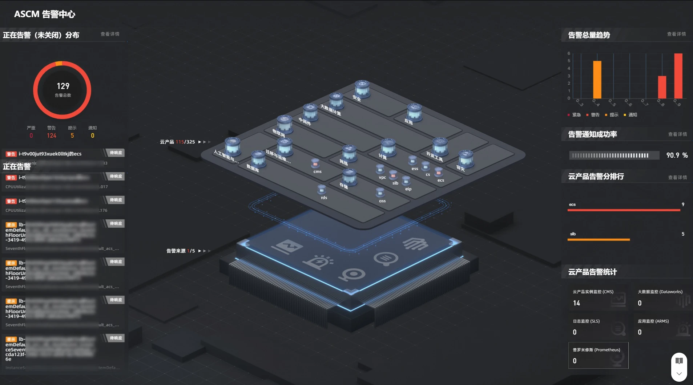

   - **正在告警（未关闭）分布**：提供当前组织资源集下正在告警且未被关闭的告警分布，根据告警等级分为严重、警告、提示、通知。单击**查看详情**，跳转至**告警列表**页面。

   - **正在告警**：提供当前组织资源集下正在告警的具体内容进行实时滚屏。单击**查看详情**，跳转至告警详情页面。

   - **告警总量趋势**：提供当前组织资源集下过去7天的告警总量趋势。

     - 每个柱面不同颜色的区域表示告警等级，对于每个色块，颜色越深代表告警等级越高。

     - 每个柱面的面积越大代表对应告警等级下的告警数量越多。

     - 单击**查看详情**，跳转至**告警列表**页面。

   - **告警通知成功率**：提供当前组织资源集下，配置了通知策略的通知成功率统计。单击**查看详情**，跳转至**通知策略**页面。

   - **云产品告警分布排行**：提供当前组织资源集下所有云产品的告警排行TOP。单击**查看详情**，跳转至**告警列表**页面。

   - **云产品告警统计**：提供当前组织资源集下不同的告警源的告警数量分布。单击云产品名称，跳转至**告警列表**页面。

   - 中间区域：鼠标单击云产品图标，展示云产品的告警状态、告警来源以及异常实例。单击**查看详情**，跳转至云产品实例列表页面。

**后续操作**

按照需求获取告警概览信息后，可通过告警列表进一步查看告警的信息。

<a id="section-5-2"></a>

## 5.2. 告警列表

支持查看当前正在上报的告警和历史告警列表以及报警趋势。统计维度包含两个统计维度（正在告警（告警状态：待处理、处理中）列表、历史告警（告警状态：已关闭）列表）。

**操作步骤**

1. 登录Apsara Uni-manager运营控制台。

2. 单击顶部菜单栏的**产品**，选择**迁移与运维管理** > **运维与监控** > **云监控**。

3. 在左侧导航栏，选择**告警中心 > 告警列表。**

4. 在**告警列表**页面，可查看**正在告警**和**历史告警**。默认进入**正在告警**页签，单击**历史告警**可切换到**历史告警**页签。

   - 在**正在告警**页面上方，可通过设置**告警ID**、**告警名称**、**告警等级**、**告警来源**、**告警对象**、**归属产品**、**告警内容**、**拓展属性**以及时间范围来快速筛选告警。

     

   - 在**报警趋势**区域，按照时间进行划分统计告警数量。

     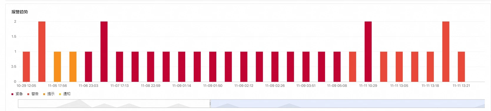

     - 每个柱面不同颜色的区域表示告警等级，对于每个色块，颜色越深代表告警等级越高。

     - 每个柱面的面积越大代表对应告警等级下的告警数量越多。

     - 将鼠标悬停在柱面上时，系统会显示当天每个告警等级对应的数量统计。

   - 在告警列表区域，可查看**告警ID/告警名称**、**组织**、**告警等级**、**告警对象/归属产品**、**告警内容**、**告警状态**、**处理状态**、**告警来源**、**告警次数**、**告警开始时间**、**最近告警时间**以及<strong>持续时间（秒）</strong>等<strong>。</strong>

     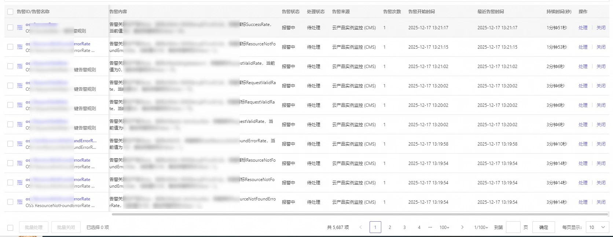

     - 单击目标告警的**告警ID/告警名称**进入告警详情页面，获取告警的详细信息。

       - 在页面右上角单击**处理**或**关闭**，可以修改当前的告警状态，告警状态同时会同步至时间线。

       - 在页面右上角单击**一键诊断**，飞天助理可通过告警ID，查询告警详情并进行一键诊断分析，展示详细的总结报告。

       - 在基本信息区域查看告警基本信息。

         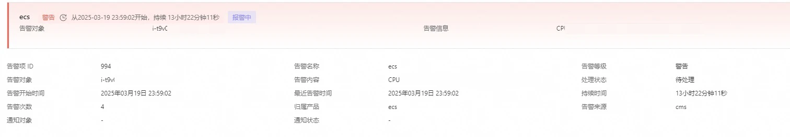

       - 在**拓展属性**区域查看告警的拓展信息。

         > **说明**
         >
         > 不同告警展示的拓展属性不同，以实际界面展示为准。

       - 在**时间线**区域，可设置**告警发生**、**告警定位**、**根因定位**、**告警关闭**和**告警响应**的时间和描述信息。

         单击**新增**，在**新增时间线**面板，设置**选择节点**、**时间**和**描述**。

         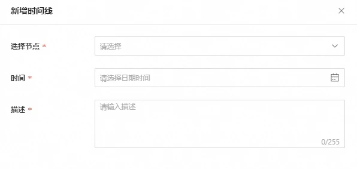

       - 在**告警分析**区域，可查看详细的监控指标及告警链路图。

         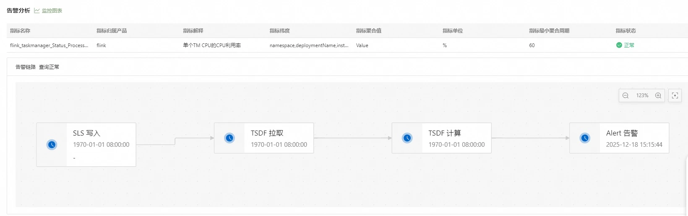

         单击**监控图表**，用户可自定义时间，查看监控指标趋势图。

         > **说明**
         >
         > 非CMS的告警，不展示告警分析。

       - 在**告警反馈**区域查看**告警有效性**和**告警准确性**。

         > **说明**
         >
         > 关闭告警时可反馈告警有效性和准确性。

         

     - 当告警清除完成后，系统按照告警规则定期同步告警状态。如果告警清除后，系统未及时更新告警状态，您可以手动变更告警状态，将告警状态置为**处理中**或**关闭**状态。

       - 置为**处理中**：

         - 单个告警：在告警列表中，单击目标告警**操作**列的**处理**，系统会将目标告警的**处理状态**修改为**处理中**。

         - 多个告警：选中目标告警，在页面左下方，单击**批量处理**，系统会将目标告警的**处理状态**修改为**处理中**。

       - 置为**已关闭**：

         - 单个告警：在**告警列表**页面中，单击目标告警**操作**列的**关闭**，系统会将目标告警的**处理状态**修改为**已关闭**。修改完成后会在**历史告警**页签下的告警列表中显示关闭的告警。

         - 多个告警：选中目标告警，在页面左下方，单击**批量关闭** ，系统会将目标告警的**处理状态**修改为**已关闭**。修改完成后会在**历史告警**页签下的告警列表中显示关闭的告警。

<a id="section-5-3"></a>

## 5.3. 告警规则

云监控告警中心集成了 ARMS、SLS以及 Prometheus 告警规则能力，如果未部署相关产品，则无法使用对应告警规则。

**ARMS**

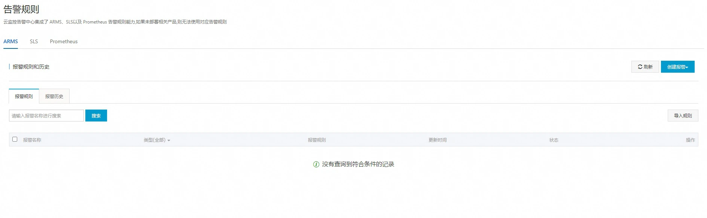

ARMS报警规则和历史相关操作，请参见<strong>《应用实时监控服务ARMS》</strong>>**《用户指南》**>**《报警》**>**《创建报警》**。

**SLS**

> **说明**
>
> 如果提示指定操作未授权，单击**授权操作SLS权限**完成授权后，重新进入页面即可。

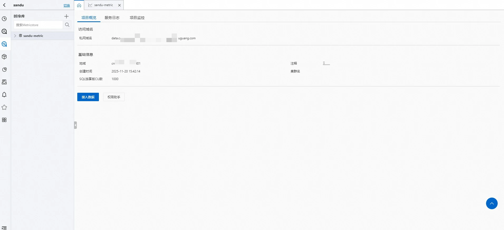

CMS支持订阅到SLS的metricstore，其他相关操作请参见<strong>《日志服务》</strong>>**《用户指南》**。

**Prometheus**

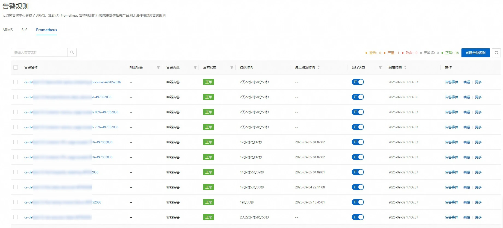

Prometheus报警规则和历史相关操作，请参见<strong>《日志服务》</strong>>**《用户指南》**>**《报警管理》**>**《创建报警》**。

<a id="section-5-4"></a>

## 5.4. 通知策略

针对已发生的告警进行过滤、合并、降噪，目的是减少低优先级/不必要的告警通知干扰用户，有效解决告警泛滥、信息散乱的问题，帮助用户甄选高优先级和关注的告警。

**创建通知策略**

**操作步骤**

1. 登录Apsara Uni-manager运营控制台。

2. 单击顶部菜单栏的**产品**，选择**迁移与运维管理** > **运维与监控** > **云监控**。

3. 在左侧导航栏，选择**告警中心 > 通知策略。**

4. 在**通知策略**页面，单击**创建通知策略**。

5. 在**创建通知策略**面板中，根据实际需要设置相应配置项。

   **分类**

   **参数**

   **说明**

   输入通知策略的名称。

   **名称**

   **基本信息**

   输入通知策略的描述信息。

   **描述**

   选择通知策略的告警来源，可多选。

   **告警来源**

   单击**添加告警名称**，在输入框输入通知策略的告警名称。

   **告警名称**

   > **说明**
   >
   > 支持添加多个告警名称。

   选择通知策略的告警等级。取值：**紧急**、**警告**、**提示**、**通知**。

   **告警等级**

   **订阅条件**

   单击**添加告警对象**，在输入框输入通知策略的告警对象。

   **告警对象**

   > **说明**
   >
   > 支持添加多个告警对象。

   单击**添加告警内容**，在输入框输入通知策略的告警内容。

   **告警内容**

   > **说明**
   >
   > 支持添加多个告警内容。

   选择通知策略的抑制条件。取值：**条件触发**、**直接触发，触发后抑制通知**、**直接触发不抑制**、**直接触发，下次状态不等于恢复则**

   **抑制条件**

   **抑制**。

   > **说明**
   >
   > 当**抑制条件**选择**条件触发**或**直接触发，触发后抑制通知**时，需设置此参数。

   **抑制条件描述**

   **抑制策略**

   设置抑制条件描述。

   单击**添加策略生效时间**，选择时间范围，告警仅在时间范围内通知。

   > **说明**
   >
   > 支持选择多个时间段。

   **策略周期**

   **策略生效时间**

   > **重要**
   >
   > 当选择多个策略生效周期时，请尽量避免重叠的时间段，避免重复通知。

   选择告警的通知联系人。

   **通知人/组**

   > **说明**
   >
   > 支持添加多个联系人。

   **通知方式**

   配置Webhook。单击**添加Webhook**，设置**Url**、**Method**、**自定义Header**、**RequestParams**、**ContentType**以及**bodyParamJson**等。

   - **Url**：输入Webhook对应的Url，必须使用域名（以http或https开头），不能使用IP。

   - **Method**：选择请求方式，**GET**或**POST**。

   - **自定义Header**：单击**添加自定义Header**，设置键值对信息。

     > **说明**
     >
     > 支持设置多个自定义Header。

   - **RequestParams**：单击**添加RequestParam**，设置键值对信息。

     > **说明**
     >
     > 支持设置多个RequestParam。

   **Webhook**

   - **ContentType**：选择请求中传输的内容类型和字符编码。

     > **说明**
     >
     > 当Method选择POST时，需要设置此参数。

     - **application/json**：表示发送的请求数据的格式必须为json字符串。

       **bodyParamJson**：输入json格式的请求内容。

     - **application/x-www-form-urlencoded**：表示发送的请求内容为表单提交。

       **bodyParams**：单击**添加BodyParams**，设置发送的请求的键值对信息。

       > **说明**
       >
       > 支持设置多个bodyParams。

   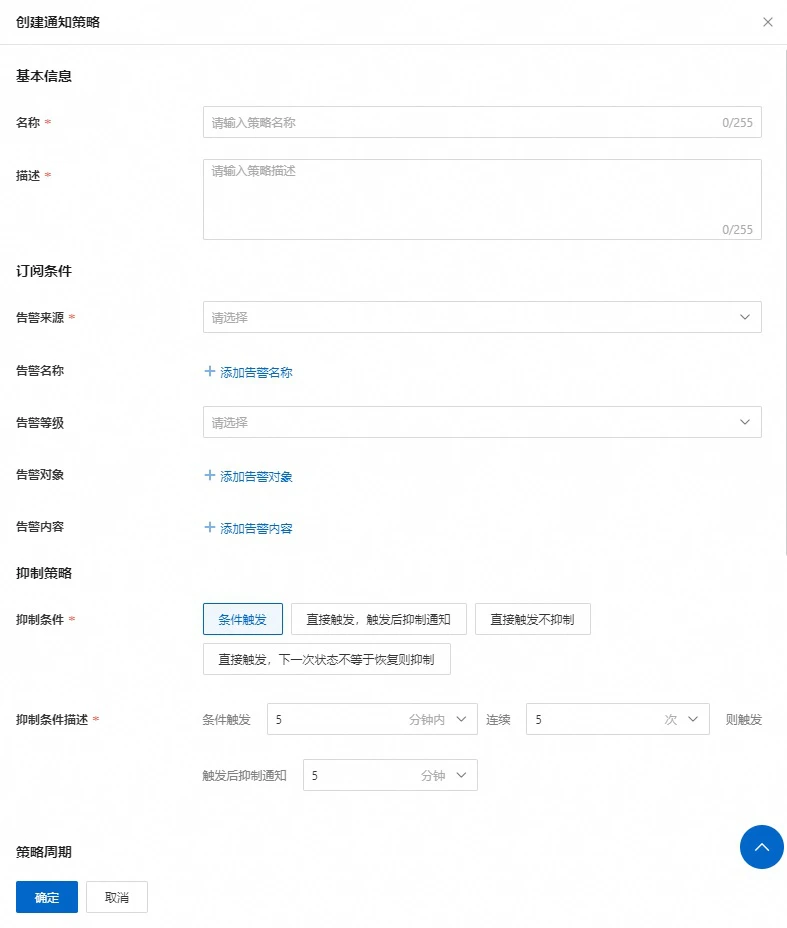

6. 单击**确定**。

> **说明**
>
> CMS通过集成大语言模型的智能分析能力，在接收到的告警通知信息中，增加自动化根因分析与处理建议的生成，目的是帮助用户快速定位故障，提升告警信息的可操作性，减少人工分析耗时，降低平均响应时间。

**查看通知策略**

**操作步骤**

通知策略创建成功后，可以查看通知策略的详细信息。

在**通知策略**页面的列表，查看通知策略的**策略名称**、**策略描述**、**策略状态**、**通知规则**、**抑制条件**、**生效时间段**、**通知记录**、**通知对象**和**Webhook配置**等。

> **说明**
>
> - 通过通知策略列表上方的下拉列表或搜索框设置，可以快速查找通知策略。
>
> - 单击策略状态右侧的  ，可通过筛选策略状态快速查找通知策略。
>
> - 鼠标悬停**通知规则**、**生效时间段**或**通知对象**列的数字上，可查看详细信息。
>
> - 单击**通知记录**列的  图标，在弹出的面板可查看最近3天通知记录，包括**告警ID/告警名称**、**告**
>
>   **警等级**、**告警对象/归属产品**、**告警内容**、**处理状态**、**告警开始时间**、**最近告警时间**以及**发送时间**等。
>
>   单击右上角的**查看更多**，跳转至**消息中心 > 未读消息**页面。


**修改通知策略**

**操作步骤**

当已有通知策略信息需要变更时，可以根据需要进行修改。

1. 在**通知策略**页面的列表中，单击目标策略操作列的**编辑**。

2. 在**编辑通知策略**面板，根据业务需要进行参数配置修改。具体参数配置说明可参见创建通知策略。

**禁用通知策略**

**操作步骤**

当暂时不需要通知策略时，可以停用对应的通知策略。

> **重要**
>
> 停用通知策略前，请确保**策略状态**为**启用中**。

- 单个禁用

  <ol type="i">

  <li>

  在**通知策略**页面的列表中，单击目标通知策略操作列的**禁用**。

  </li>

  <li>

  单击**确定**。

  </li>

  </ol>

- 批量禁用

  <ol type="i">

  <li>

  在**通知策略**页面的列表中，勾选目标通知策略前的复选框。

  </li>

  <li>

  单击列表下方的**批量禁用**。

  </li>

  <li>

  单击**确定**。

  </li>

  </ol>

**启用通知策略操作步骤**

当需要继续使用通知策略时，可以重启通知策略。

> **重要**
>
> 启用通知策略前，请确保**策略状态**为**已禁用**。

- 单个启用

  <ol type="i">

  <li>

  在**通知策略**页面的列表中，单击目标通知策略操作列的**启用**。

  </li>

  <li>

  单击**确定**。

  </li>

  </ol>

- 批量启用

  <ol type="i">

  <li>

  在**通知策略**页面的列表中，勾选目标通知策略前的复选框。

  </li>

  <li>

  单击列表下方的**批量启用**。

  </li>

  <li>

  单击**确定**。

  </li>

  </ol>

**删除通知策略**

**操作步骤**

当不再需要通知策略时，可以将其删除。

- 单个删除

  <ol type="i">

  <li>

  在**通知策略**页面的列表中，单击目标通知策略操作列的**删除**。

  </li>

  <li>

  单击**确定**。

  </li>

  </ol>

- 批量删除

  <ol type="i">

  <li>

  在**通知策略**页面的列表中，勾选目标通知策略前的复选框。

  </li>

  <li>

  单击列表下方的**批量删除**。

  </li>

  <li>

  单击**确定**。

  </li>

  </ol>

<a id="section-5-5"></a>

## 5.5. 屏蔽策略

允许对告警进行设定屏蔽策略（临时或永久），屏蔽的告警不再接入到系统。

**创建屏蔽策略**

**操作步骤**

1. 登录Apsara Uni-manager运营控制台。

2. 单击顶部菜单栏的**产品**，选择**迁移与运维管理** > **运维与监控** > **云监控**。

3. 在左侧导航栏，选择**告警中心 > 屏蔽策略。**

4. 在**屏蔽策略**页面，单击**创建屏蔽策略**。

5. 在**创建屏蔽策略**面板中，根据实际需要设置相应配置项。

   **分类**

   **参数**

   **说明**

   输入屏蔽策略的名称。

   **名称**

   **基本信息**

   输入屏蔽策略的描述信息。

   **描述**

   选择需要屏蔽的告警来源。

   **告警来源**

   单击**添加告警名称**，在输入框输入需要屏蔽的告警名称。

   **告警名称**

   > **说明**
   >
   > 支持添加多个告警名称。

   选择需要屏蔽的告警等级。取

   **告警等级**

   值：**紧急**、**警告**、**提示**、**通知**。

   **屏蔽条件**

   单击**添加告警对象**，在输入框输入需要屏蔽的告警对象。

   **告警对象**

   > **说明**
   >
   > 支持添加多个告警对象。

   单击**添加告警内容**，在输入框输入需要屏蔽的告警内容。

   **告警内容**

   > **说明**
   >
   > 支持添加多个告警内容。

   选择屏蔽条件，**自定义时间**或**所有时间，直接屏蔽**。

   **屏蔽条件**

   > **说明**
   >
   > 仅当**屏蔽条件**选择**自定义时间**时，设置此配置项。

   **屏蔽设置**

   单击**添加策略屏蔽时间**，设置时间范围，告警仅在时间范围内被屏

   **策略屏蔽时间**

   蔽。

   > **重要**
   >
   > 当选择多个屏蔽策略时间时，请尽量避免重叠的时间段，避免重复。

   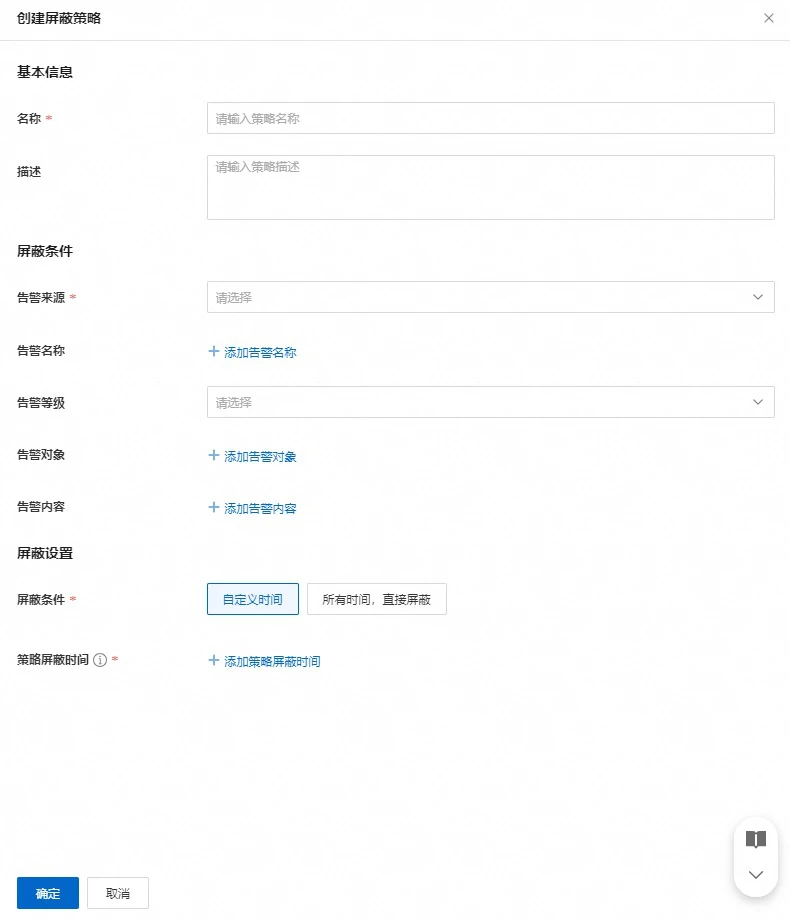

6. 单击**确定**。

**查看屏蔽策略**

**操作步骤**

告警的屏蔽策略创建成功后，可以查看屏蔽策略的详细信息。

在**屏蔽策略**页面的列表，查看屏蔽策略的**策略名称**、**策略描述**、**策略状态**、**屏蔽规则**和**屏蔽时间段**等。

> **说明**
>
> - 通过屏蔽策略列表上方的下拉列表或搜索框设置，可以快速查找屏蔽策略。
>
> - 单击策略状态右侧的  ，可通过筛选策略状态快速查找屏蔽策略。
>
> - 鼠标悬停在**屏蔽规则**和**屏蔽时间段**列的数字上，可查看详细信息。


**修改屏蔽策略**

**操作步骤**

当已有屏蔽策略信息需要变更时，可以根据需要进行修改。

1. 在**屏蔽策略**页面的列表中，单击目标策略操作列的**编辑**。

2. 在**编辑**面板，根据业务需要进行参数配置修改。具体参数配置说明可参见创建屏蔽策略。

**禁用屏蔽策略**

**操作步骤**

当暂时不需要屏蔽告警时，可以停用对应的屏蔽策略。

> **重要**
>
> 停用屏蔽策略前，请确保**策略状态**为**启用中**。

- 单个禁用

  <ol type="i">

  <li>

  在**屏蔽策略**页面的列表中，单击目标屏蔽策略操作列的**禁用**。

  </li>

  <li>

  单击**确定**。

  </li>

  </ol>

- 批量禁用

  <ol type="i">

  <li>

  在**屏蔽策略**页面的列表中，勾选目标屏蔽策略前的复选框。

  </li>

  <li>

  单击列表下方的**批量禁用**。

  </li>

  <li>

  单击**确定**。

  </li>

  </ol>

**启用屏蔽策略**

**操作步骤**

当需要继续屏蔽告警时，可以重启告警的屏蔽策略。

> **重要**
>
> 启用屏蔽策略前，请确保**策略状态**为**禁用中**。

- 单个启用

  <ol type="i">

  <li>

  在**屏蔽策略**页面的列表中，单击目标屏蔽策略操作列的**启用**。

  </li>

  <li>

  单击**确定**。

  </li>

  </ol>

- 批量启用

  <ol type="i">

  <li>

  在**屏蔽策略**页面的列表中，勾选目标屏蔽策略前的复选框。

  </li>

  <li>

  单击列表下方的**批量启用**。

  </li>

  <li>

  单击**确定**。

  </li>

  </ol>

**删除屏蔽策略**

**操作步骤**

当不再需要屏蔽告警时，可以将其删除。

- 单个删除

  <ol type="i">

  <li>

  在**屏蔽策略**页面的列表中，单击目标屏蔽策略操作列的**删除**。

  </li>

  <li>

  单击**确定**。

  </li>

  </ol>

- 批量删除

  <ol type="i">

  <li>

  在**屏蔽策略**页面的列表中，勾选目标屏蔽策略前的复选框。

  </li>

  <li>

  单击列表下方的**批量删除**。

  </li>

  <li>

  单击**确定**。

  </li>

  </ol>

<a id="section-6"></a>

# 6.云资源监控

<a id="section-6-1"></a>

## 6.1. 主机监控

云监控通过安装在云服务器ECS上的云监控插件，采集丰富的操作系统层面的监控项。支持对监控项设置报警规则，降低监控成本。

- **便捷的插件安装**：云监控通过安装在主机上的云监控插件，采集丰富的操作系统层面的监控项。

- **丰富的监控项**：操作系统监控、GPU监控、基础的网络流入流出、磁盘读写、进程监控、云盘及AVS网络监控等监控项。

- **业务级进程监控**：采集当前活跃进程的CPU使用率、内存使用率和打开文件数，帮助用户了解主机的资源分配情况。

- **灵活的报警服务**：支持对主机跨地域分组管理，通过设置分组维度的报警规则，极大地降低监控管理成本。

<a id="section-6-1-1"></a>

### 6.1.1. 安装插件

云监控通过在云服务器ECS上安装插件，来采集ECS操作系统的监控指标数据。

**批量安装或升级插件**

1. 登录Apsara Uni-manager运营控制台。

2. 单击顶部菜单栏的**产品**，选择**迁移与运维管理** > **运维与监控** > **云监控**。

3. 在左侧导航栏，选择**云资源监控 > 主机监控**。

4. 在**主机监控**页面，选中待安装或升级插件的ECS，单击列表左下角的**批量安装或升级插件**。

   > **说明**
   >
   > 目前云监控仅支持为**Linux**和**Windows**操作系统的ECS安装插件。

5. 单击**确定**。

   > **说明**
   >
   > 安装或升级插件大约需要5分钟。当**插件状态**由**安装中**变为**运行中**时，表示插件安装或升级成功。

**全局安装/升级Agent**

> **说明**
>
> 该操作为批量操作，每30分钟可以执行一次。

1. 在**主机监控**页面，单击列表上方的**安装/升级Agent**。

2. 在**安装/升级Agent**对话框中，选择要操作的类型包括**只对没有安装的进行安装**、**只对安装过的进行升级**或**安装并升级到最新版**。

   > **说明**
   >
   > - **只对没有安装的进行安装**：对于已经创建的 ECS 实例，只对没有安装 Agent 插件的实例的进行安装。
   >
   > - **只对安装过的进行升级**：对于已经创建的 ECS 实例，只对安装过 Agent 插件的实例的进行升级。
   >
   > - **安装并升级到最新版**：对于已经创建的 ECS 实例，安装并升级到最新版 Agent。

3. 单击**立即执行**。

**单个Agent安装**

1. 单击目标实例插件状态列的  。

2. 在弹出的Agent安装确认对话框中，单击**确定**。

   > **说明**
   >
   > 若插件安装失败，单击插件状态列的
   >
   > ，可查看插件安装失败检测信息，包含**最近一次安装失败原**
   >
   > 
   >
   > **因**、**安装历史详情**、**安装状态**和**安装插件输出**。

<a id="section-6-1-2"></a>

### 6.1.2. 进程监控

进程监控默认为您采集云服务器ECS最近一段时间内活跃进程的CPU使用率、内存使用率和文件打开数。如果添加了进程关键字，还可以采集包含关键字的进程个数。

**前提条件**

已为云服务器ECS安装云监控插件。具体操作，请参见安装插件。

**背景信息**

云监控系统以15秒为间隔轮询采集进程数据，记录这些进程的进程名称、进程ID、用户、CPU使用率、内存使用率、打开文件数和时间。

- 进程的CPU使用率与内存使用率。可以参考Linux中的**top**命令理解这两个监控项的含义。

- 进程的打开文件数。可以参考Linux中的**lsof**命令理解这个监控项的含义。

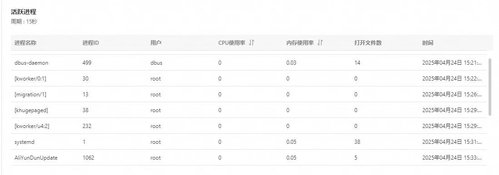

**添加或删除系统进程关键字**

通过监控云服务器ECS的进程数，采集关键进程的数量，及时获取关键进程的存活状态。

**操作步骤**

1. 登录Apsara Uni-manager运营控制台。

2. 单击顶部菜单栏的**产品**，选择**迁移与运维管理** > **运维与监控** > **云监控**。

3. 在左侧导航栏，选择**云资源监控 > 主机监控**。

4. 在**主机监控**页面，单击目标云服务器ECS实例名称。

5. 单击**进程监控**页签，在**进程数**区域，单击右上角的**添加进程**。

   - **添加系统进程关键字**：在**添加进程**面板，输入进程名称，单击**添加进程**。

   - **删除系统进程关键字**：在**添加进程**面板，单击目标进程名称**操作**列的**删除进程**。

**添加系统进程关键字操作示例**

假设云服务器ECS运行了如下进程：

```text
 /usr/bin/java -Xmx2300m -Xms2300m org.apache.catalina.startup.Bootstrap 

 /usr/bin/ruby 

 nginx -c /etc/nginx/nginx.conf 
```

当添加了6个进程关键字后，采集结果如下：

- 进程关键字为**ruby**，采集进程数为1，命中进程名称。

- 进程关键字为**nginx**，采集进程数为1，命中进程名称与参数。

- 进程关键字为<strong>/usr/bin</strong>，采集进程数为2，命中路径（2个进程包含该路径）。

- 进程关键字为**apache.catalina**，采集进程数为1，命中部分参数。

- 进程关键字为**nginx.conf**，采集进程数为1，命中部分参数。

- 进程关键字为<strong>-c</strong>，采集进程数为1，命中部分参数。

**为进程监控设置报警规则**

在添加进程监控后，再为该进程设置报警规则，当进程数发生变化时，报警通知对象可以收到报警通知。

**操作步骤**

1. 在左侧导航栏，选择**云资源监控 > 主机监控**。

2. 单击**创建报警规则**。

3. 在**创建报警规则**面板，单击**创建报警规则**，**监控指标**选择**进程**中的<strong>（Agent）process.count_processname</strong>，根据所需设置报警规则的其他参数。

   如果云服务器ECS上设置了多个进程，且每个进程数不同，可以单击**创建报警规则**，为多个进程设置报警规则。关于如何设置报警规则中的相关参数，请参见创建报警规则。

4. 单击**确定**。

<a id="section-6-1-3"></a>

### 6.1.3. 查看主机监控详情

**操作步骤**

1. 登录Apsara Uni-manager运营控制台。

2. 单击顶部菜单栏的**产品**，选择**迁移与运维管理** > **运维与监控** > **云监控**。

3. 在左侧导航栏，选择**云资源监控 > 主机监控**。

4. 在**主机监控**页面，可查看所有实例的**实例ID/名称**、**组织/资源集**、**地域**、**实例状态**、**ECS插件状态**、**ECS插件版本**、**配置**、**CPU使用率**、**内存使用率**、**云盘磁盘使用率**、**操作系统**、**实例规格**、**IP地址**、**专有网络ID**、**镜像ID**、**可用区ID**、**创建时间**等信息，同时可通过**CPU使用率**、**内存使用率**、**云盘磁盘使用率**进行排序。

   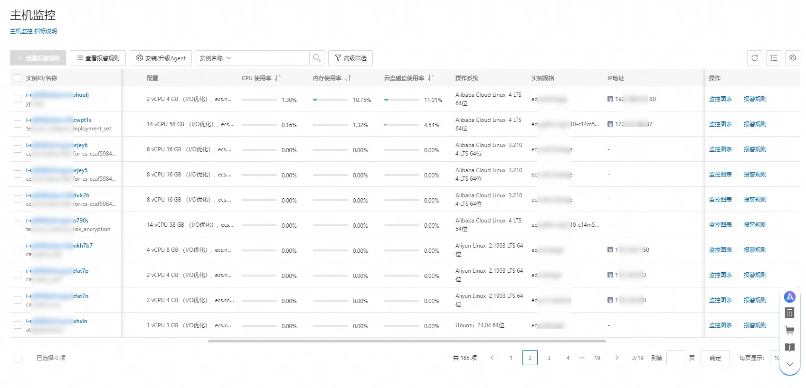

5. 单击目标实例的实例名称或**操作**列的**监控图表**，跳转至云服务器ECS实例详情页面，可查看具体的监控指标，指标详情可参考云服务器ECS。

   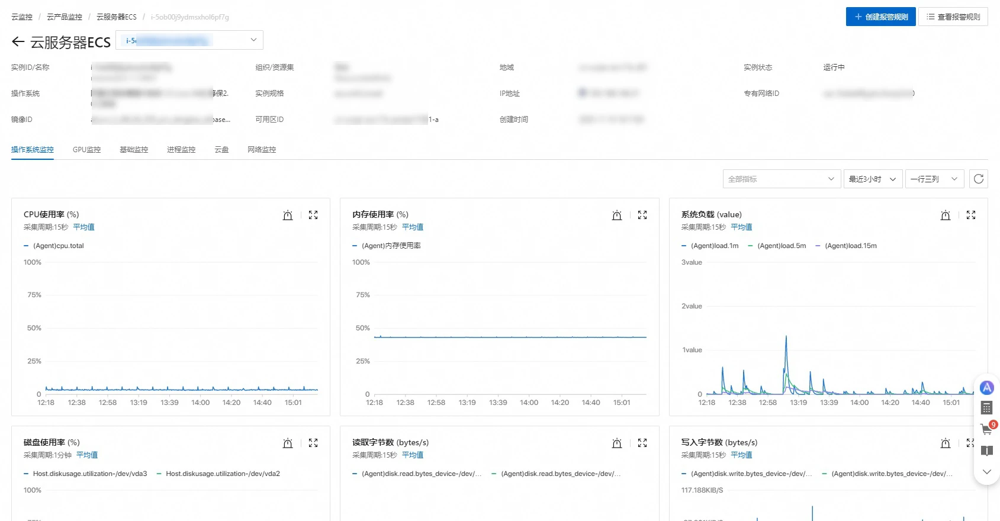

6. 单击目标实例**操作**列的**报警规则**，跳转到**报警规则**页面，可查看实例的详细规则并对规则进行管理，请参考管理报警规则。

7. 高级筛选。

   可通过**实例名称**、**实例ID**、**经典网络内网IP**、**VPC私网IP**、**公网IP**、**弹性公网IP**、**ECS插件状态**字段筛选目标实例。

   

<a id="section-6-2"></a>

## 6.2. 云产品监控

云监控自动获取当账号下云产品的资源。可以通过查看各云产品的监控图表，了解资源的运行状况；也可以通过设置报警规则，监控资源的运行状况。当符合报警规则时，云监控将自动发送报警通知，便于及时获悉资源的运行状况。

云监控支持以下云产品的监控：

> **说明**
>
> 各云产品监控项详情，参见云监控指标说明。

<table>
  <tr>
    <th width="170">云产品类型</th>
    <th>云产品名称</th>
  </tr>
  <tr>
    <td>弹性计算</td>
    <td>• Kubernetes容器监控<br>• 云服务器ECS<br>• 弹性高性能计算E-HPC<br>• 裸金属算力平台BMCP（节点）<br>• 裸金属算力平台BMCP（裸金属-智算算力集群）<br>• 裸金属算力平台BMCP（容器-智算算力集群）<br>• 裸金属算力平台BMCP（裸金属-超算算力集群）<br>• 裸机管理BMS</td>
  </tr>
  <tr>
    <td>数据库</td>
    <td>• 云数据库RDS<br>• 云数据库RDS（新链路）<br>• 数据库PolarDB（集群版）<br>• 数据库PolarDB（主备版）<br>• 云数据库Redis<br>• 云数据库Redis版（新链路）<br>• PolarDB集分一体版<br>• 云原生分布式数据库PolarDB-X 1.0<br>• 云原生数据仓库AnalyticDB PostgreSQL<br>• 云原生数据仓库AnalyticDB PostgreSQL（新链路）<br>• 云原生数据仓库AnalyticDB MySQL版3.0<br>• 云数据库MongoDB<br>• 云数据库MongoDB版（新链路）<br>• 数据传输服务DTS<br>• 云原生多模数据库 Lindorm<br>• 云原生多模数据库 Lindorm2.0</td>
  </tr>
  <tr>
    <td>存储与CDN</td>
    <td>• 云存储网关CSG<br>• 文件存储NAS<br>• 对象存储OSS<br>• 表格存储Tablestore<br>• 文件存储CPFS<br>• 文件系统APFS<br>• EFS-NAS文件存储</td>
  </tr>
  <tr>
    <td>网络</td>
    <td>• NAT网关<br>• 负载均衡SLB<br>• 应用型负载均衡<br>• VPN网关<br>• 弹性公网IP<br>• 域名解析DNS<br>• 域名解析DNS-租户转发域名</td>
  </tr>
  <tr>
    <td>应用服务</td>
    <td>• API网关（旧）</td>
  </tr>
  <tr>
    <td>互联网中间件</td>
    <td>• 消息队列MQ（RocketMQ）<br>• 消息队列MQ（tiangong）<br>• 消息队列Kafka<br>• API网关<br>• 企业级分布式应用服务EDAS（独享注册中心）</td>
  </tr>
  <tr>
    <td>大数据（数加）</td>
    <td>• 实时计算Realtime Compute Flink<br>• 实时计算Realtime Compute（Blink）<br>• 数据总线DataHub<br>• Elasticsearch（ECS版）<br>• Elasticsearch（K8s版）<br>• 交互式分析Hologres<br>• 交互式分析Hologres（新链路）<br>• 大数据计算MaxCompute<br>• 大数据计算MaxCompute（配额组）</td>
  </tr>
  <tr>
    <td>安全（云盾）</td>
    <td>• 数据库审计<br>• 数据静态脱敏与水印<br>• 租户侧堡垒机<br>• 特权访问管理<br>• 漏扫引擎<br>• NFV云防火墙<br>• Web应用防火墙<br>• CSP密码服务</td>
  </tr>
  <tr>
    <td>人工智能与机器学习</td>
    <td>• AI Studio（在线服务）<br>• AI Studio（模型评测）<br>• AI Studio（Notebook建模）<br>• AI Studio（任务建模）<br>• AI Studio（可视化建模）<br>• AI Studio（模型调优）<br>• AI Studio（批量推理）<br>• AI Studio（在线服务组）<br>• AI Studio（资源池）<br>• 百炼专属版</td>
  </tr>
</table>

<a id="section-6-2-1"></a>

### 6.2.1. 云监控指标说明

云监控中心通过云资源的监控指标，检测服务的可用性。通过对这些监控指标设置告警规则和通知策略，用户可及时了解各产品服务的实例资源运行状况和性能。

**背景说明**

在云监控管理中，通过ASCM自定义角色功能，可以为不同的运维账号分配差异化的访问权限。当账号登录CMS云监控平台查看当前页面的监控数据时，系统会根据该账号的角色权限，仅展示其有权访问的产品线监控数据。这种细粒度的权限管控既保障了监控数据的安全隔离，避免敏感信息泄露，又简化了运维人员的操作界面，使其专注于自己负责的产品线，提升运维效率和数据安全性。

<a id="section-6-2-1-1"></a>

#### 6.2.1.1. 弹性计算

<a id="section-6-2-1-1-1"></a>

##### 6.2.1.1.1. Kubernetes容器监控

本文介绍Kubernetes容器监控的监控指标。

> **说明**
>
> 本文列举的监控项为不支持Prometheus监控2.0的实例；支持Prometheus 监控2.0的实例，单击实例名称，界面跳转至Kubernetes容器监控。

**监控图表**

**Namespace**的取值为**acs_k8s**；**Period**的取值默认为**60**秒，也可以为60的整数倍。

| 监控项 | 单位 | MetricName | Dimensions | 描述 |
| --- | --- | --- | --- | --- |
| CPU资源限制 | cpus | cluster.cpu.limit | user_id、cluster_name | 一个容器被允许使用的最大CPU资源量。 |
| CPU资源请求 | cpus | cluster.cpu.reque st | user_id、cluster_name | 容器在调度时所请求的最小CPU资源量。 |
| 集群CPU使用量 | cpus | cluster.cpu.usage _rate | user_id、cluster_name | 集群CPU使用量。 |
| 集群维度的CPU使用率 | percent | cluster.cpu.utiliza tion | user_id、cluster_name | 集群维度的CPU使用率。 |
| 集群文件系统可用大小 | bytes | cluster.filesystem.available | user_id、cluster_name | 集群文件系统可用大小。 |
| 集群文件系统上限 | bytes | cluster.filesystem.limit | user_id、cluster_name | 集群文件系统上限。 |
| 集群内存限制 | bytes | cluster.memory.li mit | user_id、cluster_name | 集群内存限制。 |
| 集群内存请求 | bytes | cluster.memory.r equest | user_id、cluster_name | 集群内存请求。 |
| 集群维度的内存使用率 | percent | cluster.memory.u tilization | user_id、cluster_name | 集群维度的内存使用率。 |

**node**

**Namespace**的取值为**acs_k8s**；**Period**的取值默认为**60**秒，也可以为60的整数倍。

| 监控项 | 单位 | MetricName | Dimensions | 描述 |
| --- | --- | --- | --- | --- |
| node.cpu.alloca table | cpus | node.cpu.allocata ble | userId、cluster、node | node.cpu.allocatable |
| node.cpu.capaci ty | cpus | node.cpu.capacit y | userId、cluster、node | node.cpu.capacity |
| node.cpu.limit | cpus | node.cpu.limit | userId、cluster、node | node.cpu.limit |
| node_CPU资源超卖率 | percent | node.cpu.oversal e_rate | userId、cluster、node | node_CPU资源超卖率 |
| node.cpu.reque st | cpus | node.cpu.request | userId、cluster、node | node.cpu.request |
| node.cpu.reserv ation | cpus | node.cpu.reserva tion | userId、cluster、node | node.cpu.reservation |
| node.cpu.usage _rate | cpus | node.cpu.usage_r ate | userId、cluster、node | node.cpu.usage_rate |
| node.cpu.utiliza tion | percent | node.cpu.utilizati on | userId、cluster、node | node.cpu.utilization |
| node.filesystem.available | short | node.filesystem.a vailable | userId、cluster、node | node.filesystem.available |
| node.filesystem.limit | short | node.filesystem.li mit | userId、cluster、node | node.filesystem.limit |
| node.filesystem.usage | short | node.filesystem.u sage | userId、cluster、node | node.filesystem.usage |
| node.memory.al locatable | gbytes | node.memory.all ocatable | userId、cluster、node | node.memory.allocatable |
| node.memory.c apacity | short | node.memory.ca pacity | userId、cluster、node | node.memory.capacity |
| node.memory.li mit | short | node.memory.lim it | userId、cluster、node | node.memory.limit |
| node.memory.major_page_fau lts | short | node.memory.ma jor_page_faults | userId、cluster、node | node.memory.major_page_faults |
| node.memory.major_page_fau lts_rate | short | node.memory.ma jor_page_faults_r ate | userId、cluster、node | node.memory.major_page_faults_rate |
| node_内存资源超卖率 | percent | node.memory.ov ersale_rate | userId、cluster、node | node_内存资源超卖率 |
| node.memory.p age_faults | short | node.memory.pa ge_faults | userId、cluster、node | node.memory.page_faults |
| node.memory.p age_faults_rate | short | node.memory.pa ge_faults_rate | userId、cluster、node | node.memory.page_faults_rate |
| node.memory.r equest | short | node.memory.req uest | userId、cluster、node | node.memory.request |
| node.memory.r eservation | short | node.memory.res ervation | userId、cluster、node | node.memory.reservation |
| node.memory.rs s | short | node.memory.rss | userId、cluster、node | node.memory.rss |
| node.memory.u sage | short | node.memory.us age | userId、cluster、node | node.memory.usage |
| node.memory.u tilization | short | node.memory.util ization | userId、cluster、node | node.memory.utilization |
| node.memory.w orking_set | short | node.memory.wo rking_set | userId、cluster、node | node.memory.working_set |
| node.network.rx _errors | short | node.network.rx_errors | userId、cluster、node | node.network.rx_errors |
| node.network.rx _errors_rate | percent | node.network.rx_errors_rate | userId、cluster、node | node.network.rx_errors_rat e |
| node.network.rx _rate | Bps | node.network.rx_rate | userId、cluster、node | node.network.rx_rate |
| node.network.tx _errors_rate | Bps | node.network.tx_errors_rate | userId、cluster、node | node.network.tx_errors_rat e |
| node.network.tx _rate | Bps | node.network.tx_rate | userId、cluster、node | node.network.tx_rate |

**pod**

**Namespace**的取值为**acs_k8s**；**Period**的取值默认为**60**秒，也可以为60的整数倍。

| 监控项 | 单位 | MetricName | Dimensions | 描述 |
| --- | --- | --- | --- | --- |
| 容器组CPU资源分配上限 | cpus | pod.cpu.limit | userId、cluster、namespace、type、app、pod | 容器组CPU资源分配上限。 |
| pod_CPU资源超卖率 | cpus | pod.cpu.oversale _rate | userId、cluster、namespace、type、app、pod | pod_CPU资源超卖率。 |
| 容器组CPU资源分配最小需求 | cpus | pod.cpu.request | userId、cluster、namespace、type、app、pod | 容器组CPU资源分配最小需求。 |
| 容器组CPU使用量 | cpus | pod.cpu.usage_ra te | userId、cluster、namespace、type、app、pod | 容器组CPU使用量。 |
| 容器组CPU使用率（usage/limit） | percent | pod.cpu.utilizatio n | userId、cluster、namespace、type、app、pod | 容器组CPU使用率（usage/limit） 。 |
| 容器组文件系统可用大小 | gbytes | pod.filesystem.av ailable | userId、cluster、namespace、type、app、pod | 容器组文件系统可用大小。 |
| 容器组文件系统上限 | gbytes | pod.filesystem.li mit | userId、cluster、namespace、type、app、pod | 容器组文件系统上限。 |
| 容器组文件系统上限 | gbytes | pod.filesystem.li mit | userId、cluster、namespace、type、app、pod | 容器组文件系统上限。 |
| 容器组内存资源分配上限 | gbytes | pod.memory.limit | userId、cluster、namespace、type、app、pod | 容器组内存资源分配上限。 |
| pod_内存资源超卖率（usage/request） | gbytes | pod.memory.over sale_rate | userId、cluster、namespace、type、app、pod | pod_内存资源超卖率（usage/request）。 |
| 容器组内存资源分配最小需求 | mbytes | pod.memory.requ est | userId、cluster、namespace、type、app、pod | 容器组内存资源分配最小需求。 |
| 容器组内存资源rss | mbytes | pod.memory.rss | userId、cluster、namespace、type、app、pod | 容器组内存资源rss。 |
| 容器组内存使用率（working_set/li mit） | percent | pod.memory.utili zation | userId、cluster、namespace、type、app、pod | 容器组内存使用率（working_set/limit）。 |
| 容器组工作内存使用量 | mbytes | pod.memory.wor king_set | userId、cluster、namespace、type、app、pod | 容器组工作内存使用量。 |
| 容器组网络接收错误速率 | Bps | pod.network.rx_e rrors_rate | userId、cluster、namespace、type、app、pod | 容器组网络接收错误速率。 |
| 容器组网络接收速率 | Bps | pod.network.rx_r ate | userId、cluster、namespace、type、app、pod | 容器组网络接收速率。 |
| 容器组网络发送错误速率 | Bps | pod.network.tx_e rrors_rate | userId、cluster、namespace、type、app、pod | 容器组网络发送错误速率。 |
| 容器组网络发送速率 | Bps | pod.network.tx_r ate | userId、cluster、namespace、type、app、pod | 容器组网络发送速率。 |

**deployment**

| 监控项 | 单位 | MetricName | Dimensions | 描述 |
| --- | --- | --- | --- | --- |
| 部署应用CPU资源分配上限 | cpus | deployment.cpu.l imit | userId、cluster、namespace、type、app | 部署应用CPU资源分配上限。 |
| 部署应用CPU使用量 | cpus | deployment.cpu.usage_rate | userId、cluster、namespace、type、app | 部署应用CPU使用量。 |
| 部署应用文件系统可用大小 | bytes | deployment.filesy stem.available | userId、cluster、namespace、type、app | 部署应用文件系统可用大小。 |
| 部署应用文件系统上限 | bytes | deployment.filesy stem.limit | userId、cluster、namespace、type、app | 部署应用文件系统上限。 |
| 部署应用内存资源分配上限 | bytes | deployment.mem ory.limit | userId、cluster、namespace、type、app | 部署应用内存资源分配上限。 |
| 部署应用内存资源分配最小需求 | bytes | deployment.mem ory.request | userId、cluster、namespace、type、app | 部署应用内存资源分配最小需求。 |
| 部署应用工作内存使用量 | bytes | deployment.mem ory.working_set | userId、cluster、namespace、type、app | 部署应用工作内存使用量。 |
| 应用网络接收错误速率 | Bps | deployment.netw ork.rx_errors_rate | userId、cluster、namespace、type、app | 应用网络接收错误速率。 |
| 应用网络接收错误速率 | Bps | deployment.netw ork.rx_errors_rate | userId、cluster、namespace、type、app | 应用网络接收错误速率。 |
| 应用网络发送错误速率 | Bps | deployment.netw ork.tx_errors_rate | userId、cluster、namespace、type、app | 应用网络发送错误速率。 |

<a id="section-6-2-1-1-2"></a>

##### 6.2.1.1.2. 云服务器ECS

本文介绍云服务器ECS的监控指标。

**基础监控项**

**Namespace**的取值为**acs_ecs_dashboard**；**Period**的取值默认为**60**秒，也可以为60的整数倍。

> **说明**
>
> - 如果已接入公共云，可通过切换云平台，查看公共云云服务器ECS的监控指标。
>
> - 以下指标是通过宿主机（虚拟化）层采集，与操作系统内部采集的指标数据存在微小差异。

| 监控项 | 单位 | MetricName | Dimensions | 描述 |
| --- | --- | --- | --- | --- |
| （ECS）CPU使用率 | percent | CPUUtilization | userId、instanceId | CPU使用率。 |
| （ECS）经典网络公网流入带宽 | bps | InternetInRate | userId、instanceId | 公网入流量速率。 |
| （ECS）内网流入带宽 | bps | IntranetInRate | userId、instanceId | 内网入流量速率。 |
| （ECS）经典网络公网流出带宽 | bps | InternetOutRate | userId、instanceId | 公网出流量速率。 |
| （ECS）内网流出带宽 | bps | IntranetOutRate | userId、instanceId | 内网出流量速率。 |
| （ECS）所有磁盘读取BPS | Bps | DiskReadBPS | userId、instanceId | 所有磁盘读取每秒读取字节数。 |
| （ECS）所有磁盘写入BPS | Bps | DiskWriteBPS | userId、instanceId | 所有磁盘读取每秒写入字节数。 |
| （ECS）所有磁盘每秒读取次数 | ops | DiskReadIOPS | userId、instanceId | 所有磁盘读取每秒读取次数。 |
| （ECS）所有磁盘每秒写入次数 | ops | DiskWriteIOPS | userId、instanceId | 所有磁盘读取每秒写入次数。 |

**操作系统级别监控项**

**Namespace**的取值为**acs_ecs_dashboard**；**Period**的取值默认为**15**秒，也可以为15的整数倍。

> **说明**
>
> ECS实例需要安装监控插件才能采集操作系统级别的指标数据。
>
> 安装方法：在云监控控制台左侧导航栏中单击主机监控，在**ECS监控列表**页面中，选择待监控的实例，单击监控列表最下方的**批量安装或升级插件**。
>
> 安装监控插件成功5～10分钟后，监控图表才会显示监控数据。

| 监控项 | 单位 | MetricName | Dimensions | 描述 |
| --- | --- | --- | --- | --- |
| （Agent）Host.cpu _totalCPU使用率 | percent | cpu_total | userId、instanceId | CPU使用率。 |
| （Agent）Host.me m.used.utilization内存使用率 | percent | memory_usedutiliz ation | userId、instanceId | 内存使用率。 |
| （Agent）Host.load 15系统负载 | 无 | load_15m | userId、instanceId | 过去15分钟的系统负载。<br>说明Windows操作系统没有此指标。 |
| （Agent）Host.load 1系统负载 | 无 | load_1m | userId、instanceId | 过去1分钟的系统负载。<br>说明Windows操作系统没有此指标。 |
| （Agent）Host.load 5系统负载 | 无 | load_5m | userId、instanceId | 过去5分钟的系统负载。<br>说明Windows操作系统没有此指标。 |
| （Agent）Host.disk.utilization磁盘使用率 | percent | diskusage_utilizati on | userId、instanceId、device | 磁盘容量使用率。 |
| （Agent）Host.fs.in ode使用率 | percent | fs_inodeutilization | userId、instanceId、device | inode使用率。<br>说明该指标仅支持Linux操作系统。 |
| (Agent)disk.read.b ytes_device | Bps | disk_readbytes | userId、instanceId、device | 磁盘每秒读取的字节数。 |
| (Agent)disk.read.io ps_device | ops | disk_readiops | userId、instanceId、device | 磁盘每秒的读请求数量。 |
| (Agent)disk.write.b ytes_device | Bps | disk_writebytes | userId、instanceId、device | 磁盘每秒写入的字节数。 |
| (Agent)disk.write.io ps_device | ops | disk_writeiops | userId、instanceId、device | 磁盘每秒的写请求数量。 |
| (Agent)network.tcp.connection_state | short | net_tcpconnection | userId、instanceId、state | 系统TCP连接各状态数。 |
| (Agent)process.cou nt_processname | short | process.number | userId、instanceId、processName | 进程匹配数目。 |
| io饱和度 | percent | disk_io_util | userId、instanceId、device | IO饱和度。 |
| 僵尸进程总数 | short | zombieProcessNu mber | userId、instanceId | 僵尸进程总数。<br>说明Windows操作系统没有此指标。 |
| 进程总数 | short | totalProcessNumbe r | userId、instanceId | 进程总数。<br>说明Windows操作系统没有此指标。 |
| swap分区使用率 | percent | swapUtilization | userId、instanceId | swap分区使用率。 |
| 网卡发送丢包率 | percent | networkout_drop_r atio | userId、instanceId、device | 网卡发送丢包率。 |
| 网卡发送错误率 | percent | networkout_error_r atio | userId、instanceId、device | 网卡发送错误率。 |
| 网卡接收丢包率 | percent | networkin_drop_rat io | userId、instanceId、device | 网卡接收丢包率。 |
| 网卡接收错误率 | percent | networkin_error_ra tio | userId、instanceId、device | 网卡接收错误率。 |
| ECS实例文件打开数 | short | system_open_files | instanceId | ECS实例文件打开数。 |

**GPU监控**

**GPU监控新旧指标映射**

> **重要**
>
> - CMS对GPU的监控指标进行了整合，如果用户升级了Argusagent版本，旧的GPU指标就会失效，旧的GPU指标由于采集协议不统一故而进行统一升级，如果有外部指标消费场景建议进行更换指标。
>
> - 当用户升级完CMS后，旧GPU指标的报警规则会迁移成新指标的报警规则。

**英伟达**

| 旧指标 | 旧指标中文名 | 新指标 | 新指标中文名 |
| --- | --- | --- | --- |
| gpu_power_readings_p ower_draw | GPU维度GPU功率 | gpu_power_readings_p ower_draw_v2 | GPU维度GPU功率 |
| gpu_gpu_temperature | GPU维度GPU温度 | gpu_gpu_temperature_v2 | GPU维度GPU温度 |
| gpu_gpu_usedutilizatio n | GPU维度GPU使用率 | gpu_gpu_usedutilizatio n_v2 | GPU维度GPU使用率 |
| gpu_memory_usedutili zation | GPU维度显存使用率 | gpu_memory_usedutiliz ation_v2 | GPU维度显存使用率 |
| gpu_memory_freespac e | GPU维度显存空闲量 | gpu_memory_freespac e_v2 | GPU维度显存空闲量 |
| gpu_memory_freeutiliz ation | GPU维度显存空闲率 | gpu_memory_freeutiliz ation_v2 | GPU维度显存空闲率 |
| gpu_memory_usedspac e | GPU维度显存使用量 | gpu_memory_usedspac e_v2 | GPU维度显存使用量 |
| gpu_encoder_utilizatio n | GPU维度编码器使用率 | gpu_encoder_utilization _v2 | GPU维度编码器使用率 |
| gpu_decoder_utilizatio n | GPU维度解码器使用率 | gpu_decoder_utilization _v2 | GPU维度解码器使用率 |
| / | / | gpu_tx_throughput_v2 | GPU维度发送吞吐率 |
| / | / | gpu_rx_throughput_v2 | GPU维度接收吞吐率 |
| / | / | gpu_fan_speed_v2 | GPU维度风扇转速 |
| / | / | gpu_power_utilization_v2 | GPU维度GPU功率使用率 |

**海光**

| 旧指标 | 旧指标中文名 | 新指标 | 新指标中文名 |
| --- | --- | --- | --- |
| gpu_power_readings_po wer_draw_hygon | （Agent）Hygon维度Hygon功率 | gpu_power_readings_p ower_draw_v2 | GPU维度GPU功率 |
| gpu_gpu_temperature_hygon | （Agent）Hygon维度Hygon温度 | gpu_gpu_temperature_v2 | GPU维度GPU温度 |
| gpu_gpu_usedutilization _hygon | （Agent）Hygon维度Hygon使用率 | gpu_gpu_usedutilizatio n_v2 | GPU维度GPU使用率 |
| gpu_memory_usedutiliz ation_hygon | （Agent）Hygon维度显存使用率 | gpu_memory_usedutili zation_v2 | GPU维度显存使用率 |
| / | / | gpu_memory_freespac e_v2 | GPU维度显存空闲量 |
| / | / | gpu_memory_freeutiliz ation_v2 | GPU维度显存空闲率 |
| / | / | gpu_memory_usedspa ce_v2 | GPU维度显存使用量 |
| / | / | gpu_power_utilization_v2 | GPU维度GPU功率使用率 |

**昇腾**

| 旧指标 | 旧指标中文名 | 新指标 | 新指标中文名 |
| --- | --- | --- | --- |
| gpu_power_readings_po wer_draw_ascend | （Agent）Ascend维度Ascend功率 | gpu_power_readings_p ower_draw_v2 | GPU维度GPU功率 |
| gpu_gpu_temperature_ascend | （Agent）Ascend维度Ascend温度 | gpu_gpu_temperature_v2 | GPU维度GPU温度 |
| gpu_gpu_usedutilization _ascend | （Agent）Ascend维度Ascend使用率 | gpu_gpu_usedutilizatio n_v2 | GPU维度GPU使用率 |
| gpu_memory_usedutiliz ation_ascend | （Agent）Ascend维度显存使用率 | gpu_memory_usedutiliz ation_v2 | GPU维度显存使用率 |
| / | / | gpu_memory_freespac e_v2 | GPU维度显存空闲量 |
| / | / | gpu_memory_freeutiliz ation_v2 | GPU维度显存空闲率 |
| / | / | gpu_memory_usedspac e_v2 | GPU维度显存使用量 |

**APG**

| 旧指标 | 旧指标中文名 | 新指标 | 新指标中文名 |
| --- | --- | --- | --- |
| gpu_power_readings_po wer_draw_ppu | （Agent）Ppu维度Ppu功率 | gpu_power_readings_p ower_draw_v2 | GPU维度GPU功率 |
| gpu_gpu_temperature_p pu | （Agent）Ppu维度Ppu温度 | gpu_gpu_temperature_v2 | GPU维度GPU温度 |
| gpu_gpu_usedutilization_ppu | （Agent）Ppu维度Ppu使用率 | gpu_gpu_usedutilizatio n_v2 | GPU维度GPU使用率 |
| gpu_memory_usedutiliza tion_ppu | （Agent）Ppu维度显存使用率 | gpu_memory_usedutili zation_v2 | GPU维度显存使用率 |
| / | / | gpu_memory_freespac e_v2 | GPU维度显存空闲量 |
| / | / | gpu_memory_freeutiliz ation_v2 | GPU维度显存空闲率 |
| / | / | gpu_memory_usedspac e_v2 | GPU维度显存使用量 |
| / | / | gpu_encoder_utilizatio n_v2 | GPU维度编码器使用率 |
| / | / | gpu_decoder_utilizatio n_v2 | GPU维度解码器使用率 |
| / | / | gpu_tx_throughput_v2 | GPU维度发送吞吐率 |
| / | / | gpu_rx_throughput_v2 | GPU维度接收吞吐率 |
| / | / | gpu_fan_speed_v2 | GPU维度风扇转速 |
| / | / | gpu_power_utilization_v2 | GPU维度GPU功率使用率 |

**GPU指标说明**

**Namespace**的取值为**acs_ecs_dashboard**；**Period**的取值默认为**60**秒，也可以为60的整数倍。

| 监控项 | 单位 | MetricName | Dimensions | 描述 |
| --- | --- | --- | --- | --- |
| GPU维度解码器使用率 | percen t | gpu_decoder_utili zation_v2 | instanceId,gpuId | GPU维度解码器使用率。 |
| GPU维度编码器使用率 | percen t | gpu_encoder_utili zation_v2 | instanceId,gpuId | GPU维度编码器使用率。 |
| GPU维度GPU温度 | celsius | gpu_gpu_tempera ture_v2 | instanceId,gpuId | GPU温度。 |
| GPU维度GPU使用率 | percen t | gpu_gpu_usedutili zation_v2 | instanceId,gpuId | GPU使用率。 |
| GPU维度显存空闲量 | bytes | gpu_memory_free space_v2 | instanceId,gpuId | GPU维度显存空闲量。 |
| GPU维度显存空闲率 | percen t | gpu_memory_free utilization_v2 | instanceId,gpuId | GPU维度显存空闲率。 |
| GPU维度显存使用量 | bytes | gpu_memory_use dspace_v2 | instanceId,gpuId | GPU维度显存使用量。 |
| GPU维度显存使用率 | percen t | gpu_memory_use dutilization_v2 | instanceId,gpuId | GPU维度显存使用率。 |
| GPU维度GPU功率 | watt | gpu_power_readin gs_power_draw_v 2 | instanceId,gpuId | GPU功率。 |
| GPU维度发送吞吐率 | KBs | gpu_tx_throughpu t_v2 | instanceId,gpuId | GPU维度发送吞吐率。 |
| GPU维度接收吞吐率 | KBs | gpu_rx_throughpu t_v2 | instanceId,gpuId | GPU维度接收吞吐率。 |
| GPU维度风扇转速 | percen t | gpu_fan_speed_v2 | instanceId,gpuId | GPU维度风扇转速。 |
| GPU维度GPU功率使用率 | percen t | gpu_power_utiliza tion_v2 | instanceId,gpuId | GPU维度GPU功率使用率。 |

**进程监控**

在进程监控页签可查看当前活跃的进程，包括**进程名称**、**进程ID**、**用户**、**CPU使用率**、**内存使用率**、**打开文件数**以及**时间**。

**云盘**

**Namespace**的取值为**acs_ecs_dashboard**；**Period**的取值默认为**60**秒，也可以为60的整数倍。

| 监控项 | 单位 | MetricName | Dimensions | 描述 |
| --- | --- | --- | --- | --- |
| (Agent)云盘使用率百分比 | percen t | DiskSerialUsePercent | userId、instanceId、id_serial | (Agent)云盘使用率百分比。 |
| (Agent)云盘总量 | gbytes | DiskSerialTotal | instanceId,id_serial | 云盘总量。 |
| (Agent)云盘使用量 | mbyte s | DiskSerialUsed | instanceId,id_serial | 云盘使用量。 |
| (Agent)云盘空闲量 | mbyte s | DiskSerialFree | instanceId,id_serial | 云盘空闲量。 |
| 所有云盘已挂载总量 | gbytes | DiskSerialTotal_Sum | instanceId | 所有云盘已挂载总量。 |
| 所有云盘已挂载总使用量 | mbyte s | DiskSerialUsed_Sum | instanceId | 所有云盘已挂载总使用量。 |
| 所有云盘已挂载总使用率 | percen t | DiskSerialUsePercent_Sum | instanceId | 所有云盘已挂载总使用率。 |
| 云盘读时延 | micros econds | DiskReadLatency | instanceId、diskId | 云盘读时延。 |
| 云盘写时延 | micros econds | DiskWriteLatency | instanceId、diskId | 云盘写时延。 |
| 云盘写带宽 | bytes | DiskWriteBytes | instanceId、diskId | 云盘写带宽。 |
| 云盘读带宽 | bytes | DiskReadBytes | instanceId、diskId | 云盘读带宽。 |
| 云盘写iops | short | DiskIOPSWrite | instanceId、diskId | 云盘写iops。 |
| 云盘读iops | short | DiskIOPSRead | instanceId、diskId | 云盘读iops。 |

**网络监控**

**Namespace**的取值为**acs_ecs_dashboard**；**Period**的取值默认为**60**秒，也可以为60的整数倍。

| 监控项 | 单位 | MetricName | Dimensions | 描述 |
| --- | --- | --- | --- | --- |
| 入网卡带宽 | Bps | networkin_rate_avs | userId、instanceId | 入网卡带宽。 |
| 出网卡带宽 | Bps | networkout_rate_avs | userId、instanceId | 出网卡带宽。 |
| 网卡流入包数 | ops | networkin_packages_avs | userId、instanceId | 网卡流入包数。 |
| 网卡流出包数 | ops | networkout_package s_avs | userId、instanceId | 网卡流出包数。 |
| 网卡入方向错误包数 | ops | networkin_errorpack ages_avs | userId、instanceId | 网卡入方向错误包数。 |
| 网卡出方向错误包数 | ops | networkout_errorpac kages_avs | userId、instanceId | 网卡出方向错误包数。 |
| 网络连接数 | short | net_tcpconnection_a vs | userId、instanceId | 网络连接数。 |
| 入VPC-宽带 | bps | VPC_PublicTP_Intern etInRate | userId、instanceId | 入VPC-宽带。 |
| 出VPC-宽带 | bps | VPC_PublicTP_Intern etOutRate | userId、instanceId | 出VPC-宽带。 |
| ipv6发包比特 | bits | ipv6_tx_bytes_sum | userId、instanceId | ipv6发包比特。 |
| ipv6收包比特 | bits | ipv6_rx_bytes_sum | userId、instanceId | ipv6收包比特。 |
| ipv6发包数 | short | ipv6_tx_packets_sum | userId、instanceId | ipv6发包数。 |
| ipv6收包数 | short | ipv6_rx_packets_sum | userId、instanceId | ipv6收包数 。 |
| ipv6出方向安全组丢包数 | short | ipv6_tx_acl_error_su m | userId、instanceId | ipv6出方向安全组丢包数。 |
| ipv6入方向安全组丢包数 | short | ipv6_rx_acl_error_su m | userId、instanceId | ipv6入方向安全组丢包数。 |
| 南北向流量ipv6统计发包数 | short | ipv6_tx_igw_packets_avg | userId、instanceId | 南北向流量ipv6统计发包数。 |
| 南北向流量ipv6统计收包数 | short | ipv6_rx_igw_packets _avg | userId、instanceId | 南北向流量ipv6统计收包数。 |
| 南北向流量ipv6统计发包比特 | bps | ipv6_tx_igw_bytes_av g | userId、instanceId | 南北向流量ipv6统计发包比特。 |
| 南北向流量ipv6统计收包比特 | bps | ipv6_rx_igw_bytes_a vg | userId、instanceId | 南北向流量ipv6统计收包比特。 |

**CPU积分**

> **说明**
>
> 当ECS实例规格为ecs.t5时，该指标会展示，其他规格族该指标不展示。

| 监控项 | 单位 | MetricName | Dimensions | 描述 |
| --- | --- | --- | --- | --- |
| (ECS)突发性能实例-预支CPU积分 | short | AdvanceCredit | instanceId,gpuId | 突发性能实例-预支CPU积分。 |
| (ECS)突发性能实例-已消耗CPU积分 | short | BurstCredit | instanceId,gpuId | 突发性能实例-已消耗CPU积分。 |
| (ECS)突发性能实例-超额CPU积分 | short | NotpaidSurplusCredit | instanceId,gpuId | 突发性能实例-超额CPU积分。 |
| (ECS)突发性能实例-累积CPU积分 | short | TotalCredit | instanceId,gpuId | 突发性能实例-累积CPU积分。 |

<a id="section-6-2-1-1-3"></a>

##### 6.2.1.1.3. 弹性高性能计算E-HPC

本文介绍弹性高性能计算E-HPC的监控指标。

**Namespace**的取值为**acs_ehpc_dashboard**；**Period**的取值默认为**60**秒，也可以为60的整数倍。

| 监控项 | 单位 | MetricName | Dimensions | 描述 |
| --- | --- | --- | --- | --- |
| 提交作业数量 | short | createdJobs | Uid、ClusterId、User | 提交作业数量。 |
| 完成作业数量 | short | finishedJobs | Uid、ClusterId、User | 完成作业数量。 |
| 排队作业数量 | short | queuedJobs | Uid、ClusterId、User | 排队作业数量。 |
| 运行作业数量 | short | runningJobs | Uid、ClusterId、User | 运行作业数量。 |

<a id="section-6-2-1-1-4"></a>

##### 6.2.1.1.4. 裸金属算力平台BMCP（节点）

本文介绍裸金属算力平台BMCP（节点）的监控指标。

**Namespace**的取值为**acs_bms**；**Period**的取值默认为**60**秒，也可以为60的整数倍。

**基础监控**

| 监控项 | 单位 | MetricName | Dimensions | 描述 |
| --- | --- | --- | --- | --- |
| CPU使用率 | percent | NODE_CPU_USAG E | instanceId,userId | CPU使用率。 |
| 内存使用率 | percent | NODE_MEM_USA GE | instanceId,userId | 内存使用率。 |
| 磁盘使用率 | percent | NODE_DISK_USA GE | instanceId,userId | 磁盘使用率。 |
| 系统负载load1 | short | NODE_LOAD1 | instanceId,userId | 系统负载load1。 |
| 系统负载load5 | short | NODE_LOAD5 | instanceId,userId | 系统负载load5。 |
| 系统负载load15 | short | NODE_LOAD15 | instanceId,userId | 系统负载load15。 |
| tcp连接数 | short | TCP_ESTAB | instanceId,userId | tcp连接数。 |
| 网络下载带宽 | MBs | NETWORK_RX | instanceId,userId | 网络下载带宽。 |
| 网络流入带宽 | MBs | NETWORK_TX | instanceId,userId | 网络流入带宽。 |

**GPU监控**

| 监控项 | 单位 | MetricName | Dimensions | 描述 |
| --- | --- | --- | --- | --- |
| GPU温度 | angleD egrees | GPU_TEMP | instanceId,userId,g pu | GPU温度。 |
| GPU功率 | watt | GPU_POWER_USA GE | instanceId,userId,g pu | GPU功率。 |
| GPU利用率 | percent | GPU_USAGE | instanceId,userId,g pu | GPU利用率。 |
| GPU编码器利用率 | percent | GPU_ENC_USAGE | instanceId,userId,g pu | GPU编码器利用率。 |
| GPU解码器利用率 | percent | GPU_DEC_USAGE | instanceId,userId,g pu | GPU解码器利用率。 |
| GPU帧缓存使用率 | percent | GPU_FB_USAGE | instanceId,userId,g pu | GPU帧缓存使用率。 |
| GPU SM 时钟频率 | hertz | GPU_SM_CLOCK | instanceId,userId,g pu | GPU SM时钟频率。 |
| GPU内存时钟频率 | hertz | GPU_MEM_CLOCK | instanceId,userId,g pu | GPU内存时钟频率。 |

**RDMA监控**

| 监控项 | 单位 | MetricName | Dimensions | 描述 |
| --- | --- | --- | --- | --- |
| RDMA网络发送吞吐 | MBs | rdma_tx_bytes | instanceId,userId, minor | RDMA网络发送吞吐。 |
| RDMA网络接收吞吐 | MBs | rdma_rx_bytes | instanceId,userId, minor | RDMA网络接收吞吐。 |
| RDMA网络缓冲区溢出数 | short | rdma_out_of_buff er | instanceId,userId, minor | RDMA网络缓冲区溢出数。 |
| RDMA网络数据报文乱序数 | short | rdma_out_of_seq | instanceId,userId, minor | RDMA网络数据报文乱序数。 |
| RDMA本机CQE错误数 | short | rdma_cqe_error | instanceId,userId, minor | RDMA本机CQE错误数。 |
| RDMA对端RNR NAK包数 | short | rdma_service_mo nitor_rnr_nak_retr y_err | instanceId,userId, minor | 对端RNR NAK包数。 |

<a id="section-6-2-1-1-5"></a>

##### 6.2.1.1.5. 裸金属算力平台BMCP（裸金属-智算算力集群）

本文介绍裸金属算力平台BMCP（裸金属-智算算力集群）的监控指标。

**Namespace**的取值为**acs_bmcp**；**Period**的取值默认为**60**秒，也可以为60的整数倍。

**基础监控**

| 监控项 | 单位 | MetricName | Dimensions | 描述 |
| --- | --- | --- | --- | --- |
| CPU使用率 | percent | NODE_CPU_USAG E | instanceId,userId | CPU使用率。 |
| 内存使用率 | percent | NODE_MEM_USA GE | instanceId,userId | 内存使用率。 |
| 磁盘使用率 | percent | NODE_DISK_USA GE | instanceId,userId | 磁盘使用率。 |
| 系统负载load1 | short | NODE_LOAD1 | instanceId,userId | 系统负载load1。 |
| 系统负载load5 | short | NODE_LOAD5 | instanceId,userId | 系统负载load5。 |
| 系统负载load15 | short | NODE_LOAD15 | instanceId,userId | 系统负载load15。 |
| tcp连接数 | short | TCP_ESTAB | instanceId,userId | tcp连接数。 |
| 网络下载带宽 | MBs | NETWORK_RX | instanceId,userId | 网络下载带宽。 |
| 网络流入带宽 | MBs | NETWORK_TX | instanceId,userId | 网络流入带宽。 |

**GPU监控**

| 监控项 | 单位 | MetricName | Dimensions | 描述 |
| --- | --- | --- | --- | --- |
| GPU温度 | angleD egrees | GPU_TEMP | instanceId,userId,g pu | GPU温度。 |
| GPU功率 | watt | GPU_POWER_USA GE | instanceId,userId,g pu | GPU功率。 |
| GPU 利用率 | percent | GPU_USAGE | instanceId,userId,g pu | GPU利用率。 |
| GPU编码器利用率 | percent | GPU_ENC_USAGE | instanceId,userId,g pu | GPU编码器利用率。 |
| GPU解码器利用率 | percent | GPU_DEC_USAGE | instanceId,userId,g pu | GPU解码器利用率。 |
| GPU帧缓存使用率 | percent | GPU_FB_USAGE | instanceId,userId | GPU帧缓存使用率。 |

**RDMA监控**

| 监控项 | 单位 | MetricName | Dimensions | 描述 |
| --- | --- | --- | --- | --- |
| RDMA网络发送吞吐 | MBs | rdma_tx_bytes | instanceId,minor,u serId | RDMA网络发送吞吐。 |
| RDMA网络接收吞吐 | MBs | rdma_rx_bytes | instanceId,minor,u serId | RDMA网络接收吞吐。 |
| RDMA网络缓冲区溢出数 | short | rdma_out_of_buff er | instanceId,minor,u serId | RDMA网络缓冲区溢出数。 |
| RDMA网络数据报文乱序数 | short | rdma_out_of_seq | instanceId,minor,u serId | RDMA网络数据报文乱序数。 |
| RDMA本机CQE错误数 | short | rdma_cqe_error | instanceId,minor,u serId | RDMA本机CQE错误数。 |
| 对端RNR NAK包数 | short | rdma_service_mo nitor_rnr_nak_retr y_err | instanceId,minor,u serId | 对端RNR NAK包数。 |

<a id="section-6-2-1-1-6"></a>

##### 6.2.1.1.6. 裸金属算力平台BMCP（容器-智算算力集群）

本文介绍裸金属算力平台BMCP（容器-智算算力集群）的监控指标。

**Namespace**的取值为**acs_bmcp_ack**；**Period**的取值默认为**60**秒，也可以为60的整数倍。

**基础监控**

| 监控项 | 单位 | MetricName | Dimensions | 描述 |
| --- | --- | --- | --- | --- |
| CPU使用率 | percent | NODE_CPU_USAG E | instanceId,userId | CPU使用率。 |
| 内存使用率 | percent | NODE_MEM_USA GE | instanceId,userId | 内存使用率。 |
| 磁盘使用率 | percent | NODE_DISK_USA GE | instanceId,userId | 磁盘使用率。 |
| 系统负载load1 | short | NODE_LOAD1 | instanceId,userId | 系统负载load1。 |
| 系统负载load5 | short | NODE_LOAD5 | instanceId,userId | 系统负载load5。 |
| 系统负载load15 | short | NODE_LOAD15 | instanceId,userId | 系统负载load15。 |
| tcp连接数 | short | TCP_ESTAB | instanceId,userId | tcp连接数。 |
| 网络下载带宽 | MBs | NETWORK_RX | instanceId,userId | 网络下载带宽。 |
| 网络流入带宽 | MBs | NETWORK_TX | instanceId,userId | 网络流入带宽。 |

**GPU监控**

| 监控项 | 单位 | MetricName | Dimensions | 描述 |
| --- | --- | --- | --- | --- |
| GPU温度 | angleD egrees | GPU_TEMP | instanceId,userId,g pu | GPU温度。 |
| GPU功率 | watt | GPU_POWER_USA GE | instanceId,userId,g pu | GPU功率。 |
| GPU 利用率 | percent | GPU_USAGE | instanceId,userId,g pu | GPU利用率。 |
| GPU编码器利用率 | percent | GPU_ENC_USAGE | instanceId,userId,g pu | GPU编码器利用率。 |
| GPU解码器利用率 | percent | GPU_DEC_USAGE | instanceId,userId,g pu | GPU解码器利用率。 |
| GPU帧缓存使用率 | percent | GPU_FB_USAGE | instanceId,userId | GPU帧缓存使用率。 |

**RDMA监控**

| 监控项 | 单位 | MetricName | Dimensions | 描述 |
| --- | --- | --- | --- | --- |
| RDMA网络发送吞吐 | MBs | rdma_tx_bytes | instanceId,minor,u serId | RDMA网络发送吞吐。 |
| RDMA网络接收吞吐 | MBs | rdma_rx_bytes | instanceId,minor,u serId | RDMA网络接收吞吐。 |
| RDMA网络缓冲区溢出数 | short | rdma_out_of_buff er | instanceId,minor,u serId | RDMA网络缓冲区溢出数。 |
| RDMA网络数据报文乱序数 | short | rdma_out_of_seq | instanceId,minor,u serId | RDMA网络数据报文乱序数。 |
| RDMA本机CQE错误数 | short | rdma_cqe_error | instanceId,minor,u serId | RDMA本机CQE错误数。 |
| 对端RNR NAK包数 | short | rdma_service_mo nitor_rnr_nak_retr y_err | instanceId,minor,u serId | 对端RNR NAK包数。 |

<a id="section-6-2-1-1-7"></a>

##### 6.2.1.1.7. 裸金属算力平台BMCP（裸金属-超算算力集群）

本文介绍裸金属算力平台BMCP（裸金属-超算算力集群）的监控指标。

**Namespace**的取值为**acs_bmcp**；**Period**的取值默认为**60**秒，也可以为60的整数倍。

| 监控项 | 单位 | MetricName | Dimensions | 描述 |
| --- | --- | --- | --- | --- |
| CPU使用率 | percent | NODE_CPU_USAGE | instanceId,userId | CPU使用率。 |
| 内存使用率 | percent | NODE_MEM_USAGE | instanceId,userId | 内存使用率。 |
| 磁盘使用率 | percent | NODE_DISK_USAGE | instanceId,userId | 磁盘使用率。 |
| 系统负载load1 | short | NODE_LOAD1 | instanceId,userId | 系统负载load1。 |
| 系统负载load5 | short | NODE_LOAD5 | instanceId,userId | 系统负载load5。 |
| 系统负载load15 | short | NODE_LOAD15 | instanceId,userId | 系统负载load15。 |
| tcp连接数 | short | TCP_ESTAB | instanceId,userId | tcp连接数。 |
| 网络下载带宽 | MBs | NETWORK_RX | instanceId,userId | 网络下载带宽。 |
| 网络流入带宽 | MBs | NETWORK_TX | instanceId,userId | 网络流入带宽。 |

<a id="section-6-2-1-1-8"></a>

##### 6.2.1.1.8. 裸机管理 BMS

本文为您介绍裸机管理BMS的监控指标。

**Namespace**的取值为**acs_cgw_bms**；**Period**的取值默认为**60**秒，也可以为60的整数倍。

**基础监控**

| 监控项 | 单位 | MetricName | Dimensions | 描述 |
| --- | --- | --- | --- | --- |
| CPU使用率 | percent | NODE_CPU_USAGE | instanceId,userId | CPU使用率。 |
| 内存使用率 | percent | NODE_MEM_USAGE | instanceId,userId | 内存使用率。 |
| 磁盘使用率 | percent | NODE_DISK_USAGE | instanceId,userId | 磁盘使用率。 |
| 系统负载load1 | short | NODE_LOAD1 | instanceId,userId | 系统负载load1。 |
| 系统负载load5 | short | NODE_LOAD5 | instanceId,userId | 系统负载load5。 |
| 系统负载load15 | short | NODE_LOAD15 | instanceId,userId | 系统负载load15。 |
| tcp连接数 | short | TCP_ESTAB | instanceId,userId | tcp连接数。 |
| 网络下载带宽 | MBs | NETWORK_RX | instanceId,userId | 网络下载带宽。 |
| 网络流入带宽 | MBs | NETWORK_TX | instanceId,userId | 网络流入带宽。 |
| 磁盘读 | MBs | NODE_DISK_READ | instanceId,userId | 磁盘读。 |
| 磁盘写 | MBs | NODE_DISK_WRITE | instanceId,userId | 磁盘写。 |

**GPU监控**

| 监控项 | 单位 | MetricName | Dimensions | 描述 |
| --- | --- | --- | --- | --- |
| GPU温度 | angleD egrees | GPU_TEMP | instanceId,userId,gpu | GPU温度。 |
| GPU功率 | watt | GPU_POWER_USAGE | instanceId,userId,gpu | GPU功率。 |
| GPU利用率 | percent | GPU_USAGE | instanceId,userId,gpu | GPU利用率。 |
| GPU编码器利用率 | percent | GPU_ENC_USAGE | instanceId,userId,gpu | GPU编码器利用率。 |
| GPU解码器利用率 | percent | GPU_DEC_USAGE | instanceId,userId,gpu | GPU解码器利用率。 |
| GPU帧缓存使用率 | percent | GPU_FB_USAGE | instanceId,userId,gpu | GPU帧缓存使用率。 |
| GPUSM时钟频率 | hertz | GPU_SM_CLOCK | instanceId,userId,gpu | GPUSM时钟频率。 |
| GPU内存时钟频率 | hertz | GPU_MEM_CLOCK | instanceId,userId,gpu | GPU内存时钟频率。 |

<a id="section-6-2-1-2"></a>

#### 6.2.1.2. 数据库

<a id="section-6-2-1-2-1"></a>

##### 6.2.1.2.1. 云数据库RDS

本文介绍云数据库RDS的监控指标。

云数据库RDS默认为老链路，采集的数据周期为60~300秒不定。

**Namespace**的取值为**acs_rds_dashboard**；**Period**的取值默认为**60-300**秒。

云数据库RDS包括MySQL、SQLServer、PolarDB O、PostgreSQL四种引擎。

**RDS MySQL**

| 监控项 | 单位 | MetricName | Dimensions | 描述 |
| --- | --- | --- | --- | --- |
| 连接数使用率 | percent | ConnectionUsage | userId、instanceId | 连接数使用率。 |
| CPU使用率 | percent | CpuUsage | userId、instanceId | CPU使用率。 |
| 磁盘使用率 | percent | DiskUsage | userId、instanceId | 磁盘使用率。 |
| IOPS使用率 | percent | IOPSUsage | userId、instanceId | 每秒IO请求次数。 |
| 内存使用率 | percent | MemoryUsage | userId、instanceId | 内存使用率。 |
| MySQL网络流入带宽 | bps | MySQL_NetworkI nNew | userId、instanceId | MySQL每秒网络流入量。 |
| MySQL网络流出带宽 | bps | MySQL_NetworkO utNew | userId、instanceId | MySQL每秒网络流出量。 |
| MySQL每秒查询量 | ops | MySQL_QPS | userId、instanceId | MySQL每秒查询量。 |
| 数据库代理-CPU使用率 | percent | DockerCpuUsage | userId、instanceId | Docker容器CPU占用比例。 |

**RDS SQLServer**

| 监控项 | 单位 | MetricName | Dimensions | 描述 |
| --- | --- | --- | --- | --- |
| 连接数使用率 | percent | ConnectionUsage | userId、instanceId | 连接数使用率。 |
| CPU使用率 | percent | CpuUsage | userId、instanceId | CPU使用率。 |
| 磁盘使用率 | percent | DiskUsage | userId、instanceId | 磁盘使用率。 |
| IOPS使用率 | percent | IOPSUsage | userId、instanceId | 每秒IO请求次数。 |
| SQLServer网络流入带宽 | bps | SQLServer_Netw orkInNew | userId、instanceId | SQLServer每秒网络流入量。 |
| SQLServer网络流出带宽 | bps | SQLServer_Netw orkOutNew | userId、instanceId | SQLServer每秒网络流出量。 |

**RDS PolarDB O**

| 监控项 | 单位 | MetricName | Dimensions | 描述 |
| --- | --- | --- | --- | --- |
| 连接数使用率 | percent | ConnectionUsage | userId、instanceId | 连接数使用率。 |
| CPU使用率 | percent | CpuUsage | userId、instanceId | CPU使用率。 |
| 磁盘使用率 | percent | DiskUsage | userId、instanceId | 磁盘使用率。 |
| IOPS使用率 | percent | IOPSUsage | userId、instanceId | 每秒IO请求次数。 |
| 内存使用率 | percent | MemoryUsage | userId、instanceId | 内存使用率。 |

**RDS PostgreSQL**

- **RDS PostgreSQL 本地SSD版**

  | 监控项 | 单位 | MetricName | Dimensions | 描述 |
  | --- | --- | --- | --- | --- |
  | 连接数使用率 | percent | ConnectionUsag e | userId、instanceId | 连接数使用率。 |
  | CPU使用率 | percent | CpuUsage | userId、instanceId | CPU使用率。 |
  | 磁盘使用率 | percent | DiskUsage | userId、instanceId | 磁盘使用率。 |
  | IOPS使用率 | percent | IOPSUsage | userId、instanceId | 每秒IO请求次数。 |
  | 内存使用率 | percent | MemoryUsage | userId、instanceId | 内存使用率。 |

- **RDS PostgreSQL 云盘版**

  | 监控项 | 单位 | MetricName | Dimensions | 描述 |
  | --- | --- | --- | --- | --- |
  | 每CPU平均活跃连接数_PG云盘 | short | ActiveConnectio ns | userId、instanceId | 每CPU平均活跃连接数。 |
  | INODE使用率_PG云盘 | percent | InodeUsage | userId、instanceId | INODE使用率。 |
  | 只读同步延迟_PG云盘 | seconds | ReadLag | userId、instanceId | 只读同步延迟。 |
  | 数据库年龄_PG云盘 | short | DBAge | userId、instanceId | 数据库年龄。 |
  | 只读流复制状态_PG云盘 | short | StreamingStatus | userId、instanceId | 只读实例的流复制状态。<br>• 0：断开。<br>• 1：正常。 |
  | PG_连接数使用率 | percent | conn_usage | userId、instanceId | 连接数使用率。 |
  | PG_CPU使用率 | percent | cpu_usage | userId、instanceId | CPU使用率。 |
  | PG_IOPS使用率 | percent | iops_usage | userId、instanceId | IOPS使用率。 |
  | PG_磁盘空间使用率 | percent | local_fs_size_usa ge | userId、instanceId | 磁盘空间使用率。 |
  | PG_内存使用率 | percent | mem_usage | userId、instanceId | 内存使用率。 |

<a id="section-6-2-1-2-2"></a>

##### 6.2.1.2.2. 云数据库RDS（新链路）

本文介绍云数据库RDS（新链路）的监控指标。

云数据库RDS支持新链路，采集的数据周期为60秒。

**Namespace**的取值为**acs_rds_dashboard**；**Period**的取值默认为**60**秒。

云数据库RDS（新链路）包括MySQL、PolarDB O、PostgreSQL三种引擎。

**RDS MySQL**

| 监控项 | 单位 | MetricName | Dimensions | 描述 |
| --- | --- | --- | --- | --- |
| 连接数使用率（新） | percent | ConnectionUsage_new | instanceId | 连接数使用率。 |
| CPU使用率（新） | percent | CpuUsage_new | instanceId | CPU使用率。 |
| 磁盘使用率（新） | percent | DiskUsage_new | instanceId | 磁盘使用率。 |
| IOPS使用率（新） | percent | IOPSUsage_new | instanceId | 每秒IO请求次数。 |
| 内存使用率（新） | percent | MemoryUsage_ne w | instanceId | 内存使用率。 |
| MySQL网络流入带宽（新） | bps | MySQL_NetworkIn New_new | instanceId | MySQL每秒网络流入量。 |
| MySQL网络流出带宽（新） | bps | MySQL_NetworkOu tNew_new | instanceId | MySQL每秒网络流出量。 |
| 用户数据使用量 | mbytes | M_UserDataSize | instanceId | 用户数据使用量。 |
| 系统数据使用量 | mbytes | M_SysDataSize | instanceId | 系统数据使用量。 |
| 实例空间使用量 | mbytes | M_InsSize | instanceId | 实例空间使用量。 |
| MySQL_实例磁盘使用量 | mbytes | M_InstanceDiskSiz e | instanceId | MySQL_实例磁盘使用量。 |
| MySQL_数据磁盘使用量 | mbytes | M_DataDiskSize | instanceId | MySQL_数据磁盘使用量。 |
| MySQL_临时磁盘使用量 | mbytes | M_TmpDiskSize | instanceId | MySQL_临时磁盘使用量。 |
| MySQL_其他磁盘使用量 | mbytes | M_OtherDiskSize | instanceId | MySQL_其他磁盘使用量。 |
| MySQL_日志磁盘使用量 | mbytes | M_LogDiskSize | instanceId | MySQL_日志磁盘使用量。 |
| 慢日志使用量 | mbytes | M_SlowLogSize | instanceId | 慢日志使用量。 |
| relay log使用量 | mbytes | M_RelayLogSize | instanceId | relay log使用量。 |
| redo log使用量 | mbytes | M_RedoLogSize | instanceId | redo log使用量。 |
| 常规log使用量 | mbytes | M_GeneralLogSize | instanceId | 常规log使用量。 |
| bin log使用量 | mbytes | M_BinLogSize | instanceId | bin log使用量。 |
| MySQL每秒查询量（新） | ops | MySQL_QPS_new | instanceId | MySQL每秒查询量。 |
| 备库延迟（新） | seconds | DataDelay | instanceId | 主从延时。 |
| 读写延时（新） | seconds | RWDelay | instanceId | 读写延时。 |
| 线程连接数（新） | short | ThreadsConnected | instanceId | 线程连接数。 |
| 线程活跃数（新） | short | ThreadsRunning | instanceId | 线程活跃数。 |
| 每秒慢查询数（新） | short | SlowQueriesPs | instanceId | 每秒慢查询数。 |
| 行锁等待总时间（新） | milliseconds | InnodbRowLockWa its | instanceId | 行锁等待次数。 |
| 行锁等待平均时间（新） | milliseconds | InnodbRowLockTi meAvg | instanceId | 行锁等待平均时间。 |
| 行锁等待次数（新） | short | InnodbRowLockWa its | instanceId | 行锁等待次数。 |
| 当前总连接数（新） | short | TotalConnections | instanceId | 当前总连接数。 |
| 数据磁盘使用率(新) | percent | DiskUsage_data_n ew | instanceId | 数据磁盘使用率。 |
| MySQL平均活跃连接数 | short | MySQL_ActiveSessi on | instanceId | MySQL平均活跃连接数。 |
| 所有会话连接 | short | M_TotalSessions | instanceId | 所有会话连接。 |
| 每秒总SQL次数 | ops | M_Queries_ps | instanceId | 每秒总SQL次数。 |
| MySQL每秒事务数 | ops | M_TPS | instanceId | MySQL每秒事务数。 |
| 每秒慢查询数（新） | short | SlowQueriesPs | instanceId | 每秒慢查询数（新）。 |
| MySQL每秒ReplaceSelect量 | ops | M_ComReplaceSel ect | instanceId | MySQL每秒ReplaceSelect量。 |
| MySQL每秒InsertSelect量 | ops | M_ComInsertSelect | instanceId | MySQL每秒InsertSelect量。 |
| MySQL每秒Replace量 | ops | M_ComReplace | instanceId | MySQL每秒Replace量。 |
| MySQL每秒Insert量 | ops | M_ComInsert | instanceId | MySQL每秒Insert量。 |
| MySQL每秒Delete量 | ops | M_ComDelete | instanceId | MySQL每秒Delete量。 |
| 每秒往存储引擎写入数据量 | KBs | M_Inno_Data_Writt en | instanceId | 每秒往存储引擎写入数据量。 |
| MySQL_InnoDB每秒读取数据量 | KBs | M_InnoDBDataRea d | instanceId | MySQL_InnoDB每秒读取数据量。 |
| MySQL_InnoDB每秒写入数据量 | KBs | M_InnoDBDataWrit ten | instanceId | MySQL_InnoDB每秒写入数据量。 |
| MySQL_InnoDB每秒更新行数 | ops | M_InnoDBRowUpd ate | instanceId | MySQL_InnoDB每秒更新行数。 |
| MySQL_InnoDB每秒读取行数 | ops | M_InnoDBRowRea d | instanceId | MySQL_InnoDB每秒读取行数。 |
| MySQL_InnoDB每秒插入行数 | ops | M_InnoDBRowInser t | instanceId | MySQL_InnoDB每秒插入行数。 |
| MySQL_InnoDB每秒删除行数 | ops | M_InnoDBRowDele te | instanceId | MySQL_InnoDB每秒删除行数。 |
| MySQL_InnoDB每秒日志物理写次数 | ops | M_InnoDBLogWrite s | instanceId | MySQL_InnoDB每秒日志物理写次数。 |
| MySQL_InnoDB每秒日志写请求次数 | ops | M_InnoDBLogWrite Requests | instanceId | MySQL_InnoDB每秒日志写请求次数。 |
| MySQL_InnoDB每秒日志fsync量 | ops | M_InnoDBLogFsyn c | instanceId | MySQL_InnoDB每秒日志fsync量。 |
| innodb打开文件数 | short | M_InnoDBNumOpe nFiles | instanceId | innodb打开文件数。 |
| MySQL_InnoDB每秒等待row locks时间 | milliseconds | M_InnoDBRowLock TimePs | instanceId | MySQL_InnoDB每秒等待row locks时间。 |
| 行锁等待次数 | short | InnodbRowLockWa its | instanceId | 行锁等待次数。 |
| 行锁等待总时间（新） | milliseconds | InnodbRowLockTi me | instanceId | 行锁等待总时间（新）。 |
| 行锁等待平均时间（新） | milliseconds | InnodbRowLockTi meAvg | instanceId | 行锁等待平均时间（新）。 |
| 正在等待行锁的会话数 | short | Innodb_row_lock_c urrent_waits | instanceId | 正在等待行锁的会话数。 |
| 正在等待行锁的会话数差值 | short | M_Innodb_row_loc k_current_waits_de lta | instanceId | 正在等待行锁的会话数差值。 |
| MyISAM Key Buffer利用率 | percent | M_Key_Usage_Rati o | instanceId | MyISAM Key Buffer利用率。 |
| MyISAM Key Buffer读命中率 | percent | M_Key_Read_Hit_R atio | instanceId | MyISAM Key Buffer读命中率。 |
| MyISAM Key Buffer写命中率 | percent | M_Key_Write_Hit_R atio | instanceId | MyISAM Key Buffer写命中率。 |
| 每秒MyISAM向缓存中写入索引次数 | ops | M_Myisam_KeyR_W | instanceId | 每秒MyISAM向缓存中写入索引次数。 |
| 每秒MyISAM向缓存中读取索引次数 | ops | M_Myisam_keyR_R | instanceId | 每秒MyISAM向缓存中读取索引次数。 |
| 每秒MyISAM从硬盘上读取索引次数 | ops | M_Myisam_KeyR | instanceId | 每秒MyISAM从硬盘上读取索引次数。 |
| 每秒MyISAM向硬盘上写入索引次数 | ops | M_Myisam_KeyW | instanceId | 每秒MyISAM向硬盘上写入索引次数。 |
| MySQL_BP利用率 | percent | M_IbufUseRatio | instanceId | MySQL_BP利用率。 |
| MySQL_BP读命中率 | percent | M_IbufReadHit | instanceId | MySQL_BP读命中率。 |
| MySQL_BP脏页百分率 | percent | M_IbufDirtyRatio | instanceId | MySQL_BP脏页百分率。 |
| MySQL每秒逻辑写次数 | ops | M_IbufRequestW | instanceId | MySQL每秒逻辑写次数。 |
| MySQL每秒逻辑读次数 | ops | M_IbufRequestR | instanceId | MySQL每秒逻辑读次数。 |
| MySQL每秒物理读次数 | ops | M_ibufPoolReads | instanceId | MySQL每秒物理读次数。 |
| 只读实例SQL线程状态（备库sql线程是否连接） | short | M_SlaveSQLRunnin g | instanceId | 只读实例SQL线程状态（备库sql线程是否连接）。 |
| 只读实例IO线程状态（备库io线程是否连接） | short | M_SlaveIORunning | instanceId | 只读实例IO线程状态（备库io线程是否连接）。 |
| 主实例备库同步延迟 | seconds | M_StandbySyncLa g | instanceId | 主实例备库同步延迟。 |
| 每秒创建临时表个数 | ops | M_TempDiskTable Creates | instanceId | 每秒创建临时表个数。 |
| mdl锁阻塞的连接数 | short | mdl_lock_session | instanceId | mdl锁阻塞的连接数。 |
| 死锁数量 | short | lock_deadlocks | instanceId | 死锁数量。 |

**RDS PolarDB O**

| 监控项 | 单位 | MetricName | Dimensions | 描述 |
| --- | --- | --- | --- | --- |
| 连接数使用率（新） | perce nt | ConnectionUsage_new | userId、instanceId | 连接数使用率。 |
| CPU使用率（新） | perce nt | CpuUsage_new | userId、instanceId | CPU使用率。 |
| 磁盘使用率（新） | perce nt | DiskUsage_new | userId、instanceId | 磁盘使用率。 |
| IOPS使用率（新） | perce nt | IOPSUsage_new | userId、instanceId | 每秒IO请求次数。 |
| 内存使用率（新） | perce nt | MemoryUsage_ne w | userId、instanceId | 内存使用率。 |
| PolarDB-O企业版本地盘实例数据库 slot断开数 | short | PG_InactiveSlots | instanceId | PolarDB-O企业版本地盘实例数据库 slot 断开数。 |
| PolarDB-O企业版本地盘实例数据库延迟字节数 | mbyte s | PG_ReplayLatencyI nMB | instanceId | PolarDB-O企业版本地盘实例数据库延迟字节数。 |
| PolarDB-O企业版本地盘数据库checkpoint 延迟字节数 | mbyte s | PG_CheckpointLate ncyMB | instanceId | PolarDB-O企业版本地盘数据库 checkpoint 延迟字节数。 |
| PolarDB-O企业版本地盘数据库膨胀点 | secon ds | PG_SwellTime | instanceId | PolarDB-O企业版本地盘数据库膨胀点。 |
| PolarDB-O企业版本地盘数据库年龄 | short | PG_O_DBAge | instanceId | PolarDB-O企业版本地盘数据库年龄。 |
| PolarDB-O企业版本地盘数据库平均每核活跃链接数 | short | PG_ActiveConnecti onsPerCpu | instanceId | PolarDB-O企业版本地盘数据库平均每核活跃链接数。 |
| PPAS主备断开 | short | PPAS_ReplicationN um | userId、instanceId | PPAS主备断开。 |
| PPAS主备延时 | secon ds | PPAS_ReplicationL ag | userId、instanceId | PPAS主备延时。 |

**RDS PostgreSQL**

- **RDS PostgreSQL本地SSD版**

  | 监控项 | 单位 | MetricName | Dimensions | 描述 |
  | --- | --- | --- | --- | --- |
  | 连接数使用率（新） | percent | ConnectionUsag e_new | userId、instanceId | 连接数使用率。 |
  | CPU使用率（新） | percent | CpuUsage_new | userId、instanceId | CPU使用率。 |
  | 磁盘使用率（新） | percent | DiskUsage_new | userId、instanceId | 磁盘使用率。 |
  | IOPS使用率（新） | percent | IOPSUsage_new | userId、instanceId | 每秒IO请求次数。 |
  | 内存使用率（新） | percent | MemoryUsage_n ew | userId、instanceId | 内存使用率。 |
  | PG主备连接数 | short | PG_ReplicationN um | userId、instanceId | 主备连接数。 |
  | PG主备延时 | seconds | PG_ReplicationLa g | userId、instanceId | 主备延时。 |

- **RDS PostgreSQL云盘版**

  | 监控项 | 单位 | MetricName | Dimensions | 描述 |
  | --- | --- | --- | --- | --- |
  | 每CPU平均活跃连接数_PG云盘（新） | short | ActiveConnectio ns_new | userId、instanceId | 每CPU平均活跃连接数。 |
  | PG_连接数使用率 | percent | conn_usage | userId、instanceId | 连接数使用率。 |
  | PG_CPU使用率 | percent | cpu_usage | userId、instanceId | CPU使用率。 |
  | PG_IOPS使用率 | percent | iops_usage | userId、instanceId | IOPS使用率。 |
  | INODE使用率_PG云盘（新） | percent | InodeUsage_new | userId、instanceId | INODE使用率。 |
  | PG_磁盘空间使用率 | percent | local_fs_size_usa ge | userId、instanceId | 磁盘空间使用率。 |
  | PG_内存使用率 | percent | mem_usage | userId、instanceId | 内存使用率。 |
  | 只读同步延迟_PG云盘（新） | seconds | ReadLag_new | userId、instanceId | 只读同步延迟。 |
  | 数据库年龄_PG云盘（新） | short | DBAge_new | userId、instanceId | 数据库年龄。 |
  | 只读流复制状态_PG云盘（新） | short | StreamingStatus _new | userId、instanceId | 只读流复制状态。 |
  | PG云盘_主备连接数 | short | PG_ESSD_Replic ationNum | userId、instanceId | 主备连接数。 |
  | PG云盘_主备延时 | seconds | PG_ESSD_Replic ationLag | userId、instanceId | 主备延时。 |

<a id="section-6-2-1-2-3"></a>

##### 6.2.1.2.3. 数据库PolarDB（集群版）

本文介绍数据库PolarDB（集群版）的监控指标。

**Namespace**的取值为**acs_polardb_dashboard**；**Period**的取值默认为**60**秒，也可以为60的整数倍。

**PolarDB MySQL**

**基础指标**

| 监控项 | 单位 | Metric | Dimensions | 描述 |
| --- | --- | --- | --- | --- |
| （PolarDB-M）连接数使用率 | percent | ConnectionUsa ge_new | Average,Minimum, Maximum | 连接数使用率。 |
| （PolarDB-M）CPU使用率 | percent | CpuUsage_new | Average,Minimum, Maximum | CPU使用率。 |
| （PolarDB-M）内存使用率 | percent | MemoryUsage_new | Average,Minimum, Maximum | 内存使用率。 |
| （PolarDB-M）活跃连接数 | short | Active_Session _new | Average,Minimum, Maximum | 活跃连接数。 |
| （PolarDB-M）每秒存储引擎IO吞吐量 | ops | Iops_throughou t_new | Average,Minimum, Maximum | 每秒存储引擎IO吞吐量。 |
| （PolarDB-M）每秒存储引擎IO次数 | ops | Mps_new | Average,Minimum, Maximum | 每秒存储引擎IO次数。 |
| （PolarDB-M）每秒IO次数 | ops | DataIo_Ps_new | Average,Minimum, Maximum | 每秒IO次数。 |
| （PolarDB-M）查询次数 | ops | Queries_Ps_ne w | Average,Minimum, Maximum | 每秒查询次数。 |
| （PolarDB-M）每秒慢查询次数 | ops | SlowQueries_Ps _new | Average,Minimum, Maximum | 每秒慢查询次数。 |
| （PolarDB-M）TPS | ops | Tps_M | Average,Minimum, Maximum | 每秒事务数（TPS）。 |
| （PolarDB-M）blkTag使用率 | percent | BlktagUsage | Average | （PolarDB-M）blkTag使用率。 |
| （PolarDB-M）blkTag剩余量 | short | BlktagLeft | Average | （PolarDB-M）blkTag剩余量。 |
| （PolarDB-M）iNode使用率 | percent | InodeUsage | Average | （PolarDB-M）iNode使用率。 |
| （PolarDB-M）iNode剩余量 | short | InodeLeft | Average | （PolarDB-M）iNode剩余量。 |
| （PolarDB-M）磁盘空间使用率 | percent | DiskUsage | Average | （PolarDB-M）磁盘空间使用率。 |
| （PolarDB-M）磁盘空间剩余量 | mbytes | InodeLeft | Average | （PolarDB-M）磁盘空间剩余量。 |
| 健康检查 | short | healthCheck | instanceId | 健康检查。 |

**Orca引擎监控**

| 监控项 | 单位 | Metric | Dimensions | 描述 |
| --- | --- | --- | --- | --- |
| Orca 总DB大小 | mbytes | data_Innodb_or ca_dbsize | instanceId,nodeId | Orca 总DB大小。 |
| Orca string大小 | mbytes | data_Innodb_or ca_string_size | instanceId,nodeId | Orca string大小。 |
| Orca hash大小 | mbytes | data_innodb_orc a_hash_size | instanceId,nodeId | Orca hash大小。 |
| Orca list大小 | mbytes | data_Innodb_or ca_list_size | instanceId,nodeId | Orca list大小。 |
| Orca set大小 | mbytes | data_Innodb_or ca_set_size | instanceId,nodeId | Orca set大小。 |
| Orca zset大小 | mbytes | data_Innodb_or ca_zset_size | instanceId,nodeId | Orca zset大小。 |
| Orca 读请求/秒 | ops | data_Innodb_or ca_read_reques ts_per_sec | instanceId,nodeId | Orca 读请求/秒。 |
| Orca 写请求/秒 | ops | data_Innodb_or ca_write_reques ts_per_sec | instanceId,nodeId | Orca 写请求/秒。 |
| Orca 清理key/秒 | ops | data_Innodb_or ca_purge_keys_per_sec | instanceId,nodeId | Orca 清理key/秒。 |
| Orca 命令平均延迟 | microsec onds | data_Innodb_or ca_cmd_avg_lat ency | instanceId,nodeId | Orca 命令平均延迟。 |
| Orca 总连接数 | short | data_Innodb_or ca_total_connec tions | instanceId,nodeId | Orca 总连接数。 |
| Orca 活跃连接/秒 | ops | data_Innodb_or ca_active_conne ctions_per_sec | instanceId,nodeId | Orca 活跃连接/秒。 |
| Orca 已建立连接/秒 | ops | data_Innodb_or ca_established_connections_per _sec | instanceId,nodeId | Orca 已建立连接/秒。 |

**PolarDB Oracle**

| 监控项 | 单位 | Metric | Dimensions | 描述 |
| --- | --- | --- | --- | --- |
| （PolarDB-O）数据库CPU使用率 | percent | Cgroup_Cpu_To tal | Average,Minimu m,Maximum | 数据库CPU使用率。 |
| （PolarDB-O）数据库内存使用率 | percent | Cgroup_Mem_U sage | Average,Minimu m,Maximum | 数据库内存使用率。 |
| （PolarDB-O）连接数使用率 | percent | Connection_Rati o | Average,Minimu m,Maximum | 连接数使用率。 |
| （PolarDB-O）磁盘空间使用率 | percent | Local_Disk_Usa ge | Average,Minimu m,Maximum | 磁盘空间使用率。 |
| （PolarDB-O）连接数 | short | Connections_O | Average,Minimu m,Maximum | 连接数。 |
| （PolarDB-O）活跃连接数 | short | Active_Connecti ons | Average,Minimu m,Maximum | 活跃连接数。 |
| （PolarDB-O）TPS | ops | Tps_O | Average,Minimu m,Maximum | 每秒事务数（TPS）。 |
| （PolarDB-O）PFS读IOPS | short | Pfsd_Read_Iops | Average,Minimu m,Maximum | PFS读IOPS。 |
| （PolarDB-O）PFS写IOPS | short | Pfsd_Write_Iops | Average,Minimu m,Maximum | PFS写IOPS。 |
| （PolarDB-O）数据库年龄 | short | Db_Age | Average,Minimu m,Maximum | 数据库年龄。 |

**PolarDB PostgreSQL**

| 监控项 | 单位 | Metric | Dimensions | 描述 |
| --- | --- | --- | --- | --- |
| （PolarDB-PG）CPU使用率 | percent | PG_CPUUtilizatio n | instanceId | CPU使用率。 |
| （PolarDB-PG）内存使用率 | percent | PG_MemoryUtiliz ation | instanceId | 内存使用率。 |
| （PolarDB-PG）连接数使用率 | percent | PG_ConnectionU sage | instanceId | 连接数使用率。 |
| （PolarDB-PG）磁盘空间使用率 | percent | PG_DiskUsage | instanceId | 磁盘空间使用率。 |
| （PolarDB-PG）数据库用户态CPU使用率 | percent | PG_CgroupCPUU ser | instanceId | 数据库用户态CPU使用率。 |
| （PolarDB-PG）数据库空间使用率 | percent | PG_PLSBlkUsage | instanceId | 数据库空间使用率。 |
| （PolarDB-PG）连接数 | short | PG_PolarDBConn ections | instanceId | 连接数。 |
| （PolarDB-PG）活跃连接数 | short | PG_PolarDBActiv eConnections | instanceId | 活跃连接数。 |
| （PolarDB-PG）平均每核活跃连接数 | short | PG_ActiveConnP erCore | instanceId | 平均每核活跃连接数。 |
| （PolarDB-PG）PFS读IOPS | short | PG_ReadIOPS | instanceId | PFS读IOPS。 |
| （PolarDB-PG）PFS写IOPS | short | PG_WriteIOPS | instanceId | PFS写IOPS。 |
| （PolarDB-PG）TPS | ops | PG_TPS | instanceId | TPS。 |
| （PolarDB-PG）PFS block使用量 | short | PG_PLSBlkUsed | instanceId | PFS block使用量。 |
| （PolarDB-PG）PFS block总数 | short | PG_PLSBlkTotal | instanceId | PFS block总数。 |
| （PolarDB-PG）备回放延迟 | mbytes | PG_ReplyLatency | instanceId | 备回放延迟。 |
| （PolarDB-PG）逻辑复制延迟 | mbytes | PG_LogicalLaten cy | instanceId | 逻辑复制延迟。 |
| （PolarDB-PG）checkpoint延迟 | mbytes | PG_CheckpointLa tency | instanceId | checkpoint延迟。 |
| （PolarDB-PG）wal位点和回放点差距 | mbytes | PG_WPAPLatency | instanceId | wal位点和回放点差距。 |
| （PolarDB-PG）wal位点和一致性位点差距 | mbytes | PG_WPCPLatency | instanceId | wal位点和一致性位点差距。 |
| （PolarDB-PG）回放位点和一致性位点差距 | mbytes | PG_APCPLatency | instanceId | 回放位点和一致性位点的差距。 |
| （PolarDB-PG）slot状态（replica） | none | PG_ReplSlotStatu s | instanceId | slot状态（replica）。 |
| （PolarDB-PG）slot状态（standby） | none | PG_StandbySlotS tatus | instanceId | slot状态（standby）。 |
| （PolarDB-PG）数据库最大年龄 | short | PG_DBAge | instanceId | 数据库最大年龄。 |
| （PolarDB-PG）最长事务持续时间 | seconds | PG_SwellTime | instanceId | 最长事务持续时间。 |
| 数据库代理内存使用率 | percent | MemRatio | userId,instanceI d | 数据库代理内存使用率。 |
| 数据库代理CPU使用率 | percent | CpuRatio | userId,instanceI d | 数据库代理CPU使用率。 |

**PolarDB PostgreSQL分布式版本**

| 监控项 | 单位 | Metric | Dimensions | 描述 |
| --- | --- | --- | --- | --- |
| CPU使用率 | percent | data_cpu_user_u sage | instanceId,node Id | CPU使用率。 |
| 内存使用率 | percent | data_cgroup_me m_usage | instanceId,node Id | 内存使用率。 |
| 缓存命中率 | percent | data_hit_ratio | instanceId,node Id | 缓存命中率。 |
| 数据空间使用量 | percent | data_local_data_dir_size | instanceId,node Id | 数据空间使用量。 |
| 日志空间使用量 | percent | data_local_pg_lo g_dir_size | instanceId,node Id | 日志空间使用量。 |
| 活跃连接数 | short | data_active_conn ections | instanceId,node Id | 活跃连接数。 |
| 总连接数 | short | data_connection s | instanceId,node Id | 总连接数。 |
| 连接使用率 | percent | data_connection _ratio | instanceId,node Id | 连接使用率。 |
| 每秒事务数 | ops | data_tps | instanceId,node Id | 每秒事务数。 |
| 复制延迟（从库） | mbytes | data_replay_late ncy_in_mb | instanceId,node Id | 复制延迟（从库）。 |
| 数据库最大年龄 | short | data_db_age | instanceId,node Id | 数据库最大年龄。 |

<a id="section-6-2-1-2-4"></a>

##### 6.2.1.2.4. 数据库PolarDB（主备版）

本文介绍数据库PolarDB（主备版）的监控指标。

**Namespace**的取值为**acs_polardblocal**；**Period**的取值默认为**60**秒，也可以为60的整数倍。

**Mysql引擎**

**基础监控**

| 监控项 | 单位 | Metric | Dimensions | 描述 |
| --- | --- | --- | --- | --- |
| MySQL每秒查询量(新） | ops | MySQL_QPS_new | instanceId | MySQL每秒查询量。 |
| MySQL每秒事务数 | ops | M_TPS | instanceId | MySQL每秒事务数。 |
| MySQL平均活跃连接数(新) | ops | MySQL_ActiveSe ssion | instanceId | MySQL平均活跃连接数。 |
| 死锁数量 | short | lock_deadlocks | instanceId | 死锁数量。 |
| 当前总连接数 | short | TotalConnections | instanceId | 当前总连接数。 |
| 失败数连接数 | ops | FailedCount | Average | 失败数连接数。 |
| 每秒慢查询数(新) | short | SlowQueriesPs | instanceId | 每秒慢查询数。 |
| 读写延时（新） | seconds | RWDelay | instanceId、slave | 读写延时。 |
| CPU使用率(新） | percent | CpuUsage_new | instanceId | CPU使用率。 |
| 内存使用率(新） | percent | MemoryUsage_n ew | instanceId | 内存使用率。 |
| MySQL_临时磁盘使用量 | kbytes | M_TmpDiskSize | instanceId | MySQL_临时磁盘使用量。 |
| MySQL_其他磁盘使用量 | kbytes | M_OtherDiskSize | instanceId | MySQL_其他磁盘使用量。 |
| MySQL_日志磁盘使用量 | kbytes | M_LogDiskSize | instanceId | MySQL_日志磁盘使用量。 |
| IOPS使用率(新） | percent | IOPSUsage_new | instanceId | IOPS使用率。 |
| 磁盘使用率(新） | percent | DiskUsage_new | instanceId | 磁盘使用率。 |
| 慢日志使用量 | kbytes | M_SlowLogSize | instanceId | 慢日志使用量。 |
| relay log使用量 | kbytes | M_RelayLogSize | instanceId | relay log使用量。 |
| redo log使用量 | kbytes | M_RedoLogSize | instanceId | redo log使用量。 |
| 常规log使用量 | kbytes | M_GeneralLogSiz e | instanceId | 常规log使用量。 |
| bin log使用量 | kbytes | M_BinLogSize | instanceId | bin log使用量。 |
| innodb打开文件数 | short | M_InnoDBNumO penFiles | instanceId | innodb打开文件数。 |
| MySQL网络流入带宽(新） | bps | MySQL_NetworkI nNew_new | instanceId | MySQL每秒网络流入量。 |
| MySQL网络流出带宽(新） | bps | MySQL_Network OutNew_new | instanceId | MySQL每秒网络流出量。 |
| MySQL平均活跃连接数 | short | MySQL_ActiveSe ssion | instanceId | MySQL平均活跃连接数。 |
| 线程连接数(新) | short | ThreadsConnect ed | instanceId | 线程连接数。 |
| 线程活跃数(新) | short | ThreadsRunning | instanceId | 线程活跃数。 |
| 连接数使用率(新） | percent | ConnectionUsag e_new | instanceId | 连接数使用率。 |
| MySQL每秒ReplaceSelect量 | ops | M_ComReplaceS elect | instanceId | MySQL每秒ReplaceSelect量。 |
| MySQL每秒Replace量 | ops | M_ComReplace | instanceId | MySQL每秒Replace量。 |
| MySQL每秒InsertSelect量 | ops | M_ComInsertSele ct | instanceId | MySQL每秒InsertSelect量。 |
| MySQL每秒Insert量 | ops | M_ComInsert | instanceId | MySQL每秒Insert量。 |
| MySQL每秒Delete量 | ops | M_ComDelete | instanceId | MySQL每秒Delete量。 |
| MySQL_InnoDB每秒读取行数 | ops | M_InnoDBRowRe ad | instanceId | MySQL_InnoDB每秒读取行数。 |
| MySQL_InnoDB每秒更新行数 | ops | M_InnoDBRowUp date | instanceId | MySQL_InnoDB每秒更新行数。 |
| MySQL_InnoDB每秒插入行数 | ops | M_InnoDBRowIns ert | instanceId | MySQL_InnoDB每秒插入行数。 |
| MySQL_InnoDB每秒删除行数 | ops | M_InnoDBRowDe lete | instanceId | MySQL_InnoDB每秒删除行数。 |
| MySQL每秒逻辑写次数 | ops | M_IbufRequestW | instanceId | MySQL每秒逻辑写次数。 |
| MySQL每秒逻辑读次数 | ops | M_IbufRequestR | instanceId | MySQL每秒逻辑读次数。 |
| MySQL每秒物理读次数 | ops | M_ibufPoolReads | instanceId | MySQL每秒物理读次数。 |
| MySQL_BP利用率 | percent | M_IbufUseRatio | instanceId | MySQL_BP利用率。 |
| MySQL_BP读命中率 | percent | M_IbufReadHit | instanceId | MySQL_BP读命中率。 |
| MySQL_BP脏页百分率 | percent | M_IbufDirtyRatio | instanceId | MySQL_BP脏页百分率。 |
| MySQL_InnoDB每秒写入数据量 | Bps | M_InnoDBDataW ritten | instanceId | MySQL_InnoDB每秒写入数据量。 |
| MySQL_InnoDB每秒读取数据量 | Bps | M_InnoDBDataRe ad | instanceId | MySQL_InnoDB每秒读取数据量。 |
| MySQL_InnoDB每秒日志fsync量 | ops | M_InnoDBLogFsy nc | instanceId | MySQL_InnoDB每秒日志fsync量。 |
| MySQL_InnoDB每秒日志物理写次数 | ops | M_InnoDBLogWri tes | instanceId | MySQL_InnoDB每秒日志物理写次数。 |
| MySQL_InnoDB每秒日志写请求次数 | ops | M_InnoDBLogWri teRequests | instanceId | MySQL_InnoDB每秒日志写请求次数。 |
| 行锁等待次数(新) | short | InnodbRowLock Waits | instanceId | 行锁等待次数。 |
| 行锁等待平均时间(新) | millisecond s | InnodbRowLockTi meAvg | instanceId | 行锁等待平均时间。 |
| 行锁等待总时间(新) | millisecond s | InnodbRowLockTi me | instanceId | 行锁等待总时间。 |
| MySQL_InnoDB每秒等待row locks时间 | millisecond s | M_InnoDBRowLo ckTimePs | instanceId | MySQL_InnoDB每秒等待row locks时间。 |
| mdl锁阻塞的连接数 | short | mdl_lock_session | instanceId | mdl锁阻塞的连接数。 |
| 正在等待行锁的会话数 | short | Innodb_row_lock _current_waits | instanceId | 正在等待行锁的会话数。 |
| 半同步降级异步 | short | SemiSyncDegrad ation | instanceId | 半同步降级异步。 |
| 只读实例延迟 | seconds | DataDelay | instanceId | 只读实例延迟。 |
| 只读实例IO线程状态 （从节点监控） | short | M_SlaveIORunnin g | instanceId | 只读实例IO线程状态（从节点监控）。 |
| 只读实例SQL线程状态（从节点监控） | short | M_SlaveSQLRunn ing | instanceId | 只读实例SQL线程状态（从节点监控）。 |

**网络监控**

| 监控项 | 单位 | MetricName | Dimensions | 描述 |
| --- | --- | --- | --- | --- |
| IPv4入方向流量 | KBs | SLB_VipTraffic_I PV4 | instanceId | IPv4入方向流量。 |
| IPv4入方向数据包 | ops | SLB_VipPackets _IPV4 | instanceId | IPv4入方向数据包。 |
| IPv4丢包率 | percent | SLB_VipPacketL oss_IPV4 | instanceId | IPv4丢包率。 |
| IPv4活跃连接数 | short | SLB_VipActiveC onnections_IPV4 | instanceId | IPv4活跃连接数。 |
| IPv4新建连接数 | ops | SLB_VipNewCon nections_IPV4 | instanceId | IPv4新建连接数。 |
| IPv6入流量方向 | KBs | SLB_VipTraffic_I PV6 | instanceId | IPv6入流量方向。 |
| IPv6入方向数据包 | ops | SLB_VipPackets _IPV6 | instanceId | IPv6入方向数据包。 |
| IPv6活跃连接数 | short | SLB_VipActiveC onnections_IPV6 | instanceId | IPv6活跃连接数。 |
| IPv6新建连接数 | ops | SLB_VipNewCon nections_IPV6 | instanceId | IPv6新建连接数。 |
| IPv6丢包率 | percent | SLB_VipPacketL oss_IPV6 | instanceId | IPv6丢包率。 |

**PolarDB_PG引擎**

| 监控项 | 单位 | MetricName | Dimensions | 描述 |
| --- | --- | --- | --- | --- |
| 连接数使用率(新） | percent | ConnectionUsa ge_new | instanceId | 连接数使用率。 |
| CPU使用率(新） | percent | CpuUsage_new | instanceId | CPU使用率。 |
| 磁盘使用率(新） | percent | DiskUsage_new | instanceId | 磁盘使用率。 |
| IOPS使用率(新） | percent | IOPSUsage_ne w | instanceId | IOPS使用率。 |
| 内存使用率（新） | percent | MemoryUsage_new | instanceId | 内存使用率。 |
| PPAS主备断开 | short | PPAS_Replicatio nNum | instanceId | PPAS主备断开。 |
| PPAS主备延时 | seconds | PPAS_Replicatio nLag | instanceId | PPAS主备延时。 |
| PolarDB-O企业版本地盘数据库平均每核活跃链接数 | short | PG_ActiveConn ectionsPerCpu | instanceId | PolarDB-O企业版本地盘数据库平均每核活跃链接数。 |
| PolarDB-O企业版本地盘数据库年龄 | short | PG_DBAge | instanceId | PolarDB-O企业版本地盘数据库年龄。 |
| PolarDB-O企业版本地盘数据库膨胀点 | seconds | PG_SwellTime | instanceId | PolarDB-O企业版本地盘数据库膨胀点。 |
| PolarDB-O企业版本地盘数据checkpoint延迟字节数 | mbytes | PG_Checkpoint LatencyMB | instanceId | PolarDB-O企业版本地盘数据库checkpoint 延迟字节数。 |
| PolarDB-O企业版本地盘实例数据库slot断开数 | short | PG_InactiveSlot s | instanceId | PolarDB-O企业版本地盘实例数据库slot断开数。 |
| PolarDB-O企业版本地盘实例数据库延迟字节数 | mbytes | PG_ReplayLate ncyInMB | instanceId | PolarDB-O企业版本地盘实例数据库延迟字节数。 |
| Postmaser主进程cpu使用率 | percent | PostmasterCpu Usage | instanceId | Postmaser主进程cpu使用率。 |
| 超级用户连接数 | short | SuperuserConn ections | userId,instanceId | 超级用户连接数。 |

**PolarDB_PPAS引擎**

| 监控项 | 单位 | MetricName | Dimensions | 描述 |
| --- | --- | --- | --- | --- |
| CPU使用率(新） | percent | CpuUsage_new | instanceId | CPU使用率。 |
| 内存使用率（新） | percent | MemoryUsage_new | instanceId | 内存使用率。 |
| IOPS使用率(新） | percent | IOPSUsage_ne w | instanceId | IOPS使用率。 |
| 磁盘使用率(新） | percent | DiskUsage_new | instanceId | 磁盘使用率。 |
| 连接数使用率(新） | percent | ConnectionUsa ge_new | instanceId | 连接数使用率。 |
| PPAS主备断开 | short | PPAS_Replicatio nNum | instanceId | PPAS主备断开。 |
| PPAS主备延时 | seconds | PPAS_Replicatio nLag | instanceId | PPAS主备延时。 |
| PolarDB-O企业版本地盘数据库平均每核活跃链接数 | short | PG_ActiveConn ectionsPerCpu | instanceId | PolarDB-O企业版本地盘数据库平均每核活跃链接数。 |
| PolarDB-O企业版本地盘数据库膨胀点 | seconds | PG_SwellTime | instanceId | PolarDB-O企业版本地盘数据库膨胀点。 |
| PolarDB-O企业版本地盘数据库年龄 | short | PG_DBAge | instanceId | PolarDB-O企业版本地盘数据库年龄。 |
| PolarDB-O企业版本地盘数据checkpoint延迟字节数 | mbytes | PG_Checkpoint LatencyMB | instanceId | PolarDB-O企业版本地盘数据库checkpoint 延迟字节数。 |
| PolarDB-O企业版本地盘实例数据库slot断开数 | short | PG_InactiveSlot s | instanceId | PolarDB-O企业版本地盘实例数据库slot断开数。 |
| PolarDB-O企业版本地盘实例数据库延迟字节数 | mbytes | PG_ReplayLate ncyInMB | instanceId | PolarDB-O企业版本地盘实例数据库延迟字节数。 |
| 超级用户连接数 | short | SuperuserConn ections | userId,instanceId | 超级用户连接数。 |

<a id="section-6-2-1-2-5"></a>

##### 6.2.1.2.5. PolarDB集分一体版

<a id="section-6-2-1-2-5-1"></a>

###### 6.2.1.2.5.1. PolarDB集分一体版（计算节点）

本文介绍PolarDB集分一体版（计算节点）的监控指标。

**Namespace**的取值为**acs_drds**；**Period**的取值默认为**60**秒，也可以为60的整数倍。

**计算资源实例**

| 监控项 | 单位 | MetricName | Dimensions | 描述 |
| --- | --- | --- | --- | --- |
| CPU使用率（计算资源实例） | percent | InstanceCgroupCp uUsage | instanceId | CPU使用率。 |
| QPS（计算资源实例） | ops | InstanceNodeReqC ount | instanceId | QPS。 |
| TPS（计算资源实例） | ops | InstanceTxCount | instanceId | TPS。 |
| 平均响应时间（计算资源实例） | microse conds | InstanceNodeReqR T | instanceId | 平均响应时间。 |
| 健康检查（计算资源实例） | short | healthCheck | instanceId | 健康检查。 |
| 总会话数（计算资源实例） | short | InstanceNodeActiv eConn | instanceId | 总会话数。 |
| 活跃会话数（计算资源实例） | short | InstanceNodeRunni ngCount | instanceId | 活跃会话数。 |
| 逻辑慢SQL（计算资源实例） | short | InstanceNodeSlow ReqCount | instanceId | 逻辑慢SQL。 |
| 物理慢SQL（计算资源实例） | short | InstanceNodePhySl owReqCount | instanceId | 物理慢SQL。 |
| 进网络流量（计算资源实例） | Bps | InstanceNodeNetw orkInBytes | instanceId | 进网络流量。 |
| 出网络流量（计算资源实例） | Bps | InstanceNodeNetw orkOutBytes | instanceId | 出网络流量。 |

**计算资源节点**

| 监控项 | 单位 | MetricName | Dimensions | 描述 |
| --- | --- | --- | --- | --- |
| CPU使用率 | percent | CPUUtilization | instanceId,nodeId | CPU使用率。 |
| 主机内存使用率 | percent | MemoryUtilization | instanceId,nodeId | 主机内存使用率。 |
| 堆内存使用率 | percent | HeapMemoryUsage | instanceId,nodeId | 堆内存使用率。 |
| 连接数 | short | ConnectionCount | instanceId,nodeId | 连接数。 |
| QPS（计算资源节点） | ops | NodeQPS | instanceId,nodeId | QPS。 |
| TPS | ops | cm_node_tx_count | instanceId,nodeId | TPS。 |
| 平均每秒逻辑请求数 | short | LogicQPS | instanceId,nodeId | 平均每秒逻辑请求数。 |
| 平均逻辑响应时间 | millisec onds | LogicRT | instanceId,nodeId | 平均逻辑响应时间。 |
| 平均每秒物理请求数 | short | PhysicsQPS | instanceId,nodeId | 平均每秒物理请求数。 |
| 平均物理响应时间 | millisec onds | PhysicsRT | instanceId,nodeId | 平均物理响应时间。 |
| 总会话数 | short | NodeActiveConn | instanceId,nodeId | 总会话数。 |
| 活跃会话数 | short | NodeRunningCount | instanceId,nodeId | 活跃会话数。 |
| 每秒错误次数 | short | SecondErrorCount | instanceId,nodeId | 每秒错误次数。 |
| 逻辑慢SQL（计算资源节点） | short | NodeSlowReqCount | instanceId,nodeId | 逻辑慢SQL。 |
| 物理慢SQL（计算资源节点） | short | NodePhySlowReqC ount | instanceId,nodeId | 物理慢SQL。 |
| 网络输入量 | bps | NetworkInputTraffic | instanceId,nodeId | 网络输入量。 |
| 网络输出量 | bps | NetworkOutputTraf fic | instanceId,nodeId | 网络输出量。 |
| 日志目录大小 | bytes | LogSize | instanceId,nodeId | 日志目录大小。 |
| spill目录大小 | bytes | SpillSize | instanceId,nodeId | spill目录大小。 |
| 临时目录大小 | bytes | TmpSize | instanceId,nodeId | 临时目录大小。 |
| YoungGC耗时 | millisec onds | cm_node_jvmstats_ygc_collector_time | instanceId,nodeId | YoungGC耗时。 |
| FullGC耗时 | millisec onds | cm_node_jvmstats_fgc_collector_time | instanceId,nodeId | FullGC耗时。 |

**数据资源节点**

| 监控项 | 单位 | MetricName | Dimensions | 描述 |
| --- | --- | --- | --- | --- |
| CPU使用率 | percent | CpuUsage_new | instanceId | CPU使用率。 |
| 内存使用率 | percent | MemoryUsage_new | instanceId | 内存使用率。 |
| IOPS使用率 | percent | IOPSUsage_new | instanceId | IOPS使用率。 |
| 磁盘使用率 | percent | DiskUsage_new | instanceId | 磁盘使用率。 |
| 连接数使用率 | percent | ConnectionUsage_new | instanceId | 连接数使用率。 |
| 健康检查 | short | healthCheck | instanceId | 健康检查。 |
| MySQL网络流入带宽 | bps | MySQL_NetworkInN ew_new | instanceId | MySQL网络流入带宽。 |
| MySQL网络流出带宽 | bps | MySQL_NetworkOut New_new | instanceId | MySQL网络流出带宽。 |
| MySQL每秒查询量 | ops | MySQL_QPS_new | instanceId | MySQL每秒查询量。 |
| 输入流量 | KBs | InputTrafficPS | userId,instanceId | 输入流量。 |
| 输出流量 | KBs | OutputTrafficPS | userId,instanceId | 输出流量。 |
| 实例空间使用量 | mbytes | data_ins_size | instanceId | 实例空间使用量。 |
| 数据空间使用量 | mbytes | data_data_size | instanceId | 数据空间使用量。 |
| 日志空间使用量 | mbytes | data_log_size | instanceId | 日志空间使用量。 |
| 临时空间使用量 | mbytes | data_tmp_size | instanceId | 临时空间使用量。 |
| 其它空间使用量 | mbytes | data_other_size | instanceId | 其它空间使用量。 |
| 每秒删除行数 | ops | InnodbRowsDelete dPS | userId,instanceId | 每秒删除行数。 |
| 每秒插入行数 | ops | InnodbRowsInserte dPS | userId,instanceId | 每秒插入行数。 |
| 每秒读取行数 | ops | InnodbRowsReadPS | userId,instanceId | 每秒读取行数。 |
| 每秒更新行数 | ops | InnodbRowsUpdate dPS | userId,instanceId | 每秒更新行数。 |
| 每秒读取的数据量 | KBs | InnodbDataReadPS | userId,instanceId | 每秒读取的数据量。 |
| 每秒写入的数据量 | KBs | InnodbDataWritten PS | userId,instanceId | 每秒写入的数据量。 |
| 慢SQL | ops | SlowQueriesPS | userId,instanceId | 慢SQL。 |
| 临时表个数 | bytes | CreatedTmpDiskTa blesPS | userId,instanceId | 临时表个数。 |
| 每秒缓冲池读次数 | ops | InnodbBufferPoolR eadReqPS | userId,instanceId | 每秒缓冲池读次数。 |
| 每秒缓冲池写次数 | ops | InnodbBufferPoolW riteReqPS | userId,instanceId | 每秒缓冲池写次数。 |
| 行锁等待次数 | short | InnodbRowLockWai ts | userId,instanceId | 行锁等待次数。 |
| 锁等待总时间 | millisec onds | InnodbRowLockTim e | userId,instanceId | 锁等待总时间。 |
| 锁等待平均时间 | millisec onds | InnodbRowLockTim eAvg | userId,instanceId | 锁等待平均时间。 |
| 备库延迟 | seconds | SlaveLag | userId,instanceId | 备库延迟。 |
| 备库sql线程状态 | none | SlaveSqlThread | userId,instanceId | 备库sql线程状态。 |
| 活跃会话数 | short | ActiveSession | userId,instanceId | 活跃会话数。 |
| 总会话数 | short | TotalSession | userId,instanceId | 总会话数。 |

**日志资源节点**

| 监控项 | 单位 | MetricName | Dimensions | 描述 |
| --- | --- | --- | --- | --- |
| CPU使用率（日志资源节点） | percent | CgroupCpuUsage | instanceId,nodeId | CPU使用率。 |
| 内存使用率（日志资源节点） | percent | DumperHeapUsag e | instanceId,nodeId | 内存使用率。 |
| 处理延迟（日志资源节点） | millisec onds | DumperDelay | instanceId,nodeId | 处理延迟。 |
| 处理数据量（日志资源节点） | bytes | DumperBPS | instanceId,nodeId | 处理数据量。 |
| 处理事件个数（日志资源节点） | short | DumperEPS | instanceId,nodeId | 处理事件个数。 |
| 处理事务个数（日志资源节点） | short | DumperTPS | instanceId,nodeId | 处理事务个数。 |

<a id="section-6-2-1-2-5-2"></a>

###### 6.2.1.2.5.2. PolarDB集分一体版（数据节点）

本文介绍PolarDB集分一体版（数据节点）的监控指标。

**Namespace**的取值为**acs_polarxsn_dashboard**；**Period**的取值默认为**60-300**秒，也可以为60的整数倍。

| 监控项 | 单位 | MetricName | Dimensions | 描述 |
| --- | --- | --- | --- | --- |
| CPU使用率 | percent | CpuUsage_new | instanceId | CPU使用率。 |
| 内存使用率 | percent | MemoryUsage_new | instanceId | 内存使用率。 |
| IOPS使用率 | percent | IOPSUsage_new | instanceId | IOPS使用率。 |
| 磁盘使用率 | percent | DiskUsage_new | instanceId | 磁盘使用率。 |
| 连接数使用率 | percent | ConnectionUsage_new | instanceId | 连接数使用率。 |
| 健康检查 | short | healthCheck | instanceId | 健康检查。 |
| MySQL网络流入带宽 | bps | MySQL_NetworkInN ew_new | instanceId | MySQL网络流入带宽。 |
| MySQL网络流出带宽 | bps | MySQL_NetworkOut New_new | instanceId | MySQL网络流出带宽。 |
| MySQL每秒查询量 | ops | MySQL_QPS_new | instanceId | MySQL每秒查询量。 |
| 输入流量 | KBs | InputTrafficPS | userId,instanceId | 输入流量。 |
| 输出流量 | KBs | OutputTrafficPS | userId,instanceId | 输出流量。 |
| 实例空间使用量 | mbytes | data_ins_size | instanceId | 实例空间使用量。 |
| 数据空间使用量 | mbytes | data_data_size | instanceId | 数据空间使用量。 |
| 日志空间使用量 | mbytes | data_log_size | instanceId | 日志空间使用量。 |
| 临时空间使用量 | mbytes | data_tmp_size | instanceId | 临时空间使用量。 |
| 其它空间使用量 | mbytes | data_other_size | instanceId | 其它空间使用量。 |
| 每秒删除行数 | ops | InnodbRowsDelete dPS | userId,instanceId | 每秒删除行数。 |
| 每秒插入行数 | ops | InnodbRowsInserte dPS | userId,instanceId | 每秒插入行数。 |
| 每秒读取行数 | ops | InnodbRowsReadPS | userId,instanceId | 每秒读取行数。 |
| 每秒更新行数 | ops | InnodbRowsUpdate dPS | userId,instanceId | 每秒更新行数。 |
| 每秒读取的数据量 | KBs | InnodbDataReadPS | userId,instanceId | 每秒读取的数据量。 |
| 每秒写入的数据量 | KBs | InnodbDataWritten PS | userId,instanceId | 每秒写入的数据量。 |
| 慢SQL | ops | SlowQueriesPS | userId,instanceId | 慢SQL。 |
| 临时表个数 | bytes | CreatedTmpDiskTa blesPS | userId,instanceId | 临时表个数。 |
| 每秒缓冲池读次数 | ops | InnodbBufferPoolR eadReqPS | userId,instanceId | 每秒缓冲池读次数。 |
| 每秒缓冲池写次数 | ops | InnodbBufferPoolW riteReqPS | userId,instanceId | 每秒缓冲池写次数。 |
| 行锁等待次数 | short | InnodbRowLockWai ts | userId,instanceId | 行锁等待次数。 |
| 锁等待总时间 | millisec onds | InnodbRowLockTim e | userId,instanceId | 锁等待总时间。 |
| 锁等待平均时间 | millisec onds | InnodbRowLockTim eAvg | userId,instanceId | 锁等待平均时间。 |
| 备库延迟 | seconds | SlaveLag | userId,instanceId | 备库延迟。 |
| 备库sql线程状态 | none | SlaveSqlThread | userId,instanceId | 备库sql线程状态。 |
| 活跃会话数 | short | ActiveSession | userId,instanceId | 活跃会话数。 |
| 总会话数 | short | TotalSession | userId,instanceId | 总会话数。 |

<a id="section-6-2-1-2-6"></a>

##### 6.2.1.2.6. 云原生分布式数据库PolarDB-X 1.0

本文介绍云原生分布式数据库PolarDB-X 1.0的监控指标。

**Namespace**的取值为**acs_polarx_drds**；**Period**的取值默认为**60**秒，也可以为60的整数倍。

| 监控项 | 单位 | MetricName | dimensions | 描述 |
| --- | --- | --- | --- | --- |
| CPU使用率 | percen t | CPUUtilization | useId、InstanceId | CPU使用率。 |
| 内存使用率 | percen t | MemoryUtilizatio n | useId、InstanceId | 内存使用率。 |
| 网络输入量 | Bps | NetworkInputTraf fic | useId、InstanceId | 网络输入量。 |
| 网络输出量 | Bps | NetworkOutputTr affic | useId、InstanceId | 网络输出量。 |
| 每秒请求数 | short | LogicQPS | useId、InstanceId | 平均每秒逻辑请求数。 |
| 平均逻辑响应时间 | millise conds | LogicRT | useId、InstanceId | 平均逻辑响应时间。 |
| 平均每秒物理请求数 | short | PhysicsQPS | useId、InstanceId | 平均每秒物理请求数。 |
| 平均物理响应时间 | millise conds | PhysicsRT | useId、InstanceId | 平均物理响应时间。 |
| 连接数 | short | ConnectionCount | useId、InstanceId | 总会话数。 |
| 活跃会话数 | short | ThreadCount | useId、InstanceId | 活跃会话数。 |

<a id="section-6-2-1-2-7"></a>

##### 6.2.1.2.7. 云数据库MongoDB版

本文介绍云数据库MongoDB版的监控指标。

**Namespace**的取值为**acs_mongodb**；**Period**的取值默认为**60**秒，也可以为60的整数倍。

**基础指标**

| 监控项 | 单位 | MetricName | Dimensions | 描述 |
| --- | --- | --- | --- | --- |
| CPU使用率 | percent | CPUUtilization | userId、instanceId、role | CPU使用率。 |
| 内存使用率 | percent | MemoryUtilizatio n | userId、instanceId、role | 内存使用百分比。 |
| 磁盘使用率 | percent | DiskUtilization | userId、instanceId、role | 磁盘空间使用百分比。 |
| IOPS使用率 | percent | IOPSUtilization | userId、instanceId、role | IOPS使用率。 |
| 连接数使用率 | percent | ConnectionUtiliza tion | userId、instanceId、role | 连接数使用率。 |
| 每秒访问次数 | short | QPS | userId、instanceId、role | 每秒请求数。 |
| 连接数使用量 | short | ConnectionAmou nt | userId、instanceId、role | 连接数使用量。 |

**磁盘容量**

| 监控项 | 单位 | MetricName | Dimensions | 描述 |
| --- | --- | --- | --- | --- |
| 实例占用磁盘空间量 | bytes | InstanceDiskAmo unt | userId、instanceId、role | 实例占用磁盘空间量。 |
| 数据占用磁盘空间量 | bytes | DataDiskAmount | userId、instanceId、role | 数据占用磁盘空间量。 |
| 日志占用磁盘空间量 | bytes | LogDiskAmount | userId、instanceId、role | 日志占用磁盘空间量。 |

**网络请求**

| 监控项 | 单位 | MetricName | Dimensions | 描述 |
| --- | --- | --- | --- | --- |
| 内网网络入流量 | bytes | IntranetIn | userId、instanceId、role | 内网网络入流量。 |
| 内网网络出流量 | bytes | IntranetOut | userId、instanceId、role | 内网网络出流量。 |
| 请求数 | short | NumberRequests | userId、instanceId、role | 请求数。 |

**操作次数**

| 监控项 | 单位 | MetricName | Dimensions | 描述 |
| --- | --- | --- | --- | --- |
| Command操作次数 | short | OpCommand | userId、instanceId、role | Command操作次数。 |
| Delete操作次数 | short | OpDelete | userId、instanceId、role | Delete操作次数。 |
| Getmore操作次数 | short | OpGetmore | userId、instanceId、role | Getmore操作次数。 |
| Insert操作次数 | short | OpInsert | userId、instanceId、role | Insert操作次数。 |
| Query操作次数 | short | OpQuery | userId、instanceId、role | Query操作次数。 |
| Update操作次数 | short | OpUpdate | userId、instanceId、role | Update操作次数。 |

<a id="section-6-2-1-2-8"></a>

##### 6.2.1.2.8. 云数据库MongoDB版（新链路）

本文介绍云数据库MongoDB版（新链路）的监控指标。

**Namespace**的取值为**acs_mongodb**；**Period**的取值默认为**60**秒，也可以为60的整数倍。

**副本集实例**

**基础指标**

| 监控项 | 单位 | MetricName | Dimensions | 描述 |
| --- | --- | --- | --- | --- |
| CPU使用率（新） | percent | CPUUtilization_new | userId、instanceId、role | CPU使用率。 |
| 内存使用率（新） | percent | MemoryUtilization_new | userId、instanceId、role | 内存使用百分比。 |
| 磁盘使用率（新） | percent | DiskUtilization_new | userId、instanceId、role | 磁盘空间使用百分比。 |
| IOPS使用率（新） | percent | IOPSUtilization_ne w | userId、instanceId、role | IOPS使用率。 |
| 连接数使用率（新） | percent | ConnectionUtilizati on_new | userId、instanceId、role | 连接数使用率。 |
| 每秒访问次数（新） | short | QPS_new | userId、instanceId、role | 每秒请求数。 |
| 连接数使用量（新） | short | ConnectionAmount _new | userId、instanceId、role | 连接数使用量。 |
| 当前总连接数（新） | short | TotalConnections | userId、instanceId、role | 当前总连接数。 |
| 主备延迟 | seconds | PrimaryStandbyDel ay | instanceId,nodeId | 主备延迟。 |
| 平均命令响应时间 | microseco nds | commands_avg_rt_new | instanceId,nodeId | 操作命令平均响应时间。 |
| 平均读响应时间 | microseco nds | reads_avg_rt_new | instanceId,nodeId | 读操作平均响应时间。 |
| 平均写响应时间 | microseco nds | writes_avg_rt_new | instanceId,nodeId | 写操作平均响应时间。 |
| 流控是否开启 | short | flowControl_is_ena bled_new | instanceId,nodeId | 流控是否开启。 |
| 流控是否滞后 | short | flowControl_is_lagg ed_new | instanceId,nodeId | 流控是否滞后。 |
| 流控滞后次数 | short | flowControl_is_lagg ed_count_new | instanceId,nodeId | 流控滞后次数。 |
| 流控目标滞后秒数 | seconds | flowControl_target_lag_seconds_new | instanceId,nodeId | 流控目标滞后秒数。 |
| 流控目标速率限制 | short | flowControl_target_rate_limit_new | instanceId,nodeId | 流控目标速率限制。 |
| 流控获取时间 | microseco nds | flowControl_time_a cquiring_micros_ne w | instanceId,nodeId | 流控获取时间。 |
| 缺页异常次数 | short | extra_info_page_fa ults_new | instanceId,nodeId | 缺页异常次数。 |
| Oplog时间间隔 | hours | oplog_time_interva l_new | instanceId,nodeId | 操作日志时间窗口。 |

**磁盘容量**

| 监控项 | 单位 | MetricName | Dimensions | 描述 |
| --- | --- | --- | --- | --- |
| 实例占用磁盘空间量（新） | bytes | InstanceDiskAmo unt_new | userId、instanceId、role | 实例占用磁盘空间量。 |
| 数据占用磁盘空间量（新） | bytes | DataDiskAmount _new | userId、instanceId、role | 数据占用磁盘空间量。 |
| 日志占用磁盘空间量（新） | bytes | LogDiskAmount_new | userId、instanceId、role | 日志占用磁盘空间量。 |

**网络请求**

| 监控项 | 单位 | MetricName | Dimensions | 描述 |
| --- | --- | --- | --- | --- |
| 内网网络入流量（新） | bytes | IntranetIn_new | userId、instanceId、role | 内网网络入流量。 |
| 内网网络出流量（新） | bytes | IntranetOut_new | userId、instanceId、role | 内网网络出流量。 |
| 请求数（新） | short | NumberRequests _new | userId、instanceId、role | 请求数。 |

**操作次数**

| 监控项 | 单位 | MetricName | Dimensions | 描述 |
| --- | --- | --- | --- | --- |
| Command操作次数（新） | short | OpCommand_ne w | userId、instanceId、role | Command操作次数。 |
| Delete操作次数（新） | short | OpDelete_new | userId、instanceId、role | Delete操作次数。 |
| Getmore操作次数（新） | short | OpGetmore_new | userId、instanceId、role | Getmore操作次数。 |
| Insert操作次数（新） | short | OpInsert_new | userId、instanceId、role | Insert操作次数。 |
| Query操作次数（新） | short | OpQuery_new | userId、instanceId、role | Query操作次数。 |
| Update操作次数（新） | short | OpUpdate_new | userId、instanceId、role | Update操作次数。 |

**分片集群实例**

**基础指标（集群版）**

| 监控项 | 单位 | MetricName | Dimensions | 描述 |
| --- | --- | --- | --- | --- |
| （集群版）CPU使用率 | percen t | CPUUtilization_new _cluster | userId、instanceId、role | CPU使用率。 |
| （集群版）内存使用率 | percen t | MemoryUtilization_new_cluster | userId、instanceId、role | 内存使用率。 |
| （集群版）磁盘使用率 | percen t | DiskUtilization_ne w_cluster | userId、instanceId、role | 磁盘使用率。 |
| （集群版）IOPS使用率 | percen t | IOPSUtilization_ne w_cluster | userId、instanceId、role | IOPS使用率。 |
| （集群版）连接数使用率 | percen t | ConnectionUtilizati on_new_cluster | userId、instanceId、role | 连接数使用率。 |
| （集群版）每秒访问次数 | percen t | QPS_new_cluster | userId、instanceId、role | 每秒访问次数。 |
| （集群版）连接数使用量 | short | ConnectionAmount _new_cluster | userId、instanceId、role | 连接数使用量。 |
| （集群版）当前总连接数 | short | TotalConnections_cluster | userId、instanceId、role | 当前总连接数。 |
| 主备延迟 | second s | PrimaryStandbyDel ay | instanceId,nodeId | 主备延迟。 |
| 平均命令响应时间 | micros econds | commands_avg_rt_new | instanceId,nodeId | 操作命令平均响应时间。 |
| 平均读响应时间 | micros econds | reads_avg_rt_new | instanceId,nodeId | 读操作平均响应时间。 |
| 平均写响应时间 | micros econds | writes_avg_rt_new | instanceId,nodeId | 写操作平均响应时间。 |
| 流控是否开启 | short | flowControl_is_ena bled_new | instanceId,nodeId | 流控是否开启。 |
| 流控是否滞后 | short | flowControl_is_lagg ed_new | instanceId,nodeId | 流控是否滞后。 |
| 流控滞后次数 | short | flowControl_is_lagg ed_count_new | instanceId,nodeId | 流控滞后次数。 |
| 流控目标滞后秒数 | second s | flowControl_target _lag_seconds_new | instanceId,nodeId | 流控目标滞后秒数。 |
| 流控目标速率限制 | short | flowControl_target _rate_limit_new | instanceId,nodeId | 流控目标速率限制。 |
| 流控获取时间 | micros econds | flowControl_time_a cquiring_micros_ne w | instanceId,nodeId | 流控获取时间。 |
| 缺页异常次数 | short | extra_info_page_fa ults_new | instanceId,nodeId | 缺页异常次数。 |
| Oplog时间间隔 | hours | oplog_time_interva l_sharding | instanceId,nodeId | 操作日志时间窗口。 |

**磁盘容量（集群版）**

| 监控项 | 单位 | MetricName | Dimensions | 描述 |
| --- | --- | --- | --- | --- |
| （集群版）实例占用磁盘空间量 | bytes | InstanceDiskAmoun t_new_cluster | userId、instanceId、role | 实例占用磁盘空间量。 |
| （集群版）数据占用磁盘空间量 | bytes | DataDiskAmount_n ew_cluster | userId、instanceId、role | 数据占用磁盘空间量。 |
| （集群版）日志占用磁盘空间量 | bytes | LogDiskAmount_ne w_cluster | userId、instanceId、role | 日志占用磁盘空间量。 |

**网络请求（集群版）**

| 监控项 | 单位 | MetricName | Dimensions | 描述 |
| --- | --- | --- | --- | --- |
| （集群版）内网网络入流量 | bytes | IntranetIn_new_cl uster | userId、instanceId、role | 内网网络入流量。 |
| （集群版）内网网络出流量 | bytes | IntranetOut_new_cluster | userId、instanceId、role | 内网网络出流量。 |
| （集群版）请求数 | short | NumberRequests _new_cluster | userId、instanceId、role | 请求数。 |

**操作次数（集群版）**

| 监控项 | 单位 | MetricName | Dimensions | 描述 |
| --- | --- | --- | --- | --- |
| （集群版）Command操作次数 | short | OpCommand_new_cluster | userId、instanceId、role | Command操作次数。 |
| （集群版）Delete操作次数 | short | OpDelete_ne w_cluster | userId、instanceId、role | Delete操作次数。 |
| （集群版）Getmore操作次数 | short | OpGetmore_n ew_cluster | userId、instanceId、role | Getmore操作次数。 |
| （集群版）Insert操作次数 | short | OpInsert_new _cluster | userId、instanceId、role | Insert操作次数。 |
| （集群版）Query操作次数 | short | OpQuery_new _cluster | userId、instanceId、role | Query操作次数。 |
| （集群版）Update操作次数 | short | OpUpdate_ne w_cluster | userId、instanceId、role | Update操作次数。 |

<a id="section-6-2-1-2-9"></a>

##### 6.2.1.2.9. 云数据库Redis版

本文介绍云数据库Redis版的监控指标。

**Namespace**的取值为**acs_kvstore**；**Period**的取值默认为**60**秒，也可以为60的整数倍。

| 监控项 | 单位 | Metric | Dimensions | 描述 |
| --- | --- | --- | --- | --- |
| 连接数使用率 | percent | ConnectionUsage | userId、instanceId | 连接数使用率。 |
| CPU使用率 | percent | CpuUsage | userId、instanceId | CPU使用率。 |
| 操作失败数 | ops | FailedCount | userId、instanceId | 操作失败数。 |
| 内网网络入流量 | Bps | IntranetIn | userId、instanceId | 内网网络入流量。 |
| 写入带宽使用率 | percent | IntranetInRatio | userId、instanceId | 写入带宽使用率。 |
| 内网网络出流量 | Bps | IntranetOut | userId、instanceId | 内网网络出流量。 |
| 读取带宽使用率 | percent | IntranetOutRatio | userId、instanceId | 读取带宽使用率。 |
| 内存使用率 | percent | MemoryUsage | userId、instanceId | 内存使用率。 |
| 已用QPS数量 | ops | UsedQPS | userId、instanceId | 已用QPS数量。 |

<a id="section-6-2-1-2-10"></a>

##### 6.2.1.2.10. 云数据库Redis版（新链路）

本文介绍云数据库Redis版（新链路）的监控指标。

**Namespace**的取值为**acs_kvstore**；**Period**的取值默认为**60**秒，也可以为60的整数倍。

**集群版**

**实例全局**

| 监控项 | 单位 | Metric | Dimension s | 描述 |
| --- | --- | --- | --- | --- |
| CPU使用率（集群版） | percent | ShardingCpuUsage | instanceId | CPU使用率（集群版）。 |
| 内存使用率（集群版） | percent | ShardingMemoryUsage | instanceId | 内存使用率（集群版）。 |
| Lua脚本内存使用量（集群版） | bytes | ShardingUsedMemoryLu a | instanceId | Lua脚本内存使用量（集群版）。 |
| 流入带宽（集群版） | KBs | ShardingIntranetIn | instanceId | 流入带宽（集群版）。 |
| 流出带宽（集群版） | KBs | ShardingIntranetOut | instanceId | 流出带宽（集群版）。 |
| 流入带宽使用率（集群版） | percent | ShardingIntranetInRatio | instanceId | 流入带宽使用率（集群版）。 |
| 流出带宽使用率（集群版） | percent | ShardingIntranetOutRati o | instanceId | 流出带宽使用率（集群版）。 |
| 当前总连接数（集群版） | short | ShardingTotalConnection s | instanceId | 当前总连接数（集群版）。 |
| 已用连接数（集群版） | short | ShardingUsedConnection | instanceId | 已用连接数（集群版）。 |
| 失败连接数（集群版） | short | ShardingErrorConnection s | instanceId | 失败连接数（集群版）。 |
| Proxy到DB节点的连接数数量（集群版） | short | ShardingAdminClients | instanceId | Proxy到DB节点的连接数数量（集群版）。 |
| 连接数使用率（集群版） | percent | ShardingConnectionUsag e | instanceId | 连接数使用率（集群版）。 |
| 总QPS（集群版） | ops | ShardingTotalQps | instanceId | 总QPS（集群版）。 |
| 读QPS（集群版） | ops | ShardingGetQps | instanceId | 读QPS（集群版）。 |
| 写QPS（集群版） | ops | ShardingPutQps | instanceId | 写QPS（集群版）。 |
| 其他QPS（集群版） | ops | ShardingOtherQps | instanceId | 其他QPS（集群版）。 |
| QPS使用率（集群版） | percent | ShardingQPSUsage | instanceId | QPS使用率（集群版）。 |
| 平均每秒访问次数（集群版） | ops | ShardingUsedQPS | instanceId | 平均每秒访问次数（集群版）。 |
| 处理命令总数（集群版） | short | ShardingTotalCommands Processed | instanceId | 处理命令总数（集群版）。 |
| 慢查询数量（集群版） | short | ShardingSlowlogCount | instanceId | 慢查询数量（集群版）。 |
| 慢查询数量变化量（集群版） | short | ShardingSlowlogCountD elta | instanceId | 慢查询数量变化量（集群版）。 |
| 平均响应时间（集群版） | milliseco nds | ShardingAvgRt | instanceId | 平均响应时间（集群版）。 |
| 数据节点命中率（集群版） | percent | ShardingHitRate | instanceId | 数据节点命中率（集群版）。 |
| 挂起的客户端数量（集群版） | short | ShardingBlockedClients | instanceId | 挂起的客户端数量（集群版）。 |
| 当前同步Binlog到最新Binlog的时延（集群版） | kbytes | ShardingSyncDelayTime | instanceId | 当前同步Binlog到最新Binlog的时延（集群版）。 |
| 缓存内Key数量（集群版） | short | ShardingKeys | instanceId | 缓存内Key数量（集群版）。 |

**数据节点**

| 监控项 | 单位 | Metric | Dimensions | 描述 |
| --- | --- | --- | --- | --- |
| CPU使用率（节点） | percent | NodeCpuUsage | instanceId,node Id | CPU使用率（节点）。 |
| 内存使用率（节点） | percent | NodeMemoryUsage | instanceId,node Id | 内存使用率（节点）。 |
| 内存使用量（节点） | bytes | NodeUsedMemory | instanceId,node Id | 内存使用量（节点）。 |
| Lua脚本内存使用量（节点） | bytes | NodeUsedMemoryLua | instanceId,node Id | Lua脚本内存使用量（节点）。 |
| 流入带宽使用率（节点） | percent | NodeIntranetInRatio | instanceId,node Id | 流入带宽使用率（节点）。 |
| 流出带宽使用率（节点） | percent | NodeIntranetOutRatio | instanceId,node Id | 流出带宽使用率（节点）。 |
| 流入带宽（节点） | KBs | NodeIntranetIn | instanceId,node Id | 流入带宽（节点）。 |
| 流出带宽（节点） | KBs | NodeIntranetOut | instanceId,node Id | 流出带宽（节点）。 |
| 当前总连接数（节点） | short | NodeTotalConnections | instanceId,node Id | 当前总连接数（节点）。 |
| 已用连接数（节点） | short | NodeUsedConnection | instanceId,node Id | 已用连接数（节点）。 |
| 连接数使用率（节点） | percent | NodeConnectionUsage | instanceId,node Id | 连接数使用率（节点）。 |
| Proxy到DB节点的连接数数量(节点） | short | NodeAdminClients | instanceId,node Id | Proxy到DB节点的连接数数量(节点）。 |
| 总QPS（节点） | percent | NodeTotalQps | instanceId,node Id | 总QPS（节点）。 |
| 平均每秒访问次数（节点） | short | NodeUsedQPS | instanceId,node Id | 平均每秒访问次数（节点）。 |
| QPS使用率（节点） | percent | NodeQPSUsage | instanceId,node Id | QPS使用率（节点）。 |
| 写QPS（节点） | ops | NodePutQps | instanceId,node Id | 写QPS（节点）。 |
| 其他QPS（节点） | ops | NodeOtherOps | instanceId,node Id | 其他QPS（节点）。 |
| 读QPS（节点） | ops | NodeGetQps | instanceId,node Id | 读QPS（节点）。 |
| 处理命令总数（节点） | short | NodeTotalCommandsPr ocessed | instanceId,node Id | 处理命令总数（节点）。 |
| 平均响应时间（节点） | milliseco nds | NodeAvgRt | instanceId,node Id | 平均响应时间（节点）。 |
| 命中率（节点） | percent | NodeHitRate | instanceId,node Id | 命中率（节点）。 |
| 最大时延（节点） | milliseco nds | NodeMaxRt | instanceId,node Id | 最大时延（节点）。 |
| 执行block命令后暂时挂起的客户端数量（节点） | short | NodeBlockedClients | instanceId,node Id | 执行block命令后暂时挂起的客户端数量（节点）。 |
| 当前同步Binlog到最新Binlog的时延（节点） | kbytes | NodeSyncDelayTime | instanceId,node Id | 当前同步Binlog到最新Binlog的时延（节点）。 |
| 历史累计淘汰的Key总数（节点） | short | NodeExpiredKeys | instanceId,node Id | 历史累计淘汰的Key总数（节点）。 |
| 实例中设置过期时间的Key数量（节点） | short | NodeExpires | instanceId,node Id | 实例中设置过期时间的Key数量（节点）。 |
| 每秒未命中的Key数量（节点） | ops | NodeMisses | instanceId,node Id | 每秒未命中的Key数量（节点）。 |
| 每秒淘汰的Key数量（节点） | ops | NodeExpiredKeysPerSe cond | instanceId,node Id | 每秒淘汰的Key数量（节点）。 |
| 每秒逐出的Key数量（节点） | ops | NodeEvictedKeysPerSe cond | instanceId,node Id | 每秒逐出的Key数量（节点）。 |
| 历史累计逐出的Key总数（节点） | short | NodeEvictedKeys | instanceId,node Id | 历史累计逐出的Key总数（节点）。 |
| 缓存内Key数量（节点） | short | NodeKeys | instanceId,node Id | 缓存内Key数量（节点）。 |
| 操作失败数（节点） | ops | NodeFailedCount | instanceId,node Id | 操作失败数。 |

**代理节点**

| 监控项 | 单位 | Metric | Dimensions | 描述 |
| --- | --- | --- | --- | --- |
| proxy CPU使用率（集群版-代理节点） | percent | ShardingProxyCpuUs age | instanceId,nodeId | proxy CPU使用率（集群版-代理节点）。 |
| Proxy出流量速率（集群版-代理节点） | bytes | ShardingProxyIntrane tOut | instanceId,nodeId | Proxy出流量速率（集群版-代理节点）。 |
| Proxy单Count请求的平均字节数（集群版-代理节点） | bytes | ShardingProxyAvgRe questSize | instanceId,nodeId | Proxy单Count请求的平均字节数（集群版-代理节点）。 |
| Proxy单Count请求最大字节数（集群版-代理节点） | bytes | ShardingProxyMaxRe questSize | instanceId,nodeId | Proxy单Count请求最大字节数（集群版-代理节点）。 |
| Proxy单Count响应的平均字节数（集群版-代理节点） | bytes | ShardingProxyAvgRes ponseSize | instanceId,nodeId | Proxy单Count响应的平均字节数（集群版-代理节点）。 |
| Proxy单Count响应的最大字节数（集群版-代理节点） | bytes | ShardingProxyMaxRe sponseSize | instanceId,nodeId | Proxy单Count响应的最大字节数（集群版-代理节点）。 |
| Proxy每秒请求总数（集群版-代理节点） | ops | ShardingProxyTotalQ ps | instanceId,nodeId | Proxy每秒请求总数（集群版-代理节点）。 |
| proxy读QPS（集群版-代理节点） | ops | ShardingProxyGetQps | instanceId,nodeId | proxy读QPS（集群版-代理节点）。 |
| proxy写QPS（集群版-代理节点） | ops | ShardingProxyPutQps | instanceId,nodeId | proxy写QPS（集群版-代理节点）。 |
| 平均时延（集群版-代理节点） | microsec onds | ShardingProxyAvgRt | instanceId,nodeId | 平均时延（集群版-代理节点）。 |
| 最大时延（集群版-代理节点） | microsec onds | ShardingProxyMaxRt | instanceId,nodeId | 最大时延（集群版-代理节点）。 |
| 已使用连接数（集群版-代理节点） | short | ShardingProxyConnec tionUsage | instanceId,nodeId | 已使用连接数（集群版-代理节点）。 |

**标准版**

| 监控项 | 单位 | Metric | Dimensions | 描述 |
| --- | --- | --- | --- | --- |
| CPU使用率（标准版） | percent | StandardCpuUsage | instanceId | CPU使用率（标准版）。 |
| 内存使用率（标准版） | percent | StandardMemoryUsage | instanceId | 内存使用率（标准版）。 |
| 已使用内存量（标准版） | mbytes | StandardUsedMemory | instanceId | 已使用内存量（标准版）。 |
| Lua脚本内存使用量（标准版） | mbytes | StandardUsedMemoryL ua | instanceId | Lua脚本内存使用量（标准版）。 |
| 入流量速率（标准版） | MBs | StandardIntranetIn | instanceId | 入流量速率（标准版）。 |
| 流出带宽（标准版） | MBs | StandardIntranetOut | instanceId | 流出带宽（标准版）。 |
| 流入带宽使用率（标准版） | percent | StandardIntranetInRati o | instanceId | 流入带宽使用率（标准版）。 |
| 流出带宽使用率（标准版） | percent | StandardIntranetOutRa tio | instanceId | 流出带宽使用率（标准版）。 |
| 当前总连接数（标准版） | short | StandardTotalConnecti ons | instanceId | 当前总连接数（标准版）。 |
| 已用连接数（标准版） | short | StandardUsedConnecti on | instanceId | 已用连接数（标准版）。 |
| 失败连接数（标准版） | short | ShardardErrorConnecti ons | instanceId | 失败连接数（标准版）。 |
| 连接数使用率（标准版） | percent | StandardConnectionUs age | instanceId | 连接数使用率（标准版）。 |
| Proxy到DB节点的连接数数量（标准版） | short | StandardAdminClients | instanceId | Proxy到DB节点的连接数数量（标准版）。 |
| 总QPS（标准版） | ops | StandardTotalQps | instanceId | 总QPS（标准版）。 |
| 写QPS（标准版） | ops | StandardPutQps | instanceId | 写QPS（标准版）。 |
| 读QPS（标准版） | ops | StandardGetQps | instanceId | 读QPS（标准版）。 |
| 其他QPS（标准版） | ops | StandardOtherOps | instanceId | 其他QPS（标准版）。 |
| QPS使用率（标准版） | percent | StandardQPSUsage | instanceId | QPS使用率（标准版）。 |
| 处理命令总数（标准版） | short | StandardTotalComman dsProcessed | instanceId | 处理命令总数（标准版）。 |
| 最大时延（标准版） | millisecon ds | StandardMaxRt | instanceId,nod eId | 最大时延（标准版）。 |
| 慢查询数量（标准版） | short | StandardSlowlogCount | instanceId | 慢查询数量（标准版）。 |
| 慢查询数量变化量（标准版） | short | StandardSlowlogCount Delta | instanceId | 慢查询数量变化量（标准版）。 |
| 平均每秒访问次数（标准版） | ops | StandardUsedQPS | instanceId | 平均每秒访问次数（标准版）。 |
| 平均响应时间（标准版） | millisecon ds | StandardAvgRt | instanceId | 平均响应时间（标准版）。 |
| 数据节点命中率（标准版） | percent | StandardHitRate | instanceId | 数据节点命中率（标准版）。 |
| 执行block命令后暂时挂起的客户端数量（标准版） | short | StandardBlockedClient s | instanceId | 执行block命令后暂时挂起的客户端数量（标准版）。 |
| 当前同步Binlog到最新Binlog的时延（标准版） | ops | StandardSyncDelayTim e | instanceId | 当前同步Binlog到最新Binlog的时延（标准版）。 |

**读写分离版**

**实例全局**

| 监控项 | 单位 | Metric | Dimensions | 描述 |
| --- | --- | --- | --- | --- |
| Lua脚本内存使用量（读写分离） | bytes | SplitrwUsedMemoryLua | instanceId | Lua脚本内存使用量（读写分离）。 |
| 处理命令总数（读写分离） | short | SplitrwTotalCommands Processed | instanceId | 处理命令总数（读写分离）。 |
| 读QPS（读写分离） | ops | SplitrwGetQps | instanceId | 读QPS（读写分离）。 |
| 写QPS（读写分离） | ops | SplitrwPutQps | instanceId | 写QPS（读写分离）。 |
| 其他QPS（读写分离） | ops | SplitrwOtherOps | instanceId | 其他QPS（读写分离）。 |
| 每秒未命中的Key数量（读写分离） | ops | SplitrwMisses | instanceId | 每秒未命中的Key数量（读写分离）。 |
| 每秒淘汰的Key数量（读写分离） | ops | SplitrwExpiredKeysPerS econd | instanceId | 每秒淘汰的Key数量（读写分离）。 |
| 每秒逐出的Key数量（读写分离） | ops | SplitrwEvictedKeysPerS econd | instanceId | 每秒逐出的Key数量（读写分离）。 |
| 缓存内Key数量（读写分离） | short | SplitrwKeys | instanceId | 缓存内Key数量（读写分离）。 |
| 实例中设置过期时间的Key数量（读写分离） | short | SplitrwExpires | instanceId | 实例中设置过期时间的Key数量（读写分离）。 |
| 历史累计淘汰的Key总数（读写分离） | short | SplitrwExpiredKeys | instanceId | 历史累计淘汰的Key总数（读写分离）。 |
| Proxy到DB节点的连接数数量（读写分离） | short | SplitrwAdminClients | instanceId | Proxy到DB节点的连接数数量（读写分离）。 |
| 慢查询数量（读写分离） | short | SplitrwSlowlogCount | instanceId | 慢查询数量（读写分离）。 |
| 慢查询数量变化量（读写分离） | short | SplitrwSlowlogCountDe lta | instanceId | 慢查询数量变化量（读写分离）。 |
| 执行block命令后暂时挂起的客户端数量（读写分离） | short | SplitrwBlockedClients | instanceId | 执行block命令后暂时挂起的客户端数量（读写分离）。 |
| 当前同步Binlog到最新Binlog的时延（读写分离） | kbytes | SplitrwSyncDelayTime | instanceId | 当前同步Binlog到最新Binlog的时延（读写分离）。 |

**数据节点**

| 监控项 | 单位 | Metric | Dimensions | 描述 |
| --- | --- | --- | --- | --- |
| 平均响应时间（读写分离节点） | millise conds | SplitrwNodeAvgRt | instanceId,nod eId | 平均响应时间（读写分离节点）。 |
| 内存使用率（读写分离节点） | percen t | SplitrwNodeMemoryUs age | instanceId,nod eId | 内存使用率（读写分离节点）。 |
| 内存使用量（读写分离节点） | bytes | SplitrwNodeUsedMemo ry | instanceId,nod eId | 内存使用量（读写分离节点）。 |
| Lua脚本内存使用量（读写分离节点） | bytes | SplitrwNodeUsedMemo ryLua | instanceId,nod eId | Lua脚本内存使用量（读写分离节点）。 |
| 流入带宽（读写分离节点） | KBs | SplitrwNodeIntranetIn | instanceId,nod eId | 流入带宽（读写分离节点）。 |
| 流出带宽（读写分离节点） | KBs | SplitrwNodeIntranetOu t | instanceId,nod eId | 流出带宽（读写分离节点）。 |
| 流入带宽使用率（读写分离节点） | percen t | SplitrwNodeIntranetInR atio | instanceId,nod eId | 流入带宽使用率（读写分离节点）。 |
| 流出带宽使用率（读写分离节点） | percen t | SplitrwNodeIntranetOu tRatio | instanceId,nod eId | 流出带宽使用率（读写分离节点）。 |
| 当前总连接数（读写分离节点） | short | SplitrwNodeTotalConne ctions | instanceId,nod eId | 当前总连接数（读写分离节点）。 |
| 连接数使用率（读写分离节点） | percen t | SplitrwNodeConnection Usage | instanceId,nod eId | 连接数使用率（读写分离节点）。 |
| Proxy到DB节点的连接数数量（读写分离节点） | short | SplitrwNodeAdminClien ts | instanceId,nod eId | Proxy到DB节点的连接数数量（读写分离节点）。 |
| 总QPS（读写分离节点） | ops | SplitrwNodeTotalQps | instanceId,nod eId | 总QPS（读写分离节点）。 |
| 其他QPS（读写分离节点） | ops | SplitrwNodeOtherOps | instanceId,nod eId | 其他QPS（读写分离节点）。 |
| QPS使用率（读写分离节点） | percen t | SplitrwNodeQPSUsage | instanceId,nod eId | QPS使用率（读写分离节点）。 |
| 写QPS（读写分离节点） | ops | SplitrwNodePutQps | instanceId,nod eId | 写QPS（读写分离节点）。 |
| 读QPS（读写分离节点） | ops | SplitrwNodeGetQps | instanceId,nod eId | 读QPS（读写分离节点）。 |
| 平均响应时间（读写分离节点） | millise conds | SplitrwNodeAvgRt | instanceId,nod eId | 平均响应时间（读写分离节点）。 |
| 命中率（读写分离节点） | percen t | SplitrwNodeHitRate | instanceId,nod eId | 命中率（读写分离节点）。 |
| 最大时延（读写分离节点） | millise conds | SplitrwNodeMaxRt | instanceId,nod eId | 最大时延（读写分离节点）。 |
| 当前同步Binlog到最新Binlog的时延（读写分离节点） | kbytes | SplitrwNodeSyncDelay Time | instanceId,nod eId | 当前同步Binlog到最新Binlog的时延（读写分离节点）。 |
| 平均每秒访问次数（读写分离节点） | short | SplitrwNodeUsedQPS | instanceId,nod eId | 平均每秒访问次数（读写分离节点）。 |
| 缓存内Key数量（读写分离节点） | short | SplitrwNodeKeys | instanceId,nod eId | 缓存内Key数量（读写分离节点）。 |
| 实例中设置过期时间的Key数量（读写分离节点） | short | SplitrwNodeExpires | instanceId,nod eId | 实例中设置过期时间的Key数量（读写分离节点）。 |
| 历史累计淘汰的Key总数（读写分离节点） | short | SplitrwNodeExpiredKey s | instanceId,nod eId | 历史累计淘汰的Key总数（读写分离节点）。 |
| 历史累计逐出的Key总数（读写分离节点） | short | SplitrwNodeEvictedKey s | instanceId,nod eId | 历史累计逐出的Key总数（读写分离节点）。 |
| 每秒未命中的key数量（读写分离节点） | ops | SplitrwNodeMisses | instanceId,nod eId | 每秒未命中的key数量（读写分离节点）。 |
| 每秒淘汰的Key数量（读写分离节点） | ops | SplitrwNodeExpiredKey sPerSecond | instanceId,nod eId | 每秒淘汰的Key数量（读写分离节点）。 |
| 每秒逐出的Key数量（读写分离节点） | ops | SplitrwNodeEvictedKey sPerSecond | instanceId,nod eId | 每秒逐出的Key数量（读写分离节点）。 |
| 执行block命令后暂时挂起的客户端数量（读写分离节点） | short | SplitrwNodeBlockedCli ents | instanceId,nod eId | 执行block命令后暂时挂起的客户端数量（读写分离节点）。 |
| 处理命令总数（读写分离节点） | short | SplitrwNodeTotalComm andsProcessed | instanceId,nod eId | 处理命令总数（读写分离节点）。 |
| 操作失败数（读写分离节点） | ops | SplitrwNodeFailedCoun t | instanceId,nod eId | 操作失败数（读写分离节点）。 |

**代理节点**

| 监控项 | 单位 | Metric | Dimensions | 描述 |
| --- | --- | --- | --- | --- |
| proxy CPU使用率（读写分离代理节点） | percen t | SplitrwProxyCpuUsage | instanceId,nod eId | proxy CPU使用率（读写分离代理节点）。 |
| Proxy出流量速率（读写分离代理节点） | Bps | SplitrwProxyIntranetOu t | instanceId,nod eId | Proxy出流量速率（读写分离代理节点）。 |
| Proxy单Count请求的平均字节数 | bytes | SplitrwProxyAvgReque stSize | instanceId,nod eId | Proxy单Count请求的平均字节数。 |
| Proxy单Count请求最大字节数 | bytes | SplitrwProxyMaxReque stSize | instanceId,nod eId | Proxy单Count请求最大字节数。 |
| Proxy每秒总请求数（读写分离代理节点） | ops | SplitrwProxyTotalQps | instanceId,nod eId | Proxy每秒总请求数（读写分离代理节点）。 |
| Proxy写QPS（读写分离代理节点） | ops | SplitrwProxyPutQps | instanceId,nod eId | Proxy写QPS（读写分离代理节点）。 |
| Proxy读QPS（读写分离代理节点） | ops | SplitrwProxyGetQps | instanceId,nod eId | Proxy读QPS（读写分离代理节点）。 |
| 平均时延（读写分离代理节点） | micros econd s | SplitrwProxyAvgRt | instanceId,nod eId | 平均时延（读写分离代理节点）。 |
| 最大时延（读写分离代理节点） | micros econd s | SplitrwProxyMaxRt | instanceId,nod eId | 最大时延（读写分离代理节点）。 |
| 已使用连接数（读写分离代理节点） | short | SplitrwProxyConnectio nUsage | instanceId,nod eId | 已使用连接数（读写分离代理节点）。 |

<a id="section-6-2-1-2-11"></a>

##### 6.2.1.2.11. 云原生数据仓库AnalyticDB PostgreSQL

本文介绍云原生数据仓库AnalyticDB PostgreSQL的监控指标。

**Namespace**的取值为**acs_hybriddb**；**Period**的取值默认为**60**秒，也可以为60的整数倍。

**计算存储一体化**

| 监控项 | 单位 | MetricName | Dimensions | 描述 |
| --- | --- | --- | --- | --- |
| 【计算存储一体化】连接数使用率 | perce nt | ConnectionUsage | userId、instanceId、role | 连接数使用率。 |
| 【计算存储一体化】CPU使用率 | perce nt | CpuUsage | userId、instanceId、role | CPU使用率。 |
| 【计算存储一体化】磁盘使用率 | perce nt | DiskUsage | userId、instanceId、role | 磁盘使用率。 |
| 【计算存储一体化】IO吞吐量使用率 | perce nt | IOPSUsage | userId、instanceId、role | IO吞吐量使用率。 |
| 【计算存储一体化】内存使用率 | perce nt | MemoryUsage | userId、instanceId、role | 内存使用率。 |

**存储预留**

| 监控项 | 单位 | MetricName | Dimensions | 描述 |
| --- | --- | --- | --- | --- |
| 【存储预留】协调节点连接数 | short | adbpg_conn_count | instance_id、<br>instance_compon ent、hostname | 协调节点连接数。 |
| 【存储预留】节点磁盘使用量 | mbyte s | node_disk_used_m b | instance_id、<br>instance_compon ent、hostname | 节点磁盘使用量。 |
| 【存储预留】节点CPU使用率 | perce nt | node_cpu_used_per cent | instance_id、<br>instance_compon ent、hostname | 节点CPU使用率。 |
| 【存储预留】节点内存使用率 | perce nt | node_mem_used_p ercent | instance_id、<br>instance_compon ent、hostname | 节点内存使用率。 |
| 【存储预留】节点IOPS | short | node_disk_iops | instance_id、<br>instance_compon ent、hostname | 节点IOPS。 |
| 【存储预留】节点磁盘使用率 | perce nt | node_disk_used_pe rcent | instance_id、<br>instance_compon ent、hostname | 节点磁盘使用率。 |
| 【存储预留】实例磁盘使用量 | mbyte s | adbpg_instance_dis k_used_mb | instance_id | 实例磁盘使用量。 |
| 【存储预留】实例磁盘使用率 | perce nt | adbpg_instance_dis k_usage_percent | instance_id | 实例磁盘使用率。 |
| 【存储预留】协调节点异常个数 | short | adbpg_master_cnt_unhealth | instance_id | 协调节点异常个数。 |
| 【存储预留】计算节点异常个数 | short | adbpg_segment_cn t_unhealth | instance_id | 计算节点异常个数。 |
| 【存储预留】协调节点处于不同步状态的节点数 | short | adbpg_master_cnt_repl_not_sync | instance_id | 协调节点处于不同步状态的节点数。 |
| 【存储预留】计算节点处于不同步状态的节点数 | short | adbpg_segment_cn t_repl_not_sync | instance_id | 计算节点处于不同步状态的节点数。 |
| 【存储预留】实例阻塞查询个数 | short | adbpg_query_block ed | instance_id | 实例阻塞查询个数。 |
| 【存储预留】实例排队查询个数 | short | adbpg_query_queu ed | instance_id | 实例排队查询个数。 |
| 【存储预留】实例活跃连接数 | short | adbpg_conn_active | instance_id | 实例活跃连接数。 |
| 【存储预留】实例活跃查询个数 | short | adbpg_query_activ e | instance_id | 实例活跃查询个数。 |
| 【存储预留】实例空闲连接数 | short | adbpg_conn_idle | instance_id | 实例空闲连接数。 |

<a id="section-6-2-1-2-12"></a>

##### 6.2.1.2.12. 云原生数据仓库AnalyticDB PostgreSQL（新链路）

本文介绍云原生数据仓库AnalyticDB PostgreSQL（新链路）的监控指标。

**Namespace**的取值为**acs_hybriddb**；**Period**的取值默认为**60**秒，也可以为60的整数倍。

**计算存储一体化（主节点）**

| 监控项 | 单位 | MetricName | Dimensions | 描述 |
| --- | --- | --- | --- | --- |
| 【计算存储一体化】主节点连接数使用率（新） | perce nt | ConnectionUsageMa ster | instanceId、role | 主节点连接数使用率。 |
| 【计算存储一体化】主节点CPU使用率（新） | perce nt | CpuUsageMaster | instanceId、role | 主节点CPU使用率。 |
| 【计算存储一体化】主节点磁盘使用率（新） | perce nt | DiskUsageMaster | instanceId、role | 主节点磁盘使用率。 |
| 【计算存储一体化】主节点IO吞吐量使用率（新） | perce nt | IOPSUsageMaster | instanceId、role | 主节点IO吞吐量使用率。 |
| 【计算存储一体化】主节点内存使用率（新） | perce nt | MemoryUsageMaster | instanceId、role | 主节点内存使用率。 |
| 【计算存储一体化】连接数使用率 | perce nt | ConnectionUsage | instanceId,role | 连接数使用率。 |
| 【计算存储一体化】CPU使用率 | perce nt | CpuUsage | instanceId,role | CPU使用率。 |
| 【计算存储一体化】磁盘使用率 | perce nt | DiskUsage | instanceId,role | 磁盘使用率。 |
| 【计算存储一体化】IO吞吐量使用率 | perce nt | IOPSUsage | instanceId,role | IO吞吐量使用率。 |
| 【计算存储一体化】内存使用率 | perce nt | MemoryUsage | instanceId,role | 内存使用率。 |

**计算存储一体化（计算组节点）**

| 监控项 | 单位 | MetricName | Dimensions | 描述 |
| --- | --- | --- | --- | --- |
| 【计算存储一体化】计算组节点CPU使用率（新） | perce nt | CpuUsageSegment | instanceId、role | 计算组节点CPU使用率。 |
| 【计算存储一体化】计算组节点磁盘使用率（新） | perce nt | DiskUsageSegment | instanceId、role | 计算组节点磁盘使用率。 |
| 【计算存储一体化】计算组节点IO吞吐量使用率（新） | perce nt | IOPSUsageSegment | instanceId、role | 计算组节点IO吞吐量使用率。 |
| 【计算存储一体化】计算组节点内存使用率（新） | perce nt | MemoryUsageSegm ent | instanceId、role | 计算组节点内存使用率。 |

**存储预留（主节点）**

| 监控项 | 单位 | MetricName | Dimensions | 描述 |
| --- | --- | --- | --- | --- |
| 【存储预留】主节点协调节点异常个数（新） | short | adbpg_master_cnt_u nhealth_master | instanceId | 主节点协调节点异常个数（新）。 |
| 【存储预留】主节点实例活跃连接数（新） | short | adbpg_conn_active_master | instanceId | 主节点实例活跃连接数（新）。 |
| 【存储预留】主节点实例空闲连接数（新） | short | adbpg_conn_idle_m aster | instanceId | 主节点实例空闲连接数（新）。 |
| 【存储预留】主节点协调节点连接数（新） | short | adbpg_conn_count_master | instanceId,instance_component,hostnam e | 主节点协调节点连接数（新）。 |
| 【存储预留】主节点实例排队查询个数（新） | short | adbpg_query_queue d_master | instanceId | 主节点实例排队查询个数（新）。 |
| 【存储预留】主节点实例活跃查询个数（新） | short | adbpg_query_active _master | instanceId | 主节点实例活跃查询个数（新）。 |
| 【存储预留】主节点协调节点处于不同步状态的节点数（新） | short | adbpg_master_cnt_r epl_not_sync_maste r | instanceId | 主节点协调节点处于不同步状态的节点数（新）。 |
| 【存储预留】主节点节点CPU使用率（新） | perce nt | node_cpu_used_per cent_master | instanceId,instance_component,hostnam e | 主节点节点CPU使用率（新）。 |
| 【存储预留】主节点节点内存使用率（新） | perce nt | node_mem_used_pe rcent_master | instanceId,instance_component,hostnam e | 主节点节点内存使用率（新）。 |

**存储预留（计算组节点）**

| 监控项 | 单位 | MetricName | Dimensions | 描述 |
| --- | --- | --- | --- | --- |
| 【存储预留】计算组节点实例磁盘使用率（新） | perce nt | adbpg_instance_disk_usage_percent_segm ent | instanceId | 计算组节点实例磁盘使用率（新）。 |
| 【存储预留】计算组节点节点CPU使用率（新） | perce nt | node_cpu_used_perc ent_segment | instanceId | 计算组节点节点CPU使用率（新）。 |
| 【存储预留】计算组节点节点内存使用率（新） | perce nt | node_mem_used_per cent_segment | instanceId | 计算组节点节点内存使用率（新）。 |
| 【存储预留】计算组节点节点磁盘使用率（新） | perce nt | node_disk_used_perc ent_segment | instanceId | 计算组节点节点磁盘使用率（新）。 |
| 【存储预留】本地数据读iops（新） | ops | node_disk_iops_read_segment | instanceId | 本地数据读iops（新）。 |
| 【存储预留】本地数据写iops（新） | ops | node_disk_iops_write _segment | instanceId | 本地数据写iops（新）。 |
| 【存储预留】本地数据文件大小（新） | mbyte s | adbpg_local_data_dir _size_segment | instanceId | 本地数据文件大小（新）。 |

<a id="section-6-2-1-2-13"></a>

##### 6.2.1.2.13. 云原生数据仓库AnalyticDB MySQL版3.0

本文介绍云原生数据仓库AnalyticDB MySQL版3.0的监控指标。

**Namespace**的取值为**acs_adb**；**Period**的取值默认为**60**秒，也可以为60的整数倍。

| 监控项 | 单位 | Metric | Dimensions | 描述 |
| --- | --- | --- | --- | --- |
| 集群连接数 | short | connections | instanceId | 连接流入包速率。 |
| 数据读写节点CPU平均使用率 | percent | worker_avg_cpu_used | instanceId | 节点CPU使用率。 |
| 查询计算节点CPU平均使用率 | percent | executor_avg_cp u_used | instanceId | 查询计算节点CPU使用率。 |
| （预留模式）最大节点磁盘使用率 | percent | worker_max_nod e_disk_used_perc ent | instanceId | （预留模式）最大节点磁盘使用率。 |
| （预留模式）磁盘使用率 | percent | disk_used_percen t | instanceId | （预留模式）磁盘使用率。 |
| （弹性模式）最大节点磁盘使用量 | mbyte | worker_max_nod e_disk_used_MB | instanceId | （弹性模式）最大节点磁盘使用量。 |
| （弹性模式）磁盘冷数据使用量 | mbyte | ColdDataDiskUsa ge | instanceId | （弹性模式）磁盘冷数据使用量。 |
| （弹性模式）磁盘热数据使用量 | mbyte | HotDataDiskUsag e | instanceId | （弹性模式）磁盘热数据使用量。 |
| 数据读写节点读吞吐量 | mbyte | worker_avg_read _Bytes | instanceId | 数据读写节点读吞吐量。 |
| 数据读写节点写吞吐量 | mbyte | worker_avg_write _Bytes | instanceId | 数据读写节点写吞吐量。 |
| 查询计算节点读吞吐量 | mbyte | executor_avg_re ad_Bytes_MB | instanceId | 查询计算节点读吞吐量。 |
| 查询计算节点写吞吐量 | mbyte | executor_avg_wri te_Bytes_MB | instanceId | 查询计算节点写吞吐量。 |
| 数据读写节点读IOPS | ops | worker_avg_read _iops | instanceId | 数据读写节点读IOPS。 |
| 数据读写节点写IOPS | ops | worker_avg_write _iops | instanceId | 数据读写节点写IOPS。 |
| 查询计算节点读IPOS | ops | executor_avg_re ad_iops | instanceId | 查询计算节点读IOPS。 |
| 查询计算节点写IPOS | ops | executor_avg_wri te_iops | instanceId | 查询计算节点写IOPS。 |
| 磁盘IO使用率 | percent | worker_avg_io_ut il | instanceId | 磁盘IO使用率。 |
| QPS | ops | qps | instanceId | 每秒的请求次数。 |
| 平均查询耗时 | milliseconds | query_avg_rt | instanceId | 平均查询耗时。 |
| 最大查询耗时 | milliseconds | query_max_rt | instanceId | 最大查询耗时。 |
| 平均查询等待耗时 | milliseconds | query_total_wait_time | instanceId | 平均查询等待耗时。 |
| 最大查询等待耗时 | milliseconds | query_max_wait_time | instanceId | 最大查询等待耗时。 |
| TPS | ops | tps | instanceId | 每秒事务数。 |
| 平均写入响应时间 | milliseconds | insert_avg_rt | instanceId | 平均写入响应时间。 |
| 最大写入响应时间 | milliseconds | insert_max_rt | instanceId | 最大写入响应时间。 |
| 写入吞吐量 | mbyte | insert_in_Bytes | instanceId | 写入吞吐量。 |

<a id="section-6-2-1-2-14"></a>

##### 6.2.1.2.14. 数据传输服务DTS

<a id="section-6-2-1-2-14-1"></a>

###### 6.2.1.2.14.1. 数据传输服务DTS（订阅任务）

本文介绍数据传输服务DTS（订阅任务）监控指标。

**Namespace**的取值为**acs_dts_dashboard**；**Period**的取值默认为**60**秒，也可以为60的整数倍。

| 监控项 | 单位 | MetricName | dimensions | 描述 |
| --- | --- | --- | --- | --- |
| 订阅任务延迟 | seconds | ChangeTrackingLatency | instanceId | 订阅任务延迟。 |
| 数据传输失败任务 | short | ChangeTrackingJobFailed | instanceId | 数据传输失败任务。 |
| 订阅任务实例总数 | short | SubscribeInstanceTotal | userId | 订阅任务实例总数。 |
| 订阅任务实例不可用数 | short | SubscribeInstanceUnavai lability | userId | 订阅任务实例不可用数。 |

<a id="section-6-2-1-2-14-2"></a>

###### 6.2.1.2.14.2. 数据传输服务DTS（迁移任务）

本文介绍数据传输服务DTS（迁移任务）的监控指标。

**Namespace**的取值为**acs_dts_dashboard**；**Period**的取值默认为**60**秒，也可以为60的整数倍。

| 监控项 | 单位 | MetricName | dimensions | 描述 |
| --- | --- | --- | --- | --- |
| 迁移任务延迟 | seconds | MigrationLatency | instanceId | 迁移任务延迟。 |
| 数据传输失败任务 | short | MigrationJobFailed | instanceId | 数据传输失败任务。 |
| 迁移任务实例总数 | short | MigrationInstanceTotal | userId | 迁移任务实例总数。 |
| 迁移任务实例不可用数 | short | MigrationInstanceUnavai lability | userId | 迁移任务实例不可用数。 |

<a id="section-6-2-1-2-14-3"></a>

###### 6.2.1.2.14.3. 数据传输服务DTS（同步任务）

本文介绍数据传输服务DTS（同步任务）的监控指标。

**Namespace**的取值为**acs_dts_sync**；**Period**的取值默认为**60**秒，也可以为60的整数倍。

| 监控项 | 单位 | MetricName | dimensions | 描述 |
| --- | --- | --- | --- | --- |
| 同步任务延迟 | seconds | SynchronizationLatency | instanceId | 同步任务延迟。 |
| 数据传输失败任务 | short | SynchronizationJobFailed | instanceId | 数据传输失败任务。 |
| 同步任务实例总数 | short | SynchronizationInstance Total | userId | 同步任务实例总数。 |
| 同步任务实例不可用数 | short | SynchronizationInstance Unavailability | userId | 同步任务实例不可用数。 |

<a id="section-6-2-1-2-15"></a>

##### 6.2.1.2.15. 云原生多模数据库Lindorm

本文介绍云原生多模数据库Lindorm的监控指标。

**Namespace**的取值为**acs_lindorm**；**Period**的取值默认为**60**秒，也可以为60的整数倍。

**宽表引擎指标**

| 监控项 | 单位 | MetricName | Dimensions | 描述 |
| --- | --- | --- | --- | --- |
| 宽表引擎指标——读请求-读请求量 | ops | WTEM_RR_readR equestVolume | instanceId | 宽表引擎指标——读请求-读请求量。 |
| 宽表引擎指标——读请求-读平均RT | millisec onds | WTEM_RR_readA verageRT | instanceId | 宽表引擎指标——读请求-读平均RT。 |
| 宽表引擎指标——读请求-读流量 | short | WTEM_RR_readTr affic | instanceId | 宽表引擎指标——读请求-读流量。 |
| 宽表引擎指标——读请求-Get请求量 | ops | WTEM_RR_getRe questVolume | instanceId | 宽表引擎指标——读请求-Get请求量。 |
| 宽表引擎指标——读请求-Get平均RT | millisec onds | WTEM_RR_getAv erageRT | instanceId | 宽表引擎指标——读请求-Get平均RT。 |
| 宽表引擎指标——读请求-Get P99 RT | millisec onds | WTEM_RR_getP9 9RT | instanceId | 宽表引擎指标——读请求-Get P99 RT。 |
| 宽表引擎指标——读请求-Scan请求量 | ops | WTEM_RR_scanR equestVolume | instanceId | 宽表引擎指标——读请求-Scan请求量 |
| 宽表引擎指标——读请求-Scan平均RT | millisec onds | WTEM_RR_scanA verageRT | instanceId | 宽表引擎指标——读请求-Scan平均RT。 |
| 宽表引擎指标——读请求-Scan P99 RT | millisec onds | WTEM_RR_scanP 99RT | instanceId | 宽表引擎指标——读请求-Scan P99 RT。 |
| 宽表引擎指标——写请求-写请求量 | ops | WTEM_WR_write RequestVolume | instanceId | 宽表引擎指标——写请求-写请求量。 |
| 宽表引擎指标——写请求-写平均RT | millisec onds | WTEM_WR_write Requests | instanceId | 宽表引擎指标——写请求-写平均RT。 |
| 宽表引擎指标——写请求-写流量 | short | WTEM_WR_writeT raffic | instanceId | 宽表引擎指标——写请求-写流量。 |
| 宽表引擎指标——写请求-Put总请求量 | ops | WTEM_WR_putTo talRequestVolum e | instanceId | 宽表引擎指标——写请求-Put总请求量。 |
| 宽表引擎指标——写请求-Put平均RT | millisec onds | WTEM_WR_putAv erageRT | instanceId | 宽表引擎指标——写请求-Put平均RT。 |
| 宽表引擎指标——写请求-Put请求量 | ops | WTEM_WR_putRe questVolume | instanceId | 宽表引擎指标——写请求-Put请求量。 |
| 宽表引擎指标——写请求-超过Memstore上限次数 | short | WTEM_WR_excee dingMemstoreUp perLimit | instanceId | 宽表引擎指标——写请求-超过Memstore上限次数。 |
| 宽表引擎指标——写请求-Put P99 RT | millisec onds | WTEM_WR_putP9 9RT | instanceId | 宽表引擎指标——写请求-Put P99 RT。 |
| 宽表引擎指标—— SQLv2-sql连接数 | short | WTEM_SQLv2_sQ LConnectionCoun t | instanceId | 宽表引擎指标——SQLv2-sql连接数。 |
| 宽表引擎指标—— SQLv2-select请求数 | ops | WTEM_SQLv2_sel ectRequestCount | instanceId | 宽表引擎指标——SQLv2-select请求数。 |
| 宽表引擎指标—— SQLv2-select请求p99耗时 | millisec onds | WTEM_SQLv2_sel ectP99RequestTi me | instanceId | 宽表引擎指标——SQLv2-select请求p99耗时。 |
| 宽表引擎指标—— SQLv2-upsert请求数 | ops | WTEM_SQLv2_up sertRequestCoun t | instanceId | 宽表引擎指标——SQLv2-upsert请求数。 |
| 宽表引擎指标—— SQLv2-upsert请求p99耗时 | millisec onds | WTEM_SQLv2_up sertP99RequestTi me | instanceId | 宽表引擎指标——SQLv2-upsert请求p99耗时。 |
| 宽表引擎指标—— SQLv2-delete请求数 | ops | WTEM_SQLv2_del eteRequestCount | instanceId | 宽表引擎指标——SQLv2-delete请求数。 |
| 宽表引擎指标—— SQLv2-delete请求p99耗时 | millisec onds | WTEM_SQLv2_del eteP99RequestTi me | instanceId | 宽表引擎指标——SQLv2-delete请求p99耗时。 |
| 宽表引擎指标——集群负载-RS的region数 | short | WTEM_CL_rSRegi onCount | instanceId | 宽表引擎指标——集群负载-RS的region数。 |
| 宽表引擎指标——集群负载-Handler队列长度 | short | WTEM_CL_handle rQueueLength | instanceId | 宽表引擎指标——集群负载-Handler队列长度。 |
| 宽表引擎指标——集群负载-Compaction队列长度 | short | WTEM_CL_compa ctionQueueLengt h | instanceId | 宽表引擎指标——集群负载-Compaction队列长度。 |
| 宽表引擎指标—— SQLv2-delete请求中位数耗时 | millisec onds | WTEM_SQLv2_del eteMedianReque stTime | instanceId | 宽表引擎指标——SQLv2-delete请求中位数耗时。 |
| 宽表引擎指标—— SQLv2-upsert请求中位数耗时 | millisec onds | WTEM_SQLv2_up sertMedianReque stTime | instanceId | 宽表引擎指标——SQLv2-upsert请求中位数耗时。 |
| 宽表引擎指标—— SQLv2-select请求中位数耗时 | millisec onds | WTEM_SQLv2_sel ectMedianReques tTime | instanceId | 宽表引擎指标——SQLv2-select请求中位数耗时。 |

**时序引擎指标**

| 监控项 | 单位 | MetricName | Dimensions | 描述 |
| --- | --- | --- | --- | --- |
| 时序引擎指标-写入量 | ops | TSEM_WV | instanceId | 时序引擎指标-写入量。 |
| 时序引擎指标-失败量 | ops | TSEM_FV | instanceId | 时序引擎指标-失败量。 |
| 时序引擎指标-写入请求量 | ops | TSEM_writeReque stVolume | instanceId | 时序引擎指标-写入请求量。 |
| 时序引擎指标-写平均RT | millisec onds | TSEM_writeAvera geRT | instanceId | 时序引擎指标-写平均RT。 |
| 时序引擎指标-写入RT P99 | millisec onds | TSEM_writeRTP99 | instanceId | 时序引擎指标-写入RT P99。 |
| 时序引擎指标-读请求量 | ops | TSEM_readReque stVolume | instanceId | 时序引擎指标-读请求量。 |
| 时序引擎指标-SQL活跃连接数（负数代表无相关指标） | short | TSEM_activeConn ectionsCount | instanceId | 时序引擎指标-SQL活跃连接数（负数代表无相关指标）。 |
| 时序引擎指标-活跃Statement数量 | short | TSEM_activesStat ementCount | instanceId | 时序引擎指标-活跃Statement数量。 |
| 时序引擎指标-活跃ResultSet数量 | short | TSEM_activeResu ltSetCount | instanceId | 时序引擎指标-活跃ResultSet数量。 |
| 时序引擎指标-Insert行数 | ops | TSEM_insertRowC ount | instanceId | 时序引擎指标-Insert行数。 |
| 时序引擎指标-Select扫描行数 | ops | TSEM_selectScan RowCount | instanceId | 时序引擎指标-Select扫描行数。 |
| 时序引擎指标-Select请求数 | ops | TSEM_selectRequ estCount | instanceId | 时序引擎指标-Select请求数。 |
| 时序引擎指标-Select平均RT | millisec onds | TSEM_selectAver ageRT | instanceId | 时序引擎指标-Select平均RT。 |
| 时序引擎指标-Select耗时 P99 | millisec onds | TSEM_selectTime P99 | instanceId | 时序引擎指标-Select耗时P99。 |
| 时序引擎指标-客户端连接数 | short | TSEM_clientConn ectionCount | instanceId | 时序引擎指标-客户端连接数。 |
| 时序引擎指标-多值API查询平均RT | millisec onds | TSEM_queryAver ageRT_mquery | instanceId | 时序引擎指标-多值API查询平均RT。 |
| 时序引擎指标-单值API查询平均RT | millisec onds | TSEM_TSEM_quer yAverageRT_quer y | instanceId | 时序引擎指标-单值API查询平均RT。 |
| 时序引擎指标-多值API查询RT P99 | millisec onds | TSEM_queryRTP9 9_mquery | instanceId | 时序引擎指标-多值API查询RT P99。 |
| 时序引擎指标-单值API查询RT P99 | millisec onds | TSEM_queryRTP9 9_query | instanceId | 时序引擎指标-单值API查询RT P99。 |
| 时序引擎指标-时间线数量 | short | TSEM_timelineCo unt | instanceId | 时序引擎指标-时间线数量。 |

**文件引擎指标**

| 监控项 | 单位 | MetricName | Dimensions | 描述 |
| --- | --- | --- | --- | --- |
| 文件引擎指标-存储（热存）使用情况-存储使用量 | mbytes | FEM_SU_storageU sed | instanceId | 文件引擎指标-存储（热存）使用情况-存储使用量。 |
| 文件引擎指标-存储（热存）使用情况-存储总量 | mbytes | FEM_SU_totalStor age | instanceId | 文件引擎指标-存储（热存）使用情况-存储总量。 |
| 文件引擎指标-存储（热存）使用情况-dfs_fsnamesyst em_capacitytot al（lindorm多可用区） | short | FEM_SU_dfs_fsna mesystem_capaci tytotal | instanceId | 文件引擎指标-存储（热存）使用情况-dfs_fsnamesystem_capacit ytotal（lindorm多可用区）。 |
| 文件引擎指标-存储（热存）使用情况-dfs_fsnamesyst em_capacityuse d（lindorm多可用区） | short | FEM_SU_dfs_fsna mesystem_capaci tyused | instanceId | 文件引擎指标-存储（热存）使用情况-dfs_fsnamesystem_capacit yused（lindorm多可用区）。 |
| 文件引擎指标-存储（热存）水位 | percent | FEM_sWatermark | instanceId | 文件引擎指标-存储（热存）水位。 |
| 文件引擎指标-NameNode操作数（次/秒）-create_file_ops | ops | FEM_NO_create_fi le_ops | instanceId | 文件引擎指标-NameNode操作数（次/秒）-create_file_ops。 |
| 文件引擎指标-NameNode操作数（次/秒）-delete_file_ops | ops | FEM_NO_delete_fi le_ops | instanceId | 文件引擎指标-NameNode操作数（次/秒）-delete_file_ops。 |
| 文件引擎指标-NameNode操作数(次/秒)-add_block_ops | ops | FEM_NO_add_blo ck_ops | instanceId | 文件引擎指标-NameNode操作数(次/秒)-add_block_ops。 |
| 文件引擎指标-NameNode操作数(次/秒)-get_blockloc_op s | ops | FEM_NO | instanceId | 文件引擎指标-NameNode操作数(次/秒)-get_blockloc_ops。 |
| 文件引擎指标-NameNode操作数（次/秒）-get_file_info_op s | ops | FEM_NO_get_file_info_ops | instanceId | 文件引擎指标-NameNode操作数（次/秒）-get_file_info_ops。 |
| 文件引擎指标-NameNode操作数（次/秒）-list_dir_ops | ops | FEM_NO_list_dir_ops | instanceId | 文件引擎指标-NameNode操作数（次/秒）-list_dir_ops。 |
| 文件引擎指标-NameNode操作数（次/秒）-block_report_op s | ops | FEM_NO_block_re port_ops | instanceId | 文件引擎指标-NameNode操作数（次/秒）-block_report_ops。 |
| 文件引擎指标-DataNode读流量 | short | FEM_dataNodeRe adTraffic | instanceId | 文件引擎指标-DataNode读流量。 |
| 文件引擎指标-DataNode写流量 | short | FEM_dataNodeWr iteTraffic | instanceId | 文件引擎指标-DataNode写流量。 |

<a id="section-6-2-1-2-16"></a>

##### 6.2.1.2.16. 云原生多模数据库 Lindorm2.0

本文为您介绍云原生多模数据库Lindorm2.0的监控指标。

**Namespace**的取值为**acs_lindorm_multi_model**；**Period**的取值默认为**60**秒，也可以为60的整数倍。

**集群概况**

| 监控项 | 单位 | MetricName | Dimensions | 描述 |
| --- | --- | --- | --- | --- |
| 每5分钟平均负载（load5） | percent | lindorm_cluster_s ystem_load5 | instanceId,compon ent | 每5分钟平均负载。 |
| 每分钟平均负载（load1） | percent | lindorm_cluster_s ystem_load1 | instanceId,compon ent | 每分钟平均负载。 |
| CPU空闲率 | percent | lindorm_cluster_c pu_usage_idle | instanceId,compon ent | CPU空闲率。 |
| CPU WIO使用率 | percent | lindorm_cluster_c pu_usage_iowait | instanceId,compon ent | CPU WIO使用率。 |
| CPU利用率System | percent | lindorm_cluster_c pu_usage_system | instanceId,compon ent | CPU利用率System。 |
| CPU利用率User | percent | lindorm_cluster_c pu_usage_user | instanceId,compon ent | CPU利用率User。 |

**计算引擎**

| 监控项 | 单位 | MetricName | Dimensions | 描述 |
| --- | --- | --- | --- | --- |
| 资源组当日累计用量 | short | Idps_total_cuh | instanceId,computeGr oup | 资源组当日累计用量。 |
| 资源组内存实时用量 | gbytes | Idps_memory_scale_b y_compute_group | instanceId,computeGr oup | 资源组内存实时用量。 |
| 资源组CPU实时用量 | cpus | Idps_cpu_scale_by_co mpute_group | instanceId,computeGr oup | 资源组CPU实时用量。 |

**搜索引擎**

| 监控项 | 单位 | MetricName | Dimensions | 描述 |
| --- | --- | --- | --- | --- |
| Doc count | short | search_node_index_level_do cs_count | instanceId | Doc count。 |
| 索引Doc store size | bytes | search_node_index_level_do cs_total_size_in_bytes | instanceId | 索引Doc store size。 |
| field data缓存详情 | mbytes | search_node_cache_field_dat a_cache_memory_size_in_by tes | instanceId | filed data缓存详情。 |
| request缓存详情 | mbytes | search_node_cache_request_cache_memory_size_in_byte s | instanceId | request缓存详情。 |
| query缓存详情 | mbytes | search_node_cache_query_c ache_memory_size_in_bytes | instanceId | query缓存详情。 |
| 写入线程活跃详情 | short | search_node_thread_pool_wr ite_active | instanceId | 写入线程活跃详情。 |
| 写入线程排队详情 | short | search_node_thread_pool_wr ite_queue | instanceId | 写入线程排队详情。 |
| 查询线程排队详情 | short | search_node_thread_pool_se arch_queue | instanceId | 查询线程排队详情。 |
| 节点Query QPS | millisec onds | lindorm_search_node_indices _search_query_rate | instanceId | 节点Query QPS。 |
| 查询线程活跃详情 | short | search_node_thread_pool_se arch_active | instanceId | 查询线程活跃详情。 |
| 节点Fetch QPS | ops | search_node_fetch_qps | instanceId | 节点Fetch QPS。 |
| 节点写入TPS | ops | search_node_write_tps | instanceId | 节点写入TPS。 |

**宽表引擎**

| 监控项 | 单位 | MetricName | Dimensions | 描述 |
| --- | --- | --- | --- | --- |
| Compaction队列长度 | short | lindorm_ldserver_compactionQ ueueSize_prom | instanceId | Compaction队列长度。 |
| Handler队列长度 | short | lindorm_ldserver_handlerQueue Size_prom | instanceId | Handler队列长度。 |
| RS的region数 | short | lindorm_ldserver_regions_prom | instanceId | RS的region数。 |
| Put请求量 | ops | lindorm_ldserver_putRequestLa tency_num_ops_prom | instanceId | Put请求量。 |
| 写流量 | short | lindorm_ldserver_writeDataPer SecondKB_prom | instanceId | 写流量。 |
| 写请求量 | ops | lindorm_ldserver_writeRequests _num_ops_prom | instanceId | 写请求量。 |
| 读请求量 | ops | lindorm_ldserver_readRequests _num_ops_prom | instanceId | 读请求量。 |
| Get请求量 | ops | lindorm_ldserver_getRequestLa tency_num_ops_prom | instanceId | Get请求量。 |
| Scan请求量 | ops | lindorm_ldserver_nextrpcReque stLatency_num_ops_prom | instanceId | Scan请求量。 |
| 读流量 | short | lindorm_ldserver_readDataPerS econdKB_prom | instanceId | 读流量。 |

**时序引擎**

| 监控项 | 单位 | MetricName | Dimensions | 描述 |
| --- | --- | --- | --- | --- |
| 客户端连接数 | short | tsdb_reporter_tsd_connectionmg r_connections_open_prom | instanceId | 客户端连接数。 |
| Select请求数 | ops | tsdb_reporter_tsql_connector_qu ery_timer_1min_prom | instanceId | Select请求数。 |
| 活跃Statement数量 | short | tsdb_reporter_tsql_statement_ac tive_counter_prom | instanceId | 活跃Statement数量。 |
| SQL活跃连接数（负数代表无相关指标） | short | tsdb_reporter_tsql_connection_a ctive_counter_prom | instanceId | SQL活跃连接数（负数代表无相关指标）。 |
| 活跃ResultSet数量（SQL） | short | tsdb_reporter_tsql_resultset_acti ve_counter_prom | instanceId | 活跃ResultSet数量（SQL）。 |

**向量引擎**

| 监控项 | 单位 | MetricName | Dimensions | 描述 |
| --- | --- | --- | --- | --- |
| VectorProxy客户端连接数 | short | lindorm_vector_n ode_proxy_total_connections | instanceId | VectorProxy客户端连接数。 |
| Delete最大时延 | millisec onds | lindorm_vector_n ode_vs_delete_m ax | instanceId | Delete最大时延。 |
| Delete平均时延 | millisec onds | lindorm_vector_n ode_vs_delete_m ean | instanceId | Delete平均时延。 |
| Get最大时延 | millisec onds | lindorm_vector_n ode_vs_get_max | instanceId | Get最大时延。 |
| Get平均时延 | millisec onds | lindorm_vector_n ode_vs_get_mean | instanceId | Get平均时延。 |
| GetDistance最大时延 | millisec onds | lindorm_vector_n ode_vs_getdistan ce_max | instanceId | GetDistance最大时延。 |
| GetDistance平均时延 | millisec onds | lindorm_vector_n ode_vs_getdistan ce_mean | instanceId | GetDistance平均时延。 |
| Put最大时延 | millisec onds | lindorm_vector_n ode_vs_put_max | instanceId | Put最大时延。 |
| Put平均时延 | millisec onds | lindorm_vector_n ode_vs_put_mea n | instanceId | Put平均时延。 |
| KnnSearch最大延迟 | millisec onds | lindorm_vector_n ode_vs_knnsearc h_max | instanceId | KnnSearch最大延迟。 |
| KnnSearch平均延迟 | millisec onds | lindorm_vector_n ode_vs_knnsearc h_mean | instanceId | KnnSearch平均延迟。 |

**流引擎**

| 监控项 | 单位 | MetricName | Dimensions | 描述 |
| --- | --- | --- | --- | --- |
| TaskManagers | short | lindorm_jobmanager_num_registered_task_managers | instanceId,comp onent | TaskManagers。 |
| RunningJobs | short | lindorm_jobmanager_num_running_jobs | instanceId,comp onent | RunningJobs。 |
| TotalTaskSlots | short | lindorm_jobmanager_t ask_slots_total | instanceId,comp onent | TotalTaskSlots。 |
| AvailableTaskSl ots | short | lindorm_jobmanager_t ask_slots_available | instanceId,comp onent | AvailableTaskSlots。 |

**列存引擎**

| 监控项 | 单位 | MetricName | Dimensions | 描述 |
| --- | --- | --- | --- | --- |
| SQL协议连接数 | short | lindorm_ldserver_sql_mysql_server _connection_gau ge | instanceId,compon ent | SQL协议连接数。 |
| 查询Prepare阶段耗时 | nanose conds | lindorm_cloumn_l dserver_sql_prep are_timer_mean | instanceId,compon ent | 查询Prepare阶段耗时。 |

<a id="section-6-2-1-2-17"></a>

##### 6.2.1.2.17. 多模态AI数据湖

本文为您介绍多模态AI数据湖的监控指标。

**Namespace**的取值为acs_adle；**Period**的取值默认为**60**秒，也可以为60的整数倍。

| 监控项 | 单位 | MetricName | Dimensions | 描述 |
| --- | --- | --- | --- | --- |
| 集群所有节点的平均CPU利用率 | percent | cluster_cpu_utiliz ation | instanceId,exported_inst ance,SessionName | 集群所有节点的平均CPU利用率 |
| 集群所有节点的CPU总核数 | cpus | ray_node_cpu_co unt_max | instanceId,exported_inst ance,SessionName | 集群所有节点的CPU总核数 |
| 节点物理内存使用量（包含堆内存和对象存储） | bytes | ray_node_mem_u sed | instanceId,exported_inst ance,SessionName | 节点物理内存使用量（包含堆内存和对象存储） |
| 头节点物理内存使用量 | bytes | ray_node_mem_u sed_head | instanceId,exported_inst ance,SessionName | 头节点物理内存使用量 |
| 集群所有节点的物理内存总量 | bytes | ray_node_mem_t otal | instanceId,exported_inst ance,SessionName | 集群所有节点的物理内存总量 |
| 集群共享内存使用总量 | bytes | ray_node_mem_s hared_bytes | instanceId,exported_inst ance,SessionName | 集群共享内存使用总量 |
| 集群所有节点的物理内存总量 | bytes | ray_node_mem_t otal_max | instanceId,exported_inst ance,SessionName | 集群所有节点的物理内存总量（组件视图） |
| 节点磁盘已使用空间 | bytes | ray_node_disk_us age | instanceId,exported_inst ance,SessionName | 节点磁盘已使用空间 |
| 头节点磁盘已使用空间 | bytes | ray_node_disk_us age_head | instanceId,exported_inst ance,SessionName | 头节点磁盘已使用空间 |
| 节点磁盘写入数据速度 | Bps | ray_node_disk_io _write_speed | instanceId,exported_inst ance,SessionName | 节点磁盘写入数据速度 |
| 头节点磁盘写入数据速度 | Bps | ray_node_disk_io _write_speed_hea d | instanceId,exported_inst ance,SessionName | 头节点磁盘写入数据速度 |
| 节点磁盘读取数据速度 | Bps | ray_node_disk_io _read_speed | instanceId,exported_inst ance,SessionName | 节点磁盘读取数据速度 |
| 头节点磁盘读取数据速度 | Bps | ray_node_disk_io _read_speed_hea d | instanceId,exported_inst ance,SessionName | 头节点磁盘读取数据速度 |
| 节点磁盘每秒读取操作次数 | iops | ray_node_disk_re ad_iops | instanceId,exported_inst ance,SessionName | 节点磁盘每秒读取操作次数 |
| 节点磁盘每秒写入操作次数 | iops | ray_node_disk_wr ite_iops | instanceId,exported_inst ance,SessionName | 节点磁盘每秒写入操作次数 |
| Ray对象存储分配的总内存容量 | bytes | ray_object_store_memory_total | instanceId,exported_inst ance,SessionName | Ray对象存储分配的总内存容量 |
| 节点网络数据接收速度 | Bps | ray_node_networ k_receive_speed | instanceId,exported_inst ance,SessionName | 节点网络数据接收速度 |
| 节点网络数据发送速度 | Bps | ray_node_networ k_send_speed | instanceId,exported_inst ance,SessionName | 节点网络数据发送速度 |
| Ray调度器层面每个节点的GPU逻辑资源使用量 | short | ray_resources_gp u_used | instanceId,exported_inst ance,SessionName | Ray调度器层面每个节点的GPU逻辑资源使用量 |
| Ray调度器层面GPU逻辑资源总量 | short | ray_resources_gp u_max | instanceId,exported_inst ance,SessionName | Ray调度器层面GPU逻辑资源总量 |
| 当前运行中的Ray作业数量 | short | ray_running_jobs | instanceId,exported_inst ance,SessionName | 当前运行中的Ray作业数量 |
| 累计已完成的Ray作业总数 | short | ray_finished_jobs _total | instanceId,exported_inst ance,SessionName | 累计已完成的Ray作业总数 |

<a id="section-6-2-1-3"></a>

#### 6.2.1.3. 存储与CDN

<a id="section-6-2-1-3-1"></a>

##### 6.2.1.3.1. 云存储网关CSG

本文介绍云存储网关CSG的监控指标。

**Namespace**的取值为**acs_csg_dashboard**；**Period**的取值默认为**60**秒，也可以为60的整数倍。

| 监控项 | 单位 | MetricName | dimensions | 描述 |
| --- | --- | --- | --- | --- |
| 网关cpu使用率 | percent | csg_gateway_cpu _usage_percentag e | userId、instanceId | 网关CPU使用率。 |
| 网关内存使用率 | percent | csg_gateway_me mory_usage_perc entage | userId、instanceId | 网关内存使用率。 |
| 网关缓存空间使用率 | percent | csg_gateway_cac he_usage_percent age | userId、instanceId、shareName | 网关缓存空间使用率。 |
| 网关运行状态 | short | csg_gateway_run ning_state | userId、instanceId、shareName | 网关运行状态。 |
| 网关共享上传bucket队列长度 | short | csg_gateway_file_share_upload_que ue_num | userId、instanceId、shareName | 网关共享上传bucket队列长度。 |
| 网关共享剩余元数据空间 | bytes | csg_gateway_file_share_remaining_meta_space_byte s | userId、instanceId、shareName | 网关共享剩余元数据空间。 |
| 网关共享限流状态 | none | csg_gateway_file_share_throttling_s tate | userId、instanceId、shareName | 网关共享限流状态。 |
| 网关共享读写速率 | KBs | csg_gateway_file_share_read_write_rate_KBps | userId、instanceId、shareName | 网关共享读写速率。 |
| 网关共享读IOPS | short | csg_gateway_file_share_read_IOPS | userId、instanceId、shareName | 网关共享读IOPS。 |
| 网关共享写IOPS | short | csg_gateway_file_share_write_IOPS | userId、instanceId、shareName | 网关共享写IOPS。 |
| 网关共享上传OSS速率 | KBs | csg_gateway_file_share_upload_rate _KBps | userId、instanceId、shareName | 网关共享上传OSS速率。 |

<a id="section-6-2-1-3-2"></a>

##### 6.2.1.3.2. 文件存储NAS

本文介绍文件存储NAS的监控指标。

**Namespace**的取值为**acs_nas**；**Period**的取值默认为**60**秒，也可以为60的整数倍。

**fileSystemId维度**

| 监控项 | 单位 | MetricName | Dimensions | 描述 |
| --- | --- | --- | --- | --- |
| 通用型NAS数据量（不含低频介质） | bytes | AlignedSize | userId、fileSystemId | 通用型NAS数据量（不含低频介质）。 |
| 低频介质数据量 | bytes | SecondaryAligned Size | userId、fileSystemId | 低频介质数据量。 |
| 文件数 | bytes | FileCount | userId、fileSystemId | 文件数。 |
| 读IOPS | op/s | IopsRead | userId、fileSystemId | 读操作IOPS一分钟的平均值。 |
| 写IOPS | op/s | IopsWrite | userId、fileSystemId | 写操作IOPS一分钟的平均值。 |
| 读延迟 | ms | LatencyRead | userId、fileSystemId | 读延迟一分钟的平均值。 |
| 写延迟 | ms | LatencyWrite | userId、fileSystemId | 写延迟一分钟的平均值。 |
| 元数据QPS | op/s | QpsMeta | userId、fileSystemId | 元数据操作QPS一分钟的平均值。 |
| 元数据延迟 | ms | LatencyMeta | userId、fileSystemId | 元数据延迟平均值。 |
| 读吞吐 | Bps | ThruputRead | userId、fileSystemId | 读吞吐一分钟的平均值。 |
| 写吞吐 | Bps | ThruputWrite | userId、fileSystemId | 写吞吐一分钟的平均值。 |
| 最大可用容量 | bytes | Quota | userId、fileSystemId | 最大可用容量。 |
| 最大文件数量 | short | MaxFileCount | userId、fileSystemId | 最大文件数量。 |
| 读操作一分钟的平均错误率 | percent | ErrorRateRead | userId、fileSystemId | 读操作一分钟的平均错误率。 |
| 写操作一分钟的平均错误率 | percent | ErrorRateWrite | userId、fileSystemId | 写操作一分钟的平均错误率。 |
| 元数据操作一分钟的平均错误率 | percent | ErrorRateMeta | userId、fileSystemId | 元数据操作一分钟的平均错误率。 |
| 存储使用率 | percent | StorageUtilization Rate | userId、fileSystemId | 存储使用率。 |

<a id="section-6-2-1-3-3"></a>

##### 6.2.1.3.3. 对象存储OSS

本文介绍对象存储OSS的监控指标。

**Namespace**的取值为**acs_oss_dashboard**；**Period**的取值默认为**60**秒，也可以为60的整数倍。

**服务总览**

| 监控项 | 单位 | MetricName | Dimensions | 描述 |
| --- | --- | --- | --- | --- |
| 有效请求率 | percent | RequestValidRat e | userId、BucketName | 有效请求率。 |
| 有效请求数 | short | ValidRequestCou nt | userId、BucketName | 有效请求数。 |
| 总请求数 | short | TotalRequestCou nt | userId、BucketName | 总请求数。 |
| 可用性 | percent | Availability | userId、BucketName | 可用性，一般低于100%需要警惕。 |
| 公网流出流量 | bytes | InternetSend | userId、BucketName | 公网流出流量。 |
| 公网流入流量 | bytes | InternetRecv | userId、BucketName | 公网流入流量。 |
| 内网流出流量 | bytes | IntranetSend | userId、BucketName | 内网流出流量。 |
| 内网流入流量 | bytes | IntranetRecv | userId、BucketName | 内网流入流量。 |
| CDN流出流量 | bytes | CdnSend | userId、BucketName | CDN流出流量。 |
| CDN流入流量 | bytes | CdnRecv | userId、BucketName | CDN流入流量。 |
| 跨区域复制流出流量 | bytes | SyncSend | userId、BucketName | 跨区域复制流出流量。 |
| 跨区域复制流入流量 | bytes | SyncRecv | userId、BucketName | 跨区域复制流入流量。 |
| 存储大小 | bytes | MeteringStorage Utilization | userId、BucketName | 当前使用的存储大小。 |
| 存储大小（GB） | gbytes | MeteringStorage UtilizationGB | BucketName,regi on,storageType | 存储大小（GB）。 |
| 存储使用率 | percent | MeteringStorage UtilizationPercent | userId、BucketName | OSS Bucket存储使用量占比。 |
| 存储容量 | bytes | MeteringStorages Capacity | BucketName | 存储容量。 |

**请求状态详情**

| 监控项 | 单位 | MetricName | Dimensions | 描述 |
| --- | --- | --- | --- | --- |
| 服务端错误请求数 | short | ServerErrorCount | userId、BucketName | 服务端错误请求数。 |
| 服务端错误请求占比 | percent | ServerErrorRate | userId、BucketName | 服务端错误请求占比。 |
| 网络错误请求数 | short | NetworkErrorCou nt | userId、BucketName | 网络错误请求数。 |
| 网络错误请求占比 | percent | NetworkErrorRat e | userId、BucketName | 网络错误请求占比。 |
| 授权错误请求数 | short | AuthorizationErro rCount | userId、BucketName | 授权错误请求数。 |
| 客户端资源不存在错误请求数 | short | ResourceNotFoun dErrorCount | userId、BucketName | 资源不存在错误请求数。 |
| 客户端超时错误请求数 | short | ClientTimeoutErr orCount | userId、BucketName | 客户端超时错误请求数。 |
| 客户端其他错误请求数 | short | ClientOtherError Count | userId、BucketName | 客户端其他错误请求数。 |
| 授权错误请求占比 | percent | AuthorizationErro rRate | userId、BucketName | 授权错误请求占比。 |
| 客户端资源不存在错误请求占比 | percent | ResourceNotFoun dErrorRate | userId、BucketName | 资源不存在错误请求占比。 |
| 客户端超时错误请求占比 | percent | ClientTimeoutErr orRate | userId、BucketName | 客户端超时错误请求占比。 |
| 客户端其他错误请求占比 | percent | ClientOtherError Rate | userId、BucketName | 客户端其他错误请求占比。 |
| 成功请求数 | short | SuccessCount | userId、BucketName | 成功请求数。 |
| 重定向请求数 | short | RedirectCount | userId、BucketName | 重定向请求数。 |
| 成功请求占比 | percent | SuccessRate | userId、BucketName | 成功请求占比。 |
| 重定向请求占比 | percent | RedirectRate | userId、BucketName | 重定向请求占比。 |

**最大延时**

| 监控项 | 单位 | MetricName | Dimensions | 描述 |
| --- | --- | --- | --- | --- |
| GetObject请求最大E2E延时 | milliseconds | MaxGetObjectE2 eLatency | BucketName | GetObject请求最大E2E延时。 |
| GetObject请求最大服务器延时 | milliseconds | MaxGetObjectSer verLatency | BucketName | GetObject请求最大服务器延时。 |
| HeadObject请求最大E2E延时 | milliseconds | MaxHeadObjectE 2eLatency | BucketName | HeadObject请求最大E2E延时。 |
| HeadObject请求最大服务器延时 | milliseconds | MaxHeadObjectS erverLatency | BucketName | HeadObject请求最大服务器延时。 |
| PutObject请求最大E2E延时 | milliseconds | MaxPutObjectE2e Latency | BucketName | PutObject请求最大E2E延时。 |
| PutObject请求最大服务器延时 | milliseconds | MaxPutObjectSer verLatency | BucketName | PutObject请求最大服务器延时。 |
| PostObject请求最大服务器延时 | milliseconds | MaxPostObjectSe rverLatency | BucketName | PostObject请求最大服务器延时。 |
| PostObject请求最大E2E延时 | milliseconds | MaxPostObjectE2 eLatency | BucketName | PostObject请求最大E2E延时。 |
| AppendObject请求最大E2E延时 | milliseconds | MaxAppendObjec tE2eLatency | BucketName | AppendObject请求最大E2E延时。 |
| AppendObject请求最大服务器延时 | milliseconds | MaxAppendObjec tServerLatency | BucketName | AppendObject请求最大服务器延时。 |
| UploadPart请求最大E2E延时 | milliseconds | MaxUploadPartE2 eLatency | BucketName | UploadPart请求最大E2E延时。 |
| UploadPart请求最大服务器延时 | milliseconds | MaxUploadPartSe rverLatency | BucketName | UploadPart请求最大服务器延时。 |
| UploadPartCopy请求最大E2E延时 | milliseconds | MaxUploadPartC opyE2eLatency | BucketName | UploadPartCopy请求最大E2E延时。 |
| UploadPartCopy请求最大服务器延时 | milliseconds | MaxUploadPartC opyServerLatenc y | BucketName | UploadPartCopy请求最大服务器延时。 |

**成功请求操作分类**

| 监控项 | 单位 | MetricName | Dimensions | 描述 |
| --- | --- | --- | --- | --- |
| GetObject成功请求数 | short | GetObjectCount | userId、BucketName | GetObject成功请求数。 |
| HeadObject成功请求数 | short | HeadObjectCount | userId、BucketName | HeadObject成功请求数。 |
| PostObject成功请求数 | short | PostObjectCount | userId、BucketName | PostObject成功请求数。 |
| AppendObject成功请求数 | short | AppendObjectCo unt | userId、BucketName | AppendObject成功请求数。 |
| UploadPart成功请求数 | short | UploadPartCount | userId、BucketName | UploadPart成功请求数。 |
| UploadPartCopy成功请求数 | short | UploadPartCopyC ount | userId、BucketName | UploadPartCopy成功请求数。 |
| DeleteObject成功请求数 | short | DeleteObjectCou nt | userId、BucketName | DeleteObject成功请求数。 |
| DeleteObjects成功请求数 | short | DeleteObjectsCo unt | userId、BucketName | DeleteObjects成功请求数。 |

<a id="section-6-2-1-3-4"></a>

##### 6.2.1.3.4. 表格存储Tablestore

本文介绍表格存储Tablestore的监控指标。

**Namespace**的取值为**acs_ots_dashboard**；**Period**的取值默认为**60**秒，也可以为60的整数倍。

| 监控项 | 单位 | MetricName | Dimensions | 描述 |
| --- | --- | --- | --- | --- |
| 实例VCU | ops | InstanceVCU | userId、instanceName | 实例VCU。 |
| 实例预留VCU | ops | InstanceReservedVCU | userId、instanceName | 实例预留VCU。 |
| 内部读CU | ops | InstanceFreeReadCU_N oOp | userId、instanceName | 内部读CU。 |
| 内部写CU | ops | InstanceFreeWriteCU_NoOp | userId、instanceName | 内部写CU。 |
| 实例超量读CU | ops | InstanceOverReadCU_NoOp | userId、instanceName | 实例超量读CU。 |
| 实例超量写CU | ops | InstanceOverWriteCU_NoOp | userId、instanceName | 实例超量写CU。 |
| 操作读CU | ops | InstanceReadCU_NoOp | userId、instanceName | 操作读CU。 |
| 操作写CU | ops | InstanceWriteCU_NoOp | userId、instanceName | 操作写CU。 |
| 总请求 | ops | InstanceRequestNumb er_NoOp | userId、instanceName | 总请求。 |
| 2xx请求 | ops | InstanceCount2xxNum ber_NoOp | userId、instanceName | 2xx请求。 |
| 429请求 | ops | InstanceCount429Num ber_NoOp | userId、instanceName | 429请求。 |
| 4xx请求 | ops | InstanceCount4xxNum ber_NoOp | userId、instanceName | 4xx请求。 |
| 5xx请求 | ops | InstanceCount5xxNum ber_NoOp | userId、instanceName | 5xx请求。 |
| 外网流入流量 | Bps | InstanceExtranetIn_No Op | userId、instanceName | 外网流入流量。 |
| 外网流出流量 | Bps | InstanceExtranetOut_N oOp | userId、instanceName | 外网流出流量。 |
| 免费外网流出流量 | Bps | InstanceFreeExtranetO ut_NoOp | userId、instanceName | 免费外网流出流量。 |
| 总行数 | ops | InstanceRowCount_No Op | userId、instanceName | 总行数。 |
| 失败行数 | ops | InstanceFailRowCount_NoOp | userId、instanceName | 失败行数。 |
| 存储大小 | bytes | StorageSize | userId、instanceName | 存储大小。 |

<a id="section-6-2-1-3-5"></a>

##### 6.2.1.3.5. 文件存储CPFS

本文介绍文件存储CPFS的监控指标。

**Namespace**的取值为**acs_cpfs**，**Period**默认为60秒，也可以为60的整数倍。

<table>
  <tr>
    <td>监控项</td>
    <td>单位</td>
    <td>MetricName</td>
    <td>dimensions</td>
    <td>描述</td>
  </tr>
  <tr>
    <td>文件系统总容量</td>
    <td>kbytes</td>
    <td>fs_data_total_kb</td>
    <td>instanceId</td>
    <td>文件系统总容量</td>
  </tr>
  <tr>
    <td>文件系统剩余容量</td>
    <td>kbytes</td>
    <td>fs_data_free_kb</td>
    <td>instanceId</td>
    <td>文件系统剩余容量</td>
  </tr>
  <tr>
    <td>文件系统已用容量</td>
    <td>kbytes</td>
    <td>fs_data_used_kb</td>
    <td>instanceId</td>
    <td>文件系统已用容量</td>
  </tr>
  <tr>
    <td>文件系统剩余比例</td>
    <td>percent</td>
    <td>fs_data_used_util</td>
    <td>instanceId</td>
    <td>文件系统剩余比例</td>
  </tr>
  <tr>
    <td>文件系统读带宽</td>
    <td>Bps</td>
    <td>fs_throughput_bytes_r ead</td>
    <td>instanceId</td>
    <td>文件系统读带宽</td>
  </tr>
  <tr>
    <td>文件系统写带宽</td>
    <td>Bps</td>
    <td>fs_throughput_bytes_w ritten</td>
    <td>instanceId</td>
    <td>文件系统写带宽</td>
  </tr>
  <tr>
    <td>文件系统读 iops</td>
    <td>iops</td>
    <td>fs_read_iops</td>
    <td>instanceId</td>
    <td>文件系统读 iops</td>
  </tr>
  <tr>
    <td>文件系统写 iops</td>
    <td>iops</td>
    <td>fs_write_iops</td>
    <td>instanceId</td>
    <td>文件系统写 iops</td>
  </tr>
</table>

<a id="section-6-2-1-3-6"></a>

##### 6.2.1.3.6. 文件系统APFS

本文介绍文件系统APFS的监控指标。

**Namespace**的取值为**acs_apfs**；**Period**的取值默认为**60**秒，也可以为60的整数倍。

| 监控项 | 单位 | Metric | Dimensions | 描述 |
| --- | --- | --- | --- | --- |
| 文件系统总容量 | bytes | efs_filesystem_total_bytes | instanceId | 文件系统总容量。 |
| 文件系统剩余容量 | bytes | efs_filesystem_free_bytes | instanceId | 文件系统剩余容量。 |
| 文件系统已用容量 | bytes | efs_filesystem_used_bytes | instanceId | 文件系统已用容量。 |
| 文件系统已用比例 | percent | efs_filesystem_used_util | instanceId | 文件系统已用比例。 |
| 文件系统读带宽 | Bps | efs_filesystem_read_throug hput | instanceId | 文件系统读带宽。 |
| 文件系统写带宽 | Bps | efs_filesystem_write_throug hput | instanceId | 文件系统写带宽。 |
| 文件系统读 | iops | efs_filesystem_read_iops | instanceId | 文件系统读。 |
| 文件系统写 | iops | efs_filesystem_write_iops | instanceId | 文件系统写。 |

<a id="section-6-2-1-3-7"></a>

##### 6.2.1.3.7. EFS-NAS文件存储

本文为您介绍EFS-NAS文件存储的监控指标。

**Period**的取值默认为**60**秒，也可以为60的整数倍。

| 监控项 | 单位 | Metric | Dimensions | 描述 |
| --- | --- | --- | --- | --- |
| 读带宽 | KBs | ReadBandwidth | instanceId | 读带宽。 |
| 写带宽 | KBs | WriteBandwidth | instanceId | 写带宽。 |
| 读延迟 | microseconds | ReadLlatency | instanceId | 读延迟。 |
| 写延迟 | microseconds | WriteLatency | instanceId | 写延迟。 |
| 数据写OPS | iops | WriteOPS | instanceId | 数据写OPS。 |
| 数据读OPS | iops | ReadOPS | instanceId | 数据读OPS。 |

<a id="section-6-2-1-4"></a>

#### 6.2.1.4. 网络

<a id="section-6-2-1-4-1"></a>

##### 6.2.1.4.1. NAT网关

本文介绍NAT网关的监控指标。

**Namespace**的取值为**acs_nat_gateway**；**Period**的取值默认为**60**秒，也可以为60的整数倍。

> **说明**
>
> 如果已接入公共云，可通过切换云平台，查看公共云NAT网关的监控指标。

**实例监控项**

| 监控项 | 单位 | MetricName | Dimensions | 描述 |
| --- | --- | --- | --- | --- |
| session总数 | short | curr_num | userId、instanceId | session总数。 |
| 容量丢弃连接数（累积值） | short | capacity_drop | userId、instanceId | 容量丢弃连接数（累积值）。 |
| 新建丢弃连接数（累积值） | short | ratelimit_drop | userId、instanceId | 新建丢弃连接数（累积值）。 |
| 每秒容量丢弃连接数 | ops | capacity_drop_in c | userId、instanceId | 每秒容量丢弃连接数。 |
| 每秒新建丢弃连接数 | ops | ratelimit_drop_in c | userId、instanceId | 每秒新建丢弃连接数。 |
| 每秒新建连接数 | ops | establish_rate | userId、instanceId | 每秒新建连接数。 |

**SNAT监控项**

| 监控项 | 单位 | MetricName | Dimensions | 描述 |
| --- | --- | --- | --- | --- |
| 网络流入带宽 | Bps | snet_rx.rate | userId、instanceId、snatentryId | 网络流入带宽。 |
| 网络流出带宽 | Bps | snet_tx.rate | userId、instanceId、snatentryId | 网络流出带宽。 |

<a id="section-6-2-1-4-2"></a>

##### 6.2.1.4.2. 负载均衡SLB

本文介绍负载均衡SLB的监控指标。

**Namespace**的取值为**acs_slb_dashboard**；**Period**的取值默认为**60**秒，也可以为60的整数倍。

> **说明**
>
> 如果已接入公共云，可通过切换云平台，查看公共云负载均衡SLB的监控指标。

**实例监控项**

| 监控项 | 单位 | MetricName | Dimensions | 描述 |
| --- | --- | --- | --- | --- |
| 流入带宽 | bps | InstanceTrafficRXNew | instanceId | 实例每秒入bit数。 |
| 流出带宽 | bps | InstanceTrafficTXNew | instanceId | 实例每秒出bit数。 |
| 流入带宽总和 | bps | InstanceTrafficRXNew_SUM | instanceId | 流入带宽总和。 |
| 流出带宽总和 | bps | InstanceTrafficTXNew_S UM | instanceId | 流出带宽总和。 |
| 新建连接数 | short | InstanceNewConnectio n | instanceId | 实例每秒新建连接数。 |
| 流入数据包数 | ops | InstancePacketRX | userId、instanceId | 实例每秒流入数据包数。 |
| 流出数据包数 | ops | InstancePacketTX | userId、instanceId | 实例每秒流出数据包数。 |
| 活跃连接数 | short | InstanceActiveConnecti on | userId、instanceId | 实例每秒活跃连接数。 |
| 非活跃连接数 | short | InstanceInactiveConnec tion | userId、instanceId | 实例每秒非活跃连接数。 |
| 端口并发连接数 | ops | InstanceMaxConnection | userId、instanceId | 实例每秒并发连接数。 |
| 实例每秒丢失连接数 | ops | InstanceDropConnectio n | userId、instanceId | 实例每秒丢失连接数。 |
| 实例每秒丢失入bit数 | bps | InstanceDropTrafficRX | userId、instanceId | 监听每秒丢失入bit数。 |
| 实例每秒丢失出bit数 | bps | InstanceDropTrafficTX | userId、instanceId | 监听每秒丢失出bit数。 |
| 实例每秒丢失入包数 | ops | InstanceDropPacketRX | userId、instanceId | 监听每秒丢失入包数。 |
| 实例每秒丢失出包数 | ops | InstanceDropPacketTX | userId、instanceId | 监听每秒丢失出包数。 |
| 实例健康检查后端异常ECS实例个数 | short | InstanceUnhealthyServ erCount | instanceId | 后端异常ECS实例个数。 |
| 实例正常服务数 | short | InstanceHeathyServerC ount | instanceId | 实例正常服务数。 |
| 七层实例Qps | reqps | InstanceSevenFloorQps | userId、instanceId | 七层实例Qps。 |
| 实例失败连接数 | short | InstanceFailConnection | userId、instanceId | 实例失败连接数。 |
| 实例七层后端健康检查失败率 | percent | InstanceSeventhFloorU nhealthyServerRate | instanceId,rip | 实例七层后端健康检查失败率。 |
| 实例最大连接数使用率 | percent | InstanceMaxConnection Rate | instanceId | 实例最大连接数使用率。 |
| 七层实例Qps使用率 | percent | InstanceSevenFloorQps Rate | instanceId | 七层实例Qps使用率。 |

**端口监控项**

| 监控项 | 单位 | MetricName | Dimensions | 描述 |
| --- | --- | --- | --- | --- |
| 流入带宽 | bps | TrafficRXNew | userId、instanceId、port | 流入带宽。 |
| 流出带宽 | bps | TrafficTXNew | userId、instanceId、port | 流出带宽。 |
| 端口流入带宽总和 | bps | TrafficRXNew_SUM | instanceId,port | 端口流入带宽总和。 |
| 端口流出带宽总和 | bps | TrafficTXNew_SUM | instanceId,port | 端口流出带宽总和。 |
| 新建连接数 | short | NewConnection | userId、instanceId、port | TCP新建连接数。 |
| 流入数据包数 | ops | PacketRX | userId、instanceId、port | 每秒流入数据包数。 |
| 流出数据包数 | ops | PacketTX | userId、instanceId、port | 每秒流出数据包数。 |
| 活跃连接数 | short | ActiveConnection | userId、instanceId、port | TCP每秒活跃连接数。 |
| 非活跃连接数 | short | InactiveConnectio n | userId、instanceId、port | TCP每秒非活跃连接数。 |
| 端口并发连接数 | ops | MaxConnection | userId、instanceId、port | 端口每秒并发连接数。 |
| 监听每秒丢失连接数 | ops | DropConnection | userId、instanceId、port | 监听每秒丢失连接数。 |
| 监听每秒丢失入bit数 | bps | DropTrafficRX | userId、instanceId、port | 监听每秒丢失入bit数。 |
| 监听每秒丢失出bit数 | bps | DropTrafficTX | userId、instanceId、port | 监听每秒丢失出bit数。 |
| 监听每秒丢失入包数 | ops | DropPacketRX | userId、instanceId、port | 监听每秒丢失入包数。 |
| 监听每秒丢失出包数 | ops | DropPacketTX | userId、instanceId、port | 监听每秒丢失出包数。 |
| 后端异常ECS实例个数 | short | UnhealthyServerC ount | userId、instanceId、port | 后端异常ECS实例个数。 |
| 健康检查后端健康ECS实例个数 | short | HeathyServerCoun t | instanceId,port,vip | 健康检查后端健康ECS实例个数。 |
| 七层Qps | reqps | SevenFloorQps | userId、instanceId、port | 七层Qps。 |
| 每秒建连失败数 | short | FailConnection | userId、instanceId、port | 每秒建连失败数。 |
| 七层后端健康检查失败率 | percent | SeventhFloorUnhe althyServerRate | instanceId,rip | 七层后端健康检查失败率。 |

<a id="section-6-2-1-4-3"></a>

##### 6.2.1.4.3. 应用型负载均衡

本文介绍应用型负载均衡的监控指标。

**Namespace**的取值为**acs_alb**；**Period**的取值默认为**60**秒，也可以为60的整数倍。

| 监控项 | 单位 | MetricName | Dimensions | 描述 |
| --- | --- | --- | --- | --- |
| 负载均衡实例最大并发连接数 | short | conn_concurrent | instanceId | 负载均衡实例最大并发连接数。 |
| 负载均衡实例后端每秒TLS握手失败数 | ops | ups_tls_cps_fail | instanceId | 负载均衡实例后端每秒TLS握手失败数。 |
| 负载均衡实例每秒新建连接数 | ops | cps | instanceId | 负载均衡实例每秒新建连接数。 |
| 负载均衡实例后端每秒连接失败数 | ops | upstream_conn_error | instanceId | 负载均衡实例后端每秒连接失败数。 |
| 负载均衡实例每秒TLS握手失败连接数 | ops | tls_cps_fail | instanceId | 负载均衡实例每秒TLS握手失败连接数。 |
| 负载均衡实例每秒重定向个数 | ops | redirect_count | instanceId | 负载均衡实例每秒重定向个数。 |
| 负载均衡实例每秒请求数 | ops | qps | instanceId | 负载均衡实例每秒请求数。 |
| 负载均衡实例后端应答时间 | millisec onds | upstream_rt | instanceId | 负载均衡实例后端应答时间。 |
| 负载均衡实例请求时延 | millisec onds | rt | instanceId | 负载均衡实例请求时延。 |
| 负载均衡实例出带宽 | bps | bytes_out | instanceId | 负载均衡实例出带宽。 |
| 负载均衡实例入带宽 | bps | bytes_in | instanceId | 负载均衡实例入带宽。 |
| 负载均衡实例每秒2XX个数 | ops | status_code_2xx | instanceId | 负载均衡实例每秒2XX个数。 |
| 负载均衡实例每秒3XX个数 | ops | status_code_3XX | instanceId | 负载均衡实例每秒3XX个数。 |
| 负载均衡实例每秒4XX个数 | ops | status_code_4XX | instanceId | 负载均衡实例每秒4XX个数。 |
| 负载均衡实例每秒500个数 | ops | 500_count | instanceId | 负载均衡实例每秒500个数。 |
| 负载均衡实例每秒502个数 | ops | 502_count | instanceId | 负载均衡实例每秒502个数。 |
| 负载均衡实例每秒503个数 | ops | 503_count | instanceId | 负载均衡实例每秒503个数。 |
| 负载均衡实例每秒504个数 | ops | 504_count | instanceId | 负载均衡实例每秒504个数。 |
| 负载均衡实例每秒5XX个数 | ops | status_code_5xx | instanceId | 负载均衡实例每秒5XX个数。 |
| 负载均衡实例后端每秒2XX个数 | ops | upstream_code_2xx | instanceId | 负载均衡实例后端每秒2XX个数。 |
| 负载均衡实例后端每秒3XX个数 | ops | upstream_code_3XX | instanceId | 负载均衡实例后端每秒3XX个数。 |
| 负载均衡实例后端每秒4XX个数 | ops | upstream_code_4XX | instanceId | 负载均衡实例后端每秒4XX个数。 |
| 负载均衡实例后端每秒5XX个数 | ops | upstream_code_5XX | instanceId | 负载均衡实例后端每秒5XX个数。 |
| 负载均衡实例健康的服务器数 | short | statusup | instanceId | 负载均衡实例健康的服务器数。 |
| 负载均衡实例不健康的服务器数 | short | statusdown | instanceId | 负载均衡实例不健康的服务器数。 |

<a id="section-6-2-1-4-4"></a>

##### 6.2.1.4.4. 弹性公网IP

本文介绍弹性公网IP的监控指标。

**Namespace**的取值为**acs_vpc_eip**；**Period**的取值默认为**60**秒，也可以为60的整数倍。

> **说明**
>
> 如果已接入公共云，可通过切换云平台，查看公共云弹性公网 IP的监控指标。

| 监控项 | 单位 | Metric | Dimensions | 描述 |
| --- | --- | --- | --- | --- |
| 网络流入带宽 | bps | net_rx.rate | userId、instanceId | 流入带宽。 |
| 网络流出带宽 | bps | net_tx.rate | userId、instanceId | 流出带宽。 |
| 流入包速率 | ops | net_rxPkgs.rate | userId、instanceId | 流入包速率。 |
| 流出包速率 | ops | net_txPkgs.rate | userId、instanceId | 流出包速率。 |
| 出方向限速丢包速率 | pps | out_ratelimit_drop_speed | userId、instanceId | 出方向限速丢包速率。 |
| 入方向限速丢包速率 | pps | in_ratelimit_drop_s peed | userId、instanceId | 入方向限速丢包速率。 |
| 网络流入带宽率 | percent | net_rx.rate_usage | instanceId | 网络流入带宽率。 |
| 网络流出带宽率 | percent | net_tx.rate_usage | instanceId | 网络流出带宽率。 |

<a id="section-6-2-1-4-5"></a>

##### 6.2.1.4.5. VPN网关

本文介绍VPN网关的监控指标。

**Namespace**的取值为**acs_vpn**；**Period**的取值默认为**60**秒，也可以为60的整数倍。

| 监控项 | 单位 | Metric | Dimensions | 描述 |
| --- | --- | --- | --- | --- |
| 连接流入包速率 | pps | ipsec.rxPkgs | userId、instanceId、ipsecId | 连接流入包速率。 |
| 连接流出包速率 | pps | ipsec.txPkgs | userId、instanceId、ipsecId | 连接流出包速率。 |
| 连接流入带宽 | bps | ipsec_rx.rate | userId、instanceId、ipsecId | 每秒连接流入bit数。 |
| 连接流出带宽 | bps | ipsec_tx.rate | userId、instanceId、ipsecId | 每秒连接流出bit数。 |
| 连接个数 | short | ssl_client.count | userId、instanceId | 连接个数。 |

<a id="section-6-2-1-4-6"></a>

##### 6.2.1.4.6. 域名解析DNS-租户内网域名

本文介绍域名解析DNS的监控指标。

**Namespace**的取值为**acs_dns_dashboard**；**Period**的取值默认为**60**秒，也可以为60的整数倍。

| 监控项 | 单位 | MetricName | dimensions | 描述 |
| --- | --- | --- | --- | --- |
| 响应时间 | milliseco nds | Latency | instanceId | 解析延迟。 |
| 解析成功数 | short | ParsingSucceeded | instanceId | 解析成功数。 |
| 解析总数 | short | ParsingTotal | instanceId | 解析总数。 |
| 客户端ip个数 | short | client_count | instanceId,client | 客户端ip个数。 |
| 域名解析成功率 | percent | ParsingSucceededRa te | instanceId | 域名解析成功率。 |
| 响应时间(qname) | milliseco nds | LatencybyQname | instanceId,qname | 响应时间(qname)。 |
| 解析成功数(qname) | short | ParsingSucceededby Qname | instanceId,qname | 解析成功数(qname)。 |
| 解析总数(qname) | short | ParsingTotalbyQnam e | instanceId,qname | 解析总数(qname)。 |

<a id="section-6-2-1-4-7"></a>

##### 6.2.1.4.7. 域名解析DNS-租户转发域名

本文介绍域名解析DNS-租户转发域名的监控指标。

**Namespace**的取值为**acs_dns_dashboard**；**Period**的取值默认为**60**秒，也可以为60的整数倍。

| 监控项 | 单位 | MetricName | dimensions | 描述 |
| --- | --- | --- | --- | --- |
| 客户端ip个数 | short | client_count | instanceId,client | 客户端ip个数。 |
| 域名解析成功率 | percent | ParsingSucceededRa te | instanceId | 域名解析成功率。 |
| 响应时间(qname) | milliseco nds | LatencybyQname | instanceId,qname | 响应时间。 |
| 响应时间 | milliseco nds | Latency | instanceId | 解析延迟。 |
| 解析成功数 | short | ParsingSucceeded | instanceId | 解析成功数。 |
| 解析成功数(qname) | short | ParsingSucceededby Qname | instanceId,qname | 解析成功数。 |
| 解析总数 | short | ParsingTotal | instanceId | 解析总数。 |
| 解析总数(qname) | short | ParsingTotalbyQnam e | instanceId,qname | 解析总数。 |

<a id="section-6-2-1-4-8"></a>

##### 6.2.1.4.8. 云企业网

本文介绍云企业网的监控指标。

**Namespace**的取值为**acs_cbn**；**Period**的取值默认为**60**秒，也可以为60的整数倍。

| 监控项 | 单位 | MetricName | dimensions | 描述 |
| --- | --- | --- | --- | --- |
| TR流入流量速率 | bps | TransitRouterInRate | instanceId,trInstan ceId,vpcId | TR流入流量速率。基于VPC内的不同的host的流入流量速率求平均再求和。 |
| TR流出流量速率 | bps | TransitRouterOutRat e | instanceId,trInstan ceId,vpcId | TR流出流量速率。基于VPC内的不同的host的流出流量速率求平均再求和。 |
| TR流入包速率 | pps | TransitRouterInPack etsRate | instanceId,trInstan ceId,vpcId | TR流入包速率。基于VPC内的不同的host的流入包速率求平均再求和。 |
| TR流出包速率 | pps | TransitRouterOutPac ketsRate | instanceId,trInstan ceId,vpcId | TR流出包速率。基于VPC内的不同的host的流出包速率求平均再求和。 |
| TR丢包速率 | pps | TransitRouterPacket LossRate | instanceId,trInstan ceId,vpcId | TR丢包速率。基于VPC的丢包速率求平均再求和。 |

<a id="section-6-2-1-5"></a>

#### 6.2.1.5. 应用服务

<a id="section-6-2-1-5-1"></a>

##### 6.2.1.5.1. API网关

本文介绍API网关的监控指标。

**Namespace**的取值为**acs_apigateway_dashboard**；**Period**的取值默认为**60**秒，也可以为60的整数倍。

| 监控项 | 单位 | MetricName | Dimensions | 描述 |
| --- | --- | --- | --- | --- |
| 响应时间 | milliseconds | Latency | userId、apiUid | 响应时间。 |
| 总体请求次数 | short | SumQPS | userId、apiUid | 总体请求次数。 |
| 流入流量 | KBytes | TrafficRX | userId、apiUid | 流入流量。 |
| 流出流量 | KBytes | TrafficTX | userId、apiUid | 流出流量。 |
| 回码2XX个数 | short | code2XX | userId、apiUid | 回码2XX个数。 |
| 回码4XX个数 | short | code4XX | userId、apiUid | 回码4XX个数。 |
| 返回码5XX个数 | short | code5XX | userId、apiUid | 返回码5XX个数。 |

<a id="section-6-2-1-6"></a>

#### 6.2.1.6. 互联网中间件

<a id="section-6-2-1-6-1"></a>

##### 6.2.1.6.1. 消息队列MQ（RocketMQ）

本文介绍消息队列MQ（RocketMQ）的监控指标。

**Namespace**的取值为**acs_rocketmq_dashboard**；**Period**的取值默认为**60**秒，也可以为60的整数倍。

**实例维度**

| 监控项 | 单位 | MetricName | Dimensions | 描述 |
| --- | --- | --- | --- | --- |
| 消息保留时长 | hours | MessageRetentio nPeriod | userId、instanceI d | 消息保留时长。 |
| 消费者每分钟接收消息数的数量（Instance） | ops | ReceiveMessage CountPerInstance | userId、instanceId | 消费者每分钟接收消息数的数量。 |
| 生产者每分钟发送消息数量（Instance） | ops | SendMessageCou ntPerInstance | userId、instanceId | 生产者每分钟发送消息数量。 |
| 消费者（Instance）每分钟接收消息TPS | ops | ReceiveMessage TPSPerInstance | userId、instanceId | 消费者（Instance）每分钟接收消息TPS。 |
| 生产者（Instance）每分钟发送消息TPS | ops | SendMessageTPS PerInstance | userId、instanceId | 生产者（Instance）每分钟发送消息TPS。 |

**GroupID维度**

| 监控项 | 单位 | MetricName | Dimensions | 描述 |
| --- | --- | --- | --- | --- |
| 消息堆积量（Group） | short | ConsumerLag | userId、instanceId、groupId | 消息堆积量。 |
| 消息堆积量（ConsumerIp） | short | ConsumerLagPer GidTopic | instanceId,groupI d,topic,consumer Ip | 消息堆积量。 |
| 消费者每分钟接收消息数量（Group） | ops | ReceiveMessage CountPerGid | userId、instanceId、groupId | 消费者每分钟接收消息数量。 |
| 每分钟产生死信消息的数量（Group） | ops | SendDLQMessag eCountPerGid | userId、instanceId、groupId | 每分钟产生死信消息的数量。 |
| 每分钟产生死信消息的数量（ConsumerIp） | ops | SendDLQMessag eCountPerGidByC onsumerIp | instanceId,groupI d,consumerIp | • 每分钟产生死信消息的数量。<br>• 鼠标悬浮在指标折线图， 显示消费端IP。 |
| Producer(GroupId)每分钟发送消息的数量 | ops | SendMessageCou ntPerGid | userId、instanceId、groupId | 生产者每分钟发送消息的数量。 |
| Consumer（Grou pId）接收消息TPS | ops | ReceiveMessage TPSPerGid | userId、instanceId、groupId | 消费者（GroupId）每分钟接收消息TPS。 |
| Producer（GroupI d）发送消息TPS | ops | SendMessageTPS PerGid | userId、instanceId、groupId | 生产者（GroupId）每分钟发送消息TPS。 |

**Topic维度**

| 监控项 | 单位 | MetricName | Dimensions | 描述 |
| --- | --- | --- | --- | --- |
| 消费者每分钟接收消息的数量（Topic） | ops | ReceiveMessage CountPerTopic | userId、instanceId、topic | 消费者每分钟接收消息的数量。 |
| 生产者每分钟发送消息数量（Topic） | ops | SendMessageCou ntPerTopic | userId、instanceId、topic | 生产者每分钟发送消息数量。 |
| Consumer（Topic）接收消息TPS | ops | ReceiveMessage TPSPerTopic | userId、instanceId、topic | 消费者（Topic）每分钟接收消息TPS。 |
| Producer（Topic）每分钟发送消息TPS | ops | SendMessageTPS PerTopic | userId、instanceId、topic | 生产者（Topic）每分钟发送消息TPS。 |

**Topic&Group维度**

| 监控项 | 单位 | MetricName | Dimensions | 描述 |
| --- | --- | --- | --- | --- |
| 消息堆积量（Group&amp;Topic） | short | ConsumerLagPer GidTopic | userId、instanceId、groupId、topic | 消息堆积量。 |
| 消息堆积量（PerGidTopicBy ConsumerIp） | short | ConsumerLagPer GidTopicByConsu merIp | instanceId,groupI d,topic,consumer Ip | 消息堆积量。 |
| 消费者每分钟接收消息数量（Group&amp;Topic） | ops | ReceiveMessage CountPerGidTopi c | userId、instanceId、groupId、topic | 消费者每分钟接收消息数量。 |
| 每分钟产生死信消息的数量（Group&amp;Topic） | ops | SendDLQMessag eCountPerGidTop ic | userId、instanceId、groupId、topic | 每分钟产生死信消息的数量。 |
| 每分钟产生死信消息的数量（PerGidTopicBy ConsumerIp） | ops | SendDLQMessag eCountPerGidTop icByConsumerIp | instanceId,groupI d,topic,consumer Ip | 每分钟产生死信消息的数量。 |
| Producer（GroupI d&amp;Topic）每分钟发送消息数量 | ops | SendMessageCou ntPerGidTopic | userId、instanceId、groupId、topic | 生产者每分钟发送消息数量。 |

<a id="section-6-2-1-6-2"></a>

##### 6.2.1.6.2. 消息队列 MQ（tiangong）

本文介绍消息队列MQ（tiangong）监控指标。

**Namespace**的取值为acs_mqtiangong_dashboard；**Period**的取值默认为**60**秒，也可以为60的整数倍。

| 监控项 | 单位 | MetricName | Dimensions | 描述 |
| --- | --- | --- | --- | --- |
| 消费者组实例数量 | short | rocketmq_group_co unt | instanceId | 消费者组实例数量。 |
| 生产者实例数量 | short | rocketmq_producer _count | instanceId | 生产者实例数量。 |
| 生产者每秒产生消息数 | short | rocketmq_producer _tps | instanceId | 生产者每秒产生消息数。 |
| 生产者产生消息数 | short | rocketmq_producer _message_size | instanceId | 生产者产生消息数。 |
| 消费者每秒消费消息数 | short | rocketmq_consume r_tps | instanceId | 消费者每秒消费消息数。 |
| 消费者组每秒消费消息数 | short | rocketmq_group_co nsume_tps | instanceId | 消费者组每秒消费消息数。 |

<a id="section-6-2-1-6-3"></a>

##### 6.2.1.6.3. 消息队列Kafka

本文介绍消息队列Kafka的监控指标。

**Namespace**的取值为**acs_kafka**；**Period**的取值默认为**60**秒，也可以为60的整数倍。

**Broker**

| 监控项 | 单位 | MetricName | Dimensions | 描述 |
| --- | --- | --- | --- | --- |
| Broker消息生产流量 | bytes | instance_kafka_server_br okertopicmetrics_bytesin _total | userId、instanceId | Broker消息生产流量。 |
| Broker消息消费流量 | bytes | instance_kafka_server_br okertopicmetrics_bytesou t_total | userId、instanceId | Broker消息消费流量。 |
| Broker消息生产请求频率 | short | instance_kafka_server_br okertopicmetrics_totalpro ducerequests_total | userId、instanceId | Broker消息生产请求频率。 |
| Broker消息生产条数 | short | instance_kafka_server_br okertopicmetrics_messag esin_total | userId、instanceId | Broker消息生产条数。 |
| Broker消息消费请求频率 | short | instance_kafka_server_br okertopicmetrics_totalfet chrequests_total | userId、instanceId | Broker消息消费请求频率。 |
| Topic非正常 HA 的partition 数量 | short | instance_abnormal_ha_p artitioncount | instanceId | Topic非正常HA 的partition 数量。 |
| Topic正常 HA 的partition 数量 | short | instance_normal_ha_parti tioncount | instanceId | Topic正常 HA的partition 数量。 |
| 实例使用磁盘大小 | Bytes | instance_disk_usage_size | instanceId | 实例使用磁盘大小。 |
| broker连接数 | short | instance_kafka_socket_se rver_connection_count | instanceId,pod | broker连接数。 |

**Topic**

| 监控项 | 单位 | MetricName | Dimensions | 描述 |
| --- | --- | --- | --- | --- |
| Topic消息生产流量 | bytes | topic_kafka_server_broke rtopicmetrics_bytesin_tot al | userId、instanceId | Topic消息生产流量。 |
| Topic消息消费流量 | bytes | topic_kafka_server_broke rtopicmetrics_bytesout_t otal | userId、instanceId | Topic消息消费流量。 |
| Topic消息生产频率 | short | topic_kafka_server_broke rtopicmetrics_totalproduc erequests_total | userId、instanceId | Topic消息生产频率。 |
| Topic消息消费频率 | short | topic_kafka_server_broke rtopicmetrics_totalfetchre quests_total | userId、instanceId | Topic消息消费频率。 |
| Topic消息生产条数 | short | topic_kafka_server_broke rtopicmetrics_messagesi n_total | userId、instanceId | Topic消息生产条数。 |

**Group**

| 监控项 | 单位 | MetricName | Dimensions | 描述 |
| --- | --- | --- | --- | --- |
| Group消息堆积量 | short | group_kafka_hk_consume r_group_lag | userId、instanceId | Group消息堆积量。 |

<a id="section-6-2-1-6-4"></a>

##### 6.2.1.6.4. API网关

本文介绍API网关的监控指标。

**Namespace**的取值为**acs_cop**；**Period**的取值默认为**60**秒，也可以为60的整数倍。

| 监控项 | 单位 | MetricName | Dimensions | 描述 |
| --- | --- | --- | --- | --- |
| TCP发送字节数 | Bps | envoy_http_downstream_cx_tx_bytes_total | instanceId | TCP发送字节数。 |
| TCP接收字节数 | Bps | envoy_http_downstream_cx_rx_bytes_total | instanceId | TCP接收字节数。 |
| 上游QPS | reqps | envoy_cluster_upstream_r q_by_code | instanceId,res ponse_code_cl ass | 上游QPS。 |
| 下游QPS | reqps | envoy_http_downstream_r q_by_code | instanceId,res ponse_code_cl ass | 下游QPS。 |
| 上游请求量 | reqps | envoy_cluster_upstream_r q_total | instanceId | 上游请求量。 |
| 下游请求量 | reqps | envoy_http_downstream_r q_total | instanceId | 下游请求量。 |
| 上游请求响应时间平均值 | millisecon ds | envoy_cluster_upstream_r q_time_average | instanceId | 上游请求响应时间平均值。 |
| 下游请求响应时间平均值 | millisecon ds | envoy_http_downstream_r q_time_average | instanceId | 下游请求响应时间平均值。 |
| 上游请求响应时间99分位数 | millisecon ds | envoy_cluster_upstream_r q_time_ninety_nine_perce ntile | instanceId,le | 上游请求响应时间99分位数。 |
| 上游请求响应时间90分位数 | millisecon ds | envoy_cluster_upstream_r q_time_ninety_percentile | instanceId,le | 上游请求响应时间90分位数。 |
| 上游请求响应时间50分位数 | millisecon ds | envoy_cluster_upstream_r q_time_median | instanceId,le | 上游请求响应时间50分位数。 |
| 下游成功率 | percent | envoy_http_downstream_r q_success_rate | instanceId | 下游成功率。 |
| 下游请求响应时间99分位数 | millisecon ds | envoy_http_downstream_r q_time_ninety_nine_perce ntile | instanceId,le | 下游请求响应时间99分位数。 |
| 下游请求响应时间90分位数 | millisecon ds | envoy_http_downstream_r q_time_ninety_percentile | instanceId,le | 下游请求响应时间90分位数。 |
| 下游请求响应时间50分位数 | millisecon ds | envoy_http_downstream_r q_time_median | instanceId,le | 下游请求响应时间50分位数。 |
| 上游成功率 | percent | envoy_cluster_upstream_r q_success_rate | instanceId | 上游成功率。 |

<a id="section-6-2-1-6-5"></a>

##### 6.2.1.6.5. 企业级分布式应用服务EDAS（独享注册中心）

本文介绍企业级分布式应用服务EDAS的监控指标。

**Namespace**的取值为**acs_edas**；**Period**的取值默认为**60**秒，也可以为60的整数倍。

**基础监控**

| 监控项 | 单位 | MetricName | Dimensions | 描述 |
| --- | --- | --- | --- | --- |
| 运行线程数 | count | jvm_threads_states_thread s_runnable_pql | userId,instance Id,pod | 运行线程数。 |
| 等待线程数 | count | jvm_threads_states_thread s_waiting_pql | userId,instance Id,pod | 等待线程数。 |
| 阻塞线程数 | count | jvm_threads_states_thread s_blocked_pql | userId,instance Id,pod | 阻塞线程数。 |
| 老年代回收后活跃内存占比 | % | jvm_old_gen_live_percen_p ql | userId,instance Id,pod | 老年代回收后活跃内存占比。 |
| cpu_load | % | system_load_average_1m_pql | userId,instance Id,pod | cpu_load。 |
| cpu_usage | % | system_cpu_usage_total_p ql | userId,instance Id,pod | cpu_usage。 |
| GC暂停时间与观察间隔比例 | % | gc_pause_ratio_pql | userId,instance Id,pod | GC暂停时间与观察间隔比例。 |
| tomcat繁忙线程比例 | % | tomcat_threads_busy_thre ads_pql | userId,instance Id,pod | tomcat繁忙线程比例。 |
| http客户端数量 | count | nacos_monitor_client_http _pql | userId,instance Id,pod | http客户端数量。 |
| cs客户端数量 | count | nacos_monitor_client_cs_p ql | userId,instance Id,pod | cs客户端数量。 |
| grpc客户端数量 | count | nacos_monitor_client_grpc _pql | userId,instance Id,pod | grpc客户端数量。 |
| 不同实例的nacos服务数 | count | nacos_monitor_service_na cos_pql | userId,instance Id,pod | 不同实例的nacos服务数。 |
| 不同实例的nacos服务数（最小值） | count | nacos_monitor_service_mi n_nacos_pql | userId,instance Id,pod | 不同实例的nacos服务数（最小值）。 |
| 不同实例的cs服务数（最小值） | count | nacos_monitor_service_mi n_cs_pql | userId,instance Id,pod | 不同实例的cs服务数（最小值）。 |
| 不同实例的cs服务数（最大值） | count | nacos_monitor_service_ma x_cs_pql | userId,instance Id,pod | 不同实例的cs服务数（最大值）。 |
| 不同实例的cs服务数 | count | nacos_monitor_service_cs_pql | userId,instance Id,pod | 不同实例的cs服务数。 |
| config_http配置监听接口调用错误率 | % | nacos_monitor_op_second s_count_config_listen_http _pql | userId,instance Id,pod | config_http配置监听接口调用错误率。 |
| config_grpc配置监听接口调用错误率 | % | nacos_monitor_op_second s_count_config_listen_grpc _pql | userId,instance Id,pod | config_grpc配置监听接口调用错误率。 |
| config_http配置删除接口调用错误率 | % | nacos_monitor_op_second s_count_config_remove_ht tp_pql | userId,instance Id,pod | config_http配置删除接口调用错误率。 |
| config_grpc配置删除接口调用错误率 | % | nacos_monitor_op_second s_count_config_remove_gr pc_pql | userId,instance Id,pod | config_grpc配置删除接口调用错误率。 |
| config_http配置发布接口调用错误率 | % | nacos_monitor_op_second s_count_config_publish_htt p_pql | userId,instance Id,pod | config_http配置发布接口调用错误率。 |
| config_grpc配置发布接口调用错误率 | % | nacos_monitor_op_second s_count_config_publish_gr pc_pql | userId,instance Id,pod | config_grpc配置发布接口调用错误率。 |
| config_http配置获取接口调用错误率 | % | nacos_monitor_op_second s_count_config_get_http_p ql | userId,instance Id,pod | config_http配置获取接口调用错误率。 |
| config_grpc配置获取接口调用错误率 | % | nacos_monitor_op_second s_count_config_get_grpc_p ql | userId,instance Id,pod | config_grpc配置获取接口调用错误率。 |
| config接口分位数耗时 | ms | nacos_monitor_op_second s_config_quantile95_pql | userId,instance Id,pod | config接口分位数耗时。 |
| naming接口分位数耗时 | ms | nacos_monitor_op_second s_naming_quantile95_pql | userId,instance Id,pod | naming接口分位数耗时。 |
| naming_http心跳接口调用错误率 | % | nacos_monitor_op_second s_count_naming_beat_http _pql | userId,instance Id,pod | naming_http心跳接口调用错误率。 |
| naming_grpc心跳接口调用错误率 | % | nacos_monitor_op_second s_count_naming_beat_grpc _pql | userId,instance Id,pod | naming_grpc心跳接口调用错误率。 |
| naming_cs心跳接口调用错误率 | % | nacos_monitor_op_second s_count_naming_beat_cs_p ql | userId,instance Id,pod | naming_cs心跳接口调用错误率。 |
| naming_cs数据同步接口调用错误率 | % | nacos_monitor_op_second s_count_naming_sync_cs_p ql | userId,instance Id,pod | naming_cs数据同步接口调用错误率。 |
| naming_grpc数据同步接口调用错误率 | % | nacos_monitor_op_second s_count_naming_sync_grp c_pql | userId,instance Id,pod | naming_grpc数据同步接口调用错误率。 |
| naming_cs推送接口调用错误率 | % | nacos_monitor_op_second s_count_naming_push_cs_pql | userId,instance Id,pod | naming_cs推送接口调用错误率。 |
| naming_grpc推送接口调用错误率 | % | nacos_monitor_op_second s_count_naming_push_grp c_pql | userId,instance Id,pod | naming_grpc推送接口调用错误率。 |
| naming_http注册接口调用错误率 | % | nacos_monitor_op_second s_count_naming_register_http_pql | userId,instance Id,pod | naming_http注册接口调用错误率。 |
| naming_grpc注册接口调用错误率 | % | nacos_monitor_op_second s_count_naming_register_grpc_pql | userId,instance Id,pod | naming_grpc注册接口调用错误率。 |
| naming_cs注册接口调用错误率 | % | nacos_monitor_op_second s_count_naming_register_c s_pql | userId,instance Id,pod | naming_cs注册接口调用错误率。 |
| naming_http反注册接口调用错误率 | % | nacos_monitor_op_second s_count_naming_deregiste r_http_pql | userId,instance Id,pod | naming_http反注册接口调用错误率。 |
| naming_grpc反注册接口调用错误率 | % | nacos_monitor_op_second s_count_naming_deregiste r_grpc_pql | userId,instance Id,pod | naming_grpc反注册接口调用错误率。 |
| naming_cs反注册接口调用错误率 | % | nacos_monitor_op_second s_count_naming_deregiste r_cs_pql | userId,instance Id,pod | naming_cs反注册接口调用错误率。 |
| naming_http订阅接口调用错误率 | % | nacos_monitor_op_second s_count_naming_listen_htt p_pql | userId,instance Id,pod | naming_http订阅接口调用错误率。 |
| naming_grpc订阅接口调用错误率 | % | nacos_monitor_op_second s_count_naming_listen_grp c_pql | userId,instance Id,pod | naming_grpc订阅接口调用错误率。 |
| naming_cs订阅接口调用错误率 | % | nacos_monitor_op_second s_count_naming_listen_cs_pql | userId,instance Id,pod | naming_cs订阅接口调用错误率。 |

**高级监控**

| 监控项 | 单位 | MetricName | Dimensions | 描述 |
| --- | --- | --- | --- | --- |
| naming关键接口调用（cs）QPS | qps | nacos_monitor_op_seconds _count_qps_naming_cs_pql | userId,instance Id | naming关键接口调用（cs）QPS。 |
| naming关键接口调用（grpc）QPS | qps | nacos_monitor_op_seconds _count_qps_naming_grpc_pql | userId,instance Id | naming关键接口调用（grpc）QPS。 |
| naming关键接口调用（http）QPS | qps | nacos_monitor_op_seconds _count_qps_naming_http_p ql | userId,instance Id | naming关键接口调用（http）QPS。 |
| config关键接口调用（grpc）QPS | qps | nacos_monitor_op_seconds _count_qps_config_grpc_pq l | userId,instance Id | config关键接口调用（grpc）QPS。 |
| config关键接口调用（http）QPS | qps | nacos_monitor_op_seconds _count_qps_config_http_pq l | userId,instance Id | config关键接口调用（http）QPS |

<a id="section-6-2-1-7"></a>

#### 6.2.1.7. 大数据（数加）

<a id="section-6-2-1-7-1"></a>

##### 6.2.1.7.1. 实时计算Realtime Compute（Blink）

本文介绍实时计算Realtime Compute（Blink）的监控指标。

**Namespace**的取值为**acs_blink**；**Period**的取值默认为**60**秒，也可以为60的整数倍。

| 监控项 | 单位 | MetricName | dimensions | 描述 |
| --- | --- | --- | --- | --- |
| 处理延迟 | seconds | FetchedDelay | userId、regionId、projectName、jobName | 处理延迟。 |
| 业务延迟 | seconds | inputDelay | userId、regionId、projectName、jobName | 业务延迟。 |
| 读入RPS | reqps | ParserTpsRate | userId、regionId、projectName、jobName | 读入RPS。 |
| 写出RPS | reqps | SinkOutTpsRate | userId、regionId、projectName、jobName | 写出RPS。 |
| FailoverRate | percent | TaskFailoverRate | userId、regionId、projectName、jobName | FailoverRate。 |

<a id="section-6-2-1-7-2"></a>

##### 6.2.1.7.2. 实时计算Realtime Compute（Flink）

本文介绍实时计算Realtime Compute（Flink）的监控指标。

**Namespace**的取值为**acs_flink**；**Period**的取值默认为**60**秒，也可以为60的整数倍。

**Overview**

| 监控项 | 单位 | MetricName | Dimensions | 描述 |
| --- | --- | --- | --- | --- |
| 作业错误恢复次数 | short | flink_jobmanag er_job_numRes tarts | userId、instanceId | Flink作业错误恢复次数。 |
| 作业已运行时长 | short | flink_jobmanag er_job_uptime | userId、instanceId | Flink作业已运行时长。 |
| 运行作业数 | short | flink_jobmanag er_numRunnin gJobs | userId、instanceId | Flink运行作业数。 |
| 可用slot数 | short | flink_jobmanag er_taskSlotsAv ailable | userId、instanceId | Flink可用slot数。 |
| 任务总slot数 | short | flink_jobmanag er_taskSlotsTot al | userId、instanceId | Flink任务总slot数。 |
| tm数量 | short | flink_jobmanag er_numRegiste redTaskManag ers | userId、instanceId | Flinktm数量。 |
| 业务延时 | milliseconds | flink_taskmana ger_job_task_o perator_curren tEmitEventTim eLag | userId、instanceId | Flink业务延时。 |
| 传输延时 | seconds | flink_taskmana ger_job_task_o perator_curren tFetchEventTi meLag | userId、instanceId | Flink传输延时。 |
| 所有Operator的输入的记录总数 | short | flink_taskmana ger_job_task_o perator_numR ecordsIn | userId、instanceId | Flink所有Operator的输入的记录总数。 |
| 输出记录总数 | short | flink_taskmana ger_job_task_o perator_numR ecordsOut | userId、instanceId | Flink输出记录总数。 |
| 整个数据流每秒钟输入的记录数 | ops | flink_taskmana ger_job_task_o perator_numR ecordsInPerSe cond | userId、instanceId | Flink整个数据流每秒钟输入的记录数。 |
| 整个数据流每秒钟输出的记录数 | ops | flink_taskmana ger_job_task_o perator_numR ecordsOutPerS econd | userId、instanceId | Flink整个数据流每秒钟输出的记录数。 |
| 源端未读取数据的条数 | short | flink_taskmana ger_job_task_o perator_pendin gRecords | userId、instanceId | Flink源端未读取数据的条数。 |
| 源端未处理数据的时间 | milliseconds | flink_taskmana ger_job_task_o perator_source IdleTime | userId、instanceId | Flink源端未处理数据的时间。 |

**Checkpoint**

| 监控项 | 单位 | MetricName | Dimensions | 描述 |
| --- | --- | --- | --- | --- |
| Checkpoint数量（Total） | short | flink_jobmanager_j ob_totalNumberOfC heckpoints | userId、instanceId | FlinkCheckpoint数量（Total）。 |
| Checkpoint数量（Failed） | short | flink_jobmanager_j ob_numberOfFailed Checkpoints | userId、instanceId | FlinkCheckpoint数量（Failed）。 |
| Checkpoint数量（Completed） | short | flink_jobmanager_j ob_numberOfComp letedCheckpoints | userId、instanceId | FlinkCheckpoint数量（Completed）。 |
| Checkpoint数量（InProgress） | short | flink_jobmanager_j ob_numberOfInPro gressCheckpoints | userId、instanceId | FlinkCheckpoint数量（InProgress）。 |
| 最近一个Checkpoint的持续时间 | millisecon ds | flink_jobmanager_j ob_lastCheckpoint Duration | userId、instanceId | Flink最近一个Checkpoint的持续时间。 |
| 最近一个Checkpoint的大小 | bytes | flink_jobmanager_j ob_lastCheckpointS ize | userId、instanceId | Flink最近一个Checkpoint的大小。 |

**State**

| 监控项 | 单位 | MetricName | Dimensions | 描述 |
| --- | --- | --- | --- | --- |
| 单次状态清理延迟最大值 | nanoseconds | flink_taskmana ger_job_task_op erator_state_na me_stateClearL atency | userId、instanceId | Flink单次状态清理延迟最大值。 |
| 单次Value State访问延迟的最大值（Get） | nanoseconds | flink_taskmana ger_job_task_op erator_state_na me_valueState GetLatency | userId、instanceId | Flink单次Value State访问延迟的最大值（Get）。 |
| 单次Value State访问延迟的最大值（Update） | nanoseconds | flink_taskmana ger_job_task_op erator_state_na me_valueState UpdateLatency | userId、instanceId | Flink单次Value State访问延迟的最大值（Update）。 |
| 单次Aggregating State访问延迟的最大值（Get） | nanoseconds | flink_taskmana ger_job_task_op erator_state_na me_aggregatin gStateGetLaten cy | userId、instanceId | Flink单次Aggregating State访问延迟的最大值（Get）。 |
| 单次Aggregating State访问延迟的最大值（Add） | nanoseconds | flink_taskmana ger_job_task_op erator_state_na me_aggregatin gStateAddLate ncy | userId、instanceId | Flink单次Aggregating State访问延迟的最大值（Add）。 |
| 单次Aggregating State访问延迟的最大值（MerageName spaces） | nanoseconds | flink_taskmana ger_job_task_op erator_state_na me_aggregatin gStateMergeNa mespacesLaten cy | userId、instanceId | Flink单次Aggregating State访问延迟的最大值（MerageNamespaces）。 |
| 单次Reducing State访问延迟的最大值（Get） | nanoseconds | flink_taskmana ger_job_task_op erator_state_na me_reducingSt ateGetLatency | userId、instanceId | Flink单次Reducing State访问延迟的最大值（Get）。 |
| 单次Reducing State访问延迟的最大值（Add） | nanoseconds | flink_taskmana ger_job_task_op erator_state_na me_reducingSt ateAddLatency | userId、instanceId | Flink单次Reducing State访问延迟的最大值（Add）。 |
| 单次Reducing State访问延迟的最大值（MerageName spaces） | nanoseconds | flink_taskmana ger_job_task_op erator_state_na me_reducingSt ateMergeName spacesLatency | userId、instanceId | Flink单次Reducing State访问延迟的最大值（MerageNamespaces）。 |
| 单次Map State访问延迟的最大值（IsEmpty） | nanoseconds | flink_taskmana ger_job_task_op erator_state_na me_mapStateIs EmptyLatency | userId、instanceId | Flink单次Map State访问延迟的最大值（IsEmpty）。 |
| 单次Map State访问延迟的最大值（IteratorHasNe xt） | nanoseconds | flink_taskmana ger_job_task_op erator_state_na me_mapStateIt eratorHasNextL atency | userId、instanceId | Flink单次Map State访问延迟的最大值（IteratorHasNext）。 |
| 单次Map State访问延迟的最大值（IteratorNext） | nanoseconds | flink_taskmana ger_job_task_op erator_state_na me_mapStateIt eratorNextLate ncy | userId、instanceId | Flink单次Map State访问延迟的最大值（IteratorNext）。 |
| 单次Map State访问延迟的最大值（IteratorRemo ve） | nanoseconds | flink_taskmana ger_job_task_op erator_state_na me_mapStateIt eratorRemoveL atency | userId、instanceId | Flink单次Map State访问延迟的最大值（IteratorRemove）。 |
| 单次Map State访问延迟的最大值（Get） | nanoseconds | flink_taskmana ger_job_task_op erator_state_na me_mapStateG etLatency | userId、instanceId | Flink单次Map State访问延迟的最大值（Get）。 |
| 单次Map State访问延迟的最大值（Put） | nanoseconds | flink_taskmana ger_job_task_op erator_state_na me_mapStateP utLatency | userId、instanceId | Flink单次Map State访问延迟的最大值（Put）。 |
| 单次Map State访问延迟的最大值（PutAll） | nanoseconds | flink_taskmana ger_job_task_op erator_state_na me_mapStateP utAllLatency | userId、instanceId | Flink单次Map State访问延迟的最大值（PutAll）。 |
| 单次Map State访问延迟的最大值（Remove） | nanoseconds | flink_taskmana ger_job_task_op erator_state_na me_mapStateR emoveLatency | userId、instanceId | Flink单次Map State访问延迟的最大值（Remove）。 |
| 单次Map State访问延迟的最大值（Contains） | nanoseconds | flink_taskmana ger_job_task_op erator_state_na me_mapStateC ontainsLatency | userId、instanceId | Flink单次Map State访问延迟的最大值（Contains）。 |
| 单次Map State访问延迟的最大值（EntriesInit） | nanoseconds | flink_taskmana ger_job_task_op erator_state_na me_mapStateE ntriesInitLatenc y | userId、instanceId | Flink单次Map State访问延迟的最大值（EntriesInit）。 |
| 单次Map State访问延迟的最大值（KeysInit） | nanoseconds | flink_taskmana ger_job_task_op erator_state_na me_mapStateK eysInitLatency | userId、instanceId | Flink单次Map State访问延迟的最大值（KeysInit）。 |
| 单次Map State访问延迟的最大值（ValuesInit） | nanoseconds | flink_taskmana ger_job_task_op erator_state_na me_mapStateV aluesInitLatenc y | userId、instanceId | Flink单次Map State访问延迟的最大值（shortsInit）。 |
| 单次Map State访问延迟的最大值（IteratorInit） | nanoseconds | flink_taskmana ger_job_task_op erator_state_na me_mapStateIt eratorInitLatenc y | userId、instanceId | Flink单次Map State访问延迟的最大值（IteratorInit）。 |
| 单次List State访问延迟的最大值（Get） | nanoseconds | flink_taskmana ger_job_task_op erator_state_na me_listStateGet Latency | userId、instanceId | Flink单次List State访问延迟的最大值（Get）。 |
| 单次List State访问延迟的最大值（Add） | nanoseconds | flink_taskmana ger_job_task_op erator_state_na me_listStateAd dLatency | userId、instanceId | Flink单次List State访问延迟的最大值（Add）。 |
| 单次List State访问延迟的最大值（AddAll） | nanoseconds | flink_taskmana ger_job_task_op erator_state_na me_listStateAd dAllLatency | userId、instanceId | Flink单次List State访问延迟的最大值（AddAll）。 |
| 单次List State访问延迟的最大值（Update） | nanoseconds | flink_taskmana ger_job_task_op erator_state_na me_listStateUp dateLatency | userId、instanceId | Flink单次List State访问延迟的最大值（Update）。 |
| 单次List State访问延迟的最大值（MergeNames paces） | nanoseconds | flink_taskmana ger_job_task_op erator_state_na me_listStateMe rgeNamespace sLatency | userId、instanceId | Flink单次List State访问延迟的最大值（MergeNamespaces）。 |
| 单次Sorted Map State访问延迟的最大值（FirstEntry） | nanoseconds | flink_taskmana ger_job_task_op erator_state_na me_sortedMapS tateFirstEntryLa tency | userId、instanceId | Flink单次Sorted Map State访问延迟的最大值（FirstEntry）。 |
| 单次Sorted Map State访问延迟的最大值（LastEntry） | nanoseconds | flink_taskmana ger_job_task_op erator_state_na me_sortedMapS tateLastEntryLa tency | userId、instanceId | Flink单次Sorted Map State访问延迟的最大值（LastEntry）。 |

**Task**

| 监控项 | 单位 | MetricName | Dimensions | 描述 |
| --- | --- | --- | --- | --- |
| 输入池使用率 | short | flink_taskmanager _job_task_buffers_i nPoolUsage | userId、instanceId | Flink输入池使用率。 |
| 输出池使用率 | short | flink_taskmanager _job_task_buffers_outPoolUsage | userId、instanceId | Flink输出池使用率。 |
| 输入队列长度 | short | flink_taskmanager _job_task_buffers_i nputQueueLength | userId、instanceId | Flink输入队列长度。 |
| 输出队列长度 | short | flink_taskmanager _job_task_buffers_outputQueueLengt h | userId、instanceId | Flink输出队列长度。 |
| 输入字节总数 | bytes | flink_taskmanager _job_task_operator _numBytesIn | userId、instanceId | Flink输入字节总数。 |
| 每秒输入字节总数（Local） | Bps | flink_taskmanager _job_task_numByt esInLocalPerSecon d | userId、instanceId | Flink每秒输入字节总数（Local）。 |
| 每秒输入字节总数（Remote） | Bps | flink_taskmanager _job_task_numByt esInRemotePerSec ond | userId、instanceId | Flink每秒输入字节总数（Remote）。 |
| 每秒输入Buffer总数（Local） | Bps | flink_taskmanager _job_task_numBuff ersInLocalPerSeco nd | userId、instanceId | Flink每秒输入Buffer总数（Local）。 |
| 每秒输入Buffer总数（Remote） | Bps | flink_taskmanager _job_task_numBuff ersInRemotePerSe cond | userId、instanceId | Flink每秒输入Buffer总数（Remote）。 |
| 每秒输入字节总数（operator） | Bps | flink_taskmanager _job_task_operator _numBytesInPerSe cond | userId、instanceId | Flink每秒输入字节总数（operator）。 |
| 输出字节总数 | bytes | flink_taskmanager _job_task_operator _numBytesOut | userId、instanceId | Flink输出字节总数。 |
| 每秒输出字节总数 | Bps | flink_taskmanager _job_task_numByt esOutPerSecond | userId、instanceId | Flink每秒输出字节总数。 |
| 每秒输出Buffer总数 | Bps | flink_taskmanager _job_task_numBuff ersOutPerSecond | userId、instanceId | Flink每秒输出Buffer总数。 |
| 每秒输出字节总数（operator） | Bps | flink_taskmanager _job_task_operator _numBytesOutPer Second | userId、instanceId | Flink每秒输出字节总数（operator）。 |
| 每个Subtask收到总数据量 | short | flink_taskmanager _job_task_numRec ordsIn | userId、instanceId | Flink每个Subtask收到总数据量。 |
| 每个Subtask输出的总数据量 | short | flink_taskmanager _job_task_numRec ordsOut | userId、instanceId | Flink每个Subtask输出的总数据量。 |
| 每个Subtask每秒收到的总数据量 | ops | flink_taskmanager _job_task_numRec ordsInPerSecond | userId、instanceId | Flink每个Subtask每秒收到的总数据量。 |
| 每个Subtask每秒输出的总数据量 | ops | flink_taskmanager _job_task_numRec ordsOutPerSecond | userId、instanceId | Flink每个Subtask每秒输出的总数据量。 |
| 输出到下游系统的每个Subtask发送最近一条数据的用时 | second s | flink_taskmanager _job_task_operator _currentSendTime | userId、instanceId | Flink输出到下游系统的每个Subtask发送最近一条数据的用时。 |
| 每个Task收到最近一条水印的时间 | short | flink_taskmanager _job_task_currentI nputWatermark | userId、instanceId | Flink每个Task收到最近一条水印的时间。 |
| 每个Task收到最近一条水印的时间（operator） | short | flink_taskmanager _job_task_operator _currentInputWate rmark | userId、instanceId | Flink每个Task收到最近一条水印的时间（operator）。 |
| 每个Task输出最近一条水印的时间（operator） | short | flink_taskmanager _job_task_operator _currentOutputWa termark | userId、instanceId | Flink每个Task输出最近一条水印的时间（operator）。 |
| Watermark延迟 | millisec onds | flink_taskmanager _job_task_operator _watermarkLag | userId、instanceId | Flink Watermark延迟。 |

**Status**

| 监控项 | 单位 | MetricName | Dimensions | 描述 |
| --- | --- | --- | --- | --- |
| 单个JM CPU的负载 | percent | flink_jobmanager_Status_JVM_CPU_L oad | userId、instanceId | Flink单个JM CPU的负载。 |
| 单个TM CPU的负载 | percent | flink_taskmanager _Status_JVM_CPU_Load | userId、instanceId | Flink单个TM CPU的负载。 |
| 单个TM CPU的CPU利用率 | percent | flink_taskmanager _Status_ProcessTr ee_CPU_Usage | userId、instanceId | Flink单个TM CPU的CPU利用率。 |
| JM的堆内存（Used） | bytes | flink_jobmanager_Status_JVM_Memor y_Heap_Used | userId、instanceId | FlinkJM的堆内存（Used）。 |
| JM的堆内存（Committed） | bytes | flink_jobmanager_Status_JVM_Memor y_Heap_Committe d | userId、instanceId | FlinkJM的堆内存（Committed）。 |
| JM的堆内存（Max） | bytes | flink_jobmanager_Status_JVM_Memor y_Heap_Max | userId、instanceId | FlinkJM的堆内存（Max）。 |
| JM的非堆内存（Used） | bytes | flink_jobmanager_Status_JVM_Memor y_NonHeap_Used | userId、instanceId | FlinkJM的非堆内存（Used）。 |
| JM的非堆内存（Committed） | bytes | flink_jobmanager_Status_JVM_Memor y_NonHeap_Comm itted | userId、instanceId | FlinkJM的非堆内存（Committed）。 |
| JM的非堆内存（Max） | bytes | flink_jobmanager_Status_JVM_Memor y_NonHeap_Max | userId、instanceId | FlinkJM的非堆内存（Max）。 |
| TM的堆内存（Used） | bytes | flink_taskmanager _Status_JVM_Mem ory_Heap_Used | userId、instanceId | FlinkTM的堆内存（Used）。 |
| TM的堆内存（Committed） | bytes | flink_taskmanager _Status_JVM_Mem ory_Heap_Commit ted | userId、instanceId | FlinkTM的堆内存（Committed）。 |
| TM的堆内存（Max） | bytes | flink_taskmanager _Status_JVM_Mem ory_Heap_Max | userId、instanceId | FlinkTM的堆内存（Max）。 |
| TM的非堆内存（Used） | bytes | flink_taskmanager _Status_JVM_Mem ory_NonHeap_Use d | userId、instanceId | FlinkTM的非堆内存（Used）。 |
| TM的非堆内存（Committed） | bytes | flink_taskmanager _Status_JVM_Mem ory_NonHeap_Com mitted | userId、instanceId | FlinkTM的非堆内存（Committed）。 |
| TM的非堆内存（Max） | bytes | flink_taskmanager _Status_JVM_Mem ory_NonHeap_Max | userId、instanceId | FlinkTM的非堆内存（Max）。 |
| 通过linux获取的整个进程的内存 | bytes | flink_taskmanager _Status_ProcessTr ee_Memory_RSS | userId、instanceId | Flink通过linux获取的整个进程的内存。 |
| JM线程数 | short | flink_jobmanager_Status_JVM_Threa ds_Count | userId、instanceId | FlinkJM线程数。 |
| TM线程数 | short | flink_taskmanager _Status_JVM_Threa ds_Count | userId、instanceId | FlinkTM线程数。 |
| JM GC次数（ParNew） | short | flink_jobmanager_Status_JVM_Garba geCollector_ParNe w_Count | userId、instanceId | FlinkJM GC次数（ParNew）。 |
| JM GC次数（ConcurrentMar kSweep） | short | flink_jobmanager_Status_JVM_Garba geCollector_Concu rrentMarkSweep_C ount | userId、instanceId | FlinkJM GC次数（ConcurrentMarkSweep）。 |
| 每次JM GC时间（ParNew） | millisec onds | flink_jobmanager_Status_JVM_Garba geCollector_ParNe w_Time | userId、instanceId | Flink每次JM GC时间（ParNew）。 |
| 每次JM GC时间（ConcurrentMar kSweep） | millisec onds | flink_jobmanager_Status_JVM_Garba geCollector_Concu rrentMarkSweep_T ime | userId、instanceId | Flink每次JM GC时间（ConcurrentMarkSweep）。 |
| TM GC次数（ParNew） | short | flink_taskmanager _Status_JVM_Garb ageCollector_ParN ew_Count | userId、instanceId | FlinkTM GC次数（ParNew）。 |
| TM GC次数（ConcurrentMar kSweep） | short | flink_taskmanager _Status_JVM_Garb ageCollector_Conc urrentMarkSweep_Count | userId、instanceId | FlinkTM GC次数（ConcurrentMarkSweep）。 |
| 每次TM GC时间（ParNew） | millisec onds | flink_taskmanager _Status_JVM_Garb ageCollector_ParN ew_Time | userId、instanceId | Flink每次TM GC时间（ParNew）。 |
| 每次TM GC时间（ConcurrentMar kSweep） | millisec onds | flink_taskmanager _Status_JVM_Garb ageCollector_Conc urrentMarkSweep_Time | userId、instanceId | Flink每次TM GC时间（ConcurrentMarkSweep）。 |
| JM所在的JVM创建后加载类的总数 | short | flink_jobmanager_Status_JVM_ClassL oader_ClassesLoa ded | userId、instanceId | FlinkJM所在的JVM创建后加载类的总数。 |
| JM所在的JVM创建后卸载类的总数 | short | flink_jobmanager_Status_JVM_ClassL oader_ClassesUnlo aded | userId、instanceId | FlinkJM所在的JVM创建后卸载类的总数。 |
| TM所在的JVM创建后加载类的总数 | short | flink_taskmanager _Status_JVM_Class Loader_ClassesLoa ded | userId、instanceId | FlinkTM所在的JVM创建后加载类的总数。 |
| TM所在的JVM创建后卸载类的总数 | short | flink_taskmanager _Status_JVM_Class Loader_ClassesUnl oaded | userId、instanceId | FlinkTM所在的JVM创建后卸载类的总数。 |

<a id="section-6-2-1-7-3"></a>

##### 6.2.1.7.3. 数据总线DataHub

本文介绍数据总线DataHub的监控指标。

**Namespace**的取值为**acs_datahub**；**Period**的取值默认为**60**秒，也可以为60的整数倍。

| 监控项 | 单位 | MetricName | Dimensions | 描述 |
| --- | --- | --- | --- | --- |
| 订阅延迟 | seconds | subscribe_delay | userId、 regionId、project、topic、subId | 用户订阅的数据时间较当前系统时间的延迟。 |
| 消费延迟 | seconds | consume_delay | userId、regionId、project、topic、subId | 用户订阅的数据时间较最新数据时间的延迟。 |
| 消息堆积量 | seconds | record_stacked | userId、regionId、project、topic、subId | 用户订阅的待消费数据堆积量。 |

<a id="section-6-2-1-7-4"></a>

##### 6.2.1.7.4. 检索分析服务Elasticsearch版

<a id="section-6-2-1-7-4-1"></a>

###### 6.2.1.7.4.1. Elasticsearch（ECS版）

本文介绍Elasticsearch（ECS版）的监控指标。

**Namespace**的取值为**acs_elasticsearch**；**Period**的取值默认为**60**秒，也可以为60的整数倍。

**实例维度**

| 监控项 | 单位 | MetricName | Dimensions | 描述 |
| --- | --- | --- | --- | --- |
| 集群状态 | short | ClusterStatus | userId、instanceId | 集群状态。<br>• 0：代表绿色正常。<br>• 1：代表黄色警告。<br>• 2：代表红色异常。 |
| 实例节点CPU使用率 | perce nt | InstanceIdCPUUtilizati on | userId、instanceId | 实例节点CPU使用率。 |
| 实例节点磁盘使用率 | perce nt | InstanceIdDiskUtilizati on | userId、instanceId | 实例节点磁盘使用率。 |
| 实例节点HeapMemory使用率 | perce nt | InstanceIdHeapMemor yUtilization | userId、instanceId | 实例节点HeapMemory使用率。 |
| ES节点维度老年代垃圾回收次数 | short | InstanceIdOldGCColle ctionCount | userId、instanceId | ES节点维度老年代垃圾回收次数。 |
| ES节点维度老年代垃圾回收总耗时 | millis econ ds | InstanceIdOldGCColle ctionTimeInMillis | userId、instanceId | ES节点维度老年代垃圾回收总耗时。 |
| ES节点维度年轻代垃圾回收次数 | short | InstanceIdYoungGCCo llectionCount | userId、instanceId | ES节点维度年轻代垃圾回收次数。 |
| ES节点维度年轻代垃圾回收总耗时 | millis econ ds | InstanceIdYoungGCCo llectionTimeInMillis | userId、instanceId | ES节点维度年轻代垃圾回收总耗时。 |

**node维度**

| 监控项 | 单位 | MetricName | Dimensions | 描述 |
| --- | --- | --- | --- | --- |
| 实例节点CPU使用率 | perce nt | NodeCPUUtilization | userId、instanceId、nodeName | 实例节点CPU使用率。 |
| 实例节点磁盘使用率 | perce nt | NodeDiskUtilization | userId、instanceId、nodeName | 实例节点磁盘使用率。 |
| 实例节点HeapMemory使用率 | perce nt | NodeHeapMemoryUtili zation | userId、instanceId、nodeName | 实例节点HeapMemory使用率。 |
| ES节点维度老年代垃圾回收次数 | short | OldGCCollectionCount | userId、instanceId、nodeName | ES节点维度老年代垃圾回收次数。 |
| ES节点维度老年代垃圾回收总耗时 | millis econ ds | OldGCCollectionTimeI nMillis | userId、instanceId、nodeName | ES节点维度老年代垃圾回收总耗时。 |
| ES节点维度年轻代垃圾回收次数 | short | YoungGCCollectionCo unt | userId、instanceId、nodeName | ES节点维度年轻代垃圾回收次数。 |
| ES节点维度年轻代垃圾回收总耗时 | millis econ ds | YoungGCCollectionTim eInMillis | userId、instanceId、nodeName | ES节点维度年轻代垃圾回收总耗时。 |

<a id="section-6-2-1-7-4-2"></a>

###### 6.2.1.7.4.2. Elasticsearch（K8s版）

本文介绍Elasticsearch（K8s版）的监控指标。

**Namespace**的取值为**acs_elasticsearch**；**Period**的取值默认为**60**秒，也可以为60的整数倍。

**实例维度**

| 监控项 | 单位 | MetricName | Dimensions | 描述 |
| --- | --- | --- | --- | --- |
| 集群状态 | short | ClusterStatus | instanceId | 集群状态。<br>• 0：代表绿色正常。<br>• 1：代表黄色警告。<br>• 2：代表红色异常。 |
| 等待执行的任务数 | short | PendingTaskCou nt | instanceId | 等待执行的任务数。 |
| 等待执行的任务的最长等待时间 | milliseconds | PendingTaskMax WaitTime | instanceId | 等待执行的任务的最长等待时间。 |
| 数据节点数 | short | DataNodes | instanceId | 数据节点数。 |
| 活跃的分片 | short | ActiveShards | instanceId | 活跃的分片。 |
| 平均单节点上活跃分片数 | short | NodeActiveShard s | instanceId | 平均单节点上活跃分片数。 |
| 未分配分片 | short | UnassingnedShar dsShards | instanceId | 未分配分片。 |

**node维度**

| 监控项 | 单位 | MetricName | Dimensions | 描述 |
| --- | --- | --- | --- | --- |
| 节点CPU使用率 | percent | NodeCPUUtil | instanceId、nodeName | 节点CPU使用率。 |
| 节点磁盘使用率 | percent | NodeDiskUtil | instanceId、nodeName | 节点磁盘使用率。 |
| 节点堆内存使用率 | percent | NodeHeapMemory Util | instanceId、nodeName | 节点堆内存使用率。 |
| 节点load1 | short | NodeLoad1 | instanceId、nodeName | 节点load1。 |
| 节点load5 | short | NodeLoad5 | instanceId、nodeName | 节点load5。 |
| 节点load15 | short | NodeLoad15 | instanceId、nodeName | 节点load15。 |
| 节点OldGC次数-累加值 | short | OldGCTotalCount | instanceId、nodeName | 节点OldGC累加次数。 |
| 节点OldGC耗时-累加值 | millisecon ds | OldGCTotalTime | instanceId、nodeName | 节点OldGC累加耗时。 |
| 节点OldGC平均耗时 | millisecon ds | OldGCCostTime | instanceId、nodeName | 节点OldGC平均耗时。 |
| 节点OldGC速率 | ops | OldGCRate | instanceId、nodeName | 节点OldGC速率。 |
| 节点YoungGC次数-累加值 | short | YoungGCTotalCoun t | instanceId、nodeName | 节点YoungGC累加。 |
| 节点YoungGC耗时-累加值 | short | YoungGCTotalTime | instanceId、nodeName | 节点YoungGC累加耗时。 |
| 节点YoungGC平均耗时 | millisecon ds | YoungGCCostTime | instanceId、nodeName | 节点YoungGC平均耗时。 |
| 节点YoungGC速率 | ops | YoungGCRate | instanceId、nodeName | 节点YoungGC速率。 |
| 节点可用磁盘空间 | gbytes | AvailableDiskSize | instanceId、nodeName | 节点可用磁盘空间。 |
| 节点堆内存使用 | gbytes | NodeHeapMemory | instanceId、nodeName | 节点堆内存使用。 |
| 节点文档数 | short | NodeDocumentCou nt | instanceId、nodeName | 节点文档数。 |
| 节点segment数 | short | NodeSegmentCoun t | instanceId、nodeName | 节点segment数。 |
| 磁盘IO速率 | ops | NodeDiskIOOperati onsRate | instanceId、nodeName | 磁盘IO速率。 |
| 磁盘写入速率 | ops | NodeWriteIOOperat ionsRate | instanceId、nodeName | 磁盘写入速率。 |
| 磁盘读取速率 | ops | NodeReadIOOperat ionsRate | instanceId、nodeName | 磁盘读取速率。 |
| 线程数目 | short | IndexThread | instanceId、nodeName | 线程数目。 |
| 查询线程 | short | WriteThread | instanceId、nodeName | 查询线程。 |
| 节点数据大小 | mbytes | NodeData | instanceId、nodeName | 节点数据大小。 |
| 节点各种内存使用 | kbytes | NodeIndexMemory Lucene | instanceId,nodeNa me | 节点各种内存使用。 |
| 节点terms内存使用 | kbytes | NodeIndexMemory Terms | instanceId、nodeName | 节点terms内存使用。 |
| 节点points内存使用 | kbytes | NodeIndexMemory Points | instanceId、nodeName | 节点points内存使用。 |
| 单次查询平均耗时 | millisecon ds | NodeSearchLatenc y | instanceId、nodeName | 单次查询平均耗时。 |
| 单次写入平均耗时 | millisecon ds | NodeIndexingLaten cy | instanceId、nodeName | 单次写入平均耗时。 |
| 查询线程队列请求积压数 | short | IndexThreadQueue | instanceId,nodeNa me | 查询线程队列请求积压数。 |
| 查询线程拒绝请求数 | short | IndexThreadReject ed | instanceId,nodeNa me | 查询线程拒绝请求数。 |
| 写入线程队列请求积压数 | short | WriteThreadQueue | instanceId,nodeNa me | 写入线程队列请求积压数。 |
| 写入线程队列请求拒绝数 | short | WriteThreadReject ed | instanceId,nodeNa me | 写入线程队列请求拒绝数。 |

**Index维度**

| 监控项 | 单位 | MetricName | Dimensions | 描述 |
| --- | --- | --- | --- | --- |
| 写入速率 | ops | IndexRate | instanceId，inde xName | 写入速率。 |
| 单条写入平均耗时 | milliseconds | AvgIndexTime | instanceId，inde xName | 单条写入平均耗时。 |
| 查询速率 | ops | SearchRate | instanceId，inde xName | 查询速率。 |
| 单次查询平均耗时 | milliseconds | AvgSearchTime | instanceId，inde xName | 单次查询平均耗时。 |
| 索引文档数 | short | IndexDocummen tCount | instanceId，inde xName | 索引文档数。 |
| 总segement数 | short | IndexSegmentAll Shard | instanceId，inde xName | 总segement数。 |
| 主分片segement数 | short | IndexSegmentPri maries | instanceId，inde xName | 主分片segement数。 |
| 字段内存 | bytes | FielddataMemory BytesTotal | instanceId，inde xName | 字段内存。 |
| 索引terms内存 | bytes | IndexMemoryTer ms | instanceId，inde xName | 索引terms内存。 |
| 索引points内存 | bytes | IndexMemoryPoi nts | instanceId，inde xName | 索引points内存。 |
| 索引数据大小 | bytes | IndexDisk | instanceId，inde xName | 索引数据大小。 |
| 索引主分片数据大学 | bytes | IndexDiskPrimari es | instanceId，inde xName | 索引主分片数据大学。 |

<a id="section-6-2-1-7-5"></a>

##### 6.2.1.7.5. 交互式分析Hologres

本文介绍交互式分析Hologres的监控指标。

> **说明**
>
> 企业版3.18.2开始不再推送该老链路的数据，因此老链路监控指标数据和告警将失效。

**Namespace**的取值为**acs_hologres**；**Period**的取值默认为**60**秒，也可以为60的整数倍。

**实例状态**

| 监控项 | 单位 | MetricName | Dimensions | 描述 |
| --- | --- | --- | --- | --- |
| SQL总连接数 | short | connection_num | userId、instanceId | SQL总连接数。 |
| 连接使用率 | percent | connection_usag e | userId、instanceId | 连接使用率。 |
| 每秒访问次数 | ops | record_output_qp s | userId、instanceId | 每秒访问次数。 |
| 微批大小 | ops | scan_batchsize | userId、instanceId | 微批大小。 |
| CPU水位 | percent | cpu_usage | userId、instanceId | CPU水位。 |
| 内存水位 | percent | memory_usage | userId、instanceId | 内存水位。 |
| 存储已用容量 | bytes | storage_usage | userId、instanceId | 存储已用容量。 |
| IO写吞吐 | Bps | io_write_through put | userId、instanceId | IO每秒写吞吐量。 |
| IO读吞吐 | Bps | io_read_throughp ut | userId、instanceId | IO每秒读吞吐量。 |

**运行状态**

| 监控项 | 单位 | MetricName | Dimensions | 描述 |
| --- | --- | --- | --- | --- |
| 每秒失败查询数 | ops | failed_query_qps | userId、instanceId | 每秒失败查询数。 |
| Query延迟 | milliseconds | query_latency | instanceId、userId、cmdType | Query延迟。 |
| Query QPS明细 | ops | query_qps | instanceId、userId、cmdType | Query QPS明细。 |

<a id="section-6-2-1-7-6"></a>

##### 6.2.1.7.6. 交互式分析Hologres（新链路）

本文介绍交互式分析Hologres（新链路）的监控指标。

> **说明**
>
> - 全新部署的场景下，需要配置新链路的指标进行数据的查询。
>
> - 企业版升级场景下，对于已经使用了交互式分析Hologres监控的项目，需要优先手工配置交互式分析Hologres（新链路）指标，保障告警的有效项。

**Namespace**的取值为**acs_hologres**；**Period**的取值默认为**60**秒，也可以为60的整数倍。

**只读实例**

| 监控项 | 单位 | MetricName | Dimensions | 描述 |
| --- | --- | --- | --- | --- |
| 连接数（按DB展开） | short | follower_connectio ns_by_db | userId、instanceId | 连接数（按DB展开）。 |
| 连接数（按FE展开） | short | follower_connectio ns_by_fe | userId、instanceId | 连接数（按FE展开）。 |
| 总连接数 | short | follower_connectio ns | userId、instanceId | 总连接数。 |
| 连接数使用率最高的FE的连接数使用率 | percent | follower_max_conn ection_usage | userId、instanceId | 连接数使用率最高的FE的连接数使用率。 |
| 实例CPU使用率 | percent | follower_cpu_usage | userId、instanceId | 实例CPU使用率。 |
| Worker 节点 CPU 使用率 | percent | follower_cpu_usage _by_worker | userId、instanceId | Worker节点 CPU 使用率。 |
| 实例内存使用率 | percent | follower_memory_u sage | userId、instanceId | 实例内存使用率。 |
| Worker节点内存使用率 | percent | follower_memory_u sage_by_worker | userId、instanceId | Worker节点内存使用率。 |
| 正在运行的查询中，最长的时长 | millisecon ds | follower_longest_ac tive_query_time | userId、instanceId | 正在运行的查询中，最长的时长。 |
| Query延迟 | millisecon ds | follower_query_late ncy | userId、instanceId | Query延迟。 |
| Query P99延迟 | millisecon ds | follower_query_late ncy_p99 | userId、instanceId | Query P99延迟。 |
| Query QPS | short | follower_query_qps | userId、instanceId | Query QPS。 |
| 低频 IO读吞吐 | Bps | follower_cold_io_re ad_throughput | userId、instanceId | 低频IO读吞吐。 |
| 标准 IO 读吞吐 | Bps | follower_hot_io_rea d_throughput | userId、instanceId | 标准IO读吞吐。 |
| 失败 Query QPS | short | follower_failed_que ry_qps | userId、instanceId | 失败Query QPS。 |
| 实例中内存的详细使用率 | percent | follower_memory_u sage_detail | userId、instanceId | 实例中内存的详细使用率。 |
| 主从实例同步延迟 | millisecon ds | follower_replica_sy nc_lag | userId、instanceId | 主从实例同步延迟。 |

**通用型**

| 监控项 | 单位 | MetricName | Dimensions | 描述 |
| --- | --- | --- | --- | --- |
| 连接数（按 DB 展开） | short | standard_connecti ons_by_db | userId、instanceId | 连接数（按 DB 展开）。 |
| 连接数（按 FE 展开） | short | standard_connecti ons_by_fe | userId、instanceId | 连接数（按 FE 展开）。 |
| 总连接数 | short | standard_connecti ons | userId、instanceId | 总连接数。 |
| 连接数使用率最高的FE 的连接数使用率 | percent | standard_max_con nection_usage | userId、instanceId | 连接数使用率最高的 FE的连接数使用率。 |
| 实例 CPU 使用率 | percent | standard_cpu_usa ge | userId、instanceId | 实例 CPU 使用率。 |
| Worker 节点 CPU 使用率 | percent | standard_cpu_usa ge_by_worker | userId、instanceId | Worker 节点 CPU 使用率。 |
| 实例内存使用率 | percent | standard_memory _usage | userId、instanceId | 实例内存使用率。 |
| Worker 节点内存使用率 | percent | standard_memory _usage_by_worker | userId、instanceId | Worker 节点内存使用率。 |
| 实时写入 RPS | short | standard_dml_rps | userId、instanceId | 实时写入 RPS。 |
| 正在运行的查询中，最长的时长 | millisecon ds | standard_longest_active_query_time | userId、instanceId | 正在运行的查询中，最长的时长。 |
| Query 延迟 | millisecon ds | standard_query_la tency | userId、instanceId | Query 延迟。 |
| Query P99 延迟 | millisecon ds | standard_query_la tency_p99 | userId、instanceId | Query P99 延迟。 |
| Query QPS | short | standard_query_qp s | userId、instanceId | Query QPS。 |
| 低频 IO 读吞吐 | Bps | standard_cold_io_r ead_throughput | userId、instanceId | 低频 IO 读吞吐。 |
| 低频 IO 写吞吐 | Bps | standard_cold_io_write_throughput | userId、instanceId | 低频 IO 写吞吐。 |
| 低频存储已用容量 | bytes | standard_cold_stor age_used | userId、instanceId | 低频存储已用容量。 |
| 标准 IO 读吞吐 | Bps | standard_hot_io_re ad_throughput | userId、instanceId | 标准 IO 读吞吐。 |
| 标准 IO 写吞吐 | Bps | standard_hot_io_w rite_throughput | userId、instanceId | 标准 IO 写吞吐。 |
| 标准存储已用容量 | bytes | standard_hot_stor age_used | userId、instanceId | 标准存储已用容量。 |
| 失败 Query QPS | ops | standard_failed_qu ery_qps | userId、instanceId | 失败 Query QPS。 |
| 实例中内存的详细使用率 | percent | standard_memory _usage_detail | userId、instanceId | 实例中内存的详细使用率。 |
| 实例间文件同步延迟 | millisecon ds | standard_file_sync _lag | userId、instanceId | 实例间文件同步延迟。 |

<a id="section-6-2-1-7-7"></a>

##### 6.2.1.7.7. 大数据计算MaxCompute

本文介绍大数据计算MaxCompute的监控指标。

**Namespace**的取值为**acs_maxcompute**；**Period**的取值默认为**60**秒，也可以为60的整数倍。

| 监控项 | 单位 | MetricName | Dimensions | 描述 |
| --- | --- | --- | --- | --- |
| 项目使用文件数 | short | project_used_file_nu mber | userId,instanceId | 项目使用文件数。 |
| 项目空间使用率 | percent | project_used_rate | userId,instanceId | 项目空间使用率。 |
| 项目上限空间 | bytes | project_max_size | userId,instanceId | 项目上限空间。 |
| 项目使用空间 | bytes | project_used_size | userId,instanceId | 项目使用空间。 |

<a id="section-6-2-1-7-8"></a>

##### 6.2.1.7.8. 大数据计算MaxCompute（配额组）

本文介绍大数据计算MaxCompute（配额组）的监控指标。

**Namespace**的取值为**acs_maxcompute**；**Period**的取值默认为**60**秒，也可以为60的整数倍。

| 监控项 | 单位 | MetricName | Dimensions | 描述 |
| --- | --- | --- | --- | --- |
| 配置组cpu上限 | short | quota_max_cpu | userId,instanceId | 配置组cpu上限。 |
| 配置组cpu保障 | short | quota_min_cpu | userId,instanceId | 配置组cpu保障。 |
| 配置组cpu使用 | short | quota_used_cpu | userId,instanceId | 配置组cpu使用。 |
| 配置组内存上限 | gbytes | quota_max_memory | userId,instanceId | 配置组内存上限。 |
| 配置组内存保障 | gbytes | quota_min_memory | userId,instanceId | 配置组内存保障。 |
| 配置组内存使用 | gbytes | quota_used_memor y | userId,instanceId | 配置组内存使用。 |
| 配置组cpu使用率 | percent | quota_used_cpu_rat e | userId,instanceId | 配置组cpu使用率。 |
| 配置组mem使用率 | percent | quota_used_memor y_rate | userId,instanceId | 配置组mem使用率。 |

<a id="section-6-2-1-7-9"></a>

##### 6.2.1.7.9. 实时计算（Flink）存算分离版

本文介绍实时计算（Flink）存算分离版的监控指标。

**Namespace**的取值为**acs_flinkonoss**；**Period**的取值默认为**60**秒，也可以为60的整数倍。

**Overview监控指标**

| 监控项 | 单位 | Metric | Dimensions | 描述 |
| --- | --- | --- | --- | --- |
| 作业错误恢复次数 | short | flink_jobmanager_job _numRestarts | namespace,deploy mentName,instanc eId | 作业错误恢复次数。 |
| 作业已运行时长 | milliseco nds | flink_jobmanager_job _uptime | namespace,deploy mentName,instanc eId | 作业已运行时长。 |
| 运行作业数 | short | flink_jobmanager_nu mRunningJobs | namespace,deploy mentName,instanc eId | 运行作业数。 |
| 可用slot数 | short | flink_jobmanager_tas kSlotsAvailable | namespace,deploy mentName,instanc eId | 可用slot数。 |
| 任务总slot数 | short | flink_jobmanager_tas kSlotsTotal | namespace,deploy mentName,instanc eId | 任务总slot数。 |
| tm数量 | short | flink_jobmanager_nu mRegisteredTaskMan agers | namespace,deploy mentName,instanc eId | tm数量。 |
| 业务延时 | milliseco nds | flink_taskmanager_jo b_task_operator_curr entEmitEventTimeLa g | namespace,deploy mentName,instanc eId | 业务延时。 |
| 传输延时 | seconds | flink_taskmanager_jo b_task_operator_curr entFetchEventTimeLa g | namespace,deploy mentName,instanc eId | 传输延时。 |
| 所有Operator的输入的记录总数 | short | flink_taskmanager_jo b_task_operator_num RecordsIn | namespace,deploy mentName,instanc eId | 所有Operator的输入的记录总数。 |
| 输出记录总数 | short | flink_taskmanager_jo b_task_operator_num RecordsOut | namespace,deploy mentName,instanc eId | 输出记录总数。 |
| 整个数据流每秒钟输入的记录数 | ops | flink_taskmanager_jo b_task_operator_num RecordsInPerSecond | namespace,deploy mentName,instanc eId | 整个数据流每秒钟输入的记录数。 |
| 整个数据流每秒钟输出的记录数 | ops | flink_taskmanager_jo b_task_operator_num RecordsOutPerSecon d | namespace,deploy mentName,instanc eId | 整个数据流每秒钟输出的记录数。 |
| 源端未读数据的条数 | short | flink_taskmanager_jo b_task_operator_pen dingRecords | namespace,deploy mentName,instanc eId | 源端未读数据的条数。 |
| 源端未处理数据的时间 | milliseco nds | flink_taskmanager_jo b_task_operator_sour ceIdleTime | namespace,deploy mentName,instanc eId | 源端未处理数据的时间。 |

**Checkpoint**

| 监控项 | 单位 | Metric | Dimensions | 描述 |
| --- | --- | --- | --- | --- |
| Checkpoint数量(Total) | short | flink_jobmanager_job_totalN umberOfCheckpoints | namespace,depl oymentName,ins tanceId | Checkpoint总数。 |
| Checkpoint数量(Failed) | short | flink_jobmanager_job_numb erOfFailedCheckpoints | namespace,depl oymentName,ins tanceId | Checkpoint失败的数量。 |
| Checkpoint数量(Completed) | short | flink_jobmanager_job_numb erOfCompletedCheckpoints | namespace,depl oymentName,ins tanceId | Checkpoint完成的数量。 |
| Checkpoint数量(InProgress) | short | flink_jobmanager_job_numb erOfInProgressCheckpoints | namespace,depl oymentName,ins tanceId | Checkpoint正在进行中的数量。 |
| 最近一个Checkpoint的持续时间 | millisec onds | flink_jobmanager_job_lastCh eckpointDuration | namespace,depl oymentName,ins tanceId | 最近一个Checkpoint的持续时间。 |
| 最近一个Checkpoint的大小 | bytes | flink_jobmanager_job_lastCh eckpointSize | namespace,depl oymentName,ins tanceId | 最近一个Checkpoint的大小。 |

**State**

| 监控项 | 单位 | Metric | Dimensions | 描述 |
| --- | --- | --- | --- | --- |
| 单次状态清理延迟最大值 | nanose conds | flink_taskmanager_job_task _operator_state_name_state ClearLatency | namespace,depl oymentName,ins tanceId | 单次状态清理延迟最大值。 |
| 单次Value State访问延迟的最大值(Get) | nanose conds | flink_taskmanager_job_task _operator_state_name_valu eStateGetLatency | namespace,depl oymentName,ins tanceId | 单次Value State访问延迟的最大值(Get)。 |
| 单次Value State访问延迟的最大值(Update) | nanose conds | flink_taskmanager_job_task _operator_state_name_valu eStateUpdateLatency | namespace,depl oymentName,ins tanceId | 单次Value State访问延迟的最大值(Update)。 |
| 单次Aggregating State访问延迟的最大值(Get) | nanose conds | flink_taskmanager_job_task _operator_state_name_aggr egatingStateGetLatency | namespace,depl oymentName,ins tanceId | 单次Aggregating State访问延迟的最大值(Get)。 |
| 单次Aggregating State访问延迟的最大值(Add) | nanose conds | flink_taskmanager_job_task _operator_state_name_aggr egatingStateAddLatency | namespace,depl oymentName,ins tanceId | 单次Aggregating State访问延迟的最大值(Add)。 |
| 单次Aggregating State访问延迟的最大值(MerageNamesp aces) | nanose conds | flink_taskmanager_job_task _operator_state_name_aggr egatingStateMergeNamespa cesLatency | namespace,depl oymentName,ins tanceId | 单次Aggregating State访问延迟的最大值(MerageNamesp aces)。 |
| 单次Reducing State访问延迟的最大值(Get) | nanose conds | flink_taskmanager_job_task _operator_state_name_redu cingStateGetLatency | namespace,depl oymentName,ins tanceId | 单次Reducing State访问延迟的最大值(Get)。 |
| 单次Reducing State访问延迟的最大值(Add) | nanose conds | flink_taskmanager_job_task _operator_state_name_redu cingStateAddLatency | namespace,depl oymentName,ins tanceId | 单次Reducing State访问延迟的最大值(Add)。 |
| 单次Reducing State访问延迟的最大值(MerageNamesp aces) | nanose conds | flink_taskmanager_job_task _operator_state_name_redu cingStateMergeNamespaces Latency | namespace,depl oymentName,ins tanceId | 单次Reducing State访问延迟的最大值(MerageNamesp aces)。 |
| 单次Map State访问延迟的最大值(IsEmpty) | nanose conds | flink_taskmanager_job_task _operator_state_name_map StateIsEmptyLatency | namespace,depl oymentName,ins tanceId | 单次Map State访问延迟的最大值(IsEmpty)。 |
| 单次Map State访问延迟的最大值(IteratorHasNext) | nanose conds | flink_taskmanager_job_task _operator_state_name_map StateIteratorHasNextLatenc y | namespace,depl oymentName,ins tanceId | 单次Map State访问延迟的最大值(IteratorHasNext)。 |
| 单次Map State访问延迟的最大值(IteratorNext) | nanose conds | flink_taskmanager_job_task _operator_state_name_map StateIteratorNextLatency | namespace,depl oymentName,ins tanceId | 单次Map State访问延迟的最大值(IteratorNext)。 |
| 单次Map State访问延迟的最大值(IteratorRemove) | nanose conds | flink_taskmanager_job_task _operator_state_name_map StateIteratorRemoveLatenc y | namespace,depl oymentName,ins tanceId | 单次Map State访问延迟的最大值(IteratorRemove)。 |
| 单次Map State访问延迟的最大值(Get) | nanose conds | flink_taskmanager_job_task _operator_state_name_map StateGetLatency | namespace,depl oymentName,ins tanceId | 单次Map State访问延迟的最大值(Get)。 |
| 单次Map State访问延迟的最大值(Put) | nanose conds | flink_taskmanager_job_task _operator_state_name_map StatePutLatency | namespace,depl oymentName,ins tanceId | 单次Map State访问延迟的最大值(Put)。 |
| 单次Map State访问延迟的最大值(PutAll) | nanose conds | flink_taskmanager_job_task _operator_state_name_map StatePutAllLatency | namespace,depl oymentName,ins tanceId | 单次Map State访问延迟的最大值(PutAll)。 |
| 单次Map State访问延迟的最大值(Remove) | nanose conds | flink_taskmanager_job_task _operator_state_name_map StateRemoveLatency | namespace,depl oymentName,ins tanceId | 单次Map State访问延迟的最大值(Remove)。 |
| 单次Map State访问延迟的最大值(Contains) | nanose conds | flink_taskmanager_job_task _operator_state_name_map StateContainsLatency | namespace,depl oymentName,ins tanceId | 单次Map State访问延迟的最大值(Contains)。 |
| 单次Map State访问延迟的最大值(EntriesInit) | nanose conds | flink_taskmanager_job_task _operator_state_name_map StateEntriesInitLatency | namespace,depl oymentName,ins tanceId | 单次Map State访问延迟的最大值(EntriesInit)。 |
| 单次Map State访问延迟的最大值(KeysInit) | nanose conds | flink_taskmanager_job_task _operator_state_name_map StateKeysInitLatency | namespace,depl oymentName,ins tanceId | 单次Map State访问延迟的最大值(KeysInit)。 |
| 单次Map State访问延迟的最大值(ValuesInit) | nanose conds | flink_taskmanager_job_task _operator_state_name_map StateValuesInitLatency | namespace,depl oymentName,ins tanceId | 单次Map State访问延迟的最大值(ValuesInit)。 |
| 单次Map State访问延迟的最大值(IteratorInit) | nanose conds | flink_taskmanager_job_task _operator_state_name_map StateIteratorInitLatency | namespace,depl oymentName,ins tanceId | 单次Map State访问延迟的最大值(IteratorInit)。 |
| 单次List State访问延迟的最大值(Get) | nanose conds | flink_taskmanager_job_task _operator_state_name_listSt ateGetLatency | namespace,depl oymentName,ins tanceId | 单次List State访问延迟的最大值(Get)。 |
| 单次List State访问延迟的最大值(Add) | nanose conds | flink_taskmanager_job_task _operator_state_name_listSt ateAddLatency | namespace,depl oymentName,ins tanceId | 单次List State访问延迟的最大值(Add)。 |
| 单次List State访问延迟的最大值(AddAll) | nanose conds | flink_taskmanager_job_task _operator_state_name_listSt ateAddAllLatency | namespace,depl oymentName,ins tanceId | 单次List State访问延迟的最大值(AddAll)。 |
| 单次List State访问延迟的最大值(Update) | nanose conds | flink_taskmanager_job_task _operator_state_name_listSt ateUpdateLatency | namespace,depl oymentName,ins tanceId | 单次List State访问延迟的最大值(Update)。 |
| 单次List State访问延迟的最大值(MergeNamespac es) | nanose conds | flink_taskmanager_job_task _operator_state_name_listSt ateMergeNamespacesLaten cy | namespace,depl oymentName,ins tanceId | 单次List State访问延迟的最大值(MergeNamespa ces)。 |
| 单次Sorted Map State访问延迟的最大值(FirstEntry) | nanose conds | flink_taskmanager_job_task _operator_state_name_sorte dMapStateFirstEntryLatency | namespace,depl oymentName,ins tanceId | 单次Sorted Map State访问延迟的最大值(FirstEntry)。 |
| 单次Sorted Map State访问延迟的最大值(LastEntry) | nanose conds | flink_taskmanager_job_task _operator_state_name_sorte dMapStateLastEntryLatency | namespace,depl oymentName,ins tanceId | 单次Sorted Map State访问延迟的最大值(LastEntry)。 |

**Network**

| 监控项 | 单位 | Metric | Dimensions | 描述 |
| --- | --- | --- | --- | --- |
| 输入池使用率 | percent | flink_taskmanager_job_task _buffers_inPoolUsage | namespace,depl oymentName,ins tanceId | 输入池使用率。 |
| 输出池使用率 | percent | flink_taskmanager_job_task _buffers_outPoolUsage | namespace,depl oymentName,ins tanceId | 输出池使用率。 |
| 输入队列长度 | short | flink_taskmanager_job_task _buffers_inputQueueLength | namespace,depl oymentName,ins tanceId | 输入队列长度。 |
| 输出队列长度 | short | flink_taskmanager_job_task _buffers_outputQueueLengt h | namespace,depl oymentName,ins tanceId | 输出队列长度。 |

**IO**

| 监控项 | 单位 | Metric | Dimensions | 描述 |
| --- | --- | --- | --- | --- |
| 输入字节总数 | bytes | flink_taskmanager_job_task _operator_numBytesIn | namespace,depl oymentName,ins tanceId | 输入字节总数。 |
| 每秒输入字节总数(Local) | Bps | flink_taskmanager_job_task _numBytesInLocalPerSecon d | namespace,depl oymentName,ins tanceId | 每秒输入字节总数(Local)。 |
| 每秒输入字节总数(Remote) | Bps | flink_taskmanager_job_task _numBytesInRemotePerSec ond | namespace,depl oymentName,ins tanceId | 每秒输入字节总数(Remote)。 |
| 每秒输入Buffer总数(Local) | Bps | flink_taskmanager_job_task _numBuffersInLocalPerSeco nd | namespace,depl oymentName,ins tanceId | 每秒输入Buffer总数(Local)。 |
| 每秒输入Buffer总数(Remote) | Bps | flink_taskmanager_job_task _numBuffersInRemotePerSe cond | namespace,depl oymentName,ins tanceId | 每秒输入Buffer总数(Remote)。 |
| 每秒输入字节总数(operator) | Bps | flink_taskmanager_job_task _operator_numBytesInPerSe cond | namespace,depl oymentName,ins tanceId | 每秒输入字节总数(operator)。 |
| 输出字节总数 | bytes | flink_taskmanager_job_task _operator_numBytesOut | namespace,depl oymentName,ins tanceId | 输出字节总数。 |
| 每秒输出字节总数 | Bps | flink_taskmanager_job_task _numBytesOutPerSecond | namespace,depl oymentName,ins tanceId | 每秒输出字节总数。 |
| 每秒输出Buffer总数 | Bps | flink_taskmanager_job_task _numBuffersOutPerSecond | namespace,depl oymentName,ins tanceId | 每秒输出Buffer总数。 |
| 每秒输出字节总数(operator) | Bps | flink_taskmanager_job_task _operator_numBytesOutPer Second | namespace,depl oymentName,ins tanceId | 每秒输出字节总数(operator)。 |
| 每个Subtask收到总数据量 | short | flink_taskmanager_job_task _numRecordsIn | namespace,depl oymentName,ins tanceId | 每个Subtask收到总数据量。 |
| 每个Subtask输出的总数据量 | short | flink_taskmanager_job_task _numRecordsOut | namespace,depl oymentName,ins tanceId | 每个Subtask输出的总数据量。 |
| 每个Subtask每秒收到的总数据量 | ops | flink_taskmanager_job_task _numRecordsInPerSecond | namespace,depl oymentName,ins tanceId | 每个Subtask每秒收到的总数据量。 |
| 每个Subtask每秒输出的总数据量 | ops | flink_taskmanager_job_task _numRecordsOutPerSecond | namespace,depl oymentName,ins tanceId | 每个Subtask每秒输出的总数据量。 |
| 输出到下游系统的每个Subtask发送最近一条数据的用时 | second s | flink_taskmanager_job_task _operator_currentSendTime | namespace,depl oymentName,ins tanceId | 输出到下游系统的每个Subtask发送最近一条数据的用时。 |

**WaterMark**

| 监控项 | 单位 | Metric | Dimensions | 描述 |
| --- | --- | --- | --- | --- |
| 每个Task收到最近一条水印的时间 | millisec onds | flink_taskmanager_job_task _currentInputWatermark | namespace,depl oymentName,ins tanceId | 每个Task收到最近一条水印的时间。 |
| 每个Task收到最近一条水印的时间(operator) | millisec onds | flink_taskmanager_job_task _operator_currentInputWate rmark | namespace,depl oymentName,ins tanceId | 每个Task收到最近一条水印的时间(operator)。 |
| 每个Task输出最近一条水印的时间(operator) | millisec onds | flink_taskmanager_job_task _operator_currentOutputWa termark | namespace,depl oymentName,ins tanceId | 每个Task输出最近一条水印的时间(operator)。 |
| Watermark延迟 | millisec onds | flink_taskmanager_job_task _operator_watermarkLag | namespace,depl oymentName,ins tanceId | Watermark延迟。 |

**CPU**

| 监控项 | 单位 | Metric | Dimensions | 描述 |
| --- | --- | --- | --- | --- |
| 单个JM CPU的负载 | percent | flink_jobmanager_Status_JV M_CPU_Load | namespace,depl oymentName,ins tanceId | 单个JM CPU的负载。 |
| 单个TM CPU的负载 | percent | flink_taskmanager_Status_J VM_CPU_Load | namespace,depl oymentName,ins tanceId | 单个TM CPU的负载。 |
| 单个TM CPU的CPU利用率 | percent | flink_taskmanager_Status_P rocessTree_CPU_Usage | namespace,depl oymentName,ins tanceId | 单个TM CPU的CPU利用率。 |

**Memory**

| 监控项 | 单位 | Metric | Dimensions | 描述 |
| --- | --- | --- | --- | --- |
| JM的堆内存(Used) | bytes | flink_jobmanager_Status_JV M_Memory_Heap_Used | namespace,depl oymentName,ins tanceId | JM的堆内存(Used)。 |
| JM的堆内存(Committed) | bytes | flink_jobmanager_Status_JV M_Memory_Heap_Committe d | namespace,depl oymentName,ins tanceId | JM的堆内存(Committed)。 |
| JM的堆内存(Max) | bytes | flink_jobmanager_Status_JV M_Memory_Heap_Max | namespace,depl oymentName,ins tanceId | JM的堆内存(Max)。 |
| JM的非堆内存(Used) | bytes | flink_jobmanager_Status_JV M_Memory_NonHeap_Used | namespace,depl oymentName,ins tanceId | JM的非堆内存(Used)。 |
| JM的非堆内存(Committed) | bytes | flink_jobmanager_Status_JV M_Memory_NonHeap_Comm itted | namespace,depl oymentName,ins tanceId | JM的非堆内存(Committed)。 |
| JM的非堆内存(Max) | bytes | flink_jobmanager_Status_JV M_Memory_NonHeap_Max | namespace,depl oymentName,ins tanceId | JM的非堆内存(Max)。 |
| TM的堆内存(Used) | bytes | flink_taskmanager_Status_J VM_Memory_Heap_Used | namespace,depl oymentName,ins tanceId | TM的堆内存(Used)。 |
| TM的堆内存(Committed) | bytes | flink_taskmanager_Status_J VM_Memory_Heap_Committ ed | namespace,depl oymentName,ins tanceId | TM的堆内存(Committed)。 |
| TM的堆内存(Max) | bytes | flink_taskmanager_Status_J VM_Memory_Heap_Max | namespace,depl oymentName,ins tanceId | TM的堆内存(Max)。 |
| TM的非堆内存(Used) | bytes | flink_taskmanager_Status_J VM_Memory_NonHeap_Used | namespace,depl oymentName,ins tanceId | TM的非堆内存(Used)。 |
| TM的非堆内存(Committed) | bytes | flink_taskmanager_Status_J VM_Memory_NonHeap_Com mitted | namespace,depl oymentName,ins tanceId | TM的非堆内存(Committed)。 |
| TM的非堆内存(Max) | bytes | flink_taskmanager_Status_J VM_Memory_NonHeap_Max | namespace,depl oymentName,ins tanceId | TM的非堆内存(Max)。 |
| 通过linux获取的整个进程的内存 | bytes | flink_taskmanager_Status_P rocessTree_Memory_RSS | namespace,depl oymentName,ins tanceId | 通过linux获取的整个进程的内存。 |

**JVM**

| 监控项 | 单位 | Metric | Dimensions | 描述 |
| --- | --- | --- | --- | --- |
| JM线程数 | short | flink_jobmanager_Status_JV M_Threads_Count | namespace,depl oymentName,ins tanceId | JM线程数。 |
| TM线程数 | short | flink_taskmanager_Status_J VM_Threads_Count | namespace,depl oymentName,ins tanceId | TM线程数。 |
| JM GC次数(ParNew) | short | flink_jobmanager_Status_JV M_GarbageCollector_ParNe w_Count | namespace,depl oymentName,ins tanceId | JM GC次数(ParNew)。 |
| JM GC次数(ConcurrentMark Sweep) | short | flink_jobmanager_Status_JV M_GarbageCollector_Concur rentMarkSweep_Count | namespace,depl oymentName,ins tanceId | JM GC次数(ConcurrentMark Sweep)。 |
| 每次JM GC时间(ParNew) | millisec onds | flink_jobmanager_Status_JV M_GarbageCollector_ParNe w_Time | namespace,depl oymentName,ins tanceId | 每次JM GC时间(ParNew)。 |
| 每次JM GC时间(ConcurrentMark Sweep) | millisec onds | flink_jobmanager_Status_JV M_GarbageCollector_Concur rentMarkSweep_Time | namespace,depl oymentName,ins tanceId | 每次JM GC时间(ConcurrentMark Sweep)。 |
| TM GC次数(ParNew) | short | flink_taskmanager_Status_J VM_GarbageCollector_ParNe w_Count | namespace,depl oymentName,ins tanceId | TM GC次数(ParNew)。 |
| TM GC次数(ConcurrentMark Sweep) | short | flink_taskmanager_Status_J VM_GarbageCollector_Conc urrentMarkSweep_Count | namespace,depl oymentName,ins tanceId | TM GC次数(ConcurrentMark Sweep)。 |
| 每次TM GC时间(ParNew) | millisec onds | flink_taskmanager_Status_J VM_GarbageCollector_ParNe w_Time | namespace,depl oymentName,ins tanceId | 每次TM GC时间(ParNew)。 |
| 每次TM GC时间(ConcurrentMark Sweep) | millisec onds | flink_taskmanager_Status_J VM_GarbageCollector_Conc urrentMarkSweep_Time | namespace,depl oymentName,ins tanceId | 每次TM GC时间(ConcurrentMark Sweep)。 |
| JM所在的JVM创建后加载类的总数 | short | flink_jobmanager_Status_JV M_ClassLoader_ClassesLoad ed | namespace,depl oymentName,ins tanceId | JM所在的JVM创建后加载类的总数。 |
| JM所在的JVM创建后卸载类的总数 | short | flink_jobmanager_Status_JV M_ClassLoader_ClassesUnlo aded | namespace,depl oymentName,ins tanceId | JM所在的JVM创建后卸载类的总数。 |
| TM所在的JVM创建后加载类的总数(value) | short | flink_taskmanager_Status_J VM_ClassLoader_ClassesLoa ded | namespace,depl oymentName,ins tanceId | TM所在的JVM创建后加载类的总数(value)。 |
| TM所在的JVM创建后卸载类的总数(value) | short | flink_taskmanager_Status_J VM_ClassLoader_ClassesUnl oaded | namespace,depl oymentName,ins tanceId | TM所在的JVM创建后卸载类的总数(value)。 |

<a id="section-6-2-1-8"></a>

#### 6.2.1.8. 安全（云盾）

<a id="section-6-2-1-8-1"></a>

##### 6.2.1.8.1. 租户侧堡垒机

本文介绍租户侧堡垒机的监控指标。

**Namespace**的取值为**acs_bastionhost**；**Period**的取值默认为**60**秒，也可以为60的整数倍。

**系统监控**

| 监控项 | 单位 | MetricName | Dimensions | 描述 |
| --- | --- | --- | --- | --- |
| (ECS)CPU使用率 | percent | CPUUtilization | userId、instanceId | (ECS)CPU使用率。 |
| CPU系统态使用率 | percent | CPUSysUtilization | userId、instanceId | CPU系统态使用率。 |
| CPU用户态使用率 | percent | CPUSysUtilization | userId、instanceId | CPU用户态使用率。 |
| (ECS)内存使用率 | percent | MemoryUtilization | userId、instanceId | (ECS)内存使用率。 |
| (ECS)系统负载Load1 | ops | SystemLoad1 | userId、instanceId | (ECS)系统负载Load1。 |
| (ECS)系统负载Load5 | ops | SystemLoad5 | userId、instanceId | (ECS)系统负载Load5。 |
| (ECS)系统负载Load15 | ops | SystemLoad15 | userId、instanceId | (ECS)系统负载Load15。 |
| (ECS)根目录磁盘使用率 | percent | RootDiskUtilization | userId、instanceId | (ECS)根目录磁盘使用率。 |
| (ECS)Docker目录磁盘使用率 | percent | DockerDiskUtilizatio n | userId、instanceId | (ECS)Docker目录磁盘使用率。 |
| (ECS)根目录磁盘剩余 | GBs | DfRootBfree | userId、instanceId | (ECS)根目录磁盘剩余。 |
| (ECS)根目录磁盘已用 | GBs | DfRootUsed | userId、instanceId | (ECS)根目录磁盘已用。 |
| (ECS)根目录磁盘总量 | GBs | DfRootBtotl | userId、instanceId | (ECS)根目录磁盘总量。 |
| (ECS)Docker目录磁盘剩余 | GBs | DfDockerBfree | userId、instanceId | (ECS)Docker目录磁盘剩余。 |
| (ECS)Docker目录磁盘已用 | GBs | DfDockerUsed | userId、instanceId | (ECS)Docker目录磁盘已用。 |
| (ECS)Docker目录磁盘总量 | GBs | DfDockerBtotl | userId、instanceId | (ECS)Docker目录磁盘总量。 |
| (ECS)根目录Inode使用率 | percent | RootInodeUtilization | userId、instanceId | (ECS)根目录Inode使用率。 |
| (ECS)Docker目录Inode使用率 | percent | DockerInodeUtilizati on | userId、instanceId | (ECS)Docker目录Inode使用率。 |
| (ECS)网络入口流量 | Bps | TrafficBytin | userId、instanceId | (ECS)网络入口流量。 |
| (ECS)网络出口流量 | Bps | TrafficBytout | userId、instanceId | (ECS)网络出口流量。 |
| (ECS)tcp链接数 | ops | TcpConnections | userId、instanceId | (ECS)tcp链接数。 |
| (ECS)进程数 | Bps | ProcessNumber | userId、instanceId | (ECS)进程数。 |
| (ECS)NTP服务偏移量 | millisec onds | NtpOffset | userId、instanceId | (ECS)NTP服务偏移量。 |
| (ECS)Docker服务是否正常运行 | ops | DockerService | userId、instanceId | 取值0或1。<br>• 0代表不存在docker服务。<br>• 1代表存在docker服务。 |

**业务监控**

| 监控项 | 单位 | MetricName | Dimensions | 描述 |
| --- | --- | --- | --- | --- |
| 实时会话连接数 | short | CountSession | instanceId | 当前实时会话连接数。 |
| 用户数 | short | CountUser | instanceId | 堡垒机用户数量。 |
| 托管主机数 | short | CountHost | instanceId | 堡垒机托管主机数量。 |
| 托管主机额度 | short | CountHostQuota | instanceId | 堡垒机可托管主机额度。 |
| 访问策略数 | short | CountVisitPolicy | instanceId | 堡垒机访问策略数量。 |
| 命令策略数 | short | CountCommandPolic y | instanceId | 堡垒机指令策略数量。 |
| 工单策略数 | short | CountWorkorderPolic y | instanceId | 堡垒机工单策略数量。 |
| 当日未处理告警数 | short | CountWarningDayUn | instanceId | 堡垒机当日未处理告警数。 |
| 当日告警总数 | short | CountWarningDay | instanceId | 堡垒机当日告警总数。 |
| 网卡信息(接收） | short | NICBindWidthRx | instanceId | 网卡接收带宽。 |
| 网卡信息(发送） | short | NICBindWidthTx | instanceId | 网卡发送带宽。 |
| 前置机正常数量 | short | CountAppServerRun | instanceId | 前置机正常状态数量。 |
| 前置机异常数量 | short | CountAppServerFault | instanceId | 前置机异常状态数量。 |

**健康检查**

| 监控项 | 单位 | MetricName | Dimensions | 描述 |
| --- | --- | --- | --- | --- |
| (Service)服务健康检查 | ops | ServiceHealthCheck | userId、instanceId | 取值0或1。<br>• 0代表服务有问题。<br>• 1代表服务正常。 |

<a id="section-6-2-1-8-2"></a>

##### 6.2.1.8.2. 数据库审计

本文介绍数据库审计的监控指标。

**Namespace**的取值为**acs_dbaudit**；**Period**的取值默认为**60**秒，也可以为60的整数倍。

**系统监控**

| 监控项 | 单位 | MetricName | Dimensions | 描述 |
| --- | --- | --- | --- | --- |
| (ECS)CPU使用率 | percent | CPUUtilization | userId、instanceId | (ECS)CPU使用率。 |
| CPU系统态使用率 | percent | CPUSysUtilization | userId、instanceId | CPU系统态使用率。 |
| CPU用户态使用率 | percent | CPUSysUtilization | userId、instanceId | CPU用户态使用率。 |
| (ECS)内存使用率 | percent | MemoryUtilization | userId、instanceId | (ECS)内存使用率。 |
| (ECS)系统负载Load1 | ops | SystemLoad1 | userId、instanceId | (ECS)系统负载Load1。 |
| (ECS)系统负载Load5 | ops | SystemLoad5 | userId、instanceId | (ECS)系统负载Load5。 |
| (ECS)系统负载Load15 | ops | SystemLoad15 | userId、instanceId | (ECS)系统负载Load15。 |
| (ECS)根目录磁盘使用率 | percent | RootDiskUtilization | userId、instanceId | (ECS)根目录磁盘使用率。 |
| (ECS)Docker目录磁盘使用率 | percent | DockerDiskUtilizatio n | userId、instanceId | (ECS)Docker目录磁盘使用率。 |
| (ECS)根目录磁盘剩余 | GBs | DfRootBfree | userId、instanceId | (ECS)根目录磁盘剩余。 |
| (ECS)根目录磁盘已用 | GBs | DfRootUsed | userId、instanceId | (ECS)根目录磁盘已用。 |
| (ECS)根目录磁盘总量 | GBs | DfRootBtotl | userId、instanceId | (ECS)根目录磁盘总量。 |
| (ECS)Docker目录磁盘剩余 | GBs | DfDockerBfree | userId、instanceId | (ECS)Docker目录磁盘剩余。 |
| (ECS)Docker目录磁盘已用 | GBs | DfDockerUsed | userId、instanceId | (ECS)Docker目录磁盘已用。 |
| (ECS)Docker目录磁盘总量 | GBs | DfDockerBtotl | userId、instanceId | (ECS)Docker目录磁盘总量。 |
| (ECS)根目录Inode使用率 | percent | RootInodeUtilization | userId、instanceId | (ECS)根目录Inode使用率。 |
| (ECS)Docker目录Inode使用率 | percent | DockerInodeUtilizati on | userId、instanceId | (ECS)Docker目录Inode使用率。 |
| (ECS)网络入口流量 | Bps | TrafficBytin | userId、instanceId | (ECS)网络入口流量。 |
| (ECS)网络出口流量 | Bps | TrafficBytout | userId、instanceId | (ECS)网络出口流量。 |
| (ECS)tcp链接数 | ops | TcpConnections | userId、instanceId | (ECS)tcp链接数。 |
| (ECS)进程数 | Bps | ProcessNumber | userId、instanceId | (ECS)进程数。 |
| (ECS)NTP服务偏移量 | millisec onds | NtpOffset | userId、instanceId | (ECS)NTP服务偏移量。 |
| (ECS)Docker服务是否正常运行 | ops | DockerService | userId、instanceId | 取值0或1。<br>• 0代表不存在docker服务。<br>• 1代表存在docker服务。 |
| agent发包率 | ops | sendPacketRate | instanceId,ecsInstan ceId | agent发包率。 |
| 正常agent数 | short | agentNormalCount | instanceId,ecsInstan ceId | 正常agent数。 |
| agent总数 | short | agentTotalCount | instanceId,ecsInstan ceId | agent总数。 |
| 在线语句量 | short | sqlOnlineCount | instanceId,ecsInstan ceId | 在线语句量。 |
| 今日语句总量 | short | sqlTodayCount | instanceId,ecsInstan ceId | 今日语句总量。 |
| 语句总量 | short | sqlTotalCount | instanceId,ecsInstan ceId | 语句总量。 |
| 已用授权数 | short | dbCount | instanceId,ecsInstan ceId | 已用授权数。 |
| 实例授权数 | short | maxDbCount | instanceId,ecsInstan ceId | 实例授权数。 |

**健康检查**

| 监控项 | 单位 | MetricName | Dimensions | 描述 |
| --- | --- | --- | --- | --- |
| (Service)服务健康检查 | ops | ServiceHealthCheck | userId、instanceId | 取值0或1。<br>• 0代表服务有问题。<br>• 1代表服务正常。 |

<a id="section-6-2-1-8-3"></a>

##### 6.2.1.8.3. 数据静态脱敏与水印

本文介绍数据静态脱敏与水印的监控指标。

**Namespace**的取值为**acs_discoverymask**；**Period**的取值默认为**60**秒，也可以为60的整数倍。

**系统监控**

| 监控项 | 单位 | MetricName | Dimensions | 描述 |
| --- | --- | --- | --- | --- |
| (ECS)CPU使用率 | percent | CPUUtilization | userId、instanceId | (ECS)CPU使用率。 |
| CPU系统态使用率 | percent | CPUSysUtilization | userId、instanceId | CPU系统态使用率。 |
| CPU用户态使用率 | percent | CPUSysUtilization | userId、instanceId | CPU用户态使用率。 |
| (ECS)内存使用率 | percent | MemoryUtilization | userId、instanceId | (ECS)内存使用率。 |
| (ECS)系统负载Load1 | ops | SystemLoad1 | userId、instanceId | (ECS)系统负载Load1。 |
| (ECS)系统负载Load5 | ops | SystemLoad5 | userId、instanceId | (ECS)系统负载Load5。 |
| (ECS)系统负载Load15 | ops | SystemLoad15 | userId、instanceId | (ECS)系统负载Load15。 |
| (ECS)根目录磁盘使用率 | percent | RootDiskUtilization | userId、instanceId | (ECS)根目录磁盘使用率。 |
| (ECS)Docker目录磁盘使用率 | percent | DockerDiskUtilizatio n | userId、instanceId | (ECS)Docker目录磁盘使用率。 |
| (ECS)根目录磁盘剩余 | GBs | DfRootBfree | userId、instanceId | (ECS)根目录磁盘剩余。 |
| (ECS)根目录磁盘已用 | GBs | DfRootUsed | userId、instanceId | (ECS)根目录磁盘已用。 |
| (ECS)根目录磁盘总量 | GBs | DfRootBtotl | userId、instanceId | (ECS)根目录磁盘总量。 |
| (ECS)Docker目录磁盘剩余 | GBs | DfDockerBfree | userId、instanceId | (ECS)Docker目录磁盘剩余。 |
| (ECS)Docker目录磁盘已用 | GBs | DfDockerUsed | userId、instanceId | (ECS)Docker目录磁盘已用。 |
| (ECS)Docker目录磁盘总量 | GBs | DfDockerBtotl | userId、instanceId | (ECS)Docker目录磁盘总量。 |
| (ECS)根目录Inode使用率 | percent | RootInodeUtilization | userId、instanceId | (ECS)根目录Inode使用率。 |
| (ECS)Docker目录Inode使用率 | percent | DockerInodeUtilizati on | userId、instanceId | (ECS)Docker目录Inode使用率。 |
| (ECS)网络入口流量 | Bps | TrafficBytin | userId、instanceId | (ECS)网络入口流量。 |
| (ECS)网络出口流量 | Bps | TrafficBytout | userId、instanceId | (ECS)网络出口流量。 |
| (ECS)tcp链接数 | ops | TcpConnections | userId、instanceId | (ECS)tcp链接数。 |
| (ECS)进程数 | Bps | ProcessNumber | userId、instanceId | (ECS)进程数。 |
| (ECS)NTP服务偏移量 | millisec onds | NtpOffset | userId、instanceId | (ECS)NTP服务偏移量。 |
| (ECS)Docker服务是否正常运行 | ops | DockerService | userId、instanceId | 取值0或1。<br>• 0代表不存在docker服务。<br>• 1代表存在docker服务。 |
| 实例授权数 | short | maxDbCount | instanceId,ecsInstan ceId | 实例授权数 |
| 已用授权数 | short | dbCount | instanceId,ecsInstan ceId | 已用授权数 |
| 敏感类型数量 | short | privacyTypeCount | instanceId,ecsInstan ceId | 敏感类型数量 |
| 敏感表数量 | short | privacyTableCount | instanceId,ecsInstan ceId | 敏感表数量 |
| 敏感文件数量 | short | privacyFileCount | instanceId,ecsInstan ceId | 敏感文件数量 |
| 脱敏任务运行次数 | short | runmaskingTaskCou nt | instanceId,ecsInstan ceId | 脱敏任务运行次数 |
| 已脱敏数据量 | short | maskingDataGigabyt e | instanceId,ecsInstan ceId | 已脱敏数据量 |

**健康检查**

| 监控项 | 单位 | MetricName | Dimensions | 描述 |
| --- | --- | --- | --- | --- |
| (Service)服务健康检查 | ops | ServiceHealthCheck | userId、instanceId | 取值0或1。<br>• 0代表服务有问题。<br>• 1代表服务正常。 |

<a id="section-6-2-1-8-4"></a>

##### 6.2.1.8.4. 特权访问管理

本文介绍特权访问管理的监控指标。

**Namespace**的取值为**acs_pam**；**Period**的取值默认为**60**秒，也可以为60的整数倍。

**Master**

**系统监控**

| 监控项 | 单位 | MetricName | Dimensions | 描述 |
| --- | --- | --- | --- | --- |
| (ECS)CPU使用率 | percent | CPUUtilization | userId、instanceId | (ECS)CPU使用率。 |
| CPU系统态使用率 | percent | CPUSysUtilization | userId、instanceId | CPU系统态使用率。 |
| CPU用户态使用率 | percent | CPUSysUtilization | userId、instanceId | CPU用户态使用率。 |
| (ECS)内存使用率 | percent | MemoryUtilization | userId、instanceId | (ECS)内存使用率。 |
| (ECS)系统负载Load1 | ops | SystemLoad1 | userId、instanceId | (ECS)系统负载Load1。 |
| (ECS)系统负载Load5 | ops | SystemLoad5 | userId、instanceId | (ECS)系统负载Load5。 |
| (ECS)系统负载Load15 | ops | SystemLoad15 | userId、instanceId | (ECS)系统负载Load15。 |
| (ECS)根目录磁盘使用率 | percent | RootDiskUtilization | userId、instanceId | (ECS)根目录磁盘使用率。 |
| (ECS)Docker目录磁盘使用率 | percent | DockerDiskUtilizatio n | userId、instanceId | (ECS)Docker目录磁盘使用率。 |
| (ECS)根目录磁盘剩余 | GBs | DfRootBfree | userId、instanceId | (ECS)根目录磁盘剩余。 |
| (ECS)根目录磁盘已用 | GBs | DfRootUsed | userId、instanceId | (ECS)根目录磁盘已用。 |
| (ECS)根目录磁盘总量 | GBs | DfRootBtotl | userId、instanceId | (ECS)根目录磁盘总量。 |
| (ECS)Docker目录磁盘剩余 | GBs | DfDockerBfree | userId、instanceId | (ECS)Docker目录磁盘剩余。 |
| (ECS)Docker目录磁盘已用 | GBs | DfDockerUsed | userId、instanceId | (ECS)Docker目录磁盘已用。 |
| (ECS)Docker目录磁盘总量 | GBs | DfDockerBtotl | userId、instanceId | (ECS)Docker目录磁盘总量。 |
| (ECS)根目录Inode使用率 | percent | RootInodeUtilization | userId、instanceId | (ECS)根目录Inode使用率。 |
| (ECS)Docker目录Inode使用率 | percent | DockerInodeUtilizati on | userId、instanceId | (ECS)Docker目录Inode使用率。 |
| (ECS)网络入口流量 | Bps | TrafficBytin | userId、instanceId | (ECS)网络入口流量。 |
| (ECS)网络出口流量 | Bps | TrafficBytout | userId、instanceId | (ECS)网络出口流量。 |
| (ECS)tcp链接数 | ops | TcpConnections | userId、instanceId | (ECS)tcp链接数。 |
| (ECS)进程数 | Bps | ProcessNumber | userId、instanceId | (ECS)进程数。 |
| (ECS)NTP服务偏移量 | ms | NtpOffset | userId、instanceId | (ECS)NTP服务偏移量。 |
| (ECS)Docker服务是否正常运行 | ops | DockerService | userId、instanceId | 取值0或1。<br>• 0代表不存在docker服务。<br>• 1代表存在docker服务。 |

**健康检查**

| 监控项 | 单位 | MetricName | Dimensions | 描述 |
| --- | --- | --- | --- | --- |
| (Service)服务健康检查 | ops | ServiceHealthCheck | userId、instanceId | 取值0或1。<br>• 0代表服务有问题。<br>• 1代表服务正常。 |

**Worker**

**系统监控**

| 监控项 | 单位 | MetricName | Dimensions | 描述 |
| --- | --- | --- | --- | --- |
| (ECS)CPU使用率 | percent | CPUUtilization_work er | userId、instanceId | (ECS)CPU使用率。 |
| CPU系统态使用率 | percent | CPUSysUtilization_w orker | userId、instanceId | CPU系统态使用率。 |
| CPU用户态使用率 | percent | CPUSysUtilization_w orker | userId、instanceId | CPU用户态使用率。 |
| (ECS)内存使用率 | percent | MemoryUtilization_w orker | userId、instanceId | (ECS)内存使用率。 |
| (ECS)系统负载Load1 | ops | SystemLoad1_worke r | userId、instanceId | (ECS)系统负载Load1。 |
| (ECS)系统负载Load5 | ops | SystemLoad5_worke r | userId、instanceId | (ECS)系统负载Load5。 |
| (ECS)系统负载Load15 | ops | SystemLoad15_work er | userId、instanceId | (ECS)系统负载Load15。 |
| (ECS)根目录磁盘使用率 | percent | RootDiskUtilization_worker | userId、instanceId | (ECS)根目录磁盘使用率。 |
| (ECS)Docker目录磁盘使用率 | percent | DockerDiskUtilizatio n_worker | userId、instanceId | (ECS)Docker目录磁盘使用率。 |
| (ECS)根目录磁盘剩余 | GBs | DfRootBfree_worker | userId、instanceId | (ECS)根目录磁盘剩余。 |
| (ECS)根目录磁盘已用 | GBs | DfRootUsed_worker | userId、instanceId | (ECS)根目录磁盘已用。 |
| (ECS)根目录磁盘总量 | GBs | DfRootBtotl_worker | userId、instanceId | (ECS)根目录磁盘总量。 |
| (ECS)Docker目录磁盘剩余 | GBs | DfDockerBfree_work er | userId、instanceId | (ECS)Docker目录磁盘剩余。 |
| (ECS)Docker目录磁盘已用 | GBs | DfDockerUsed_work er | userId、instanceId | (ECS)Docker目录磁盘已用。 |
| (ECS)Docker目录磁盘总量 | GBs | DfDockerBtotl_work er | userId、instanceId | (ECS)Docker目录磁盘总量。 |
| (ECS)根目录Inode使用率 | percent | RootInodeUtilization _worker | userId、instanceId | (ECS)根目录Inode使用率。 |
| (ECS)Docker目录Inode使用率 | percent | DockerInodeUtilizati on_worker | userId、instanceId | (ECS)Docker目录Inode使用率。 |
| (ECS)网络入口流量 | Bps | TrafficBytin_worker | userId、instanceId | (ECS)网络入口流量。 |
| (ECS)网络出口流量 | Bps | TrafficBytout_worker | userId、instanceId | (ECS)网络出口流量。 |
| (ECS)tcp链接数 | ops | TcpConnections_wor ker | userId、instanceId | (ECS)tcp链接数。 |
| (ECS)进程数 | Bps | ProcessNumber_wor ker | userId、instanceId | (ECS)进程数。 |
| (ECS)NTP服务偏移量 | seconds | NtpOffset_worker | userId、instanceId | (ECS)NTP服务偏移量。 |
| (ECS)Docker服务是否正常运行 | ops | DockerService_work er | userId、instanceId | 取值0或1。<br>• 0代表不存在docker服务。<br>• 1代表存在docker服务。 |

**健康检查**

| 监控项 | 单位 | MetricName | Dimensions | 描述 |
| --- | --- | --- | --- | --- |
| (Service)服务健康检查 | ops | ServiceHealthCheck_worker | userId、instanceId | 取值0或1。<br>• 0代表服务有问题。<br>• 1代表服务正常。 |

**Cache**

**系统监控**

| 监控项 | 单位 | MetricName | Dimensions | 描述 |
| --- | --- | --- | --- | --- |
| (ECS)CPU使用率 | percent | CPUUtilization_cache | userId、instanceId | (ECS)CPU使用率。 |
| CPU系统态使用率 | percent | CPUSysUtilization_ca che | userId、instanceId | CPU系统态使用率。 |
| CPU用户态使用率 | percent | CPUSysUtilization_ca che | userId、instanceId | CPU用户态使用率。 |
| (ECS)内存使用率 | percent | MemoryUtilization_ca che | userId、instanceId | (ECS)内存使用率。 |
| (ECS)系统负载Load1 | ops | SystemLoad1_cache | userId、instanceId | (ECS)系统负载Load1。 |
| (ECS)系统负载Load5 | ops | SystemLoad5_cache | userId、instanceId | (ECS)系统负载Load5。 |
| (ECS)系统负载Load15 | ops | SystemLoad15_cache | userId、instanceId | (ECS)系统负载Load15。 |
| (ECS)根目录磁盘使用率 | percent | RootDiskUtilization_c ache | userId、instanceId | (ECS)根目录磁盘使用率。 |
| (ECS)Docker目录磁盘使用率 | percent | DockerDiskUtilization _cache | userId、instanceId | (ECS)Docker目录磁盘使用率。 |
| (ECS)根目录磁盘剩余 | GBs | DfRootBfree_cache | userId、instanceId | (ECS)根目录磁盘剩余。 |
| (ECS)根目录磁盘已用 | GBs | DfRootUsed_cache | userId、instanceId | (ECS)根目录磁盘已用。 |
| (ECS)根目录磁盘总量 | GBs | DfRootBtotl_cache | userId、instanceId | (ECS)根目录磁盘总量。 |
| (ECS)Docker目录磁盘剩余 | GBs | DfDockerBfree_cache | userId、instanceId | (ECS)Docker目录磁盘剩余。 |
| (ECS)Docker目录磁盘已用 | GBs | DfDockerUsed_cache | userId、instanceId | (ECS)Docker目录磁盘已用。 |
| (ECS)Docker目录磁盘总量 | GBs | DfDockerBtotl_cache | userId、instanceId | (ECS)Docker目录磁盘总量。 |
| (ECS)根目录Inode使用率 | percent | RootInodeUtilization_cache | userId、instanceId | (ECS)根目录Inode使用率。 |
| (ECS)Docker目录Inode使用率 | percent | DockerInodeUtilizatio n_cache | userId、instanceId | (ECS)Docker目录Inode使用率。 |
| (ECS)网络入口流量 | Bps | TrafficBytin_cache | userId、instanceId | (ECS)网络入口流量。 |
| (ECS)网络出口流量 | Bps | TrafficBytout_cache | userId、instanceId | (ECS)网络出口流量。 |
| (ECS)tcp链接数 | ops | TcpConnections_cach e | userId、instanceId | (ECS)tcp链接数。 |
| (ECS)进程数 | Bps | ProcessNumber_cach e | userId、instanceId | (ECS)进程数。 |
| (ECS)NTP服务偏移量 | seconds | NtpOffset_cache | userId、instanceId | (ECS)NTP服务偏移量。 |
| (ECS)Docker服务是否正常运行 | ops | DockerService_cache | userId、instanceId | 取值0或1。<br>• 0代表不存在docker服务。<br>• 1代表存在docker服务。 |

**健康检查**

| 监控项 | 单位 | MetricName | Dimensions | 描述 |
| --- | --- | --- | --- | --- |
| (Service)服务健康检查 | ops | ServiceHealthCheck_c ache | userId、instanceId | 取值0或1。<br>• 0代表服务有问题。<br>• 1代表服务正常。 |

<a id="section-6-2-1-8-5"></a>

##### 6.2.1.8.5. 漏扫引擎

本文介绍漏扫引擎的监控指标。

**Namespace**的取值为**acs_scanner**；**Period**的取值默认为**60**秒，也可以为60的整数倍。

**系统监控**

| 监控项 | 单位 | MetricName | Dimensions | 描述 |
| --- | --- | --- | --- | --- |
| (ECS)CPU使用率 | percent | CPUUtilization | userId、instanceId | CPU使用率。 |
| CPU系统态使用率 | percent | CPUSysUtilization | userId、instanceId | CPU系统态使用率。 |
| CPU用户态使用率 | percent | CPUUserUtilization | userId、instanceId | CPU用户态使用率 |
| (ECS)内存使用率 | percent | MemoryUtilization | userId、instanceId | 内存使用率。 |
| (ECS)系统负载Load1 | ops | SystemLoad1 | userId、instanceId | 系统负载Load1。 |
| (ECS)系统负载Load5 | ops | SystemLoad5 | userId、instanceId | 系统负载Load5。 |
| (ECS)系统负载Load15 | ops | SystemLoad15 | userId、instanceId | 系统负载Load15。 |
| (ECS)根目录磁盘使用率 | percent | RootDiskUtilization | userId、instanceId | 根目录磁盘使用率。 |
| (ECS)Docker目录磁盘使用率 | percent | DockerDiskUtilizatio n | userId、instanceId | Docker目录磁盘使用率。 |
| (ECS)Docker目录磁盘剩余 | GBs | DfDockerBfree | userId、instanceId | Docker目录磁盘剩余。 |
| (ECS)Docker目录磁盘已用 | GBs | DfDockerUsed | userId、instanceId | Docker目录磁盘已用。 |
| (ECS)Docker目录磁盘总量 | GBs | DfDockerBtotl | userId、instanceId | Docker目录磁盘总量。 |
| (ECS)根目录磁盘剩余 | GBs | DfRootBfree | userId、instanceId | 根目录磁盘剩余。 |
| (ECS)根目录磁盘已用 | GBs | DfRootUsed | userId、instanceId | 根目录磁盘已用。 |
| (ECS)根目录磁盘总量 | GBs | DfRootBtotl | userId、instanceId | 根目录磁盘总量。 |
| (ECS)根目录Inode使用率 | percent | RootInodeUtilization | userId、instanceId | 根目录Inode使用率。 |
| (ECS)Docker目录Inode使用率 | percent | DockerInodeUtilizati on | userId、instanceId | Docker目录Inode使用率。 |
| (ECS)网络入口流量 | Bps | TrafficBytin | userId、instanceId | 网络入口流量。 |
| (ECS)网络出口流量 | Bps | TrafficBytout | userId、instanceId | 网络出口流量。 |
| (ECS)tcp链接数 | ops | TcpConnections | userId、instanceId | tcp链接数。 |
| (ECS)进程数 | Bps | ProcessNumber | userId、instanceId | 进程数。 |
| (ECS)NTP服务偏移量 | millisec onds | NtpOffset | userId、instanceId | NTP服务偏移量。 |
| (ECS)Docker服务是否正常运行 | ops | DockerService | userId、instanceId | 取值(0、1)。<br>• 0代表不存在docker服务。<br>• 1代表存在docker服务。 |

**健康检查**

| 监控项 | 单位 | MetricName | Dimensions | 描述 |
| --- | --- | --- | --- | --- |
| (Service)服务健康检查 | ops | ServiceHealthCheck | userId、instanceId | 取值(0、1)。<br>• 0代表服务有问题。<br>• 1代表服务ok。 |

<a id="section-6-2-1-8-6"></a>

##### 6.2.1.8.6. NFV云防火墙

本文介绍NFV云防火墙监控指标。

**Namespace**的取值为**acs_nfv**；**Period**的取值默认为**60**秒，也可以为60的整数倍。

| 监控项 | 单位 | MetricName | Dimensions | 描述 |
| --- | --- | --- | --- | --- |
| (ECS)CPU使用率 | percent | CPUUtilization | instanceId | CPU使用率。 |
| CPU系统态使用率 | percent | CPUSysUtilization | instanceId | CPU系统态使用率。 |
| CPU用户态使用率 | percent | CPUUserUtilization | instanceId | CPU用户态使用率 |
| (ECS)内存使用率 | percent | MemoryUtilization | instanceId | 内存使用率。 |
| (ECS)系统负载Load1 | ops | SystemLoad1 | instanceId | 系统负载Load1。 |
| (ECS)系统负载Load5 | ops | SystemLoad5 | instanceId | 系统负载Load5。 |
| (ECS)系统负载Load15 | ops | SystemLoad15 | instanceId | 系统负载Load15。 |
| (ECS)根目录磁盘使用率 | percent | RootDiskUtilization | instanceId | 根目录磁盘使用率。 |
| (ECS)Docker目录磁盘使用率 | percent | DockerDiskUtilizatio n | instanceId | Docker目录磁盘使用率。 |
| (ECS)Docker目录磁盘剩余 | GBs | DfDockerBfree | instanceId | Docker目录磁盘剩余。 |
| (ECS)Docker目录磁盘已用 | GBs | DfDockerUsed | instanceId | Docker目录磁盘已用。 |
| (ECS)Docker目录磁盘总量 | GBs | DfDockerBtotl | instanceId | Docker目录磁盘总量。 |
| (ECS)根目录磁盘剩余 | GBs | DfRootBfree | instanceId | 根目录磁盘剩余。 |
| (ECS)根目录磁盘已用 | GBs | DfRootUsed | instanceId | 根目录磁盘已用。 |
| (ECS)根目录磁盘总量 | GBs | DfRootBtotl | instanceId | 根目录磁盘总量。 |
| (ECS)根目录Inode使用率 | percent | RootInodeUtilization | instanceId | 根目录Inode使用率。 |
| (ECS)Docker目录Inode使用率 | percent | DockerInodeUtilizati on | instanceId | Docker目录Inode使用率。 |
| (ECS)网络入口流量 | Bps | TrafficBytin | instanceId | 网络入口流量。 |
| (ECS)网络出口流量 | Bps | TrafficBytout | instanceId | 网络出口流量。 |
| (ECS)网络入口包 | ops | pktIn | instanceId | 网络入口包。 |
| (ECS)网络出口包 | ops | pktOut | instanceId | 网络出口包。 |
| (ECS)网络入口错包 | ops | pktErr | instanceId | 网络入口错包。 |
| (ECS)丢包数量 | ops | pktDrp | instanceId | 丢包数量。 |
| (ECS)tcp连接数 | ops | TcpConnections | instanceId | tcp连接数。 |
| (ECS)进程数 | ops | pktDrp | instanceId | 进程数。 |
| (Service)服务健康检查 | ops | health | instanceId | 服务健康检查。 |

<a id="section-6-2-1-8-7"></a>

##### 6.2.1.8.7. Web应用防火墙

本文介绍Web应用防火墙监控指标。

**Namespace**的取值为acs_wafonecs；**Period**的取值默认为**60**秒，也可以为60的整数倍。

**系统监控**

| 监控项 | 单位 | MetricName | Dimensions | 描述 |
| --- | --- | --- | --- | --- |
| (ECS)CPU使用率 | percent | CPUUtilization | instanceId,ecsIn stanceId | CPU使用率。 |
| CPU系统态使用率 | percent | CPUSysUtilization | instanceId,ecsIn stanceId | CPU系统态使用率。 |
| CPU用户态使用率 | percent | CPUUserUtilization | instanceId,ecsIn stanceId | CPU用户态使用率 |
| (ECS)内存使用率 | percent | MemoryUtilization | instanceId,ecsIn stanceId | 内存使用率。 |
| (ECS)系统负载Load1 | ops | SystemLoad1 | instanceId,ecsIn stanceId | 系统负载Load1。 |
| (ECS)系统负载Load5 | ops | SystemLoad5 | instanceId,ecsIn stanceId | 系统负载Load5。 |
| (ECS)系统负载Load15 | ops | SystemLoad15 | instanceId,ecsIn stanceId | 系统负载Load15。 |
| (ECS)根目录磁盘使用率 | percent | RootDiskUtilization | instanceId,ecsIn stanceId | 根目录磁盘使用率。 |
| (ECS)Docker目录磁盘使用率 | percent | DockerDiskUtilizatio n | instanceId,ecsIn stanceId | Docker目录磁盘使用率。 |
| (ECS)Docker目录磁盘剩余 | ops | DfDockerBfree | instanceId,ecsIn stanceId | Docker目录磁盘剩余。 |
| (ECS)Docker目录磁盘已用 | ops | DfDockerUsed | instanceId,ecsIn stanceId | Docker目录磁盘已用。 |
| (ECS)Docker目录磁盘总量 | ops | DfDockerBtotl | instanceId,ecsIn stanceId | Docker目录磁盘总量。 |
| (ECS)根目录磁盘剩余 | ops | DfRootBfree | instanceId,ecsIn stanceId | 根目录磁盘剩余。 |
| (ECS)根目录磁盘已用 | ops | DfRootUsed | instanceId,ecsIn stanceId | 根目录磁盘已用。 |
| (ECS)根目录磁盘总量 | ops | DfRootBtotl | instanceId,ecsIn stanceId | 根目录磁盘总量。 |
| (ECS)根目录Inode使用率 | percent | RootInodeUtilization | instanceId,ecsIn stanceId | 根目录Inode使用率。 |
| (ECS)Docker目录Inode使用率 | percent | DockerInodeUtilizati on | instanceId,ecsIn stanceId | Docker目录Inode使用率。 |
| (ECS)网络入口流量 | Bps | TrafficBytin | instanceId,ecsIn stanceId | 网络入口流量。 |
| (ECS)网络出口流量 | Bps | TrafficBytout | instanceId,ecsIn stanceId | 网络出口流量。 |
| (ECS)tcp连接数 | ops | TcpConnections | instanceId,ecsIn stanceId | tcp连接数。 |
| (ECS)进程数 | Bps | ProcessNumber | instanceId,ecsIn stanceId | 进程数。 |
| (ECS)NTP服务偏移量 | millisec onds | NtpOffset | instanceId,ecsIn stanceId | NTP服务偏移量。 |
| (ECS)Docker服务是否正常运行 | ops | DockerService | instanceId,ecsIn stanceId | Docker服务是否正常运行。 |

**健康检查**

| 监控项 | 单位 | MetricName | Dimensions | 描述 |
| --- | --- | --- | --- | --- |
| (Service)服务健康检查 | ops | ServiceHealthCheck | instanceId,ecsIn stanceId | 服务健康检查。 |

**业务监控**

| 监控项 | 单位 | MetricName | Dimensions | 描述 |
| --- | --- | --- | --- | --- |
| Nginx的shutting down状态的Worker数量 | short | nginx_worker_count | instanceId,ecsIn stanceId | Nginx的shutting down状态的Worker数量。 |
| 并发连接数 | short | concurrent_connecti ons | instanceId,ecsIn stanceId | 并发连接数。 |
| 每秒新建连接数 | ops | cps | instanceId,ecsIn stanceId | 每秒新建连接数。 |
| TCP重传率 | percent | tcp_retransmission_r ate | instanceId,ecsIn stanceId | TCP重传率。 |
| 半连接堆积数 | short | syn_recv_num | instanceId,ecsIn stanceId | 半连接堆积数。 |
| 每秒检测请求数 | ops | detect_qps | instanceId,ecsIn stanceId | 每秒检测请求数。 |
| 平均处理延迟 | millisec onds | avg_req_handle_tim e | instanceId,ecsIn stanceId | 平均处理延迟。 |
| 平均检测耗时 | millisec onds | avg_req_detect_tim e | instanceId,ecsIn stanceId | 平均检测耗时。 |

<a id="section-6-2-1-8-8"></a>

##### 6.2.1.8.8. CSP密码服务

本文介绍CSP密码服务监控指标。

**Namespace**的取值为acs_csp；**Period**的取值默认为**60**秒，也可以为60的整数倍。

**系统监控**

| 监控项 | 单位 | MetricName | Dimensions | 描述 |
| --- | --- | --- | --- | --- |
| (ECS)CPU使用率 | percent | CPUUtilization | instanceId,ecsIn stanceId | CPU使用率。 |
| CPU系统态使用率 | percent | CPUSysUtilization | instanceId,ecsIn stanceId | CPU系统态使用率。 |
| CPU用户态使用率 | percent | CPUUserUtilization | instanceId,ecsIn stanceId | CPU用户态使用率 |
| (ECS)内存使用率 | percent | MemoryUtilization | instanceId,ecsIn stanceId | 内存使用率。 |
| (ECS)系统负载Load1 | ops | SystemLoad1 | instanceId,ecsIn stanceId | 系统负载Load1。 |
| (ECS)系统负载Load5 | ops | SystemLoad5 | instanceId,ecsIn stanceId | 系统负载Load5。 |
| (ECS)系统负载Load15 | ops | SystemLoad15 | instanceId,ecsIn stanceId | 系统负载Load15。 |
| (ECS)根目录磁盘使用率 | percent | RootDiskUtilization | instanceId,ecsIn stanceId | 根目录磁盘使用率。 |
| (ECS)Docker目录磁盘使用率 | percent | DockerDiskUtilizatio n | instanceId,ecsIn stanceId | Docker目录磁盘使用率。 |
| (ECS)Docker目录磁盘剩余 | GBs | DfDockerBfree | instanceId,ecsIn stanceId | Docker目录磁盘剩余。 |
| (ECS)Docker目录磁盘已用 | GBs | DfDockerUsed | instanceId,ecsIn stanceId | Docker目录磁盘已用。 |
| (ECS)Docker目录磁盘总量 | GBs | DfDockerBtotl | instanceId,ecsIn stanceId | Docker目录磁盘总量。 |
| (ECS)根目录磁盘剩余 | GBs | DfRootBfree | instanceId,ecsIn stanceId | 根目录磁盘剩余。 |
| (ECS)根目录磁盘已用 | GBs | DfRootUsed | instanceId,ecsIn stanceId | 根目录磁盘已用。 |
| (ECS)根目录磁盘总量 | GBs | DfRootBtotl | instanceId,ecsIn stanceId | 根目录磁盘总量。 |
| (ECS)根目录Inode使用率 | percent | RootInodeUtilization | instanceId,ecsIn stanceId | 根目录Inode使用率。 |
| (ECS)Docker目录Inode使用率 | percent | DockerInodeUtilizati on | instanceId,ecsIn stanceId | Docker目录Inode使用率。 |
| (ECS)网络入口流量 | Bps | TrafficBytin | instanceId,ecsIn stanceId | 网络入口流量。 |
| (ECS)网络出口流量 | Bps | TrafficBytout | instanceId,ecsIn stanceId | 网络出口流量。 |
| (ECS)tcp连接数 | ops | TcpConnections | instanceId,ecsIn stanceId | tcp连接数。 |
| (ECS)进程数 | Bps | ProcessNumber | instanceId,ecsIn stanceId | 进程数。 |
| (ECS)NTP服务偏移量 | millisec onds | NtpOffset | instanceId,ecsIn stanceId | NTP服务偏移量。 |
| (ECS)Docker服务是否正常运行 | ops | DockerService | instanceId,ecsIn stanceId | Docker服务是否正常运行。 |

**健康检查**

| 监控项 | 单位 | MetricName | Dimensions | 描述 |
| --- | --- | --- | --- | --- |
| (Service)服务健康检查 | ops | ServiceHealthCheck | instanceId,ecsIn stanceId | 服务健康检查。 |

<a id="section-6-2-1-9"></a>

#### 6.2.1.9. 人工智能与机器学习

<a id="section-6-2-1-9-1"></a>

##### 6.2.1.9.1. AI Studio（在线服务）

本文介绍AI Studio（在线服务）的监控指标。

**Namespace**的取值为**acs_online_service**；**Period**的取值默认为**60**秒，也可以为60的整数倍。

> **说明**
>
> DCU、NPU相关指标在对应的GPU类型下才会显示。

**任务监控**

| 监控项 | 单位 | MetricName | Dimensions | 描述 |
| --- | --- | --- | --- | --- |
| 任务cpu使用量 | cpus | task.cpu.usage_rate.sum | taskId | 任务cpu使用量。 |
| 任务cpu使用率 | percent | task.cpu.utilization | taskId | 任务cpu使用率。 |
| 任务工作内存使用量 | bytes | task.memory.workin g_set.sum | taskId | 任务工作内存使用量。 |
| 任务内存使用率 | percent | task.memory.utilizat ion | taskId | 任务内存使用率。 |
| 任务网络接受速率 | Bps | task.network.rx_rate | taskId | 任务网络接受速率。 |
| 任务网络发送速率 | Bps | task.network.tx_rate | taskId | 任务网络发送速率。 |
| 任务GPU利用率 | percent | task.DCGM_CUSTOM _PROCESS_SM_UTIL | taskId,pod_name | 任务GPU利用率。 |
| 任务GPU显存使用量 | mbytes | task.DCGM_CUSTOM _PROCESS_MEM_US ED | taskId,pod_name | 任务GPU显存使用量。 |
| 任务GPU显存使用率 | percent | task.DCGM_CUSTOM _PROCESS_MEM_US ED_RATIO | taskId,pod_name | 任务GPU显存使用率。 |
| 任务DCU加速卡利用率 | percent | task.dcu_utilizationr ate | taskId | 任务DCU加速卡利用率。 |
| 任务DCU加速卡显存使用量 | bytes | task.dcu_usedmemo ry_bytes | taskId | 任务DCU加速卡显存使用量。 |
| 任务DCU加速卡显存使用率 | percent | task.dcu_usedmemo ry_ratio | taskId | 任务DCU加速卡显存使用率。 |
| 任务NPU加速卡利用率 | percent | container_npu_utiliz ation | taskId,pod_name,id | 任务NPU加速卡利用率。 |
| 任务NPU加速卡显存使用量 | mbytes | container_npu_used _memory | taskId,pod_name,id | 任务NPU加速卡显存使用量。 |
| 任务NPU加速卡显存使用率 | percent | container_npu_used _memory_ratio | taskId,pod_name,id | 任务NPU加速卡显存使用率。 |

**容器组监控**

| 监控项 | 单位 | MetricName | Dimensions | 描述 |
| --- | --- | --- | --- | --- |
| 容器组cpu使用量 | cpus | pod.cpu.usage_rate | taskId,pod_name | 容器组cpu使用量。 |
| 容器组cpu使用率 | percent | pod.cpu.utilization | taskId,pod_name | 容器组cpu使用率。 |
| 容器组工作内存使用量 | bytes | pod.memory.workin g_set | taskId,pod_name | 容器组工作内存使用量。 |
| 容器组内存使用率 | percent | pod.memory.utilizati on | taskId,pod_name | 容器组内存使用率。 |
| 容器组网络接受速率 | Bps | pod.network.rx_rate | taskId,pod_name | 容器组网络接受速率。 |
| 容器组网络发送速率 | Bps | pod.network.tx_rate | taskId,pod_name | 容器组网络发送速率。 |
| 容器组GPU利用率 | percent | DCGM_CUSTOM_PR OCESS_SM_UTIL | taskId,pod_name,device | 容器组GPU利用率。 |
| 容器组GPU显存使用量 | mbytes | DCGM_CUSTOM_PR OCESS_MEM_USED | taskId,pod_name,device | 容器组GPU显存使用量。 |
| 容器组GPU显存使用率 | percent | DCGM_CUSTOM_PR OCESS_MEM_USED_RATIO | taskId,pod_name,device | 容器组GPU显存使用率。 |
| 容器组DCU加速卡利用率 | percent | dcu_utilizationrate | taskId,pod_name | 容器组DCU加速卡利用率。 |
| 容器组DCU加速卡显存使用量 | bytes | dcu_usedmemory_b ytes | taskId,pod_name | 容器组DCU加速卡显存使用量。 |
| 容器组DCU加速卡显存使用率 | percent | dcu_usedmemory_r atio | taskId,pod_name | 容器组DCU加速卡显存使用率。 |
| 容器组NPU加速卡利用率 | percent | container_npu_utiliz ation | taskId,pod_name,id | 容器组NPU加速卡利用率。 |
| 容器组NPU加速卡显存使用量 | mbytes | container_npu_used _memory | taskId,pod_name,id | 容器组NPU加速卡显存使用量。 |
| 容器组NPU加速卡显存使用率 | percent | container_npu_used _memory_ratio | taskId,pod_name,id | 容器组NPU加速卡显存使用率。 |

**网关监控**

| 监控项 | 单位 | MetricName | Dimensions | 描述 |
| --- | --- | --- | --- | --- |
| 每秒输入token数(全部) | ops | route_upstream_mo del_consumer_metri c_input_token_sump m | taskId,ai_consu mer | 每秒输入全部token数。 |
| 每秒输出token数(全部) | ops | route_upstream_mo del_consumer_metri c_output_token_sum pm | taskId,ai_consu mer | 每秒输出token数(全部)。 |
| 响应时长(全部) | millisec onds | route_upstream_mo del_consumer_metri c_llm_service_durati on_sumpm | taskId,ai_consu mer | 响应时长(全部)。 |
| QPS | short | envoy_cluster_upstr eam_rq | taskId,response_code_class | QPS。 |
| 请求成功率 | percent | envoy_cluster_upstr eam_rq_succer_rate | taskId | 请求成功率。 |
| 首Token延迟 | millisec onds | route_upstream_mo del_consumer_metri c_llm_first_token_del ay | taskId,ai_consu mer,ai_route | 首Token延迟。 |

**拓扑关联**

在**拓扑关联**页签，可查看实例、集群以及节点的关联详情，单击节点或集群卡片右上角的**详情**，可查看监控指标详情。

<a id="section-6-2-1-9-2"></a>

##### 6.2.1.9.2. AI Studio（模型评测）

本文介绍AI Studio（模型评测）的监控指标。

**Namespace**的取值为**acs_model_evaluation**；**Period**的取值默认为**60**秒，也可以为60的整数倍。

> **说明**
>
> DCU、NPU相关指标在对应的GPU类型下才会显示。

| 监控项 | 单位 | MetricName | Dimensions | 描述 |
| --- | --- | --- | --- | --- |
| 任务cpu使用量 | cpus | task.cpu.usage_r ate.sum | taskId | 任务cpu使用量。 |
| 任务cpu使用率 | percen t | task.cpu.utilizati on | taskId | 任务cpu使用率。 |
| 任务工作内存使用量 | bytes | task.memory.wo rking_set.sum | taskId | 任务工作内存使用量。 |
| 任务内存使用率 | percen t | task.memory.util ization | taskId | 任务内存使用率。 |
| 任务网络接受速率 | Bps | task.network.rx_r ate | taskId | 任务网络接受速率。 |
| 任务网络发送速率 | Bps | task.network.tx_r ate | taskId | 任务网络发送速率。 |
| 任务DCU加速卡利用率 | percen t | task.dcu_utilizati onrate | taskId | 任务DCU加速卡利用率。 |
| 任务DCU加速卡显存使用量 | bytes | task.dcu_usedm emory_bytes | taskId | 任务DCU加速卡显存使用量。 |
| 任务DCU加速卡显存使用率 | percen t | task.dcu_usedm emory_ratio | taskId | 任务DCU加速卡显存使用率。 |
| 任务GPU利用率 | percen t | task.DCGM_CUS TOM_PROCESS_S M_UTIL | taskId,pod_name, device | 任务GPU利用率。 |
| 任务GPU显存使用量 | mbytes | task.DCGM_CUS TOM_PROCESS_MEM_USED | taskId,pod_name, device | 任务GPU显存使用量。 |
| 任务GPU显存使用率 | percen t | task.DCGM_CUS TOM_PROCESS_MEM_USED_RATI O | taskId,pod_name, device | 任务GPU显存使用率。 |
| 任务NPU加速卡利用率 | percen t | task.container_n pu_utilization | taskId,pod_name | 任务NPU加速卡利用率。 |
| 任务NPU加速卡显存使用量 | mbytes | task.container_n pu_used_memor y | taskId,pod_name | 任务NPU加速卡显存使用量。 |
| 任务NPU加速卡显存使用率 | percen t | task.container_n pu_used_memor y_ratio | taskId,pod_name | 任务NPU加速卡显存使用率。 |

<a id="section-6-2-1-9-3"></a>

##### 6.2.1.9.3. AI Studio（Notebook建模）

本文介绍AI Studio（Notebook建模）的监控指标。

**Namespace**的取值为**acs_notebook_modeling**；**Period**的取值默认为**60**秒，也可以为60的整数倍。

> **说明**
>
> DCU、NPU相关指标在对应的GPU类型下才会显示。

| 监控项 | 单位 | MetricName | Dimensions | 描述 |
| --- | --- | --- | --- | --- |
| 任务cpu使用量 | cpus | task.cpu.usage_r ate.sum | taskId | 任务cpu使用量。 |
| 任务cpu使用率 | percen t | task.cpu.utilizati on | taskId | 任务cpu使用率。 |
| 任务工作内存使用量 | bytes | task.memory.wo rking_set.sum | taskId | 任务工作内存使用量。 |
| 任务内存使用率 | percen t | task.memory.util ization | taskId | 任务内存使用率。 |
| 任务网络接收速率 | Bps | task.network.rx_r ate | taskId | 任务网络接收速率。 |
| 任务网络发送速率 | Bps | task.network.tx_r ate | taskId | 任务网络发送速率。 |
| 任务DCU加速卡利用率 | percen t | task.dcu_utilizati onrate | taskId | 任务DCU加速卡利用率。 |
| 任务DCU加速卡显存使用量 | bytes | task.dcu_usedm emory_bytes | taskId | 任务DCU加速卡显存使用量。 |
| 任务DCU加速卡显存使用率 | percen t | task.dcu_usedm emory_ratio | taskId | 任务DCU加速卡显存使用率。 |
| 任务GPU利用率 | percen t | task.DCGM_CUS TOM_PROCESS_S M_UTIL | taskId,pod_name, device | 任务GPU利用率。 |
| 任务GPU显存使用量 | mbytes | task.DCGM_CUS TOM_PROCESS_MEM_USED | taskId,pod_name, device | 任务GPU显存使用量。 |
| 任务GPU显存使用率 | percen t | task.DCGM_CUS TOM_PROCESS_MEM_USED_RATI O | taskId,pod_name, device | 任务GPU显存使用率。 |
| 任务NPU加速卡利用率 | percen t | task.container_n pu_utilization | taskId,pod_name,i d | 任务NPU加速卡利用率。 |
| 任务NPU加速卡显存使用量 | mbytes | task.container_n pu_used_memor y | taskId,pod_name,i d | 任务NPU加速卡显存使用量。 |
| 任务NPU加速卡显存使用率 | percen t | task.container_n pu_used_memor y_ratio | taskId,pod_name,i d | 任务NPU加速卡显存使用率。 |

**拓扑关联**

在拓扑关联页签，可查看实例、集群以及节点的关联详情。

<a id="section-6-2-1-9-4"></a>

##### 6.2.1.9.4. AI Studio（任务建模）

本文介绍AI Studio（任务建模）的监控指标。

**Namespace**的取值为**acs_task_modeling**；**Period**的取值默认为**60**秒，也可以为60的整数倍。

> **说明**
>
> DCU、NPU相关指标在对应的GPU类型下才会显示。

**任务监控**

| 监控项 | 单位 | MetricName | Dimensions | 描述 |
| --- | --- | --- | --- | --- |
| 任务cpu使用量 | cpus | task.cpu.usage_rate.sum | taskId | 任务cpu使用量。 |
| 任务cpu使用率 | percent | task.cpu.utilization | taskId | 任务cpu使用率。 |
| 任务工作内存使用量 | bytes | task.memory.workin g_set.sum | taskId | 任务工作内存使用量。 |
| 任务内存使用率 | percent | task.memory.utilizat ion | taskId | 任务内存使用率。 |
| 任务网络接受速率 | Bps | task.network.rx_rate | taskId | 任务网络接受速率。 |
| 任务网络发送速率 | Bps | task.network.tx_rate | taskId | 任务网络发送速率。 |
| 任务DCU加速卡利用率 | percent | task.dcu_utilizationr ate | taskId | 任务DCU加速卡利用率。 |
| 任务DCU加速卡显存使用量 | bytes | task.dcu_usedmemo ry_bytes | taskId | 任务DCU加速卡显存使用量。 |
| 任务DCU加速卡显存使用率 | percent | task.dcu_usedmemo ry_ratio | taskId | 任务DCU加速卡显存使用率。 |
| 任务GPU利用率 | percent | task.DCGM_CUSTOM _PROCESS_SM_UTIL | taskId,pod_name | 任务GPU利用率。 |
| 任务GPU显存使用量 | mbytes | task.DCGM_CUSTOM _PROCESS_MEM_US ED | taskId,pod_name | 任务GPU显存使用量。 |
| 任务GPU显存使用率 | percent | task.DCGM_CUSTOM _PROCESS_MEM_US ED_RATIO | taskId,pod_name | 任务GPU显存使用率。 |
| 任务NPU加速卡利用率 | percent | task.container_npu_utilization | taskId,pod_name | 任务NPU加速卡利用率。 |
| 任务NPU加速卡显存使用量 | mbytes | task.container_npu_used_memory | taskId,pod_name | 任务NPU加速卡显存使用量。 |
| 任务NPU加速卡显存使用率 | percent | task.container_npu_used_memory_ratio | taskId,pod_name | 任务NPU加速卡显存使用率。 |

**容器组监控**

| 监控项 | 单位 | MetricName | Dimensions | 描述 |
| --- | --- | --- | --- | --- |
| 容器组cpu使用量 | cpus | pod.cpu.usage_rate | taskId,pod_name | 容器组cpu使用量。 |
| 容器组cpu使用率 | percent | pod.cpu.utilization | taskId,pod_name | 容器组cpu使用率。 |
| 容器组工作内存使用量 | Bytes | pod.memory.workin g_set | taskId,pod_name | 容器组工作内存使用量。 |
| 容器组内存使用率 | percent | pod.memory.utilizati on | taskId,pod_name | 容器组内存使用率。 |
| 容器组网络接受速率 | Bps | pod.network.rx_rate | taskId,pod_name | 容器组网络接受速率。 |
| 容器组网络发送速率 | Bps | pod.network.tx_rate | taskId,pod_name | 容器组网络发送速率。 |
| 容器组DCU加速卡利用率 | percent | dcu_utilizationrate | taskId,pod_name | 容器组DCU加速卡利用率。 |
| 容器组DCU加速卡显存使用量 | bytes | dcu_usedmemory_b ytes | taskId,pod_name | 容器组DCU加速卡显存使用量。 |
| 容器组DCU加速卡显存使用率 | percent | dcu_usedmemory_r atio | taskId,pod_name | 容器组DCU加速卡显存使用率。 |
| 容器组GPU利用率 | percent | DCGM_CUSTOM_PR OCESS_SM_UTIL | taskId,pod_name,device | 容器组GPU利用率。 |
| 容器组GPU显存使用量 | mbytes | DCGM_CUSTOM_PR OCESS_MEM_USED | taskId,pod_name,device | 容器组GPU显存使用量。 |
| 容器组GPU显存使用率 | percent | DCGM_CUSTOM_PR OCESS_MEM_USED_RATIO | taskId,pod_name,device | 容器组GPU显存使用率。 |
| 容器组NPU加速卡利用率 | percent | container_npu_utiliz ation | taskId,pod_name,id | 容器组NPU加速卡利用率。 |
| 容器组NPU加速卡显存使用量 | mbytes | container_npu_used _memory | taskId,pod_name,id | 容器组NPU加速卡显存使用量。 |
| 容器组NPU加速卡显存使用率 | percent | container_npu_used _memory_ratio | taskId,pod_name,id | 容器组NPU加速卡显存使用率。 |

**拓扑关联**

在拓扑关联页签，可查看实例、集群以及节点的关联详情。

<a id="section-6-2-1-9-5"></a>

##### 6.2.1.9.5. AI Studio（可视化建模）

本文介绍AI Studio（可视化建模）的监控指标。

**Namespace**的取值为**acs_pipeline_draft**；**Period**的取值默认为**60**秒，也可以为60的整数倍。

> **说明**
>
> DCU、NPU相关指标在对应的GPU类型下才会显示。

| 监控项 | 单位 | MetricName | Dimensions | 描述 |
| --- | --- | --- | --- | --- |
| 任务cpu使用量 | cpus | task.cpu.usage_rate.s um | taskId | 任务cpu使用量。 |
| 任务cpu使用率 | percent | task.cpu.utilization | taskId | 任务cpu使用率。 |
| 任务工作内存使用量 | bytes | task.memory.working _set.sum | taskId | 任务工作内存使用量。 |
| 任务内存使用率 | percent | task.memory.utilizati on | taskId | 任务内存使用率。 |
| 任务网络接受速率 | Bps | task.network.rx_rate | taskId | 任务网络接受速率。 |
| 任务网络发送速率 | Bps | task.network.tx_rate | taskId | 任务网络发送速率。 |
| 任务DCU加速卡利用率 | percent | task.dcu_utilizationra te | taskId | 任务DCU加速卡利用率。 |
| 任务DCU加速卡显存使用量 | bytes | task.dcu_usedmemor y_bytes | taskId | 任务DCU加速卡显存使用量。 |
| 任务DCU加速卡显存使用率 | percent | task.dcu_usedmemor y_ratio | taskId | 任务DCU加速卡显存使用率。 |
| 任务GPU利用率 | percent | task.DCGM_CUSTOM_PROCESS_SM_UTIL | taskId,pod_n ame,device | 任务GPU利用率。 |
| 任务GPU显存使用量 | mbytes | task.DCGM_CUSTOM_PROCESS_MEM_USED | taskId,pod_n ame,device | 任务GPU显存使用量。 |
| 任务GPU显存使用率 | percent | task.DCGM_CUSTOM_PROCESS_MEM_USED _RATIO | taskId,pod_n ame,device | 任务GPU显存使用率。 |
| 任务NPU加速卡利用率 | percent | task.container_npu_u tilization | taskId,pod_n ame,id | 任务NPU加速卡利用率。 |
| 任务NPU加速卡显存使用量 | mbytes | task.container_npu_u sed_memory | taskId,pod_n ame,id | 任务NPU加速卡显存使用量。 |
| 任务NPU加速卡显存使用率 | percent | task.container_npu_u sed_memory_ratio | taskId,pod_n ame,id | 任务NPU加速卡显存使用率。 |

<a id="section-6-2-1-9-6"></a>

##### 6.2.1.9.6. AI Studio（模型调优）

本文介绍AI Studio（模型调优）的监控指标。

**Namespace**的取值为**acs_finetune**；**Period**的取值默认为**60**秒，也可以为60的整数倍。

> **说明**
>
> DCU、NPU相关指标在对应的GPU类型下才会显示。

**任务监控**

| 监控项 | 单位 | MetricName | Dimensions | 描述 |
| --- | --- | --- | --- | --- |
| 任务cpu使用量 | cpus | task.cpu.usage_rate.sum | taskId | 任务cpu使用量。 |
| 任务cpu使用率 | percent | task.cpu.utilization | taskId | 任务cpu使用率。 |
| 任务工作内存使用量 | bytes | task.memory.workin g_set.sum | taskId | 任务工作内存使用量。 |
| 任务内存使用率 | percent | task.memory.utilizat ion | taskId | 任务内存使用率。 |
| 任务网络接受速率 | Bps | task.network.rx_rate | taskId | 任务网络接受速率。 |
| 任务网络发送速率 | Bps | task.network.tx_rate | taskId | 任务网络发送速率。 |
| 任务DCU加速卡利用率 | percent | task.dcu_utilizationr ate | taskId | 任务DCU加速卡利用率。 |
| 任务DCU加速卡显存使用量 | bytes | task.dcu_usedmemo ry_bytes | taskId | 任务DCU加速卡显存使用量。 |
| 任务DCU加速卡显存使用率 | percent | task.dcu_usedmemo ry_ratio | taskId | 任务DCU加速卡显存使用率。 |
| 任务GPU利用率 | percent | task.DCGM_CUSTOM _PROCESS_SM_UTIL | taskId,pod_name,device | 任务GPU利用率。 |
| 任务GPU显存使用量 | mbytes | task.DCGM_CUSTOM _PROCESS_MEM_USE D | taskId,pod_name,device | 任务GPU显存使用量。 |
| 任务GPU显存使用率 | percent | task.DCGM_CUSTOM _PROCESS_MEM_USE D_RATIO | taskId,pod_name,device | 任务GPU显存使用率。 |
| 任务NPU加速卡利用率 | percent | task.container_npu_utilization | taskId,pod_name | 任务NPU加速卡利用率。 |
| 任务NPU加速卡显存使用量 | mbytes | task.container_npu_used_memory | taskId,pod_name | 任务NPU加速卡显存使用量。 |
| 任务NPU加速卡显存使用率 | percent | task.container_npu_used_memory_ratio | taskId,pod_name | 任务NPU加速卡显存使用率。 |

**容器组监控**

| 监控项 | 单位 | MetricName | Dimensions | 描述 |
| --- | --- | --- | --- | --- |
| 容器组cpu使用量 | cpus | pod.cpu.usage_rate | taskId,pod_name | 容器组cpu使用量。 |
| 容器组cpu使用率 | percent | pod.cpu.utilization | taskId,pod_name | 容器组cpu使用率。 |
| 容器组工作内存使用量 | Bytes | pod.memory.workin g_set | taskId,pod_name | 容器组工作内存使用量。 |
| 容器组内存使用率 | percent | pod.memory.utilizati on | taskId,pod_name | 容器组内存使用率。 |
| 容器组网络接受速率 | Bps | pod.network.rx_rate | taskId,pod_name | 容器组网络接受速率。 |
| 容器组网络发送速率 | Bps | pod.network.tx_rate | taskId,pod_name | 容器组网络发送速率。 |
| 容器组DCU加速卡利用率 | percent | dcu_utilizationrate | taskId,pod_name | 容器组DCU加速卡利用率。 |
| 容器组DCU加速卡显存使用量 | bytes | dcu_usedmemory_b ytes | taskId,pod_name | 容器组DCU加速卡显存使用量。 |
| 容器组DCU加速卡显存使用率 | percent | dcu_usedmemory_r atio | taskId,pod_name | 容器组DCU加速卡显存使用率。 |
| 容器组GPU利用率 | percent | DCGM_CUSTOM_PR OCESS_SM_UTIL | taskId,pod_name,device | 容器组GPU利用率。 |
| 容器组GPU显存使用量 | mbytes | DCGM_CUSTOM_PR OCESS_MEM_USED | taskId,pod_name,device | 容器组GPU显存使用量。 |
| 容器组GPU显存使用率 | percent | DCGM_CUSTOM_PR OCESS_MEM_USED_RATIO | taskId,pod_name,device | 容器组GPU显存使用率。 |
| 容器组NPU加速卡利用率 | percent | container_npu_utiliz ation | taskId,pod_name,id | 容器组NPU加速卡利用率。 |
| 容器组NPU加速卡显存使用量 | mbytes | container_npu_used _memory | taskId,pod_name,id | 容器组NPU加速卡显存使用量。 |
| 容器组NPU加速卡显存使用率 | percent | container_npu_used _memory_ratio | taskId,pod_name,id | 容器组NPU加速卡显存使用率。 |

<a id="section-6-2-1-9-7"></a>

##### 6.2.1.9.7. AI Studio（批量推理）

本文介绍AI Studio（批量推理）的监控指标。

**Namespace**的取值为**acs_batch_inference**；**Period**的取值默认为**60**秒，也可以为60的整数倍。

> **说明**
>
> DCU、NPU相关指标在对应的GPU类型下才会显示。

| 监控项 | 单位 | MetricName | Dimensions | 描述 |
| --- | --- | --- | --- | --- |
| 任务cpu使用量 | cpus | task.cpu.usage_rate.sum | taskId | 任务cpu使用量。 |
| 任务cpu使用率 | percent | task.cpu.utilization | taskId | 任务cpu使用率。 |
| 任务工作内存使用量 | bytes | task.memory.workin g_set.sum | taskId | 任务工作内存使用量。 |
| 任务内存使用率 | percent | task.memory.utilizat ion | taskId | 任务内存使用率。 |
| 任务网络接受速率 | Bps | task.network.rx_rate | taskId | 任务网络接受速率。 |
| 任务网络发送速率 | Bps | task.network.tx_rate | taskId | 任务网络发送速率。 |
| 任务DCU加速卡利用率 | percent | task.dcu_utilizationr ate | taskId | 任务DCU加速卡利用率。 |
| 任务DCU加速卡显存使用量 | bytes | task.dcu_usedmemo ry_bytes | taskId | 任务DCU加速卡显存使用量。 |
| 任务DCU加速卡显存使用率 | percent | task.dcu_usedmemo ry_ratio | taskId | 任务DCU加速卡显存使用率。 |
| 任务GPU利用率 | percent | task.DCGM_CUSTOM _PROCESS_SM_UTIL | taskId,pod_name,device | 任务GPU利用率。 |
| 任务GPU显存使用量 | mbytes | task.DCGM_CUSTOM _PROCESS_MEM_US ED | taskId,pod_name,device | 任务GPU显存使用量。 |
| 任务GPU显存使用率 | percent | task.DCGM_CUSTOM _PROCESS_MEM_US ED_RATIO | taskId,pod_name,device | 任务GPU显存使用率。 |
| 任务NPU加速卡利用率 | percent | task.container_npu_utilization | taskId,pod_name,id | 任务NPU加速卡利用率。 |
| 任务NPU加速卡显存使用量 | mbytes | task.container_npu_used_memory | taskId,pod_name,id | 任务NPU加速卡显存使用量。 |
| 任务NPU加速卡显存使用率 | percent | task.container_npu_used_memory_ratio | taskId,pod_name,id | 任务NPU加速卡显存使用率。 |

**拓扑关联**

在拓扑关联页签，可查看实例、集群以及节点的关联详情。

<a id="section-6-2-1-9-8"></a>

##### 6.2.1.9.8. AI Studio（在线服务组）

本文介绍AI Studio（在线服务组）的监控指标。

**Namespace**的取值为**acs_online_service_group**；**Period**的取值默认为**60**秒，也可以为60的整数倍。

| 监控项 | 单位 | MetricName | Dimensions | 描述 |
| --- | --- | --- | --- | --- |
| 每秒输入token数 | ops | route_upstream_mo del_consumer_metri c_input_token | serviceGroupId,t askId,ai_consum er,ai_route | 每秒输入token数 |
| 每秒输出token数 | ops | route_upstream_mo del_consumer_metri c_output_token | serviceGroupId,t askId,ai_consum er,ai_route | 每秒输出token数。 |
| 响应时长 | millisec onds | route_upstream_mo del_consumer_metri c_llm_service_durati on | serviceGroupId,t askId,ai_consum er,ai_route | 响应时长。 |
| QPS | short | envoy_cluster_upstr eam_rq | serviceGroupId,t askId | QPS。 |
| 请求成功率 | percent | envoy_cluster_upstr eam_rq_succer_rate | serviceGroupId,t askId | 请求成功率。 |
| 首Token延迟 | millisec onds | route_upstream_mo del_consumer_metri c_llm_first_token_del ay | serviceGroupId,t askId,ai_consum er,ai_route | 首Token延迟。 |

<a id="section-6-2-1-9-9"></a>

##### 6.2.1.9.9. AI Studio（资源池）

本文为您介绍AI Studio（资源池）的监控指标。

**Namespace**的取值为**acs_resource_pool**；**Period**的取值默认为**60**秒，也可以为60的整数倍。

**EGS实例类型**

**CPU**

| 监控项 | 单位 | MetricName | Dimensions | 描述 |
| --- | --- | --- | --- | --- |
| 集群维度的cpu使用率 | percent | cluster.cpu.utilizatio n | cluster | 集群维度的cpu使用率。 |
| 集群CPU使用量 | cpus | cluster.cpu.usage_ra te | cluster | 集群CPU使用量。 |
| CPU资源限制 | cpus | cluster.cpu.limit | cluster | CPU资源限制。 |
| CPU资源请求 | cpus | cluster.cpu.request | cluster | CPU资源请求。 |

**内存**

| 监控项 | 单位 | MetricName | Dimensions | 描述 |
| --- | --- | --- | --- | --- |
| 集群维度的内存使用率 | percent | cluster.memory.utili zation | cluster | 集群维度的内存使用率。 |
| 集群内存请求 | bytes | cluster.memory.req uest | cluster | 集群内存请求。 |
| 集群内存限制 | bytes | cluster.memory.limi t | cluster | 集群内存限制。 |

**文件系统**

| 监控项 | 单位 | MetricName | Dimensions | 描述 |
| --- | --- | --- | --- | --- |
| 集群文件系统上限 | bytes | cluster.filesystem.li mit | cluster | 集群文件系统上限。 |
| 集群文件系统可用大小 | bytes | cluster.filesystem.av ailable | cluster | 集群文件系统可用大小。 |

**GPU**

| 监控项 | 单位 | MetricName | Dimensions | 描述 |
| --- | --- | --- | --- | --- |
| 集群GPU显存使用量 | mbytes | cluster.DCGM_CUST OM_PROCESS_MEM_USED | cluster,device | 集群GPU显存使用量。 |
| 集群GPU显存使用率 | percent | cluster.DCGM_CUST OM_PROCESS_MEM_USED_RATIO | cluster,device | 集群GPU显存使用率。 |
| 集群GPU利用率 | percent | cluster.DCGM_CUST OM_PROCESS_SM_U TIL | cluster,device | 集群GPU利用率。 |

**裸金属实例类型**

**基础监控**

| 监控项 | 单位 | MetricName | Dimensions | 描述 |
| --- | --- | --- | --- | --- |
| 集群CPU使用率 | percent | NODE_CPU_USAGE | instanceId,userId | CPU使用率。 |
| 内存使用率 | percent | NODE_MEM_USAGE | instanceId,userId | 内存使用率。 |
| 磁盘使用率 | percent | NODE_DISK_USAGE | instanceId,userId | 磁盘使用率。 |
| 系统负载load1 | short | NODE_LOAD1 | instanceId,userId | 系统负载load1。 |
| 系统负载load5 | short | NODE_LOAD5 | instanceId,userId | 系统负载load5。 |
| 系统负载load15 | short | NODE_LOAD15 | instanceId,userId | 系统负载load15。 |
| tcp连接数 | short | TCP_ESTAB | instanceId,userId | tcp连接数。 |
| 网络下载带宽 | MBs | NETWORK_RX | instanceId,userId | 网络下载带宽。 |
| 网络流入带宽 | MBs | NETWORK_TX | instanceId,userId | 网络流入带宽。 |

**GPU监控**

| 监控项 | 单位 | MetricName | Dimensions | 描述 |
| --- | --- | --- | --- | --- |
| GPU温度 | angleDe grees | GPU_TEMP | instanceId,userId,gpu | GPU温度。 |
| GPU功率 | watt | GPU_POWER_USAGE | instanceId,userId,gpu | GPU功率。 |
| GPU利用率 | percent | GPU_USAGE | instanceId,userId,gpu | GPU利用率。 |
| GPU编码器利用率 | percent | GPU_ENC_USAGE | instanceId,userId,gpu | GPU编码器利用率。 |
| GPU解码器利用率 | percent | GPU_DEC_USAGE | instanceId,userId,gpu | GPU解码器利用率。 |
| GPU帧缓存使用率 | percent | GPU_FB_USAGE | instanceId,userId,gpu | GPU帧缓存使用率。 |

**RDMA监控**

| 监控项 | 单位 | MetricName | Dimensions | 描述 |
| --- | --- | --- | --- | --- |
| RDMA网络发送吞吐 | MBs | rdma_tx_bytes | instanceId,userId,minor | RDMA网络发送吞吐。 |
| RDMA网络接收吞吐 | MBs | rdma_rx_bytes | instanceId,userId,minor | RDMA网络接收吞吐。 |
| RDMA网络缓冲区溢出数 | short | rdma_out_of_buffer | instanceId,userId,minor | RDMA网络缓冲区溢出数。 |
| RDMA网络数据报文乱序数 | short | rdma_out_of_seq | instanceId,userId,minor | RDMA网络数据报文乱序数。 |
| RDMA本机CQE错误数 | short | rdma_cqe_error | instanceId,userId,minor | RDMA本机CQE错误数。 |
| RDMA对端RNR NAK包数 | short | rdma_service_monit or_rnr_nak_retry_err | instanceId,userId,minor | 对端RNR NAK包数。 |

<a id="section-6-2-1-9-10"></a>

##### 6.2.1.9.10. 百炼专属版

本文为您介绍百炼专属版的监控指标。

**Namespace**的取值为**acs_sfm**；**Period**的取值默认为**60**秒，也可以为60的整数倍。

**问答**

| 监控项 | 单位 | MetricName | Dimensions | 描述 |
| --- | --- | --- | --- | --- |
| 智能体问答-成功率 | percent | agent_version_run_s uccess_rate | userId,instanceId,agentCode,agen tVersion | 智能体问答-成功率。 |
| 智能体问答-请求量 | short | agent_version_run_r eq_total | userId,instanceId,agentCode,agen tVersion | 智能体问答-请求量。 |
| 智能体问答-并发数 | short | agent_version_run_r eq_active | userId,instanceId,agentCode,agen tVersion | 智能体问答-并发数。 |
| 智能体问答-平均耗时 | s | agent_version_run_d uration_avg | userId,instanceId,agentCode,agen tVersion | 智能体问答-平均耗时。 |
| 智能体问答-平均首字耗时 | s | agent_version_run_fi rst_word_duration_a vg | userId,instanceId,agentCode,agen tVersion | 智能体问答-平均首字耗时。 |
| 智能体问答-最大耗时 | s | agent_version_run_d uration_max | userId,instanceId,agentCode,agen tVersion | 智能体问答-最大耗时。 |
| 智能体问答-最大首字耗时 | s | agent_version_run_fi rst_word_duration_max | userId,instanceId,agentCode,agen tVersion | 智能体问答-最大首字耗时。 |
| 智能体问答-内存消耗量 | Bytes | agent_version_run_mem_used_total | userId,instanceId,agentCode,agen tVersion | 智能体问答-内存消耗量。 |

**工作流**

| 监控项 | 单位 | MetricName | Dimensions | 描述 |
| --- | --- | --- | --- | --- |
| 工作流节点执行-成功率 | percent | agent_version_node _success_rate | userId,instanceId,agentCode,agen tVersion,agentN odeId | 工作流节点执行-成功率。 |
| 工作流节点执行-平均耗时 | seconds | agent_version_node _req_duration_avg | userId,instanceId,agentCode,agen tVersion,agentN odeId | 工作流节点执行-平均耗时。 |
| 工作流节点执行-请求量 | short | agent_version_node _req_total | userId,instanceId,agentCode,agen tVersion,agentN odeId | 工作流节点执行-请求量。 |

**模型调用**

| 监控项 | 单位 | MetricName | Dimensions | 描述 |
| --- | --- | --- | --- | --- |
| 模型调用-成功率 | percent | agent_version_mode l_success_rate | userId,instanceId,agentCode,agen tVersion,agentM odelCode | 模型调用-成功率。 |
| 模型调用-平均耗时 | seconds | agent_version_mode l_req_duration_avg | userId,instanceId,agentCode,agen tVersion,agentM odelCode | 模型调用-平均耗时。 |
| 模型调用-平均首token耗时 | seconds | agent_version_mode l_req_first_token_du ration_avg | userId,instanceId,agentCode,agen tVersion,agentM odelCode | 模型调用-平均首token耗时。 |
| 模型调用-请求量 | short | agent_version_mode l_req_total | userId,instanceId,agentCode,agen tVersion,agentM odelCode | 模型调用-请求量。 |
| 模型调用-输入token数 | short | agent_version_mode l_input_tokens_total | userId,instanceId,agentCode,agen tVersion | 模型调用-输入token数。 |
| 模型调用-输出token数 | short | agent_version_mode l_output_tokens_tot al | userId,instanceId,agentCode,agen tVersion | 模型调用-输出token数。 |

**脚本执行**

| 监控项 | 单位 | MetricName | Dimensions | 描述 |
| --- | --- | --- | --- | --- |
| 工作流脚本执行-成功率 | percent | agent_version_script _success_rate | userId,instanceId,agentCode,agen tVersion,agentN odeId,agentScrip tOutputField | 工作流脚本执行-成功率。 |
| 工作流脚本执行-平均耗时 | seconds | agent_version_script _req_duration_avg | userId,instanceId,agentCode,agen tVersion,agentN odeId,agentScrip tOutputField | 工作流脚本执行-平均耗时。 |
| 工作流脚本执行-请求量 | short | agent_version_script _req_total | userId,instanceId,agentCode,agen tVersion,agentN odeId,agentScrip tOutputField | 工作流脚本执行-请求量。 |

**工具调用**

| 监控项 | 单位 | MetricName | Dimensions | 描述 |
| --- | --- | --- | --- | --- |
| 工具调用-成功率 | percent | agent_version_tool_success_rate | userId,instanceId,agentCode,agen tVersion,agentTo olCode | 工具调用-成功率。 |
| 工具调用-平均耗时 | seconds | agent_version_tool_r eq_duration_avg | userId,instanceId,agentCode,agen tVersion,agentTo olCode | 工具调用-平均耗时。 |
| 工具调用-请求量 | short | agent_version_tool_r eq_total | userId,instanceId,agentCode,agen tVersion,agentTo olCode | 工具调用-请求量。 |

**异步任务**

| 监控项 | 单位 | MetricName | Dimensions | 描述 |
| --- | --- | --- | --- | --- |
| 异步任务-堆积数 | short | agent_version_asyn c_task_status | userId,instanceId,agentCode,agen tVersion | 异步任务-堆积数。 |
| 异步任务-执行结果 | short | agent_version_asyn c_task_result | userId,instanceId,agentCode,agen tVersion,agentTa skStatus | 异步任务-执行结果。 |

<a id="section-6-2-1-9-11"></a>

##### 6.2.1.9.11. A-Speed（高性能推理服务）

本文介绍A-Speed（高性能推理服务）的监控指标。

**Namespace**的取值为**acs_aspeed**；**Period**的取值默认为**60**秒，也可以为60的整数倍。

**总览视图**

| 监控项 | 单位 | MetricName | Dimensions | 描述 |
| --- | --- | --- | --- | --- |
| 每秒请求数（QPS） | reqps | asllm_num_requests _total | instanceId,model _name | 每秒请求数（QPS）。 |
| 运行请求数 | short | num_running_reqs | instanceId,model _name | 运行请求数。 |
| 排队请求数 | short | num_queue_reqs | instanceId,model _name | 排队请求数。 |
| KV Cache命中率 | percent | cache_hit_rate | instanceId,model _name | KV Cache命中率。 |
| KV Cache水位 | percent | token_usage | instanceId,model _name | KV Cache水位。 |
| 输入 token 长度总和 | short | llm_input_tokens_tot al | instanceId,model _name | 输入 token 长度总和。 |
| 输入 token 长度平均值 | short | llm_input_tokens_av g | instanceId,model _name | 输入 token 长度平均值。 |
| 输入 token 长度 P90 | short | llm_input_tokens_p9 0 | instanceId,model _name | 输入 token 长度P90。 |
| 输入token长度 P99 | short | llm_input_tokens_p9 9 | instanceId,model _name | 输入token长度 P99。 |
| 输出token长度总和 | short | llm_output_tokens_t otal | instanceId,model _name | 输出token长度总和。 |
| 输出token 长度平均值 | short | llm_output_tokens_a vg | instanceId,model _name | 输出token 长度平均值。 |
| 输出 token 长度 P90 | short | llm_output_tokens_p 90 | instanceId,model _name | 输出 token 长度P90。 |
| 输出token长度 P99 | short | llm_output_tokens_p 99 | instanceId,model _name | 输出token长度 P99。 |
| E2E 平均值 | short | llm_e2e_latency_avg _ms | instanceId,model _name | E2E 平均值。 |
| E2E P90 | short | llm_e2e_latency_p90 _ms | instanceId,model _name | E2E P90。 |
| E2E P99 | short | llm_e2e_latency_p99 _ms | instanceId,model _name | E2E P99。 |
| TTFT 平均值 | short | llm_ttft_avg_ms | instanceId,model _name | TTFT 平均值。 |
| TTFT P50 | short | llm_ttft_p50_ms | instanceId,model _name | TTFT P50。 |
| TTFT P90 | short | llm_ttft_p90_ms | instanceId,model _name | TTFT P90。 |
| TTFT P99 | short | llm_ttft_p99_ms | instanceId,model _name | TTFT P99。 |
| TPOT平均值 | short | llm_tpot_avg_ms | instanceId,model _name | TPOT平均值。 |
| TPOT P90 | short | llm_tpot_p90_ms | instanceId,model _name | TPOT P90。 |
| TPOT P99 | short | llm_tpot_p99_ms | instanceId,model _name | TPOT P99。 |

**decode视图**

| 监控项 | 单位 | MetricName | Dimensions | 描述 |
| --- | --- | --- | --- | --- |
| 运行请求数 | short | llm_running_request s_count | instanceId,model _name,pod,role | 运行请求数。 |
| 输出 Token 吞吐平均值 | short | llm_output_token_th roughput_per_sec | instanceId,model _name,pod,role | 输出 Token 吞吐平均值。 |
| 首字延迟平均值 | short | llm_first_ttft_avg_ms | instanceId,model _name,pod,role | 首字延迟平均值。 |
| 首字延迟P50分位数 | short | llm_first_ttft_p50_ms | instanceId,model _name,pod,role | 首字延迟P50分位数。 |
| 首字延迟P90分位数 | short | llm_first_ttft_p90_ms | instanceId,model _name,pod,role | 首字延迟P90分位数。 |
| 首字延迟P99分位数 | short | llm_first_ttft_p99_ms | instanceId,model _name,pod,role | 首字延迟P99分位数。 |
| 词间平均延迟 | short | llm_first_tpot_avg_m s | instanceId,model _name,pod,role | 词间平均延迟。 |
| 词间延迟P90分位数 | short | llm_first_tpot_p90_m s | instanceId,model _name,pod,role | 词间延迟P90分位数。 |
| 词间延迟P99分位数 | short | llm_first_tpot_p99_m s | instanceId,model _name,pod,role | 词间延迟P99分位数。 |
| KV Cache水位 | short | llm_gpu_vram_pool_usage_percent_deco de | instanceId,model _name,pod,role | KV Cache水位。 |

**prefill视图**

| 监控项 | 单位 | MetricName | Dimensions | 描述 |
| --- | --- | --- | --- | --- |
| 输入吞吐 | short | llm_input_token_thr oughput_per_sec | instanceId,model _name,pod,role | 输入吞吐。 |
| 排队请求数 | short | llm_queued_request s_count | instanceId,model _name,pod,role | 排队请求数。 |
| KV Cache命中率 | short | llm_kv_cache_hit_rat e_percent | instanceId,model _name,pod,role | KV Cache命中率。 |
| KV Cache水位 | short | llm_gpu_vram_pool_usage_percent_prefi ll | instanceId,model _name,pod,role | KV Cache水位。 |

<a id="section-6-2-1-9-12"></a>

##### 6.2.1.9.12. 弹性容错服务

本文介绍弹性容错服务的监控指标。

**Namespace**的取值为**acs_kea**；**Period**的取值默认为**60**秒，也可以为60的整数倍。

**模型监控**

| 监控项 | 单位 | MetricName | Dimensions | 描述 |
| --- | --- | --- | --- | --- |
| 单GPU每秒浮点运算次数 | none | TFLOPS | instanceId | 单GPU每秒浮点运算次数。 |
| 训练损失值 | none | Loss | instanceId | 训练损失值。 |

**基础监控**

| 监控项 | 单位 | MetricName | Dimensions | 描述 |
| --- | --- | --- | --- | --- |
| CPU使用率 | percent | TASK_CPU_USAGE | instanceId,userId | CPU使用率。 |
| 内存使用率 | percent | TASK_MEM_USAGE | instanceId,userId | 内存使用率。 |
| 磁盘使用率 | percent | TASK_DISK_USAGE | instanceId,userId | 磁盘使用率。 |
| 系统负载load1 | short | TASK_LOAD1 | instanceId,userId | 系统负载load1。 |
| 系统负载load5 | short | TASK_LOAD5 | instanceId,userId | 系统负载load5。 |
| 系统负载load15 | short | TASK_LOAD15 | instanceId,userId | 系统负载load15。 |
| 网络流入带宽 | MBs | TASK_NETWORK_TX | instanceId,userId | 网络流入带宽。 |
| 网络下载带宽 | MBs | TASK_NETWORK_RX | instanceId,userId | 网络下载带宽。 |
| tcp连接数 | short | TASK_TCP_ESTAB | instanceId,userId | tcp连接数。TASK_GPU_TEMP |

**GPU监控**

| 监控项 | 单位 | MetricName | Dimensions | 描述 |
| --- | --- | --- | --- | --- |
| GPU内存时钟频率 | hertz | TASK_GPU_MEM_CL OCK | instanceId,userId,gpu | GPU内存时钟频率。 |
| GPU SM时钟频率 | hertz | TASK_GPU_SM_CLOC K | instanceId,userId,gpu | GPU SM时钟频率。 |
| GPU 帧缓存使用率 | percent | TASK_GPU_FB_USAG E | instanceId,userId,gpu | GPU 帧缓存使用率。 |
| GPU 解码器利用率 | percent | TASK_GPU_DEC_USA GE | instanceId,userId,gpu | GPU 解码器利用率。 |
| GPU 编码器利用率 | percent | TASK_GPU_ENC_USA GE | instanceId,userId,gpu | GPU 编码器利用率。 |
| GPU 利用率 | percent | TASK_GPU_USAGE | instanceId,userId,gpu | GPU 利用率。 |
| GPU 功率 | watt | TASK_GPU_POWER_USAGE | instanceId,userId,gpu | GPU 功率。 |
| GPU 温度 | angleDe grees | TASK_GPU_TEMP | instanceId,userId,gpu | GPU 温度。 |

**RDMA监控**

| 监控项 | 单位 | MetricName | Dimensions | 描述 |
| --- | --- | --- | --- | --- |
| 对端RNR NAK包数 | short | TASK_RDMA_RNR_N AK | instanceId,userId,minor | 对端RNR NAK包数。 |
| RDMA本机CQE错误数 | short | TASK_RDMA_CQE_ER ROR | instanceId,userId,minor | RDMA本机CQE错误数。 |
| RDMA网络数据报文乱序数 | short | TASK_RDMA_OOS | instanceId,userId,minor | RDMA网络数据报文乱序数。 |
| RDMA网络缓冲区溢出数 | short | TASK_RDMA_OOB | instanceId,userId,minor | RDMA网络缓冲区溢出数。 |
| RDMA网络接收吞吐 | MBs | TASK_RDMA_RX_BYT ES | instanceId,userId,minor | RDMA网络接收吞吐。 |
| RDMA网络发送吞吐 | MBs | TASK_RDMA_TX_BYT ES | instanceId,userId,minor | RDMA网络发送吞吐。 |

<a id="section-6-2-2"></a>

### 6.2.2. 管理云产品监控

在云产品监控页面，您可以查看各云产品资源的监控图表，了解资源运行状况。也可以通过设置报警规则，帮助您监控资源的运行状况。当符合报警规则时，云监控自动发送报警通知，便于您及时获悉资源的运行状态。

> **重要**
>
> - 在Root组织下，仅支持查看监控图表和报警规则，不支持操作报警规则。
>
> - 企业版3.18.2开始，交互式分析Hologres的老链路指标不再推送数据，因此老链路指标和告警将失效。
>
>   - 全新部署的局点，需要配置新链路的指标进行数据的查询。
>
>   - 对于升级场景，已经使用了交互式分析Hologres老链路监控的项目，需要优先手工配置交互式分析Hologres新链路的指标，保障告警的有效性。

**查看监控图表**

在目标云产品的监控页面，可查看该云产品中资源的运行状态和各个指标的使用情况。

1. 登录Apsara Uni-manager运营控制台。

2. 单击顶部菜单栏的**产品**，选择**迁移与运维管理** > **运维与监控** > **云监控**。

3. 在左侧导航栏，选择**云资源监控 > 云产品监控**。

4. 在**云产品监控**页面，单击目标云产品。

5. 在目标云产品的监控页面，单击目标资源对应**操作**列的**监控图表**。查看该云产品中指定资源的监控图表。

   > **说明**
   >
   > - 选择具体的时间段后，图表展示对应时间段的监控数据。
   >
   > - 最多可查看最近7天的数据。

   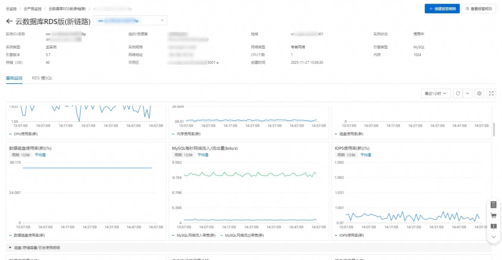

**查看报警规则**

在目标云产品的监控页面，可查看当前组织和资源集下该云产品的所有报警规则或具体实例对应的报警规则。

1. 在目标云产品的监控页面，单击列表上方的**查看报警规则**或目标资源实例**操作**列的**报警规则**。

2. 跳转至**报警规则**页面，查看当前组织资源集下该云产品所有的报警规则或指定资源下的报警规则，包括**产品名称**、**规则名称**、**状态**、**关联资源**、**报警条件描述**、**启用**、**通知对象**、**有效性**、**规则执行记录**等。

   > **说明**
   >
   > - 在目标云产品监控页面，单击上方的**创建报警规则**，可自定义该云产品的报警规则，具体可参见创建报警规则。
   >
   > - 报警规则的其他相关操作具体可参见管理报警规则。

   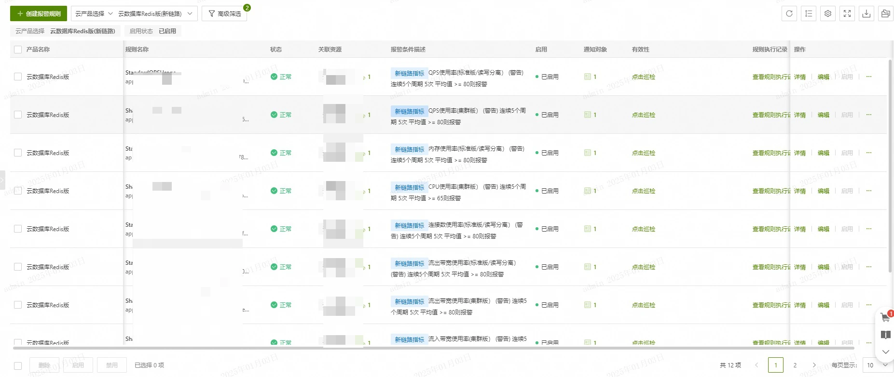

<a id="section-6-3"></a>

## 6.3. Kubernetes容器监控

通过Kubernetes容器监控，实现对K8s集群、节点、容器组维度基础资源性能监控，以便了解集群的健康状况，及时发现并解决问题。

**背景信息**

Kubernetes容器监控主要实现以下能力。

- 实现对K8s集群的监控和报警能力。

- 实现K8s集群同步和列表展示能力，信息数据包含集群的名称、ID、健康状况和节点数。

- 实现单个集群的监控图表能力，包含CPU、内存和文件系统的指标监控。

- 实现对单个集群监控的CPU、内存和文件系统指标的报警定义能力。

- 支持Prometheus2.0的能力，包含核心组件、节点、应用、网络、GPU、大数据/AI维度的监控详情。

**操作步骤**

1. 登录Apsara Uni-manager运营控制台。

2. 单击顶部菜单栏的**产品**，选择**迁移与运维管理** > **运维与监控** > **云监控**。

3. 在左侧导航栏，选择**云资源监控 > Kubernetes容器监控**。

4. 在**Kubernetes容器监控**页面，查看Kubernetes集群列表，包括**实例ID/名称**、**组织/资源集**、**地域**、**实例状态**、**Prometheus监控2.0**、**CPU使用率**、**内存使用率**、**集群标识**、**集群类型**、**集群版本**、**节点数量**、**网络模式**、**可用区ID**、**安全组ID**、**专有网络ID**。

   > **说明**
   >
   > - 在**Kubernetes容器监控**页面，单击集群**操作**列的**报警规则**，跳转至**报警规则**页签，详细内容可参见报警规则。
   >
   > - 单击列表上方的**创建报警规则**，可新增报警规则。配置项说明可参见创建报警规则。

5. 查看实例详情。

   - 不支持Prometheus监控2.0的实例，单击实例ID/名称，进入集群详情。

     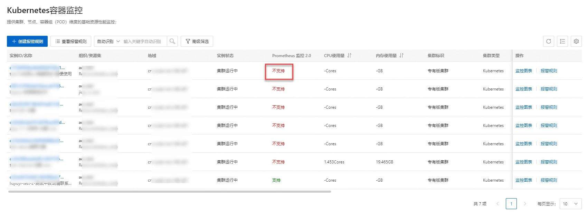

     - 在基础信息区域，查看**集群名称**、**集群ID**、**集群类型**、**版本**、**虚拟专有网络VPC**。

     - 在**监控图表**页签，查看集群CPU、内存和文件系统指标的监控图表。监控图表支持按**1小时**、**3小时**、 **6小时**、**12小时**、**1天**、**3天**、**7天**或自定义时间进行切换。

       > **说明**
       >
       > - 在**Kubernetes容器监控**页面，单击集群**操作**列的**监控图表**，也可直接进入**监控图表**页签。
       >
       > - 监控图表支持**一行一列**、**一行两列**或**一行三列**，可在右侧下拉列表选择。
       >
       > - 单击指标监控图表右侧的
       >
       >   ，可添加规则描述，并创建报警规则。配置项说明可参见创
       >
       >   
       >
       >   建报警规则。
       >
       > - 单击指标监控图表右侧
       >
       >   ，可大图展示该监控图表。
       >
       >   

     - 在**节点**页签，查看当前集群的**实例名称/ID**、**状态**、**CPU使用率**、**内存使用率**。单击实例名称/ID或**操作**列的**查看详情**，进入节点详情页面。

       - 在基础信息区域，查看**实例名称**、**集群ID**。

       - 在**监控图表**页签，查看CPU、内存、文件和网络系统指标的监控图表。监控图表支持按**1小时**、**3小时**、 **6小时**、**12小时**、**1天**、**3天**、**7天**、**14天**或自定义时间进行切换。

         > **说明**
         >
         > - 监控图表支持**每行展示 1**、**每行展示 2**或**每行展示 3**，可在右侧下拉列表选择。
         >
         > - 单击指标监控图表右侧
         >
         >   ，可大图展示该监控图表。
         >
         >   

       - 在**容器组列表**页签，展示集群中当前节点下关联的容器列表，包括容器**实例名称**、**CPU使用量**、**内存使用量**。单击**实例名称/ID**或操作列的**查看详情**，进入容器组详情页面。

         - 在基础信息区域，查看**实例名称**、**命名空间**。

         - 在**监控图表**页签，查看容器组CPU、内存、文件、网络系统指标的监控图表。监控图表支持按**1小时**、**3小时**、 **6小时**、**12小时**、**1天**、**3天**、**7天**、**14天**或自定义时间进行切换。

           > **说明**
           >
           > - 监控图表支持**每行展示 1**、**每行展示 2**或**每行展示 3**，可在右侧下拉列表选择。
           >
           > - 单击指标监控图表右侧
           >
           >   ，可大图展示该监控图表。
           >
           >   

     - 在**工作负载**页签，查看集群中的**实例名称**、**CPU使用量**、**内存使用量**。单击**实例名称**或操作列的**查看详情**，进入实例详情页面。

       > **说明**
       >
       > - 单击**命名空间**下拉框可切换命名空间。
       >
       > - 单击实例列表上方的**无状态**、**有状态**、**守护进程集**、**定时任务**、**任务**、**容器组**可快速对实例进行筛选展示。
       >
       >   - **无状态**：提供基于namespace下的无状态 deployment 监控，包含列表信息（实例名称、CPU/内存）使用量、详情指标包括CPU分配上限、使用量、文件系统的可用大小上限、网络的接收发送的速率等监控指标；并提供当前workload关联的容器组列表和容器组的监控详情。
       >
       >   - **有状态**：提供基于namespace下的有状态 StatefulSet 监控，包含列表信息（实例名称、CPU/内存）使用量、详情指标包括CPU分配上限、使用量、文件系统的可用大小上限、网络的接收发送的速率等监控指标；并提供当前workload关联的容器组列表和容器组的监控详情。
       >
       >   - **守护进程集**：提供基于namespace下的守护进程集DaemonSet监控，包含列表信息（实例名称、CPU/内存）使用量、详情指标包括CPU分配上限、使用量、文件系统的可用大小上限、网络的接收发送的速率等监控指标；并提供当前workload关联的容器组列表和容器组的监控详情。
       >
       >   - **定时任务**：提供基于namespace下的定时任务 CronJob 监控，包含列表信息（实例名称、CPU/内存）使用量、详情指标包括CPU分配上限、使用量、文件系统的可用大小上限、网络的接收发送的速率等监控指标；并提供当前workload关联的容器组列表和容器组的监控详情。
       >
       >   - **任务**：提供基于namespace下的任务 Job监控，包含列表信息（实例名称、CPU/内存）使用量、详情指标包括CPU分配上限、使用量、文件系统的可用大小上限、网络的接收发送的速率等监控指标；并提供当前workload关联的容器组列表和容器组的监控详情。
       >
       >   - **容器组**：提供集群中关联的容器列表，包含容器名称、CPU/内存使用量等列表数据，以及各个容器组的监控详情。

       - 在基础信息区域，查看**实例名称**、**命名空间**。

       - 在**监控图表**页签，查看CPU、内存、文件、网络系统指标的监控图表。监控图表支持按**1小时**、**3小时**、 **6小时**、**12小时**、**1天**、**3天**、**7天**、**14天**或自定义时间进行切换。

         > **说明**
         >
         > - 监控图表支持**每行展示 1**、**每行展示 2**或**每行展示 3**，可在右侧下拉列表选择。
         >
         > - 单击指标监控图表右侧
         >
         >   ，可大图展示该监控图表。
         >
         >   

       - 在**容器组列表**页签，展示集群中当前工作负载关联的容器列表，包括容器**实例名称**、**CPU使用量**、**内存使用量**。单击实例名称或操作列的**查看详情**，进入容器组详情页面。

         - 在基础信息区域，查看**实例名称**、**命名空间**。

         - 在**监控图表**页签，查看容器组CPU、内存、文件、网络系统指标的监控图表。监控图表支持按**1小时**、**3小时**、 **6小时**、**12小时**、**1天**、**3天**、**7天**、**14天**或自定义时间进行切换。

           > **说明**
           >
           > - 监控图表支持**每行展示 1**、**每行展示 2**或**每行展示 3**，可在右侧下拉列表选择。
           >
           > - 单击指标监控图表右侧
           >
           >   ，可大图展示该监控图表。
           >
           >   

     - 在**事件列表**页签，可查看当前实例最近6小时内前100条事件上报记录，包括**事件名称**、**事件等级**、**事件状态**、**事件内容**、**时间**。

       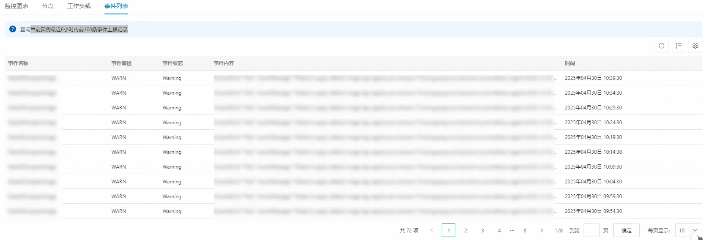

   - 支持Prometheus监控2.0的实例，单击实例ID/名称，进入集群详情。

     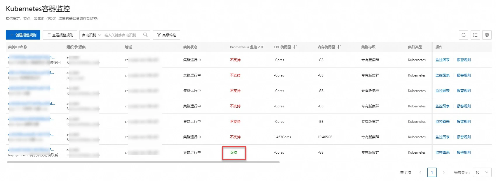

     - 在集群详情页可看到集群指标大盘展示：平台支持查询**监控概览**、**核心组件监控**、**节点监控**、**应用监控**、**网络监控**、**GPU监控**、**大数据/AI**、**资源画像**和**其他**维度的大盘。

       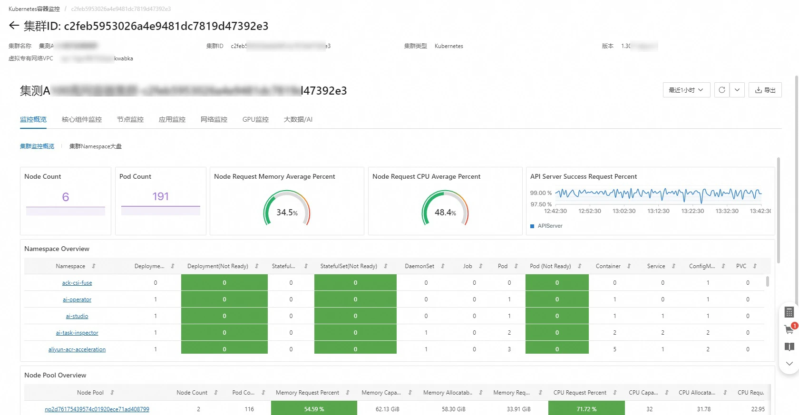

     - **集群详情**页面，可将关注的监控指标项，一键转为告警指标。

       <ol type="a">

       <li>

       单击指标项右侧的  图标，单击**创建告警**。

       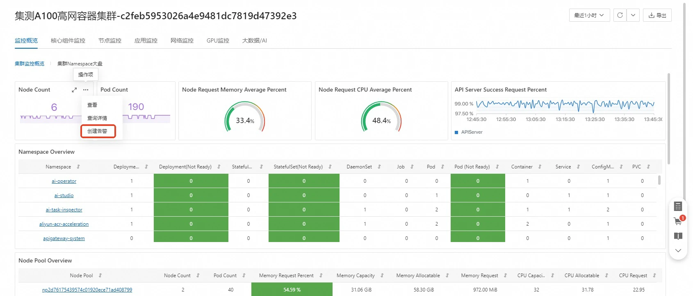

       </li>

       <li>

       在**创建告警**弹框单击**操作**列的**创建告警**。界面跳转至Prometheus监控 2.0控制台的**创建告警规则**页面，详情请参考《Prometheus监控用户指南》。

       </li>

       </ol>

     - 在集群详情页，单击**导出**，可自定义导出大盘。

       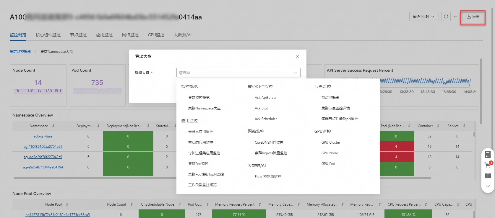

6. 查看Prometheus2.0的部分监控指标。

   在左侧导航栏单击**指标仓库**，云产品选择**Kubernetes容器监控**，可查看**node.cpu.utilization (prometheus2)**、**node.memory.utilization (prometheus2)**、**容器组内存使用率(working_set/limit) (prometheus2)**、**容器组cpu使用率(usage/limit) (prometheus2)**、**集群维度的cpu使用率 (prometheus2)** 、<strong>集群维度的内存使用率(prometheus2)</strong>的指标采集信息。

   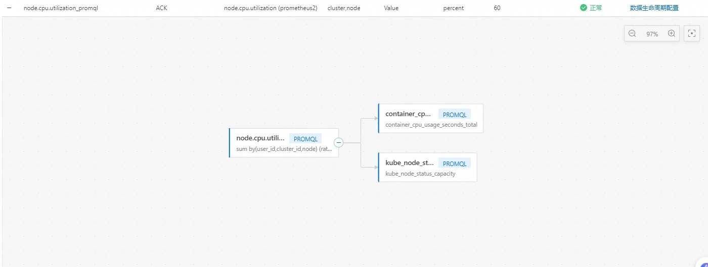

7. Prometheus2.0更多信息请参考《Prometheus监控用户指南》。

<a id="section-6-4"></a>

## 6.4. 应用分组

应用分组提供云服务器ECS分组管理功能，支持用户从业务角度集中管理业务线云服务器ECS资源。在分组维度管理报警规则、查看监控数据，可以极大的降低管理复杂度，提高云监控使用效率。

<a id="section-6-4-1"></a>

### 6.4.1. 创建应用分组

应用分组提供跨云产品、跨地域的云产品资源分组管理功能。支持从业务角度集中管理业务线，按业务线来管理报警规则、查看监控数据，可以迅速提升运维效率。

**操作步骤**

1. 登录Apsara Uni-manager运营控制台。

2. 单击顶部菜单栏的**产品**，选择**迁移与运维管理** > **运维与监控** > **云监控**。

3. 在左侧导航栏，选择**云资源监控 > 应用分组**。

4. 在**应用分组**页面，单击**应用分组**。

5. 在**新建应用分组**面板中，完成相应配置，各配置项说明如下。

   <table>
     <tr>
       <th width="121">配置项</th>
       <th>说明</th>
     </tr>
     <tr>
       <td>创建实例方法</td>
       <td>• <strong>实例名/标签名创建</strong>：对于特性资源集或者本组织所有资源提供按照实例名称或者标签名称动态匹配的能力。<br>• <strong>手动创建</strong>：当您需要根据业务管理需求，对已有固定实例进行管理时，可以选择手动创建标准应用分组。<br>• <strong>动态创建</strong>：动态创建基于资源集创建，通过排除资源实例的逻辑，实现资源实例创建后自动归入当前应用分组。</td>
     </tr>
     <tr>
       <td>应用分组名称</td>
       <td>当前应用分组的名称。</td>
     </tr>
   </table>

   <table>
     <tr>
       <th width="105">资源集范围</th>
       <th>说明当创建实例方法为<strong>实例名/标签名创建</strong>时，界面展示此配置项。<br>默认选中<strong>指定资源集</strong>。</th>
     </tr>
     <tr>
       <td>资源集选择</td>
       <td>选择当前组织下的目标资源集。</td>
     </tr>
     <tr>
       <td>报警联系人</td>
       <td>在报警规则联系人下拉列表选择报警联系人，支持选择多个。</td>
     </tr>
     <tr>
       <td>添加资源项</td>
       <td>说明当创建实例方法为<strong>手动创建</strong>和<strong>实例名/标签名创建</strong>时，使用此配置项。<br>在资源项中配置<strong>云产品选择</strong>、<strong>规则关系</strong>、<strong>规则配置</strong>、<strong>添加实例</strong>等。</td>
     </tr>
     <tr>
       <td>排除资源项</td>
       <td>说明当创建实例方法为动态创建时，使用此配置项。<br>在资源项中配置<strong>云产品选择</strong>和<strong>批量排除实例</strong>。</td>
     </tr>
   </table>

6. 单击**确定**。

<a id="section-6-4-2"></a>

### 6.4.2. 管理应用分组

在应用分组列表中，可以对应用分组进行修改、删除等操作。

**操作步骤**

1. 登录Apsara Uni-manager运营控制台。

2. 单击顶部菜单栏的**产品**，选择**迁移与运维管理** > **运维与监控** > **云监控**。

3. 在左侧导航栏，选择**云资源监控 > 应用分组**，在**应用分组**页面，执行相关操作。

   <table>
     <tr>
       <th width="122">操作任务</th>
       <th>操作步骤</th>
     </tr>
     <tr>
       <td>查看应用分组</td>
       <td>i. （可选）在顶部菜单栏选择目标组织，在<strong>应用分组列表</strong>页面输入应用分组名称或ID，可快速筛选应用分组。ii. 单击目标应用分组名称，单击目标应用分组详情页面的左侧导航栏的不同页签，查看其对应内容。<br>• <strong>组概览</strong>：可以查看目标应用分组的<strong>基本信息</strong>和<strong>关联云产品概览</strong>。<br>• <strong>组内资源</strong>：可以查看当前应用分组内的资源详情。<br>• <strong>可用性监控</strong>：可以查看当前应用分组内所有ECS实例的可用性监控，添加可用性监控请参考创建可用性监控。</td>
     </tr>
     <tr>
       <td>修改应用分组</td>
       <td>i. （可选）在顶部菜单栏选择目标组织，在<strong>应用分组列表</strong>页面输入应用分组名称或ID，可快速筛选应用分组。<br>ii. 单击目标应用分组卡片中的图标，单击<strong>编辑组</strong>。<br>iii. 在<strong>编辑应用分组</strong>面板中，修改当前应用分组。iv. 修改完成后，单击<strong>确定</strong>。</td>
     </tr>
     <tr>
       <td>删除应用分组</td>
       <td>说明删除应用分组将同时删除该应用分组的所有报警规则和事件通知，该应用分组内的实例将自动转移到全部实例中。<br>i. （可选）在顶部菜单栏选择目标组织，在<strong>应用分组列表</strong>页面输入应用分组名称或ID，可快速筛选应用分组。ii. 在应用分组列表页面进行删除。<br>• 单个删除<br>a. 单击目标应用分组卡片中的图标，单击<strong>删除组</strong>。<br>b. 在<strong>确认删除组</strong>对话框中，单击<strong>确定</strong>。<br>• 批量删除<br>a. 选中目标应用分组卡片中的复选框，单击列表左下方的<strong>批量删除</strong>。<br>b. 在<strong>确认删除组</strong>对话框中，单击<strong>确定</strong>。</td>
     </tr>
   </table>

<a id="section-6-4-3"></a>

### 6.4.3. 可用性监控

<a id="section-6-4-3-1"></a>

#### 6.4.3.1. 创建可用性监控

可用性监控定期探测本地或远程指定路径和端口是否正常响应。当出现响应超时或状态码错误时，云监控将发出报警，以便快速发现本地或远程服务无响应的情况。

**操作步骤**

> **说明**
>
> 可用性探测支持任意ECS作为探测源。

1. 登录Apsara Uni-manager运营控制台。

2. 单击顶部菜单栏的**产品**，选择**迁移与运维管理** > **运维与监控** > **云监控**。

3. 在左侧导航栏，选择**云资源监控 > 应用分组**。

4. 在**应用分组**页面，单击目标应用分组名称。

5. 在目标应用分组详情页面单击其左侧导航栏的**可用性监控**页签。

6. 单击**添加可用性监控**，在**创建/修改可用性监控**面板依次完成配置向导，单击**确定**。各配置项说明如下。

   | 配置项 | 说明 |
   | --- | --- |

   当前可用性监控的任务名称。支持中文、英文字母、数字、下划线

   **任务名称**

   （_）和短划线（-），长度为4~50个字符。

   在当前应用分组的全部实例，选择一个或多个待探测的实例。

   > **说明**

   **探测源**

   > 如果单个实例拥有超过500个任务，则该实例的部分任务可能无法运行。

   默认为**URL或者IP**。

   **探测目标**

   探测类型支持**HTTP(S)**、**TELNET**、**PING**三种类型。

   - **HTTP(S)**：指通过发送HTTP(s)请求来探测目标的健康状态，需要输入待探测目标的URL地址。例如，http://localhost:8081/check_health.html。

   **探测类型**

   - **TELNET**：指通过发送TELNET命令来探测目标的健康状态，需要输入待探测目标的IP地址和端口号。例如，192.168.1.1:22。

   - **PING**：指通过发送PING命令来探测目标的健康状态，需要输入待探测目标的IP地址。例如，192.168.1.1。

   探测类型的请求方法。请求方法包括**HEAD**、**GET**和**POST**。

   > **说明**

   **请求方法**

   > 当**探测目标**为**URL或者IP**，**探测类型**为<strong>HTTP(S)</strong>时，需要设置此项参数配置。

   探测周期，默认为1分钟。

   > **说明**
   >
   > - 当**探测目标**为**URL或者IP**，**探测类**

   **监控频率**

   > **型**为<strong>HTTP(S)</strong>时，需要设置此项参数配置。
   >
   > - 单击**高级配置**，可为报警规则设置此参数配置。

   **创建任务**

   站点探测时HTTP或HTTPS的Headers。

   Header格式： `parameter1:value1` 。

   多个Header之间用半角逗号（,）分隔。

   > **说明**

   **Headers**

   > - 当**探测目标**为**URL或者IP**，**探测类型**为<strong>HTTP(S)</strong>时，可以单击**高级配置**来设置该参数配置。
   >
   > - 单击**高级配置**，可为报警规则设置此参数配置。

   > **说明**
   >
   > - 当**探测目标**为**URL或者IP**，**探测类型**为**HTTP(S)**，且**请求方法**选择**POST**时，可以单击**高级配置**来设置该参数配置。
   >
   > - 单击**高级配置**，可为报警规则设置此参数配置。

   **提交内容**

   系统在做站点探测的时候，会POST提交这个信息，提交内容仅支持英文。请求方式选择POST时需要设置此项参数配置。

   格式为：parameter1=value1&parameter2=value2。

   站点探测的匹配响应方式和匹配响应信息。

   当匹配响应信息非空时，站点探测读取HTTP服务器回应Body的前64KB，从中查找匹配响应信息。匹配响应方式取值：

   - **包含匹配内容则报警**

   - **不包含匹配内容则报警**

   **匹配响应内容**

   > **说明**
   >
   > 当**探测目标**为**URL或者IP**，**探测类型**为<strong>HTTP(S)</strong>时，可以单击**高级配置**来设置该参数配置。

   当探测的状态码满足报警设置时，触发报警。状态码详情请参见状态码说明。

   **状态码**

   **状态码**和**响应时间**其中之一达到阈值后都会触发报警，报警会发送给应用分组的报警联系人组。

   当探测的响应时间满足报警设置时，触发报警。单位毫秒。

   **响应时间**

   **状态码**和**响应时间**其中之一达到阈值后都会触发报警，报警会发送给应用分组的报警联系人组。

   报警级别和报警通知方式。取值：

   - **紧急**

   **报警级别**

   - **警告**

   - **提示**

   公网可访问的URL，用于接收云监控通过POST请求推送的报警信息。

   **报警回调**

   > **说明**
   >
   > 目前仅支持HTTP协议。

   **报警设置**

   报警发生后未恢复正常，间隔多久重复发送一次报警通知。取值：**5分钟**、**10分钟**、**15分钟**、**30分钟**、**60分钟**、**3小时**、**6小时**、**12小时**和**24小时**。

   某监控指标达到报警阈值时发送报警，如果监控指标在通道沉默周期内持续超过报警阈值，在通道沉默周期内不会重复发送报警通知；如果监控指标在通道沉默周期后仍未恢复正常，则云监控再次

   **通道沉默周期**

   发送报警通知。

   > **说明**
   >
   > 单击**高级配置**，可为报警规则设置此参数配置。

   报警规则的生效时间。报警规则只在生效时间内发送报警通知，非生效时间内产生的报警只记录报警历史。

   > **说明**

   **生效时间**

   > 单击**高级配置**，可为报警规则设置此参数配置。

<a id="section-6-4-3-2"></a>

#### 6.4.3.2. 管理可用性监控

在可用性监控列表中，可以对可用性监控进行修改、禁用、启用和删除等操作。

**操作步骤**

1. 登录Apsara Uni-manager运营控制台。

2. 单击顶部菜单栏的**产品**，选择**迁移与运维管理** > **运维与监控** > **云监控**。

3. 在左侧导航栏，选择**云资源监控 > 应用分组**。

4. 在**应用分组**页面单击目标应用分组名称。

5. 在目标应用分组详情页面单击其左侧导航栏的**可用性监控**页签。在**可用性监控**页签内执行相关操作。

   <table>
     <tr>
       <th width="186">操作任务</th>
       <th>操作步骤</th>
     </tr>
     <tr>
       <td>查看可用性监控图表</td>
       <td>i. 单击目标可用性监控<strong>操作</strong>列的。<br>ii. 在下拉列表选择可用性监控任务，支持选择多个监控实例。iii. 选择监控的时间范围，支持选择<strong>1小时</strong>、<strong>6小时</strong>、<strong>12小时</strong>、<strong>1天</strong>、<strong>3天</strong>、<strong>7天</strong>、<strong>14</strong><strong>天</strong>，或自定义时间范围。iv. 根据选择的实例和时间，查看可用性监控图表信息。</td>
     </tr>
     <tr>
       <td>修改可用性监控</td>
       <td>i. 单击目标可用性监控<strong>操作</strong>列的<strong>修改</strong>。ii. 在<strong>创建/修改可用性监控</strong>面板中，根据配置向导修改相应配置项信息，各配置项说明请参见创建可用性监控。iii. 修改完成后，单击<strong>确定</strong>。</td>
     </tr>
     <tr>
       <td>禁用或启用可用性监控</td>
       <td>说明支持对<strong>监控状态</strong>为<strong>启用</strong>的可用性监控进行禁用；支持对<strong>监控状态</strong>为<strong>禁用</strong>的可用性监控进行启用。<br>• 单个禁用或启用<br>a. 单击目标可用性监控<strong>操作</strong>列的<strong>禁用</strong>或<strong>启用</strong>。<br>b. 在<strong>禁用</strong>或<strong>启用</strong>对话框中，单击<strong>确定</strong>。<br>• 批量禁用<br>a. 选中目标可用性监控前的复选框，单击列表左下方的<strong>批量禁用</strong>或<strong>批量启用</strong>。<br>b. 在<strong>禁用</strong>或<strong>启用</strong>对话框中，单击<strong>确定</strong>。</td>
     </tr>
     <tr>
       <td>删除可用性监控</td>
       <td>• 单个删除<br>a. 单击目标可用性监控<strong>操作</strong>列的<strong>删除</strong>。<br>b. 在<strong>删除</strong>对话框中，单击<strong>确定</strong>。<br>• 批量删除<br>a. 选中目标可用性监控前的复选框，单击列表左下方的<strong>批量删除</strong>。<br>b. 在<strong>删除</strong>对话框中，单击<strong>确定</strong>。</td>
     </tr>
   </table>

<a id="section-6-4-3-3"></a>

#### 6.4.3.3. 状态码说明

通过可用性监控功能探测指定路径或端口的可用性时，会返回相应状态码。

状态码及其说明如下。

<table>
  <tr>
    <th>协议类型</th>
    <th>状态码</th>
    <th>含义</th>
  </tr>
  <tr>
    <td rowspan="3">HTTP</td>
    <td>200</td>
    <td>正常。</td>
  </tr>
  <tr>
    <td>610</td>
    <td>超时。发出HTTP请求后5秒内无响应，视为超时。</td>
  </tr>
  <tr>
    <td>611</td>
    <td>探测失败。</td>
  </tr>
  <tr>
    <td rowspan="3">Telnet</td>
    <td>200</td>
    <td>正常。</td>
  </tr>
  <tr>
    <td>630</td>
    <td>超时。发出Telnet请求后5秒内无响应，视为超时。</td>
  </tr>
  <tr>
    <td>631</td>
    <td>探测失败。</td>
  </tr>
</table>

<a id="section-6-5"></a>

## 6.5. 指标仓库

<a id="section-6-5-1"></a>

### 6.5.1. 时序指标

指标仓库的时序指标提供了云产品指标的统一查询入口，使您明确云产品指标的定义、计算方法等信息。

**背景信息**

- 时序指标包含当前版本接入云监控CMS所有云产品列表中展示的指标，并且展示的信息与云监控指标说明中的产品及指标命名一致。

- 提供每个指标的血缘分析：从数据指标的创建（SQL虚拟指标）、来源依赖指标（SQL真实指标）以及数据源（Project、Logstore），展示数据指标存在的依赖关系，帮助您更好地追踪和排查数据问题。

- 提供指标可视化监控图表，方便您进行指标数据分析和可视化展示。

**查看时序指标**

1. 登录Apsara Uni-manager运营控制台。

2. 单击顶部菜单栏的**产品**，选择**迁移与运维管理** > **运维与监控** > **云监控**。

3. 在左侧导航栏，选择**云资源监控 > 指标仓库**，默认进入**时序指标**页签。

4. 在左侧**云产品列表**单击目标云产品，在右侧列表查看云产品对应的指标信息。

   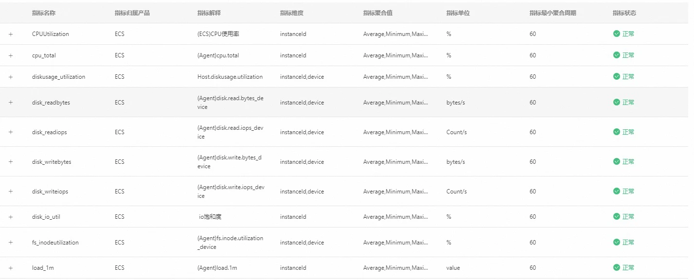

   > **说明**
   >
   > 可通过**指标名称**和**指标归属产品**快速查找监控指标，支持模糊搜索。

5. 单击指标名称左侧的  展开指标信息，查看指标血缘（即展示每个指标从Create SQL开始到最终SLS的

   Project、Logstore的数据依赖来源，以及云监控CMS上的DIM Table）。

   > **说明**
   >
   > 不是所有云产品指标都有DIM表数据。

   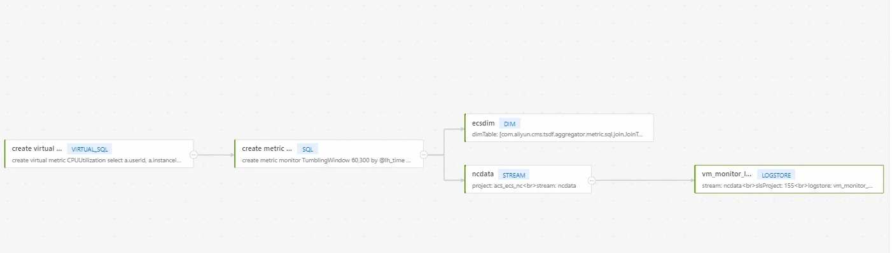

6. 单击各个环节进入**可用性监控详情**，在**巡检项详情**页检查是否有数据。根据巡检项结果判断是原始数据、中间过程还是末端汇聚计算的时候出现的问题。如果有错误，则通过巡检项结果进行提示，便于问题排查和追踪。

   <table>
     <tr>
       <th width="96">环节</th>
       <th>巡检项</th>
     </tr>
     <tr>
       <td>虚拟指标</td>
       <td>• 检测virtual指标是否有数据<br>• 检测virtual指标是否含有字段与原始指标不匹配<br>• 检测virtual指标是否含有字段与OTS查询结果不匹配</td>
     </tr>
     <tr>
       <td>真实指标</td>
       <td>• 检测原始指标是否有数据<br>• 检测指标是否含有字段与OTS查询结果不匹配<br>• 指标正常的延时时间</td>
     </tr>
     <tr>
       <td>DIM表</td>
       <td>• 抽样检查实例对应dim数据是否都含有</td>
     </tr>
     <tr>
       <td>Stream</td>
       <td>• 检测当前的metric是否有合成的数据需要收割<br>• 检测当前的metric是否有数据到达ISLOT模块中<br>• 检测当前的metric是否有数据要持久化到OTS中<br>• 检测当前的Stream是否含有UDF</td>
     </tr>
     <tr>
       <td>Logstore</td>
       <td>• 当前logstore输入到ISLSLoader中record是否被使用<br>• 当前logstore是有数据输入到ISLSLoader中<br>• 判断当前logstore是否有匹配到指标的数据<br>• 判断当前logstore是否存在，当前logstore是否有数据<br>• 当前logstore对应shard是否满足</td>
     </tr>
   </table>

7. 在虚拟指标和真实指标**可用性监控详情**的**监控详情**页，输入实例ID，设置聚合值和时间后，单击**查询**，查看指标监控图表。

   <table>
     <tr>
       <th width="90">配置项</th>
       <th>说明</th>
     </tr>
     <tr>
       <td>命名空间</td>
       <td>指标所属的命名空间，默认值。</td>
     </tr>
     <tr>
       <td>指标名称</td>
       <td>指标的名称，默认值。</td>
     </tr>
     <tr>
       <td>实例ID</td>
       <td>填写需要查询云产品的实例ID。</td>
     </tr>
     <tr>
       <td>聚合值</td>
       <td>设置聚合值，即聚合统计方法。<br>说明不同云产品指标支持的聚合值有所不同。</td>
     </tr>
     <tr>
       <td>时间选择</td>
       <td>选择指标监控的时间范围，支持1小时、4小时、12小时及自定义。</td>
     </tr>
     <tr>
       <td>SLS数据</td>
       <td>仅真实指标的监控详情页面支持。显示是否有SLS数据。</td>
     </tr>
     <tr>
       <td>监控图表</td>
       <td>根据实例ID、聚合值和时间选择生成对应的监控图表，查看指标数据的变化趋势。<br>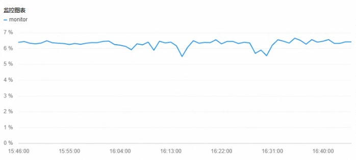</td>
     </tr>
   </table>

**设置数据保留时长**

> **重要**
>
> - 数据生命周期设置，只针对指标数据生效。
>
> - 操作前需要评估OTS的容量，请谨慎操作！
>
> - 不支持按组织、资源集、单个指标维度配置，设置完成即对所有cms的接入指标生效。

**新增配置**

1. 在**时序指标**页签的云产品列表选中云产品，单击指标**操作**列的**数据生命周期配置**。

2. 在**数据生命周期配置**对话框，**操作**选择**新增**，**数据生命周期配置**填写数据保留天数（取值0~1825）。数据生命周期系统默认为31天，最多保留5年或者1825天。

3. 单击**确定**。

**修改配置**

指标已设置数据保留时长后才支持修改。

1. 在**时序指标**页签的云产品列表选中云产品，单击指标**操作**列的**数据生命周期配置**。

2. 在**数据生命周期配置**对话框，**操作**选择**编辑**，**数据生命周期配置**填写数据保留天数（取值0~1825）。数据生命周期系统默认为31天，最多保留5年或者1825天。

3. 单击**确定**。

**删除配置**

指标已设置数据保留时长后才支持删除，删除后即恢复默认31天保留时长。

1. 在**时序指标**页签的云产品列表选中云产品，单击指标**操作**列的**数据生命周期配置**。

2. 在**数据生命周期配置**对话框，**操作**选择**删除**。

3. 单击**确定**。

<a id="section-6-5-2"></a>

### 6.5.2. 系统事件

<a id="section-6-5-2-1"></a>

#### 6.5.2.1. 云产品事件监控指标说明

通过云产品事件监控指标说明，了解云产品相关系统事件的事件名称、事件解释、事件等级、事件状态和事件类型。

**【无影云桌面】事件监控指标**

| 事件名称 | 事件归属产品 | 事件解释 | 事件等级 | 事件状态 | 事件类型 |
| --- | --- | --- | --- | --- | --- |
| ServiceStateChange | gws | 服务正常状态切换 | INFO | Normal | StatusNotific ation |
| ServiceError | gws | 服务异常 | CRITICAL | Error | Exception |
| ServiceTimeout | gws | 服务超时 | CRITICAL | Timeout | Maintenance |

**【云监控】事件监控指标**

| 事件名称 | 事件归属产品 | 事件解释 | 事件等级 | 事件状态 | 事件类型 |
| --- | --- | --- | --- | --- | --- |
| Agent_Status_Stopped | CloudM onitor | 插件心跳停止 | CRITICAL | stoppe d | StatusNotif ication |
| Agent_Status_Running | CloudM onitor | 插件心跳恢复 | CRITICAL | runnin g | StatusNotif ication |

**【云数据库 PolarDB（旧版）】事件监控指标**

| 事件名称 | 事件归属产品 | 事件解释 | 事件等级 | 事件状态 | 事件类型 |
| --- | --- | --- | --- | --- | --- |
| Instance:HASwitch | PolarDB | 实例HA切换事件告警 | WARN | Normal | Maintenance |
| Instance:Locked | PolarDB | 实例锁定事件告警 | CRITICAL | Error | Error |

**【云数据库RDS版】事件监控指标**

| 事件名称 | 事件归属产品 | 事件解释 | 事件等级 | 事件状态 | 事件类型 |
| --- | --- | --- | --- | --- | --- |
| Instance:HASwitch | RDS | 实例HA切换事件告警 | WARN | Normal | Maintenance |
| Instance:Locked | RDS | 实例锁定事件告警 | CRITICAL |  |  |

**【AIStudio】事件监控指标**

| 事件名称 | 事件归属产品 | 事件解释 | 事件等级 | 事件状态 | 事件类型 |
| --- | --- | --- | --- | --- | --- |
| Instance:OnlineService.Execute.Succeeded | AIStudio | 在线服务执行成功 | INFO | TaskSucc eeded | Maintenance |
| Instance:Notebook.Exe cute.Succeeded | AIStudio | Notebook实例运行成功 | INFO | TaskSucc eeded | Maintenance |
| Instance:BatchInferenc e.Execute.Failed | AIStudio | 批量推理任务执行失败 | CRITICAL | TaskFaile d | StatusNotifica tion |
| Instance:BatchInferenc e.Execute.Succeeded | AIStudio | 批量推理任务执行成功 | INFO | TaskSucc eeded | Maintenance |
| Instance:BatchInferenc e.Execute.Running | AIStudio | 批量推理任务开始执行 | INFO | TaskRun ning | Maintenance |
| Instance:BatchInferenc e.Queue.Failed | AIStudio | 批量推理任务排队失败 | CRITICAL | TaskQue ueFailed | StatusNotifica tion |
| Instance:PipelineRun.E xecute.Terminated | AIStudio | 可视化建模任务人工停止 | INFO | TaskStop ped | Maintenance |
| Instance:PipelineRun.E xecute.Failed | AIStudio | 可视化建模任务执行失败 | CRITICAL | TaskFaile d | StatusNotifica tion |
| Instance:PipelineRun.E xecute.Succeeded | AIStudio | 可视化建模任务执行成功 | INFO | TaskSucc eeded | Maintenance |
| Instance:PipelineRun.E xecute.Running | AIStudio | 可视化建模任务开始执行 | INFO | TaskStar ting | Maintenance |
| Instance:Finetune.Exec ute.Failed | AIStudio | 模型调优任务执行失败 | CRITICAL | TaskFaile d | StatusNotifica tion |
| Instance:Finetune.Exec ute.Succeeded | AIStudio | 模型调优任务执行成功 | INFO | TaskSucc eeded | Maintenance |
| Instance:Finetune.Exec ute.Running | AIStudio | 模型调优任务开始执行 | INFO | TaskRun ning | Maintenance |
| Instance:Finetune.Que ue.Failed | AIStudio | 模型调优任务排队失败 | CRITICAL | TaskQue ueFailed | Maintenance |
| Instance:ModelQuant.E xecute.Failed | AIStudio | 模型量化任务执行失败 | CRITICAL | TaskFaile d | Maintenance |
| Instance:ModelQuant.E xecute.Succeeded | AIStudio | 模型量化任务执行成功 | INFO | TaskSucc eeded | StatusNotifica tion |
| Instance:ModelQuant.E xecute.Running | AIStudio | 模型量化任务开始执行 | INFO | TaskRun ning | Maintenance |
| Instance:ModelQuant.Q ueue.Failed | AIStudio | 模型量化任务排队失败 | CRITICAL | TaskQue ueFailed | StatusNotifica tion |
| Instance:DataAcc.Exec ute.Failed | AIStudio | 数据加速器运行失败 | CRITICAL | TaskFaile d | StatusNotifica tion |
| Instance:ModelEvaluati on.Execute.Succeeded | AIStudio | 模型评测任务成功 | INFO | TaskSucc eeded | Maintenance |
| Instance:ModelEvaluati on.Execute.Failed | AIStudio | 模型评测任务失败 | CRITICAL | TaskFaile d | StatusNotifica tion |
| Instance:OnlineService.Execute.Failed | AIStudio | 在线服务执行失败 | CRITICAL | Executio nFailed | StatusNotifica tion |
| Instance:OnlineService.Create.Failed | AIStudio | 在线服务创建失败 | CRITICAL | Creation Failed | StatusNotifica tion |
| Instance:TaskModeling.Execute.running | AIStudio | 任务建模开始执行 | INFO | TaskRun ning | Maintenance |
| Instance:TaskModeling.Execute.Failed | AIStudio | 任务建模执行失败 | CRITICAL | TaskFaile d | StatusNotifica tion |
| Instance:TaskModeling.Execute.Succeeded | AIStudio | 任务建模执行成功 | INFO | TaskSucc eeded | Maintenance |
| Action:Notebook.Expor t.Failed | AIStudio | Notebook实例导出镜像失败 | CRITICAL | TaskFaile d | StatusNotifica tion |
| Instance:DataAcc.Crea te.Failed | AIStudio | 数据加速器创建失败 | CRITICAL | Creation Failed | StatusNotifica tion |
| Action:Image.Accelerat e.Failed | AIStudio | 自定义镜像加速失败 | CRITICAL | TaskFaile d | StatusNotifica tion |
| Instance:TaskModeling.Queue.Failed | AIStudio | 任务建模排队失败 | CRITICAL | TaskQue ueFailed | StatusNotifica tion |
| Instance:TaskModeling.Start.Failed | AIStudio | 任务建模启动失败 | CRITICAL | TaskStar tFailed | StatusNotifica tion |
| Instance:Notebook.Cre ate.Failed | AIStudio | Notebook实例创建失败 | CRITICAL | Creation Failed | StatusNotifica tion |
| Instance:Notebook.Exe cute.Failed | AIStudio | Notebook实例运行失败 | CRITICAL | Executio nFailed | StatusNotifica tion |

**【数字证书管理服务】事件监控指标**

| 事件名称 | 事件归属产品 | 事件解释 | 事件等级 | 事件状态 | 事件类型 |
| --- | --- | --- | --- | --- | --- |
| Certificate.Expired.Mo nitoring | CAS | 证书已过期 | CRITICAL | CRITIC AL | StatusNotif ication |
| Certificate.Expiration.Monitoring | CAS | 证书即将过期 | CRITICAL | CRITIC AL | StatusNotif ication |

**【混合云容灾】事件监控指标**

| 事件名称 | 事件归属产品 | 事件解释 | 事件等级 | 事件状态 | 事件类型 |
| --- | --- | --- | --- | --- | --- |
| PrimarySiteVpc:Delete d | HDR | 生产站点VPC被删除 | CRITICAL | Failed | StatusNotif ication |
| SecondarySiteVpc:Del eted | HDR | 容灾站点VPC被删除 | CRITICAL | Failed | StatusNotif ication |
| PrimarySiteNetwork:D eleted | HDR | 生产站点网络被删除 | CRITICAL | Failed | StatusNotif ication |
| SecondarySiteNetwor k:Deleted | HDR | 容灾站点网络被删除 | CRITICAL | Failed | StatusNotif ication |
| PrimarySecurityGroup:Deleted | HDR | 生产站点安全组被删除 | CRITICAL | Failed | StatusNotif ication |
| SecondarySecurityGro up:Deleted | HDR | 容灾站点安全组被删除 | CRITICAL | Failed | StatusNotif ication |
| SecurityGroup:Inconsi stency | HDR | 安全组策略不一致 | CRITICAL | Failed | StatusNotif ication |
| ProductSiteNetwork:In consistency | HDR | 生产站点网络相关信息异常变化 | CRITICAL | Failed | StatusNotif ication |
| DrSiteNetwork:Inconsi stency | HDR | 容灾站点网络相关信息异常变化 | CRITICAL | Failed | StatusNotif ication |
| ProductSiteStorage:In consistency | HDR | 生产站点存储相关信息异常变化 | CRITICAL | Failed | StatusNotif ication |
| DrSiteStorage:Inconsi stency | HDR | 容灾站点存储相关信息异常变化 | CRITICAL | Failed | StatusNotif ication |
| PrimarySiteComputati on:Inconsistency | HDR | 生产站点计算相关信息异常变化 | CRITICAL | Failed | StatusNotif ication |
| DrSiteComputation:In consistency | HDR | 容灾站点计算相关信息异常变化 | CRITICAL | Failed | StatusNotif ication |
| ReplicationGroup:Inco nsistency | HDR | 复制组信息异常 | CRITICAL | Failed | StatusNotif ication |
| ReplicationPair:Incons istency | HDR | 复制对信息异常 | CRITICAL | Failed | StatusNotif ication |
| Gateway:Inconsistenc y | HDR | 网关异常 | CRITICAL | Failed | StatusNotif ication |
| ShadowEcs:Inconsiste ncy | HDR | 复制Ecs实例异常 | CRITICAL | Failed | StatusNotif ication |

**【备份管理平台】事件监控指标**

| 事件名称 | 事件归属产品 | 事件解释 | 事件等级 | 事件状态 | 事件类型 |
| --- | --- | --- | --- | --- | --- |
| BackupPlan | ASRBR | 备份计划相关告警 | CRITICAL | FAILED | StatusNotif ication |
| RecoveryTask | ASRBR | 恢复任务相关告警 | CRITICAL | FAILED | StatusNotif ication |
| MigratePlan | ASRBR | 迁移计划相关告警 | CRITICAL | FAILED | StatusNotif ication |
| LICENSE | ASRBR | 授权使用量相关告警 | CRITICAL | FAILED | Maintenan ce |

**【资源编排】事件监控指标**

| 事件名称 | 事件归属产品 | 事件解释 | 事件等级 | 事件状态 | 事件类型 |
| --- | --- | --- | --- | --- | --- |
| Stack:StatusChange | ros | 资源栈状态变化 | INFO | Normal | StatusNotif ication |
| StackResource:Status Change | ros | 资源栈资源状态变化 | INFO | Normal | StatusNotif ication |
| StackGroup:Operation StatusChange | ros | 资源栈组操作状态变化 | INFO | Normal | StatusNotif ication |

**【云服务器ECS】事件监控指标**

| 事件名称 | 事件归属产品 | 事件解释 | 事件等级 | 事件状态 | 事件类型 |
| --- | --- | --- | --- | --- | --- |
| Disk:ConvertToPostpai dCompleted | ECS | 转换磁盘到按量付费完成 | INFO | Normal | StatusNotif ication |
| Disk:DiskOperationCo mpleted | ECS | 磁盘操作完成 | INFO | Normal | StatusNotif ication |
| Disk:ErrorDetected:Ex ecuted | ECS | 本地磁盘出现损坏告警结束 | CRITICAL | Execut ed | Exception |
| Disk:ErrorDetected:Ex ecuting | ECS | 本地磁盘出现损坏告警开始 | CRITICAL | Executi ng | Exception |
| Disk:OverduePayment Release | ECS | 磁盘释放（账号欠费） | CRITICAL | Normal | StatusNotif ication |
| Disk:Stalled:Executed | ECS | 磁盘性能受到严重影响结束 | CRITICAL | Execut ed | Exception |
| Disk:Stalled:Executing | ECS | 磁盘性能受到严重影响开始 | CRITICAL | Executi ng | Exception |
| Instance:AutoReactiva teCompleted | ECS | 完成自动重开机 | INFO | Normal | StatusNotif ication |
| Instance:BurstablePer formanceRestricted | ECS | 突发性能实例性能受限 | WARN | Normal | StatusNotif ication |
| Instance:InstanceFailu re.PerformanceImpact:Executed | ECS | 实例性能潜在影响结束（实例错误） | WARN | Execut ed | Exception |
| Instance:InstanceFailu re.PerformanceImpact:Executing | ECS | 实例性能潜在影响开始（实例错误） | WARN | Executi ng | Exception |
| Instance:InstanceFailu re.Reboot:Executed | ECS | 实例重启结束（实例错误） | CRITICAL | Execut ed | Exception |
| Instance:InstanceFailu re.Reboot:Executing | ECS | 实例重启开始（实例错误） | CRITICAL | Executi ng | Exception |
| Instance:LiveMigratio nAcrossDDH | ECS | 实例在专有宿主机间热迁移 | INFO | Normal | StatusNotif ication |
| Instance:Performance ModeChange | ECS | 突发性能实例性能模式切换 | INFO | Normal | StatusNotif ication |
| Instance:PreemptibleI nstanceInterruption | ECS | 抢占式实例中断通知 | WARN | Normal | StatusNotif ication |
| Instance:Security.Tpm Alert:Executed | ECS | TPM安全警告结束 | WARN | Execut ed | Exception |
| Instance:Security.Tpm Alert:Executing | ECS | TPM安全警告开始 | WARN | Executi ng | Exception |
| Instance:StateChange | ECS | 实例状态改变通知 | INFO | Normal | StatusNotif ication |
| Instance:SystemFailur e.Delete:Avoided | ECS | 实例自动释放已规避（实例创建失败） | CRITICAL | Avoide d | Exception |
| Instance:SystemFailur e.Delete:Executed | ECS | 实例自动释放已完成（实例创建失败） | CRITICAL | Execut ed | Exception |
| Instance:SystemFailur e.Delete:Executing | ECS | 实例自动释放执行中（实例创建失败） | CRITICAL | Executi ng | Exception |
| Instance:SystemFailur e.PerformanceImpact: Executed | ECS | 实例性能影响结束（系统错误） | WARN | Execut ed | Exception |
| Instance:SystemFailur e.PerformanceImpact: Executing | ECS | 实例性能影响开始（系统错误） | WARN | Executi ng | Exception |
| Instance:SystemFailur e.Reboot:Executed | ECS | 实例重启结束（系统错误） | CRITICAL | Execut ed | Exception |
| Instance:SystemFailur e.Reboot:Executing | ECS | 实例重启开始（系统错误） | CRITICAL | Executi ng | Exception |
| Instance:SystemFailur e.Reboot:Failed | ECS | 实例重启失败（系统错误） | CRITICAL | Failed | Exception |
| Instance:SystemFailur e.Redeploy:Avoided | ECS | 实例重新部署已规避（系统错误） | CRITICAL | Avoide d | Exception |
| Instance:SystemFailur e.Redeploy:Canceled | ECS | 实例重新部署已取消（系统错误） | CRITICAL | Cancel ed | Exception |
| Instance:SystemFailur e.Redeploy:Executed | ECS | 实例重新部署已完成（系统错误） | CRITICAL | Execut ed | Exception |
| Instance:SystemFailur e.Redeploy:Executing | ECS | 实例重新部署执行中（系统错误） | CRITICAL | Executi ng | Exception |
| Instance:SystemFailur e.Stop:Executed | ECS | 实例停止已完成（系统错误） | CRITICAL | Execut ed | Exception |
| Instance:SystemFailur e.Stop:Executing | ECS | 实例停止开始（系统错误） | CRITICAL | Executi ng | Exception |
| Instance:SystemMaint enance.IsolateErrorDi sk:Avoided | ECS | 因系统维护隔离坏盘已规避 | CRITICAL | Avoide d | Maintenan ce |
| Instance:SystemMaint enance.IsolateErrorDi sk:Canceled | ECS | 因系统维护隔离坏盘已取消 | CRITICAL | Cancel ed | Maintenan ce |
| Instance:SystemMaint enance.IsolateErrorDi sk:Executed | ECS | 因系统维护隔离坏盘已完成 | CRITICAL | Execut ed | Maintenan ce |
| Instance:SystemMaint enance.IsolateErrorDi sk:Executing | ECS | 因系统维护隔离坏盘执行中 | CRITICAL | Executi ng | Maintenan ce |
| Instance:SystemMaint enance.IsolateErrorDi sk:Failed | ECS | 因系统维护隔离坏盘已失败 | CRITICAL | Failed | Maintenan ce |
| Instance:SystemMaint enance.IsolateErrorDi sk:Inquiring | ECS | 因系统维护隔离坏盘问询中 | CRITICAL | Inquirin g | Maintenan ce |
| Instance:SystemMaint enance.PerformanceI mpact:Executed | ECS | 实例性能潜在影响结束（系统维护） | CRITICAL | Execut ed | Maintenan ce |
| Instance:SystemMaint enance.PerformanceI mpact:Executing | ECS | 实例性能潜在影响开始（系统维护） | CRITICAL | Executi ng | Maintenan ce |
| Instance:SystemMaint enance.ReInitErrorDis k:Avoided | ECS | 因系统维护重新初始化坏盘已规避 | CRITICAL | Avoide d | Maintenan ce |
| Instance:SystemMaint enance.ReInitErrorDis k:Canceled | ECS | 因系统维护重新初始化坏盘已取消 | CRITICAL | Cancel ed | Maintenan ce |
| Instance:SystemMaint enance.ReInitErrorDis k:Executed | ECS | 因系统维护重新初始化坏盘已完成 | CRITICAL | Execut ed | Maintenan ce |
| Instance:SystemMaint enance.ReInitErrorDis k:Executing | ECS | 因系统维护重新初始化坏盘执行中 | CRITICAL | Executi ng | Maintenan ce |
| Instance:SystemMaint enance.ReInitErrorDis k:Failed | ECS | 因系统维护重新初始化坏盘已失败 | CRITICAL | Failed | Maintenan ce |
| Instance:SystemMaint enance.ReInitErrorDis k:Inquiring | ECS | 因系统维护重新初始化坏盘问询中 | CRITICAL | Inquirin g | Maintenan ce |
| Instance:SystemMaint enance.Reboot:Avoide d | ECS | 实例计划重启规避（系统维护） | CRITICAL | Avoide d | Maintenan ce |
| Instance:SystemMaint enance.Reboot:Cancel ed | ECS | 实例计划重启取消（系统维护） | CRITICAL | Cancel ed | Maintenan ce |
| Instance:SystemMaint enance.Reboot:Execut ed | ECS | 实例计划重启已完成（系统维护） | CRITICAL | Execut ed | Maintenan ce |
| Instance:SystemMaint enance.Reboot:Execut ing | ECS | 实例计划重启执行中（系统维护） | CRITICAL | Executi ng | Maintenan ce |
| Instance:SystemMaint enance.Reboot:Failed | ECS | 实例计划重启失败（系统维护） | CRITICAL | Failed | Maintenan ce |
| Instance:SystemMaint enance.Reboot:Inquiri ng | ECS | 实例计划重启问询中（系统维护） | CRITICAL | Inquirin g | Maintenan ce |
| Instance:SystemMaint enance.Reboot:Sched uled | ECS | 实例计划重启通知（系统维护） | CRITICAL | Schedu led | Maintenan ce |
| Instance:SystemMaint enance.RebootAndIsol ateErrorDisk:Avoided | ECS | 因系统维护重启实例并隔离坏盘已规避 | CRITICAL | Avoide d | Maintenan ce |
| Instance:SystemMaint enance.RebootAndIsol ateErrorDisk:Canceled | ECS | 因系统维护重启实例并隔离坏盘已取消 | CRITICAL | Cancel ed | Maintenan ce |
| Instance:SystemMaint enance.RebootAndIsol ateErrorDisk:Executed | ECS | 因系统维护重启实例并隔离坏盘已完成 | CRITICAL | Execut ed | Maintenan ce |
| Instance:SystemMaint enance.RebootAndIsol ateErrorDisk:Executin g | ECS | 因系统维护重启实例并隔离坏盘执行中 | CRITICAL | Executi ng | Maintenan ce |
| Instance:SystemMaint enance.RebootAndIsol ateErrorDisk:Inquiring | ECS | 因系统维护重启实例并隔离坏盘问询中 | CRITICAL | Inquirin g | Maintenan ce |
| Instance:SystemMaint enance.RebootAndReI nitErrorDisk:Avoided | ECS | 因系统维护重启实例并重新初始化坏盘已规避 | CRITICAL | Avoide d | Maintenan ce |
| Instance:SystemMaint enance.RebootAndReI nitErrorDisk:Canceled | ECS | 因系统维护重启实例并重新初始化坏盘已取消 | CRITICAL | Cancel ed | Maintenan ce |
| Instance:SystemMaint enance.RebootAndReI nitErrorDisk:Executed | ECS | 因系统维护重启实例并重新初始化坏盘已完成 | CRITICAL | Execut ed | Maintenan ce |
| Instance:SystemMaint enance.RebootAndReI nitErrorDisk:Executing | ECS | 因系统维护重启实例并重新初始化坏盘执行中 | CRITICAL | Executi ng | Maintenan ce |
| Instance:SystemMaint enance.RebootAndReI nitErrorDisk:Inquiring | ECS | 因系统维护重启实例并重新初始化坏盘问询中 | CRITICAL | Inquirin g | Maintenan ce |
| Instance:SystemMaint enance.Redeploy:Avoi ded | ECS | 实例计划重新部署已规避（系统维护） | CRITICAL | Avoide d | Maintenan ce |
| Instance:SystemMaint enance.Redeploy:Can celed | ECS | 实例计划重新部署已取消（系统维护） | CRITICAL | Cancel ed | Maintenan ce |
| Instance:SystemMaint enance.Redeploy:Exe cuted | ECS | 实例计划重新部署已完成（系统维护） | CRITICAL | Execut ed | Maintenan ce |
| Instance:SystemMaint enance.Redeploy:Exe cuting | ECS | 实例计划重新部署执行中（系统维护） | CRITICAL | Executi ng | Maintenan ce |
| Instance:SystemMaint enance.Redeploy:Inqu iring | ECS | 实例计划重新部署问询中（系统维护） | CRITICAL | Inquirin g | Maintenan ce |
| Instance:SystemMaint enance.Redeploy:Sch eduled | ECS | 实例计划重新部署通知（系统维护） | CRITICAL | Schedu led | Maintenan ce |
| Instance:SystemMaint enance.Stop:Avoided | ECS | 实例计划停止规避（系统维护） | CRITICAL | Avoide d | Maintenan ce |
| Instance:SystemMaint enance.Stop:Canceled | ECS | 实例计划停止取消（系统维护） | CRITICAL | Cancel ed | Maintenan ce |
| Instance:SystemMaint enance.Stop:Executed | ECS | 实例计划停止已完成（系统维护） | CRITICAL | Execut ed | Maintenan ce |
| Instance:SystemMaint enance.Stop:Executin g | ECS | 实例计划停止执行中（系统维护） | CRITICAL | Executi ng | Maintenan ce |
| Instance:SystemMaint enance.Stop:Failed | ECS | 实例计划停止失败（系统维护） | CRITICAL | Failed | Maintenan ce |
| Instance:SystemMaint enance.Stop:Schedule d | ECS | 实例计划停止通知（系统维护） | CRITICAL | Schedu led | Maintenan ce |
| NetworkInterface:Net workInterfaceOperate Completed | ECS | 网卡操作完成 | INFO | Normal | StatusNotif ication |
| Snapshot:CreateSnap shotCompleted | ECS | 磁盘快照创建完成 | INFO | Normal | StatusNotif ication |
| Instance:VmLivemigra teException | ECS | 热迁移后VM状态异常 | WARN | Normal | StatusNotif ication |
| Instance:VmDownCau sedByNcDown | ECS | nc宕机导致VM宕 | WARN | Normal | StatusNotif ication |
| Instance:VmDownEnd | ECS | VM宕机恢复事件 | WARN | Execut ed | StatusNotif ication |
| Instance:VmPanicEve nt | ECS | VM异常PANIC重启可能是虚拟机内部异常 | WARN | Normal | StatusNotif ication |
| Instance:VmCrashEve nt | ECS | VM异常crash事件 | WARN | Normal | StatusNotif ication |
| Instance:InstanceFailu re.Reboot:Inquiring | ECS | 实例重启（客户确认） | CRITICAL | Inquirin g | StatusNotif ication |
| Instance:InstanceFailu re.Reboot:Scheduled | ECS | 实例重启（计划执行） | CRITICAL | Schedu led | StatusNotif ication |
| Instance:InstanceFailu re.Reboot:Avoided | ECS | 实例重启（避免执行） | CRITICAL | Avoide d | StatusNotif ication |
| Instance:InstanceFailu re.Reboot:Canceled | ECS | 实例重启（取消） | CRITICAL | Cancel ed | StatusNotif ication |
| Instance:InstanceFailu re.Reboot:Failed | ECS | 实例重启（失败） | CRITICAL | Failed | StatusNotif ication |
| Instance:InstanceFailu re.Alert:Inquiring | ECS | 实例告警（客户确认） | WARN | Inquirin g | StatusNotif ication |
| Instance:SystemFailur e.PerformanceImpact: Canceled | ECS | 系统性能重大影响（取消） | WARN | Cancel ed | StatusNotif ication |
| Instance:SystemFailur e.PerformanceImpact: Avoided | ECS | 系统性能重大影响（避免执行） | WARN | Avoide d | StatusNotif ication |
| Instance:SystemFailur e.PerformanceImpact: Scheduled | ECS | 系统性能重大影响（计划执行） | WARN | Schedu led | StatusNotif ication |
| Instance:SystemFailur e.PerformanceImpact: Inquiring | ECS | 系统性能重大影响（客户确认） | WARN | Inquirin g | StatusNotif ication |
| Instance:InstanceFailu re.Alert:Failed | ECS | 实例告警（失败） | WARN | Failed | StatusNotif ication |
| Instance:InstanceFailu re.Alert:Canceled | ECS | 实例告警（取消） | WARN | Cancel ed | StatusNotif ication |
| Instance:InstanceFailu re.Alert:Executed | ECS | 实例告警（执行完毕） | WARN | Execut ed | StatusNotif ication |
| Instance:InstanceFailu re.Alert:Executing | ECS | 实例告警（执行中） | WARN | Executi ng | StatusNotif ication |
| Instance:InstanceFailu re.Alert:Avoided | ECS | 实例告警（避免执行） | WARN | Avoide d | StatusNotif ication |
| Instance:InstanceFailu re.Alert:Scheduled | ECS | 实例告警（计划执行） | WARN | Schedu led | StatusNotif ication |
| Instance:SystemMaint enance.LiveMigrate:E xecuted | ECS | 低峰分析、热迁移（执行完毕） | INFO | Execut ed | Maintenan ce |
| Instance:SystemMaint enance.LiveMigrate:A voided | ECS | 低峰分析、热迁移（执行中） | INFO | Execut ed | Maintenan ce |
| Instance:SystemMaint enance.LiveMigrate:A voided | ECS | 低峰分析、热迁移（避免执行） | INFO | Avoide d | Maintenan ce |
| Instance:SystemMaint enance.LiveMigrate:S cheduled | ECS | 低峰分析、热迁移（计划执行） | INFO | Schedu led | Maintenan ce |
| Instance:SystemMaint enance.LiveMigrate:In quiring | ECS | 低峰分析、热迁移（客户确认） | INFO | Inquirin g | Maintenan ce |
| Instance:SystemMaint enance.LiveMigrate:F ailed | ECS | 低峰分析、热迁移（失败） | INFO | Failed | Maintenan ce |
| Instance:SystemMaint enance.LiveMigrate:C anceled | ECS | 低峰分析、热迁移（取消） | INFO | Cancel ed | Maintenan ce |
| Instance:SystemFailur e.Reboot:Canceled | ECS | 系统重启（取消） | CRITICAL | Cancel ed | StatusNotif ication |
| Instance:SystemFailur e.Reboot:Avoided | ECS | 系统重启（避免执行） | CRITICAL | Avoide d | StatusNotif ication |
| Instance:SystemFailur e.Reboot:Scheduled | ECS | 系统重启（计划执行） | CRITICAL | Schedu led | StatusNotif ication |
| Instance:SystemFailur e.Reboot:Inquiring | ECS | 系统重启（客户确认） | CRITICAL | Inquirin g | StatusNotif ication |
| Instance:SystemFailur e.PerformanceImpact: Failed | ECS | 系统性能重大影响（失败） | WARN | Failed | StatusNotif ication |
| Instance:SystemFailur e.PerformanceAffect:I nquiring | ECS | 系统性能影响（客户确认） | WARN | Inquirin g | StatusNotif ication |
| Instance:SystemFailur e.Alert:Failed | ECS | 系统告警（失败） | INFO | Failed | StatusNotif ication |
| Instance:SystemFailur e.Alert:Canceled | ECS | 系统告警（取消） | INFO | Cancel ed | StatusNotif ication |
| Instance:SystemFailur e.Alert:Executed | ECS | 系统告警（执行完毕） | INFO | Execut ed | StatusNotif ication |
| Instance:SystemFailur e.Alert:Executing | ECS | 系统告警（执行中） | INFO | Executi ng | StatusNotif ication |
| Instance:SystemFailur e.Alert:Avoided | ECS | 系统告警（避免执行） | INFO | Avoide d | StatusNotif ication |
| Instance:SystemFailur e.Alert:Scheduled | ECS | 系统告警（计划执行） | INFO | Schedu led | StatusNotif ication |
| Instance:SystemFailur e.Alert:Inquiring | ECS | 系统告警（客户确认） | INFO | Inquirin g | StatusNotif ication |
| Instance:Redeploy:Fai led | ECS | VM重新部署（本地盘、失败） | CRITICAL | Failed | StatusNotif ication |
| Instance:Redeploy:Ca nceled | ECS | VM重新部署（本地盘、取消） | CRITICAL | Cancel ed | StatusNotif ication |
| Instance:Redeploy:Ex ecuted | ECS | VM重新部署（本地盘、执行完毕） | CRITICAL | Execut ed | StatusNotif ication |
| Instance:Redeploy:Ex ecuting | ECS | VM重新部署（本地盘、执行中） | CRITICAL | Executi ng | StatusNotif ication |
| Instance:Redeploy:Av oided | ECS | VM重新部署（本地盘、避免执行） | CRITICAL | Avoide d | StatusNotif ication |
| Instance:Redeploy:Sc heduled | ECS | VM重新部署（本地盘、计划执行） | CRITICAL | Schedu led | StatusNotif ication |
| Instance:Redeploy:Inq uiring | ECS | VM重新部署（本地盘、客户确认） | CRITICAL | Inquirin g | StatusNotif ication |
| Instance:Reboot:Faile d | ECS | VM重新部署（失败） | CRITICAL | Failed | StatusNotif ication |
| Instance:Reboot:Canc eled | ECS | VM重新部署（取消） | CRITICAL | Cancel ed | StatusNotif ication |
| Instance:Reboot:Exec uted | ECS | VM重新部署（执行完毕） | CRITICAL | Execut ed | StatusNotif ication |
| Instance:Reboot:Exec uting | ECS | VM重新部署（执行中） | CRITICAL | Executi ng | StatusNotif ication |
| Instance:Reboot:Avoid ed | ECS | VM重新部署（避免执行） | CRITICAL | Avoide d | StatusNotif ication |
| Instance:Reboot:Sche duled | ECS | VM重新部署（计划执行） | CRITICAL | Schedu led | StatusNotif ication |
| Instance:Reboot:Inqui ring | ECS | VM重新部署（客户确认） | CRITICAL | Inquirin g | StatusNotif ication |
| Instance:SystemFailur e.PerformanceAffect:F ailed | ECS | 系统性能影响（失败） | WARN | Failed | StatusNotif ication |
| Instance:SystemFailur e.PerformanceAffect:C anceled | ECS | 系统性能影响（取消） | WARN | Cancel ed | StatusNotif ication |
| Instance:SystemFailur e.PerformanceAffect:E xecuted | ECS | 系统性能影响（执行完毕） | WARN | Execut ed | StatusNotif ication |
| Instance:SystemFailur e.PerformanceAffect:E xecuting | ECS | 系统性能影响（执行中） | WARN | Executi ng | StatusNotif ication |
| Instance:SystemFailur e.PerformanceAffect:A voided | ECS | 系统性能影响（避免执行） | WARN | Avoide d | StatusNotif ication |
| Instance:SystemFailur e.PerformanceAffect:S cheduled | ECS | 系统性能影响（计划执行） | WARN | Schedu led | StatusNotif ication |

**【配置审计】事件监控指标**

| 事件名称 | 事件归属产品 | 事件解释 | 事件等级 | 事件状态 | 事件类型 |
| --- | --- | --- | --- | --- | --- |
| Resource:RuleMismat ch | ALIYUN-CONFIG | 当前资源评估不合规 | CRITICAL | Failed | Maintenan ce |
| Resource:RuleMatch | ALIYUN-CONFIG | 当前资源评估合规 | INFO | Normal | Maintenan ce |

**【开放网络服务平台】事件监控指标**

| 事件名称 | 事件归属产品 | 事件解释 | 事件等级 | 事件状态 | 事件类型 |
| --- | --- | --- | --- | --- | --- |
| onsp:vnfMemberError | onsp | 网元节点故障 | CRITICAL | failed | StatusNotif ication |
| onsp:vnfError | onsp | 网元故障 | CRITICAL | error | StatusNotif ication |
| onsp:endpointError | onsp | endpoint无法联通 | CRITICAL | error | Exception |
| onsp:clusterCreateErr or | onsp | 集群创建失败 | CRITICAL | failed | Exception |
| onsp:clusterDeleteErr or | onsp | 集群删除失败 | CRITICAL | failed | Exception |
| onsp:endpointCreateE rror | onsp | endpoint创建失败 | CRITICAL | failed | Exception |
| onsp:endpointDeleteE rror | onsp | endpoint删除失败 | CRITICAL | failed | Exception |
| onsp:RouteEntryCreat eError | onsp | 路由创建失败 | CRITICAL | failed | Exception |
| onsp:RouteEntryDelet eError | onsp | 路由删除失败 | CRITICAL | failed | Exception |
| onsp:EipCreateError | onsp | Eip创建失败 | CRITICAL | error | Exception |
| onsp:EipDeleteError | onsp | Eip删除失败 | CRITICAL | error | Exception |

**【异地容灾管理平台】事件监控指标**

| 事件名称 | 事件归属产品 | 事件解释 | 事件等级 | 事件状态 | 事件类型 |
| --- | --- | --- | --- | --- | --- |
| ProtectGroupStatus:Fa iled | asrdr | 保护组状态失败 | CRITICAL | Failed | Exception |
| ProtectGroupLatency: Exceeded | asrdr | 保护组同步延迟高 | CRITICAL | Exceeded | Exception |
| RecoveryPlanRTO:Exc eeded | asrdr | 容灾计划RTO高 | CRITICAL | Exceeded | Exception |
| RecoveryPlanStatus:F ailed | asrdr | 容灾计划执行状态失败 | CRITICAL | Failed | Exception |
| ProtectGroupCapacity: Insufficiency | asrdr | 保护组容量不足 | WARN | Insufficiency | Maintenance |
| ProtectEntityCapacity: Insufficiency | asrdr | 同步实体容量不足 | WARN | Insufficiency | Maintenance |
| RecoveryPlanCapacity:Insufficiency | asrdr | 容灾计划容量不足 | WARN | Insufficiency | Maintenance |
| ProtectEntityLoad:Exc eeded | asrdr | 同步实体任务超出负载 | CRITICAL | Exceeded | Maintenance |

**【裸金属算力平台】事件监控指标**

| 事件名称 | 事件归属产品 | 事件解释 | 事件等级 | 事件状态 | 事件类型 |
| --- | --- | --- | --- | --- | --- |
| BMCP_INSTANCE_HEA RTBEAT_LOST | bmcp | 检测到BMCP实例心跳丢失 | CRITICAL | failed | Exception |
| GPU_XID_ERROR | bmcp | GPU XID提示 | INFO | failed | StatusNotific ation |
| GPU_XID_RPC_TIMEOU T | bmcp | GPU GSP CORE RPC超时 | WARN | failed | Exception |
| GPU_XID_CONTAINED_ECC_ERR_FAILURE | bmcp | GPU内存ECC抑制失败 | WARN | failed | Exception |
| GPU_XID_CONTAINED_ECC_ERR | bmcp | GPU内存ECC成功抑制记录 | INFO | failed | StatusNotific ation |
| GPU_XID_HIGH_ECC_E RR_RATE | bmcp | GPU内存单bit ECC错误比例过高 | WARN | failed | Exception |
| GPU_XID_FALLEN_OFF _BUS | bmcp | GPU驱动掉卡 | CRITICAL | failed | Recovery |
| GPU_XID_NVLINK_ERR OR | bmcp | GPU NVLINK连接失效 | WARN | failed | Maintenance |
| GPU_XID_RETIREMENT _OR_ROW_REMAPPING _FAILURE | bmcp | 检测到RETIREMENT或REMAPPING记录失败 | WARN | failed | Exception |
| GPU_XID_RETIREMENT _OR_ROW_REMAPPING _RECORDING | bmcp | 检测到RETIREMENT或REMAPPING事件 | INFO | failed | StatusNotific ation |
| GPU_XID_MICROCONT ROLLER_HALT | bmcp | GPU微控制器halt告警 | WARN | failed | Maintenance |
| GPU_XID_MICROCONT ROLLER_BREAKPOINT | bmcp | GPU微控制器断点告警 | WARN | failed | Maintenance |
| GPU_XID_DOUBLE_BIT _ECC_ERROR | bmcp | GPU内存多bit错误 | INFO | failed | Exception |
| GPU_XID_MEMORY_PA GE_FAULT | bmcp | GPU内存页错误 | WARN | failed | Exception |
| GPU_XID_GRAPHICSEN GINE_EXCEPTION | bmcp | GPU计算引擎异常 | INFO | failed | Exception |
| GPU_SMI_KERNEL_INT ERRUPT_ISSUE | bmcp | 中断通信异常告警 | INFO | failed | Exception |
| GPU_SMI_TEMPHIGH | bmcp | GPU高温告警 | WARN | failed | Exception |
| GPU_SMI_THROTTLE | bmcp | GPU降频告警 | WARN | failed | Exception |
| GPU_SMI_ROWREMAP PING_ERR | bmcp | GPU ROW重映射失败 | WARN | failed | Maintenance |
| GPU_SMI_ECC_UC_ERR _HIGH | bmcp | UCE数量超限告警 | WARN | failed | Recovery |
| GPU_SMI_TOPO_NS | bmcp | GPU TOPO异常 | WARN | failed | Maintenance |
| GPU_SMI_FAN_SPEED_MSGERROR | bmcp | GPU风扇转速无法查询 | INFO | failed | Exception |
| GPU_PCIE_BANDWIDT H_DOWNGRADE | bmcp | PCIE带宽降级 | WARN | failed | Maintenance |
| GPU_PCIE_GPU_LOST | bmcp | PCIE检测到掉卡 | CRITICAL | failed | Recovery |
| GPU_SMI_LINK_STATU S_INACTIVE | bmcp | GPU NVLINK 连接失效 | WARN | failed | Maintenance |
| GPU_SMI_ROMERR | bmcp | GPU INFOROM损坏 | WARN | failed | Maintenance |
| GPU_SMI_DRIVER_NOT _LOADED | bmcp | NVIDIA驱动未加载 | WARN | failed | Maintenance |
| GPU_SMI_POWER_LOS T | bmcp | 外置电源线未插 | CRITICAL | failed | Maintenance |
| GPU_SMI_GPU_LOST | bmcp | smi命令获取到的GPU卡数量与预期不符 | CRITICAL | failed | Recovery |
| GPU_SMI_EXISTENCE | bmcp | 检测到lspci命令有GPU设备的机器没有SMI命令 | WARN | failed | Recovery |

**【云数据库RDS版】事件监控指标**

| 事件名称 | 事件归属产品 | 事件解释 | 事件等级 | 事件状态 | 事件类型 |
| --- | --- | --- | --- | --- | --- |
| Instance:HASwitch | RDS | 实例HA切换事件告警 | WARN | Normal | Maintenan ce |
| Instance:Locked | RDS | 实例锁定事件告警 | CRITICAL | Error | Error |

**【云数据库MongoDB版】事件监控指标**

| 事件名称 | 事件归属产品 | 事件解释 | 事件等级 | 事件状态 | 事件类型 |
| --- | --- | --- | --- | --- | --- |
| Instance:HASwitch | MongoD B | 实例HA切换事件告警 | WARN | Normal | Maintenan ce |

**【云原生分布式数据库PolarDB-X 1.0】事件监控指标**

| 事件名称 | 事件归属产品 | 事件解释 | 事件等级 | 事件状态 | 事件类型 |
| --- | --- | --- | --- | --- | --- |
| Instance:CriticalPhysic alConnectionPoolUsag e | DRDS | 物理连接池使用率超过危险阈值 | CRITICAL | Normal | StatusNotif ication |
| Instance:HighPhysical ConnectionPoolUsage | DRDS | 物理连接池使用率高 | WARN | Normal | StatusNotif ication |

**【容器监控Kubernetes版】事件监控指标**

| 事件名称 | 事件归属产品 | 事件解释 | 事件等级 | 事件状态 | 事件类型 |
| --- | --- | --- | --- | --- | --- |
| ContainerUnhealthy | CS | Container:Unhealthy | WARN | WARNI NG | Exception |
| FailedNodeAllocatable Enforcement | CS | Node:FailedNodeAllocat ableEnforcement | WARN | WARNI NG | Exception |
| FailedToMakePodData Directories | CS | Pod:Failed | WARN | WARNI NG | Exception |
| NodeRebooted | CS | Node:NodeRebooted | WARN | WARNI NG | Exception |
| BackOffPullImage | CS | Image:BackOff | INFO | NORMA L | Maintenan ce |
| NodeNotReady | CS | Node:NodeNotReady | WARN | WARNI NG | Exception |
| FailedPrepareDynamic Resources | CS | Node:FailedPrepareDyn amicResources | WARN | WARNI NG | Exception |
| ContainerGCFailed | CS | Node:ContainerGCFaile d | WARN | WARNI NG | Exception |
| ImageGCFailed | CS | Node:ImageGCFailed | WARN | WARNI NG | Exception |
| PreemptContainer | CS | Container:Preempting | WARN | WARNI NG | Exception |
| SuccessfulAttachVolu me | CS | Node:SuccessfulAttach Volume | INFO | NORMA L | Maintenan ce |
| FailedPreStopHook | CS | Pod:FailedPreStopHook | WARN | WARNI NG | Exception |
| FailedValidation | CS | Pod:FailedValidation | WARN | WARNI NG | Exception |
| KillingContainer | CS | Container:Killing | INFO | NORMA L | Maintenan ce |
| NodeShutdown | CS | Node:Shutdown | WARN | WARNI NG | Exception |
| BackOffStartContainer | CS | Container:BackOff | WARN | WARNI NG | Exception |
| FailedToInspectImage | CS | Image:InspectFailed | WARN | WARNI NG | Exception |
| FailedToStartContaine r | CS | Container:Failed | WARN | WARNI NG | Exception |
| InvalidDiskCapacity | CS | Node:InvalidDiskCapaci ty | WARN | WARNI NG | Exception |
| NodeSchedulable | CS | Node:NodeSchedulable | INFO | NORMA L | Maintenan ce |
| FailedToCreateContai ner | CS | Container:Failed | WARN | WARNI NG | Exception |
| FailedToPullImage | CS | Image:Failed | INFO | NORMA L | Maintenan ce |
| ExceededGracePeriod | CS | Container:ExceededGra cePeriod | WARN | WARNI NG | Exception |
| VolumeResizeFailed | CS | Pod:VolumeResizeFaile d | WARN | WARNI NG | Exception |
| ContainerProbeWarnin g | CS | Container:ProbeWarnin g | WARN | WARNI NG | Exception |
| PulledImage | CS | Image:Pulled | INFO | NORMA L | Maintenan ce |
| PullingImage | CS | Image:Pulling | INFO | NORMA L | Maintenan ce |
| PossibleMemoryBacke dVolumesOnDisk | CS | Node:PossibleMemoryB ackedVolumesOnDisk | WARN | WARNI NG | Exception |
| FailedToCreatePodCo ntainer | CS | Pod:FailedCreatePodCo ntainer | WARN | WARNI NG | Exception |
| FailedMountOnFilesyst emMismatch | CS | Node:FailedMountOnFil esystemMismatch | WARN | WARNI NG | Exception |
| CreatedContainer | CS | Container:Created | INFO | NORMA L | Maintenan ce |
| FreeDiskSpaceFailed | CS | Node:FreeDiskSpaceFail ed | WARN | WARNI NG | Exception |
| SuccessfulNodeAllocat ableEnforcement | CS | Node:NodeAllocatableE nforced | WARN | WARNI NG | Exception |
| NodeNotSchedulable | CS | Node:NodeNotSchedula ble | INFO | NORMA L | Maintenan ce |
| FailedPostStartHook | CS | Pod:FailedPostStartHoo k | WARN | WARNI NG | Exception |
| NodeReady | CS | Node:NodeReady | INFO | NORMA L | Maintenan ce |
| StartingKubelet | CS | Node:Starting | INFO | NORMA L | Maintenan ce |
| SuccessfulMountVolu me | CS | Pod:SuccessfulMountVo lume | INFO | NORMA L | Maintenan ce |
| FailedMapVolume | CS | Pod:FailedMapVolume | WARN | WARNI NG | Exception |
| FailedAttachVolume | CS | Node:FailedAttachVolu me | WARN | WARNI NG | Exception |
| FailedCreatePodSand Box | CS | Pod:FailedCreatePodSa ndBox | WARN | WARNI NG | Exception |
| SandboxChanged | CS | Pod:SandboxChanged | WARN | WARNI NG | Exception |
| FailedMountVolume | CS | Pod:FailedMount | WARN | WARNI NG | Exception |
| FailedSync | CS | Pod:FailedSync | WARN | WARNI NG | Exception |
| VolumeResizeSuccess | CS | Pod:VolumeResizeSucc essful | INFO | NORMA L | Maintenan ce |
| NetworkNotReady | CS | Pod:NetworkNotReady | WARN | WARNI NG | Exception |
| FileSystemResizeFaile d | CS | Pod:FileSystemResizeFa iled | WARN | WARNI NG | Exception |
| StartedContainer | CS | Container:Started | INFO | NORMA L | Maintenan ce |
| CgroupV1 | CS | Node:CgroupV1 | WARN | WARNI NG | Exception |
| WarnAlreadyMounted Volume | CS | Pod:AlreadyMountedVol ume | WARN | WARNI NG | Exception |
| FailedToKillPod | CS | Pod:FailedKillPod | WARN | WARNI NG | Exception |
| KubeletSetupFailed | CS | Node:KubeletSetupFaile d | WARN | WARNI NG | Exception |
| ErrImageNeverPullPoli cy | CS | Image:ErrImageNeverP ull | INFO | NORMA L | Maintenan ce |

**【云原生数据仓库AnalyticDB PostgreSQL版】事件监控指标**

| 事件名称 | 事件归属产品 | 事件解释 | 事件等级 | 事件状态 | 事件类型 |
| --- | --- | --- | --- | --- | --- |
| Instance:Locked | GPDB | GPDB实例锁定 | CRITICAL | Error | Exception |

**【弹性伸缩】事件监控指标**

| 事件名称 | 事件归属产品 | 事件解释 | 事件等级 | 事件状态 | 事件类型 |
| --- | --- | --- | --- | --- | --- |
| AUTOSCALING:SCHED ULE_TASK_EXPIRING | ESS | 弹性伸缩定时任务到期提醒 | INFO | normal | StatusNotif ication |
| AUTOSCALING:SCALE_REJECT | ESS | 弹性伸缩组伸缩活动执行被拒绝 | WARN | warn | StatusNotif ication |
| AUTOSCALING:SCALE_OUT_WARN | ESS | 弹性伸缩组扩容伸缩活动部分成功 | WARN | warn | StatusNotif ication |
| AUTOSCALING:SCALE_OUT_SUCCESS | ESS | 弹性伸缩组扩容伸缩活动成功 | INFO | normal | StatusNotif ication |
| AUTOSCALING:SCALE_OUT_START | ESS | 弹性伸缩组扩容伸缩活动开始 | INFO | normal | StatusNotif ication |
| AUTOSCALING:SCALE_OUT_ERROR | ESS | 弹性伸缩组扩容伸缩活动失败 | CRITICAL | unnor mal | StatusNotif ication |
| AUTOSCALING:SCALE_IN_ERROR | ESS | 弹性伸缩组缩容伸缩活动失败 | CRITICAL | unnor mal | StatusNotif ication |
| AUTOSCALING:SCALE_IN_WARN | ESS | 弹性伸缩组缩容伸缩活动部分成功 | WARN | warn | StatusNotif ication |
| AUTOSCALING:SCALE_IN_SUCCESS | ESS | 弹性伸缩组缩容伸缩活动成功 | INFO | normal | StatusNotif ication |
| AUTOSCALING:SCALE_IN_START | ESS | 弹性伸缩组缩容伸缩活动开始 | INFO | normal | StatusNotif ication |

**【云数据库Redis版】事件监控指标**

| 事件名称 | 事件归属产品 | 事件解释 | 事件等级 | 事件状态 | 事件类型 |
| --- | --- | --- | --- | --- | --- |
| Instance:HASwitch | Redis | 实例HA切换事件告警 | WARN | Normal | Maintenan ce |

<a id="section-6-5-2-2"></a>

#### 6.5.2.2. 查看事件监控指标

指标仓库的系统事件提供了云产品系统事件监控指标的统一查询入口，使您明确事件监控指标的等级、状态和类型等信息。

**背景信息**

- 系统事件仅展示已经对接过的事件、产品等信息。

- 事件监控指标与云产品系统事件说明中支持的云产品和事件一致。

**操作步骤**

1. 登录Apsara Uni-manager运营控制台。

2. 单击顶部菜单栏的**产品**，选择**迁移与运维管理** > **运维与监控** > **云监控**。

3. 在左侧导航栏，选择**云资源监控 > 指标仓库**。

4. 单击**系统事件**页签。

5. 在左侧**云产品列表**单击目标云产品，在右侧列表查看云产品系统事件监控对应的指标信息。

   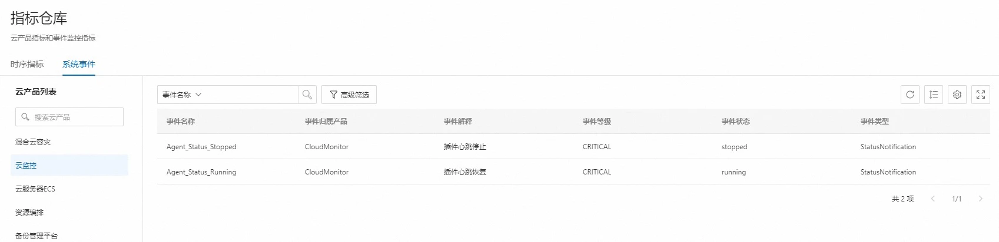

<a id="section-7"></a>

# 7.AI可观测

<a id="section-7-1"></a>

## 7.1. 全息视图

全息视图是以云监控所有的AI可观测的云产品服务实例实体对象为中心的统一探索与分析入口。通过实体查询，用户可以快速定位、查询分析在CMS中建模的各种AI可观测实体，实现从全局视角到细节视图的无缝探索。

**背景信息**

在AI可观测性领域，实体（Entity）指的是任何可以被独立识别和监控的对象，例如：

- AI 算力实体：BMCP集群、BMCP节点、BMS主机、ack容器、apfs/cpfs存储系统。

- AI 中间件：AI网关实体。

- AI 训推：由AI Studio生成的notebook建模、任务建模、可视化建模、在线服务、A-Speed、离线推理等任务实体。

- AI 智能体：由OP生成的Agent实体。

- AI 数据中心：由OP生产的数据加工任务。

实体查询的核心价值在于打破传统监控中按“产品”或“指标”划分的孤岛式视图，构建全景化的实体资产目录。用户可以在实体查询中实现以下目标：

- 统一盘点：清晰查看AI可观测中定义的所有实体类型（Entity Type）及具体实体实例，并按照域（Domain）和类型进行分类展示。

- 关联分析：以任一实体为起点，探索其状态、性能指标、关联日志、链路追踪和拓扑关系，实现一站式问题诊断与分析。

**操作步骤**

1. 登录Apsara Uni-manager运营控制台。

2. 单击顶部菜单栏的**产品**，选择**迁移与运维管理** > **运维与监控** > **云监控**。

3. 在左侧导航栏，选择**AI可观测 > 全息视图**，系统默认显示**全部空间**、**最近6小时**的**全局观测**界面<strong>。</strong>

   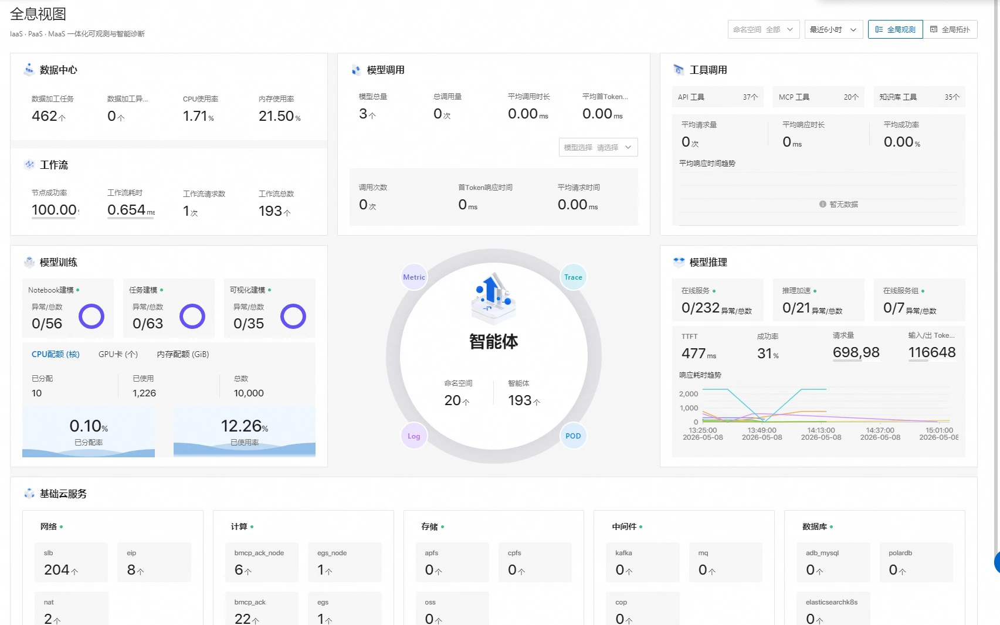

   - 数据中心

     展示**数据加工任务**、**数据加工异常任务**、**CPU使用率**、**内存使用率**的详细信息。

     

   - 工作流

     展示**节点成功率**、**工作流耗时**、**工作流请求数**、**工作流总数**的详细信息。

     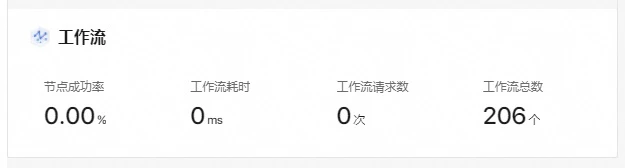

   - 模型调用

     - 展示**模型总量**、**总调用量**、**平均调用时长**、**平均首Token时长**的详细信息。

       

     - 选择具体的模型，展示该模型**调用次数**、**首Token响应时间**、**平均请求时间**。

       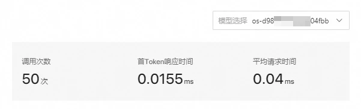

   - 工具调用

     展示**API工具**、**MCP工具**、**知识库工具**的个数以及**平均请求量**、**平均响应时长**、**平均成功率**、**平均响应时间趋势**。

     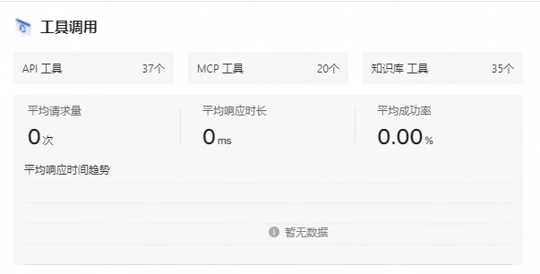

   - 模型训练

     - 展示**Notebook建模**、**任务建模**、**可视化建模**的实例总数及异常数。

       

       单击卡片上的数字，跳转至**模型训练**页面，可查看实例详情。

       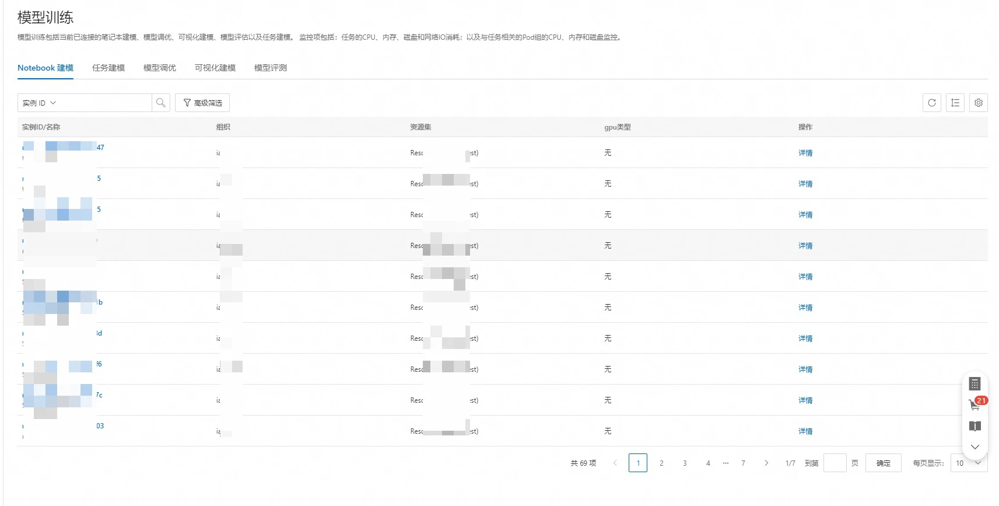

     - 展示<strong>CPU配额（核）</strong>的**已分配**、**已使用**、**总数**及**已分配率**和**已使用率**。

       

     - 展示<strong>GPU卡（个）</strong>的**已分配**、**已使用**、**总数**、**卡时**及**已分配率**和**已使用率**。

       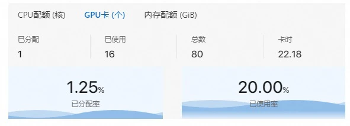

     - 展示<strong>内存配额（GiB）</strong>的**已分配**、**已使用**、**总数**及**已分配率**和**已使用率**。

       

   - 智能体

     展示**命名空间**和**智能体**的数量。

     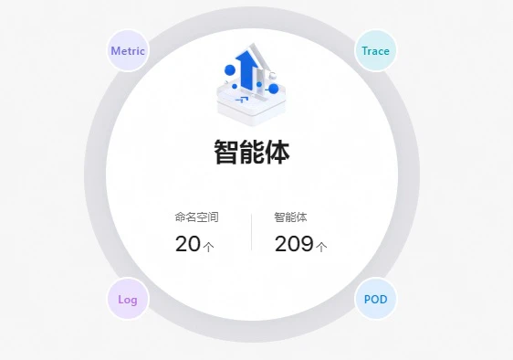

     任意单击Metric、Trace、Log、POD中的一个，可查看智能体详情。

     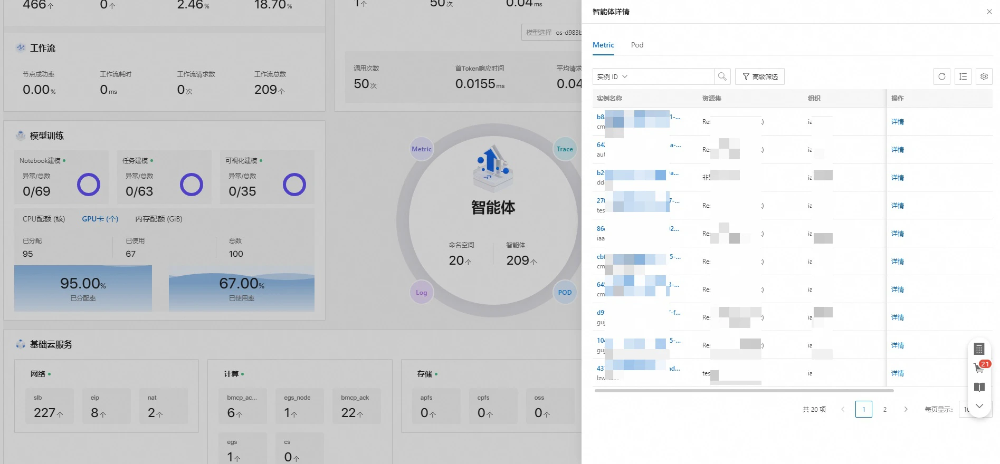

   - 模型推理

     - 展示**在线服务**、**推理加速**、**在线服务组**的实例总数和异常数。

       

       单击卡片上的数字，跳转至**模型推理**页面，可查看实例详情。

       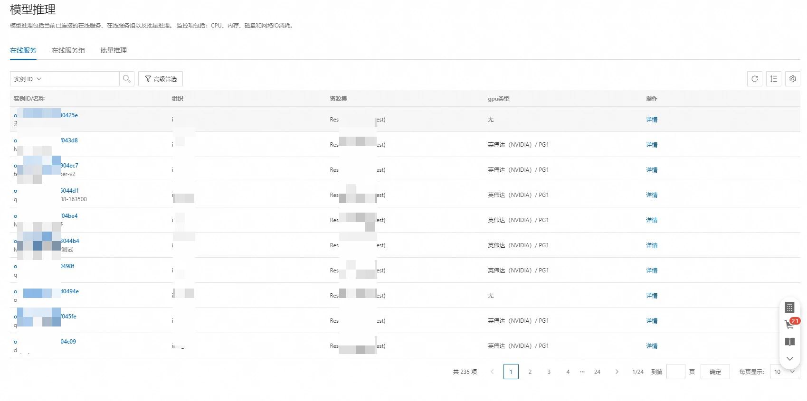

     - 展示**TTFT**、**成功率**、**请求量**、**输入/出Token数**的详细信息。

       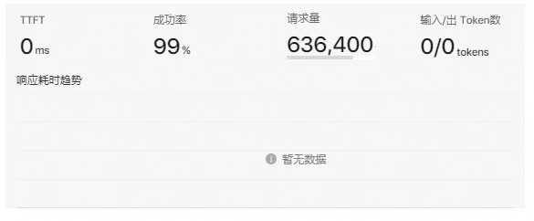

   - 基础云服务

     - 按照**网络**、**计算**、**存储**、**中间件**、**数据库**的维度展示实例个数。

       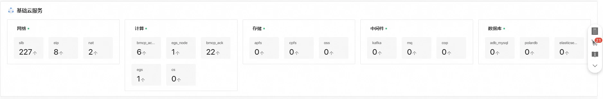

     - 单击卡片上的某个实例个数，界面跳转至云产品监控页面，可查看实例监控详情。

4. 在页面右上角单击**全局拓扑**，切换至**全局拓扑**页签，可查看MaaS、PaaS、IaaS监控详情。

   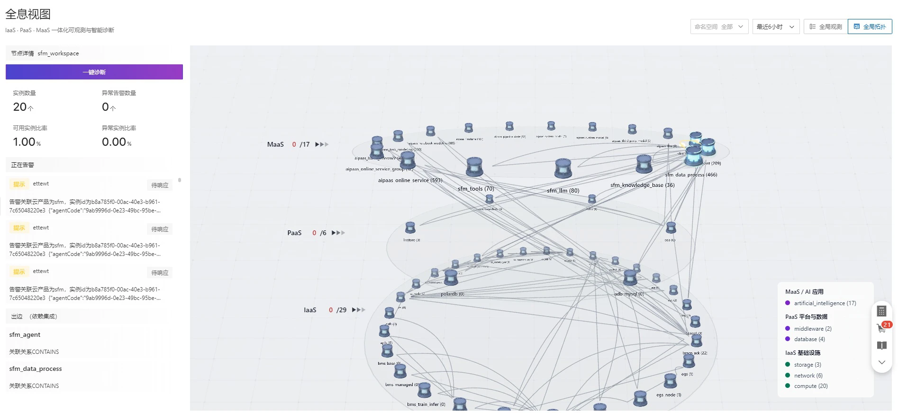

   - 单击页面左上角的**一键诊断**，可查看异常实例诊断信息。

     - 单击**实例详情**，可查看实例关联的拓扑详细信息。

       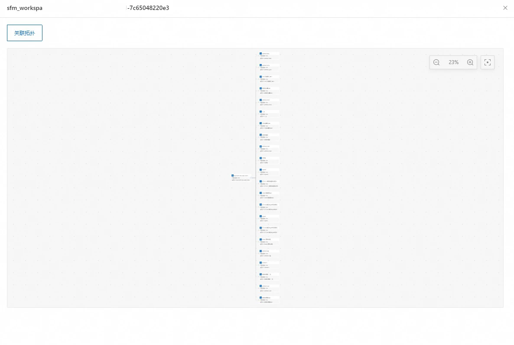

     - 单击告警摘要卡片上的**一键诊断**，可通过飞天助理进行智能诊断。

       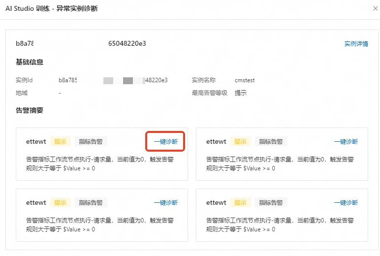

     - 页面左侧展示SFM产品的**实例数量**、**异常告警数量**、**可用实例比率**、**异常实例比率**详情以及当前正在发生的告警。

       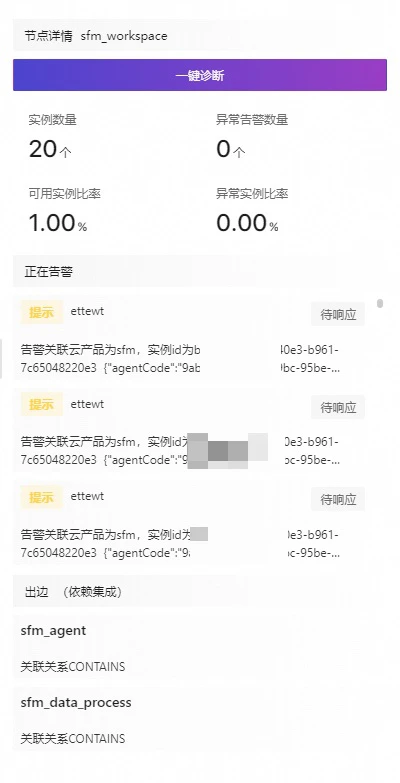

   - 鼠标悬浮在拓扑图上具体的服务，可查看**实例数量**、**可用实例比率**、**异常告警实例数**、**规格**、**能力层**的详细信息。

     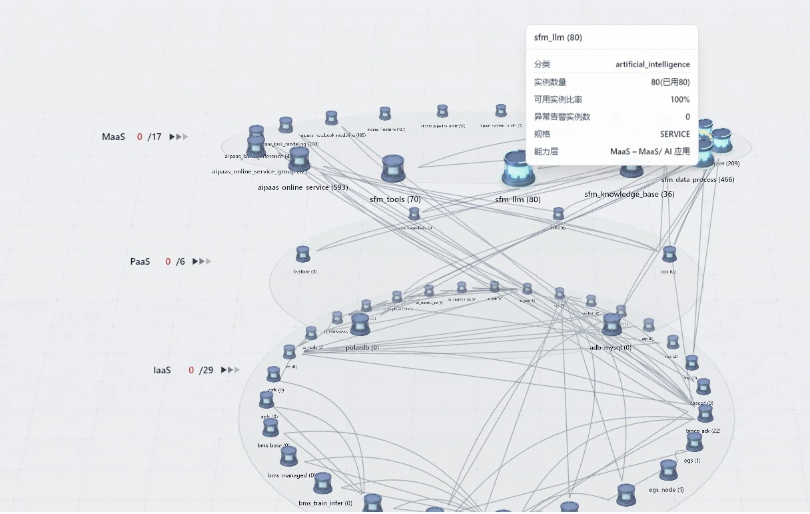

<a id="section-7-2"></a>

## 7.2. 智能体

智能体提供代理相关的异常、性能和流量分析。

**操作步骤**

1. 登录Apsara Uni-manager运营控制台。

2. 单击顶部菜单栏的**产品**，选择**迁移与运维管理** > **运维与监控** > **云监控**。

3. 在左侧导航栏，选择**AI可观测 > 智能体。**

4. 查看工作空间监控详情。

   在**工作空间**页签，单击目标实例**操作**列的**详情**，可查看工作空间的监控指标详情，可参考百炼专属版。

   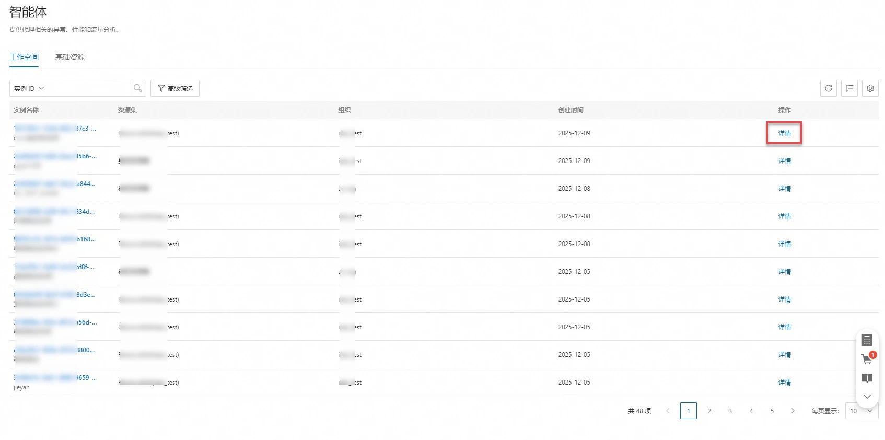

5. 查看基础资源监控详情。

   - 支持普罗米修斯2.0的实例

     在**基础资源**页签，单击目标实例**操作**列的**详情**，可查看基础资源的监控指标详情，可参考Kubernetes容器监控。

   - 不支持普罗米修斯2.0的实例

     在**基础资源**页签，单击目标实例**操作**列的**详情**，可查看基础资源的监控指标详情：

     **基础指标**

     | 监控项 | 单位 | MetricName | Dimensions | 描述 |
     | --- | --- | --- | --- | --- |
     | CPU资源限制 | cpus | cluster.cpu.limit | cluster | CPU资源限制。 |
     | CPU 资源请求 | cpus | cluster.cpu.request | cluster | CPU 资源请求。 |
     | 集群CPU使用量 | cpus | cluster.cpu.usage_rat e | cluster | 集群CPU使用量。 |
     | 集群维度的CPU使用率 | percent | cluster.cpu.utilization | cluster | 集群维度的CPU使用率。 |
     | 集群内存限制 | bytes | cluster.memory.limit | cluster | 集群内存限制。 |
     | 集群内存请求 | bytes | cluster.memory.reque st | cluster | 集群内存请求。 |
     | 集群维度的内存使用率 | percent | cluster.memory.utiliza tion | cluster | 集群维度的内存使用率。 |
     | 集群文件系统可用大小 | bytes | cluster.filesystem.ava ilable | cluster | 集群文件系统可用大小。 |
     | 集群文件系统上限 | bytes | cluster.filesystem.limi t | cluster | 集群文件系统上限。 |

     **容器组监控**

     | 监控项 | 单位 | MetricName | Dimensions | 描述 |
     | --- | --- | --- | --- | --- |
     | 容器组CPU资源分配上限 | cpus | pod.cpu.limit | cluster,namespa ce,type,app,pod | 容器组CPU资源分配上限。 |
     | 容器组CPU资源分配最小需求 | cpus | pod.cpu.request | cluster,namespa ce,type,app,pod | 容器组CPU资源分配最小需求。 |
     | 容器组CPU使用量 | cpus | pod.cpu.usage_rat e | cluster,namespa ce,type,app,pod | 容器组CPU使用量。 |
     | pod_CPU资源超卖率 | cpus | pod.cpu.oversale_r ate | cluster,namespa ce,type,app,pod | pod_CPU资源超卖率。 |
     | 容器组CPU使用率 | percent | pod.cpu.utilization | cluster,namespa ce,type,app,pod | 容器组CPU使用率。 |
     | 容器组工作内存使用量 | mbytes | pod.memory.worki ng_set | cluster,namespa ce,type,app,pod | 容器组工作内存使用量。 |
     | 容器组内存资源分配最小需求 | mbytes | pod.memory.reque st | cluster,namespa ce,type,app,pod | 容器组内存资源分配最小需求。 |
     | 容器组内存资源 | mbytes | pod.memory.rss | cluster,namespa ce,type,app,pod | 容器组内存资源。 |
     | 容器组内存资源分配上限 | gbytes | pod.memory.limit | cluster,namespa ce,type,app,pod | 容器组内存资源分配上限。 |
     | pod_内存资源超卖率 | gbytes | pod.memory.overs ale_rate | cluster,namespa ce,type,app,pod | pod_内存资源超卖率。 |
     | 容器组内存使用率 | percent | pod.memory.utiliz ation | cluster,namespa ce,type,app,pod | 容器组内存使用率。 |
     | 容器组文件系统可用大小 | gbytes | pod.filesystem.ava ilable | cluster,namespa ce,type,app,pod | 容器组文件系统可用大小。 |
     | 容器组文件系统上限 | gbytes | pod.filesystem.limi t | cluster,namespa ce,type,app,pod | 容器组文件系统上限。 |
     | 容器组网络接受速率 | Bps | pod.network.rx_rat e | cluster,namespa ce,type,app,pod | 容器组网络接受速率。 |
     | 容器组网络发送速率 | Bps | pod.network.tx_rat e | cluster,namespa ce,type,app,pod | 容器组网络发送速率。 |
     | 容器组网络接收错误速率 | Bps | pod.network.rx_err ors_rate | cluster,namespa ce,type,app,pod | 容器组网络接收错误速率。 |
     | 容器组网络发送错误速率 | Bps | pod.network.tx_err ors_rate | cluster,namespa ce,type,app,pod | 容器组网络发送错误速率。 |
     | JVM 堆内存占用 | bytes | sfm_pod_jvm_heap _used | cluster,namespa ce,pod,area | JVM 堆内存占用。 |
     | JVM 堆内存上限 | bytes | sfm_pod_jvm_heap _max | cluster,namespa ce,pod,area | JVM 堆内存上限。 |
     | JVM 堆内存committed | bytes | sfm_pod_jvm_heap _committed | cluster,namespa ce,pod,area | JVM 堆内存committed。 |
     | JVM 非堆内存占用 | bytes | sfm_pod_jvm_nonh eap_used | cluster,namespa ce,pod,area | JVM 非堆内存占用。 |
     | JVM 非堆内存上限 | bytes | sfm_pod_jvm_nonh eap_max | cluster,namespa ce,pod,area | JVM 非堆内存上限。 |
     | JVM 非堆内存committed | bytes | sfm_pod_jvm_nonh eap_committed | cluster,namespa ce,pod,area | JVM 非堆内存committed。 |
     | JVM 内存占用 | bytes | sfm_pod_jvm_mem _used | cluster,namespa ce,pod | JVM 内存占用。 |
     | JVM 内存上限 | bytes | sfm_pod_jvm_mem _max | cluster,namespa ce,pod | JVM 内存上限。 |
     | JVM 内存committed | bytes | sfm_pod_jvm_mem _committed | cluster,namespa ce,pod | JVM 内存committed。 |
     | JVM Eden区内存占用 | bytes | sfm_pod_jvm_eden _space_used | cluster,namespa ce,pod,id | JVM Eden区内存占用。 |
     | JVM Eden区内存上限 | bytes | sfm_pod_jvm_eden _space_max | cluster,namespa ce,pod,id | JVM Eden区内存上限。 |
     | JVM Eden区内存committed | bytes | sfm_pod_jvm_eden _space_committed | cluster,namespa ce,pod,id | JVM Eden区内存committed。 |
     | JVM Survivor区内存占用 | bytes | sfm_pod_jvm_survi vor_space_used | cluster,namespa ce,pod,id | JVM Survivor区内存占用。 |
     | JVM Survivor区内存上限 | bytes | sfm_pod_jvm_survi vor_space_max | cluster,namespa ce,pod,id | JVM Survivor区内存上限。 |
     | JVM Survivor区内存committed | bytes | sfm_pod_jvm_survi vor_space_commit ted | cluster,namespa ce,pod,id | JVM Survivor区内存committed。 |
     | JVM老年代内存占用 | bytes | sfm_pod_jvm_old_gen_used | cluster,namespa ce,pod,id | JVM老年代内存占用。 |
     | JVM老年代内存上限 | bytes | sfm_pod_jvm_old_gen_max | cluster,namespa ce,pod,id | JVM老年代内存上限。 |
     | JVM老年代内存committed | bytes | sfm_pod_jvm_old_gen_committed | cluster,namespa ce,pod,id | JVM老年代内存committed。 |
     | JVM GC次数 | short | sfm_pod_jvm_gc_t otal | cluster,namespa ce,pod | JVM GC次数。 |
     | JVM GC耗时 | seconds | sfm_pod_jvm_gc_d uration | cluster,namespa ce,pod | JVM GC耗时。 |
     | JVM 线程状态 | short | sfm_pod_jvm_thre ad_states | cluster,namespa ce,pod | JVM 线程状态。 |
     | JVM打开文件数 | short | sfm_pod_jvm_open _files | cluster,namespa ce,pod | JVM打开文件数。 |
     | JVM 累计分配内存 | bytes | sfm_pod_jvm_mem _allocated | cluster,namespa ce,pod | JVM 累计分配内存。 |
     | JVM 累计晋升内存 | bytes | sfm_pod_jvm_mem _promoted | cluster,namespa ce,pod | JVM 累计晋升内存。 |
     | JVM 已加载class数 | short | sfm_pod_jvm_class _loaded | cluster,namespa ce,pod | JVM 已加载class数。 |
     | HTTP接口成功率 | percentunit | sfm_pod_http_req_success_rate | cluster,namespa ce,pod,uri | HTTP接口成功率。 |
     | HTTP接口请求量 | short | sfm_pod_http_req_total | cluster,namespa ce,pod,uri | HTTP接口请求量。 |
     | HTTP接口耗时 | seconds | sfm_pod_http_req_duration | cluster,namespa ce,pod,uri | HTTP接口耗时。 |
     | HTTP 错误码统计 | short | sfm_pod_http_err_status | cluster,namespa ce,pod,uri,status | HTTP 错误码统计。 |
     | Dubbo Provider接口成功率 | percentunit | agent_dubbo_req_success_rate | cluster,namespa ce,pod,applicati on,interface,met hod | Dubbo Provider接口成功率。 |
     | Dubbo Provider接口请求量 | short | agent_dubbo_req_t otal | cluster,namespa ce,pod,applicati on,interface,met hod | Dubbo Provider接口请求量。 |
     | Dubbo Provider接口耗时 | milliseconds | agent_dubbo_req_duration | cluster,namespa ce,pod,applicati on,interface,met hod | Dubbo Provider接口耗时。 |
     | Dubbo Consumer接口成功率 | percentunit | agent_dubbo_cons umer_req_success _rate | cluster,namespa ce,pod,applicati on,interface,met hod | Dubbo Consumer接口成功率。 |
     | Dubbo Consumer接口请求量 | short | agent_dubbo_cons umer_req_total | cluster,namespa ce,pod,applicati on,interface,met hod | Dubbo Consumer接口请求量。 |
     | Dubbo Consumer接口耗时 | milliseconds | agent_dubbo_cons umer_req_duration | cluster,namespa ce,pod,applicati on,interface,met hod | Dubbo Consumer接口耗时。 |

<a id="section-7-3"></a>

## 7.3. 数据中心

数据中心提供对数据加工的任务和基础运行的监控。

**操作步骤**

1. 登录Apsara Uni-manager运营控制台。

2. 单击顶部菜单栏的**产品**，选择**迁移与运维管理** > **运维与监控** > **云监控**。

3. 在左侧导航栏，选择**AI可观测 > 数据中心。**

4. 在**数据中心**页面，单击工作空间实例**操作**列的**详情**，可查看实例详情。

   

5. 在**工作空间**详情页面，客户查看**实例名称**、**资源集**、**组织**、**创建时间**，以及**CPU**、**内存**、**网络**的监控值。

   

<a id="section-7-4"></a>

## 7.4. 模型推理

模型推理包括当前已连接的在线服务、在线服务组以及批量推理。 监控项包括：CPU、内存、磁盘和网络IO消耗。

**操作步骤**

1. 登录Apsara Uni-manager运营控制台。

2. 单击顶部菜单栏的**产品**，选择**迁移与运维管理** > **运维与监控** > **云监控**。

3. 在左侧导航栏，选择**AI可观测 > 模型推理。**

4. 查看在线服务监控。

   在**在线服务**页签，单击目标实例**操作**列的**详情**，可查看在线服务的监控指标详情，可参考AI Studio（在线服务）。

   

5. 查看在线服务组监控。

   在**在线服务组**页签，单击目标实例**操作**列的**详情**，可查看在线服务组的监控指标详情，可参考AI Studio（在线服务组）。

   

6. 查看批量推理监控。

   在**批量推理**页签，单击目标实例**操作**列的**详情**，可查看批量推理的监控指标详情，可参考AI Studio（批量推理）。

   

<a id="section-7-5"></a>

## 7.5. 模型训练

模型训练包括当前已连接的笔记本建模、模型调优、可视化建模、模型评估以及任务建模。 监控项包括：任务的CPU、内存、磁盘和网络IO消耗；以及与任务相关的Pod组的CPU、内存和磁盘监控。

**操作步骤**

1. 登录Apsara Uni-manager运营控制台。

2. 单击顶部菜单栏的**产品**，选择**迁移与运维管理** > **运维与监控** > **云监控**。

3. 在左侧导航栏，选择**AI可观测 > 模型训练。**

4. 查看Notebook建模监控详情。

   在**Notebook建模**页签，单击目标实例**操作**列的**详情**，可查看Notebook建模的监控指标详情，可参考AI Studio（Notebook建模）。

   

5. 查看任务建模监控详情。

   在**任务建模**页签，单击目标实例**操作**列的**详情**，可查看任务建模的监控指标详情，可参考AI Studio（任务建模）。

   

6. 查看模型调优监控详情。

   在**模型调优**页签，单击目标实例**操作**列的**详情**，可查看模型调优的监控指标详情，可参考AI Studio（模型调优）。

   

7. 查看可视化建模监控详情。

   在**可视化建模**页签，单击目标实例**操作**列的**详情**，可查看可视化建模的监控指标详情，可参考AI Studio（可视化建模）。

   

8. 查看模型测评监控详情。

   在**模型测评**页签，单击目标实例**操作**列的**详情**，可查看模型测评的监控指标详情，可参考AI Studio（模型评测）。

   

<a id="section-7-6"></a>

## 7.6. AI算力

AI算力区分了AI计算、存储和网关； 监控项包括： 计算方面包括基本的CPU、内存、磁盘及其他资源消耗，GPU使用情况、温度等监控，以及RDMA网络监控。 存储方面包括存储使用率、IOPS和带宽的监控。网关方面包括上下行请求、成功率及耗时的监控。

**操作步骤**

1. 登录Apsara Uni-manager运营控制台。

2. 单击顶部菜单栏的**产品**，选择**迁移与运维管理** > **运维与监控** > **云监控**。

3. 在左侧导航栏，选择**AI可观测 > AI算力。**

4. AI计算。

   - 查看裸金属算力平台 BMCP（节点）监控详情。

     在<strong>裸金属算力平台 BMCP（节点）</strong>页签，单击目标实例**操作**列的**详情**，可查看裸金属算力平台BMCP（节点）的监控指标详情，可参考裸金属算力平台BMCP（节点）。

     

   - 查看裸金属算力平台BMCP（裸金属-超算算力集群）监控详情。

     在<strong>裸金属算力平台BMCP（裸金属-超算算力集群）</strong>页签，单击目标实例**操作**列的**详情**，可查看裸金属算力平台BMCP（裸金属-超算算力集群）的监控指标详情，可参考裸金属算力平台BMCP（裸金属-超算算力集群）。

     

   - 查看裸金属算力平台BMCP（裸金属-智算算力集群）监控详情。

     在<strong>裸金属算力平台BMCP（裸金属-智算算力集群）</strong>页签，单击目标实例**操作**列的**详情**，可查看裸金属算力平台BMCP（裸金属-智算算力集群）的监控指标详情，可参考裸金属算力平台BMCP（裸金属-智算算力集群）。

     

   - 查看裸金属算力平台BMCP（容器-智算算力集群）监控详情。

     在<strong>裸金属算力平台BMCP（容器-智算算力集群）</strong>页签，单击目标实例**操作**列的**详情**，可查看裸金属算力平台BMCP（容器-智算算力集群）的监控指标详情，可参考裸金属算力平台BMCP（容器-智算算力集群）。

     

5. AI存储。

   - 查看文件系统APFS监控详情。

     在**文件系统APFS**页签，单击目标实例**操作**列的**详情**，可查看文件系统APFS的监控指标详情，可参考文件系统APFS。

     

   - 查看文件系统CPFS监控详情。

     在**文件系统CPFS**页签，单击目标实例**操作**列的**详情**，可查看文件系统CPFS的监控指标详情，可参考文件存储CPFS。

     

6. 查看AI网关监控详情。

   在**AI网关**页签，单击目标实例**操作**列的**详情**，可查看AI网关的监控指标详情，可参考API网关。

   

<a id="section-8"></a>

# 8.ARMS应用监控

ARMS应用监控是一款应用性能管理（Application Performance Management，简称APM）产品。可以帮助您快速定位出错接口和慢接口、重现调用参数、发现系统瓶颈，从而大幅提升线上问题诊断的效率。

<a id="section-8-1"></a>

## 8.1. 应用列表

在**应用列表**页面，您可以查看应用监控已接入的应用。

**操作步骤**

1. 登录Apsara Uni-manager运营控制台。

2. 单击顶部菜单栏的**产品**，选择**迁移与运维管理** > **运维与监控** > **云监控**。

3. 在左侧导航栏，选择**ARMS应用监控 > 应用列表**。

4. 在**应用列表**页面查看应用监控已接入的应用。

   

   <table>
     <tr>
       <th width="95">参数/功能</th>
       <th>说明</th>
     </tr>
     <tr>
       <td>接入应用</td>
       <td>将应用进入应用监控。具体操作，请参见应用实时监控服务ARMS《用户指南》。</td>
     </tr>
     <tr>
       <td>应用名称</td>
       <td>应用的名称。</td>
     </tr>
     <tr>
       <td>标签</td>
       <td>您可以通过标签过滤应用。</td>
     </tr>
     <tr>
       <td>指标</td>
       <td>显示应用接入后以下指标的产生数量或状态。<br>• 健康度<br>• 请求数<br>• 错误数<br>• 响应时间<br>• 异常数<br>• 最近10分钟响应时间</td>
     </tr>
     <tr>
       <td>操作</td>
       <td><strong>设置</strong>：进入应用设置页面。您可以在应用设置页面执行以下操作：<br>• 自定义配置监控参数。<br>• 管理标签。<br>• 自定义监控方法。<br>• 删除应用。具体操作，请参见应用实时监控服务ARMS《用户指南》。</td>
     </tr>
   </table>

<a id="section-8-2"></a>

## 8.2. 应用拓扑

ARMS应用监控的应用拓扑图能展示指定应用的上下游依赖关系。

**查看应用拓扑**

1. 登录Apsara Uni-manager运营控制台。

2. 单击顶部菜单栏的**产品**，选择**迁移与运维管理** > **运维与监控** > **云监控**。

3. 在左侧导航栏，选择**ARMS应用监控 > 应用拓扑**。

   在全局拓扑页面，您可以执行以下操作：

   - 单击加号图标或向上滑动鼠标滚轮，放大应用拓扑图。

   - 单击减号图标或向下滑动鼠标滚轮，缩小应用拓扑图。

   - 单击RESET图标，将应用拓扑图恢复至默认大小。

   - 单击一个节点，可以高亮显示该节点关联的拓扑图。

   - 将鼠标悬浮于节点或节点之间连线的圆点上，可以查看以下信息：

     - 服务名称

     - QPS：Query Per Second（每秒查询数）

     - RT：Response Time（响应时间，单位为毫秒）

     - ERROR：Error QPS（每秒错误查询数）

**新建视图**

您可以通过新建视图功能创建自定义拓扑图。

1. 在全局拓扑页面，单击**新建视图**，在弹出的对话框中填写**视图名称**，并选择目标核心应用。

2. 单击**编辑视图**，执行以下操作调整拓扑图。

   <ol type="i">

   <li>

   右键节点可查看该节点的上游、下游和详情，复制节点信息或移除该节点。

   </li>

   <li>

   双击节点可展开该节点的下游。

   </li>

   <li>

   将鼠标悬浮于节点或节点之间连线的圆点上，可以查看以下信息：

   <ol type="a">

   <li>

   服务名称

   </li>

   <li>

   QPS：Query Per Second（每秒查询数）

   </li>

   </ol>

   <ol type="i" start="100">

   <li>

   RT：Response Time（响应时间，单位为毫秒）

   </li>

   <li value="500">

   ERROR：Error QPS（每秒错误查询数）

   </li>

   </ol>

   </li>

   </ol>

3. 单击**确定**即可完成创建。

**编辑或删除视图**

您可以对已创建的自定义拓扑图进行二次编辑。

> **说明**
>
> 默认视图不支持编辑和删除操作。

1. 在**新建视图**右侧下拉框中选择需要编辑的视图，然后单击**编辑**。

2. 您可以在弹出的对话框中修改视图的名称。

3. 单击**编辑视图**，对视图进行修改后单击**确定**。

4. 如果不需要当前拓扑图，也可以单击右上角**删除**。

**更多操作**

更多操作，请参见应用实时监控服务ARMS《用户指南》。

<a id="section-8-3"></a>

## 8.3. 链路分析

链路追踪为分布式应用的开发者提供了完整的调用链路还原、调用请求量统计、链路拓扑、应用依赖分析等工具，可以帮助开发者快速分析和诊断分布式应用架构下的性能瓶颈，提高微服务时代下的开发诊断效率。

1. 登录Apsara Uni-manager运营控制台。

2. 单击顶部菜单栏的**产品**，选择**迁移与运维管理** > **运维与监控** > **云监控**。

3. 在左侧导航栏，选择**ARMS应用监控 > 链路分析**。

4. 单击**快速入门**，可下载链路追踪的指导手册。

5. 单击**查看接入点信息**，在**接入点信息**页签下的**集群信息**区域，打开**显示Token**开关。

6. 在下方表格的**相关信息**列，单击请绑定Prometheus地址以完成指标投递后的编辑图标，填写Prometheus实例名称和Remote Write地址，单击**确认**，ARMS将会把接收到的Metrics数据投递到此Prometheus实例。

   

**更多操作**

更多操作，请参见应用实时监控服务ARMS《用户指南》。

<a id="section-9"></a>

# 9.可视化

<a id="section-9-1"></a>

## 9.1. 自定义大盘

您可以根据业务需求，创建个性化的数据可视化大盘，用于监控、分析和展示关键指标，便于直观、高效地理解和管理数据。

**预置大盘**

系统提供的预置大盘如下：

- API网关

- 域名服务

- 消息队列MQ

- Elasticsearch on K8s

- 对象存储OSS

- 负载均衡SLB

- 云服务器ECS

- 云原生分布式数据库PolarDB-X 1.0

- 云数据库Redis（集群版）

- 云数据库Redis（标准版/读写分离版）

- 云数据库RDS-PG（云盘）

- 云数据库RDS-PG（本地SSD）

- 云数据库RDS-PolarDB

- 云数据库RDS-MYSQL

**创建目录**

1. 登录Apsara Uni-manager运营控制台。

2. 单击顶部菜单栏的**产品**，选择**迁移与运维管理** > **运维与监控** > **云监控**。

3. 在左侧导航栏，选择**可视化 > 自定义大盘**。

4. 单击页面上方的**创建目录**。

5. 在输入框中，输入目录名称。

6. 单击Enter键。

**修改目录名称**

> **重要**
>
> 预置的目录不支持修改名称。

1. 在**自定义大盘**页面，单击目录右侧的  。

2. 在输入框，重新输入目录名称。

3. 单击Enter键。

**删除目录**

> **重要**
>
> - 预置的目录不支持删除。
>
> - 删除目录，该目录下的大盘也会被删除，请谨慎操作！

1. 在**自定义大盘**页面，单击目录右侧的  。

2. 在弹框中，单击**确定**。

**创建大盘**

> **重要**
>
> 创建大盘前，请先完成目录的创建，否则保存大盘时无法保存到对应目录。

1. 在**自定义大盘**页面，单击页面上方的**创建大盘**。

2. 在**创建大盘**弹框中，输入**大盘名称**，选择**大盘目录**，单击**确定**。

   

3. 在大盘页面，您可以新建卡片和行容器。

   - **新建卡片**

     <ol type="a">

     <li>

     单击**新建卡片**，选择**新建卡片**。

     </li>

     <li>

     在新建卡片页面，设置图表的**数据配置**、**数据变换**（可选）和**图表配置**（可选）。

     - **数据配置**：单击**新增 Query**，选择需要监控的**云产品**、**监控指标**、**统计方法**和**监控范围**等。

       > **说明**
       >
       > 可以添加多个数据配置。

       

     - （可选）**数据变换**：单击**新增数据变换 > 数据筛选**，勾选需要设置筛选功能的数据列；单击**新增数据变换 > 数据列命名**，可对数据列重新命名；单击**新增数据变换 > 表合并**，可将多个表格合并为一个表格，仅对表格生效。

       > **重要**
       >
       > 配置数据变换前需要先配置数据配置。

       

     - （可选）**图表配置**：配置图表类型、图表元素、坐标轴、图例、辅助线、辅助面积等。

       

     </li>

     </ol>

     <ol type="i" start="100">

     <li>

     设置完成后，单击图表上方的**应用于大盘**，即可保存该图表。

     > **说明**
     >
     > - 单击图表上方的**取消**，则取消保存该图表。
     >
     > - 单击图表上方**最近1小时**的下拉列表，选择或自定义图表监控的时间范围。

     

     </li>

     </ol>

   - **添加行容器**

     <ol type="a">

     <li>

     在大盘页面单击**新建卡片**，选择**新建行容器**。

     </li>

     <li>

     鼠标悬浮在行容器上，单击  ，编辑行名称。

     > **说明**
     >
     > 鼠标悬浮在行容器上，单击
     >
     > ，可删除行容器。
     >
     > 

     </li>

     </ol>

4. 卡片和行容器添加完成后，您可以自定义大盘布局。

   - 在画布区域右上方的下拉列表，单击**布局模板**，可选择**每行展示1个**、**每行展示2个**、**每行展示3个**、**每行展示4个**。

   - 鼠标拖动卡片，可调整其位置。

   - 单击卡片右上角的  ，可选择对卡片进行**编辑**、**复制**、**删除**、**查看**等操作。

5. （可选）单击大盘上方**最近1小时**下拉列表，选择或自定义大盘监控的时间范围。

   > **说明**
   >
   > 卡片编辑页设置的时间仅在编辑页对该卡片生效（相当于临时查看这个卡片在其他时间的数据），当从卡片编辑页返回大盘后，则统一以大盘设置的时间为准。

6. （可选）单击  右侧的下拉列表，设置大盘的自动刷新时间。

   > **说明**
   >
   > 设置为off时，表示关闭自动刷新。

7. (可选)单击大盘上方的  ，可查看或编辑大盘的基础配置和JSON模式。

   

   - **基础配置**

     在基础配置中，您可以查看或修改大盘名称以及可编辑开关。

     > **说明**
     >
     > 可编辑开关打开，则可以添加或删除图表、行容器，以及自定义大盘布局，否则不能进行这些操作。

   - **JSON模式**JSON模式中以JSON格式显示该大盘信息。您也可以通过JSON进行编辑，单击**预览**，可预览是否符合

     预期，符合则单击  ，即可保存该JSON。

8. 单击  保存大盘，大盘创建完成。

**修改大盘内容和布局**

> **重要**
>
> 预置的大盘不支持修改内容和布局。

1. 在**自定义大盘**页面，单击目标目录，在右侧展示的大盘中，单击大盘名称。

2. 在大盘详情页面，根据需要修改大屏的卡片、行容器以及布局等。具体可参见创建大盘。

**修改大盘名称**

> **重要**
>
> 预置的大盘不支持修改名称。

1. 在**自定义大盘**页面，单击目标目录，在右侧展示的大盘列表中，单击大盘操作列的**编辑**。

2. 在**编辑大盘**对话框，重新输入大盘名称。

3. 单击**确定**。

**移动大盘**

> **重要**
>
> 预置的大盘不支持移动。

- **移动单个大盘**

  <ol type="i">

  <li>

  在**自定义大盘**页面，单击目标目录，在右侧展示的大盘列表中，单击大盘操作列的**编辑**。

  </li>

  <li>

  在**编辑大盘**对话框，选择大盘所属文件夹。

  </li>

  <li>

  单击**确定**。

  </li>

  </ol>

- **批量移动大盘**

  <ol type="i">

  <li>

  在**自定义大盘**页面，单击目标目录，在右侧展示的大盘列表中，勾选需要移动的大盘。

  </li>

  <li>

  单击页面下方的**移动**。

  </li>

  <li>

  在**批量移动大盘**对话框，选择大盘所属目录。

  </li>

  <li>

  单击**确定**。

  </li>

  </ol>

**复制大盘**

复制大盘即快速新增一个相同的大盘。

1. 在**自定义大盘**页面，单击目标目录，在右侧展示的大盘列表中，单击大盘操作列的**复制**。

2. 在**复制大盘**对话框，重新输入大盘名称，选择大盘所属文件夹。

3. 单击**确定**。

**设置默认大盘**

> **重要**
>
> - 只能设置一个默认大盘。
>
> - 设置目标大盘为默认大盘后，会覆盖之前的默认大盘，同时进入自定义大盘时会自动展示该大
>
>   盘。单击默认大盘页面左上方的  可返回目录页。

1. 在**自定义大盘**页面，单击目标目录，在右侧展示的大盘列表中，单击大盘操作列的**设为默认大盘**。

2. 单击**确定**。

**删除大盘**

> **重要**
>
> 预置的大盘不支持删除。

- **删除单个大盘**

  <ol type="i">

  <li>

  在**自定义大盘**页面，单击目标目录，在右侧展示的大盘列表中，单击大盘操作列的**删除**。

  </li>

  <li>

  单击**确定**。

  </li>

  </ol>

- **批量删除大盘**

  <ol type="i">

  <li>

  在**自定义大盘**页面，单击目标目录，在右侧展示的大盘列表中，勾选需要删除的大盘。

  </li>

  <li>

  单击页面下方的**删除**。

  </li>

  <li>

  单击**确定**。

  </li>

  </ol>

**智能分析**

智能分析基于大盘指标数据结合云实例与产品生成视图总结。

1. 在**自定义大盘**页面，选择目标大盘，单击大盘名称，进入大盘详情页面。

2. 在大盘详情页面，单击具体指标的**智能分析**，飞天助理即可总结出大盘当前时间段内的指标监控数据。

   

   同时在飞天助理弹框提问，飞天助理可通过分析可视化大盘上的数据趋势、异常波动、指标关联性以及历史对比数据，为您提供深入的数据洞察和总结报告。

<a id="section-10"></a>

# 10.报警服务

报警服务中提供了报警规则、报警历史和报警模板的能力。通过设置报警规则来定义报警系统如何检查监控数据，当监控数据满足报警规则时发送报警通知。报警发生时生成报警历史，可对近期报警历史进行分析复查，帮助定位问题根源并作出预测。报警模板简化了大量云资源场景创建和维护报警规则的过程，助力更高效的监控服务。

<a id="section-10-1"></a>

## 10.1. 报警历史

当报警发生后，可以按照云产品、云服务实例、报警级别等查看报警历史信息。支持导出并下载报警历史信息，便于在本地进行数据分析。

**操作步骤**

1. 登录Apsara Uni-manager运营控制台。

2. 单击顶部菜单栏的**产品**，选择**迁移与运维管理** > **运维与监控** > **云监控**。

3. 在左侧导航栏，选择**报警服务** > **报警历史**。

4. （可选）在**报警历史**页面，可通过**云产品选择**、**规则ID**、**规则名称**、**实例ID**、**报警级别**和时间来筛选目标报警历史记录。

   > **说明**
   >
   > 数据传输服务DTS不显示故障实例信息。

5. 在报警历史页面，执行以下操作。

   <table>
     <tr>
       <th width="170">操作任务</th>
       <th>操作步骤</th>
     </tr>
     <tr>
       <td>查看报警历史</td>
       <td>在<strong>报警历史</strong>列表中，可以直接查看目标报警历史的<strong>产品名称</strong>、<strong>故障实</strong><strong>例</strong>、<strong>发生时间</strong>、<strong>规则名称</strong>、<strong>状态</strong>、<strong>等级</strong>和<strong>通知对象</strong>。单击目标报警历史对应规格名称，可以查看报警规则详情。<br>说明报警历史默认支持查询最近2天的数据。</td>
     </tr>
     <tr>
       <td>导出并下载报警历史</td>
       <td>i. 在<strong>报警历史</strong>页面，单击页面右上方的。<br>ii. 在<strong>导出任务</strong>对话框中，设置<strong>时间选择</strong>和<strong>任务名称</strong>后，单击<strong>确定</strong>。iii. 在左侧导航栏单击<strong>报表导出</strong>，在<strong>报表导出</strong>页面单击<strong>报警历史</strong>页签。iv. 单击目标报表<strong>操作</strong>列中的<strong>下载报表任务</strong>。<br>v. 在<strong>下载报表任务</strong>对话框中，单击<strong>确定</strong><br>说明所下载报表的格式为<strong>.xlsx</strong>，请在浏览器下载路径下查找下载报表。</td>
     </tr>
   </table>

<a id="section-10-2"></a>

## 10.2. 报警规则

支持对主机监控中的监控项、云服务监控中的实例设置报警规则。可以在全部资源、应用分组和单实例维度设置报警规则。报警服务支持通过邮件、钉钉和Webhook地址接收报警通知。

> **说明**
>
> 在Root组织下，不支持操作报警规则。

<a id="section-10-2-1"></a>

### 10.2.1. 创建报警规则

云监控CMS支持为云服务器ECS等所有接入云监控的云产品创建报警规则，按照所设定的云产品监控指标阈值进行告警，及时通知相关用户。

**背景信息**

报警规则在生效时间内，云监控CMS根据默认的探测频率检测报警指标是否超出所设定的阈值，一旦检测到云产品监控指标超出阈值（出现异常），按照设定的报警联系人或其他报警信息处理平台进行告警。

> **说明**
>
> - 除云数据库RDS（老链路）报警探测频率为每60~300秒一次（周期不定）外，其他云产品的最小报警探测频率均为每分钟一次。
>
> - MQ的消息堆积告警阈值可按照topic进行配置，不同的topic可设置不同的告警阈值。

**操作步骤**

1. 登录Apsara Uni-manager运营控制台。

2. 单击顶部菜单栏的**产品**，选择**迁移与运维管理** > **运维与监控** > **云监控**。

3. 在左侧导航栏选择**报警服务** > **报警规则**。

4. 单击列表上方的**创建报警规则**。

5. 在**创建报警规则**面板中，根据实际需要设置相应配置项。

   <table>
     <tr>
       <th width="137">配置项</th>
       <th>说明</th>
     </tr>
     <tr>
       <td>云产品选择</td>
       <td>选择需要监控告警的云产品。</td>
     </tr>
     <tr>
       <td>资源范围</td>
       <td>报警规则关联资源的范围，支持以下几类。不同云产品可选择的范围类型存在一定差异。<br>• <strong>实例维度</strong>：选择当前组织资源集下的一个或多个目标实例。<br>• <strong>资源集</strong>：选择当前组织和地域下的目标资源集。<br>• <strong>应用分组</strong>：选择当前组织和地域下的应用分组。<br>• <strong>全部资源</strong>：默认不支持选择。</td>
     </tr>
     <tr>
       <td>资源选择</td>
       <td>根据<strong>资源范围</strong>的选择，选择具体的资源实例、资源集或应用分组。</td>
     </tr>
     <tr>
       <td>规则类型</td>
       <td>支持<strong>单指标规则</strong>、<strong>多指标规则</strong>和<strong>智能阈值规则</strong>。</td>
     </tr>
     <tr>
       <td>报警规则描述</td>
       <td>报警规则的主体。当监控数据满足报警条件时，触发报警规则。规则描述设置方法：<br>• 规则类型为<strong>单指标规则</strong><br>a. 单击<strong>规则描述</strong>。<br>b. 在<strong>规则描述</strong>面板，设置<strong>规则名称</strong>、<strong>指标维度</strong>、<strong>监控指标</strong>、<strong>指标聚合周期</strong>、<strong>阈值报警级</strong><strong>别</strong>等。<br>说明指标维度仅在资源范围选择<strong>实例维度</strong>时才会显示。<br>c. 单击<strong>确认</strong>。<br>• 规则类型为<strong>多指标规则</strong><br>a. 单击<strong>创建多指标规则</strong>。<br>b. 在<strong>创建多指标规则</strong>面板，设置<strong>规则名称</strong>、<strong>阈值及告警级别</strong>、<strong>多指标报警规则</strong>、<strong>多指标关</strong><strong>系</strong>、<strong>报警阈值触发次数</strong>。<br>c. 单击<strong>确定</strong>。<br>• 规则类型为<strong>智能阈值规则</strong><br>a. 单击<strong>创建智能阈值告警</strong>。<br>b. 在<strong>创建智能阈值告警</strong>面板，设置<strong>规则名称</strong>、<strong>监控指标</strong>、<strong>指标维度</strong>、<strong>统计数据</strong>、<strong>统计周</strong><strong>期</strong>、<strong>阈值及报警级别</strong>、<strong>报警条件</strong>、<strong>报警敏感度</strong>、<strong>触发条件</strong>、<strong>监控图表预览</strong>。<br>c. 单击<strong>确定</strong>。</td>
     </tr>
     <tr>
       <td>沉默通道周期</td>
       <td>报警发生后未恢复正常，间隔多久重复发送一次报警通知。取值：<strong>5分钟</strong>、<strong>15分钟</strong>、<strong>30分</strong><strong>钟</strong>、<strong>1小时</strong>、<strong>3小时</strong>、<strong>6小时</strong>、<strong>12小时</strong>和<strong>24小时</strong>。当某些监控指标超出报警阈值时触发报警，如果监控指标在沉默通道周期内持续超过报警阈值，在沉默通道周期内不会重复发送报警通知；如果监控指标在沉默通道周期后仍未恢复正常，则云监控将再次发送报警通知。例如，当<strong>沉默通道周期</strong>设置为<strong>12小时</strong>时，如果超出报警阈值的监控指标在首次触发报警后12小时内仍未恢复正常，云监控将再次发送报警通知。</td>
     </tr>
     <tr>
       <td>生效时间</td>
       <td>报警规则的生效时间。报警规则只在生效时间内检查监控数据是否超出报警阈值。</td>
     </tr>
     <tr>
       <td>报警回调</td>
       <td>用于接收云监控通过POST请求推送报警消息的回调地址。<br>说明报警回调地址必须是云监控可访问的域名地址，仅支持HTTP协议，不支持填写IP。</td>
     </tr>
     <tr>
       <td>无数据处理方法</td>
       <td>无监控数据时报警的处理方式。<br>• 不做任何处理<br>• 发送无数据报警<br>说明当实例删除后，用户会接收到24H的无数据报警。</td>
     </tr>
     <tr>
       <td>报警联系人</td>
       <td>选择报警信息发送的用户组或用户。默认的云账号报警联系人组是一个空账号，可用于测试报警规则的有效性。</td>
     </tr>
   </table>

6. 单击**确定**。

**部分规则描述配置项说明**

| 配置项 | 说明 |
| --- | --- |
| 规则名称 | 填写报警规则名称。 |
| 监控指标 | 从当前报警规则所选择的云产品的所有监控指标中，选择目标指标项。各云产品的监控指标详情可参见云产品监控指标说明。 |
| 指标聚合周期 | 根据监控指标设置聚合周期。<br>说明聚合周期即对原始监控数据进行汇总、计算（如求和、平均、最大值等）所采用的时间窗口长度。 |
| 指标维度 | 指除实例ID之外的其他维度。仅在资源范围选择<strong>实例维度</strong>时才会显示。 |
| 阈值及报警级别（单位：%） | • 报警级别分为<strong>紧急</strong>、<strong>警告</strong>和<strong>普通</strong>。<br>• 根据选择的监控指标，监控数据的聚合值类型有<strong>平均值</strong>、<strong>最小值</strong>、<strong>最大值</strong>、<strong>监控值</strong>。<br>• 监控数据的周期可以选择<strong>连续</strong>、<strong>5个周期</strong>、<strong>10个周期</strong>、<strong>15个周期</strong>、<strong>30个周期</strong>、<strong>60个周期</strong>。<br>• 实际监控数据与报警阈值之间的比较关系，支持 “<strong>&gt;</strong>”、“ <strong>&gt;=</strong>”、“<strong>&lt;</strong>”、“<strong>&lt;=</strong> ”、“<strong>=</strong>”、“<strong>!=</strong>”、“<strong>同比昨天同时间上涨</strong>”、“<strong>同比昨天同时间下降</strong>”、“<strong>环比上周期上涨”</strong>、<strong>“环比上周期</strong><strong>下降”</strong>、<strong>”比昨天增量“</strong>、<strong>”比昨天降量“</strong>、<strong>“比上周期增量”</strong>、<strong>“比上周期降量”</strong>的选择。还支持设置阈值和触发次数，当监控数据达到设置的阈值的触发次数时，产生报警。 |

**部分比较方式说明**

| 比较方式 | 定义 | 阈值 | 触发次数 | 周期 |
| --- | --- | --- | --- | --- |
| 同比昨天同时间上涨/下降 | 将当前周期的指标值与昨天同一时间段的值进行比较。 | 涨幅或下降幅度超过设置的阈值时，即视为异常。 | 连续在设置的周期内满足告警条件，触发告警。 | 数据采集或统计的时间窗口。 |
| 环比上周期上涨/下降 | 当前周期的指标值与上一个连续周期的值进行比较，计算涨幅或下降幅度。 | 涨幅或下降幅度超过设置的阈值时，即视为异常。 | 连续在设置的周期内满足告警条件，触发告警。 | 数据采集或统计的时间窗口。 |
| 比上周期增量/降量 | 指当前周期的指标值与上一个相同长度周期的指标值之间的差值或者百分比变化。 | 当增量大于设置的阈值时，即视为异常。 | 连续在设置的周期内满足告警条件，触发告警。 | 数据采集或统计的时间窗口。 |
| 比昨天增量/降量 | 将当前统计周期的指标值与昨天同一时间窗口的指标值进行比较，计算其绝对差值（即增量）。 | 当增量大于设置的阈值时，即视为异常。 | 连续在设置的周期内满足告警条件，触发告警。 | 数据采集或统计的时间窗口。 |

**规则配置示例**

为云服务器ECS创建一个名为example的报警规则，用于监控目标ECS实例的CPU使用率，当CPU使用率峰值（最大值）在五个探测周期内有三次大于等于70%的情况时触发报警，且报警级别为紧急。

适用于此场景的规则描述配置如下图所示。


<a id="section-10-2-2"></a>

### 10.2.2. 管理报警规则

在报警规则列表中，可以对报警规则进行修改、禁用、启用、删除等操作。

**操作步骤**

1. 登录Apsara Uni-manager运营控制台。

2. 单击顶部菜单栏的**产品**，选择**迁移与运维管理** > **运维与监控** > **云监控**。

3. 在左侧导航栏选择**报警服务** > **报警规则**。

4. 选择目标报警规则，执行相关操作。

   <table>
     <tr>
       <th width="154">操作任务</th>
       <th>操作步骤</th>
     </tr>
     <tr>
       <td>查看报警规则详情</td>
       <td>单击目标报警规则<strong>操作</strong>列的<strong>详情</strong>，在<strong>报警规则/报警历史/故障资源</strong>面板中可查看报警规则的详细信息。</td>
     </tr>
     <tr>
       <td>判断规则有效性</td>
       <td>单击目标报警规则<strong>有效性</strong>列的<strong>点击巡检</strong>，在有效性列可查看巡检结果。<br>说明<br>• 若巡检结果异常，可单击<strong>检测结果</strong>，在弹出的面板中查看<strong>告警规则执行异常</strong><strong>检测</strong>、<strong>告警规则加载检测</strong>、<strong>无效报警规则检测</strong>和<strong>告警规则回调检测</strong>结果。<br>• 单击<strong>重新检测</strong>，可重新检测规则有效性。</td>
     </tr>
     <tr>
       <td>查看规则执行记录</td>
       <td>单击目标报警规则<strong>规则执行记录</strong>列的<strong>查看规则执行记录</strong>，在<strong>报警规则执行记录</strong>面板中，可通过时间范围筛选执行记录。</td>
     </tr>
     <tr>
       <td>修改报警规则</td>
       <td>• 单个编辑<br>a. 单击目标报警规则<strong>操作</strong>列的<strong>编辑。</strong><br>b. 在<strong>修改报警规则</strong>面板中，修改报警规则。相关配置参数说明请参考创建报警规则。<br>c. 修改完成后，单击<strong>确定</strong>。<br>• 批量编辑<br>a. 选中目标报警规则前的复选框，然后单击列表左下角的<strong>批量编辑</strong>。<br>b. 在<strong>修改报警规则</strong>面板中，修改报警规则。相关配置参数说明请参考创建报警规则。<br>c. 修改完成后，单击<strong>确定</strong>。</td>
     </tr>
     <tr>
       <td>禁用报警规则</td>
       <td>当需要手动停止云产品的服务，进行维护或升级时，可以禁用报警规则，避免因人为变更而收到大量且无用的报警通知。<br>说明请先确认报警规则的<strong>状态</strong>为<strong>正常</strong>后，再进行禁用。<br>• 单个禁用<br>a. 单击目标报警规则<strong>操作</strong>列的图标，单击<strong>禁用。</strong><br>b. 在<strong>禁用报警规则</strong>对话框中，单击<strong>确定。</strong><br>• 批量禁用<br>a. 选中目标报警规则前的复选框，然后单击列表左下角的<strong>更多</strong>&gt;<strong>禁用</strong>。<br>b. 在<strong>禁用报警规则</strong>对话框，单击<strong>确定</strong>。</td>
     </tr>
   </table>

   <table>
     <tr>
       <td>启用报警规则</td>
       <td>完成云产品的维护或升级后，可以重新启用已被禁用的报警规则。<br>说明请先确认报警规则的<strong>状态</strong>为<strong>已禁用</strong>后，再进行<strong>启用</strong>。<br>• 单个启用<br>a. 单击目标报警规则<strong>操作</strong>列的<strong>启用。</strong><br>b. 在<strong>启用报警规则</strong>对话框中，单击<strong>确定。</strong><br>• 批量启用<br>a. 选中目标报警规则前的复选框，然后单击列表左下角的<strong>更多</strong>&gt;<strong>启用</strong>。<br>b. 在<strong>启用报警规则</strong>对话框，单击<strong>确定</strong>。</td>
     </tr>
     <tr>
       <td>删除报警规则</td>
       <td>• 单个删除<br>a. 单击目标报警规则操作列的图标，单击<strong>删除</strong>。<br>b. 在<strong>删除报警规则</strong>对话框中，单击<strong>确定</strong>。<br>• 批量删除<br>a. 选中目标报警规则前的复选框，然后单击列表左下角的删除。<br>b. 在<strong>删除报警规则</strong>对话框中，单击<strong>确定</strong>。</td>
     </tr>
     <tr>
       <td>导出并下载报警规则</td>
       <td>i. 在<strong>报警规则</strong>页面，单击导出报表。<br>ii. 在<strong>导出任务</strong>对话框中，填入<strong>任务名称</strong>。iii. 单击<strong>确定</strong>。iv. 在左侧导航栏单击<strong>报表导出</strong>。<br>v. 在<strong>报警规则</strong>页签，单击目标报表<strong>操作</strong>列中的<strong>下载报表任务</strong>。vi. 在下<strong>载报表任务</strong>对话框中，单击<strong>确定</strong>。</td>
     </tr>
     <tr>
       <td>老链路规则迁移</td>
       <td>i. 在<strong>报警规则</strong>页面，单击。<br>ii. 在弹出的面板中，勾选需要查看的老链路产品，页面展示云产品对应的老链路规则列表。iii. 对老链路规则可执行以下操作：<br>• 创建与老链路对应的新链路规则<br>• 创建新链路规则，并删除老链路规则<br>• 删除老链路规则iv. 单击<strong>确认</strong>。</td>
     </tr>
   </table>

<a id="section-10-2-3"></a>

### 10.2.3. CMS报警外发的通知策略

云监控CMS报警外发支持钉钉、邮件、Webhook和ASO平台侧通知等几种方式。

**钉钉、邮件通知方式**

- **配置报警联系组**

  在创建告警通知策略时，在通知人/组中添加报警通知联系人。创建告警通知策略具体可参见通知策略。

- **启用所选用户钉钉、邮件通知方式**

  所选报警通知联系人需要配置可接收钉钉或邮件通知方式，以及补充对应的钉钉密钥或邮件Email。钉钉密钥、邮件Email以及通知方式的启用可在创建/修改用户时进行补充或修改，具体可参见《Apsara Uni-manager运营控制台 用户指南》中创建用户章节。

  

  个人信息的密钥非必须：

  - 如果配置了，消息通道可以通过独立的密钥发送消息；

  - 如果没有配置，则通过ASCM消息网关的统一密钥发送消息。

    

    ASCM的消息网关配置可参考《Apsara Uni-manager运营控制台 用户指南》中消息网关章节。

    > **说明**
    >
    > 网络通道请联系阿里云技术支持开通。

**Webhook通知方式**

Webhook是指云监控CMS往客户配置的域名发送POST请求，也就是说客户需要有一个服务来接收CMS的POST请求。

**配置**

客户想要使用自己的平台来处理告警，并且有服务能接收CMS发送的请求时，可以在创建告警通知策略时，进行报警回调的配置。创建告警通知策略具体可参见通知策略。

> **重要**
>
> - 配置时不能使用IP，需要使用域名。
>
> - 客户提供的URL和CMS的alertcenter的容器网络能连通，并且主备机房都要关注。

**发送方式**

发送方式默认为POST请求，如有参数需填写。

**发送字段**

当通知策略被触发时，云监控会将报警消息发送到您指定的URL地址，发送的POST请求内容如下表所示。

| 参数 | 含义 |
| --- | --- |
| lastTime | 告警持续时间。 |
| itemType | 告警对象类型，目前租户侧告警中心默认为<strong>CLOUD_INSTANCE</strong>。 |
| messageCount | 告警累计次数。 |
| processStatus | 告警处理状态：<br>• TRIGGERED("已触发")<br>• ACKNOWLEDGED("响应")<br>• TRANSFERRED("转交事件")<br>• RESOLVED("结单") |
| enrichFiled | 告警中心丰富的字段，丰富后的结果在tags返回。 |
| title | 告警消息标题。 |
| duration | 告警持续时间。 |
| extendTagMapForMerger | 拓展信息。 |
| ruleName | 原始规则名称。 |
| startTime | 开始时间。 |
| createDate | 创建时间。 |
| severity | 告警等级：<br>• P(0)<br>• P1(1)<br>• P2(2)<br>• P3(3)<br>• P4(4)<br>• UNKNOWN(8) |
| summary | 告警摘要。 |
| product | 告警的产品。 |
| modifyDate | 更新日期。 |
| alertSource | 告警来源：<br>• CMS<br>• DW<br>• ARMS<br>• Prometheus<br>• SLS<br>• Sunfire |
| hitRuleData | 是否命中通知策略，可忽略，能收到通知都是命中了通知规则。 |
| lastMessageTime | 最近一次告警时间。 |
| severityNum | 严重等级。 |
| userId | 一级组织的primaryKey；可以用于区分告警来源所属的一级组织。 |
| tags | 告警标签。 |
| itemLayer | 对应层级，CLOUD表示云平台。 |
| detail | 告警详情信息。 |
| endTime | 告警结束时间，仅在告警关闭时有效。 |
| status | 告警状态：<br>• OPEN(0, "报警中")<br>• OBSERVING(1, "观察中")<br>• CLOSED(2, "已恢复") |

**问题排查**

配置完成后，如果收不到回调请先确保网络是通的，参考以下方法：

在AlertCenter容器中执行 `curl -X POST '{"Alarm":"cms-test"}' 'http://(`用户配置的`webhook`域名`)'` 命令，校验网络是否相通。

如有其他异常，请联系技术支持进行问题排查。

**Apsara Uni-manager运维控制台通知方式**

CMS的报警消息会默认在Apsara Uni-manager运维控制台侧进行接收，可以借助Apsara Uni-manager运维控制台的外发渠道进行分发。具体操作请联系技术支持进行协助解决。

<a id="section-10-3"></a>

## 10.3. 报警模板

<a id="section-10-3-1"></a>

### 10.3.1. 通用报警模板

云监控为云服务器ECS、云数据库RDS、对象存储OSS、负载均衡SLB、弹性公网IP、专有云DNS、云数据库Redis等云产品预置通用报警模板。您可以直接将通用报警模板应用到资源集、应用分组快速实现针对云产品常用监控指标的监控告警能力，也可以在创建自定义模板时克隆通用模板在预置报警规则基础上根据业务需要快速定制报警模板。

通用报警模板根据云产品主要应用场景和业务实践，预置一系列常用报警规则，便于用户快速建设云产品资源运行状况的监控告警能力。

**云服务器ECS**

**默认模板**

<table>
  <tr>
    <th>监控项</th>
    <th>阈值</th>
    <th>连续次数</th>
    <th>告警级别</th>
    <th>规则描述</th>
  </tr>
  <tr>
    <td rowspan="2">cpu_total</td>
    <td>&gt;=85.00%</td>
    <td>5</td>
    <td>INFO</td>
    <td>ECS实例CPU使用率连续五次大于等于85%</td>
  </tr>
  <tr>
    <td>&gt;=95.00%</td>
    <td>5</td>
    <td>WARN</td>
    <td>ECS实例CPU使用率连续五次大于等于95%</td>
  </tr>
  <tr>
    <td>memory_use dutilization</td>
    <td>&gt;=80.00%</td>
    <td>5</td>
    <td>INFO</td>
    <td>ECS实例内存使用率连续五次大于等于80%</td>
  </tr>
  <tr>
    <td rowspan="2">diskusage_u tilization</td>
    <td>&gt;=85.00%</td>
    <td>5</td>
    <td>INFO</td>
    <td>ECS实例磁盘空间使用率连续五次大于等于85%</td>
  </tr>
  <tr>
    <td>&gt;=95.00%</td>
    <td>5</td>
    <td>WARN</td>
    <td>ECS实例磁盘空间使用率连续五次大于等于95%</td>
  </tr>
</table>

**最佳实践模板**

**监控项**

**阈值**

**连续次数**

**告警级别**

**规则描述**

（ECS）CPU使用率连续三次平均值大于90%

> 90.00%

3

Critical

CPUUtilizatio n

（ECS）CPU使用率连续三次平均值大于80%

> 80.00%

3

WARN

CPU使用率连续三次平均值大于90%

> 90.00%

3

Critical

cpu_total

CPU使用率连续三次平均值大于80%

> 80.00%

3

WARN

磁盘容量使用率连续三次平均值大于95%

> 95.00%

3

Critical

diskusage_u tilization

磁盘容量使用率连续三次平均值大于85%

> 85.00%

3

WARN

io饱和度连续三次平均值大于90

> 90

3

Critical

disk_io_util

io饱和度连续三次平均值大于80

> 80

3

WARN

内存使用率连续三次平均值大于90%

> 90.00%

3

Critical

memory_use dutilization

内存使用率连续三次平均值大于80%

> 80.00%

3

WARN

所有磁盘每秒读取次数连续三次平均值大于等于

DiskReadIOP

3

Critical

>= 90

S

90

所有磁盘每秒写入次数连续三次平均值大于等于

DiskWriteIO

>= 90

3

Critical

PS

90

gpu_decode

GPU维度解码器使用率连续三次平均值大于30

r_utilization_

> 30.00%

3

Critical

v2

gpu_encode

GPU维度编码器使用率连续三次平均值大于30

r_utilization_

> 30.00%

3

Critical

v2

GPU维度GPU使用率连续三次平均值大于90

> 90.00%

3

Critical

gpu_gpu_us edutilization _v2

3

GPU维度GPU使用率连续三次平均值大于70

> 70.00%

WARN

gpu_memor

GPU维度显存空闲率连续三次平均值大于20

y_freeutiliza

> 20.00%

3

Critical

tion_v2

gpu_memor

GPU维度显存使用率连续三次平均值大于80

y_usedutiliz

> 80.00%

3

Critical

ation_v2

网卡接收错误率连续三次平均值大于等于15

>= 15.00%

3

Critical

networkin_e rror_ratio

网卡接收错误率连续三次平均值大于等于10

>= 10.00%

3

WARN

网卡接收丢包率连续三次平均值大于等于15

>= 15.00%

3

Critical

networkin_d rop_ratio

网卡接收丢包率连续三次平均值大于等于10

>= 10.00%

3

WARN

<table>
  <tr>
    <td rowspan="2">networkout_error_ratio</td>
    <td>&gt;= 15.00%</td>
    <td>3</td>
    <td>Critical</td>
    <td>网卡发送错误率连续三次平均值大于等于15</td>
  </tr>
  <tr>
    <td>&gt;= 10.00%</td>
    <td>3</td>
    <td>WARN</td>
    <td>网卡发送错误率连续三次平均值大于等于10</td>
  </tr>
  <tr>
    <td rowspan="2">networkout_drop_ratio</td>
    <td>&gt;= 15.00%</td>
    <td>3</td>
    <td>Critical</td>
    <td>网卡发送丢包率连续三次平均值大于等于15</td>
  </tr>
  <tr>
    <td>&gt;= 10.00%</td>
    <td>3</td>
    <td>WARN</td>
    <td>网卡发送丢包率连续三次平均值大于等于10</td>
  </tr>
  <tr>
    <td>swapUtilizati on</td>
    <td>&gt; 20.00%</td>
    <td>3</td>
    <td>Critical</td>
    <td>swap分区使用率连续三次平均值大于20</td>
  </tr>
  <tr>
    <td rowspan="2">DiskSerialUs ePercent</td>
    <td>&gt;= 90.00%</td>
    <td>3</td>
    <td>Critical</td>
    <td>云盘使用率百分比连续三次平均值大于等于90</td>
  </tr>
  <tr>
    <td>&gt;= 80.00%</td>
    <td>3</td>
    <td>WARN</td>
    <td>云盘使用率百分比连续三次平均值大于等于80</td>
  </tr>
</table>

**云数据库RDS**

**云数据库RDS（新链路）**

**默认模板**

适用于MySQL、PolarDB O、SQLServer数据库引擎的RDS实例资源。

| 监控项 | 阈值 | 连续次数 | 告警级别 | 规则描述 |
| --- | --- | --- | --- | --- |
| ConnectionUsa ge_new | &gt;=80.00% | 5 | INFO | RDS实例连接数使用率连续五次大于等于80% |
| CpuUsage_new | &gt;=65.00% | 5 | INFO | RDS实例CPU使用率连续五次大于等于65% |
| DataDelay | &gt;=10 | 5 | WARN | RDS只读实例延迟连续五次大于等于10秒 |
| DiskUsage_ne w | &gt;=70.00% | 5 | INFO | RDS实例磁盘使用率连续五次大于等于70% |
| IOPSUsage_ne w | &gt;=80.00% | 5 | INFO | RDS实例IOPS使用率连续五次大于等于80% |
| MemoryUsage_new | &gt;=80.00% | 5 | INFO | RDS实例内存使用率连续五次大于等于80% |

**云数据库RDS PostgreSQL默认模板**

仅适用于PostgreSQL数据库引擎的RDS实例资源。

| 监控项 | 阈值 | 连续次数 | 告警级别 | 规则描述 |
| --- | --- | --- | --- | --- |
| cpu_usage | &gt;=80.00% | 5 | INFO | RDS PG实例CPU使用率连续五次大于等于80 |
| mem_usage | &gt;=80.00% | 5 | INFO | RDS PG实例内存使用率连续五次大于等于80 |
| local_fs_size_us age | &gt;=85.00% | 5 | WARN | RDS PG实例磁盘使用率连续五次大于等于85 |
| ReadLag_new | &gt;=7200 | 5 | INFO | RDS PG只读实例同步延迟连续五次大于等于7200秒 |

**云数据库RDS**

**最佳实践模板**

**监控项**

**阈值**

**连续次数**

**告警级别**

**规则描述**

磁盘使用率（新）连续三次平均值大于90

> 90.00%

3

Critical

DiskUsage_ne w

3

磁盘使用率（新）连续三次平均值大于80

> 80.00%

WARN

ConnectionUs

连接数使用率（新）连续三次平均值大于80

> 80.00%

3

WARN

age_new

CPU使用率（新）连续三次平均值大于90

> 90.00%

3

Critical

CpuUsage_ne w

CPU使用率（新）连续三次平均值大于80

> 80.00%

3

WARN

内存使用率（新）连续三次平均值大于90

> 90.00%

3

Critical

MemoryUsage _new

内存使用率（新）连续三次平均值大于80

> 80.00%

3

WARN

IOPS使用率（新）连续三次平均值大于95

> 95.00%

3

Critical

IOPSUsage_ne

IOPS使用率（新）连续三次平均值大于90

> 90.00%

3

WARN

w

<table>
  <tr>
    <td rowspan="2">cpu_usage</td>
    <td>&gt; 80.00%</td>
    <td>3</td>
    <td>Critical</td>
    <td>PG_CPU使用率连续三次平均值大于80</td>
  </tr>
  <tr>
    <td>&gt; 70.00%</td>
    <td>3</td>
    <td>WARN</td>
    <td>PG_CPU使用率连续三次平均值大于70</td>
  </tr>
  <tr>
    <td rowspan="2">conn_usage</td>
    <td>&gt; 80.00%</td>
    <td>3</td>
    <td>Critical</td>
    <td>PG_连接数使用率连续三次平均值大于80</td>
  </tr>
  <tr>
    <td>&gt; 70.00%</td>
    <td>3</td>
    <td>WARN</td>
    <td>PG_连接数使用率连续三次平均值大于70</td>
  </tr>
  <tr>
    <td rowspan="2">iops_usage</td>
    <td>&gt; 95.00%</td>
    <td>3</td>
    <td>Critical</td>
    <td>PG_IOPS使用率连续三次平均值大于95</td>
  </tr>
  <tr>
    <td>&gt; 90.00%</td>
    <td>3</td>
    <td>WARN</td>
    <td>PG_IOPS使用率连续三次平均值大于90</td>
  </tr>
  <tr>
    <td rowspan="2">local_fs_size_u sage</td>
    <td>&gt; 85.00%</td>
    <td>3</td>
    <td>Critical</td>
    <td>PG_磁盘空间使用率连续三次平均值大于85</td>
  </tr>
  <tr>
    <td>&gt; 75.00%</td>
    <td>3</td>
    <td>WARN</td>
    <td>PG_磁盘空间使用率连续三次平均值大于75</td>
  </tr>
  <tr>
    <td rowspan="2">mem_usage</td>
    <td>&gt; 80.00%</td>
    <td>3</td>
    <td>Critical</td>
    <td>PG_内存使用率连续三次平均值大于80</td>
  </tr>
  <tr>
    <td>&gt; 80.00%</td>
    <td>3</td>
    <td>WARN</td>
    <td>PG_内存使用率连续三次平均值大于80</td>
  </tr>
  <tr>
    <td rowspan="2">InodeUsage_n ew</td>
    <td>&gt; 80.00%</td>
    <td>3</td>
    <td>Critical</td>
    <td>INODE使用率_PG云盘（新）连续三次平均值 大于80</td>
  </tr>
  <tr>
    <td>&gt; 70.00%</td>
    <td>3</td>
    <td>WARN</td>
    <td>INODE使用率_PG云盘（新）连续三次平均值 大于70</td>
  </tr>
</table>

**对象存储OSS**

**默认模板**

| 监控项 | 阈值 | 连续次数 | 告警级别 | 规则描述 |
| --- | --- | --- | --- | --- |
| Availability | &lt;100% | 3 | INFO | OSS Bucket可用性连续三次小于100% |

**最佳实践模板**

**监控项**

**阈值**

**连续次数**

**告警级别**

**规则描述**

>95.0

用户层级有效请求率连续三次监控值大于95

3

Critical

0%

UserRequestValidR ate

>90.0

用户层级有效请求率连续三次监控值大于90

3

WARN

0%

客户端授权错误请求占比连续三次监控值大于等于

>=30.

3

Critical

00%

30

AuthorizationErrorR ate

客户端授权错误请求占比连续三次监控值大于等于

>=20.

3

WARN

00%

20

可用性连续三次监控值小于等于80

<=80

3

Critical

Availability

可用性连续三次监控值小于等于 90

<=90

3

WARN

客户端其他错误请求占比连续三次监控值大于 4

>4

3

Critical

ClientOtherErrorRat e

客户端其他错误请求占比连续三次监控值大于1

>1

3

WARN

ClientTimeoutError

客户端超时错误请求占比连续三次监控值大于1

>1

3

Critical

Rate

网络错误请求占比连续三次监控值大于1

NetworkErrorRate

>1

3

Critical

重定向请求占比连续三次监控值大于1

RedirectRate

>1

3

Critical

<70.0

有效请求率连续三次监控值小于70

3

Critical

0%

RequestValidRate

<90.0

有效请求率连续三次监控值小于90

3

WARN

0%

客户端资源不存在错误请求占比连续三次监控值 大

>5

3

Critical

于5

ResourceNotFound ErrorRate

客户端资源不存在错误请求占比连续三次监控值 大

>2

3

WARN

于2

服务端错误请求占比连续三次监控值大于5

>5

3

Critical

ServerErrorRate

服务端错误请求占比连续三次监控值大于3

>3

3

WARN

成功请求占比连续三次监控值小于95

<95%

3

Critical

SuccessRate

成功请求占比连续三次监控值小于99

<99%

3

WARN

用户层级客户端授权错误请求占比连续三次监控值

UserAuthorizationE

>5

3

WARN

大于5

rrorRate

用户层级可用性连续三次监控值小于95

< 95

3

Critical

UserAvailability

用户层级可用性连续三次监控值小于99

< 99

3

WARN

UserClientOtherErr

客户端超时错误请求占比连续三次监控值大于5

> 5

3

WARN

orRate

用户层级客户端超时错误请求占比连续三次监控值

UserClientTimeoutE

> 5

3

WARN

大于5

rrorRate

UserNetworkErrorR

用户层级网络错误请求占比连续三次监控值大于 5

> 5

3

WARN

ate

用户层级重定向请求占比连续三次监控值大于20

> 20

3

Critical

UserRedirectRate

用户层级重定向请求占比连续三次监控值大于10

> 10

3

WARN

用户层级客户端资源不存在错误请求占比连续三次

UserResourceNotFo

> 1

3

WARN

监控值大于1

undErrorRate

用户层级服务端错误请求占比连续三次监控值大于

UserServerErrorRat

> 95

3

Critical

e

95

用户层级成功请求占比连续三次监控值小于80

UserSuccessRate

< 80

3

Critical

存储大小（GB）连续三次监控值大于800

> 800

3

Critical

MeteringStorageUti lizationGB

存储大小（GB）连续三次监控值大于28

> 28

3

WARN

存储使用率连续三次监控值大于95

> 95%

3

Critical

MeteringStorageUti lizationPercent

存储使用率连续三次监控值大于80

> 80%

3

WARN

**负载均衡SLB**

**默认模板**

**监控项**

**阈值**

**连续次数**

**告警级别**

**规则描述**

SLB实例每秒流入带宽大于等于4

>=4000000000

1

WARN

Gbps（4000000000 bits/s）

InstanceTraffi cRXNew_SUM

SLB实例每秒流入带宽大于等于4.5

1

>=4500000000

Critical

Gbps（4500000000 bits/s）

SLB实例每秒流出带宽大于等于4

>=4000000000

1

WARN

Gbps（4000000000 bits/s）

InstanceTraffi cTXNew_SUM

SLB实例每秒流出带宽大于等于4.5

>=4500000000

1

Critical

Gbps（4500000000 bits/s）

SLB实例每秒新建连接数大于等于16000

>=16000

1

WARN

InstanceNewC onnection

SLB实例每秒新建连接数大于等于18000

>=18000

1

Critical

SLB实例端口每秒最大并发连接数大于等于

>=160000

1

WARN

160000

InstanceMaxC onnection

SLB实例端口每秒最大并发连接数大于等于

>=180000

1

Critical

180000

SLB实例每秒丢弃连接数连续三次大于等于10

>=10

3

WARN

InstanceDrop Connection

SLB实例每秒丢弃连接数连续三次大于等于

>=200

3

Critical

200

SLB实例每秒丢弃入方向流量连续三次大于等

>=100000

3

WARN

于100000 bit

InstanceDrop TrafficRX

SLB实例每秒丢弃入方向流量连续三次大于等

>=2000000

3

Critical

于2000000 bit

SLB实例每秒丢弃出方向流量连续三次大于等

>=100000

3

WARN

于100000 bit

SLB实例每秒丢弃出方向流量连续三次大于等

InstanceDrop

>=2000000

3

Critical

于2000000 bit

TrafficTX

<table>
  <tr>
    <td>InstanceUnhe althyServerCo unt</td>
    <td>同比昨天同时间上涨1</td>
    <td>3</td>
    <td>WARN</td>
    <td>SLB实例健康检查后端异常ECS实例数量连续三次同比上一天同时间多一台</td>
  </tr>
</table>

**最佳实践模板**

**监控项**

**阈值**

**连续次数**

**告警级别**

**规则描述**

>

实例最大连接数使用率连续三次监控值大于80

80.0

3

Critical

0%

InstanceMaxConnec tionRate

>

实例最大连接数使用率连续三次监控值大于70

70.0

3

WARN

0%

>

七层实例Qps使用率连续三次监控值大于80

80.0

3

Critical

0%

InstanceSevenFloor QpsRate

>

七层实例Qps使用率连续三次监控值大于70

70.0

3

WARN

0%

>=

实例失败连接数连续三次平均值大于等于4

3

Critical

4

InstanceFailConnect ion

>=

实例失败连接数连续三次平均值大于等于1

3

WARN

1

>

七层后端健康检查失败率连续三次监控值大于50

50.0

3

Critical

0%

SeventhFloorUnheal thyServerRate

>

七层后端健康检查失败率连续三次监控值大于10

10.0

3

WARN

0%

>

实例七层后端健康检查失败率连续三次监控值大于

50.0

3

Critical

50

0%

InstanceSeventhFlo orUnhealthyServerR

>

实例七层后端健康检查失败率连续三次监控值大于

ate

10.0

3

WARN

10

0% > 450

实例每秒入bit数连续一次平均值大于4500000000

1

000

Critical

000 0

InstanceTrafficRXNe w

> 400

实例每秒入bit数连续一次平均值大于4000000000

000

1

WARN

000 0

> 450

实例每秒出bit数连续一次平均值大于4500000000

000

1

Critical

000 0

InstanceTrafficTXNe w

> 400

实例每秒出bit数连续一次平均值大于4000000000

000

1

WARN

000 0

>

实例每秒新建连接数连续一次平均值大于18000

180

1

Critical

00

InstanceNewConnec tion

>

实例每秒新建连接数连续一次平均值大于16000

160

1

WARN

00

>

实例每秒最大并发连接数连续一次平均值大于

180

1

Critical

180000

000

InstanceMaxConnec tion

>

实例每秒最大并发连接数连续一次平均值大于

160

1

WARN

160000

000

>

实例每秒丢失连接数连续三次平均值大于200

3

Critical

200

InstanceDropConne ction

>

实例每秒丢失连接数连续三次平均值大于10

3

WARN

10

> 200

实例每秒丢失入bit数连续三次平均值大于2000000

3

Critical

000 0

InstanceDropTraffic RX

>

实例每秒丢失入bit数连续三次平均值大于100000

100

3

WARN

000

> 200

实例每秒丢失出bit数连续三次平均值大于2000000

3

Critical

000 0

InstanceDropTraffic TX

>

实例每秒丢失出bit数连续三次平均值大于100000

100

3

WARN

000

同比昨天同时

实例健康检查后端异常ECS实例个数连续三次监控值

InstanceUnhealthyS

3

WARN

间上

同比昨天同时间上涨 1%

erverCount

涨1%

**弹性公网IP**

**默认模板**

| 监控项 | 阈值 | 连续次数 | 告警级别 | 规则描述 |
| --- | --- | --- | --- | --- |
| out_ratelimit_drop_s peed | &gt;0.00% | 3 | INFO | EIP实例出方向限速丢包率连续三次大于0 |
| in_ratelimit_drop_sp eed | &gt;0.00% | 3 | INFO | EIP实例入方向限速丢包率连续三次大于0 |

**最佳实践模板**

| 监控项 | 阈值 | 连续次数 | 告警级别 | 规则描述 |
| --- | --- | --- | --- | --- |
| out_ratelimit_drop_s peed | &gt;0.00% | 3 | INFO | 出方向限速丢包速率连续三次平均值大于0 |
| in_ratelimit_drop_sp eed | &gt;0.00% | 3 | INFO | 入方向限速丢包速率连续三次平均值大于0 |

**专有云DNS**

**默认模板**

<table>
  <tr>
    <th>监控项</th>
    <th>阈值</th>
    <th>连续次数</th>
    <th>告警级别</th>
    <th>规则描述</th>
  </tr>
  <tr>
    <td rowspan="2">ParsingTotal</td>
    <td>&gt;40000</td>
    <td>3</td>
    <td>WARN</td>
    <td>DNS域名的解析总数连续三次大于40000</td>
  </tr>
  <tr>
    <td>&gt;45000</td>
    <td>3</td>
    <td>Cirtical</td>
    <td>DNS域名的解析总数连续三次大于45000</td>
  </tr>
</table>

**最佳实践模板**

<table>
  <tr>
    <th>监控项</th>
    <th>阈值</th>
    <th>连续次数</th>
    <th>告警级别</th>
    <th>规则描述</th>
  </tr>
  <tr>
    <td>Latency</td>
    <td>&gt;300</td>
    <td>3</td>
    <td>WARN</td>
    <td>DNS域名的延迟连续三次大于300</td>
  </tr>
  <tr>
    <td rowspan="2">ParsingTotal</td>
    <td>&gt;45000</td>
    <td>3</td>
    <td>Cirtical</td>
    <td>DNS域名的解析总数连续三次大于等于45000</td>
  </tr>
  <tr>
    <td>&gt;40000</td>
    <td>3</td>
    <td>WARN</td>
    <td>DNS域名的解析总数连续三次大于等于40000</td>
  </tr>
</table>

**云数据库Redis**

**云数据库Redis标准版**

**默认模板**

| 监控项 | 阈值 | 连续次数 | 告警级别 | 规则描述 |
| --- | --- | --- | --- | --- |
| StandardCpuU sage | &gt;=65.00% | 5 | WARN | Redis实例CPU使用率连续五次大于等于65 |
| StandardIntra netInRatio | &gt;=80.00% | 5 | WARN | Redis实例流入带宽使用率连续五次大于等于80 |
| StandardIntra netOutRatio | &gt;=80.00% | 5 | WARN | Redis实例流出带宽使用率连续五次大于等于80 |
| StandardMem oryUsage | &gt;=80.00% | 5 | WARN | Redis实例内存使用率连续五次大于等于80 |
| StandardQPSU sage | &gt;=80.00% | 5 | WARN | Redis实例QPS使用率连续五次大于等于80 |
| StandardConn ectionUsage | &gt;=80.00% | 5 | WARN | Redis实例连接数使用率连续五次大于等于80 |

**最佳实践模板**

<table>
  <tr>
    <th>监控项</th>
    <th>阈值</th>
    <th>连续次数</th>
    <th>告警级别</th>
    <th>规则描述</th>
  </tr>
  <tr>
    <td rowspan="2">StandardCpuU sage</td>
    <td>&gt; 80.00%</td>
    <td>3</td>
    <td>Cirtical</td>
    <td>CPU使用率（标准版/读写分离）连续三次平均值大于80</td>
  </tr>
  <tr>
    <td>&gt; 65.00%</td>
    <td>3</td>
    <td>WARN</td>
    <td>CPU使用率（标准版/读写分离）连续三次平均值大于65</td>
  </tr>
  <tr>
    <td>StandardIntra netOutRatio</td>
    <td>&gt; 80.00%</td>
    <td>3</td>
    <td>WARN</td>
    <td>流出带宽使用率（标准版/读写分离）连续三次平均值大于80</td>
  </tr>
  <tr>
    <td>StandardIntra netInRatio</td>
    <td>&gt; 80.00%</td>
    <td>5</td>
    <td>WARN</td>
    <td>流入带宽使用率（标准版/读写分离）连续五次平均值大于80</td>
  </tr>
  <tr>
    <td>StandardConn ectionUsage</td>
    <td>&gt; 80.00%</td>
    <td>3</td>
    <td>WARN</td>
    <td>连接数使用率（标准版/读写分离）连续三次平均值大于80</td>
  </tr>
  <tr>
    <td rowspan="2">StandardMem oryUsage常</td>
    <td>&gt; 90.00%</td>
    <td>3</td>
    <td>Cirtical</td>
    <td>内存使用率（标准版/读写分离）连续三次平均值大于90</td>
  </tr>
  <tr>
    <td>&gt; 80.00%</td>
    <td>3</td>
    <td>WARN</td>
    <td>内存使用率（标准版/读写分离）连续三次平均值大于80</td>
  </tr>
  <tr>
    <td>StandardQPSU sage</td>
    <td>&gt; 80.00%</td>
    <td>3</td>
    <td>WARN</td>
    <td>QPS使用率（标准版/读写分离）连续三次平均值大于80</td>
  </tr>
  <tr>
    <td>StandardHitRa te</td>
    <td>&lt; 80.00%</td>
    <td>3</td>
    <td>WARN</td>
    <td>数据节点命中率（标准版/读写分离）连续三次平均值小于80</td>
  </tr>
</table>

**云数据库Redis集群版**

**默认模板**

| 监控项 | 阈值 | 连续次数 | 告警级别 | 规则描述 |
| --- | --- | --- | --- | --- |
| ShardingCpuU sage | &gt;=65.00 % | 5 | WARN | Redis实例CPU使用率连续五次大于等于65 |
| ShardingIntra netIn | &gt;=80.00 % | 5 | WARN | Redis实例流入带宽使用率连续五次大于等于80 |
| ShardingIntra netOut | &gt;=80.00 % | 5 | WARN | Redis实例流出带宽使用率连续五次大于等于80 |
| ShardingMem oryUsage | &gt;=80.00 % | 5 | WARN | Redis实例内存使用率连续五次大于等于80 |
| ShardingQPSU sage | &gt;=80.00 % | 5 | WARN | Redis实例QPS使用率连续五次大于等于80 |
| ShardingConn ectionUsage | &gt;=80.00 % | 5 | WARN | Redis实例连接数使用率连续五次大于等于80 |

**最佳实践模板**

<table>
  <tr>
    <th>监控项</th>
    <th>阈值</th>
    <th>连续次数</th>
    <th>告警级别</th>
    <th>规则描述</th>
  </tr>
  <tr>
    <td>NodeHitRate</td>
    <td>&lt; 80.00%</td>
    <td>3</td>
    <td>WARN</td>
    <td>命中率（节点）连续三次平均值小于80</td>
  </tr>
  <tr>
    <td>NodeConnecti onUsage</td>
    <td>&gt; 80.00%</td>
    <td>3</td>
    <td>WARN</td>
    <td>连接数使用率（节点）连续三次平均值大于80</td>
  </tr>
  <tr>
    <td>NodeIntranetI nRatio</td>
    <td>&gt; 80.00%</td>
    <td>3</td>
    <td>WARN</td>
    <td>流入带宽使用率（节点）连续三次平均值大于80</td>
  </tr>
  <tr>
    <td>NodeIntranet OutRatio</td>
    <td>&gt; 80.00%</td>
    <td>3</td>
    <td>WARN</td>
    <td>流出带宽使用率（节点）连续三次平均值大于80</td>
  </tr>
  <tr>
    <td>NodeQPSUsag e</td>
    <td>&gt; 70.00%</td>
    <td>3</td>
    <td>WARN</td>
    <td>QPS使用率（节点）连续三次平均值大于70</td>
  </tr>
  <tr>
    <td>NodeTotalCon nections</td>
    <td>&gt; 24000</td>
    <td>3</td>
    <td>WARN</td>
    <td>当前总连接数（节点）连续三次平均值大于24000</td>
  </tr>
  <tr>
    <td>NodeCpuUsag e</td>
    <td>&gt; 70.00%</td>
    <td>3</td>
    <td>WARN</td>
    <td>CPU使用率（节点）连续三次平均值大于70</td>
  </tr>
  <tr>
    <td rowspan="2">ShardingTotal Qps</td>
    <td>&gt; 80.00%</td>
    <td>3</td>
    <td>Cirtical</td>
    <td>总QPS（集群版）连续三次平均值大于80</td>
  </tr>
  <tr>
    <td>&gt; 50.00%</td>
    <td>3</td>
    <td>WARN</td>
    <td>总QPS（集群版）连续三次平均值大于50</td>
  </tr>
  <tr>
    <td>ShardingHitRa te</td>
    <td>&lt; 50.00%</td>
    <td>3</td>
    <td>WARN</td>
    <td>数据节点命中率（集群版）连续三次平均值小于50</td>
  </tr>
  <tr>
    <td>ShardingCpuU sage</td>
    <td>&gt;= 70.00%</td>
    <td>3</td>
    <td>WARN</td>
    <td>CPU使用率（集群版）连续三次平均值大于等于70</td>
  </tr>
  <tr>
    <td>ShardingIntra netOutRatio</td>
    <td>&gt;= 70.00%</td>
    <td>3</td>
    <td>WARN</td>
    <td>流出带宽使用率（集群版）连续三次平均值大于等于70</td>
  </tr>
  <tr>
    <td>ShardingIntra netInRatio</td>
    <td>&gt;= 80.00%</td>
    <td>5</td>
    <td>WARN</td>
    <td>流入带宽使用率（集群版）连续五次平均值大于等于80</td>
  </tr>
  <tr>
    <td>ShardingConn ectionUsage</td>
    <td>&gt;= 80.00%</td>
    <td>5</td>
    <td>WARN</td>
    <td>连接数使用率（集群版）连续五次平均值大于等于80</td>
  </tr>
  <tr>
    <td>ShardingMem oryUsage</td>
    <td>&gt;= 80.00%</td>
    <td>3</td>
    <td>WARN</td>
    <td>内存使用率（集群版）连续三次平均值大于等于80</td>
  </tr>
  <tr>
    <td>ShardingQPSU sage</td>
    <td>&gt;= 70.00%</td>
    <td>3</td>
    <td>WARN</td>
    <td>QPS使用率（集群版）连续三次平均值大于等于70</td>
  </tr>
</table>

**交互式分析Hologres**

**默认模板**

| 监控项 | 阈值 | 连续次数 | 告警级别 | 规则描述 |
| --- | --- | --- | --- | --- |
| cpu_usage | &gt;=99.00 % | 3 | WARN | Hologres实例CPU使用率连续三次大于等于99 |
| memory_usage | &gt;=90.00 % | 3 | WARN | Hologres实例内存使用率连续三次大于等于90 |

**最佳实践模板**

**监控项**

**阈值**

**连续次数**

**告警级别**

**规则描述**

follower_max_c

follower)连接数使用率最高的 FE 的连接数使用率

onnection_usag

> 80.00%

3

WARN

连续三次监控值大于80

e

(follower)Follower实例 CPU 使用率连续三次监

> 85.00%

3

Cirtical

控值大于85

follower_cpu_us age

follower)Follower实例 CPU 使用率连续三次监控

> 70.00%

3

WARN

值大于70

<table>
  <tr>
    <td rowspan="2">follower_cpu_us age_by_worker</td>
    <td>&gt; 85.00%</td>
    <td>3</td>
    <td>Cirtical</td>
    <td>follower)Worker 节点 CPU 使用率连续三次监控值大于85</td>
  </tr>
  <tr>
    <td>&gt; 70.00%</td>
    <td>3</td>
    <td>WARN</td>
    <td>follower)Worker 节点 CPU 使用率连续三次监控值大于70</td>
  </tr>
  <tr>
    <td rowspan="2">follower_memo ry_usage</td>
    <td>&gt; 90.00%</td>
    <td>3</td>
    <td>Cirtical</td>
    <td>Follower实例内存使用率连续三次监控值大于90</td>
  </tr>
  <tr>
    <td>&gt; 70.00%</td>
    <td>3</td>
    <td>WARN</td>
    <td>Follower实例内存使用率连续三次监控值大于70</td>
  </tr>
  <tr>
    <td>follower_memo ry_usage_by_w orker</td>
    <td>&gt; 80.00%</td>
    <td>3</td>
    <td>WARN</td>
    <td>Worker 节点内存使用率连续三次监控值大于80</td>
  </tr>
  <tr>
    <td rowspan="2">standard_max_connection_usa ge</td>
    <td>&gt; 85.00%</td>
    <td>3</td>
    <td>Cirtical</td>
    <td>standard)连接数使用率最高的 FE 的连接数使用率连续三次监控值大于85</td>
  </tr>
  <tr>
    <td>&gt; 70.00%</td>
    <td>3</td>
    <td>WARN</td>
    <td>standard)连接数使用率最高的 FE 的连接数使用率连续3次监控值大于70</td>
  </tr>
  <tr>
    <td rowspan="2">standard_cpu_u sage</td>
    <td>&gt; 85.00%</td>
    <td>3</td>
    <td>Cirtical</td>
    <td>Standard 实例 CPU 使用率连续三三次监控值大于85</td>
  </tr>
  <tr>
    <td>&gt; 70.00%</td>
    <td>3</td>
    <td>WARN</td>
    <td>Standard 实例 CPU 使用率连续3次监控值大于70</td>
  </tr>
  <tr>
    <td rowspan="2">standard_cpu_u sage_by_worke r</td>
    <td>&gt; 85.00%</td>
    <td>3</td>
    <td>Cirtical</td>
    <td>standard)Worker 节点 CPU 使用率连续三次监控值大于85</td>
  </tr>
  <tr>
    <td>&gt; 70.00%</td>
    <td>3</td>
    <td>WARN</td>
    <td>standard)Worker 节点 CPU 使用率连续三3次监控值大于70</td>
  </tr>
  <tr>
    <td rowspan="2">standard_mem ory_usage</td>
    <td>&gt; 90.00%</td>
    <td>3</td>
    <td>Cirtical</td>
    <td>(standard)Standard 实例内存使用率连续三次监控值大于90</td>
  </tr>
  <tr>
    <td>&gt; 70.00%</td>
    <td>3</td>
    <td>WARN</td>
    <td>standard)Standard 实例内存使用率连续三次监控值大于70</td>
  </tr>
  <tr>
    <td>standard_mem ory_usage_by_worker</td>
    <td>&gt; 70.00%</td>
    <td>3</td>
    <td>WARN</td>
    <td>standard)Worker 节点内存使用率连续三次监控值大于70</td>
  </tr>
  <tr>
    <td>follower_memo ry_usage_detail</td>
    <td>&gt; 70.00%</td>
    <td>3</td>
    <td>WARN</td>
    <td>Follower实例中内存的详细使用率连续三次监控值大于70</td>
  </tr>
  <tr>
    <td>standard_mem ory_usage_deta il</td>
    <td>&gt; 70.00%</td>
    <td>3</td>
    <td>WARN</td>
    <td>Standard实例中内存的详细使用率连续三次监控值大于70</td>
  </tr>
</table>

**Hologres默认模板**

| 监控项 | 阈值 | 连续次数 | 告警级别 | 规则描述 |
| --- | --- | --- | --- | --- |
| standard_cpu_usage | &gt;= 99.00% | 3 | WARN | Standard实例CPU使用率连续三次平均值大于等于99 |
| standard_me mory_usage | &gt;= 90.00% | 3 | WARN | （standard）Standard实例内存使用率连续三次平均值大于等于90 |

**Elasticsearch on k8s**

**最佳实践模板**

<table>
  <tr>
    <th>监控项</th>
    <th>阈值</th>
    <th>连续次数</th>
    <th>告警级别</th>
    <th>规则描述</th>
  </tr>
  <tr>
    <td>PendingTaskC ount</td>
    <td>&gt; 0</td>
    <td>3</td>
    <td>WARN</td>
    <td>等待执行的任务数连续三次监控值大于0</td>
  </tr>
  <tr>
    <td rowspan="2">NodeCPUUtil</td>
    <td>&gt; 90.00%</td>
    <td>3</td>
    <td>Cirtical</td>
    <td>节点CPU使用率连续三次平均值大于90</td>
  </tr>
  <tr>
    <td>&gt; 80.00%</td>
    <td>3</td>
    <td>WARN</td>
    <td>节点CPU使用率连续三次平均值大于80</td>
  </tr>
  <tr>
    <td rowspan="2">NodeDiskUtil</td>
    <td>&gt; 85.00%</td>
    <td>3</td>
    <td>Cirtical</td>
    <td>节点磁盘使用率连续三次平均值大于85</td>
  </tr>
  <tr>
    <td>&gt; 80.00%</td>
    <td>3</td>
    <td>WARN</td>
    <td>节点磁盘使用率连续三次平均值大于80</td>
  </tr>
  <tr>
    <td rowspan="2">NodeHeapMe moryUtil</td>
    <td>&gt; 85.00%</td>
    <td>3</td>
    <td>Cirtical</td>
    <td>节点堆内存使用率连续三次平均值大于85</td>
  </tr>
  <tr>
    <td>&gt; 80.00%</td>
    <td>3</td>
    <td>WARN</td>
    <td>节点堆内存使用率连续三次平均值大于80</td>
  </tr>
  <tr>
    <td>OldGCRate</td>
    <td>&gt;= 5</td>
    <td>3</td>
    <td>WARN</td>
    <td>节点OldGC速率连续三次平均值大于等于5</td>
  </tr>
  <tr>
    <td>OldGCCostTim e</td>
    <td>&gt;= 1000</td>
    <td>3</td>
    <td>WARN</td>
    <td>节点OldGC平均耗时（毫秒）连续三次平均值大于等于1000</td>
  </tr>
  <tr>
    <td>AvgSearchTim e</td>
    <td>&gt;= 30000</td>
    <td>3</td>
    <td>WARN</td>
    <td>查询平均耗时连续三次平均值大于等于30000</td>
  </tr>
  <tr>
    <td>NodeSearchLa tency</td>
    <td>&gt;= 30000</td>
    <td>3</td>
    <td>WARN</td>
    <td>单次查询平均耗时连续三次平均值大于等于30000</td>
  </tr>
</table>

**数据静态脱敏与水印**

**最佳实践模板**

| 监控项 | 阈值 | 连续次数 | 告警级别 | 规则描述 |
| --- | --- | --- | --- | --- |
| CPUUtilization | &gt; 85.00% | 3 | Cirtical | （ECS）CPU使用率连续三次平均值大于85 |
| CPUSysUtilizati on | &gt; 30.00% | 3 | Cirtical | CPU系统态使用率连续三次平均值大于30 |
| CPUUserUtiliza tion | &gt; 50.00% | 3 | Cirtical | CPU用户态使用率连续三次平均值大于50 |
| MemoryUtiliza tion | &gt; 80.00% | 3 | Cirtical | （ECS）内存使用率连续三次平均值大于80 |
| RootDiskUtiliz ation | &gt; 80.00% | 3 | Cirtical | （ECS）根目录磁盘使用率连续三次平均值大于80 |
| DockerDiskUtil ization | &gt; 80.00% | 3 | Cirtical | （ECS）Docker目录磁盘使用率连续三次平均值大于80 |
| RootInodeUtili zation | &gt; 80.00% | 3 | Cirtical | （ECS）根目录Inode使用率连续三次平均值大于80 |
| DockerInodeUt ilization | &gt; 80.00% | 3 | Cirtical | （ECS）Docker目录Inode使用率连续三次平均值大于80 |
| ServiceHealth Check | &lt; 1 | 15 | WARN | （Service）服务健康检查连续十五次平均值小于1 |

**文件存储NAS**

**最佳实践模板**

**监控项**

**阈值**

**连续次数**

**告警级别**

**规则描述**

存储使用率连续三次监控值大于等于90

>90.00%

3

Cirtical

StorageUtilizat ionRate

存储使用率连续三次监控值大于等于85

>85.00%

3

WARN

**漏扫引擎**

**最佳实践模板**

<table>
  <tr>
    <th>监控项</th>
    <th>阈值</th>
    <th>连续次数</th>
    <th>告警级别</th>
    <th>规则描述</th>
  </tr>
  <tr>
    <td rowspan="2">CPUUtilization</td>
    <td>&gt; 85.00%</td>
    <td>3</td>
    <td>Cirtical</td>
    <td>（ECS）CPU使用率连续三次平均值大于85</td>
  </tr>
  <tr>
    <td>&gt; 70.00%</td>
    <td>3</td>
    <td>WARN</td>
    <td>（ECS）CPU使用率连续三次平均值大于70</td>
  </tr>
  <tr>
    <td rowspan="2">CPUSysUtilizati on</td>
    <td>&gt; 30.00%</td>
    <td>3</td>
    <td>Cirtical</td>
    <td>CPU系统态使用率连续三次平均值大于30</td>
  </tr>
  <tr>
    <td>&gt; 20.00%</td>
    <td>3</td>
    <td>WARN</td>
    <td>CPU系统态使用率连续三次平均值大于20</td>
  </tr>
  <tr>
    <td rowspan="2">CPUUserUtiliza tion</td>
    <td>&gt; 50.00%</td>
    <td>3</td>
    <td>Cirtical</td>
    <td>CPU用户态使用率连续三次平均值大于50</td>
  </tr>
  <tr>
    <td>&gt; 30.00%</td>
    <td>3</td>
    <td>WARN</td>
    <td>CPU用户态使用率连续三次平均值大于30</td>
  </tr>
  <tr>
    <td rowspan="2">MemoryUtiliza tion</td>
    <td>&gt; 80.00%</td>
    <td>3</td>
    <td>Cirtical</td>
    <td>（ECS）内存使用率连续三次平均值大于80</td>
  </tr>
  <tr>
    <td>&gt; 70.00%</td>
    <td>3</td>
    <td>WARN</td>
    <td>（ECS）内存使用率连续三次平均值大于70</td>
  </tr>
  <tr>
    <td>RootDiskUtiliz ation</td>
    <td>&gt; 80.00%</td>
    <td>3</td>
    <td>Cirtical</td>
    <td>（ECS）根目录磁盘使用率连续三次平均值大于80</td>
  </tr>
  <tr>
    <td>DockerDiskUtil ization</td>
    <td>&gt; 80.00%</td>
    <td>3</td>
    <td>Cirtical</td>
    <td>（ECS）Docker目录磁盘使用率连续三次平均值大于80</td>
  </tr>
  <tr>
    <td>RootInodeUtili zation</td>
    <td>&gt; 80.00%</td>
    <td>3</td>
    <td>Cirtical</td>
    <td>（ECS）根目录Inode使用率连续三次平均值大于80</td>
  </tr>
  <tr>
    <td>DockerInodeUt ilization</td>
    <td>&gt; 80.00%</td>
    <td>3</td>
    <td>Cirtical</td>
    <td>（ECS）Docker目录Inode使用率连续三次平均值大于80</td>
  </tr>
</table>

**特权访问管理**

**最佳实践模板**

| 监控项 | 阈值 | 连续次数 | 告警级别 | 规则描述 |
| --- | --- | --- | --- | --- |

master-(ECS)根目录磁盘使用率连续三次平均值

> 75.00%

3

WARN

大于75

RootDiskUtiliz ation

master-(ECS)根目录磁盘使用率连续三次平均值

> 70.00%

3

INFO

大于70

cache-(ECS)根目录磁盘使用率连续三次平均值大

> 75.00%

3

WARN

于75

RootDiskUtiliz ation_cache

cache-(ECS)根目录磁盘使用率连续三次平均值大

> 70.00%

3

INFO

于70

worker-(ECS)根目录磁盘使用率连续三次平均值

> 75.00%

3

Cirtical

大于75

RootDiskUtiliz ation_worker

worker-(ECS)根目录磁盘使用率连续三次平均值

> 70.00%

3

WARN

大于70

> 90.00%

3

Cirtical

master-(ECS)内存使用率连续三次平均值大于90

MemoryUtiliza

master-(ECS)内存使用率连续三次平均值大于85

> 85.00%

3

WARN

tion

master-(ECS)内存使用率连续三次平均值大于80

> 80.00%

3

INFO

worker-内存使用率连续三次平均值大于90

> 90.00%

3

Cirtical

MemoryUtiliza

worker-内存使用率连续三次平均值大于85

> 85.00%

3

WARN

tion_worker

worker-内存使用率连续三次平均值大于80

> 80.00%

3

INFO

cache-内存使用率连续三次平均值大于90

> 90.00%

3

Cirtical

MemoryUtiliza

cache-内存使用率连续三次平均值大于85

> 85.00%

3

WARN

tion_cache

cache-内存使用率连续三次平均值大于80

> 80.00%

3

INFO

master-(ECS)系统负载Load1连续三次平均值大

> 8

3

WARN

于8

SystemLoad1

master-(ECS)系统负载Load1连续三次平均值大

> 6

3

INFO

于6

<table>
  <tr>
    <td rowspan="2">SystemLoad1_worker</td>
    <td>&gt; 4</td>
    <td>3</td>
    <td>WARN</td>
    <td>worker-(ECS)系统负载Load1连续三次平均值大于4</td>
  </tr>
  <tr>
    <td>&gt; 3</td>
    <td>3</td>
    <td>INFO</td>
    <td>worker-(ECS)系统负载Load1连续三次平均值大于3</td>
  </tr>
  <tr>
    <td rowspan="2">SystemLoad1_cache</td>
    <td>&gt; 4</td>
    <td>3</td>
    <td>WARN</td>
    <td>cache-(ECS)系统负载Load1连续三次平均值大于4</td>
  </tr>
  <tr>
    <td>&gt; 3</td>
    <td>3</td>
    <td>INFO</td>
    <td>cache-(ECS)系统负载Load1连续三次平均值大于3</td>
  </tr>
  <tr>
    <td rowspan="3">CPUUtilization</td>
    <td>&gt; 80.00%</td>
    <td>3</td>
    <td>Cirtical</td>
    <td>master-(ECS)CPU使用率连续三次平均值大于80</td>
  </tr>
  <tr>
    <td>&gt; 70.00%</td>
    <td>3</td>
    <td>WARN</td>
    <td>master-(ECS)CPU使用率连续三次平均值大于70</td>
  </tr>
  <tr>
    <td>&gt; 50.00%</td>
    <td>3</td>
    <td>INFO</td>
    <td>master-(ECS)CPU使用率连续三次平均值大于50</td>
  </tr>
  <tr>
    <td rowspan="3">CPUUtilization _worker</td>
    <td>&gt; 80.00%</td>
    <td>3</td>
    <td>Cirtical</td>
    <td>worker-CPU使用率连续三次平均值大于80</td>
  </tr>
  <tr>
    <td>&gt; 70.00%</td>
    <td>3</td>
    <td>WARN</td>
    <td>worker-CPU使用率连续三次平均值大于70</td>
  </tr>
  <tr>
    <td>&gt; 50.00%</td>
    <td>3</td>
    <td>INFO</td>
    <td>worker-CPU使用率连续三次平均值大于50</td>
  </tr>
  <tr>
    <td rowspan="3">CPUUtilization _cache</td>
    <td>&gt; 80.00%</td>
    <td>3</td>
    <td>Cirtical</td>
    <td>cache-CPU使用率连续三次平均值大于80</td>
  </tr>
  <tr>
    <td>&gt; 70.00%</td>
    <td>3</td>
    <td>WARN</td>
    <td>cache-CPU使用率连续三次平均值大于70</td>
  </tr>
  <tr>
    <td>&gt; 50.00%</td>
    <td>3</td>
    <td>INFO</td>
    <td>cache-CPU使用率连续三次平均值大于50</td>
  </tr>
  <tr>
    <td>DockerService</td>
    <td>&lt; 1</td>
    <td>8</td>
    <td>Cirtical</td>
    <td>master-(ECS)Docker服务是否正常运行连续八次平均值小于1</td>
  </tr>
  <tr>
    <td>DockerService _worker</td>
    <td>&lt; 1</td>
    <td>8</td>
    <td>Cirtical</td>
    <td>worker-(ECS)Docker服务是否正常运行连续八次平均值小于1</td>
  </tr>
  <tr>
    <td>DockerService _cache</td>
    <td>&lt; 1</td>
    <td>8</td>
    <td>Cirtical</td>
    <td>cache-(ECS)Docker服务是否正常运行连续八次平均值小于1</td>
  </tr>
  <tr>
    <td>ServiceHealth Check</td>
    <td>&lt; 1</td>
    <td>8</td>
    <td>Cirtical</td>
    <td>master-(Service)服务健康检查连续八次平均值小于1</td>
  </tr>
  <tr>
    <td>ServiceHealth Check_worker</td>
    <td>&lt; 1</td>
    <td>8</td>
    <td>Cirtical</td>
    <td>worker-(Service)服务健康检查连续八次平均值小于1</td>
  </tr>
  <tr>
    <td>ServiceHealth Check_cache</td>
    <td>&lt; 1</td>
    <td>8</td>
    <td>Cirtical</td>
    <td>cache-(Service)服务健康检查连续八次平均值小于1</td>
  </tr>
  <tr>
    <td rowspan="2">NtpOffset</td>
    <td>&gt; 1000</td>
    <td>3</td>
    <td>WARN</td>
    <td>master-(ECS)NTP服务偏移量连续三次平均值大于1000</td>
  </tr>
  <tr>
    <td>&gt; 500</td>
    <td>3</td>
    <td>INFO</td>
    <td>master-(ECS)NTP服务偏移量连续三次平均值大于500</td>
  </tr>
  <tr>
    <td rowspan="2">NtpOffset_wor ker</td>
    <td>&gt; 1000</td>
    <td>3</td>
    <td>WARN</td>
    <td>worker-(ECS)NTP服务偏移量连续三次平均值大于1000</td>
  </tr>
  <tr>
    <td>&gt; 500</td>
    <td>3</td>
    <td>INFO</td>
    <td>worker-(ECS)NTP服务偏移量连续三次平均值大于500</td>
  </tr>
  <tr>
    <td rowspan="2">NtpOffset_cac he</td>
    <td>&gt; 1000</td>
    <td>3</td>
    <td>WARN</td>
    <td>cache-(ECS)NTP服务偏移量连续三次平均值大于1000</td>
  </tr>
  <tr>
    <td>&gt; 500</td>
    <td>3</td>
    <td>INFO</td>
    <td>cache-(ECS)NTP服务偏移量连续三次平均值大于500</td>
  </tr>
</table>

**数据库审计**

**最佳实践模板**

| 监控项 | 阈值 | 连续次数 | 告警级别 | 规则描述 |
| --- | --- | --- | --- | --- |
| CPUUtilization | &gt; 85.00% | 3 | Cirtical | （ECS）CPU使用率连续三次平均值大于85 |
| CPUSysUtilizati on | &gt; 30.00% | 3 | Cirtical | CPU系统态使用率连续三次平均值大于30 |
| CPUUserUtiliza tion | &gt; 50.00% | 3 | Cirtical | CPU用户态使用率连续三次平均值大于50 |
| MemoryUtiliza tion | &gt; 80.00% | 3 | Cirtical | （ECS）内存使用率连续三次平均值大于80 |
| RootDiskUtiliz ation | &gt; 80.00% | 3 | Cirtical | （ECS）根目录磁盘使用率连续三次平均值 大于80 |
| DockerDiskUtil ization | &gt; 80.00% | 3 | Cirtical | （ECS）Docker目录磁盘使用率连续三次平均值大于80 |
| RootInodeUtili zation | &gt; 80.00% | 3 | Cirtical | （ECS）根目录Inode使用率连续三次平均值 大于80 |
| DockerInodeUt ilization | &gt; 80.00% | 3 | Cirtical | （ECS）Docker目录Inode使用率连续三次平均值大于80 |
| ServiceHealth Check | &lt; 1 | 15 | WARN | （Service）服务健康检查连续十五次平均值小于1 |
| agentNormalC ount | = 0 | 3 | WARN | 正常agent数连续三次平均值等于0 |
| sqlTodayCount | = 0 | 3 | WARN | 今日语句总量连续三次平均值等于0 |
| sqlOnlineCoun t | = 0 | 3 | WARN | 在线语句量连续三次平均值等于0 |

**裸金属算力平台BMCP（裸金属算力集群）**

**最佳实践模板**

**监控项**

**阈值**

**连续次数**

**告警级别**

**规则描述**

CPU使用率连续三次监控值大于90

>90.00%

3

Cirtical

NODE_CPU_U SAGE

CPU使用率连续三次监控值大于80

>80.00%

3

WARN

内存使用率连续三次监控值大于90

>90.00%

3

Cirtical

NODE_MEM_ USAGE

内存使用率连续三次监控值大于80

>80.00%

3

WARN

磁盘使用率连续三次监控值大于95

>95.00%

3

Cirtical

NODE_DISK_ USAGE

磁盘使用率连续三次监控值大于85

>85.00%

3

WARN

GPU温度连续三次监控值大于85

>85

3

Cirtical

GPU_TEMP

GPU温度连续三次监控值大于70

>70

3

WARN

- nvidia>400

  GPU功率连续三次监控值

- 华为（昇腾910）>400

  - nvidia大于400

- 海光

  - 华为（昇腾910）大于400

  （k100）>400

  3

  Cirtical

  - 海光（k100）大于400

- 沐曦（c500）>400

  - 沐曦（c500）大于400

- 天数（天

  - 天数（天垓）大于400

  垓）>400

GPU_POWER _USAGE

- nvidia>360

  GPU功率连续三次监控值

- 华为（昇腾910）>360

  - nvidia大于360

- 海光

  - 华为（昇腾910）大于360

  （k100）>270

  3

  WARN

  - 海光（k100）大于270

- 沐曦

  - 沐曦（c500）大于315

  （c500）>315

  - 天数（天垓）大于315

- 天数（天垓）>315

  GPU利用率连续三次监控值大于90

>90.00%

3

Cirtical

GPU_USAGE

GPU利用率连续三次监控值大于80

>80.00%

3

WARN

**裸金属算力平台BMCP（容器算力集群）**

**最佳实践模板**

**监控项**

**阈值**

**连续次数**

**告警级别**

**规则描述**

CPU使用率连续三次监控值大于90

>90.00%

3

Cirtical

NODE_CPU_US AGE

CPU使用率连续三次监控值大于80

>80.00%

3

WARN

内存使用率连续三次监控值大于90

>90.00%

3

Cirtical

NODE_MEM_U SAGE

内存使用率连续三次监控值大于80

>80.00%

3

WARN

3

磁盘使用率连续三次监控值大于95

>95.00%

Cirtical

NODE_DISK_U SAGE

磁盘使用率连续三次监控值大于85

>85.00%

3

WARN

GPU温度连续三次监控值大于85

>85

3

Cirtical

GPU_TEMP

GPU温度连续三次监控值大于70

>70

3

WARN

- nvidia> 400

- 华为（昇腾

  GPU功率连续三次监控值

  910）>4 00

  - nvidia大于400

- 海光

  - 华为（昇腾910）大于400

  （k100

  3

  Cirtical

  ）>400

  - 海光（k100）大于400

- 沐曦

  - 沐曦（c500）大于400

  （c500）

  - 天数（天垓）大于400

  >400

- 天数（天垓）>40 0

GPU_POWER_ USAGE

- nvidia> 360

- 华为（昇腾

  GPU功率连续三次监控值

  910）>3 60

  - nvidia大于360

- 海光

  - 华为（昇腾910）大于360

  （k100

  3

  WARN

  - 海光（k100）大于270

  ）>270

  - 沐曦（c500）大于315

- 沐曦（c500）

  - 天数（天垓）大于315

  >315

- 天数（天垓）>31 5

  GPU利用率连续三次监控值大于90

>90.00%

3

Cirtical

GPU_USAGE

GPU利用率连续三次监控值大于80

>80.00%

3

WARN

**裸机管理BMS**

**最佳实践模板**

<table>
  <tr>
    <th>监控项</th>
    <th>阈值</th>
    <th>连续次数</th>
    <th>告警级别</th>
    <th>规则描述</th>
  </tr>
  <tr>
    <td rowspan="2">NODE_CPU_US AGE</td>
    <td>&gt;90.00%</td>
    <td>3</td>
    <td>Cirtical</td>
    <td>CPU使用率连续三次监控值大于90</td>
  </tr>
  <tr>
    <td>&gt;80.00%</td>
    <td>3</td>
    <td>WARN</td>
    <td>CPU使用率连续三次监控值大于80</td>
  </tr>
  <tr>
    <td rowspan="2">NODE_MEM_U SAGE</td>
    <td>&gt;90.00%</td>
    <td>3</td>
    <td>Cirtical</td>
    <td>内存使用率连续三次监控值大于90</td>
  </tr>
  <tr>
    <td>&gt;80.00%</td>
    <td>3</td>
    <td>WARN</td>
    <td>内存使用率连续三次监控值大于80</td>
  </tr>
  <tr>
    <td rowspan="2">NODE_DISK_U SAGE</td>
    <td>&gt;90.00%</td>
    <td>3</td>
    <td>Cirtical</td>
    <td>磁盘使用率连续三次监控值大于95</td>
  </tr>
  <tr>
    <td>&gt;80.00%</td>
    <td>3</td>
    <td>WARN</td>
    <td>磁盘使用率连续三次监控值大于85</td>
  </tr>
</table>

**云存储网关**

**最佳实践模板**

<table>
  <tr>
    <th>监控项</th>
    <th>阈值</th>
    <th>连续次数</th>
    <th>告警级别</th>
    <th>规则描述</th>
  </tr>
  <tr>
    <td rowspan="2">csg_gateway_cpu_usage_pe rcentage</td>
    <td>&gt;80.00%</td>
    <td>3</td>
    <td>Cirtical</td>
    <td>网关cpu使用率连续三次平均值大于80</td>
  </tr>
  <tr>
    <td>&gt;70.00%</td>
    <td>3</td>
    <td>WARN</td>
    <td>网关cpu使用率连续三次平均值大于70</td>
  </tr>
  <tr>
    <td rowspan="2">csg_gateway_memory_usag e_percentage</td>
    <td>&gt;75.00%</td>
    <td>3</td>
    <td>Cirtical</td>
    <td>网关内存使用率连续三次平均值大于75</td>
  </tr>
  <tr>
    <td>&gt;70.00%</td>
    <td>3</td>
    <td>WARN</td>
    <td>网关内存使用率连续三次平均值大于70</td>
  </tr>
  <tr>
    <td rowspan="2">csg_gateway_cache_usage_percentage</td>
    <td>&gt;95.00%</td>
    <td>3</td>
    <td>Cirtical</td>
    <td>网关共享缓存空间使用率连续三次平均值大于95</td>
  </tr>
  <tr>
    <td>&gt;85.00%</td>
    <td>3</td>
    <td>WARN</td>
    <td>网关共享缓存空间使用率连续三次平均值大于85</td>
  </tr>
</table>

**容器服务Kubernetes**

**最佳实践模板**

**监控项**

**阈值**

**连续次数**

**告警级别**

**规则描述**

集群维度的cpu使用率连续三次监控值大于80

>80.00%

3

Cirtical

cluster.cpu.util ization

集群维度的cpu使用率连续三次监控值大于70

>70.00%

3

WARN

<table>
  <tr>
    <td rowspan="2">cluster.memor y.utilization</td>
    <td>&gt;80.00%</td>
    <td>3</td>
    <td>Cirtical</td>
    <td>集群维度的内存使用率连续三次监控值大于80</td>
  </tr>
  <tr>
    <td>&gt;70.00%</td>
    <td>3</td>
    <td>WARN</td>
    <td>集群维度的内存使用率连续三次监控值大于70</td>
  </tr>
  <tr>
    <td>node.cpu.over sale_rate</td>
    <td>&gt;1.5</td>
    <td>3</td>
    <td>Cirtical</td>
    <td>node_CPU资源超卖率（usage/request）连续三次监控值大于1.5</td>
  </tr>
  <tr>
    <td rowspan="2">node.cpu.utiliz ation</td>
    <td>&gt;80.00%</td>
    <td>3</td>
    <td>Cirtical</td>
    <td>node.cpu.utilization连续三次监控值大于80</td>
  </tr>
  <tr>
    <td>&gt;70.00%</td>
    <td>3</td>
    <td>WARN</td>
    <td>node.cpu.utilization连续三次监控值大于70</td>
  </tr>
  <tr>
    <td>node.memory.oversale_rate</td>
    <td>&gt; 1.5</td>
    <td>3</td>
    <td>Cirtical</td>
    <td>node_内存资源超卖率（usage/request）连续三次监控值大于1.5</td>
  </tr>
  <tr>
    <td>node.network.rx_errors_rate</td>
    <td>&gt;00.00%</td>
    <td>3</td>
    <td>Cirtical</td>
    <td>node.network.rx_errors_rate连续三次监控值大于 0</td>
  </tr>
  <tr>
    <td rowspan="2">pod.cpu.utiliza tion</td>
    <td>&gt;80.00%</td>
    <td>3</td>
    <td>Cirtical</td>
    <td>容器组cpu使用率（usage/limit）连续三次监控值大于80</td>
  </tr>
  <tr>
    <td>&gt;70.00%</td>
    <td>3</td>
    <td>WARN</td>
    <td>容器组cpu使用率（usage/limit）连续三次监控值大于70</td>
  </tr>
  <tr>
    <td>pod.memory.u tilization</td>
    <td>&gt;70.00%</td>
    <td>3</td>
    <td>Cirtical</td>
    <td>容器组内存使用率（working_set/limit） 连续三次监控值大于70</td>
  </tr>
</table>

**消息队列kafka**

**最佳实践模板**

| 监控项 | 阈值 | 连续次数 | 告警级别 | 规则描述 |
| --- | --- | --- | --- | --- |
| group_kafka_h k_consumer_g roup_lag | &gt; 0 | 3 | Cirtical | 消息堆积量（Group级别）连续三次监控值大于0 |

**消息队列 RocketMQ**

**最佳实践模板**

<table>
  <tr>
    <th>监控项</th>
    <th>阈值</th>
    <th>连续次数</th>
    <th>告警级别</th>
    <th>规则描述</th>
  </tr>
  <tr>
    <td rowspan="2">MessageReten tionPeriod</td>
    <td>&gt;= 40</td>
    <td>3</td>
    <td>Cirtical</td>
    <td>消息保留时长连续三次平均值大于等于40</td>
  </tr>
  <tr>
    <td>&gt;= 30</td>
    <td>3</td>
    <td>WARN</td>
    <td>消息保留时长连续三次平均值大于等于30</td>
  </tr>
</table>

**堡垒机**

**最佳实践模板**

<table>
  <tr>
    <th>监控项</th>
    <th>阈值</th>
    <th>连续次数</th>
    <th>告警级别</th>
    <th>规则描述</th>
  </tr>
  <tr>
    <td rowspan="2">CPUUtilization</td>
    <td>&gt; 85.00%</td>
    <td>3</td>
    <td>Cirtical</td>
    <td>（ECS）CPU使用率连续3次平均值大于85</td>
  </tr>
  <tr>
    <td>&gt; 70.00%</td>
    <td>3</td>
    <td>WARN</td>
    <td>（ECS）CPU使用率连续3次平均值大于70</td>
  </tr>
  <tr>
    <td>CPUSysUtilizati on</td>
    <td>&gt; 25.00%</td>
    <td>3</td>
    <td>Cirtical</td>
    <td>CPU系统态使用率连续3次平均值大于25</td>
  </tr>
  <tr>
    <td rowspan="2">CPUUserUtiliza tion</td>
    <td>&gt; 80.00%</td>
    <td>3</td>
    <td>Cirtical</td>
    <td>CPU用户态使用率连续3次平均值大于80</td>
  </tr>
  <tr>
    <td>&gt; 60.00%</td>
    <td>3</td>
    <td>WARN</td>
    <td>CPU用户态使用率连续3次平均值大于60</td>
  </tr>
  <tr>
    <td rowspan="2">MemoryUtiliza tion</td>
    <td>&gt; 85.00%</td>
    <td>3</td>
    <td>Cirtical</td>
    <td>（ECS）内存使用率连续3次平均值大于85</td>
  </tr>
  <tr>
    <td>&gt; 70.00%</td>
    <td>3</td>
    <td>WARN</td>
    <td>（ECS）内存使用率连续3次平均值大于70</td>
  </tr>
  <tr>
    <td rowspan="2">RootDiskUtiliz ation</td>
    <td>&gt; 80.00%</td>
    <td>3</td>
    <td>Cirtical</td>
    <td>（ECS）根目录磁盘使用率连续3次平均值大于80</td>
  </tr>
  <tr>
    <td>&gt; 60.00%</td>
    <td>3</td>
    <td>WARN</td>
    <td>（ECS）根目录磁盘使用率连续3次平均值大于60</td>
  </tr>
  <tr>
    <td rowspan="2">DockerDiskUtil ization</td>
    <td>&gt; 80.00%</td>
    <td>3</td>
    <td>Cirtical</td>
    <td>（ECS）Docker目录磁盘使用率连续3次平均值大于80</td>
  </tr>
  <tr>
    <td>&gt; 60.00%</td>
    <td>3</td>
    <td>WARN</td>
    <td>（ECS）Docker目录磁盘使用率连续3次平均值大于60</td>
  </tr>
  <tr>
    <td>RootInodeUtili zation</td>
    <td>&gt; 80.00%</td>
    <td>3</td>
    <td>Cirtical</td>
    <td>（ECS）根目录Inode使用率连续3次平均值大于80</td>
  </tr>
</table>

**数据库PolarDB（主备版）**

**最佳实践模板**

<table>
  <tr>
    <th>监控项</th>
    <th>阈值</th>
    <th>连续次数</th>
    <th>告警级别</th>
    <th>规则描述</th>
  </tr>
  <tr>
    <td rowspan="2">ConnectionUs age_new</td>
    <td>&gt; 90.00%</td>
    <td>3</td>
    <td>Cirtical</td>
    <td>连接数使用率（新）连续三次平均值大于90</td>
  </tr>
  <tr>
    <td>&gt; 70.00%</td>
    <td>3</td>
    <td>WARN</td>
    <td>连接数使用率（新）连续三次平均值大于70</td>
  </tr>
  <tr>
    <td rowspan="2">DiskUsage_ne w</td>
    <td>&gt; 85.00%</td>
    <td>3</td>
    <td>Cirtical</td>
    <td>磁盘使用率（新）连续三次平均值大于85</td>
  </tr>
  <tr>
    <td>&gt; 70.00%</td>
    <td>3</td>
    <td>WARN</td>
    <td>磁盘使用率（新）连续三次平均值大于70</td>
  </tr>
  <tr>
    <td rowspan="2">CpuUsage_ne w</td>
    <td>&gt; 85.00%</td>
    <td>3</td>
    <td>Cirtical</td>
    <td>CPU使用率（新）连续三次平均值大于85</td>
  </tr>
  <tr>
    <td>&gt; 70.00%</td>
    <td>3</td>
    <td>WARN</td>
    <td>CPU使用率（新）连续三次平均值大于70</td>
  </tr>
  <tr>
    <td rowspan="2">MemoryUsage _new</td>
    <td>&gt; 85.00%</td>
    <td>3</td>
    <td>Cirtical</td>
    <td>内存使用率（新）连续三次平均值大于85</td>
  </tr>
  <tr>
    <td>&gt; 70.00%</td>
    <td>3</td>
    <td>WARN</td>
    <td>内存使用率（新）连续三次平均值大于70</td>
  </tr>
  <tr>
    <td rowspan="2">IOPSUsage_ne w</td>
    <td>&gt; 90.00%</td>
    <td>3</td>
    <td>Cirtical</td>
    <td>IOPS使用率（新）连续三次平均值大于90</td>
  </tr>
  <tr>
    <td>&gt; 75.00%</td>
    <td>3</td>
    <td>WARN</td>
    <td>IOPS使用率（新）连续三次平均值大于75</td>
  </tr>
</table>

**云原生分布式数据库PolarDB-X 1.0**

**最佳实践模板**

**监控项**

**阈值**

**连续次数**

**告警级别**

**规则描述**

CPU使用率连续三次平均值大于95

> 95.00%

3

Cirtical

CPUUtilization

CPU使用率连续三次平均值大于90

> 90.00%

3

WARN

内存使用率连续三次平均值大于88

> 88.00%

3

Cirtical

MemoryUtiliza tion

内存使用率连续三次平均值大于80

> 80.00%

3

WARN

> 3000

活跃会话数连续三次平均值大于3000

3

Cirtical

ThreadCount

活跃会话数连续三次平均值大于2000

> 2000

3

WARN

比昨天增量

平均逻辑响应时间连续三次平均值比昨天增量

3

Cirtical

2000

2000

LogicRT

平均逻辑响应时间连续三次平均值比昨天增量

比昨天增量

3

WARN

1000

1000

**数据传输服务 DTS（同步任务）**

**最佳实践模板**

<table>
  <tr>
    <th>监控项</th>
    <th>阈值</th>
    <th>连续次数</th>
    <th>告警级别</th>
    <th>规则描述</th>
  </tr>
  <tr>
    <td rowspan="2">Synchronizatio nLatency</td>
    <td>&gt; 20</td>
    <td>3</td>
    <td>Cirtical</td>
    <td>同步任务延迟连续三次监控值大于20</td>
  </tr>
  <tr>
    <td>&gt; 10</td>
    <td>3</td>
    <td>WARN</td>
    <td>同步任务延迟连续三次监控值大于10</td>
  </tr>
</table>

**数据传输服务 DTS（订阅任务）**

**最佳实践模板**

<table>
  <tr>
    <th>监控项</th>
    <th>阈值</th>
    <th>连续次数</th>
    <th>告警级别</th>
    <th>规则描述</th>
  </tr>
  <tr>
    <td rowspan="2">ChangeTracki ngLatency</td>
    <td>&gt; 20</td>
    <td>3</td>
    <td>Cirtical</td>
    <td>订阅任务延迟连续三次监控值大于20</td>
  </tr>
  <tr>
    <td>&gt; 10</td>
    <td>3</td>
    <td>WARN</td>
    <td>订阅任务延迟连续三次监控值大于10</td>
  </tr>
</table>

**数据传输服务 DTS（迁移任务）**

**最佳实践模板**

<table>
  <tr>
    <th>监控项</th>
    <th>阈值</th>
    <th>连续次数</th>
    <th>告警级别</th>
    <th>规则描述</th>
  </tr>
  <tr>
    <td rowspan="2">MigrationLate ncy</td>
    <td>&gt; 20</td>
    <td>3</td>
    <td>Cirtical</td>
    <td>迁移任务延迟连续三次监控值大于20</td>
  </tr>
  <tr>
    <td>&gt; 10</td>
    <td>3</td>
    <td>WARN</td>
    <td>迁移任务延迟连续三次监控值大于10</td>
  </tr>
</table>

**云原生大数据计算服务 MaxCompute**

**最佳实践模板**

| 监控项 | 阈值 | 连续次数 | 告警级别 | 规则描述 |
| --- | --- | --- | --- | --- |
| project_used_r ate | &gt; 90.00% | 3 | WARN | 项目空间使用率连续三次监控值大于90 |

**云原生大数据计算服务 MaxCompute（配额组）**

**默认模板**

| 监控项 | 阈值 | 连续次数 | 告警级别 | 规则描述 |
| --- | --- | --- | --- | --- |
| quota_used_c pu_rate | &gt;= 90.00% | 3 | Cirtical | 配置组cpu使用率连续三次监控值大于等于90 |
| quota_used_m emory_rate | &gt;= 90.00% | 3 | WARN | 配置组mem使用率连续三次监控值大于等于90 |

**最佳实践模板**

| 监控项 | 阈值 | 连续次数 | 告警级别 | 规则描述 |
| --- | --- | --- | --- | --- |
| quota_used_c pu_rate | &gt;= 90.00% | 3 | Cirtical | 配置组cpu使用率连续三次监控值大于等于90 |
| quota_used_m emory_rate | &gt;= 90.00% | 3 | WARN | 配置组mem使用率连续三次监控值大于等于90 |

**实时计算Realtime Compute Flink**

**最佳实践模板**

**监控项**

**阈值**

**连续次数**

**告警级别**

**规则描述**

输入池使用率连续三次监控值大于80

> 80.00%

3

Cirtical

flink_taskman ager_job_task_ buffers_inPool Usage

输入池使用率连续三次监控值大于70

> 70.00%

3

WARN

输出池使用率连续三次监控值大于80

> 80.00%

3

Cirtical

flink_taskman ager_job_task_

WARN

输出池使用率连续三次监控值大于70

> 70.00%

3

buffers_outPo olUsage

<table>
  <tr>
    <td>flink_jobmana ger_Status_JV M_CPU_Load</td>
    <td>&gt; 80</td>
    <td>3</td>
    <td>WARN</td>
    <td>单个JM CPU的负载连续三次监控值大于80</td>
  </tr>
  <tr>
    <td>flink_taskman ager_Status_JV M_CPU_Load</td>
    <td>&gt; 80</td>
    <td>3</td>
    <td>WARN</td>
    <td>单个TM CPU的负载连续三次监控值大于80</td>
  </tr>
  <tr>
    <td>flink_taskman ager_Status_P rocessTree_CP U_Usage</td>
    <td>&gt; 80.00%</td>
    <td>3</td>
    <td>WARN</td>
    <td>单个TM CPU的CPU利用率连续三次监控值 大于80</td>
  </tr>
</table>

**实时计算Blink**

**最佳实践模板**

<table>
  <tr>
    <th>监控项</th>
    <th>阈值</th>
    <th>连续次数</th>
    <th>告警级别</th>
    <th>规则描述</th>
  </tr>
  <tr>
    <td rowspan="2">TaskFailoverR ate</td>
    <td>&gt; 10</td>
    <td>3</td>
    <td>Cirtical</td>
    <td>ailoverRate连续三次平均值大于10</td>
  </tr>
  <tr>
    <td>&gt; 5</td>
    <td>3</td>
    <td>WARN</td>
    <td>FailoverRate连续三次平均值大于5</td>
  </tr>
</table>

**云原生数据仓库AnalyticDB MySQL版3.0**

**最佳实践模板**

**监控项**

**阈值**

**连续次数**

**告警级别**

**规则描述**

（预留模式）磁盘使用率连续三次平均值大于80

> 80.00%

3

Cirtical

disk_used_per cent

（预留模式）磁盘使用率连续三次平均值大于75

> 75.00%

3

WARN

查询计算节点CPU平均使用率连续三次平均值大于

> 70.00%

3

Cirtical

70

executor_avg_ cpu_used

查询计算节点CPU平均使用率连续三次平均值大于

> 50.00%

WARN

3

50

数据读写节点CPU平均使用率连续三次平均值大于

> 70.00%

3

Cirtical

70

worker_avg_c pu_used

数据读写节点CPU平均使用率连续三次平均值大于

> 50.00%

3

WARN

50

<table>
  <tr>
    <td rowspan="2">worker_avg_io _util</td>
    <td>&gt; 80.00%</td>
    <td>3</td>
    <td>Cirtical</td>
    <td>磁盘IO使用率连续三次平均值大于80</td>
  </tr>
  <tr>
    <td>&gt; 70.00%</td>
    <td>3</td>
    <td>WARN</td>
    <td>磁盘IO使用率连续三次平均值大于70</td>
  </tr>
  <tr>
    <td rowspan="2">worker_max_n ode_disk_used _percent</td>
    <td>&gt; 80.00%</td>
    <td>3</td>
    <td>Cirtical</td>
    <td>（预留模式）最大节点磁盘使用率连续三次平均值大于80</td>
  </tr>
  <tr>
    <td>&gt; 75.00%</td>
    <td>3</td>
    <td>WARN</td>
    <td>（预留模式）最大节点磁盘使用率连续三次平均值大于75</td>
  </tr>
</table>

**云数据库MongoDB版**

**最佳实践模板**

<table>
  <tr>
    <th>监控项</th>
    <th>阈值</th>
    <th>连续次数</th>
    <th>告警级别</th>
    <th>规则描述</th>
  </tr>
  <tr>
    <td rowspan="2">CPUUtilization _new</td>
    <td>&gt; 80.00%</td>
    <td>3</td>
    <td>Cirtical</td>
    <td>CPU使用率（新）连续三次平均值大于80</td>
  </tr>
  <tr>
    <td>&gt; 60.00%</td>
    <td>3</td>
    <td>WARN</td>
    <td>CPU使用率（新）连续三次平均值大于60</td>
  </tr>
  <tr>
    <td rowspan="2">MemoryUtiliza tion_new</td>
    <td>&gt; 85.00%</td>
    <td>3</td>
    <td>Cirtical</td>
    <td>内存使用率（新）连续三次平均值大于85</td>
  </tr>
  <tr>
    <td>&gt; 70.00%</td>
    <td>3</td>
    <td>WARN</td>
    <td>内存使用率（新）连续三次平均值大于70</td>
  </tr>
  <tr>
    <td rowspan="2">DiskUtilization _new</td>
    <td>&gt; 80.00%</td>
    <td>3</td>
    <td>Cirtical</td>
    <td>磁盘使用率（新）连续三次平均值大于80</td>
  </tr>
  <tr>
    <td>&gt; 70.00%</td>
    <td>3</td>
    <td>WARN</td>
    <td>磁盘使用率（新）连续三次平均值大于70</td>
  </tr>
  <tr>
    <td rowspan="2">IOPSUtilization _new</td>
    <td>&gt; 90.00%</td>
    <td>3</td>
    <td>Cirtical</td>
    <td>IOPS使用率（新）连续三次平均值大于90</td>
  </tr>
  <tr>
    <td>&gt; 80.00%</td>
    <td>3</td>
    <td>WARN</td>
    <td>IOPS使用率（新）连续三次平均值大于80</td>
  </tr>
  <tr>
    <td rowspan="2">ConnectionUtil ization_new</td>
    <td>&gt; 80.00%</td>
    <td>3</td>
    <td>Cirtical</td>
    <td>连接数使用率（新）连续三次平均值大于80</td>
  </tr>
  <tr>
    <td>&gt; 70.00%</td>
    <td>3</td>
    <td>WARN</td>
    <td>连接数使用率（新）连续三次平均值大于70</td>
  </tr>
  <tr>
    <td rowspan="2">CPUUtilization _new_cluster</td>
    <td>&gt; 80.00%</td>
    <td>3</td>
    <td>Cirtical</td>
    <td>（集群版）CPU使用率 连续三次平均值大于80</td>
  </tr>
  <tr>
    <td>&gt; 60.00%</td>
    <td>3</td>
    <td>WARN</td>
    <td>（集群版）CPU使用率连续三次平均值大于60</td>
  </tr>
  <tr>
    <td rowspan="2">MemoryUtiliza tion_new_clust er</td>
    <td>&gt; 85.00%</td>
    <td>3</td>
    <td>Cirtical</td>
    <td>（集群版）内存使用率连续三次平均值大于85</td>
  </tr>
  <tr>
    <td>&gt; 70.00%</td>
    <td>3</td>
    <td>WARN</td>
    <td>（集群版）内存使用率连续三次平均值大于70</td>
  </tr>
  <tr>
    <td rowspan="2">DiskUtilization _new_cluster</td>
    <td>&gt; 80.00%</td>
    <td>3</td>
    <td>Cirtical</td>
    <td>（集群版）磁盘使用率连续三次平均值大于80</td>
  </tr>
  <tr>
    <td>&gt; 70.00%</td>
    <td>3</td>
    <td>WARN</td>
    <td>（集群版）磁盘使用率连续三次平均值大于70</td>
  </tr>
  <tr>
    <td rowspan="2">IOPSUtilization _new_cluster</td>
    <td>&gt; 90.00%</td>
    <td>3</td>
    <td>Cirtical</td>
    <td>（集群版）IOPS使用率连续三次平均值大于90</td>
  </tr>
  <tr>
    <td>&gt; 70.00%</td>
    <td>3</td>
    <td>WARN</td>
    <td>（集群版）IOPS使用率连续三次平均值大于70</td>
  </tr>
  <tr>
    <td rowspan="2">ConnectionUtil ization_new_cl uster</td>
    <td>&gt; 80.00%.</td>
    <td>3</td>
    <td>Cirtical</td>
    <td>（集群版）连接数使用率连续三次平均值大于80</td>
  </tr>
  <tr>
    <td>&gt; 70.00%</td>
    <td>3</td>
    <td>WARN</td>
    <td>（集群版）连接数使用率连续三次平均值大于70</td>
  </tr>
</table>

**云原生多模数据库Lindorm**

**最佳实践模板**

| 监控项 | 阈值 | 连续次数 | 告警级别 | 规则描述 |
| --- | --- | --- | --- | --- |
| FEM_sWaterm ark | &gt; 80.00% | 3 | WARN | 文件引擎指标-存储（热存）水位（警告） 连续三次监控值大于80 |

**PolarDB集分一体版（计算节点）**

**最佳实践模板**

**监控项**

**阈值**

**连续次数**

**告警级别**

**规则描述**

CPU使用率连续三次平均值大于70

CPUUtilization

> 70.00%

3

WARN

内存使用率连续三次平均值大于80

> 80.00%

3

Cirtical

MemoryUtiliza tion

内存使用率连续三次平均值大于70

> 70.00%

3

WARN

堆内存使用率连续三次平均值大于80

> 80.00%

3

Cirtical

HeapMemoryU sage

堆内存使用率连续三次平均值大于70

> 70.00%

3

WARN

**云原生数据仓库AnalyticDB PostgreSQL版**

**最佳实践模板**

**监控项**

**阈值**

**连续次数**

**告警级别**

**规则描述**

【计算存储一体化】主节点连接数使用率（新）连

> 90.00%

3

Cirtical

续3次平均值大于90则报警

ConnectionUs ageMaster

【计算存储一体化】主节点连接数使用率（新）连

> 70.00%

3

WARN

续3次平均值大于70则报警

【计算存储一体化】主节点CPU使用率(新) 连续3

> 90.00%

3

Cirtical

次平均值大于90则报警

CpuUsageMas ter

【计算存储一体化】主节点CPU使用率（新）连续

> 70.00%

3

WARN

3次平均值大于70则报警

【计算存储一体化】主节点磁盘使用率（新）连续

> 90.00%

3

Cirtical

3次平均值大于90则报警

DiskUsageMas ter

【计算存储一体化】主节点磁盘使用率（新）连续

> 75.00%

3

WARN

3次平均值大于75则报警

【计算存储一体化】主节点IO吞吐量使用率

> 90.00%

3

Cirtical

（新）连续3次平均值大于90则报警

IOPSUsageMas ter

【计算存储一体化】主节点IO吞吐量使用率

> 70.00%

3

WARN

（新）连续3次平均值大于70则报警

【计算存储一体化】主节点内存使用率（新） 连

3

> 90.00%

Cirtical

续3次平均值大于90则报警

MemoryUsage Master

【计算存储一体化】主节点内存使用率（新）连续

> 80.00%

3

WARN

3次平均值大于80则报警

【计算存储一体化】计算组节点CPU使用率（新）

> 90.00%

3

Cirtical

连续3次平均值大于90则报警

CpuUsageSeg ment

【计算存储一体化】计算组节点CPU使用率（新）

> 80.00%

3

WARN

连续3次平均值大于80则报警【计算存储一体化】计算组节点磁盘使用率（新）

> 90.00%

3

Cirtical

连续3次平均值大于90则报警

DiskUsageSeg ment

【计算存储一体化】计算组节点磁盘使用率（新）

> 75.00%

3

WARN

连续3次平均值大于75则报警

【计算存储一体化】计算组节点IO吞吐量使用率

> 90.00%

3

Cirtical

（新）连续3次平均值大于90则报警

IOPSUsageSeg ment

【计算存储一体化】计算组节点IO吞吐量使用率

> 70.00%

3

WARN

（新）连续3次平均值大于70则报警

【计算存储一体化】计算组节点内存使用率（新）

> 90.00%

3

Cirtical

连续3次平均值大于90则报警

MemoryUsage Segment

【计算存储一体化】计算组节点内存使用率（新）

> 80.00%

3

WARN

连续3次平均值大于80则报警

【存储预留】主节点节点CPU使用率（新）连续3

> 90.00%

3

Cirtical

次平均值大于90则报警

node_cpu_use d_percent_ma ster

【存储预留】主节点节点CPU使用率（新）连续3

> 70.00%

3

WARN

次平均值大于70则报警

【存储预留】主节点节点内存使用率（新）连续3

> 90.00%

3

Cirtical

次平均值大于90则报警

node_mem_us ed_percent_m aster

【存储预留】主节点节点内存使用率（新）连续3

> 80.00%

3

WARN

次平均值大于80则报警

【存储预留】计算组节点节点CPU使用率（新）连

> 90.00%

3

Cirtical

续3次平均值大于90则报警

node_cpu_use d_percent_seg ment

【存储预留】计算组节点节点CPU使用率（新）连

> 70.00%

3

WARN

续3次平均值大于70则报警

【存储预留】计算组节点节点内存使用率（新）连

> 90.00%

3

Cirtical

续3次平均值大于90则报警

node_mem_us ed_percent_se gment

【存储预留】计算组节点节点内存使用率（新）连

> 80.00%

3

WARN

续3次平均值大于80则报警

【存储预留】计算组节点节点磁盘使用率（新）连

> 90.00%

3

Cirtical

续3次平均值大于90则报警

node_disk_use d_percent_seg

【存储预留】计算组节点节点磁盘使用率（新）连

> 75.00%

3

WARN

ment

续3次平均值大于75则报警

【存储预留】计算组节点实例磁盘使用率（新）连

> 90.00%

3

Cirtical

续3次平均值大于90则报警

adbpg_instanc e_disk_usage_ percent_segm ent

【存储预留】计算组节点实例磁盘使用率（新）连

> 75.00%

3

WARN

续3次平均值大于75则报警

**域名解析DNS**

**默认模板**

| 监控项 | 阈值 | 连续次数 | 告警级别 | 规则描述 |
| --- | --- | --- | --- | --- |
| ParsingTotal | &gt; 40000 | 3 | WARN | 解析总数连续3次监控值大于40000 |
| ParsingTotal | &gt; 45000 | 3 | Cirtical | 解析总数连续3次监控值大于45000 |

**最佳实践模板**

<table>
  <tr>
    <th>监控项</th>
    <th>阈值</th>
    <th>连续次数</th>
    <th>告警级别</th>
    <th>规则描述</th>
  </tr>
  <tr>
    <td rowspan="2">ParsingTotal</td>
    <td>&gt; 45000</td>
    <td>3</td>
    <td>Cirtical</td>
    <td>解析总数连续3次监控值大于45000</td>
  </tr>
  <tr>
    <td>&gt; 40000</td>
    <td>3</td>
    <td>WARN</td>
    <td>解析总数连续3次监控值大于40000</td>
  </tr>
  <tr>
    <td>Latency</td>
    <td>&gt; 300</td>
    <td>3</td>
    <td>WARN</td>
    <td>响应时间连续3次监控值大于300</td>
  </tr>
</table>

<a id="section-10-3-2"></a>

### 10.3.2. 创建报警模板

拥有大量云资源时，可以使用报警模板功能，将各类云产品监控项的报警规则保存到模板中。创建或修改报警规则时，可以直接使用模板，无需重复定义报警规则。

**背景信息**

报警模板需要与应用分组配合使用。可以先创建应用分组，再创建报警模板，并将报警模板应用到应用分组，简化报警规则的创建和维护过程。如何创建应用分组，请参见创建应用分组。

**操作步骤**

1. 登录Apsara Uni-manager运营控制台。

2. 单击顶部菜单栏的**产品**，选择**迁移与运维管理** > **运维与监控** > **云监控**。

3. 在左侧导航栏选择**报警服务** > **报警模板**。

4. 单击**自定义模板**页签，单击**创建告警模板**。

5. 在**创建告警模板**面板，完成以下配置。

   <table>
     <tr>
       <th width="89">配置项</th>
       <th>说明</th>
     </tr>
     <tr>
       <td>模板名称</td>
       <td>当前报警模板的名称，由中文、英文字母、数字或下划线（_）组成，长度建议不超过30个字符。</td>
     </tr>
     <tr>
       <td>模板描述</td>
       <td>（可选）当前报警模板的描述信息，长度建议不超过100个字符。</td>
     </tr>
     <tr>
       <td>产品选择</td>
       <td>单击<strong>添加产品</strong>，选择云产品，单击<strong>新增告警规则</strong>配置告警规则后，单击<strong>确定</strong>。</td>
     </tr>
   </table>

   

   阈值报警规则的配置项说明如下表所示。

   <table>
     <tr>
       <th width="137">配置项</th>
       <th>说明</th>
     </tr>
     <tr>
       <td>规则名称</td>
       <td>阈值报警规则的名称。</td>
     </tr>
     <tr>
       <td>指标名称</td>
       <td>报警的监控指标名称。各云产品监控指标详情请查看《云监控指标说明》。</td>
     </tr>
     <tr>
       <td>指标聚合周期</td>
       <td>一个周期的检测时间。</td>
     </tr>
     <tr>
       <td>比较方式</td>
       <td>阈值的比较，填入的阈值和监控值进行比较，当符合比较规则时，则会触发报警规则。比较符支持 “<strong>&gt;</strong>”、“ <strong>&gt;=</strong>”、“<strong>&lt;</strong>”、“<strong>&lt;=</strong> ”、“<strong>=</strong>”、“<strong>!=</strong>”、“<strong>同比昨天同时间上涨</strong>”、“<strong>同比昨</strong><strong>天同时间下降</strong>”、“<strong>环比上周期上涨</strong>”、“<strong>环比上周期下降</strong>”、“<strong>比昨天增量</strong>”、“<strong>比昨天降量</strong>”、“<strong>比上周期增量</strong>”、“<strong>比上周期降量</strong>”。</td>
     </tr>
     <tr>
       <td>阈值及报警级别</td>
       <td>• 报警级别分为<strong>紧急</strong>、<strong>警告</strong>和<strong>普通</strong>。<br>• 监控数据的聚合值类型可以选择<strong>平均值</strong>、<strong>最小值</strong>和<strong>最大值</strong>。<br>• 监控数据的周期可以选择<strong>连续</strong>、<strong>连续5个周期</strong>、<strong>连续10个周期</strong>、<strong>连续15个周期</strong>、<strong>连续30</strong><strong>个周期</strong>、<strong>连续60个周期</strong>。<br>• 支持设置阈值和触发次数，当监控数据达到设置的阈值的触发次数时，产生报警。</td>
     </tr>
   </table>

   

6. 为各云产品完成添加规则后，单击**确定**。

<a id="section-10-3-3"></a>

### 10.3.3. 管理报警模板

在报警模板列表中，可以对报警模板进行修改、克隆、导出、删除等操作。

**操作步骤**

1. 登录Apsara Uni-manager运营控制台。

2. 单击顶部菜单栏的**产品**，选择**迁移与运维管理** > **运维与监控** > **云监控**。

3. 在左侧导航栏选择**报警服务** > **报警模板**。

4. 选择目标报警模板，执行相关操作。

   <table>
     <tr>
       <th width="122">操作任务</th>
       <th>操作步骤</th>
     </tr>
     <tr>
       <td>查看报警模板</td>
       <td>在<strong>通用模板</strong>页签，单击目标报警模板<strong>操作</strong>列的<strong>查看</strong>。</td>
     </tr>
     <tr>
       <td>修改报警模板</td>
       <td>i. 在<strong>自定义模板</strong>页签，单击目标报警模板<strong>操作</strong>列的<strong>编辑</strong>。ii. 在弹出的面板中修改报警模板相关信息。iii. 完成后单击<strong>确定</strong>。<br>说明不支持对默认模板进行修改。</td>
     </tr>
     <tr>
       <td>克隆报警模板</td>
       <td>当需要将一个报警模板上的配置复制到新模板时，可以使用克隆报警模板功能。<br>i. 单击目标报警模板<strong>操作</strong>列的<strong>克隆</strong>。ii. 在弹出的面板中，根据所需设置模板配置信息。iii. 完成后单击<strong>确定</strong>。</td>
     </tr>
     <tr>
       <td>删除报警模板</td>
       <td>警告报警模板删除后无法恢复。<br>说明不支持对默认模板进行删除。<br>• 单个删除<br>a. 在<strong>自定义模板</strong>页签，单击目标报警模板<strong>操作</strong>列的<strong>删除</strong>。<br>b. 在弹出的对话框中，单击<strong>确定</strong>。<br>• 批量删除<br>a. 在<strong>自定义模板</strong>页签，选中目标报警模板前的复选框，然后单击列表左下角的<strong>批量删除</strong>。<br>b. 在弹出的对话框中，单击<strong>确定</strong>。</td>
     </tr>
   </table>

   <table>
     <tr>
       <td>应用报警模板到应用分组或资源集</td>
       <td>报警模板需要与应用分组配合使用，报警模板可以应用在各个应用分组上，为各云服务快速创建报警规则。使用前请先确保已创建报警模板、应用分组或资源集。<br>重要选择报警模板应用到指定分组后，云监控将删除您分组下原有的所有云产品的规则（进程监控和可用性报警规则除外），然后根据所选模板内容为您创建新的报警规则。建议选择应用分组不超过5个，超过可能会导致部分失败。<br>• 单个应用<br>a. 单击目标报警模板<strong>操作</strong>列的<strong>应用模板</strong>。<br>b. 在<strong>应用模板到分组</strong>对话框中，分别配置<strong>覆盖/追加</strong>、<strong>资源类型</strong>、<strong>资源集选</strong><strong>择</strong>、<strong>应用分组选择</strong>、<strong>沉默通道周期</strong>、<strong>生效时间</strong>、<strong>报警回调</strong>和<strong>报警联系人</strong>。<br>c. 完成后单击<strong>确定</strong>。<br>• 批量应用<br>a. 选中目标报警模板前的复选框，然后单击列表左下角的<strong>批量应用模板</strong>。<br>b. 在<strong>应用模板到分组</strong>对话框中，分别配置<strong>覆盖/追加</strong>、<strong>资源类型</strong>、<strong>资源集选</strong><strong>择</strong>、<strong>应用分组选择</strong>、<strong>沉默通道周期</strong>、<strong>生效时间</strong>、<strong>报警回调</strong>和<strong>报警联系人</strong>。<br>c. 完成后单击<strong>确定</strong>。</td>
     </tr>
     <tr>
       <td>导出并下载报警模板</td>
       <td>i. 在<strong>报警模板</strong>页面，单击。<br>ii. 在<strong>导出任务</strong>对话框中，填入<strong>任务名称</strong>。iii. 单击<strong>确定</strong>。iv. 在左侧导航栏单击<strong>报表导出</strong>，在<strong>报表导出</strong>页面单击<strong>报警模板</strong>页签。<br>v. 单击目标报表<strong>操作</strong>列中的<strong>下载报表任务</strong>。vi. 在<strong>下载报表任务</strong>对话框中，单击<strong>确定</strong>。<br>说明所下载报表的格式为<strong>.xlsx</strong>，请在浏览器下载路径下查找下载报表。</td>
     </tr>
   </table>

<a id="section-10-4"></a>

## 10.4. 一键报警

对当前一级组织下所有组织资源集的云产品实例可进行绑定默认的报警规则，完成一键报警。

**背景信息**

- 一键报警按云产品开启或关闭。

- 开启目标云产品的一键报警功能后，默认开启该云产品的所有预置报警规则，云监控自动建立指定监控项的报警体系。

- 开启目标云产品的一键报警功能后，该云产品的报警规则应用于当前一级组织下的实例及后续新生成的实例。

- 开启目标云产品的一键报警功能后，可以根据实际需求新增、修改、删除和禁用规则。

- 开启目标云产品的一键报警功能后，如果触发报警规则，则报警历史中生成报警，默认通知云账号报警联系人。

- 关闭目标云产品的一键报警后，对应的报警规则全部禁用。

- 云产品的默认监控项请参考通用报警模板。

**操作步骤**

1. 登录Apsara Uni-manager运营控制台。

2. 单击顶部菜单栏的**产品**，选择**迁移与运维管理** > **运维与监控** > **云监控**。

3. 在左侧导航栏选择**报警服务** > **一键报警**。

4. 执行相关操作。

   <table>
     <tr>
       <th width="122">操作任务</th>
       <th>操作步骤</th>
     </tr>
     <tr>
       <td>开启一键报警</td>
       <td><br>i. 单击目标云产品<strong>一键报警</strong>列的，开启云产品报警。<br><br>：表示报警处于关闭状态。<br><br>：表示报警处于开启状态。<br>ii. 单击<strong>启用</strong>。<br>重要开启一键报警后，会在<strong>报警服务</strong> &gt;<strong> 报警规则</strong>中新增并启用对应的报警规则。<br>iii. 单击目标云产品前面的，查看云产品的报警规则。</td>
     </tr>
     <tr>
       <td>关闭一键报警</td>
       <td>i. 单击目标云产品<strong>一键报警</strong>列的<br><br>，关闭云产品报警。<br>ii. 单击<strong>关闭</strong>。<br>重要关闭一键报警后，会在<strong>报警服务</strong> &gt;<strong> 报警规则</strong>中删除对应的报警规则。</td>
     </tr>
   </table>

   <table>
     <tr>
       <td>新增报警规则</td>
       <td>i. 单击云产品（已开启一键报警）前面的。<br>ii. 单击<strong>创建报警规则</strong>。iii. 在<strong>创建报警规则</strong>面板，设置<strong>规则名称</strong>、<strong>监控指标</strong>、<strong>指标聚合周期</strong>、<strong>阈值及报警级别</strong>等。iv. 单击<strong>确认</strong>，返回<strong>创建报警规则</strong>面板。<br>v. 设置<strong>通道沉默周期</strong>、<strong>生效时间</strong>、<strong>报警回调</strong>、<strong>无数据处理方法</strong>和<strong>报警联系人</strong>。vi. 单击<strong>确定</strong>。<br>说明同一个监控指标的不同等级规则，合并显示为一条规则。</td>
     </tr>
     <tr>
       <td>启用/禁用报警规则</td>
       <td>i. 单击云产品（已开启一键报警）前面的。<br>ii. 启用/禁用规则。<br>• 单击规则（状态为启用）<strong>操作</strong>列的<strong>禁用</strong>，禁用后<strong>报警服务</strong> &gt;<strong> 报警规则</strong>中的对应规则将同步置于禁用状态并不再生效。<br>• 单击规则（状态为禁用）<strong>操作</strong>列的<strong>启用</strong>，启用后<strong>报警服务</strong> &gt;<strong> 报警规则</strong>中的对应规则将同步置于启用状态。</td>
     </tr>
     <tr>
       <td>修改报警规则</td>
       <td>i. 单击云产品（已开启一键报警）前面的。<br>ii. 单个/批量规则修改。<br>• 单个规则修改<br>a. 单击规则<strong>操作</strong>列的<strong>编辑</strong>。<br>b. 在<strong>修改报警规则</strong>面板，根据实际需要修改规则信息。<br>c. 单击<strong>确定</strong>。<br>• 批量规则修改<br>a. 勾选规则。<br>b. 单击规则列表下方的<strong>批量编辑</strong>。<br>c. 在<strong>批量编辑</strong>对话框，修改<strong>通道沉默周期</strong>、<strong>生效时间</strong>、<strong>报警回调</strong>、<strong>无数据处理方</strong><strong>法</strong>、<strong>报警联系组</strong>等信息。<br>d. 单击<strong>确认</strong>。</td>
     </tr>
     <tr>
       <td>删除报警规则</td>
       <td>i. 单击云产品（已开启一键报警）前面的。<br>ii. 单击规则操作列的<strong>删除</strong>。<br>重要删除后<strong>报警服务</strong> &gt;<strong> 报警规则</strong>中的对应规则也将被删除，该操作不可撤回，请谨慎操作。<br>iii. 在确认删除弹框单击<strong>删除</strong>。</td>
     </tr>
     <tr>
       <td>批量排除实例</td>
       <td>i. 单击云产品（已开启一键报警）前面的。<br>ii. 勾选目标规则，单击<strong>批量排除实例</strong>。iii. 在对话框中选择<strong>排除策略</strong>，支持<strong>覆盖更新</strong>和<strong>排除实例追加</strong>，然后勾选目标实例，单击<strong>确</strong><strong>定</strong>。<br>说明设置了批量排除实例的实例在触发报警规则后，不会触发报警。</td>
     </tr>
     <tr>
       <td>断规则有效性</td>
       <td>i. 单击云产品（已开启一键报警）前面的。<br>ii. 单击报警规则<strong>有效性</strong>列的<strong>点击巡检</strong>，在有效性列可查看巡检结果。<br>说明<br>• 若巡检结果异常，可单击<strong>检测结果</strong>，在弹出的面板中查看<strong>告警规则执行异常</strong><strong>检测</strong>、<strong>告警规则加载检测</strong>、<strong>无效报警规则检测</strong>和<strong>告警规则回调检测</strong>结果。<br>• 单击<strong>重新检测</strong>，可重新检测规则有效性。</td>
     </tr>
     <tr>
       <td>查看规则执行记录</td>
       <td>i. 单击云产品（已开启一键报警）前面的。<br>ii. 单击报警规则<strong>规则执行记录</strong>列的<strong>查看规则执行记录</strong>，在<strong>报警规则执行记录</strong>面板中，可通过时间范围筛选执行记录。</td>
     </tr>
   </table>

<a id="section-10-5"></a>

## 10.5. 报表导出

支持将报警历史、报警规则和报警模板导出的报表下载至本地。

**背景信息**

- 下载报警历史、报警规则和报警模板的报表前，请确保已完成报表的导出。

- 所下载报表的格式为<strong>.xlsx</strong>，可在浏览器下载路径下查找下载报表。

**操作步骤**

1. 登录Apsara Uni-manager运营控制台。

2. 单击顶部菜单栏的**产品**，选择**迁移与运维管理** > **运维与监控** > **云监控**。

3. 在左侧导航栏，选择**报警服务 > 报表导出**。

4. 在**报表导出**页面，执行相关操作。

   <table>
     <tr>
       <th width="122">操作任务</th>
       <th>操作步骤</th>
     </tr>
     <tr>
       <td>下载报表任务</td>
       <td>i. 单击<strong>报警历史</strong>、<strong>报警规则</strong>或<strong>报警模板</strong>页签。ii. （可选）根据<strong>报表状态</strong>，筛选目标报表。iii. 在目标报表<strong>操作</strong>列中，单击<strong>下载报表任务</strong>。iv. 在<strong>下载报表任务</strong>对话框中，单击<strong>确定</strong>。</td>
     </tr>
     <tr>
       <td>删除报表任务</td>
       <td>i. 单击<strong>报警历史</strong>、<strong>报警规则</strong>或<strong>报警模板</strong>页签。ii. （可选）根据<strong>报表状态</strong>，筛选目标报表。iii. 在目标报表<strong>操作</strong>列中，单击<strong>删除报表任务</strong>。iv. 在弹出的对话框中，单击<strong>确定</strong>。</td>
     </tr>
   </table>

<a id="section-11"></a>

# 11.可用性监控

<a id="section-11-1"></a>

## 11.1. 可用性探测实现链路说明

**背景**

可用性探测从一个真实可用的网络位置访问云产品目标时，目标是否能够按预期提供服务。它不是资源水位监控，也不是单纯读取云产品控制面的状态，而是由探测源主动发起网络或协议请求，再把请求结果转换为CMS 指标并进行告警判断。

典型探测关系如下：

```text
1云产品资源/实例
2        |
3        | ⽣成探测⽬标地址、端⼝或 URL
4        v
5探测源 ECS（CMS Agent） -- PING / HTTP GET / TELNET --> ⽬标
6        |
7        | 上报 PingLostRate、HttpStatus、TelnetStatus 等结果
8        v
9CMS 任务与告警规则
10        |
11        | 聚合结果，识别 OK / CRITICAL / NO_DATA
12        v
13可⽤性查询接⼝、控制台和通知
```

**总体实现链路**

**资源与元数据准备**

CMS 先从资源数据中读取 ECS、OSS、OTS、NAS、DNS 等资源的实例信息和网络规格，包括 VPC、IP、域名、端口、连接串和 HTTP 路径等字段。

系统内部会先筛选探测源 ECS：

- 只选择元数据完整、网络属性可用的 ECS；

- 通过最近数据判断 ECS 是否仍是可用探针候选；

- 按 VPC、网络类型、安全组和 Agent 版本建立候选集合；

- DNS 探测使用 Agent 版本不低于  `4.0.0.1`  的候选 ECS。

如果目标所在 VPC 没有可用探针，CMS 不会伪造一个正常结果，而是记录“没有可用 ECS 探针”或“探针数量不足”的原因，目标任务不会被正常创建。

**周期性生成和刷新任务**

在初始化时注册周期任务，默认刷新间隔为 600 秒，首次延迟为 120 秒。每轮刷新主要完成以下动作：

1. 读取资源和网络元数据；

2. 建立探测源候选集；

3. 为每个目标选择一个或多个探测源；

4. 创建或更新自动探测任务；

5. 关闭已过期或不再适用的任务；

6. 更新无探针、规格缺失等不可探测原因。

自动任务名称包含  `SuspectedUnavailability`  和产品探测类型，便于在 CMS 任务和告警记录中定位来源。

**探测任务执行**

任务参数包含探测源 ECS、目标实例 ID、目标地址、目标产品、任务类型和探测模式。当前主要使用三类执行方式：

| 类型 | 执行动作 | 典型结果指标 |
| --- | --- | --- |
| PING | 从探测源向目标 IP 发送 ICMP 探测 | <code> PingLostRate </code>、<code> PingLatency </code> |
| HTTP GET | 从探测源访问目标域名/IP及路径 | <code> HttpStatus </code>、<code> HttpLatency </code> |
| TELNET | 从探测源连接目标地址和端口 | <code> TelnetStatus </code>、<code> TelnetLatency </code> |

**除主动探测外的可用性规则**

主动 PING/HTTP/TELNET 只是可用性判断的一类来源。当前 CMS 还存在以下规则链：

| 规则类型 | 判断依据 | 适用场景 | 典型结果 |
| --- | --- | --- | --- |
| 产品健康指标规则 | 产品上报的 <code> healthCheck </code>、<code> ClusterStatus </code>、<code>ServiceHealthCheck</code><code> </code> 等指标 | 集群、实例或服务自身状态 | 指标达到不可用阈值时告警 |
| 产品业务失败指标规则 | 失败数、失败率、任务失败数、心跳丢失等业务指标 | 数据传输、AI 任务、文件服务和后台任务 | 失败指标超过阈值时告警 |
| 复合指标规则 | 多个指标表达式关系组合，并要求连续命中 | 需要多个指标联合研判的复杂异常场景，如资源利用率过高且业务失败率同步上升、服务健康异常且心跳持续丢失等 | 多指标组合条件连续命中达到阈值时告警，有效降低单指标波动导致的误报 |


**告警与结果判定**

CMS 将探测指标绑定到自动任务的告警规则。规则至少包含：

- 指标名，例如  `PingLostRate` 、 `HttpStatus` ；

- 聚合方式，例如单点值  `Value`  或平均值  `Average` ；

- 运算符和阈值；

- 连续命中次数  `Times` ；

- 告警级别和通知配置。

“连续 3 次”是当前多类默认规则的典型配置，用于降低瞬时网络抖动造成的误报。最终是否告警以任务实际保存的告警配置为准，文档中的默认阈值不替代环境配置。

查询  `DescribeBatchDetectTaskWithAlertResult`  时，CMS 服务端会：

1. 查询自动生成的任务；

2. 查询这些任务关联的异常告警实例；

3. 将异常告警映射为  `CRITICAL` 、 `WARNING` 、 `INFO`  或  `NO_DATA` ；

4. 对没有异常告警的任务补齐  `OK` ；

5. 按“探测类型 + 目标实例”合并重复结果。

**失败场景与结果**

| 场景 | 含义 |
| --- | --- |
| 探测目标返回异常状态/丢包 | 目标服务或网络路径可能异常。 |
| 没有可用 ECS 探针 | 当前没有满足条件的探测源。 |
| 目标规格缺失 | 无法取得目标 IP、域名、端口或路径。 |
| 没有数据 | 任务没有产生可判定的有效数据。 |
| 没有异常告警 | 已创建任务且当前没有命中告警。 |
| 任务过期 | 自动任务超过刷新有效期或不再适用。 |

**可用性结果如何被查询**

CMS 对外提供查询接口，核心输入是组织，并支持分页和资源集 。接口返回自动探测任务及其告警结果，服务端会把底层任务、目标实例和告警状态合并为面向产品的结果。

组织级可用性汇总以主动探测任务和产品指标告警结果为主要输入，并按产品、目标实例和规则类型进行归并。

<a id="section-11-2"></a>

## 11.2. 服务可用性监控

可用性监控定期探测本地或远程指定路径和端口是否正常响应。当出现响应超时或状态码错误时，云监控将发出报警，以便快速发现本地或远程服务无响应的情况。可用性探测支持任意ECS作为探测源。

**创建可用性监控**

1. 登录Apsara Uni-manager运营控制台。

2. 单击顶部菜单栏的**产品**，选择**迁移与运维管理** > **运维与监控** > **云监控**。

3. 在左侧导航栏，选择**可用性监控 > 服务可用性监控**。

4. 单击**添加可用性监控**，在**创建可用性监控**面板依次完成配置向导，各配置项说明如下。

   <ol type="i">

   <li>

   创建任务

   <table>
     <tr>
       <th width="89">配置项</th>
       <th>说明</th>
     </tr>
     <tr>
       <td>任务名称</td>
       <td>当前可用性监控的任务名称。支持英文字母、数字、下划线、横杠以及汉字，长度为4~50个字符。</td>
     </tr>
     <tr>
       <td>探测源</td>
       <td>选择一个或多个待探测的实例。</td>
     </tr>
     <tr>
       <td>探测目标</td>
       <td>默认为<strong>URL或IP</strong>。</td>
     </tr>
     <tr>
       <td>探测类型</td>
       <td>探测类型支持<strong>HTTP(S)</strong>、<strong>TELNET</strong>、<strong>PING</strong>三种类型。<br>• <strong>HTTP(S)</strong>：指通过发送HTTP(s)请求来探测目标的健康状态，需要输入待探测目标的URL地址。例如，http://localhost:8081/check_health.html。<br>• <strong>TELNET</strong>：指通过发送TELNET命令来探测目标的健康状态，需要输入待探测目标的IP地址和端口号。例如，192.168.1.1:22。<br>• <strong>PING</strong>：指通过发送PING命令来探测目标的健康状态，需要输入待探测目标的IP地址。例如，192.168.1.1。</td>
     </tr>
     <tr>
       <td>端口</td>
       <td>当<strong>探测类型</strong>为<strong>TELNET</strong>时，需输入源端口号。</td>
     </tr>
     <tr>
       <td>请求方法</td>
       <td>探测类型的请求方法。请求方法包括<strong>HEAD</strong>、<strong>GET</strong>和<strong>POST</strong>。<br>说明当<strong>探测目标</strong>为<strong>URL或者IP</strong>，且<strong>探测类型</strong>为<strong>HTTP(S)</strong>时，需要设置此项参数配置。</td>
     </tr>
   </table>

   <table>
     <tr>
       <td>高级配置</td>
       <td>说明当<strong>探测目标</strong>为<strong>URL或者IP</strong>，且<strong>探测类型</strong>为<strong>HTTP(S)</strong>时，可以单击<strong>高级配置</strong>来设置如下参数配置。<br>• 请求参数<br>• <strong>Headers</strong>：站点探测时HTTP或HTTPS的Headers。格式为：key1:value1回车换行key2:value2。<br>• <strong>提交内容</strong>：系统在做站点探测的时候，会POST提交这个信息，提交内容仅支持英文。请求方式选择POST时需要设置此项参数配置。格式为：parameter1=value1&amp;parameter2=value2。<br>• <strong>匹配响应内容</strong>：站点探测的匹配响应方式和匹配响应信息。当匹配响应信息非空时，站点探测读取HTTP服务器回应Body的前64KB，从中查找匹配响应信息。匹配响应方式取值：<br>• 包含匹配内容则报警<br>• 不包含匹配内容则报警<br>• 用户认证<br>• <strong>HTTP验证用户名</strong>：输入HTTP验证的用户名信息。<br>• <strong>HTTP验证密码</strong>：输入HTTP验证的密码信息。<br>• <strong>监控频率</strong>：选择探测周期。取值：15秒。</td>
     </tr>
   </table>

   </li>

   <li>

   报警设置

   <table>
     <tr>
       <th width="137">配置项</th>
       <th>说明</th>
     </tr>
     <tr>
       <td>报警规则</td>
       <td>• 探测类型为HTTP(S)或TELNET时需要设置状态码和响应时间。<br>• 探测类型为PING时需要设置丢包率和响应时间。<br>说明<br>• <strong>状态码</strong>：当探测的状态码满足报警设置时，触发报警。状态码说明可参见状态码说明。<br>• <strong>丢包率</strong>：当探测的丢包率满足报警设置时，触发报警。<br>• <strong>响应时间</strong>：当探测的响应时间满足报警设置时，触发报警。单位毫秒。<br>• <strong>状态码</strong>、<strong>丢包率</strong>、<strong>响应时间</strong>其中之一达到阈值后都会触发报警，报警会发送给报警联系组。</td>
     </tr>
     <tr>
       <td>报警级别</td>
       <td>报警级别和报警通知方式。取值：<br>• 紧急<br>• 警告<br>• 提示</td>
     </tr>
     <tr>
       <td>报警回调</td>
       <td>公网可访问的URL，用于接收云监控通过POST请求推送的报警信息。<br>说明目前仅支持HTTP协议。</td>
     </tr>
     <tr>
       <td>配置报警联系组</td>
       <td>在联系组待选择区域选择需要通知的报警联系人。</td>
     </tr>
     <tr>
       <td>高级配置</td>
       <td>说明单击<strong>高级配置</strong>，可为报警规则设置如下参数配置。<br>• <strong>通道沉默周期</strong>：报警发生后未恢复正常，间隔多久重复发送一次报警通知。取值：<strong>5分钟</strong>、<strong>10分钟</strong>、<strong>15分钟</strong>、<strong>30分钟</strong>、<strong>60分钟</strong>、<strong>3小时</strong>、<strong>6小时</strong>、<strong>12小时</strong>、<strong>24小</strong><strong>时</strong>。某监控指标达到报警阈值时发送报警，如果监控指标在通道沉默周期内持续超过报警阈值，在通道沉默周期内不会重复发送报警通知；如果监控指标在通道沉默周期后仍未恢复正常，则云监控再次发送报警通知。<br>• <strong>生效时间</strong>：报警规则的生效时间。报警规则只在生效时间内发送报警通知，非生效时间内产生的报警只记录报警历史。</td>
     </tr>
   </table>

   </li>

   <li>

   创建结果

   创建成功后，在列表中查看已创建的可用性监控。

   </li>

   </ol>

**查看可用性监控**

1. 在**服务可用性监控**页面的列表，查看可用性监控的**任务名称/任务ID**、**监控状态**、**探测目标**、**探测类型**、**探测异常机器数**、**插件异常机器数**、**机器总数**、**可用率**、**平均延时**等。

   

2. 单击目标可用性监控**操作**列的  ，进入监控详情。

3. 在页面上方，查看监控任务的基本信息。

   

4. 在下拉列表中选择监控实例，支持选择多个。

5. 根据业务需要，选择的监控时间范围。支持选择**1小时**、**6小时**、**12小时**、**1天**、**3天**、**7天**、**14天**，或自定义时间范围。

6. 查看目标监控实例在选择监控时间内的趋势图。

   

**修改可用性监控**

当已有可用性监控任务信息需要变更时，可以根据需要进行修改。

1. 在**服务可用性监控**页面的列表，单击目标可用性监控操作列的**修改**。

2. 在**修改可用性监控**面板，根据业务需要进行参数配置修改。具体参数配置说明可参见创建可用性监控。

**禁用可用性监控**

当暂时不需要探测资源时，可以禁用对应的可用性监控任务。

> **重要**
>
> 禁用可用性监控前，请确保**监控状态**为**启用**。

- 单个禁用

  <ol type="i">

  <li>

  在**服务可用性监控**页面的列表，单击目标可用性监控操作列的**禁用**。

  </li>

  <li>

  单击**确定**。

  </li>

  </ol>

- 批量禁用

  <ol type="i">

  <li>

  在**服务可用性监控**页面的列表，勾选目标可用性监控任务前的复选框。

  </li>

  <li>

  单击列表下方的**批量禁用**。

  </li>

  <li>

  单击**确定**。

  </li>

  </ol>

**启用可用性监控**

当需要继续探测资源时，可以重启可用性监控任务。

> **重要**
>
> 启用可用性监控前，请确保**监控状态**为**禁用**。

- 单个启用

  <ol type="i">

  <li>

  在**服务可用性监控**页面的列表，单击目标可用性监控操作列的**修改**。

  </li>

  <li>

  单击**确定**。

  </li>

  </ol>

- 批量启用

  <ol type="i">

  <li>

  在**服务可用性监控**页面的列表，勾选目标可用性监控任务前的复选框。

  </li>

  <li>

  单击列表下方的**批量启用**。

  </li>

  <li>

  单击**确定**。

  </li>

  </ol>

**删除可用性监控**

当不再需要可用性监控时，可以将其删除。

- 单个删除

  <ol type="i">

  <li>

  在**服务可用性监控**页面的列表，单击目标可用性监控操作列的**删除**。

  </li>

  <li>

  单击**确定**。

  </li>

  </ol>

- 批量删除

  <ol type="i">

  <li>

  在**服务可用性监控**页面的列表，勾选目标可用性监控任务前的复选框。

  </li>

  <li>

  单击列表下方的**批量删除**。

  </li>

  <li>

  单击**确定**。

  </li>

  </ol>

<a id="section-11-3"></a>

## 11.3. 云产品可用性监控

通过部署在ECS上的探针，基于ICMP、TCP的方式对云产品实例进行一键云产品实例的连通性监控。仅支持具备VPC地址、公网地址的探测，不支持探测经典网络地址。

**背景信息**

- 用户在一级组织下，开启云产品的可用性监控，在完成一级组织维度的配置后，CMS会自动维护各个产品的可用性探测任务。

- 所有的探测源，都是ECS上的ArgusAgent。

- 在云监控管理中，通过ASCM自定义角色功能，可以为不同的运维账号分配差异化的访问权限。当账号登录CMS云监控平台查看当前页面的监控数据时，系统会根据该账号的角色权限，仅展示其有权访问的产品线监控数据。这种细粒度的权限管控既保障了监控数据的安全隔离，避免敏感信息泄露，又简化了运维人员的操作界面，使其专注于自己负责的产品线，提升运维效率和数据安全性。

**约束限制**

- 每个一级组织下仅支持创建一个探测任务。

- 创建探测任务前，需要一级组织授权，且组织里能看到RAM Role（否则经典网络探测会有问题）。

  方式：登录Apsara Uni-manager运营控制台，单击顶部菜单栏的**配置**，选择**RAM服务角色**，单击**创建RAM服务角色**，**服务名称**选择**云监控**。

  

- ECS的全局网络连通性，指ECS的交换机或ECS自身接入SNAT。

- 探测发起端的ECS，必须安装有版本大于等于3.5.10的ArgusAgent；如需探测公网目标（如公网类型SLB），还需要ECS具有全局网络连通性。如果探测目标要求的范围内没有满足要求的ECS，探测任务不会生成。

- ECS的探测源如果不满足探测要求，会被自动替换为新的满足要求的ECS，若找不到，则任务被禁用。

  > **重要**
  >
  > 在ECS探测源产出的探测数据触发告警后，如此ECS探测源被自动替换，告警状态会保持最长24小时。

  ECS探测源需要被自动替换的可能场景：

  - ECS自身被销毁。

  - ECS的ArgusAgent断连。

  - 探测的目标具有全局网络连通性（公网），但经过运维变更后，探测目标或ECS不再具备。

  - 探测的目标为VPC地址，但ECS经过变更后VPC发生变更。

  - 探测的目标为VPC，实际探测为VPC内的ECS，由于ECS的安全组变更，此时探测被拦截。

  - 探测的目标是RDS redis，探测模板的IP白名单变更导致探测被拦截而无意义。

- 对SLB、RDS、Redis的探测任务分为两类，VPC网络与全局网络地址，不支持经典网络目标探测。一个实例同时存在VPC与公网探测地址（如弹性EIP）时，仅探测VPC地址。

  - VPC网络的ECS探测源，必须与探测目标在同一个VPC内。

  - 全局网络的ECS探测源，必须具有全局网络连通性。

  - 如探测目标仅有经典网络地址，不适用云产品可用性监控功能。

- ECS探测是同一个默认安全组内的ECS互探，方式为ping。

- VPC探测，是两个连通的VPC中，各选择一台ECS互探，如果有安全组原因导致无法互探，页面会有相应提示。

- SLB/RDS/Redis探测，是根据产品的VPC地址与公网地址信息，选择ECS发起探测，优先使用VPC地址。SLB的探测方式是ping，RDS/Redis的方式是Telnet。SLB无法被其后端监听组的ECS探测。ACK集群自动创建的SLB，也无法被作为该ACK集群节点的ECS探测。

- 自动适应探测源/被探测源的新增与删除，最大延迟20分钟。但暂不支持status变更（即被探测源如果status不是Running/Healthy，但实例依然存在，可用性探测仍会正常工作） 。

- 目前支持的云产品：云服务器ECS、云数据库RDS、云数据Tair（兼容Redis）、负载均衡SLB、云解析DNS、对象存储OSS、文件存储NAS、表格存储 Tablestore、数据库PolarDB（主备版）、数据传输服务DTS、检索分析服务Elasticsearch版、PolarDB集分一体版（数据节点）、数据库PolarDB（集群版）、云原生多模数据库Lindorm、云原生数据仓库AnalyticDB PostgreSQL版、云数据库MongoDB版（分片集群场景）、大数据开发治理平台 DataWorks、文件存储 APFS、文件存储 CPFS、裸金属算力平台 BMCP（节点）、云原生大数据计算服务 MaxCompute、裸机管理 BMS、实时计算 Realtime Compute Flink、 消息队列 MQ、消息队列 Kafka、Kubernetes容器监控、租户侧堡垒机、数据库审计、数据静态脱敏与水印、特权访问管理、漏扫引擎、云原生数据仓库 AnalyticDB MySQL 版3.0、AI Studio（任务建模）、AI Studio（模型评测）、AI Studio（Notebook建模）、AI Studio（在线服务）、AI Studio（批量推理）、AI Studio（模型调优）、交互式分析Hologres。

**查看探测结果**

**操作步骤**

1. 登录Apsara Uni-manager运营控制台。

2. 单击顶部菜单栏的**产品**，选择**迁移与运维管理** > **运维与监控** > **云监控**。

3. 在左侧导航栏，选择**可用性监控 > 云产品可用性监控**。

4. 在**探测结果**页签，可通过选择**云产品**、**探测类型**或输入**实例ID**快速筛选探测结果，页面下方展示云产品的实例总数以及运行状态。

   

   > **说明**
   >
   > - 红色代表实例有可用性报警。
   >
   > - 灰色代表该实例因为各种潜在原因未生成对应的告警任务。
   >
   > - 绿色代表实例正常运行。

   - 单击探测成功的实例色块，弹出弹窗，单击**探测详情**，可查看服务可用性监控详情。

   - 单击探测失败的实例色块，弹出弹窗，单击**探测详情**，可在弹窗中查看失败提示；单击**关联告警**，可在告警列表页查看关联的详细告警。

5. 在**探测结果**页签，单击产品模块右上角的**查看报警规则**，弹框显示该产品关联的规则详情。

   

**一键探测**

**排除实例**

1. 在**云产品可用性监控**页面，选择**一键探测**页签。

2. 单击目标云产品**操作**列的**排除实例**，在添加实例弹框中根据业务需要选择实例。

3. 单击**确认**。

**关闭探测**

1. 在**云产品可用性监控**页面，选择**一键探测**页签。

2. 单击目标云产品**操作**列的**关闭**。

3. 单击**确定**后，即可关闭当前云产品的可用性探测能力。

**开启探测**

1. 在**云产品可用性监控**页面，选择**一键探测**页签。

2. 单击已关闭探测的云产品**操作**列的**开启**。

3. 单击**确定**后，即可开启当前云产品的可用性探测能力。

**查看任务及规则**

1. 在**云产品可用性监控**页面，选择**一键探测**页签。

2. 单击目标云产品左侧的  。

3. 任务管理。

   <ol type="i">

   <li>

   在**任务管理**页签，可查看当前云产品下的任务详情，包括**任务名称/任务ID**、**监控状态**、**探测目标**、**探测异常机器数**、**插件异常机器数**、**机器总数**、**探测类型**。

   </li>

   <li>

   单击目标任务**操作**列的**详情**，可查看监控详情。

   

   </li>

   </ol>

4. 规则管理。

   在**规则管理**页签，可查看当前云产品的规则详情。

   

<a id="section-12"></a>

# 12.事件中心

事件中心提供云监控CMS、云服务器ECS、混合云容灾HDR、配置审计、备份管理平台ASR-BR、无影云桌面、开放网络服务平台ONSP和资源编排ROS产品系统事件的统一查询和统计入口，便于及时得知各云产品的运行状态，并接收报警通知。当业务故障时，能够快速分析并定位问题。

<a id="section-12-1"></a>

## 12.1. 系统事件

<a id="section-12-1-1"></a>

### 12.1.1. 云产品系统事件说明

云监控CMS支持的云产品及其对应系统事件如下表所示，具体的事件监控指标信息参见指标仓库中的云产品事件监控指标说明。

**云监控CMS**

| 云产品 | 接入的系统事件 |
| --- | --- |
| 云监控 | • 插件心跳停止<br>• 插件心跳恢复 |

**证书管理服务CAS**

| 云产品 | 接入的系统事件 |
| --- | --- |
| CAS | • 证书已过期<br>• 证书即将过期 |

**KEA**

| 云产品 | 接入的系统事件 |
| --- | --- |
| KEA | • 训练任务开始<br>• 训练任务结束<br>• 训练任务失败<br>• 训练节点切换 |

**混合云容灾HDR**

<table>
  <tr>
    <th width="106">云产品</th>
    <th>接入的系统事件</th>
  </tr>
  <tr>
    <td>混合云容灾</td>
    <td>• 生产站点VPC被删除<br>• 容灾站点VPC被删除<br>• 生产站点网络被删除<br>• 容灾站点网络被删除<br>• 生产站点安全组被删除<br>• 容灾站点安全组被删除<br>• 安全组策略不一致<br>• 生产站点网络相关信息异常变化<br>• 容灾站点网络相关信息异常变化<br>• 生产站点存储相关信息异常变化<br>• 容灾站点存储相关信息异常变化<br>• 生产站点计算相关信息异常变化<br>• 容灾站点计算相关信息异常变化<br>• 复制组信息异常<br>• 复制对信息异常<br>• 网关异常<br>• 复制ECS实例异常</td>
  </tr>
</table>

**备份管理平台ASR-BR**

<table>
  <tr>
    <th width="122">云产品</th>
    <th>接入的系统事件</th>
  </tr>
  <tr>
    <td>备份管理平台</td>
    <td>• 备份计划相关告警<br>• 恢复任务相关告警<br>• 迁移计划相关告警<br>• 授权使用量相关告警</td>
  </tr>
</table>

**资源编排ROS**

| 云产品 | 接入的系统事件 |
| --- | --- |
| 资源编排 | • 资源栈状态变化<br>• 资源栈资源状态变化<br>• 资源栈组操作状态变化 |

**云服务器ECS**

<table>
  <tr>
    <th width="122">云产品</th>
    <th>接入的系统事件</th>
  </tr>
  <tr>
    <td>云服务器ECS</td>
    <td>• 转换磁盘到按量付费完成<br>• 磁盘操作完成<br>• 本地磁盘出现损坏告警结束<br>• 本地磁盘出现损坏告警开始<br>• 磁盘释放（账号欠费）<br>• 磁盘性能受到严重影响结束<br>• 磁盘性能受到严重影响开始<br>• 完成自动重开机<br>• 突发性能实例性能受限<br>• 实例性能潜在影响结束（实例错误）<br>• 实例性能潜在影响开始（实例错误）<br>• 实例重启结束（实例错误）<br>• 实例重启开始（实例错误）<br>• 实例在专有宿主机间热迁移<br>• 突发性能实例性能模式切换<br>• 抢占式实例中断通知<br>• TPM安全警告结束<br>• TPM安全警告开始<br>• 实例状态改变通知<br>• 实例自动释放已规避（实例创建失败）<br>• 实例自动释放已完成（实例创建失败）<br>• 实例自动释放执行中（实例创建失败）<br>• 实例性能影响结束（系统错误）<br>• 实例性能影响开始（系统错误）<br>• 实例重启结束（系统错误）<br>• 实例重启开始（系统错误）<br>• 实例重启失败（系统错误）<br>• 实例重新部署已规避（系统错误）<br>• 实例重新部署已取消（系统错误）<br>• 实例重新部署已完成（系统错误）<br>• 实例重新部署执行中（系统错误）<br>• 实例计划重新部署通知（系统错误）<br>• 实例停止已完成（系统错误）<br>• 实例停止开始（系统错误）<br>• 因系统维护隔离坏盘已规避<br>• 因系统维护隔离坏盘已取消<br>• 因系统维护隔离坏盘已完成<br>• 因系统维护隔离坏盘执行中<br>• 因系统维护隔离坏盘已失败<br>• 因系统维护隔离坏盘问询中<br>• 实例性能潜在影响结束（系统维护）<br>• 实例性能潜在影响开始（系统维护）<br>• 因系统维护重新初始化坏盘已规避<br>• 因系统维护重新初始化坏盘已取消<br>• 因系统维护重新初始化坏盘已完成<br>• 因系统维护重新初始化坏盘执行中<br>• 因系统维护重新初始化坏盘已失败<br>• 因系统维护重新初始化坏盘问询中<br>• 实例计划重启规避（系统维护）<br>• 实例计划重启取消（系统维护）<br>• 实例计划重启已完成（系统维护）<br>• 实例计划重启执行中（系统维护）<br>• 实例计划重启失败（系统维护）<br>• 实例计划重启问询中（系统维护）<br>• 实例计划重启通知（系统维护）<br>• 因系统维护重启实例并隔离坏盘已规避<br>• 因系统维护重启实例并隔离坏盘已取消<br>• 因系统维护重启实例并隔离坏盘已完成<br>• 因系统维护重启实例并隔离坏盘执行中<br>• 因系统维护重启实例并隔离坏盘问询中<br>• 因系统维护重启实例并重新初始化坏盘已规避<br>• 因系统维护重启实例并重新初始化坏盘已取消<br>• 因系统维护重启实例并重新初始化坏盘已完成<br>• 因系统维护重启实例并重新初始化坏盘执行中<br>• 因系统维护重启实例并重新初始化坏盘问询中<br>• 实例计划重新部署已规避（系统维护）<br>• 实例计划重新部署已取消（系统维护）<br>• 实例计划重新部署已完成（系统维护）<br>• 实例计划重新部署执行中（系统维护）<br>• 实例计划重新部署问询中（系统维护）<br>• 实例计划重新部署通知（系统维护）<br>• 实例计划停止规避（系统维护）<br>• 实例计划停止取消（系统维护）<br>• 实例计划停止已完成（系统维护）<br>• 实例计划停止执行中（系统维护）<br>• 实例计划停止失败（系统维护）<br>• 实例计划停止通知（系统维护）<br>• 网卡操作完成<br>• 磁盘快照创建完成<br>• 热迁移后VM状态异常<br>• nc宕机导致VM宕<br>• VM宕机恢复事件<br>• VM异常PANIC重启可能是虚拟机内部异常<br>• VM异常crash事件<br>• 实例重启（客户确认）<br>• 实例重启（计划执行）<br>• 实例重启（避免执行）<br>• 实例重启（取消）<br>• 实例重启（失败）<br>• 实例告警（客户确认）<br>• 实例告警（计划执行）<br>• 实例告警（避免执行）<br>• 实例告警（执行中）<br>• 实例告警（执行完毕）<br>• 实例告警（取消）<br>• 实例告警（失败）<br>• 系统性能重大影响（客户确认）<br>• 系统性能重大影响（计划执行）<br>• 系统性能重大影响（避免执行）<br>• 系统性能重大影响（取消）<br>• 系统性能重大影响（失败）<br>• 系统重启（客户确认）<br>• 系统重启（计划执行）<br>• 系统重启（避免执行）<br>• 系统重启（取消）<br>• 低峰分析、热迁移（客户确认）<br>• 低峰分析、热迁移（计划执行）<br>• 低峰分析、热迁移（避免执行）<br>• 低峰分析、热迁移（执行中）<br>• 低峰分析、热迁移（执行完毕）<br>• 低峰分析、热迁移（取消）<br>• 低峰分析、热迁移（失败）<br>• 系统告警（客户确认）<br>• 系统告警（计划执行）<br>• 系统告警（避免执行）<br>• 系统告警（执行中）<br>• 系统告警（执行完毕）<br>• 系统告警（取消）<br>• 系统告警（失败）<br>• 系统性能影响（客户确认）<br>• 系统性能影响（计划执行）<br>• 系统性能影响（避免执行）<br>• 系统性能影响（执行中）<br>• 系统性能影响（执行完毕）<br>• 系统性能影响（取消）<br>• 系统性能影响（失败）<br>• VM重新部署（客户确认）<br>• VM重新部署（计划执行）<br>• VM重新部署（避免执行）<br>• VM重新部署（执行中）<br>• VM重新部署（执行完毕）<br>• VM重新部署（取消）<br>• VM重新部署（失败）<br>• VM重新部署（本地盘、客户确认）<br>• VM重新部署（本地盘、计划执行）<br>• VM重新部署（本地盘、避免执行）<br>• VM重新部署（本地盘、执行中）<br>• VM重新部署（本地盘、执行完毕）<br>• VM重新部署（本地盘、取消）<br>• VM重新部署（本地盘、失败）</td>
  </tr>
</table>

**开放网络服务平台ONPS**

<table>
  <tr>
    <th width="154">云产品</th>
    <th>接入的系统事件</th>
  </tr>
  <tr>
    <td>开放网络服务平台</td>
    <td>• 网元节点故障<br>• 网元故障<br>• Endpoint无法联通<br>• 集群创建失败<br>• 集群删除失败<br>• Endpoint创建失败<br>• Endpoint删除失败<br>• 路由创建失败<br>• 路由删除失败<br>• EIP创建是变<br>• EIP删除失败</td>
  </tr>
</table>

**无影云桌面GWS**

| 云产品 | 接入的系统事件 |
| --- | --- |
| 无影云桌面 | • 服务正常状态切换<br>• 服务异常<br>• 服务超时 |

**异地容灾ASR-DR**

<table>
  <tr>
    <th width="90">云产品</th>
    <th>接入的系统事件</th>
  </tr>
  <tr>
    <td>异地容灾</td>
    <td>• 保护组状态失败<br>• 保护组同步延迟高<br>• 容灾计划RTO<br>• 容灾计划执行状态失败<br>• 同步实体任务超出负载<br>• 保护组容量不足<br>• 同步实体容量不足<br>• 容灾计划容量不足</td>
  </tr>
</table>

**裸金属算力平台BMCP**

<table>
  <tr>
    <th width="138">云产品</th>
    <th>接入的系统事件</th>
  </tr>
  <tr>
    <td>裸金属算力平台</td>
    <td>• GPU数量与预期不一致<br>• NVLink状态异常<br>• PCIE设备数量与预期不一致（GPU相关）<br>• 出现GPU相关的PCIE降速<br>• GPU出现XID79错误<br>• GPU内存多bit错误<br>• GPU nvlink断连<br>• GPU nvlink连接失效<br>• GPU nvlink故障<br>• GPU pcie链路带宽下降<br>• GPU GSP core RPC超时<br>• GPU控制器 halt<br>• GPU微控制器断点告警<br>• GPU计算引擎异常<br>• xid 79 gpu驱动掉卡<br>• GPU nvidia-smi风扇信息返回ERR<br>• GPU数量不符合机型配置预期<br>• GPU驱动掉卡无法访问<br>• GPU pcie设备rev掉卡<br>• 外置电源线未插<br>• Nvidia卡故障<br>• NPU卡故障<br>• DCU卡故障<br>• XPU卡故障<br>• PG机器硬件故障<br>• 发现XID故障</td>
  </tr>
</table>

**AIStudio**

<table>
  <tr>
    <th width="93">云产品</th>
    <th>接入的系统事件</th>
  </tr>
  <tr>
    <td>AIStudio</td>
    <td>• 在线服务执行成功<br>• Notebook实例运行成功<br>• 批量推理任务执行失败<br>• 批量推理任务执行成功<br>• 批量推理任务开始执行<br>• 批量推理任务排队失败<br>• 可视化建模任务人工停止<br>• 可视化建模任务执行失败<br>• 可视化建模任务执行成功<br>• 可视化建模任务开始执行<br>• 模型调优任务执行失败<br>• 模型调优任务执行成功<br>• 模型调优任务开始执行<br>• 模型调优任务排队失败<br>• 模型量化任务执行失败<br>• 模型量化任务执行成功<br>• 模型量化任务开始执行<br>• 模型量化任务排队失败<br>• 数据加速器运行失败<br>• 模型评测任务成功<br>• 模型评测任务失败<br>• 在线服务执行失败<br>• 在线服务创建失败<br>• 任务建模开始执行<br>• 任务建模执行失败<br>• 任务建模执行成功<br>• Notebook实例导出镜像失败<br>• 数据加速器创建失败<br>• 自定义镜像加速失败<br>• 任务建模排队失败<br>• 任务建模启动失败<br>• Notebook实例创建失败<br>• Notebook实例运行失败</td>
  </tr>
</table>

**云数据库RDS版**

| 云产品 | 接入的系统事件 |
| --- | --- |
| 云数据库RDS版 | • 实例HA切换事件告警<br>• 实例锁定事件告警 |

**云数据库MongoDB版**

| 云产品 | 接入的系统事件 |
| --- | --- |
| 云数据库MongoDB版 | 实例HA切换事件告警 |

**云原生分布式数据库PolarDB-X 1.0**

| 云产品 | 接入的系统事件 |
| --- | --- |
| 云原生分布式数据库PolarDB-X 1.0 | • 物理连接池使用率超过危险阈值<br>• 物理连接池使用率高 |

**容器监控Kubernetes版**

| 云产品 | 接入的系统事件 |
| --- | --- |
| 容器监控Kubernetes版 | • Container:Unhealthy<br>• Node:FailedNodeAllocatableEnforcement<br>• Pod:Failed<br>• Node:NodeRebooted<br>• Image:BackOff<br>• Node:NodeNotReady<br>• Node:FailedPrepareDynamicResources<br>• Node:ContainerGCFailed<br>• Node:ImageGCFailed<br>• Container:Preempting<br>• Node:SuccessfulAttachVolume<br>• Pod:FailedPreStopHook<br>• Pod:FailedValidation<br>• Container:Killing<br>• Node:Shutdown<br>• Container:BackOff<br>• Image:InspectFailed<br>• Container:Failed<br>• Node:InvalidDiskCapacity<br>• Node:NodeSchedulable<br>• Container:Failed<br>• Image:Failed<br>• Container:ExceededGracePeriod<br>• Pod:VolumeResizeFailed<br>• Container:ProbeWarning<br>• Image:Pulled<br>• Image:Pulling<br>• Node:PossibleMemoryBackedVolumesOnDisk<br>• Pod:FailedCreatePodContainer<br>• Node:FailedMountOnFilesystemMismatch<br>• Container:Created<br>• Node:FreeDiskSpaceFailed<br>• Node:NodeAllocatableEnforced<br>• Node:NodeNotSchedulable<br>• Pod:FailedPostStartHook<br>• Node:NodeReady<br>• Node:Starting<br>• Pod:SuccessfulMountVolume<br>• Pod:FailedMapVolume<br>• Node:FailedAttachVolume<br>• Pod:FailedCreatePodSandBox<br>• Pod:SandboxChanged<br>• Pod:FailedMount<br>• Pod:FailedSync<br>• Pod:VolumeResizeSuccessful<br>• Pod:NetworkNotReady<br>• Pod:FileSystemResizeFailed<br>• Container:Started<br>• Node:CgroupV1<br>• Pod:AlreadyMountedVolume<br>• Pod:FailedKillPod<br>• Node:KubeletSetupFailed<br>• Image:ErrImageNeverPull |

**云原生数据仓库AnalyticDB PostgreSQL版**

| 云产品 | 接入的系统事件 |
| --- | --- |
| 云原生数据仓库AnalyticDB PostgreSQL版 | GPDB实例锁定 |

**弹性伸缩**

<table>
  <tr>
    <th width="90">云产品</th>
    <th>接入的系统事件</th>
  </tr>
  <tr>
    <td>弹性伸缩</td>
    <td>• 弹性伸缩定时任务到期提醒<br>• 弹性伸缩组伸缩活动执行被拒绝<br>• 弹性伸缩组扩容伸缩活动部分成功<br>• 弹性伸缩组扩容伸缩活动成功<br>• 弹性伸缩组扩容伸缩活动开始<br>• 弹性伸缩组扩容伸缩活动失败<br>• 弹性伸缩组缩容伸缩活动失败<br>• 弹性伸缩组缩容伸缩活动部分成功<br>• 弹性伸缩组缩容伸缩活动成功<br>• 弹性伸缩组缩容伸缩活动开始</td>
  </tr>
</table>

**云数据库Redis版**

| 云产品 | 接入的系统事件 |
| --- | --- |
| 云数据库Redis版 | 实例HA切换事件告警 |

<a id="section-12-1-2"></a>

### 12.1.2. 查看系统事件

事件监控提供各云产品系统事件的统一查询和统计入口，方便您及时得知各云产品的运行状态。

**背景信息**

- 系统事件仅展示已经对接过的事件、产品等信息。

- 事件监控支持的各云产品事件，请参见云产品系统事件说明。

**操作步骤**

1. 登录Apsara Uni-manager运营控制台。

2. 单击顶部菜单栏的**产品**，选择**迁移与运维管理** > **运维与监控** > **云监控**。

3. 在左侧导航栏，选择**事件中心 > 系统事件**。

4. 单击**事件监控**页签，在**事件监控**页签，选择待查看的云产品、事件级别、事件名称和时间段。

5. 查看事件监控图表。

   

   - 横坐标表示时间，纵坐标表示事件数量。

   - 鼠标悬浮在分布图上，显示**开始时间**、**结束时间**和**事件数量**信息。

6. 在下方的事件列表中，查看事件列表信息。单击目标事件记录的**详情**，查看事件的**JSON**格式。

   > **说明**
   >
   > 产生的系统事件会上报至告警中心，可在**告警中心**>**告警列表**页面查看告警详情。

<a id="section-12-1-3"></a>

### 12.1.3. 创建系统事件报警规则

为云产品的系统事件设置报警规则，异常发生时产生报警并通知联系人，便于分析并定位问题。

**操作步骤**

1. 登录Apsara Uni-manager运营控制台。

2. 单击顶部菜单栏的**产品**，选择**迁移与运维管理** > **运维与监控** > **云监控**。

3. 在左侧导航栏，选择**事件中心 > 系统事件**。

4. 单击**事件报警规则**页签，单击**创建事件报警规则**。

5. 在**创建事件报警规则**面板，完成相应报警规则的配置，配置项说明如下。

   <table>
     <tr>
       <th width="137">配置项</th>
       <th>说明</th>
     </tr>
     <tr>
       <td>报警规则名称</td>
       <td>事件报警规则的名称。由中文、英文字母、数字和下划线（_）组成，长度不超过30个字符。</td>
     </tr>
     <tr>
       <td>产品</td>
       <td>事件报警规则的云产品。云监控支持的云产品可参见云产品系统事件说明。</td>
     </tr>
     <tr>
       <td>事件等级</td>
       <td>事件报警规则的事件等级。每个云产品支持的事件等级可参见云产品事件监控指标说明。</td>
     </tr>
     <tr>
       <td>事件名称</td>
       <td>事件报警规则的事件名称。每个云产品支持的事件名称可参见云产品事件监控指标说明。</td>
     </tr>
     <tr>
       <td>内容关键词过滤</td>
       <td>默认关闭；开启后可对事件内容进行关键词匹配，仅当事件内容满足过滤条件时才触发报警，避免无效告警干扰。</td>
     </tr>
     <tr>
       <td>匹配方式</td>
       <td>支持<strong>包含任一关键词时告警</strong>和<strong>不包含任一关键词时告警</strong>。<br>说明当开启内容关键词过滤时，需要设置该参数。</td>
     </tr>
     <tr>
       <td>关键词</td>
       <td>填写需要匹配的关键词，多个关键词之间使用换行或逗号分隔，匹配目标为 <code> event.content </code> 字段。<br>说明当开启内容关键词过滤时，需要设置该参数。</td>
     </tr>
     <tr>
       <td>报警回调</td>
       <td>用于接收云监控通过POST请求推送报警消息的回调地址。<br>说明报警回调地址必须是云监控可访问的域名地址，仅支持HTTP协议，不支持填写IP。</td>
     </tr>
     <tr>
       <td>报警联系组人</td>
       <td>选择报警信息发送的用户组或用户。</td>
     </tr>
   </table>

6. 单击**确认**。

<a id="section-12-1-4"></a>

### 12.1.4. 管理系统事件报警规则

在事件报警规则列表中，可以对事件报警规则进行修改、禁用、启用、删除等操作。

**操作步骤**

1. 登录Apsara Uni-manager运营控制台。

2. 单击顶部菜单栏的**产品**，选择**迁移与运维管理** > **运维与监控** > **云监控**。

3. 在左侧导航栏，选择**事件中心** > **系统事件**。

4. 单击**事件报警规则**页签，选择目标事件报警规则，执行相关操作。

   <table>
     <tr>
       <th width="154">操作任务</th>
       <th>操作步骤</th>
     </tr>
     <tr>
       <td>修改事件报警规则</td>
       <td>i. 单击目标事件报警规则<strong>操作</strong>列的<strong>编辑</strong>，可对<strong>报警规则名称</strong>、<strong>产品</strong>、<strong>事件等级</strong>和<strong>事件</strong><strong>名称</strong>等进行修改。配置项详情说明请参考创建系统事件报警规则。ii. 完成后单击<strong>确认</strong>。</td>
     </tr>
     <tr>
       <td>禁用事件报警规则</td>
       <td>说明仅支持<strong>禁用状态</strong>为<strong>已启用</strong>的事件报警规则。禁用后规则将不再生效。<br>• 单个禁用<br>a. 单击目标事件报警规则<strong>操作</strong>列的<strong>禁用</strong>。<br>b. 在弹出的对话框中，单击<strong>确定</strong>。<br>• 批量禁用<br>a. 选中目标事件报警规则前的复选框，然后单击列表左下角的<strong>禁用</strong>。<br>b. 在弹出的对话框中，单击<strong>确定</strong>。</td>
     </tr>
     <tr>
       <td>启用事件报警规则</td>
       <td>已被禁用的时间报警规则，可通过启用再次恢复使用。<br>说明仅支持<strong>禁用状态</strong>为<strong>已禁用</strong>的事件报警规则。<br>• 单个启用<br>a. 单击目标事件报警规则<strong>操作</strong>列的<strong>启用</strong>。<br>b. 在弹出的对话框中，单击<strong>确定</strong>。<br>• 批量启用<br>a. 选中目标事件报警规则前的复选框，然后单击列表左下角的<strong>启用</strong>。<br>b. 在弹出的对话框中，单击<strong>确定</strong>。</td>
     </tr>
     <tr>
       <td>删除事件报警规则</td>
       <td>• 单个删除<br>a. 单击目标事件报警规则<strong>操作</strong>列的<strong>删除</strong>。<br>b. 在弹出的对话框中，单击<strong>确定</strong>。<br>• 批量删除<br>a. 选中目标事件报警规则前的复选框，然后单击列表左下角的<strong>删除</strong>。<br>b. 在弹出的对话框中，单击<strong>确定</strong>。</td>
     </tr>
     <tr>
       <td>查看事件报警历史</td>
       <td>当事件报警规则创建或启用后，触发报警则会产生事件报警历史。<br>i. 单击<strong>事件报警历史</strong>页签。ii. （可选）输入<strong>规则ID</strong>或<strong>规则名称</strong>，选择时间范围和<strong>产品</strong>，进行筛选。事件报警历史将展示<strong>产品</strong>、<strong>规则名称</strong>、<strong>实例名称</strong>、<strong>事件名称</strong>、<strong>事件等级</strong>和<strong>报警时间</strong>等信息。</td>
     </tr>
   </table>

<a id="section-13"></a>

# 13.统计分析

在指定组织下，对所有云监控纳管的云产品服务，实现对监控指标的数据分析。

<a id="section-13-1"></a>

## 13.1. 监控排序

通过监控排序，可对指定组织下所有云监控纳管的云产品服务进行监控数据分析。

**使用限制**

- 目前仅针对当前组织下的某个云产品前1000个实例进行数据的排序，超过限制会造成数据无法计算。

- 数据传输服务DTS、对象存储OSS的部分指标不支持排序。

**操作步骤**

1. 登录Apsara Uni-manager运营控制台。

2. 单击顶部菜单栏的**产品**，选择**迁移与运维管理** > **运维与监控** > **云监控**。

3. 在左侧导航栏，选择**统计分析 > 监控排序。**

4. 在左侧筛选框选择目标云产品。

   

5. 筛选实例。

   <ol type="i">

   <li>

   单击**筛选**，根据需要设置筛选条件。

   

   > **说明**
   >
   > 可单击**添加条目**，设置多个筛选条件。

   </li>

   <li>

   单击**排序**，设置排序条件。

   > **说明**
   >
   > **排序**：支持选择升序/降序。选择升序则监控数据列表从小至大依次按照升序排列，选择降序则监控数据列表从大至小依次按照降序排列。

   

   </li>

   <li>

   单击**字段**，选择需要展示的字段。

   </li>

   </ol>

6. （可选）单击页面上方的**导出数据**，设置导出范围并自定义任务名称，单击**确定**进行数据导出。

   

<a id="section-13-2"></a>

## 13.2. 数据订阅

通过创建数据订阅，可以查看当前一级组织下的数据。

**使用限制**

数据订阅分为创建数据订阅的任务、以及基于sls的数据进行自行消费和数据查看。目前的消费订阅是以一级组织为单位的数据订阅，如果有多个需要在多个一级组织下进行创建任务。

**新建订阅任务**

**操作步骤**

> **重要**
>
> 目前仅支持开放5个创建订阅任务数，如需打开此限制，请联系专有云技术支持人员协助处理。

1. 登录Apsara Uni-manager运营控制台。

2. 单击顶部菜单栏的**产品**，选择**迁移与运维管理** > **运维与监控** > **云监控**。

3. 在左侧导航栏，选择**统计分析 > 数据订阅。**

4. 单击**新建订阅**，在**新建订阅**页面，参考下表完成**基础配置**和**SLS配置**，单击**确定**。

   **分类**

   **参数名**

   **参数说明**

   创建数据订阅任务的名称。

   **任务名称**

   默认是从创建数据订阅任务完成的时间开始。

   **时间范围**

   选择订阅的数据范围。

   **数据范围**

   默认选择**部分产品/指标**，即订阅所选择的云产品的指标数据。

   **基础配置**

   单击**添加条目**，配置产品指标选择。支持添加多个条目。

   - **云产品选择**：选择需要订阅的云产品。

   - **指标范围**：选择订阅书的指标范围。

   **产品/指标选择**

   默认选择**部分指标**，即订阅所选云产品的部分指标数据。

   - **指标选择**：选择需要订阅的云产品指标项，支持多选。

   点击跳转到SLS相关页面获取SLS配置。

   **获取SLS配置地址**

   Project名称。

   **slsProject**

   日志库名称。

   > **说明**

   **slsLogstore**

   **SLS配置**

   > 一个SlsLogstore只能创建一个数据订阅。

   一级组织的AK信息。

   **SlsAk**

   一级组织的SK信息。

   **SlsSk**

   > **说明**
   >
   > 一级组织AK、SK获取方式：
   >
   > <ol type="i">
   >
   > <li>
   >
   > 登录Apsara Uni-manager运营控制台。
   >
   > </li>
   >
   > <li>
   >
   > 选择**企业 > 资源管理 > 组织管理**，选择目标组织，单击基本信息右侧的**管理Accesskey**，在**管理Accesskey**页面可以查看组织AK、SK。
   >
   > 
   >
   > </li>
   >
   > </ol>

   

**查看数据订阅任务**

**操作步骤**

数据订阅任务创建成功后，可以查看数据订阅任务的相关信息。

在**数据订阅**页面的列表中，可以查看订阅任务的**订阅名称**、**订阅范围**、**订阅状态**、**SlsLogstore/SlsProject**、**运行状态**以及**创建时间**等信息。

**编辑数据订阅任务**

**操作步骤**

当已有数据订阅任务信息需要变更时，可以根据需要进行修改。

1. 在**数据订阅**页面的列表，单击目标订阅任务操作列的**编辑**。

2. 在**编辑**面板，根据业务需要进行参数配置修改。具体参数配置说明可参见新建订阅任务。

3. 修改完成后，单击**确定**。

**删除数据订阅任务**

**操作步骤**

当不再需要数据订阅任务时，可以将其删除。

1. 在**数据订阅**页面的列表，单击目标订阅任务操作列的**删除**。

2. 单击**确定**。

**禁用数据订阅任务**

**操作步骤**

当暂时不需要数据订阅任务时，可以停用对应的订阅任务。

> **重要**
>
> 停用数据订阅任务前，请确保**订阅状态**为**已开启**。

1. 在**数据订阅**页面的列表，单击目标订阅任务操作列的**禁用**。

2. 单击**确定**。

**启用数据订阅任务**

**操作步骤**

当需要继续数据订阅时，可以重启订阅任务。

> **重要**
>
> 启用数据订阅任务前，请确保**订阅状态**为**已关闭**。

1. 在**数据订阅**页面的列表，单击目标订阅任务操作列的**启用**。

2. 单击**确定**。

**SLS查看数据**

**操作步骤**

1. 在订阅任务列表查看目标数据订阅任务的**SlsLogstore/SlsProject。**

2. 登录Apsara Uni-manager运营控制台。

3. 单击顶部菜单栏的产品，选择**存储 > 存储数据服务 > 日志服务 SLS**。

4. 依据步骤一查到的**SlsProject**，在日志服务页面的Project列表，单击对应的Project名称。

5. 依据步骤一查到的**SlsLogstore**，在目标**SlsProject**页面，单击对应的日志库名，可查看订阅数据，包含实例名称、IP、资源归属等信息。

   

<a id="section-14"></a>

# 14.接入中心

<a id="section-14-1"></a>

## 14.1. 日志监控

通过日志监控，可以有效地监控日志中的关键字，及时发现潜在的问题，提升系统的稳定性和运维效率。

**创建日志监控**

**操作步骤**

您可以根据业务需要，创建日志监控以实时跟踪和分析日志数据。

1. 登录Apsara Uni-manager运营控制台。

2. 单击顶部菜单栏的**产品**，选择**迁移与运维管理** > **运维与监控** > **云监控**。

3. 在左侧导航栏选择**接入中心** > **日志监控**。

4. 在**日志监控**页面，单击**创建日志监控**。

5. 在**创建日志监控**面板，依次完成**基础信息**、**日志数据源**、**计算配置**步骤的填写。

   <ol type="i">

   <li>

   在**基础信息**步骤中，填写**监控项名称**后，单击**下一步**。

   > **说明**
   >
   > 监控项名称在同一个一级组织下唯一。

   

   </li>

   <li>

   在**日志数据源**步骤中，选择**SLS日志源**、**SlsProject**、**SlsLogstore**后，单击**下一步**。

   > **说明**
   >
   > - **SLS日志源**表示提供日志数据的源头，默认是Redline。
   >
   > - **SlsProject**表示SLS日志服务中日志项的名称。
   >
   > - **SlsLogstore**表示SLS日志服务中日志库的名称。

   

   </li>

   <li>

   在**计算配置**步骤中，选择**单位**、**聚合周期**，根据需要添加**统计方法**、**日志筛选**、**Group By**条目后，单击**提交**。

   <table>
     <tr>
       <th width="109">配置项</th>
       <th>描述</th>
     </tr>
     <tr>
       <td>单位</td>
       <td>监控项的单位。</td>
     </tr>
     <tr>
       <td>聚合周期</td>
       <td>监控项的计算周期。单位：分钟。聚合周期取值包括：<strong>1分钟</strong>、<strong>2分钟</strong>、<strong>3分钟</strong>、<strong>4分钟</strong>、<strong>5分钟</strong>、<strong>10分钟</strong>、<strong>15分钟</strong>、<strong>20分钟、</strong><strong>30分钟</strong>、<strong>60分钟</strong>。</td>
     </tr>
     <tr>
       <td>统计方法</td>
       <td>在计算周期内根据选定的统计方法对日志数据进行聚合处理。如果字段值是数值型，可以使用所有统计方法，否则只能使用计数和countps两种聚合算法。统计方法取值包括<strong>计数</strong>、<strong>求和</strong>、<strong>最大值</strong>、<strong>最小值</strong>、<strong>平均值</strong>、<strong>value</strong>、<strong>sumps</strong>、<strong>countps</strong>。<br>• <strong>计数</strong>：计算统计周期内指定字段数值的个数。<br>• <strong>求和</strong>：计算统计周期内指定字段数值之和。<br>• <strong>最大值</strong>：计算统计周期内指定字段数值的最大值。<br>• <strong>最小值</strong>：计算统计周期内指定字段数值的最小值。<br>• <strong>平均值</strong>：计算统计周期内指定字段数值的平均值。<br>• <strong>value</strong>：计算统计周期内指定字段数值的随机采样。<br>• <strong>sumps</strong>：计算统计周期内指定字段求sum后的每秒平均值。<br>• <strong>countps</strong>：计算统计周期内指定字段求count后的每秒平均值。例如：需要统计_sql_rendered字段的个数，则在统计方法中添加一个条目，第一列填写日志字段_sql_rendered，第二列选择计数，as后面自动匹配为_sql_rendered__count。</td>
     </tr>
     <tr>
       <td>日志筛选</td>
       <td>对日志数据进行过滤，相当于SQL中的WHERE条件。例如：Key为_sql_rendered，Value中需要监控的关键字为ERROR，该参数设置为_sql_rendered 包含 ERROR。<br>重要选择过滤的日志字段名不能包含中文。</td>
     </tr>
     <tr>
       <td>Group By</td>
       <td>对数据进行空间维度聚合，相当于SQL中的Group By。根据指定的维度，对监控数据进行分组。如果Group By不选择任何维度，则根据聚合方法对全部监控数据进行聚合。</td>
     </tr>
   </table>

   

   </li>

   </ol>

**查看监控项详情**

**操作步骤**

日志监控创建成功后，可以查看监控项的详细信息，包括监控的基础信息、监控图表和报警规则等。

1. 在**日志监控**页面，查看监控项列表信息，包括**监控项**、**数据源（地域/Logstore/Project）**、**日志筛选**、**创建时间**等。

2. 在监控项列表，单击监控项**操作**列的**详情**。

3. 在监控详情页面，查看详细日志监控信息。

   - 在基础信息区域，查看监控项的基础信息，包括**监控项**、**地域**、**Logstore**、**SlsProject**、**创建时间**等。

     

   - 在**监控图表**页签，查看监控项图表。支持按**1小时**、**3小时**、**6小时**、**12小时**、**1天**、**3天**、**7天**、**14天**或**自定义**时间进行切换。

     > **说明**
     >
     > 单击**创建告警规则**，可新增报警规则。配置项说明可参见创建报警规则。

     

   - 在**报警规则**页签，查看监控项的相关报警规则。

     > **说明**
     >
     > - 单击**创建告警规则**，可新增报警规则。配置项说明可参见创建报警规则。
     >
     > - 单击报警规则操作列的相关操作，可对报警规则进行管理，详细内容可参见管理报警规则。

     

**编辑监控项**

**操作步骤**

监控项信息变更时，可以进行修改。

> **说明**
>
> 监控项名称不支持修改。

1. 在**日志监控**页面，单击监控项**操作**列的**编辑**。

2. 在**编辑日志监控**面板，按照步骤向导，根据需要依次完成内容的修改。配置项说明可参见创建日志监控。

**复制监控项**

**操作步骤**

复制监控项即快速新增一个相同的监控项，可以根据业务需求，对复制后的监控项进行微调，以满足个性化的需求。

1. 在**日志监控**页面，单击监控项**操作**列的**复制**。

2. 在**复制日志监控**面板，按照步骤向导，根据需要依次完成内容的修改。配置项说明可参见创建报警规则。

**删除监控项**

**操作步骤**

监控项不需要时，可以删除。

1. 在**日志监控**页面，单击监控项**操作**列的**删除**。

2. 在**删除监控项**对话框，单击**确定**。

<a id="section-14-2"></a>

## 14.2. 自定义监控

指标监控功能为您提供上报自定义指标的接口，方便您将业务产生的指标采集上报到云监控，通过对上报的指标配置报警规则来接收报警通知。

**背景**

云监控系统（CMS）当前仅支持预置的云产品指标监控，用户需自定义补充未覆盖的云产品自定义指标，并通过API主动上报自定义指标数据。

**指标监控**

**添加指标**

1. 登录Apsara Uni-manager运营控制台。

2. 单击顶部菜单栏的**产品**，选择**迁移与运维管理** > **运维与监控** > **云监控**。

3. 在左侧导航栏选择**接入中心** > **自定义监控**。

4. 在**自定义监控**页面，选择**指标监控**页签，单击**添加指标**。

   <table>
     <tr>
       <th width="122">配置项</th>
       <th>说明</th>
     </tr>
     <tr>
       <td>指标名称</td>
       <td>填写指标名称，支持字母、数字、下划线，最长为64个字符。</td>
     </tr>
     <tr>
       <td>指标描述信息</td>
       <td>填写指标描述信息，最长支持500个字符。</td>
     </tr>
     <tr>
       <td>指标周期</td>
       <td>选择指标周期，支持<strong>1分钟</strong>、<strong>5分钟</strong>、<strong>15分钟</strong>、<strong>30分钟</strong>、<strong>60分钟</strong>。</td>
     </tr>
     <tr>
       <td>指标单位</td>
       <td>输入指标单位，云监控对以下单位做了进位处理：<br>• 带宽类指标单位BYTE、KIB、MIB、GIB、TIB、PIB、EIB、ZIB<br>• 流速类指标单位BYTE/S、KIB/S、MIB/S、GIB/S、TIB/S、PIB/S、EIB/S、ZIB/S</td>
     </tr>
     <tr>
       <td>指标维度</td>
       <td>输入指标维度，同时系统默认选择userId、instanceId、groupId。</td>
     </tr>
     <tr>
       <td>统计方法</td>
       <td>选择指标的统计方法，支持<strong>平均值</strong>、<strong>最大值</strong>、<strong>最小值</strong>、<strong>求和值</strong>、<strong>监控值</strong>。</td>
     </tr>
   </table>

   > **说明**
   >
   > 指标添加成功后，大约10分钟后开始接收上报的监控数据。

5. 参数填写完成后，单击**确定**，在指标监控页签，即可查看新增的指标。

   

**指标查询**

1. 在**指标监控**页签，单击指标名称。

2. 在弹出的**指标查询**页面，选择**实例ID**、**指标维度**、**统计方法**、**查询时间区间**，在**查询结果**栏即可显示指标的监控详情。

**编辑指标**

1. 在**指标监控**页签，选择目标指标，单击**操作**列的**编辑**。

   

2. 在**编辑指标**弹框，可修改**指标描述信息**、**指标周期**、**指标单位**、**指标维度**、**统计方法**。

   

   > **说明**
   >
   > 如果修改了**指标周期**、**指标单位**、**指标维度**、**统计方法**这四个配置项，该指标对应的告警规则可能会失效，可在报警规则页签手动修改。

3. 编辑完成后，单击**确定**。

**克隆指标**

1. 在**指标监控**页签，选择目标指标，单击**操作**列的**克隆**。

   

2. 在**克隆指标**弹框，可修改指标名称及其他配置项，修改完成后，单击**确定**。

**删除指标**

1. 在**指标监控**页签，选择目标指标，单击**操作**列的**删除**。

   

2. 单击弹框的**确定**，即可删除该指标。

   > **说明**
   >
   > 指标删除后不可恢复，请谨慎操作。

**报警规则**

**创建报警规则**

1. 在**自定义监控**页面，选择**报警规则**页签，单击**创建报警规则**。

   <table>
     <tr>
       <th width="138">配置项</th>
       <th>说明</th>
     </tr>
     <tr>
       <td>资源范围</td>
       <td>报警规则关联资源的范围，默认为<strong>全部资源</strong>。</td>
     </tr>
     <tr>
       <td>规则类型</td>
       <td>默认为<strong>单指标规则</strong>。</td>
     </tr>
     <tr>
       <td>报警规则描述</td>
       <td>报警规则的主体。当监控数据满足报警条件时，触发报警规则。<br>i. 单击<strong>创建报警规则</strong>。ii. 在<strong>创建报警规则</strong>面板，设置<strong>规则名称</strong>、<strong>监控指标</strong>、<strong>指标聚合周期</strong>、<strong>阈值及报</strong><strong>警级别</strong>。iii. 单击<strong>确认</strong>。</td>
     </tr>
     <tr>
       <td>沉默通道周期</td>
       <td>报警发生后未恢复正常，间隔多久重复发送一次报警通知。取值：<strong>5分钟</strong>、<strong>15</strong><strong>分钟</strong>、<strong>30分钟</strong>、<strong>1小时</strong>、<strong>3小时</strong>、<strong>6小时</strong>、<strong>12小时</strong>和<strong>24小时</strong>。当某些监控指标超出报警阈值时触发报警，如果监控指标在沉默通道周期内持续超过报警阈值，在沉默通道周期内不会重复发送报警通知；如果监控指标在沉默通道周期后仍未恢复正常，则云监控将再次发送报警通知。例如，当<strong>沉默通道周期</strong>设置为<strong>12小时</strong>时，如果超出报警阈值的监控指标在首次触发报警后12小时内仍未恢复正常，云监控将再次发送报警通知。</td>
     </tr>
     <tr>
       <td>生效时间</td>
       <td>报警规则的生效时间。报警规则只在生效时间内检查监控数据是否超出报警阈值。</td>
     </tr>
     <tr>
       <td>报警回调</td>
       <td>用于接收云监控通过POST请求推送报警消息的回调地址。<br>说明报警回调地址必须是云监控可访问的域名地址，仅支持HTTP协议，不支持填写IP。</td>
     </tr>
     <tr>
       <td>无数据处理方法</td>
       <td>无监控数据时报警的处理方式。<br>• 不做任何处理<br>• 发送无数据报警</td>
     </tr>
     <tr>
       <td>报警联系人</td>
       <td>选择报警信息发送的用户组或用户。默认的云账号报警联系人组是一个空账号，可用于测试报警规则的有效性。</td>
     </tr>
   </table>

2. 单击**确定**。

**管理报警规则**

1. 在**自定义监控**页面，选择**报警规则**页签。

2. 选择目标报警规则，执行相关操作。

   <table>
     <tr>
       <th width="154">操作任务</th>
       <th>操作步骤</th>
     </tr>
     <tr>
       <td>查看报警规则详情</td>
       <td>单击目标报警规则<strong>操作</strong>列的<strong>详情</strong>，在<strong>报警规则/报警历史/故障资源</strong>面板中可查看报警规则的详细信息。</td>
     </tr>
     <tr>
       <td>判断规则有效性</td>
       <td>单击目标报警规则<strong>有效性</strong>列的<strong>点击巡检</strong>，在有效性列可查看巡检结果。<br>说明<br>• 若巡检结果异常，可单击<strong>检测结果</strong>，在弹出的面板中查看<strong>告警规则执行异常</strong><strong>检测</strong>、<strong>告警规则加载检测</strong>、<strong>无效报警规则检测</strong>和<strong>告警规则回调检测</strong>结果。<br>• 单击<strong>重新检测</strong>，可重新检测规则有效性。</td>
     </tr>
     <tr>
       <td>查看规则执行记录</td>
       <td>单击目标报警规则<strong>规则执行记录</strong>列的<strong>查看规则执行记录</strong>，在<strong>报警规则执行记录</strong>面板中，可通过时间范围筛选执行记录。</td>
     </tr>
     <tr>
       <td>修改报警规则</td>
       <td>i. 单击目标报警规则<strong>操作</strong>列的<strong>编辑。</strong>ii. 在<strong>修改报警规则</strong>面板中，修改报警规则。iii. 修改完成后，单击<strong>确定</strong>。</td>
     </tr>
     <tr>
       <td>禁用报警规则</td>
       <td>当需要手动停止服务，进行维护或升级时，可以禁用报警规则，避免因人为变更而收到大量且无用的报警通知。<br>说明请先确认报警规则的<strong>状态</strong>为<strong>正常</strong>后，再进行禁用。<br>• 单个禁用<br>a. 单击目标报警规则<strong>操作</strong>列的图标，单击<strong>禁用。</strong><br>b. 在<strong>禁用报警规则</strong>对话框中，单击<strong>确定。</strong><br>• 批量禁用<br>a. 选中目标报警规则前的复选框，然后单击列表左下角的<strong>禁用</strong>。<br>b. 在<strong>禁用报警规则</strong>对话框，单击<strong>确定</strong>。</td>
     </tr>
     <tr>
       <td>启用报警规则</td>
       <td>完成云产品的维护或升级后，可以重新启用已被禁用的报警规则。<br>说明请先确认报警规则的<strong>状态</strong>为<strong>已禁用</strong>后，再进行<strong>启用</strong>。<br>• 单个启用<br>a. 单击目标报警规则<strong>操作</strong>列的<strong>启用。</strong><br>b. 在<strong>启用报警规则</strong>对话框中，单击<strong>确定。</strong><br>• 批量启用<br>a. 选中目标报警规则前的复选框，然后单击列表左下角的<strong>启用</strong>。<br>b. 在<strong>启用报警规则</strong>对话框，单击<strong>确定</strong>。</td>
     </tr>
     <tr>
       <td>删除报警规则</td>
       <td>• 单个删除<br>a. 单击目标报警规则操作列的图标，单击<strong>删除</strong>。<br>b. 在<strong>删除报警规则</strong>对话框中，单击<strong>确定</strong>。<br>• 批量删除<br>a. 选中目标报警规则前的复选框，然后单击列表左下角的删除。<br>b. 在<strong>删除报警规则</strong>对话框中，单击<strong>确定</strong>。</td>
     </tr>
   </table>

<a id="section-14-3"></a>

## 14.3. 自定义事件

事件监控功能为您提供上报自定义事件的接口，方便您将业务产生的异常事件采集上报到云监控，通过对上报的事件配置报警规则来接收报警通知。

**前提条件**

查看自定义事件前，请确保已上报事件监控数据。

**事件监控**

**数据上报**

1. 登录Apsara Uni-manager运营控制台。

2. 单击顶部菜单栏的**产品**，选择**迁移与运维管理** > **运维与监控** > **云监控**。

3. 在左侧导航栏，单击**接入中心** > **自定义事件**，进入**自定义事件**页面。

4. 在**事件监控**页签，单击**数据上报**。

5. 在展开的**SDK数据上报**面板，参见**增加依赖POM**和**示例代码**，完成数据上报。

**查看自定义事件**

1. 在**自定义事件监控**页面的**事件监控**页签，输入**事件名称**、**关键字搜索**，选择**事件等级**、**起止时间**。

2. 查看自定义事件上报分布的柱状图和列表。

   - **自定义事件分布柱状图**

     

   - **自定义事件监控列表**

     > **说明**
     >
     > 单击**操作**列的**创建事件报警规则**，在**创建事件报警规则**面板为该事件创建报警规则，具体配置可参见创建事件报警规则。

     

**事件报警规则**

**创建事件报警规则**

1. 在**自定义事件**页面，单击**事件报警规则**页签。

2. 单击**创建事件报警规则**，在**创建事件报警规则**面板，设置事件报警规则参数。

   <table>
     <tr>
       <th width="121">配置项</th>
       <th>说明</th>
     </tr>
     <tr>
       <td>报警规则名称</td>
       <td>填写报警规则的名称。</td>
     </tr>
     <tr>
       <td>事件名称</td>
       <td>填写事件的名称。</td>
     </tr>
     <tr>
       <td>事件告警等级</td>
       <td>可选择<strong>紧急</strong>、<strong>警告</strong>或<strong>提示</strong>。</td>
     </tr>
     <tr>
       <td>规则描述</td>
       <td>事件报警规则的详细信息，如设置5分钟内累计发生3次。</td>
     </tr>
     <tr>
       <td>联系人组</td>
       <td>选择报警信息发送的用户或用户组。</td>
     </tr>
     <tr>
       <td>报警回调</td>
       <td>用于接收云监控通过POST请求推送报警消息的回调地址。<br>说明报警回调地址必须是云监控可访问的域名地址，仅支持HTTP协议，不支持填写IP。</td>
     </tr>
   </table>

   

3. 单击**确定**。

**修改事件报警规则**

1. 在**事件报警规则**页签，单击**操作**列的**修改**。

2. 在**修改事件报警规则**面板，进行参数修改。

   > **说明**
   >
   > 事件名称不支持修改。

   

3. 单击**确定**。

**禁用事件报警规则**

> **说明**
>
> - 当暂时不需要接收某自定义事件的报警通知时，可以对其执行禁用操作。
>
> - 当自定义事件的报警规则的**启用状态**为**启用**时，可以对其执行禁用操作。

- **单个禁用**

  <ol type="i">

  <li>

  在**事件报警规则**页签，单击**操作**列的**禁用**。

  </li>

  <li>

  在**禁用报警规则**对话框，单击**确定**。

  </li>

  </ol>

- **批量禁用**

  <ol type="i">

  <li>

  在**事件报警规则**页签，单击规则前面的复选框，勾选多个规则。

  </li>

  <li>

  单击**禁用**。

  </li>

  <li>

  在**禁用报警规则**对话框，单击**确定**。

  </li>

  </ol>

**启用事件报警规则**

> **说明**
>
> 当自定义事件的报警规则的**启用状态**为**禁用**时，可以对其执行启用操作。

- **单个启用**

  <ol type="i">

  <li>

  在**事件报警规则**页签，单击**操作**列的**启用**。

  </li>

  <li>

  在**启用报警规则**对话框，单击**确定**。

  </li>

  </ol>

- **批量启用**

  <ol type="i">

  <li>

  在**事件报警规则**页签，单击规则前面的复选框，勾选多个规则。

  </li>

  <li>

  单击**启用**。

  </li>

  <li>

  在**启用报警规则**对话框，单击**确定**。

  </li>

  </ol>

**删除事件报警规则**

> **说明**
>
> 删除目标自定义事件的报警规则后，该自定义事件不再给您发送报警通知。

- **单个删除**

  <ol type="i">

  <li>

  在**事件报警规则**页签，单击**操作**列的**删除**。

  </li>

  <li>

  在**删除报警规则**对话框，单击**确定**。

  </li>

  </ol>

- **批量删除**

  <ol type="i">

  <li>

  在**事件报警规则**页签，单击规则前面的复选框，勾选多个规则。

  </li>

  <li>

  单击**删除**。

  </li>

  <li>

  在**删除报警规则**对话框，单击**确定**。

  </li>

  </ol>

**事件报警历史**

**查看事件报警历史**

1. 在**自定义事件**页面，单击**事件报警历史**页签。

2. 填写**规则ID**、**规则名称**，选择**起止时间**。

3. 在列表中查看事件的报警历史记录，包括**规则名称/ID**、**发生时间**、**事件名称**、**事件等级**等。

   
