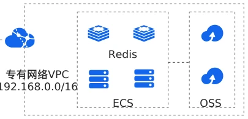
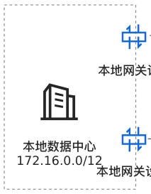
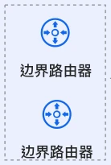
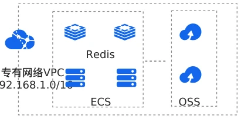
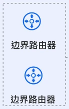
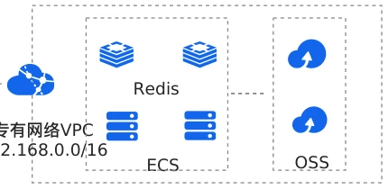
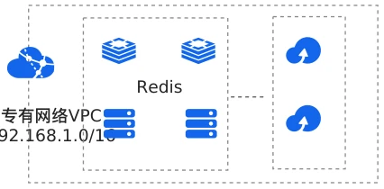

阿里云  
专有云  
高速通道  
产品简介  
产品版本：v3.18.6-SP2607  
文档版本：20260729

**目录**

- [1.高速通道](#section-1)
    - [1.1. 产品详情](#section-1-1)
    - [1.2. 产品价值](#section-1-2)
    - [1.3. 应用场景](#section-1-3)
    - [1.4. 功能特性](#section-1-4)

# 1.高速通道

阿里云高速通道（Express Connect），帮助不同网络环境间实现高速、稳定、安全的私网通信，可以避免网络质量不稳定问题，同时可以免去数据在传输过程中被窃取的风险。

## 1.1. 产品详情

阿里云高速通道（Express Connect）可在本地数据中心IDC（Internet Data Center）和云上专有网络VPC（Virtual Private Cloud）间建立高速、稳定、安全的私网通信，也可以在VPC间搭建私网通信通道，提高网络拓扑的灵活性和跨网络通信的质量和安全性。

高速通道支持位于相同地域或不同地域，同一组织或不同组织的VPC之间进行内网互通。

**物理专线**

高速通道提供了一种快速安全连接阿里云与本地数据中心的方法。用户可以通过租用一条运营商的专线将本地数据中心连接到阿里云接入点，建立专线连接。此连接绕过公网，更加安全可靠、速度更快、延迟更低。用户可以选择使用点对点以太网连接或MPLS VPN连接，仅支持10 Gbps单模光口实现连接。用户可以通过自主申请独享接入建立专线连接。

**边界路由器**

基于软件自定义网络SDN（Software Defined Network）架构下的三层Overlay技术和交换机虚拟化技术，阿里云将客户的物理专线接入的端口隔离起来，并抽象成边界路由器VBR（Virtual border router）。VBR是CPE（Customer-premises equipment）设备和VPC之间的一个路由器，作为数据从VPC到本地数据中心的转发桥梁。边界路由器同VPC中的路由器一样，同样管理一个路由表。在该路由表中配置路由条目，可以对边界路由器中的流量转发进行管理。

**对等连接**

用户可以在两个VPC之间，VPC与VBR之间建立对等连接。

## 1.2. 产品价值

阿里云高速通道具有高速互通、稳定可靠、安全及按需购买等价值。

**高速互通**

依靠阿里云的网络虚拟化技术，可以将不同网络环境连通，两侧直接进行高速内网通信，不再需要绕行公网，网络延迟低、带宽高。

**稳定可靠**

阿里云高速通道产品依托阿里云优质的基础设施实现，保障用户网络间通信稳定可靠。

**安全**

高速通道在网络虚拟化层进行网络间通信，所有通信数据在阿里云自建设施中传输，且多租户互相隔离，让用户的私密数据免去传输过程中被窃取的风险。

## 1.3. 应用场景

高速通道适用于本地IDC与云上专有网络建立可靠、安全和高速的私网通信场景。高速通道提供多种上云服务，用户可以根据业务场景进行选择，轻松构建跨架构的融合网络。

**场景一：面向大中型企业的多地容灾高可用网络架构**

当本地数据中心的关键业务对可用性要求极高时，建议在多个接入点建立专线连接，该拓扑确保了因光纤切断、设备故障或接入点位置故障导致的连接故障的恢复能力。

高速通道

物理专线

192.168.0.0/16

本地网关设备1

接入点A

转发路由器 TR

物理专线

本地网关设备2

192.168.1.0/16

接入点B

**场景二：面向大型企业的高弹性、高可用网络架构**

当业务规模爆发式增长，原数据中心无法满足需求时，可在云上快速部署业务，满足业务增长需求。同时使用高速通道的ECMP链路聚合功能，实现专线带宽弹性扩容，企业可以轻松面对TB级别的带宽流量。该拓扑提供了对设备故障、专线连接故障和接入点位置故障的恢复能力。

高速通道

物理专线

本地网关设备

专有网络VPC

192.168.0.0/16

接入点A

转发路由器 TR

物理专线

192.168.1.0/16

本地网关设备

接入点B

**场景三：面向企业非关键业务的简单网络架构**

对于不需要高弹性和高可用性的非关键业务，例如云上搭建的开发测试环境，建议直接通过高速通道建立本地IDC和云上网络的私网连接。该拓扑结构可保证云上云下通信的安全性、可靠性。

高速通道

专有网络VPC

192.168.0.0/16

物理专线

边界路由器

本地网关设备

转发路由器 TR

边界路由器

接入点

192.168.1.0/16

## 1.4. 功能特性

本文介绍高速通道的功能特性。阿里云高速通道可以帮助在不同网络环境间实现高速、稳定、安全的私网通信。物理专线连接实现云下数据中心专线接入云上专有网络，提高网络拓扑灵活性和跨网通信质量。

**功能特性**

**功能**

**说明**

VBR支持通过BGP和线下IDC进行路由学习。

修改VBR。

创建VBR。

高速通道

物理专线

删除VBR。

查询VBR。

支持VPC通过物理专线与线下IDC机房进行互联。

EC高速通道网元CGW on

支持CGW on dcoker部署。

dcoker部署

虚拟化网关

支持同城容灾

支持同城容灾。

EC高速通道CGWdcoker支持

支持虚拟化网关形态。

多Region

支持同城容灾

CGW支持同城容灾。

支持多Region

CGW支持多Region。

多机房

支持3AZ

物理机。

EC高速通道网元CGW支持环

物理机。

备

专线支持IPv6

专线支持IPv6。

IPv6

专线支持IPv6 ECMP

专线支持IPv6 ECMP。

高速通道支持多集群。

多集群

CGW物理机网元支持多集群

高速通道支持基于租户实现多集群隔离。

<table>
  <tr>
    <td rowspan="6">国产软硬件生态</td>
    <td>EC高速通道支持英特尔</td>
    <td>物理机。</td>
  </tr>
  <tr>
    <td>EC高速通道支持海光</td>
    <td>物理机。</td>
  </tr>
  <tr>
    <td>EC高速通道支持鲲鹏</td>
    <td>物理机。</td>
  </tr>
  <tr>
    <td>EC高速通道支持飞腾</td>
    <td>物理机。</td>
  </tr>
  <tr>
    <td>CGWdocker支持英特尔</td>
    <td>虚拟化网关。</td>
  </tr>
  <tr>
    <td>CGWdocker支持海光</td>
    <td>虚拟化网关。</td>
  </tr>
  <tr>
    <td rowspan="2">网卡</td>
    <td>支持单卡双口CX6网卡</td>
    <td>物理机。</td>
  </tr>
  <tr>
    <td>CGWdocker支持单卡双口CX6网卡</td>
    <td>支持虚拟化网关。</td>
  </tr>
  <tr>
    <td rowspan="3">高性能</td>
    <td rowspan="2">EC高速通道支持100G网络架构接入</td>
    <td>支持物理机网关。</td>
  </tr>
  <tr>
    <td>支持虚拟化网关。</td>
  </tr>
  <tr>
    <td>BFD链路检测</td>
    <td>支持BFD链路检测，提高专线稳定性。</td>
  </tr>
  <tr>
    <td>健康检查检测时间</td>
    <td>健康检查检测时间</td>
    <td>专线健康检查时间可配置。</td>
  </tr>
</table>
