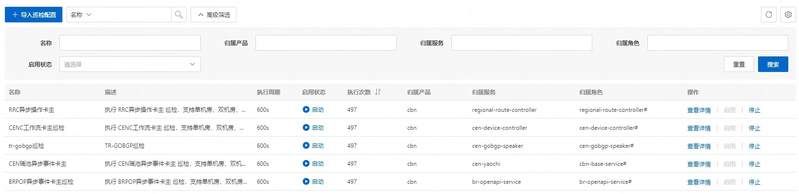
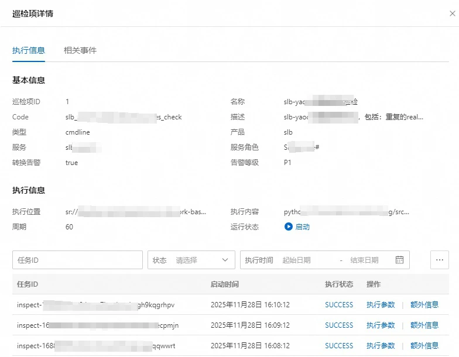
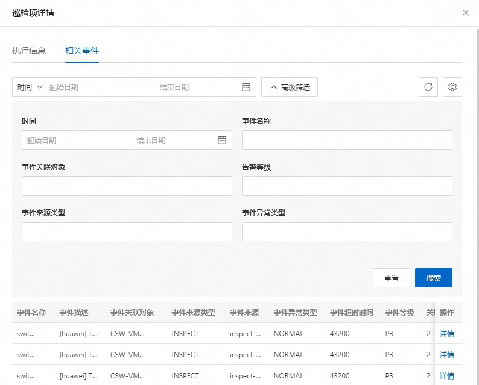
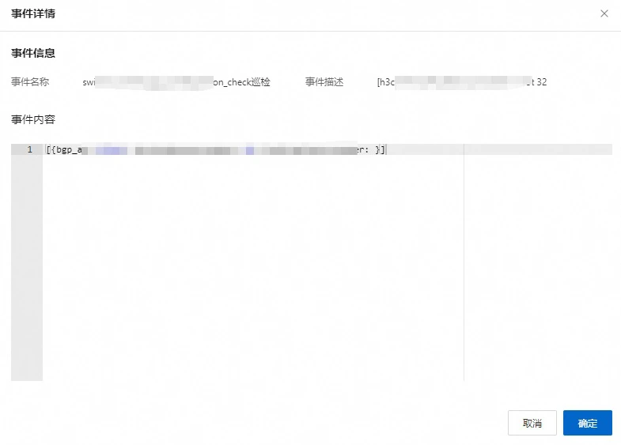

阿里云  
专有云  
VPN网关  
运维指南  
产品版本：v3.18.6-SP2607  
文档版本：20260729

**目录**

- [1.VPN巡检](#section-1)
    - [1.1. 网络巡检](#section-1-1)

# 1.VPN巡检

通过网络巡检功能可以配置、查看VPN监控项，各监控项在告警上报时根据现象及影响按需处理恢复。

**VPN监控项**

VPN产品通过**网络巡检**功能，支持以下操作：

- 支持导入VPN巡检配置。

- 归属产品输入vpn，可以筛选查看已配置的VPN巡检列表。

- 对于配置的VPN巡检配置项，支持启用/停止操作。

- 支持获取巡检项详情，包括执行任务信息以及事件列表。

具体信息，请参考网络巡检。

**巡检处理**

VPN各监控项说明及告警预案处理，请参考巡检指南。

## 1.1. 网络巡检

周期调度网络巡检任务并转化结果为巡检事件或告警。

**操作步骤**

1. 登录Apsara Uni-manager运维控制台。

2. 在顶部菜单栏，选择**产品运维** > **网络运维** > **网络运维控制台**。

3. 在左侧导航栏，选择**智能诊断** > **网络巡检**。

4. 在**网络巡检**页面，查看巡检配置列表。

   - 巡检配置信息包括**名称**、**描述**、**执行周期**、**启用状态**、**执行次数**、**归属产品**、**归属服务**、**归属角色**等。

   - 单击**高级筛选**，支持根据**名称**、**归属产品**、**归属服务**、**归属角色**、**启用状态**组合筛选获取目标巡检配置。

   

   > **说明**
   >
   > 单击**执行次数**列
   >
   > ，支持按照升序或降序对列表进行排序。
   >
   > 

5. 在巡检配置列表，单击目标巡检配置**操作**列的**查看详情**，在弹出的面板中，获取巡检项详情。

   - 在**执行信息**页签下，获取**基本信息**、**执行信息**以及执行任务列表。

     

     - **基本信息**：包括**巡检项ID**、**名称**、**Code**、**描述**、**类型**、**产品**、**服务**、**服务角色**、**转换告警**、**告警等级**。

     - **执行信息**：包括**执行位置**、**执行内容**、**周期**、**运行状态**。

     - 查看执行任务列表：任务信息包括**任务ID**、**启动时间**、**执行状态**等。

       - 支持根据**任务ID**、**状态**、**执行时间**组合筛选获取目标执行任务。

       - 鼠标悬浮于目标执行任务**执行状态**列的状态，将获取执行结果信息。

         > **说明**
         >
         > 执行状态的含义：
         >
         > - **WAITING**：巡检任务等待触发
         >
         > - **RUNNING**：巡检任务运行中
         >
         > - **SUCCESS**：巡检任务执行成功
         >
         > - **FAILED**：巡检任务执行失败
         >
         > - **TIMEOUT**：巡检任务结果等待超时
         >
         > - **CLEANED**：上一次平台运行残留任务将在平台初始化时被清理

       - 鼠标悬浮于目标执行任务**操作**列的**执行参数**，将获取执行参数信息。

       - 鼠标悬浮于目标执行任务**操作**列的**额外信息**，将获取执行额外信息。

   - 在**相关事件**页签下，获取事件列表。

     

     - 事件信息包括**事件名称**、**事件描述**、**事件关联对象**、**事件来源类型**、**事件来源**、**事件异常类型**、**事件超时时间**、**事件等级**、**关联告警ID**、**发生时间**等。

     - 单击**高级筛选**，支持根据**时间**、**事件名称**、**事件关联对象**、**告警等级**、**事件来源类型**、**事件异常类型**组合筛选获取目标事件。

     - 单击目标事件对应**操作**列的**详情**，在弹出的对话框中，获取事件详情。

       主要包括**事件信息**、**事件内容**；根据事件类型不同，事件详情内容有所不同，具体以界面展示为准。

       

**更多操作**

<table>
  <tr>
    <th width="122">操作</th>
    <th>操作说明</th>
  </tr>
  <tr>
    <td>导入巡检配置</td>
    <td>1. 在<strong>网络巡检</strong>页面，单击<strong>导入巡检配置</strong>。 2. 选择需要导入的巡检配置文件，单击<strong>打开</strong>。</td>
  </tr>
  <tr>
    <td>启用巡检配置</td>
    <td>说明网络巡检配置的<strong>启用状态</strong>为<strong>停止</strong>时支持启用。 1. 在巡检配置列表，单击目标巡检配置<strong>操作</strong>列的<strong>启用</strong>。 2. 在弹出的对话框中，单击<strong>确定</strong>。</td>
  </tr>
  <tr>
    <td>停止巡检配置</td>
    <td>说明网络巡检配置的<strong>启用状态</strong>为<strong>启动</strong>时支持停止。 1. 在巡检配置列表，单击目标巡检配置<strong>操作</strong>列的<strong>停止</strong>。 2. 在弹出的对话框中，单击<strong>确定</strong>。</td>
  </tr>
</table>
