阿里云  
专有云  
Alibaba Cloud Linux  
用户指南  
产品版本：v3.18.6-SP2607  
文档版本：20260729

**目录**

- [1.系统管理和部署](#section-1)
    - [1.1. 系统配置](#section-1-1)
        - [1.1.1. 配置时间和日期](#section-1-1-1)
        - [1.1.2. 配置键盘布局](#section-1-1-2)
        - [1.1.3. 配置语言](#section-1-1-3)
    - [1.2. 用户管理](#section-1-2)
        - [1.2.1. 普通用户](#section-1-2-1)
        - [1.2.2. 管理用户组](#section-1-2-2)
        - [1.2.3. 组内用户操作](#section-1-2-3)
    - [1.3. 系统服务](#section-1-3)
        - [1.3.1. 查看系统服务](#section-1-3-1)
        - [1.3.2. 启用和禁用](#section-1-3-2)
        - [1.3.3. 启动、关闭和重启](#section-1-3-3)
    - [1.4. 内存管理](#section-1-4)
        - [1.4.1. 内存管理概述](#section-1-4-1)
        - [1.4.2. sysfs内存接口](#section-1-4-2)
        - [1.4.3. proc内存接口](#section-1-4-3)
        - [1.4.4. cmdline 常见内存参数](#section-1-4-4)
        - [1.4.5. 内存自研特性](#section-1-4-5)
            - [1.4.5.1. 冷内存回收](#section-1-4-5-1)
            - [1.4.5.2. memcg OOM优先级策略](#section-1-4-5-2)
            - [1.4.5.3. 代码大页（hugetext）](#section-1-4-5-3)
            - [1.4.5.4. 代码多备份（duptext）](#section-1-4-5-4)
            - [1.4.5.5. 代码段锁定](#section-1-4-5-5)
            - [1.4.5.6. 稀疏文件零页填充特性](#section-1-4-5-6)
            - [1.4.5.7. 匿名页回收优先级特性](#section-1-4-5-7)
            - [1.4.5.8. 为page cache设置预留内存空间](#section-1-4-5-8)
    - [1.5. 网络管理](#section-1-5)
        - [1.5.1. 网络管理工具](#section-1-5-1)
        - [1.5.2. 配置静态 IP](#section-1-5-2)
        - [1.5.3. 配置静态路由](#section-1-5-3)
        - [1.5.4. 配置网络桥接](#section-1-5-4)
        - [1.5.5. 配置主机名](#section-1-5-5)
        - [1.5.6. 网络自研特性](#section-1-5-6)
            - [1.5.6.1. 修改TCP TIME_WAIT 超时时间](#section-1-5-6-1)
            - [1.5.6.2. TCP-RT功能的配置说明](#section-1-5-6-2)
            - [1.5.6.3. 共享内存通信（SMC）](#section-1-5-6-3)
                - [1.5.6.3.1. 共享内存通信（SMC）使用说明](#section-1-5-6-3-1)
                - [1.5.6.3.2. 共享内存通信（SMC）监控和诊断](#section-1-5-6-3-2)
                - [1.5.6.3.3. 共享内存通信（SMC）常见问题](#section-1-5-6-3-3)
    - [1.6. 存储管理](#section-1-6)
        - [1.6.1. 基础命令](#section-1-6-1)
        - [1.6.2. 分区管理](#section-1-6-2)
            - [1.6.2.1. 查看磁盘分区](#section-1-6-2-1)
            - [1.6.2.2. 创建磁盘分区](#section-1-6-2-2)
            - [1.6.2.3. 删除磁盘分区](#section-1-6-2-3)
            - [1.6.2.4. 修改分区大小](#section-1-6-2-4)
        - [1.6.3. 文件系统管理](#section-1-6-3)
            - [1.6.3.1. 创建文件系统](#section-1-6-3-1)
            - [1.6.3.2. 挂载文件系统](#section-1-6-3-2)
            - [1.6.3.3. 卸载文件系统](#section-1-6-3-3)
            - [1.6.3.4. 修改系统大小](#section-1-6-3-4)
            - [1.6.3.5. 文件系统管理工具对比](#section-1-6-3-5)
        - [1.6.4. 逻辑卷管理](#section-1-6-4)
            - [1.6.4.1. LVM管理物理卷](#section-1-6-4-1)
            - [1.6.4.2. LVM管理卷组](#section-1-6-4-2)
            - [1.6.4.3. LVM管理逻辑卷](#section-1-6-4-3)
            - [1.6.4.4. LVM创建并管理文件系统](#section-1-6-4-4)
        - [1.6.5. 存储自研特性](#section-1-6-5)
            - [1.6.5.1. blk-iocost权重控制](#section-1-6-5-1)
            - [1.6.5.2. cgroup v1 writeback限流](#section-1-6-5-2)
            - [1.6.5.3. IO hang检测](#section-1-6-5-3)
            - [1.6.5.4. virtiofs perfile DAX](#section-1-6-5-4)
    - [1.7. 任务管理](#section-1-7)
        - [1.7.1. 任务管理工具](#section-1-7-1)
            - [1.7.1.1. top 工具](#section-1-7-1-1)
            - [1.7.1.2. ps 工具](#section-1-7-1-2)
            - [1.7.1.3. kill 工具](#section-1-7-1-3)
            - [1.7.1.4. chrt 工具](#section-1-7-1-4)
        - [1.7.2. sysfs相关接口](#section-1-7-2)
        - [1.7.3. procfs 相关接口](#section-1-7-3)
        - [1.7.4. debugfs 相关接口](#section-1-7-4)
        - [1.7.5. 调度自研特性](#section-1-7-5)
            - [1.7.5.1. Group Identity](#section-1-7-5-1)
            - [1.7.5.2. Group Balancer](#section-1-7-5-2)
            - [1.7.5.3. CPU Burst](#section-1-7-5-3)
            - [1.7.5.4. CPU 动态隔离](#section-1-7-5-4)
            - [1.7.5.5. plugsched 特性](#section-1-7-5-5)
    - [1.8. 安全更新](#section-1-8)
        - [1.8.1. 安全更新识别](#section-1-8-1)
            - [1.8.1.1. 显示可安装的安全更新](#section-1-8-1-1)
            - [1.8.1.2. 显示已安装的安全更新](#section-1-8-1-2)
            - [1.8.1.3. 显示具体安全公告](#section-1-8-1-3)
        - [1.8.2. 安全更新安装](#section-1-8-2)
            - [1.8.2.1. 安装所有可用的安全更新](#section-1-8-2-1)
            - [1.8.2.2. 根据公告安装特定的安全更新](#section-1-8-2-2)
    - [1.9. 软件包管理](#section-1-9)
        - [1.9.1. DNF 配置](#section-1-9-1)
            - [1.9.1.1. 配置 main 部分](#section-1-9-1-1)
            - [1.9.1.2. 配置 repository 部分](#section-1-9-1-2)
            - [1.9.1.3. 显示当前配置](#section-1-9-1-3)
            - [1.9.1.4. 创建本地软件源仓库](#section-1-9-1-4)
            - [1.9.1.5. 添加、启用和禁用软件源](#section-1-9-1-5)
        - [1.9.2. 管理软件包](#section-1-9-2)
            - [1.9.2.1. 搜索软件包](#section-1-9-2-1)
            - [1.9.2.2. 列出软件包清单](#section-1-9-2-2)
            - [1.9.2.3. 显示 RPM 包信息](#section-1-9-2-3)
            - [1.9.2.4. 安装 RPM 包](#section-1-9-2-4)
            - [1.9.2.5. 下载软件包](#section-1-9-2-5)
            - [1.9.2.6. 删除软件包](#section-1-9-2-6)
        - [1.9.3. 管理软件包组](#section-1-9-3)
            - [1.9.3.1. 列出软件包组清单](#section-1-9-3-1)
            - [1.9.3.2. 显示软件包组信息](#section-1-9-3-2)
            - [1.9.3.3. 安装软件包组](#section-1-9-3-3)
            - [1.9.3.4. 删除软件包组](#section-1-9-3-4)
        - [1.9.4. 检查并更新](#section-1-9-4)
    - [1.10. 日志管理](#section-1-10)
        - [1.10.1. 日志文件](#section-1-10-1)
        - [1.10.2. 日志分析](#section-1-10-2)
            - [1.10.2.1. 基础日志分析](#section-1-10-2-1)
            - [1.10.2.2. 高级日志分析](#section-1-10-2-2)
        - [1.10.3. 远程日志功能](#section-1-10-3)
            - [1.10.3.1. 配置远程日志服务端配置](#section-1-10-3-1)
            - [1.10.3.2. 配置远程日志发送端配置](#section-1-10-3-2)
            - [1.10.3.3. 测试远程日志](#section-1-10-3-3)
    - [1.11. 桌面环境](#section-1-11)
        - [1.11.1. 基本操作](#section-1-11-1)
            - [1.11.1.1. 登录](#section-1-11-1-1)
            - [1.11.1.2. 用户界面](#section-1-11-1-2)
            - [1.11.1.3. 锁屏](#section-1-11-1-3)
            - [1.11.1.4. 注销（登出）](#section-1-11-1-4)
            - [1.11.1.5. 关机与重启](#section-1-11-1-5)
        - [1.11.2. 系统管理](#section-1-11-2)
            - [1.11.2.1. 设置中心](#section-1-11-2-1)
            - [1.11.2.2. 系统监视器](#section-1-11-2-2)
            - [1.11.2.3. 磁盘管理器](#section-1-11-2-3)
            - [1.11.2.4. 文件管理器](#section-1-11-2-4)
            - [1.11.2.5. 日志收集工具](#section-1-11-2-5)
    - [1.12. 中文支持](#section-1-12)
        - [1.12.1. 系统语言设置](#section-1-12-1)
        - [1.12.2. 添加输入法](#section-1-12-2)
        - [1.12.3. GB18030 支持](#section-1-12-3)
    - [1.13. 虚拟化](#section-1-13)
        - [1.13.1. 配置虚拟化环境](#section-1-13-1)
            - [1.13.1.1. 硬件查看](#section-1-13-1-1)
            - [1.13.1.2. 组件安装](#section-1-13-1-2)
            - [1.13.1.3. 环境验证](#section-1-13-1-3)
        - [1.13.2. 管理虚拟机](#section-1-13-2)
            - [1.13.2.1. 虚拟机创建](#section-1-13-2-1)
            - [1.13.2.2. 虚拟机信息查看](#section-1-13-2-2)
            - [1.13.2.3. 虚拟机配置更新](#section-1-13-2-3)
            - [1.13.2.4. 网络连接](#section-1-13-2-4)
        - [1.13.3. 管理虚拟资源](#section-1-13-3)
            - [1.13.3.1. 虚拟 CPU 管理](#section-1-13-3-1)
            - [1.13.3.2. 虚拟内存管理](#section-1-13-3-2)
    - [1.14. 编译器和编程语言](#section-1-14)
        - [1.14.1. C++ 编译器 ACC](#section-1-14-1)
        - [1.14.2. C++ 基础库 yaLanTingLibs](#section-1-14-2)
        - [1.14.3. Dragonwell](#section-1-14-3)
- [2.安全增强](#section-2)
    - [2.1. 安全加固](#section-2-1)
        - [2.1.1. 修复工具](#section-2-1-1)
        - [2.1.2. 扫描工具](#section-2-1-2)
    - [2.2. 数据安全](#section-2-2)
        - [2.2.1. 磁盘加密](#section-2-2-1)
        - [2.2.2. 文件加密](#section-2-2-2)
        - [2.2.3. 铜锁支持商用密码加密](#section-2-2-3)

<a id="section-1"></a>

# 1.系统管理和部署

<a id="section-1-1"></a>

## 1.1. 系统配置

阿里云服务器操作系统 V3的基本配置包括时间、键盘和语言设置等。时间设置允许用户根据所在地区和需求调整系统时钟，确保准确的时间同步和事件记录。键盘配置使用户能够选择适合的键盘布局和映射，提高输入效率和舒适性。语言设置允许用户选择系统的默认语言和区域设置，以便在界面、应用程序和文档中获得最佳的语言支持和用户体验。这些基本配置不仅使系统个性化和易用性增强，还确保了用户在操作系统中的顺畅沟通和更好的工作效率。

<a id="section-1-1-1"></a>

### 1.1.1. 配置时间和日期

本节的主要内容是指导用户如何设置系统的日期、时间和时区。

**显示时间和日期**

1. 执行以下命令显示时间和日期。

   - 方式一：

     ```text
     date
     ```

     返回如下示例：

     ```text
     2023 年 09 ⽉ 02 ⽇ 星期六 10:15:40 CST
     ```

   - 方式二：

     ```text
     timedatectl
     ```

     返回如下示例：

     ```text
     Local time: 六 2023-09-02 10:10:07 CST
     Universal time: 六 2023-09-02 02:10:07 UTC
     RTC time: 六 2023-09-02 02:10:08
     Time zone:
     Asia/Beijing (CST, +0800)
     System clock
     synchronized: no
     NTP service:
     active
     RTC in local TZ:
     no
     ```

2. 执行以下命令，查看硬件时钟。

   ```text
   hwclock
   ```

   返回如下示例：

   ```text
   2023-09-02 10:16:40.139759+08:00
   ```

**修改时间和日期**

**修改时间**

- 通过  `timedatectl` 命令设置系统时间，timedatectl 设置时间前需要先关闭 NTP。

  ```text
  timedatectl set-ntp no
  timedatectl set-time YYYY-MM-DD
  timedatectl set-time HH:MM:SS
  ```

- 通过  `date`  命令设置系统时间。

  ```text
  date --set YYYY-MM-DD
  date --set HH:MM:SS
  ```

- 通过  `hwclock`  命令设置硬件时间，再将硬件时间设置为系统时间。

  ```text
  hwclock --set --date "YYYY-MM-DD HH:MM:SS"
  hwclock --hctosys
  ```

**修改时区**

通过 `timedatectl` 设置时区先打印时区列表，再设置为目标时区。

```text
timedatectl list-timezones
```

返回如下示例：

```text
Africa/Abidjan
Africa/Accra
Africa/Addis_Ababa
Africa/Algiers
Africa/Asmara
...
Asia/Beijing
...
timedatectl set-timezone Asia/Beijing
```

<a id="section-1-1-2"></a>

### 1.1.2. 配置键盘布局

**操作步骤**

1. 查看可用布局。

   执行以下命令，查看系统支持的键盘布局。

   ```text
   localectl list-keymaps
   ```

   返回如下示例：

   ```text
   al
   al-plisi
   at
   at-mac
   at-nodeadkeys
   az
   ...
   ```

2. 执行以下命令，查看当前的键盘布局。

   ```text
   localectl status
   ```

   返回如下示例：

   ```text
   System Locale: LANG=zh_CN.UTF-8
       VC Keymap: us
      X11 Layout: us
   ```

3. 执行以下命令更改键盘布局，通过 `localectl status` 命令查看新状态。

   ```text
   localectl set-keymap cn
   localectl status
   ```

   返回如下示例：

   ```text
   System Locale: LANG=zh_CN.UTF-8
   VC Keymap: cn
   X11 Layout: us
   ```

<a id="section-1-1-3"></a>

### 1.1.3. 配置语言

**操作步骤**

1. 执行以下命令，查看系统语言列表。

   ```text
   localectl list-locales
   ```

   返回如下示例：

   ```text
   C.UTF-8
   aa_DJ.UTF-8
   aa_ER.UTF-8
   aa_ER.UTF-8@saaho
   aa_ET.UTF-8
   af_ZA.UTF-8
   agr_PE.UTF-8
   ak_GH.UTF-8
   ...
   ```

2. 执行以下命令，查看当前语言。

   ```text
   localectl status
   ```

   返回如下示例：

   ```text
   System Locale: LANG=zh_CN.UTF-8
   VC Keymap: en
   X11 Layout: us
   ```

3. 执行以下命令，设置系统语言，其中C.utf8可根据实际情况进行替换，设置完成后可通过 `localectl status` 命令查看。

   ```text
   localectl set-locale C.utf8
   localectl status
   ```

   返回如下示例：

   ```text
   System Locale: LANG=C.utf8
   VC Keymap: en
   X11 Layout: us
   ```

<a id="section-1-2"></a>

## 1.2. 用户管理

<a id="section-1-2-1"></a>

### 1.2.1. 普通用户

**操作步骤**

1. 增加用户。

   <ol type="i">

   <li>

   执行以下命令添加用户。

   ```text
   useradd <newuser>
   ```

   > **说明**
   >
   > - &lt;newuser>替换为实际的用户名。
   >
   > - 添加用户操作需要 root 权限。

   </li>

   <li>

   执行以下命令查看添加的用户信息。

   ```text
   id <newuser>
   ```

   返回如下示例：

   ```text
   uid=1000(newname) gid=1000(newuser) 组=1000(newuser)
   ```

   </li>

   </ol>

2. 用户信息修改。

   - 执行 `passwd` 命令修改本用户密码，如下示例。

     ```text
     passwd
     更改⽤户 root 的密码 。
     新的密码： 
     重新输入新的密码： 
     passwd：所有的⾝份验证令牌已经成功更新。
     ```

   - 执行passwd &lt;newuser>命令，使用管理员修改其他用户密码，如下示例。

     ```text
     passwd newuser
     更改⽤户 newuser 的密码 。
     新的密码： 
     重新输入新的密码： 
     passwd：所有的⾝份验证令牌已经成功更新。
     ```

     设置的密码如果过弱，会被拒绝。如下示例：

     ```text
     无效的密码： 密码未通过字典检查 - 太简单或太有规律
     无效的密码： 密码是⼀个回⽂
     ```

   - 通过 `usermode [options] <username>` 命令修改用户的其他信息，参数说明如下：

     | 参数 | 说明 |
     | --- | --- |
     | -c &lt;description&gt; | 修改用户说明。 |
     | -d &lt;path&gt; | 修改用户主目录，必须提供绝对路径。 |
     | -e&lt;date&gt; | 修改用户的失效日期，格式："YYYY-MM-DD"。 |
     | -g&lt;group&gt; | 修改用户组。 |
     | -u &lt;uid&gt; | 修改用户 UID。 |
     | -G&lt;group&gt; | 修改用户的附加组，其实就是把用户加入其他用户组，即修改/etc/group 文件。 |
     | -l &lt;name&gt; | 修改用户名。 |
     | -L | 临时锁定用户（Lock），使密码无效。 |
     | -U | 解除用户锁定（Unlock），和 -L 对应。 |
     | -s&lt;shell&gt; | 修改用户登录后使用的默认Shell，默认是/bin/bash。 |

     举例：

     执行以下命令，修改新建用户的用户名并查看修改后的用户信息。

     ```text
     usermod -l newname <newuser>
     id newname
     ```

3. 用户切换。

   用户之间的切换通过 su (switch user) 命令实现，如下示例：

   ```text
   [root@A ~]# id
   uid=0(root) gid=0(root) 组=0(root)
   [root@A ~]# su newname
   [newname@A root]# id
   uid=1000(newname) gid=1000(newuser) 组=1000(newuser)
   [newname@A root]# exit
   exit
   [root@A ~]#
   ```

4. 管理员权限。

   执行以下命令为普通用户追加管理员权限并查看。

   ```text
   usermod -G wheel newname
   id newname
   ```

   返回如下示例：

   ```text
   uid=1000(newname) gid=1000(newuser) 组=1000(newuser),10(wheel)
   ```

5. 执行以下命令删除用户。

   ```text
   userdel <newname>
   ```

<a id="section-1-2-2"></a>

### 1.2.2. 管理用户组

**操作步骤**

1. 增加用户组。

   <ol type="i">

   <li>

   执行以下命令增加用户组。

   ```text
   groupadd <newgroup>
   ```

   </li>

   <li>

   执行以下命令，查看新增的用户组。

   ```bash
   cat /etc/group | grep <newgroup>
   ```

   </li>

   </ol>

2. 修改用户组。

   使用  `groupmod [option] <groupname>` 命令修改用户组信息。

   参数说明如下：

   - -g &lt;GID> 修改用户组ID。

   - -n &lt;newname> 修改用户组名称。

   - -o 通常与-g 选项同时使用，允许修改为已存在的组 ID，组 ID 允许重复。

3. 删除用户组。

   执行以下命令，删除用户组。

   ```text
   groupdel newgroup
   ```

<a id="section-1-2-3"></a>

### 1.2.3. 组内用户操作

**操作步骤**

1. 以下命令任选其一，将用户添加到补充组。

   ```text
   #⽅式⼀
   usermod -a -G ⽤户组名 ⽤户名
   #⽅式⼆
   gpasswd -a ⽤户名 ⽤户组名
   ```

2. 执行以下命令，将用户从补充组内删除。

   ```text
   gpasswd -d ⽤户名 ⽤户组名
   ```

3. 切换用户组。

   <ol type="i">

   <li>

   执行以下命令，查看用户当前所在的用户组。

   ```text
   groups ⽤户名
   ```

   </li>

   <li>

   更改 newuser 的用户组到 newgroup。

   ```text
   usermod -g ⽤户组名 ⽤户名
   ```

   </li>

   </ol>

<a id="section-1-3"></a>

## 1.3. 系统服务

<a id="section-1-3-1"></a>

### 1.3.1. 查看系统服务

**操作步骤**

**查看系统服务列表**

1. 执行以下命令，查看系统中活跃的服务。

   ```bash
   systemctl list-units --type service
   ```

   返回如下示例：

   ```text
   UNIT                               LOAD   ACTIVE SUB     DESCRIPTION
   aegis.service                      loaded active running Aegis Service
   aliyun.service                     loaded active running Aliyun Assist
   AssistDaemon.service               loaded active running AssistDaemon
   atd.service                        loaded active running Job spooling tools
   chronyd.service                    loaded active running NTP client/server
   cloud-config.service               loaded active exited  Apply the settings specified 
   in cloud-config
   cloud-final.service                loaded active exited  Execute cloud user/final scri
   pts
   cloud-init-local.service           loaded active exited  Initial cloud-init job (pre-networking)
   cloud-init.service                 loaded active exited  Initial cloud-init job 
   (metadata service cr>
   cloudmonitor.service               loaded active running cloudmonior-agent
   ...
   ```

   `list-units`  查看系统中的活跃单元，使用  `--type service`  过滤服务类的单元。

   <table>
     <tr>
       <th width="135">栏目</th>
       <th>含义</th>
     </tr>
     <tr>
       <td>UNIT</td>
       <td>系统单元的名称。</td>
     </tr>
     <tr>
       <td>LOAD</td>
       <td>系统单元的载入状态，取值范围：stub, loaded, not-found, bad-setting, error, merged, masked。</td>
     </tr>
     <tr>
       <td>ACTIVE</td>
       <td>活跃状态，取值范围为：active, reloading, inactive, failed, activating, deactivating。</td>
     </tr>
     <tr>
       <td>SUB</td>
       <td>具体的活跃状态，根据系统单元的类型不同而不同，系统服务类的具体活跃状态取值范围为：dead, condition, start-pre, start, start-post, running, exited, reload, stop, stop-sigabrt, stop-sigterm, stop-sigkill, stop-post, final-sigterm, final-sigkill, failed, auto-restart。</td>
     </tr>
     <tr>
       <td>DESCRIPTION</td>
       <td>描述。</td>
     </tr>
   </table>

2. 执行以下命令，查看系统上已安装的所有服务。

   ```bash
   systemctl list-unit-files --type service
   ```

   返回示例如下：

   ```text
   UNIT FILE                                  STATE           PRESET  
   accounts-daemon.service                    enabled         enabled 
   alinux-setup.service                       enabled         disabled
   alsa-restore.service                       static          -       
   alsa-state.service                         static          -       
   anaconda-direct.service                    static          -       
   anaconda-fips.service                      static          -       
   anaconda-nm-config.service                 static          -       
   anaconda-nm-disable-autocons.service       static          -       
   anaconda-noshell.service                   static          -       
   ...
   ```

   STATE表示模块的启用或禁用状态。

   - enabled：启用

   - disabled：禁用

   - static：被依赖的 unit，您不能主动启用它

**查询状态**

1. 查询详细状态。

   `systemctl list-unit-files --type service` 可以罗列系统上已安装的所有服务和服务状态，若要查看详细状态，可输入以下命令：

   ```bash
   systemctl status xxx.service
   ```

   其中xxx替换为服务名称，如下示例：

   ```bash
   # systemctl status accounts-daemon.service
   ● accounts-daemon.service - Accounts Service
        Loaded: loaded (/usr/lib/systemd/system/accounts-daemon.service; enabled; preset: enabled)
        Active: active (running) since Fri 2023-09-01 16:22:27 CST; 32 years 3 months left
      Main PID: 2215 (accounts-daemon)
         Tasks: 4 (limit: 19660)
        Memory: 1016.0K
        CGroup: /system.slice/accounts-daemon.service
                └─2215 /usr/libexec/accounts-daemon

   9 ⽉ 01 16:22:27 localhost systemd[1]: Starting accounts-daemon.service - Accounts Service...
   9 ⽉ 01 16:22:27 localhost accounts-daemon[2215]: started daemon version 23.13.0
   9 ⽉ 01 16:22:27 localhost systemd[1]: Started accounts-daemon.service - Accounts Service.
   ```

2. 查询运行状态。

   ```bash
   systemctl is-active xxx.service
   ```

3. 查询启用状态。

   ```bash
   systemctl is-enabled xxx.service
   ```

<a id="section-1-3-2"></a>

### 1.3.2. 启用和禁用

**操作步骤**

> **说明**
>
> 本文中xxx替换为实际的服务名称。

**启用服务**

执行以下命令启用服务，启用一个服务意味着该服务将在下次开机时自启动。

```bash
systemctl enable xxx.service
```

**禁用服务**

执行以下命令禁用服务，禁用则表示禁止该服务在开机阶段自启动。

```bash
systemctl disable xxx.service
```

<a id="section-1-3-3"></a>

### 1.3.3. 启动、关闭和重启

**操作步骤**

> **说明**
>
> 本文中xxx替换为实际的服务名称。

1. 执行以下命令启动服务，并将状态从 inactive 置为 active 状态。

   ```bash
   systemctl start xxx.service
   ```

2. 执行以下命令关闭服务。

   ```bash
   systemctl stop xxx.service
   ```

3. 执行以下命令重启服务。

   ```bash
   systemctl restart xxx.service
   ```

<a id="section-1-4"></a>

## 1.4. 内存管理

本节主要说明阿里云服务器操作系统V3 中基本的内存使用、内存信息查看以及阿里云服务器操作系统 V3自研内存特性使用说明。

<a id="section-1-4-1"></a>

### 1.4.1. 内存管理概述

**内存管理概述**

**内存大小查看**

使用free可以查看本机当前内存配置、使用信息以及 swap 和 pagecache 等相关数据。

如下示例：本机总内存配置是 124G，其中空闲内存为 119G，已使用 477MB 内存。此外，本机配置了1GB Swap 分区。

```text
free -lh
```

返回如下示例：

```text
             total        used        free      shared  buff/cache   available
Mem:          124Gi       477Mi       119Gi    0.0Ki       4.6Gi    123Gi
Low:          124Gi       5.1Gi        119Gi
High:            0B          0B          0B
Swap:         1.0Gi       0.0Ki       1.0Gi
```

free 命令的数据主要解析自 /proc/meminfo 获取，/proc/meminfo可查看的数据如下：

```bash
cat /proc/meminfo
```

返回如下示例：

```text
MemTotal:       130707300 kB
MemFree:        125368952 kB
MemAvailable:   129349968 kB
Buffers:          207240 kB
Cached:          4363348 kB
SwapCached:            0 kB
Active:           735120 kB
Inactive:        3946620 kB
Active(anon):        204 kB
Inactive(anon):   106732 kB
Active(file):     734916 kB
Inactive(file):  3839888 kB
Unevictable:           0 kB
Mlocked:               0 kB
SwapTotal:       1048572 kB
SwapFree:        1048212 kB
Dirty:                56 kB
Writeback:             0 kB
AnonPages:        111160 kB
Mapped:           154836 kB
Shmem:               312 kB
KReclaimable:     280100 kB
Slab:             366032 kB
SReclaimable:     280100 kB
SUnreclaim:        85932 kB
KernelStack:        7536 kB
PageTables:         5384 kB
NFS_Unstable:          0 kB
Bounce:                0 kB
WritebackTmp:          0 kB
CommitLimit:    66402220 kB
Committed_AS:    8740288 kB
VmallocTotal:   135290159040 kB
VmallocUsed:      128676 kB
VmallocChunk:          0 kB
Percpu:            97536 kB
HardwareCorrupted:     0 kB
AnonHugePages:         0 kB
ShmemHugePages:        0 kB
ShmemPmdMapped:        0 kB
FileHugePages:     32768 kB
FilePmdMapped:      2048 kB
CmaTotal:          65536 kB
CmaFree:           53248 kB
DupText:               0 kB
MemZeroed:             0 kB
HugePages_Total:       0
HugePages_Free:        0
HugePages_Rsvd:        0
HugePages_Surp:        0
Hugepagesize:       2048 kB
Hugetlb:               0 kB
DirectMap4k:      108416 kB
DirectMap2M:     4085760 kB
DirectMap1G:    14680064 kB
```

meminfo 中重要字段解释如下：

| 序号 | 字段 | 说明 |
| --- | --- | --- |
| 1 | MemTotal | 本机最大可用的内存大小是物理内存减去预留位和内核使用。除去内核本身占用内存部分，最后剩下可供内核支配的内存就是 MemTotal。这个值在系统运行期间一般是固定不变的，重启会改变。 |
| 2 | MemFree | 表示系统尚未使用的内存。 |
| 3 | MemAvailable | 真正的系统可用内存，系统中有些内存虽然已被使用但是可以回收的，比如cache/buffer、slab 等可回收部分。该部分内存加上 MemFree 即为MemAvailable。 |
| 4 | Buffers | 用来给块设备做缓存的内存。 |
| 5 | Cached | 分配给文件缓冲区的内存，一般称其 Page Cache。该部分内存太大可以强制回收。 |
| 6 | SwapCached | 被高速缓冲存储用的交换空间（硬盘的swap）的大小。 |
| 7 | Active | 经常使用的高速缓冲存储器页面文件大小。 |
| 8 | Inactive | 不经常使用的高速缓冲存储器文件大小。 |
| 9 | Active(anon) | 活跃的匿名内存。 |
| 10 | Inactive(anon) | 不活跃的文件使用内存。 |
| 11 | Unevictable | 不能被释放的内存页。 |
| 12 | Mlocked | 系统调用 mlock 允许程序在物理内存上锁住它的部分或全部地址空间。这将阻止 Linux 将这个内存页调度到交换空间（swap space），即使该程序已经一段时间没有访问这段空间。 |
| 13 | SwapTotal | 交换空间总内存。 |
| 14 | SwapFree | 交换空间空闲内存。 |
| 15 | Dirty | 内存中被修改且需要写回磁盘的内存。 |
| 16 | Writeback | 属于 Dirty 内存，且正在被写回到磁盘。 |
| 17 | AnonPages | 未映射页的内存/映射到用户空间的非文件页表大小。 |
| 18 | Mapped | 映射文件内存。 |
| 19 | Shmem | 已经被分配的共享内存。 |
| 20 | Slab | 内核数据结构缓存。 |
| 21 | SReclaimable | 可收回 slab 内存。 |
| 22 | SUnreclaim | 不可收回 slab 内存。 |
| 23 | KernelStack | 内核消耗的内存。 |
| 24 | PageTables | 整合系统应用其页表所占用的内存开销。 |
| 25 | NFS_Unstable | 不稳定页表的大小。 |
| 26 | Bounce | 在低端内存中分配一个临时 buffer 作为跳转，把位于高端内存的缓存数据复制到此处消耗的内存。 |
| 27 | WritebackTmp | FUSE用于临时写回缓冲区的内存。 |
| 28 | CommitLimit | 系统实际可分配内存。 |
| 29 | Committed_AS | 系统当前已分配的内存。 |
| 30 | VmallocTotal | 预留的虚拟内存总量。 |
| 31 | VmallocUsed | 已经被使用的虚拟内存。 |
| 32 | VmallocChunk | 可分配的最大的逻辑连续的虚拟内存。 |
| 33 | Percpu | 每个 CPU 对象专用的内存量。为了实现可扩展性和内存访问速度优化，许多内核特定对象被分解为每个系统 CPU 的一个对象副本（即每个CPU）。这些对象可以在系统启动时静态分配，也可以在系统运行时动态分配；例如，cgroups经常创建动态的每个CPU 对象分配。 |
| 34 | AnonHugePages | 系统所使用的总的透明大页量。 |
| 35 | ShmemHugePages | 系统中 Shmem 大页的使用量。 |
| 36 | ShmemPmdMappe d | 系统中仍然是 PMD 映射的内存，与 ShmemHugePages 字段存在差异，例如一个 Shmem 大页，在进程 A 中是 PMD 映射，在进程 B 中为 PTE 映射，所以 ShmemHugePages 一般大于 ShmemPmdMapped 值。 |
| 37 | FileHugePages | 系统中文件大页使用量。 |
| 38 | FilePmdMapped | FilePmdMapped 与 FileHugePages 关系，和 ShmemPmdMapped 与ShmemHugePages 的关系类似。 |
| 39 | CmaTotal | 预留给系统的连续内存区域总大小。 |
| 40 | CmaFree | 系统可使用的连续内存区域。 |
| 41 | DupText | 对应用代码段或依赖库代码段创建的 NUMA 副本，主要在 NUMA 系统中使用。 |
| 42 | MemZeroed | 在异步清零特性中引入，代表系统中已经内容清零的内存数量。 |
| 43 | HugePages_Total | Hugepage的页面数量。 |
| 44 | HugePages_Free | 剩余的页面数量。 |
| 45 | HugePages_Rsvd | 被分配预留但是还没有使用的页数目。 |
| 46 | HugePages_Surp | hugetlb大页池中盈余页数量，是池中超过/proc/sys/vm/nr_hugepages 值的巨大页面数。最大剩余的巨大页面数量由/proc/sys/vm/nr_overcommit_hugepages 控制。 |
| 47 | Hugepagesize | hugetlb大页大小，可能值与架构相关，如 x86 的可能值包括 2MB、1GB，arm 可能值包括：64KB、2MB、32MB、1GB。 |
| 48 | Hugetlb | 被不同大小 hugetlb 大页消耗的总的内存大小。如果系统中超过两种 hugetlb大页被使用，该值可能会超过 HugePages_Total \* Hugepagesize。详细的数据可查看/sys/kernel/mm/hugepages。 |
| 49 | DirectMap4k | 以 4 KB 页面映射方式映射到内核地址空间的内存总量，仅支持 x86 架构。 |
| 50 | DirectMap2M | 以 2MB 页面映射方式映射到内核地址空间的内存总量，仅支持 x86 架构。 |
| 51 | DirectMap1G | 以 1GB 页面映射方式映射到内核地址空间的内存总量，仅支持 x86 架构。 |

**NUMA相关说明**

- 使用 `yum install -y numactl` 命令，在阿里云服务器操作系统 V3中安装 numactl。

- 使用 `numactl -H` 命令，查看NUMA节点以及各节点内存，返回示例如下。

  ```text
  available: 4 nodes (0-3)
  node 0 cpus: 0 1 2 3 4 5 6 7
  node 0 size: 32160 MB
  node 0 free: 31230 MB
  node 1 cpus: 8 9 10 11 12 13 14 15
  node 1 size: 32254 MB
  node 1 free: 30886 MB
  node 2 cpus: 16 17 18 19 20 21 22 23
  node 2 size: 32254 MB
  node 2 free: 31471 MB
  node 3 cpus: 24 25 26 27 28 29 30 31
  node 3 size: 30973 MB
  node 3 free: 28839 MB
  node distances:
  node   0   1   2   3
    0:  10  12  22  22
    1:  12  10  22  22
    2:  22  22  10  12
    3:  22  22  12  10
  ```

  numactl 命令可以查看当前系统的 NUMA 节点数量以及各节点 cores、memory 配置信息。

- 使用 `numastat -s` 命令，查看各节点内存使用情况。返回示例如下：

  ```text
  Per-node numastat info (in MBs):
                            Node 0          Node 1          Node 2          Node 3
                   --------------- --------------- --------------- ---------------
  Numa_Hit                36931.59        25594.13        12140.02        14133.68
  Local_Node              36895.11        25531.29        12072.69        14075.07
  Other_Node                36.48           62.85           67.32           58.61
  Interleave_Hit              21.29           21.48           21.31           21.46
  Numa_Miss                0.00            0.00            0.00            0.00
  Numa_Foreign              0.00            0.00            0.00            0.00

                             Total
                   ---------------
  Numa_Hit               88799.42
  Local_Node              88574.15
  Other_Node              225.27
  Interleave_Hit             85.54
  Numa_Miss               0.00
  Numa_Foreign             0.00
  ```

  同时，numastat 也可查看单个进程在各节点的内存使用情况。

**cache分布信息查看**

cache 的分布也属于内存相关问题的主要原因之一。cache 的分布、大小可以通过 sys 相关接口获取：

```bash
cat /sys/devices/system/cpu/cpu0/cache/index3/shared_cpu_list
# 0-31
cat /sys/devices/system/cpu/cpu0/cache/index3/size
# 32768K
```

以上面的数据为例，core 1-31 共享同一个 L3 Cache，L3 Cache 大小为 32MB。

<a id="section-1-4-2"></a>

### 1.4.2. sysfs内存接口

**sysfs内存接口**

在 /sys 中，除前面的虚拟内存配置功能外，还包括其他高级内存设置接口，见下表：

| 配置项 | 默认值 | 描述 |
| --- | --- | --- |
| /sys/kernel/mm/duptext/enabled | 0 | 使能duptext功能。 |
| /sys/kernel/mm/hugepages/hugepages-64kB/nr_hugepages | N/A | 用于更改huge page pool的最小页面数量；64K hugepage 仅在AArch64 架构支持。 |
| /sys/kernel/mm/hugepages/hugepages-64kB/nr_hugepages_mempolicy | N/A | 该字段和nr_hugepages类似，只是在NUMA环境专用，遵从numa的mempolicy来设置huge page pool的最小页面数量；64K hugepage 仅在AArch64 架构支持。 |
| /sys/kernel/mm/hugepages/hugepages-64kB/nr_overcommit_hugepages | N/A | 用于更改huge page pool可扩展增长的最大页面数量，最大的页面数量上限 = nr_hugepages + nr_overcommit_hugepages；64K hugepage 仅在AArch64 架构支持。 |
| /sys/kernel/mm/hugepages/hugepages-32768kB 各字段与64KB相同，这里需要说明的是，不同架构可支持的hugepage的size是不同的，以arm64为例，如果PAGE_SIZE为4KB，则支持64KB、2M、32M、1G这4种hugepage |  | 32M hugepage 仅在AArch64 架构支持。 |
| /sys/kernel/mm/kidled/scan_period_in_seconds | 0 | 设置扫描idle页面的时间间隔，单位是秒。 |
| /sys/kernel/mm/kidled/scan_target | 1 | 设置扫描idle页面的对象，1表示只扫描匿名页、页缓存PageCache，2表示只扫描slab页，3表示以上都扫描。 |
| /sys/kernel/mm/ksm/max_page_sharing | 256 | 该值设置的是ksm page可被共享的最大值。 |
| /sys/kernel/mm/ksm/merge_across_nodes | 1 | 用于控制不同NUMA node的page是否可以合并，默认为1，即允许跨NUMA node对page进行合并。 |
| /sys/kernel/mm/ksm/pages_to_scan | 100 | 用于设定ksmd线程在睡眠前需要完成扫描的内存页面个数，默认100。 |
| /sys/kernel/mm/ksm/run | 0 | 用于控制ksm是否工作，0表示停止ksmd工作，但是保留已合并的page，1表示开始ksmd工作，2表示停止ksmd工作并且将已合并的页面进行拆分。 |
| /sys/kernel/mm/ksm/sleep_millisecs | 20 | ksmd在进行下一次扫描前需要睡眠的时间，默认是20ms。 |
| /sys/kernel/mm/ksm/stable_node_chains_prun e_millisecs | 2000 | 用于控制ksm查看page是否已经达到共享次数上限的时间间隔，降低该值可以加快ksm元数据的释放，但是会加大cpu开销，默认为2000ms。 |
| /sys/kernel/mm/ksm/use_zero_pages | 0 | 控制是否将空页面合并到内核零页，默认不开启。 |
| /sys/kernel/mm/memcg_reaper/pages_scan | 1310720 | 当memcg被删除后，与memcg相关的页缓存需要被回收，这种回收有2种模式，一种是后台回收模式，一种是触发一次回收模式，该字段用于后台回收模式，即回收扫描的页面数量。 |
| /sys/kernel/mm/memcg_reaper/reap | N/A | oneshot模式，用于触发一次reap。 |
| /sys/kernel/mm/memcg_reaper/reap_backgrou nd | 0 | 后台回收模式开关。 |
| /sys/kernel/mm/memcg_reaper/scan_interval | 5 | 后台回收模式下的扫描间隔时间，默认5s。 |
| /sys/kernel/mm/memcg_reaper/verbose | 0 | 后台回收模式下，在回收过程中输出memcg的信息用于debug。 |
| /sys/kernel/mm/page_idle/bitmap | N/A | 以bitmap的方式来显示内存中的idle页面，每个bit位表示一个pfn，bit设置为1表示对应页面idle。 |
| /sys/kernel/mm/swap/vma_ra_enabled | true | 是否支持swapin预读，默认是开启的。 |
| /sys/kernel/mm/transparent_hugepage/defrag | never | 该值影响THP发生缺页时的内存分配行为，如果是always，那么如果thp无法直接分配，则会进入直接内存回收，如果是defer，分配不到立即失败，同时会唤醒kswapd，如果是madvise，那么如果显式要求分配hugepage，则会进入直接回收，否则分配不到立即失败，如果是never，那么都是分配不到立即失败，如果是defer+madvise，则是唤醒kswapd，并且如果显式要求分配hugepage，会进入直接回收。 |
| /sys/kernel/mm/transparent_hugepage/enable d | never | 用于使能THP分配，如果是always，则每次都分配THP，如果是madvise，则用户显式要求分配hugepage才会分配THP，如果是never，则关闭THP分配。 |
| /sys/kernel/mm/transparent_hugepage/hugete xt_enabled | 0 | 代码大页功能相关，1表示使能页缓存hugepage，2表示使能匿名页hugepage，3表示使能前面两种hugepage，0表示关闭。 |
| /sys/kernel/mm/transparent_hugepage/shmem _enabled | never | 影响shmem方式的hugepage分配行为：<br>• always：每次都尝试分配huge page；<br>• never：禁止分配huge page；<br>• within_size：只在i_size范围内才会分配huge page；<br>• advise：显示指定才会分配huge page；<br>• deny：全部tmpfs挂载都关闭huge page；<br>• force：全部都开启huge page。 |
| /sys/kernel/mm/transparent_hugepage/use_ze ro_page | 1 | hugepage的匿名页面读缺页是否使能零页，默认使能。 |
| /sys/kernel/mm/transparent_hugepage/khugep aged/alloc_sleep_millisecs | 60000 | 使能THP后，在 khugepaged 中等待多少毫秒，才会在分配失败后进行下一次分配尝试。 |
| /sys/kernel/mm/transparent_hugepage/khugep aged/defrag | 1 | khugepaged进行扫描时，用于分配hugepage的过程中，是否允许direct回收，因为khugepaged的运行频率很低，所以默认支持。 |
| /sys/kernel/mm/transparent_hugepage/khugep aged/max_ptes_none | 511 | 指定有多少未映射的小页面可以折叠合并为一个大页面，该值不能太大，否则在khugepaged扫描阶段会减小系统可用内存。 |
| /sys/kernel/mm/transparent_hugepage/khugep aged/max_ptes_shared | 256 | 在进程间可以共享的最大页面数，默认256。 |
| /sys/kernel/mm/transparent_hugepage/khugep aged/max_ptes_swap | 64 | 对于swap pte，swapin能一次折叠为大页的最大页面数量，默认是64。 |
| /sys/kernel/mm/transparent_hugepage/khugep aged/pages_to_scan | 4096 | khugepaged一次扫描的页面数，默认4096。 |
| /sys/kernel/mm/transparent_hugepage/khugep aged/scan_sleep_millisecs | 10000 | khugepaged的扫描周期间隔，默认10000ms。 |

> **重要**
>
> 以上接口属于阿里云服务器操作系统 V3 系列支持。

<a id="section-1-4-3"></a>

### 1.4.3. proc内存接口

**proc内存接口**

虚拟内存参数列在/proc/sys/vm 目录中。

| 配置项 | 默认值 | 描述 |
| --- | --- | --- |
| /proc/sys/vm/admin_reserve_kbytes | 8192 | 为管理员预留的内存大小，确保在内存紧张的情况下管理员可以通过预留内存完成登录等必要操作。 |
| /proc/sys/vm/block_dump | 0 | block层debug信息开关，默认要关闭，如果开启后会产生大量串口输出。 |
| /proc/sys/vm/compaction_proactiveness | 20 | 与内存规整功能相关，用于控制内存碎片化评分水线，在系统内存存在碎片化时，内核应当多么积极地进行内存规整来获取更多的可用连续内存，设置为0表示禁用内存规整。 |
| /proc/sys/vm/compact_unevictable_allo wed | 1 | 是否允许对unevictable的内存进行规整，默认为1。 |
| /proc/sys/vm/dirty_background_bytes | 0 | 脏页平衡相关，系统中存在的脏页累积到一定值后，会启动回写，该值就是脏页累积启动后台回写的字节数，如果dirty_background_bytes的值为0时，dirty_background_ratio才会生效，所以通常该值默认为0。 |
| /proc/sys/vm/dirty_background_ratio | 10 | 脏页平衡相关，系统中存在的脏页累积到全部内存的一定比例后，会启动回写，默认是10%。 |
| /proc/sys/vm/dirty_bytes | 0 | 脏页平衡相关，进程自身脏页累积到一定值后，会启动回写，该值就是脏页累积启动回写的字节数，如果dirty_bytes的值为0，dirty_ratio才会生效，所以通常该值默认为0。 |
| /proc/sys/vm/dirty_expire_centisecs | 3000 | 回写相关，脏页在等待回写的链表中最大的驻留时间，超过该时间则会真正的进行脏页回写到磁盘，默认为30秒。 |
| /proc/sys/vm/dirty_ratio | 20 | 脏页平衡相关，进程自身脏页达到进程全部内存的一定比例后，会启动回写，默认是20%。 |
| /proc/sys/vm/dirtytime_expire_seconds | 43200 | 与lazytime inode相关，inode的时间戳可以延迟更新，但是不得超过该字段设定的时间，默认是12小时。 |
| /proc/sys/vm/dirty_writeback_centisecs | 500 | 默认为500ms，inode标记为脏后，500ms \* 10 也就是5s后会唤醒后台回写。 |
| /proc/sys/vm/enable_context_readahea d | 1 | 通过文件的现有pagecache来推断上下文是否顺序读，从而决定是否需要预读，该字段是该功能的开关，默认是开启的。 |
| /proc/sys/vm/enable_multithread_ra_bo ost | 0 | 使用多个线程对同一文件进行顺序读取的特定工作负载可能会在页面缓存预读期间引入自旋锁竞争。 当检测到预读页面冲突时，预读过程将提前结束，该字段就是对该功能的开关，默认关闭。 |
| /proc/sys/vm/extfrag_threshold | 500 | 内存碎片化阈值，用于判断是进行内存规整还是进行直接reclaim以获取高阶连续物理内存，默认值为500。 |
| /proc/sys/vm/hugetlb_shm_group | 0 | hugetlb_shm_group存储的是组ID，属于该组的进程可以使用hugetlb页面的共享内存段，这只是一个判断条件，还有另外的判断条件是capable(CAP_IPC_LOCK)，所以该值默认为0。 |
| /proc/sys/vm/laptop_mode | 0 | 膝上电脑模式，服务器场景必须关闭。 |
| /proc/sys/vm/legacy_va_layout | 0 | 老式mmap内存布局开关，默认必须关闭。 |
| /proc/sys/vm/lowmem_reserve_ratio | 256 256 32 0 | 存在高端内存的机器上，如果从lowmem中分配内存，那么可能会被pin住而无法被回收，导致系统陷入内存耗尽的风险，lowmem_reserve_ratio就是用来阻止这种风险发生的参数，该字段内容是一个数组，与zone个数相同，分别对应每个zone的reserve ratio，数值256表示lowmem保留值为该zone管理页面的（1 /256）。 |
| /proc/sys/vm/max_map_count | 65530 | 进程可以映射的vma最大数量。 |
| /proc/sys/vm/memcg_high_extra_delay_ms | 0 | 如果memcg中的内存用量达到了high水线，则需要启动回收，回收需要一定的时间消耗，为了避免在回收过程中又产生新的内存使用情况，会对memcg的task进行延迟调度惩罚，该值就是惩罚的jiffies值，默认为0。 |
| /proc/sys/vm/memory_failure_early_kill | 0 | 当出现内存异常时，该参数用于控制映射了该异常page的进程，如果配置为1，则会杀掉进程，配置为0则只是解除进程与该page的映射，默认为0，即不直接杀掉进程。 |
| /proc/sys/vm/memory_failure_recovery | 1 | 内存故障恢复，如果为0，那么出现内存故障会直接panic。 |
| /proc/sys/vm/min_free_kbytes | N/A | 强制保留的最小可用内存量，该值用于设置各zone的min水线。 |
| /proc/sys/vm/min_slab_ratio | 5 | 每个zone的最小slab page的比例，如果该zone内的slab page消耗低于min slab page数量，则不会对该zone进行回收，目的是为了平衡各zone的内存用量，默认值为5，即5%的zone管理的内存量。 |
| /proc/sys/vm/min_unmapped_ratio | 1 | 只有在当前内存域（zone）中处于允许回收状态的缓存页所占的百分比超过 min_unmapped_ratio 相对于当前内存域的所有页面）时，当前内存域才会执行回收操作。 |
| /proc/sys/vm/mmap_min_addr | 4096 | 进程进行mmap可获得的最低虚拟地址。 |
| /proc/sys/vm/mmap_rnd_bits | N/A | vma基址的随机偏移量支持的地址位数，涉及arch的mmap地址空间随机化，数值与架构相关。 |
| /proc/sys/vm/mmap_rnd_compat_bits | N/A | 兼容模式运行时，vma基址的随机偏移量支持的地址位数，数值与架构相关。 |
| /proc/sys/vm/nr_hugepages | N/A | 用于更改huge page pool的最小页面数量。 |
| /proc/sys/vm/nr_hugepages_mempolicy | N/A | 该字段和nr_hugepages类似，只是在NUMA环境专用，遵从numa的mempolicy来设置huge page pool的最小页面数量。 |
| /proc/sys/vm/nr_overcommit_hugepage s | N/A | 用于更改huge page pool可扩展增长的最大页面数量，最大的页面数量上限 = nr_hugepages + nr_overcommit_hugepages。 |
| /proc/sys/vm/numa_stat | 1 | numa_stat统计开关，开启后可以统计NUMA_HIT、NUMA_MISS、NUMA_INTERLEAVE_HIT、NUMA_FOREIGN。 |
| /proc/sys/vm/numa_zonelist_order | Node | 对于numa场景来确定内存分配的zone order的，是以node优先还是zone优先，如果node优先，则是node内按zone排序，如果是zone优先，则不同node的相同zone进行排序。 |
| /proc/sys/vm/oom_dump_tasks | 1 | 是否支持在oom发生时，对系统中的进程dump基本的vm信息。 |
| /proc/sys/vm/oom_kill_allocating_task | 0 | 发生oom时，需要kill进程时，如果该字段为1，则直接kill掉当前分配内存的进程，如果为0，则进行启发式扫描，挑选一个评分最高的进程来kill。 |
| /proc/sys/vm/overcommit_kbytes | 0 | 进程虚拟内存申请的上限，如果该值为0，那么overcommit_ratio才生效，通常使用overcommit_ratio来进行限制，所以该值默认为0。 |
| /proc/sys/vm/overcommit_memory | 0 | 该值设定的是内存过量使用的策略，当该值为0时，只要申请的内存不超过系统真正的物理内存总和即可，当此值为1时，不做检查，总是可以为进程分配虚拟地址，当此值为2时，进程的虚拟地址分配会受到overcommit上限的限制。 |
| /proc/sys/vm/overcommit_ratio | 50 | 进程虚拟内存申请的上限，overcommit_kbytes值为0时该值才会生效，默认值为50，即刨去hugetlb使用的内存后，系统总内存的50%。 |
| /proc/sys/vm/page-cluster | 3 | 与swap相关，该值用于设定一次swap in的最大预读取的页面数，默认值为3，也就是一次swapin会预读8个页面。 |
| /proc/sys/vm/page_lock_unfairness | 5 | bit锁的优化，避免在高争用场景下，task长时间wait on page bit。 |
| /proc/sys/vm/panic_on_oom | 0 | oom时是否会触发panic，默认为0。 |
| /proc/sys/vm/percpu_pagelist_fraction | 0 | 用于设定per_cpu_pagelist的高水线值，该值是一个分母，高水线值是zone管理的页面总数除以该值，默认为0，即不设定高水线值，如果设定了高水线值，那么如果pcp管理的内存超过这个水线，就需要将page释放回伙伴系统。 |
| /proc/sys/vm/stat_interval | 1 | vmstat统计更新的时间间隔，默认为1秒。 |
| /proc/sys/vm/stat_refresh | N/A | 对该字段的任何读写操作都会立即刷新vmstat，需要检查该字段的权限。 |
| /proc/sys/vm/swappiness | 60 | 在内存回收时，用来控制对页缓存和匿名页的回收比例，该值越小，则越倾向回收页缓存，越大则越倾向回收匿名页，默认值为60。 |
| /proc/sys/vm/unprivileged_userfaultfd | 1 | 该字段用于控制非特权用户是否可以使用userfaultfd系统调用，默认允许。 |
| /proc/sys/vm/user_reserve_kbytes | 131,07 2 | 如果overcommit策略被设置为NEVER，那么会预留user_reserve_kbytes设定的内存，避免内存消耗型task将全部内存都分配耗尽后导致系统无法恢复，默认为128MB。 |
| /proc/sys/vm/vfs_cache_pressure | 100 | 在进行内存回收的slab回收过程中，该参数用于调节对文件系统inode cache和dentry cache的扫描力度，该值越大则扫描力度越大，为0则禁止扫描回收，默认值为100，即只扫描super下dentry链表和inode链表元素个数，该值不能随意乱改，否则会出oom或者性能问题。 |
| /proc/sys/vm/watermark_boost_factor | 15000 | high_wmark_pages由zone高水线值 + watermark_boost值来设定，该参数用于调节watermark_boost值，当内存分配时发生fallback，那么pageblock可能会改变迁移类型，或者会混有不同迁移类型的page，为避免后续这种情况的发生，会通过watermark_boost_factor来提高high水线的值，默认15000即表示提高到1.5倍。 |
| /proc/sys/vm/watermark_scale_factor | 10 | 该值控制kswapd的回收积极性，该值会影响low水线值和high水线值，从而控制唤醒kswapd和kswapd需要回收多少内存才能再次返回睡眠，该值在实际使用中会除以1000，默认为10，即0.1%的系统管理内存作为调整值。 |
| /proc/sys/vm/zone_reclaim_mode | 0 | 该值用于控制在进行内存分配时，如果当前zone没有直接可用的空闲内存，是否直接在当前zone上启动reclaim，默认为0，即不直接在当前zone上reclaim，而是尝试在其他zone进行分配。 |

虚拟内存参数配置说明：

临时设置参数有助于确定参数在系统上具有的影响。当您确保参数值具有所需的效果时，您可以永久设置该参数。这个步骤描述了如何临时和永久设置与内存相关的内核参数。

- 要临时设置与内存相关的内核参数，请编辑 /proc 文件系统或 sysctl 工具中的相应文件。例如，要临时将vm.overcommit_memory 参数设置为 1：

  ```bash
  echo 1 > /proc/sys/vm/overcommit_memory
  sysctl -w vm.overcommit_memory=1
  ```

- 要永久设置与内存相关的内核参数，请编辑/etc/sysctl.conf 文件并重新载入设置。

  如：要永久将vm.overcommit_memory参数设置为1：

  <ol type="i">

  <li>

  在/etc/sysctl.conf 文件中添加以下内容： `vm.overcommit_memory=1` 。

  </li>

  <li>

  重新载入来自/etc/sysctl.conf 文件的sysctl， 执行 `sysctl -p` 命令。

  </li>

  </ol>

<a id="section-1-4-4"></a>

### 1.4.4. cmdline 常见内存参数

**cmdline常见内存参数**

cmdline 场景的内存参数说明如下表，您可以通过对照您当前系统 cmdline 配置理解：

```bash
cat /proc/cmdline
```

- X86返回示例如下：

  ```text
  BOOT_IMAGE=(hd0,gpt2)/boot/vmlinuz-5.10.134-010.ali5000.pro.al8.x86_64 
  root=UUID=5cd343de-xxx-xxx-xxx-5c8c0ac02c8d ro crashkernel=1024M,high 
  cryptomgr.notests rcupdate.rcu_cpu_stall_timeout=300 vring_force_dma_api rhgb console=tty0 biosdevname=0 net.ifnames=0 console=ttyAMA0,115200n8 noibrs 
  nvme_core.io_timeout=4294967295 mitigations=off kpti=off nokaslr cgroup.memory=nokmem 
  transparent_hugepage=never
  ```

- ARM返回示例如下：

  ```text
  BOOT_IMAGE=(hd0,gpt2)/vmlinuz-5.10.134-010.ali5000.pro.al8.aarch64 
  root=/dev/mapper/acl-root ro rd.lvm.lv=acl/root rd.lvm.lv=acl/swap rhgb quiet console=ttyS0,115200 cgroup.memory=nokmem crashkernel=0M-2G:0M,2G-64G:256M,64G-:384M iommu.passthrough=1 iommu.strict=0 nospectre_bhb ssbd=force-off 
  virtio_ring.vring_force_dma_api kfence.sample_interval=100 kfence.booting_max=0-2G:0,2G-32G:2M,32G-:32M defer_reserve_crashmem
  ```

| 参数名称 | 可设置值 | 解释 |
| --- | --- | --- |
| cgroup.memory= | kmem、nokmem | 默认nokmem。是否记账内核内存使用。内存统计对所有内存控制组默认使能，在启动时传递cgroup.memory=nokmem参数可以禁用该功能，在禁用后，内核内存就不会被统计，否则会带来性能问题。 |
| kpti= | off、on | 默认on。 |
| transparent_hugepage= | always、madvise和never | 默认always。控制透明大页。 |
| numa= | off、on | 默认on。在OS层屏蔽NUMA结构，但实际各节点访存延迟还是存在差异。另外在硬件上关闭NUMA需要在BIOS中设置。 |
| numa_balancing= | enable或disable | 使能自动平衡NUMA压力，减少跨NUMA节点内存访问的延迟。其功能也可在系统启动以后通过/proc/sys/kernel/numa_balancing设置。/proc/sys/kernel/numa_balancing设置。 |
| hugetext_enabled= | 0、1、2和3 | 默认0。使能应用代码段和动态共享库大页。1表示仅使能应用本身的代码段使用大页，2表示匿名页形式的代码使用大页，3表示使能以上两种。 |

> **说明**
>
> 其中自研 cmdline 只能在阿里云服务器操作系统 V3 产品中使用。

<a id="section-1-4-5"></a>

### 1.4.5. 内存自研特性

<a id="section-1-4-5-1"></a>

#### 1.4.5.1. 冷内存回收

**接口概述**

**模块**

**配置项**

**默认值**

**描述**

用户设置kidled扫描对象，例如匿名页、页缓

kidled

/sys/kernel/mm/kidled/scan_targe

1

存PageCache或slab，或者以上都扫描（设置

t

为3）。

kidled扫描冷页的周期，该值越小，kidled占

/sys/kernel/mm/kidled/scan_perio

0

用CPU开销越大；0值表示关闭kidled扫描。

d_in_seconds

coldpgs一次冷内存回收的页数量。

coldpgs

/sys/kernel/mm/coldpgs/batch

32

全局冷内存回收属性设置，当前主要设置

/sys/kernel/mm/coldpgs/flags

0x0

memcg下该参数。

用来控制 memory cgroup 的 stats 接口是否

/sys/kernel/mm/coldpgs/hierarchy

0

累加子 cgroup 的数据。1 为累加，0 为不累加。

设置回收模式，0x1表示回收页缓存，0x2表

/sys/kernel/mm/coldpgs/mode

0x0

示回收匿名页，0x4表示回收slab。

将所有被回收的匿名页重新读取到内存中。

/sys/kernel/mm/coldpgs/swapin

swapin

全局回收冷内存阈值设置，不常用。

/sys/kernel/mm/coldpgs/threshold

0

在开启内存压缩回收匿名页的场景下，如果匿

/sys/kernel/mm/coldpgs/threshold

0

名页的冷值超过了该接口设定的值，那么会将

_nonrot

该页交换到磁盘上，而不是通过内存压缩。

当前coldpgs模块版本，例如当前最新版本为

/sys/kernel/mm/coldpgs/version

\\

0x20500。

设置回收类型，例如匿名页（unlock或

/sys/fs/cgroup/memory/memory.c

0x0

locked）、页缓存PageCache（unlock或

oldpgs.flags

locked）或slab。

一次回收的内存大小，回收完成自动清0。

/sys/fs/cgroup/memory/memory.c

0

oldpgs.size

冷内存回收统计。

/sys/fs/cgroup/memory/memory.c

\\

oldpgs.stats

将该 memory cgroup 被回收的匿名页重新读

/sys/fs/cgroup/memory/memory.c

swapin

取到内存中。

oldpgs.swapin

回收阈值，memory.idle_page_stats中大于

/sys/fs/cgroup/memory/memory.c

0

该阈值的内存可以被回收。

oldpgs.threshold

统计kidled扫描的冷内存。

\\

/sys/fs/cgroup/memory/memory.i

\\

dle_page_stats

补充说明 memory.coldpgs.flags接口的设置：

```text
flags 字段含义：
               FFFFFF  |  1  |  111  |    FF FF FF FF
            ----+--+-+-|--+--|---+---|
                |         |        |          |
             reserved   mlock     mode     coldness
```

其中：

- mlock 段决定是否回收被锁内存；

- mode 表示将回收的内存类型；

- coldness 表示回收的冷内存阈值；

另外，补充说明 memory.idle_page_stats 和memory.coldpgs.stats，其中memory.idle_page_stats 用于显示当前 kidled 扫描的冷内存数据，按照内存冷热程度统计以及扫描类型（csei、dsei、cfei、dfei 等），如下：

```bash
# cat /sys/fs/cgroup/memory/memory.idle_page_stats
# version: 1.0
# page_scans: 0
# slab_scans: 0
# scan_period_in_seconds: 0
# buckets: 1,2,5,15,30,60,120,240
#
#   _-----=> clean/dirty
#  / _----=> swap/file
# | / _---=> evict/unevict
# || / _--=> inactive/active
# ||| / _-=> slab
# |||| /
# |||||             [1,2)          [2,5)         [5,15)        [15,30)        [30,60)    
[60,120)      [120,240)     [240,+inf)
  csei                  0              0              0              0              0    
0              0              0
  dsei                  0              0              0              0              0    
0              0              0
  cfei                  0              0              0              0              0    
0              0              0
  dfei                  0              0              0              0              0    
0              0              0
  csui                  0              0              0              0              0    
0              0              0
  dsui                  0              0              0              0              0    
0              0              0
  cfui                  0              0              0              0              0    
0              0              0
  dfui                  0              0              0              0              0    
0              0              0
  csea                  0              0              0              0              0    
0              0              0
  dsea                  0              0              0              0              0    
0              0              0
  cfea                  0              0              0              0              0    
0              0              0
  dfea                  0              0              0              0              0    
0              0              0
  csua                  0              0              0              0              0    
0              0              0
  dsua                  0              0              0              0              0    
0              0              0
  cfua                  0              0              0              0              0    
0              0              0
  dfua                  0              0              0              0              0    
0              0              0
  slab                  0              0              0              0              0    
0              0              0
```

memory.coldpgs.stats用于统计通过 coldpgs 模块回收的冷内存大小，可以区分不同回收类型，如下：

```bash
cat /sys/fs/cgroup/memory/memory.coldpgs.stats
```

返回如下示例：

```text
pagecache migrate in            :                    0 kB
pagecache migrate out           :                    0 kB
pagecache dropped               :                    0 kB
anon migrate in                 :                    0 kB
anon zswap in                   :                    0 kB
anon swap in                    :                    0 kB
anon migrate out                :                    0 kB
anon zswap out                  :                    0 kB
anon swap out                   :                    0 kB
slab drop                       :                    0 kB
mlock dropped                   :                    0 kB
mlock refault                   :                    0 kB
Total pagecache migrate in      :                    0 kB
Total pagecache migrate out     :                    0 kB
Total pagecache dropped         :                    0 kB
Total anon migrate in           :                    0 kB
Total anon zswap in             :                    0 kB
Total anon swap in              :                    0 kB
Total anon migrate out          :                    0 kB
Total anon zswap out            :                    0 kB
Total anon swap out             :                    0 kB
Total slab drop                 :                    0 kB
Total mlock dropped             :                    0 kB
Total mlock refault             :                    0 kB
```

几个重要的字段说明：

- pagecache dropped：表示当前 memcg 中页缓存 Page Cache 的回收统计；

- anon swap out：表示当前 memcg 中匿名页的回收统计；

- slab drop：表示回收的 slab 内存大小；

- mlock dropped：表示回收的被锁的内存大小；

- Total pagecache dropped：当前 memcg 及其子 memcg 回收的页缓存总计；

- Total anon swap out：当前 memcg 及其子 memcg 回收的匿名页总计；

- Total slab drop：当前 memcg 及其子 memcg 回收的 slab 总计；

- Total mlock dropped：当前 memcg 及其子 memcg 回收的被锁内存总计；

- 其他字段可按照以上同类型字段对比使用。

**测试前须知**

描述手动配置和触发方式展示 kidled 与 coldpgs 对内存的冷热扫描和回收。

> **说明**
>
> 本文展示的冷内存回收示例主要为快速展示回收模块冷内存扫描和回收功能，设置的相关回收参数并不代表业务配置。

1. 测试前，设置 kidled 扫描周期，快速测试可配置为15s 扫描一次。

   ```bash
   echo 15 > /sys/kernel/mm/kidled/scan_period_in_seconds
   ```

   设置 kidled 扫描对象为页和 slab。

   ```bash
   echo 3 > /sys/kernel/mm/kidled/scan_target
   ```

   接口/sys/kernel/mm/coldpgs/mode 需要后续回收不同类型的内存时，设置不同值。

2. 测试前，可使用 modprobe 安装 coldpgs 模块。

   ```text
   modprobe coldpgs
   lsmod | grep coldpgs
   ```

   返回如下示例：

   ```text
   coldpgs                40960  0
   ```

   kidled部分目前不支持模块安装，默认是以 builtin 方式融入内核，可间接通过查看是否有/sys/kernel/mm/kidled目录判断是否支持 kidled。

   > **说明**
   >
   > 阿里云服务器操作系统 V3 中所支持的 coldpgs 回收模块必须在 kidled 和 coldpgs 同时安装成功的情况下才能执行完整的冷内存回收功能。

**页缓存Page Cache回收**

1. 设置回收 pagecache 模式，并创建用于测试回收的 memcg。

   ```bash
   echo 0x1 > /sys/kernel/mm/coldpgs/mode
   mkdir /sys/fs/cgroup/memory/test
   ```

   load_pagecaches.c测试程序如下：

   ```cpp
   /*
   * Copyright (C) 2018, Alibaba Group. All Rights Reserved.
   *
   * This program is free software; you can redistribute it and/or
   * modify it under the terms of the GNU General Public License as
   * published by the Free Software Foundation; either version 2 of
   * the License, or (at your option) any later version.
   *
   * This program is distributed in the hope that it would be useful,
   * but WITHOUT ANY WARRANTY; without even the implied warranty of
   * MERCHANTABILITY or FITNESS FOR A PARTICULAR PURPOSE.  See the
   * GNU General Public License for more details.
   *
   * You should have received a copy of the GNU General Public License
   * along with this program. If not, see <http://www.gnu.org/licenses/>.
   *
   * Description: generate page caches by reading file
   * Usage: ./load_pagecaches [options] <path_of_file_to_read>
   */

   #include <stdbool.h>
   #include <stdio.h>
   #include <stdlib.h>
   #include <unistd.h>
   #include <string.h>
   #include <signal.h>
   #include <sys/mman.h>
   #include <sys/stat.h>
   #include <fcntl.h>
   #include <ctype.h>

   #define PAGE_SIZE 4096

   static void help(const char *myname)
   {
       printf("Usage: %s [-c|-w|-l|-h] path_of_file_to_read\n\n", myname);
       printf("Options:\n");
       printf("-c cgroup\tAdd the task to given cgroup\n");
       printf("-w\t\tWait SIGUSR1 before exiting\n");
       printf("-l\t\tLock the memory to avoid being swapped out\n");
       printf("-h\t\tPrint this help\n");
   }

   static unsigned int flag_end = 0;

   void sigusr_handler(int signo) {
       flag_end = 1;
   }

   int read_file(const char *filename, int waitsigusr, bool mlock)
   {
       char *addr, *start, *end;
       struct stat filestat;
       int fd, tn;
       unsigned long size;

       /* size of file is in member filestat.st_size */
       if (stat(filename, &filestat) != 0) {
           fprintf(stderr,
                   "get status failed on file: %s\n",
                   filename);
           return 1;
       }
       size = filestat.st_size;
       if (size == 0) {
           fprintf(stderr,
                   "empty file: %s\n",
                   filename);
           return 1;
       }

       if (mlock) {
           if (mlockall(MCL_CURRENT|MCL_FUTURE) < 0) {
               perror("mlockall failed");
               return 1;
           }
       }

       fd = open(filename, O_RDWR);
       if (fd < 0) {
           fprintf(stderr,
                   "failed to open file: %s\n",
                   filename);
           return 1;
       }

       start = mmap(0, size, PROT_WRITE|PROT_READ,
                    MAP_SHARED|MAP_POPULATE, fd, 0);
       if (start == MAP_FAILED) {
           fprintf(stderr,
                   "mmap failed to map file: %s\n",
                   filename);
           close(fd);
           return 1;
       }

       end = start + size - 1;
       addr = start;
       while (addr < end) {
           tn = *addr;
           addr += PAGE_SIZE;
       }
       printf("Read through the file %s (size: %ld): done\n",
              filename, size);

       if (waitsigusr) {
           //printf("wait SIGUSR1 to close file\n");
           while (1) {
               usleep(10000);
               if (flag_end)
                   break;
           }
       }

       if (mlock) {
           if (munlockall() < 0) {
               perror("munlockall failed");
               return 1;
           }
       }

       munmap(start, size);

       close(fd);
       //printf("close file and return\n");
       return 0;
   }

     int main(int argc, char *argv[])
   {
       const char *myname, *filename;
       const char *cgroup = NULL;
       int c;
       bool waitsigusr = false;
       bool mlock = false;
       FILE *f;

       myname = argv[0];
       while ((c = getopt(argc, argv, "c:wlh")) != -1) {
           switch(c)
           {
               case 'c':
                   cgroup = optarg;
                   break;
               case 'w':
                   waitsigusr = true;
                   break;
               case 'l':
                   mlock = true;
                   break;
               case 'h':
                   help(myname);
                   return 0;
               case '?':
                   if (optopt == 'c')
                   fprintf(stderr,
                           "Option -%c requires an argument.\n",
                           optopt);
                   else if (isprint(optopt))
                   fprintf(stderr,
                           "Unknown option `-%c'.\n",
                           optopt);
                   else
                   fprintf(stderr,
                           "Unknown option character `\\x%x'.\n",
                           optopt);
                   help(myname);
                   return 1;
               default:
                   abort();
           }
       }

       if (optind == argc - 1)
           filename = argv[optind];
       else {
           help(myname);
           return 1;
       }

       /* setup signal */
       signal(SIGUSR1, sigusr_handler);

       /* Add the task to given cgroup */
       if (cgroup != NULL) {
           f = fopen(cgroup, "a");
           if (!f) {
               fprintf(stderr,
                       "fopen failed: %s\n",
                       cgroup);
               return 1;
           }

           fprintf(f, "%i\n", getpid());
           fclose(f);
       }

       /* Read file to load page caches */
       if (read_file(filename, waitsigusr, mlock))
           return 1;

       return 0;
   }
   ```

   该程序，使用较简单：

   ```text
   gcc load_pagecaches.c -o usefile
   dd if=/dev/zero of=/<path>/file bs=1M count=128 oflag=direct
   ./usefile -c /sys/fs/cgroup/memory/test/tasks /<path>/file
   ```

   上面三个命令会将 usefile 加入到前面创建的 test memcg 中，其分配的内存，比如本项测试中的页缓存 Page Cache 将会统计在该 memcg 中。

2. 等待一两分钟，观察冷内存统计，回收前观察是否有识别到冷页。

   ```bash
   cat /sys/fs/cgroup/memory/test/memory.idle_page_stats
   cfei           54116352       80101376              0              0          12288    
   0              0        3866624
   ```

   返回示例如下：

   ```text
   cfei           54116352       80101376              0              0          12288    
   0              0        3866624
   ```

3. 设置阈值，准备回收冷页。

   ```bash
   echo 1 > /sys/fs/cgroup/memory/test/memory.coldpgs.threshold
   echo 0x100000001 > /sys/fs/cgroup/memory/test/memory.coldpgs.flags
   echo 10000000 > /sys/fs/cgroup/memory/test/memory.coldpgs.size
   ```

   若需要回收被锁住的 Page Cache 内存，需写入 `echo 0x900000001 > /sys/fs/cgroup/memory/test/memory.coldpgs.flags` 。

   如 memory.coldpgs.flags接口所示，当前的变化如下：

   - 原来的 coldness threshold(droppable) 由原来的 64 位变成了现在 32 位。

   - 当前的 memcg 的 mode 被编码为 flags 中的 33 - 35 位。 可以表示为pagecache，anon，slab（0、1或2）。

   - 当前的 memcg 是否可以回收 mlock 的 page 被编码为第 36 位。

4. 查看 pagecache 是否有回收。

   ```bash
   cat /sys/fs/cgroup/memory/test/memory.coldpgs.stats | grep pagecache
   ```

**匿名页回收**

与 pagecache 测试相同，但由于匿名页的回收是 swapout 到 swap 分区，因此测试前需要配置 swap 分区，swap 区间配置可参考：

```bash
dd if=/dev/zero of=swapfile bs=1024 count=512
chmod 600 swapfile
mkswap swapfile
swapon swapfile
swapon -s
```

返回示例如下：

```text
Filename                                Type            Size    Used    Priority
/mnt/nvme2/coldpgs/swapfile             file            1048572 0       -2
```

load_pageanon.c测试程序：

```cpp
/*
* Copyright (C) 2018, Alibaba Group. All Rights Reserved.
*
* This program is free software; you can redistribute it and/or
* modify it under the terms of the GNU General Public License as
* published by the Free Software Foundation; either version 2 of
* the License, or (at your option) any later version.
*
* This program is distributed in the hope that it would be useful,
* but WITHOUT ANY WARRANTY; without even the implied warranty of
* MERCHANTABILITY or FITNESS FOR A PARTICULAR PURPOSE.  See the
* GNU General Public License for more details.
*
* You should have received a copy of the GNU General Public License
* along with this program. If not, see <http://www.gnu.org/licenses/>.
*
* Description: generate anonymous pages by malloc
* Usage: ./load_pageanon [options] <path_of_file_to_read>
*/

#include <stdbool.h>
#include <stdio.h>
#include <stdlib.h>
#include <unistd.h>
#include <string.h>
#include <signal.h>
#include <sys/mman.h>
#include <sys/stat.h>
#include <fcntl.h>
#include <ctype.h>

#define PAGE_SIZE 4096

static void help(const char *myname)
{
    printf("Usage: %s [-c|-w|-l|-h] size \n\n", myname);
    printf("Options:\n");
    printf("-c cgroup\tAdd the task to given cgroup\n");
    printf("-w\t\tWait SIGUSR1 before exiting\n");
    printf("-l\t\tLock the memory to avoid being swapped out\n");
    printf("-h\t\tPrint this help\n");
}

static unsigned int flag_end = 0;

void sigusr_handler(int signo) {
    flag_end = 1;
}

int create_anonymous_page(unsigned long size, int waitsigusr, bool mlock)
{
    const unsigned long alloc_size = size*1024*1024;
    char* arr;

    if (mlock) {
        if (mlockall(MCL_CURRENT|MCL_FUTURE) < 0) {
            perror("mlockall failed");
            return 1;
        }
    }

    arr = malloc(alloc_size);
    memset(arr,'0',alloc_size);
    printf("Create anonymous pages (size: %ld): done\n",alloc_size/PAGE_SIZE);
    sleep(240);
    if (waitsigusr) {
        printf("wait SIGUSR1 to end process\n");
        while (1) {
            usleep(10000);
            if (flag_end)
                break;
        }
    }

    if (mlock) {
        if (munlockall() < 0) {
            perror("munlockall failed");
        return 1;
    }
  }

    return 0;
}

  int main(int argc, char *argv[])
{
    const char *myname;
    unsigned long size;
    const char *cgroup = NULL;
    int c;
    bool waitsigusr = false;
    bool mlock = false;
    FILE *f;

    myname = argv[0];
    while ((c = getopt(argc, argv, "c:wlh")) != -1) {
        switch(c)
        {
            case 'c':
                cgroup = optarg;
                break;
            case 'w':
                waitsigusr = true;
                break;
            case 'l':
                mlock = true;
                break;
            case 'h':
                help(myname);
                return 0;
            case '?':
                if (optopt == 'c')
                fprintf(stderr,
                        "Option -%c requires an argument.\n",
                        optopt);
                else if (isprint(optopt))
                fprintf(stderr,
                        "Unknown option `-%c'.\n",
                        optopt);
                else
                fprintf(stderr,
                        "Unknown option character `\\x%x'.\n",
                        optopt);
                help(myname);
                return 1;
            default:
                abort();
        }
    }

    if (optind == argc - 1)
        size = atoi(argv[optind]);
    else {
        size = 1024;
    }

    /* setup signal */
    signal(SIGUSR1, sigusr_handler);

    /* Add the task to given cgroup */
    if (cgroup != NULL) {
        f = fopen(cgroup, "a");
        if (!f) {
            fprintf(stderr,
                    fopen failed: %s\n,
                    cgroup);
            return 1;
        }

        fprintf(f, "%i\n", getpid());
        fclose(f);
    }

    /* Load anonymous pages */
    if (create_anonymous_page(size, waitsigusr, mlock))
        return 1;
    return 0;
}
```

运行：

```text
gcc load_pageanon.c -o useanon
./useanon -c /sys/fs/cgroup/memory/test/tasks -w
```

匿名页测试步骤与 Page Cache 测试相似，但是有以下差异：

```bash
echo 0x2 > /sys/kernel/mm/coldpgs/mode
echo 1 > /sys/fs/cgroup/memory/test/memory.swappiness
echo 1 > /sys/fs/cgroup/memory/test/memory.coldpgs.threshold
echo 0x200000001 > /sys/fs/cgroup/memory/test/memory.coldpgs.flags
```

与 Page Cache 回收类似，回收被锁住的内存需执行：

1. 运行测试程序。

   ```bash
   ./useanon -c /sys/fs/cgroup/memory/test/tasks -w -l
   echo 0xa00000001 > /sys/fs/cgroup/memory/test/memory.coldpgs.flags
   ```

2. 最后执行以下命令。

   ```bash
   echo 1000000 > /sys/fs/cgroup/memory/test/memory.coldpgs.size
   ```

**slab回收**

1. 设置回收 slab 模式，并构造适量的 slab，可以使用如下测试脚本 useslab.sh:

   ```bash
   #!/bin/bash
   mkdir -p tmp
   for i in $(seq 1 10000);  do
           touch tmp/file_$i;
   done
   ```

   运行：

   ```bash
   echo 0x4 > /sys/kernel/mm/coldpgs/mode

   chmod a+x useslab.sh
   ./useslab.sh
   ```

   上述脚本通过创建大量临时文件来构造适量的 slab。

2. 等待一两分钟，观察冷内存统计，回收前观察是否有识别到冷 slab。需要注意的是，当系统没有启用kmem 功能时，slab 的扫描和回收发生在 root memcg。

   ```bash
   cat /sys/fs/cgroup/memory/memory.idle_page_stats
   ```

   返回示例如下：

   ```text
   slab              26320            416           4160         214448        1687088    
   3350256           1040              0
   ```

3. 设置阈值，准备回收冷 slab。

   ```bash
   echo 0x400000001 > /sys/fs/cgroup/memory/memory.coldpgs.flags
   echo 1 > /sys/fs/cgroup/memory/memory.coldpgs.threshold
   echo 10000000 > /sys/fs/cgroup/memory/memory.coldpgs.size
   ```

4. 查看 slab 是否有回收。

   ```bash
   cat /sys/fs/cgroup/memory/memory.coldpgs.stats | grep slab
   ```

   返回示例如下：

   ```text
   slab drop                       :                19414 kB
   Total slab drop                 :                19414 kB
   ```

   最后可以删除临时文件夹 tmp。

   ```text
   rm -rf tmp
   ```

<a id="section-1-4-5-2"></a>

#### 1.4.5.2. memcg OOM优先级策略

在现有内核系统中，内存紧张情况下内核会遍历cgroup，选择耗用内存较多的 cgroup 进行内存回收，甚至在回收失败的情况下直接 OOM，并停止当前 cgroup 下的所有任务。这对于当前 cgroup 包含的核心业务来说，会造成很大的影响。为此希望这类包含核心业务的 cgroup 占有的内存不被回收，或者 cgroup 下的任务在 OOM 中可以存活下来，以便让内核去选择其他的 cgroup 进行内存回收或者 OOM。

为了解决这个问题，阿里云服务器操作系统V3 增加了memcg OOM 优先级配置功能。该功能在进行 OOM操作时，会首先判定 cgroup 的优先级，选择低优先级的 cgroup 进行 OOM 操作。

**memcg OOM 优先级接口功能说明**

| 接口 | 说明 |
| --- | --- |
| memory.use_priority_oom | 该接口用于设置是否启用memcg OOM优先级策略功能，取值为0或者1。该接口不会继承，默认值为0。<br>• 取值为0时，表示禁用memcg OOM优先级策略功能。<br>• 取值为1时，表示开启memcg OOM优先级策略功能。 |
| memory.priority | 该接口提供13个级别的memcg优先级以支持不同重要程度的业务。取值范围为0~12，数值越大表示优先级越高。该接口不会继承，默认值为0。<br>• 实现一定程度的内存QoS，此处需要说明的优先级值非全局变量，只能在同父cgroup下的兄弟节点进行比较。<br>• 对于优先级相等的兄弟节点来说，会按照组的内存使用量来排序选择内存使用最大的进行OOM操作。 |

**接口配置示例**

按如下所示创建 6 个 cgroup 子节点 A、 B、 C、 D、 E、 F，开启 memory.use_priority_oom 接口，并通过memory.priority 接口设置 OOM 的优先级。

```text
          root
          /  \
         A    B
        / \  /  \
       C   D E   F
```

则各层级设置的接口值，对应关系如下所示：

- A：10

- B：8

- C：5

- D：6

- E：7

- F：8

使用步骤大致有：

1. 运行以下命令创建两个 cgroup 节点 A、B，并开启 memcg OOM 优先级策略功能。

   ```bash
   mkdir /sys/fs/cgroup/memory/A
   cd /sys/fs/cgroup/memory/A
   echo 1 > memory.use_priority_oom
   mkdir /sys/fs/cgroup/memory/B
   cd /sys/fs/cgroup/memory/B
   echo 1 > memory.use_priority_oom
   ```

2. 运行以下命令分别设置 A、B 节点的 memcg OOM 优先级值为 10、8。

   ```bash
   cd /sys/fs/cgroup/memory/A
   echo 10 > memory.priority 
   cd /sys/fs/cgroup/memory/B
   echo 8 > memory.priority
   ```

3. 运行以下命令分别在 A 节点下创建 C、D 子节点，在 B 节点下创建 E、F 子节点， 并开启 memcg OOM优先级策略功能。

   ```bash
   mkdir /sys/fs/cgroup/memory/A/C
   cd /sys/fs/cgroup/memory/A/C
   echo 1 >memory.use_priority_oom
   mkdir /sys/fs/cgroup/memory/A/D
   cd /sys/fs/cgroup/memory/A/D
   echo 1 >memory.use_priority_oom
   mkdir /sys/fs/cgroup/memory/B/E
   cd /sys/fs/cgroup/memory/B/E
   echo 1 >memory.use_priority_oom
   mkdir /sys/fs/cgroup/memory/B/F
   cd /sys/fs/cgroup/memory/B/F
   echo 1 >memory.use_priority_oom
   ```

4. 运行以下命令分别设置 C、D、E、F 子节点的 memcg OOM 优先级值为 5、6、7、8。

   ```bash
   cd /sys/fs/cgroup/memory/A/C
   echo 5 > memory.priority
   cd /sys/fs/cgroup/memory/A/D
   echo 6 > memory.priority
   cd /sys/fs/cgroup/memory/B/E
   echo 7 > memory.priority
   cd /sys/fs/cgroup/memory/B/F
   echo 8 > memory.priority
   ```

   当在 root 中进行 OOM 操作时，它首先迭代查找它的两个子节点A 和B，由于B 的优先级值低于A，所以会选择B 节点作为下一个迭代cgroup 继续进行迭代，最终会在子节点 E 上进行 OOM 操作，因为它的优先级比其他的兄弟节点低。

<a id="section-1-4-5-3"></a>

#### 1.4.5.3. 代码大页（hugetext）

1. 代码大页提供了两种方式启动：内核启动参数、sysfs接口。

   - 启动参数

     打开：hugetext=1 or 2 or 3

     关闭：缺省即为关闭

   - sysfs 接口

     - 仅打开二进制和动态库大页：

       ```bash
       echo 1 > /sys/kernel/mm/transparent_hugepage/hugetext_enabled
       ```

     - 仅打开可执行匿名大页：

       ```bash
       echo 2 >
       /sys/kernel/mm/transparent_hugepage/hugetext_enabled
       ```

     - 打开以上两类大页：

       ```bash
        echo 3 > /sys/kernel/mm/transparent_hugepage/hugetext_enabled
       ```

     - 关闭：

       ```bash
        echo 0 > /sys/kernel/mm/transparent_hugepage/hugetext_enabled
       ```

2. 查看/proc/&lt;pid>/smaps 中FilePmdMapped 字段可确定是否使用了代码大页。

   扫描进程代码大页使用数量（单位KB）：

   ```bash
   cat /proc/<pid>/smaps | grep FilePmdMapped | awk '{sum+=$2}END{print"Sum= ",sum}'
   ```

   padding 接口：/sys/kernel/mm/transparent_hugepage/hugetext_pad_threshold，取值范围[0~2097151]。

   当二进制文件末尾剩余 text 段由于不足 2M 而无法使用大页，当剩余 text 大小超过hugetext_pad_threshold 值，可将其填充为 2M text，保证可使用上大页。hugetext_pad_threshold=0，表示填充功能关闭，该接口依赖hugetext_enabled 接口。

   建议一般情况写 4096 即可：

   ```bash
   echo 4096 > /sys/kernel/mm/transparent_hugepage/hugetext_pad_threshold
   ```

3. 在打开 hugetext_enabled 后，若想关闭hugetext_enabled 并且完全消除 hugetext_enabled 影响，可以使用下面几种方式：

   - 清理整个系统的 page cache：

     ```bash
     echo 3 > /proc/sys/vm/drop_caches
     ```

   - 清理单个文件的 page cache：

     ```text
     vmtouch -e /<path>/target
     ```

   - 清理遗留大页：

     ```bash
     echo 1 > /sys/kernel/debug/split_huge_pages
     ```

     打开、关闭并不意味着立即合并、拆散大页，hugetext 是异步的。如果一段代码曾经被整理成大页，即使关闭 hugetext 功能，还是会大页映射。

     在测试性能时，为了消除这些影响，可以通过  `echo 3 > /proc/sys/vm/drop_caches`  来回收整理的大页，下次为小页映射。

4. 为确认代码段是否大页映射，可以通过 `grep FilePmdMapped /proc/$(pidof mysqld)/smaps`  来确认。

<a id="section-1-4-5-4"></a>

#### 1.4.5.4. 代码多备份（duptext）

代码 NUMA 多备份。针对多路服务器场景，优化.text 跨 socket 访存延迟。remote node/socket 访问的延时比 local node/socket 访问的延迟高数倍，特别是 AArch64架构下，性能会更差。代码多备份（duptext）针对代码段，当前访问识别出远端访问时，则在当前节点创建副本并创建映射。压力测试中，代码段跨 NUMA 访问能造成 -3% ~ -20% 的性能下降，代码多备份（duptext）能将性能下降恢复到 -1% 左右。代码多备份（duptext）对用户透明，应用不需修改。提供全局开关和 per-memcg 开关。

- 接口 `/sys/kernel/mm/duptext/enabled` 全局开关，是 memcg 开关使能的前提；关闭时会主动清除所有代码段副本。

  - 打开：

    ```bash
    echo 1 > /sys/kernel/mm/duptext/enabled
    ```

  - 关闭：

    ```bash
    echo 0 > 
    /sys/kernel/mm/duptext/enabled/sys/fs/cgroup/memory/{...}/memory.allow_duptext 
    ```

- memcg接口

  - 打开：

    ```bash
    echo 1 > /sys/fs/cgroup/memory/test/memory.allow_duptext
    ```

  - 关闭：

    ```bash
    echo 0 > /sys/fs/cgroup/memory/test/memory.allow_duptext
    ```

    > **重要**
    >
    > 全局开关和 memcg 开关必须同时打开，应用的代码段才会进行 NUMA 多备份。

<a id="section-1-4-5-5"></a>

#### 1.4.5.5. 代码段锁定

代码段锁定功能是一种基于 cgroup 粒度以及进程粒度，可根据大小自由设置锁定代码段内存的机制方案，该方案的出发点是为了防止在服务器场景下，核心业务程序在系统内存不足时，将该代码段内存回收，但是随着业务程序的运行，这部分内存又会从磁盘读取，重新加载到内存，内存不足时，又被回收，频繁的 IO操作，导致核心业务出现响应延迟，造成性能抖动，引入该功能的原因就是为了防止代码段所属内存被频繁换入换出，通过预先选定需要锁住代码段内存，使其不被内存回收，以此来解决业务性能抖动提升，提升用户体验。

**接口介绍**

- 以进程为粒度设定代码段锁定。

  <ol type="i">

  <li>

  /proc/unevictable/add_pid

  设定需要锁定的代码段进程，通过 pid 值传入。

  ```bash
  echo <pid> > /proc/unevictable/add_pid
  ```

  查看当前设定代码段锁定的进程 pid 值。

  ```bash
  cat /proc/unevictable/add_pid
  ```

  </li>

  <li>

  /proc/unevictable/del_pid

  设定需要解除锁定代码段进程， 通过 pid 值传入。

  ```bash
  echo <pid> > /proc/unevictable/del_pid
  ```

  </li>

  </ol>

- 以 cgroup 为粒度设定代码段锁定。

  - /sys/kernel/mm/unevictable/enabled

    全局开关，开启 cgroup 粒度代码段锁定之前必须开启，0 表示关闭，1表示开启；

  - /sys/fs/cgroup/memory/{...}/ memory.allow_text_unevictable

    cgroup 粒度开关，开启当前 cgroup 下代码段锁定功能， 0 表示关闭，1 表示开启，在开启该功能之前，必须先开启全局开关才能生效；

  - /sys/fs/cgroup/memory/{...}/memory.text_unevictable_percent

    设定当前 cgroup 代码段锁定大小的百分比，设定值范围为0 到100；例如开启cgroup test 下代码段锁定功能，并设置代码段锁定大小为当前 cgroup 下代码段大小的 30%；

    ```bash
    echo 1 > /sys/kernel/mm/unevictable/enabled
    echo 30 > /sys/fs/cgroup/memory/test/memory.text_unevictable_percent
    echo 1 > /sys/fs/cgroup/memory/test/memory.allow_text_unevictable
    ```

<a id="section-1-4-5-6"></a>

#### 1.4.5.6. 稀疏文件零页填充特性

**简介**

QEMU、Rund 在将 VM 制作成为 RAW 模式快照时，会将 VM 相关的内存映像保存为稀疏文件。在启动新VM 实例时直接以文件映射的形式使用快照。而在使用快照时，稀疏文件格式的镜像会被 VM 以MMAP_PRIVATE 的形式映射。RAW 模式快照的冷启动时间及运行时效率都高于压缩后的快照文件，但RAW 模式存在稀疏文件空洞造成的内存浪费问题。在对稀疏文件的空洞进行读写时，操作系统会触发缺页中断，此时会先分配内存页填充进入 Page Cache 中，再对Page Cache 进行额外的操作。

稀疏文件的零页填充方案可以解决上述问题，通过在稀疏文件读/写错误分配页时将实际的物理页替换为系统零页（系统零页为初始化阶段静态分配），系统零页被复用到所有的文件空洞上，不占用额外内存。假设机器上有 8G、16G、32G 实例，而在最坏情况下作为 VM 的镜像文件如果虚拟地址空间全被访问，则会触发所有虚拟地址空间的缺页中断并分配 page cache 56G。其中实际有意义的数据不足 2G，相当于浪费了54G 内存。

**接口**

/sys/kernel/mm/file_zeropage/enabled，全局开关，打开即可使用稀疏文件零页填充功能。关闭时会主动清除所有填充的零页。

- 打开

  ```bash
  echo 1 > /sys/kernel/mm/file_zeropage/enabled
  ```

- 关闭

  ```bash
  echo 0 > /sys/kernel/mm/file_zeropage/enabled
  ```

<a id="section-1-4-5-7"></a>

#### 1.4.5.7. 匿名页回收优先级特性

**简介**

在触发内存回收时，内核会遍历所有cgroup 以预设的页面粒度来回收内存页，并且会根据 swappiness 参数调整文件页/匿名页的回收比例。当 swappiness 为 0 时，表示在当前 memcg 中只回收文件页而不回收匿名页，一般来说文件页回收的优先级高于匿名页。对于每个 cgroup 来说，在触发内存回收时都会被平均地回收相同的内存页以保证有足够的可用内存。而当 cgroup 再次访问被回收的内存页时需要从 Swap space refault 到内存，产生额外的 I/O 开销。各个 cgroup 在不停触发 refault 的时候性能也会明显抖动，一般情况下，触发 refault 次数越多对于用户态应用的性能影响越明显。

在云多租户/多任务的场景中，正常运行时内存水位较高，当遇到大量突发的内存申请时很容易触及 LOW、甚至 MIN 水位线。在内存紧张阶段，各个 cgroup 回收页面的数量相等，因此性能都会受到 refault 影响。在高优业务或者 QoS 保证的场景中，需要尽可能保证高优业务的性能不受内存回收的波动。因此需要尽量避免回收高优先级 cgroup 的内存页，优先回收低优先级 cgroup 的内存页。

**接口**

1. memcg开关

   - /sys/fs/cgroup/memory/memory.use_priority_swap

     memcg 开关，控制所有memcg 在触发任意内存回收路径时支持匿名页优先级回收。

   - /sys/fs/cgroup/memory/memcgA/memory.use_priority_swap

     memcg 开关，控制当前 memcg（memcgA）子 cgroup 结构在触发 cgroup level soft/hard limit 内存回收时支持匿名页优先级回收。

2. 创建memcgA组：

   ```bash
   mkdir /sys/fs/cgroup/memory/memcgA
   ```

   打开：

   ```bash
   echo 1 > /sys/fs/cgroup/memory/memcgA/memory.use_priority_swap
   ```

   关闭：

   ```bash
   echo 0 > /sys/fs/cgroup/memory/memcgA/memory.use_priority_swap
   ```

3. 优先级设置。

   /sys/fs/cgroup/memory/memcgA/memory.swappiness复用 memory.swappiness，swappiness值越高，其被回收的优先级越高。

   优先被回收：

   ```bash
   echo 50 > /sys/fs/cgroup/memory/memcgA/memory.swappiness
   ```

   之后被回收：

   ```bash
   echo 10 > /sys/fs/cgroup/memory/memcgA/memory.swappiness
   ```

<a id="section-1-4-5-8"></a>

#### 1.4.5.8. 为page cache设置预留内存空间

本文介绍了通过为page cache（文件缓存）设置预留内存空间，解决因大量匿名页申请导致文件缓存颠簸的问题，从而缓解因持续回收page cache所引发的系统稳定性问题（例如无法触发OOM）。

**背景信息**

Alibaba Cloud Linux 3 引入了  `vm.min_cache_kbytes`  参数。该功能在不同内核版本中经历了两次重要更新：

- **功能引入**：内核版本 5.10.112-11 首次引入了  `vm.min_cache_kbytes`  参数及手动配置能力。

- **自适应默认值**：内核版本 5.10.134-18 及更高版本进一步增强了该功能，能够根据 ECS 实例的总内存大小自动设置合理的默认预留值，以适配不同规格实例的内存管理需求。

**使用限制**

- **操作系统**：Alibaba Cloud Linux 3。

- **基础功能支持**：内核版本 ≥ 5.10.112-11（需手动配置）。

- **自动默认值支持**：内核版本 ≥ 5.10.134-18。

**默认配置说明（内核版本 ≥ 5.10.134-18）**

如果您使用的是 5.10.134-18 或更高版本的内核，系统会根据实例的总物理内存大小，自动初始化  `vm.min_cache_kbytes`  的值。具体的默认映射关系如下：

| 总内存范围（Total Memory） | 默认预留值（min_cache_kbytes） |
| --- | --- |
| (0, 4G\] | 150 MB |
| (4G, 8G\] | 300 MB |
| (8G, 16G\] | 400 MB |
| (16G, 128G\] | 500 MB |
| &gt; 128G | 1024 MB (1 GB) |

> **重要**
>
> - 上述默认值是基于通用场景的经验值。在大多数情况下，默认配置即可满足系统稳定运行需求。
>
> - 如果您的内核版本在  `5.10.112-11`  到  `5.10.134-18`  之间，该参数存在但不会自动设置上述默认值（初始值通常为 0），您需要根据下文步骤手动设置。

**调整建议**

无论您使用的是哪个版本，如果在业务运行过程中发现以下情况：

- 系统在当前配置下频繁发生 OOM（Out Of Memory）kill 现象。

- 观察到因 Page Cache 被过度回收导致的文件读写性能抖动。

建议结合实际的内存使用情况手动调整  `vm.min_cache_kbytes`  参数。

> **警告**
>
> - 设置过大风险：若为 Page Cache 设置的预留空间过大，会导致用户态可用内存（匿名页空间）减少，从而引起过早出现 OOM 的情况，可能导致正常业务进程被终止。
>
> - 设置过小风险：若设置过小（或为 0），可能无法有效缓解文件缓存颠簸问题，导致系统在高负载下不稳定。
>
> - 操作建议：请务必根据实际业务负载、内存监控数据以及当前的内核版本谨慎调整。

**操作步骤**

> **说明**
>
> `<KB>` 需替换为所需设置预留的大小，单位：千字节（kbytes）。例如设置1 GB的page cache， `<KB>` 应为 `1048576` 。 `<KB>` 值为 `0` 则代表关闭该功能。

- 方法一：通过 `/proc` 接口设置page cache预留。

  ```bash
  sudo sh -c 'echo <KB> > /proc/sys/vm/min_cache_kbytes'
  ```

- 方法二：通过 sysctl 设置page cache预留。

  ```bash
  sudo sysctl -w vm.min_cache_kbytes=<KB>
  ```

<a id="section-1-5"></a>

## 1.5. 网络管理

<a id="section-1-5-1"></a>

### 1.5.1. 网络管理工具

- ip 是 Linux/Unix 操作系统中用于管理网络配置和路由的命令行工具，可以用来配置和管理网络接口、路由表、NAT、防火墙等网络相关的参数，是网络配置和管理的重要工具之一。其指令格式为 ip [OPTIONS ] OBJECT { COMMAND | help }，详细参数可见 `ip -h` 。

- ip 指令的安装方式为： `yum install -y iproute` 。

- 本节的后续部分将以 dummy0 网络设备为例介绍网络配置方法。在实际操作中应当将范例中的dummy0 设备替换为实际使用的网络设备。此外需要注意的是，随意设置网络设备属性可能造成网络不可达，无法访问等风险，请务必谨慎操作。

- 创建 dummy0 网络设备的方式为：

  <ol type="i">

  <li>

  加载 dummy 内核模块。

  ```text
  modprobe dummy
  ```

  </li>

  <li>

  添加 dummy0 网络设备。

  ```text
  ip link add dummy0 type dummy
  ```

  </li>

  <li>

  启用 dummy0 设备。

  ```text
  ip link set dummy0 up
  ```

  </li>

  <li>

  查看 dummy0 设备，可以看到设备目前处在 UP 状态。

  ```text
  ip link show dummy0
  ```

  返回示例如下：

  ```text
  3: dummy0: <BROADCAST,NOARP,UP,LOWER_UP> mtu 1500 qdisc noqueue state UNKNOWN mode 
  DEFAULT group default qlen 1000
      link/ether fa:77:56:97:52:d0 brd ff:ff:ff:ff:ff:ff
  ```

  </li>

  <li>

  完成测试后可以通过下述方式删除 dummy0 网络设备。

  ```text
  ip link del dummy0
  ```

  </li>

  </ol>

<a id="section-1-5-2"></a>

### 1.5.2. 配置静态 IP

**操作步骤**

使用 IP 指令为网络接口 ifname 添加/删除 IP 地址的格式为：

```text
ip addr [ add | del ] <IP address> dev <ifname>
```

以 dummy0 为例：

1. 为 dummy0 接口分配静态 IP，以 10.0.0.3/24为例。

   ```text
   ip addr add 10.0.0.3/24 dev dummy0
   ```

2. 查看 IP 是否配置成功。

   ```text
   ip addr
   ```

   返回如下示例：

   ```text
   3: dummy0: <BROADCAST,NOARP,UP,LOWER_UP> mtu 1500 qdisc noqueue state UNKNOWN group default qlen 1000
       link/ether fa:77:56:97:52:d0 brd ff:ff:ff:ff:ff:ff
       inet 10.0.0.3/24 scope global dummy0
          valid_lft forever preferred_lft forever
       inet6 fe80::f877:56ff:fe97:52d0/64 scope link
          valid_lft forever preferred_lft forever
   ```

   可以看到 dummy0 网络接口成功配置了 10.0.0.3/24 地址。

<a id="section-1-5-3"></a>

### 1.5.3. 配置静态路由

**操作步骤**

IP指令可以用于配置网络路由，其格式为： `ip route [add | del | change | append | replace ]`

```xml
<destination-address> 
```

1. 查看当前路由表。

   ```text
   ip route
   ```

   返回如下示例：

   ```text
   default via 192.168.122.1 dev ens3 proto dhcp src 192.168.122.67 metric 100
   10.0.0.0/24 dev dummy0 proto kernel scope link src 10.0.0.3
   192.168.122.0/24 dev ens3 proto kernel scope link src 192.168.122.67 metric 100
   ```

2. 为 dummy0 接口添加静态路由，以192.0.2.0/24为例说明。

   ```text
   ip route add 192.0.2.0/24 via 10.0.0.4 dev dummy0
   ```

   这意味着将目标网络 192.0.2.0/24 的流量通过 dummy0 设备发送到下一跳地址 10.0.0.4 上。

3. 删除分配的静态路由。

   ```text
   ip route del 192.0.2.0/24
   ```

   需要注意的是，使用ip route 对路由表所做的任何更改在系统重启后不会保留。

<a id="section-1-5-4"></a>

### 1.5.4. 配置网络桥接

网络桥接（bridge）是一个链路层设备，它可以将多个局域网（LAN）连接起来，在不同的网络中传输数据包，根据 MAC 地址列表转发网络间的流量。

网桥连接的设备类型包括：

- 物理和虚拟以太网设备；

- 网络绑定；

- VLAN 设备；

**操作步骤**

1. 创建并使能网桥，以 br0 为例。

   ```text
   ip link add name br0 type bridge
   ip link set dev br0 up
   ```

2. 将网络接口 dummy0 加入到 br0 中。

   ```text
   ip link set dummy0 master br0
   ```

3. 查看是否添加成功。

   ```text
   bridge link
   ```

   返回如下示例：

   ```text
   9: dummy0: <BROADCAST,NOARP> mtu 1500 master br0 state disabled priority 32 cost 100
   ```

4. 将 dummy0 从网桥中删除。

   ```text
    ip link set dummy0 nomaster
   ```

5. 删除网桥 br0。

   ```text
   ip link delete br0 type bridge
   ```

<a id="section-1-5-5"></a>

### 1.5.5. 配置主机名

使用 hostnamectl 可以配置以下几种主机名：

1. 静态主机名（static hostname）：系统永久性的主机名，存储于 /etc/hostname 文件中。

2. 瞬态主机名（transient hostname）：动态生成的主机名，这个主机名通常由系统的 DHCP 服务器或其他网络协议提供的信息自动创建。

3. 易读主机名（pretty hostname）：支持所有特殊字符，可以灵活设置，多存放易于理解的描述性名称。

**操作步骤**

- 显示主机名，可选择类型 static，transient，pretty。

  ```text
  hostnamectl status --{static|transient|pretty}
  ```

- 配置新的主机名，可设置类型 static，transient，pretty，以newname 为例：

  ```text
  hostnamectl set-hostname --{static|transient|pretty} newname
  ```

  需要注意的是，不同类型主机名称有格式要求，具体可见man hostnamectl。同时，如果static 类型主机名被设置，transient将不被使用且设置无效。

<a id="section-1-5-6"></a>

### 1.5.6. 网络自研特性

<a id="section-1-5-6-1"></a>

#### 1.5.6.1. 修改TCP TIME_WAIT 超时时间

在Linux的内核中，TCP/IP协议的TIME-WAIT状态持续60秒且无法修改。在某些场景下（例如TCP负载过高时），适当调小该值有助于提升网络性能。因此Alibaba Cloud Linux 2（内核版本 `4.19.43-13.al7` 开始）和Alibaba Cloud Linux 3新增内核接口用于修改TCP TIME-WAIT状态持续时间，从而提升网络性能和资源的利用率。

**注意事项**

TCP/IP协议TIME-WAIT状态持续时间修改为小于60秒与TCP/IP协议quiet time概念相违背，可能导致您的系统将旧数据当做新数据接收，或者复制的新数据当作旧数据拒绝。因此请在网络专家建议下调整。了解TCP/IP协议quiet time的相关概念，请参见IETF RFC 793标准。

**配置方法**

您可以通过以下三种方式修改TIME-WAIT超时时间，其中参数<em>[$TIME_VALUE]</em>为您修改的TIME-WAIT超时时间。

> **警告**
>
> 修改参数<em>[$TIME_VALUE]可能</em>会存在业务不可用风险，可能导致业务中断，建议您在非业务高峰期时执行该操作。

- 通过 `sysctl` 命令修改TIME-WAIT超时时间。该方法即时生效，无法持久化。

  ```bash
  sudo sysctl -w "net.ipv4.tcp_tw_timeout=[$TIME_VALUE]"
  ```

- 通过 `echo` 命令将值修改到 `/proc/sys/net/ipv4/tcp_tw_timeout` 接口中。该方法即时生效，无法持久化。

  ```bash
  sudo sh -c "echo [$TIME_VALUE] > /proc/sys/net/ipv4/tcp_tw_timeout"
  ```

- 通过编辑 `/etc/sysctl.conf` 文件修改 `net.ipv4.tcp_tw_timeout` 参数。该方法即时生效，且修改可以持久化。这意味着一旦系统重启，所做的修改仍然保留。具体操作步骤如下：

  <ol type="i">

  <li>

  执行以下命令，打开 sysctl.conf 文件。

  ```bash
  sudo vim /etc/sysctl.conf
  ```

  </li>

  <li>

  按 i 键进入编辑模式。在文件末尾添加或修改对应的行。

  ```text
  net.ipv4.tcp_tw_timeout = [$TIME_VALUE]
  ```

  </li>

  <li>

  按  `Esc`  键，输入 `:wq` 后按 `Enter` 键，保存配置。

  </li>

  <li>

  执行以下命令，使配置生效。

  ```bash
  sudo sysctl -p
  ```

  </li>

  <li>

  执行以下命令，查看tcp_tw_timeout（TIME_WAIT状态的超时时间）的当前值。

  ```text
  sysctl net.ipv4.tcp_tw_timeout
  ```

  </li>

  </ol>

> **说明**
>
> 您可以通过运行netstat -ant | grep TIME_WAIT | wc -l命令判断服务器中是否存在大量短连接。
>
> 例如，在Nginx配置7层代理等存在大量短连接的场景下，阿里云推荐您将[$TIME_VALUE]值设置为5，代表TIME-WAIT超时时间被修改为5s。

<a id="section-1-5-6-2"></a>

#### 1.5.6.2. TCP-RT功能的配置说明

TCP-RT是一款TCP监控工具，采用内核埋点技术识别TCP连接中的请求与响应，捕获请求接收及服务处理时间等相关信息。TCP-RT适用于单个连接上仅存在一个并发请求与响应的场景（例如HTTP/1.1、MySQL、Redis等服务），要求系统为Alibaba Cloud Linux 2（内核4.19.91-21.al7及以上版本）或Alibaba Cloud Linux 3。Alibaba Cloud Linux 3（内核kernel-5.10.134-010.ali5000.pro.al8 及以上版本）提供了新版本的TCP-RT，在继承了原版本特性的基础上增加了对HTTP/TLS协议的支持。

> **说明**
>
> 为便于区分，在涉及新老版本功能差异时，将以tcp_rt.ko代指老版本，tcprt代指新版本。二者核心差异在：
>
> - tcp_rt.ko：以内核模块形式使用。
>
> - tcprt：通过 `systemctl` 配合配置文件使用，新增若干功能。
>
> 建议您优先使用tcprt。

**功能原理**

当TCP的服务场景为一个并发的请求与响应时，各个阶段如下图所示。

Client

Server


T0

upload_time

T1

process_time

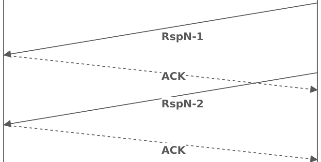

T2

download_tim

T3

客户端（Client）向服务端（Server）发送的第N个请求（request）表示为ReqN，该请求由 `ReqN-1` 和 `ReqN-2` 两个数据包组成。服务端收到第一个包的时间被记录为T0，第二个包的时间被记录为T1。服务端收到请求后进行处理，完成处理后会向客户端发送两个响应的数据包 `RspN-1` 和 `RspN-2` ，服务端发送第一个包的时间被记录为T2。客户端收到响应包后会发送确认信息ACK给服务器，服务端收到最后一个ACK的时间被记录为T3。

TCP-RT基于以上的时间点的记录，可以计算出以下有意义的信息：

- upload_time：用户请求上传所使用的时间。

- process_time：服务端的处理时间。

  服务端从收到最后一个请求的数据包开始，到服务端向客户端开始发送响应的数据包为止，这段时间为服务端的处理时间。

- download_time：数据下载时间。

  从服务端向客户端发送响应的数据包开始，到服务端收到客户端最后一个ACK为止，这段时间为数据下载时间。对于下载比较大的数据响应，该信息的获取较为重要。

**信息输出说明**

TCP-RT在内核态采集TCP服务的相关参数并输出，下表说明了文件的输出方式与输出时间点。

| 文件类型 | 输出方式 | 输出时间 |
| --- | --- | --- |
| log文件 | 以<code> debugfs </code>的方式输出到/sys/kernel/debug/tcp-rt路径下，文件名称为<code> rt-network-log* </code>的文件中。该类文件特征如下：<br>• 文件名称的后缀为CPU内核的序号。例如：32核的服务器，输出的log文件为<code> rt-network-</code><code>log0 </code>到<code> rt-network-log31 </code>。<br>• 文件大小最大为2 MB，当数据超过该限制后，旧数据会被清除。<br>• <code> debugfs </code>方式输出的log文件是一次性的，当您读取一次文件数据后，读取部分的数据就被清除了。 | • 时间一：在TCP连接上，当上一个任务（一次请求/响应为一个任务）完成后下一个任务开始时，输出上一个任务的信息。<br>• 时间二：在连接关闭时，输出信息。在TCP-RT输出信息之后，应用层可以立即读取到数据。 |
| stats文件 | 该数据是基于端口（服务端端口或客户端端口）进行数据汇总后，输出到/sys/kernel/debug/tcp-rt路径下的<code> rt-network-stats </code>文件中。 | 定时输出。默认为一分钟输出一次。 |

**解析模式说明**

TCP-RT支持多种解析模式，用户可自行配置。具体操作，请参见功能使用。

- default：默认模式。

  基于通用TCP流进行解析，TCP流可以是HTTP、Redis、Mysql等符合请求/响应行为的协议。

- http：HTTP增强。

  在default模式基础上，额外报告RTT和拥塞窗口信息，并且识别HTTP协议的“Expect: 100-continue”处理过程。将100-continue请求及其响应报告为一条 `R.C` 类型记录。更多信息，请参见输出格式说明。

- https：HTTPS增强。

  在http模式的基础上，额外增加了TLS部分报文解析。

  - TLS握手解析：识别TLS 1.2和TLS 1.3的握手阶段，在输出日志中标记出来。更多信息，请参见输出格式说明。

    - 对TLS 1.2四次握手，产生两条 `R.H` 类型记录。

    - 对TLS 1.3三次握手，产生一条 `R.H` 类型记录，并报告握手用时。

  - “Close Notify” Alert报文解析：在输出日志中以 `R.A` 记录标记。更多信息，请参见输出格式说明。

> **说明**
>
> tcp_rt.ko的解析模式不可配置，仅支持default模式。

**输出格式说明**

> **说明**
>
> TASK与TCP生命周期释义。
>
> - TASK表示一次完整的请求+响应（request+response）。
>
> - TCP生命周期中包含多个TASK。

**log文件格式说明**

在log文件中，每条记录的每一列都对应了不同的信息。log文件内容示例如下图所示。


按照从左到右的顺序，每一列参数说明如下：

- 版本号，目前为V6或V7。

  - V6：默认版本号。

  - V7：对R类型记录，特定配置下可能出现额外内容，标记为V7。具体包括：

    - http、https解析模式下R日志版本为V7，因为末尾带有附加字段。

    - R日志扩展格式下，版本为V7，包括R.C、R.Z、R.A、R.H、R.F，具体含义见下表。

- 记录场景标识，目前分为R、E、W、N、P五种类型。

  - R：请求到本地服务器的情况下，在一个TCP服务中完成一次请求+响应产生一条该记录。

  - E：连接关闭的情况下，产生一条该记录。

  - W：连接在发送数据过程中被关闭的情况下，产生一条该记录。

  - N：连接在接收数据过程中被关闭的情况下，产生一条该记录。

  - P：本地服务器请求对端服务器的情况下，在一个TCP服务中完成一次请求+响应产生一条该记录。

- TASK开始时间，开始时间的秒部分。

- TASK开始时间，开始时间的微秒部分。

- TCP连接的对端IP地址。

- TCP连接的对端端口。

- TCP连接的本地IP地址。

- TCP连接的本地端口。

以上参数后面衔接不同记录场景标识的不同参数。说明如下表所示。

<table>
  <tr>
    <th width="121">记录场景标识</th>
    <th>参数说明</th>
  </tr>
  <tr>
    <td>R</td>
    <td>该记录是TASK正常启动和关闭的记录，每个TCP连接可以有多个R记录。<br>• TASK发送的数据量。单位：Byte。<br>• TASK总耗时。单位：us。即第一个请求segment到达与最后一个响应的segment被ack之间的时间间隔。<br>• TASK最小的TCP RTT（Round Trip Time）。单位：us。<br>• TASK重传发送的TCP报文段（TCP segment）数量。<br>• TASK序号。TCP建立后的第一个TASK序号为1。<br>• TASK服务延时。单位：us。<br><br><br>即<code> </code>最后一个请求的<code>segment</code>到达<code> </code>与<code> </code>第一个响应的<code>segment</code>发送<code> </code>之间的时间间隔。<br>• TASK上送延时。单位：us。<br><br><br>即<code> </code>第一个请求<code>segment</code>到达<code> </code>与<code> </code>最后一个请求<code>segment</code>到达<code> </code>之间的时间间隔。<br>• TASK接收的数据量。单位：Byte。<br>• TASK过程是否发生接收乱序。参数值说明：<br>• 1：发生。<br>• 0：没有发生。<br>• TASK过程中TCP使用的最大报文长度（MSS）。单位：Byte。<br>• TASK结束时的平滑RTT，http、https解析模式下生效（仅tcprt支持，版本号为V7）。单位：us。<br>• TASK结束时的拥塞窗口，http、https解析模式下生效（仅tcprt支持，版本号为V7）。单位：segments。</td>
  </tr>
  <tr>
    <td>R.C</td>
    <td>说明仅tcprt支持，版本号为V7。<br>http、https解析模式下可能出现，格式同R记录。表示TASK为“Expect: 100-continue”引入（该TASK不带有应用数据）。</td>
  </tr>
  <tr>
    <td>R.Z</td>
    <td>说明仅tcprt支持，版本号为V7。<br>https解析模式下可能出现，格式同R记录。表示TASK属于TLS 1.3 0RTT握手。</td>
  </tr>
  <tr>
    <td>R.A</td>
    <td>说明仅tcprt支持，版本号为V7。<br>https解析模式下可能出现，格式同R记录。<br>表示TASK中含有<code> Close Notify </code>Alert报文，该TASK不会计入Alert报文引入额外耗时（即最后一个响应数据包与Alert包之间的用时）。</td>
  </tr>
  <tr>
    <td>R.H</td>
    <td>说明仅tcprt支持，版本号为V7。<br>https解析模式下可能出现，R记录末尾可能附加额外内容。表示TASK属于TLS握手阶段。若是TLS 1.3（三次握手），日志末尾将报告握手耗时，单位：us。<br>末尾附加内容格式为<code> H &lt;time&gt; </code>。例如<code> H 151878 </code>表示握手用时 151878 us。</td>
  </tr>
  <tr>
    <td>R.F</td>
    <td>说明仅tcprt支持，版本号为V7。<br>开启<code> first_frame </code>后出现（具体操作，请参见功能使用），R记录末尾可能附加额外内容。表示TASK触发按字节数的完成时间统计。根据配置文件定义的字节数阈值阶梯，划分每个TASK响应数据流，统计各阶梯的数据量与完成时间，附加于记录末尾，单位分别为bytes和us。<br>末尾附加内容格式为<code> F &lt;n&gt; [bytes time] </code>。例如<code> F 6 7240 214 63698 311 </code> <code>98436 358 </code>，表示共有6个数字，7240、63698、98436 Bytes 对应的总耗时依次为214 us、311 us、358 us。</td>
  </tr>
  <tr>
    <td>P</td>
    <td>该记录是TASK正常启动和关闭的记录，每个TCP服务可以有多个P记录。P是V6版本中新增的记录，表述的是客户端对外请求时的信息。只有配置了选项<code> pports </code>或<code> pports_range </code>时才有该记录。<br>• TASK发送的数据量。单位：Byte。<br>• TASK总耗时。从本地服务器发送数据开始到最后一次收到对端响应的时间。单位：us。<br>• TASK最小的TCP RTT（Round Trip Time）。单位：us。<br>• TASK重传发送的TCP报文段（TCP segment）数量。<br>• TASK序号。TCP建立后的第一个TASK序号为1。<br>• TASK服务时间。即从请求发送完成到收到第一个响应的时间。单位：us。<br>• TASK响应接收时间。从接收到第一个响应包到最后一个响应包之间的时间。单位：us。<br>• TASK接收响应的总大小。单位：Byte。<br>• TASK过程是否发生接收乱序。参数值说明：<br>• 1：发生。<br>• 0：没有发生。<br>• TASK过程中TCP使用的最大报文长度（MSS）。单位：Byte。</td>
  </tr>
  <tr>
    <td>E</td>
    <td>该记录是TCP被关闭的记录。每个TCP连接都有1个E记录，配置了选项<code> pports </code>或<code> pports_range </code>的连接也会有该记录。<br>• 最后一个TASK的序号。<br>• TCP生命周期中发送的数据量。单位：Byte。<br>• TCP发送响应但是没有收到ACK的数据量。参数值说明：没有则为0。单位：Byte。<br>• TCP生命周期中接收的数据量。单位：Byte。<br>• TASK重传发送的TCP报文段（TCP segment）数量。<br>• TCP生命周期中最小的TCP RTT（Round Trip Time）。单位：us。</td>
  </tr>
  <tr>
    <td>N</td>
    <td>该记录是在TASK请求接收报文段（segment）过程中，TCP被关闭场景下的记录。每个TCP连接可能有一个N记录或没有。<br>• 最后一个TASK的序号。<br>• 最后一个TASK的耗时，因为是被关闭，所以只有接收时间，没有发送时间。单位：us。<br>• TCP生命周期中接收的数据量。单位：Byte。<br>• TASK过程是否发生接收乱序。参数值说明：1表示发生；0表示没有发生。<br>• TASK过程中TCP使用的最大报文长度（MSS）。单位：Byte。</td>
  </tr>
  <tr>
    <td>W</td>
    <td>该记录是在TASK响应发送的报文段（segment）过程中，TCP被关闭场景的记录。每个TCP连接可能有1个W记录或没有。<br>• 最后一个TASK的响应已发送数据量。单位：Byte。<br>• 最后一个TASK的耗时，因为是被关闭，所以发送时间是不完整的。单位：us。<br>• 最后一个TASK最小的TCP RTT（Round Trip Time）。单位：us。<br>• 最后一个TASK重传发送的TCP报文段（TCP segment）数量。<br>• 最后一个TASK的序号。<br>• 最后一个TASK服务延时。单位：us。<br>• 最后一个TASK上送延时。单位：us。<br>• 最后一个TASK发送响应但是没有收到ACK确认信息的数据量。参数值说明：没有则为0。单位：Byte。<br>• TASK过程是否发生接收乱序。参数值说明：<br>• 1：发生。<br>• 0：没有发生。<br>• 最后一个TASK过程中TCP使用的最大报文长度（MSS）。单位：Byte。</td>
  </tr>
</table>

> **说明**
>
> - 扩展日志类型以 `R.x` 格式标记，其中 `x` 可以是单个字符（如上表），也可以是多个字符的组合。比如 `R.AF` 即表示 `A` 和 `F` 同时生效。
>
> - `R.A` 和 `R.C` 类型日志，以响应数据量为判据，因此可能存在少量误判。
>
> - 在上表涉及TASK发送数据量的这类信息中，如果是连接的最后一个TASK，正常处理会减去关闭连接（fin）占用的一个 `snd_nxt` 值。而如果连接是异常关闭的，例如一个TASK完成之后收到了异常终止报文（reset）并且连接也是以响应 `reset` 结束的，则实际发送的数据量会大于这里显示值一个字节。正常情况下，该类值都是正确的，并且异常的情况下只误差一个字节。

> **说明**
>
> 关于功能原理部分所示的三个时间阶段。
>
> R记录报告总时间（T0至T3）、上送延时（upload_time，T0至T1）、服务延时（process_time，T1至T2）。数据下载时间（download_time）可由上述信息计算得出：
>
> `download_time =` 总时间 `- upload_time - process_time`

**stats文件格式说明**

按照从左到右的顺序。每一列参数说明如下：

- 记录输出时的时间戳。

- 保留字段，目前唯一值为 `all` 。

- 端口号。

- R记录中TASK总耗时的平均值。

- R记录中TASK服务延时的平均值。

- 丢包千分数（‰）。

- RTT的平均值。单位：us。

- 请求发送的数据中，被关闭的TASK数量的千分数（‰）。

- TASK发送的数据量的平均值。

- TASK上送延时的平均值。

- TASK接收的数据量的平均值。

- 参与统计的TASK的数量。

**tcprt与tcp_rt.ko版本差异**

<table>
  <tr>
    <th>比较项</th>
    <th>tcprt</th>
    <th>tcp_rt.ko</th>
  </tr>
  <tr>
    <td>日志文件路径</td>
    <td colspan="2">相同</td>
  </tr>
  <tr>
    <td>日志格式</td>
    <td colspan="2">tcprt对日志格式有扩展，原格式保持兼容。</td>
  </tr>
  <tr>
    <td>功能管理</td>
    <td><code>systemctl</code></td>
    <td><code>modprobe/rmmod</code></td>
  </tr>
  <tr>
    <td>功能配置</td>
    <td>配置文件：<br><code>/etc/tcprt-bpf/tcprt.yaml</code></td>
    <td>模块参数：<br><code>/sys/module/tcp_rt/parameters/*</code></td>
  </tr>
  <tr>
    <td>系统要求</td>
    <td>Alibaba Cloud Linux 3（内核版本kernel-5.10.134-010.ali5000.pro.al8及以上）。</td>
    <td>• Alibaba Cloud Linux 2（内核版本<code> 4.19.91-21.al7 </code>及以上）。<br>• Alibaba Cloud Linux 3。</td>
  </tr>
  <tr>
    <td>功能</td>
    <td>• 除default外，支持http、https解析模式。<br>• 支持<code> first_frame </code>功能。</td>
    <td>仅支持default解析模式。</td>
  </tr>
</table>

**功能使用**

您可以根据实际使用场景选择以下操作使用TCP-RT。

- tcprt

  Alibaba Cloud Linux 3（内核kernel-5.10.134-010.ali5000.pro.al8及以上版本）。

- tcp_rt.ko

  - Alibaba Cloud Linux 2（内核4.19.91-21.al7及以上版本）。

  - Alibaba Cloud Linux 3。

> **说明**
>
> 因为二者共享相同的日志文件路径，所以不能同时开启，只能使用其中之一。

**tcprt**

- 安装与配置。

  <ol type="i">

  <li>

  安装tcprt。

  ```bash
  sudo yum install -y tcprt
  ```

  </li>

  <li>

  配置tcprt。

  <ol type="a">

  <li>

  打开 `/etc/tcprt-bpf/tcprt.yaml` 文件。

  ```bash
  sudo vim /etc/tcprt/tcprt.yaml
  ```

  </li>

  <li>

  按 `i` 键进入编辑模式，根据需要进行配置。

  配置项分为三部分，global、per-port、init，说明如下。

  - global

    | 参数 | 说明 | 可选值 | 默认值 |
    | --- | --- | --- | --- |
    | peer | 默认的tcprt端口匹配模式。<br>• false:匹配本地端口。<br>• true:匹配对端端口。 | true/false | 空 |
    | stats | 是否开启stats日志输出。 | enable/disable | disable |
    | stats_interval | stats输出时间间隔。单位：s。 | 整数 | 60 |
    | first_frame_bytes | 完成时间统计字节数阶梯阈值。单位：byte。 | 整数列表，最大长度为4 | 空 |

  - per-port。

    以列表表示，默认为空，一个元素对应一项端口配置。

    | 参数 | 说明 | 可选值 | 默认值 |
    | --- | --- | --- | --- |
    | port | 端口号或端口范围。 | • 整数，表示端口号。<br>• 逗号分隔的两个整数，表示端口范围，范围为闭区间。 | 无 |
    | peer | 该端口（或端口范围）的匹配模式。 | true/false | global的peer配置 |
    | mode | 协议解析模式。default效果与tcp_rt.ko一致。 | default/http/https | default |
    | first_frame | 是否开启按字节数的完成时间统计。 | enable/disable | disable |

  - init。

    | 参数 | 说明 | 可选值 | 默认值 |
    | --- | --- | --- | --- |
    | log_buf_num | log文件的子缓冲区个数。 | 整数 | 8 |
    | log_buf_size | log文件的子缓冲区大小，单位：byte。<br>每一个log文件最大大小为<code> log_buf_num * </code> <code>log_buf_size </code>。 | 整数 | 262144 |
    | stats_buf_num | stats文件的子缓冲区个数。 | 整数 | 8 |
    | stats_buf_size | stats文件的子缓冲区大小，单位：byte。<br>stats文件最大大小为<code> stats_buf_num * </code> <code>stats_buf_size </code>。 | 整数 | 16384 |

  </li>

  </ol>

  <ol type="i" start="100">

  <li>

  配置完成后按 `Esc` 键，输入 `:wq` 后按 `Enter` 键，保存配置。

  </li>

  <li value="500">

  启动服务，自动解析配置文件。

  ```bash
  sudo systemctl start tcprt
  ```

  </li>

  </ol>

  <ol type="a" start="5">

  <li>

  设置开机自动（如有需要）。

  ```bash
  sudo systemctl enable tcprt
  ```

  </li>

  </ol>

  </li>

  </ol>

- 卸载tcprt。

  ```bash
  sudo yum remove tcprt
  ```

  输入 `y` 按回车键，完成卸载。

**配置文件举例tcprt**

- peer配置为false，表示默认采用本地端口匹配。添加了两项端口配置。

  - 443端口精确匹配：启用HTTPS解析，匹配本地端口。开启“first_frame”功能（即按字节的完成时间统计），数据量阈值阶梯依次为100/2000/20000字节。

  - 56789～56800端口范围匹配：采用默认TCP解析，匹配对端端口。

- stats功能关闭。

- log文件和stats缓冲区大小采用默认配置。

```text
global:
  peer: false
  stats: disable
  stats_interval: 60
  first_frame_bytes: [100, 2000, 20000, 0]
per-port:
  -
    port: 443
    mode: https
    first_frame: enable
  -
    port: 56789,56800
    mode: default
    peer: true

init:
  log_buf_num: 8
  log_buf_size: 262144
  stats_buf_num: 8
  stats_buf_size: 16384
```

> **说明**
>
> 字节数完成时间是通过ACK包统计的，实际数据传输中，一次ACK可能对应大量数据（比如几十KB），因此日志中输出的数据量可能超过文件中的Bytes阈值配置。

**tcp_rt.ko**

- 加载与配置模块。

  您可以用以下任一方式加载与配置模块。

  - 模块加载时直接配置参数。

    <ol type="a">

    <li>

    在加载tcp_rt模块的同时，将模块配置作为命令参数一并输入。

    例如加载tcp_rt模块，并配置lports为80。

    ```bash
    sudo modprobe tcp_rt lports=80
    ```

    </li>

    <li>

    查看配置是否生效。

    ```bash
    sudo cat /sys/module/tcp_rt/parameters/lports
    ```

    </li>

    </ol>

  - 先加载模块，然后进行配置。

    <ol type="a">

    <li>

    运行以下命令加载模块。

    ```bash
    sudo modprobe tcp_rt
    ```

    </li>

    <li>

    模块加载后，在/sys/module/tcp_rt/parameters/路径下，运行命令进行配置。

    例如用下面命令配置监控本地80端口。

    ```bash
    sudo sh -c 'echo 80 > /sys/module/tcp_rt/parameters/lports'
    ```

    查看配置是否生效。

    ```bash
    sudo cat /sys/module/tcp_rt/parameters/lports
    ```

    更多参数配置说明与配置命令如下表所示。

    | 参数 | 说明 | 默认值 | 配置命令 |
    | --- | --- | --- | --- |
    | stats | 是否输出stats。取值范围：<br>• 0：否。<br>• 1：是。 | 0 | <code>echo 0 &gt; stats</code> |
    | stats_interval | stats输出时间间隔。单位：s。 | 60 | <code>echo 60 &gt;</code><br><code>stats_interval</code> |
    | lports | 控制采集的本地服务器端口，最多6个。 | 无 | <code>echo 80,800,8080 &gt;</code><br><code>lports</code> |
    | pports | TCP连接的对端端口。 | 无 | <code>echo 80,800,8080 &gt;</code><br><code>pports</code> |
    | lports_range | 本地服务器端口范围，两个为一组，配置命令中表示80-100和1000-2000。 | 无 | <code>echo 80,100,1000,2000</code><br><code>&gt;lports_range</code> |
    | pports_range | TCP连接的对端端口范围，两个为一组，配置命令中表示80-100和1000-2000。 | 无 | <code>echo 80,100,1000,2000</code><br><code>&gt;pports_range</code> |
    | log_buf_num | 每一个log文件最大大小为<code> log_buf_num * 256 </code> <code>k </code>。只在加载模块的时候可以配置。 | 8 | <code>modprobe tcp_rt</code><br><code>log_buf_num=10</code> |
    | stats_buf_num | 每一个stats文件最大大小为<code> stats_buf_num * 16 </code> <code>k </code>。只在加载模块的时候可以配置。 | 8 | <code>modprobe tcp_rt</code><br><code>stats_buf_num=10</code> |

    </li>

    </ol>

- 卸载模块。

  <ol type="i">

  <li>

  运行以下命令，停用 `tcp-rt` 模块，保证不会有新的连接使用TCP-RT。

  ```bash
  sudo echo 1 > /sys/kernel/debug/tcp-rt/deactivate
  ```

  </li>

  <li>

  运行以下命令判断是否所有连接均未使用 `tcp-rt` 模块。

  ```text
  lsmod
  ```

  当输出结果中 `tcp-rt` 模块 `Used by` 为 `0` 时，表示没有连接使用 `tcp-rt` 。

  </li>

  <li>

  当所有连接都不使用 `tcp-rt` 模块后，运行以下命令卸载 `tcp-rt` 模块。

  ```bash
  sudo rmmod tcp_rt
  ```

  </li>

  </ol>

**常见问题**

**日志文件大小与配置参数不一致**

`ls -l` 等命令显示文件大小超过配置值，这是正常现象。日志文件位于 `/sys` 虚拟文件系统下， `ls -l` 结果不代表真实大小（也不占磁盘空间）。实际上，这里相当于累积的总日志量，保持递增。若想检查日志真实大小，可以将日志重定向到文件后查看。

下图展示了在默认配置（2 M）下的示例。可以看到，使用 `cat` 将日志内容重定向到文件后，其实际大小约为2 M，符合预期。

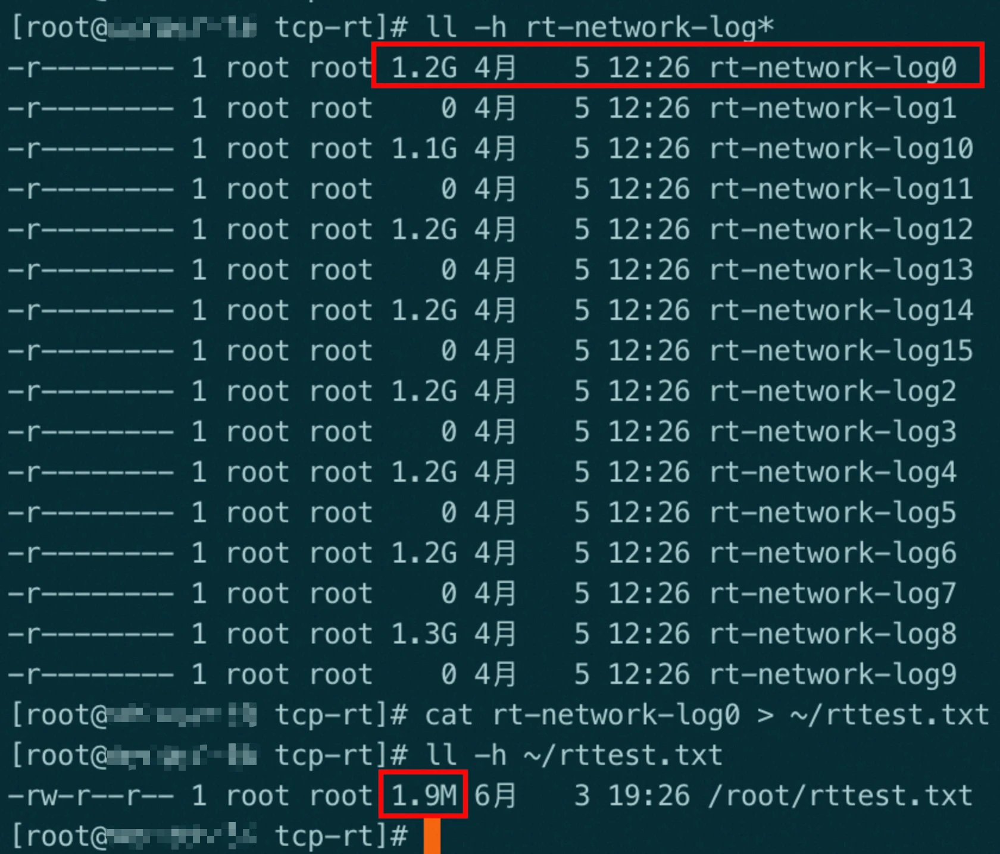

<a id="section-1-5-6-3"></a>

#### 1.5.6.3. 共享内存通信（SMC）

<a id="section-1-5-6-3-1"></a>

##### 1.5.6.3.1. 共享内存通信（SMC）使用说明

Alibaba Cloud Linux 3提供的共享内存通信SMC（Shared Memory Communication）是一种兼容socket层、使用共享内存技术实现的高性能内核网络协议栈。根据共享内存技术的不同，SMC又可以细分为基于ISM（Internal Shared Memory）技术的SMC-D（SMC over DMA）和基于RDMA（Remote Direct Memory Access）技术的SMC-R（SMC over RDMA）。本文为您介绍SMC-R及其使用方法。

**背景信息**

SMC-R由IBM于2017年开源至Linux 4.11并持续维护至今，其协议标准可参考IETF RFC 7609。Alibaba Cloud Linux 3操作系统基于阿里云弹性RDMA（elastic RDMA，简称eRDMA）技术首次将SMC-R带入云上场景，实现对TCP应用透明无侵入的替换，提供高性能、普惠的软硬件协同网络。

> **重要**
>
> eRDMA 在神龙moc2.5 开始支持。

SMC-R的共享内存数据交互模型依赖RDMA提供的内存操作原语。RDMA技术将网络协议栈下沉至RDMA网卡（RNIC）实现，使网络节点能够绕过内核直接访问远程内存。与TCP网络相比，RDMA网络可以减少数据在内存间拷贝的次数，降低网络传输过程中消耗的CPU资源，进而提高网络吞吐、降低网络时延。两者协议栈差异如下图所示。

**TCP/IP**

**RDMA**


CPU Copy

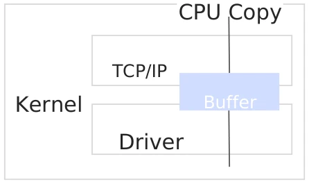


DMA Copy

DMA Copy


Adapter

因此，RDMA被广泛应用于数据密集型和计算密集型场景中，是高性能计算、机器学习、数据中心、海量存储等领域的重要解决方案。

过去，RDMA只能在一些数据中心网络中通过网卡和交换机紧密配合使用，部署复杂度高。如今，阿里云弹性RDMA将复杂的RDMA技术带到云上，使普通的ECS用户也能使用高性能的RDMA传输，无需关心底层复杂的网卡、交换机等物理网络环境配置，使其成为一种亲民、普惠的技术。

但是，RDMA技术基于IB verbs接口，与常用的POSIX socket接口存在巨大的差异。现有socket应用程序迁移至RDMA网络往往面临大量的改造，使用RDMA技术仍存在较高的技术门槛。

因此，为了充分挖掘弹性RDMA的潜力，为云上用户提供更好的网络性能，Alibaba Cloud Linux 3提供并优化了SMC-R。在高效使用RDMA技术的同时，保留对标准TCP应用的兼容，使更多的应用无需修改便能享受RDMA所带来的性能红利。

**核心优势**

SMC-R的优势主要体现在以下几点：

- **高性能**

  得益于RDMA技术将网络协议栈从内核卸载至硬件网卡，SMC-R相较于TCP协议栈在合适的场景下可获得更低的时延、更高的吞吐量，以及更小的CPU负载。具体表现在：

  - 基于RDMA的硬件卸载。

  - 高效可靠的远程内存直接访问设计。

- **透明替换**

  得益于SMC-R对POSIX socket接口的兼容以及协议栈透明替换能力，socket应用程序可以在无修改的情况下完成TCP协议栈到SMC-R协议栈的切换，无需额外的应用改造和开发成本。具体表现在：

  - 兼容socket接口的共享内存通信。

  - 进程或net namespace维度的透明协议替换。

  - 自动协议协商和安全回退机制。

**技术架构**

SMC-R技术架构说明如下：

- **协议层次与透明替换**

  SMC-R工作于内核空间，向上支持用户态程序通过socket接口描述的网络行为，向下使用IB verbs接口实现RDMA网络传输。RDMA资源的使用、管理与维护均由SMC-R协议栈完成，应用程序不会感知到内核中的RDMA实体。技术架构如下图所示：

  

  

  **SMC** socket

  **TCP** socket

  LD__PRELOAD

  User Space

  Kernel

  tcp2smc sysctl

  

  

  SMC-R

  

  

  Verbs

  

  

  

  

  Hardwa

  Alibaba Cloud Linux 3提供了进程或net namespace维度的TCP至SMC-R协议栈透明替换机制。通过LD_PRELOAD或sysctl net.smc.tcp2smc等方式让网络传输运行于SMC-R协议栈，使应用程序无需修改即可享受RDMA带来的网络性能提升。

- **自动协商和安全回退**

  SMC-R具备自动协商、动态回退TCP的能力。建立SMC-R通信前，协议栈首先在内核中与通信对端建立TCP连接，在握手过程中使用特殊的TCP选项表明自身支持SMC-R，并确认对端同样支持SMC-R。

  - 如果协商成功，通信两侧SMC-R协议栈将创建新的或者复用已有的RDMA资源，建立可用的RDMA RC链路。从此网络传输将基于RDMA网络完成。

  - 如果协商失败，例如一侧不具备RDMA设备，SMC-R协议栈将自动回退到TCP协议栈，使用协商时建立的TCP连接完成数据传输。

    > **说明**
    >
    > SMC-R仅支持连接协商期间回退至TCP，但不支持数据传输过程中的回退。

  协商和数据传输流如下图所示：

  Host A

  Host B

  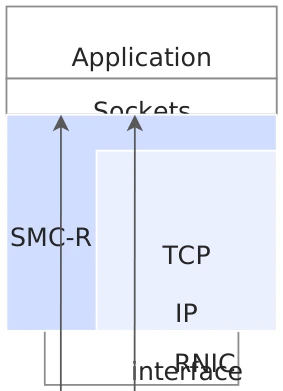

  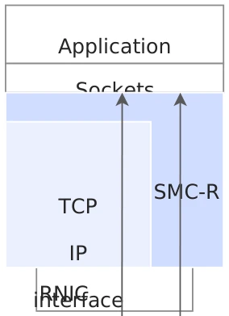

  TCP syn flows with TCP

  options

  indicating SMC-R capability

  

  RDMA network iWARP/RoCE

  Dataexchangedusing

- **基于RDMA的共享内存通信**

  完成协议协商并建立连接后，协议栈为SMC-R socket分配一块用于缓存待发送数据的环形缓冲区sndbuf和一块用于缓存待接收数据的环形缓冲区RMB（Remote Memory Buffer）。

  - 发送端应用程序通过socket接口将待发送数据拷贝到本侧sndbuf中，由SMC-R协议栈通过RDMA WRITE操作直接高效地写入对侧节点的RMB中。同时伴随着使用RDMA SEND/RECV操作交互连接数据管理消息，用于更新、同步环形缓冲区中的数据游标。

  - 接收端SMC-R协议栈感知到RMB中填入新数据后，通过epoll等方式告知接收端应用程序将RMB中的数据拷贝到用户态，完成数据传输。所以在SMC-R中，RMB充当传输过程中的共享内存。

  数据传输过程如下图所示：

  Sender

  Receiver

  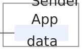

  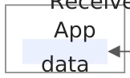

  kernel-smc

  kernel-smc

  

  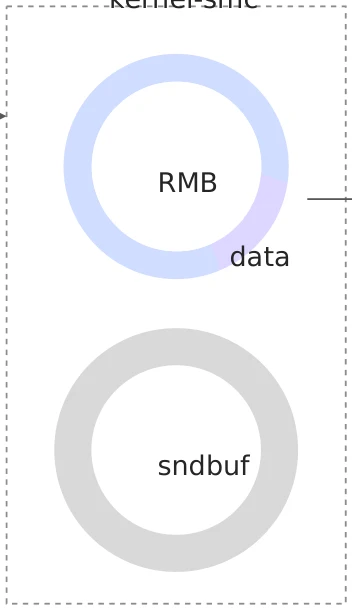

  DATA

  (RDMA Write)

**应用场景**

基于SMC-R的高性能、透明替换等优势，适用于网络通信占比高的场景，该技术的典型应用场景示例如下：

- 时延敏感的数据查询和处理

  Redis、Memcached、PostgreSQL等高性能数据查询与处理的场景，对网络性能有极高的要求。SMC-R为应用提供无侵入式透明替换TCP协议栈的能力，无需应用二次开发和适配，即可为应用提供最高50%的QPS（Queries Per Second）提升。

- 高吞吐的数据传输

  集群内的大规模数据交互与传输，往往需要占用大量的带宽和CPU资源。得益于RDMA技术带来的远程内存直接访问，SMC-R在相同的吞吐性能下，CPU资源使用显著低于TCP协议栈，为应用节省更多的计算资源。

> **说明**
>
> - SMC-R握手涉及到RDMA资源创建和申请，所以对于频繁建立、销毁连接（短链接）场景没有收益。
>
> - SMC-R支持的连接规模受限于如下资源：
>
>   - 实例可用的物理内存大小。每个SMC-R socket所用的收发缓冲区sndbuf和RMB默认使用物理连续内存，在SMC-R连接建立时分配，大小默认为当前net.smc.wmem和net.smc.rmem值。查看方式：
>
>     ```text
>     sysctl net.smc.wmem        # 每个SMC-R socket sndbuf默认⼤⼩，单位：字节
>     sysctl net.smc.rmem        # 每个SMC-R socket RMB默认⼤⼩，单位：字节
>     ```
>
>   - ERI eRDMA规格。SMC-R为连接创建的RDMA资源（例如QP、MR、CQ、PD等）上限由实例ERI eRDMA规格决定。
>
>   当SMC-R无法获取到所需资源时将会安全回退到TCP协议，确保数据传输稳定可靠。

**使用说明**

Alibaba Cloud Linux 3提供并优化了SMC-R内核协议栈，配合SMC-R状态监控和故障诊断工具，您可以通过以下步骤使用SMC-R：

1. 创建支持ERI的ECS实例。

   SMC-R基于RDMA实现，因此使用SMC-R前需要创建支持ERI功能的ECS实例，以获得云上RDMA能力。

   > **重要**
   >
   > 阿里云ERI eRDMA设备与SMC目前均不支持使用IPv6地址。如果应用层使用IPv6地址，会导致SMC回退到TCP协议栈。

2. 执行以下命令，加载 `smc` 和 `smc_diag` 内核模块。

   ```text
   modprobe smc
   modprobe smc_diag
   ```

   您可以执行 `dmesg` 命令查看内核打印信息。如果看到如下信息，说明加载成功。

   ```text
   smc: smc: load SMC module with reserve_mode
   NET: Registered protocol family 43
   smc: netns <netns ID> reserved ports [65500 ~ 65515] for eRDMA OOB
   smc: adding ib device erdma_0 with port count 1
   smc:    ib device erdma_0 port 1 has pnetid
   ```

   > **说明**
   >
   > 由于SMC支持ERI eRDMA方式的特殊性，自kernel-5.10.134-010.ali5000.pro.al8内核版本起，SMC内核模块加载时将尝试占用当前可访问ERI设备的net namespace中65500~65515共16个socket端口，用于RDMA带外（OOB）建连。如果端口占用失败将无法在SMC模块中使用ERI eRDMA设备（但仍可以加载SMC模块）。卸载SMC模块时将自动解除端口占用。
   >
   > - 查看内核版本：
   >
   >   ```text
   >   uname -r
   >   ```
   >
   > - SMC模块加载时因端口占用失败而无法使用ERI eRDMA设备的 `dmesg` 警告信息：
   >
   >   ```text
   >   smc: smc: load SMC module with reserve_mode
   >   NET: Registered protocol family 43
   >   warning: smc: netns <netns ID> reserved ports <占⽤失败的端⼝号> FAIL for 
   >   eRDMA OOB
   >   ```
   >
   > - 卸载SMC模块：
   >
   >   ```text
   >   rmmod smc_diag
   >   rmmod smc
   >   ```
   >
   > - 卸载模块时的打印信息：
   >
   >   ```text
   >   NET: Unregistered protocol family 43
   >   smc: removing ib device erdma_0
   >   smc: netns <netns ID> released ports [65500 ~ 65515] used by eRDMA OOB
   >   ```

3. 执行以下命令，安装SMC的运维工具集smc-tools。

   ```bash
   yum install -y smc-tools
   ```

4. （可选）设置收发缓冲区默认大小。

   如技术架构：基于RDMA的共享内存通信中所述，SMC-R协议栈会为每个SMC-R socket分配一块用于缓存待发送数据的环形缓冲区sndbuf和一块用于缓存待接收数据的环形缓冲区RMB。SMC-R中sndbuf与RMB概念可类比于TCP协议中的send buffer与receive buffer，有效值范围为16 KB到512 KB。

   对于注重吞吐性能的网络模型可以通过下述方式调整SMC-R socket sndbuf和RMB的默认大小，以获得最佳的SMC-R网络加速效果。

   Alibaba Cloud Linux 3提供了sysctl net.smc.wmem和sysctl net.smc.rmem来设置当前net namespace中所有新建SMC-R socket的sndbuf和RMB的默认大小，已建立连接的SMC-R socket的sndbuf和RMB不受影响。具体步骤为：

   ```text
   sysctl net.smc.wmem=<sndbuf 指定值，以字节为单位>
   sysctl net.smc.rmem=<RMB 指定值，以字节为单位>
   ```

   `sysctl net.smc.wmem` 和 `sysctl net.smc.rmem` 的初始化值为 256 KB。

   除了上述设置SMC-R socket的sndbuf和RMB默认值的方法，应用程序还可以通过setsockopt()系统调用，在建立连接前设置SMC-R socket的SO_SNDBUF和SO_RCVBUF选项值，进而改变SMC-R socket所使用的sndbuf和RMB大小。

5. 基于SMC协议栈运行TCP socket应用程序。

   Alibaba Cloud Linux 3支持两个维度的透明替换。具体说明如下：

   - net namespace维度透明替换

     Alibaba Cloud Linux 3提供了net namespace维度的协议透明替换功能，可以通过 `sysctl net.smc.tcp2smc` 将net namespace中所有符合如下条件的TCP socket替换为SMC socket。

     - family为AF_INET

     - type为SOCK_STREAM

     - protocol为IPPROTO_IP或IPPROTO_TCP

     替换过程如下图所示：

     

     **TCP** socket

     User Space

     Kernel

     tcp2smc sysct1

     

     

     SMC-R

     

     

     

     Verbs

     

     

     

     

     Hardware

     在net namespace维度开启透明替换的操作步骤如下：

     <ol type="a">

     <li>

     执行以下命令，打开net namespace范围全局替换开关net.smc.tcp2smc。

     ```text
     sysctl net.smc.tcp2smc=1
     ```

     默认情况下， `sysctl net.smc.tcp2smc=0` ，处在关闭状态。

     </li>

     <li>

     执行以下命令，在此net namespace中运行TCP socket应用程序。

     ```text
     ./foo
     ```

     此时foo应用程序创建的TCP socket将被透明替换为SMC socket。通过SMC-R协议栈处理应用程序网络行为。如技术架构：自动协商和安全回退中所述，如果通信对端同样支持SMC-R协议并协商成功，则两端将基于RDMA网络完成数据传输，否则将安全回退使用TCP网络传输。

     </li>

     </ol>

     <ol type="i" start="100">

     <li>

     执行以下命令，关闭net namespace范围全局替换开关net.smc.tcp2smc。

     ```text
     sysctl net.smc.tcp2smc=0
     ```

     </li>

     </ol>

   - 进程维度透明替换

     Alibaba Cloud Linux 3还提供了进程维度的协议透明替换功能，该功能实现需要基于SMC-R的监控诊断工具smc-tools。smc-tools的安装操作，请参见安装smc-tools工具。

     替换过程如下图所示：

     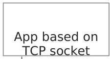

     LD_PRELOAD

     User space

     

     Kernel

     

     SMC-R

     

     

     

     Verbs

     

     

     driver

     driver

     

     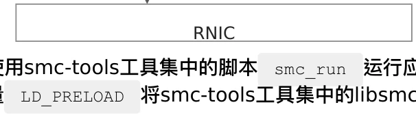

     Hardware

     使用smc-tools工具集中的脚本 `smc_run` 运行应用程序时， `smc_run` 通过环境变量 `LD_PRELOAD` 将smc-tools工具集中的libsmc-preload.so定义为优先加载的动态库。

     libsmc-preload.so将把应用程序及其子进程中符合如下条件的TCP socket替换为SMC socket。

     - family为AF_INET

     - type为SOCK_STREAM

     - protocol为IPPROTO_IP或IPPROTO_TCP

   执行以下命令，指定TCP socket程序foo运行在SMC-R协议栈。

   ```text
   smc_run ./foo
   ```

   此时foo应用程序创建的TCP socket将被透明替换为SMC socket。通过SMC-R协议栈处理应用程序网络行为。如技术架构：自动协商和安全回退中所述，如果通信对端同样支持SMC-R协议并协商成功，则两端将基于RDMA网络完成数据传输，否则将安全回退使用TCP网络传输。

**监控诊断**

在使用SMC过程中，您可以使用smc-tools工具监控和诊断SMC内核协议栈，了解和掌握SMC网络流量的各类指标，判断网络健康状况。更多信息，请参见共享内存通信（SMC）监控和诊断。

**常见问题**

如果您在使用SMC过程中无法正常通信、遇到部分端口不可用等问题，您可以参考共享内存通信（SMC）常见问题进行解决。

<a id="section-1-5-6-3-2"></a>

##### 1.5.6.3.2. 共享内存通信（SMC）监控和诊断

本文将为您介绍SMC内核协议栈中SMC-R的监控诊断工具及使用方法，以帮助您了解和掌握SMC网络流量的各类指标，判断网络健康状况。

**前提条件**

使用Alibaba Cloud Linux 3操作系统。

**使用smc-tools监测和诊断SMC**

Alibaba Cloud Linux 3提供的smc-tools可以帮助您获取SMC的连接、资源和协议栈信息。

**安装smc-tools**

```bash
sudo yum install -y smc-tools
```

**查看SMC-R协议栈信息**

- `smcr device` ：查看SMC-R协议栈所用RDMA设备的信息。

  输出示例：

  ```text
  # smcr device
  Net-Dev         IB-Dev   IB-P  IB-State  Type          Crit  #Links  PNET-ID
  eth1            erdma_0     1    ACTIVE  0x107f          No       0  
  ```

  您主要需要关注如下参数：

  <table>
    <tr>
      <th width="122">参数</th>
      <th>说明</th>
    </tr>
    <tr>
      <td><code>Net-Dev</code></td>
      <td>以太网网络设备名称。</td>
    </tr>
    <tr>
      <td><code>IB-Dev</code></td>
      <td>RDMA网络设备名称。</td>
    </tr>
    <tr>
      <td><code>IB-P</code></td>
      <td>RDMA网络设备端口。</td>
    </tr>
    <tr>
      <td><code>IB-State</code></td>
      <td>RDMA网络设备状态。</td>
    </tr>
    <tr>
      <td><code>Type</code></td>
      <td>RDMA网络设备类型，使用阿里云eRDMA网络设备时此处显示<code> 0x107f </code>。</td>
    </tr>
    <tr>
      <td><code>#Links</code></td>
      <td>RDMA网络设备所用QP（Queue Pair）数量。</td>
    </tr>
    <tr>
      <td><code>PNET-ID</code></td>
      <td>RDMA网络设备PNET ID。</td>
    </tr>
  </table>

- `smcr linkgroup` ：查看SMC-R link group信息。

  > **说明**
  >
  > link group在SMC-R中用于表示一组RDMA资源集合，包括QP（Queue Pair）、PD（Protection Domain）、MR（Memory Region）等，一个link group默认承载32个SMC连接。

  输出示例：

  ```text
  # smcr linkgroup
  LG-ID    LG-Role  LG-Type  VLAN  #Conns  PNET-ID
  00000300 SERV     SINGLE      0       0  1234
  ```

  您主要需要关注link group数量（意味着使用多少QP资源）以及以下参数：

  | 参数 | 说明 |
  | --- | --- |
  | <code>#Conns</code> | link group承载的SMC连接数量。 |

- `smcr stats` ：查看当前net namespace下SMC-R协议栈各类统计信息。

  输出示例：

  ```text
  # smcr stats
  SMC-R Connections Summary
    Total connections handled             7
    SMC connections                       5
    Handshake errors                      0
    Avg requests per SMC conn        518103.6
    TCP fallback                          2

  RX Stats
    Data transmitted (Bytes)       18133584 (18.13M)
    Total requests                  1295262
    Buffer full                           0 (0.00%)
              8KB    16KB    32KB    64KB   128KB   256KB   512KB  >512KB
    Bufs        0       0       0       0       0       5       0       0
    Reqs   1.295M       0       0       0       0       0       0       0

  TX Stats
    Data transmitted (Bytes)       18133584 (18.13M)
    Total requests                  1295256
    Buffer full                           0 (0.00%)
    Buffer full (remote)                  0 (0.00%)
    Buffer too small                      0 (0.00%)
    Buffer too small (remote)             0 (0.00%)
              8KB    16KB    32KB    64KB   128KB   256KB   512KB  >512KB
    Bufs        0       0       0       0       0       5       0       0
    Reqs   1.295M       0       0       0       0       0       0       0

  Extras
    Special socket calls                  5
  ```

  您主要需要关注如下参数：

  | 参数 | 说明 |
  | --- | --- |
  | <code>Total connections handled</code> | SMC-R协议栈处理的连接数量累加值，为<code> SMC </code> <code>connections </code>、<code> Handshake errors </code>、<code> TCP </code> <code>fallback </code>数量之和。 |
  | <code>SMC connections</code> | 成功转化为SMC-R连接的数量累加值。 |
  | <code>Handshake errors</code> | 握手阶段出现错误的连接数量累加值，比如对端无响应等。 |
  | <code>Avg requests per SMC conn</code> | 平均每条SMC连接接收/发送请求数量。 |
  | <code>TCP fallback</code> | 回退到TCP/IP协议栈连接数量的累加值。 |
  | <code>Rx/Data transmitted (Bytes)</code> | SMC-R连接接收数据累加值（单位：字节）。 |
  | <code>Rx/Total requests</code> | SMC-R连接接收请求累加值。 |
  | <code>Rx/Buffer full</code> | SMC-R连接接收缓冲区已满次数累加值，表示用户态程序未及时从接收缓冲区读走数据。此时需要用户态程序尽快读走数据或在此场景下增大接收缓冲区容量，否则会反压发送端，无法接收新的数据。 |
  | <code>Rx/Bufs</code> | SMC-R连接使用的接收缓冲区分布图。SMC-R在每个link group维度维护一个内存池，创建连接时从内存池中获取符合大小的、空闲的内存块。如果不存在则创建新的内存块，连接断开后将内存块还回内存池。此处统计值为连接从内存池中获取接收缓冲区的次数累加值与大小分布，不代表实际占用内存的接收缓冲区数量。 |
  | <code>Rx/Reqs</code> | SMC-R连接接收请求实际获取数据大小的分布。 |
  | <code>Tx/Data transmitted (Bytes)</code> | SMC-R连接发送数据累加值（单位：字节） |
  | <code>Tx/Total requests</code> | SMC-R连接发送请求累加值。 |
  | <code>Tx/Buffer full</code> | SMC-R连接发送缓冲区已满次数累加值，表示SMC-R协议栈未及时将用户态程序下发的数据发送到链路上。如果占比较高则考虑在此场景下增大发送缓冲区容量。 |
  | <code>Tx/Buffer full (remote)</code> | SMC-R连接的对端接收缓冲区已满次数累加值，表示因对端接收缓冲区已满而无法将数据发送到对端。若占比较高则考虑在此场景下增大对端接收缓冲区容量。 |
  | <code>Tx/Buffer too small</code> | SMC-R连接发送请求大小超过发送缓冲区大小的次数累加值，表示发送缓冲区设置过小。若占比较高则考虑在此场景下增大发送缓冲区容量。 |
  | <code>Tx/Buffer too small</code><br><code>(remote)</code> | SMC-R连接发送请求大小超过对端接收缓冲区大小的次数累加值，表示对端接收缓冲区设置过小。若占比较高则考虑在此场景下增大对端接收缓冲区容量。 |
  | <code>Tx/Bufs</code> | SMC-R连接使用的发送缓冲区分布图。SMC-R在每个link group维度维护一个内存池，创建连接时从内存池中获取符合大小的、空闲的内存块。如果不存在则创建新的内存块，连接断开后将内存块还回内存池。此处统计值为连接从内存池中获取发送缓冲区的次数累加值与大小分布，不代表实际占用内存的发送缓冲区数量。 |
  | <code>Tx/Reqs</code> | SMC-R连接接收请求数据大小的分布。 |

**查看SMC-R连接信息**

- `smcss` ：查看当前net namespace下正在建连、正在断连、已建连的SMC socket的基础信息。

  > **说明**
  >
  > 上述指令输出包含回退到使用TCP/IP协议栈的SMC socket。

  输出示例如下：

  ```text
  # smcss
  State          UID   Inode   Local Address           Peer Address            Intf Mode
  ACTIVE         00994 2954337 192.168.4.78:80         192.168.4.79:36000      0000 SMCR
  ACTIVE         00994 2954336 192.168.4.78:80         192.168.4.79:35994      0000 SMCR
  ACTIVE         00994 2954333 192.168.4.78:80         192.168.4.79:35978      0000 SMCR
  ACTIVE         00994 2950860 192.168.4.78:80         192.168.4.79:35972      0000 SMCR
  ACTIVE         00994 2953298 192.168.4.78:80         192.168.4.79:35966      0000 SMCR
  ACTIVE         00994 2953297 192.168.4.78:80         192.168.4.79:35948      0000 TCP 
  0x03010000
  ACTIVE         00994 2954330 192.168.4.78:80         192.168.4.79:35922      0000 TCP 
  0x03010000
  ACTIVE         00994 2947957 192.168.4.78:80         192.168.4.79:35920      0000 TCP 
  0x03010000
  ACTIVE         00994 2953293 192.168.4.78:80         192.168.4.79:35822      0000 TCP 
  0x03010000
  ACTIVE         00994 2955286 192.168.4.78:80         192.168.4.79:35752      0000 TCP 
  0x03010000
  ```

  您主要需要关注如下参数：

  <table>
    <tr>
      <th width="170">参数</th>
      <th>说明</th>
    </tr>
    <tr>
      <td><code>State</code></td>
      <td>socket状态，可能有如下状态：<br>• <code> INIT </code>：初始化中<br>• <code> CLOSED </code>：已关闭<br>• <code> LISTEN </code>：监听中<br>• <code> ACTIVE </code>：已建立连接<br>• <code> PEERCLW1 </code>：不再向对端发送数据<br>• <code> PEERCLW2 </code>：不再向对端发送或从对端接收数据<br>• <code> APPLCLW1 </code>：不再从对端接收数据<br>• <code> APPLCLW2 </code>：不再从对端接收或向对端发送数据<br>• <code> APPLFINCLW </code>：对端已关闭<br>• <code> PEERFINCLW </code>：本端已关闭<br>• <code> PEERABORTW </code>：本端异常关闭<br>• <code> PROCESSABORT </code>：对端异常关闭</td>
    </tr>
    <tr>
      <td><code>Local Address</code></td>
      <td>本地IPv4地址与端口，目前SMC仅支持IPv4协议。</td>
    </tr>
    <tr>
      <td><code>Peer Address</code></td>
      <td>对端IPv4地址与端口，目前SMC仅支持IPv4协议。</td>
    </tr>
    <tr>
      <td><code>Mode</code></td>
      <td>通信模式。<br>• SMCR：使用SMC-R协议栈通信。<br>• TCP &lt;fallback reason&gt;：回退使用TCP/IP协议栈通信。<br>说明数字代码表示回退原因。具体含义，请参见启用SMC后回退无法使用RDMA加速。</td>
    </tr>
  </table>

- `smcss -l` ：查看当前net namespace下正在监听（ `LISTEN` 状态）的socket。

  `smcss -l` 的输出参数与 `smcss` 的输出参数相同。

- `smcss -R` ：查看当前net namespace下运行在SMC-R协议栈的socket。

  输出示例：

  ```text
  # smcss -R
  State          UID   Inode   Local Address           Peer Address            Intf Mode 
  Role IB-device       Port Linkid GID                                      Peer-GID
  ACTIVE         00000 1833669 192.168.4.79:33618      192.168.4.78:80         0000 SMCR
  CLNT erdma_0         01   01     0000:0000:0000:0000:0000:ffff:c0a8:044f  0000:0000:00
  00:0000:0000:ffff:c0a8:044e
  ACTIVE         00000 1833667 192.168.4.79:33604      192.168.4.78:80         0000 SMCR
  CLNT erdma_0         01   01     0000:0000:0000:0000:0000:ffff:c0a8:044f  0000:0000:00
  00:0000:0000:ffff:c0a8:044e
  ACTIVE         00000 1828405 192.168.4.79:33590      192.168.4.78:80         0000 SMCR
  CLNT erdma_0         01   01     0000:0000:0000:0000:0000:ffff:c0a8:044f  0000:0000:00
  00:0000:0000:ffff:c0a8:044e
  ACTIVE         00000 1833665 192.168.4.79:33578      192.168.4.78:80         0000 SMCR
  CLNT erdma_0         01   01     0000:0000:0000:0000:0000:ffff:c0a8:044f  0000:0000:00
  00:0000:0000:ffff:c0a8:044e
  ACTIVE         00000 1833663 192.168.4.79:33564      192.168.4.78:80         0000 SMCR
  CLNT erdma_0         01   01     0000:0000:0000:0000:0000:ffff:c0a8:044f  0000:0000:00
  00:0000:0000:ffff:c0a8:044e
  ```

  除前述基础字段外，您主要需要关注如下额外字段：

  | 参数 | 说明 |
  | --- | --- |
  | <code>IB-device</code> | 连接所用RDMA设备名称。 |
  | <code>Port</code> | 连接所用RDMA设备端口。 |
  | <code>GID</code> | 连接所用RDMA设备GID（Global ID）。 |
  | <code>Peer-GID</code> | 对端所用RDMA设备GID。 |

- `smcss -a` ：查看当前net namespace下所有状态的SMC socket，包括回退到使用TCP/IP协议栈的SMC socket。

  `smcss -a` 的输出参数与 `smcss` 的输出参数相同。

  > **说明**
  >
  > Mode字段的数字代码表示回退原因。具体含义，请参见启用SMC后回退无法使用RDMA加速。

**相关文档**

如果您在使用共享内存通信SMC过程中遇到无法正常通信、部分端口不可用、对比TCP没有应用性能提升等问题，可以参考共享内存通信（SMC）常见问题。

<a id="section-1-5-6-3-3"></a>

##### 1.5.6.3.3. 共享内存通信（SMC）常见问题

如果您在Alibaba Cloud Linux 3系统中启用了共享内存通信SMC（Shared Memory Communication），且使用过程中遇到无法正常通信、部分端口不可用、对比TCP没有应用性能提升等问题，可以参考本文提供的方案进行排查并解决。

**启用SMC后应用性能对比TCP没有提升**

**问题描述**

使用SMC加速应用TCP连接之后，应用的性能与直接使用TCP对比并没有提升。

**问题原因及解决方案**

- 由于某些原因，导致应用创建的SMC连接回退到TCP，此时无法使用RDMA加速网络通信。详细的回退排查和解决方法，请参见启用SMC后回退无法使用RDMA加速。

- 应用的网络通信开销在整个应用中占比较小。例如应用是倾向于CPU密集型，网络通信在应用中占比较低。

- 应用的网络通信模型不适用SMC。例如：

  - 频繁建立、销毁连接（短连接）的场景。SMC创建连接涉及到RDMA资源创建和申请等慢速路径，根据不同应用短连接的占比，性能对比TCP可能没有收益。

  - 资源受限的场景。SMC通信所使用的资源受限于机器内存和eRDMA网卡规格，资源不足可能导致SMC回退到TCP。更多信息，请参见共享内存通信（SMC）使用说明。

**启用SMC后无法正常通信**

**问题描述**

使用Alibaba Cloud Linux 3开启SMC之后，访问某些地址（例如某些公网服务）不通，但是可以ping通。关闭SMC之后恢复正常。

**问题原因**

某些服务器实现上没有严格遵守TCP规范，在处理TCP options时，可能重放TCP options，导致SMC协议识别出现问题。

> **说明**
>
> A TCP implementation **MUST** (MUST-6) ignore without error any TCP Option it does not implement, assuming that the option has a length field. 更多信息，请参见RFC 9293。

如果用于表征支持SMC的TCP option被重放，就会使得本端误认为对端服务具备SMC能力，引起握手错误，导致请求（例如curl）失败，而ping（ICMP协议）成功的现象。

SMC-capable

SMC-incapable


SYN TCP

option('SMC')

SYN-ACK TCP option('SMC')

误以为服务端

错误重放

支持

i

(

)

您可以通过**check_tcpoption_replay.py**工具诊断此类问题：

**单击check_tcpoption_replay.py查看脚本内容**

```python
from scapy.all import *
import time
import argparse

# Set up command line arguments
parser = argparse.ArgumentParser(description='Check if the server replays with the same
TCP option.')
parser.add_argument('-i', '--ip', required=True, help='Target IP address')
parser.add_argument('-p', '--port', required=True, type=int, help='Target port number')parser.add_argument('-v', '--verbose', action='store_true', help='Print verbose output'
)
args = parser.parse_args()

# Target IP and port
target_ip = args.ip  # Get target IP from command line arguments
target_port = args.port  # Get target port from command line arguments
verbose = args.verbose  # Get verbose flag from command line arguments

# Create a TCP SYN packet that includes a special TCP Option
ip = IP(dst=target_ip)
syn = TCP(sport=RandShort(), dport=target_port, flags='S', options=[(254, b'xxxx')])
syn_ack_pkt = sr1(ip/syn, timeout=1, verbose=verbose)

# Check if the returned packet is a TCP SYN-ACK
if syn_ack_pkt and TCP in syn_ack_pkt and syn_ack_pkt[TCP].flags & 18:  # SYN-ACK flags
    # Check for the special TCP Option
    if any(opt[0] == 254 and opt[1] == b'xxxx' for opt in syn_ack_pkt[TCP].options):
        print("The server has replayed the TCP option")
    else:
        print("The server did not replay the TCP option")
else:
    print("Failed to receive SYN-ACK, please make sure the IP and port are correct")
    sys.exit(1)

# Complete the TCP handshake
if syn_ack_pkt:
    ack = TCP(sport=syn_ack_pkt[TCP].dport, dport=target_port, flags='A', 
seq=syn_ack_pkt[TCP].ack, ack=syn_ack_pkt[TCP].seq + 1)
    send(ip/ack, verbose=verbose)

# Wait for 1 second before disconnecting
time.sleep(1)

# Send TCP FIN to close the connection
if syn_ack_pkt:
    fin = TCP(sport=syn_ack_pkt[TCP].dport, dport=target_port, flags='FA', 
seq=syn_ack_pkt[TCP].ack, ack=syn_ack_pkt[TCP].seq + 1)
    last_ack_pkt = sr1(ip/fin, timeout=1, verbose=verbose)

# Complete the four-way handshake
if last_ack_pkt and TCP in last_ack_pkt and last_ack_pkt[TCP].flags & 16:  # ACK flag
    last_ack = TCP(sport=syn_ack_pkt[TCP].dport, dport=target_port, flags='A', 
seq=last_ack_pkt[TCP].ack, ack=last_ack_pkt[TCP].seq + 1)
    send(ip/last_ack, verbose=verbose)
```

1. 安装Python 3和scapy库。

   ```bash
   yum install python3 -y
   python3 -m pip install scapy
   ```

2. 运行check_tcpoption_replay.py工具。

   ```text
   python3 check_tcpoption_replay.py -i <服务端IP> -p <服务端port>
   ```

   如果服务端存在重放问题则输出 `The server has replayed the TCP option` ，否则输出 `The server did not replay the TCP option` 。

**解决方案**

对于重放SMC TCP option的非预期现象，由于是网络中间节点或对端的错误行为，无法从根本上避免，建议在访问这类服务时避免使用SMC。

**通过smc_run启用SMC无效**

**问题描述**

根据共享内存通信（SMC）使用说明通过 `smc_run ./foo` 在应用程序维度启用SMC后，使用 `smcr l` 观察发现没有成功创建的link group，使用 `smcss -a` 也看不到连接或是看到一侧连接出现回退。

**问题原因**

`smc_run` 透明启用SMC的原理是通过LD_PRELOAD将smc-tools中提供的动态链接库优先于其他库之前加载，在优先加载的动态链接库的socket(2)中对socket的family和protocol进行修改。因此，若应用程序并非通过动态方式链接（如静态链接），则 `smc_run` 无法成功透明启用SMC。

**解决方案**

根共享内存通信（SMC）使用说明提供的 `sysctl net.smc.tcp2smc` 启用SMC。

**启用SMC后导致部分端口不可用**

**问题描述**

加载SMC后，65500后的16个端口（即65500～65515）不可用，bind(2)这些端口会导致返回 `EADDRINUSE` 。

**问题原因**

由于SMC-R+eRDMA实现方式的特殊性，SMC模块将会占用ERI所在net namespace下65500开始的16个端口作为OOB建连的预留端口，在dmesg中可以查看到如下提示信息：

```text
smc: smc: load SMC module with reserve_mode
NET: Registered protocol family 43
smc: netns <netns ID> reserved ports [65500 ~ 65515] for eRDMA OOB
smc: adding ib device erdma_0 with port count 1
smc: ib device erdma_0 port 1 has pnetid
```

如果端口占用失败则SMC模块无法使用eRDMA设备。

**解决方案**

卸载SMC模块后将会释放这些端口。卸载方法请参见使用说明。

**启用SMC后回退无法使用RDMA加速问题描述**

启用SMC并替换应用的TCP连接，此时运行 `smcss -a` 命令可以看到建立的连接已经自动回退（fallback）到TCP。

**问题原因**

SMC建立连接时，如果发生异常会自动回退到TCP连接，此时SMC连接仍然可以正常通信，但是无法享受RDMA带来的性能提升。SMC发生回退时会提供回退原因编号，根据回退编号可以帮助分析和定位问题。

**解决方案**

1. 运行 `smcss -a` 命令，查看SMC连接的回退编号。

   返回结果示例：

   ```text
   State          UID   Inode   Local Address           Peer Address            Intf Mode
   ACTIVE         00000 0156721 192.168.99.21:60188     192.168.99.22:8090      0000 TCP 
   0x03010000
   ACTIVE         00000 1202539 172.16.4.189:44780      172.16.4.190:1811       0000 SMCR
   ```

   其中第一条记录Mode列为TCP，意味着该SMC连接回退到TCP，同时回退编号为0x03010000。第二条记录Mode列为SMCR，则说明已经正常建立SMC-R连接。如果Mode列显示的回退编号为两个（例如0x05000000/0x03030001），其中第一个回退编号为本地的回退原因，第二个回退编号为对端的回退原因，通常是由于对端回退导致了本机无法正常建立SMC连接而回退。

2. 根据回退编号，从下表中查看可能的原因和解决方案。

   启用SMC后回退无法使用RDMA加速的原因和解决方案

   | 回退原因编号 | 说明 | 可能原因和解决方案 |
   | --- | --- | --- |
   | 0x01010000 | 机器内存不足，导致资源创建失败。 | • 原因：机器的空余内存不足，不足以创建SMC建立连接所需要的数据结构和读写内存。<br>• 解决方案：释放机器的内存，例如停止不必要的进程。 |
   | 0x02010000 | 通过CLC或者LLC握手时，等待RDMA链路确认超时。 | • 原因1：RDMA网卡或者链路发生故障，导致LLC连接（通过RDMA链路通信）消息回复超时。<br>• 解决方案1：确认RDMA网卡的状态是否正常。<br>• 原因2：以太网卡或者TCP/IP网络发生故障或者异常，导致CLC连接（通过TCP连接通信）消息回复超时。<br>• 解决方案2：确认以太网卡的状态是否正常。 |
   | 0x02020000 | 通过LLC创建link超时。 | 预留字段，当前未使用。 |
   | 0x03000000 | 配置错误，无法获取正确的IP地址。 | • 原因：建立连接时，构建proposal时获取CLC socket对应的IP地址失败。<br>• 解决方案：检查当前CLC连接（基于TCP协议）和所对应的设备是否正常后重试。 |
   | 0x03010000 | 对端不支持或未使用SMC。 | • 原因：如果支持SMC协议，将会在建立连接时的CLC连接（基于TCP协议）的SYN（客户端）或SYNACK（服务端）报文头中携带SMC TCP option标志位。<br>• 解决方案：检测本地或者对端是否已将应用的协议栈替换为SMC，通过 smcss命令（smc-tools包提供）可查看当前SMC的连接状态。如果没有找到应用的连接和端口，请重新替换为SMC并创建新的连接。 |
   | 0x03020000 | 不支持IPSec。 | • 原因：替换的连接使用IPSec，但是当前SMC并不支持IPSec。<br>• 解决方案：不使用IPSec。 |
   | 0x03030000 | 未找到可用的SMC-D或SMC-R设备。 | • 原因1：SMC建立连接使用时，未找到可用的SMC-R（RDMA）设备。<br>• 解决方案1：执行<code> smcr d </code>命令，检查当前是否有SMC-R（RDMA）设备。如果没有返回任何设备，在使用阿里云eRDMA的场景下，请检查ECS控制台是否正确配置ERI设备，并确保操作系统中正确安装ERI的驱动。<br>• 原因2：在多以太网卡环境中，连接所用的以太网卡不具备ERI功能，无法找到eRDMA设备。<br>• 解决方案2：通过<code> ibv_devinfo </code>命令查看eRDMA设备的node_guid，再通过<code> ip addr </code>命令查看以太网卡的MAC地址，对比两者确认连接所用的以太网设备具备ERI eRDMA功能。<br>• 原因3：如果启用RDMA设备的独占模式，SMC只会在当前创建socket的net namespace中寻找RDMA设备。<br>• 解决方案3：执行<code> rdma system </code>命令，如果返回的结果中包含<code> netns exclusive </code>则说明为独占模式。如果需要在某个netns中使用该RDMA设备，请执行命令<code> rdma dev </code> <code>set &lt;RDMA </code>设备名<code>&gt; netns &lt;NETNS </code>名<code>&gt; </code>，将RDMA设备移至该netns。如果RDMA设备为RoCE和iWARP，请将所需的以太网设备也一并移动到该netns。<br>• 原因4：使用eRDMA设备时，客户端尝试将AF_INET6连接替换为SMC连接。<br>• 解决方案4：eRDMA设备只能配合SMCv2协议使用，而SMCv2协议目前不支持替换AF_INET6协议族连接，因此回退到TCP。此时请将应用程序切换为AF_INET协议族。 |
   | 0x03030001 | 未找到可用的SMC-D设备。 | 当前云场景暂未提供可用的SMC-D设备，如出现该错误请联系阿里云技术支持。 |

   <table>
     <tr>
       <td>0x03030002</td>
       <td>未找到可用的SMC-R设备。</td>
       <td>• 原因1：SMC创建连接过程中，已经选中的RDMA设备失效。<br>• 解决方案1：执行<code> smcr d </code>命令，检查当前系统中是否有可用的 SMC-R（RDMA）设备，如果所需的RDMA设备为阿里云eRDMA设备，请确保该ERI设备已经在ECS控制台中添加并正确安装和配置ERI驱动。<br>• 原因2：在多以太网卡环境中，连接所用的以太网卡不具备ERI功能，无法找到eRDMA设备。<br>• 解决方案2：通过<code> ibv_devinfo </code>命令查看eRDMA设备的node_guid，再通过<code> ip addr </code>命令查看以太网卡的MAC地址，对比两者确认连接所用的以太网设备具备ERI eRDMA功能。<br>• 原因3：如果启用RDMA设备的独占模式，SMC只会在当前创建socket的net namespace中寻找RDMA设备。<br>• 解决方案3：执行<code> rdma system </code>命令，如果返回的结果中包含<code> netns exclusive </code>则说明为独占模式。如果需要在某个netns中使用该RDMA设备，请执行命令<code> rdma dev </code> <code>set &lt;RDMA </code>设备名<code>&gt; netns &lt;NETNS </code>名<code>&gt; </code>，将RDMA设备移至该netns。如果RDMA设备为RoCE和iWARP，请将所需的以太网设备也一并移动到该netns。</td>
     </tr>
     <tr>
       <td>0x03030003</td>
       <td>SMC-D设备不支持ISMv2协议。</td>
       <td>当前云场景暂未提供可用的SMC-D设备，如出现该错误请联系阿里云技术支持。</td>
     </tr>
     <tr>
       <td>0x03030004</td>
       <td>对端不支持SMCv2协议的拓展。</td>
       <td>• 原因：本地启用了SMC v2协议，但对端不支持SMC v2协议。SMC协议栈通过底层设备能力自动选择使用SMC v1或SMC v2协议。在使用阿里云eRDMA和RoCE v2的场景下，将使用SMC v2协议。<br>• 解决方案：保证通信两端所有RDMA设备类型相同，则两端SMC协议版本相同。可通过<code> smcr d </code>查看SMC-R所用设备，在<code> type </code>一栏中可以看到设备类型，如RoCE_Express、RoCE_Express2、或0x107f（即阿里云eRDMA）。</td>
     </tr>
     <tr>
       <td>0x03030005</td>
       <td>对端不支持SMC-Dv2协议的拓展。</td>
       <td>当前云场景暂未提供可用的SMC-D设备，如出现该错误请联系阿里云技术支持。</td>
     </tr>
     <tr>
       <td>0x03030006</td>
       <td>对端缺失SEID。</td>
       <td>预留字段，当前未使用。</td>
     </tr>
     <tr>
       <td>0x03030007</td>
       <td>未找到可用的SMC-D v2设备。</td>
       <td>当前云场景暂未提供可用的SMC-D设备，如出现该错误请联系阿里云技术支持。</td>
     </tr>
     <tr>
       <td>0x03030008</td>
       <td>对端缺少UEID。</td>
       <td>• 原因：启用了SMC v2协议，但没有设置UEID。<br>• 解决方案：在两侧通过smc-tools设置相同的UEID，指令为<code> smcr ueid {show &#124; add &#124; del} </code>。</td>
     </tr>
     <tr>
       <td>0x03030009</td>
       <td>本地和对端协商SMC版本失败。</td>
       <td>• 原因：两侧协商SMC版本的结果在CLC握手过程中发生变化。<br>• 解决方案：确认两端OS发行版一致。</td>
     </tr>
     <tr>
       <td>0x0303000a</td>
       <td>LGR可容纳连接数量协商失败。</td>
       <td>• 原因：SMCv2.1支持两端协商LGR可容纳连接数量。若协商结果不可接受，如连接数量为0或超过本地最大支持值，出现该回退。<br>• 解决方案：确认两端OS发行版一致。</td>
     </tr>
     <tr>
       <td>0x0303000b</td>
       <td>LGR可容纳link数量协商失败。</td>
       <td>• 原因：SMCv2.1支持两端协商LGR可容纳link数量。若协商结果不可接受，如link数量为0或超过本地最大支持值，出现该回退。<br>• 解决方案：确认两端OS发行版一致。</td>
     </tr>
     <tr>
       <td>0x0303000c</td>
       <td>本地与对端协商SMC vendor特性失败。</td>
       <td>• 原因：两侧协商SMC vendor特性的结果在CLC握手过程中发生变化。<br>• 解决方案：首先确认两端OS发行版一致；其次通过<code> uname -</code><code>r </code>命令确认内核版本，若内核版本为kernel-5.10.134-010.ali5000.pro.al8 ，则确保在建连过程中不要主动修改<code> sysctl net.smc.vendor_exp_options </code>的值，若内核版本大于等于<code> kernel-5.10.134-</code><code>010.ali5000.pro.al8 </code>，则确保在建连过程中不要主动修改<code> sysctl net.smc.experiment_vendor_options </code>的值。</td>
     </tr>
     <tr>
       <td>0x03040000</td>
       <td>本地和对端的SMC设备模式不匹配（SMC-D 或 SMC-R）。</td>
       <td>当前云场景暂未提供可用的SMC-D设备，如出现该错误请联系阿里云技术支持。</td>
     </tr>
     <tr>
       <td>0x03050000</td>
       <td>对端RMBE中包含eyecatcher非法字段。</td>
       <td>预留字段，Linux实现中未使用。</td>
     </tr>
     <tr>
       <td>0x03060000</td>
       <td>连接使用了不支持MSG_FASTOPEN。</td>
       <td>• 原因：SMC暂不支持MSG_FASTOPEN选项。<br>• 解决方案：创建socket时移除MSG_FASTOPEN选项。</td>
     </tr>
     <tr>
       <td>0x03070000</td>
       <td>本地和对端的IP前缀/子网不匹配。</td>
       <td>• 原因：所用RDMA设备是RoCEv1设备时，SMC自动使用SMCv1协议。SMCv1仅支持子网内通信。当两侧不在同一子网内时，将出现该回退。<br>• 解决方案：若所用RDMA设备为RoCEv1，则确保通信两侧处在同一子网内；若所用RDMA设备为阿里云eRDMA，则SMC默认使用SMCv2协议，不会有子网限制与相关回退。</td>
     </tr>
     <tr>
       <td>0x03080000</td>
       <td>获取设备VLAN ID失败。</td>
       <td>• 原因：创建连接时，SMC会尝试获取socket对应设备的VLAN ID。<br>• 解决方案：检查该五元组创建的TCP连接和对应的以太网设备是否正常。</td>
     </tr>
     <tr>
       <td>0x03090000</td>
       <td>ISM设备注册VLAN ID失败。</td>
       <td>当前云场景暂未提供可用的SMC-D设备，如出现该错误请联系阿里云技术支持。</td>
     </tr>
     <tr>
       <td>0x030a0000</td>
       <td>LGR中无可用SMC-R RDMA链路。</td>
       <td>• 原因：创建连接时，将会为每一个连接指定一个该连接所属LGR的link，如果没有可用的link，则无法使用RDMA加速。<br>• 解决方案：执行<code> smcr d </code>命令，检查ECS的RDMA卡是否正常。如果所需的RDMA设备为阿里云eRDMA设备，请确保该ERI设备已经在ECS控制台中添加并正确安装和配置ERI驱动。</td>
     </tr>
     <tr>
       <td>0x030b0000</td>
       <td>客户端找不到服务端提供的RDMA链路。</td>
       <td>• 原因：客户端创建连接时，根据服务端提供的QPN、GID和MAC等信息寻找对应的link并创建连接，如果找不到正确的RDMA link则无法使用RDMA加速。<br>• 解决方案：执行<code> smcr d </code>命令，检查ECS的RDMA卡是否正常。如果所需的RDMA设备为阿里云eRDMA设备，请确保该ERI设备已经在ECS控制台中添加并正确安装和配置ERI驱动。</td>
     </tr>
     <tr>
       <td>0x030c0000</td>
       <td>协商SMC版本失败。</td>
       <td>• 原因：通信两端SMC版本协商结果超出可接受范围。<br>• 解决方案：确认两端OS发行版一致。</td>
     </tr>
     <tr>
       <td>0x030d0000</td>
       <td>SMC-D DMB数量超越上限。</td>
       <td>当前云场景暂未提供可用的SMC-D设备，如出现该错误请联系阿里云技术支持。</td>
     </tr>
     <tr>
       <td>0x030e0000</td>
       <td>SMC-R v2连接对端不可达。</td>
       <td>• 原因：建连过程中，SMCv2协议中，客户端需要根据服务端提供的地址寻找正确的路由信息，当前无法根据本地和远端IP地址找到对应的路由项。<br>• 解决方案：检查该五元组创建的TCP连接和对应的以太网设备是否正常、可达，例如系统的以太网卡、IP配置和路由项配置等。</td>
     </tr>
     <tr>
       <td>0x030f0000</td>
       <td>SMC-R v2连接非直连标志位设置错误。</td>
       <td>• 原因：建连过程中，SMCv2 协议中，客户端根据服务器设置的gateway标志位判断是否经过网关，但是根据本地和远端IP查到的路由项指出并没有经过网关，二者不一致。<br>• 解决方案：检查该五元组创建的TCP连接和对应的以太网设备是否正常、可达，是否经过相同的网络路径，例如系统的以太网卡、IP配置和路由项配置等。</td>
     </tr>
     <tr>
       <td>0x04000000</td>
       <td>服务端和客户端复用LGR错误。</td>
       <td>• 原因：建连过程中，服务端复用LGR，但是客户端想要创建LGR，二者行为错误。<br>• 解决方案：执行<code> smcr d </code>命令，检查ECS的RDMA卡是否正常。如果所需的RDMA设备为阿里云eRDMA设备，请确保该ERI设备已经在ECS控制台中添加并正确安装和配置ERI驱动。</td>
     </tr>
     <tr>
       <td>0x05000000</td>
       <td>握手过程中对端拒绝。</td>
       <td>• 原因：建立连接过程中，对端回复的CLC消息拒绝建立RDMA连接。<br>• 解决方案：执行<code> smcss </code>命令，根据五元组信息找到对应的连接，并找到回退原因，包含本地和对端回退原因，根据对端回退编号确定具体原因。</td>
     </tr>
     <tr>
       <td>0x09990000</td>
       <td>RDMA相关资源创建错误。</td>
       <td>• 原因：RDMA资源创建、初始化失败。<br>• 解决方案：通过RDMA监控工具查看资源申请失败统计。若所用设备为阿里云eRDMA设备，可以使用<code> eadm stat </code>查看错误统计。</td>
     </tr>
     <tr>
       <td>0x09990001</td>
       <td>RDMA rtoken增加失败。</td>
       <td>SMC协议栈错误，如出现该错误请联系阿里云技术支持。</td>
     </tr>
     <tr>
       <td>0x09990002</td>
       <td>初始化RDMA QP资源失败。</td>
       <td>• 原因：建立连接时，如果需要创建新的link（对应为一个RDMA QP）资源，SMC会依次调用IB verbs接口初始化并修改RDMA QP，而在此过程中发生异常。<br>• 解决方案：执行<code> smcr d </code>命令，检查当前是否有SMC-R（RDMA）设备。如果使用阿里云eRDMA，请检查ECS控制台是否正确配置ERI设备，并确保操作系统中正确安装ERI的驱动。</td>
     </tr>
     <tr>
       <td>0x09990003</td>
       <td>RDMA内存注册（MR）失败。</td>
       <td>• 原因：使用RDMA通信时，需要注册内存区域用以RDMA网卡访问和写入数据，如果使用的MR数量或者大小超过了RDMA设备的规格，则会报错。<br>• 解决方案：执行<code> smcr d </code>命令，找到SMC所使用的RDMA设备名。再执行<code> ibv_devinfo -d &lt;RDMA </code>设备名<code>&gt; -v &#124; </code> <code>grep max_mr </code>，其中 <code> max_mr </code>为RDMA设备支持的最多MR数量，<code> max_mr_size </code>为 RDMA设备支持的最大MR大小；通常情况下为MR的数量达到瓶颈，此时请减少SMC的连接数量。</td>
     </tr>
     <tr>
       <td>0x09990004</td>
       <td>SMC流控所需的credit初始化失败。</td>
       <td>• 原因：RDMA网卡或者链路发生故障，导致credit通告消息（通过RDMA链路通信）发送失败。<br>• 解决方案：确认RDMA网卡的状态是否正常。</td>
     </tr>
   </table>

**启用SMC后常见网络运维工具的数据与预期不符**

**问题描述**

使用Alibaba Cloud Linux 3开启SMC-R之后，常见的网络分析工具tcpdump、Wireshark等，网络监控工具ss（Socket Statistics）、netstat等，观察到的网络流量与预期不符或无法观察到预期流量。

**问题原因**

这是因为SMC-R是基于RDMA的网络通信技术，目前常见的网络运维工具只能分析或监控TCP流量，无法识别RDMA的网络数据报文。这会导致实际的网络数据和网络运维工具中显示的数据不匹配。

**解决方案**

可以尝试使用RDMA相关的运维工具进行数据分析或监控。

**在GPU或SCC实例上加载SMC模块不可用**

**问题描述**

在GPU或SCC实例上加载SMC模块，模块不可用。

**问题原因**

这类实例中安装了Mellanox厂商版本OFED驱动，默认加载的是OFED中的SMC模块，不具备实际功能。且由于安装Mellanox OFED驱动后RDMA相关函数的符号发生变化，加载内核自带的SMC模块会出现 `Unknow symbol` 错误而无法加载成功。

**解决方案**

目前Alibaba Cloud Linux 3 SMC模块不支持在GPU或SCC等实例中使用。

**启用SMC后setsockopt/getsockopt部分SOL_SOCKET或SOL_TCP层选项效果与预期不符**

**问题描述**

启用SMC并替换应用的TCP连接后，原本作用于TCP连接的部分SOL_SOCKET或SOL_TCP层选项通过setsockopt或getsockopt设置失败，或设置成功但无法起到预期效果。

**问题原因**

使用SMC替换TCP协议栈后，数据路径上基于共享内存完成通信，协议栈设计和数据传递方式都与TCP有着很大的不同。因此，部分SOL_SOCKET或SOL_TCP层选项不再适用。

**解决方案**

对照下表查看Alibaba Cloud Linux 3中SMC对SOL_SOCKET或SOL_TCP层选项的支持情况。

SMC对SOL_SOCKET或SOL_TCP层选项的支持情况可以分为以下3种类型：

- Y：支持，设置/获取选项返回成功，并且能够达到预期效果。

- M：不支持，设置/获取返回成功，但由于SMC与TCP设计的不同，无法达到预期效果。

- N：不支持，设置/获取返回失败，回退到TCP（回退原因编号：0x03060000或0x03010001）。

**SOL_SOCKET层选项**

| OPTIONS | SMC支持情况 |
| --- | --- |
| SO_DEBUG | Y |
| SO_REUSEADDR | Y |
| SO_TYPE | Y |
| SO_ERROR | Y |
| SO_DONTROUTE | M |
| SO_BROADCAST | M |
| SO_SNDBUF | Y |
| SO_RCVBUF | Y |
| SO_SNDBUFFORCE | Y |
| SO_RCVBUFFORCE | Y |
| SO_KEEPALIVE | M |
| SO_OOBINLINE | M |
| SO_NO_CHECK | M |
| SO_PRIORITY | M |
| SO_LINGER | Y |
| SO_BSDCOMPAT | M |
| SO_REUSEPORT | Y |
| SO_PASSCRED | M |
| SO_PEERCRED | M |
| SO_RCVLOWAT | M |
| SO_SNDLOWAT | M |
| SO_RCVTIMEO_OLD | Y |
| SO_SNDTIMEO_OLD | Y |
| SO_SECURITY_AUTHENTICATION | N |
| SO_SECURITY_ENCRYPTION_TRANSPORT | N |
| SO_SECURITY_ENCRYPTION_NETWORK | N |
| SO_BINDTODEVICE | N |
| SO_ATTACH_FILTER | M |
| SO_DETACH_FILTER | M |
| SO_PEERNAME | Y |
| SO_ACCEPTCONN | M |
| SO_PEERSEC | N |
| SO_PASSSEC | M |
| SO_MARK | M |
| SO_PROTOCOL | Y |
| SO_DOMAIN | Y |
| SO_RXQ_OVFL | M |
| SO_WIFI_STATUS | M |
| SO_PEEK_OFF | N |
| SO_NOFCS | M |
| SO_LOCK_FILTER | Y |
| SO_SELECT_ERR_QUEUE | M |
| SO_BUSY_POLL | M |
| SO_MAX_PACING_RATE | M |
| SO_BPF_EXTENSIONS | Y |
| SO_INCOMING_CPU | M |
| SO_ATTACH_BPF | M |
| SO_ATTACH_REUSEPORT_CBPF | M |
| SO_ATTACH_REUSEPORT_EBPF | N |
| SO_CNX_ADVICE | M |
| SO_MEMINFO | M |
| SO_INCOMING_NAPI_ID | M |
| SO_COOKIE | Y |
| SO_PEERGROUPS | N |
| SO_ZEROCOPY | N |
| SO_TXTIME | M |
| SO_BINDTOIFINDEX | N |
| SO_TIMESTAMP_OLD | M |
| SO_TIMESTAMPNS_OLD | M |
| SO_TIMESTAMPING_OLD | M |
| SO_TIMESTAMP_NEW | M |
| SO_TIMESTAMPNS_NEW | M |
| SO_TIMESTAMPING_NEW | M |
| SO_RCVTIMEO_NEW | Y |
| SO_SNDTIMEO_NEW | Y |
| SO_DETACH_REUSEPORT_BPF | N |

**SOL_TCP层选项**

| OPTIONS | SMC支持情况 |
| --- | --- |
| TCP_NODELAY | Y |
| TCP_MAXSEG | M |
| TCP_CORK | Y |
| TCP_KEEPIDLE | M |
| TCP_KEEPINTVL | M |
| TCP_KEEPCNT | M |
| TCP_SYNCNT | M |
| TCP_LINGER2 | M |
| TCP_DEFER_ACCEPT | Y |
| TCP_WINDOW_CLAMP | M |
| TCP_INFO | M |
| TCP_QUICKACK | M |
| TCP_CONGESTION | M |
| TCP_MD5SIG | Y |
| TCP_THIN_LINEAR_TIMEOUTS | M |
| TCP_THIN_DUPACK | M |
| TCP_USER_TIMEOUT | M |
| TCP_REPAIR | M |
| TCP_REPAIR_QUEUE | M |
| TCP_QUEUE_SEQ | M |
| TCP_REPAIR_OPTIONS | M |
| TCP_FASTOPEN | N |
| TCP_TIMESTAMP | M |
| TCP_NOTSENT_LOWAT | M |
| TCP_CC_INFO | M |
| TCP_SAVE_SYN | Y |
| TCP_SAVED_SYN | Y |
| TCP_REPAIR_WINDOW | M |
| TCP_FASTOPEN_CONNECT | N |
| TCP_ULP | N |
| TCP_MD5SIG_EXT | Y |
| TCP_FASTOPEN_KEY | N |
| TCP_FASTOPEN_NO_COOKIE | N |
| TCP_ZEROCOPY_RECEIVE | N |
| TCP_CM_INQ/TCP_INQ | M |
| TCP_TX_DELAY | M |

<a id="section-1-6"></a>

## 1.6. 存储管理

阿里云服务器操作系统 V3 的默认文件系统类型为 ext4，此外还支持多种文件系统类型。用户可以根据实际需要，选择不同类型的文件系统，格式化分区后进行使用。常见文件系统分类如下表所示：

| 文件系统类型 | 描述 | 代表类型 |
| --- | --- | --- |
| 本地文件系统 | 直接添加至存储中的文件系统，在本地服务器中运行。兼容POSIX协议。 | EXT4、XFS |
| 网络文件系统 | 允许客户端访问存储在共享服务器上的文件，实现多系统多用户的存储资源共享。将一组文件系统导出到一或多个客户端，客户端无法访问底层块存储，而是通过访问协议与存储交互。 | NFS |
| 共享文件系统 | 又称集群文件系统，允许集群中的每台服务器通过本地存储区域网络（SAN）直接访问共享块设备。 | GFS2、OCFS2 |

阿里云服务器操作系统 V3 内提供了多种工具，用户可以通过这些工具查看和管理内核存储。

<a id="section-1-6-1"></a>

### 1.6.1. 基础命令

和所有 Unix 类的操作系统相同，阿里云服务器操作系统 V3 包含了许多文件系统管理命令，Linux 中文件系统管理的命令如下：

| 命令 | 含义 |
| --- | --- |
| ls | 列出文件和目录。 |
| cd | 改变当前目录。 |
| mkdir | 创建一个新目录。 |
| rmdir | 删除一个空目录。 |
| cp | 复制文件或目录。 |
| mv | 移动文件或目录。 |
| rm | 删除文件或目录。 |
| touch | 创建或更新一个空文件。 |
| chmod | 修改文件或目录的权限。 |
| chown | 修改文件或目录的所有者。 |
| chgrp | 修改文件或目录的所属组。 |
| du | 显示目录或文件所占用的磁盘空间。 |
| df | 显示文件系统的使用情况。 |
| ln | 创建链接文件。 |
| mount | 挂载文件系统。 |
| umount | 卸载文件系统。 |
| find | 查找文件或目录。 |
| grep | 在文件或目录中查找指定的字符串。 |
| tar | 创建或提取归档文件。 |
| zip | 压缩或解压缩文件。 |
| unzip | 解压缩 zip 文件。 |
| blkid | 显示设备的 UUID 和文件类型。 |
| fdisk | 分区一个硬盘。 |
| mkfs | 格式化一个分区。 |
| fsck | 检查和修复文件系统错误。 |
| lsblk | 显示块设备。 |

在命令行界面，可以通过 `man` 命令，查看各命令的介绍和使用方法。

<a id="section-1-6-2"></a>

### 1.6.2. 分区管理

阿里云服务器操作系统 V3 内包含多种分区工具，如 parted、fdisk 等，本节以 parted 为例，介绍分区管理操作。获取更多资源，可以查看 parted 手册。

> **说明**
>
> man parted 获取 parted 手册页。

<a id="section-1-6-2-1"></a>

#### 1.6.2.1. 查看磁盘分区

**操作步骤**

1. 启动 parted 工具。

   ```text
   parted /dev/sda     #启动 parted 分区⼯具，并指定操作对象为/dev/sda
   ```

2. 查看分区表。

   ```text
   Welcome to GNU Parted! Type 'help' to view a list of commands.
   (parted) print
   Model: ATA MTFDDAV240TCB-1A (scsi)
   Disk /dev/sda: 240GB
   Sector size (logical/physical): 512B/4096B
   Partition Table: gpt
   Disk Flags:

   Number  Start   End     Size    File system     Name   Flags
   1      1049kB  5243kB  4194kB                5mvlh  bios_grub
   2      5243kB  1079MB  1074MB  ext4         fDRIy  boot
   3      1079MB  54.8GB  53.7GB  ext4          TKq3y
   4      54.8GB  56.9GB  2147MB  linux-swap(v1)  DZBP5
   5      56.9GB  240GB   183GB                 nnJhv
   ```

   如果需要切换所操作的磁盘设备，使用 select /dev/your-device 命令即可。

   打印命令的输出，其详细信息为下：

   - Model：ATA MTFDDAV240TCB-1A(scsi)

     磁盘类型、制造商、型号和接口。

   - Disk /dev/sda:256GB

     磁盘设备的设备路径和存储容量。

   - Partition Table:GPT

     分区表类型。

   - Number

     分区号。例如，1 号分区对应 /dev/sda1。

   - Start、End 和 Size

     分区开始和末尾在设备中的位置。Size计算出该区间的总大小。

   - File system文件系统类型。如果字段未显示，说明文件系统类型未知。parted工具无法识别加密设备上的文件系统。

   - Flags

     列出为分区设置的标记，如boot、root、swap 等。

<a id="section-1-6-2-2"></a>

#### 1.6.2.2. 创建磁盘分区

在 parted 中，使用 print 命令可以确定某设备是否已存在分区表。如果设备已包含分区表，则创建分区表操作会覆盖原有分区表。

**操作步骤**

1. 创建分区表。

   ```text
   (parted) mklabel <part-type>  
   ```

   > **说明**
   >
   > 使用需要的分区表类型创建分区表，将需要的类型替换 part-type 字段，msdos 适用于 MBR，gpt适用于 GPT。

2. 创建完成后，通过  `print`  命令可以确认创建成功。在创建新分区前，需要确认是否有剩余空间。

3. 创建新分区，通过 mkpart 命令实现，命令格式如下：

   ```text
   (parted) mkpart part-type [fs-type] start end
   ```

   - part-type 按需替换为 primary、logical、extended 字段。

   - fs-type 字段为可选字段，使用需要的文件系统类型替换该字段。

     注意：mkpart 命令并不会真正地在创建的分区上新建一个文件系统，通过提供该字段，会分配给该分区一个合适的分区 ID。

   - 通过 start 和 end 字段，确定该分区的起始、结束位置。可以使用 4GB、 10% 等字段表示，也可以使用负数，表示距离磁盘尾部的距离，例如 -1s 表示磁盘最后一个扇区。

4. 创建完毕后，通过 print 命令确认新建分区在分区表中，随后通过 quit 命令退出 parted 程序。

5. 使用命令注册新设备节点。

   ```text
   udevadm settle
   ```

6. 验证内核是否识别了新分区。

   ```bash
   cat /proc/partitions
   ```

<a id="section-1-6-2-3"></a>

#### 1.6.2.3. 删除磁盘分区

**操作步骤**

删除磁盘分区，可以释放磁盘空间。注意：删除分区将删除保存在分区中的全部数据。通过 parted 工具删除分区的详细过程如下：

1. 启动 parted，进入命令行。

   ```text
   parted block-device
   #例如 /dev/sda
   ```

2. 查看分区表确定要删除的分区序号。

   ```text
   (parted) print
   ```

3. 删除分区操作。

   ```text
   (parted) rm NUMBER
   #例如  rm 3
   ```

4. 再次查看分区表验证是否已经从分区表中删除了分区。

   ```text
   (parted) print
   ```

5. 完成后退出，在 shell 中通过/proc/partitions 查看该注册分区是否已经被删除。

   ```bash
   (parted) quit
   cat /proc/partitions
   ```

6. 如果分区依然存在，需要用文本编辑器将/etc/fstab中的目标表项删除，随后重新注册新的配置。

   ```bash
   vim /etc/fstab     #删除分区对应的表项后退出
   systemctl daemon-reloaded  #重新⽣成挂载单元
   ```

<a id="section-1-6-2-4"></a>

#### 1.6.2.4. 修改分区大小

分区的大小可以重新划分，用户可以通过parted 扩展分区，有效利用未使用的磁盘空间；该功能也可以缩小分区。注意：

- 如果缩小分区，需要提前备份数据。xfs文件系统格式下的分区不支持分区缩小。

- 如果分区大于 2TB，需要使用 GPT 分区表格式化磁盘，msdos 不满足需求。

- 若缩小分区，需要首先缩小文件系统，使其不大于重新定义的分区大小。

操作过程如下：

1. 启动 parted，进入命令行。

   ```text
   parted block-device
   #例如 /dev/sda
   ```

2. 查看分区表确定待修改分区的序号和新的起始/结束位置。

   ```text
   (parted) print
   ```

3. 使用 resizepart 命令重新定义分区大小。

   ```text
   (parted) resizepart <partition number> <length>例如 resizepart 2 2GiB 
   ```

4. 验证内核是否更新了分区信息。

   ```bash
   cat /proc/partitions
   ```

<a id="section-1-6-3"></a>

### 1.6.3. 文件系统管理

ext4 是阿里云服务器操作系统 V3 内核中的默认文件系统，其特性包含：

- 使用扩展（extent）：ext4 使用扩展（extent）描述数据块，在使用大型文件时提高性能，减少大型文件的元数据开销。

- ext4 标记未分配的存储块和 inode 表部分，这允许在文件系统检查期间跳过这些部分，便于快速进行文件系统检查。

- 元数据校验和ext4的分配特性：

  - 持久性预分配

  - 延迟分配

  - 多块分配

  - 条带感知分配

- 扩展属性（xattr）：允许系统为每个文件关联多个额外属性。

- 限额日志：避免在崩溃后进行冗长的一致性检查。

本节以 ext4 为例，介绍文件系统管理操作，拥有管理员权限的用户可以创建、挂载、备份、调整大小、恢复 ext4 文件系统。其它类型的文件系统的操作过程和 ext4 类似。

<a id="section-1-6-3-1"></a>

#### 1.6.3.1. 创建文件系统

1. 在 Linux 中，可以使用 mkfs 命令来创建文件系统。mkfs 命令可以创建多种类型的文件系统，包括ext4、XFS、NTFS 等。以创建 ext4 文件系统为例,可以使用以下命令创建一个新的ext4 文件系统：

   ```text
   mkfs.ext4 <device-name>
   ```

   > **说明**
   >
   > 用实际的设备名替换上述词条，例如：mkfs.ext4 /dev/sdb2。

2. 查看创建好的文件系统，可使用如下命令。

   ```text
   blkid
   ```

   返回示例如下：

   ```text
   /dev/sdb2: LABEL="/" UUID="8da0b1fa-27ad-437b-878d-ef9a745e9e96" TYPE="ext4"\
   PARTLABEL="TKq3y" PARTUUID="595cfb7c-9cc5-461b-aa82-691dffaf9520"
   ```

<a id="section-1-6-3-2"></a>

#### 1.6.3.2. 挂载文件系统

挂载文件系统，是将文件系统连接到 Linux 文件树的过程，使得文件系统中的内容可以被访问。在 Linux中，可以使用 mount 命令来挂载文件系统。

1. 首先，需要一个空文件夹来挂载文件系统。

   ```bash
   mkdir <dir-name>
   ```

   &lt;dir-name>字段指向文件系统挂载点，例如：mkdir /mnt。

2. 挂载 ext4 文件系统。

   ```text
   mount <dev-name> <dir-name>
   ```

   将设备挂载到指定文件夹下，例如：mount /dev/sdb /mnt。

   如果需要永久挂载文件系统，可以将词条写入/etc/fstab中，该配置文件控制了文件系统的永久挂载点。

3. 查看挂载后的文件系统，可以使用命令。

   ```text
   df -h
   ```

   如果 mount 无法自动识别文件系统类型，需要使用--types 选项指定文件系统，如 nfs、xfs 等。常用的加载选项如下表所示：

   | mount选项 | 描述 |
   | --- | --- |
   | rw（默认选项） | 以读写模式挂载文件系统。 |
   | ro | 以只读模式挂载文件系统。 |
   | noexec | 禁止在文件系统中执行任何二进制文件。 |
   | nosuid | 禁止在文件系统中设置 setuid 和 setgid位。 |
   | suid | 允许在文件系统中设置 setuid 和 setgid位。 |
   | nodev | 禁止在文件系统中创建设备文件。 |
   | dev | 允许在文件系统中创建设备文件。 |
   | noatime | 禁止在文件系统中记录访问时间，以提高性能。 |
   | relatime | 记录文件系统中的最后访问时间，但只在文件系统被挂载时更新。 |
   | remount | 重新挂载一个已经挂载的文件系统，可以用来改变挂载选项。 |
   | sync | 强制同步写入文件系统的数据，以保证数据的完整性。 |
   | async | 不强制同步写入文件系统的数据，以提高性能。 |
   | defaults | 使用默认挂载选项。 |
   | nouser | 禁止普通用户挂载文件系统。 |

<a id="section-1-6-3-3"></a>

#### 1.6.3.3. 卸载文件系统

**操作步骤**

1. 在使用完文件系统后，可以使用 `umount` 命令来卸载文件系统。

   ```text
   umount <dev-name>
   ```

   将挂载在文件夹上的文件系统卸载，例如 umount /dev/sdb，这样 /dev/sdb 上的 ext4 文件系统被卸载了。

2. 如果文件系统正在使用中，可能产生卸载失败的命令，因为此时某个进程正在使用文件系统上的资源。需要使用 fuser 工具确定哪个进程正在使用它，终止该进程后再次尝试卸载。

   ```text
   fuser --mount <dir-name>
   /mnt: xxx xxxx xxxxx
   结束这三个进程后，再次尝试卸载
   ```

<a id="section-1-6-3-4"></a>

#### 1.6.3.4. 修改系统大小

可以在管理员权限下使用resize2fs 工具修改文件系统的大小。工具默认以块大小为单位进行读取，使用特定后缀单位（如 K、M、G、T 等）可以替换度量单位。在修改文件系统大小前，需要确保已经创建过文件系统。

不同类型的文件系统有不同的操作方法和注意事项。例如：ext4文件系统可以在线缩小和扩展，但是 xfs文件系统只能在线扩展，不能在线缩小。

对于 ext4 文件系统，在管理员权限下，修改文件系统大小的操作为：

```text
umount <dev-name>    #卸载⽂件系统
```

可以使用命令 e2fsck -f &lt;dev-name> 校验文件系统成功卸载且无故障。

```text
resize2fs <dev-name> <size>
```

<a id="section-1-6-3-5"></a>

#### 1.6.3.5. 文件系统管理工具对比

不同文件系统，其文件系统管理的工具可能有所区别，本节以ext4 和xfs 为例，比较了两种文件系统的管理工具，其区别见下表：

| 类别 | ext4 | xfs |
| --- | --- | --- |
| 创建文件系统 | mkfs.ext4 | mkfs.xfs |
| 文件系统检查 | e2fsck | xfs_repair |
| 调整文件系统大小 | resize2fs | xfs_growfs |
| 保存文件系统的镜像 | e2image | xfs_metadump 和 xfs_mdrestore |
| 调整文件系统 | tune2fs | xfs_admin |
| 备份与恢复 | dump 和 restore | xfsdump 和 xfsrestore |
| 限额管理 | quota | xfs_quota |
| 映射管理 | filefrag | xfs_bmap |

<a id="section-1-6-4"></a>

### 1.6.4. 逻辑卷管理

逻辑卷管理工具（Logical Volume Manager，LVM）是一种对存储设备进行管理的工具。它允许管理员将多个物理磁盘分配给一个逻辑卷，并将其视为单个逻辑磁盘。LVM 还允许管理员在运行时增加或减少存储容量，而无需停机。逻辑卷介于物理卷和文件系统之间，通过逻辑卷管理，文件系统不受限于硬盘大小，可以分布在多个硬盘上。总体来说，LVM 是一个非常方便的工具，可以提高存储管理的效率和灵活性。但需要注意的是，在使用 LVM 时需要仔细考虑分配和管理存储，以避免数据丢失或其他问题。

LVM 工具集已经预装在阿里云服务器操作系统 V3 中，通过 `rpm -qa | grep lvm2` 命令可以查看安装情况，如果不存在，可以通过包管理软件安装LVM 工具。

<a id="section-1-6-4-1"></a>

#### 1.6.4.1. LVM管理物理卷

- 物理卷（Physical Volume）是 LVM 的基本存储逻辑块，在通过 LVM 创建文件系统前，需要预留磁盘空间，使用 fdisk 或 parted 等工具进行分区，也可以将整个磁盘作为 LVM 的物理卷。

- 通过 LVM 提供的命令，可以创建和查看物理卷：

  ```text
  pvcreate [option] <dev-name>
  ```

  > **说明**
  >
  > 如果要批量创建，可以填写多个设备名称，并用空格分开。

  常用可选项 option 包含：

  - -f：强制创建物理卷。

  - -u：指定设备的 UUID。

    ```text
    pvdisplay [option] <dev-name>    #查看物理卷信息
    pvchange [option] <dev-name>     #修改物理卷属性 
    pvremove [option] <dev-name>     #删除物理卷
    ```

<a id="section-1-6-4-2"></a>

#### 1.6.4.2. LVM管理卷组

在准备好的物理卷上创建卷组（volume group）。卷组是一个逻辑概念，用于管理多个物理卷，并为逻辑卷提供统一的空间管理。可以使用 `vgcreate` 命令来创建卷组：

```text
vgcreate [option] <vg-name> <pv-name>
```

- 如果要创建包含多个物理卷的卷组，需填写多个物理卷的名称，并用空格分开。

  例如：vgcreatemyvg /dev/sda /dev/sdb

- 常用可选项包含：

  - -p：该卷组中允许包含的最大物理卷数。

  - -s：卷组上的物理卷的 PE 大小。

  - --addtag ：为卷组添加别名。

- 示例：

  ```text
  vgdisplay [option] <vg-name>             #查看卷组信息
  vgchange [option] <vg-name>              #修改卷组属性 
  vgextend [option] <vg-name> <pv-name>    #扩展卷组，将更多物理卷加入该卷组
  vgreduce [option] <vg-name> <pv-name>    #收缩卷组，将特定物理卷移出该卷组。注意：不能删除卷组
  中最后⼀个物理卷
  pvremove [option] <vg-name>              #删除卷组
  ```

<a id="section-1-6-4-3"></a>

#### 1.6.4.3. LVM管理逻辑卷

在创建好的卷组上创建逻辑卷（logical volume）。逻辑卷是用户可见的卷，用户可以在其上创建文件系统。可以使用 lvcreate 命令来创建逻辑卷：

```text
lvcreate [option] <vg-name>
```

- 例如：lvcreate -n mylv -L 10G myvg

- 常用的参数选项：

  - -n：指定要创建的逻辑卷名称。

  - -L：指定逻辑卷的大小。

  - -s：为逻辑卷创建快照。

- 示例

  ```text
  lvdisplay [option] <lv-name>  #查看逻辑卷信息
  lvresize [option] <lv-name>   #调整逻辑卷⼤⼩，使⽤命令需要谨慎，可能导致数据丢失 
  lvextend [option] <lv-name>   #扩展逻辑卷，⽀持热扩展，不影响逻辑卷的使⽤
  #例如：lvextend -L +10G /dev/myvg/mylv
  lvreduce [option] <lv-name>    #收缩逻辑卷，使⽤命令前需要确认，有可能会导致删除逻辑卷上的数据
  lvremove [option] <lv-name>    #删除逻辑卷
  ```

<a id="section-1-6-4-4"></a>

#### 1.6.4.4. LVM创建并管理文件系统

逻辑卷创建完成后，需要先格式化为需要的文件系统才能使用，例如：

```text
mkfs.ext4 /dev/myvg/mylv   #格式化为 ext4 ⽂件系统
```

最后，将格式化好的文件系统挂载到系统中。可以手动在/etc/fstab中添加挂载点并重启系统，也可以使用mount 命令临时挂载。例如：

```text
mount /dev/myvg/mylv /mnt/mylv
```

> **说明**
>
> /mnt/mylv 是挂载点路径，/dev/myvg/mylv 是逻辑卷设备地址。

完成以上步骤后，就可以在创建的逻辑卷上使用文件系统。

<a id="section-1-6-5"></a>

### 1.6.5. 存储自研特性

<a id="section-1-6-5-1"></a>

#### 1.6.5.1. blk-iocost权重控制

blk-iocost 是对内核 cgroup IO 子系统（blkcg）基于权重的磁盘限速功能的改进。它是一种 IO 控制器，可以根据应用程序或进程的优先级为块设备上的 IO 操作分配带宽，并且可以通过设置权重值来限制特定应用程序或进程对块设备的 IO 带宽使用，以便帮助您更好地实现对磁盘 IO 资源的控制和管理。在阿里云服务器操作系统 V3 中，该功能同时支持 cgroup v1 和 v2 接口。

> **说明**
>
> 您可以通过 `stat -fc %T /sys/fs/cgroup` 命令查看当前系统使用的是 cgroup v1 接口还是cgroup v2 接口：
>
> - 回显为 `tmpfs` ：表示 cgroup v1 接口。
>
> - 回显为 `cgroup2fs` ：表示 cgroup v2 接口。

**接口说明**

- cost.qos

  可读可写接口，该接口用于开启或关闭 blk-iocost 功能以及基于延迟（latency）权重限制 IO 服务质量（QoS）的速率。只存在于 blkcg 根组，且在不同 cgroup 版本中完整名称不同：

  - cgroup v1：接口文件完整名称为 blkio.cost.qos。

  - cgroup v2：接口文件完整名称为 io.cost.qos。

  每行配置以设备的 major 号和 minor 号开头，格式为 `MAJ:MIN` （可通过 `lsblk | grep <`云盘名称`>` 命令查询设备号），后面衔接其他配置项。其他配置项说明如下：

  <table>
    <tr>
      <th width="81">参数</th>
      <th>详细说明</th>
    </tr>
    <tr>
      <td>enable</td>
      <td>是否开启 blk-iocost 权重控制，默认关闭;如果需要开启，写入 enable=1。</td>
    </tr>
    <tr>
      <td>ctrl</td>
      <td><code> auto </code>或者<code> user </code>。当设置为 auto 时，系统将自动探测设备类型并使用内置参数。</td>
    </tr>
    <tr>
      <td>rpct</td>
      <td>ctrl=user 时配置，读延迟百分比，范围为[0，100]。</td>
    </tr>
    <tr>
      <td>rlat</td>
      <td>ctrl=user 时配置，读延迟，单位为 us。</td>
    </tr>
    <tr>
      <td>wpct</td>
      <td>ctrl=user 时配置，写延迟百分比，范围为[0，100]。</td>
    </tr>
    <tr>
      <td>wlat</td>
      <td>ctrl=user 时配置，写延迟，单位为 us。</td>
    </tr>
    <tr>
      <td>min</td>
      <td>ctrl=user 时配置，最小速率调整比例，[1,10000]。</td>
    </tr>
    <tr>
      <td>max</td>
      <td>ctrl=user 时配置，最大速率调整比例，[1,10000]。</td>
    </tr>
  </table>

- cost.model

  可读可写接口，该接口用于设置成本模型（cost model）。只存在于 blkcg 根组，且在不同 cgroup 版本中完整名称不同：

  - cgroup v1：该接口文件完整名称为 blkio.cost.model。

  - cgroup v2：该接口文件完整名称为 io.cost.model。

  参数说明如下：

  <table>
    <tr>
      <th width="76">参数</th>
      <th>详细说明</th>
    </tr>
    <tr>
      <td>ctrl</td>
      <td>控制模式，可选值为<code> auto </code>或者<code> user </code>。<code> auto </code>，系统基于当前工作负载自动优化 IO 调度策略；<code> user </code>，需要用户手动输入模型参数。</td>
    </tr>
    <tr>
      <td>model</td>
      <td>模型参数，当前只实现了一种模型 linear。其中：[r|w]bps，表示顺序 IO 带宽；[r|w]seqiops，表示顺序 IOPS（Input/Output Operations Per Second）；[r|w]randiops，表示随机 IOPS。</td>
    </tr>
  </table>

- cost.weight

  可读可写接口，该接口用于配置子组的权重，范围为[1,10000]，默认值为 100，也可以修改该整个子组的默认权重。只存在于blkcg 的子组中，且在不同cgroup中的完整名称不同：

  - cgroup v1：该接口文件完整名称为 blkio.cost.weight。

  - cgroup v2：，该接口文件完整名称为 io.weight。

  参数说明如下：

  | 参数 | 详细说明 |
  | --- | --- |
  | weight | 修改 blkcg 的默认权重。 |
  | MAJ:MIN weight | 修改某设备上的 blkcg 的权重。 |

<a id="section-1-6-5-2"></a>

#### 1.6.5.2. cgroup v1 writeback限流

在离线混部场景下，在线业务主要为 Buffered IO，其中大多数 IO 为写日志，IO 量比较小，但对延迟比较敏感。如果 IO 受阻，则应用容器的 load.d 会升高，从而导致 RT 抖动。因此，需要优先保障此类业务的IO 可用性。本节介绍阿里云操作系统 V3 cgroup v1 writeback 限流功能的使用。

**功能开启/关闭**

cgroup v1 接口中的 cgroup writeback 功能默认开启。按照以下步骤用户可通过提供的开关接口关闭该功能：

1. 通过命令 grubby 添加 cgwb_v1_off 字段关闭该功能。示例中内核版本为 5.10.134-010.ali5000.pro.al8.x86_64，您需要更换为指定修改的内核。

   ```bash
   sudo grubby --update-kernel="/boot/vmlinuz-5.10.134-010.ali5000.pro.al8.x86_64" --args="cgwb_v1_off"
   ```

2. 重启系统使功能失效。

3. 使用以下命令读取内核文件 /proc/cmdline ，确认内核命令行参数中带有cgwb_v1_off 字段。

   ```bash
   cat /proc/cmdline | grep cgwb_v1_off
   ```

**限流接口**

确认功能未关闭的情况下，Buffered IO 限流功能可以通过以下操作实现。

1. 创建 blkcg 和 memcg。

   ```bash
   sudo mkdir /sys/fs/cgroup/blkio/blkcg1
   sudo mkdir /sys/fs/cgroup/memory/memcg1
   ```

2. 将当前 bash 加入到 blkcg/memcg 的 cgroup.procs 中，完成映射。

   ```bash
   sudo bash -c "echo $$ > /sys/fs/cgroup/blkio/blkcg1/cgroup.procs"
   sudo bash -c "echo $$ > /sys/fs/cgroup/memory/memcg1/cgroup.procs"
   ```

3. 获取磁盘 major 和 minor 号，使用 blkcg 下的 blkio.throttle.write_bps_device 接口对 Buffered I/O 进行限速（示例中磁盘 major:minor 号为 253:0，您需要根据实际磁盘名称和编号修改）。

   ```bash
   sudo bash -c "echo 253:0 10485760 > 
   /sys/fs/cgroup/blkio/blkcg1/blkio.throttle.write_bps_device"
   ```

<a id="section-1-6-5-3"></a>

#### 1.6.5.3. IO hang检测

当一个进程或线程执行一个 IO 操作时，它通常会等待操作完成，然后才能继续执行下一步操作。如果 IO操作花费的时间很长，那么进程或线程可能会被挂起，这可能导致其他进程或线程也被阻塞。本文介绍阿里云操作系统 V3 IO hang 检测模块，针对文件系统层（filesystem）的页面和块层（block）的 bio 阻塞行为检测。用户态 IO hang 检测模块可以通过导出的内核接口检测到当前发生的 IO 阻塞行为的相关信息。

**接口说明**

| 接口 | 描述 |
| --- | --- |
| /sys/block/&lt;device&gt;/queue/hang_threshold | 该接口能够查看和修改用于检测 IO hang 的阈值，单位为ms，默认值为 5000。 |
| /sys/block/&lt;device&gt;/hang | 该接口能够输出对应设备上超过 IO hang 阈值的读写 IO 个数。 |
| /sys/kernel/debug/block/&lt;device&gt;/rq_hang | 该接口能够获取 IO hang 的详细信息。(需要先mount -t debugfs 确保已加载debugfs) |
| /proc/&lt;pid&gt;/wait_res | 该接口能够获取进程正在等待的资源信息。 |
| /proc/&lt;pid&gt;/task/&lt;tid&gt;/wait_res | 该接口能够获取线程正在等待的资源信息。 |

以上接口中变量说明如下：

| 变量名 | 变量名 |
| --- | --- |
| &lt;device&gt; | 块存储设备名。 |
| &lt;pid&gt; | 进程 ID。 |
| &lt;tid&gt; | 线程 ID。 |

<a id="section-1-6-5-4"></a>

#### 1.6.5.4. virtiofs perfile DAX

阿里云服务器操作系统 V3 实现了 virtiofs 下支持 per-file DAX的方案。在此之前，DAX 模式的开启或关闭是文件系统级别的，即每个 virtiofs 文件系统，要么全部开启 DAX 模式，要么全部关闭 DAX 模式。而有了 per-file DAX 之后，每个文件可以单独控制开启或关闭 DAX 模式，相当于是为 DAX 模式的开启或关闭提供更细粒度的控制。用户可以根据场景和需求，自行控制每个文件是否开启 DAX 模式。

**接口说明**

基于 virtiofs 的 per-file DAX 功能特性，暴露给用户一个可配置选项，在挂载文件系统时，通过参数，控制是否开启 DAX 特性，及开启的粒度。

目前，配置的挂载参数如下：

| 参数 | 详细说明 |
| --- | --- |
| -o dax=never | 表示强制关闭 DAX 特性。 |
| -o dax=always | 表示强制开启 DAX 特性。 |
| -o dax=inode | 表示 per-file DAX 特性，即文件自身决定该文件是否开启 DAX 特性。 |

<a id="section-1-7"></a>

## 1.7. 任务管理

本节主要说明阿里云服务器操作系统 V3 中几个基本的任务信息查看、任务管理使用手册以及阿里云服务器操作系统 V3 自研特性使用说明。

<a id="section-1-7-1"></a>

### 1.7.1. 任务管理工具

<a id="section-1-7-1-1"></a>

#### 1.7.1.1. top 工具

top 工具是一款常见的基于终端的系统性能监控工具，它可以实时显示系统中各进程的运行情况，包括CPU、内存的占用情况。如下图所示：

```text
top
```

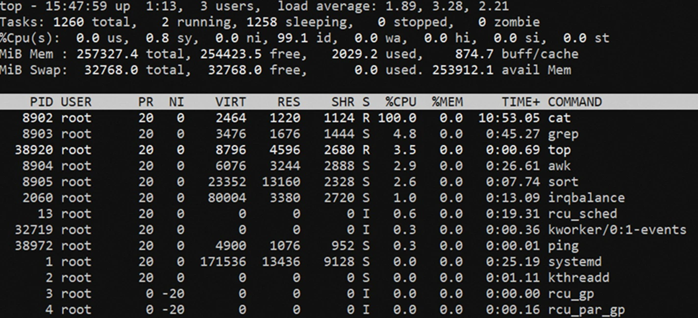

解释说明：

- 第一行：显示系统的当前时间、运行时间和平均负载等信息。

- 第二行：显示总的进程数、运行中的进程数、睡眠中的进程数、停止的进程数、僵尸进程数等信息。

- 第三行：显示 CPU 的使用情况，包括用户空间使用率、内核空间使用率、空闲率等信息。

- 第四行：显示内存的使用情况，包括总的内存大小、已用内存大小、空闲内存大小、缓存大小等信息。

- 进程列表：显示系统中正在运行的进程列表，包括进程的PID、用户、CPU使用率、内存使用率、运行时间等信息。

- 界面中下半部分描述了具体的进程所对应的信息，包含进程的 PID 号（PID）、 user（USER）、优先级（PR）、nice 值（NI）、占用的虚拟内存（VIRT）、占用的实际内存（RES）、共享内存（SHR）、CPU 利用率（%CPU）、内存使用的百分比（%MEM）、运行时间（TIME+）和进程的命令行（COMMAND）。

<a id="section-1-7-1-2"></a>

#### 1.7.1.2. ps 工具

ps 是一个常见的命令工具，用于查看系统进程的信息。它可以显示在系统中正在运行的进程的详细信息，包括进程的 PID、占用的CPU 和内存，以及进程的执行状态等。ps 命令的基本语法如下：

```text
ps [options]
```

- ps 命令中最常用的任务管理选项包括：

  | 参数 | 详细说明 |
  | --- | --- |
  | a | 显示所有进程，包括其他用户的进程； |
  | u | 以用户为主的格式来显示进程信息； |
  | x | 显示没有控制终端的进程； |
  | e | 显示所有进程，包括没有控制终端的进程； |
  | f | 以树状结构显示进程信息； |
  | r | 显示正在运行的进程。 |

- 示例

  ```text
  # ps -aux
  USER         PID %CPU %MEM    VSZ   RSS TTY      STAT START   TIME COMMAND
  root           1  0.3  0.0 171672 13472 ?        Ss   14:34   0:38 
  /usr/lib/systemd/systemd --switche
  root           2  0.0  0.0      0     0 ?        S    14:34   0:01 [kthreadd]
  root           3  0.0  0.0      0     0 ?        I<   14:34   0:00 [rcu_gp]
  root           4  0.0  0.0      0     0 ?        I<   14:34   0:00 [rcu_par_gp]
  root           6  0.0  0.0      0     0 ?        I<   14:34   0:00 [kworker/0:0H-event
  s_highpri]
  root           7  0.2  0.0      0     0 ?        I    14:34   0:35 [kworker/u256:0-pol
  l_megasas0_
  root           9  0.0  0.0      0     0 ?        I<   14:34   0:00 [mm_percpu_wq]
  root          10  0.0  0.0      0     0 ?        S    14:34   0:00 [rcu_tasks_rude_]
  root          11  0.0  0.0      0     0 ?        S    14:34   0:00 [rcu_tasks_trace]
  root          12  2.7  0.0      0     0 ?        S    14:34   5:23 [ksoftirqd/0]
  root          13  3.2  0.0      0     0 ?        I    14:34   6:25 [rcu_sched]
  root          14  0.1  0.0      0     0 ?        S    14:34   0:13 [migration/0]
  root          15  0.0  0.0      0     0 ?        S    14:34   0:00 [cpuhp/0]
  root          16  0.0  0.0      0     0 ?        S    14:34   0:00 [cpuhp/1]
  root          17  0.1  0.0      0     0 ?        S    14:34   0:13 [migration/1]
  root          18  2.0  0.0      0     0 ?        S    14:34   3:55 [ksoftirqd/1]
  ```

  解释说明：

  - USER：进程的所有者

  - PID：进程的 ID 号

  - %CPU：进程占用 CPU 的使用比率

  - %MEM：进程占用内存的使用比率

  - VSZ：进程使用的虚拟内存大小（单位为 KB）

  - RSS：进程占用的固定内存大小（单位为 KB）

  - TTY：进程关联的终端设备（？表示无）

  - STAT：进程状态（运行中、睡眠、僵尸等）

  - START：进程启动的时间

  - TIME：进程占用 CPU 的运行时间

  - COMMAND：进程启动的命令行

<a id="section-1-7-1-3"></a>

#### 1.7.1.3. kill 工具

kill 命令是一种用于终止（停止）进程的命令。当一个进程变得不稳定或者有问题时，可以使用 kill 命令停止它。其使用方式如下所示：

```text
kill --help
```

返回示例如下：

```text
kill: kill [-s sigspec | -n signum | -sigspec] pid | jobspec ... or kill -l [sigspec]
    Send a signal to a job.

    Send the processes identified by PID or JOBSPEC the signal named by
    SIGSPEC or SIGNUM.  If neither SIGSPEC nor SIGNUM is present, then
    SIGTERM is assumed.

    Options:
      -s sig    SIG is a signal name
      -n sig    SIG is a signal number
      -l        list the signal names; if arguments follow `-l' they are
                assumed to be signal numbers for which names should be listed
      -L        synonym for -l

    Kill is a shell builtin for two reasons: it allows job IDs to be used
    instead of process IDs, and allows processes to be killed if the limit
    on processes that you can create is reached.

    Exit Status:
    Returns success unless an invalid option is given or an error occurs.
```

最常用的方式有：

- 终止进程：kill PID，PID 是进程的 ID，可通过 ps 命令查看；

- 给进程发送信号：kill -s SIGNAL PID，其中常见的信号包括：

  - SIGHUP (1)：终端断开或进程被挂起；

  - SIGINT (2)：用户输入中断信号；

  - SIGQUIT (3)：用户输入退出信号；

  - SIGKILL (9)：强制终止进程；

  - SIGTERM (15)：默认情况下发送的终止信号，允许进程清理资源并退出；

  - SIGSTOP (17)：暂停进程，可以使用 SIGCONT 信号恢复进程；

- 其他的信号可使用 kill -l 命令查看；

- 可以使用 killall COMMAND 命令终止进程名为 COMMAND 的所有进程。

<a id="section-1-7-1-4"></a>

#### 1.7.1.4. chrt 工具

chrt 命令用于更改或显示进程或线程的调度策略，例如实时优先级和调度策略，以及可选的 CPU。这个命令通常只能由 root 用户或具有 CAP_SYS_NICE 特权的用户运行。其用法如下所示：

```text
chrt --help
```

返回示例如下：

```text
Show or change the real-time scheduling attributes of a process.

Set policy:
 chrt [options] <priority> <command> [<arg>...]
 chrt [options] --pid <priority> <pid>

Get policy:
 chrt [options] -p <pid>

Policy options:
 -b, --batch          set policy to SCHED_BATCH
 -d, --deadline       set policy to SCHED_DEADLINE
 -f, --fifo           set policy to SCHED_FIFO
 -i, --idle           set policy to SCHED_IDLE
 -o, --other          set policy to SCHED_OTHER
 -r, --rr             set policy to SCHED_RR (default)

Scheduling options:
 -R, --reset-on-fork       set reset-on-fork flag
 -T, --sched-runtime <ns>  runtime parameter for DEADLINE
 -P, --sched-period <ns>   period parameter for DEADLINE
 -D, --sched-deadline <ns> deadline parameter for DEADLINE

Other options:
 -a, --all-tasks      operate on all the tasks (threads) for a given pid
 -m, --max            show min and max valid priorities
 -p, --pid            operate on existing given pid
 -v, --verbose        display status information

 -h, --help           display this help
 -V, --version        display version

For more details see chrt(1).
```

常用选项解释：

<table>
  <tr>
    <th width="89">常用选项</th>
    <th>详细说明</th>
  </tr>
  <tr>
    <td>-f</td>
    <td>表示使用 FIFO 调度策略。FIFO 即先进先出的调度策略，它会按照进程的提交顺序依次执行进程。如果有一个进程占用了 CPU，那么其他进程就必须等待它执行完毕才能执行。</td>
  </tr>
  <tr>
    <td>-r</td>
    <td>表示使用 RR 调度策略。RR 即轮询的调度策略，它会按照时间片轮流为每个进程分配CPU 时间。如果某个进程的时间片耗尽，那么它就会被挂起，等待下一次轮换。</td>
  </tr>
  <tr>
    <td>-b</td>
    <td>表示使用 BATCH 调度策略。BATCH 即批处理的调度策略，它会按照提交顺序依次执行进程。与 FIFO 不同的是，BATCH 会将进程放在后台运行，因此不会影响其他前台进程的运行。</td>
  </tr>
  <tr>
    <td>-d</td>
    <td>表示使用 DEADLINE 调度策略。DEADLINE 是一种基于期限的调度策略，可以为实时任务提供更高的实时性和响应能力，适用于对任务实时性要求非常高的场景。</td>
  </tr>
  <tr>
    <td>-o</td>
    <td>表示使用 OTHER 调度策略，即 CFS 调度策略，是系统中默认的非实时调度策略，适用于大多数普通的用户进程。CFS 是一种完全公平的调度器，通过维护一棵红黑树来实现公平调度。它为每个进程分配虚拟运行时间，并选择虚拟运行时间最小的任务来运行。这种方式可以保证每个进程都获得相等的 CPU 时间，从而提高了系统的公平性和响应性。</td>
  </tr>
  <tr>
    <td>-r</td>
    <td>表示使用 RR 调度策略，即时间片轮转算法（Round-Robin），它为每个实时进程分配一定的 CPU 时间片。SCHED_RR 的进程优先级高低不同，优先级高的进程先得到CPU 时间片，执行完后让其他同优先级进程运行，优先级低的进程则在所有优先级高于它的进程都运行完后才会获得 CPU 时间片。</td>
  </tr>
  <tr>
    <td>-m</td>
    <td>输出调度策略对应的优先级范围。</td>
  </tr>
  <tr>
    <td>-p</td>
    <td>用于指定进程的 PID。</td>
  </tr>
  <tr>
    <td>-T</td>
    <td>用于设置 DEADLINE 调度策略的 runtime，该值 &lt;= deadline。</td>
  </tr>
  <tr>
    <td>-D</td>
    <td>用于设置 DEADLINE 调度策略的deadline，该值 &lt;= period。</td>
  </tr>
  <tr>
    <td>-P</td>
    <td>用于设置 DEADLINE 调度策略的 period 周期。</td>
  </tr>
</table>

- 查看调度策略及对应的优先级范围：

  ```text
  chrt -m
  ```

  返回示例如下：

  ```text
  SCHED_OTHER min/max priority    : 0/0
  SCHED_FIFO min/max priority     : 1/99
  SCHED_RR min/max priority       : 1/99
  SCHED_BATCH min/max priority    : 0/0
  SCHED_IDLE min/max priority     : 0/0
  SCHED_DEADLINE min/max priority : 0/0
  ```

- 查看 1234 号进程当前的调度策略及优先级：

  ```text
  chrt -p 1234
  ```

  返回示例如下：

  ```text
  pid 1234's current scheduling policy: SCHED_OTHER
  pid 1234's current scheduling priority: 0
  ```

- 给 1234 号进程设置 SCHED_RR 调度器策略，优先级为 50：（如果失败，请检查该进程所在 cgroup的 cpu.rt_runtime_us 参数，若为 0 则不允许设置）

  ```text
  chrt -r -p 50 1234
  chrt -p 1234
  ```

  返回示例如下：

  ```text
  pid 1234's current scheduling policy: SCHED_RR
  pid 1234's current scheduling priority: 50
  ```

- 给 1234 号进程设置 SCHED_DEADLINE 调度策略，优先级为 0，设置 runtime 1000000 ns，deadline 3000000 ns，period 5000000 ns：

  ```text
  chrt -d -T 1000000 -D 3000000 -P 5000000 -p 0 1234
  chrt -p 1234
  ```

  返回示例如下：

  ```text
  pid 1234's current scheduling policy: SCHED_DEADLINE
  pid 1234's current scheduling priority: 0
  pid 1234's current runtime/deadline/period parameters: 1000000/3000000/5000000
  ```

<a id="section-1-7-2"></a>

### 1.7.2. sysfs相关接口

sysfs相关接口如下表：

| 配置接口 | 读\\写权限 | 默认值 | 描述 |
| --- | --- | --- | --- |
| /sys/fs/cgroup/cpu/$cg/cpu.cfs_period_us | rw 根组不可写 | 100000 | cfs 带宽控制器给一个cgroup分配 cpu 时间片的周期，单位：us。 |
| /sys/fs/cgroup/cpu/$cg/cpu.cfs_quota_us | rw 根组不可写 | -1 | cfs 带宽控制器在一个周期内能够给该cgroup 使用CPU的最大时间片，-1代表不限制，单位：us。 |
| /sys/fs/cgroup/cpu/$cg/cpu.ht_stable | rw | 0 | 该接口为开关接口，有效值为0，1。 设置为1时，该 cgroup 开启 ht_stable 功能； 设置为0时，该cgroup 关闭 ht_stable 功能；仅在支持 HT 超线程特性的环境中出现。 |
| /sys/fs/cgroup/cpu/$cg/cpu.rt_period_us | rw 根组不可写 | 1000000 | rt 带宽控制器给一个cgroup分配 cpu 时间片的周期，单位：us。 |
| /sys/fs/cgroup/cpu/$cg/cpu.rt_runtime_us | rw 根组不可写 | 950000 | rt 带宽控制器在一个周期内能够给该cgroup 使用的CPU的最大时间片，单位：us。 |
| /sys/fs/cgroup/cpu/$cg/cpu.shares | rw 根组不可写 | 1024 | cgroup 的调度相对权重值，表示可以使用的CPU时间。 |
| /sys/fs/cgroup/cpu/$cg/cpu.stat | read only | NA | cgroup 内的进程使用的 CPU 时间统计。 |
| /sys/fs/cgroup/cpuacct/$cg/cpuacct.block_latency | read only | NA | 统计该 cgroup 的所有任务的阻塞时间的分布。 |
| /sys/fs/cgroup/cpuacct/$cg/cpuacct.cgroup_wait_latenc y | read only | NA | 统计该 cgroup 的所有非任务调度实体的等待时间的分布。 |
| /sys/fs/cgroup/cpuacct/$cg/cpuacct.enable_sli | rw 根组不可写 | 0 | 该接口为开关接口，有效值为0，1。 设置为1时，使能 sli。 设置为0时，关闭 sli。 |
| /sys/fs/cgroup/cpuacct/$cg/cpuacct.ioblock_latency | read only | NA | 统计该 cgroup 的所有任务的 io 阻塞时间的分布。 |
| /sys/fs/cgroup/cpuacct/$cg/cpuacct.proc_stat | read only | NA | 统计该 cgroup 的所有任务的 CPU 时间，load以及不同状态的任务数量。 |
| /sys/fs/cgroup/cpuacct/$cg/cpuacct.sched_cfs_statistic s | read only | NA | 统计该 cgroup 的 cfs 任务不同状态的时间： 第一行为： 任务处在运行态的总时间，在 CPU 上运行时间，因非sibling。 cgroup 在CPU上运行而在队列中等待时间，因sibling cgroup 在CPU上运行而在队列中等待时间，在队列中等待的最长时间。 第二行为： 高优先级任务在队列中等待低优先级任务的总时长，保留字段，低优先级任务被驱逐的总时长，保留字段。 |
| /sys/fs/cgroup/cpuacct/$cg/cpuacct.stat | read only | NA | 统计cgroup的所有任务（包括其子孙层级中的所有任务）使用的用户和系统CPU时间，方式如下：user——用户模式中任务使用的CPU时间 system ——系统模式中任务使用的CPU时间 其单位为USER_HZ。 |
| /sys/fs/cgroup/cpuacct/$cg/cpuacct.usage | rw | 0 | 统计一个cgroup中所有任务（包括其子孙层级中的所有任务）使用CPU的总时间（纳秒）,该文件是可以写入0值的，用来重置统计信息。 |
| /sys/fs/cgroup/cpuacct/$cg/cpuacct.usage_all | read only | NA | 详细输出文件cpuacct.usage_percpu_user和cpuacct.usage_percpu_sys的内容。 |
| /sys/fs/cgroup/cpuacct/$cg/cpuacct.usage_percpu | read only | NA | 统计一个cgroup中所有任务（包括其子孙层级中的所有任务）在每个CPU使用CPU的时间（纳秒）。 |
| /sys/fs/cgroup/cpuacct/$cg/cpuacct.usage_percpu_sys | read only | NA | 统计一个cgroup中所有任务（包括其子孙层级中的所有任务）在每个CPU上使用内核态CPU的时间（纳秒）。 |
| /sys/fs/cgroup/cpuacct/$cg/cpuacct.usage_percpu_user | read only | NA | 统计一个cgroup中所有任务（包括其子孙层级中的所有任务）在每个CPU上使用用户态CPU的时间（纳秒）。 |
| /sys/fs/cgroup/cpuacct/$cg/cpuacct.usage_sys | read only | NA | 统计一个cgroup中所有任务（包括其子孙层级中的所有任务）使用内核态CPU的总时间（纳秒）。 |
| /sys/fs/cgroup/cpuacct/$cg/cpuacct.usage_user | read only | NA | 统计一个 cgroup中所有任务（包括其子孙层级中的所有任务）使用用户态CPU的总时间（纳秒）。 |
| /sys/fs/cgroup/cpuacct/$cg/cpuacct.wait_latency | read only | NA | 统计该 cgroup 的所有任务的等待时间的分布。 |
| /sys/fs/cgroup/cpuset/$cg/c puset.cpu_exclusive | rw | 根组默认值为1，其他为0 | 该接口为开关接口，有效值为0，1。 设置为1时，说明独占指定 cpus。 设置为0时，说明不会独占指定 cpus。 |
| /sys/fs/cgroup/cpuset/$cg/c puset.cpus | rw 根组不可写 | 根组默认值为所有在线CPU，其他为空 | 限制一组进程所能使用的 cpu, 供用户进行设置。 |
| /sys/fs/cgroup/cpuset/$cg/c puset.effective_cpus | read only | NA | 显示实际进程可以使用的 cpu。 |
| /sys/fs/cgroup/cpuset/$cg/c puset.effective_mems | read only | NA | 显示实际进程可以使用的 node。 |
| /sys/fs/cgroup/cpuset/$cg/c puset.mem_exclusive | rw | 根组默认值为1，其他为0 | 该接口为开关接口，有效值为0，1。 设置为1时，说明独占指定 mems。 设置为0时，说明不会独占指定 mems。 |
| /sys/fs/cgroup/cpuset/$cg/c puset.mem_hardwall | rw | 0 | 该接口为开关接口，有效值为0，1。 设置为1时，说明 cpuset 为 Hardwall。 设置为0时，说明cpuset 不是 Hardwall。 |
| /sys/fs/cgroup/cpuset/$cg/c puset.memory_migrate | rw | 0 | 该接口为开关接口，有效值为0，1。 设置为1时，使能 memory migration, 即内存节点改变后迁移内存。 设置为0时，关闭 memory migration, 即内存节点改变后不会迁移内存。 |
| /sys/fs/cgroup/cpuset/$cg/c puset.memory_pressure | read only | NA | 统计该 cpuset 中的内存压力，仅当cpuset.memory_pressure_enabled 为1时统计。 |
| /sys/fs/cgroup/cpuset/$cg/c puset.memory_pressure_en abled | rw | 0 | 该接口为开关接口，有效值为0，1 设置为1时，统计该 cpuset 中的内存压力 设置为0时，不统计该cpuset 中的内存压力 |
| /sys/fs/cgroup/cpuset/$cg/c puset.memory_spread_pag e | rw | 0 | 该接口为开关接口，有效值为0，1 设置为1时，该cgroup 的内核 page cache 将会均匀地分布在不同的节点上。 设置为0时，该 cgroup 的内核 page cache 将不会均匀地分布在不同的节点上。 |
| /sys/fs/cgroup/cpuset/$cg/c puset.memory_spread_slab | rw | 0 | 该接口为开关接口，有效值为0，1。 设置为1时，内核 slab cache 将会均匀地分布在不同的节点上。 设置为0时，内核 slab cache 将不会均匀地分布在不同的节点上。 |
| /sys/fs/cgroup/cpuset/$cg/c puset.mems | rw 根组不可写 | 根组默认值为所有在线node，其他为空 | 限制一组进程所能使用的mem，供用户进行设置。 |
| /sys/fs/cgroup/cpuset/$cg/c puset.sched_load_balance | rw | 1 | flag：默认为值1，表示进程会在该cpuset中允许的cpu上进行负载均衡。 |
| /sys/fs/cgroup/cpuset/$cg/c puset.sched_relax_domain_level | rw | -1 | 可设置的值为-1到一个较小的整数值，只有sched_load_balance为1时生效，值越大，表示负载均衡时查找的cpu范围越大。 |

<a id="section-1-7-3"></a>

### 1.7.3. procfs 相关接口

procfs 相关接口如下表：

| 配置接口 | 读\\写权限 | 默认值 | 描述 |
| --- | --- | --- | --- |
| /proc/$pid/sched | r | NA | 进程调度相关的实时数据。 |
| /proc/$pid/schedstat | r | NA | 进程运行时间、休眠时间和等待时间。 |
| /proc/$pid/cpuset | r | NA | 进程所在cpuset cgroup的路径。 |
| /proc/$pid/task/$tid/sch ed | r | NA | 线程调度相关的实时数据。 |
| /proc/$pid/task/$tid/sch edstat | r | NA | 线程运行时间、休眠时间和等待时间。 |
| /proc/$pid/task/$tid/cpu set | r | NA | 线程所在cpuset cgroup的路径。 |
| /proc/stat | r | NA | CPU 的总体使用情况，包含了用户空间、内核空间、空闲时间、等待 I/O 时间、硬中断处理时间、软中断处理时间等信息。 |
| /proc/cpuinfo | r | NA | 系统 CPU 信息。 |
| /proc/loadavg | r | NA | CPU 平均负载信息。 |
| /proc/sched_debug | r | NA | 当前系统中所有进程的调度信息，包括每个进程的调度优先级、进程状态、进程正在执行的CPU 核心等。 |
| /proc/schedstat | r | NA | 当前系统 CPU 及调度域的统计信息。 |
| /proc/cpusli/sched_lat_e nabled | rw | 0 | 控制调度延迟统计特性是否开启。 |
| /proc/sys/kernel/rich_co ntainer_enable | rw | 1 | 控制富容器特性是否开启。 |
| /proc/sys/kernel/sched_autogroup_enabled | rw | 0 | 控制autogroup是否开启。 |
| /proc/sys/kernel/sched_cfs_bandwidth_slice_us | rw | 5,000 | cfs_rq 中分配的 CPU 时间完全消耗之后可以尝试向 cfs_bandwidth 申请新的 CPU 时间片，单位：us。 |
| /proc/sys/kernel/sched_child_runs_first | rw | 0 | 设置保证子进程初始化完成后在父进程之前先被调度： 0：先调度父进程 1：先调度子进程 |
| /proc/sys/kernel/sched_deadline_period_max_u s | rw | 4,194,304 | deadline任务时钟周期最大值，单位us。 |
| /proc/sys/kernel/sched_deadline_period_min_us | rw | 100 | deadline任务时钟周期最小值，单位us。 |
| /proc/sys/kernel/sched_domain/cpu0/domain0/b usy_factor | rw | 16 | 正常情况下，balance_interval定义了均衡的时间间隔，如果cpu繁忙，那么均衡需要的时间间隔长一些，即时间间隔定义为busy_factor x balance_interval。 |
| /proc/sys/kernel/sched_domain/cpu0/domain0/c ache_nice_tries | rw | 0 | 这个成员应该是和nr_balance_failed配合控制负载均衡过程的迁移力度。当nr_balance_failed大于cache_nice_tries的时候，负载均衡会变得更加激进。 |
| /proc/sys/kernel/sched_domain/cpu0/domain0/fl ags | read only | SD_BALANCE_N EWIDLE SD_BALANCE_E XEC SD_BALANCE_F ORK SD_WAKE_AFFI NE SD_SHARE_CPU CAPACITY SD_SHARE_PKG _RESOURCES SD_PREFER_SIB LING | 调度域标志，其默认值因不同硬件拓扑结构而异。 |
| /proc/sys/kernel/sched_domain/cpu0/domain0/i mbalance_pct | rw | 110 | 判断该调度域是否已经均衡的一个基准值。 |
| /proc/sys/kernel/sched_domain/cpu0/domain0/max_interval | rw | 4 | 设置此CPU在第0级调度域进行负载均衡的最长间隔时间，上一次做了负载均衡经过了这个时间一定要再进行一次。 |
| /proc/sys/kernel/sched_domain/cpu0/domain0/max_newidle_lb_cost | rw | 3,241 | 在该domain上进行newidle balance的最大时间长度（即newidle balance的开销）。 最小值是sysctl_sched_migration_cost |
| /proc/sys/kernel/sched_domain/cpu0/domain0/min_interval | rw | 2 | 设置此CPU在第0级调度域进行负载均衡的最小间隔时间，在上一次负载均衡到这段时间内都不能再进行负载均衡。 |
| /proc/sys/kernel/sched_domain/cpu0/domain0/n ame | read only | SMT | 第0级调度域的名称。 |
| /proc/sys/kernel/sched_l atency_ns | rw | 24,000,000 | 表示进程排队的最长时间，调度器尽力保障进程排队时间不超过该参数，以确保多进程并发执行。随着进程数量增多，调度器根据该参数调整进程执行的时间片。当进程数量多于kernel.sched_latency_ns /kernel.sched_min_granularity_ns之后，调度器不再作此保证。 |
| /proc/sys/kernel/sched_migration_cost_ns | rw | 500,000 | 表示在多个 CPU 之间迁移进程时的成本，单位是纳秒。这个参数的值越大，意味着迁移进程的成本越高，调度器就会更倾向于让进程在当前 CPU 上执行，而不是迁移到其他 CPU 上执行。主要用于判断是否能 pull 进程到即将idle的 CPU 上，以及用于判断进程是否已经在原CPU 上缓存足够热了。 |
| /proc/sys/kernel/sched_min_granularity_ns | rw | 3,000,000 | 表示一个进程在CPU上运行的最小时间，在此时间内，内核是不会主动挑选其他进程进行调度。 |
| /proc/sys/kernel/sched_nr_migrate | rw | 32 | 在多CPU情况下进行负载均衡时，一次最多移动多少个进程到另一个CPU上。 |
| /proc/sys/kernel/sched_r r_timeslice_ms | rw | 100 | 用来指示round robin调度进程的间隔，也表示每个进程在轮流调度时最大执行时间。 |
| /proc/sys/kernel/sched_r t_period_us | rw | 1,000,000 | 该参数与sched_rt_runtime_us一起决定了实时进程在以sched_rt_period为周期的时间内，实时进程最多能够运行的总的时间不能超过sched_rt_runtime_us。 |
| /proc/sys/kernel/sched_r t_runtime_us | rw | 950,000 | 该参数与sched_rt_period一起决定了实时进程在以sched_rt_period为周期的时间内，实时进程最多能够运行的总的时间不能超过sched_rt_runtime_us。 |
| /proc/sys/kernel/sched_schedstats | rw | 1 | 控制是否开启调度器详细统计功能。 |
| /proc/sys/kernel/sched_t unable_scaling | rw | 1 | 当内核试图调整sched_min_granularity，sched_latency和sched_wakeup_granularity这三个值的时候所使用的更新方法： 0：不缩放 1：按照cpu个数以2为底的对数值进行缩放 2：按照cpu的个数进行线性比例的缩放 |
| /proc/sys/kernel/sched_wakeup_granularity_ns | rw | 4,000,000 | 新唤醒进程很容易抢占正在运行的进程，为了避免频繁打断正在运行的进程，该参数限制新唤醒的进程的抢占的概率。只有当新唤醒进程的vruntime大于当前进程的vruntime时，才进行抢占。该参数越大，新唤醒进程抢占的概率越小。 |

<a id="section-1-7-4"></a>

### 1.7.4. debugfs 相关接口

debugfs 相关接口如下表：

| 配置接口 | 读\\写权限 | 默认值 | 描述 |
| --- | --- | --- | --- |
| /sys/kernel/debug/sc hed_debug | rw | N | 拓扑相关调试信息开关，开启后将在调度域重建时打印详细信息。 |
| /sys/kernel/debug/sc hed_features | rw | GENTLE_FAIR_SLEEPERS START_DEBIT NO_NEXT_BUDDY LAST_BUDDY CACHE_HOT_BUDDY WAKEUP_PREEMPTION NO_HRTICK NO_DOUBLE_TICK NONTASK_CAPACITY TTWU_QUEUE PREFER_TTWU_QUEUE NO_SIS_AVG_CPU SIS_PROP NO_WARN_DOUBLE_CLOCK RT_PUSH_IPI NO_RT_RUNTIME_SHARE NO_LB_MIN ATTACH_AGE_LOAD WA_IDLE WA_WEIGHT WA_BIAS UTIL_EST UTIL_EST_FASTUP ALT_PERIOD BASE_SLICE NO_NUMA_AFFINE NO_HT_STABLE | 见下文。 |

各项调度特性的配置，NO_前缀表示关闭，否则表示开启。 以下是调度特性的简介：

- GENTLE_FAIR_SLEEPERS：对于被唤醒的睡眠线程给予较少的补偿。

- START_DEBIT：推迟新建线程的运行时机，避免饿死当前线程。 NEXT_BUDDY：偏向于运行最后唤醒的线程，逻辑上将其放到队列最前，即使它不能抢占，可能有助于缓存亲和性。

- LAST_BUDDY：偏向于运行上次被唤醒抢占的受害者，可能有助于缓存亲和性。

- CACHE_HOT_BUDDY：认为上述两种进程有缓存亲和性，避免被负载均衡机制迁移。

- WAKEUP_PREEMPTION：允许被唤醒的线程抢占当前线程。

- HRTICK：使用高精度时钟而不是普通时钟实现抢占。

- DOUBLE_TICK：同时使用普通时钟和高精度时钟实现抢占。

- NONTASK_CAPACITY：将 CPU 容量减去不能用于运行任务的时间，例如 steal 和 irq 部分时间。

- TTWU_QUEUE：将线程唤醒的下半部分卸载到远端 CPU 执行（跨 llc 时）。

- PREFER_TTWU_QUEUE：更偏好使用上述方式，只要目标 CPU 空闲均可卸载。

- SIS_AVG_CPU：如果寻找空闲 CPU 的开销超过了平均空闲时间，则不寻找。

- SIS_PROP：根据调度域大小和空闲时间，缩小扫描空闲 CPU 的范围。

- WARN_DOUBLE_CLOCK：如果在同一个调度器队列临界区内更新了两次调度器时钟，则发出警告。

- RT_PUSH_IPI：对于实时任务，用 IPI 向其他 CPU 发送通知 push 迁移任务，避免单个 CPU 执行过重的 pull 迁移任务。

- RT_RUNTIME_SHARE：允许所有 CPU 共享实时任务的时间限额。

- LB_MIN：负载均衡阶段，计算负载时忽略极小负载的任务。

- ATTACH_AGE_LOAD：在进程切换 cgroup 时更新负载，算上时间衰减。

- WA_IDLE：如果当前 CPU 即将空闲，则将被唤醒的线程拉取过来。

- WA_WEIGHT：如果当前 CPU 负载小于被唤醒线程之前所在的 CPU，则将被唤醒的线程拉取过来。

- WA_BIAS：为上述特性的负载计算中加入不平衡因子的偏移。

- UTIL_EST：预估利用率功能，用于补救 PELT 的 util 更新不及时，大任务从长时间睡眠中醒来负载误判的情况。

- UTIL_EST_FASTUP：调整预估利用率算法，利用率上升不做平滑，只在利用率下降时才使用平滑算法。

- ALT_PERIOD：计算时间片时，考虑在当前 cgroup 的所有类型的任务数量，而非 CFS 普通任务的数量，避免错误估计调度延迟。

- BASE_SLICE：确保时间片不低于最小运行粒度参数，避免高频切换。

- NUMA_AFFINE：把相同 Cgroup 里的线程约束在同一个 node 里执行，利用这些线程之间的亲和性关系提升访存效率。

- HT_STABLE：在超线程对端施加固定干扰从而实现算力稳定的特性，仅在支持 HT 超线程特性的环境中出现。

<a id="section-1-7-5"></a>

### 1.7.5. 调度自研特性

<a id="section-1-7-5-1"></a>

#### 1.7.5.1. Group Identity

Group Identity 是阿里云服务器操作系统 V3内核提供的 CPU 混部功能，可以通过该功能为每一个 CPU cgroup 设置不同的身份标识，以区分不同 CPU cgroup 中进程任务的优先级。其提供的接口如下。

- procfs 提供的接口：

  | 配置接口 | 读写权限 | 初始值 | 描述 |
  | --- | --- | --- | --- |
  | /proc/sys/kernel/sched_expel_idle_balance_del ay | rw | -1 | CPU在驱逐状态下，idle balance的最小时间间隔。取值为-1时表示不允许进行idle balance。 当CPU上均为ID_UNDERCLASS任务且任务在被驱逐时，CPU的状态可以理解为空闲状态，在该状态下CPU会进行idle balance以提高负载均衡的效果，但会对ID_UNDERCLASS任务造成损伤。通过设置sched_expel_idle_balance_delay参数可以缓解该问题。 |
  | /proc/sys/kernel/sched_expel_update_interval | rw | 10 | CPU在选择任务时，驱逐状态的自动更新时间间隔。仅在ID_LOOSE_EXPEL特性开启时生效（当前版本有显示 bug，会多显示一个0，但不会影响逻辑）。 |
  | /proc/sys/kernel/sched_group_identity_enabled | rw | 0 | 控制Group Identity功能是否开启。 |
  | /proc/sys/kernel/sched_idle_saver_wmark | rw | 0 | 设置CPU空闲时间的水位线。当ID_IDLE_SAVER任务被唤醒时，只会尝试找到高于该水位线的空闲CPU，不会尝试找到低于该水位线的空闲CPU。 |
  | /proc/sys/kernel/sched_bvt_place_epsilon | rw | 1000000 | 离线任务唤醒时的惩罚时间，单位 ns。 |

- sysfs 提供的接口：

  | 配置接口 | 读写权限 | 初始值 | 描述 |
  | --- | --- | --- | --- |
  | /sys/fs/cgroup/cpu/$cg/cpu.bv t_warp_ns | rw 根组不可写 | 0 | cgroup优先级配置接口，该接口的取值说明如下：<br>• 2：表示同时具有身份标识ID_SMT_EXPELLER、ID_IDLE_SEEKER、ID_HIGHCLASS，对应的identity值为22。<br>• 1：表示同时具有身份标识ID_HIGHCLASS、ID_IDLE_SEEKER，对应的identity值为18。<br>• 0：表示身份标识为ID_NORMAL，对应的identity值为0。<br>• -1：表示同时具有身份标识ID_UNDERCLASS、ID_IDLE_SAVER，对应的identity值为9。<br>• -2：表示同时具有身份标识ID_UNDERCLASS、ID_IDLE_SAVER，对应的identity值为9。 |
  | /sys/fs/cgroup/cpu/$cg/cpu.id entity | rw 根组不可写 | 0 | cgroup优先级配置接口，该接口是一个位段，共有5个比特位，该接口各个比特位的取值说明如下：<br>• 空值：表示身份标识为ID_NORMAL。<br>• 比特位0：表示身份标识为ID_UNDERCLASS。<br>• 比特位1：表示身份标识为ID_HIGHCLASS。<br>• 比特位2：表示身份标识为ID_SMT_EXPELLER。<br>• 比特位3：表示身份标识为ID_IDLE_SAVER。<br>• 比特位4：表示身份标识为ID_IDLE_SEEKER。 例如，如果设置一个cgroup的身份标识为ID_HIGHCLASS和ID_IDLE_SEEKER，那么将比特位1和4置为1，其他比特位置为0，得到的二进制表示为：10010，转化为十进制为：18，则执行<code> echo 18 &gt; </code><code>/sys/fs/cgroup/cpu/$cg/cpu.identity</code><code> </code>即可完成写入。 |

  

- debugfs中提供的接口主要在 sched_features 中。

  | 配置接口 | 读写权限 | 初始值 | 描述 |
  | --- | --- | --- | --- |
  | /sys/kernel/debug/sched_fe atures | rw | ID_IDLE_AVG<br>NO_ID_RESCUE_EXPELLEE<br>NO_ID_EXPELLEE_NEVER_HO T<br>NO_ID_LAST_HIGHCLASS_STA Y<br>NO_ID_LOOSE_EXPEL<br>NO_ID_EXPELLER_SHARE_CO RE<br>ID_LOAD_BALANCE | 见下文。 |

  - ID_IDLE_AVG：该特性与 ID_IDLE_SAVER 身份标识配合，把 ID_UNDERCLASS 任务的运行时间计入空闲时长，防止只有 ID_UNDERCLASS 任务运行时仍保留空闲 CPU（idle CPU）的问题，避免资源浪费。

  - ID_RESCUE_EXPELLEE：该特性作用于负载均衡场景，如果任务无法找到可用的 CPU 资源，则正在进行驱逐 ID_UNDERCLASS 任务的 CPU 会成为负载均衡的目标。该特性用于帮助ID_UNDERCLASS 任务尽快摆脱被驱逐的状态。

  - ID_EXPELLEE_NEVER_HOT：该特性被启用后，正在被驱逐的 ID_UNDERCLASS 任务在判断是否需要迁移至其他 CPU 时，不会因为热缓存的原因而造成拒绝迁移。用于帮助 ID_UNDERCLASS 任务尽快摆脱被驱逐的状态。

  - ID_LAST_HIGHCLASS_STAY：该特性被启用后，CPU 上最后一个运行的 ID_HIGHCLASS 任务不会被迁移至其他 CPU。

  - ID_LOOSE_EXPEL：该特性被启用后，CPU 不会在每次选择任务时更新驱逐状态，而是根据内核参数sched_expel_update_interval 设置的时间自动更新。该特性的开关仅影响 CPU 选择任务时的状态更新，不影响处理IPI 中断的更新。

  - ID_EXPELLER_SHARE_CORE：该特性开启时允许 ID_SMT_EXPELLER 的任务优先选择已经有ID_SMT_EXPELLER 任务的物理核，该特性关闭时则不允许。该特性关闭时可以尽可能地把ID_SMT_EXPELLER 的任务分散到各个物理核上，从而避免 ID_SMT_EXPELLER 任务之间的相互干扰。

  - ID_LOAD_BALANCE：该特性主要影响任务唤醒时的 CPU 选择，是为了保证 ID_SMT_EXPELLER 任务在运行时可以尽可能的独占一个物理核，避免 SMT 干扰，最好在 ID_EXPELLER_SHARE_CORE 关闭地情况下使用。

<a id="section-1-7-5-2"></a>

#### 1.7.5.2. Group Balancer

GroupBalancer可以解决 share 化场景下的亲和域问题：cache 亲和性下降、cache miss增多、跨NUMA 访问内存等等，以及内存带宽竞争等问题，可以避免以上问题带来的 share 化场景下的性能下降，降低高负载场景下的 CPU 使用率，提高吞吐量。该特性提供的接口如下。

- sysfs 提供的接口：

  | 配置接口 | 读写权限 | 初始值 | 描述 |
  | --- | --- | --- | --- |
  | /sys/fs/cgroup/cpuset/$cg/c puset.group_balancer | rw 根组不可写 | 0 | 该接口为开关接口，有效值为0，1 设置为1时表示使能 GroupBalancer，使 cgroup 被GroupBalancer 分配到某个分区，并通过软绑定功能进行限制。 设置为0时则表示不被GroupBalancer 分配到某个分区，按照硬绑定范围使用 CPU。 |
  | /sys/fs/cgroup/cpuset/$cg/c puset.soft_cpus | rw 根组不可写 | 所有在线cpu | cgroup软绑定范围，以极小的开销，尽量保证cgroup中任务的运行范围，但并不强制。 |
  | /sys/module/group_balance r/parameters | rw | 10000<br>2000<br>120<br>5 | 该接口需要加载 group_balancer.ko 之后才会有<br>scan_period<br>sampling_period<br>relative_unbalance_watermark<br>absolute_unbalance_watermark<br>描述见下文。 |

  - scan_period：巡检线程的唤醒周期，类型：unsigned int，单位为毫秒。

  - sampling_period：cgroup CPU 使用率采样线程的采样周期，类型：unsigned int，单位为毫秒。

  - relative_unbalance_watermark：不均衡水位线的相对值，当负载最高分区的 CPU 使用率大于平均CPU 使用率\*relative_unbalance_watermark/100 时，视为不均衡。类型：unsigned int，默认值：120。

  - absolute_unbalance_watermark：不均衡水位线绝对值，当负载最高分区的 CPU 使用率 – 平均CPU 使用率大于absolute_unbalance_watermark 时，视为不均衡。类型：unsigned int，默认值：5。

- debugfs 提供的接口，主要在 sched_features接口中：

  | 配置接口 | 读写权限 | 初始值 | 描述 |
  | --- | --- | --- | --- |
  | /sys/kernel/debug/sc hed_features | rw | NO_GROUP_BALAN CER | 开启 GROUP BALANCER 功能全局开关，该功能详见《Group Balancer 详细设计说明书》。 |

<a id="section-1-7-5-3"></a>

#### 1.7.5.3. CPU Burst

CPU Burst 主要是针对一些突发性、对延迟敏感的工作负载，然而，原有的 Linux CFS 带宽控制器并不能完全满足所有工作负载的需求，特别是在一些突发性负载的情况下，进程可能会短时间内需要更多的 CPU时间以避免太高的延迟。对于本特性，在每个带宽控制周期中，用于从 CPU 带宽控制器中收集没有用完的时间配额，并缓存起来。下一个带宽控制周期里，将历史周期里缓存的时间配额，增加到 CPU 带宽控制器的当前周期的配额中。CPU Burst 提供的用户接口如下所示。

- 提供的 procfs 接口如下：

  | 配置接口 | 读写权限 | 初始值 | 描述 |
  | --- | --- | --- | --- |
  | /proc/sys/kernel/sched_cfs_bw_burst _enabled | rw | 1 | 控制是否开启cpu burst功能。 |
  | /proc/sys/kernel/sched_cfs_bw_burst _onset_percent | rw | 0 | 控制cgroup创建时的初始 cpu burst百分比。 |

- 提供的 sysfs 接口如下：

  | 配置接口 | 读写权限 | 初始值 | 描述 |
  | --- | --- | --- | --- |
  | /sys/fs/cgroup/cpu/$cg/cp u.cfs_burst_us | rw 根组不可写 | 0 | 表示每个带宽控制周期里，最多可以缓存的CPU时间配额，单位：us。 |
  | /sys/fs/cgroup/cpu/$cg/cp u.cfs_init_buffer_us | rw 根组不可写 | 0 | 表示首次运行时，最多可以缓存的CPU时间配额，单位：us。 |
  | /sys/fs/cgroup/cpu/$cg/cp u.stat | read only | NA | cpu burst 监控指标：<br>• current_bw：当前周期CPU cgroup 的可用带宽；<br>• nr_burst：发生 burst 的周期数；<br>• burst_time：CPU cgroup 总的 burst 时间。 |

<a id="section-1-7-5-4"></a>

#### 1.7.5.4. CPU 动态隔离

CPU 隔离的作用是将不同的 CPU 核心或 CPU 集群分配给不同的任务，以避免不同的任务在 CPU 资源上相互竞争，从而提高整体系统性能和稳定性。CPU 隔离技术可以把一部分 CPU 隔离出来，分配给关键任务使用，非关键任务共享不被隔离的 CPU，从而保证关键任务的运行不受影响。

CPU 动态隔离提供的接口如下：

| 配置接口 | 读写权限 | 初始值 | 描述 |
| --- | --- | --- | --- |
| /proc/dyn_isol cpus | rw | NA | 控制动态隔离的 CPU 列表。 |

<a id="section-1-7-5-5"></a>

#### 1.7.5.5. plugsched 特性

plugsched 是阿里云服务器操作系统 V3 自主原创的内核调度器特性，它是内核调度器子系统热升级的SDK，可以实现在不重启系统、应用的情况下动态替换调度器子系统，毫秒级 downtime。plugsched 可以对生产环境中的内核调度特性动态的进行增、删、改，以满足不同场景或应用的需求，且支持回滚。使用plugsched 特性需要安装其软件，使用接口及说明如下：

1. 在阿里云服务器操作系统 V3中安装 plugsched：

   ```bash
   yum install plugsched -y
   ```

   plugsched 提供的接口如下所示：

   ```text
   # plugsched-cli --help
   cli.py - A command line interface for plugsched

   Usage:
     plugsched-cli init        <release_kernel> <kernel_src> <work_dir>
     plugsched-cli dev_init    <kernel_src> <work_dir>
     plugsched-cli extract_src  <kernel_src_rpm> <target_dir>
     plugsched-cli build       <work_dir>
     plugsched-cli (-h | --help)

   Options:
     -h --help     Show help.

   Available subcommands:
     init          Initialize a scheduler module for a specific kernel release and product
     dev_init      Initialize plugsched development envrionment from kernel source code
     extrat_src     extract kernel source code from kernel-src rpm
     build         Build a scheduler module rpm package for a specific kernel release and product

   Subcommand arguments:
     release_kernel      `uname -r` of target kernel to be hotpluged
     kernel_src          kernel source code directory
     kernel_src_rpm      path of kernel source rpm
     work_dir            target working directory to develop new scheduler module
     target_dir          directory to place kernel source code
   ```

   - extract_src选项，选项功能是从内核 source 软件中提取内核源代码：

     - &lt;kernel_src_rpm>：选项的必须参数，由用户输入，是指用户指定的内核 source 软件包的本地路径；

     - &lt;target_dir>：选项的必须参数，由用户输入，是指定的提取后的内核源代码存储路径。

   - init选项，选项功能是从内核源代码中生成模块代码开发环境，用户可在该开发环境中定制调度器模块：

     - &lt;release_kernel>：选项的必须参数，由用户输入，用于指定内核版本；

     - &lt;kernel_src>：选项的必须参数，由用户输入，用于指定 &lt;release_kernel> 内核版本对应的内核源代码的存储路径；

     - &lt;work_dir>：选项的必须参数，由用户输入，用于指定模块代码开发环境的工作目录。

   - dev_init 选项，该选项是从内核源代码中生成模块代码的开发环境，注意，该内核源码不是从内核的source rpm 包中提取出来的，而是用户自己的内核代码的目录，需要注意的是，使用该选项前，需要在内核代码目录中编译一次内核：

     - &lt;kernel_src>：选项的必须参数，由用户输入，用于指定用户的内核源代码的存储路径；

     - &lt;work_dir>：选项的必须参数，由用户输入，用于指定模块代码开发环境的工作目录。

   - build 选项，该选项功能是将调度器模块构建成为调度器插件：

     &lt;work_dir>：选项的必须参数，由用户输入，用于指定模块代码开发环境的工作目录。

2. 用户使用的步骤如下：

   <ol type="i">

   <li>

   创建工作目录，准备开发环境，下载并提取当前内核源代码，可使用 yumdownload 工具下载release 内核的 source rpm 包。

   ```bash
   mkdir /root/work && cd /root/work
   yum install kernel-devel kernel-debuginfo yum-utils --enablerepo=BaseOS-debuginfo -y
   yumdownloader --source kernel-$(uname -r)
   ```

   </li>

   <li>

   使用plugsched-cli 从source rpm 包提取内核源代码，提取目录为/root/work/kernel。

   ```text
   plugsched-cli extract_src xxx.src.rpm ./kernel
   ```

   </li>

   <li>

   初始化调度器模块开发环境，开发目录为/root/work/scheduler。

   ```text
   plugsched-cli init $(uname -r) ./kernel ./scheduler
   ```

   </li>

   <li>

   开发环境在scheduler 目录下的kernel/sched/mod，目录中的代码就是调度器模块的代码，开发人员可修改mod 下的代码定制化调度器模块。另外，调度器插件命名和release 版本号可通过修改scheduler/working/scheduler.spec 文件中的major_name 和release 宏。

   </li>

   <li>

   代码撰写后可生成调度器插件 rpm 包，生成的调度器插件 rpm 包位于 `scheduler/working/rpmbuild/RPMS`  目录下：

   ```text
   plugsched-cli build ./scheduler
   ```

   </li>

   <li>

   安装调度器插件rpm 包（命令为示例，需自行替换对应内核version 和插件包release）：

   ```bash
   rpm -ivh /root/work/scheduler/working/rpmbuild/RPMS/$(uname -m)/scheduler-xxx-version.release.$(uname -m).rpm
   ```

   注意事项：

   <ol type="a">

   <li>

   调度器插件的 version 对应的是内核版本的 version；

   </li>

   <li>

   同一个内核版本只能安装一个调度器插件；

   </li>

   </ol>

   <ol type="i" start="100">

   <li>

   可以同时安装一个调度器插件对应的不同的内核版本（插件的release 除外），安装时请使用如下命令：

   ```bash
   rpm -ivh scheduler-xxx-kernelversion1.rpm --oldpackage
   rpm -ivh scheduler-xxx-kernelversion2.rpm --oldpackage
   ```

   </li>

   <li value="500">

   系统启动时会自动使能当前内核版本的调度器插件，若未安装任何插件，请忽略。

   </li>

   </ol>

   </li>

   </ol>

<a id="section-1-8"></a>

## 1.8. 安全更新

<a id="section-1-8-1"></a>

### 1.8.1. 安全更新识别

<a id="section-1-8-1-1"></a>

#### 1.8.1.1. 显示可安装的安全更新

使用 yum 工具列出主机上未安装的可用安全更新：

```bash
yum updateinfo list security
```

返回示例如下：

```text
ALINUX3-SA-2023:0032 中危/安全漏洞 curl-7.61.1-25.0.2.al8.3.x86_64
ALINUX3-SA-2023:0032 中危/安全漏洞 libcurl-7.61.1-25.0.2.al8.3.x86_64
```

若没有未安装的安全更新则不会有类似条目。

<a id="section-1-8-1-2"></a>

#### 1.8.1.2. 显示已安装的安全更新

使用 yum 工具列出主机上已安装的安全更新：

```bash
yum updateinfo list security --installed
```

返回示例如下：

```text
ALINUX3-SA-2021:0025 重要/安全漏洞 bind-export-libs-9.11.20-5.1.al8.1.x86_64
ALINUX3-SA-2022:0120 低危/安全漏洞 binutils-2.35-12.2.al8.x86_64
ALINUX3-SA-2022:0120 低危/安全漏洞 binutils-gold-2.35-12.2.al8.x86_64
ALINUX3-SA-2022:0118 中危/安全漏洞 brotli-1.0.6-3.1.al8.x86_64
ALINUX3-SA-2022:0008 中危/安全漏洞 cryptsetup-libs-2.3.3-4.1.al8.1.x86_64
ALINUX3-SA-2022:0106 低危/安全漏洞 cups-client-2.2.6-38.1.al8.x86_64
ALINUX3-SA-2022:0154 重要/安全漏洞 cups-client-2.2.6-45.al8.2.x86_64
ALINUX3-SA-2022:0106 低危/安全漏洞 cups-libs-2.2.6-38.1.al8.x86_64
ALINUX3-SA-2022:0154 重要/安全漏洞 cups-libs-2.2.6-45.al8.2.x86_64
ALINUX3-SA-2021:0070 中危/安全漏洞 curl-7.61.1-18.1.al8.1.x86_64
ALINUX3-SA-2021:0078 中危/安全漏洞 curl-7.61.1-18.1.al8.2.x86_64
ALINUX3-SA-2022:0142 中危/安全漏洞 curl-7.61.1-22.al8.3.x86_64
```

若没有已安装的安全更新则不会有类似条目。

<a id="section-1-8-1-3"></a>

#### 1.8.1.3. 显示具体安全公告

使用 yum 查看特定的安全公告，此处以ALINUX3-SA-2023:0032 为例。

```bash
yum updateinfo info ALINUX3-SA-2023:0032 --all
```

返回示例如下：

```text
===============================================================================
  ALINUX3-SA-2023:0032: curl security update (Moderate)
===============================================================================
 更新 ID: ALINUX3-SA-2023:0032
    类型: 安全更新
更新完毕: 1970-01-01 08:00:00
安全漏洞: CVE-2023-23916
    描述: Package updates are available for阿⾥云服务器操作系统 V3 that fix the following vulnerabilities:
        :
        : CVE-2023-23916:
        : An allocation of resources without limits or throttling vulnerability exists in curl <v7.88.0 based on the "chained" HTTP compression algorithms, meaning that a server response can be compressed multiple times and potentially with differentalgorithms. 
The number of acceptable "links" in this "decompression chain" wascapped, but the cap was implemented on a per-header basis allowing a maliciousserver to insert a virtually unlimited number of compression steps simply byusing many headers. The use of such a decompression chain could result in a "malloc bomb", making curl end up spending enormous amounts of allocated heap memory, or trying to and returning out of memory errors.
        :
  严重性: Moderate
```

<a id="section-1-8-2"></a>

### 1.8.2. 安全更新安装

<a id="section-1-8-2-1"></a>

#### 1.8.2.1. 安装所有可用的安全更新

使用 yum 工具安装所有可用的安全更新，如果没有未安装的安全更新则无需安装。

```bash
yum update --security
```

返回示例如下，输入y 确定安装。

```text
事务概要
=========================================================================================
===================================================================
升级  2 软件包

总下载：522 k
确定吗？[y/N]： y
```

<a id="section-1-8-2-2"></a>

#### 1.8.2.2. 根据公告安装特定的安全更新

根据特定的公告 ID 安装安全更新，如 ALINUX3-SA-2023:0032。若此安全更新已安装则无需安装。

```bash
yum update --advisory="ALINUX3-SA-2023:0032"
```

返回示例如下，输入y 确定安装。

```text
事务概要
=========================================================================================
===================================================================
升级  2 软件包

总下载：522 k
确定吗？[y/N]： y
```

<a id="section-1-9"></a>

## 1.9. 软件包管理

<a id="section-1-9-1"></a>

### 1.9.1. DNF 配置

DNF的主要配置文件是/etc/dnf/dnf.conf，该文件包含两部分：

- “main” 部分保存着 DNF 的全局设置。

- “repository”部分保存着软件源的设置，可以允许多个“repository”。

另外，在 /etc/yum.repos.d 目录中保存着一个或多个 repo 源相关文件，它们也可以定义不同的“repository”。

软件源的配置一般有两种方式，一种是直接配置 /etc/dnf/dnf.conf 文件中的“repository”部分，另外一种是在/etc/yum.repos.d 目录下增加.repo 文件。

<a id="section-1-9-1-1"></a>

#### 1.9.1.1. 配置 main 部分

/etc/dnf/dnf.conf 文件包含的“main”部分，配置示例如下：

```ini
[main]
gpgcheck=1
installonly_limit=3
clean_requirements_on_remove=True
best=True
skip_if_unavailable=False
```

常用选项说明：

| 参数 | 说明 |
| --- | --- |
| cachedir | 缓存目录，该目录用于存储RPM包和数据库文件。 |
| keepcache | 可选值是1和0，表示是否要缓存已安装成功的那些RPM包及头文件，默认值为0，即不缓存。 |
| debuglevel | 设置dnf生成的debug信息。取值范围：\[0-10\]，数值越大会输出越详细的debug信息。默认值为2，设置为0表示不输出debug信息。 |
| clean_requirements_on_rem ove | 删除在dnf remove期间不再使用的依赖项，如果软件包是通过DNF安装的，而不是通过显式用户请求安装的，则只能通过clean_requirements_on_remove删除软件包，即它是作为依赖项引入的。 默认值为True。 |
| best | 升级包时，总是尝试安装其最高版本，如果最高版本无法安装，则提示无法安装的原因并停止安装。默认值为True。 |
| obsoletes | 可选值1和0，设置是否允许更新陈旧的RPM包。默认值为1，表示允许更新。 |
| gpgcheck | 可选值1和0，设置是否进行gpg校验。默认值为1，表示需要进行校验。 |
| plugins | 可选值1和0，表示启用或禁用dnf插件。默认值为1，表示启用dnf插件。 |
| installonly_limit | 设置可以同时安装“installonlypkgs”指令列出包的数量。默认值为3，不建议降低此值。 |

<a id="section-1-9-1-2"></a>

#### 1.9.1.2. 配置 repository 部分

repository 部分允许您定义定制化的软件源仓库，各个仓库的名称不能相同，否则会引起冲突。配置repository 部分有两种方式，一种是直接配置 /etc/dnf/dnf.conf 文件中的“repository”部分，另外一种是配置 /etc/yum.repos.d 目录下的 .repo 文件。

- 直接配置/etc/dnf/dnf.conf 文件中的“repository”部分。最小配置示例如下：

  ```ini
  [repository]
  name=repository_name
  baseurl=repository_url
  ```

  选项说明如下：

  | 参数 | 说明 |
  | --- | --- |
  | name=repository_name | 软件仓库（repository ）描述的字符串。 |
  | baseurl=repository_url | 软件仓库（repository ）的地址。<br>• 使用http协议的网络位置：例如 http://path/to/repo<br>• 使用ftp协议的网络位置：例如 ftp://path/to/repo<br>• 本地位置：例如 file:///path/to/local/repo |

- 配置/etc/yum.repos.d 目录下的 .repo 文件。

  阿里云服务器操作系统 V3 提供了多种 repo 源供用户在线使用，使用 root 权限添加 repo 源的示例如下：

  ```ini
  # vim /etc/yum.repos.d/AliYun.repo

  [alinux3-os]
  name=alinux3-os
  baseurl=http://mirrors.cloud.aliyuncs.com/alinux/$releasever/os/$basearch/
  gpgkey=http://mirrors.cloud.aliyuncs.com/alinux/$releasever/RPM-GPG-KEY-ALINUX-3
  enabled=1
  gpgcheck=1
  ```

  选项说明如下：

  - enabled 为是否启用该软件源仓库，可选值为 1 和 0。默认值为 1，表示启用该软件源仓库。

  - gpgkey 为验证签名用的公钥。

<a id="section-1-9-1-3"></a>

#### 1.9.1.3. 显示当前配置

**操作步骤**

1. 显示当前的配置信息。

   ```text
   dnf config-manager --dump
   ```

2. 显示相应软件源的配置，首先查询 repo id。

   ```text
   dnf repolist
   ```

   然后执行如下命令，显示对应 id 的软件源配置，其中 repository 为查询得到的 repo id。

   ```text
   dnf config-manager --dump repository
   ```

3. 使用一个全局正则表达式，来显示所有匹配部分的配置。

   ```text
   dnf config-manager --dump expression
   ```

<a id="section-1-9-1-4"></a>

#### 1.9.1.4. 创建本地软件源仓库

按照下列步骤建立一个本地软件源仓库：

1. 安装createrepo 软件包。在 root权限下执行如下命令。

   ```text
   dnf install createrepo
   ```

2. 需要的软件包复制到一个目录下，如/mnt/local_repo/。

3. 创建软件源。

   ```text
    createrepo /mnt/local_repo
   ```

<a id="section-1-9-1-5"></a>

#### 1.9.1.5. 添加、启用和禁用软件源

- 添加软件源

  要定义一个新的软件源仓库，您可以在/etc/dnf/dnf.conf 文件中添加“repository”部分，或者在/etc/yum.repos.d/目录下添加“.repo”文件进行说明。建议您通过添加“.repo”的方式，每个软件源都有自己对应的“.repo”文件，以下介绍该方式的操作方法。

  要在您的系统中添加一个这样的源，请在root 权限下执行如下命令，执行完成之后在/etc/yum.repos.d/目录下生成对应的 repo 文件。其中 repository_url 为 repo 源地址。

  ```text
  dnf config-manager --add-repo repository_url
  ```

- 启用软件源

  在 root 权限下执行如下命令，其中repository 为新增.repo 文件中的 repo id（可通过 dnf repolist 查询）：

  ```text
  dnf config-manager --set-enable repository
  ```

  或者，可以使用一个全局正则表达式，来启用所有匹配的软件源。其中 expression 为对应的正则表达式，用于同时匹配多个 repo id：

  ```text
  dnf config-manager --set-enable expression
  ```

- 禁用软件源

  在 root 权限下执行如下命令禁用软件源：

  ```text
  dnf config-manager --set-disable repository
  ```

  或者，可以使用一个全局正则表达式来禁用所有匹配的软件源：

  ```text
  dnf config-manager --set-disable expression
  ```

<a id="section-1-9-2"></a>

### 1.9.2. 管理软件包

DNF 能够方便的进行查询、安装、删除软件包等操作。

<a id="section-1-9-2-1"></a>

#### 1.9.2.1. 搜索软件包

使用 rpm 包名称、缩写或者描述搜索需要的RPM 包：

```text
dnf search term
```

示例如下：

```text
# dnf search
httpd
========================================================================================

名称 精准匹配：httpd
========================================================================================

httpd.x86_64 : Apache HTTP Server
======================================================================================
名称 和 概况 匹配：httpd 
======================================================================================
alinux-logos-httpd.noarch : Alinux-related icons and pictures used by httpd
dmlite-apache-httpd.x86_64 : Apache HTTPD frontend for dmlite
keycloak-httpd-client-install.noarch : Tools to configure Apache HTTPD as
Keycloak client
libmicrohttpd-devel.x86_64 : Development files for libmicrohttpd
libmicrohttpd-doc.noarch : Documentation for libmicrohttpd
lighttpd-fastcgi.x86_64 : FastCGI module and spawning helper for lighttpd and
PHP configuration
lighttpd-filesystem.noarch : The basic directory layout for lighttpd
lighttpd-mod_authn_dbi.x86_64 : Authentication module for lighttpd that uses
DBI
lighttpd-mod_authn_gssapi.x86_64 : Authentication module for lighttpd that uses
GSSAPI
lighttpd-mod_authn_ldap.x86_64 : Authentication module for lighttpd that uses
LDAP
lighttpd-mod_authn_pam.x86_64 : Authentication module for lighttpd that uses
PAM
lighttpd-mod_authn_sasl.x86_64 : Authentication module for lighttpd that uses
SASL
lighttpd-mod_deflate.x86_64 : Compression module for lighttpd
lighttpd-mod_gnutls.x86_64 : TLS module for lighttpd that uses GnuTLS
lighttpd-mod_magnet.x86_64 : Lua module for lighttpd
lighttpd-mod_maxminddb.x86_64 : GeoIP2 module for lighttpd to use for location
lookups
lighttpd-mod_mbedtls.x86_64 : TLS module for lighttpd that uses mbedTLS
lighttpd-mod_nss.x86_64 : TLS module for lighttpd that uses NSS
lighttpd-mod_openssl.x86_64 : TLS module for lighttpd that uses OpenSSL
lighttpd-mod_vhostdb_dbi.x86_64 : Virtual host module for lighttpd that uses
DBI
lighttpd-mod_vhostdb_ldap.x86_64 : Virtual host module for lighttpd that uses
LDAP
lighttpd-mod_vhostdb_mysql.x86_64 : Virtual host module for lighttpd that uses
MySQL
lighttpd-mod_vhostdb_pgsql.x86_64 : Virtual host module for lighttpd that uses
PostgreSQL
lighttpd-mod_webdav.x86_64 : WebDAV module for lighttpd
pagure-web-apache-httpd.noarch : Apache HTTPD configuration for Pagure
python3-keycloak-httpd-client-install.noarch : Tools to configure Apache HTTPD
as Keycloak client
radicale3-httpd.noarch : httpd config for Radicale
sympa-lighttpd.x86_64 : Sympa with lighttpd
```

<a id="section-1-9-2-2"></a>

#### 1.9.2.2. 列出软件包清单

- 使用如下命令列出系统中所有已安装的以及可用的RPM 包信息。

  ```text
  dnf list all
  ```

- 使用如下命令列出系统中特定的 RPM 包信息。

  ```text
  dnf list expression
  ```

  示例如下：

  ```text
  # dnf list httpd
  上次元数据过期检查：0:05:57 前，执⾏于 2023 年 03 ⽉ 22 ⽇ 星期三 20 时 01 分 59 秒。
  可安装的软件包
  httpd.x86_64                    2.4.37-47.0.1.al8.2               alinux3-updates
  ```

<a id="section-1-9-2-3"></a>

#### 1.9.2.3. 显示 RPM 包信息

使用如下命令显示一个或者多个RPM 包信息。

```text
dnf info package_name
```

示例如下：

```text
# dnf info httpd
上次元数据过期检查：0:09:50 前，执⾏于 2023 年 03 ⽉ 22 ⽇ 星期三 20 时 01 分 59 秒。
可安装的软件包
名称 : httpd
版本 : 2.4.37
发布 : 47.0.1.al8.2
架构 : x86_64
⼤⼩ : 1.4 M
源 : httpd-2.4.37-47.0.1.al8.2.src.rpm
仓库 : alinux3-updates
概况 : Apache HTTP Server
URL : https://httpd.apache.org/
协议 : ASL 2.0
描述 : The Apache HTTP Server is a
powerful, efficient, and extensible
 : web server.
```

<a id="section-1-9-2-4"></a>

#### 1.9.2.4. 安装 RPM 包

在 root 权限下执行如下命令安装一个软件包及其所有未安装的依赖：

```text
dnf install package_name
```

或者，可以通过添加软件包名字同时安装多个软件包。配置文件/etc/dnf/dnf.conf 添加参数strict=False，运行 dnf 命令参数添加--setopt=strict=0。请在 root 权限下执行如下命令：

```text
 dnf install package_name package_name --setopt=strict=0
```

示例如下：

```text
dnf install httpd
```

<a id="section-1-9-2-5"></a>

#### 1.9.2.5. 下载软件包

在 root 权限下使用如下命令下载软件包：

```text
dnf download package_name
```

如果需要同时下载未安装的依赖，则加上--resolve，使用命令如下：

```text
dnf download --resolve package_name
```

示例如下：

```text
dnf download --resolve httpd
```

<a id="section-1-9-2-6"></a>

#### 1.9.2.6. 删除软件包

在 root 权限下使用如下命令删除软件包：

```text
dnf remove package_name
```

示例如下：

```text
dnf remove httpd
```

<a id="section-1-9-3"></a>

### 1.9.3. 管理软件包组

软件包集合是服务于一个共同目的的一组软件包，例如系统工具集等。使用 dnf 可以对软件包组进行安装/删除等操作，使相关操作更高效。

<a id="section-1-9-3-1"></a>

#### 1.9.3.1. 列出软件包组清单

- 使用 summary 参数，可以列出系统中所有已安装软件包组、可用的组和可用的环境组的数量，命令如下：

  ```text
  dnf groups summary
  ```

  示例如下：

  ```text
  # dnf groups summary
  上次元数据过期检查：0:22:29 前，执⾏于 2023 年 03 ⽉ 22 ⽇ 星期三 20 时 01 分 59 秒。
  可⽤组： 14
  ```

- 要列出所有软件包组和它们的组ID ，命令如下：

  ```text
  dnf group list
  ```

  示例如下：

  ```text
  # dnf group list
  上次元数据过期检查：0:23:42 前，执⾏于 2023 年 03 ⽉ 22 ⽇ 星期三 20 时 01 分 59 秒。
  可⽤环境组：
     服务器
     带 GUI 的服务器
     最⼩安装
     ⼯作站
     KDE Plasma ⼯作区
     定制操作系统
     虚拟化主机
  可⽤组：
     开发⼯具
     图形管理⼯具
     无头系统管理
     传统 UNIX 兼容性
     ⽹络服务器
     科学计数法⽀持
     安全性⼯具
     智能卡⽀持
     系统⼯具
     容器管理
     .NET 核⼼开发
     RPM 开发⼯具
     Fedora Packager
     Xfce
  ```

<a id="section-1-9-3-2"></a>

#### 1.9.3.2. 显示软件包组信息

要列出包含在一个软件包组中必须安装的包和可选包，使用命令如下：

```text
dnf group info expression
```

示例如下：

```text
# dnf group info "Debugging Tools"
上次元数据过期检查：14:06:38 前，执⾏于 2023 年 03 ⽉ 22 ⽇ 星期三 20 时 01 分 59 秒。

组：开发⼯具
 描述：基本开发环境。
 必要的软件包：
   autoconf
   automake
   binutils
   bison
   flex
   gcc
   gcc-c++
   gdb
   glibc-devel
   libtool
   make
   pkgconf
   pkgconf-m4
   pkgconf-pkg-config
   redhat-rpm-config
   rpm-build
   rpm-sign
   strace
 默认的软件包：
   asciidoc
   byacc
   ctags
   diffstat
   git
   intltool
   jna
   ltrace
   patchutils
   perl-Fedora-VSP
   perl-generators
   pesign
   source-highlight
   systemtap
   valgrind
   valgrind-devel
 可选的软件包：
   cmake
   expect
   rpmdevtools
   rpmlint
```

<a id="section-1-9-3-3"></a>

#### 1.9.3.3. 安装软件包组

每一个软件包组都有自己的名称以及相应的ID（groupid），您可以使用软件包组名称或它的ID 进行安装。

要安装一个软件包组，请在root 权限下执行如下命令：

```text
dnf group install group_name
dnf group install groupid
```

示例如下：

```text
# dnf group install "Debugging Tools"
输出过多，这⾥不展示
```

<a id="section-1-9-3-4"></a>

#### 1.9.3.4. 删除软件包组

要卸载软件包组，可以使用软件包组名称或它的ID，在root 权限下执行如下命令：

```text
dnf group remove group_name
dnf group remove groupid
```

示例如下：

```text
# dnf group remove "Debugging Tools"
输出过多，这⾥不展示
```

<a id="section-1-9-4"></a>

### 1.9.4. 检查并更新

DNF 可以检查您的系统中是否有软件包需要更新。您可以通过 DNF 列出需要更新的软件包，并可以选择一次性全部更新或者只对指定包进行更新。

**检查更新**

如果需要显示当前系统可用的更新，使用命令如下：

```text
dnf check-update
```

示例如下：

```text
# dnf check-update
上次元数据过期检查：14:16:31 前，执⾏于 2023 年 03 ⽉ 22 ⽇ 星期三 20 时 01 分 59 秒。

alinux-release.x86_64              3-1.7.al8                 alinux3-updates
alinux-repos.x86_64                3-1.7.al8                 alinux3-updates
...
```

**升级**

如果需要升级单个软件包，在root 权限下执行如下命令：

```text
dnf update package_name
```

示例如下：

```text
# dnf update kernel
上次元数据过期检查：1:16:29 前，执⾏于 2023 年 03 ⽉ 23 ⽇ 星期四 09 时 06 分 02 秒。
依赖关系解决。
无需任何处理。
完毕！
```

类似的，如果需要升级软件包组，在root 权限下执行如下命令：

```text
dnf group update group_name
```

**更新所有的包和它们的依赖**

要更新所有的包和它们的依赖，在root 权限下执行如下命令。

```text
dnf update
```

<a id="section-1-10"></a>

## 1.10. 日志管理

在 Linux 系统中，日志记录了系统的运行状况、错误信息、安全事件等，对系统管理和故障排除非常重要。阿里云服务器操作系统 V3拥有非常灵活和强大的日志功能，可以保存几乎所有的操作记录，并可以从中检索出我们需要的信息。

<a id="section-1-10-1"></a>

### 1.10.1. 日志文件

日志文件通常存储在 /var/log 目录中，包括系统日志、安全日志、应用程序日志等，该目录主要包括以下日志文件：

- boot.log：系统启动过程中的日志信息，包括加载的模块、初始化的硬件、启动的服务等。

- cron：记录系统中所有计划任务（Cron Jobs）的执行情况的日志。

- hawkey.log：RPM 包管理器的日志文件，记录了 RPM 包管理器使用 Hawkey 库进行软件包管理操作的详细信息，例如软件包的依赖关系、安装、升级和删除等。

- kdump.log：用于记录系统崩溃转储信息，包括 kdump 服务的启动、配置信息、转储过程中的错误和警告信息等。

- lastlog：记录用户最近一次登录到系统的信息，包含用户的 UID、用户名、最后登录时间和登录位置。

- maillog：邮件服务器的操作和事件的日志，通常包含有关邮件传输、发送、接收和错误的详细信息。

- messages：系统级别的日志，记录各种系统级别事件和错误消息，包含系统启动和关机记录、内核事件（硬件错误、内存故障、CPU 崩溃）、系统服务的启停、用户登录和注销、系统调试信息和安全事件等。

- secure：与安全相关的日志，登录和注销事件、用户和组管理事件、sudo 操作、ssh 访问事件、安全漏洞事件等。

- spooler：打印作业的日志。

- btmp：登录失败日志。

- wtmp：登录成功日志。

除此以外还有一些应用的日志子目录。

<a id="section-1-10-2"></a>

### 1.10.2. 日志分析

<a id="section-1-10-2-1"></a>

#### 1.10.2.1. 基础日志分析

journalctl 是systemd 系统日志服务的命令行工具，它可以查询和显示系统日志信息。journalctl 可以访问 systemd-journald 守护进程维护的系统日志，支持按时间、日志级别、单位和消息源等多种条件进行过滤和排序。一种便捷的方法是使用 journalctl 命令查看日志。

- 查看所有日志

  ```text
  journalctl
  ```

- 查看特定服务的日志

  ```text
  journalctl -u <sshd.service>
  ```

- 根据 PID 查看特定进程的日志

  ```text
  journalctl _PID=<pid_number>
  ```

- 根据时间过滤日志

  ```text
  journalctl --since "<20xx-05-11 x:x:x>" --until "<20xx-11-29 x:x:x>"
  ```

- 根据级别显示日志

  ```text
  journalctl -p err
  ```

  其中 -p 后面的参数为日志级别（emerg, alert, crit, err, warning,notice, info, debug）。

- 实时监视 sshd 服务的日志

  ```text
  journalctl -f -u sshd.service
  ```

  使用 journalctl -f 将会不断刷新最新的日志信息，直到您手动停止它或者按下 Ctrl+C 终止它，一旦有新的日志信息写入systemd journal，它就会立即将其打印出来。实时监视在调试或者故障排除过程中非常有用。

- 根据关键字过滤日志

  ```text
  journalctl -f -u sshd.service | grep keyword
  ```

以上是 journactl 的常用命令，更多详细用法可以通过 man journalctl 命令查看。

<a id="section-1-10-2-2"></a>

#### 1.10.2.2. 高级日志分析

rsyslog 也是一款用于系统日志管理的工具，可以将其收集到的日志信息输出到 journalctl 所管理的日志服务中，从而实现rsyslog 和 journalctl 的协同工作。用户可以使用 rsyslog 进行高级日志管理（例如过滤、分类、处理、存储和归档），让用户更好地管理和维护系统日志信息。具体来说，rsyslog 可以实现以下功能：

- 收集系统日志：rsyslog 可以从多个来源收集系统日志信息，包括应用程序、系统内核和其他设备，例如路由器和交换机。

- 过滤和分类日志信息：rsyslog 可以根据用户的需求对日志信息进行过滤和分类，例如，将某个应用程序的日志信息单独存储到一个文件中。

- 处理和转换日志信息：rsyslog 还可以对日志信息进行处理和转换，例如，将日志信息转换为 JSON 或XML 格式，或者对日志信息进行加密和解密。

- 存储和归档日志信息：rsyslog 可以将日志信息存储到本地文件系统或远程数据库中，并支持压缩和归档功能，以便更好地管理和维护日志信息。

- 提供安全和可靠的日志记录服务：rsyslog 提供了安全和可靠的日志记录服务，包括数据备份和恢复、数据完整性校验和安全访问控制等功能。

在大多数情况下，用户可以通过配置文件/etc/rsyslog.conf 来定制 rsyslog 的行为，比如接收、处理和发送系统日志消息的方式，以及指定日志文件的格式、位置和文件名等。修改配置后需重启 rsyslog 服务使更改生效，注意在进行更改前备份旧的 rsyslog 配置文件。

以下是 Alinux 3 上的 rsyslog 默认配置文件：

```text
# rsyslog configuration file

# For more information see /usr/share/doc/rsyslog-*/rsyslog_conf.html
# or latest version online at http://www.rsyslog.com/doc/rsyslog_conf.html 
# If you experience problems, see http://www.rsyslog.com/doc/troubleshoot.html

#### GLOBAL DIRECTIVES ####

# Where to place auxiliary files
global(workDirectory="/var/lib/rsyslog")

#### MODULES ####

# Use default timestamp format
module(load="builtin:omfile")

module(load="imuxsock"    # provides support for local system logging (e.g. via logger command)
       SysSock.Use="off") # Turn off message reception via local log socket; 
                          # local messages are retrieved through imjournal now.
module(load="imjournal"             # provides access to the systemd journal
       StateFile="imjournal.state") # File to store the position in the journal

# Include all config files in /etc/rsyslog.d/
include(file="/etc/rsyslog.d/*.conf" mode="optional")

#module(load="imklog") # reads kernel messages (the same are read from journald)
#module(load="immark") # provides --MARK-- message capability

# Provides UDP syslog reception
# for parameters see http://www.rsyslog.com/doc/imudp.html
#module(load="imudp") # needs to be done just once
#input(type="imudp" port="514")

# Provides TCP syslog reception
# for parameters see http://www.rsyslog.com/doc/imtcp.html
#module(load="imtcp") # needs to be done just once
#input(type="imtcp" port="514")

#### RULES ####

# Log all kernel messages to the console.
# Logging much else clutters up the screen.
#kern.*                                                 /dev/console

# Log anything (except mail) of level info or higher.
# Don't log private authentication messages!
*.info;mail.none;authpriv.none;cron.none                /var/log/messages

# The authpriv file has restricted access.
authpriv.*                                              /var/log/secure

# Log all the mail messages in one place.
mail.*                                                  -/var/log/maillog


# Log cron stuff
cron.*                                                  /var/log/cron

# Everybody gets emergency messages
*.emerg                                                 :omusrmsg:*

# Save news errors of level crit and higher in a special file.
uucp,news.crit                                          /var/log/spooler

# Save boot messages also to boot.log
local7.*                                                /var/log/boot.log


# ### sample forwarding rule ###
#action(type="omfwd"  
# # An on-disk queue is created for this action. If the remote host is
# # down, messages are spooled to disk and sent when it is up again.
#queue.filename="fwdRule1"       # unique name prefix for spool files
#queue.maxdiskspace="1g"         # 1gb space limit (use as much as possible)
#queue.saveonshutdown="on"       # save messages to disk on shutdown
#queue.type="LinkedList"         # run asynchronously
#action.resumeRetryCount="-1"    # infinite retries if host is down
# # Remote Logging (we use TCP for reliable delivery)
# # remote_host is: name/ip, e.g. 192.168.0.1, port optional e.g. 10514
#Target="remote_host" Port="XXX" Protocol="tcp")
```

这个配置文件分为三部分：

- 配置全局变量

  global workDirectory 设置了 rsyslog 的工作目录。

- 配置本地监听模块

  该配置加载了 imuxsock 模块和 imjournal 模块。前者提供对本地系统日志的支持（例如通过 logger命令记录的日志），后者提供对systemd journal 的访问。

- 定义日志规则

  这一部分具体定义了如何记录不同类型的日志消息：将所有级别为 info 及以上的日志消息都记录到/var/log/messages 文件中， authpriv 类型日志消息记录到 /var/log/secure 文件中， mail 类型日志消息记录到 /var/log/maillog 文件中等。在这个示例配置文件中，日志规则主要包括过滤器和动作这两个常用部分。过滤器用于指定哪些日志消息应该被匹配和处理，并使用设备和消息级别等信息来进行选择。动作部分用于指定当选择器匹配到日志消息后，应该执行哪些操作，如何处理日志，例如将消息写入文件、发送到远程服务器、执行脚本等。例如：

  ```text
  cron.* /var/log/cron
  ```

  表示匹配所有 cron 类型的日志，并将它们写入到 /var/log/cron 文件中。

  其中 cron.\* 是过滤器，过滤器中的 cron 是设备类型，可选设备范围是 kern、user、mail、daemon、auth、 syslog,、lpr、news、cron、authpriv、ftp、local0~local7。\* 通配符匹配的是所有日志级别，包括 debug,info, warning, error, critical, alert, emergency 等。

  后面的/var/log/cron 则是动作，表示写入/var/log/cron 日志文件。动作不仅可以是写入指定文件，还可以是写入数据库、通过网络发送到其他日志服务器、发送给指定用户、执行脚本或者丢弃等。

<a id="section-1-10-3"></a>

### 1.10.3. 远程日志功能

当环境中包含多台机器时，用户可以通过配置远程日志，将所有节点上的日志集中到一台，以便统一管理和调试。远程日志记录可以提高日志的可用性和可靠性，并使日志更容易管理和分析。

<a id="section-1-10-3-1"></a>

#### 1.10.3.1. 配置远程日志服务端配置

您可以将安装了 rsyslog 服务的 Alinux 3 机器配置为日志服务器，用于集中接收其他客户端系统发送的日志。步骤如下：

1. 增加远程接收配置。

   编辑配置文件 /etc/rsyslog.conf 来打开 TCP 方式远程接收配置，将以下两行取消注释：

   ```text
   module(load="imtcp") # needs to be done just once
   input(type="imtcp" port="514")
   ```

2. 重启 rsyslog 服务。

   ```bash
   systemctl restart rsyslog.service
   ```

<a id="section-1-10-3-2"></a>

#### 1.10.3.2. 配置远程日志发送端配置

要使用远程日志功能，您应当同时配置客户端，以允许 rsyslog 将本机日志发送到远程日志服务器。

1. 增加远程发送配置。

   在目录/etc/rsyslog.d 下创建文件 remotelog.conf，添加内容如下：

   ```text
   *.* action(type="omfwd"
         queue.type="linkedlist"
         queue.filename="al3_xample_fwd"
         action.resumeRetryCount="-1"
         queue.saveOnShutdown="on"
         target="172.16.125.109" port="514" protocol="tcp"
        )
   ```

   其中 ip 地址应当替换为您上一步操作中使用的 server ip。

2. 重启 rsyslog 服务。

   ```bash
   systemctl restart rsyslog.service
   ```

<a id="section-1-10-3-3"></a>

#### 1.10.3.3. 测试远程日志

在 client 端执行以下操作。

```text
logger "test message"
```

到服务端查看/var/log/messages，发现添加了一行记录，说明远程日志配置成功。

```text
tail -n1 /var/log/messages
```

返回示例如下：

```text
Apr 12 21:16:11 iZbp1glb8irh5ftjwildjtZ root[1195199]: test51129
```

<a id="section-1-11"></a>

## 1.11. 桌面环境

<a id="section-1-11-1"></a>

### 1.11.1. 基本操作

<a id="section-1-11-1-1"></a>

#### 1.11.1.1. 登录

启动计算机后进入引导界面，阿里云服务器操作系统 V3作为默认选择项。倒计时 5 秒自动进入。

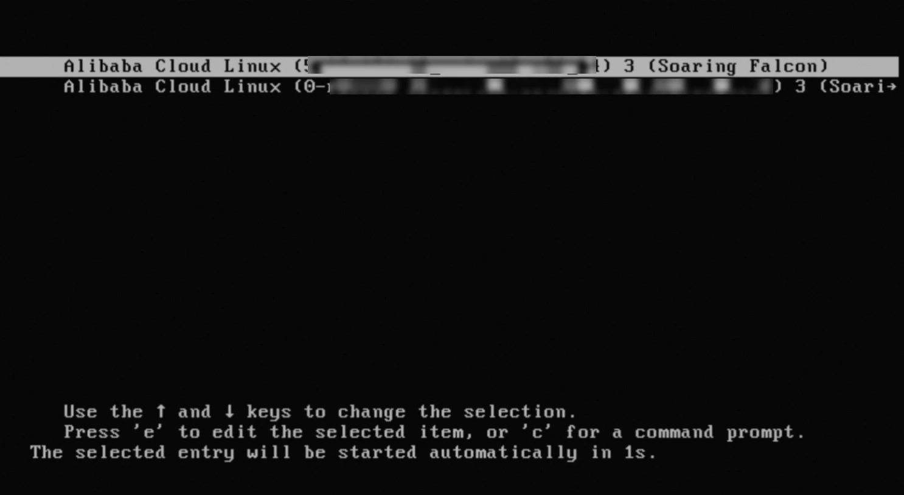

系统正常启动，初始化完成后出现登录窗口。系统会提示输入用户及密码，即系统安装过程中已创建的用户名和密码。如果尚未创建，请与管理员联系以获取用户名和密码。


<a id="section-1-11-1-2"></a>

#### 1.11.1.2. 用户界面

进入系统后用户界面整体布局如图所示。


1. 顶栏

   用户界面顶部的横向栏提供了系统基本功能，从左到右分别为活动概述、日历与时钟、系统状态图标和系统菜单。

   

2. 活动概述

   活动概述位于用户界面左上角，用于查看活跃的应用程序与窗口，或是在其中进行切换。

   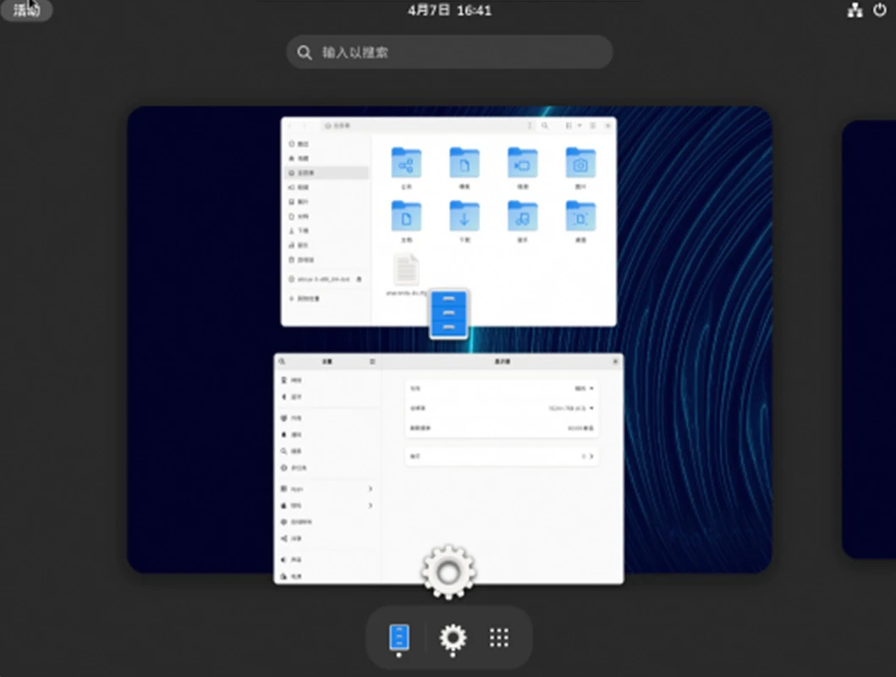

   对于当前正在使用的应用程序，以“文件”为例，活动概述可进一步列举出适用于此程序的操作。

   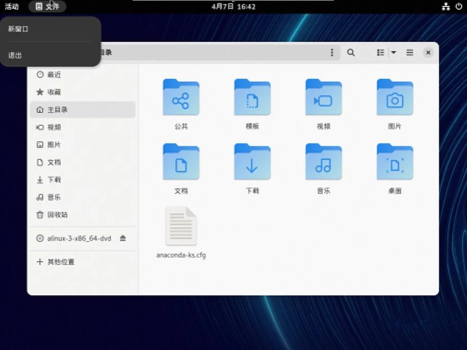

3. 系统通知

   系统通知位于用户界面的正上方，包含系统时间、日历与系统通知。

   

4. 系统菜单

   系统菜单位于用户界面的右上角，可用于

   - 截图；

   - 更新设置；

   - 锁屏及切换用户；

   - 挂起、重启、关闭、注销计算机；

   - 查看与设置网络连接；

   - 设置显示模式；

     

5. 启动器

   启动器可以用于管理系统中已安装的所有应用，在启动器中使用分类导航或搜索功能可以快速找到需要的应用程序。

   单击左上角活动概述，点击用户界面底部最右侧点状按钮即可显示出所有可用应用程序。

   

<a id="section-1-11-1-3"></a>

#### 1.11.1.3. 锁屏

锁屏是保护用户数据，锁屏后必须使用用户密码进行登录。

1. 在阿里云服务器操作系统 V3 桌面，右上角系统设置中单击**挂起**即可手动锁屏，如下图所示。

   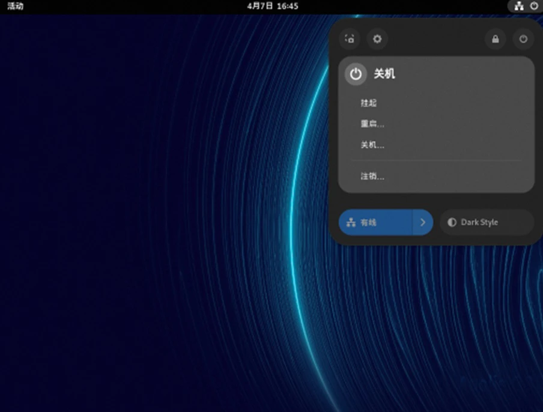

2. 打开**设置>隐私>锁屏**，可以设置息屏延时时间、自动锁屏、自动锁屏延迟，如下图所示窗口。

   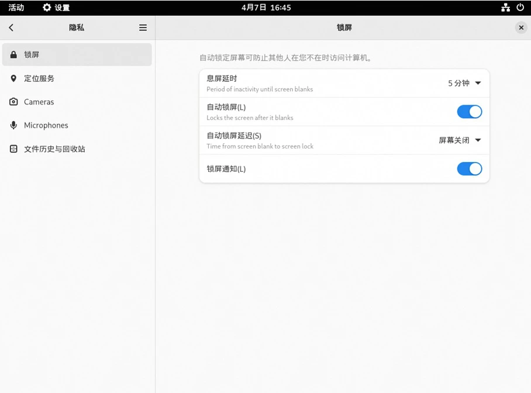

<a id="section-1-11-1-4"></a>

#### 1.11.1.4. 注销（登出）

注销是清除当前登录的用户信息，注销计算机后您可以使用其他用户账户来登录。

1. 在阿里云服务器操作系统 V3 桌面，右上角系统设置中单击**注销**。

   

2. 弹出如下图所示窗口，单击**注销**，登出系统。

   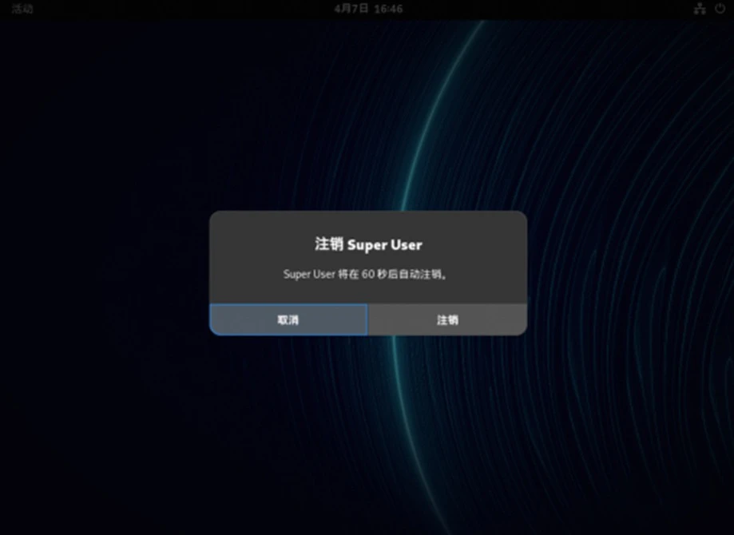

<a id="section-1-11-1-5"></a>

#### 1.11.1.5. 关机与重启

1. 在阿里云服务器操作系统 V3 桌面，单击任务栏右上角的**关机**或**重启**图标。

   

2. 弹出如下图所示窗口，单击**关机**或**重启**，关闭系统或者重启系统。

   

<a id="section-1-11-2"></a>

### 1.11.2. 系统管理

<a id="section-1-11-2-1"></a>

#### 1.11.2.1. 设置中心

阿里云服务器操作系统 V3 通过设置中心来管理系统的基本设置，包括用户管理、网络设置、日期和时间、个性化设置、显示设置等。进入用户界面后，单击系统菜单中的齿轮图案即可打开设置中心窗口。

**网络**

根据系统监测到的网络环境不同，左侧引导栏会出现**网络**或是**Wi-Fi**。此处以有线网络为例。

设置中心单击左侧**网络**进入详情页，可以打开或是关闭网络，还可以设置 VPN 和网络代理，如下图所示。

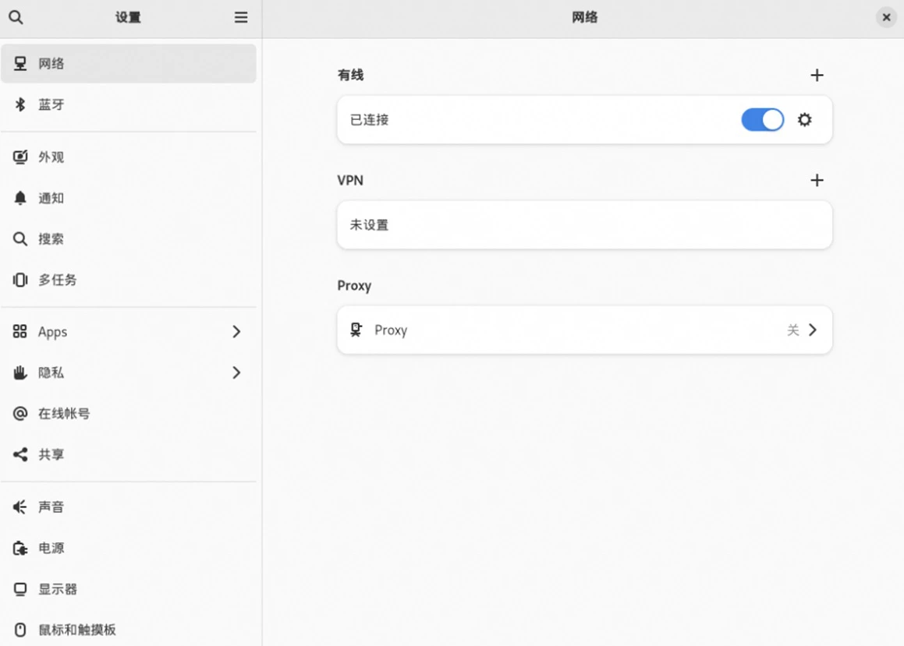

单击右侧小齿轮图标，可查看此网络连接的详细信息，也可对此连接进行配置，如下图所示。


**蓝牙**

设置中心单击左侧**蓝牙**进入详情页，在检测到有效的蓝牙设备后显示。


**外观**

设置中心单击左侧 **外观** 进入详情页，可以设置窗口样式和选择图片作为桌面背景，如下图所示。


**通知**

设置中心单击左侧 **通知** 进入详情页，可以设置是否打开勿扰模式，锁屏通知和应用通知，如下图所示。

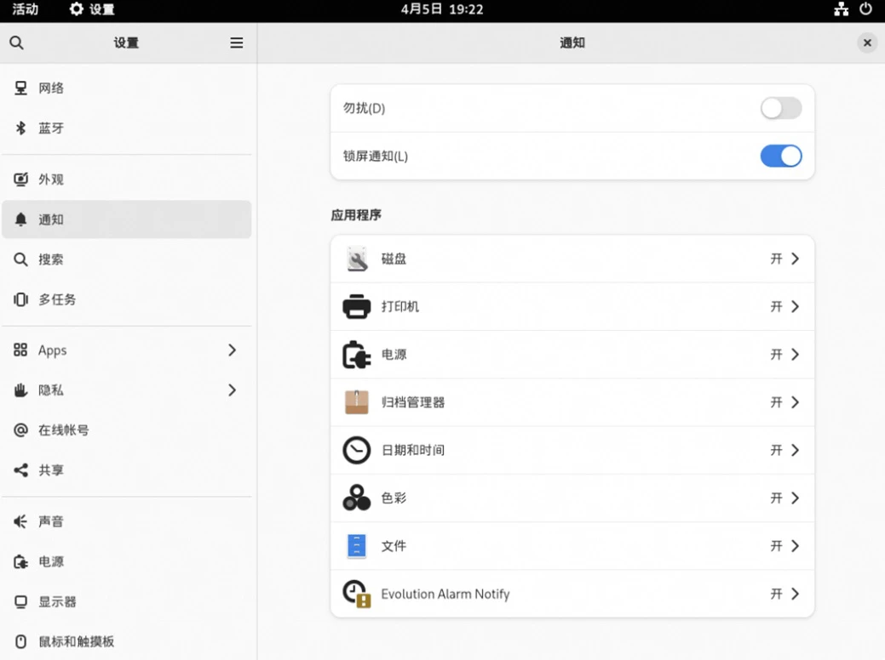

应用通知可以进一步设置。可以选择打开通知和声音警告，可以选择弹出通知提示，打开锁屏通知等设置，如下图所示。


**搜索**

设置中心单击左侧 **搜索** 进入详情页，可以设置启动器中搜索工具的搜索位置以及对应用的搜索权限，如下图所示。

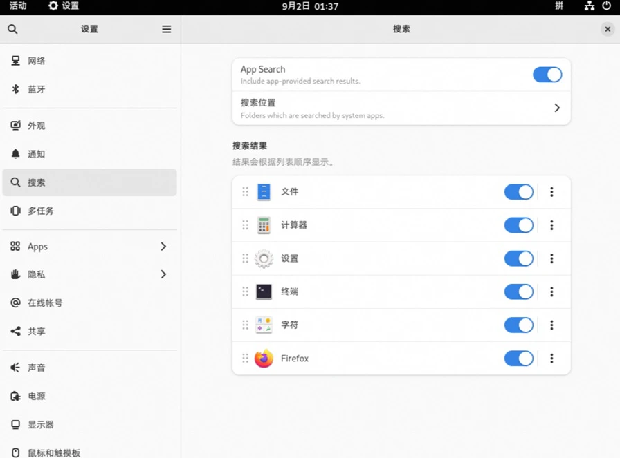

**多任务**

设置中心单击左侧 **多任务** 进入详情页，可以设置各类多任务属性，如热区、工作空间、多显示器等，如下图所示。

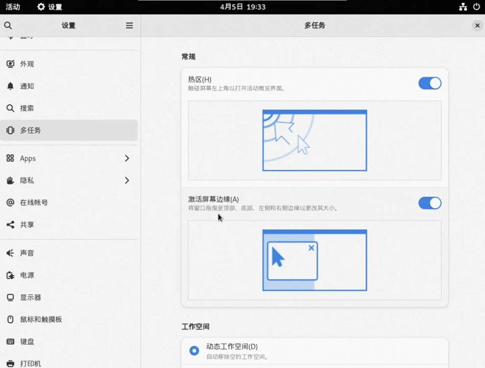

**APP**

设置中心单击左侧 **多任务** 进入详情页，可以打开某个 APP 以及设置APP 的搜索或通知权限，如下图所示。

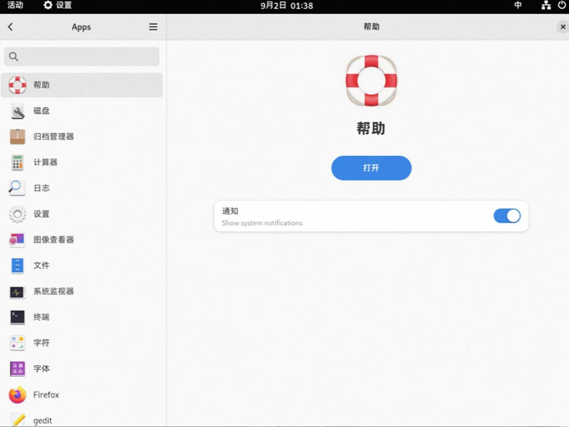

**隐私**

设置中心单击左侧 **隐私** 进入详情页，可以对当前用户的隐私安全进行设置。

- 锁屏设置前面小节中已介绍；

- 定位服务设置；

- 摄像头设置

- 麦克风设置；

- 文件历史与回收站设置。记住历史能够在下次使用时方便查找，而且历史可以选择清除。自动清理回收站及临时文件设置，避免计算机保存不必要信息。

  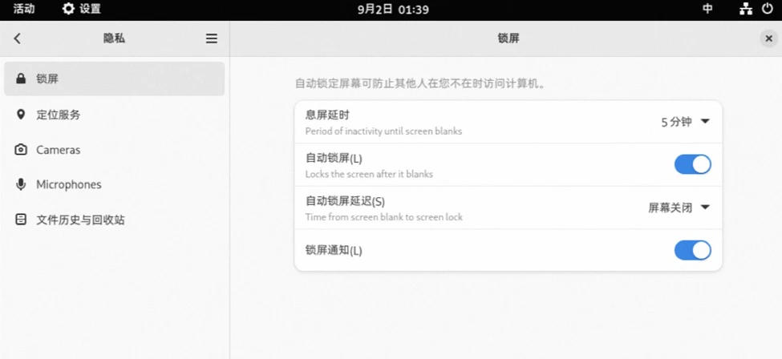

**在线账户**

设置中心单击左侧 **在线账户** 进入详情页，绑定在线账户，连接云数据。

**共享**

设置中心单击左侧 **共享** 进入详情页，可以设置设备名称，以及远程用户是否可通过 ssh 远程登录。

**声音**

设置中心单击左侧 **声音** 进入详情页，可以选择音频输出输入设备，设置音量和警报声类型，如下图所示。

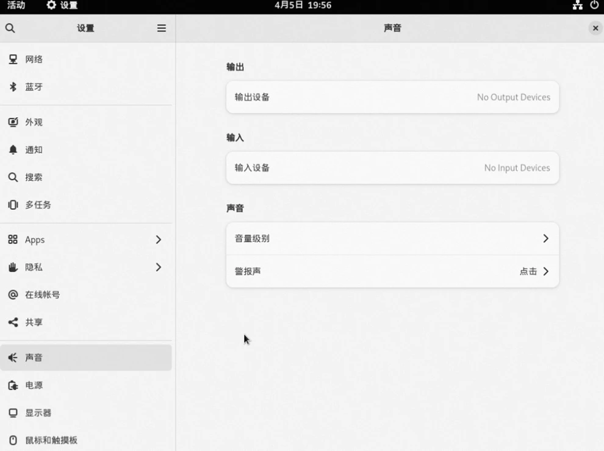

**电源**

设置中心单击左侧 **电源** 进入详情页，可以设置息屏时间和自动挂起，如下图所示。


**显示器**

设置中心单击左侧 **显示器** 进入详情页，可以设置显示方向、分辨率、刷新频率，让电脑显示到达最佳状态，如下图所示。

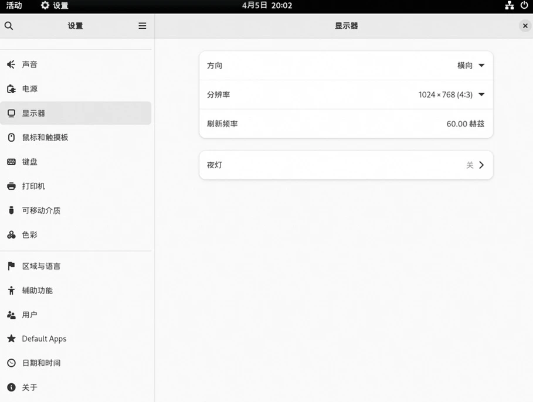

**鼠标与触摸板**

设置中心单击左侧 **鼠标与触摸板** 进入详情页，可设置鼠标和触摸板的主按钮、移动速度、是否开启加速、滚轮方向等，如下图所示。

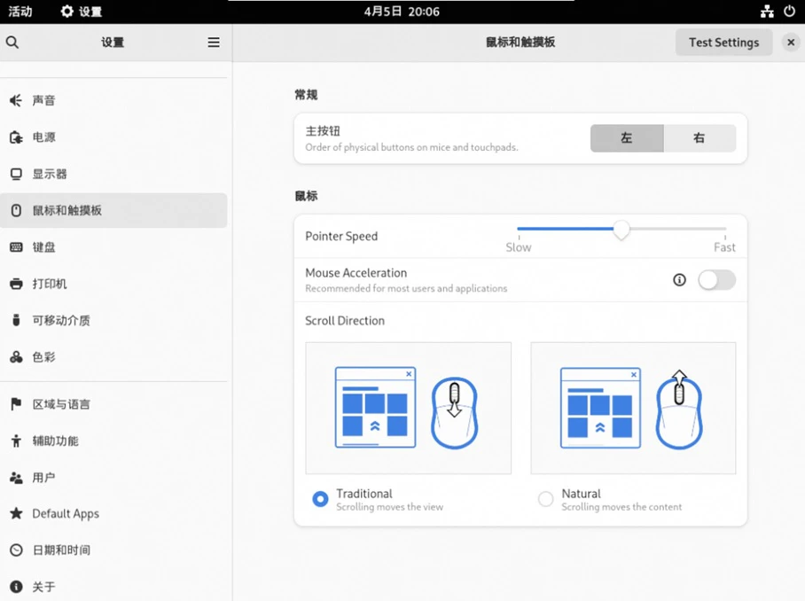

**键盘**

设置中心单击左侧 **键盘** 进入详情页，可以设置键盘布局与输入法，切换输入源的方式、特殊字符输入方式以及键盘快捷键，如下图所示。

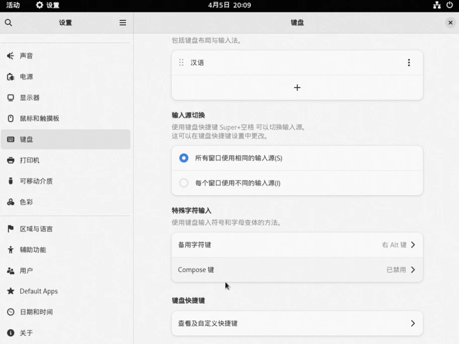

**打印机**

设置中心单击左侧 **打印机** 进入详情页，可以通过指定打印机网络地址或搜索方式添加打印机，如下图所示。

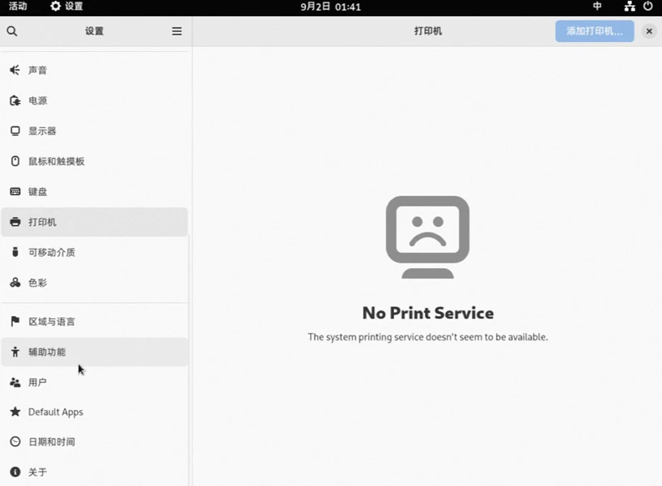

**可移动介质**

可移动介质设置项是选择接入的可移动介质的响应方式。设置中心单击左侧 **可移动介质** 进入详情页，可设置的可移动介质包括 CD 音频、DVD 视频、音乐播放器、照片、软件等等。响应方式包括询问如何处理、无动作、打开文件夹、打开相应的应用程序。如下图所示。

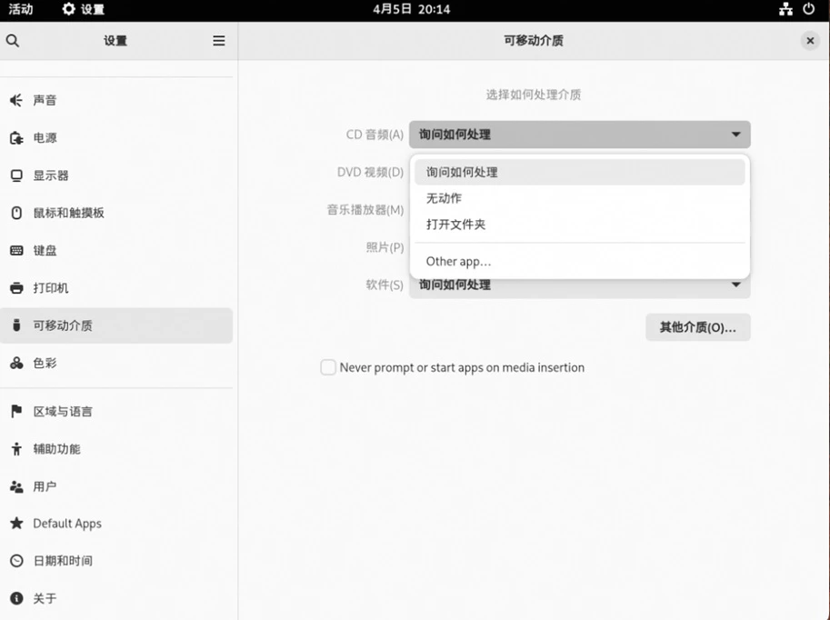

**色彩**

设置中心单击左侧 **色彩** 进入详情页，可以添加当前系统内的色彩模式也可以导入新的色彩模式，如下图所示。


**区域与语言**

详情可见中文支持章节。

**辅助功能**

设置中心单击左侧 **色彩** 进入详情页，通用辅助功能可以对视觉、听觉、打字、指向和单击进行设置。

1. 快捷设置

   打开辅助功能快捷设置后可在顶栏中快速设置辅助功能，如下图所示。

   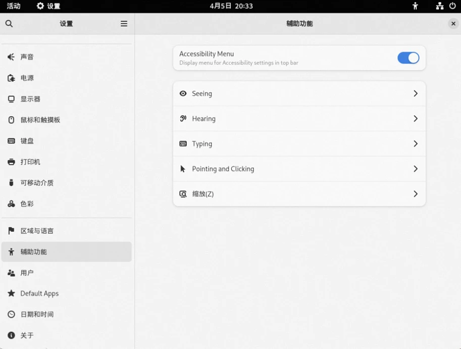

   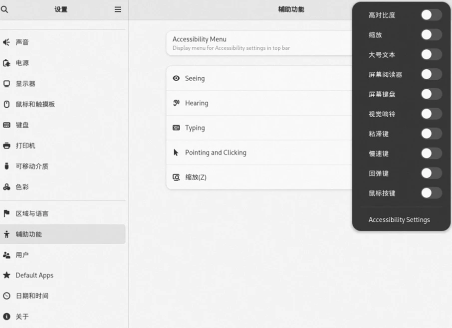

2. 视觉在通用辅助功能首页，可以看到 **视觉** 设置项。具体设置项如下：

   - 打开或关闭高对比度；

   - 是否减少动画效果；

   - 是否使用大号字体；

   - 光标的尺寸选择；

   - 设置发声键，数字键盘锁定和大小写锁定时发出蜂鸣声；

   - 是否隐藏滚动条；

   - 设置屏幕朗读，移动焦点时朗读显示的文本；

3. 听觉

   在通用辅助功能首页，可以看到 **听觉** 设置项。可设置警示声视觉提示，打开视觉提示后警示声会伴随屏幕闪烁。

4. 打字

   在通用辅助功能首页，可以看到 **打字** 设置项。具体设置项如下：

   - 屏幕键盘设置；

   - 设置文本字段中光标闪烁及闪烁频率；

   - 设置重复，按住某一键时重复该键；

   - 粘贴键、慢速键、重复键设置；

5. 指向和单击

   在通用辅助功能首页，可以看到 **指向和单击** 设置项。具体设置项如下：

   - 鼠标键设置；

   - 双击延时设置；

6. 缩放效果

   在通用辅助功能首页，可以看到 **缩放效果** 设置项。可以选择是否打开缩放效果，以及打开缩放效果后的放大镜位置和比率、十字光标的显示参数以及色彩效果；

7. 用户

   设置中心单击左侧 **用户** 进入详情页，可以：

   - 查看当前用户的信息，选择头像与修改用户名和密码；

   - 添加新的用户，设置账号类型。输入用户名、密码；

     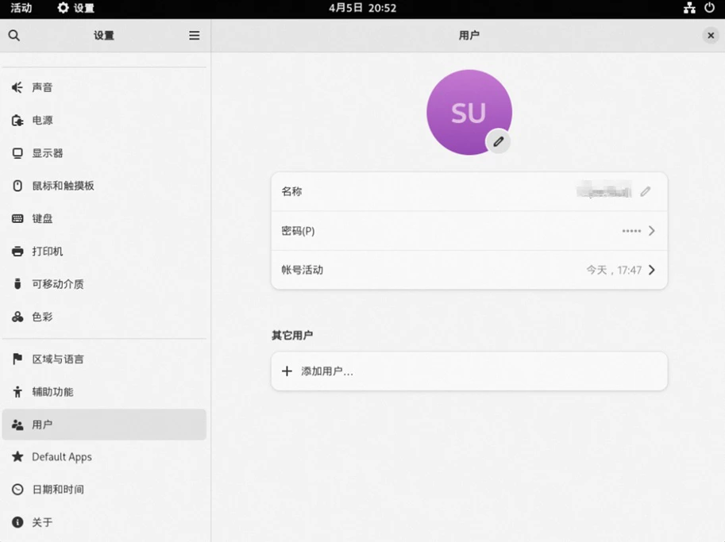

     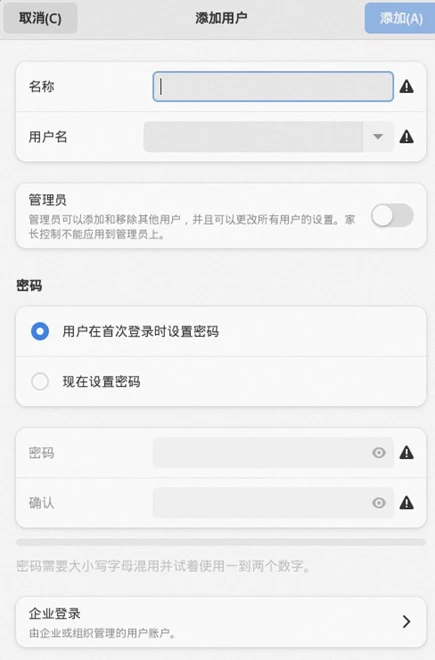

8. 默认应用程序

   设置中心单击左侧 **默认应用程序** 进入详情页。当安装有多个功能相似的应用程序时，可以选择其中的一个应用作为对应文件类型的默认启动程序。如下图所示。

   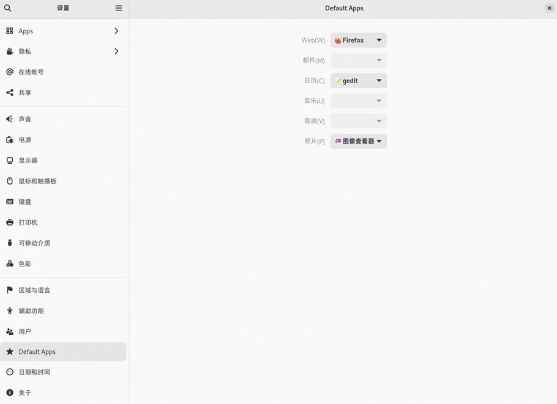

9. 日期和时间

   设置中心单击左侧 **日期和时间** 进入详情页，可以设置日期与时间，时区和时间格式，如下图所示。默认情况下，系统通过网络自动同步该时区的本地时间和日期。用户也可以手动修改时间和日期。手动设置后，自动同步功能会被关闭。

   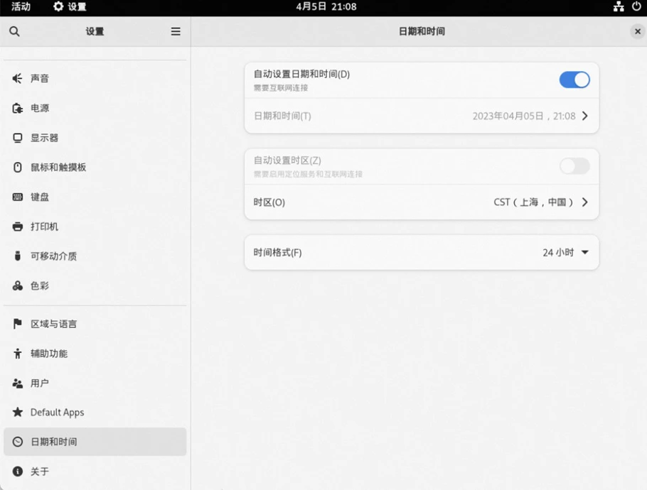

<a id="section-1-11-2-2"></a>

#### 1.11.2.2. 系统监视器

系统监视器是一个对硬件负载、程序运行和系统服务，进行监测查看和管理操作的系统工具。系统监视器可以实时监控处理器状态、内存占用率、网络上传下载速度、还可以管理系统进程和应用进程，也支持搜索进程和强制结束进程。

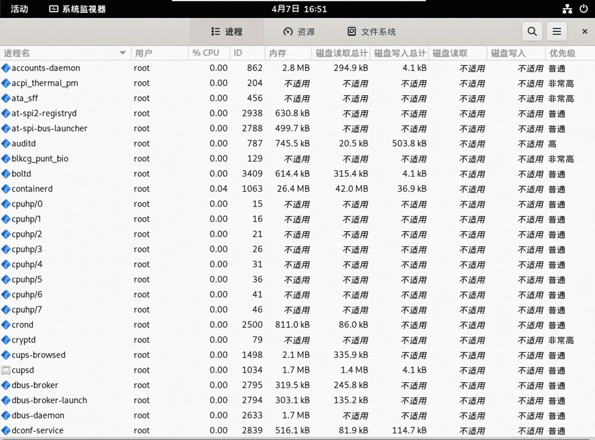

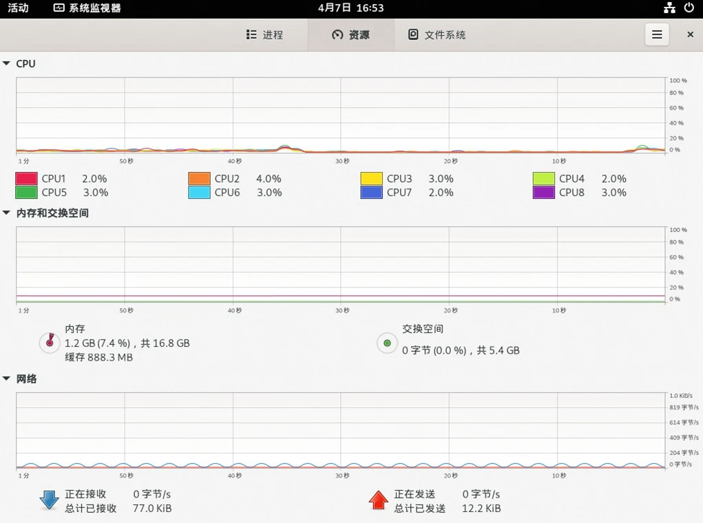

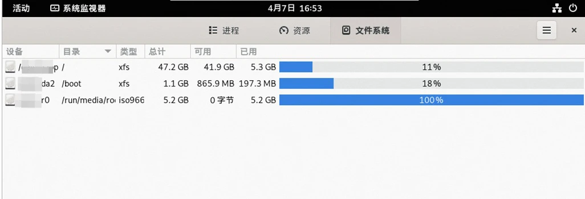

<a id="section-1-11-2-3"></a>

#### 1.11.2.3. 磁盘管理器

**概述**

磁盘管理器是查看和管理磁盘分区设备的工具软件，可针对运行在操作系统的磁盘设备，进行基本数据的查看和基本的分区操作等。

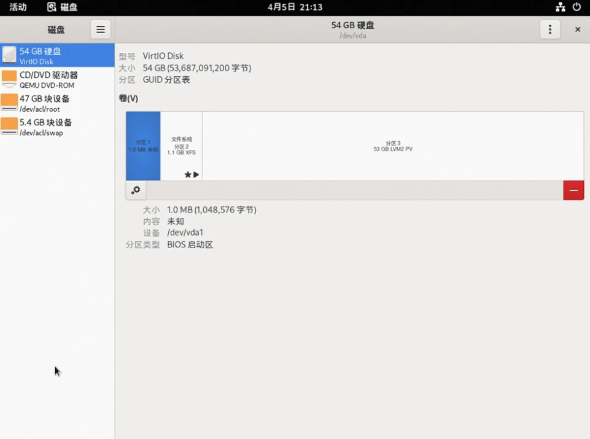

**操作介绍**

**运行磁盘管理器**

进入启动器，单击工具选择 **磁盘** 打开。管理器界面显示当前系统下所有的硬盘、CD/DVD驱动器和分区设备。不同的设备操作也不同，涉及数据安全，请谨慎操作。

- 非系统分区所在的磁盘设备：可卸载，可删除设备中的分区；

- CD/DVD 驱动器：只可以卸载设备；

- 系统分区：只可以卸载分区或者停用当前交换分区；

<a id="section-1-11-2-4"></a>

#### 1.11.2.4. 文件管理器

**概述**

文件管理器是一款功能强大、简单易用的文件管理工具。它沿用了传统文件管理器的经典功能和布局，并在此基础上简化了用户操作，增加了很多特色功能。具有一目了然的导航栏、智能识别的搜索框、多样化的视图及排序。

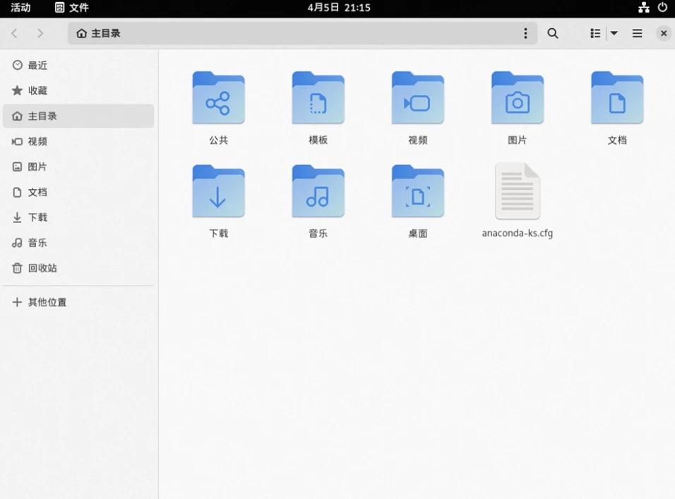

**常用操作**

打开启动器，单击左边栏 **文件** 打开。文件管理器具备基本的文件管理功能，对文件（夹）进行新建、复制、重命名、删除以及文件搜索等操作都非常简单。

- 切换视图在右上角第二个按钮，可以调整视图样式;

- 主菜单功能在右上角第三个按钮，可以设置排序方式、隐藏文件等。

- 批量重命名。在文件管理器界面上，选中多个文件。右击文件，并选择 **重命名**。可设置使用模板命名或者查找并替换文本。如下图所示。

  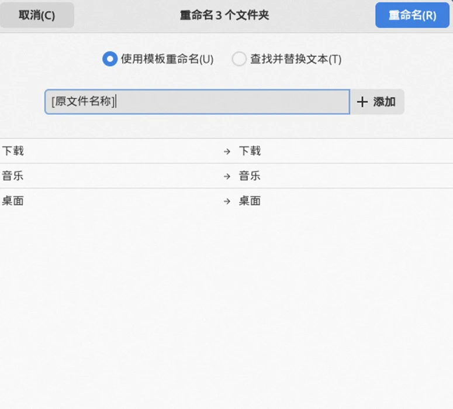

<a id="section-1-11-2-5"></a>

#### 1.11.2.5. 日志收集工具

日志收集工具是负责收集程序运行时所产生日志的小工具，如操作系统和应用程序在启动、运行等过程中的相关信息。通过分析详细日志信息，可以快速地找到故障原因并解决问题。

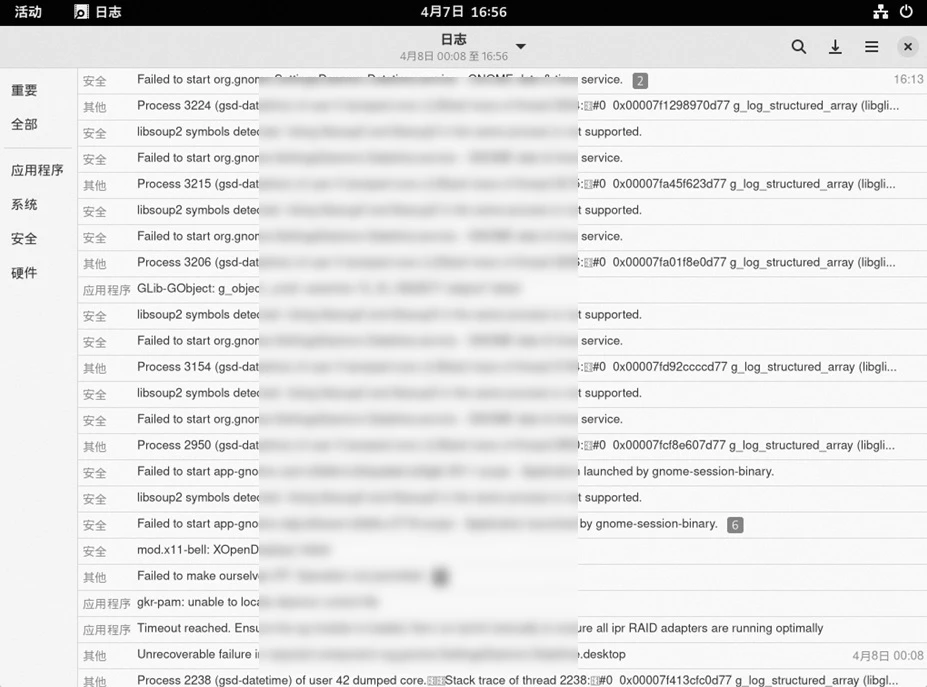

日志收集工具将收集的日志做了详细的分类，可按需选择要查阅的日志。日志优先级分为重要和全部，两个角度来满足使用需求。其次根据所属不同将日志分为应用程序、系统、安全和硬件四种，可以根据实际情况选择。

<a id="section-1-12"></a>

## 1.12. 中文支持

阿里云服务器操作系统 V3 提供完整的中文语言支持。在 Gnome 桌面环境下，系统提供简洁、易用的中文界面。用户可以在安装阶段进行语言选择，直接选择将系统默认语言设置为中文；也可以在进入系统后，手动将系统语言调整为中文或其他语言。

<a id="section-1-12-1"></a>

### 1.12.1. 系统语言设置

操作系统支持系统语言在多语言之间切换。在登录系统后，用户可以切换为任意一种支持的语言。本节以英文环境为例，介绍如何切换为中文模式。

1. 单击左上角活动“Activities”——程序活动块中找到设置“Settings”

   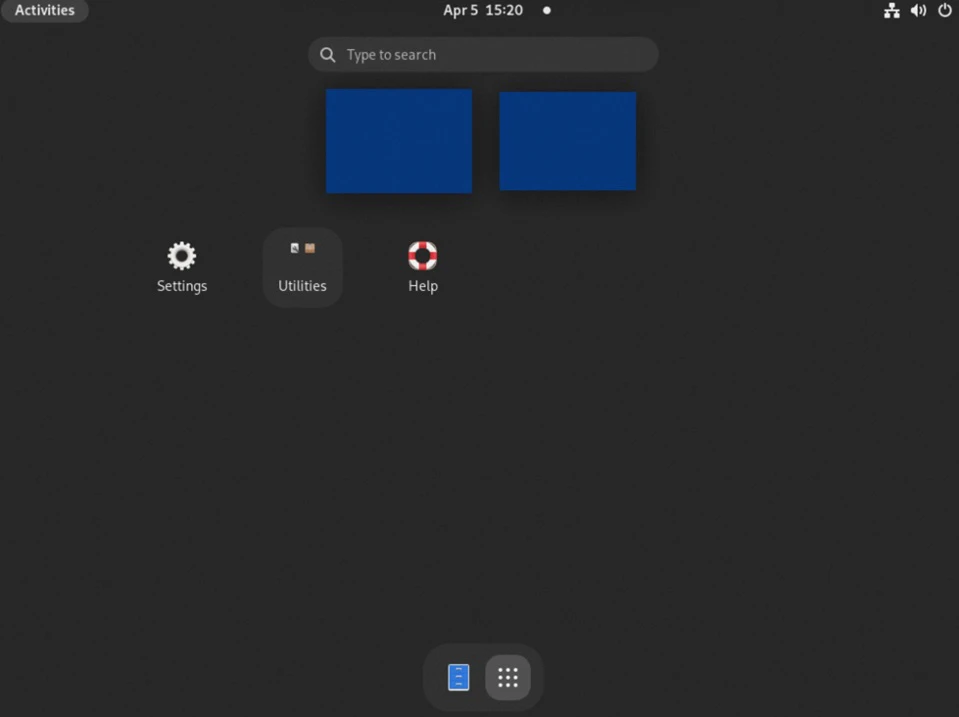

   此外，还有多种方式进入设置菜单：

   - 在桌面右键，选择 Settings 栏进入。

   - 用户也可以选择在终端中输入命令 `gnome-control-center` 进入。

2. 左侧边栏选择区域和语言“Region and Languages”。

   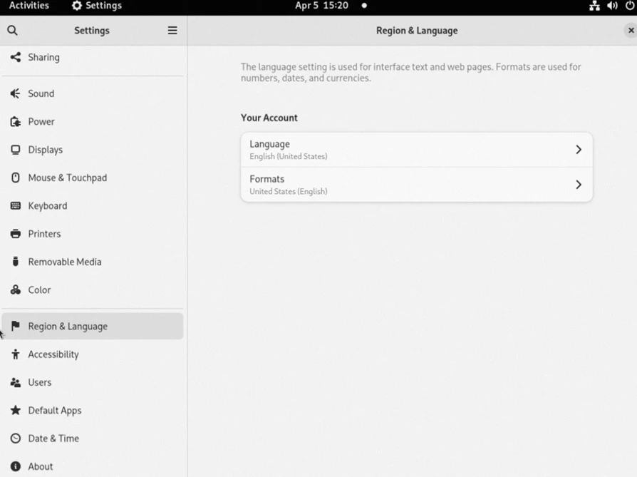

3. 在语言“Language”、格式“Formats”中找到并选择简体中文，单击最下方选项可以扩展选项并检索关键字。勾选完毕后，单击“Select”按钮。

   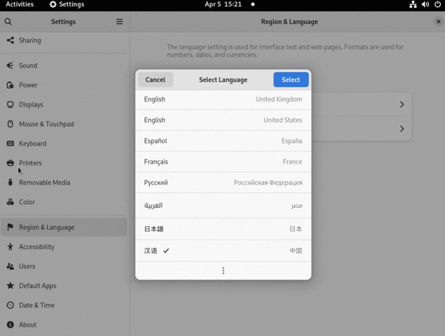

   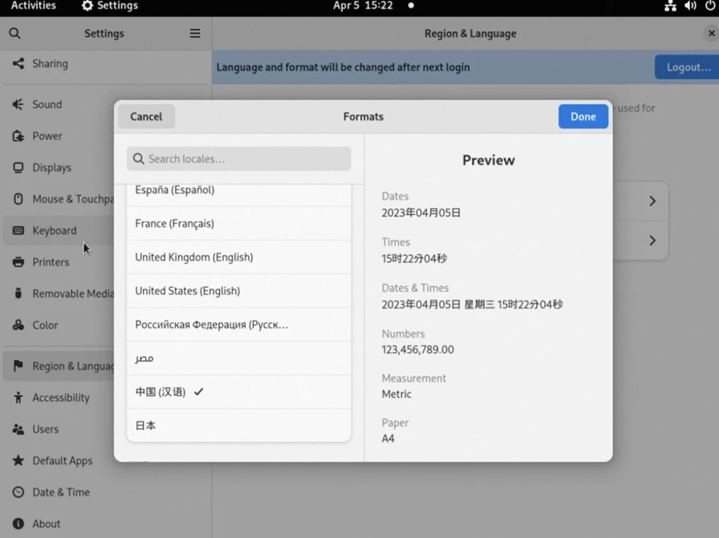

4. 操作完成后，需要注销账户，重新启动，完成中文语言加载。

   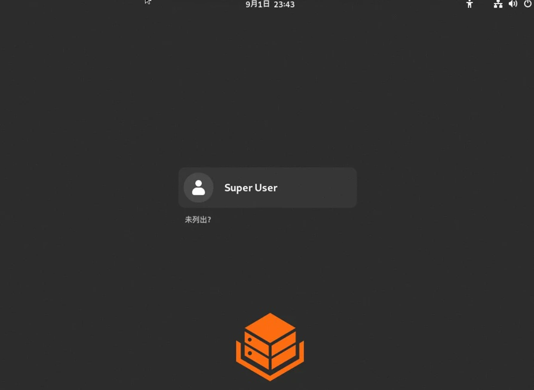

<a id="section-1-12-2"></a>

### 1.12.2. 添加输入法

添加中文输入法的入口在“设置”——“键盘”中：

1. 在输入源“Input Sources”中，选择并添加汉语拼音输入法。

   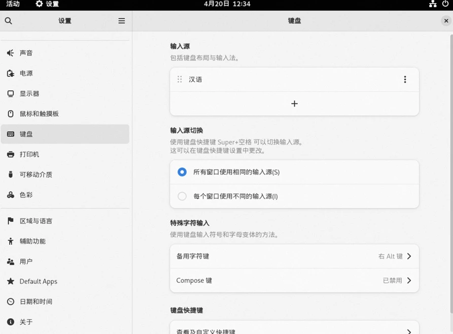

2. 完成后，在右上角的输入法切换栏，可以手动选择中文拼音输入法并切换。

   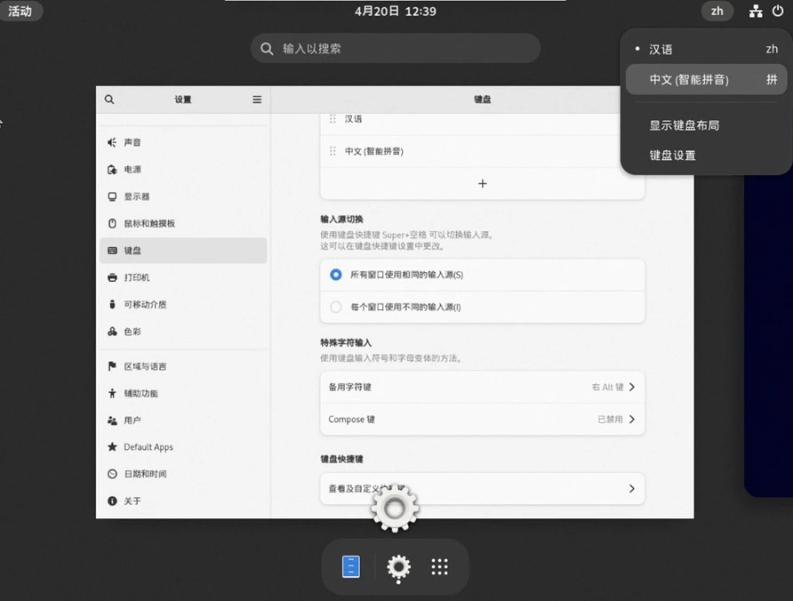

<a id="section-1-12-3"></a>

### 1.12.3. GB18030 支持

阿里云服务器操作系统 V3 的软件默认运行语言环境为zh_CN.UTF-8。同时，运行环境字符集添加了对 GB 18030-2022 的支持，用户可以通过手动切换的形式，将运行语言环境切换至 GB 18030 或其他环境。当软件运行在不匹配自身字符编码规则的运行环境中时，字符显示会出现乱码。阿里云服务器操作系统 V3 图形环境已经集成了支持 GB 18030-2022 标准的 Alibaba PuHuiTi 字体，如果遇到第三方应用无法显示字形的情况，请确保使用的字体是 Alibaba PuHuiTi。本节介绍切换语言运行环境至 GB 18030 的方法。

1. locale 命令用于将当前语言环境或全部公共语言环境输出到控制台，定义了软件运行时的语言环境。在终端中输入该命令，可以获得当前软件运行语言环境信息：

   ```text
   locale
   ```

   返回示例如下：

   ```text
   LANG=zh_CN.UTF-8
   LC_CTYPE="zh_CN.UTF-8"
   LC_NUMERIC="zh_CN.UTF-8"
   LC_TIME="zh_CN.UTF-8"
   LC_COLLATE="zh_CN.UTF-8"
   LC_MONETARY="zh_CN.UTF-8"
   LC_MESSAGES="zh_CN.UTF-8"
   LC_PAPER="zh_CN.UTF-8"
   LC_NAME="zh_CN.UTF-8"
   LC_ADDRESS="zh_CN.UTF-8"
   LC_TELEPHONE="zh_CN.UTF-8"
   LC_MEASUREMENT="zh_CN.UTF-8"
   LC_IDENTIFICATION="zh_CN.UTF-8"
   LC_ALL=
   ```

   其各项含义如下：

   | 参数 | 详细说明 |
   | --- | --- |
   | LANG | 默认语言环境设置。 |
   | LC_CTYPE | 字符集设置。 |
   | LC_NUMERIC | 数字格式设置。 |
   | LC_TIME | 时间格式设置。 |
   | LC_COLLATE | 排序规则设置。 |
   | LC_MONETARY | 货币格式设置。 |
   | LC_MESSAGES | 消息输出设置。 |
   | LC_PAPER | 纸张大小设置。 |
   | LC_NAME | 人名显示格式设置。 |
   | LC_ADDRESS | 地址显示格式设置。 |
   | LC_TELEPHONE | 电话号码显示格式设置。 |
   | LC_MEASUREMENT | 度量单位显示格式设置。 |
   | LC_IDENTIFICATION | 汇编信息显示格式设置。 |

2. 输入  `locale -a`  命令，可以列出当前系统支持的全部字符集信息，配合  `grep`  命令，可以筛选出当前支持的简体中文字符集。

   ```text
   locale -a | grep "zh_CN*"
   ```

   返回示例如下：

   ```text
   zh_CN
   zh_CN.gb18030
   zh_CN.gb2312
   zh_CN.gbk
   zh_CN.utf8
   ```

3. 切换至 GB 18030（需要确保已安装字符集），可以修改文件/etc/locale.conf，将其中的内容修改为：

   ```text
   LANG=zh_CN.gb18030
   ```

   随后执行命令：

   ```text
   source /etc/locale.conf
   ```

   即可修改完成，再次输入 locale 命令，可以观察到修改结果：

   ```text
   locale
   ```

   返回示例如下：

   ```text
   LANG=zh_CN.gb18030
   LC_CTYPE="zh_CN.gb18030"
   LC_NUMERIC="zh_CN.gb18030"
   LC_TIME="zh_CN.gb18030"
   LC_COLLATE="zh_CN.gb18030"
   LC_MONETARY="zh_CN.gb18030"
   LC_MESSAGES="zh_CN.gb18030"
   LC_PAPER="zh_CN.gb18030"
   LC_NAME="zh_CN.gb18030"
   LC_ADDRESS="zh_CN.gb18030"
   LC_TELEPHONE="zh_CN.gb18030"
   LC_MEASUREMENT="zh_CN.gb18030"
   LC_IDENTIFICATION="zh_CN.gb18030"
   LC_ALL=
   ```

<a id="section-1-13"></a>

## 1.13. 虚拟化

<a id="section-1-13-1"></a>

### 1.13.1. 配置虚拟化环境

<a id="section-1-13-1-1"></a>

#### 1.13.1.1. 硬件查看

查看本机硬件是否支持虚拟化。

```text
egrep -c '(svm|vmx)' /proc/cpuinfo
```

如果输出结果为 0，则表示计算机不支持硬件虚拟化，无法使用本节介绍的功能。如果输出结果大于 0，则表示计算机支持硬件虚拟化。

> **重要**
>
> 在某些情况下，您的计算机可能会支持硬件虚拟化，但默认情况下未启用。您可以在 BIOS 设置中查找相关选项并启用它。

<a id="section-1-13-1-2"></a>

#### 1.13.1.2. 组件安装

**kvm模块**

kvm 模块已集成到 alinux3 系统，无需额外安装配置，可按照如下命令查看：

```text
lsmod | grep kvm
```

返回如下示例：

```text
kvm_intel             339968  0
kvm                   974848  1 kvm_intel
irqbypass              16384  1 kvm
```

对于 kvm 模块是以 built-in 形式编入内核，可通过是否有/dev/kvm 设备节点判断当前 KVM 模块是否集成。

**qemu**

QEMU 是一个模拟器和虚拟机管理器，可以模拟多种 CPU 体系结构的计算机硬件，并且可以与 KVM 一起使用，提供更好的性能和功能。

```bash
yum install qemu-kvm -y
```

**libvirt**

libvirt 是一个开源的虚拟化 API 库，可以与多种虚拟化技术相结合，如 KVM、QEMU 等，可以通过 API操作虚拟机，提供了方便的管理工具和 API。

```bash
yum install libvirt -y
```

启动 libvirtd 服务：

```bash
systemctl start libvirtd
```

virsh 是基于 libvirt 实现的虚拟化管理工具，把 libvirt 的底层 API 包装成命令行，以便于在命令行进行虚拟机管理的操作。在安装 libvirt 时会自动安装 virsh，后面小节中将使用 virsh 来操作虚拟机。

<a id="section-1-13-1-3"></a>

#### 1.13.1.3. 环境验证

通过如下命令验证虚拟化环境是否配置完成：

```text
virt-host-validate
```

返回如下示例：

```text
QEMU: Checking for hardware virtualization                                 : PASS
  QEMU: Checking for device /dev/kvm                                         : PASS
  QEMU: Checking for device /dev/vhost-net                                   : WARN 
(Load the 'vhost_net' module to improve performance of virtio networking)
  QEMU: Checking for device /dev/net/tun                                     : PASS
   LXC: Checking for Linux >= 2.6.26                                         : PASS
```

如果 virt-host-validate 检查返回 PASS 值，说明虚拟化功能已经准备好；如果返回 WARNING 值，说明虚拟化功能/性能可以改进，但不修复也不影响使用；如果返回 FAIL，则需要按照提示修复问题。

<a id="section-1-13-2"></a>

### 1.13.2. 管理虚拟机

<a id="section-1-13-2-1"></a>

#### 1.13.2.1. 虚拟机创建

**操作步骤**

1. 准备安装介质

   用户需要获取适合自己架构及使用场景对应版本的阿里云服务器操作系统 V3 的虚拟机镜像，本文以x86_64 架构，vhd 镜像格式为例进行说明。

2. 虚拟机配置文件

   libvirt 提供了基于 XML 的配置文件格式，用于配置和管理虚拟机、存储卷、网络等资源，在使用virsh创建虚拟机时，需要使用 XML 文件进行配置。该配置文件中包含了虚拟机的名称、内存、CPU、操作系统、磁盘、网络等配置信息。XML 文件中包含了虚拟机的硬件设备信息，如磁盘、网络等。每个设备都有自己的配置信息，如磁盘的源文件、目标设备等。

   x86 虚拟机 XML 配置示例（XML 文件名可为 alinux3.xml）：

   ```xml
   <domain type='kvm'>
     <name>alinux3</name>
     <uuid>f24d8c52-93aa-41c8-a021-1aa416881918</uuid>
     <memory unit='KiB'>4194304</memory>
     <currentMemory unit='KiB'>4194304</currentMemory>
     <vcpu>4</vcpu>
     <os>
       <type arch='x86_64' machine='pc-i440fx-2.1'>hvm</type>
       <boot dev='hd'/>
     </os>
     <features>
       <acpi/>
       <apic/>
     </features>
     <cpu mode='host-passthrough'>
     </cpu>
     <clock offset='utc'>
       <timer name='rtc' tickpolicy='catchup'/>
       <timer name='pit' tickpolicy='delay'/>
       <timer name='hpet' present='no'/>
     </clock>
     <on_poweroff>destroy</on_poweroff>
     <on_reboot>restart</on_reboot>
     <on_crash>restart</on_crash>
     <pm>
       <suspend-to-mem enabled='no'/>
       <suspend-to-disk enabled='no'/>
     </pm>
     <devices>
       <emulator>/usr/bin/qemu-kvm</emulator>
       <disk type='file' device='disk'>
         <driver name='qemu' type='vpc'/>
         <source file='/path/to/vhd_file'/> <!-- 填写阿⾥云服务器操作系统 V3 镜像的绝对路径。  
   -->
         <backingStore/>
         <target dev='hda' bus='ide'/>
         <alias name='ide0-0-0'/>
         <address type='drive' controller='0' bus='0' target='0' unit='0'/>
       </disk>
       <controller type='usb' index='0' model='ich9-ehci1'>
         <alias name='usb'/>
         <address type='pci' domain='0x0000' bus='0x00' slot='0x05' function='0x7'/>
       </controller>
       <controller type='usb' index='0' model='ich9-uhci1'>
         <alias name='usb'/>
         <master startport='0'/>
         <address type='pci' domain='0x0000' bus='0x00' slot='0x05' function='0x0' multifunction='on'/>
       </controller>
       <controller type='usb' index='0' model='ich9-uhci2'>
         <alias name='usb'/>
         <master startport='2'/>
         <address type='pci' domain='0x0000' bus='0x00' slot='0x05' function='0x1'/>
       </controller>
       <controller type='usb' index='0' model='ich9-uhci3'>
         <alias name='usb'/>
         <master startport='4'/>
         <address type='pci' domain='0x0000' bus='0x00' slot='0x05' function='0x2'/>
       </controller>
       <controller type='pci' index='0' model='pci-root'>
         <alias name='pci.0'/>
       </controller>
       <controller type='ide' index='0'>
         <alias name='ide'/>
         <address type='pci' domain='0x0000' bus='0x00' slot='0x01' function='0x1'/>
       </controller>
       <interface type='user'>
         <mac address='52:54:00:30:1d:4e'/>
         <model type='rtl8139'/>
         <alias name='net0'/>
         <address type='pci' domain='0x0000' bus='0x00' slot='0x03' function='0x0'/>
       </interface>
       <serial type='pty'>
         <source path='/dev/pts/41'/>
         <target port='0'/>
         <alias name=serial0/>
       </serial>
       <console type='pty' tty='/dev/pts/41'>
         <source path='/dev/pts/41'/>
         <target type='serial' port='0'/>
         <alias name='serial0'/>
       </console>
       <input type='mouse' bus='ps2'/>
       <input type='keyboard' bus='ps2'/>
       <video>
         <model type='cirrus' vram='16384' heads='1'/>
         <alias name='video0'/>
         <address type='pci' domain='0x0000' bus='0x00' slot='0x02' function='0x0'/>
       </video>
       <memballoon model='virtio'>
         <alias name='balloon0'/>
         <address type='pci' domain='0x0000' bus='0x00' slot='0x04' function='0x0'/>
       </memballoon>
     </devices>
   </domain>
   ```

3. 创建虚拟机。

   ```text
   virsh define alinux3.xml
   ```

   虚拟机创建完成以后，可通过以下命令管理虚拟机（运行、关闭和删除）：

   - 运行

     启动虚拟机：

     ```text
     virsh start alinux3
     ```

     如果出现用户组权限错误，可以尝试修改 /etc/libvirt/qemu.conf，在配置文件里增加以下信息：

     ```text
     user = "root"
     group = "root"
     ```

     进入虚拟机：

     ```text
     virsh console alinux3
     ```

     虚拟机的用户名密码请联系阿里云技术支持获取。

   - 关闭

     ```text
     virsh shutdown alinux3
     ```

     如果上述命令无法关闭虚拟机，说明虚拟机内不支持 acpi 指令的响应，可以通过下面的命令强制关闭。

     ```text
     virsh destroy alinux3
     ```

   - 删除

     ```text
     virsh undefine alinux3
     ```

<a id="section-1-13-2-2"></a>

#### 1.13.2.2. 虚拟机信息查看

virsh 可以通过多种方式查看虚拟机相关的信息，以下是一些常用的命令：

- virshlist：列出当前正在运行的虚拟机。

- virsh dominfo vm_name：显示指定虚拟机的基本信息，包括虚拟机 ID、名称、UUID、内存大小、虚拟 CPU 数量等。

- virsh domstate vm_name：显示指定虚拟机的运行状态，包括 running（运行中）、paused（暂停中）和 shut off（已关闭）。

- virsh domiflist vm_name：显示指定虚拟机的网络接口信息，包括接口名称、MAC 地址、虚拟网络名称、虚拟网络设备类型等。

- virsh domblklist vm_name：显示指定虚拟机的磁盘信息，包括磁盘名称、磁盘类型、磁盘设备路径、磁盘容量等。

- virsh dommemstat vm_name：显示指定虚拟机的内存使用情况，包括内存总量、已使用内存、可用内存等。

- virsh domblkinfo vm_name path_to_disk_image：显示指定磁盘镜像文件的信息，包括磁盘大小、簇大小、扇区大小、UID、GID 等。

- virsh cpu-stats vm_name：显示指定虚拟机的 CPU 使用情况，包括 CPU 时间、CPU 周期、CPU 利用率等。

以上命令可以帮助用户了解虚拟机的基本信息、运行状态、网络、存储、内存和 CPU 使用情况等。可以根据实际需要选择合适的命令来查看虚拟机的信息。

<a id="section-1-13-2-3"></a>

#### 1.13.2.3. 虚拟机配置更新

编辑指定虚拟机的 XML 配置文件：

```text
virsh edit alinux3
```

<a id="section-1-13-2-4"></a>

#### 1.13.2.4. 网络连接

QEMU-KVM 虚拟机可以使用多种不同的网络连接类型。以下是一些常用的网络连接类型：

- NAT：QEMU 会为虚拟机创建一个私有的子网，并通过主机的网络连接将虚拟机连接到 Internet。该网络连接类型适合用于一些不需要公共 IP 地址的场景，如开发、测试环境等。

- 桥接：QEMU 将虚拟网卡连接到主机的物理网卡上，使得虚拟机可以和主机处于同一网络中，可以直接访问主机和其他网络设备。该网络连接类型适合用于一些需要公共 IP 地址的场景，如 Web 服务器、DNS 服务器等。

- 主机网络：QEMU 将虚拟机直接连接到主机上，虚拟机和主机处于同一网络中，但是无法访问外部网络。该网络连接类型适合用于一些内网环境下的虚拟机，如测试、开发环境等。

- 仅主机：QEMU 将虚拟机和主机隔离开来，虚拟机无法访问任何网络，只能和主机进行通信。该网络连接类型适合用于一些严格的安全环境下的虚拟机。

要在 virsh 中配置虚拟机的网络连接，可以在 alinux3.xml 中的 &lt;interface> 段修改。前面我们配置的虚拟机网络为如下内容：

```xml
<interface type='network'>
 <source network='default'/>
  <model type='virtio'/>
</interface>
```

这段配置代码表示将虚拟机的网络接口配置为使用默认网络（通过 libvirt 自动创建的网络），&lt;interface type='network'>表示该接口的类型为网络接口，&lt;source network='default'/>表示该接口使用默认的网络，&lt;model type='virtio'/>表示使用 virtio 网络模型。这种配置方式会将虚拟机的网络接口连接到一个网络，但该网络的类型和配置取决于默认网络的配置。default 网络是 libvirt 针对 KVM/QEMU 虚拟化环境预置的默认虚拟网络，它在 libvirt 安装和配置时就已经创建好了。

虚拟机启动时，libvirt 会自动创建默认网络并补充网络配置信息，运行中的虚拟机可以用如下命令查看当前网络配置：

```bash
sudo virsh net-dumpxml default
```

输出的网络配置如下：

```xml
<network connections='1'>
  <name>default</name>
  <uuid>8f841086-96ad-4f63-9834-0af4638fc5a9</uuid>
  <forward mode='nat'>
    <nat>
      <port start='1024' end='65535'/>
    </nat>
  </forward>
  <bridge name='virbr0' stp='on' delay='0'/>
  <mac address='52:54:00:32:02:98'/>
  <ip address='192.168.122.1' netmask='255.255.255.0'>
    <dhcp>
      <range start='192.168.122.2' end='192.168.122.254'/>
    </dhcp>
  </ip>
</network>
```

这个 XML 配置文件中同时使用了 NAT 模式和虚拟网桥模式，以实现虚拟机的网络连接。其中，NAT 模式用于将虚拟机的网络流量转换为主机的网络流量，以便虚拟机可以访问互联网。而虚拟网桥使用 STP 协议和延迟时间设置，将虚拟机之间以及虚拟机与主机之间的网络流量转发和交换。通过同时使用这两种网络模式，可以实现灵活的虚拟化网络架构，并满足不同场景下的网络需求。

可见目前虚拟机使用的是 NAT 模式。更改虚拟机网络连接的方式如下：

- 关闭虚拟机。

  ```text
  virsh shutdown alinux3
  ```

- 创建一个新的网络。

  ```text
  virsh net-define /path/to/hostonly.xml
  ```

  xml 的内容如下：

  ```xml
  <network>
   <name>hostonly</name>
   <bridge name="virbr1"/>
   <ip address="192.168.100.1" netmask="255.255.255.0">
   <dhcp>
   <range start="192.168.100.128" end="192.168.100.254"/>
   </dhcp>
   </ip>
  </network>
  ```

  name 为网络名称，bridge 为虚拟网桥名称，ip 为网络地址，dhcp 为该网络的 DHCP 配置。

- 启动新网络。

  ```text
  virsh net-start hostonly
  ```

- 将虚拟机切换到这个新网络。

  ```text
  virsh attach-interface alinux3 --type network --source hostonly --model virtio --config
  ```

  最后启动虚拟机。

<a id="section-1-13-3"></a>

### 1.13.3. 管理虚拟资源

<a id="section-1-13-3-1"></a>

#### 1.13.3.1. 虚拟 CPU 管理

虚拟 CPU 管理可以实现增加/减少虚拟机使用的 CPU 核数。几个管理配置命令如下：

- 查看当前虚拟机 CPU 配额。

  ```text
  virsh schedinfo <VMInstance>
  ```

  返回示例如下：

  ```text
  Scheduler      : posix
  cpu_shares     : 1024
  vcpu_period    : 100000
  vcpu_quota     : -1
  emulator_period: 100000
  emulator_quota : -1
  global_period  : 100000
  global_quota   : -1
  iothread_period: 100000
  iothread_quota : -1
  ```

- 在线修改

  修改处于 running 状态的虚拟机的当前 CPU 份额。

  ```text
  virsh schedinfo <VMInstance> --live cpu_shares=<number>
  ```

  例如将当前虚拟机 CPU 份额调整为 2048：

  ```text
  virsh schedinfo testVM --live cpu_shares=2048
  ```

  返回示例如下：

  ```text
  Scheduler      : posix
  cpu_shares     : 2048
  vcpu_period    : 100000
  vcpu_quota     : -1
  emulator_period: 100000
  emulator_quota : -1
  global_period  : 100000
  global_quota   : -1
  iothread_period: 100000
  iothread_quota : -1
  ```

  对 cpu_shares 值的修改立即生效，虚拟机 testVM 能得到的运行时间将是原来的 2 倍。但是这一修改将在虚拟机关机并重新启动后失效。

- 持久化修改：在 libvirt 内部配置中修改虚拟机的 CPU 份额，使用–config 参数的 virsh schedinfo 命令：

  ```text
  virsh schedinfo testVM --config cpu_shares=2048
  ```

  返回示例如下：

  ```text
  Scheduler      : posix
  cpu_shares     : 2048
  vcpu_period    : 0
  vcpu_quota     : 0
  emulator_period: 0
  emulator_quota : 0
  global_period  : 0
  global_quota   : 0
  iothread_period: 0
  iothread_quota : 0
  ```

  对 cpu_shares 值的修改不会立即生效，在虚拟机 testVM 下一次启动后才生效，并持久生效。虚拟机testVM 能得到的运行时间将是原来的 2 倍。

- 绑定 QEMU 到指定 CPU

  查看当前 QEMU 进程绑定关系：

  ```text
  virsh emulatorpin testVM
  ```

  返回如下示例：

  ```text
  emulator: CPU Affinity
  ----------------------------------
         *: 0-63
  ```

  - 在线绑定

    修改处于 running 状态的虚拟机对应的 QEMU 进程的绑定关系，使用带–live 参数的 vcpu emulatorpin 命令：

    ```text
    virsh emulatorpin testVM --live 2-3
    virsh emulatorpin testVM     #修改后查看
    ```

    返回如下示例：

    ```text
    emulator: CPU Affinity
    ----------------------------------
           *: 2-3
    ```

  - 持久化绑定

    在 libvirt 内部配置中修改虚拟机对应的 QEMU 进程的绑定关系，使用带–config 参数的 virsh emulatorpin 命令：

    ```text
    virsh emulatorpin testVM --config 0-3,^1
    virsh emulatorpin testVM --config     #修改后查看
    ```

    返回如下示例：

    ```text
    emulator: CPU Affinity
    ----------------------------------
           *: 0,2-3
    ```

    以上命令把虚拟机 testVM 对应的 QEMU 进程绑定到物理 CPU0、2、3 上，即限制了 QEMU 进程只在这三个物理 CPU 上调度。这一绑定关系的调整不会立即生效，在虚拟机下一次启动后才生效，并持久生效。

<a id="section-1-13-3-2"></a>

#### 1.13.3.2. 虚拟内存管理

传统的多核运算使用 SMP（Symmetric Multi-Processor）模式：将多个处理器与一个集中的存储器和I/O 总线相连。所有处理器只能访问同一个物理存储器，因此 SMP 系统也被称为一致存储器访问（UMA）系统。一致性指无论在什么时候，处理器只能为内存的每个数据保持或共享唯一一个数值。很显然，SMP的缺点是可伸缩性有限，因为在存储器和 I/O 接口达到饱和的时候，增加处理器并不能获得更高的性能。

NUMA（Non Uniform Memory Access Architecture） 模式是一种分布式存储器访问方式，处理器可以同时访问不同的存储器地址，大幅度提高并行性。 NUMA 模式下，处理器被划分成多个“节点”（NODE）， 每个节点分配一块本地存储器空间。所有节点中的处理器都可以访问全部的物理存储器，但是访问本节点内的存储器所需要的时间，比访问某些远程节点内的存储器所花的时间要少得多。

Host NUMA 信息查看：

```text
numactl -H
```

返回如下示例：

```text
available: 4 nodes (0-3)
node 0 cpus: 0 1 2 3 4 5 6 7 8 9 10 11 12 13 14 15 16 17 18 19 20 21 22 23 24 25 26 27 
28 29 30 31
node 0 size: 257170 MB
node 0 free: 60456 MB
node 1 cpus: 32 33 34 35 36 37 38 39 40 41 42 43 44 45 46 47 48 49 50 51 52 53 54 55 56 
57 58 59 60 61 62 63
node 1 size: 258043 MB
node 1 free: 202468 MB
node 2 cpus: 64 65 66 67 68 69 70 71 72 73 74 75 76 77 78 79 80 81 82 83 84 85 86 87 88 
89 90 91 92 93 94 95
node 2 size: 258043 MB
node 2 free: 130961 MB
node 3 cpus: 96 97 98 99 100 101 102 103 104 105 106 107 108 109 110 111 112 113 114 1
15 116 117 118 119 120 121 122 123 124 125 126 127
node 3 size: 255991 MB
node 3 free: 226530 MB
node distances:
node   0   1   2   3
  0:  10  12  22  22
  1:  12  10  22  22
  2:  22  22  10  12
  3:  22  22  12  10
```

如果没有 numactl 命令，需要执行下面命令进行安装。

```bash
yum install numactl -y
```

在虚拟机的 XML 文件中配置虚拟机内存分配节点，例如：

```xml
<numatune>
    <memory mode="strict" nodeset="0"/>
  </numatune>
```

绑定虚拟机内存分配节点，一般在虚拟机的性能测试中经常遇到，内存与 vCPU 同属于一个节点可以提升虚拟机性能，避免远端内存访问。

> **说明**
>
> 虚拟机远端内存访问可能导致一些性能波动，比如数据库，多次测试性能抖动，影响测试效果。

除修改虚拟机 XML 文件约束虚拟机内存分配的节点外，也可修改虚拟机 XML 文件，为虚拟机虚拟多个节点，为测试 NUMA 功能需要，配置示例如下：

```xml
<cputune>
    <vcpupin vcpu='0' cpuset='0-3'/>
    <vcpupin vcpu='1' cpuset='0-3'/>
    <vcpupin vcpu='2' cpuset='16-19'/>
    <vcpupin vcpu='3' cpuset='16-19'/>
  </cputune>
  <numatune>
    <memnode cellid="0" mode="strict" nodeset="0"/>
    <memnode cellid="1" mode="strict" nodeset="1"/>
  </numatune>
  [...]
  <cpu mode='host-passthrough' >
    <numa>
      <cell id='0' cpus='0-1' memory='2097152'/>
      <cell id='1' cpus='2-3' memory='2097152'/>
    </numa>
  </cpu>
```

注意 &lt;cpu> 段的信息需要增加在 alinux3.xml 的 &lt;cpu> 段内，而不是新增加一个 &lt;cpu> 段。

参数简单说明：

- &lt;numa>项提供虚拟机内部呈现 NUMA 拓扑功能，“cell id”表示 vNode 编号，“cpus”表示 vCPU 编号，“memory”表示对应 vNode 上的内存大小。

- 如果希望通过 Guest NUMA 提供更好的性能，则需要配置&lt;numatune>和&lt;cputune>，使 vCPU 和对应的内存分布在同一个物理 NUMA NODE 上。

- &lt;numatune>中的“cellid”和&lt;numa>中的“cell id”是对应的；“mode”可以配置为“strict”（严格从指定 node 上申请内存，内存不够则失败）、“preferred”（优先从某一 node 上申请内存，如果不够则从其他 node 上申请）、“interleave”（从指定的 node 上交叉申请内存）；“nodeset”表示指定物理NUMA NODE。

- &lt;cputune>中需要将同一 cell id 中的 vCPU 绑定到与 memnode 相同的物理 NUMA NODE 上。

<a id="section-1-14"></a>

## 1.14. 编译器和编程语言

<a id="section-1-14-1"></a>

### 1.14.1. C++ 编译器 ACC

ACC 基于 Clang/LLVM-13 社区开源版本开发，继承开源版本支持的所有选项、参数。另外 ACC 在开源版本基础之上，提供特有的特性、优化。

**yum安装**

您可能需要 sudo 权限执行安装命令。

```bash
yum install -y alibaba-cloud-compiler
```

将 ACC 加入系统环境（执行下面命令，或将其加入~/.bashrc 文件结尾）。

```bash
export PATH=/opt/alibaba-cloud-compiler/bin:$PATH
```

**使用ACC 编译 C、C++程序**

C 程序如下：

```bash
# cat hello.c
#include <stdio.h>
int main() {
  printf("hello C\n");
  return 0;
}
编译上述 hello.c 程序
# clang -O2 hello.c -o hello.c.out
```

C++程序如下：

```bash
# cat hello.cpp
#include <iostream>
int main() {
  std::cout << "hello C++" << std::endl;
  return 0;
}
编译上述 hello.cpp 程序
# clang++ -O2 hello.cpp -o hello.cpp.out
```

**使用C++20 Coroutine、Modules 特性**

ACC支持 C++20 Coroutine、Modules 特性，用户调用 clang++编译 C++程序时，可指定如下选项使用：

| 参数名称 | 功能 |
| --- | --- |
| -std= | 指定C++ 特性；协程与Modules 特性在-std=c++20 后生效。 |
| --precompile | 将Module Unit 编译为BMI 文件。 |
| -fprebuilt-module-path | 指定查找BMI文件的路径。 |
| -fstd-modules | 指定当前为编译std modules 模式。 |
| -fmodules-export-all | 指定当前将modules 中所有声明都标记为已export。 |
| -fmodules-export-macros | 使modules 能够export 宏。 |
| -try-load-bmi-when-preprocessing | 在预处理时尝试查找BMI。 |
| -fstd-module-path | 指定std module 的查找路径。 |
| -fcoro-aligned-allocation | 使用保证对齐的内存分配函数分配协程桢。 |

Modules代码如下：

```bash
# cat Hello.cppm
module;
#include <iostream>
export module Hello;
export void hello() {
  std::cout << "Hello World!\n";
}
# cat use.cpp
import Hello;
int main() {
  hello();
  return 0;
}
编译上述 Modules 样例
# clang++ -std=c++20 Hello.cppm --precompile -o Hello.pcm
# clang++ -std=c++20 use.cpp -fprebuilt-module-path=. Hello.pcm -o Hello.out
# ./Hello.out
Hello World！
```

Coroutines代码如下：

```bash
# cat generator.cpp
#include <coroutine>
#include <numeric>
#include <iostream>

template <typename T> struct generator {
  struct promise_type {
    T current_value;
    std::suspend_always yield_value(T value) {
      this->current_value = value;
      return {};
    }
    std::suspend_always initial_suspend() { return {}; }
    std::suspend_always final_suspend() noexcept { return {}; }
    generator get_return_object() { return generator{this}; };
    void unhandled_exception() {}
    void return_void() {}
  };

  struct iterator {
    std::coroutine_handle<promise_type> _Coro;
    bool _Done;

    iterator(std::coroutine_handle<promise_type> Coro, bool Done)
        : _Coro(Coro), _Done(Done) {}

    iterator &operator++() {
      _Coro.resume();
      _Done = _Coro.done();
      return *this;
    }

    bool operator==(iterator const &_Right) const {
      return _Done == _Right._Done;
    }

    bool operator!=(iterator const &_Right) const { return !(*this == _Right); }
    T const &operator*() const { return _Coro.promise().current_value; }
  };

  iterator begin() {
    p.resume();
    return {p, p.done()};
  }

  iterator end() { return {p, true}; }

  generator(generator const &) = delete;

  ~generator() { if (p) p.destroy(); }

private:
  explicit generator(promise_type *p)
      : p(std::coroutine_handle<promise_type>::from_promise(*p)) {}

  std::coroutine_handle<promise_type> p;
};

template <typename T>
generator<T> seq() { for (T i = {};; ++i) co_yield i; }

template <typename T>
generator<T> take_until(generator<T> &g, T limit) {
  for (auto &&v : g)
    if (v < limit)
      co_yield v;
    else
      break;
}

int main() {
  auto s = seq<int>();
  auto t = take_until(s, 10);
  int generated_result = std::accumulate(t.begin(), t.end(), 0);
  std::cout << "Calculatation from generator: " << generated_result << "\n";

  return 0;
}

编译上述 Modules 样例
# clang++ -std=c++20 generator.cpp -o generator
# ./generator
Calculatation from generator: 45
```

<a id="section-1-14-2"></a>

### 1.14.2. C++ 基础库 yaLanTingLibs

**yum安装**

```bash
yum install -y yalantinglibs-devel
yum install -y glibc-devel gcc
yum install -y g++
```

**使用C++ 基础库序列化库**

1. 新建代码文件 test.cpp。

   代码内容如下：

   ```cpp
   #include <iostream>
   #include "struct_pack/struct_pack.hpp"
   struct person
   {
   int age;
   std::string name;
   };
   int main()
   {
   person tom{.age=20,.name="tom"};
   auto buffer = struct_pack::serialize(tom);
   auto tom2 = struct_pack::deserialize<person>(buffer);
   std::cout<<"age: "<<tom2.value().age<<", name: "<<tom2.value().name<<std::endl;
   return 0;
   }
   ```

   该段代码实现了对 person 的序列化和反序列化。

2. 编译程序

   在相同目录下执行命令：

   ```text
   g++ test.cpp -I /usr/include/yalantinglibs -std=c++20 -o test
   ```

3. 执行程序

   在相同目录下执行命令：

   ```text
   ./test
   ```

   程序应输出：

   ```text
   age: 20, name: tom
   ```

**使用C++基础库 rpc 库**

1. 新建代码文件 server.cpp。

   代码内容如下：

   ```cpp
   #include "coro_rpc/coro_rpc_server.hpp"
   std::string ping(std::string ping)
   {
   return "Receive: " + ping + ". Return pong.";
   }
   int main()
   {
   coro_rpc::coro_rpc_server server{1 , 8801};
   server.register_handler<ping>();
   return server.start()==std::errc{};
   }
   ```

   该段代码启动了一个持续运行的 rpc 服务器，监听 8801 端口，该服务器注册了 rpc 函数 ping。

2. 新建代码文件 client.cpp。

   代码内容如下：

   ```cpp
   #include <iostream>
   #include "coro_rpc/coro_rpc_client.hpp"
   std::string ping(std::string);
   async_simple::coro::Lazy<void> example()
   {
   coro_rpc::coro_rpc_client client;
   auto ec = co_await client.connect("localhost","8801");
   assert(ec == std::errc{});
   auto ret = co_await client.call<ping>("ping");
   std::cout << ret.value() << std::endl;
   co_return;
   };
   int main()
   {
   async_simple::coro::syncAwait(example());
   return 0;
   }
   ```

   该段代码启动了一个 RPC 客户端，调用了 RPC 函数 ping，并打印了 RPC 函数的返回结果。

3. 编译服务端程序。

   执行命令：

   ```text
   clang++ server.cpp -std=c++20 -I /usr/include/yalantinglibs -o server
   ```

4. 编译客户端程序。

   执行命令：

   ```text
   clang++ client.cpp -std=c++20 -I /usr/include/yalantinglibs -o client
   ```

5. 启动服务端和客户端。

   ```text
   ./server & ./client
   ```

   程序应该输出类似于下面日志的内容：

   ```text
   2023-09-01 16:45:33.365 INFO [76380] [coro_rpc_server.hpp:309] begin to listen
   2023-09-01 16:45:33.365 INFO [76380] [coro_rpc_server.hpp:338] listen port 8801 successfully
   2023-09-01 16:45:33.365 INFO [76381] [coro_rpc_client.hpp:161] client_id 0 begin to connect 8801
   2023-09-01 16:45:33.366 INFO [76384] [coro_rpc_server.hpp:366] new client conn_id 1 coming
   2023-09-01 16:45:33.367 INFO [76384] [router.hpp:289] route function name: ping
   Receive: ping. Return pong.
   2023-09-01 16:45:33.367 INFO [76382] [coro_rpc_client.hpp:637] client_id 0 close
   2023-09-01 16:45:33.367 INFO [76384] [coro_connection.hpp:161] connection 1 close: End of file
   ```

   这些日志描述了服务器从启动监听, 到客户端发送请求，服务器处理请求，客户端关闭连接的全过程。

6. 关闭服务端。

   之前的服务器已在后台持续运行，要关闭服务器，需要执行命令：

   ```text
   pidof server
   ```

   得到 server 的 pid 进程号，再执行命令：

   ```text
   kill 进程号
   ```

<a id="section-1-14-3"></a>

### 1.14.3. Dragonwell

**yum安装**

```bash
yum install -y java-11-alibaba-jdk-devel.x86_64
yum install -y java-11-alibaba-jdk-jmods.x86_64
```

安装完成以后,根据需要设置环境变量：

```bash
export  JAVA_HOME=/usr/lib/jvm/java-11-alibaba-jdk-11.0.18.17.1-6.alnx3.x86_64
#这⾥根据实际安装的路径进⾏修改
export PATH=${JAVA_HOME}/bin:${PATH}
```

**使用协程**

1. 新建文件 PingPong.java，内容如下：

   ```java
   import java.util.concurrent.*;

   public class PingPong {
       static final ExecutorService THREAD_POOL = Executors.newCachedThreadPool();

       public static void main(String[] args) throws Exception {
           BlockingQueue<Byte> q1 = new LinkedBlockingQueue<>(), q2 = new 
   LinkedBlockingQueue<>();
           THREAD_POOL.submit(() -> pingpong(q2, q1));
           Future<?> f = THREAD_POOL.submit(() -> pingpong(q1, q2));
           q1.put((byte) 1);
           System.out.println(f.get() + " ms");
       }

       private static long pingpong(BlockingQueue<Byte> in, BlockingQueue<Byte> out) throws Exception {
           long start = System.currentTimeMillis();
           for (int i = 0; i < 1_000_000; i++) out.put(in.take());
           return System.currentTimeMillis() - start;
       }
   }
   ```

2. 执行命令进行编译。

   ```text
   javac PingPong.java
   ```

3. 执行命令不开启协程查看运行时间。

   ```text
   java PingPong
   ```

4. 开启协程查看运行时间。

   ```text
   java -XX:+UnlockExperimentalVMOptions -XX:+UseWisp2 -XX:ActiveProcessorCount=1 PingPong
   ```

**使用快速启动框架**

1. 新建文件 HelloWorld.java，内容如下。

   ```java
   public class HelloWorld {
    public
   static void main(String[] args) {
    System.out.println("Hello
   world!");
    }
   }
   ```

2. 执行命令编译。

   ```text
   javac HelloWorld.java
   ```

3. 运行命令。

   ```text
   java -Xquickstart:verbose HelloWorld
   ```

   完成以后会当前用户的${HOME}/alibaba.quickstart.sharedcache中保存加速相关文件。

4. 再次运行命令。

   ```text
   java -Xquickstart:verbose HelloWorld
   ```

   可以看到输出中有[0.001s][info][quickstart] Running as replayer，表示这次启动已经进行了加速。

**使用静态分析工具**

1. 新建文件 Hello.java，内容如下。

   ```java
   public class Hello {
       public static void main(String[] args) throws InterruptedException {
           sayHello();
       }
       public static void sayHello() {
           System.out.println("Hello, World");
       }
   }
   ```

2. 执行命令进行编译。

   ```text
   javac -d output Hello.java
   ```

   编译 class 到 outut 文件下。

3. 执行命令进行静态可达性分析。

   ```text
   sat -verbose -acp output -main Hello -J-Xmx2g -J-Xms2g
   ```

   最后会打印出分析结果所在的文件。

**使用JadeGC**

1. 新建文件 ConsumeMemory.java，内容如下：

   ```java
   public class ConsumeMemory {
       private static volatile byte[] blackhole = null;
       public static void main(String[] args) {
           for(int i = 0 ; i < 1000; i++) {
               blackhole = new byte[100*1000*1000];
           }
           System.out.println("Done");
       }
   }
   ```

2. 编译。

   ```text
   javac ConsumeMemory.java
   ```

   使用 JadeGC 启动上述程序，执行命令：

   ```text
   java -XX:+UseJadeGC -Xms1g -Xmx2g -Xlog:gc ConsumeMemory
   ```

   上面的命令输出可以看到打印 Using Jade 以及不断进行垃圾回收相关的输出。

**使用多租户**

1. 安装 cgroup-tools。

   ```bash
   yum install -y libcgroup-tools.x86_64
   ```

2. 配置 Linux 的 cgroup，在 root 用户下执行。

   ```bash
   sudo <jdk_home>/bin/jgroup -g <group> -u <user>
   ```

   其中&lt;user>，&lt;group>是执行多租户 Java 进程的 Linux 用户对应的 Linux 用户名和组，这里以 root为例：

   ```text
   jgroup -u root -g root
   ```

3. 新建文件 TenantTest.java，内容如下：

   ```java
   import com.alibaba.tenant.*;
   public class TenantTest {
       public static void main(String[] args) throws Exception{
           TenantContainer tenant = TenantContainer.create(new 
   TenantConfiguration().limitCpuShares(1024).limitCpuSet("3-6"));
           tenant.run(() -> {
               System.out.println("Hello AJDK!");
           });
       }
   }
   ```

4. 编译。

   ```text
   javac TenantTest.java
   ```

5. 指定租户选项运行。

   ```text
   java -XX:+MultiTenant -XX:+TenantCpuThrottling TenantTest
   ```

   上述的运行限定了只能使用 3-6 的 CPU 执行 tenant 中的代码。

<a id="section-2"></a>

# 2.安全增强

安全增强包括安全加固、数据安全和机密计算三个部分，其中安全加固可用于对系统网络安全、访问控制、安全审计、权限控制等进行自动化安全基线配置扫描和修复加固，降低由于安全控制不足而引起的安全风险。

<a id="section-2-1"></a>

## 2.1. 安全加固

阿里云服务器操作系统 V3 安全加固工具可用于对系统网络安全、访问控制、安全审计、权限控制等进行自动化安全基线配置扫描和修复加固，降低由于安全控制不足而引起的安全风险。它包括修复工具和扫描工具两个部分。

使用安全加固工具，您可以获得以下优势：

- 节省成本：该工具在阿里云服务器操作系统V3 Yum 中是免费提供使用的。

- 节省人力：通过该工具的修复工具能够快速对Alinux 3 进行安全配置，降低安全风险。使用对应的扫描工具能够快速检查和发现系统是否存在配置风险。

- 节省时间：自动化执行、提供一键式修复和扫描工具且结果很快就能完成。

- 灵活配置：允许用户根据自己的场景自由选择要修复和扫描的配置。

- 包含范围广：结合公安部网络安全等级保护 2.0（三级）合规要求以及国际第三方 Center of Internet Security (CIS）组织认证的阿里云服务器操作系统 V3 Benchmark 打造，包含几百条配置相关的修复和扫描，涉及网络安全、访问控制、安全审计、权限控制等多个方面。

此外，安全加固工具从自动化、性能和易用性多个维度对安全配置分为四个等级（level 1-level 4），其中：

- 一、二级不影响系统的性能、易用性等；第三、四级对性能和易用性有影响。

- 第二级跟第一级的区别在于第二级不能通过脚本自动化修复或者扫描检测而第一级可以；第四级跟第三级的区别跟第二级与第一级类似。

  | 等级 | 修复及检测脚本 | 影响系统性能或易用性 |
  | --- | --- | --- |
  | level-1 | 是 | 否 |
  | level-2 | 否 | 否 |
  | level-3 | 是 | 是 |
  | level-4 | 否 | 是 |

<a id="section-2-1-1"></a>

### 2.1.1. 修复工具

**操作步骤**

1. 安装修复工具。

   ```bash
   yum install -y security-benchmark
   ```

2. 确认修复（加固）项目。

   ```bash
   cd /usr/share/security-benchmark/tools/remediation-kits/config
   cat ./Alinux_security_benchmark_level1.config
   ```

   - 默认使用 config 文件夹下的Alinux_security_benchmark_level1.config 中的加固项目；

   - 也可根据使用场景，自行选择 security-benchmark/remediation-kits 目录下的加固项目；

   - 也可以自定义 config 文件： config 文件建议存放在 security-benchmark/tools/remediation-kits/config 目录下，内容为以换行符（LF）分隔的项目编号。

     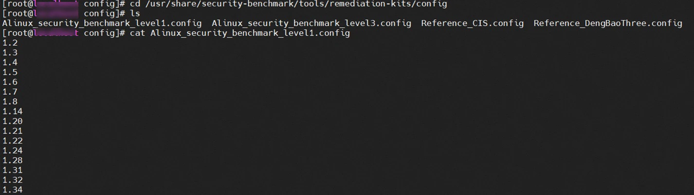

     注意：

     - 仅需填写对应加固脚本的项目编号即可，不需要填写完整脚本名称。

     - 建议只添加未通过检查需要修复的项目编号，已通过检查的项目不需要重复执行加固。

     - 默认配置文件（Alinux_security_benchmark_level1.config）内仅加入了需要修复的项目，剔除了系统初始状态已通过的项目。

     - Alinux_security_benchmark_level3.config包含 level-1 和 level-3 中需要修复的项目，剔除了系统初始状态已通过的项目。

     - level-3 中 SElinux 相关项目（5.2/5.3/5.4）的修复需重启才可生效，且对系统影响较大，请谨慎选择是否修复。

3. 执行脚本。

   直接执行 run_Alinux_remediation_kit.sh 加固脚本，将默认使用 config 文件夹下Alinux_security_benchmark_level1.config 配置文件进行加固修复（相当于进行 level-1 等级的加固修复）。

   -c 参数可指定任意路径下符合要求的 config 文件（要求详见上节），并使用该文件内包含的加固项目，对系统进行加固修复。如./config/Alinux_security_benchmark_level2.config、./config/Reference_CIS.config 等。

   具体命令可参考下文：

   ```bash
   #默认加固
   cd /usr/share/security-benchmark/tools/remediation-kits
   ./run_Alinux_remediation_kit.sh
   ```

   

   

<a id="section-2-1-2"></a>

### 2.1.2. 扫描工具

**操作步骤**

1. 安装修复工具。

   ```bash
   yum install -y security-benchmark
   ```

2. 确认扫描项目。

   - 默认使用 config 文件夹下的Alinux_security_benchmark_level1.config 中的扫描项目；

   - 也可根据使用场景，自行选择 security-benchmark/scanners 目录下的扫描项目；

   - 也可以自定义 config 文件： config 文件建议存放在 security-benchmark/tools/scanners/config目录下，内容为以换行符（LF）分隔的项目编号；

     注意：

     - 仅需填写对应扫描脚本的项目编号即可，不需要填写完整脚本名称。

     - 默认配置文件（Alinux_security_benchmark_level1.config）内加入了已发布的 benchmark 中安全等级为 level-1 且有扫描脚本的所有扫描项目。

     - 高等级的 config 文件内，默认包含了低等级的项目。如：level-2 =(level-1 + level-2)、level-3 = (level-1 +level-2 + level-3)、level-4 = (level-1 +level-2 + level-3 + level-4)。

3. 执行脚本。

   - 直接执行 run_Alinux_scanners.sh 扫描脚本，将默认使用 config 文件夹下Alinux_security_benchmark_level1.config 配置文件进行合规扫描（相当于进行 level-1 等级的合规扫描）。

   - -l 参数可指定安全加固工具中 level-1 至 level-4 中任意一个等级，并使用该等级的加固要求，对系统进行合规扫描。

   - -c 参数可指定任意路径下符合要求的 config 文件（要求详见上节），并使用该文件内包含的加固项目，对系统进行合规扫描。如./config/Alinux_security_benchmark_level2.config、./config/Reference_CIS.config 等。

     具体命令可参考下文：

     ```bash
     export LANG="en_US.UTF-8"
     cd /usr/share/security-benchmark/tools/scanners
     sh ./run_Alinux_scanners.sh
     ```

     注意：不同的环境包括用户的一些额外操作都可能会影响到扫描结果，如果遇到结果中个别 fail 的情况，请您再执行修复工具中对应条目进行修复即可。

     

<a id="section-2-2"></a>

## 2.2. 数据安全

<a id="section-2-2-1"></a>

### 2.2.1. 磁盘加密

用户根据实际需求对磁盘进行加密，以/dev/vda4为例。格式化加密磁盘为 LUKS 分区，使用 SM4 作为加密算法：

```text
# 根据提示输入⼤写的 YES 和密码完成格式化操作
cryptsetup --cipher sm4-xts-plain64 --key-size=256 --hash sm3 luksFormat /dev/vda4

# 打开该加密分区，密码正确后，会创建代表该分区的透明设备 /dev/mapper/diskluks
该设备展示给⽤户的是⼀个未加密的普通的分区设备，可以对它进⾏任何针对分区的操作
cryptsetup luksOpen /dev/vda4 diskluks

# 此时，diskluks 表现为⼀个普通分区，我们可以格式化为任意⽀持的⽂件系统，并挂载它
mkfs.ext4 /dev/mapper/diskluks
mount /dev/mapper/diskluks /mnt/
```

此时，可以把需要保护的数据放到该磁盘上，完成操作后，需要关闭加密磁盘的映射，关闭后，没有正确的密码，是读取不到磁盘数据的，关闭是通过以下命令来完成的：

```text
#卸载
umount /mnt

#锁定加密分区，diskluks 设备被删除，此时没有密码的⽤户看不到明⽂数据
cryptsetup close diskluks
```

<a id="section-2-2-2"></a>

### 2.2.2. 文件加密

**操作步骤**

1. 安装 fscryptctl 工具。

   ```bash
   yum install -y fscryptctl
   ```

2. 挂载 ext4 文件系统。

   选择一块未用到的磁盘格式化为支持fscrypt 的文件系统 ext4，并挂载。以/dev/vda3 为例。

   ```text
   mkfs.ext4 -O encrypt /dev/vda3
   mount /dev/vda3 /mnt
   ```

3. 设置加密策略。

   ```bash
   ⽣成密钥⽂件，实际环境中应⽤使⽤更复杂的密钥
   # echo '1234567812345678' > /tmp/keyfile

   添加该密钥到⽂件系统，返回密钥 ID，之后对密钥的操作都使⽤这个 ID 来索引
   # fscryptctl add_key /mnt < /tmp/keyfile
   23086a13ed81fd75ca5fe9b8f2ff25c7

   查看密钥状态（不是必需）
   # fscryptctl key_status 23086a13ed81fd75ca5fe9b8f2ff25c7 /mnt
   Present (user_count=1, added_by_self)

   创建加密⽬录 endir，并设置加密策略
   使⽤之前添加的密钥和 SM4 算法来加密该⽬录中的⽂件和⼦⽬录
   # mkdir /mnt/endir
   # fscryptctl set_policy --contents=SM4-XTS \
           --filenames=SM4-CTS 23086a13ed81fd75ca5fe9b8f2ff25c7 /mnt/endir

   查看策略是否⽣效（不是必需）
   # fscryptctl get_policy /mnt/endir
   Encryption policy for /mnt/endir:
       Policy version: 2
       Master key identifier: 23086a13ed81fd75ca5fe9b8f2ff25c7
       Contents encryption mode: SM4-XTS
       Filenames encryption mode: SM4-CTS
       Flags: PAD_32
   ```

4. 文件加密功能验证。

   endir 已经是支持透明加解密的一个目录，可以像正常目录一样创建、删除文件，在该目录下进行一些常规的文件操作，可以看到与普通目录没有区别：

   ```bash
   # mkdir /mnt/endir/foo
   # echo 'hello' > /mnt/endir/foo/hello

   # cp -v /usr/include/curl/* /mnt/endir
   # tree /mnt/endir
   /mnt/endir
   ├── curl.h
   ├── easy.h
   ├── foo
   │   └── hello
   └── websockets.h
   ```

   之所以能像普通目录一样操作，是因为密钥已经被添加到了文件系统中。接下来删除密钥后，就能看到目录被锁定，里面的所有路径和内容都是加密状态：

   ```bash
   移除密钥
   # fscryptctl remove_key 23086a13ed81fd75ca5fe9b8f2ff25c7 /mnt

   # fscryptctl key_status 23086a13ed81fd75ca5fe9b8f2ff25c7 /mnt
   Absent

   处于加密状态的⽬录树
   # tree /mnt/endir
   /mnt/endir
   ├── 1H2e0BbS4MGZKAKEu6NVXniaYMWIrWDwbyzX6EVEWEN8tfWcWNgDyw
   ├── LvYw6Jl0a1jImKKOFPjtpG3hEDxjjuM6YIYqcMeXaWdzKUdaX0YCNQ
   ├── QBBz8_qGE4MJY6YVzfqVUkr6YeCSqtoQmbvG04BsR0lAr2oLwO0b2g
   │   └── wOYdFlMRACjeBa-eSo3LuO4sE55q1YuFv-S_lVU-n498jdMjAt06JA
   └── zoiobWxVG2DLjg8uMXfsVP11159zqQUjozJ8gmt1zyjayJlZ4awOhA

   ⽬录被锁定，无法进⾏常规⽂件操作，即便拔盘，也不能得到明⽂内容
   # cat /mnt/endir/1H2e0BbS4MGZKAKEu6NVXniaYMWIrWDwbyzX6EVEWEN8tfWcWNgDyw
   cat: /mnt/endir/1H2e0BbS4MGZKAKEu6NVXniaYMWIrWDwbyzX6EVEWEN8tfWcWNgDyw: Required key not available
   # mkdir /mnt/endir/hello
   mkdir: cannot create directory ‘/mnt/endir/hello’: Required key not available
   ```

   要解锁目录也很简单，重新添加密钥即可，文件系统会搜索到正确的密钥并解锁相应目录：

   ```bash
   # fscryptctl add_key /mnt < /tmp/keyfile
   23086a13ed81fd75ca5fe9b8f2ff25c7

   添加密钥后⽂件内容可正常访问
   # cat /mnt/endir/foo/hello
   hello
   ```

<a id="section-2-2-3"></a>

### 2.2.3. 铜锁支持商用密码加密

**铜锁支持商业加密**

铜锁在符合国内密码模块一级资质的前提下，提供了完整的国内商用密码能力。

1. 首先安装 Tongsuo 8.4.0，YUM 源中软件包名为tongsuo3，并添加tongsuo3的工具目录到PATH路径中。

   ```bash
   yum install -y tongsuo3
   export PATH=/opt/tongsuo3/bin:$PATH
   ```

2. 生成一对使用SM2算法的密钥对。

   ```text
   tongsuo genpkey -algorithm ec -pkeyopt ec_paramgen_curve:sm2 -out sm2.key
   tongsuo pkey -pubout -in sm2.key -out sm2pub.key
   ```

**使用SM2算法做签名验签**

通过基于 SM2 非对称算法的签名验签功能可以提供身份验证的能力。

```text
#⽣成⼀个随机内容⽂件
dd if=/dev/urandom of=msg.bin bs=1024 count=1

#SM2 私钥签名，签名算法为 SM2withSM3
tongsuo dgst -sm3 -sign sm2.key -out sigfile msg.bin

#SM2公钥验签，验签成功会有Verify OK的字样
tongsuo dgst -sm3 -verify sm2pub.key -signature sigfile msg.bin
```

**使用SM3算法计算哈希**

以下两种方式任选其一。

方式一：

```bash
echo "hello tongsuo" | tongsuo dgst -sm3
```

方式二：

```bash
echo "hello tongsuo" > msg.txt
tongsuo dgst -sm3 msg.txt
```

**使用SM4算法加解密数据**

1. 创建文件并写入内容。

   ```bash
   echo "hello tongsuo" > msg.txt
   ```

2. SM4-CBC加密。

   ```text
   tongsuo enc -K "3f342e9d67d6ce7be701756af7bac8f2" \
       -e -sm4-cbc -in msg.txt \
       -iv "1fb2d42fb36e2e88a220b04f2e49aa13" \
       -nosalt -out cipher.bin
   ```

3. SM4-CBC解密。

   ```text
   tongsuo enc -K "3f342e9d67d6ce7be701756af7bac8f2" \
       -d -sm4-cbc -in cipher.bin \
       -iv "1fb2d42fb36e2e88a220b04f2e49aa13" \
       -nosalt -out msg2.txt
   ```

4. 比较解密的明文和原来的消息是否一样。

   ```text
   diff msg.txt msg2.txt
   ```
