阿里云  
专有云  
分布式云容器平台ACK One  
产品简介  
产品版本：v3.18.6-SP2607  
文档版本：20260729

**目录**

- [1.什么是分布式云容器平台 ACK One](#section-1)
- [2.产品详情](#section-2)
- [3.产品价值](#section-3)
- [4.功能特性](#section-4)
- [5.应用场景](#section-5)

# 1.什么是分布式云容器平台 ACK One

分布式云容器平台 ACK One（Distributed Cloud Container Platform for Kubernetes）是阿里云面向混合云、多集群、分布式计算、容灾等场景推出的企业级云原生平台。ACK One可以连接并管理您任何地域、任何基础设施上的Kubernetes集群，并提供一致的管理和社区兼容的API，支持对计算、网络、存储、安全、监控、日志、作业、应用、流量等进行统一运维管控。

# 2.产品详情

作为企业级云原生解决方案，ACK One帮助企业构建安全、标准、现代化的云原生IT架构，有效应对分布式云场景下的多集群管理挑战，实现从本地数据中心到专有云、边缘节点的全面覆盖与统一治理。

**核心功能**

为了应对分布式云场景多种挑战，ACK One提供以下功能。

**注册集群**

**User**

提供与容器服务ACK

一致的用户体验

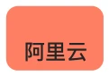

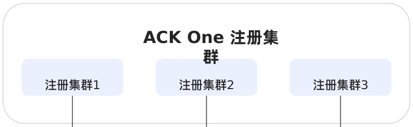

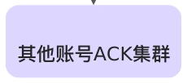

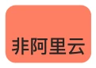

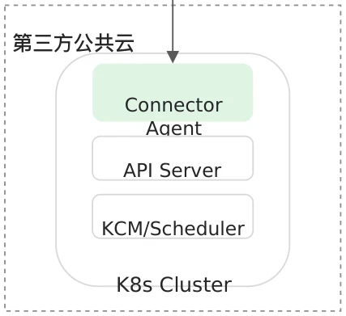

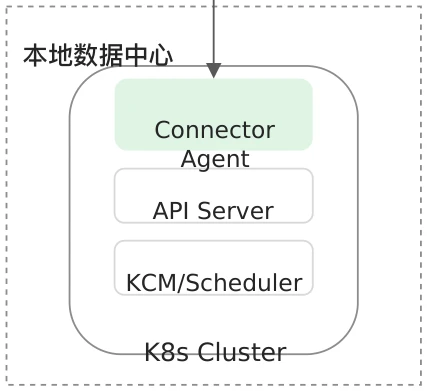

通过ACK注册集群，您可以将来自不同供应商和不同位置的K8s集群统一接入到阿里云容器服务ACK控制台，实现多个集群统一管理，并使用容器服务ACK丰富的集群扩展能力。

注册集群相关文档，请参见<strong>《容器服务ACK 用户指南》 > 注册集群概述</strong>章节。

**多集群舰队**

统一控制面

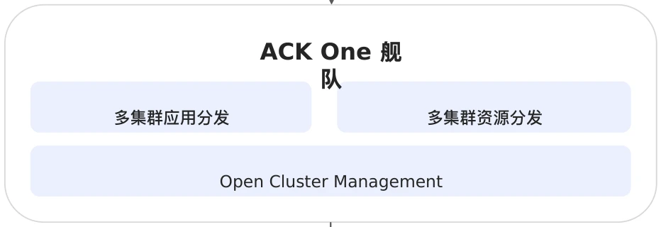

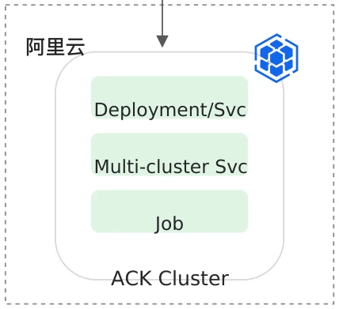

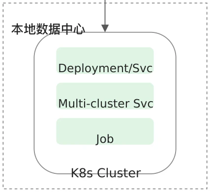

当您同时运行多个K8s集群时，可以通过多集群舰队关联多个集群，并通过多集群舰队提供的统一控制面，同时管理多个关联集群。

- 多集群舰队控制面基于K8s控制面构建，提供标准Kubernetes API。

- 多集群舰队可以接入多个K8s集群，非容器服务ACK集群，可以先通过注册集群接入。

- 多集群应用分发：托管开源ArgoCD，实现多集群应用分发。

多集群舰队相关文档，请参见<strong>《分布式云容器平台ACK One 用户指南》 > 舰队管理概述</strong>章节。

**总结**

分布式云容器平台 ACK One是阿里云为应对复杂分布式云场景打造的企业级解决方案。它突破了传统云原生平台的局限，实现了跨地域、跨基础设施的Kubernetes集群统一管理，为企业提供一致的运维体验、智能的资源调度、弹性的计算能力以及可靠的容灾保障。

无论是构建混合云架构、管理多集群环境、实现应用容灾，还是优化AI和大数据工作负载，ACK One都能提供全面、高效、安全的解决方案，助力企业加速云原生转型，提升IT基础设施的敏捷性和可靠性。

# 3.产品价值

分布式云容器平台 ACK One（Distributed Cloud Container Platform for Kubernetes）是阿里云面向混合云、多集群、分布式计算及容灾场景推出的企业级云原生平台。它通过统一控制面连接并管理任何地域、任何基础设施上的Kubernetes集群，提供一致的运维体验和社区兼容API，帮助企业构建安全、标准化的云原生架构。本文主要介绍ACK One的产品优势。

**统一运维与安全管理**

提供与阿里云容器服务ACK一致的运维体验，支持将本地数据中心、第三方公有云和边缘集群接入统一控制台。通过监控、日志、安全策略等能力，降低运维复杂度，提升系统稳定性与合规性。

**多集群应用分发与容灾**

基于 ArgoCD 实现多集群应用分发，支持应用状态与 Helm 仓库自动同步。

**智能资源调度优化**

利用智能调度器实现Gang Scheduling、CPU拓扑感知等高阶能力，针对AI训练、大数据处理等混合负载场景优化资源分配。

**云上云下一致体验**

通过注册集群功能，实现本地数据中心K8s集群与第三方公有云集群的统一管理。

# 4.功能特性

分布式云容器平台 ACK One是阿里云的企业级云原生平台，适用于混合云、多集群、分布式计算和容灾场景，可连接管理任何Kubernetes集群，提供一致API及统一运维，具体功能及相应的详细说明如下：

**注册集群**

<table>
  <tr>
    <th width="122">功能点</th>
    <th>详细说明</th>
  </tr>
  <tr>
    <td>注册集群管理</td>
    <td>• 支持纳管客户IDC或三方云的Kubernetes集群。 • 注册集群通过使用ack-cluster-agent代理的方式，无侵入地读取客户自建集群的信息。 • 支持创建注册集群。 • 支持展示注册集群列表。 • 支持删除注册集群。</td>
  </tr>
</table>

**舰队管理**

<table>
  <tr>
    <th width="122">功能点</th>
    <th>详细说明</th>
  </tr>
  <tr>
    <td>舰队创建</td>
    <td>支持创建舰队。</td>
  </tr>
  <tr>
    <td>舰队删除</td>
    <td>支持删除舰队。</td>
  </tr>
  <tr>
    <td>舰队列表</td>
    <td>支持展示舰队列表。</td>
  </tr>
  <tr>
    <td>授权管理</td>
    <td>支持针对舰队授予RAM用户管理员和开发人员权限，其中开发人员权限支持指定命名空间。</td>
  </tr>
  <tr>
    <td>舰队详情</td>
    <td>支持展示舰队的基础信息和关联的云资源信息。</td>
  </tr>
  <tr>
    <td>关联舰队列表</td>
    <td>支持展示当前舰队已经关联的ACK Kubernetes 集群列表。</td>
  </tr>
  <tr>
    <td>关联舰队</td>
    <td>支持选择ACK集群并将其关联到目标舰队。 说明注意：关联的集群Pod CIDR、Service CIDR、vSwitch CIDR、VPC CIDR不允许重叠。</td>
  </tr>
  <tr>
    <td>链接舰队</td>
    <td>支持通过kubectl连接Kubernetes集群。</td>
  </tr>
  <tr>
    <td>舰队日志</td>
    <td>支持查看舰队的操作日志。</td>
  </tr>
  <tr>
    <td>命名空间</td>
    <td>• 支持在舰队内创建命名空间。 • 支持查看命名空间列表。 • 支持删除命名空间。</td>
  </tr>
  <tr>
    <td>多集群应用</td>
    <td>• 支持以Chart方式创建多集群应用，从而实现多个集群中的应用发布能力。 • 支持查看发布的应用名称、状态、Chart名称、Chart地址。 • 支持编辑多集群应用。 • 支持删除多集群应用。</td>
  </tr>
</table>

**双栈网络**

| 功能点 | 详细说明 |
| --- | --- |
| IPv4/IPv6 双栈支持 | ACK One 集群全面支持 Kubernetes 原生 IPv4/IPv6 双栈网络模式。 |

# 5.应用场景

本文介绍分布式云容器平台 ACK One的应用场景。

**应用场景**

**场景1：注册集群，云上云下集群一致运维体验**

**User**

提供与容器服务ACK

一致的用户体验

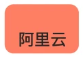

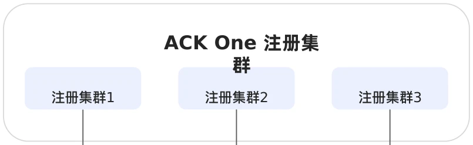

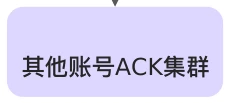

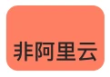

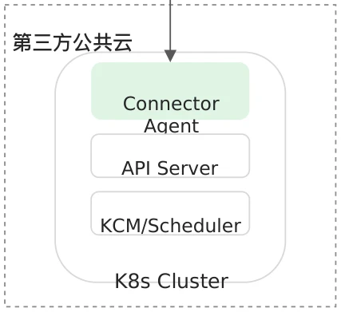

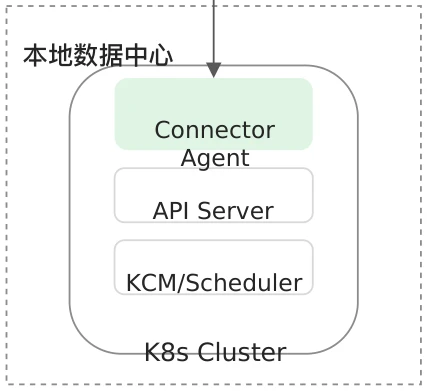

场景描述

- <strong>一致运维体验：</strong>ACK统一的运维能力下沉到数据中心集群和第三方公有云集群。

- <strong>增强可观测性：</strong>支持日志、监控、和事件收集，享受云上同等的运维体验。

**场景2：多集群舰队，多集群应用分发**

**Developer**

Update

**repo**

Watch and Pull

**Platform teams**

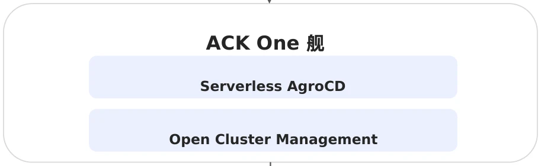

compare/sync

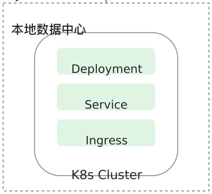

场景描述

- <strong>应用持续部署：</strong>Helm仓库中应用状态与Kubernetes集群应用状态自动同步。

- <strong>应用多集群分发：</strong>支持将应用同时发布到多个集群。
