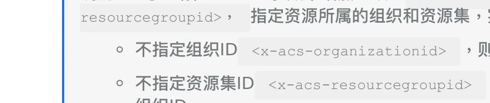
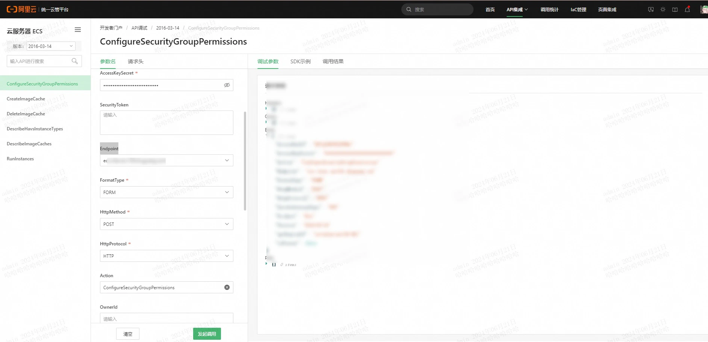
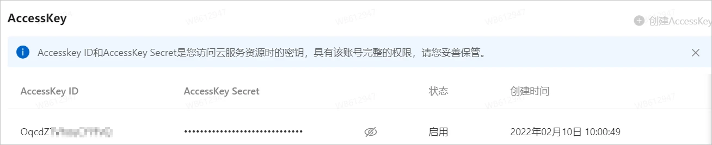

阿里云  
专有云  
弹性高性能计算  
开发指南  
产品版本：v3.18.6-SP2607  
文档版本：20260729

**目录**

- [1.快速入门](#section-1)
    - [1.1. 开发文档使用说明](#section-1-1)
    - [1.2. API调用流程说明](#section-1-2)
- [2.准备工作](#section-2)
    - [2.1. 登录开发者门户](#section-2-1)
    - [2.2. 获取API信息及其EndPoint](#section-2-2)
    - [2.3. 获取AccessKey](#section-2-3)
    - [2.4. 获取STS AccessKey](#section-2-4)
    - [2.5. 获取公共Header参数](#section-2-5)
    - [2.6. 获取E-HPC的SDK包](#section-2-6)
- [3.Java SDK调用示例](#section-3)
    - [3.1. 快速开始](#section-3-1)
    - [3.2. 使用手册](#section-3-2)
        - [3.2.1. 安装Java SDK](#section-3-2-1)
        - [3.2.2. 设置身份验证凭证](#section-3-2-2)
        - [3.2.3. 请求连接配置](#section-3-2-3)
        - [3.2.4. 发起调用](#section-3-2-4)
        - [3.2.5. 错误处理](#section-3-2-5)
        - [3.2.6. 使用CommonRequest进行调用](#section-3-2-6)
- [4.Python SDK调用示例](#section-4)
    - [4.1. 快速开始](#section-4-1)
    - [4.2. 使用手册](#section-4-2)
        - [4.2.1. 安装Python SDK](#section-4-2-1)
        - [4.2.2. 设置身份验证凭证](#section-4-2-2)
        - [4.2.3. 设置HTTPS请求](#section-4-2-3)
        - [4.2.4. 发起调用](#section-4-2-4)
        - [4.2.5. 错误处理](#section-4-2-5)
        - [4.2.6. 使用CommonRequest进行调用](#section-4-2-6)
- [5.Go SDK调用示例](#section-5)
    - [5.1. 快速开始](#section-5-1)
    - [5.2. 使用手册](#section-5-2)
        - [5.2.1. 安装Go SDK核心包](#section-5-2-1)
        - [5.2.2. 设置身份验证凭证](#section-5-2-2)
        - [5.2.3. 发起调用](#section-5-2-3)
        - [5.2.4. 错误处理](#section-5-2-4)
        - [5.2.5. 使用CommonRequest进行调用](#section-5-2-5)
- [6.API参考](#section-6)
    - [6.1. API概览](#section-6-1)
    - [6.2. 请求结构](#section-6-2)
    - [6.3. API授权](#section-6-3)
    - [6.4. 签名机制](#section-6-4)
    - [6.5. 公共参数](#section-6-5)
    - [6.6. 返回结果](#section-6-6)
    - [6.7. 集群](#section-6-7)
        - [6.7.1. CreateCluster](#section-6-7-1)
        - [6.7.2. ListClusters](#section-6-7-2)
        - [6.7.3. DescribeCluster](#section-6-7-3)
        - [6.7.4. StartCluster](#section-6-7-4)
        - [6.7.5. StopCluster](#section-6-7-5)
        - [6.7.6. RecoverCluster](#section-6-7-6)
        - [6.7.7. DeleteCluster](#section-6-7-7)
        - [6.7.8. ModifyClusterAttributes](#section-6-7-8)
        - [6.7.9. ListClusterLogs](#section-6-7-9)
        - [6.7.10. GetAccountingReport](#section-6-7-10)
    - [6.8. 集群客户端](#section-6-8)
        - [6.8.1. ListCurrentClientVersion](#section-6-8-1)
        - [6.8.2. UpgradeClient](#section-6-8-2)
    - [6.9. 镜像](#section-6-9)
        - [6.9.1. ListImages](#section-6-9-1)
        - [6.9.2. ListCustomImages](#section-6-9-2)
    - [6.10. 节点](#section-6-10)
        - [6.10.1. ListNodes](#section-6-10-1)
        - [6.10.2. ListNodesNoPaging](#section-6-10-2)
        - [6.10.3. StartNodes](#section-6-10-3)
        - [6.10.4. ResetNodes](#section-6-10-4)
        - [6.10.5. StopNodes](#section-6-10-5)
        - [6.10.6. DeleteNodes](#section-6-10-6)
        - [6.10.7. AddNodes](#section-6-10-7)
    - [6.11. 队列](#section-6-11)
        - [6.11.1. AddQueue](#section-6-11-1)
        - [6.11.2. ListQueues](#section-6-11-2)
        - [6.11.3. SetQueue](#section-6-11-3)
        - [6.11.4. ListNodesByQueue](#section-6-11-4)
        - [6.11.5. DeleteQueue](#section-6-11-5)
    - [6.12. 用户](#section-6-12)
        - [6.12.1. AddUsers](#section-6-12-1)
        - [6.12.2. ListUsers](#section-6-12-2)
        - [6.12.3. ModifyUserGroups](#section-6-12-3)
        - [6.12.4. ModifyUserPasswords](#section-6-12-4)
        - [6.12.5. DeleteUsers](#section-6-12-5)
    - [6.13. 作业](#section-6-13)
        - [6.13.1. SetJobUser](#section-6-13-1)
        - [6.13.2. SubmitJob](#section-6-13-2)
        - [6.13.3. ListJobs](#section-6-13-3)
        - [6.13.4. RerunJobs](#section-6-13-4)
        - [6.13.5. StopJobs](#section-6-13-5)
        - [6.13.6. DeleteJobs](#section-6-13-6)
    - [6.14. 作业模板](#section-6-14)
        - [6.14.1. CreateJobTemplate](#section-6-14-1)
        - [6.14.2. EditJobTemplate](#section-6-14-2)
        - [6.14.3. ListJobTemplates](#section-6-14-3)
        - [6.14.4. DeleteJobTemplates](#section-6-14-4)
    - [6.15. 软件](#section-6-15)
        - [6.15.1. ListSoftwares](#section-6-15-1)
    - [6.16. 存储](#section-6-16)
        - [6.16.1. ListVolumes](#section-6-16-1)
    - [6.17. 交互命令](#section-6-17)
        - [6.17.1. InvokeShellCommand](#section-6-17-1)
        - [6.17.2. ListCommands](#section-6-17-2)
        - [6.17.3. ListInvocationStatus](#section-6-17-3)
    - [6.18. 作业布防](#section-6-18)
        - [6.18.1. CreateJobTask](#section-6-18-1)
        - [6.18.2. ListJobTask](#section-6-18-2)
        - [6.18.3. DeleteJobTask](#section-6-18-3)
    - [6.19. 健康巡检](#section-6-19)
        - [6.19.1. SetHealthMonitor](#section-6-19-1)
        - [6.19.2. GetHealthMonitorInfo](#section-6-19-2)
        - [6.19.3. GetHealthMonitorLogs](#section-6-19-3)
    - [6.20. 性能测试](#section-6-20)
        - [6.20.1. GetBenchmarkResult](#section-6-20-1)
        - [6.20.2. SetClusterBenchmark](#section-6-20-2)
    - [6.21. 其他](#section-6-21)
        - [6.21.1. ListRegions](#section-6-21-1)
- [7.附录](#section-7)
    - [7.1. STS概要](#section-7-1)
        - [7.1.1. 什么是STS](#section-7-1-1)
        - [7.1.2. AssumeRole](#section-7-1-2)

<a id="section-1"></a>

# 1.快速入门

<a id="section-1-1"></a>

## 1.1. 开发文档使用说明

本文为您介绍在使用专有云API进行开发工作时，如何查看所需要的产品文档。

**使用流程**

您可以按照以下流程图中步骤，判断自己所需要使用的开发文档。


**前提条件**

通过运维人员或运营管理员获取专有云的版本。

**操作步骤**

您可以通过阿里云专有云文档中心，获取需要的产品文档。

1. 通过浏览器打开专有云文档中心。

2. 根据专有云的版本单击**企业版**、**敏捷版**或**一体机**标签。

3. 在下拉列表中，选择对应的专有云版本。

   

4. 在左侧导航栏中，选择目标产品名称。

5. 在单击目标文档区域的**查看详情**或**下载PDF**。

<a id="section-1-2"></a>

## 1.2. API调用流程说明

阿里云专有云支持通过POP网关调用专有云API，为了使您拥有与公有云更一致的体验，自企业版V3.16.0开始，专有云API默认使用POP网关方式调用。本文介绍通过POP网关调用专有云API的流程。

**流程图**


**调用步骤**

1. 获取AccessKey。

   获取调用时所需要的AccessKey参数，具体操作，请参见获取AccessKey或获取STS AccessKey。

   > **说明**
   >
   > 推荐使用个人AccessKey或STS AccessKey调用Apsara Uni-manager运营控制台及云产品接口。

2. 获取RegionID。

   获取调用时所需要的RegionID参数，具体操作，请参见获取E-HPC的Endpoint。

3. 获取组织ID与资源集ID。

   组织ID需要通过API进行获取，获取方式请参见*Apsara Uni-manager运营控制台开发指南*中的*GetOrga nizationList章节*。

   资源集ID需要通过API进行获取，获取方式请参见*Apsara Uni-manager运营控制台开发指南*中的*ListRe sourceGroup章节*。

   > **说明**
   >
   > 调用API时，请在Header参数中增加组织ID `<x-acs-organizationid>` 和资源集ID `<x-acs-`



> `resourcegroupid>`， 指定资源所属的组织和资源集，实现实例资源的隔离查询。
>
> - 不指定组织ID `<x-acs-organizationid>` ，则默认获取当前用户所属的组织。
>
> - 不指定资源集ID `<x-acs-resourcegroupid>` ，则默认为空，如果指定资源集需要同时指定组织ID。

4. 获取对应的API参考文档。

   您需要查看目标云产品的开发指南，了解API的功能与使用方式，开发指南的使用流程及获取方法，请参见开发文档使用说明。

5. 获取云产品Endpoint。

   具体操作，请参见获取E-HPC的Endpoint。

6. 获取云产品SDK并调用云产品API。

<a id="section-2"></a>

# 2.准备工作

<a id="section-2-1"></a>

## 2.1. 登录开发者门户

您可以通过Apsara Uni-manager运营控制台登录开发者门户。

**前提条件**

- 登录Apsara Uni-manager运营控制台前，确认您已从部署人员处获取Apsara Uni-manager运营控制台的服务域名地址。

- 推荐使用Chrome浏览器。

**操作步骤**

1. 在浏览器地址栏中，输入Apsara Uni-manager运营控制台的服务域名地址，按回车键。

2. 输入正确的用户名及密码。

   请向运营管理员获取登录控制台的用户名和密码。

   > **说明**
   >
   > 首次登录Apsara Uni-manager运营控制台时，需要修改登录用户名的密码，请按照提示完成密码修改。为提高安全性，密码长度必须为10~32位，且至少包含以下两种类型：
   >
   > - 英文大写或小写字母（A~Z、a~z）
   >
   > - 阿拉伯数字（0~9）
   >
   > - 特殊符号（感叹号（!）、at（@）、井号（#）、美元符号（$）、百分号（%）等）

3. 单击**登录**。

4. 如果账号已激活MFA多因素认证，请根据以下两种情况进行操作：

   - 管理员强制开启MFA后的首次登录：

     <ol type="a">

     <li>

     在绑定虚拟MFA设备页面中，按页面提示步骤绑定MFA设备。

     </li>

     <li>

     按照步骤2重新输入账号和密码，单击**登录**。

     </li>

     </ol>

     <ol type="i" start="100">

     <li>

     输入6位MFA码后单击**认证**。

     </li>

     </ol>

   - 您已开启并绑定MFA：

     输入6位MFA码后单击**认证**。

     > **说明**
     >
     > 绑定并开启MFA的操作请参见<strong>《Apsara Uni-manager运营控制台用户指南》</strong>中的<strong>《绑定并开启虚拟MFA设备》</strong>章节。

5. 在页面顶部的菜单栏中，选择**产品 > 应用服务 > 开发者门户**。

<a id="section-2-2"></a>

## 2.2. 获取API信息及其EndPoint

首先，您需要了解产品开放API接口的相关信息，包括产品名称（code）、开放API接口名称、API版本。

**背景信息**

Apsara Uni-manager运营控制台API目录中的API信息仅供调用参考，具体API的使用方式需要参见云产品的开发指南。如果发生不一致情况，以开发指南支持情况为准。

**操作步骤**

1. 登录Apsara Uni-manager运营控制台。

2. 在顶部菜单栏选择**产品** > **应用服务** > **开发者门户**。

3. 在**开发者门户**页面，选择**API集成** > **API调试**。

   

4. 在左侧导航栏中选择目标云产品。

5. 在**版本**下拉列表中，选择目标API版本。

6. 在下方API列表中可浏览当前版本的所有API接口。

7. 选中对应接口，在参数名下获取云产品的POP Endpoint信息。

   

<a id="section-2-3"></a>

## 2.3. 获取AccessKey

AccessKey支持RAM和STS两种授权模式，在发起调用时选择使用其中一种AccessKey即可。本文为您描述如何获取通过RAM授权的AccessKey。

**背景信息**

AccessKey通过使用AccessKey ID和AccessKey Secret对称加密的方法验证某个请求发送者的身份。其中AccessKey ID用于标识用户，AccessKey Secret是用户用于加密签名的字符串。

AccessKey的两种授权模式如下：

- 通过RAM授权给第三方请求者的AccessKey ID和AccessKey Secret。

- 通过STS授权给第三方请求者的AccessKey ID、AccessKey Secret和Security Token。获取方式，请参见获取STS AccessKey。

Apsara Uni-manager运营控制台提供了个人AccessKey和组织AccessKey（只有运营管理员和一级组织管理员可以获取组织AccessKey），推荐使用个人账号AccessKey调用Apsara Uni-manager运营控制台及云产品相关接口。如果使用个人账号AccessKey，需要在Header中添加以下限制性参数，否则可能提示权限不足：

> **警告**
>
> 个人账号AccessKey是由Apsara Uni-manager运营控制台权限体系管控的受限AccessKey，组织AccessKey相对权限较大，需要管理员确认操作的安全性。

<table>
  <tr>
    <th width="206">参数名称</th>
    <th>描述</th>
  </tr>
  <tr>
    <td>x-acs-regionid</td>
    <td>地域，如：cn-hangzhou-*。</td>
  </tr>
  <tr>
    <td>x-acs-organizationid</td>
    <td>Apsara Uni-manager运营控制台中对应的组织ID。获取方式，请参见<em>Apsara Uni-manager运营控制台开发</em><em>指南</em>中的<em>GetOrganizationList</em>章节。</td>
  </tr>
  <tr>
    <td>x-acs-resourcegroupid</td>
    <td>Apsara Uni-manager运营控制台中对应的资源集ID。获取方式，请参见<em>Apsara Uni-manager运营控制台开</em><em>发指南</em>中的<em>ListResourceGroup</em>章节。</td>
  </tr>
  <tr>
    <td>x-acs-instanceid</td>
    <td>进行操作的实例ID，例如，ECS的实例ID可以从ECS列表中查询到。</td>
  </tr>
</table>

**获取个人账号AccessKey**

获取个人账号AccessKey的方法如下：

1. 登录Apsara Uni-manager运营控制台。

2. 在系统界面右上角，单击当前登录用户头像，单击**个人信息**。

3. 在**AccessKey**区域，您可以查看个人账户的AccessKey信息。

   

   > **说明**
   >
   > Accesskey ID和AccessKey Secret是您访问云资源时的密钥，具有该账号完整的权限，请您妥善保管。

**获取组织AccessKey**

获取组织AccessKey的方法如下：

1. 管理员登录Apsara Uni-manager运营控制台。

2. 在顶部菜单栏，单击**企业**。

3. 在左侧导航栏中，选择。

4. 在组织结构中，单击目标一级组织名称。

5. 单击**管理Accesskey**。

6. 在弹出的对话框中，查看组织AccessKey信息。

<a id="section-2-4"></a>

## 2.4. 获取STS AccessKey

本文为您介绍如何利用STS方式，调用专有云的产品API。

**背景信息**

阿里云临时安全令牌STS（Security Token Service）是阿里云提供的一种临时访问权限管理服务。您可以选择使用STS方式，调用专有云的产品API。

STS AccessKey由AccessKey ID、AccessKey Secret及SecurityToken三元组组成，使用STS方式调用云产品API时，三元组缺一不可。更多STS内容，请参见什么是STS。

**操作步骤**

1. 获取用户角色的 `RAM Role` 。

   <ol type="i">

   <li>

   登录Apsara Uni-manager运营控制台。

   </li>

   <li>

   单击页面右上角的用户头像，选择**个人信息**。

   </li>

   <li>

   单击**查看当前角色策略**。

   在**当前选择角色策略**对话框中查看 `RAM Role` 。

   </li>

   </ol>

2. 获取STS Accesskey三元组。

   > **说明**
   >
   > 以下代码示例中可变参数均需替换为您实际的相关信息，尖括号（<>）在最终代码中不保留。
   >
   > 涉及替换的可变参数如下：
   >
   > - &lt;yourRegionID>，请替换为您实际的地域ID。
   >
   > - &lt;yourAccessKeyID>，请替换为您实际的AccessKey ID。
   >
   > - &lt;yourAccessKeySecret>，请替换为您实际的AccessKey Secret。
   >
   > - &lt;yourRoleSessionName>，请替换为您当前实际的会话名称。
   >
   > - &lt;yourRoleArn>，请替换为您实际的RAM Role。
   >
   > - &lt;sts.aliyuns.com>，请替换为实际的STS Endpoint。

   ```xml
   public static void main(String[] args) {
       // 创建DefaultAcsClient实例并初始化。
       // 请替换为您实际的地域ID、AccessKey ID、AccessKey Secret
       DefaultProfile profile = DefaultProfile.getProfile("<yourRegionID>", "
   <yourAccessKeyID>", "<yourAccessKeySecret>");
       HttpClientConfig clientConfig = HttpClientConfig.getDefault();
       clientConfig.setIgnoreSSLCerts(true);
       clientConfig.setProtocolType(ProtocolType.HTTPS);
       profile.setHttpClientConfig(clientConfig);
       IAcsClient client = new DefaultAcsClient(profile);
       String assumeRole = callAssumeRole(client);
       if (StringUtils.isEmpty(assumeRole)) return;
       JSONObject assumeRoleJson = JSONObject.parseObject(assumeRole);
       JSONObject credentials = assumeRoleJson.getJSONObject("Credentials");
       // 获取到STS三元组
       String stsAK = credentials.getString("AccessKeyId");
       String stsSK = credentials.getString("AccessKeySecret");
       String stsToken = credentials.getString("SecurityToken");
   }

   private static String callAssumeRole(IAcsClient client) {
       CommonRequest request = new CommonRequest();
       // "sts.aliyuns.com" 请替换为实际的STS Endpoint，⼀般格式为sts-
   vpc.${global:region}.${global:internet-domain}
       request.setSysDomain("sts.aliyuns.com");
       request.setSysProduct("Sts");
       request.setSysAction("AssumeRole");
       request.setSysVersion("2015-04-01");
       request.setSysMethod(MethodType.POST);
       request.setHttpContentType(FormatType.FORM);
       // 业务参数，设置本次调⽤Session的别名，"<yourRoleSessionName>"请您替换为实际值
       request.putQueryParameter("RoleSessionName", "<yourRoleSessionName>");
       // 扮演的Role⾓⾊ARN，"<yourRoleArn>"请替换为上⼀步获取到的实际Ram Role ARN
       request.putQueryParameter("RoleArn", "<yourRoleArn>");
       try {
           CommonResponse response = client.getCommonResponse(request);
           return response.getData();
       } catch (ServerException e) {
           System.out.println(e.getErrCode());
           System.out.println(e.getErrMsg());
       } catch (ClientException e) {
           System.out.println(e.getErrCode());
           System.out.println(e.getErrMsg());
       }
       return null;
   }
   ```

3. 通过STS AccessKey三元组调用云产品的接口，下列代码以E-HPC的 `CreateCluster` 接口为示例。

   > **说明**
   >
   > 以下代码示例中可变参数均需替换为您实际的相关信息，尖括号（<>）在最终代码中不保留。
   >
   > 涉及替换的可变参数如下：
   >
   > - &lt;yourRegionID>，请替换为您实际的地域ID。
   >
   > - &lt;yourStsAccesskeyID>，请替换为您实际的STS Accesskey ID。
   >
   > - &lt;yourStsAccessKeySecret>，请替换为您实际的STS Accesskey Secret。
   >
   > - &lt;yourStsToken>，请替换为实际STS三元组中的SecurityToken。
   >
   > - &lt;yourResourceGroupID>，请替换为您实际的资源集ID。
   >
   > - &lt;yourOrganizationID>请替换为您实际的组织ID。

   ```xml
   public static void main(String[] args) {
       // "<yourRegionID>"请替换为您实际的地域ID
       // "<yourStsAccessKeyID>", "<yourStsAccessKeySecret>"请替换为前⼀步获取到的STS三元组中
   AccessKeyID、AccessKeySecret
       DefaultProfile profile = DefaultProfile.getProfile("<yourRegionID>", "
   <yourStsAccesskey>", "<yourStsAccessSecret>");
       HttpClientConfig clientConfig = HttpClientConfig.getDefault();
       clientConfig.setIgnoreSSLCerts(true);
       clientConfig.setProtocolType(ProtocolType.HTTPS);
       profile.setHttpClientConfig(clientConfig);
       IAcsClient client = new DefaultAcsClient(profile);
       CommonRequest request = new CommonRequest();
       request.setSysDomain("ehpc.aliyuns.com");
       request.setSysProduct("ehpc");
       request.setSysAction("CreateCluster");
       request.setSysVersion("2018-04-12");
       request.setSysMethod(MethodType.POST);
       request.setHttpContentType(FormatType.FORM);
       //"<yourRegionID>" 请替换为您实际的地域ID
       request.putHeadParameter("x-acs-regionid", "<yourRegionID>");
       // "<yourStsToken>" 请替换为您前⼀步获取到的STS三元组中SecurityToken
       request.putQueryParameter("SecurityToken", "<yourStsToken>");
       // 非必填,请替换为您实际的资源集ID
       // request.putHeadParameter("x-acs-resourcegroupid", "<yourResourceGroupID>");
       // 必填,请替换为您实际的组织ID
       request.putHeadParameter("x-acs-organizationid", "<yourOrganizationID>");
       try {
           CommonResponse response = client.getCommonResponse(request);
           System.out.println(response.getData());
       } catch (ServerException e) {
           System.out.println(e.getErrCode());
           System.out.println(e.getErrMsg());
       } catch (ClientException e) {
           System.out.println(e.getErrCode());
           System.out.println(e.getErrMsg());
       }
   }
   ```

<a id="section-2-5"></a>

## 2.5. 获取公共Header参数

调用专有云API时需要提供多个Header参数。本文为您介绍这些参数的含义及其获取方式，并对调用后的一些返回值做出解释。

**Header参数描述**

| 名称 | 描述 |
| --- | --- |
| x-acs-regionid | 环境Region，获取方式请参见获取Region ID。 |
| x-acs-organizationid | Apsara Uni-manager运营控制台上的组织ID，获取方式请参见获取组织ID。 |
| x-acs-resourcegroupid | Apsara Uni-manager运营控制台上的资源集ID，获取方式请参见获取资源集ID。 |
| x-acs-instanceid | 进行操作的集群ID，获取方式请参见获取集群ID。 |

**获取Region ID**

1. 管理员登录Apsara Uni-manager运营控制台。

2. 在顶部菜单栏中，单击**企业**。

3. 在左侧导航栏中，选择**资源管理** > **地域管理**。

4. 单击目标组织名称。

5. 在右侧**Region列表**中查看Region ID。

**获取组织ID**

组织ID需要通过API进行获取，获取方式请参见*Apsara Uni-manager运营控制台开发指南*中的*GetOrganizationList章节*。

**获取资源集ID**

资源集ID需要通过API进行获取，获取方式请参见*Apsara Uni-manager运营控制台开发指南*中的*ListResourceGroup章节*。

**获取集群ID**

集群ID可以通过Apsara Uni-manager运营控制台中的云产品集群列表进行获取，本文中以E-HPC为例，获取步骤如下：

1. 登录Apsara Uni-manager运营控制台。

2. 在顶部的菜单栏中，选择**产品** > **弹性计算** > **弹性高性能计算E-HPC**。

3. 在左侧导航栏中，单击集群。

4. 在集群列表中查看**集群ID**。

**返回参数**

对于列表类的云产品资源实例接口，调用后会默认增加如下返回值。

| 名称 | 描述 |
| --- | --- |
| ResourceGroupName | 资源集名称。 |
| ResourceGroup | 资源集ID。 |
| DepartmentName | 组织名称。 |
| Department | 组织ID。 |

<a id="section-2-6"></a>

## 2.6. 获取E-HPC的SDK包

通过POP网关调用专有云API时，需使用E-HPC的SDK。本文为您介绍如何获取阿里云开发工具包（SDK）。

弹性高性能计算E-HPC SDK封装了2018-04-12版本API，以访问密钥（AccessKey）识别调用者身份，提供自动签名等功能，方便您通过API创建和管理资源。

实现弹性高性能计算E-HPC功能需要您同时安装E-HPC SDK和阿里云核心库。以Java SDK为例，您需要下载aliyun-java-sdk-core以及aliyun-java-sdk-ehpc。

软件开发工具包（SDK）包括代码以及示例，您可以自行选择语言创建云应用。

目前SDK的语言支持：Java、Python、Go，您可以前往阿里云开发工具包（SDK）中进行选择。

> **说明**
>
> 推荐使用 Java、Python、Go三种语言的SDK包，使用其他语言的SDK包可能发生不兼容情况。

SDK核心库推荐使用阿里云官网的SDK核心库，其内容所有云产品共用，且适用于专有云。

<a id="section-3"></a>

# 3.Java SDK调用示例

<a id="section-3-1"></a>

## 3.1. 快速开始

本节介绍如何获取E-HPC的Java SDK并开始调用。

**环境准备**

- 使用阿里云专有云Java SDK，您需要一个授权账号以及一对AccessKey ID和AccessKey Secret。具体操作，请参见获取AccessKey。

- 获取E-HPC的Endpoint。具体操作，参见获取E-HPC的Endpoint。

- 阿里云专有云Java SDK需要1.8及以上的JDK。

**安装阿里云专有云 Java SDK**

如果您使用Apache Maven来管理Java项目，只需在项目的pom.xml中导入JAR文件。

要使用E-HPC的开发工具包，必须安装SDK核心库以及产品的SDK。其中，SDK核心库推荐使用4.5.17及以上版本，SDK的版本为1.14.7。

**使用Java SDK**

本示例以SubmitJob为例，介绍调用阿里云专有云Java SDK的主要操作步骤：

1. 创建并初始化DefaultAcsClient实例。

2. 创建API请求并设置参数。

3. 发起请求并处理应答或异常。

   > **说明**
   >
   > 以下代码示例中可变参数均需替换为您实际的相关信息，尖括号（<>）在最终代码中不保留。
   >
   > 涉及替换的可变参数如下：
   >
   > - &lt;yourRegionID>，请替换为您实际的地域ID。
   >
   > - &lt;yourAccessKeyID>，请替换为您实际的AccessKey ID。
   >
   > - &lt;yourAccessKeySecret>，请替换为您实际的AccessKey Secret。
   >
   > - &lt;Product>，请替换为您实际的产品名称。
   >
   > - &lt;Endpoint>，请替换为您当前产品实际的Endpoint。
   >
   > - &lt;readTimeout>，请您根据实际情况设置读取超时时间，单位为毫秒。
   >
   > - &lt;connectionTimeout>，请您根据实际情况设置连接超时时间，单位为毫秒。
   >
   > - &lt;maxRequestsPerHost>，请您根据实际情况设置每个主机的最大请求数。
   >
   > - &lt;maxRequests>，请您根据实际情况设置最大请求数。
   >
   > - <"http://192.168.XX:33XX">，请替换为您实际的代理IP+端口。

   ```java
    import com.aliyuncs.profile.DefaultProfile;
    import com.aliyuncs.DefaultAcsClient;
    import com.aliyuncs.IAcsClient;
    import com.aliyuncs.exceptions.ClientException;
    import com.aliyuncs.exceptions.ServerException;
    import com.aliyuncs.ehpc.model.v20180412.*;
    public class SubmitJob {
        public static void main(String[] args) {
           // 创建DefaultAcsClient实例并初始化
           DefaultProfile profile = DefaultProfile.getProfile(
               "<yourRegionID>",          // 请替换为您实际的地域ID
               "<yourAccessKeyID>",      // 请替换为您实际的AccessKey ID
               "<yourAccessKeySecret>"); // 请替换为您实际的AccessKey Secret
           // 设置当前产品的Endpoint，可变参数请替换为您的实际值 
           profile.addEndpoint("<yourRegionID>", "<Product>", "<Endpoint>");
           // 设置请求配置
           HttpClientConfig clientConfig = HttpClientConfig.getDefault();
           clientConfig.setIgnoreSSLCerts(true);// 忽略证书
           clientConfig.setReadTimeoutMillis(<readTimeout>);// 读取超时时间（可选）,单位为毫
   秒（ms）
           clientConfig.setConnectionTimeoutMillis(<connectionTimeout>);// 连接超时时间（可
   选）,单位为毫秒（ms）
           clientConfig.setMaxRequestsPerHost(<maxRequestsPerHost>);// 设置每个主机的最⼤请
   求数（可选）
           clientConfig.setMaxRequests(<maxRequests>);// 设置最⼤请求数（可选）
           clientConfig.setProtocolType(ProtocolType.HTTP); // 设置请求协议,默认HTTP（可选）
           /* 设置代理(可选),替换为代理IP+Port
           clientConfig.setHttpProxy("http://192.168.XX:33XX");
           或
           clientConfig.setHttpsProxy("https://192.168.XX:33XX");
           */
           profile.setHttpClientConfig(clientConfig);
           IAcsClient client = new DefaultAcsClient(profile);
           // 创建API请求并设置参数
           SubmitJobRequest request = new SubmitJobRequest();
           // 业务参数
           request.setPageSize(10);
           request.setPageNumber(1);
           // 特殊Header参数,设置组织ID和资源集ID,资源隔离使⽤
           request.putHeadParameter("x-acs-organizationid", "1");
           request.putHeadParameter("x-acs-resourcegroupid", "11");
           // 发起请求并处理应答或异常
           DescribeInstancesResponse response;
           try {
               SubmitJobResponse response = client.getAcsResponse(request);
               System.out.println(new Gson().toJson(response));
           } catch (ServerException e) {
               e.printStackTrace();
           } catch (ClientException e) {
               e.printStackTrace();
           }
        }
    }
   ```

<a id="section-3-2"></a>

## 3.2. 使用手册

<a id="section-3-2-1"></a>

### 3.2.1. 安装Java SDK

本文介绍如何安装及调用E-HPC Java SDK。

阿里云专有云Java SDK支持1.8及以上版本的JDK，可以通过添加Maven依赖或下载阿里云开发工具包（SDK）的方式安装专有云Java SDK。

要使用E-HPC的开发工具包，必须安装阿里云Java SDK核心库以及E-HPC的Java SDK。SDK核心库推荐使用4.5.17及以上版本，Java SDK的版本为1.14.7。

以使用E-HPC的Java SDK为例，您需要安装阿里云Java SDK核心库以及E-HPC的Java SDK，并在pom.xml文件中添加以下依赖即可。准确的SDK版本号，请参见阿里云开发工具包（SDK）。

```xml
<!-- Alibaba Cloud SDK for Java -->
<dependency>
    <groupId>com.aliyun</groupId>
    <artifactId>aliyun-java-sdk-core</artifactId>
    <version>4.5.17</version>
</dependency>
<!-- ehpc java sdk -->
<dependency>
  <groupId>com.aliyun</groupId>
  <artifactId>aliyun-java-sdk-ehpc</artifactId>
  <version>1.14.7</version>
</dependency>
```

<a id="section-3-2-2"></a>

### 3.2.2. 设置身份验证凭证

当使用阿里云专有云SDK访问阿里云专有云服务时，您需要提供授权的账号进行身份验证。本文介绍了如何设置身份验证凭证。

目前，Java SDK支持通过AccessKey进行身份验证，具体获取AccessKey的方法，请参见获取AccessKey。

使用AccessKey作为访问凭据时，需要在初始化Client时设置凭证。

> **说明**
>
> 确保包含AccessKey的代码不会泄漏（例如提交到外部公开的GitHub项目），否则将会危害您的信息安全。

```text
DefaultProfile profile = DefaultProfile.getProfile(
    "<yourRegionID>",          // 请替换为您实际的地域ID
    "<yourAccessKeyID>",      // 请替换为您实际的AccessKey ID
    "<yourAccessKeySecret>"); // 请替换为您实际的AccessKey Secret
```

> **说明**
>
> 以上代码示例中可变参数均需替换为您实际的相关信息，尖括号（<>）在最终代码中不保留。

<a id="section-3-2-3"></a>

### 3.2.3. 请求连接配置

本文介绍了如何配置请求连接（HttpClientConfig）。

您可通过以下代码配置HttpClientConfig，具体请根据自身服务能力自行选择配置项并做相应配置。

> **说明**
>
> 以下代码示例中可变参数均需替换为您实际的相关信息，尖括号（<>）在最终代码中不保留。
>
> 涉及替换的可变参数如下：
>
> - &lt;readTimeout>，请您根据自身服务的能力，配置读取超时时间，单位为毫秒（ms）。
>
> - &lt;connectionTimeout>，请您根据自身服务的能力，配置连接超时时间，单位为毫秒（ms）。
>
> - &lt;maxRequestsPerHost>，请您根据自身服务的能力，配置每台服务器的最大请求数，数据类型为INT。
>
> - &lt;maxRequests>，请您根据自身服务的能力，配置最大请求数，数据类型为INT。
>
> - &lt;http://192.168.XX.XX:33XX>，请替换为您实际的代理IP+端口。

```text
// 获取HttpClientConfig对象
HttpClientConfig clientConfig = HttpClientConfig.getDefault();
// 设置是否忽略证书
clientConfig.setIgnoreSSLCerts(true);
// (可选)设置读取超时时间，单位毫秒（ms）
clientConfig.setReadTimeoutMillis(<readTimeout>);
// (可选)设置创建连接超时时间，单位毫秒（ms）
clientConfig.setConnectionTimeoutMillis(<connectionTimeout>);
// (可选)设置每个主机的最⼤请求数，数据类型为INT
clientConfig.setMaxRequestsPerHost(<maxRequestsPerHost>);
// (可选)设置最⼤请求数，数据类型为INT
clientConfig.setMaxRequests(<maxRequests>);
// (可选)设置协议类型
clientConfig.setProtocolType(ProtocolType.HTTP);
/** （可选）请根据实际情况判断是否设置代理，设置⽅法如下：
clientConfig.setHttpProxy("<http://192.168.XX.XX:33XX>");
或
clientConfig.setHttpsProxy("<https://192.168.XX.XX:33XX>");
请替换为您实际的代理IP+端⼝
*/
profile.setHttpClientConfig(clientConfig);
```

<a id="section-3-2-4"></a>

### 3.2.4. 发起调用

本文介绍如何使用E-HPC Java SDK发起请求。

**操作步骤**

1. 新建一个AcsClient。

   ```text
   IAcsClient client = new DefaultAcsClient(profile);
   ```

2. 创建请求。

   请求类的命名规范为 `${apiName}Request` ，其中 `${apiName}` 为API名称，例如 `SubmitJob` 。

   在引入多个产品SDK时，有可能存在Request类同名的情况，请注意按照package区分。

   ```text
   CreateClusterRequest request = new CreateClusterRequest();
   // 业务参数
   request.setPageSize(10);
   request.setPageNumber(1);
   // 特殊Header参数,设置组织ID和资源集ID,资源隔离使⽤
   request.putHeadParameter("x-acs-organizationid", "1");
   request.putHeadParameter("x-acs-resourcegroupid", "");
   ```

3. 发起调用并处理应答。

   ```java
   SubmitJobRequest request = new SubmitJobRequest();
   try {
       SubmitJobResponse response = client.getAcsResponse(request);
       System.out.println(new Gson().toJson(response));
       }
   } catch (ServerException e) {
       e.printStackTrace();
   } catch (ClientException e) {
       e.printStackTrace();
   }
   ```

   正常情况下，应答中的所有字段，都会被反序列化到response中，您可以直接调用 `response.getXXX()` 来获得应答中的字段。

   ```java
   System.out.println(new Gson().toJson(response));
   ```

   如果出现了异常，或您需要原始HTTP应答的情况下，您可以通过以使用 `doAction()` 来获取原始应答。

   ```text
   HttpResponse response = client.doAction(request);
   ```

<a id="section-3-2-5"></a>

### 3.2.5. 错误处理

在使用Java SDK时，当服务端或者SDK端出错时，SDK会返回相应的异常信息。这些异常信息中会包含具体的错误信息包括错误码（Error Code）和错误消息（Error Message）。

一般情况下，您不需要Java SDK返回的错误进行处理。您只需要根据服务端的错误提示处理服务端错误即可。

- `ServerException` 是服务端错误信息。

- `ClientException` 是SDK端错误信息。

例如，当出现如下错误时，您可以根据具体的错误信息，修改AccessKey的ID即可。

```text
com.aliyuncs.exceptions.ClientException: InvalidAccessKeyId.NotFound : Specified accesskey is not found.
```

如果您需要对SDK的错误进行处理，可以参考如下示例编写代码：

```java
try {
    FooResponse response = client.getAcsResponse(request);
    // 处理Response
    // ...
}catch (ServerException e){
    // 这⾥可以添加您⾃⼰的错误处理逻辑
    // 例如，打印具体的错误信息
    System.out.println("ErrorCode=" + e.getErrCode());
    System.out.println("ErrorMessage=" + e.getErrMsg());
    // 如果遇上棘⼿问题，可以提交⼯单，并将RequestId提供给我们
    System.out.println("ResponseId=" + e.getRequestId());
}catch (ClientException e){
    // 这⾥可以添加您⾃⼰的错误处理逻辑
    // 例如，打印具体的错误信息
    System.out.println("ErrorCode=" + e.getErrCode());
    System.out.println("ErrorMessage=" + e.getErrMsg());
}
```

<a id="section-3-2-6"></a>

### 3.2.6. 使用CommonRequest进行调用

当您要调用的E-HPC的某个API没有提供SDK时，或者提供的SDK中的请求Request参数和返回Response值不符合需求时，可以采用泛用型的API调用方式（CommonRequest）。使用CommonRequest调用方式可实现任意OpenAPI接口的调用。

**CommonRequest调用特点**

CommonRequest的特点如下：

- 轻量：只需Core包即可发起调用，无需下载安装各产品的SDK。

- 简便：无需更新SDK即可调用最新发布的API。

- 快速迭代。

**使用CommonRequest**

发起一次CommonRequest请求，您需要获取以下几个参数的值。您可以在各产品的API文档中获取以下参数的值。

- 域名(domain)：该产品的服务地址。

- API版本(version)：该API的版本号，格式为YYYY-MM-DD。

  您可以在各产品的API文档的公共参数部分获取API版本。

- 接口信息：要调用的接口名称。RPC风格的API使用如下，如ECS和RDS

  您需要获取 `Action` 参数，使用 `request.setSysAction("<Action>")` 的方式来指定API名称。

  例如 `CreateCluster` 接口，在发起 `CommonRequest` 请求时，需要使用 `request.setSysAction("CreateCluster")` 来指定API名称。

**示例：调用RPC风格的API**

以下代码为E-HPC的 `CreateCluster` 接口获取实例状态列表的调用示例：

> **说明**
>
> 以下代码示例中可变参数均需替换为您实际的相关信息，尖括号（<>）在最终代码中不保留。
>
> 涉及替换的可变参数如下：
>
> - &lt;yourRegionID>，请替换为您实际的地域ID。
>
> - &lt;yourAccessKeyID>，请替换为您实际的AccessKey ID。
>
> - &lt;yourAccessKeySecret>，请替换为您实际的AccessKey Secret。
>
> - &lt;yourSecurityToken>，请替换为您实际的SecurityToken。
>
> - &lt;yourResourceGroupID>，请替换为您实际的资源集ID。
>
> - &lt;yourOrganizationID>，请替换为您实际的组织ID。
>
> - &lt;yourInstanceID>，请替换为您实际的实例ID。
>
> - <"http://192.168.XX.XX:33XX">，请替换为您实际的代理IP+端口。

```java
import com.aliyuncs.CommonRequest;
import com.aliyuncs.CommonResponse;
import com.aliyuncs.DefaultAcsClient;
import com.aliyuncs.IAcsClient;
import com.aliyuncs.exceptions.ClientException;
import com.aliyuncs.exceptions.ServerException;
import com.aliyuncs.profile.DefaultProfile;
public class CreateCluster {
    public static void main(String[] args) {
        // 创建DefaultAcsClient实例并初始化
        DefaultProfile profile = DefaultProfile.getProfile(
            "<yourRegionUD>",          // 请替换为您实际的地域ID
            "<yourAccessKeyID>",      // 请替换为您实际的AccessKey ID
            "<yourAccessKeySecret>"); // 请替换为您实际的AccessKey Secret
        clientConfig.setProtocolType(ProtocolType.HTTP);
        /**
        请根据实际情况判断是否需要设置HTTP代理
        设置⽅法如下：
        clientConfig.setHttpProxy("http://192.168.XX.XX:33XX");
        请替换为实际代理IP+端⼝
        */
        profile.setHttpClientConfig(clientConfig);
        IAcsClient client = new DefaultAcsClient(profile);
        // 创建API请求并设置参数
        CommonRequest request = new CommonRequest();
        // 替换为真实的产品域名
        request.setDomain("ehpc.aliyuncs.com");
        request.setSysProduct("ehpc");
        request.setVersion("2018-04-12");
        request.setAction("CreateCluster");
        request.putQueryParameter("PageNumber", "1");
        request.putQueryParameter("PageSize", "30");
        request.putHeadParameter("x-acs-resourcegroupid", "<yourResourceGroupID>");// 非
必填，请替换为您实际的资源集ID
        request.putHeadParameter("x-acs-organizationid", "<yourOrganizationID>");// 必填
，请替换为您实际的组织ID
        request.putHeadParameter("x-acs-caller-sdk-source","ApiTestDemo");// 必填，调⽤来
源说明
        request.putHeadParameter("x-acs-regionid", "<yourRegionID>");// 非必填(企业版
V3.15.0及之前历史版本必填),请替换为您实际的地域ID
        // request.putHeadParameter("x-acs-instanceid", "<yourInstanceID>");// 非必填（修
改、删除、查询单实例详情时必填）,请替换为您实际的实例ID
        /** 
        当使⽤STS AccessKey调⽤接⼝时 需要在参数中加上SecurityToken字段
        调⽤⽅法如下：
        request.putQueryParameter("SecurityToken", "<yourSecurityToken>");
        请替换为实际的Token
        */
        try {
            CommonResponse response = client.getCommonResponse(request);
            System.out.println(response.getData());
        } catch (ServerException e) {
            // TODO Auto-generated catch block
            e.printStackTrace();
        } catch (ClientException e) {
            // TODO Auto-generated catch block
            e.printStackTrace();
        }
    }
}
```

<a id="section-4"></a>

# 4.Python SDK调用示例

<a id="section-4-1"></a>

## 4.1. 快速开始

本文介绍如何获取E-HPC Python SDK并开始调用。

**环境准备**

- 使用阿里云专有云Java SDK，您需要一个授权账号以及一对AccessKey ID和AccessKey Secret。具体操作，请参见获取AccessKey。

- 获取E-HPC的Endpoint。具体操作，请参见获取E-HPC的Endpoint。

**安装Python SDK**

1. 安装SDK核心库。

   - 如果您使用的是Python 2.x，执行以下命令，安装阿里云SDK核心库：

     ```bash
     pip install aliyun-python-sdk-core
     ```

   - 如果您使用的是Python 3.x，执行以下命令，安装阿里云SDK核心库：

     ```bash
     pip3 install aliyun-python-sdk-core-v3
     ```

2. 安装SDK。

   以下以安装弹性高性能计算E-HPC的SDK为例：

   - 如果您使用的是Python 2.x，执行以下命令，安装弹性高性能计算E-HPC的SDK：

     ```bash
     pip install aliyun-python-sdk-ehpc
     ```

   - 如果您使用的是Python 3.x，执行以下命令，安装弹性高性能计算E-HPC的SDK：

     ```bash
     pip3 install aliyun-python-sdk-ehpc
     ```

**使用Python SDK**

本示例以SubmitJob为例，介绍调用阿里云专有云Python SDK的主要操作步骤：

1. 创建Client实例。在创建Client实例时，您需要获取Region ID、AccessKey ID和AccessKey Secret。

2. 创建API请求并设置参数。

3. 发起请求并处理应答或异常。

   > **说明**
   >
   > 以下代码示例中可变参数均需替换为您实际的相关信息，尖括号（<>）在最终代码中不保留。
   >
   > 涉及替换的可变参数如下：
   >
   > - &lt;yourRegionID>，请替换为您实际的地域ID。
   >
   > - &lt;yourAccessKeyID>，请替换为您实际的AccessKey ID。
   >
   > - &lt;yourAccessKeySecret>，请替换为您实际的AccessKey Secret。
   >
   > - &lt;ehpc.aliyuns.com>，请替换为您实际的产品访问地址。

   ```python
   #!/usr/bin/env python
   #coding=utf-8
   from aliyunsdkcore import client
   from aliyunsdkcore.profile import region_provider
   from aliyunsdkehpc.request.v20180412.SubmitJobRequest import SubmitJobRequest
   # global config
   region_id = '<yourRegionID>' # 请替换为您实际的地域ID
   access_key = '<yourAccessKeyID>' # 请替换为您实际的AccessKey ID
   acces_secret = '<yourAccessKeySecret>' # 请替换为您实际的AccessKey Secret
   # product config
   product_name = 'ehpc' # 填写产品名称
   endpoint = '<ehpc.aliyuns.com>' # 产品访问域名,当前为示例值,请替换为您实际的产品访问地址
   # create client
   region_provider.modify_point(product_name, region_id, endpoint)
   clt = client.AcsClient(access_key, acces_secret, region_id)
   # setup request
   request = SubmitJobRequest()
   request.set_accept_format('json') # 设置返回数据格式
   # get response
   response = clt.do_action_with_exception(request)
   print(response)
   ```

<a id="section-4-2"></a>

## 4.2. 使用手册

<a id="section-4-2-1"></a>

### 4.2.1. 安装Python SDK

本文介绍如何安装及调用E-HPC Python SDK。

**背景信息**

阿里云专有云Python SDK支持Python 2.6.x、2.7.x和3.x及以上环境，您可以通过pip安装专有云Python SDK。

> **说明**
>
> 使用产品的开发工具包，都必须安装阿里云Python SDK核心库。例如，如果要使用E-HPC的Python SDK，您需要安装阿里云Python SDK核心库和E-HPC的Python SDK。

**安装Python SDK**

1. 安装SDK核心库。

   - 如果您使用的是Python 2.x，执行以下命令，安装阿里云SDK核心库：

     ```bash
     pip install aliyun-python-sdk-core
     ```

   - 如果您使用的是Python 3.x，执行以下命令，安装阿里云SDK核心库：

     ```bash
     pip3 install aliyun-python-sdk-core-v3
     ```

2. 安装SDK。

   以下以安装弹性高性能计算E-HPC的SDK为例：

   - 如果您使用的是Python 2.x，执行以下命令，安装弹性高性能计算E-HPC的SDK：

     ```bash
     pip install aliyun-python-sdk-ehpc
     ```

   - 如果您使用的是Python 3.x，执行以下命令，安装弹性高性能计算E-HPC的SDK：

     ```bash
     pip3 install aliyun-python-sdk-ehpc
     ```

<a id="section-4-2-2"></a>

### 4.2.2. 设置身份验证凭证

当使用阿里云专有云SDK访问阿里云专有云服务时，您需要提供授权的账号进行身份验证。本文介绍了如何设置身份验证凭证。

目前，Python SDK支持通过AccessKey进行身份验证，获取AccessKey的方法请参见获取AccessKey。

使用AccessKey作为访问凭据时，需要在初始化Client时设置凭证。

> **说明**
>
> 确保包含AccessKey的代码不会泄漏（例如提交到外部公开的GitHub项目），否则将会危害您的信息安全。

```text
clt = client.AcsClient(secret_id, secret_key, region_id)
```

> **说明**
>
> 以上代码示例中可变参数均需替换为您实际的相关信息，尖括号（<>）在最终代码中不保留。

<a id="section-4-2-3"></a>

### 4.2.3. 设置HTTPS请求

Python SDK支持使用HTTP和HTTPS协议发起 API 请求。

使用Python SDK时，您可以为某个请求指定使用HTTP或HTTPS协议，您也可以设置全局默认协议。

> 产品的默认协议（HTTP/HTTPS）优先于设置的全局默认协议。
>
> **说明**

**添加OpenSSL依赖**

Python SDK的HTTPS协议依赖Python的OpenSSL支持。要使用阿里云SDK通过HTTPS协议发送请求，您需要在Python中添加OpenSSL 支持。Open SSL支持TLS1.2及以上版本。

运行 `python -c "import ssl"` 检查Python环境是否支持OpenSSL。运行后，如果没有出现

`ImportError: No module named ssl` 的错误信息，说明已经支持OpenSSL。若没有OpenSSL，运行以下命令安装：

```bash
pip install pyopenssl
```

**设置单个请求的HTTP/HTTPS协议**

参考以下代码示例为一个接口设置HTTPS调用：

```text
request = DescribeInstancesRequest()
request.set_protocol_type("https")
# 取值："https" 或 "http"
```

**设置全局默认协议**

参考以下代码示例设置全局默认协议：

```python
import aliyunsdkcore.request
aliyunsdkcore.request.set_default_protocol_type("https")
# 创建请求并调⽤ client.do_action_with_exception() 来发送请求
```

<a id="section-4-2-4"></a>

### 4.2.4. 发起调用

本文介绍如何使用E-HPC Python SDK发起请求。

**操作步骤**

1. 导入E-HPC Python SDK。

   ```python
   from aliyunsdkcore import client
   from aliyunsdkcore.profile import region_provider
   from aliyunsdkehpc.request.v20180412.SubmitJobRequest import SubmitJobRequest
   ```

2. 新建一个AcsClient。

   ```text
   client.region_provider.modify_point(product_name, region_id, endpoint)
   clt = client.AcsClient(access_key, access_secret, region_id)
   ```

3. 创建Request对象。

   ```text
   request = SubmitJobRequest()
   request.set_accept_format('json')
   ```

4. 发起调用并处理返回。

   ```text
   response = clt.do_action_with_exception(request)
   print response
   ```

<a id="section-4-2-5"></a>

### 4.2.5. 错误处理

在使用Python SDK时，当服务端或者SDK端出错时，SDK会返回相应的异常信息。这些异常信息中会包含具体的错误信息包括错误码（Error Code）和错误消息（Error Message）。

一般情况下，您不需要对Python SDK返回的错误进行处理。您只需要根据服务端的错误提示处理服务端错误即可。

- `ServerException` 是服务端错误信息。

- `ClientException` 是SDK端错误信息。

例如，当出现如下错误时，您可以根据具体的错误信息，修改AccessKey的ID即可。

```text
aliyunsdkcore.acs\_exception.exceptions.ServerException: HTTP Status: 404 
Error:InvalidAccessKeyId.NotFound Specified access key is not found.
```

如果您需要对SDK的错误进行处理，可以参考如下示例编写代码：

```text
try:
    response = client.do_action_with_exception(request)
except ServerException as e:
    # 这⾥可以添加您⾃⼰的错误处理逻辑
    # 例如，打印具体的错误信息
    print e.get_http_status()
    print e.get_error_code()
    print e.get_error_msg()
```

<a id="section-4-2-6"></a>

### 4.2.6. 使用CommonRequest进行调用

当您要调用的E-HPC某个API没有提供SDK时，或者提供的SDK中的请求Request参数和返回Response值不符合需求时，可以采用泛用型的API调用方式（CommonRequest）。使用CommonRequest调用方式可实现任意OpenAPI接口的调用。

**CommonRequest调用特点**

CommonRequest的特点如下：

- 轻量：只需Core包即可发起调用，无需下载安装各产品的SDK。

- 简便：无需更新SDK即可调用最新发布的API。

- 快速迭代。

**使用CommonRequest**

发起一次CommonRequest请求，您需要获取以下几个参数的值。您可以在各产品的API文档中获取以下参数的值。

- 域名(domain)：该产品的服务地址。

- API版本(version)：该API的版本号，格式为YYYY-MM-DD。

  您可以在各产品的API文档的公共参数部分获取API版本。

- 接口信息：要调用的接口名称。

  您需要获取 `Action` 参数，使用 `request.set_action_name('Action')` 的方式来指定API名称。

  例如 `CreateCluster` 接口，在发起 `CommonRequest` 请求时，需要使用 `request.set_action_name('CreateCluster')` 来指定API名称。

**示例：调用RPC风格的API**

以下代码为E-HPC的 `CreateCluster` 接口获取实例状态列表的调用示例：

> **说明**
>
> 以下代码示例中可变参数均需替换为您实际的相关信息，尖括号（<>）在最终代码中不保留。
>
> 涉及替换的可变参数如下：
>
> - &lt;yourRegionID>，请替换为您实际的地域ID。
>
> - &lt;yourAccessKeyID>，请替换为您实际的AccessKey ID。
>
> - &lt;yourAccessKeySecret>，请替换为您实际的AccessKey Secret。
>
> - &lt;yourSecurityToken>，请替换为您实际的SecurityToken。
>
> - &lt;yourResourceGroupID>，请替换为您实际的资源集ID。
>
> - &lt;yourOrganizationID>，请替换为您实际的组织ID。
>
> - &lt;yourInstanceID>，请替换为您实际的实例ID。
>
> - &lt;ecs.aliyuncs.com>，请替换为您实际的产品访问地址。

```python
from aliyunsdkcore.client import AcsClient
from aliyunsdkcore.request import CommonRequest
# 请替换为您实际的AccessKey ID、AccessKey Secret、地域ID
client = AcsClient('{<yourAccessKeyID>}', '{<yourAccessKeySecret>}', 
'{<yourRegionID>}')
request = CommonRequest()
request.set_product('ehpc')
request.set_action_name('CreateCluster')
request.set_version('2018-04-12')
request.set_domain('<ehpc.aliyuncs.com>') #产品访问域名,当前为示例值,请替换为您实际的产品访问地
址
# or:
# request = = CommonRequest(product='ehpc', action_name='CreateCluster',version='2018-04-12',domain='ehpc.aliyuncs.com')
######
# 设置请求协议类型,⽀持https或http,默认为http
# 设置https⽅法如下：
# request.set_protocol_type('https') 
######
request.set_accept_format('json')
request.set_method('GET')
request.add_query_param('PageNumber', '1')
request.add_query_param('PageSize', '30')
######
# 当使⽤STS AccessKey调⽤接⼝时，需要在参数中加上SecurityToken字段
# 调⽤⽅法如下：
# request.add_query_param("SecurityToken", "<yourSecurityToken>");
# 请替换为您实际的SecurityToken
######
# 非必填，请替换为您实际的资源集ID
request.add_header("x-acs-resourcegroupid", "<yourResourceGroupID>")
# 必填，请替换为您实际的组织ID
request.add_header("x-acs-organizationid", "<yourOrganizationID>")
# 必填，调⽤来源说明
request.add_header("x-acs-caller-sdk-source","ApiTestDemo")
# 非必填（企业版V3.15.0及之前历史版本必填），请替换为您实际的地域ID
request.add_header("x-acs-regionid", "<yourRegionID>")
# 非必填（修改、删除、查询单实例详情时必填），请替换为您实际的实例ID
# request.add_header("x-acs-instanceid", "<yourInstanceID>")

response = client.do_action_with_exception(request)
print(str(response, encoding = 'utf-8'))
```

<a id="section-5"></a>

# 5.Go SDK调用示例

<a id="section-5-1"></a>

## 5.1. 快速开始

阿里云Go SDK让您不用复杂编程即可访问E-HPC。本操作介绍如何获取阿里云E-HPC Go SDK并开始调用。

**环境准备**

- 使用阿里云专有云Java SDK，您需要一个授权账号以及一对AccessKey ID和AccessKey Secret。具体操作，请参见获取AccessKey。

- 获取E-HPC的Endpoint。具体操作，参见获取E-HPC的Endpoint。

**安装阿里云Go SDK核心包**

阿里云Go SDK支持Go 1.10.x及更高版本，您可以通过执行以下命令安装Go SDK核心包。

```text
go get -u github.com/aliyun/alibaba-cloud-sdk-go/sdk
```

**使用Go SDK**

以下代码示例展示了调用阿里云Go SDK的3个主要步骤：

1. 初始化Client实例。

2. 创建API请求并设置参数。

3. 发起请求并处理应答或异常。

   > **说明**
   >
   > 以下代码示例中可变参数均需替换为您实际的相关信息，尖括号（<>）在最终代码中不保留。
   >
   > 涉及替换的可变参数如下：
   >
   > - &lt;yourRegionID>，请替换为您实际的地域ID。
   >
   > - &lt;yourAccessKeyID>，请替换为您实际的AccessKey ID。
   >
   > - &lt;yourAccessKeySecret>，请替换为您实际的AccessKey Secret。
   >
   > - &lt;Endpoint>，请替换为您当前产品实际的Endpoint。

   ```go
   package main
   import (
       "github.com/aliyun/alibaba-cloud-sdk-go/services/ehpc"
       "github.com/aliyun/alibaba-cloud-sdk-go/sdk/requests"
       "fmt"
   )
   func main() { 
       // 创建ehpcClient实例
       ehpcClient, err := ehpc.NewClientWithAccessKey(
           "<yourRegionID>",             // 请替换为您实际的地域ID
           "<yourAccessKeyID>",         // 请替换为您实际的AccessKey ID
           "<yourAccessKeySecret>")        // 请替换为您实际的AccessKey Secret
       if err != nil {
           // 异常处理
           panic(err)
       }
       // 创建API请求并设置参数
       request := ehpc.CreateSubmitJobRequest()
       // 设置当前产品的Endpoint 
       request.Domain = "<Endpoint>"
       // 等价于 request.PageSize = "10"
       request.PageSize = requests.NewInteger(10)
       // 发起请求并处理异常
       response, err := client.SubmitJob(request)
       if err != nil {
           // 异常处理
           panic(err)
       }
       fmt.Println(response)
   }
   ```

4. （可选）切换HTTP/HTTPS协议。

   ```text
   request.Scheme = "HTTPS"
   ```

<a id="section-5-2"></a>

## 5.2. 使用手册

<a id="section-5-2-1"></a>

### 5.2.1. 安装Go SDK核心包

本文档介绍如何安装 Go SDK核心包。

阿里云Go SDK支持Go 1.10.x及以上版本，您可以通过执行以下命令安装Go SDK核心包。

```text
go get -u github.com/aliyun/alibaba-cloud-sdk-go/sdk
```

<a id="section-5-2-2"></a>

### 5.2.2. 设置身份验证凭证

当使用阿里云专有云SDK访问阿里云专有云服务时，您需要提供授权的账号进行身份验证。本文介绍了如何设置身份验证凭证。

目前，Go SDK支持通过AccessKey进行身份验证，获取AccessKey的方法请参见获取AccessKey。

使用AccessKey作为访问凭据时，需要在初始化Client时设置凭证。

> **说明**
>
> 确保包含AccessKey的代码不会泄漏（例如提交到外部公开的GitHub项目），否则将会危害您的信息安全。

以下代码以E-HPC为例，展示初始化ehpcClient实例的方法。

```text
// 初始化ehpcClient实例
ehpcClient, err := ehpc.NewClientWithAccessKey(
        "<yourRegionID>",                 // 请替换为您实际的地域ID
        "<yourAccessKeyID>",             // 请替换为您实际的AccessKey ID
        "<yourAccessKeySecret>")        // 请替换为您实际的AccessKey Secret
```

> **说明**
>
> 以上代码示例中可变参数均需替换为您实际的相关信息，尖括号（<>）在最终代码中不保留。

<a id="section-5-2-3"></a>

### 5.2.3. 发起调用

本文介绍如何使用E-HPC Go SDK发起请求。

以下步骤以E-HPC为例，展示使用E-HPC Go SDK发起调用。

1. 导入E-HPC Go SDK。

   ```text
   import github.com/aliyun/alibaba-cloud-sdk-go/services/ehpc
   ```

2. 新建一个AcsClient，该client中包含产品名的所有API。

   ```text
   ehpcClient,err := <ehpc>.NewClientWithAccessKey(  //请替换为您实际的产品名称
       "<yourRegionID>",  // 请替换为您实际的RegionID         
       "<yourAccessKeyID>",  // 请替换为您实际的AccessKeyID                
       "<yourAccessKeySecret>")  // 请替换为您实际的AccessKeySecret
   ehpcClient.Domain = "ehpc.aliyuns.com" //设置请求域名地址，当前为示例值，请求根据实际请求地址
   替换。
   ```

3. 使用 `xxx.CreateXXXRequest` 方法创建一个请求。

   该方法的命名规范为 `${service}.Create${apiName}Request` ，其中：

   - `${service}` 为产品名称(小写)。例如ehpc。ehpc替换为自己的产品名称。

   - `${apiName}` 为API名称，例如SubmitJob。

     ```text
     request := ecs.CreateDescribeInstancesRequest()
     request.InstanceId = ""
     ```

4. 发起调用并处理返回。

   ```text
   response, err := client.SubmitJob(request)
   ```

<a id="section-5-2-4"></a>

### 5.2.4. 错误处理

阿里云Go SDK在服务端或者SDK端出错时，会返回相应的错误信息，即sdk.errors包下的ClientError和ServerError。这些错误是基于Go的标准Error接口实现的，您可以像处理Go标准错误一样来处理阿里云Go SDK返回的错误。

**简单处理异常**

您可以通过以下代码来简单处理错误。

```text
response, err := ehpcclient.SubmitJob(request)
if err != nil {
    //获取异常信息
   err.Error()
}
```

**ClientError**

当SDK内部的任意调用出现error，并无法自动化处理时，SDK会返回一个 `ClientError` 。

以下以E-HPC为例，您可以通过以下代码来判断并获取 `ClientError` 中的错误信息：

> **说明**
>
> 使用具体异常结构时需要引入异常结构包github.com/aliyun/alibaba-cloud-sdk-go/sdk/errors，引入方法请参考：
>
> ```go
> package main
> import (
>     "github.com/aliyun/alibaba-cloud-sdk-go/services/ehpc" //ecs请替换为您实际的产品名
> 称
>     "github.com/aliyun/alibaba-cloud-sdk-go/sdk/requests"
>     // 新增的错误包
>     "github.com/aliyun/alibaba-cloud-sdk-go/sdk/errors"
>     "fmt"
> )
> ```

```text
response, err := ehpcclient.SubmitJob(request)
if clientError, ok := err.(*errors.ClientError); ok{
    // 获取错误码
    clientError.ErrorCode()
    // 获取错误描述
    clientError.Message()
    // 获取原始错误(可能为nil)
    clientError.OriginError()
}
```

**ServerError**

当服务端返回错误的应答时，SDK会将该应答封装成 `ServerError` 返回。在这种情况下，您依然可以从Response中获得原始的HTTP应答。

以下以E-HPC为例，您可以通过以下代码来判断并获取 `ServerError` 以及 `Response` 中的错误信息：

> **说明**
>
> 使用具体异常结构时需要引入异常结构包 `github.com/aliyun/alibaba-cloud-sdk-go/sdk/errors` ，引入方法请参考：
>
> ```text
> import (
>     "github.com/aliyun/alibaba-cloud-sdk-go/services/ehpc" //ecs请替换为您实际的产品名
> 称
>     "github.com/aliyun/alibaba-cloud-sdk-go/sdk/requests"
>     // 新增的错误包
>     "github.com/aliyun/alibaba-cloud-sdk-go/sdk/errors"
>     "fmt"
> )
> ```

```text
response, err := ehpcclient.SubmitJob(request)    
if serverError, ok := err.(*errors.ServerError); ok{
    // 获取错误码
    serverError.ErrorCode()
    // 获取错误描述
    serverError.Message()
    // 获取原始http应答
    response.GetOriginHttpResponse()
}
```

<a id="section-5-2-5"></a>

### 5.2.5. 使用CommonRequest进行调用

当您要调用的E-HPC某个API没有提供SDK时，或者提供的SDK中的请求Request参数和返回Response值不符合需求时，可以采用泛用型的API调用方式（CommonRequest）。使用CommonRequest调用方式可实现任意OpenAPI接口的调用。

**CommonRequest调用特点**

CommonRequest的特点如下：

- 轻量：只需Core包即可发起调用，无需下载安装各产品的SDK。

- 简便：无需更新SDK即可调用最新发布的API。

- 快速迭代。

**使用CommonRequest**

发起一次CommonRequest请求，您需要获取以下几个参数的值。您可以在各产品的API文档中获取以下参数的值。

- 域名(domain)：该产品的服务地址。

- API版本(version)：该API的版本号，格式为YYYY-MM-DD。

  您可以在各产品的API文档的公共参数部分获取API版本。

- 接口信息：要调用的接口名称。RPC风格的API使用如下，如ECS和RDS

  您需要获取 `Action` 参数，使用 `request.setSysAction("<Action>")` 的方式来指定API名称。

  例如 `CreateCluster` 接口，在发起 `CommonRequest` 请求时，需要使用 `request.setSysAction("CreateCluster")` 来指定API名称。

**示例：调用RPC风格的API**

以下代码为E-HPC的 `CreateCluster` 接口获取实例状态列表的调用示例：

> **说明**
>
> 以下代码示例中可变参数均需替换为您实际的相关信息，尖括号（<>）在最终代码中不保留。
>
> 涉及替换的可变参数如下：
>
> - &lt;yourRegionID>，请替换为您实际的地域ID。
>
> - &lt;yourAccessKeyID>，请替换为您实际的AccessKey ID。
>
> - &lt;yourAccessKeySecret>，请替换为您实际的AccessKey Secret。
>
> - &lt;yourSecurityToken>，请替换为您实际的SecurityToken。
>
> - &lt;yourResourceGroupID>，请替换为您实际的资源集ID。
>
> - &lt;yourOrganizationID>，请替换为您实际的组织ID。
>
> - &lt;yourInstanceID>，请替换为您实际的实例ID。

```go
package main
import (
    "github.com/aliyun/alibaba-cloud-sdk-go/sdk/requests"
    "github.com/aliyun/alibaba-cloud-sdk-go/sdk"
    "fmt"
)
func main() {
    client, err := sdk.NewClientWithAccessKey(
        "<yourRegionID>",        //请替换为您实际的地域ID
        "<yourAccessKeyID>",     //请替换为您实际的AccessKey ID
        "<yourAccessKeySecret>") //请替换为您实际的AccessKey Secret
    if err != nil {
        panic(err)
    }
    request := requests.NewCommonRequest()
    request.Method = "GET"
    request.Domain = "<ehpc.aliyuncs.com>" // 请求访问地址,当前为示例值,请根据实际请求地址替换
    request.Product = "ehpc"
    request.Version = "2018-04-12"
    // 因为是RPC接⼝，因此需指定APIName(Action)
    request.ApiName = "CreateCluster"
    // 业务参数
    request.QueryParams["PageNumber"] = "1"
    request.QueryParams["PageSize"] = "30"
    /* 
     当使⽤STS AccessKey调⽤RPC接⼝时，需要在参数中加上SecurityToken字段
     调⽤⽅式如下：
     request.QueryParams["SecurityToken"]="<yourSecurityToken>"
     请替换为您实际的SecurityToken
     */
    request.Headers["x-acs-caller-sdk-source"] = "ApiTestDemo" // 必填，调⽤来源说明
    request.Headers["x-acs-regionid"] = "<yourRegionID>" // 非必填（企业版V3.15.0及之前历史
版本必填），请替换为您实际的地域ID
    request.Headers["x-acs-resourcegroupid"] = "<yourResourceGroupID>" // 非必填，请替换为
您实际的资源集ID
    request.Headers["x-acs-organizationid"] = "<yourOrganizationID>" // 必填，请替换为您实
际的组织ID
    // request.Headers["x-acs-instanceid"] = "<yourInstanceID>" // 非必填（修改、删除、查看
单实例详情时必填），请替换为您实际的实例ID
    response, err := client.ProcessCommonRequest(request)
    if err != nil {
        panic(err)
    }
    fmt.Print(response.GetHttpContentString())
}
```

<a id="section-6"></a>

# 6.API参考

- API概览

  主要介绍弹性高性能计算E-HPC提供的相关API接口

- 请求结构

  EHPC API 接口调用是向 EHPC API 的服务端地址发送 HTTP GET 请求。您需要按照接口描述在请求中加入相应请求参数。调用后系统会返回处理结果。

- API授权

  为了确保您的账号安全，建议您使用子账号的身份凭证调用API。如果您使用RAM账号调用弹性计算API，您需要为该RAM账号创建、附加相应的授权策略。

- 公共参数

- 返回结果

- 集群管理

  介绍集群Cluster相关的API接口，如创建集群，查询集群，删除集群等。

- 节点管理

  介绍集群计算节点Node相关的API接口，如查询节点等。

- 队列管理

  介绍集群队列Queue操作相关的API接口，如创建队列，删除队列，查询队列等。

- 用户管理

  介绍集群用户User相关的API接口，如添加用户，设置用户组和用户密码等。

- 作业管理

  介绍集群作业Job操作相关的相关接口，如提交作业，创建作业文件，查询作业等。

<a id="section-6-1"></a>

## 6.1. API概览

本文介绍弹性高性能计算E-HPC提供的相关API接口。

**集群**

| API | 描述 |
| --- | --- |
| CreateCluster | 调用CreateCluster创建一个集群。 |
| ListClusters | 调用ListClusters查询账号中所有地域拥有的集群列表。 |
| DescribeCluster | 调用DescribeCluster查询指定集群信息。 |
| StartCluster | 调用StartCluster启动指定集群。 |
| StopCluster | 调用StopCluster停止指定集群。 |
| RecoverCluster | 调用RecoverCluster重置并修复异常集群。 |
| DeleteCluster | 调用DeleteCluster释放指定集群。 |
| ModifyClusterAttribute s | 调用ModifyClusterAttributes修改指定集群的基本信息，包括修改集群名称、集群描述和集群镜像。 |
| ListClusterLogs | 调用ListClusterLogs查询集群三天内的操作记录。 |
| GetAccountingReport | 调用GetAccountingReport获取指定集群的资源报表信息。 |

**集群客户端**

| API | 描述 |
| --- | --- |
| ListCurrentClientVersio n | 调用ListCurrentClientVersion查询E-HPC客户端最新版本号。 |
| UpgradeClient | 调用UpgradeClient升级集群客户端到目标版本。 |

**镜像**

| API | 描述 |
| --- | --- |
| ListImages | 调用ListImages查询E-HPC支持的镜像列表。 |
| ListCustomImages | 调用ListCustomImages查询E-HPC支持的自定义和共享的镜像列表。 |

**节点**

| API | 描述 |
| --- | --- |
| ListNodes | 调用ListNodes查询指定集群中的节点列表。 |
| ListNodesNoPaging | 调用ListNodesNoPaging不分页查询指定集群中的所有节点信息。 |
| AddNodes | 调用AddNodes增加一个或多个计算节点。 |
| StartNodes | 调用StartNodes启动集群中的一个或多个节点。 |
| ResetNodes | 调用ResetNodes重置一个或多个计算节点。 |
| StopNodes | 调用StopNodes停止集群中的一个或多个节点。 |
| DeleteNodes | 调用DeleteNodes删除一个或多个计算节点。 |

**队列**

| API | 描述 |
| --- | --- |
| AddQueue | 调用AddQueue为指定集群新建一个队列。 |
| ListQueues | 调用ListQueues查询指定集群队列列表。 |
| SetQueue | 调用SetQueue移动计算节点到指定队列。 |
| ListNodesByQueue | 调用ListNodesByQueue查询集群指定队列中的节点信息。 |
| DeleteQueue | 调用DeleteQueue删除一个集群中的队列。 |

**用户**

| API | 描述 |
| --- | --- |
| AddUsers | 调用AddUsers增加用户。 |
| ListUsers | 调用ListUsers查询集群中的用户列表。 |
| ModifyUserPasswords | 调用ModifyUserPasswords修改用户密码。 |
| ModifyUserGroups | 调用ModifyUserGroups修改用户权限。 |
| DeleteUsers | 调用DeleteUsers删除集群用户。 |

**作业**

| API | 描述 |
| --- | --- |
| SetJobUser | 调用SetJobUser设置提交作业的用户。 |
| SubmitJob | 调用SubmitJob在指定集群提交作业。 |
| ListJobs | 调用ListJobs查询作业列表。 |
| RerunJobs | 调用RerunJobs重新运行一个或多个作业。 |
| StopJobs | 调用StopJobs停止指定集群中一个或多个作业。 |
| DeleteJobs | 调用DeleteJobs删除指定集群中一个或多个作业。 |

**作业模板**

| API | 描述 |
| --- | --- |
| CreateJobTemplate | 调用CreateJobTemplate创建作业模板。 |
| EditJobTemplate | 调用EditJobTemplate编辑作业模板。 |
| ListJobTemplates | 调用ListJobTemplates查询作业模板列表。 |
| DeleteJobTemplates | 调用DeleteJobTemplates删除一个或多个作业模板。 |

**软件**

| API | 描述 |
| --- | --- |
| ListSoftwares | 调用ListSoftwares查询E-HPC支持安装的软件列表。 |

**存储**

| API | 描述 |
| --- | --- |
| ListVolumes | 调用ListVolumes查询挂载到E-HPC集群的文件系统列表。 |

**交互命令**

| API | 描述 |
| --- | --- |
| InvokeShellCommand | 调用InvokeShellCommand在指定的集群节点内执行交互命令。 |
| ListCommands | 调用ListCommands查看指定集群内的交互命令列表。 |
| ListInvocationStatus | 调用ListInvocationStatus查看执行的交互命令运行的状态。 |

**其他**

| API | 描述 |
| --- | --- |
| ListRegions | 调用ListRegions查询可以使用E-HPC的地域列表。 |
| ListPreferredEcsTypes | 调用ListPreferredEcsTypes查询E-HPC推荐的ECS实例规格。 |

<a id="section-6-2"></a>

## 6.2. 请求结构

本章节介绍发起API请求的结构。

**请求结构**

您可以通过发送HTTP GET请求调用弹性高性能计算的API，请求结构如下：

```text
http(s)://Endpoint/?Action=xx&Parameters
```

- 服务地址

  获取产品的endpoint。

- 请求方法

  支持HTTP GET方法发送请求，这种方式下请求参数需要包含在请求的URL中。

- 通信协议

  支持通过HTTP或HTTPS通道进行请求通信。为了获得更高的安全性，推荐您使用HTTPS通道发送请求。

- 请求参数

  每个请求都需要指定要执行的操作，即Action参数（例如CreateCluster），以及每个操作都需要包含的公共请求参数和指定操作所特有的请求参数。

- 字符编码

  请求及返回结果都使用UTF-8字符集进行编码。

**请求示例**

```text
https://ehpc.cn-hangzhou.aliyuncs.com/?Action=DescribeCluster
&ClusterId=ehpc-hz-QKKVqO****
&<公共请求参数>
```

<a id="section-6-3"></a>

## 6.3. API授权

为了确保您的账号安全，建议您使用子账号的身份凭证调用API。如果您使用RAM账号调用专有网络API，您需要为该RAM账号创建、附加相应的授权策略。

<a id="section-6-4"></a>

## 6.4. 签名机制

本章节主要介绍如何在访问过程中使用签名机制标识身份。

E-HPC服务会对每个访问的请求进行身份验证，使用HTTP和HTTPS协议提交请求时，都需要在请求中包含签名（Signature）信息。

E-HPC通过使用AccessKey ID和AccessKey Secret进行对称加密，以验证请求的发送者身份。AccessKey ID和AccessKey Secret由阿里云官方颁发给访问者，其中AccessKey ID用于标识访问者的身份，AccessKey Secret是用于加密签名字符串和服务器端验证签名字符串的密钥，必须严格保密。

访问E-HPC服务时，请按照以下方法对请求进行签名处理：

1. 使用请求参数构造规范化的请求字符串（Canonicalized Query String）。

   <ol type="i">

   <li>

   参数排序。按照参数名称的字母顺序对请求中所有的请求参数进行排序，其中请求参数包括文档中描述的公共请求参数和给定请求接口的自定义参数，但不包括公共请求参数中提到的Signature参数本身。

   > **说明**
   >
   > 当使用GET方法提交请求时，这些参数是请求URL中的参数部分，即URL中 `?` 之后由 `&` 连接的部分。

   </li>

   <li>

   参数编码。对排序之后的请求参数名称和值分别用UTF-8字符集进行URL编码。编码的规则如下：

   - 对于字符A-Z、a-z、0-9以及字符“-”、“_”、“.”、“~”不编码。

   - 对于其他字符编码成“%XY”的格式，其中XY是字符对应ASCII码的16进制表示。例如英文的双引号（”）对应的编码就是%22。

   - 英文空格（ ）编码为%20，而不是加号（+）。

   - 对于扩展的UTF-8字符，编码成“%XY%ZA…”的格式。

   > **说明**
   >
   > 一般支持URL编码的库（例如Java中的java.net.URLEncoder）都按照 `application/x-www-form-urlencoded` 的MIME类型规则进行编码。实现时可以直接使用这类方式进行编码，将编码后的字符串中的加号（+）替换成%20、星号（\*）替换成%2A、%7E替换回波浪线（~），即可得到上述规则描述的编码字符串。

   </li>

   <li>

   将编码后的参数名称和值用英文等号（ `=` ）连接。

   </li>

   <li>

   将等号连接得到的参数组合按步骤(a)排好的顺序依次使用&符号连接，即得到规范化请求字符串。

   </li>

   </ol>

2. 将上一步构造的规范化字符串按照下面的规则构造成待签名的字符串：

   ```text
   StringToSign=
        HTTPMethod + “&” +
        percentEncode(“/”) + ”&” +
         percentEncode(CanonicalizedQueryString) 
   ```

   - 其中HTTPMethod是提交请求用的HTTP方法，例如GET。

   - percentEncode(“/”)是按照1.b中描述的URL编码规则对字符“/”进行编码得到的值，即“%2F”。percentEncode(CanonicalizedQueryString)是对第1步中构造的规范化请求字符串按1.b中描述的URL编码规则编码后得到的字符串。

3. 按照RFC2104的定义，使用构造出的用于计算签名的字符串计算签名HMAC值。

   > **说明**
   >
   > 计算签名时使用的Key就是您持有的AccessKey Secret并加上一个<em>&</em>字符（ASCII:38），使用的哈希算法是SHA1。

4. 按照Base64编码规则将HMAC值编码成字符串，即得到签名值（Signature）。

5. 将得到的签名值作为Signature参数添加到请求参数中，即完成请求签名的过程。

   > **说明**
   >
   > 得到的签名值在作为最后的请求参数值提交给ECS服务器时，要和其他参数一样，按照RFC3986的规则进行URL编码。

   以DescribeCluster为例，则签名前的请求URL为：

   ```text
   http://ehpc.example.com/?TimeStamp=2016-02-
   23T12:46:24Z&Format=XML&AccessKeyId=testid&Action=DescribeCluster&SignatureMethod=HMAC-
   SHA1&SignatureNonce=3ee8c1b8-83d3-44af-a94f-4e0ad82f****&Version=2018-04-
   12&SignatureVersion=1.0
   ```

   计算得到的待签名字符串StringToSign为：

   ```text
   GET&%2F&AccessKeyId%3Dtestid%26Action%3DDescribeCluster%26Format%3DXML%26SignatureMetho
   3DHMAC-SHA1%26SignatureNonce%3D3ee8c1b8-83d3-44af-a94f-
   4e0ad82f****%26SignatureVersion%3D1.0%26TimeStamp%3D2016-02-
   23T12%253A46%253A24Z%26Version%3D2018-04-12          
   ```

   假设使用的AccessKey ID为testid， AccessKey Secret为testsecret，用于计算HMAC的Key就是testsecret&，则计算得到的签名值是 SmhZuLUnXmqxSEZ%2FGqyiwGqmf%2BM=。

   签名后的请求URL为：

   ```text
   http://ehpc.example.com/?TimeStamp=2016-02-
   23T11%3A10%3A07Z&Format=xml&AccessKeyId=testid&Action=DescribeCluster&SignatureMethod=H
   C-SHA1&RegionId=cn-qingdao&SignatureNonce=1324fd0e-e2bb-4bb1-917c-
   bd6e437f****&SignatureVersion=1.0&Version=2018-04-
   12&Signature=SmhZuLUnXmqxSEZ%2FGqyiwGqmf%****
   ```

<a id="section-6-5"></a>

## 6.5. 公共参数

公共参数分为公共请求参数、公共Header参数和公共返回参数。

**公共请求参数**

公共请求参数是指每个接口都需要使用到的请求参数。

| 名称 | 类型 | 是否必须 | 描述 |
| --- | --- | --- | --- |
| Format | String | 否 | 返回值的类型，仅支持JSON。 |
| Version | String | 是 | API 版本号，以日期形式YYYY-MM-DD输入，取值：2018-04-12。 |
| AccessKeyId | String | 是 | 访问服务使用的密钥ID。 |
| AccessKeySecr et | String | 是 | 访问服务使用的密钥值。 |
| RegionId | String | 是 | 访问服务所使用的地域ID。 |
| Product | String | 是 | 接口对应的产品名称。 |

您也可以通过Apsara Uni-manager运营控制台获取接口所需要的Product和Version参数。具体操作步骤如下。

1. 登录Apsara Uni-manager运营控制台。

2. 在顶部菜单栏中选择**产品 > 应用服务 > 开发者门户**。

3. 在左侧导航栏中单击**API目录**。

4. 在**API名称**文本框中输入接口名称，即可查询接口的信息。

**公共Header参数**

| 名称 | 描述 |
| --- | --- |
| <code>x-acs-</code><br><code>organizationid</code> | Apsara Uni-manager运营控制台上的组织ID。具体获取方式，请参见获取公共Header参数。 |
| <code>x-acs-</code><br><code>resourcegroupid</code> | Apsara Uni-manager运营控制台上的资源集ID。请参见获取资源集ID。 |
| <code>x-acs-instanceid</code> | 进行操作的实例ID。具体获取方式，请参见获取实例ID。 |

> **说明**
>
> 在调用各云产品接口时，您需要在调用代码的请求头Header中添加 `x-acs-organizationid` 、 `x-acs-resourcegroupid` 、 `x-acs-instanceid` 等参数的实际值，用于指定当前实例的实例ID（在创建实例和查询实例列表的场景下，实例ID不存在），及其所属的组织和资源集。若未添加相关Header参数实际值，调用时则会默认指向root组织和root资源集。

**公共返回参数**

API返回结果采用统一格式，通过返回HTTP状态码来表示状态：

- 返回2xx HTTP状态码代表调用成功。

- 返回4xx或5xx HTTP状态码代表调用失败。

调用成功返回的数据格式为JSON，每次接口调用，无论成功与否，系统都会返回一个唯一识别码RequestId。

<a id="section-6-6"></a>

## 6.6. 返回结果

调用成功返回的数据格式主要有 XML 和 JSON 2种。外部系统可以在请求时传入参数来制定返回的数据格式，默认为 XML 格式。调用 API 服务后返回数据采用统一格式：

- 返回的HTTP状态码为 2xx，代表调用成功。

- 返回的HTTP状态码为 4xx 或 5xx，代表调用失败。

> **说明**
>
> 本文档中的返回示例为了便于用户查看，做了格式化处理，实际返回结果是没有进行换行、缩进等处理的。

**成功结果**

- XML 示例

  ```xml
  <?xml version="1.0" encoding="UTF-8"?> 
  <!--结果的根结点-->
  <接⼝名称+Response>
      <!--返回请求标签-->
      <RequestId>4C467B38-3910-447D-87BC-AC049166F216</RequestId>
      <!--返回结果数据-->
  </接⼝名称+Response>
  ```

- JSON 示例

  ```json
  {
      "RequestId": "4C467B38-3910-447D-87BC-AC049166F216",
      /* 返回结果数据 */
  }
  ```

**错误结果**

调用接口出错后，将不会返回结果数据。调用方可根据每个接口对应的错误码来定位错误原因。

当调用出错时，HTTP请求返回一个4xx或5xx的HTTP状态码。返回的消息体中是具体的错误代码及错误信息。另外还包含一个全局唯一的请求 ID：RequestId ，和一个您本次请求访问的站点 ID：HostId。

- XML 示例

  ```xml
  <?xml version="1.0" encoding="UTF-8"?>
  <Error>
     <RequestId>8906582E-6722-409A-A6C4-0E7863B733A5</RequestId>
     <HostId>ecs.example.com</HostId>
     <Code>InvalidOwnerId</Code>
     <Message>The specified OwnerId is not valid.</Message>
  </Error>
  ```

- JSON 示例

  ```json
  {
      "RequestId": "8906582E-6722-409A-A6C4-0E7863B733A5",
      "HostId": "ecs.example.com",
      "Code": "InvalidOwnerId",
      "Message": "The specified OwnerId is not valid."
  }
  ```

<a id="section-6-7"></a>

## 6.7. 集群

<a id="section-6-7-1"></a>

### 6.7.1. CreateCluster

调用CreateCluster创建一个E-HPC集群。

**请求头**

该接口使用公共请求头，无特殊请求头。请参见公共请求参数文档。

**请求参数**

| 参数名称 | 类型 | 位置 | 是否必选 | 示例 | 说明 |
| --- | --- | --- | --- | --- | --- |
| AccessKey Id | Strin g | Query | 否 | t0MrHWgo2s3U\*\*\*\* | 用户的Access Key Id，用于进行用户验证。 |
| Action | Strin g | Query | 是 | CreateCluster | 系统规定参数。取值：CreateCluster |
| ZoneId | Strin g | Query | 否 | cn-qingdao-env17-d01 | 可用区ID。 您可以调用DescribeZones接口获取可以使用的可用区ID。详细信息，请参见云服务器开发指南中的DescribeZones章节。 |
| Departme nt | Strin g | Query | 是 | 35 | 用户所在部门的部门ID。 |
| Name | Strin g | Query | 是 | test | 集群名称，长度为2~64字符，至少包含下面五项中的一项： 中文字符 大写字母小写字母 数字 特殊字符：()~!@#$%^&amp;\*-_+=\|{} \[\]:;'/&lt;&gt;,.?/ |
| Descriptio n | Strin g | Query | 否 | TestDescription | 集群描述信息。长度为2~256个英文或中文字符，不能以http://和https://开头。 默认值：空 |
| EhpcVersi on | Strin g | Query | 否 | 1.0.0 | E-HPC产品版本，默认为最新版本。 |
| ClientVers ion | Strin g | Query | 否 | 1.0.64 | 集群客户端版本，默认为最新版本。 |
| OsTag | Strin g | Query | 否 | CentOS_7.2_64 | 操作系统镜像标签。 |
| AccountTy pe | Strin g | Query | 否 | nis | 域账号服务类型。取值范围： nis ldap 默认值：nis |
| Scheduler Type | Strin g | Query | 否 | pbs | 调度器类型，当前支持pbs和slurm调度器。 |
| SecurityGr oupId | Strin g | Query | 否 | sg-bp13n61xsydodfyg\*\*\*\* | 指定新创建集群所属的安全组ID。 您可以调用DescribeSecurityGroups查询当前地域可以使用的安全组。详细信息，请参见云服务器ECS开发指南中的DescribeSecurityGroups章节。 |
| SecurityGr oupName | Strin g | Query | 否 | ehpc-SecurityGroup | 如果不使用已有安全组，则使用此名称创建新安全组，应用默认安全组策略。 |
| VpcId | Strin g | Query | 否 | vpc-b3f3edefefeep0760yju\*\* \*\* | 集群所属的VPC ID。 您可以调用DescribeVpcAttribute查询已创建的VPC信息。详细信息，请参见专有网络VPC开发指南中的DescribeVpcAttribute章节。 |
| VSwitchId | Strin g | Query | 否 | vsw-bp1lfcjbfb099rrjn\*\*\*\* | VPC中交换机ID。产品目前仅支持VPC网络。 您可以调用DescribeVSwitchAttribut es查询已创建的交换机的相关信息。 |
| VolumeTy pe | Strin g | Query | 否 | NAS | 共享存储类型，目前仅支持NAS。 |
| VolumeId | Strin g | Query | 否 | 008b64\*\*\*\* | 阿里云NAS实例ID。目前不支持自动创建阿里云NAS实例。 您可以调用DescribeFileSystems查询可用的NAS实例ID。详细信息，请参见文件存储NAS开发指南中的DescribeFileSystems章节。 |
| VolumePr otocol | Strin g | Query | 否 | NFS | 共享存储的协议类型。取值范围： NFS SMB 默认值：NFS |
| VolumeMo untpoint | Strin g | Query | 否 | 008b648bcb-s\*\*\*\*.cn-hangzhou.nas.aliyuncs.c om | NAS的VPC挂载点。目前不支持自动创建阿里云NAS挂载点。 您可以调用DescribeMountTargets查询可用的NAS的VPC挂载点。 |
| RemoteDi rectory | Strin g | Query | 否 | NasMountpoint:/Remote Directory | 挂载共享存储的远程目录。 |
| WithoutEl asticIp | Boole an | Query | 否 | false | 是否启用弹性公网IP。 |
| DeployMo de | Strin g | Query | 否 | Simple | 集群部署模式，当前仅支持Tiny和Hosting模式。<br>• Tiny：账号节点、调度节点、登录节点混合部署在一个节点上，计算节点分离部署。<br>• Hosting：与Tiny模式相同，但是仅支持BMCP超算集群节点资源。 |
| HaEnable | Boole an | Query | 否 | false | 是否启用高可用性特性，暂不支持此项特性，默认不开启 |
| EcsCharge Type | Strin g | Query | 否 | PostPaid | ecs付费类型。取值范围：<br>• PostPaid：后付费按量付费<br>• NoSpot：非抢占式实例默认值：PostPaid |
| Password | Strin g | Query | 否 | 123\*\*\*\* | 登录节点的root密码。长度为8~30个字符，且至少包含以下四项中的三项： 大写字母 小写字母 数字 特殊字符：( ) ~ ! @ # $ % ^ &amp;<br>\* - + = \| { } \[ \] : ; ‘ &lt; &gt; ,. ? / 说明 建议使用HTTPS协议调用API避免密码泄露。 |
| KeyPairNa me | Strin g | Query | 否 | test | 密钥对名称。 |
| ImageOw nerAlias | Strin g | Query | 否 | self | 镜像类型。取值范围：system：公共镜像 self：自定义镜像 others：共享镜像 默认值：system |
| ImageId | Strin g | Query | 否 | centos_7_02_64_20G_ali base_20170818\*\*\*\* | 镜像ID。 |
| RamRoleN ame | Strin g | Query | 否 | acr@145240\*\*\*.onaliyun.com | 使用角色扮演的用户名。 |
| EcsOrder.Manager.Count | Integ er | Query | 否 | 1 | 集群管控节点数量。取值范围：1~2 |
| EcsOrder.Manager.I nstanceTy pe | Strin g | Query | 是 | ecs.n1.tiny | 集群管控节点规格。 |
| EcsOrder.Compute.Count | Integ er | Query | 是 | 1 | 集群计算节点数量。取值范围：1~99 |
| EcsOrder.Compute.I nstanceTy pe | Strin g | Query | 是 | ecs.n1.tiny | 集群计算节点规格。 |
| EcsOrder.Login.Cou nt | Integ er | Query | 是 | 1 | 登录节点数量。 |
| EcsOrder.Login.Inst anceType | Strin g | Query | 是 | ecs.n1.tiny | 集群登录节点规格。此参数暂未启用，当前仅支持登录节点与管控节点部署在同一实例。 |
| SccCluster Id | Strin g | Query | 否 | 00b648b\*\*\*\* | SCC实例ID。 如果配置该参数，则将已有的SCC实例纳管到新创建的SCC集群中。 |
| ComputeS potStrate gy | Strin g | Query | 否 | NoSpot | 抢占策略：<br>• NoSpot：非抢占式实例<br>• SpotWithPriceLimit：设置上限价格的抢占式实例<br>• SpotAsPriceGo：使用自动出价式抢占 |
| ComputeS potPriceLi mit | Strin g | Query | 否 | 100 | SpotWithPriceLimit抢占式的价格限制。 |
| Applicatio n | Repe atList | Query | 否 | - |  |
| -Tag | Strin g |  | 否 | OpenMPI_11.1 | 应用软件的标签。 N的取值范围：0~100 |
| PostInstall Script | Repe atList | Query | 否 | - |  |
| -Url | Strin g |  | 否 | /opt/job.sh | PostInstallScript.N.Url，安装后脚本的下载地址。 N的取值范围：0~16。 |
| -Args | Strin g |  | 否 | bashfile.sh | PostInstallScript.N.Args，安装后脚本的执行参数。N的取值范围：0~16 |
| Period | Integ er | Query | 否 | 1 | 说明 该参数未开放使用。 |
| PeriodUnit | Strin g | Query | 否 | month | 资源购买的时长周期 此参数暂未启用 |
| AutoRene w | Strin g | Query | 否 | false | 自动续费，此参数暂未启用。 |
| AutoRene wPeriod | Integ er | Query | 否 | 1 | 自动续费周期，单位为月，此参数暂未启用。 |
| InputFileU rl | Strin g | Query | 否 | https://ehpc-tianshui.oss-cn-beijing.aliyuncs.com/test -u\*\*\*\*/testlist_ehpc.sh | 上传到OSS的作业文件的URL地址。 |
| JobQueue | Strin g | Query | 否 | workq | 计算节点加入的队列名称。 |
| SystemDis kType | Strin g | Query | 否 | cloud_ssd | 系统盘的云盘种类。取值范围： cloud_efficiency：高效云盘 cloud_ssd：SSD云盘 cloud_essd：ESSD云盘cloud：普通云盘 默认值：cloud_ssd |
| SystemDis kSize | Integ er | Query | 否 | 40 | 系统盘大小。单位：GB 取值范围：40~500 默认值：40 |
| InstanceId s | Json | Query | 否 | \['i-0sv048dixhyno7ku\*\*\*\*', 'i-0sv048dixhyno7ku\*\*\*\*'\] | 实例ID，当前仅支持Hosting模式使用，用于设置创建集群的实例ID。 |
| AliyunAssi tIds | Json | Query | 否 | \['i-0sv048dixhyno7ku\*\*\*\*', 'i-0sv048dixhyno7ku\*\*\*\*'\] | 实例云助手ID，当前仅支持Hosting模式使用，用于设置创建集群的实例云助手ID，与实例相对应。 |

**返回数据**

| 参数名称 | 类型 | 示例 | 说明 |
| --- | --- | --- | --- |
| RequestId | String | F6757FA4-8FED-4602-B7F5-3550C084\*\*\*\* | 请求ID。 |
| ClusterId | String | ehpc-hz-FYUr32\*\*\*\* | 集群ID。 |

**示例**

请求示例

```text
https://ehpc.example.com/?Action=CreateCluster
&EcsOrder.Compute.Count=1
&<公共请求参数>
```

正常返回示例

`JSON`  格式

```json
{
 "RequestId":"F6757FA4-8FED-4602-B7F5-3550C084****",
 "ClusterId":"ehpc-hz-FYUr32****"
}
```

`XML`  格式

```xml
<CreateClusterResponse>
      <ClusterId>ehpc-hz-FYUr32****</ClusterId>
      <RequestId>F6757FA4-8FED-4602-B7F5-3550C0842122</RequestId>
</CreateClusterResponse>
```

**错误码**

| HttpCo de | 错误码 | 错误信息 | 描述 |
| --- | --- | --- | --- |
| 503 | ServiceUnavailable | The request has failed due to a temporary failure of the server | 请求失败，服务暂时不可用 |

<a id="section-6-7-2"></a>

### 6.7.2. ListClusters

调用ListClusters查询账号中所有地域拥有的集群列表。

**请求参数**

| 名称 | 类型 | 是否必选 | 示例值 | 描述 |
| --- | --- | --- | --- | --- |
| Action | String | 是 | ListClusters | 系统规定参数。取值：ListClusters |
| PageNumber | Integer | 否 | 1 | 当前页码。起始值：1默认值：1 |
| PageSize | Integer | 否 | 10 | 每页显示的条数。取值范围：1~50默认值：10 |

**返回数据**

| 名称 | 类型 | 示例值 | 描述 |
| --- | --- | --- | --- |
| Clusters | Array of ClusterInfoSim ple |  | 集群详细信息。 |
| ClusterInfoSim ple |  |  |  |
| AccountType | String | nis | 账户服务器类型。可能值：<br>• nis<br>• ldap |
| Computes | Struct |  | 计算节点信息。 |
| ExceptionCoun t | Integer | 0 | 异常节点数。 |
| NormalCount | Integer | 1 | 正常节点数。 |
| OperatingCou nt | Integer | 1 | 操作进行中的节点数量，包括初始化、安装中、释放中等状态的节点。 |
| StoppedCount | Integer | 0 | 停止节点数。 |
| Total | Integer | 2 | 计算节点总数量。 |
| Count | Integer | 3 | 集群节点总数量。 |
| CreateTime | String | 2020-10-30T07:39:20.000Z | 集群创建时间。 |
| DeployMode | String | Tiny | 集群部署模式，当前仅支持Tiny模式。Tiny：账号节点、调度节点、登录节点混合部署在一个节点上，计算节点分离部署。 |
| Description | String | clusterdescription | 集群描述。 |
| Id | String | ehpc-hz-jeJki6\*\*\*\* | 集群ID。 |
| ImageId | String | wi_1607_x64_dtc_z h_40G_alibase\*\*\*\* | 镜像ID。 |
| ImageOwnerAl ias | String | system | 镜像类型。可能值：<br>• system：公共镜像<br>• self：自定义镜像<br>• others：共享镜像 |
| InstanceType | String | ecs.n1.tiny | 计算节点实例规格。 |
| Location | String | PublicCloud | 说明该参数未开放使用。 |
| LoginNodes | String | {"Id": "i-bp13x4is8pvdhws7 e\*\*\*\*"} | 说明该参数未开放使用。 |
| Managers | Struct |  | 管理节点信息。 |
| ExceptionCoun t | Integer | 0 | 异常节点数。 |
| NormalCount | Integer | 1 | 正常节点数。 |
| OperatingCou nt | Integer | 1 | 操作进行中的节点数量，包括初始化、安装中、释放中等状态的节点。 |
| StoppedCount | Integer | 0 | 停止节点数。 |
| Total | Integer | 2 | 管理节点总数量。 |
| Name | String | test | 集群名称。 |
| OsTag | String | CentOS_7.2_64 | 操作系统镜像标签。 |
| RegionId | String | cn-hangzhou | 地域ID。 |
| SchedulerType | String | pbs | 调度服务器类型。当前仅支持pbs调度器。 |
| Status | String | running | 集群状态。可能值：<br>• uninit：未初始化<br>• creating：创建中<br>• init：初始化中<br>• running：运行中<br>• exception：异常<br>• releasing：释放中 |
| TotalResource s | Struct |  | 集群资源总量。 |
| Cpu | Integer | 1 | CPU个数。 |
| Gpu | Integer | 0 | GPU卡个数。 |
| Memory | Integer | 1024 | 内存资源总量。单位：GB。 |
| UsedResource s | Struct |  | 集群资源已使用量。 |
| Cpu | Integer | 1 | CPU个数。 |
| Gpu | Integer | 0 | GPU卡个数。 |
| Memory | Integer | 1024 | 内存资源已使用量。单位：GB。 |
| ZoneId | String | cn-hangzhou-c | 可用区ID。 |
| PageNumber | Integer | 1 | 当前页码。 |
| PageSize | Integer | 1 | 本页条数。 |
| RequestId | String | 04F0F334-1335-436C-A1D7-6C044FE7\*\*\*\* | 请求ID。 |
| TotalCount | Integer | 1 | 列表条目总数。 |

**示例**

请求示例

```text
https://ehpc.example.com/?Action=ListClusters
&<公共请求参数>
```

正常返回示例

`XML` 格式

```xml
<ListClustersResponse>
      <TotalCount>1</TotalCount>
      <RequestId>04F0F334-1335-436C-A1D7-6C044FE7****</RequestId>
      <PageSize>1</PageSize>
      <PageNumber>1</PageNumber>
      <Clusters>
            <ClusterInfoSimple>
                  <ImageOwnerAlias>system</ImageOwnerAlias>
                  <Description>clusterdescription</Description>
                  <NodePrefix>test</NodePrefix>
                  <InstanceChargeType>PostPaid</InstanceChargeType>
                  <ComputeSpotPriceLimit>0.034</ComputeSpotPriceLimit>
                  <NodeSuffix>name</NodeSuffix>
                  <Count>3</Count>
                  <ClientVersion>1.0.64</ClientVersion>
                  <Name>test</Name>
                  <DeployMode>Standard</DeployMode>
                  <TotalResources>
                        <Memory>1024</Memory>
                        <Cpu>1</Cpu>
                        <Gpu>0</Gpu>
                  </TotalResources>
                  <ImageId>wi_1607_x64_dtc_zh_40G_alibase****</ImageId>
                  <InstanceType>ecs.n1.tiny</InstanceType>
                  <IsComputeEss>false</IsComputeEss>
                  <LoginNodes>
                        <Id>i-bp13x4is8pvdhws7e****</Id>
                  </LoginNodes>
                  <Computes>
                        <NormalCount>1</NormalCount>
                        <OperatingCount>0</OperatingCount>
                        <StoppedCount>1</StoppedCount>
                        <Total>2</Total>
                        <ExceptionCount>0</ExceptionCount>
                  </Computes>
                  <Status>running</Status>
                  <ZoneId>cn-hangzhou-c</ZoneId>
                  <VSwitchId>vsw-bp1lfcjbfb099rrjn****</VSwitchId>
                  <CreateTime>2020-10-30T07:39:20.000Z</CreateTime>
                  <SchedulerType>pbs</SchedulerType>
                  <ComputeSpotStrategy>NoSpot</ComputeSpotStrategy>
                  <AccountType>nis</AccountType>
                  <EhpcVersion>1.0.0</EhpcVersion>
                  <BaseOsTag>CentOS_7.2_64</BaseOsTag>
                  <UsedResources>
                        <Memory>1024</Memory>
                        <Cpu>1</Cpu>
                        <Gpu>0</Gpu>
                  </UsedResources>
                  <VpcId>vpc-b3f3edefefeep0760yju****</VpcId>
                  <Managers>
                        <NormalCount>1</NormalCount>
                        <OperatingCount>1</OperatingCount>
                        <StoppedCount>0</StoppedCount>
                        <Total>2</Total>
                        <ExceptionCount>0</ExceptionCount>
                  </Managers>
                  <OsTag>CentOS_7.2_64</OsTag>
                  <Id>ehpc-hz-jeJki6****</Id>
                  <RegionId>cn-hangzhou</RegionId>
                  <Location>PublicCloud</Location>
            </ClusterInfoSimple>
      </Clusters>
</ListClustersResponse>
```

`JSON` 格式

```text
{
 TotalCount: 1,
 "RequestId": "04F0F334-1335-436C-A1D7-6C044FE7****",
 "PageSize": 1,
 "PageNumber": 1,
 "Clusters": {
  "ClusterInfoSimple": [
   {
    "ImageOwnerAlias": "system",
    "Description": "clusterdescription",
    "NodePrefix": "test",
    "InstanceChargeType": "PostPaid",
    "ComputeSpotPriceLimit": 0.034,
    "NodeSuffix": "name",
    "Count": 3,
    "ClientVersion": "1.0.64",
    "Name": "test",
    "DeployMode": "Standard",
    "TotalResources": {
     "Memory": 1024,
     "Cpu": 1,
     "Gpu": 0
    },
    "ImageId": "wi_1607_x64_dtc_zh_40G_alibase****",
    "InstanceType": "ecs.n1.tiny",
                "IsComputeEss": false,
    "LoginNodes": [
     {
      "Id": "i-bp13x4is8pvdhws7e****"
     }
    ],
    "Computes": {
     "NormalCount": 1,
     "OperatingCount": 0,
     "StoppedCount": 1,
     "Total": 2,
     "ExceptionCount": 0
    },
    "Status": "running",
    "ZoneId": "cn-hangzhou-c",
    "VSwitchId": "vsw-bp1lfcjbfb099rrjn****",
    "CreateTime": "2020-10-30T07:39:20.000Z",
    "SchedulerType": "pbs",
    "ComputeSpotStrategy": "NoSpot",
    "AccountType": "nis",
    "EhpcVersion": "1.0.0",
    "BaseOsTag": "CentOS_7.2_64",
    "UsedResources": {
     "Memory": 1024,
     "Cpu": 1,
     "Gpu": 0
    },
    "VpcId": "vpc-b3f3edefefeep0760yju****",
    "Managers": {
     "NormalCount": 1,
     "OperatingCount": 1,
     "StoppedCount": 0,
     "Total": 2,
     "ExceptionCount": 0
    },
    "OsTag": "CentOS_7.2_64",
    "Id": "ehpc-hz-jeJki6****",
    "RegionId": "cn-hangzhou",
    "Location": "PublicCloud"
   }
  ]
 }
}
```

**错误码**

| HttpCod e | 错误码 | 错误信息 | 描述 |
| --- | --- | --- | --- |
| 503 | ServiceUnavailable | The request has failed due to a temporary failure of the server | 请求失败，服务暂时不可用 |

<a id="section-6-7-3"></a>

### 6.7.3. DescribeCluster

调用DescribeCluster查询指定集群信息。

**请求参数**

| 名称 | 类型 | 是否必选 | 示例值 | 描述 |
| --- | --- | --- | --- | --- |
| Action | String | 是 | DescribeCluster | 系统规定参数。取值：DescribeCluster |
| ClusterId | String | 是 | ehpc-hz-QKKVqO\*\*\*\* | 集群ID。您可以调用ListClusters查看集群ID。具体信息，请参见<em>弹性高性能计算计算开发</em><em>指南</em>中ListClusters章节。 |

**返回数据**

| 名称 | 类型 | 示例值 | 描述 |
| --- | --- | --- | --- |
| ClusterInfo | Struct |  | 集群信息。 |
| AccountType | String | nis | 账户服务器类型。可能值：<br>• nis<br>• ldap |
| Applications | Array of ApplicationInfo |  | 集群已安装的应用软件列表，包含软件的名称和版本号。 |
| ApplicationInfo |  |  |  |
| Name | String | openmpi | 应用软件名称。 |
| Tag | String | OpenMPI_1.8.7 | 应用软件标签。 |
| Version | String | 1.10 | 应用软件版本。 |
| ClientVersion | String | 1.0.1 | 集群所使用的客户端版本号。 |
| CreateTime | String | 2020-12-24T03:18:23.000Z | 集群创建时间。 |
| DeployMode | String | Simple | 集群部署模式，当前仅支持Tiny模式。Tiny：账号节点、调度节点、登录节点混合部署在一个节点上，计算节点分离部署。 |
| Description | String | cluster | 集群描述。 |
| EcsChargeTyp e | String | PostPaid | 说明该参数未开放使用。 |
| EcsInfo | Struct |  | 集群中计算节点和管理节点信息。 |
| Compute | Struct |  | 计算节点信息。 |
| Count | Integer | 1 | 计算节点数量。 |
| InstanceType | String | ecs.n1.tiny | 计算节点ECS实例规格。 |
| Login | Struct |  | 说明该参数未开放使用。 |
| Count | Integer | 1 | 说明该参数未开放使用。 |
| InstanceType | String | ecs.n1.tiny | 该参数未开放使用。说明 |
| Manager | Struct |  | 管控节点信息。 |
| Count | Integer | 1 | 管控节点的数量。 |
| InstanceType | String | ecs.n1.tiny | 管控节点实例规格。 |
| HaEnable | Boolean | false | 是否开启高可用。<br>说明若开启高可用，则集群中的每种管控节点将会使用主备2台节点。 |
| Id | String | i-bp15de54eet1c43f \*\*\*\* | 实例ID。 |
| ImageId | String | centos_7_02_64_20 G_alibase_2017081 8\*\*\*\* | 镜像ID。 |
| ImageOwnerAl ias | String | system | 镜像类型。可能值：<br>• system：公共镜像<br>• self：自定义镜像<br>• others：共享镜像 |
| KeyPairName | String | test | 密钥对名称。 |
| Location | String | PublicCloud | 说明该参数未开放使用。 |
| Name | String | cluster | 集群名称。 |
| OsTag | String | CentOS_7.2_64 | 操作系统镜像标签。 |
| PostInstallScri pts | Array of PostInstallScri ptInfo |  | 安装后脚本列表。 |
| PostInstallScri ptInfo |  |  |  |
| Args | String | bash file.sh | 脚本执行参数。 |
| Url | String | example.com | 脚本下载路径。 |
| RegionId | String | cn-hangzhou | 地域ID。 |
| RemoteDirecto ry | String | NasMountpoint:/Re moteDirectory | 挂载共享存储的远程目录。 |
| SccClusterId | String | 00b648b\*\*\*\* | 集群使用的SccCluster ID。如果集群不是SCC机型则为空。 |
| SchedulerType | String | pbs | 调度服务器类型。当前仅支持pbs调度器， |
| SecurityGroupI d | String | sg-bp1asugr34gzn\*\*\*\* | 安全组ID。 |
| Status | String | creating | 集群状态。可能值：<br>• uninit：未初始化<br>• creating：创建中<br>• Init：初始化中<br>• running：运行中<br>• exception：异常<br>• releasing：释放中 |
| VSwitchId | String | vsw-bp1e47optm9g58z cu\*\*\*\* | VPC中交换机ID。产品目前只支持VPC网络。 |
| VolumeId | String | 008b64\*\*\*\* | 阿里云NAS实例ID。目前不支持自动创建阿里云NAS实例。 |
| VolumeMount point | String | 008b648bcb-s\*\*\*\*.cn-hangzhou.nas.exa mple.com | NAS的VPC挂载点。目前不支持自动创建阿里云NAS挂载点。 |
| VolumeProtoc ol | String | nfs | 网络共享存储协议。可能值：<br>• nfs<br>• smb |
| VolumeType | String | NAS | 网络共享存储类型，目前仅支持阿里云NAS。 |
| VpcId | String | vpc-bp1pxkcvmmz53ki 89\*\*\*\* | 专有网络ID。 |
| RequestId | String | 04F0F334-1335-436C-A1D7-6C044FE7\*\*\*\* | 请求ID。 |

**示例**

请求示例

```text
https://ehpc.example.com/?Action=DescribeCluster
&ClusterId=ehpc-hz-QKKVqO****
&<公共请求参数>
```

正常返回示例

`XML` 格式

```xml
<DescribeClusterResponse>
      <ClusterInfo>
            <SecurityGroupId>sg-bp1asugr34gzn****</SecurityGroupId>
            <ImageId>centos_7_02_64_20G_alibase_20170818****</ImageId>
            <DeployMode>Standard</DeployMode>
            <ClientVersion>1.0.64</ClientVersion>
            <ImageOwnerAlias>system</ImageOwnerAlias>
            <VSwitchId>vsw-bp1e47optm9g58zcu****</VSwitchId>
            <SchedulerType>pbs</SchedulerType>
            <VpcId>vpc-bp1gnu8br4ay7beb2****</VpcId>
            <VolumeId>008b64****</VolumeId>
            <VolumeType>nas</VolumeType>
            <Applications>
                  <ApplicationInfo>
                        <Name>openmpi</Name>
                        <Version>1.10</Version>
                  </ApplicationInfo>
                  <ApplicationInfo>
                        <Name>tensorflow-gpu</Name>
                        <Version>1.7.0-cp27-pypi</Version>
                  </ApplicationInfo>
            </Applications>
            <VolumeProtocol>nfs</VolumeProtocol>
            <VolumeMountpoint>035bb49518-e****.cn-
hangzhou.nas.aliyuncs.com</VolumeMountpoint>
            <AccountType>nis</AccountType>
            <PostInstallScripts>
        </PostInstallScripts>
            <Description></Description>
            <EcsInfo>
                  <Login>
                        <Count>1</Count>
                        <InstanceType>ecs.n1.tiny</InstanceType>
                  </Login>
                  <Manager>
                        <Count>1</Count>
                        <InstanceType>ecs.n1.tiny</InstanceType>
                  </Manager>
                  <Compute>
                        <Count>1</Count>
                        <InstanceType>ecs.n1.tiny</InstanceType>
                  </Compute>
            </EcsInfo>
            <Location>PublicCloud</Location>
            <HaEnable>false</HaEnable>
            <Name>cluster</Name>
            <Status>creating</Status>
            <RemoteDirectory>/</RemoteDirectory>
            <RegionId>cn-hangzhou</RegionId>
            <CreateTime>2020-12-24T03:18:23.000Z</CreateTime>
            <Id>ehpc-hz-FYUr32****</Id>
            <OsTag>CentOS_7.2_64</OsTag>
      </ClusterInfo>
      <RequestId>04F0F334-1335-436C-A1D7-6C044FE7****</RequestId>
</DescribeClusterResponse>
```

`JSON` 格式

```json
{
 "ClusterInfo": {
  "SecurityGroupId": "sg-bp1asugr34gzn****",
  "ImageId": "centos_7_02_64_20G_alibase_20170818****",
  "DeployMode": "Standard",
  "ClientVersion": "1.0.64",
  "ImageOwnerAlias": "system",
  "VSwitchId": "vsw-bp1e47optm9g58zcu****",
  "SchedulerType": "pbs",
  "VpcId": "vpc-bp1gnu8br4ay7beb2****",
  "VolumeId": "008b64****",
  "VolumeType": "nas",
  "Applications":{
   "ApplicationInfo": [
    {
     "Name": "openmpi",
     "Version": "1.10"
    },
    {
     "Name": "tensorflow-gpu",
     "Version": "1.7.0-cp27-pypi"
    }
   ]
  },
  "VolumeProtocol": "nfs",
  "VolumeMountpoint": "035bb49518-e****.cn-hangzhou.nas.aliyuncs.com",
  "AccountType": "nis",
  "PostInstallScripts": {
   "PostInstallScriptInfo": []
  },
  "Description": "",
  "EcsInfo":{
   "Login":{
    "Count":1,
    "InstanceType":"ecs.n1.tiny"
   },
   "Manager":{
    "Count":1,
    "InstanceType": "ecs.n1.tiny"
   },
   "Compute":{
    "Count":1,
    "InstanceType": "ecs.n1.tiny"
   }
  },
  "Location": "PublicCloud",
  "HaEnable":false,
  "Name": "cluster",
  "Status": "creating",
  "RemoteDirectory": "/",
  "RegionId": "cn-hangzhou",
  "CreateTime": "2020-12-24T03:18:23.000Z",
  "Id": "ehpc-hz-FYUr32****",
  "OsTag": "CentOS_7.2_64"
 },
 "RequestId": "04F0F334-1335-436C-A1D7-6C044FE7****"
}
```

**错误码**

| HttpCod e | 错误码 | 错误信息 | 描述 |
| --- | --- | --- | --- |
| 503 | ServiceUnavailable | The request has failed due to a temporary failure of the server | 请求失败，服务暂时不可用 |

<a id="section-6-7-4"></a>

### 6.7.4. StartCluster

调用StartCluster启动指定集群。

**请求头**

该接口使用公共请求头，无特殊请求头。请参见公共请求参数文档。

**请求参数**

| 参数名称 | 类型 | 位置 | 是否必选 | 示例 | 说明 |
| --- | --- | --- | --- | --- | --- |
| ClusterId | Strin g | Query | 是 | ehpc-hz-FYUr32\*\*\*\* | 指定启动的集群ID。您可以通过调用ListClusters获取集群ID。 |
| AccessKey Id | Strin g | Query | 否 | LTAI4G28PhwnizaSC\*\*\*\* \*\*\*\* | 访问服务使用的密钥ID。 |
| Action | Strin g | Query | 是 | StartCluster | 系统规定参数。取值：StartCluster。 |

**返回数据**

| 参数名称 | 类型 | 示例 | 说明 |
| --- | --- | --- | --- |
| RequestId | String | 76E1ADE7-D15A-457F-AAFD-06C5A5F0\*\*\*\* | 请求ID。 |

**示例**

请求示例

```text
https://ehpc.example.com/?Action=StartCluster
&ClusterId=ehpc-hz-FYUr32****
&Action=StartCluster
&公共请求参数
```

正常返回示例

`JSON`  格式

```json
{
 "RequestId":"76E1ADE7-D15A-457F-AAFD-06C5A5F0****"
}
```

`XML`  格式

```xml
<RequestId>76E1ADE7-D15A-457F-AAFD-06C5A5F0****</RequestId>
```

**错误码**

| HttpCo de | 错误码 | 错误信息 | 描述 |
| --- | --- | --- | --- |
| 400 | InvalidParams | InvalidParams | Invalid param: %s |
| 403 | InvalidClusterStatu s | InvalidClusterStatus |  |
| 403 | ConflictOpt | ConflictOpt |  |
| 404 | ClusterNotFound | ClusterNotFound |  |
| 407 | NotAuthorized | NotAuthorized |  |
| 406 | EcsError | EcsError |  |
| 406 | DbError | DbError |  |
| 406 | AliyunError | AliyunError |  |
| 500 | UnknownError | UnknownError |  |
| 503 |  | ServiceUnavailable | The request has failed due to a temporary failure of the server |

<a id="section-6-7-5"></a>

### 6.7.5. StopCluster

调用StopCluster停止指定集群。

**请求头**

该接口使用公共请求头，无特殊请求头。请参见公共请求参数文档。

**请求参数**

| 参数名称 | 类型 | 位置 | 是否必选 | 示例 | 说明 |
| --- | --- | --- | --- | --- | --- |
| ClusterId | Strin g | Query | 是 | ehpc-hz-FYUr32\*\*\*\* | 指定停止的集群ID。您可以调用ListClusters查询集群列表。 |
| AccessKey Id | Strin g | Query | 否 | LTAI4G28PhwnizaSC\*\*\*\* \*\*\*\* | 访问服务使用的密钥ID。 |
| Action | Strin g | Query | 是 | StopCluster | 系统规定参数。取值：StopCluster。 |

**返回数据**

| 参数名称 | 类型 | 示例 | 说明 |
| --- | --- | --- | --- |
| RequestId | String | 04F0F334-1335-436C-A1D7-6C044FE7\*\*\*\* | 请求ID。 |

**示例**

请求示例

```text
https://ehpc.example.com/?Action=StopCluster
&ClusterId=ehpc-hz-FYUr32****
&Action=StopCluster
&公共请求参数
```

正常返回示例

`JSON`  格式

```json
{
 "RequestId":"04F0F334-1335-436C-A1D7-6C044FE7****"
}
```

`XML`  格式

```xml
<RequestId>04F0F334-1335-436C-A1D7-6C044FE7****</RequestId>
```

**错误码**

| HttpCo de | 错误码 | 错误信息 | 描述 |
| --- | --- | --- | --- |
| 400 | InvalidParams | InvalidParams | Invalid param: %s |
| 403 | InvalidClusterStatu s | InvalidClusterStatus |  |
| 403 | ConflictOpt | ConflictOpt |  |
| 404 | ClusterNotFound | ClusterNotFound |  |
| 407 | NotAuthorized | NotAuthorized |  |
| 406 | EcsError | EcsError |  |
| 406 | DbError | DbError |  |
| 406 | AliyunError | AliyunError |  |
| 500 | UnknownError | UnknownError |  |
| 503 |  | ServiceUnavailable | The request has failed due to a temporary failure of the server |

<a id="section-6-7-6"></a>

### 6.7.6. RecoverCluster

调用RecoverCluster重置并修复异常集群。

**请求头**

该接口使用公共请求头，无特殊请求头。请参见公共请求参数文档。

**请求参数**

| 参数名称 | 类型 | 位置 | 是否必选 | 示例 | 说明 |
| --- | --- | --- | --- | --- | --- |
| ClusterId | Strin g | Query | 是 | ehpc-hz-FYUr32\*\*\*\* | 指定重置并修复的集群ID。并且，集群状态必须为exception（异常）时才能修复。您可以通过调用ListClusters获取集群ID及集群状态。 |
| AccessKey Id | Strin g | Query | 否 | LTAI4G28PhwnizaSC\*\*\*\* \*\*\*\* | 访问服务使用的密钥ID。 |
| Action | Strin g | Query | 是 | RecoverCluster | 系统规定参数。取值：RecoverCluster。 |

**返回数据**

| 参数名称 | 类型 | 示例 | 说明 |
| --- | --- | --- | --- |
| RequestId | String | 18FB21E3-F423-4B84-BB63-D8887A29\*\*\*\* | 请求ID。 |

**示例**

请求示例

```text
https://ehpc.example.com/?Action=RecoverCluster
&ClusterId=ehpc-hz-FYUr32****
&Action=RecoverCluster
&公共请求参数
```

正常返回示例

`JSON`  格式

```json
{
 "RequestId":"18FB21E3-F423-4B84-BB63-D8887A29****"
}
```

`XML`  格式

```xml
<RequestId>18FB21E3-F423-4B84-BB63-D8887A29****</RequestId>
```

**错误码**

| HttpCo de | 错误码 | 错误信息 | 描述 |
| --- | --- | --- | --- |
| 400 | InvalidParams | InvalidParams | Invalid param: %s |
| 400 | InDebt | InDebt |  |
| 400 | OrderError.Insuffici entBalance | OrderError.InsufficientBalance |  |
| 400 | OrderError.InstHas UnpaidOrder | OrderError.InstHasUnpaidOrde r |  |
| 400 | OrderError.Arreara ge | OrderError.Arrearage |  |
| 400 | OrderError.NoCard | OrderError.NoCard |  |
| 400 | OrderError.InvalidP ayMethod | OrderError.InvalidPayMethod |  |
| 400 | OrderError.NoReal NameAuthenticatio n | OrderError.NoRealNameAuthe ntication |  |
| 400 | OrderError.NoReal NameRegistration | OrderError.NoRealNameRegist ration |  |
| 400 | OrderError.UserPro fileIncomplete | OrderError.UserProfileIncomple te |  |
| 400 | InvalidVpc | InvalidVpc |  |
| 400 | InvalidVolume | InvalidVolume |  |
| 400 | InvalidSoftware | InvalidSoftware |  |
| 400 | InvalidVolumeProto cal | InvalidVolumeProtocal |  |
| 400 | InvalidVolumeMoun tpoint | InvalidVolumeMountpoint |  |
| 403 | TooManyClusters | TooManyClusters |  |
| 403 | TooManyComputes | TooManyComputes |  |
| 403 | TooManyLogins | TooManyLogins |  |
| 403 | TooManyScc | TooManyScc |  |
| 403 | QuotaExceeded.Pri vateIpAddress | QuotaExceeded.PrivateIpAddre ss | Not enough private IP address in vpc subnet |
| 403 | ConflictOpt | ConflictOpt |  |
| 403 | ImageNotSupporte d | ImageNotSupported |  |
| 404 | ImageNotFound | ImageNotFound |  |
| 404 | VolumeNotFound | VolumeNotFound |  |
| 404 | VpcNotFound | VpcNotFound |  |
| 407 | NotAuthorized | NotAuthorized |  |
| 406 | EcsError | EcsError |  |
| 406 | NasError | NasError |  |
| 406 | EipError | EipError |  |
| 406 | OrderError | OrderError |  |
| 406 | FailToGenId | FailToGenId |  |
| 406 | DbError | DbError |  |
| 406 | AliyunError | AliyunError |  |
| 500 | UnknownError | UnknownError |  |
| 503 |  | ServiceUnavailable | The request has failed due to a temporary failure of the server |

<a id="section-6-7-7"></a>

### 6.7.7. DeleteCluster

调用DeleteCluster释放指定集群。

**接口说明**

集群释放后不可恢复，请确认不再使用该集群后再进行释放集群的操作。

**请求参数**

| 名称 | 类型 | 是否必选 | 示例值 | 描述 |
| --- | --- | --- | --- | --- |
| Action | String | 是 | DeleteCluster | 系统规定参数。取值：DeleteCluster |
| ClusterId | String | 是 | ehpc-hz-QKKVqO\*\*\*\* | 待释放的集群ID。您可以调用ListClusters查看集群ID。具体信息，请参见<em>弹性高性能计算计算开发</em><em>指南</em>中ListClusters章节。 |
| ReleaseInstance | String | 否 | true | 是否释放由E-HPC创建的ECS节点。默认值：true |

**返回数据**

| 名称 | 类型 | 示例值 | 描述 |
| --- | --- | --- | --- |
| RequestId | String | F1AB6D8D-E185-4D94-859C-7CE7B8B7\*\*\*\* | 请求ID。 |

**示例**

请求示例

```text
https://ehpc.example.com/?Action=DeleteCluster
&ClusterId=ehpc-hz-QKKVqO****
&<公共请求参数>
```

正常返回示例

`XML` 格式

```xml
<DeleteClusterResponse>
      <RequestId>F1AB6D8D-E185-4D94-859C-7CE7B8B70D81</RequestId>
</DeleteClusterResponse>
```

`JSON` 格式

```json
{
 "RequestId": "F1AB6D8D-E185-4D94-859C-7CE7B8B70D81"
}
```

**错误码**

| HttpCod e | 错误码 | 错误信息 | 描述 |
| --- | --- | --- | --- |
| 503 | ServiceUnavailable | The request has failed due to a temporary failure of the server | 请求失败，服务暂时不可用 |

<a id="section-6-7-8"></a>

### 6.7.8. ModifyClusterAttributes

调用ModifyClusterAttributes修改指定集群的基本信息，包括修改集群名称、集群描述和集群镜像。

**请求头**

该接口使用公共请求头，无特殊请求头。请参见公共请求参数文档。

**请求参数**

| 参数名称 | 类型 | 位置 | 是否必选 | 示例 | 说明 |
| --- | --- | --- | --- | --- | --- |
| ClusterId | Strin g | Query | 是 | ehpc-hz-FYUr32\*\*\*\* | 指定修改的集群ID。 |
| Name | Strin g | Query | 否 | cluster1 | 修改后的集群名称。 |
| Descriptio n | Strin g | Query | 否 | test-description | 修改后的集群描述信息。 |
| AccessKey Id | Strin g | Query | 否 | LTAI4G28PhwnizaSC\*\*\*\* \*\*\*\* | 访问服务使用的密钥ID。 |
| Action | Strin g | Query | 是 | ModifyClusterAttributes | 系统规定参数。取值：ModifyClusterAttributes。 |

**返回数据**

| 参数名称 | 类型 | 示例 | 说明 |
| --- | --- | --- | --- |
| RequestId | String | 04F0F334-1335-436C-A1D7-6C044FE7336 | 请求ID。 |

**示例**

请求示例

```text
https://ehpc.example.com/?Action=ModifyClusterAttributes
&ClusterId=ehpc-hz-FYUr32****
&Action=ModifyClusterAttributes
&公共请求参数
```

正常返回示例

`JSON`  格式

```json
{
 "RequestId":"04F0F334-1335-436C-A1D7-6C044FE7336"
}
```

`XML`  格式

```xml
<RequestId>04F0F334-1335-436C-A1D7-6C044FE7336</RequestId>
```

**错误码**

| HttpCo de | 错误码 | 错误信息 | 描述 |
| --- | --- | --- | --- |
| 400 | InvalidParams | InvalidParams | Invalid param: %s |
| 400 | NotEnabled | NotEnabled |  |
| 400 | InDebt | InDebt |  |
| 404 | ClusterNotFound | ClusterNotFound |  |
| 407 | NotAuthorized | NotAuthorized |  |
| 406 | DbError | DbError |  |
| 500 | UnknownError | UnknownError |  |
| 503 |  | ServiceUnavailable | The request has failed due to a temporary failure of the server |

<a id="section-6-7-9"></a>

### 6.7.9. ListClusterLogs

调用ListClusterLogs查询集群三天内的操作记录。

**请求头**

该接口使用公共请求头，无特殊请求头。请参见公共请求参数文档。

**请求参数**

| 参数名称 | 类型 | 位置 | 是否必选 | 示例 | 说明 |
| --- | --- | --- | --- | --- | --- |
| ClusterId | Strin g | Query | 是 | ehpc-hz-FYUr32\*\*\*\* | 集群ID。 |
| PageNum ber | Integ er | Query | 否 | 1 | 显示的页码，起始值为1。 |
| PageSize | Integ er | Query | 否 | 10 | 每页显示的条数。取值范围：1~100默认值：10 |
| AccessKey Id | Strin g | Query | 否 | LTAI4G28PhwnizaSC\*\*\*\* \*\*\*\* | 访问服务使用的密钥ID。 |
| Action | Strin g | Query | 是 | ListClusterLogs | 系统规定参数。取值：ListClusterLogs。 |

**返回数据**

| 参数名称 | 类型 | 示例 | 说明 |
| --- | --- | --- | --- |
| TotalCount | Integer | 2 | 列表条目总数。 |
| PageSize | Integer | 1 | 本页条数。 |
| RequestId | String | BBC2F93D-003A-49C4-850C-B826EECF6667 | 请求ID。 |
| PageNumber | Integer | 1 | 当前页码。 |
| ClusterId | String | ehpc-hz-FYUr32\*\*\*\* | 集群ID。 |
| Logs | Array |  | 操作日志简要信息数组。 |
| -Operation | String | CreateCluster | 操作名称。 |
| -Level | String | info | 日志级别。 |
| -Message | String | Begin to create cluster | 日志内容。 |
| -CreateTime | String | 2019-09-18T13:24:13.000 | 日志创建时间。 |

**示例**

请求示例

```text
https://ehpc.example.com/?Action=ListClusterLogs
&ClusterId=ehpc-hz-FYUr32****
&Action=ListClusterLogs
&公共请求参数
```

正常返回示例

`JSON`  格式

```json
{
 "TotalCount":2,
 "PageSize":1,
 "RequestId":"BBC2F93D-003A-49C4-850C-B826EECF6667",
 "PageNumber":1,
 "ClusterId":"ehpc-hz-FYUr32****",
 "Logs":{
  "Message":"Begin to create cluster",
  "CreateTime":"2019-09-18T13:24:13.000",
  "Level":"info",
  "Operation":"CreateCluster"
 }
}
```

`XML`  格式

```xml
<TotalCount>2</TotalCount>
<PageSize>1</PageSize>
<RequestId>BBC2F93D-003A-49C4-850C-B826EECF6667</RequestId>
<PageNumber>1</PageNumber>
<ClusterId>ehpc-hz-FYUr32****</ClusterId>
<Logs>
 <Message>Begin to create cluster</Message>
 <CreateTime>2019-09-18T13:24:13.000</CreateTime>
 <Level>info</Level>
 <Operation>CreateCluster</Operation>
</Logs>
```

**错误码**

| HttpCo de | 错误码 | 错误信息 | 描述 |
| --- | --- | --- | --- |
| 400 | InvalidParams | InvalidParams | Invalid param: %s |
| 404 | ClusterNotFound | ClusterNotFound |  |
| 407 | NotAuthorized | NotAuthorized |  |
| 406 | DbError | DbError |  |
| 500 | UnknownError | UnknownError |  |
| 503 |  | ServiceUnavailable | The request has failed due to a temporary failure of the server |

<a id="section-6-7-10"></a>

### 6.7.10. GetAccountingReport

调用GetAccountingReport获取指定集群的资源报表信息。

**请求头**

该接口使用公共请求头，无特殊请求头。请参见公共请求参数文档。

**请求参数**

| 参数名称 | 类型 | 位置 | 是否必选 | 示例 | 说明 |
| --- | --- | --- | --- | --- | --- |
| ClusterId | Strin g | Query | 是 | ehpc-hz-FYUr32\*\*\*\* | 集群ID。 |
| StartTime | Integ er | Query | 是 | 1576922873 | 查询开始时间点。Unix时间戳类型，表示从1970-1-1 00:00:00 UTC计算起的秒数。 |
| EndTime | Integ er | Query | 是 | 1577441873 | 查询结束时间点。Unix时间戳类型，表示从1970-1-1 00:00:00 UTC计算起的秒数。 |
| ReportTyp e | Strin g | Query | 否 | job_report | 查询类别。取值范围：<br>• total_report：查询不同维度的核时数。<br>• job_report：统计节点的历史节点数据。<br>• number_report：查询不同维度的作业信息。 |
| FilterValu e | Strin g | Query | 否 | userNo1 | 查询对应维度的实际名称。取值范围：<br>• 当参数Dim取值为user时，FilterValue取值为指定的用户名称。<br>• 当参数Dim取值为queue时，FilterValue取值为指定的队列名称。<br>• 当参数Dim取值为instance时，FilterValue取值为实例名称。 |
| Dim | Strin g | Query | 否 | user | 查询维度。取值范围：<br>• user：按用户查询。<br>• queue：按队列查询。<br>• instance：按实例查询。 |
| PageSize | Integ er | Query | 否 | 1 | 当前页码。起始值：1默认值：1 |
| PageNum ber | Integ er | Query | 否 | 10 | 每页显示的条数。取值范围：1~50默认值：10 |
| AccessKey Id | Strin g | Query | 否 | LTAI4G28PhwnizaSC\*\*\*\* \*\*\*\* | 访问服务使用的密钥ID。 |
| Action | Strin g | Query | 是 | GetAccountingReport | 系统规定参数。取值：GetAccountingReport。 |

**返回数据**

| 参数名称 | 类型 | 示例 | 说明 |
| --- | --- | --- | --- |
| Metrics | String | \[\\"user\\",\\"coreTim e\\",\\"usedMem\\"\] | JSON序列化的列表，包含Data中每条记录的列名称。 |
| RequestId | String | B1DCB399-9333-4B38-A35A-0BDFABC71881 | 请求ID。 |
| TotalCoreTime | Integer | 261300 | 查询的集群总核数。 |
| Data | Normal | \[\[\\"userNo1\\",4985 6,7062192\], \[\\"userNo2\\",29904,4317280\]\] | JSON序列化的列表，列表包含多条记录。 |

**示例**

请求示例

```text
https://ehpc.example.com/?Action=GetAccountingReport
&ClusterId=ehpc-hz-FYUr32****
&StartTime=1576922873
&EndTime=1577441873
&Action=GetAccountingReport
&公共请求参数
```

正常返回示例

`JSON`  格式

```json
{
 "Metrics":"[\"user\",\"coreTime\",\"usedMem\"]",
 "RequestId":"B1DCB399-9333-4B38-A35A-0BDFABC71881",
 "TotalCoreTime":261300,
 "Data":"[[\"userNo1\",49856,7062192],[\"userNo2\",29904,4317280]]"
}
```

`XML`  格式

```xml
<Metrics>[&quot;user&quot;,&quot;coreTime&quot;,&quot;usedMem&quot;]</Metrics>
<RequestId>B1DCB399-9333-4B38-A35A-0BDFABC71881</RequestId>
<TotalCoreTime>261300</TotalCoreTime>
<Data>[[&quot;userNo1&quot;,49856,7062192],[&quot;userNo2&quot;,29904,4317280]]</Data>
```

**错误码**

| HttpCo de | 错误码 | 错误信息 | 描述 |
| --- | --- | --- | --- |
| 400 | InvalidParams | InvalidParams | Invalid param: %s |
| 400 | NotEnabled | NotEnabled |  |
| 400 | InDebt | InDebt |  |
| 403 | InvalidClusterStatu s | InvalidClusterStatus |  |
| 404 | ClusterNotFound | ClusterNotFound |  |
| 404 | ObjectNotFound | ObjectNotFound |  |
| 407 | NotAuthorized | NotAuthorized |  |
| 406 | SlsError | SlsError |  |
| 406 | AgentError | AgentError |  |
| 406 | ExecFail | ExecFail |  |
| 406 | AgentError.Report.NotSupported | AgentError.Report.NotSupport ed |  |
| 406 | AliyunError | AliyunError |  |
| 500 | UnknownError | UnknownError |  |
| 503 |  | ServiceUnavailable | The request has failed due to a temporary failure of the server |

<a id="section-6-8"></a>

## 6.8. 集群客户端

<a id="section-6-8-1"></a>

### 6.8.1. ListCurrentClientVersion

调用ListCurrentClientVersion查询E-HPC客户端最新版本号。

**请求头**

该接口使用公共请求头，无特殊请求头。请参见公共请求参数文档。

**请求参数**

| 参数名称 | 类型 | 位置 | 是否必选 | 示例 | 说明 |
| --- | --- | --- | --- | --- | --- |
| AccessKey Id | Strin g | Query | 否 | LTAI4G28PhwnizaSC\*\*\*\* \*\*\*\* | 访问服务使用的密钥ID。 |
| Action | Strin g | Query | 是 | ListCurrentClientVersion | 系统规定参数。取值：ListCurrentClientVersion。 |

**返回数据**

| 参数名称 | 类型 | 示例 | 说明 |
| --- | --- | --- | --- |
| RequestId | String | 04F0F334-1335-436C-A1D7-6C044FE73368 | 请求ID。 |
| ClientVersion | String | 1.1.1 | E-HPC支持的最新客户端版本号。 |

**示例**

请求示例

```text
https://ehpc.example.com/?Action=ListCurrentClientVersion
&Action=ListCurrentClientVersion
&公共请求参数
```

正常返回示例

`JSON`  格式

```json
{
 "RequestId":"04F0F334-1335-436C-A1D7-6C044FE73368",
 "ClientVersion":"1.1.1"
}
```

`XML`  格式

```xml
<RequestId>04F0F334-1335-436C-A1D7-6C044FE73368</RequestId>
<ClientVersion>1.1.1</ClientVersion>
```

**错误码**

| HttpCo de | 错误码 | 错误信息 | 描述 |
| --- | --- | --- | --- |
| 407 | NotAuthorized | NotAuthorized |  |
| 406 | DbError | DbError |  |
| 500 | UnknownError | UnknownError |  |
| 503 |  | ServiceUnavailable | The request has failed due to a temporary failure of the server |

<a id="section-6-8-2"></a>

### 6.8.2. UpgradeClient

调用UpgradeClient升级集群客户端到目标版本。

**请求头**

该接口使用公共请求头，无特殊请求头。请参见公共请求参数文档。

**请求参数**

| 参数名称 | 类型 | 位置 | 是否必选 | 示例 | 说明 |
| --- | --- | --- | --- | --- | --- |
| ClusterId | Strin g | Query | 是 | ehpc-hz-FYUr32\*\*\*\* | 集群ID。 |
| ClientVers ion | Strin g | Query | 否 | 2.0.0 | 客户端将升级到的版本，默认升级到最新版本。您可以调用ListCurrentClientVersion查询E-HPC客户端最新版本号。 |
| AccessKey Id | Strin g | Query | 否 | LTAI4G28PhwnizaSC\*\*\*\* \*\*\*\* | 访问服务使用的密钥ID。 |
| Action | Strin g | Query | 是 | UpgradeClient | 系统规定参数。取值：UpgradeClient。 |

**返回数据**

| 参数名称 | 类型 | 示例 | 说明 |
| --- | --- | --- | --- |
| RequestId | String | 4994fbcd-2a09-4045-b2b2-2c3bee8e9296 | 请求ID。 |

**示例**

请求示例

```text
https://ehpc.example.com/?Action=UpgradeClient
&ClusterId=ehpc-hz-FYUr32****
&Action=UpgradeClient
&公共请求参数
```

正常返回示例

`JSON`  格式

```json
{
 "RequestId":"4994fbcd-2a09-4045-b2b2-2c3bee8e9296"
}
```

`XML`  格式

```xml
<RequestId>4994fbcd-2a09-4045-b2b2-2c3bee8e9296</RequestId>
```

**错误码**

| HttpCo de | 错误码 | 错误信息 | 描述 |
| --- | --- | --- | --- |
| 400 | InvalidParams | InvalidParams | Invalid param: %s |
| 400 | NotEnabled | NotEnabled |  |
| 400 | InDebt | InDebt |  |
| 403 | InvalidClusterStatu s | InvalidClusterStatus |  |
| 404 | ClusterNotFound | ClusterNotFound |  |
| 407 | NotAuthorized | NotAuthorized |  |
| 406 | DbError | DbError |  |
| 406 | AliyunError | AliyunError |  |
| 500 | UnknownError | UnknownError |  |
| 503 |  | ServiceUnavailable | The request has failed due to a temporary failure of the server |

<a id="section-6-9"></a>

## 6.9. 镜像

<a id="section-6-9-1"></a>

### 6.9.1. ListImages

调用ListImages查询E-HPC支持的镜像列表。

**请求头**

该接口使用公共请求头，无特殊请求头。请参见公共请求参数文档。

**请求参数**

| 参数名称 | 类型 | 位置 | 是否必选 | 示例 | 说明 |
| --- | --- | --- | --- | --- | --- |
| AccessKey Id | Strin g | Query | 否 | LTAI4G28PhwnizaSC\*\*\*\* \*\*\*\* | 访问服务使用的密钥ID。 |
| Action | Strin g | Query | 是 | ListImages | 系统规定参数。取值：ListImages。 |

**返回数据**

| 参数名称 | 类型 | 示例 | 说明 |
| --- | --- | --- | --- |
| RequestId | String | 04F0F334-1335-436C-A1D7-6C044FE7\*\*\*\* | 请求ID。 |
| OsTags | Array |  | E-HPC支持的镜像列表。 |
| -OsTag | String | CentOS_7.2_64 | 镜像标签。 |
| -Platform | String | CentOS | 操作系统平台。可能值：<br>• CentOS<br>• windows |
| -Version | String | 7.2 | 操作系统版本。 |
| -Architecture | String | i386 | 操作系统架构。可能值：<br>• i386<br>• x86_64 |

**示例**

请求示例

```text
https://ehpc.example.com/?Action=ListImages
&Action=ListImages
&公共请求参数
```

正常返回示例

`JSON`  格式

```json
{
 "RequestId":"04F0F334-1335-436C-A1D7-6C044FE7****",
 "OsTags":{
  "Platform":"CentOS",
  "Architecture":"i386",
  "Version":"7.2",
  "OsTag":"CentOS_7.2_64"
 }
}
```

`XML`  格式

```xml
<RequestId>04F0F334-1335-436C-A1D7-6C044FE7****</RequestId>
<OsTags>
 <Platform>CentOS</Platform>
 <Architecture>i386</Architecture>
 <Version>7.2</Version>
 <OsTag>CentOS_7.2_64</OsTag>
</OsTags>
```

**错误码**

| HttpCo de | 错误码 | 错误信息 | 描述 |
| --- | --- | --- | --- |
| 500 | UnknownError | UnknownError |  |
| 407 | NotAuthorized | NotAuthorized |  |
| 406 | EcsError | EcsError |  |
| 406 | DbError | DbError |  |
| 503 |  | ServiceUnavailable | The request has failed due to a temporary failure of the server |

<a id="section-6-9-2"></a>

### 6.9.2. ListCustomImages

调用ListCustomImages查询E-HPC支持的自定义和共享的镜像列表。

**请求头**

该接口使用公共请求头，无特殊请求头。请参见公共请求参数文档。

**请求参数**

| 参数名称 | 类型 | 位置 | 是否必选 | 示例 | 说明 |
| --- | --- | --- | --- | --- | --- |
| AccessKey Id | Strin g | Query | 否 | LTAI4G28PhwnizaSC\*\*\*\* \*\*\*\* | 访问服务使用的密钥ID。 |
| Action | Strin g | Query | 是 | ListCustomImages | 系统规定参数。取值：ListCustomImages。 |
| ImageOw nerAlias | Strin g | Query | 否 | self | 镜像来源。取值范围：<br>• self：自定义镜像<br>• others：共享镜像 |
| BaseOsTa g | Strin g | Query | 否 | CentOS_7.2_64 | 基础镜像操作系统标签，仅管理节点使用。 |

**返回数据**

| 参数名称 | 类型 | 示例 | 说明 |
| --- | --- | --- | --- |
| Images | Array |  | E-HPC支持的自定义镜像和共享镜像的列表 |
| -Uid | String | 127\*\*\*\* | 镜像所有者。 |
| -ImageId | String | m-bp181x855551ww 5yq\*\*\*\* | 镜像ID。 |
| -ImageName | String | CHESS5V5.0.27 | 镜像名称。 |
| -ImageOwnerAl ias | String | self | 镜像类型。可能值：<br>• self：自定义镜像<br>• others：共享镜像 |
| -Description | String | test | 镜像描述。 |
| -Status | String | Available | 像状态。可能值：<br>• UnAvailable：不可用<br>• Available：可用<br>• Creating：创建中<br>• CreateFailed：创建失败 |
| -ProductCode | String | cmjj028279 | 云市场的商品标识。 |
| -SkuCode | String | ECS | 商品规格码。可能值：<br>• ECS：按量付费<br>• package：预付费 |
| -PricingCycle | String | Month | 镜像计费单位，可能值：<br>• Hour：按小时付费<br>• Month：按月付费<br>• Year：按年付费 |
| -PostInstallScri pt | String | example.sh | 安装镜像后执行的脚本。 |
| -BaseOsTag | Struct |  | 对应的基础镜像操作系统标签。 |
| --OsTag | String | CentOS_7.2_64 | 操作系统镜像标签。 |
| --Platform | String | CentOS | 操作系统发行版。可能值：<br>• CentOS<br>• Ubuntu<br>• SUSE<br>• OpenSUSE<br>• Debian<br>• CoreOS<br>• Aliyun<br>• Windows Server 2003<br>• Windows Server 2008<br>• Windows Server 2012<br>• Others Linux<br>• Customized Linux |
| --Version | String | 7.2 | 操作系统版本。 |
| --Architecture | String | i386 | 操作系统架构。可能值：<br>• i386<br>• x86_64 |
| RequestId | String | 04F0F334-1335-436C-A1D7-6C044FE73368 | 请求ID。 |

**示例**

请求示例

```text
https://ehpc.example.com/?Action=ListCustomImages
&Action=ListCustomImages
&公共请求参数
```

正常返回示例

`JSON`  格式

```json
{
 "RequestId":"04F0F334-1335-436C-A1D7-6C044FE73368",
 "Images":{
  "ImageOwnerAlias":"self",
  "Status":"Available",
  "Uid":"127****",
  "ImageName":"CHESS5V5.0.27",
  "Description":"test",
  "PostInstallScript":"example.sh",
  "ProductCode":"cmjj028279",
  "SkuCode":"ECS",
  "PricingCycle":"Month",
  "ImageId":"m-bp181x855551ww5yq****",
  "-BaseOsTag":{
   "Platform":"CentOS",
   "Architecture":"i386",
   "Version":"7.2",
   "OsTag":"CentOS_7.2_64"
  }
 }
}
```

`XML`  格式

```xml
<RequestId>04F0F334-1335-436C-A1D7-6C044FE73368</RequestId>
<Images>
 <ImageOwnerAlias>self</ImageOwnerAlias>
 <Status>Available</Status>
 <Uid>127****</Uid>
 <ImageName>CHESS5V5.0.27</ImageName>
 <Description>test</Description>
 <PostInstallScript>example.sh</PostInstallScript>
 <ProductCode>cmjj028279</ProductCode>
 <SkuCode>ECS</SkuCode>
 <PricingCycle>Month</PricingCycle>
 <ImageId>m-bp181x855551ww5yq****</ImageId>
 <-BaseOsTag>
  <Platform>CentOS</Platform>
  <Architecture>i386</Architecture>
  <Version>7.2</Version>
  <OsTag>CentOS_7.2_64</OsTag>
 </-BaseOsTag>
</Images>
```

**错误码**

| HttpCo de | 错误码 | 错误信息 | 描述 |
| --- | --- | --- | --- |
| 407 | NotAuthorized | NotAuthorized |  |
| 406 | EcsError | EcsError |  |
| 406 | DbError | DbError |  |
| 500 | UnknownError | UnknownError |  |
| 503 |  | ServiceUnavailable | The request has failed due to a temporary failure of the server |

<a id="section-6-10"></a>

## 6.10. 节点

<a id="section-6-10-1"></a>

### 6.10.1. ListNodes

调用ListNodes查询指定集群中的节点列表。

**请求参数**

| 名称 | 类型 | 是否必选 | 示例值 | 描述 |
| --- | --- | --- | --- | --- |
| Action | String | 是 | ListNodes | 系统规定参数。取值：ListNodes |
| ClusterId | String | 是 | ehpc-hz-FYUr32\*\*\*\* | 待查询的集群ID。 |
| Role | String | 否 | Manager | 节点类型。取值范围：<br>• Manager：管控节点<br>• Compute：计算节点 |
| HostName | String | 否 | test-HostName | 节点名称，支持模糊查询，支持MySQL的正则表达式。 |
| PageNumber | Integer | 否 | 1 | 显示的页码，起始值为1。 |
| PageSize | Integer | 否 | 10 | 每页显示的条数。取值范围：1~100默认值：10 |

**返回数据**

| 名称 | 类型 | 示例值 | 描述 |
| --- | --- | --- | --- |
| Nodes | Array of NodeInfo |  | 节点列表信息。 |
| NodeInfo |  |  |  |
| AddTime | String | 2020-06-09T06:22:02.000Z | 加入集群的时间。 |
| CreatedByEhp c | Boolean | true | 是否由E-HPC创建。 |
| Expired | Boolean | false | 说明该参数未开放使用。 |
| ExpiredTime | String | 2020-06-09T06:22:02.000Z | 说明该参数未开放使用。 |
| HostName | String | test-HostName | 节点名称。 |
| Id | String | i-bp15707mys2rsy0j \*\*\*\* | 节点ID。 |
| ImageId | String | centos_7_06_64_20 G_alibase_2019071 1.vhd | 镜像ID。 |
| ImageOwnerAl ias | String | system | 镜像类型。可能值：<br>• system：公共镜像<br>• self：自定义镜像<br>• others：共享镜像 |
| Location | String | PublicCloud | 说明该参数未开放使用。 |
| LockReason | String | security | 该参数未开放使用。说明 |
| RegionId | String | cn-hangzhou | 地域ID。 |
| Roles | List | \[“Compute”\] | 节点类别。可能值：<br>• Scheduler：主调度器<br>• SchedulerBackup：备用调度器<br>• Account：主域服务器<br>• AccountBackup：备用域服务器<br>• Compute：计算节点调度器和域服务器都属于管控节点。 |
| SpotStrategy | String | NoSpot | 计算节点竞价策略。 |
| Status | String | running | 节点状态。可能值：<br>• uninit：安装中<br>• exception：异常<br>• running：运行中<br>• initing：初始化中<br>• releasing：释放中<br>• untracking：未加入集群<br>• stopped：已停止 |
| TotalResource s | Struct |  | 资源总量。 |
| Cpu | Integer | 1 | CPU个数。 |
| Gpu | Integer | 0 | GPU卡个数。 |
| Memory | Integer | 1024 | 内存资源总量。单位：GB |
| UsedResource s | Struct |  | 计算节点资源使用量，其他类型节点返回值为空。 |
| Cpu | Integer | 0 | CPU个数。 |
| Gpu | Integer | 0 | GPU卡个数。 |
| Memory | Integer | 0 | 内存资源总量。单位：GB |
| Version | String | 1.0.78 | 集群客户端版本。 |
| PageNumber | Integer | 1 | 当前页码。 |
| PageSize | Integer | 1 | 本页条数。 |
| RequestId | String | 89A1AC0F-4A6C-4F3D-98F9-BEF9A823\*\*\*\* | 请求ID。 |
| TotalCount | Integer | 1 | 列表条目总数。 |

**示例**

请求示例

```text
https://ehpc.example.com/?Action=ListNodes
&ClusterId=ehpc-hz-FYUr32****
&<公共请求参数>
```

正常返回示例

`XML` 格式

```xml
<ListNodesResponse>
      <TotalCount>1</TotalCount>
      <RequestId>89A1AC0F-4A6C-4F3D-98F9-BEF9A823****</RequestId>
      <PageSize>1</PageSize>
      <PageNumber>1</PageNumber>
      <Nodes>
            <NodeInfo>
                  <Status>running</Status>
                  <ImageOwnerAlias>system</ImageOwnerAlias>
                  <ZoneId>cn-hangzhou-h</ZoneId>
                  <VSwitchId>vsw-bp19uonfl1cz47att****</VSwitchId>
                  <Expired>false</Expired>
                  <Roles>
                        <Role>Compute</Role>
                  </Roles>
                  <AddTime>2020-12-24T03:18:47.000Z</AddTime>
                  <UsedResources>
                        <Memory>0</Memory>
                        <Cpu>0</Cpu>
                        <Gpu>0</Gpu>
                  </UsedResources>
                  <PublicIpAddress></PublicIpAddress>
                  <CreateMode>manual</CreateMode>
                  <VpcId>vpc-bp1se4wjbp0760yju****</VpcId>
                  <Version>1.0.78</Version>
                  <TotalResources>
                        <Memory>1024</Memory>
                        <Cpu>1</Cpu>
                        <Gpu>0</Gpu>
                  </TotalResources>
                  <ImageId>centos_7_06_64_20G_alibase_2019071****</ImageId>
                  <IpAddress>172.11.**.**</IpAddress>
                  <HtEnabled>true</HtEnabled>
                  <Id>i-bp15707mys2rsy0j****</Id>
                  <RegionId>cn-hangzhou</RegionId>
                  <LockReason>financial</LockReason>
                  <InstanceType>ecs.c5.large</InstanceType>
                  <HostName>test-HostName</HostName>
                  <SpotStrategy>NoSpot</SpotStrategy>
                  <Location>PublicCloud</Location>
            </NodeInfo>
      </Nodes>
</ListNodesResponse>
```

`JSON` 格式

```json
{
 "TotalCount": 1,
 "RequestId": "89A1AC0F-4A6C-4F3D-98F9-BEF9A823****",
 "PageSize": 1,
 "PageNumber": 1,
 "Nodes": {
  "NodeInfo": [{
   "Status": "running",
   "ImageOwnerAlias": "system",
   "ZoneId": "cn-hangzhou-h",
   "VSwitchId": "vsw-bp19uonfl1cz47att****",
   "Expired": false,
   "Roles": {
    "Role": [
     "Compute"
    ]
   },
   "AddTime": "2020-12-24T03:18:47.000Z",
   "UsedResources": {
    "Memory": 0,
    "Cpu": 0,
    "Gpu": 0
   },
   "PublicIpAddress": "",
   "CreateMode": "manual",
   "VpcId": "vpc-bp1se4wjbp0760yju****",
   "Version": "1.0.78",
   "TotalResources": {
    "Memory": 1024,
    "Cpu": 1,
    "Gpu": 0
   },
   "ImageId": "centos_7_06_64_20G_alibase_2019071****",
   "IpAddress": "172.11.**.**",
   "HtEnabled": true,
   "Id": "i-bp15707mys2rsy0j****",
   "RegionId": "cn-hangzhou",
   "LockReason": "financial",
   "InstanceType": "ecs.c5.large",
   "HostName": "test-HostName",
   "SpotStrategy": "NoSpot",
   "Location": "PublicCloud"
  }]
 }
}
```

**错误码**

| HttpCod e | 错误码 | 错误信息 | 描述 |
| --- | --- | --- | --- |
| 503 | ServiceUnavailable | The request has failed due to a temporary failure of the server | 请求失败，服务暂时不可用 |

<a id="section-6-10-2"></a>

### 6.10.2. ListNodesNoPaging

调用ListNodesNoPaging不分页查询指定集群中的所有节点信息。

**请求头**

该接口使用公共请求头，无特殊请求头。请参见公共请求参数文档。

**请求参数**

| 参数名称 | 类型 | 位置 | 是否必选 | 示例 | 说明 |
| --- | --- | --- | --- | --- | --- |
| ClusterId | Strin g | Query | 是 | ehpc-hz-FYUr32\*\*\*\* | 待查询的集群ID。您可以通过调用ListClusters获取集群ID。 |
| Role | Strin g | Query | 否 | Compute | 节点类型，取值范围：<br>• Manager：管理节点<br>• Compute：计算节点默认值：Compute |
| HostName | Strin g | Query | 否 | Compute0 | 节点名称，支持模糊查询，支持MySQL的正则表达式。 |
| AccessKey Id | Strin g | Query | 否 | LTAI4G28PhwnizaSC\*\*\*\* \*\*\*\* | 访问服务使用的密钥ID。 |
| Action | Strin g | Query | 是 | ListNodesNoPaging | 系统规定参数。取值：ListNodesNoPaging。 |
| OnlyDetac hed | Boole an | Query | 否 |  | 暂不支持该参数。 |

**返回数据**

| 参数名称 | 类型 | 示例 | 说明 |
| --- | --- | --- | --- |
| RequestId | String | 04F0F334-1335-436C-A1D7-6C044FE7\*\*\*\* | 请求ID。 |
| Nodes | Array |  | 节点列表信息。 |
| -Roles | Normal | Compute | 节点类型。 |
| -Id | String | i-bp13p7vlcb1uihfv\* \*\*\* | 节点ID。 |
| -HostName | String | compute0 | 节点名称。 |
| -RegionId | String | cn-hangzhou | 地域ID。 |
| -Status | String | untracking | 节点状态。可能值：<br>• uninit：安装中<br>• exception：异常<br>• running：运行中<br>• initing：初始化中<br>• releasing：释放中<br>• untracking：未加入集群<br>• stopped：已停止 |
| -Version | String | 7.2 | 节点的操作系统版本。 |
| -CreatedByEhp c | Boolean | true | 是否由E-HPC创建。<br>• true：E-HPC创建<br>• false：非E-HPC创建 |
| -AddTime | String | 2023-06-09T06:22:02.000Z | 加入集群的时间。 |
| -Expired | Boolean |  | 暂不支持该参数。 |
| -ExpiredTime | String |  | 暂不支持该参数。 |
| -SpotStrategy | String |  | 暂不支持该参数。 |
| -LockReason | String |  | 暂不支持该参数。 |
| -ImageOwnerAl ias | String | self | 镜像类型。可能值：<br>• self：自定义镜像<br>• others：共享镜像 |
| -ImageId | String | centos_7_02_64_20 G_alibase_2017081 8\*\*\*\* | 镜像ID。 |
| -TotalResource s | Struct |  | 节点总资源量。 |
| --Cpu | Integer | 16 | 总vCPU数。 |
| --Memory | Integer | 32 | 总内存数。单位为GiB。 |
| --Gpu | Integer | 2 | 总GPU数。 |
| -UsedResource s | Struct |  | 已使用的资源量。 |
| --Cpu | Integer | 2 | 已使用的vCPU数。 |
| --Memory | Integer | 4 | 已使用的内存数，单位为GiB。 |
| --Gpu | Integer | 0 | 已使用的GPU数。 |
| TotalCount | Integer | 2 | 查询结果总条数。 |
| PageNumber | Integer | 1 | 当前页码。 |
| PageSize | Integer | 2 | 本页条数。 |

**示例**

请求示例

```text
https://ehpc.example.com/?Action=ListNodesNoPaging
&ClusterId=ehpc-hz-FYUr32****
&Action=ListNodesNoPaging
&公共请求参数
```

正常返回示例

`JSON`  格式

```json
{
 "TotalCount":2,
 "RequestId":"04F0F334-1335-436C-A1D7-6C044FE7****",
 "PageSize":2,
 "PageNumber":1,
 "Nodes":{
  "Status":"untracking",
  "ImageOwnerAlias":"self",
  "-TotalResources":{
   "Memory":32,
   "Cpu":16,
   "Gpu":2
  },
  "Roles":"compute",
  "AddTime":"2023-06-09T06:22:02.000Z",
  "-UsedResources":{
   "Memory":4,
   "Cpu":2,
   "Gpu":0
  },
  "CreatedByEhpc":true,
  "Version":"7.2",
  "ImageId":"centos_7_02_64_20G_alibase_20170818****",
  "Id":"i-bp13p7vlcb1uihfv****",
  "RegionId":"cn-hangzhou",
  "HostName":"compute0",
 }
}
```

`XML`  格式

```xml
<TotalCount>2</TotalCount>
<RequestId>04F0F334-1335-436C-A1D7-6C044FE7****</RequestId>
<PageSize>2</PageSize>
<PageNumber>1</PageNumber>
<Nodes>
 <Status>untracking</Status>
 <ImageOwnerAlias>self</ImageOwnerAlias>
 <-TotalResources>
  <Memory>32</Memory>
  <Cpu>16</Cpu>
  <Gpu>2</Gpu>
 </-TotalResources>
 <Roles>compute</Roles>
 <AddTime>2023-06-09T06:22:02.000Z</AddTime>
 <-UsedResources>
  <Memory>4</Memory>
  <Cpu>2</Cpu>
  <Gpu>0</Gpu>
 </-UsedResources>
 <CreatedByEhpc>true</CreatedByEhpc>
 <Version>7.2</Version>
 <ImageId>centos_7_02_64_20G_alibase_20170818****</ImageId>
 <Id>i-bp13p7vlcb1uihfv****</Id>
 <RegionId>cn-hangzhou</RegionId>
 <HostName>compute0</HostName>
</Nodes>
```

**错误码**

| HttpCo de | 错误码 | 错误信息 | 描述 |
| --- | --- | --- | --- |
| 400 | InvalidParams | InvalidParams | Invalid param: %s |
| 407 | NotAuthorized | NotAuthorized |  |
| 404 | ClusterNotFound | ClusterNotFound |  |
| 406 | EcsError | EcsError |  |
| 406 | DbError | DbError |  |
| 406 | RedisError | RedisError |  |
| 404 | ManagerNotFound | ManagerNotFound |  |
| 406 | AgentError | AgentError |  |
| 406 | AliyunError | AliyunError |  |
| 500 | UnknownError | UnknownError |  |
| 503 |  | ServiceUnavailable | The request has failed due to a temporary failure of the server |

<a id="section-6-10-3"></a>

### 6.10.3. StartNodes

调用StartNodes启动集群中的一个或多个节点。

**接口说明**

调用本接口前，确保节点状态必须为stopped（停止）。您可以调用ListNodes查询待启动节点的状态，具体操作，请参见*弹性高性能计算E-HPC开发指南*中的ListNodes章节。

**请求参数**

| 名称 | 类型 | 是否必选 | 示例值 | 描述 |
| --- | --- | --- | --- | --- |
| Action | String | 是 | StartNodes | 系统规定参数。取值：StartNodes。 |
| ClusterId | String | 是 | ehpc-hz-FYUr32\*\*\*\* | 集群ID。您可以调用ListClusters查看集群ID。具体信息，请参见<em>弹性高性能计算计算开发</em><em>指南</em>中ListClusters章节。 |
| Role | String | 否 | Compute | 节点角色。取值范围：<br>• Manager：管控节点<br>• Compute：计算节点 |
| Instance.N.Id | String | 否 | i-bp13p7vlcb1uihf v\*\*\*\* | 第N个要启动的节点的实例ID。N的取值范围：1~100。请确保节点状态必须为stopped（停止），您可以调用ListNodes查询待启动节点的状态，具体操作，请参见<em>弹性高性</em><em>能计算E-HPC开发指南</em>中的ListNodes章节。 |

**返回数据**

| 名称 | 类型 | 示例值 | 描述 |
| --- | --- | --- | --- |
| RequestId | String | 04F0F334-1335-436C-A1D7-6C044FE7\*\*\*\* | 请求ID。 |

**示例**

请求示例

```text
https://ehpc.cn-hangzhou.aliyuncs.com/?Action=StartNodes
&ClusterId=ehpc-hz-FYUr32****
&Role=Compute
&Instance.1.Id=i-bp13p7vlcb1uihfv****
&<公共请求参数>
```

正常返回示例 `XML` 格式

```xml
<StartNodesResponse>
        <RequestId>04F0F334-1335-436C-A1D7-6C044FE7****</RequestId>
</StartNodesResponse>
```

`JSON` 格式

```json
{
    "RequestId": "04F0F334-1335-436C-A1D7-6C044FE7****"
}
```

**错误码**

| HttpCod e | 错误码 | 错误信息 | 描述 |
| --- | --- | --- | --- |
| 503 | ServiceUnavailable | The request has failed due to a temporary failure of the server | 请求失败，服务暂时不可用 |

<a id="section-6-10-4"></a>

### 6.10.4. ResetNodes

调用ResetNodes重置一个或多个计算节点。

**接口说明**

重置节点后，系统和软件将恢复初始状态。如无特殊需要（如故障修复等），请勿对处于运行中的节点执行重置操作，以免作业无法正常运行。

**请求参数**

| 名称 | 类型 | 是否必选 | 示例值 | 描述 |
| --- | --- | --- | --- | --- |
| Action | String | 是 | ResetNodes | 系统规定参数。取值：ResetNodes。 |
| ClusterId | String | 是 | ehpc-hz-FYUr32\*\*\*\* | 集群ID。您可以调用ListClusters查看集群ID。具体信息，请参见<em>弹性高性能计算E-HPC开</em><em>发指南</em>中ListClusters章节。 |
| Instance.N.Id | String | 否 | i-bp13p7vlcb1uihf v\*\*\*\* | 第N个要重置的计算节点的实例ID。N的取值范围：1~100。您可以调用ListNodes查询待重置的节点ID，具体信息，请参见<em>弹性高性能计算E-</em><em>HPC开发指南</em>中的ListNodes章节。 |

**返回数据**

| 名称 | 类型 | 示例值 | 描述 |
| --- | --- | --- | --- |
| RequestId | String | 04F0F334-1335-436C-A1D7-6C044FE7\*\*\*\* | 请求ID。 |

**示例**

请求示例

```text
https://ehpc.cn-hangzhou.aliyuncs.com/?Action=ResetNodes
&ClusterId=ehpc-hz-FYUr32****
&Instance.1.Id=i-bp13p7vlcb1uihfv****
&<公共请求参数>
```

正常返回示例

`XML` 格式

```xml
<ResetNodesResponse>
      <RequestId>04F0F334-1335-436C-A1D7-6C044FE7****</RequestId>
</ResetNodesResponse>
```

`JSON` 格式

```json
{
    "RequestId": "04F0F334-1335-436C-A1D7-6C044FE7****"
}
```

**错误码**

| HttpCod e | 错误码 | 错误信息 | 描述 |
| --- | --- | --- | --- |
| 503 | ServiceUnavailable | The request has failed due to a temporary failure of the server | 请求失败，服务暂时不可用 |

<a id="section-6-10-5"></a>

### 6.10.5. StopNodes

调用StopNodes停止集群中的一个或多个节点。

**接口说明**

停止节点后，若需要使用，您可以调用StartNodes重新启动节点。具体操作，请参见*弹性高性能计算E-HPC开发指南*中StartNodes章节。

**请求参数**

| 名称 | 类型 | 是否必选 | 示例值 | 描述 |
| --- | --- | --- | --- | --- |
| Action | String | 是 | StopNodes | 系统规定参数。取值：StopNodes。 |
| ClusterId | String | 是 | ehpc-hz-FYUr32\*\*\*\* | 集群ID。您可以调用ListClusters查看集群ID。具体信息，请参见<em>弹性高性能计算E-HPC开</em><em>发指南</em>中ListClusters章节。 |
| Role | String | 否 | Compute | 节点角色。取值范围：<br>• Manager：管控节点<br>• Compute：计算节点默认值：Compute |
| Instance.N.Id | String | 否 | i-bp13p7vlcb1uihf \*\*\*\* | 第N个要停止的节点实例ID。N的取值范围：1~100。您可以调用ListNodes查询待停止的节点ID，具体信息，请参见<em>弹性高性能计算E-</em><em>HPC开发指南</em>中的ListNodes章节。 |

**返回数据**

| 名称 | 类型 | 示例值 | 描述 |
| --- | --- | --- | --- |
| RequestId | String | 04F0F334-1335-436C-A1D7-6C044FE7\*\*\*\* | 请求ID。 |

**示例**

请求示例

```text
https://ehpc.cn-hangzhou.aliyuncs.com/?Action=StopNodes
&ClusterId=ehpc-hz-FYUr32****
&Role=Compute
&Instance.1.Id=i-bp13p7vlcb1uihf****
&<公共请求参数>
```

正常返回示例

`XML` 格式

```xml
<StartNodesResponse>
      <RequestId>04F0F334-1335-436C-A1D7-6C044FE7****</RequestId>
</StartNodesResponse>
```

`JSON` 格式

```json
{
    "RequestId": "04F0F334-1335-436C-A1D7-6C044FE7****"
}
```

**错误码**

| HttpCod e | 错误码 | 错误信息 | 描述 |
| --- | --- | --- | --- |
| 503 | ServiceUnavailable | The request has failed due to a temporary failure of the server | 请求失败，服务暂时不可用 |

<a id="section-6-10-6"></a>

### 6.10.6. DeleteNodes

调用DeleteNodes删除一个或多个计算节点。

**接口说明**

删除节点前，请导出节点上所有作业数据，以免因为删除节点而导致数据丢失。

**请求参数**

| 名称 | 类型 | 是否必选 | 示例值 | 描述 |
| --- | --- | --- | --- | --- |
| Action | String | 是 | DeleteNodes | 系统规定参数。取值：DeleteNodes |
| ClusterId | String | 是 | ehpc-hz-FYUr32\*\*\*\* | 集群ID。您可以调用ListClusters查看集群ID。具体信息，请参见<em>弹性高性能计算E-HPC开</em><em>发指南</em>中ListClusters章节。 |
| Instance.N.Id | String | 否 | i-bp13p7vlcb1uihf v\*\*\*\* | 要删除的计算节点ID。N的取值范围：1~100。您可以调用ListNodes查询待删除的节点ID，具体信息，请参见<em>弹性高性能计算E-</em><em>HPC开发指南</em>中的ListNodes章节。 |
| ReleaseInstance | Boolean | 否 | true | 是否释放由E-HPC创建的实例。取值范围：<br>• true：是<br>• false：否默认值：true |

**返回数据**

| 名称 | 类型 | 示例值 | 描述 |
| --- | --- | --- | --- |
| RequestId | String | 04F0F334-1335-436C-A1D7-6C044FE7\*\*\*\* | 请求ID。 |

**示例**

请求示例

```text
https://ehpc.cn-hangzhou.aliyuncs.com/?Action=DeleteNodes
&Instance.1.Id=i-bp13p7vlcb1uihfv****
&ClusterId=ehpc-hz-FYUr32****
&<公共请求参数>
```

正常返回示例

`XML` 格式

```xml
<DeleteNodesResponse>
        <RequestId>04F0F334-1335-436C-A1D7-6C044FE7****</RequestId>
</DeleteNodesResponse>
```

`JSON` 格式

```json
{
    "RequestId": "04F0F334-1335-436C-A1D7-6C044FE7****"
}
```

**错误码**

| HttpCod e | 错误码 | 错误信息 | 描述 |
| --- | --- | --- | --- |
| 503 | ServiceUnavailable | The request has failed due to a temporary failure of the server | 请求失败，服务暂时不可用 |

<a id="section-6-10-7"></a>

### 6.10.7. AddNodes

调用AddNodes增加一个或多个计算节点。

**请求头**

该接口使用公共请求头，无特殊请求头。请参见公共请求参数文档。

**请求参数**

| 参数名称 | 类型 | 位置 | 是否必选 | 示例 | 说明 |
| --- | --- | --- | --- | --- | --- |
| AccessKey Id | Strin g | Query | 否 | t0MrHWgo2s3U\*\*\*\* | 用户的Access Key Id，用于进行用户验证。 |
| Action | Strin g | Query | 是 | AddNodes | 系统规定参数。取值：AddNodes。 |
| ZoneId | Strin g | Query | 否 | cn-qingdao-env17\*\*\*\* | 可用区ID。您可以调用DescribeZones接口获取可以使用的可用区ID。详细信息，请参见云服务器开发指南中的DescribeZones章节。 |
| ClusterId | Strin g | Query | 是 | ehpc-hz-FYUr32\*\*\*\* | 集群ID。 您可以调用ListClusters查看集群ID。具体信息，请参见弹性高性能计算计算开发指南中ListClusters章节。 |
| ImageOw nerAlias | Strin g | Query | 否 | system | 镜像类型。取值范围：system：公共镜像 self：自定义镜像 others：共享镜像 默认值：system |
| ImageId | Strin g | Query | 否 | suse11sp3_64_20G_alia egis_20150428\*\*\*\* | 镜像ID。 您可以调用DescribeImages查看镜像ID。具体信息，请参见云服务器ECS开发指南中的DescribeImages章节。 |
| Count | Integ er | Query | 是 | 2 | 添加的计算节点数量。取值范围：1~99。 |
| InstanceT ype | Strin g | Query | 否 | ecs.n1.tiny | 扩容的实例规格，默认使用上次扩容或者创建集群时的计算节点实例规格。 您可以调用DescribeInstanceTypes查看实例规格ID。具体信息，请参见云服务器ECS开发指南中的DescribeInstanceTypes章节。 |
| VSwitchId | Strin g | Query | 否 | vsw-bp1lfcjbfb099rrjn\*\*\*\* | VPC中交换机ID。产品目前仅支持VPC网络。 您可以调用DescribeVSwitchAttribut es查询已创建的交换机的相关信息。 |
| ComputeS potStrate gy | Strin g | Query | 否 | NoSpot | 说明 该参数未开放使用。 |
| ComputeS potPriceLi mit | Strin g | Query | 否 | 0.68 | 说明 该参数未开放使用。 |
| EcsCharge Type | Strin g | Query | 否 | PostPaid | 说明 该参数未开放使用。 |
| Period | Integ er | Query | 否 | 1 | 说明 该参数未开放使用。 |
| PeriodUnit | Strin g | Query | 否 | Month | 说明 该参数未开放使用。 |
| AutoRene w | Strin g | Query | 否 | true | 说明 该参数未开放使用。 |
| AutoRene wPeriod | Integ er | Query | 否 | 1 | 说明 该参数未开放使用。 |
| HostName Prefix | Strin g | Query | 否 | compute | 主机名前缀，该参数未开放使用。 |
| HostName Suffix | Strin g | Query | 否 | 000 | 主机名后缀，该参数未开放使用 |
| JobQueue | Strin g | Query | 否 | workq | 计算节点加入的队列名称。 |
| SystemDis kType | Strin g | Query | 否 | cloud_ssd | 系统盘的云盘种类。取值范围：<br>• cloud_efficiency：高效云盘<br>• cloud_ssd：SSD云盘<br>• cloud_essd：ESSD云盘<br>• cloud：普通云盘默认值：cloud_ssd |
| SystemDis kSize | Integ er | Query | 否 | 40 | 系统盘大小。单位：GB取值范围：40~500默认值：40 |
| InstanceId s | Json | Query | 否 | \['i-0sv048dixhyno7ku\*\*\*\*', 'i-0sv048dixhyno7ku\*\*\*\*'\] | 实例ID，当前仅支持Hosting模式使用，用于设置待添加节点的实例ID。 |
| AliyunAssi tIds | Json | Query | 否 | \['i-0sv048dixhyno7ku\*\*\*\*', 'i-0sv048dixhyno7ku\*\*\*\*'\] | 实例云助手ID，当前仅支持Hosting模式使用，用于设置待添加节点的实例云助手ID，与实例相对应。 |

**返回数据**

| 参数名称 | 类型 | 示例 | 说明 |
| --- | --- | --- | --- |
| InstanceIds | List | null | 实例ID。 说明 由于AddNodes是异步操作，请求成功就会立即返回结果，不会等待实例创建成功，因此InstanceIds内容为空。 |
| RequestId | String | B745C159-3155-4B94-95D0-4B73D4D2\*\*\*\* | 请求ID。 |

**示例**

请求示例

```text
https://ehpc.cn-hangzhou.aliyuncs.com/?Action=AddNodes
&ClusterId=ehpc-hz-FYUr32****
&Count=2
&ImageOwnerAlias=system
&ImageId=suse11sp3_64_20G_aliaegis_20150428****
&InstanceType=ecs.n1.tiny
&JobQueue=workq
&<公共请求参数>
```

正常返回示例

`JSON`  格式

```json
{
 "RequestId":"B745C159-3155-4B94-95D0-4B73D4D2****",
 "InstanceIds":"null"
}
```

`XML`  格式

```xml
<AddNodesResponse>
    <RequestId>B745C159-3155-4B94-95D0-4B73D4D2****</RequestId>
    <InstanceIds>
            <InstanceId>null</InstanceId>
    </InstanceIds>
</AddNodesResponse>
```

**错误码**

| HttpCo de | 错误码 | 错误信息 | 描述 |
| --- | --- | --- | --- |
| 503 | ServiceUnavailable | The request has failed due to a temporary failure of the server | 请求失败，服务暂时不可用 |

<a id="section-6-11"></a>

## 6.11. 队列

<a id="section-6-11-1"></a>

### 6.11.1. AddQueue

调用AddQueue为指定集群新建一个队列。

**请求参数**

| 名称 | 类型 | 是否必选 | 示例值 | 描述 |
| --- | --- | --- | --- | --- |
| Action | String | 是 | AddQueue | 系统规定参数。取值：AddQueue |
| ClusterId | String | 是 | ehpc-hz-FYUr32\*\*\*\* | 集群ID。 |
| QueueName | String | 是 | test1 | 队列名称。 |

**返回数据**

| 名称 | 类型 | 示例值 | 描述 |
| --- | --- | --- | --- |
| RequestId | String | 7ABFF29F-BD9C-4663-AD5D-E620FA48\*\*\*\* | 请求ID。 |

**示例**

请求示例

```text
https://ehpc.example.com/?Action=AddQueue
&ClusterId=ehpc-hz-FYUr32****
&QueueName=test1
&<公共请求参数>
```

正常返回示例

`XML` 格式

```xml
<AddQueueResponse>
      <RequestId>7ABFF29F-BD9C-4663-AD5D-E620FA48****</RequestId>
</AddQueueResponse>
```

`JSON` 格式

```json
{
    "RequestId": "7ABFF29F-BD9C-4663-AD5D-E620FA48****"
}
```

**错误码**

| HttpCod e | 错误码 | 错误信息 | 描述 |
| --- | --- | --- | --- |
| 503 | ServiceUnavailable | The request has failed due to a temporary failure of the server | 请求失败，服务暂时不可用 |

<a id="section-6-11-2"></a>

### 6.11.2. ListQueues

调用ListQueues查询指定集群的队列列表。

**请求参数**

| 名称 | 类型 | 是否必选 | 示例值 | 描述 |
| --- | --- | --- | --- | --- |
| Action | String | 是 | ListQueues | 系统规定参数。取值：ListQueues |
| ClusterId | String | 是 | ehpc-hz-FYUr32\*\*\*\* | 指定集群ID。 |

**返回数据**

| 名称 | 类型 | 示例值 | 描述 |
| --- | --- | --- | --- |
| RequestId | String | C6E5005C-00B0-4F27-98BB-95AB8801\*\*\*\* | 请求ID。 |
| Queues | Array of QueueInfo |  | 队列信息数组。 |
| QueueInfo |  |  |  |
| QueueName | String | workq | 队列名称。 |
| Type | String | Execution | 队列类型。可能值：<br>• Execution：可以执行作业的队列。<br>• Router：不能执行作业，只会将接受的作业转发至绑定的Execution队列执行。 |

**示例**

请求示例

```text
https://ehpc.example.com/?Action=ListQueues
&ClusterId=ehpc-hz-FYUr32****
&<公共请求参数>
```

正常返回示例

`XML` 格式

```xml
<ListQueuesResponse>
  <RequestId>C6E5005C-00B0-4F27-98BB-95AB8801****</RequestId>
  <Queues>
        <Type>Execution</Type>
        <QueueName>workq</QueueName>
  </Queues>
</ListQueuesResponse>
```

`JSON` 格式

```json
{
    "RequestId": "C6E5005C-00B0-4F27-98BB-95AB8801****",
    "Queues": {
        "Type": "Execution",
        "QueueName": "workq"
    }
}
```

**错误码**

| HttpCod e | 错误码 | 错误信息 | 描述 |
| --- | --- | --- | --- |
| 503 | ServiceUnavailable | The request has failed due to a temporary failure of the server | 请求失败，服务暂时不可用 |

<a id="section-6-11-3"></a>

### 6.11.3. SetQueue

调用SetQueue移动计算节点到指定队列。

**请求参数**

| 名称 | 类型 | 是否必选 | 示例值 | 描述 |
| --- | --- | --- | --- | --- |
| Action | String | 是 | SetQueue | 系统规定参数。取值：SetQueue |
| ClusterId | String | 是 | ehpc-hz-FYUr32\*\*\*\* | 集群ID。 |
| QueueName | String | 是 | work | 目标队列名称。 |
| Node.N.Name | String | 否 | compute1 | 需要移动的计算节点主机名称。 |

**返回数据**

| 名称 | 类型 | 示例值 | 描述 |
| --- | --- | --- | --- |
| RequestId | String | DFC3EAA9-F11F-4ED0-836F-4FFCB279\*\*\*\* | 请求ID。 |

**示例**

请求示例

```text
https://ehpc.example.com/?Action=SetQueue
&ClusterId=ehpc-hz-FYUr32****
&QueueName=work
&<公共请求参数>
```

正常返回示例

`XML` 格式

```xml
<SetQueueResponse>
      <RequestId>DFC3EAA9-F11F-4ED0-836F-4FFCB279****</RequestId>
</SetQueueResponse>
```

`JSON` 格式

```json
{
    "RequestId": "DFC3EAA9-F11F-4ED0-836F-4FFCB279****"
}
```

**错误码**

| HttpCod e | 错误码 | 错误信息 | 描述 |
| --- | --- | --- | --- |
| 503 | ServiceUnavailable | The request has failed due to a temporary failure of the server | 请求失败，服务暂时不可用 |

<a id="section-6-11-4"></a>

### 6.11.4. ListNodesByQueue

调用ListNodesByQueue查询集群指定队列中的节点信息。

**请求参数**

| 名称 | 类型 | 是否必选 | 示例值 | 描述 |
| --- | --- | --- | --- | --- |
| Action | String | 是 | ListNodesByQue ue | 系统规定参数。取值：ListNodesByQueue |
| ClusterId | String | 是 | ehpc-hz-FYUr32\*\*\*\* | 集群ID。 |
| QueueName | String | 是 | workq | 队列名称。 |
| PageNumber | Integer | 否 | 1 | 显示的页码，起始值为1。 |
| PageSize | Integer | 否 | 10 | 每页显示的行数。取值范围：1~50默认值：10 |

**返回数据**

| 名称 | 类型 | 示例值 | 描述 |
| --- | --- | --- | --- |
| Nodes | Array of NodeInfo |  | 节点列表信息。 |
| NodeInfo |  |  |  |
| AddTime | String | 2019-09-18T13:24:29.000Z | 节点加入集群的时间。 |
| CreateMode | String | manual | 节点创建方式。可能值：<br>• manual：手动扩容<br>• autoscale：自动扩容 |
| CreatedByEhp c | Boolean | true | 是否由E-HPC创建的节点。 |
| Expired | Boolean | false | 说明该参数未开放使用。 |
| ExpiredTime | String | 2020-09-18T13:24:29.000Z | 说明该参数未开放使用。 |
| HostName | String | compute0 | 节点名称。 |
| Id | String | i-bp13p7vlcb1uihfv\* \*\*\* | 节点实例ID。 |
| ImageId | String | centos_7_02_64_20 G_alibase_2017081 8\*\*\*\* | 镜像ID。 |
| ImageOwnerAl ias | String | system | 镜像类型，可能值：<br>• system：公共镜像<br>• self：自定义镜像<br>• others：共享镜像 |
| Location | String | PublicCloud | 说明该参数未开放使用。 |
| LockReason | String | security | 说明该参数未开放使用。 |
| RegionId | String | cn-hangzhou | 地域ID。 |
| SpotStrategy | String | NoSpot | 说明该参数未开放使用。 |
| Status | String | untracking | 节点状态。可能值：<br>• uninit：未初始化<br>• init：初始化中<br>• ready：空闲<br>• running：运行中<br>• exception：异常<br>• untracking：未加入集群 |
| TotalResource s | Struct |  | 该节点使用的资源总量。 |
| Cpu | Integer | 1 | CPU个数。 |
| Gpu | Integer | 0 | GPU卡个数。 |
| Memory | Integer | 1024 | 内存资源总量。单位：GB |
| UsedResource s | Struct |  | 计算节点资源使用量。 |
| Cpu | Integer | 1 | CPU个数。 |
| Gpu | Integer | 0 | GPU卡个数。 |
| Memory | Integer | 1 | 内存资源总量。单位：GB |
| VSwitchId | String | vsw-bp1e47optm9g58z cu\*\*\*\* | 交换机ID。 |
| Version | String | 1.0.64 | 集群所使用的客户端版本号。 |
| VpcId | String | vpc-bp1gnu8br4ay7be b2w\*\*\*\* | 专有网络ID。 |
| ZoneId | String | cn-hangzhou-b | 可用区ID。 |
| PageNumber | Integer | 1 | 当前页码。 |
| PageSize | Integer | 1 | 本页条数。 |
| RequestId | String | B405FF19-2D5F-4489-A84C-BC15CC1B24BD | 请求ID。 |
| TotalCount | Integer | 1 | 列表条目总数。 |

**示例**

请求示例

```text
https://ehpc.example.com/?Action=ListNodesByQueue
&ClusterId=ehpc-hz-FYUr32****
&QueueName=workq
&<公共请求参数>
```

正常返回示例

`XML` 格式

```xml
<ListNodesByQueueResponse> 
      <TotalCount>1</TotalCount>
      <PageSize>1</PageSize>
      <RequestId>B405FF19-2D5F-4489-A84C-BC15CC1B24BD</RequestId>
      <PageNumber>1</PageNumber>
      <Nodes>
            <NodeInfo>
                  <ImageOwnerAlias>system</ImageOwnerAlias>
                  <Status>untracking</Status>
                  <ZoneId>cn-hangzhou-b</ZoneId>
                  <VSwitchId>vsw-bp1e47optm9g58zcu****</VSwitchId>
                  <Expired>false</Expired>
                  <AddTime>2019-09-18T13:24:29.000Z</AddTime>
                  <PublicIpAddress>10.34.**.**</PublicIpAddress>
                  <CreatedByEhpc>true</CreatedByEhpc>
                  <VpcId>vpc-bp1gnu8br4ay7beb2w****</VpcId>
                  <CreateMode>manual</CreateMode>
                  <Version>1.0.64</Version>
                  <ExpiredTime>2020-09-18T13:24:29.000Z</ExpiredTime>
                  <ImageId>centos_7_02_64_20G_alibase_20170818****</ImageId>
                  <IpAddress>172.168.**.**</IpAddress>
                  <HtEnabled>true</HtEnabled>
                  <RegionId>cn-hangzhou</RegionId>
                  <Id>i-bp13p7vlcb1uihfv****</Id>
                  <LockReason>financial</LockReason>
                  <SpotStrategy>NoSpot</SpotStrategy>
                  <HostName>compute0</HostName>
                  <Location>PublicCloud</Location>
            </NodeInfo>
            <NodeInfo>
                  <UsedResources>
                        <Memory>1</Memory>
                        <Cpu>1</Cpu>
                        <Gpu>0</Gpu>
                  </UsedResources>
                  <TotalResources>
                        <Memory>1024</Memory>
                        <Cpu>1</Cpu>
                        <Gpu>0</Gpu>
                  </TotalResources>
            </NodeInfo>
      </Nodes>
</ListNodesByQueueResponse>
```

`JSON` 格式

```json
{
    "TotalCount":"1",
    "PageSize":"1",
    "RequestId":"B405FF19-2D5F-4489-A84C-BC15CC1B24BD",
    "PageNumber":"1",
    "Nodes":{
        "NodeInfo":[
            {
                "ImageOwnerAlias":"system",
                "Status":"untracking",
                "ZoneId":"cn-hangzhou-b",
                "VSwitchId":"vsw-bp1e47optm9g58zcu****",
                "Expired":"false",
                "AddTime":"2019-09-18T13:24:29.000Z",
                "PublicIpAddress":"10.34.**.**",
                "CreatedByEhpc":"true",
                "VpcId":"vpc-bp1gnu8br4ay7beb2w****",
                "CreateMode":"manual",
                "Version":"1.0.64",
                "ExpiredTime":"2020-09-18T13:24:29.000Z",
                "ImageId":"centos_7_02_64_20G_alibase_20170818****",
                "IpAddress":"172.168.**.**",
                "HtEnabled":"true",
                "RegionId":"cn-hangzhou",
                "Id":"i-bp13p7vlcb1uihfv****",
                "LockReason":"financial",
                "SpotStrategy":"NoSpot",
                "HostName":"compute0",
                "Location":"PublicCloud"
                },
                {
                    "UsedResources":{
                        "Memory":"1",
                        "Cpu":"1",
                        "Gpu":"0"
                        },
                    "TotalResources":{
                            "Memory":"1024",
                            "Cpu":"1",
                            "Gpu":"0"
                        }
                }
            ]
        }
}
```

**错误码**

| HttpCod e | 错误码 | 错误信息 | 描述 |
| --- | --- | --- | --- |
| 503 | ServiceUnavailable | The request has failed due to a temporary failure of the server | 请求失败，服务暂时不可用 |

<a id="section-6-11-5"></a>

### 6.11.5. DeleteQueue

调用DeleteQueue删除一个集群中的队列。

**请求参数**

| 名称 | 类型 | 是否必选 | 示例值 | 描述 |
| --- | --- | --- | --- | --- |
| Action | String | 是 | DeleteQueue | 系统规定参数。取值：DeleteQueue |
| ClusterId | String | 是 | ehpc-hz-FYUr32\*\*\*\* | 集群ID。 |
| QueueName | String | 是 | high | 需要删除的队列名称。 |

**返回数据**

| 名称 | 类型 | 示例值 | 描述 |
| --- | --- | --- | --- |
| RequestId | String | 464E9919-D04F-4D1D-B375-15989492\*\*\*\* | 请求ID。 |

**示例**

请求示例

```text
https://ehpc.example.com/?Action=DeleteQueue
&ClusterId=ehpc-hz-FYUr32****
&QueueName=high
&<公共请求参数>
```

正常返回示例

`XML` 格式

```xml
<DeleteQueueResponse>
      <RequestId>464E9919-D04F-4D1D-B375-15989492****</RequestId>
</DeleteQueueResponse>
```

`JSON` 格式

```json
{
    "RequestId": "464E9919-D04F-4D1D-B375-15989492****"
}
```

**错误码**

| HttpCod e | 错误码 | 错误信息 | 描述 |
| --- | --- | --- | --- |
| 503 | ServiceUnavailable | The request has failed due to a temporary failure of the server | 请求失败，服务暂时不可用 |

<a id="section-6-12"></a>

## 6.12. 用户

<a id="section-6-12-1"></a>

### 6.12.1. AddUsers

调用AddUsers添加一个或多个用户。

**请求参数**

| 名称 | 类型 | 是否必选 | 示例值 | 描述 |
| --- | --- | --- | --- | --- |
| Action | String | 是 | AddUsers | 系统规定参数。取值：AddUsers |
| ClusterId | String | 是 | ehpc-hz-FYUr32\*\*\*\* | 集群ID。 |
| User.N.Name | String | 否 | user1 | 第N个添加的用户名。N的取值范围：1~100 |
| User.N.Group | String | 否 | users | 第N个添加用户的用户组。取值范围：<br>• users：非root且无sudo权限的用户。<br>• wheel：非root但可通过sudo执行命令的用户。N的取值范围：1~100 |
| User.N.Password | String | 否 | 1@a2\*\*\*\* | 第N个添加的用户密码。长度为8~30个字符，且至少包含以下四项中的三项：<br>• 大写字母<br>• 小写字母<br>• 数字<br>• 特殊字符：<code> ()~!@#$%^&amp;*-_+=&#124;{}</code> <code>[]:;'/&lt;&gt;,.?/</code><br>N的取值范围：1~100<br>说明建议使用HTTPS协议调用API以避免可能发生的密码泄露。 |

**返回数据**

| 名称 | 类型 | 示例值 | 描述 |
| --- | --- | --- | --- |
| RequestId | String | 04F0F334-1335-436C-A1D7-6C044FE7\*\*\*\* | 请求ID。 |

**示例**

请求示例

```text
https://ehpc.example.com/?Action=AddUsers
&ClusterId=ehpc-hz-FYUr32****
&User.1.Name=user1
&User.1.Group=users
&User.1.Password=1@a2****
&<公共请求参数>
```

正常返回示例

`XML` 格式

```xml
<AddUsersResponse>
      <RequestId>04F0F334-1335-436C-A1D7-6C044FE7****</RequestId>
</AddUsersResponse>
```

`JSON` 格式

```json
{
    "RequestId": "04F0F334-1335-436C-A1D7-6C044FE7****"
}
```

**错误码**

| HttpCod e | 错误码 | 错误信息 | 描述 |
| --- | --- | --- | --- |
| 406 | AgentError.Account.DomainNotExist | Specific domain not exists: %s | 域服务不存在: {}，请您检查该参数是否正确。 |
| 406 | AgentError.Account.GetentPasswdFailu re | Failed to get the user list: %s | 获取域用户列表失败: {} |
| 406 | AgentError.Account.UserAlreadyExist | Specified user already exists in domain: %s | 用户在域中已存在: {} |
| 406 | AgentError.Account.UserAddFailure | Failed to add user to domain: %s | 添加用户到域失败: {} |
| 503 | ServiceUnavailable | The request has failed due to a temporary failure of the server | 请求失败，服务暂时不可用 |

<a id="section-6-12-2"></a>

### 6.12.2. ListUsers

调用ListUsers查询集群中的用户列表。

**请求参数**

| 名称 | 类型 | 是否必选 | 示例值 | 描述 |
| --- | --- | --- | --- | --- |
| Action | String | 是 | ListUsers | 系统规定参数。取值：ListUsers |
| ClusterId | String | 是 | ehpc-hz-FYUr32\*\*\*\* | 集群ID。 |
| PageNumber | Integer | 否 | 1 | 当前页码。起始值：1默认值：1 |
| PageSize | Integer | 否 | 10 | 每页显示的条数。取值范围：1~50默认值：10 |

**返回数据**

| 名称 | 类型 | 示例值 | 描述 |
| --- | --- | --- | --- |
| PageNumber | Integer | 1 | 当前页码。 |
| PageSize | Integer | 1 | 本页条数。 |
| RequestId | String | 04F0F334-1335-436C-A1D7-6C044FE7\*\*\*\* | 请求ID。 |
| TotalCount | Integer | 1 | 列表条目总数。 |
| Users | Array of UserInfo |  | 用户信息列表。 |
| UserInfo |  |  |  |
| AddTime | String | 2018-07-18T17:46:47 | 添加用户的时间。 |
| Group | String | wheel | 用户组。可能值：<br>• users：非root且无sudo权限的用户。<br>• wheel：非root但可通过sudo执行命令的用户。 |
| Name | String | user1 | 用户名。 |

**示例**

请求示例

```text
https://ehpc.example.com/?Action=ListUsers
&ClusterId=ehpc-hz-FYUr32****
&<公共请求参数>
```

正常返回示例 `XML` 格式

```xml
<ListUsersResponse>
      <RequestId>04F0F334-1335-436C-A1D7-6C044FE7****</RequestId>
      <TotalCount>1</TotalCount>
      <PageNumber>1</PageNumber>
      <PageSize>1</PageSize>
      <Users>
            <UserInfo>
                  <Name>user1</Name>
                  <Group>users</Group>
            </UserInfo>
            <UserInfo>
                  <Name>user2</Name>
                  <Group>wheel</Group>
            </UserInfo>
      </Users>
</ListUsersResponse>
```

`JSON` 格式

```json
{
    "RequestId": "04F0F334-1335-436C-A1D7-6C044FE7****",
    "TotalCount": 1,
    "PageNumber": 1,
    "PageSize": 1,
    "Users": {
        "UserInfo": [
            {
                "Name": "user1",
                "Group": "users"
            },
            {
                "Name": "user2",
                "Group": "wheel"
            }
        ]
    }
}
```

**错误码**

| HttpCod e | 错误码 | 错误信息 | 描述 |
| --- | --- | --- | --- |
| 406 | AgentError.Account.DomainNotExist | Specific domain not exists: %s | 域服务不存在: {}，请您检查该参数是否正确。 |
| 406 | AgentError.Account.GetentPasswdFailu re | Failed to get the user list: %s | 获取域用户列表失败: {} |
| 503 | ServiceUnavailable | The request has failed due to a temporary failure of the server | 请求失败，服务暂时不可用 |

<a id="section-6-12-3"></a>

### 6.12.3. ModifyUserGroups

调用ModifyUserGroups修改一个或多个用户权限。

**请求参数**

| 名称 | 类型 | 是否必选 | 示例值 | 描述 |
| --- | --- | --- | --- | --- |
| Action | String | 是 | ModifyUserGrou ps | 系统规定参数。取值：ModifyUserGroups |
| ClusterId | String | 是 | ehpc-hz-FYUr32\*\*\*\* | 集群ID。 |
| User.N.Name | String | 否 | user11 | 第N个要修改权限的用户名。N的取值范围：1~100您可以调用ListUsers查询要修改权限的用户名。 |
| User.N.Group | String | 否 | users | 第N个用户需要修改的用户组。取值范围：<br>• users：非root用户且无sudo权限的用户。<br>• wheel：非root用户但可通过sudo执行命令的用户。 |

**返回数据**

| 名称 | 类型 | 示例值 | 描述 |
| --- | --- | --- | --- |
| RequestId | String | 04F0F334-1335-436C-A1D7-6C044FE7\*\*\*\* | 请求ID。 |

**示例**

请求示例

```text
https://ehpc.example.com/?Action=AddUsers
&ClusterId=ehpc-hz-FYUr32****
&User.1.Name=user11
&User.1.Group=users
&User.1.Password=1@a2****
&<公共请求参数>
```

正常返回示例

`XML` 格式

```xml
<ModifyUserGroupsResponse>
      <RequestId>04F0F334-1335-436C-A1D7-6C044FE7****</RequestId>
</ModifyUserGroupsResponse>
```

`JSON` 格式

```json
{
    "RequestId": "04F0F334-1335-436C-A1D7-6C044FE7****"
}
```

**错误码**

| HttpCod e | 错误码 | 错误信息 | 描述 |
| --- | --- | --- | --- |
| 406 | AgentError.Account.DomainNotExist | Specific domain not exists: %s | 域服务不存在: {}，请您检查该参数是否正确。 |
| 406 | AgentError.Account.GetentPasswdFailu re | Failed to get the user list: %s | 获取域用户列表失败: {} |
| 406 | AgentError.Account.UserAlreadyExist | Specified user already exists in domain: %s | 用户在域中已存在: {} |
| 406 | AgentError.Account.UserAddFailure | Failed to add user to domain: %s | 添加用户到域失败: {} |
| 406 | AgentError.Account.UserModifyGroupF ailure | Failed to modify user groups in domain: %s | 修改用户权限组失败: {} |
| 503 | ServiceUnavailable | The request has failed due to a temporary failure of the server | 请求失败，服务暂时不可用 |

<a id="section-6-12-4"></a>

### 6.12.4. ModifyUserPasswords

调用ModifyUserPasswords修改一个或多个用户密码。

**请求参数**

| 名称 | 类型 | 是否必选 | 示例值 | 描述 |
| --- | --- | --- | --- | --- |
| Action | String | 是 | ModifyUserPass words | 系统规定参数。取值：ModifyUserPasswords |
| ClusterId | String | 是 | ehpc-hz-FYUr32\*\*\*\* | 集群ID。 |
| User.N.Name | String | 否 | user1 | 第N个要修改的用户名。N的取值范围：1~100<br>您可以调用ListUsers查询要修改密码的用户名。 |
| User.N.Password | String | 否 | 1@a\*\*\*\* | 第N个修改后的用户密码。长度为8~30个字符，且至少包含以下四项中的三项：<br>• 大写字母<br>• 小写字母<br>• 数字<br>• 特殊字符：<code> ()~!@#$%^&amp;*-_+=&#124;{}</code> <code>[]:;'/&lt;&gt;,.?/N</code>的取值范围：<code>1~100</code><br>说明建议使用HTTPS协议调用API以避免可能发生的密码泄露。 |

**返回数据**

| 名称 | 类型 | 示例值 | 描述 |
| --- | --- | --- | --- |
| RequestId | String | 04F0F334-1335-436C-A1D7-6C044FE7\*\*\*\* | 请求ID。 |

**示例**

请求示例

```text
https://ehpc.example.com/?Action=ModifyUserPasswords
&ClusterId=ehpc-hz-FYUr32****
&User.1.Name=user1
&User.1.Password=1@a****
&<公共请求参数>
```

正常返回示例

`XML` 格式

```xml
<ModifyUserPasswordsResponse>
      <RequestId>04F0F334-1335-436C-A1D7-6C044FE7****</RequestId>
</ModifyUserPasswordsResponse>
```

`JSON` 格式

```json
{
    "RequestId": "04F0F334-1335-436C-A1D7-6C044FE7****"
}
```

**错误码**

| HttpCod e | 错误码 | 错误信息 | 描述 |
| --- | --- | --- | --- |
| 406 | AgentError.Account.DomainNotExist | Specific domain not exists: %s | 域服务不存在: {}，请您检查该参数是否正确。 |
| 406 | AgentError.Account.GetentPasswdFailu re | Failed to get the user list: %s | 获取域用户列表失败: {} |
| 406 | AgentError.Account.UserChangePassw ordFailure | Failed to modify user passwords in domain: %s | 修改用户密码失败 |
| 503 | ServiceUnavailable | The request has failed due to a temporary failure of the server | 请求失败，服务暂时不可用 |

<a id="section-6-12-5"></a>

### 6.12.5. DeleteUsers

调用DeleteUsers删除一个或多个用户。

**接口说明**

删除用户时仅删除用户信息，不删除存储在用户home目录下的文件。例如删除一个名为user1的用户，集群目录 /home/user1/下的文件不会被删除。

**请求参数**

| 名称 | 类型 | 是否必选 | 示例值 | 描述 |
| --- | --- | --- | --- | --- |
| Action | String | 是 | DeleteUsers | 系统规定参数。取值：DeleteUsers |
| ClusterId | String | 是 | ehpc-hz-FYUr32\*\*\*\* | 集群ID。 |
| User.N.Name | String | 否 | user1 | 第N个要删除的用户名称。N的取值范围：1~100 |

**返回数据**

| 名称 | 类型 | 示例值 | 描述 |
| --- | --- | --- | --- |
| RequestId | String | 04F0F334-1335-436C-A1D7-6C044FE7\*\*\*\* | 请求ID。 |

**示例**

请求示例

```text
https://ehpc.example.com/?Action=DeleteUsers
&ClusterId=ehpc-hz-FYUr32****
&User.1.Name=user1
&<公共请求参数>
```

正常返回示例

`XML` 格式

```xml
<DeleteUsersResponse>
      <RequestId>04F0F334-1335-436C-A1D7-6C044FE7****</RequestId>
</DeleteUsersResponse>
```

`JSON` 格式

```json
{
    "RequestId": "04F0F334-1335-436C-A1D7-6C044FE7****"
}
```

**错误码**

| HttpCod e | 错误码 | 错误信息 | 描述 |
| --- | --- | --- | --- |
| 406 | AgentError.Account.DomainNotExist | Specific domain not exists: %s | 域服务不存在: {}，请您检查该参数是否正确。 |
| 406 | AgentError.Account.GetentPasswdFailu re | Failed to get the user list: %s | 获取域用户列表失败: {} |
| 406 | AgentError.Account.UserDeleteFailure | Failed to delete user from domain: %s | 从域中删除用户失败: {} |
| 503 | ServiceUnavailable | The request has failed due to a temporary failure of the server | 请求失败，服务暂时不可用 |

<a id="section-6-13"></a>

## 6.13. 作业

<a id="section-6-13-1"></a>

### 6.13.1. SetJobUser

调用SetJobUser设置提交作业的用户。

**请求参数**

| 名称 | 类型 | 是否必选 | 示例值 | 描述 |
| --- | --- | --- | --- | --- |
| Action | String | 是 | SetJobUser | 系统规定参数。取值：SetJobUser |
| ClusterId | String | 是 | ehpc-hz-FYUr32\*\*\*\* | 集群ID。 |
| RunasUser | String | 是 | root | 提交作业的用户名称。 |
| RunasUserPassw ord | String | 是 | 02\*\*\*\* | 用户密码。 |

**返回数据**

| 名称 | 类型 | 示例值 | 描述 |
| --- | --- | --- | --- |
| RequestId | String | 04F0F334-1335-436C-A1D7-6C044FE7\*\*\*\* | 请求ID。 |

**示例**

请求示例

```text
https://ehpc.example.com/?Action=SetJobUser
&ClusterId=ehpc-hz-FYUr32****
&RunasUser=./LammpsTest/lammps.pbs
&RunasUser=root
&RunasUserPassword=02****
&<公共请求参数>
```

正常返回示例

`XML` 格式

```xml
<SetJobUserResponse>
      <RequestId>04F0F334-1335-436C-A1D7-6C044FE7****</RequestId>
</SetJobUserResponse>
```

`JSON` 格式

```json
{
    "RequestId": "04F0F334-1335-436C-A1D7-6C044FE7****"
}
```

**错误码**

| HttpCod e | 错误码 | 错误信息 | 描述 |
| --- | --- | --- | --- |
| 503 | ServiceUnavailable | The request has failed due to a temporary failure of the server | 请求失败，服务暂时不可用 |

<a id="section-6-13-2"></a>

### 6.13.2. SubmitJob

调用SubmitJob在指定集群提交作业。

**接口说明**

在集群提交作业前，请确认已通过控制台上传作业文件（如job.sh）到集群。具体操作，请参见*弹性高性能计算用户指南*的**通过控制台创建作业**章节。

**请求参数**

| 名称 | 类型 | 是否必选 | 示例值 | 描述 |
| --- | --- | --- | --- | --- |
| Action | String | 是 | SubmitJob | 系统规定参数。取值：SubmitJob |
| ClusterId | String | 是 | ehpc-hz-FYUr32\*\*\*\* | 集群ID。 |
| CommandLine | String | 是 | ./LammpsTest/la mmps.pbs | 执行作业命令。 |
| RunasUser | String | 是 | root | 执行作业的用户名。 |
| RunasUserPassw ord | String | 是 | 12\*\*\*\* | 用户密码。 |
| Name | String | 否 | job1 | 作业名称。 |
| Priority | Integer | 否 | 0 | 执行作业的优先级。取值范围：0~9，取值越大，优先级越高。默认值：0 |
| PackagePath | String | 否 | ./Temp | 执行作业路径。 |
| StdoutRedirectP ath | String | 否 | ./LammpsTest | 标准输出路径。 |
| StderrRedirectPa th | String | 否 | ./LammpsTest | 错误输出路径。 |
| ReRunable | Boolean | 否 | false | 是否支持重新执行作业。取值范围：<br>• true：支持<br>• false：不支持 |
| ArrayRequest | String | 否 | 2-7:2 | 作业队列格式。格式X-Y:Z， 最小值X是第一个索引，最大值Y是最后一个索引，Z表示步长，例如2-7:2，表示作业队列包含编号为2、4、6的3个子作业。 |
| Variables | String | 否 | \[{Name:,Value:}, {Name:,Value:}\] | 执行作业的环境变量，可以在作业执行文件中通过环境变量访问。 |
| InputFileUrl | String | 否 | https://ehpc-beijing.oss-ehpc.example.c om/test-u4\*\*\*\*/testlist_e hpc.sh | 上传到OSS的作业文件的URL地址。 |
| UnzipCmd | String | 否 | tar xzf | 解压命令。解压从OSS下载的文件。 |
| PostCmdLine | String | 否 | example.sh | 提交作业后执行的命令。 |
| ContainerId | String | 否 | ehpc-container-uerfrfffff\*\*\*\* | 容器应用ID。如果选择使用容器，必须提供容器应用ID。 |
| JobQueue | String | 否 | workq | 作业队列。 |

**返回数据**

| 名称 | 类型 | 示例值 | 描述 |
| --- | --- | --- | --- |
| JobId | String | 1.manager | 作业ID。 |
| RequestId | String | 04F0F334-1335-436C-A1D7-6C044FE7\*\*\*\* | 请求ID。 |

**示例**

请求示例

```text
http(s)://ehpc.example.com/?Action=SubmitJob
&ClusterId=ehpc-hz-FYUr32****
&CommandLine=./LammpsTest/lammps.pbs
&RunasUser=root
&RunasUserPassword=12****
&<公共请求参数>
```

正常返回示例

`XML` 格式

```xml
<SubmitJobResponse>
      <RequestId>04F0F334-1335-436C-A1D7-6C044FE73368</RequestId>
      <JobId>1.manager</JobId>
</SubmitJobResponse>
```

`JSON` 格式

```json
{
    "RequestId": "04F0F334-1335-436C-A1D7-6C044FE7****",
    "JobId": "1.manager"
}
```

**错误码**

| HttpCod e | 错误码 | 错误信息 | 描述 |
| --- | --- | --- | --- |
| 406 | AgentError.Job.Sub mitFailure | Failed to submit jobs: %s | 提交作业失败: {} |
| 503 | ServiceUnavailable | The request has failed due to a temporary failure of the server | 请求失败，服务暂时不可用 |

<a id="section-6-13-3"></a>

### 6.13.3. ListJobs

调用ListJobs查询作业列表。

**请求参数**

| 名称 | 类型 | 是否必选 | 示例值 | 描述 |
| --- | --- | --- | --- | --- |
| Action | String | 是 | ListJobs | 系统规定参数。取值：ListJobs |
| ClusterId | String | 是 | ehpc-hz-FYUr32\*\*\*\* | 集群ID。 |
| Owner | String | 否 | user1 | 执行作业的用户。 |
| State | String | 否 | FINISHED | 作业状态。取值范围：<br>• FINISHED：已完成<br>• NOTFINISHED：未完成 |
| Rerunable | String | 否 | false | 是否支持重新执行作业。取值范围：<br>• true：支持<br>• false：不支持 |
| PageNumber | Integer | 否 | 1 | 当前页码。起始值：1默认值：1 |
| PageSize | Integer | 否 | 10 | 分页查询时设置的每页行数。取值范围：1~50<br>默认值：10 |

**返回数据**

| 名称 | 类型 | 示例值 | 描述 |
| --- | --- | --- | --- |
| Jobs | Array of JobInfo |  | 作业信息数组。 |
| JobInfo |  |  |  |
| ArrayRequest | String | 2-7:2 | 作业队列格式。格式为X-Y:Z， 最小值X是第一个索引，最大值Y是最后一个索引，Z表示步长，例如2-7:2，表示作业队列包含编号为2、4、6的3个子作业。 |
| Comment | String | jobDescription | 作业描述信息。 |
| Id | String | 2 | 作业ID。 |
| LastModifyTim e | String | 2018-07-18T17:46:48 | 作业最后修改时间。 |
| Name | String | job1 | 作业名称。 |
| NodeList | String | \['compute2', 'compute3'\] | 节点列表。 |
| Owner | String | root | 执行作业的用户名。 |
| Priority | Integer | 0 | 执行作业的优先级。取值范围：0~9，取值越大，优先级越高。 |
| Resources | Struct |  | 作业运行所需资源。 |
| Cores | Integer | 2 | 运行作业的CPU个数。 |
| Nodes | Integer | 1 | 运行作业的节点数量。 |
| ShellPath | String | ./Temp | 执行作业路径。 |
| StartTime | String | 2018-07-18T17:46:48 | 作业开始时间。 |
| State | String | FINISHED | 作业状态。可能值：<br>• FINISHED：已完成<br>• NOTFINISHED：未完成 |
| Stderr | String | ./Temp | 错误输出路径。 |
| Stdout | String | ./Temp | 标准输出路径。 |
| SubmitTime | String | 2018-07-18T17:46:47 | 作业提交时间。 |
| PageNumber | Integer | 1 | 当前页码。 |
| PageSize | Integer | 10 | 分页查询时设置的本页条数。 |
| RequestId | String | 04F0F334-1335-436C-A1D7-6C044FE7\*\*\*\* | 请求ID。 |
| TotalCount | Integer | 1 | 列表条目总数。 |

**示例**

请求示例

```text
https://ehpc.example.com/?Action=ListJobs
&ClusterId=ehpc-hz-FYUr32****
&<公共请求参数>
```

正常返回示例

`XML` 格式

```xml
<ListJobsResponse>
      <RequestId>04F0F334-1335-436C-A1D7-6C044FE7****</RequestId>
      <TotalCount>1</TotalCount>
      <PageNumber>1</PageNumber>
      <PageSize>10</PageSize>
      <Jobs>
            <JobInfo>
                  <Owner>root</Owner>
                  <SubmitTime>2018-07-18T17:46:47</SubmitTime>
                  <Stderr></Stderr>
                  <Comment></Comment>
                  <ArrayRequest></ArrayRequest>
                  <Priority>0</Priority>
                  <Name>job1</Name>
                  <State>FINISHED</State>
                  <LastModifyTime>2018-07-18T17:46:58</LastModifyTime>
                  <Stdout></Stdout>
                  <Id>2</Id>
                  <StartTime>2018-07-18T17:46:48</StartTime>
                  <NodeList>['compute1', 'compute3']</NodeList>
                  <Resources>
                        <Nodes>2</Nodes>
                        <Cores>0</Cores>
                  </Resources>
            </JobInfo>
      </Jobs>
</ListJobsResponse>
```

`JSON` 格式

```json
{
    "RequestId": "04F0F334-1335-436C-A1D7-6C044FE7****",
    "TotalCount": 1,
    "PageNumber": 1,
    "PageSize": 10,
    "Jobs": {
        "JobInfo": [
            {
                "Owner": "root",
                "SubmitTime": "2018-07-18T17:46:47",
                "Stderr": "",
                "Comment": "",
                "ArrayRequest": "",
                "Priority": "0",
                "Name": "job1",
                "State": "FINISHED",
                "LastModifyTime": "2018-07-18T17:46:58",
                "Stdout":"",
                "Id": "2",
                "StartTime": "2018-07-18T17:46:48",
                "NodeList":"['compute1', 'compute3']",
                "Resources": {
                    "Nodes": 2,
                    "Cores": 1
                }
            }
        ]
    }
}
```

**错误码**

| HttpCod e | 错误码 | 错误信息 | 描述 |
| --- | --- | --- | --- |
| 406 | AgentError.Job.List Failure | Failed to list jobs: %s | 获取作业列表失败: {} |
| 503 | ServiceUnavailable | The request has failed due to a temporary failure of the server | 请求失败，服务暂时不可用 |

<a id="section-6-13-4"></a>

### 6.13.4. RerunJobs

调用RerunJobs重新运行一个或多个作业。

**请求头**

该接口使用公共请求头，无特殊请求头。请参见公共请求参数文档。

**请求参数**

| 参数名称 | 类型 | 位置 | 是否必选 | 示例 | 说明 |
| --- | --- | --- | --- | --- | --- |
| ClusterId | Strin g | Query | 是 | ehpc-sh-3VeFyR\*\*\*\* | 集群ID。您可以通过调用ListClusters获取集群ID。 |
| Jobs | Strin g | Query | 是 | \[{"Id":"1.scheduler"}\] | 需要重新运行的作业ID列表，作业数量取值范围：1~100。<br>格式为<code> [{"Id": </code> <code>"0.sched****"},</code><br><code>{"Id":</code> <code>"1.sched****"}] </code>，多个作业间用半角逗号（,）隔开。您可以调用ListJobs查询作业ID。<em>需要重新运行的作业状</em><em>态必须为RUNNING或</em><em>QUEUED。</em> |
| AccessKey Id | Strin g | Query | 否 | LTAI4G28PhwnizaSC\*\*\*\* \*\*\*\* | 访问服务使用的密钥ID。 |
| Action | Strin g | Query | 是 | RerunJobs | 系统规定参数。取值：RerunJobs。 |

**返回数据**

| 参数名称 | 类型 | 示例 | 说明 |
| --- | --- | --- | --- |
| RequestId | String | 04F0F334-1335-436C-A1D7-6C044FE7\*\*\*\* | 请求ID。 |

**示例**

请求示例

```text
https://ehpc.example.com/?Action=RerunJobs
&ClusterId=ehpc-sh-3VeFyR****
&Jobs=[{"Id":"1.scheduler"}]
&Action=RerunJobs
&公共请求参数
```

正常返回示例

`JSON`  格式

```json
{
 "RequestId":"04F0F334-1335-436C-A1D7-6C044FE7****"
}
```

`XML`  格式

```xml
<RequestId>04F0F334-1335-436C-A1D7-6C044FE7****</RequestId>
```

**错误码**

| HttpCo de | 错误码 | 错误信息 | 描述 |
| --- | --- | --- | --- |
| 400 | InvalidParams | InvalidParams | Invalid param: %s |
| 400 | NotEnabled | NotEnabled |  |
| 400 | InDebt | InDebt |  |
| 403 | InvalidClusterStatu s | InvalidClusterStatus |  |
| 403 | ConflictOpt | ConflictOpt |  |
| 403 | UsernameExist | UsernameExist |  |
| 403 | IncorrectCredential | IncorrectCredential |  |
| 404 | ClusterNotFound | ClusterNotFound |  |
| 407 | NotAuthorized | NotAuthorized |  |
| 406 | AgentError | AgentError |  |
| 406 | AgentError.Job.Rer unFailure | AgentError.Job.RerunFailure | Failed to re-run jobs: %s |
| 406 | AliyunError | AliyunError |  |
| 409 | PartFailure | PartFailure |  |
| 500 | UnknownError | UnknownError |  |
| 503 |  | ServiceUnavailable | The request has failed due to a temporary failure of the server |

<a id="section-6-13-5"></a>

### 6.13.5. StopJobs

调用StopJobs停止指定集群中一个或多个作业。

**请求头**

该接口使用公共请求头，无特殊请求头。请参见公共请求参数文档。

**请求参数**

| 参数名称 | 类型 | 位置 | 是否必选 | 示例 | 说明 |
| --- | --- | --- | --- | --- | --- |
| ClusterId | Strin g | Query | 是 | ehpc-hz-FYUr32\*\*\*\* | 集群ID。您可以通过调用ListClusters获取集群ID。 |
| Jobs | Strin g | Query | 是 | \[{"Id":"1.sched\*\*\*\*"}, {"Id":"0.sched\*\*\*\*"}\] | 待停止的作业ID列表，作业数量取值范围：1~100。格式为<code> [{"Id": </code> <code>"0.sched****"},</code><br><code>{"Id":</code> <code>"1.sched****"}] </code>，多个作业间用半角逗号（,）隔开。您可以调用ListJobs查询作业ID。<em>待停止的作业状态必须</em><em>为RUNNING或</em><em>QUEUED。</em> |
| AccessKey Id | Strin g | Query | 否 | LTAI4G28PhwnizaSC\*\*\*\* \*\*\*\* | 访问服务使用的密钥ID。 |
| Action | Strin g | Query | 是 | StopJobs | 系统规定参数。取值：StopJobs。 |

**返回数据**

| 参数名称 | 类型 | 示例 | 说明 |
| --- | --- | --- | --- |
| RequestId | String | 04F0F334-1335-436C-A1D7-6C044FE7\*\*\*\* | 请求ID。 |

**示例**

请求示例

```text
https://ehpc.example.com/Action=StopJobs
&ClusterId=ehpc-hz-FYUr32****
&Jobs=[{"Id":"1.sched****"},{"Id":"0.sched****"}]
&Action=StopJobs
&公共请求参数
```

正常返回示例

`JSON`  格式

```json
{
 "RequestId":"04F0F334-1335-436C-A1D7-6C044FE7****"
}
```

`XML`  格式

```xml
<RequestId>04F0F334-1335-436C-A1D7-6C044FE7****</RequestId>
```

**错误码**

| HttpCo de | 错误码 | 错误信息 | 描述 |
| --- | --- | --- | --- |
| 400 | InvalidParams | InvalidParams | Invalid param: %s |
| 403 | InvalidClusterStatu s | InvalidClusterStatus |  |
| 403 | ConflictOpt | ConflictOpt |  |
| 403 | UsernameExist | UsernameExist |  |
| 403 | IncorrectCredential | IncorrectCredential |  |
| 404 | ClusterNotFound | ClusterNotFound |  |
| 407 | NotAuthorized | NotAuthorized |  |
| 406 | AgentError | AgentError |  |
| 406 | AgentError.Job.Stop Failure | AgentError.Job.StopFailure | Failed to stop jobs: %s |
| 406 | AliyunError | AliyunError |  |
| 409 | PartFailure | PartFailure |  |
| 500 | UnknownError | UnknownError |  |
| 503 |  | ServiceUnavailable | The request has failed due to a temporary failure of the server |

<a id="section-6-13-6"></a>

### 6.13.6. DeleteJobs

调用DeleteJobs删除指定集群中一个或多个作业。

**请求头**

该接口使用公共请求头，无特殊请求头。请参见公共请求参数文档。

**请求参数**

| 参数名称 | 类型 | 位置 | 是否必选 | 示例 | 说明 |
| --- | --- | --- | --- | --- | --- |
| ClusterId | Strin g | Query | 是 | ehpc-hz-FYUr32\*\*\*\* | 集群ID。您可以通过调用ListClusters获取集群ID。 |
| Jobs | Strin g | Query | 是 | \[{"Id": "0.sched\*\*\*\*"}, {"Id": "1.sched\*\*\*\*"}\] | 待删除的作业ID列表，作业数量取值范围：1~100。<br>格式为<code> [{"Id": </code> <code>"0.sched****"},</code><br><code>{"Id":</code> <code>"1.sched****"}] </code>，多个作业间用半角逗号（,）隔开。您可以调用ListJobs查询作业ID。 |
| AccessKey Id | Strin g | Query | 否 | LTAI4G28PhwnizaSC\*\*\*\* \*\*\*\* | 访问服务使用的密钥ID。 |
| Action | Strin g | Query | 是 | DeleteJobs | 系统规定参数。取值：DeleteJobs。 |

**返回数据**

| 参数名称 | 类型 | 示例 | 说明 |
| --- | --- | --- | --- |
| RequestId | String | 04F0F334-1335-436C-A1D7-6C044FE7\*\*\*\* | 请求ID。 |

**示例**

请求示例

```text
https://ehpc.example.com/?Action=DeleteJobs
&ClusterId=ehpc-hz-FYUr32****
&Jobs=[{"Id": "0.sched****"},{"Id": "1.sched****"}]
&Action=DeleteJobs
&公共请求参数
```

正常返回示例

`JSON`  格式

```json
{
 "RequestId":"04F0F334-1335-436C-A1D7-6C044FE7****"
}
```

`XML`  格式

```xml
<RequestId>04F0F334-1335-436C-A1D7-6C044FE7****</RequestId>
```

**错误码**

| HttpCo de | 错误码 | 错误信息 | 描述 |
| --- | --- | --- | --- |
| 400 | InvalidParams | InvalidParams | Invalid param: %s |
| 403 | InvalidClusterStatu s | InvalidClusterStatus |  |
| 403 | ConflictOpt | ConflictOpt |  |
| 403 | UsernameExist | UsernameExist |  |
| 403 | IncorrectCredential | IncorrectCredential |  |
| 404 | ClusterNotFound | ClusterNotFound |  |
| 407 | NotAuthorized | NotAuthorized |  |
| 406 | AgentError | AgentError |  |
| 406 | AgentError.Job.Dele teFailure | AgentError.Job.DeleteFailure | Failed to delete job: %s |
| 406 | AliyunError | AliyunError |  |
| 409 | PartFailure | PartFailure |  |
| 500 | UnknownError | UnknownError |  |
| 503 |  | ServiceUnavailable | The request has failed due to a temporary failure of the server |

<a id="section-6-14"></a>

## 6.14. 作业模板

<a id="section-6-14-1"></a>

### 6.14.1. CreateJobTemplate

调用CreateJobTemplate创建作业模板。

**请求头**

该接口使用公共请求头，无特殊请求头。请参见公共请求参数文档。

**请求参数**

| 参数名称 | 类型 | 位置 | 是否必选 | 示例 | 说明 |
| --- | --- | --- | --- | --- | --- |
| Command Line | Strin g | Query | 是 | ./LammpsTest/lammps.p bs | 执行作业命令。 |
| Name | Strin g | Query | 是 | jobtemplate1 | 作业模板名称。长度为2~64字符，必须以英文字母开头，可以包含数字、短划线（-）、下划线（_）。 |
| RunasUse r | Strin g | Query | 否 | user1 | 执行作业的用户名。您可以通过调用ListUsers获取用户名。 |
| Priority | Integ er | Query | 否 | 0 | 执行作业优先级，取值范围为0~9，取值越大，优先级越高。默认值：0 |
| PackageP ath | Strin g | Query | 否 | ./jobfolder | 执行作业路径。 |
| StdoutRed irectPath | Strin g | Query | 否 | ./LammpsTest | 标准输出路径。 |
| StderrRedi rectPath | Strin g | Query | 否 | ./LammpsTest | 错误输出路径。 |
| ReRunabl e | Boole an | Query | 否 | false | 作业执行失败后，是否支持自动重试。取值范围：<br>• true：支持<br>• false：不支持 |
| ArrayRequ est | Strin g | Query | 否 | 1-10:2 | 作业队列。格式X-Y:Z， 最小值X是第一个索引，最大值Y是最后一个索引，Z表示步长，例如2-7:2，表示作业队列包含编号为2、4、6的3个子作业。 |
| Variables | Strin g | Query | 否 | \[{Name:,Value:}, {Name:,Value:}\] | 执行作业的环境变量，可以在作业执行文件中访问环境变量。 |
| Queue | Strin g | Query | 否 | workq | 执行作业的队列名称。您可以通过调用ListQueues获取队列名称。 |
| ClockTime | Strin g | Query | 否 | 12:00:00 | 作业最大运行时间，支持三种格式：<br>• hh:mm:ss<br>• mm:ss<br>• ss<br>推荐使用第一种格式。若最大运行时间为12小时，示例：12:00:00。 |
| Node | Strin g | Query | 否 | 2 | 提交作业所需计算节点数。取值范围：1~500<em>若该参数为空，则参数</em><em>Task、Thread、</em><em>Mem、Gpu不生效。</em> |
| Task | Integ er | Query | 否 | 2 | 单个计算节点所需任务数。取值范围：1~1000 |
| Thread | Integ er | Query | 否 | 1 | 单个任务所需线程数。取值范围：1~1000 |
| Mem | Strin g | Query | 否 | 1GB | 单个计算节点最大使用内存数，支持GB、MB、KB，单位不区分大小写。 |
| Gpu | Integ er | Query | 否 | 1 | 单个计算节点使用GPU的数量。取值范围：1~8仅支持使用PBS调度器的集群，且集群内计算节点含GPU时该参数生效。 |
| InputFileU rl | Strin g | Query | 否 | https://test.oss-cn-beijing.aliyuncs.com/test.py | 已上传到OSS上的作业文件链接。 |
| WithUnzip Cmd | Boole an | Query | 否 | true | 是否解压下载后的作业文件。取值范围：<br>• true：是<br>• false：否 |
| UnzipCmd | Strin g | Query | 否 | tar xzf | 解压命令，当WithUnzipCmd取值为true时，该参数生效。取值范围：<br>• tar xzf：解开gzip格式压缩包<br>• tar xf：解开tar格式压缩包<br>• unzip：解开zip格式压缩包 |
| AccessKey Id | Strin g | Query | 否 | LTAI4G28PhwnizaSC\*\*\*\* \*\*\*\* | 访问服务使用的密钥ID。 |
| Action | Strin g | Query | 是 | CreateJobTemplate | 系统规定参数。取值：CreateJobTemplate。 |

**返回数据**

| 参数名称 | 类型 | 示例 | 说明 |
| --- | --- | --- | --- |
| RequestId | String | 04F0F334-1335-436C-A1D7-6C044FE7\*\*\*\* | 请求ID。 |
| TemplateId | String | ehpc-job-tmpl-6RxO5y\*\*\*\* | 作业模板ID。 |

**示例**

请求示例

```text
https://ehpc.example.com/?Action=CreateJobTemplate
&CommandLine=./LammpsTest/lammps.pbs
&Name=jobtemplate1
&Action=CreateJobTemplate
&公共请求参数
```

正常返回示例

`JSON`  格式

```json
{
 "RequestId":"04F0F334-1335-436C-A1D7-6C044FE7****",
 "TemplateId":"ehpc-job-tmpl-6RxO5y****"
}
```

`XML`  格式

```xml
<RequestId>04F0F334-1335-436C-A1D7-6C044FE7****</RequestId>
<TemplateId>ehpc-job-tmpl-6RxO5y****</TemplateId>
```

**错误码**

| HttpCo de | 错误码 | 错误信息 | 描述 |
| --- | --- | --- | --- |
| 400 | InvalidParams | InvalidParams | Invalid param: %s |
| 400 | NotEnabled | NotEnabled |  |
| 400 | InDebt | InDebt |  |
| 403 | InvalidClusterStatu s | InvalidClusterStatus |  |
| 403 | ConflictOpt | ConflictOpt |  |
| 403 | TemplateNameExis t | TemplateNameExist |  |
| 403 | TooMuchTemplates | TooMuchTemplates |  |
| 407 | NotAuthorized | NotAuthorized |  |
| 406 | DbError | DbError |  |
| 406 | AliyunError | AliyunError |  |
| 409 | PartFailure | PartFailure |  |
| 500 | UnknownError | UnknownError |  |
| 503 |  | ServiceUnavailable | The request has failed due to a temporary failure of the server |

<a id="section-6-14-2"></a>

### 6.14.2. EditJobTemplate

调用EditJobTemplate编辑作业模板。

**请求头**

该接口使用公共请求头，无特殊请求头。请参见公共请求参数文档。

**请求参数**

| 参数名称 | 类型 | 位置 | 是否必选 | 示例 | 说明 |
| --- | --- | --- | --- | --- | --- |
| TemplateI d | Strin g | Query | 是 | ehpc-job-tmpl-6RxO5y\*\*\*\* | 作业模板ID。您可以通过调用ListJobTemplates获取待修改的模板ID。 |
| Command Line | Strin g | Query | 是 | ./LammpsTest/lammps.p bs | 执行作业命令。 |
| Name | Strin g | Query | 是 | jobTemapleteName | 作业模板名称。您可以通过调用ListJobTemplates获取待修改的模板名称。 |
| RunasUse r | Strin g | Query | 否 | user | 执行作业的用户名。您可以通过调用ListUsers获取用户名。 |
| Priority | Integ er | Query | 否 | 0 | 执行作业优先级，取值范围为0~9，取值越大，优先级越高。 默认值：0 |
| PackageP ath | Strin g | Query | 否 | ./packageFolder | 执行作业路径。 |
| StdoutRed irectPath | Strin g | Query | 否 | ./LammpsTest | 标准输出路径。 |
| StderrRedi rectPath | Strin g | Query | 否 | ./Lammps | 错误输出路径。 |
| ReRunabl e | Boole an | Query | 否 | false | 是否支持重新执行作业。取值范围：<br>• true：支持<br>• false：不支持 |
| ArrayRequ est | Strin g | Query | 否 | 1-10:2 | 作业队列。格式X-Y:Z， 最小值X是第一个索引，最大值Y是最后一个索引，Z表示步长，例如2-7:2，表示作业队列包含编号为2、4、6的3个子作业。 |
| Variables | Strin g | Query | 否 | \[{Name:,Value:}, {Name:,Value:}\] | 执行作业的环境变量，可以在作业执行文件中访问环境变量。 |
| Queue | Strin g | Query | 否 | workq | 执行作业的队列名称。 |
| ClockTime | Strin g | Query | 否 | 12:00:00 | 作业最大运行时间，支持三种格式：<br>• hh:mm:ss<br>• mm:ss<br>• ss<br>推荐使用第一种格式。若最大运行时间为12小时，示例：12:00:00。 |
| Node | Strin g | Query | 否 | 2 | 提交作业所需计算节点数。取值范围：1~500<em>若该参数为空，则参数</em><em>Task、Thread、</em><em>Mem、Gpu不生效。</em> |
| Task | Integ er | Query | 否 | 2 | 单个计算节点所需任务数。取值范围：1~1000 |
| Thread | Integ er | Query | 否 | 1 | 单个任务所需线程数。取值范围：1~1000 |
| Mem | Strin g | Query | 否 | 1GB | 单个计算节点最大使用内存数，支持GB、MB、KB，单位不区分大小写。 |
| Gpu | Integ er | Query | 否 | 1 | 单个计算节点使用GPU的数量。取值范围：1~8仅支持使用pbs调度器的集群，且集群内计算节点含GPU时该参数生效。 |
| InputFileU rl | Strin g | Query | 否 | https://test.oss-cn-beijing.aliyuncs.com/test.py | 已上传到OSS上的作业文件链接。 |
| WithUnzip Cmd | Boole an | Query | 否 | true | 是否解压下载后的作业文件。取值范围：<br>• true：是<br>• false：否 |
| UnzipCmd | Strin g | Query | 否 | tar xzf | 解压命令，当WithUnzipCmd取值为true时，该参数生效。取值范围：<br>• tar xzf：解开gzip格式压缩包<br>• tar xf：解开tar格式压缩包<br>• unzip：解开zip格式压缩包 |
| AccessKey Id | Strin g | Query | 否 | LTAI4G28PhwnizaSC\*\*\*\* \*\*\*\* | 访问服务使用的密钥ID。 |
| Action | Strin g | Query | 是 | EditJobTemplate | 系统规定参数。取值：EditJobTemplate。 |

**返回数据**

| 参数名称 | 类型 | 示例 | 说明 |
| --- | --- | --- | --- |
| RequestId | String | 04F0F334-1335-436C-A1D7-6C044FE7\*\*\*\* | 请求ID。 |
| TemplateId | String | ehpc-job-tmpl-6RxO5y\*\*\*\* | 作业模板ID。 |

**示例**

请求示例

```text
https://ehpc.example.com/?Action=EditJobTemplate
&TemplateId=ehpc-job-tmpl-6RxO5y****
&CommandLine=./LammpsTest/lammps.pbs
&Name=jobTemapleteName
&Action=EditJobTemplate
&公共请求参数
```

正常返回示例

`JSON`  格式

```json
{
 "RequestId":"04F0F334-1335-436C-A1D7-6C044FE7****",
 "TemplateId":"ehpc-job-tmpl-6RxO5y****"
}
```

`XML`  格式

```xml
<RequestId>04F0F334-1335-436C-A1D7-6C044FE7****</RequestId>
<TemplateId>ehpc-job-tmpl-6RxO5y****</TemplateId>
```

**错误码**

| HttpCo de | 错误码 | 错误信息 | 描述 |
| --- | --- | --- | --- |
| 400 | InvalidParams | InvalidParams | Invalid param: %s |
| 400 | NotEnabled | NotEnabled |  |
| 400 | InDebt | InDebt |  |
| 403 | InvalidClusterStatu s | InvalidClusterStatus |  |
| 403 | ConflictOpt | ConflictOpt |  |
| 403 | TemplateNameExis t | TemplateNameExist |  |
| 403 | TooMuchTemplates | TooMuchTemplates |  |
| 407 | NotAuthorized | NotAuthorized |  |
| 406 | DbError | DbError |  |
| 406 | AliyunError | AliyunError |  |
| 409 | PartFailure | PartFailure |  |
| 500 | UnknownError | UnknownError |  |
| 503 |  | ServiceUnavailable | The request has failed due to a temporary failure of the server |

<a id="section-6-14-3"></a>

### 6.14.3. ListJobTemplates

调用ListJobTemplates查询作业模板列表。

**请求头**

该接口使用公共请求头，无特殊请求头。请参见公共请求参数文档。

**请求参数**

| 参数名称 | 类型 | 位置 | 是否必选 | 示例 | 说明 |
| --- | --- | --- | --- | --- | --- |
| Name | Strin g | Query | 否 | jobtemplateName | 作业模板名称。您可以通过调用ListJobTemplates获取模板名称。 |
| PageNum ber | Integ er | Query | 否 | 1 | 当前页码。起始值：1默认值：1 |
| PageSize | Integ er | Query | 否 | 10 | 分页查询时设置的每页行数。最大值：50默认值：10 |
| AccessKey Id | Strin g | Query | 否 | LTAI4G28PhwnizaSC\*\*\*\* \*\*\*\* | 访问服务使用的密钥ID。 |
| Action | Strin g | Query | 是 | ListJobTemplates | 系统规定参数。取值：ListJobTemplates。 |

**返回数据**

| 参数名称 | 类型 | 示例 | 说明 |
| --- | --- | --- | --- |
| TotalCount | Integer | 1 | 列表条目总数。 |
| PageSize | Integer | 1 | 本页条数。 |
| RequestId | String | 04F0F334-1335-436C-A1D7-6C044FE7\*\*\*\* | 请求ID。 |
| PageNumber | Integer | 1 | 当前页码。 |
| Templates | Array |  | 作业模板信息列表。 |
| -Id | String | ehpc-job-tmpl-6RxO5y\*\*\*\* | 作业模板ID。 |
| -Name | String | job1 | 作业模板名称。 |
| -Task | Integer | 2 | 单个计算节点所需任务数。可能值：1~1000 |
| -Variables | String | \[{Name:,Value:}, {Name:,Value:}\] | 作业的环境变量。 |
| -CommandLine | String | ./LammpsTest/lam mps.pbs | 执行作业命令。 |
| -Queue | String | workq | 作业队列。 |
| -Node | Integer | 2 | 提交作业所需计算节点数。可能值：1~500 |
| -Gpu | Integer | 1 | 单个计算节点使用GPU的数量。可能值：1~8。仅支持使用pbs调度器的集群，且集群内计算节点含GPU时该参数生效。 |
| -Mem | String | 1GB | 单个计算节点最大使用内存数。支持GB、MB、KB，单位不区分大小写。 |
| -Thread | Integer | 1 | 单个任务所需线程数。可能值：1~1000 |
| -Priority | String | 0 | 作业优先级。可能值：0~9，取值越大，优先级越高。 |
| -ArrayRequest | String | 2-7:2 | 作业队列。格式为X-Y:Z， 最小值X是第一个索引，最大值Y是最后一个索引，Z表示步长，例如2-7:2，表示作业队列包含编号为2、4、6的3个子作业。 |
| -ClockTime | String | 12:00:00 | 作业最大运行时间。支持三种格式：<br>• hh:mm:ss<br>• mm:ss<br>• ss |
| -RunasUser | String | user1 | 执行作业的用户名称。 |
| -ReRunable | Boolean | false | 是否支持重新执行作业。可能值：<br>• true：支持<br>• false：不支持 |
| -InputFileUrl | String | https://test.oss-cn-beijing.aliyuncs.co m/test.py | 已上传到OSS上的作业文件链接。 |
| -WithUnzipCmd | Boolean | true | 是否解压下载后的作业文件。取值范围：<br>• true：是<br>• false：否 |
| -UnzipCmd | String | tar xzf | 解压命令，当WithUnzipCmd取值为true时，该参数生效。取值范围：<br>• tar xzf：解开gzip格式压缩包<br>• tar xf：解开tar格式压缩包<br>• unzip：解开zip格式压缩包 |
| -PackagePath | String | ./jobfolder | 执行作业路径。 |
| -StdoutRedirect Path | String | ./Lammps | 标准输出路径。 |
| -StderrRedirect Path | String | ./LammpsTest | 错误输出路径。 |

**示例**

请求示例

```text
https://ehpc.example.com/?Action=ListJobTemplates
&Action=ListJobTemplates
&公共请求参数
```

正常返回示例

`JSON`  格式

```json
{
 "TotalCount":1,
 "PageSize":1,
 "RequestId":"04F0F334-1335-436C-A1D7-6C044FE7****",
 "PageNumber":1,
 "Templates":{
  "Task":2,
  "WithUnzipCmd":true,
  "Priority":"0",
  "Node":2,
  "StderrRedirectPath":"./LammpsTest",
  "ClockTime":"12:00:00",
  "Gpu":1,
  "RunasUser":"user1",
  "UnzipCmd":"tar xzf",
  "Name":"job1",
  "Thread":1,
  "Variables":"[{Name:,Value:},{Name:,Value:}]",
  "ReRunable":false,
  "CommandLine":"./LammpsTest/lammps.pbs",
  "Mem":"1GB",
  "InputFileUrl":"https://test.oss-cn-beijing.aliyuncs.com/test.py",
  "StdoutRedirectPath":"./Lammps",
  "Id":"ehpc-job-tmpl-6RxO5y****",
  "ArrayRequest":"2-7:2",
  "Queue":"workq",
  "PackagePath":"./jobfolder"
 }
}
```

`XML`  格式

```xml
<TotalCount>1</TotalCount>
<PageSize>1</PageSize>
<RequestId>04F0F334-1335-436C-A1D7-6C044FE7****</RequestId>
<PageNumber>1</PageNumber>
<Templates>
 <Task>2</Task>
 <WithUnzipCmd>true</WithUnzipCmd>
 <Priority>0</Priority>
 <Node>2</Node>
 <StderrRedirectPath>./LammpsTest</StderrRedirectPath>
 <ClockTime>12:00:00</ClockTime>
 <Gpu>1</Gpu>
 <RunasUser>user1</RunasUser>
 <UnzipCmd>tar xzf</UnzipCmd>
 <Name>job1</Name>
 <Thread>1</Thread>
 <Variables>[{Name:,Value:},{Name:,Value:}]</Variables>
 <ReRunable>false</ReRunable>
 <CommandLine>./LammpsTest/lammps.pbs</CommandLine>
 <Mem>1GB</Mem>
 <InputFileUrl>https://test.oss-cn-beijing.aliyuncs.com/test.py</InputFileUrl>
 <StdoutRedirectPath>./Lammps</StdoutRedirectPath>
 <Id>ehpc-job-tmpl-6RxO5y****</Id>
 <ArrayRequest>2-7:2</ArrayRequest>
 <Queue>workq</Queue>
 <PackagePath>./jobfolder</PackagePath>
</Templates>
```

**错误码**

| HttpCo de | 错误码 | 错误信息 | 描述 |
| --- | --- | --- | --- |
| 400 | InvalidParams | InvalidParams | Invalid param: %s |
| 403 | ConflictOpt | ConflictOpt |  |
| 407 | NotAuthorized | NotAuthorized |  |
| 406 | DbError | DbError |  |
| 406 | AliyunError | AliyunError |  |
| 500 | UnknownError | UnknownError |  |
| 503 |  | ServiceUnavailable | The request has failed due to a temporary failure of the server |

<a id="section-6-14-4"></a>

### 6.14.4. DeleteJobTemplates

调用DeleteJobTemplates删除一个或多个作业模板。

**请求头**

该接口使用公共请求头，无特殊请求头。请参见公共请求参数文档。

**请求参数**

| 参数名称 | 类型 | 位置 | 是否必选 | 示例 | 说明 |
| --- | --- | --- | --- | --- | --- |
| Templates | Strin g | Query | 是 | \[{"Id":"ehpc-job-tmpl-6RVcMK\*\*\*\*"},{"Id": "ehpc-job-tmpl-6RxO5y\*\*\*\*"}\] | 待删除的作业模板ID列表。<br>格式为<code> [{"Id": </code> <code>"0.sched****"},</code><br><code>{"Id":</code> <code>"1.sched****"}] </code>，多个作业模板ID之间用半角逗号（,）隔开。最多可以传入20个。您可以通过调用ListJobTemplates获取作业模板ID。 |
| AccessKey Id | Strin g | Query | 否 | LTAI4G28PhwnizaSC\*\*\*\* \*\*\*\* | 访问服务使用的密钥ID。 |
| Action | Strin g | Query | 是 | DeleteJobTemplates | 系统规定参数。取值：DeleteJobTemplates。 |

**返回数据**

| 参数名称 | 类型 | 示例 | 说明 |
| --- | --- | --- | --- |
| RequestId | String | 04F0F334-1335-436C-A1D7-6C044FE7\*\*\*\* | 请求ID。 |

**示例**

请求示例

```text
https://ehpc.example.com/?Action=DeleteJobTemplates
&Templates=[{"Id":"ehpc-job-tmpl-6RVcMK****"},{"Id": "ehpc-job-tmpl-6RxO5y****"}]
&Action=DeleteJobTemplates
&公共请求参数
```

正常返回示例

`JSON`  格式

```json
{
 "RequestId":"04F0F334-1335-436C-A1D7-6C044FE7****"
}
```

`XML`  格式

```xml
<RequestId>04F0F334-1335-436C-A1D7-6C044FE7****</RequestId>
```

**错误码**

| HttpCo de | 错误码 | 错误信息 | 描述 |
| --- | --- | --- | --- |
| 400 | InvalidParams | InvalidParams | Invalid param: %s |
| 403 | InvalidClusterStatu s | InvalidClusterStatus |  |
| 403 | ConflictOpt | ConflictOpt |  |
| 407 | NotAuthorized | NotAuthorized |  |
| 406 | DbError | DbError |  |
| 406 | AliyunError | AliyunError |  |
| 409 | PartFailure | PartFailure |  |
| 500 | UnknownError | UnknownError |  |
| 503 |  | ServiceUnavailable | The request has failed due to a temporary failure of the server |

<a id="section-6-15"></a>

## 6.15. 软件

<a id="section-6-15-1"></a>

### 6.15.1. ListSoftwares

调用ListSoftwares查询E-HPC支持安装的软件列表。

**请求头**

该接口使用公共请求头，无特殊请求头。请参见公共请求参数文档。

**请求参数**

| 参数名称 | 类型 | 位置 | 是否必选 | 示例 | 说明 |
| --- | --- | --- | --- | --- | --- |
| EhpcVersi on | Strin g | Query | 否 | 1.0.0 | E-HPC产品版本号。您可以调用ListCurrentClientVersion接口查询产品版本号。 |
| AccessKey Id | Strin g | Query | 否 | LTAI4G28PhwnizaSC\*\*\*\* \*\*\*\* | 访问服务使用的密钥ID。 |
| Action | Strin g | Query | 是 | ListSoftwares | 系统规定参数。取值：ListSoftwares。 |

**返回数据**

| 参数名称 | 类型 | 示例 | 说明 |
| --- | --- | --- | --- |
| RequestId | String | 04F0F334-1335-436C-A1D7-6C044FE7\*\*\*\* | 请求ID。 |
| Softwares | Array |  | 软件信息列表。 |
| -Applications | Array |  | 集群应用软件列表。 |
| --Tag | String | test | 软件标签。 |
| --Name | String | iperf | 软件名称。 |
| --Version | String | 2.0.12 | 软件版本。 |
| --Required | Boolean | test | 软件安装要求。 |
| -EhpcVersion | String | 1.0.0 | E-HPC版本。 |
| -OsTag | String | CentOS_7.2_64 | 镜像标签。 |
| -SchedulerType | String | pbs | 调度器类型。可能值：<br>• pbs<br>• pbs19<br>• slurm<br>• slurm19<br>• slurm20<br>• opengridscheduler<br>• deadline<br>• gridengine<br>• cube<br>• custom |
| -SchedulerVersi on | String | 18.1.1 | 调度器软件版本。 |
| -AccountType | String | nis | 域账号服务类型。可能值：<br>• nis<br>• ldap |
| -AccountVersio n | String | 2.31 | 域账号服务版本。 |

**示例**

请求示例

```text
https://ehpc.example.com/?Action=ListSoftwares
&Action=ListSoftwares
&公共请求参数
```

正常返回示例

`JSON`  格式

```json
{
 "RequestId":"04F0F334-1335-436C-A1D7-6C044FE7****",
 "Softwares":{
  "-Applications":{
   "Required":false,
   "Version":"2.0.12",
   "Tag":"test",
   "Name":"iperf"
  },
  "SchedulerVersion":"18.1.1",
  "OsTag":"CentOS_7.2_64",
  "SchedulerType":"pbs",
  "AccountType":"nis",
  "AccountVersion":"2.31",
  "EhpcVersion":"1.0.0"
 }
}
```

`XML`  格式

```xml
<RequestId>04F0F334-1335-436C-A1D7-6C044FE7****</RequestId>
<Softwares>
 <-Applications>
  <Required>false</Required>
  <Version>2.0.12</Version>
  <Tag>test</Tag>
  <Name>iperf</Name>
 </-Applications>
 <SchedulerVersion>18.1.1</SchedulerVersion>
 <OsTag>CentOS_7.2_64</OsTag>
 <SchedulerType>pbs</SchedulerType>
 <AccountType>nis</AccountType>
 <AccountVersion>2.31</AccountVersion>
 <EhpcVersion>1.0.0</EhpcVersion>
</Softwares>
```

**错误码**

| HttpCo de | 错误码 | 错误信息 | 描述 |
| --- | --- | --- | --- |
| 500 | UnknownError | UnknownError |  |
| 407 | NotAuthorized | NotAuthorized |  |
| 406 | DbError | DbError |  |
| 503 |  | ServiceUnavailable | The request has failed due to a temporary failure of the server |

<a id="section-6-16"></a>

## 6.16. 存储

<a id="section-6-16-1"></a>

### 6.16.1. ListVolumes

调用ListVolumes查询挂载到E-HPC集群的文件系统列表。

**请求头**

该接口使用公共请求头，无特殊请求头。请参见公共请求参数文档。

**请求参数**

| 参数名称 | 类型 | 位置 | 是否必选 | 示例 | 说明 |
| --- | --- | --- | --- | --- | --- |
| PageNum ber | Integ er | Query | 否 | 1 | 当前页码。起始值：1默认值：1 |
| PageSize | Integ er | Query | 否 | 10 | 每页显示的行数。取值范围：1~50默认值：10 |
| AccessKey Id | Strin g | Query | 否 | LTAI4G28PhwnizaSC\*\*\*\* \*\*\*\* | 访问服务使用的密钥ID。 |
| Action | Strin g | Query | 是 | ListVolumes | 系统规定参数。取值：ListVolumes。 |

**返回数据**

| 参数名称 | 类型 | 示例 | 说明 |
| --- | --- | --- | --- |
| TotalCount | Integer | 1 | 列表条目总数。 |
| Volumes | Array |  | 挂载到E-HPC集群的文件系统信息数组。 |
| -RegionId | String | cn-hangzhou | 地域ID。 |
| -ClusterId | String | ehpc-hz-FYUr32\*\*\*\* | 集群ID。 |
| -ClusterName | String | cluster1 | 集群名称。 |
| -VolumeId | String | bc8a\*\*\*\* | 文件系统ID。 |
| -VolumeType | String | NAS | 挂载到集群的文件系统类型。 |
| -VolumeProtoc ol | String | NFS | 存储协议类型。可能值：<br>• NFS<br>• SMB |
| -VolumeMount point | String | bc8a\*\*\*\*-rgd51.cn-hangzhou.nas.aliyu ncs.com | 挂载点地址。 |
| -RemoteDirecto ry | String | /test1 | 文件系统挂载的远程目录。 |
| PageSize | Integer | 1 | 本页条数。 |
| RequestId | String | 04F0F334-1335-436C-A1D7-6C044FE73368 | 请求ID。 |
| PageNumber | Integer | 1 | 当前页码。 |

**示例**

请求示例

```text
https://ehpc.example.com/?Action=ListVolumes
&Action=ListVolumes
&公共请求参数
```

正常返回示例

`JSON`  格式

```json
{
 "TotalCount":1,
 "Volumes":{
  "VolumeProtocol":"NFS",
  "VolumeId":"bc8a****",
  "RemoteDirectory":"/test1",
  "VolumeType":"NAS",
  "ClusterId":"ehpc-hz-FYUr32****",
  "ClusterName":"cluster1",
  "RegionId":"cn-hangzhou",
  "VolumeMountpoint":"bc8a****-rgd51.cn-hangzhou.nas.aliyuncs.com"
 },
 "PageSize":1,
 "RequestId":"04F0F334-1335-436C-A1D7-6C044FE73368",
 "PageNumber":1
}
```

`XML`  格式

```xml
<TotalCount>1</TotalCount>
<Volumes>
 <VolumeProtocol>NFS</VolumeProtocol>
 <VolumeId>bc8a****</VolumeId>
 <RemoteDirectory>/test1</RemoteDirectory>
 <VolumeType>NAS</VolumeType>
 <ClusterId>ehpc-hz-FYUr32****</ClusterId>
 <ClusterName>cluster1</ClusterName>
 <RegionId>cn-hangzhou</RegionId>
 <VolumeMountpoint>bc8a****-rgd51.cn-hangzhou.nas.aliyuncs.com</VolumeMountpoint>
</Volumes>
<PageSize>1</PageSize>
<RequestId>04F0F334-1335-436C-A1D7-6C044FE73368</RequestId>
<PageNumber>1</PageNumber>
```

**错误码**

| HttpCo de | 错误码 | 错误信息 | 描述 |
| --- | --- | --- | --- |
| 500 | UnknownError | UnknownError |  |
| 407 | NotAuthorized | NotAuthorized |  |
| 406 | NasError | NasError |  |
| 406 | DbError | DbError |  |
| 503 |  | ServiceUnavailable | The request has failed due to a temporary failure of the server |

<a id="section-6-17"></a>

## 6.17. 交互命令

<a id="section-6-17-1"></a>

### 6.17.1. InvokeShellCommand

调用InvokeShellCommand在指定的集群节点内执行交互命令。

**请求头**

该接口使用公共请求头，无特殊请求头。请参见公共请求参数文档。

**请求参数**

| 参数名称 | 类型 | 位置 | 是否必选 | 示例 | 说明 |
| --- | --- | --- | --- | --- | --- |
| ClusterId | Strin g | Query | 是 | ehpc-hz-FYUr32\*\*\*\* | 集群ID。您可以通过调用ListClusters获取集群ID。 |
| Command | Strin g | Query | 是 | echo "hello world" | 命令内容。长度为2~2048个字符。 |
| WorkingDi r | Strin g | Query | 否 | /home | 命令工作目录。默认值为<code> /root </code>。 |
| Timeout | Integ er | Query | 否 | 3600 | 超时时间，超时将终止命令进程。单位：秒。默认值：60。 |
| Instance | Repe atList | Query | 否 |  | 执行命令的节点信息列表。 |
| -Id | Strin g |  | 否 | i-bp1in9hmw3ur52x0\*\*\*\* | 第N个执行命令的节点实例ID。<em>用于限定执行范围，不</em><em>指定则默认在集群所有</em><em>节点上执行。</em> |
| AccessKey Id | Strin g | Query | 否 | LTAI4G28PhwnizaSC\*\*\*\* \*\*\*\* | 访问服务使用的密钥ID。 |
| Action | Strin g | Query | 是 | InvokeShellCommand | 系统规定参数。取值：InvokeShellCommand。 |

**返回数据**

| 参数名称 | 类型 | 示例 | 说明 |
| --- | --- | --- | --- |
| RequestId | String | 04F0F334-1335-436C-A1D7-6C044FE73368 | 请求ID。 |
| CommandId | String | c-hz01v8vudql\*\*\*\* | 命令ID，可用于后续查询命令执行情况。 |
| InstanceIds | Normal | \[ "i-uf68t1zu3jkhs8w\*\* \*\*", "i-uf6abz34m2714bp \*\*\*\*", "i-uf65bh2113hlqvyx \*\*\*\*", "i-uf68t1zu3jkhs8wx\* \*\*\*", "i-uf6b0mtpx166fxxi\* \*\*\*", "i-uf6faknz4dy1bit7\*\* \*\*" \] | 执行命令的实例ID列表。 |

**示例**

请求示例

```text
https://ehpc.example.com/?Action=InvokeShellCommand
&ClusterId=ehpc-hz-FYUr32****
&Command=echo "hello world"
&Action=InvokeShellCommand
&公共请求参数
```

正常返回示例

`JSON`  格式

```json
{
 "RequestId":"04F0F334-1335-436C-A1D7-6C044FE73368",
 "CommandId":"c-hz01v8vudql****",
 "InstanceIds":"[ \"i-uf68t1zu3jkhs8w****\", \"i-uf6abz34m2714bp****\", \"i-uf65bh2113hlqvyx****\", \"i-uf68t1zu3jkhs8wx****\", \"i-uf6b0mtpx166fxxi****\", \"i-
uf6faknz4dy1bit7****\" ]"
}
```

`XML`  格式

```xml
<RequestId>04F0F334-1335-436C-A1D7-6C044FE73368</RequestId>
<CommandId>c-hz01v8vudql****</CommandId>
<InstanceIds>[ &quot;i-uf68t1zu3jkhs8w****&quot;, &quot;i-uf6abz34m2714bp****&quot;, &quot;i-uf65bh2113hlqvyx****&quot;, &quot;i-uf68t1zu3jkhs8wx****&quot;, &quot;i-uf6b0mtpx166fxxi****&quot;, &quot;i-uf6faknz4dy1bit7****&quot; ]</InstanceIds>
```

**错误码**

| HttpCo de | 错误码 | 错误信息 | 描述 |
| --- | --- | --- | --- |
| 400 | InvalidParams | InvalidParams | Invalid param: %s |
| 400 | NotEnabled | NotEnabled |  |
| 400 | InDebt | InDebt |  |
| 403 | InvalidClusterStatu s | InvalidClusterStatus |  |
| 403 | ConflictOpt | ConflictOpt |  |
| 404 | ClusterNotFound | ClusterNotFound |  |
| 404 | ObjectNotFound | ObjectNotFound |  |
| 407 | NotAuthorized | NotAuthorized |  |
| 406 | EcsError | EcsError |  |
| 406 | AgentError | AgentError |  |
| 406 | AliyunError | AliyunError |  |
| 409 | PartFailure | PartFailure |  |
| 500 | UnknownError | UnknownError |  |
| 503 |  | ServiceUnavailable | The request has failed due to a temporary failure of the server |

<a id="section-6-17-2"></a>

### 6.17.2. ListCommands

调用ListCommands查看指定集群内的交互命令列表。

**请求头**

该接口使用公共请求头，无特殊请求头。请参见公共请求参数文档。

**请求参数**

| 参数名称 | 类型 | 位置 | 是否必选 | 示例 | 说明 |
| --- | --- | --- | --- | --- | --- |
| ClusterId | Strin g | Query | 是 | ehpc-hz-FYUr32\*\*\*\* | 集群ID。您可以通过调用ListClusters获取集群ID。 |
| Command Id | Strin g | Query | 否 | c-hz01v8vudql\*\*\*\* | 命令ID。 |
| PageNum ber | Integ er | Query | 否 | 1 | 当前页码。起始值：1。默认值：1。 |
| PageSize | Integ er | Query | 否 | 10 | 每页显示的行数。取值范围：1~50。默认值：10。 |
| AccessKey Id | Strin g | Query | 否 | LTAI4G28PhwnizaSC\*\*\*\* \*\*\*\* | 访问服务使用的密钥ID。 |
| Action | Strin g | Query | 是 | ListCommands | 系统规定参数。取值：ListCommands。 |

**返回数据**

| 参数名称 | 类型 | 示例 | 说明 |
| --- | --- | --- | --- |
| TotalCount | Integer | 1 | 列表条目总数。 |
| PageSize | Integer | 10 | 本页条数。 |
| RequestId | String | 04F0F334-1335-436C-A1D7-6C044FE7\*\*\*\* | 请求ID。 |
| PageNumber | Integer | 1 | 当前页码。 |
| Commands | Array |  | 命令列表。 |
| -CommandId | String | c-hz01v8vudql\*\*\*\* | 命令ID。 |
| -CommandCont ent | String | echo "hello world" | 命令内容。 |
| -WorkingDir | String | /home | 命令工作目录。 |
| -Timeout | String | 60 | 超时时间。单位为秒。 |

**示例**

请求示例

```text
https://ehpc.example.com/?Action=ListCommands
&ClusterId=ehpc-hz-FYUr32****
&Action=ListCommands
&公共请求参数
```

正常返回示例 `JSON`  格式

```json
{
 "TotalCount":1,
 "PageSize":10,
 "RequestId":"04F0F334-1335-436C-A1D7-6C044FE7****",
 "PageNumber":1,
 "Commands":{
  "CommandContent":"echo \"hello world\"",
  "WorkingDir":"/home",
  "Timeout":"60",
  "CommandId":"c-hz01v8vudql****"
 }
}
```

`XML`  格式

```xml
<TotalCount>1</TotalCount>
<PageSize>10</PageSize>
<RequestId>04F0F334-1335-436C-A1D7-6C044FE7****</RequestId>
<PageNumber>1</PageNumber>
<Commands>
 <CommandContent>echo &quot;hello world&quot;</CommandContent>
 <WorkingDir>/home</WorkingDir>
 <Timeout>60</Timeout>
 <CommandId>c-hz01v8vudql****</CommandId>
</Commands>
```

**错误码**

| HttpCo de | 错误码 | 错误信息 | 描述 |
| --- | --- | --- | --- |
| 400 | InvalidParams | InvalidParams | Invalid param: %s |
| 400 | NotEnabled | NotEnabled |  |
| 400 | InDebt | InDebt |  |
| 403 | InvalidClusterStatu s | InvalidClusterStatus |  |
| 403 | ConflictOpt | ConflictOpt |  |
| 404 | ClusterNotFound | ClusterNotFound |  |
| 404 | ObjectNotFound | ObjectNotFound |  |
| 407 | NotAuthorized | NotAuthorized |  |
| 406 | EcsError | EcsError |  |
| 406 | AgentError | AgentError |  |
| 406 | AliyunError | AliyunError |  |
| 409 | PartFailure | PartFailure |  |
| 500 | UnknownError | UnknownError |  |
| 503 |  | ServiceUnavailable | The request has failed due to a temporary failure of the server |

<a id="section-6-17-3"></a>

### 6.17.3. ListInvocationStatus

调用ListInvocationStatus查看执行的交互命令运行的状态。

**请求头**

该接口使用公共请求头，无特殊请求头。请参见公共请求参数文档。

**请求参数**

| 参数名称 | 类型 | 位置 | 是否必选 | 示例 | 说明 |
| --- | --- | --- | --- | --- | --- |
| ClusterId | Strin g | Query | 是 | ehpc-hz-FYUr32\*\*\*\* | 集群ID。您可以通过调用ListClusters获取集群ID。 |
| Command Id | Strin g | Query | 是 | c-hz01v8x80o3\*\*\*\* | 命令ID。您可以通过调用ListCommands获取命令ID。 |
| AccessKey Id | Strin g | Query | 否 | LTAI4G28PhwnizaSC\*\*\*\* \*\*\*\* | 访问服务使用的密钥ID。 |
| Action | Strin g | Query | 是 | ListInvocationStatus | 系统规定参数。取值：ListInvocationStatus。 |

**返回数据**

| 参数名称 | 类型 | 示例 | 说明 |
| --- | --- | --- | --- |
| InvokeStatus | String | Finished | 总体执行状态。可能值：<br>• Finished：已结束<br>• Running：运行中<br>• Failed：运行失败<br>• Stopped：已停止 |
| RequestId | String | 04F0F334-1335-436C-A1D7-6C044FE7\*\*\*\* | 请求ID。 |
| CommandId | String | c-hz01v8x80o3\*\*\*\* | 命令ID。 |
| InvokeInstanc es | Array |  | 执行状态列表，每个节点一条记录。 |
| -InstanceId | String | i-uf6abz34m2714bp 4\*\*\*\* | 节点实例ID。 |
| -InstanceInvok eStatus | String | Finished | 节点运行状态。可能值：<br>• Finished：已结束<br>• Running：运行中<br>• Failed：运行失败<br>• Stopped：已停止 |

**示例**

请求示例

```text
https://ehpc.example.com/?Action=ListInvocationStatus
&ClusterId=ehpc-hz-FYUr32****
&CommandId=c-hz01v8x80o3****
&Action=ListInvocationStatus
&公共请求参数
```

正常返回示例

`JSON`  格式

```json
{
 "InvokeStatus":"Finished",
 "RequestId":"04F0F334-1335-436C-A1D7-6C044FE7****",
 "CommandId":"c-hz01v8x80o3****",
 "InvokeInstances":{
  "InstanceId":"i-uf6abz34m2714bp4****",
  "InstanceInvokeStatus":"Finished"
 }
}
```

`XML`  格式

```xml
<InvokeStatus>Finished</InvokeStatus>
<RequestId>04F0F334-1335-436C-A1D7-6C044FE7****</RequestId>
<CommandId>c-hz01v8x80o3****</CommandId>
<InvokeInstances>
 <InstanceId>i-uf6abz34m2714bp4****</InstanceId>
 <InstanceInvokeStatus>Finished</InstanceInvokeStatus>
</InvokeInstances>
```

**错误码**

| HttpCo de | 错误码 | 错误信息 | 描述 |
| --- | --- | --- | --- |
| 400 | InvalidParams | InvalidParams | Invalid param: %s |
| 400 | NotEnabled | NotEnabled |  |
| 400 | InDebt | InDebt |  |
| 403 | InvalidClusterStatu s | InvalidClusterStatus |  |
| 403 | ConflictOpt | ConflictOpt |  |
| 404 | ClusterNotFound | ClusterNotFound |  |
| 404 | ObjectNotFound | ObjectNotFound |  |
| 407 | NotAuthorized | NotAuthorized |  |
| 406 | EcsError | EcsError |  |
| 406 | AgentError | AgentError |  |
| 406 | AliyunError | AliyunError |  |
| 409 | PartFailure | PartFailure |  |
| 500 | UnknownError | UnknownError |  |
| 503 |  | ServiceUnavailable | The request has failed due to a temporary failure of the server |

<a id="section-6-18"></a>

## 6.18. 作业布防

<a id="section-6-18-1"></a>

### 6.18.1. CreateJobTask

调用CreateJobTask创建作业布防。

**请求头**

该接口使用公共请求头，无特殊请求头。请参见公共请求参数文档。

**请求参数**

| 参数名称 | 类型 | 位置 | 是否必选 | 示例 | 说明 |
| --- | --- | --- | --- | --- | --- |
| AccessKey Id | Strin g | Query | 否 | LTAI4G28PhwnizaSC\*\*\*\* \*\*\*\* | 访问服务使用的密钥ID。 |
| Action | Strin g | Query | 是 | CreateJobTask | 系统规定参数。取值：CreateJobTask |
| ClusterId | Strin g | Query | 是 | ehpc-hz-FYUr32\*\*\*\* | 待操作的集群ID。 您可以通过调用ListClusters获取集群ID。 |
| Name | Strin g | Query | 是 | test | 作业布防名称。必须以字母开头。 |
| JobId | Strin g | Query | 是 | ehpc-job-tmpl-cXqo\*\*\*\*\*\* | 作业布防要运行的作业模板ID。 |
| Descriptio n | Strin g | Query | 否 | test | 作业布防描述。 |
| LaunchTi me | Strin g | Query | 是 | 2023-12-07T00:00:00Z | 开始执行时间。按照ISO 8601标准表示，并需要使用UTC时间。格式为：YYYY-MM-DDThh:mmZ。 |
| RepeatTy pe | Strin g | Query | 否 | Weekly | 结合RepeatValue一起设置重复周期。取值范围：<br>• Daily：每多少天重复执行一次定时任务。目前仅支持每天。<br>• Weekly：每周指定几天重复执行一次定时任务。<br>• Monthly：每月内指定几天重复执行一次定时任务。如果没有设置该参数，则表示不重复。 |
| RepeatVal ue | Strin g | Query | 否 | 1 | 结合RepeatType一起设置重复周期。<br>• 当RepeatType为Daily时，表示每天重复执行，因此无需设置RepeatValue。<br>• 当RepeatType为Weekly时，RepeatValue可以填入多个值，多个值之间使用英文逗号（,）分隔。比如，周日、周一、周二、周三、周四、周五、周六的值依次为：0,1,2,3,4,5,6。<br>• 当RepeatType为Monthly时，RepeatValue的格式为A-B，表示每月A号到B号。A、B的取值范围为1~31，并且B必须大于等于A。 |
| EndTime | Strin g | Query | 否 | 2024-12-07T00:00:00Z | 重复结束时间。按照ISO 8601标准表示，并需要使用UTC时间。格式为：YYYY-MM-DDThh:mmZ。 |

**返回数据**

| 参数名称 | 类型 | 示例 | 说明 |
| --- | --- | --- | --- |
| RequestId | String | 04F0F334-1335-436C-A1D7-6C044FE7\*\*\*\* | 请求ID。 |
| JobTaskId | String | ehpc-job-task-g7Wg\*\*\*\*\*\* | 作业布防ID。 |

**示例**

请求示例

```text
https://ehpc.example.com/?Action=CreateJobTask
&ClusterId=ehpc-hz-FYUr32****
&Name=test
&JobId=ehpc-job-tmpl-cXqo******
&LaunchTime=2023-12-07T00:00:00Z
&公共请求参数
```

正常返回示例

`JSON`  格式

```json
{
 "RequestId":"04F0F334-1335-436C-A1D7-6C044FE7****",
 "JobTaskId":"ehpc-job-task-g7Wg******"
}
```

`XML`  格式

```xml
<RequestId>04F0F334-1335-436C-A1D7-6C044FE7****</RequestId>
<JobTaskId>ehpc-job-task-g7Wg******</JobTaskId>
```

**错误码**

| HttpCo de | 错误码 | 错误信息 | 描述 |
| --- | --- | --- | --- |
| 400 | InvalidParams | InvalidParams | Invalid param: %s |
| 400 | NotEnabled | NotEnabled |  |
| 400 | InDebt | InDebt |  |
| 403 | InvalidClusterStatu s | InvalidClusterStatus |  |
| 403 | ConflictOpt | ConflictOpt |  |
| 403 | TemplateNameExis t | TemplateNameExist |  |
| 403 | TooMuchTemplates | TooMuchTemplates |  |
| 407 | NotAuthorized | NotAuthorized |  |
| 406 | DbError | DbError |  |
| 406 | AliyunError | AliyunError |  |
| 409 | PartFailure | PartFailure |  |
| 500 | UnknownError | UnknownError |  |
| 403 | NameExist | NameExist | Arming name already exists: %s |
| 403 | TemplateNameExis t | TemplateNameExist |  |
| 503 |  | ServiceUnavailable | The request has failed due to a temporary failure of the server |

<a id="section-6-18-2"></a>

### 6.18.2. ListJobTask

调用ListJobTask查询作业布防列表。

**请求头**

该接口使用公共请求头，无特殊请求头。请参见公共请求参数文档。

**请求参数**

| 参数名称 | 类型 | 位置 | 是否必选 | 示例 | 说明 |
| --- | --- | --- | --- | --- | --- |
| AccessKey Id | Strin g | Query | 否 | LTAI4G28PhwnizaSC\*\*\*\* \*\*\*\* | 访问服务使用的密钥ID。 |
| Action | Strin g | Query | 是 | ListJobTask | 系统规定参数。取值：ListJobTask |
| ClusterId | Strin g | Query | 是 | ehpc-hz-FYUr32\*\*\*\* | 待查询的集群ID。您可以通过调用ListClusters获取集群ID。 |
| PageNum ber | Integ er | Query | 否 | 1 | 当前页码。起始值：1默认值：1 |
| PageSize | Integ er | Query | 否 | 10 | 分页查询时设置的每页行数。取值范围：1~50默认值：10 |

**返回数据**

| 参数名称 | 类型 | 示例 | 说明 |
| --- | --- | --- | --- |
| JobTasks | Array |  | 作业布防列表。 |
| -JobTaskId | String | ehpc-job-task-g7Wg\*\*\*\*\*\* | 作业布防ID。 |
| -Name | String | test | 作业布防名称。 |
| -JobId | String | ehpc-job-tmpl-cXqo\*\*\*\*\*\* | 作业布防要运行的作业模板ID。 |
| -Description | String | test | 作业布防描述。 |
| -LaunchTime | String | 2023-12-07T00:00:00Z | 开始执行时间。 |
| -RepeatType | String | Weekly | 与RepeatValue一起配合决定重复周期。可能值：<br>• Daily：每多少天重复执行一次定时任务。目前仅支持每天。<br>• Weekly：每周指定几天重复执行一次定时任务。<br>• Monthly：每月内指定几天重复执行一次定时任务。如果为空，则表示没有设置重复周期。 |
| -RepeatValue | String | 1 | 与RepeatType一起配合决定重复周期。<br>• 当RepeatType为Daily时，表示每天重复执行，此时RepeatValue的值无效。<br>• 当RepeatType为Weekly时，RepeatValue按照取值表示周几。比如，周日、周一、周二、周三、周四、周五、周六的值依次为：0,1,2,3,4,5,6。<br>• 当RepeatType为Monthly时，RepeatValue的格式为A-B，表示每月A号到B号。 |
| -EndTime | String | 2024-12-07T00:00:00Z | 重复结束时间。 |
| RequestId | String | 04F0F334-1335-436C-A1D7-6C044FE7\*\*\*\* | 请求ID。 |
| PageSize | Integer | 10 | 分页查询时设置的本页条数。 |
| PageNumber | Integer | 1 | 当前页码。 |
| TotalCount | Integer | 1 | 列表条目总数。 |

**示例**

请求示例

```text
https://ehpc.example.com/?Action=ListJobTask
&ClusterId=ehpc-hz-FYUr32****
&公共请求参数
```

正常返回示例

`JSON`  格式

```json
{
 "JobTasks":{
  "Description":"test",
  "LaunchTime":"2023-12-07T00:00:00Z",
  "EndTime":"2024-12-07T00:00:00Z",
  "RepeatType":"Weekly",
  "JobTaskId":"ehpc-job-task-g7Wg******",
  "RepeatValue":"1",
  "JobId":"ehpc-job-tmpl-cXqo******",
  "Name":"test"
 },
 "TotalCount":1,
 "RequestId":"04F0F334-1335-436C-A1D7-6C044FE7****",
 "PageSize":10,
 "PageNumber":1
}
```

`XML`  格式

```xml
<JobTasks>
 <Description>test</Description>
 <LaunchTime>2023-12-07T00:00:00Z</LaunchTime>
 <EndTime>2024-12-07T00:00:00Z</EndTime>
 <RepeatType>Weekly</RepeatType>
 <JobTaskId>ehpc-job-task-g7Wg******</JobTaskId>
 <RepeatValue>1</RepeatValue>
 <JobId>ehpc-job-tmpl-cXqo******</JobId>
 <Name>test</Name>
</JobTasks>
<TotalCount>1</TotalCount>
<RequestId>04F0F334-1335-436C-A1D7-6C044FE7****</RequestId>
<PageSize>10</PageSize>
<PageNumber>1</PageNumber>
```

**错误码**

| HttpCo de | 错误码 | 错误信息 | 描述 |
| --- | --- | --- | --- |
| 400 | InvalidParams | InvalidParams | Invalid param: %s |
| 400 | NotEnabled | NotEnabled |  |
| 400 | InDebt | InDebt |  |
| 403 | InvalidClusterStatu s | InvalidClusterStatus |  |
| 403 | ConflictOpt | ConflictOpt |  |
| 403 | TemplateNameExis t | TemplateNameExist |  |
| 403 | TooMuchTemplates | TooMuchTemplates |  |
|  |  |  |  |
| HttpCo de | 错误码 | 错误信息 | 描述 |

<table>
  <tr>
    <td>407</td>
    <td>NotAuthorized</td>
    <td>NotAuthorized</td>
    <td></td>
  </tr>
  <tr>
    <td>406</td>
    <td>DbError</td>
    <td>DbError</td>
    <td></td>
  </tr>
  <tr>
    <td>406</td>
    <td>AliyunError</td>
    <td>AliyunError</td>
    <td></td>
  </tr>
  <tr>
    <td>409</td>
    <td>PartFailure</td>
    <td>PartFailure</td>
    <td></td>
  </tr>
  <tr>
    <td>500</td>
    <td>UnknownError</td>
    <td>UnknownError</td>
    <td></td>
  </tr>
  <tr>
    <td>503</td>
    <td></td>
    <td>ServiceUnavailable</td>
    <td>The request has failed due to a temporary failure of the server</td>
  </tr>
</table>

<a id="section-6-18-3"></a>

### 6.18.3. DeleteJobTask

调用DeleteJobTask删除作业布防。

**请求头**

该接口使用公共请求头，无特殊请求头。请参见公共请求参数文档。

**请求参数**

| 参数名称 | 类型 | 位置 | 是否必选 | 示例 | 说明 |
| --- | --- | --- | --- | --- | --- |
| AccessKey Id | Strin g | Query | 否 | LTAI4G28PhwnizaSC\*\*\*\* \*\*\*\* | 访问服务使用的密钥ID。 |
| Action | Strin g | Query | 是 | DeleteJobTask | 系统规定参数。取值：DeleteJobTask |
| ClusterId | Strin g | Query | 是 | ehpc-hz-FYUr32\*\*\*\* | 待操作的集群ID。 您可以通过调用ListClusters获取集群ID。 |
| JobTaskId | Strin g | Query | 是 | ehpc-job-task-g7Wg\*\*\*\*\*\* | 要删除的作业布防ID。 |

**返回数据**

| 参数名称 | 类型 | 示例 | 说明 |
| --- | --- | --- | --- |
| RequestId | String | 04F0F334-1335-436C-A1D7-6C044FE7\*\*\*\* | 请求ID。 |

**示例**

请求示例

```text
https://ehpc.example.com/?Action=DeleteJobTask
&ClusterId=ehpc-hz-FYUr32****
&JobTaskId=ehpc-job-task-g7Wg******
&公共请求参数
```

正常返回示例

`JSON`  格式

```json
{
 "RequestId":"04F0F334-1335-436C-A1D7-6C044FE7****"
}
```

`XML`  格式

```xml
<RequestId>04F0F334-1335-436C-A1D7-6C044FE7****</RequestId>
```

**错误码**

| HttpCo de | 错误码 | 错误信息 | 描述 |
| --- | --- | --- | --- |
| 400 | InvalidParams | InvalidParams | Invalid param: %s |
| 400 | NotEnabled | NotEnabled |  |
| 400 | InDebt | InDebt |  |
| 403 | InvalidClusterStatu s | InvalidClusterStatus |  |
| 403 | ConflictOpt | ConflictOpt |  |
| 403 | TemplateNameExis t | TemplateNameExist |  |
| 403 | TooMuchTemplates | TooMuchTemplates |  |
| 407 | NotAuthorized | NotAuthorized |  |
| 406 | DbError | DbError |  |
| 406 | AliyunError | AliyunError |  |
| 409 | PartFailure | PartFailure |  |
| 500 | UnknownError | UnknownError |  |
| 503 |  | ServiceUnavailable | The request has failed due to a temporary failure of the server |

<a id="section-6-19"></a>

## 6.19. 健康巡检

<a id="section-6-19-1"></a>

### 6.19.1. SetHealthMonitor

调用SetHealthMonitor启动健康巡检。

**请求头**

该接口使用公共请求头，无特殊请求头。请参见公共请求参数文档。

**请求参数**

| 参数名称 | 类型 | 位置 | 是否必选 | 示例 | 说明 |
| --- | --- | --- | --- | --- | --- |
| AccessKey Id | Strin g | Query | 否 | LTAI4G28PhwnizaSC\*\*\*\* \*\*\*\* | 访问服务使用的密钥ID。 |
| Action | Strin g | Query | 是 | SetHealthMonitor | 系统规定参数。取值：SetHealthMonitor |
| ClusterId | Strin g | Query | 是 | ehpc-hz-FYUr32\*\*\*\* | 待操作的集群ID。 您可以通过调用ListClusters获取集群ID。 |
| Node | Repe atList | Query | 是 |  | 要启动健康巡检的节点。 |
| -HostName | Strin g |  | 否 | compute000 | 节点的主机名。 |
| -EnableAut oCheck | Boole an |  | 否 | true | 是否开启自动检测。 |
| -AutoChec kTime | Strin g |  | 否 | 60 | 自动巡检的间隔时间，单位为秒，默认是60秒。当EnableAutoCheck为true时有效。 |
|  |  |  |  |  | 自动巡检的配置文件。格式为JSON文件。示例如下： |
|  |  |  |  |  |  |
| 参数名称 | 类型 | 位置 | 是否必选 | 示例 | 说明<code>{</code><br><code>"sceneName":</code> |
| -Config | Strin g |  | 否 | { "sceneName": "base_env", "decs": "the base check about os env", "isauto": true, ......} | <code>"base_env",</code><br><code>"decs": "the base</code><br><code>check about os</code><br><code>env",</code><br><code>"isauto": true,</code><br><code>"author": "",</code><br><code>"author_mail":</code><br><code>"",</code><br><code>"items": [</code><br><code>{</code><br><code>"itemName":</code><br><code>"filecompare",</code><br><code>"decs":</code><br><code>"File consistency</code><br><code>detection",</code><br><code>"level":</code><br><code>"critical",</code><br><code>"checklists": [</code><br><code>{</code><br><code>"checkName":</code><br><code>"FileConf",</code><br><code>"decs": "the</code><br><code>consistency of</code><br><code>the file config",</code><br><code>"target":</code><br><code>"/usr/local/ehpc_s</code><br><code>ervice/ehpc.conf",</code><br><code>"reference":</code><br><code>"/root/ehpc.conf",</code><br><code>"shellCmd": "",</code><br><code>"solutionCmd":</code><br><code>"cp -rf</code><br><code>/root/ehpc.conf</code><br><code>/usr/local/ehpc_se</code><br><code>rvice/ehpc.conf"</code><br><code>}</code><br><code>]</code><br><code>}</code><br><code>]</code><br><code>}</code> |
|  |  |  |  |  |  |
| 参数名称 | 类型 | 位置 | 是否必选 | 示例 | 说明 |
|  |  |  |  |  |  |

**返回数据**

| 参数名称 | 类型 | 示例 | 说明 |
| --- | --- | --- | --- |
| RequestId | String | 04F0F334-1335-436C-A1D7-6C044FE7\*\*\*\* | 请求ID。 |

**示例**

请求示例

```text
https://ehpc.example.com/?Action=SetHealthMonitor
&ClusterId=ehpc-hz-FYUr32****
&Node=[{"HostName":"compute000","EnableAutoCheck":true,"Config":"{"sceneName": "base_env","decs": "the base check about os env", "isauto": true,......"}]
&公共请求参数
```

正常返回示例

`JSON`  格式

```json
{
 "RequestId":"04F0F334-1335-436C-A1D7-6C044FE7****"
}
```

`XML`  格式

```xml
<RequestId>04F0F334-1335-436C-A1D7-6C044FE7****</RequestId>
```

**错误码**

| HttpCo de | 错误码 | 错误信息 | 描述 |
| --- | --- | --- | --- |
| 400 | InvalidParams | InvalidParams | Invalid param: %s |
| 400 | NotEnabled | NotEnabled |  |
| 400 | InDebt | InDebt |  |
| 404 | ClusterNotFound | ClusterNotFound |  |
| 406 | AgentError | AgentError |  |
| 409 | PartFailure | PartFailure |  |
| 500 | UnknownError | UnknownError |  |
| 503 |  | ServiceUnavailable | The request has failed due to a temporary failure of the server |

<a id="section-6-19-2"></a>

### 6.19.2. GetHealthMonitorInfo

调用GetHealthMonitorInfo获取健康巡检的结果和配置信息。

**请求头**

该接口使用公共请求头，无特殊请求头。请参见公共请求参数文档。

**请求参数**

| 参数名称 | 类型 | 位置 | 是否必选 | 示例 | 说明 |
| --- | --- | --- | --- | --- | --- |
| AccessKey Id | Strin g | Query | 否 | LTAI4G28PhwnizaSC\*\*\*\* \*\*\*\* | 访问服务使用的密钥ID。 |
| Action | Strin g | Query | 是 | GetHealthMonitorInfo | 系统规定参数。取值：GetHealthMonitorInfo |
| ClusterId | Strin g | Query | 是 | ehpc-hz-FYUr32\*\*\*\* | 待操作的集群ID。 您可以通过调用ListClusters获取集群ID。 |
| HostName | Strin g | Query | 否 | compute000 | 启动健康巡检的节点主机名， |
| ConfigFilt er | Strin g | Query | 否 | {sceneName: base_env} | 筛选要查看的巡检项。 |

**返回数据**

| 参数名称 | 类型 | 示例 | 说明 |
| --- | --- | --- | --- |
| HealthInfo | Array |  | 健康巡检的结果。 |
| -HostName | String | compute000 | 节点主机名。 |
| -Config | String | { "sceneName": "base_env", "decs": "the base check about os env", "isauto": true, ......} | 自动巡检的配置文件。 |
| -SceneName | String | base_env | 故障场景。可能值：<br>• base_env：系统检测<br>• storage：存储检测<br>• net：网络检测<br>• sched：调度器检测 |
| -CheckResult | String | Normal | 检测结果。Normal表示正常。 |
| -ItemName | String | filecompare | 故障场景下具体的检测项。可能值：<br>• 系统检测<br>• filecompare：文件对比异常<br>• servicecheck：业务检查异常<br>• permissoncheck：权限错误<br>• existcheck：文件不存在<br>• 存储检测<br>• mountcheck：找不到挂载目录<br>• mounttype：挂载类型不匹配<br>• mountcapacity：挂载能力不支持<br>• 网络检测<br>• netStatus：网络链接异常<br>• 调度器检测<br>• jobSchedCheck：作业调度异常<br>• jobRunTimeCheck：作业运行异常 |
| -CheckName | String | filecompare | 自动巡检项。 |
| -EnableAutoCh eck | String | true | 是否开启自动巡检。 |
| -AutoCheckTim e | String | 60 | 自动巡检的间隔时间，单位为秒，默认是60秒。当EnableAutoCheck为true时有效。 |
| RequestId | String | 04F0F334-1335-436C-A1D7-6C044FE7\*\*\*\* | 请求ID。 |
| HealthScore | String | 80 | 健康巡检的得分。 |
| ClusterId | String | ehpc-hz-FYUr32\*\*\*\* | 集群ID。 |

**示例**

请求示例

```text
https://ehpc.example.com/?Action=GetHealthMonitorInfo
&ClusterId=ehpc-hz-FYUr32****
&公共请求参数
```

正常返回示例

`JSON`  格式

```json
{
 "HealthScore":"80",
 "HealthInfo":{
  "CheckName":"filecompare",
  "SceneName":"base_env",
  "AutoCheckTime":"60",
  "EnableAutoCheck":"true",
  "Config":"{    \"sceneName\": \"base_env\",    \"decs\": \"the base check about os 
env\",    \"isauto\": true,......}",
  "CheckResult":"Normal",
  "ItemName":"filecompare",
  "HostName":"compute000"
 },
 "RequestId":"04F0F334-1335-436C-A1D7-6C044FE7****",
 "ClusterId":"ehpc-hz-FYUr32****"
}
```

`XML`  格式

```xml
<HealthScore>80</HealthScore>
<HealthInfo>
 <CheckName>filecompare</CheckName>
 <SceneName>base_env</SceneName>
 <AutoCheckTime>60</AutoCheckTime>
 <EnableAutoCheck>true</EnableAutoCheck>
 <Config>{
    &quot;sceneName&quot;: &quot;base_env&quot;,
    &quot;decs&quot;: &quot;the base check about os env&quot;,
    &quot;isauto&quot;: true,
......
}</Config>
  <CheckResult>Normal</CheckResult>
  <ItemName>filecompare</ItemName>
  <HostName>compute000</HostName>
 </HealthInfo>
 <RequestId>04F0F334-1335-436C-A1D7-6C044FE7****</RequestId>
 <ClusterId>ehpc-hz-FYUr32****</ClusterId>
```

**错误码**

| HttpCo de | 错误码 | 错误信息 | 描述 |
| --- | --- | --- | --- |
| 400 | InvalidParams | InvalidParams | Invalid param: %s |
| 400 | NotEnabled | NotEnabled |  |
| 400 | InDebt | InDebt |  |
| 404 | ClusterNotFound | ClusterNotFound |  |
| 406 | AgentError | AgentError |  |
| 409 | PartFailure | PartFailure |  |
| 500 | UnknownError | UnknownError |  |
| 503 |  | ServiceUnavailable | The request has failed due to a temporary failure of the server |

<a id="section-6-19-3"></a>

### 6.19.3. GetHealthMonitorLogs

调用GetHealthMonitorLogs查询健康巡检的结果。

**请求头**

该接口使用公共请求头，无特殊请求头。请参见公共请求参数文档。

**请求参数**

| 参数名称 | 类型 | 位置 | 是否必选 | 示例 | 说明 |
| --- | --- | --- | --- | --- | --- |
| AccessKey Id | Strin g | Query | 否 | LTAI4G28PhwnizaSC\*\*\*\* \*\*\*\* | 访问服务使用的密钥ID。 |
| Action | Strin g | Query | 是 | GetHealthMonitorLogs | 系统规定参数。取值：GetHealthMonitorLogs |
| ClusterId | Strin g | Query | 是 | ehpc-hz-FYUr32\*\*\*\* | 待操作的集群ID。 您可以通过调用ListClusters获取集群ID。 |
| HostName | Strin g | Query | 是 | compute000 | 启动健康巡检的节点主机名， |
| StartTime | Strin g | Query | 否 | 2023-12-07T00:00:00Z | 开始时间。 |
| EndTime | Strin g | Query | 否 | 2023-12-07T03:00:00Z | 结束时间。 |
| Filter | Strin g | Query | 否 | {faultScene:base_env} | 筛选条件。包括以下几项：<br>• faultScene<br>• faultType<br>• faultLevel |
| EnableAn alyze | Boole an | Query | 否 | true | 是否开启后段结果分析，输出集群健康评价。 |

**返回数据**

| 参数名称 | 类型 | 示例 | 说明 |
| --- | --- | --- | --- |
| Loginfo | Array |  | 检测结果详情。 |
| -ItemLists | Array |  | 检测项列表。 |
| --CheckLists | Array |  | 检测项信息。 |
| ---CheckInfo | String | filecompare | 检测项详情。 |
| ---CheckResult | String | Normal | 检测结果，Normal表示正常。 |
| --ItemName | String | filecompare | 故障场景下的检测类别。 |
| --ItemDecs | String | File consistency detection | 检测项描述。 |
| -Time | String | 60 | 时间间隔。 |
| -SceneName | String | base_env | 故障场景。可能值：<br>• base_env：系统检测<br>• storage：存储检测<br>• net：网络检测<br>• sched：调度器检测 |
| -SceneDecs | String | the base check about os env | 故障场景描述。 |
| RequestId | String | 04F0F334-1335-436C-A1D7-6C044FE7\*\*\*\* | 请求ID。 |
| HealthScore | String | 80 | 健康巡检的得分。 |
| HealthTotalIte m | String | 3 | 检测项数目。 |
| HealthExItem | String | 1 | 有问题的检测项数目。 |
| HostName | String | compute000 | 节点主机名。 |
| ClusterId | String | ehpc-hz-FYUr32\*\*\*\* | 集群ID。 |

**示例**

请求示例

```text
https://ehpc.example.com/?Action=GetHealthMonitorLogs
&ClusterId=ehpc-hz-FYUr32****
&HostName=compute000
&公共请求参数
```

正常返回示例

`JSON`  格式

```json
{
 "Loginfo":{
  "SceneDecs":"the base check about os env",
  "SceneName":"base_env",
  "Time":"60",
  "-ItemLists":{
   "--CheckLists":{
    "CheckResult":"Normal",
    "CheckInfo":"filecompare"
   },
   "ItemDecs":"File consistency detection",
   "ItemName":"filecompare"
  }
 },
 "HealthScore":"80",
 "HealthTotalItem":"3",
 "HealthExItem":"1",
 "RequestId":"04F0F334-1335-436C-A1D7-6C044FE7****",
 "ClusterId":"ehpc-hz-FYUr32****",
 "HostName":"compute000"
}
```

`XML`  格式

```xml
<Loginfo>
 <SceneDecs>the base check about os env</SceneDecs>
 <SceneName>base_env</SceneName>
 <Time>60</Time>
 <-ItemLists>
  <--CheckLists>
   <CheckResult>Normal</CheckResult>
   <CheckInfo>filecompare</CheckInfo>
  </--CheckLists>
  <ItemDecs>File consistency detection</ItemDecs>
  <ItemName>filecompare</ItemName>
 </-ItemLists>
</Loginfo>
<HealthScore>80</HealthScore>
<HealthTotalItem>3</HealthTotalItem>
<HealthExItem>1</HealthExItem>
<RequestId>04F0F334-1335-436C-A1D7-6C044FE7****</RequestId>
<ClusterId>ehpc-hz-FYUr32****</ClusterId>
<HostName>compute000</HostName>
```

**错误码**

| HttpCo de | 错误码 | 错误信息 | 描述 |
| --- | --- | --- | --- |
| 400 | InvalidParams | InvalidParams | Invalid param: %s |
| 400 | NotEnabled | NotEnabled |  |
| 400 | InDebt | InDebt |  |
| 404 | ClusterNotFound | ClusterNotFound |  |
| 406 | AgentError | AgentError |  |
| 409 | PartFailure | PartFailure |  |
| 500 | UnknownError | UnknownError |  |
| 503 |  | ServiceUnavailable | The request has failed due to a temporary failure of the server |

<a id="section-6-20"></a>

## 6.20. 性能测试

<a id="section-6-20-1"></a>

### 6.20.1. GetBenchmarkResult

调用GetBenchmarkResult查询性能测试（Benchmark）结果。

**请求头**

该接口使用公共请求头，无特殊请求头。请参见公共请求参数文档。

**请求参数**

| 参数名称 | 类型 | 位置 | 是否必选 | 示例 | 说明 |
| --- | --- | --- | --- | --- | --- |
| AccessKey Id | Strin g | Query | 否 | LTAI4G28PhwnizaSC\*\*\*\* \*\*\*\* | 访问服务使用的密钥ID。 |
| Action | Strin g | Query | 是 | GetBenchmarkResult | 系统规定参数。取值：GetBenchmarkResult |
| ClusterId | Strin g | Query | 是 | ehpc-hz-FYUr32\*\*\*\* | 待操作的集群ID。 您可以通过调用ListClusters获取集群ID。 |
| ReportId | Strin g | Query | 是 | 7E2B04E1-5EAE-49E0-9B4E-B5FC31\*\*\*\*\*\* | 性能测试的报告ID。调用SetClusterBenchmark创建性能测试任务时会返回。 |

**返回数据**

| 参数名称 | 类型 | 示例 | 说明 |
| --- | --- | --- | --- |
| Logs | Array |  | 性能日志。 |
| -Message | String | HPLinpack 2.1 --High-Performance Linpack benchmark | 日志描述。 |
| RequestId | String | 04F0F334-1335-436C-A1D7-6C044FE7\*\*\*\* | 请求ID。 |
| BenchType | String | mpi | 性能监测任务类型。可能值：<br>• mpi：MPI测试<br>• io：IO测试<br>• net：网络测试 |
| Status | String | finish | 性能测试任务的状态。可能值：<br>• running：运行中<br>• finish：已完成 |
| BenchResult | String | Gflops=2.46440e+ 03 | 性能测试结果。 |

**示例**

请求示例

```text
https://ehpc.example.com/?Action=GetBenchmarkResult
&ClusterId=ehpc-hz-FYUr32****
&ReportId=7E2B04E1-5EAE-49E0-9B4E-B5FC31******
&公共请求参数
```

正常返回示例

`JSON`  格式

```json
{
 "BenchType":"mpi",
 "Status":"finish",
 "RequestId":"04F0F334-1335-436C-A1D7-6C044FE7****",
 "Logs":{
  "Message":"HPLinpack 2.1  --  High-Performance Linpack benchmark"
 },
 "BenchResult":"Gflops=2.46440e+03"
}
```

`XML`  格式

```xml
<BenchType>mpi</BenchType>
<Status>finish</Status>
<RequestId>04F0F334-1335-436C-A1D7-6C044FE7****</RequestId>
<Logs>
 <Message>HPLinpack 2.1  --  High-Performance Linpack benchmark</Message>
</Logs>
<BenchResult>Gflops=2.46440e+03</BenchResult>
```

**错误码**

| HttpCo de | 错误码 | 错误信息 | 描述 |
| --- | --- | --- | --- |
| 400 | InvalidParams | InvalidParams | Invalid param: %s |
| 400 | NotEnabled | NotEnabled |  |
| 400 | InDebt | InDebt |  |
| 404 | ClusterNotFound | ClusterNotFound |  |
| 406 | AgentError | AgentError |  |
| 409 | PartFailure | PartFailure |  |
| 500 | UnknownError | UnknownError |  |
| 503 |  | ServiceUnavailable | The request has failed due to a temporary failure of the server |

<a id="section-6-20-2"></a>

### 6.20.2. SetClusterBenchmark

调用SetClusterBenchmark创建集群性能测试（Benchmark）任务。

**请求头**

该接口使用公共请求头，无特殊请求头。请参见公共请求参数文档。

**请求参数**

| 参数名称 | 类型 | 位置 | 是否必选 | 示例 | 说明 |
| --- | --- | --- | --- | --- | --- |
| AccessKey Id | Strin g | Query | 否 | LTAI4G28PhwnizaSC\*\*\*\* \*\*\*\* | 访问服务使用的密钥ID。 |
| Action | Strin g | Query | 是 | SetClusterBenchmark | 系统规定参数。取值：SetClusterBenchmark |
| ClusterId | Strin g | Query | 是 | ehpc-hz-FYUr32\*\*\*\* | 待操作的集群ID。 您可以通过调用ListClusters获取集群ID。 |
| RunUser | Strin g | Query | 是 | testuser | 用户名称。 |
| RunUserP assword | Strin g | Query | 是 | psw\*\*\*\*\*\* | 用户密码。 |
| BenchTyp e | Strin g | Query | 否 | mpi | 要执行的性能测试任务类型。取值范围：<br>• mpi：MPI测试<br>• io：IO测试<br>• net：网络测试每次只能执行一种。 |
| Node | Repe atList | Query | 否 |  | 目标节点。 |
| -HostName | Strin g |  | 否 | compute000 | 节点主机名。 |
| -IsTargetH ost | Boole an |  | 否 | true | 网络测试时，是否指定节点是否为host（主节点）。 |
| -NetBench Device | Strin g |  | 否 | eth0 | 网络测试时的网卡名称。 |
| -MpiBench Scene | Strin g |  | 否 | HPL | MPI测试类别。目前仅支持HPL。 |
| -MpiBench Cmd | Strin g |  | 否 | /opt/intel/impi/2018.3.22 2/bin64/mpirun \*\*\*\*\*\*\*\*\* | MPI测试时，运行的CMD命令。 |
| -IorBenchE ngine | Strin g |  | 否 | psync | IO测试时，I/O引擎使用的测试方式。取值范围：<br>• psync<br>• libaio |
| -IorBenchT argetPath | Strin g |  | 否 | /opt/test/ | IO测试时的目标文件路径。 |
| -IorBenchT ype | Strin g |  | 否 | read | IO测试时的读写方式。取值范围：<br>• read：顺序读<br>• write：顺序写<br>• rw：顺序读写<br>• randread：随机读<br>• randwrite：随机写<br>• randrw：随机读写 |
| -IorBenchB lockSize | Integ er |  | 否 | 4K | IO测试时，每次读写的IO块大小。 |
| -IorBenchT hread | Integ er |  | 否 | 2 | IO测试时的运行线程数。 |
| -IorBenchR untime | Strin g |  | 否 | 100s | IO测试时的运行时间。 |
| -IorBenchS ize | Integ er |  | 否 | 1024M | IO测试时的测试文件大小。 |

**返回数据**

| 参数名称 | 类型 | 示例 | 说明 |
| --- | --- | --- | --- |
| RequestId | String | 04F0F334-1335-436C-A1D7-6C044FE7\*\*\*\* | 请求ID。 |
| ReportId | String | 7E2B04E1-5EAE-49E0-9B4E-B5FC31\*\*\*\*\*\* | 性能测试的报告ID。 |

**示例**

请求示例

```text
https://ehpc.example.com/?Action=SetClusterBenchmark
&ClusterId=ehpc-hz-FYUr32****
&RunUser=testuser
&RunUserPassword=psw******
&公共请求参数
```

正常返回示例

`JSON`  格式

```json
{
 "RequestId":"04F0F334-1335-436C-A1D7-6C044FE7****",
 "ReportId":"7E2B04E1-5EAE-49E0-9B4E-B5FC31******"
}
```

`XML`  格式

```xml
<RequestId>04F0F334-1335-436C-A1D7-6C044FE7****</RequestId>
<ReportId>7E2B04E1-5EAE-49E0-9B4E-B5FC31******</ReportId>
```

**错误码**

| HttpCo de | 错误码 | 错误信息 | 描述 |
| --- | --- | --- | --- |
| 400 | InvalidParams | InvalidParams | Invalid param: %s |
| 400 | NotEnabled | NotEnabled |  |
| 400 | InDebt | InDebt |  |
| 404 | ClusterNotFound | ClusterNotFound |  |
| 407 | NotAuthorized | NotAuthorized |  |
| 406 | AgentError | AgentError |  |
| 409 | PartFailure | PartFailure |  |
| 500 | UnknownError | UnknownError |  |
| 503 |  | ServiceUnavailable | The request has failed due to a temporary failure of the server |

<a id="section-6-21"></a>

## 6.21. 其他

<a id="section-6-21-1"></a>

### 6.21.1. ListRegions

调用ListRegions查询可以使用E-HPC的地域列表。

**请求头**

该接口使用公共请求头，无特殊请求头。请参见公共请求参数文档。

**请求参数**

| 参数名称 | 类型 | 位置 | 是否必选 | 示例 | 说明 |
| --- | --- | --- | --- | --- | --- |
| AccessKey Id | Strin g | Query | 否 | LTAI4G28PhwnizaSC\*\*\*\* \*\*\*\* | 访问服务使用的密钥ID。 |
| Action | Strin g | Query | 是 | ListRegions | 系统规定参数。取值：ListRegions。 |

**返回数据**

| 参数名称 | 类型 | 示例 | 说明 |
| --- | --- | --- | --- |
| RequestId | String | 04F0F334-1335-436C-A1D7-6C044FE73368 | 请求ID。 |
| Regions | Array |  | 地域信息组成的列表。 |
| -RegionId | String | cn-hangzhou | 地域ID。 |
| -LocalName | String | 华东1（杭州） | 地域名称。 |

**示例**

请求示例

```text
https://ehpc.example.com/?Action=ListRegions
&Action=ListRegions
&公共请求参数
```

正常返回示例

`JSON`  格式

```json
{
 "RequestId":"04F0F334-1335-436C-A1D7-6C044FE73368",
 "Regions":{
  "RegionId":"cn-hangzhou",
  "LocalName":"华东1（杭州）"
 }
}
```

`XML`  格式

```xml
<RequestId>04F0F334-1335-436C-A1D7-6C044FE73368</RequestId>
<Regions>
 <RegionId>cn-hangzhou</RegionId>
 <LocalName>华东1（杭州）</LocalName>
</Regions>
```

**错误码**

| HttpCo de | 错误码 | 错误信息 | 描述 |
| --- | --- | --- | --- |
| 500 | UnknownError | UnknownError |  |
| 407 | NotAuthorized | NotAuthorized |  |
| 406 | OrderError | OrderError |  |
| 406 | AliyunError | AliyunError |  |
| 503 |  | ServiceUnavailable | The request has failed due to a temporary failure of the server |

<a id="section-7"></a>

# 7.附录

<a id="section-7-1"></a>

## 7.1. STS概要

<a id="section-7-1-1"></a>

### 7.1.1. 什么是STS

阿里云STS（Security Token Service）是阿里云提供的一种临时访问权限管理服务。RAM提供RAM用户和RAM角色两种身份。其中，RAM角色不具备永久身份凭证，而只能通过STS获取可以自定义时效和访问权限的临时身份凭证，即安全令牌（STS Token）。

**使用RAM用户扮演角色时获取STS Token**

有权限的RAM用户可以使用其访问密钥调用AssumeRole接口，以获取某个RAM角色的STS Token，从而使用STS Token访问阿里云资源。

**产品优势**

- 使用STS Token，减少长期访问密钥（Accesskey）泄露的风险。

- STS Token具有时效性，可以自定义有效期，到期后将自动失效，无需定期轮换。

- 可以为STS Token绑定自定义权限策略，提供更加灵活和精细的云资源授权。

<a id="section-7-1-2"></a>

### 7.1.2. AssumeRole

RAM用户调用AssumeRole接口获取一个扮演RAM角色的临时身份凭证（STS Token）。该接口中RAM用户扮演的是可信实体为阿里云账号类型的RAM角色。

**请求参数**

| 名称 | 类型 | 是否必选 | 示例值 | 描述 |
| --- | --- | --- | --- | --- |
| Action | String | 是 | AssumeRole | 要执行的操作。取值：AssumeRole |
| RoleArn | String | 是 | acs:ram::123456 789012\*\*\*\*:role/adminrole | 要扮演的RAM角色ARN。该角色是可信实体为阿里云账号类型的RAM角色。 |
| RoleSessionNa me | String | 是 | alice | 角色会话名称。该参数为用户自定义参数。通常设置为调用该API的用户身份，例如：用户名。在操作审计日志中，即使是同一个RAM角色执行的操作，也可以根据不同的<strong>RoleSessionName</strong>来区分实际操作者，以实现用户级别的访问审计。长度为2~64个字符，可包含英文字母、数字、半角句号（.）、at（@）、短划线（-）和下划线（_）。 |
| Policy | String | 否 | {"Statement": \[{"Action": \["\*"\],"Effect": "Allow","Resourc e": \["\*"\]}\],"Version":" 1"} | 为STS Token额外添加的一个权限策略，进一步限制STS Token的权限。具体如下：长度为1~1024个字符。 |

**返回结果**

| 名称 | 类型 | 示例值 | 描述 |
| --- | --- | --- | --- |
| RequestId | String | 6894B13B-6D71-4EF5-88FA-F32781734A7F | 请求ID。 |
| Credentials | 无 | 无 | 访问凭证。 |
| AccessKeyId | String | STS.L4aBSCSJVMuK g5U1\*\*\*\* | 访问密钥ID。 |
| AccessKeySecret | String | wyLTSmsyPGP1ohv vw8xYgB29dlGI8KM iH2pK\*\*\*\* | 访问密钥。 |
| SecurityToken | String | \*\*\*\*\*\*\*\* | 安全令牌。 |
| Expiration | String | 2015-04-09T11:52:19Z | 失效时间。 |
| AssumedRoleUser | 无 | 无 | 角色扮演时的临时身份。 |
| Arn | String | acs:ram::12345678 9012\*\*\*\*:role/admi nrole/alice | 临时身份的ARN。 |
| AssumedRoleId | String | 34458433936495\*\* \*\*:alice | 临时身份的ID。 |

**示例**

**引入Pom依赖**

操作需要依赖阿里云核心库来实现，在Pom中引入阿里云核心库包的操作如下:

```xml
    <dependency>
      <groupId>com.aliyun</groupId>
      <artifactId>aliyun-java-sdk-core</artifactId>
      <version>[4.4.9,5.0.0)</version>
    </dependency>
```

**调用API获取STS AccessKey三元组**

以下代码示例为通过调用 `Sts::AssumeRole::2015-04-01` 获取STS AccessKey三元组信息。

```xml
package com.aliyuns.test;

import com.alibaba.fastjson.JSONObject;
import com.aliyuncs.CommonRequest;
import com.aliyuncs.CommonResponse;
import com.aliyuncs.DefaultAcsClient;
import com.aliyuncs.IAcsClient;
import com.aliyuncs.exceptions.ClientException;
import com.aliyuncs.exceptions.ServerException;
import com.aliyuncs.http.FormatType;
import com.aliyuncs.http.HttpClientConfig;
import com.aliyuncs.http.MethodType;
import com.aliyuncs.http.ProtocolType;
import com.aliyuncs.profile.DefaultProfile;
import org.apache.commons.lang3.StringUtils;

public class STSAccessKeyDemo {
    public static void main(String[] args) {
        // 创建DefaultAcsClient实例并初始化。
        DefaultProfile profile = DefaultProfile.getProfile("<yourRegionID>", "
<yourAccessKeyID>", "<yourAccessKeySecret>");
        HttpClientConfig clientConfig = HttpClientConfig.getDefault();
        clientConfig.setIgnoreSSLCerts(true);
        clientConfig.setProtocolType(ProtocolType.HTTPS);
        profile.setHttpClientConfig(clientConfig);
        IAcsClient client = new DefaultAcsClient(profile);
        CommonRequest request = new CommonRequest();
        // "sts.aliyuns.com"要替换为实际的STS Endpoint，⼀般格式为sts-
vpc.${global:region}.${global:internet-domain}
        request.setSysDomain("sts.aliyuns.com");
        request.setSysProduct("Sts");
        request.setSysAction("AssumeRole");
        request.setSysVersion("2015-04-01");
        request.setSysMethod(MethodType.POST);
        request.setHttpContentType(FormatType.FORM);
        // 业务参数，设置本次调⽤Session的别名，"<yourRoleSessionName>"请替换为实际值
        request.putQueryParameter("RoleSessionName", "<yourRoleSessionName>");
        // 扮演的Role⾓⾊ARN，"<yourRoleArn>"请替换为上⼀步获取到的实际Ram Role ARN
        request.putQueryParameter("RoleArn", "<yourRoleArn>");
        try {
            CommonResponse response = client.getCommonResponse(request);
            String assumeRole = response.getData();
            if (StringUtils.isEmpty(assumeRole)) return;
            JSONObject assumeRoleJson = JSONObject.parseObject(assumeRole);
            JSONObject credentials = assumeRoleJson.getJSONObject("Credentials");
            // 获取到STS三元组
            String stsAK = credentials.getString("AccessKeyId");
            String stsSK = credentials.getString("AccessKeySecret");
            String stsToken = credentials.getString("SecurityToken");
            System.out.println("stsAk: " + stsAK +"\nstsSk: " + stsSK + "\nstsToken: " 
+ stsToken);
        } catch (ServerException e) {
            System.out.println(e.getErrCode());
            System.out.println(e.getErrMsg());
        } catch (ClientException e) {
            System.out.println(e.getErrCode());
            System.out.println(e.getErrMsg());
        }
    }
}
```

**调用示例**

下列代码以调用ECS的 `DescribeZones` 接口为示例。

```xml
package com.aliyuns.test;

import com.aliyuncs.CommonRequest;
import com.aliyuncs.CommonResponse;
import com.aliyuncs.DefaultAcsClient;
import com.aliyuncs.IAcsClient;
import com.aliyuncs.exceptions.ClientException;
import com.aliyuncs.exceptions.ServerException;
import com.aliyuncs.http.FormatType;
import com.aliyuncs.http.HttpClientConfig;
import com.aliyuncs.http.MethodType;
import com.aliyuncs.http.ProtocolType;
import com.aliyuncs.profile.DefaultProfile;

public class DescribeZonesDemo {
    public static void main(String[] args) {
        // "<yourRegionID>"替换为真实的RegionID
        // "<yourStsAccesskey>", "<yourStsAccessKeySecret>"替换为上⾯获取到的STS三元组中
stsAk、stsSk
        DefaultProfile profile = DefaultProfile.getProfile("<yourRegionID>", "
<yourStsAccessKey>", "<yourStsAccessKeySecret>");
        HttpClientConfig clientConfig = HttpClientConfig.getDefault();
        clientConfig.setIgnoreSSLCerts(true);
        clientConfig.setProtocolType(ProtocolType.HTTPS);
        profile.setHttpClientConfig(clientConfig);
        IAcsClient client = new DefaultAcsClient(profile);
        CommonRequest request = new CommonRequest();
        request.setSysDomain("ecs.aliyuns.com");
        request.setSysProduct("Ecs");
        request.setSysAction("DescribeZones");
        request.setSysVersion("2014-05-26");
        request.setSysMethod(MethodType.POST);
        request.setHttpContentType(FormatType.FORM);
        //"<yourRegionID>"替换为真实的RegionId
        request.putHeadParameter("x-acs-regionid", "<yourRegionID>");
        // "<yourStsToken>"替换为上⾯获取到的STS三元组中stsToken
        request.putQueryParameter("SecurityToken", "<yourStsToken>");
        // 非必填,资源集id
        // request.putHeadParameter("x-acs-resourcegroupid", "<yourResourceGroupID>");
        // 必填,组织id
        request.putHeadParameter("x-acs-organizationid", "<yourOrganizationID>");
        try {
            CommonResponse response = client.getCommonResponse(request);
            System.out.println(response.getData());
        } catch (ServerException e) {
            System.out.println(e.getErrCode());
            System.out.println(e.getErrMsg());
        } catch (ClientException e) {
            System.out.println(e.getErrCode());
            System.out.println(e.getErrMsg());
        }
    }
}
```

**错误码**

| HttpCode | 错误码 | 错误信息 | 描述 |
| --- | --- | --- | --- |
| 400 | InvalidParameter | The parameter RoleArn is wrongly formed. | 角色ARN格式错误。 |
| 400 | InvalidParameter.Role Arn | The parameter RoleArn is wrongly formed. | 角色ARN格式错误 |
| 400 | InvalidParameter.Role SessionName | The parameter RoleSessionName is wrongly formed. | <strong>RoleSessionName</strong>格式错误，支持输入2~64个字符，请输入至少2个字符，允许输入英文字母、数字、半角句号（.）、at（@）、短划线（-）和下划线（_）。 |
| 400 | InvalidParameter.Dura tionSeconds | The Min/Max value of DurationSeconds is 15min/1hr. | <strong>DurationSeconds</strong>参数设置错误，过期时间最小值为900秒，最大值为<strong>MaxSessionDurati</strong> <strong>on</strong>设置的时间。 |
| 400 | InvalidParameter.Polic yGrammar | The parameter Policy has not passed grammar check. | 权限策略语法错误。 |
| 400 | InvalidParameter.Polic ySize | The size of Policy must be smaller than 1024 bytes. | 权限策略长度超限，最大不超过1024字符。 |
| 403 | NoPermission | You are not authorized to do this action. You should be authorized by RAM. | STS Token没有权限。 |
| 404 | EntityNotExist.Role | The specified Role not exists. | 指定的RAM角色不存在。 |
| 500 | InternalError | STS Server Internal Error happened. | 服务器内部错误。 |
