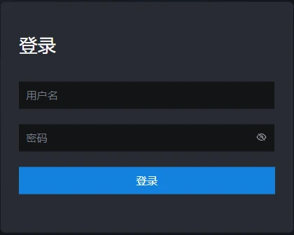

阿里云  
专有云  
弹性高性能计算  
运维指南  
产品版本：v3.18.6-SP2607  
文档版本：20260729

**目录**

- [1.登录Apsara Stack运维系统](#section-1)
- [2.产品资源服务](#section-2)
    - [2.1. 产品应用导览](#section-2-1)
    - [2.2. 问题处理](#section-2-2)

# 1.登录Apsara Stack运维系统

该章节介绍了如何登录到Apsara Stack运维系统。

**前提条件**

- 已从部署人员或管理员处获取Apsara Uni-manager运维控制台的访问地址、用户名和密码。

  Apsara Uni-manager运维控制台的访问地址格式为region-id.aso.intranet-domain-id.com。

- 推荐使用Chrome浏览器。

**操作步骤**

1. 打开浏览器。

2. 在地址栏中，输入Apsara Uni-manager运维控制台的访问地址*region-id.aso.intranet-domain-id.co m*，按回车键。

   

   > **说明**
   >
   > 您可以单击页面右上角的下拉按钮来进行语言切换。

3. 输入正确的用户名及密码。

   > **说明**
   >
   > 登录Apsara Uni-manager运维控制台的用户名和密码请从部署人员或管理员处获取。

   首次登录Apsara Uni-manager运维控制台时，需要修改登录用户名的密码，请按照提示完成密码修改。

   为提高安全性，密码必须满足以下要求：

   - 英文大小写字母

   - 阿拉伯数字（0~9）

   - 特殊符号，包括感叹号（！）、at（@）、井号（#）、美元符号（$）、百分号（%）等

   - 密码长度10~20个字符

4. 单击**登录**，进入Apsara Uni-manager运维控制台页面。

# 2.产品资源服务

本节将针对E-HPC的应用部署，以及与业务逻辑层相关的问题进行详细说明。

## 2.1. 产品应用导览

本章将重点介绍在Apsara Uni-manager运维控制台如何查询产品应用部署状态。通过了解EHPC产品及其集群、服务角色、机器、告警、终态状态等相关信息。

**操作步骤**

1. 登录Apsara Uni-manager运维控制台。

2. 在顶部菜单栏中选择**资源** > **产品维度**。

3. 在**产品概览**页面查看集群、服务角色、机器、告警、终态状态等相关信息。

4. 在页面**产品架构**区域选择**ehpc**，跳转至集群列表界面，展示全部产品的集群信息。

5. 在左侧导航栏，点击**集群列表。**

6. 在**集群列表**页面的**产品名称**、**集群名称**文本框中输入参数，单击**搜索**，在页面下方会显示检索结果。

7. 单击目标集群名，进入**集群详情**页面，查看集群详细信息。

## 2.2. 问题处理

本章介绍如何处理业务逻辑层相关的问题。

**操作步骤**

1. 前往阿里云业务支撑平台提交工单。

2. 在飞天基础运维平台上查看业务逻辑层依赖服务的状态。

   若服务无法执行，将对EHPC业务逻辑层造成不同的影响，如下所示。

   **服务与影响**

   | 服务名称 | 主要影响 |
   | --- | --- |
   | middleWare.dubbo | 影响部署，服务不可用。 |
   | middleWare.tair | 影响部署，服务不可用。 |
   | middleWare.metaq（消息中间件） | 影响部署。 |
   | middleWare.zookeeper | 影响部署，服务不可用。 |
   | middleWare.jmenvDiamondVips | 影响部署，diamond配置项获取不到。 |
   | ram.ramService（主子账号） | 子账号服务不可用。 |
   | webapp.pop（API网关） | OpenAPI服务不可用。 |
   | ecs.yaochi（ECS控制系统） | 所有的创建ECS请求无效。 |
   | slb.yaochi（SLB控制系统） | 所有的关联SLB的请求失败。 |
   | tianjimon（飞天基础运维平台） | 部分服务不可用。 |
