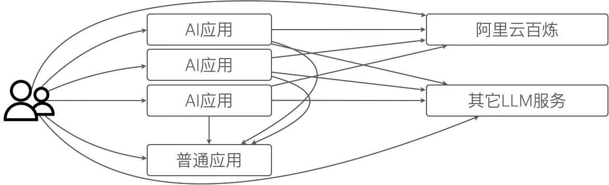
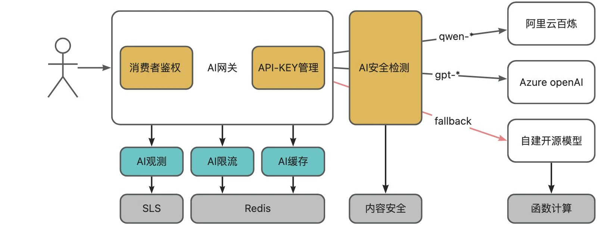
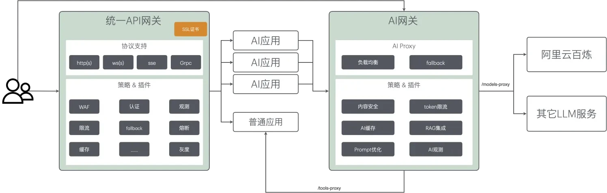
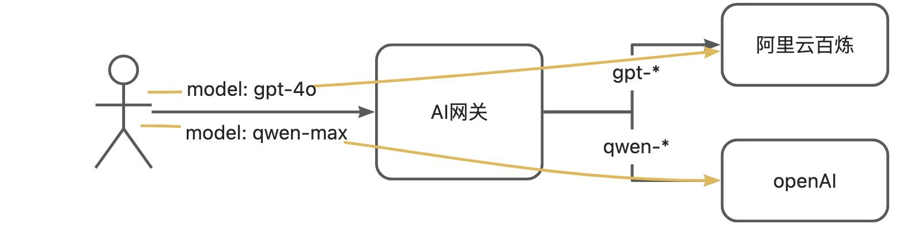
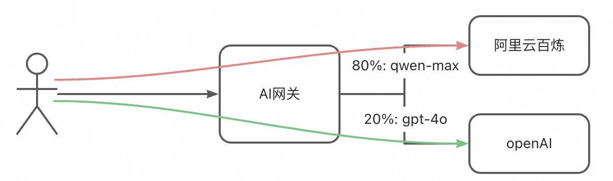
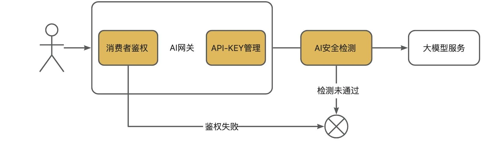
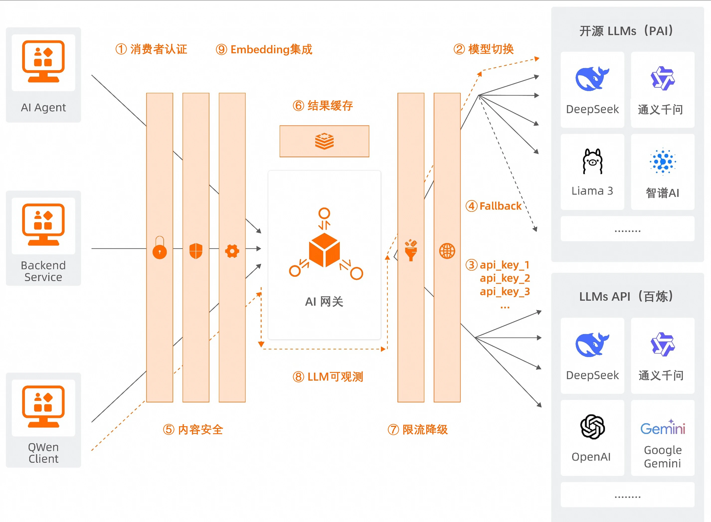
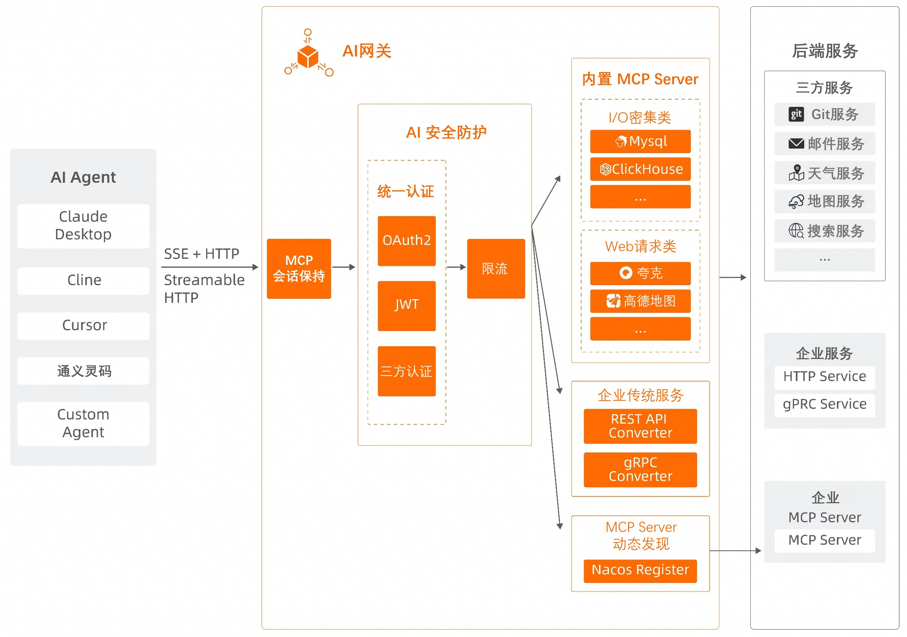

阿里云  
专有云  
智能体工厂 OpenTrek  
AI Gateway 产品简介  
产品版本：v3.18.6  
文档版本：20261023

**目录**

- [1.AI网关](#section-1)
    - [1.1. 什么是AI网关](#section-1-1)
    - [1.2. 产品详情](#section-1-2)
    - [1.3. 产品价值](#section-1-3)
    - [1.4. 功能特性](#section-1-4)
    - [1.5. 应用场景](#section-1-5)
- [2.AI开放平台（HiMarket）](#section-2)
    - [2.1. 什么是AI开放平台（HiMarket）](#section-2-1)
    - [2.2. 产品详情](#section-2-2)
    - [2.3. 产品价值](#section-2-3)
    - [2.4. 功能特性](#section-2-4)
    - [2.5. 应用场景](#section-2-5)
    - [2.6. 使用限制](#section-2-6)
    - [2.7. 基本概念](#section-2-7)

# 1.AI网关

## 1.1. 什么是AI网关

OpenTrek-AI网关是企业连接AI应用与大语言模型（LLM）服务的核心工具，旨在解决大模型集成、管理、安全与稳定性等关键挑战。

随着大模型在企业中的广泛应用，传统调用方式面临多供应商接口不兼容、资源管理复杂、数据泄露风险及服务稳定性差等问题。AI网关通过统一治理能力，提供标准化入口，实现高效、安全的大模型服务调用。

其核心功能包括：

- 统一调用方式：支持商业模型（如阿里云百炼、OpenAI）与自建模型（如千问开源系列）的集成，兼容OpenAI API标准以及 Anthropic 接口协议，并通过按模型名称或比例分配请求的策略，灵活切换多模型服务。

- AI调用可观测性：提供实时监控QPS、Token消耗、响应时间等关键指标，结合日志与追踪功能，提升调用透明度。

- 安全防护：通过API密钥轮转、消费者鉴权（JWT/API Key）及内容安全审核，保障数据合规与敏感信息防护。

- 智能治理：内置限流、缓存、多级服务降级（Fallback）机制，优化资源分配并提升调用成功率。

## 1.2. 产品详情

本文介绍OpenTrek-AI网关的概述，企业应用AI场景所面临的挑战，以及AI网关所具备的核心能力。

**产品概述**

在现代企业的业务创新中，人工智能（AI）逐渐扮演着不可或缺的角色。随着大语言模型的兴起，AI的应用场景不断扩大，各种商业和自建的模型正促进着不同领域的业务发展。然而，企业在应用AI时，面临着集成、稳定性、安全性和管理复杂性等诸多挑战。为了应对这些挑战，我们推出了AI 网关产品，其作为连接企业AI应用和大语言模型服务的桥梁，能够显著提升企业应用大模型服务的集成效率和治理能力。

**企业应用AI场景所面临的挑战**

大语言模型正被广泛应用于企业的AI场景，包括以下三种典型的调用场景：

1. **开发者直接使用大模型服务：** 开发人员直接对接不同供应商的大语言模型API，以满足业务需求。

2. **AI应用调用大模型服务：** 企业内部的AI应用通过调用大模型服务来处理复杂任务。

3. **AI应用调用普通应用（作为工具）：** AI应用通过调用普通应用的API接口来扩展功能。

在实际应用中，企业往往需要在多个模型之间进行选择和切换。当某个模型因稳定性或效果不佳而需要更换时，企业希望能够快速切换到另一个模型，同时对新推出的模型进行灰度测试以便评估效果。与个人应用不同，企业在采用AI技术时，还面临着以下四大挑战：

1. **与不同的大模型服务的集成和切换成本高**：不同模型供应商的LLM API接口标准不同，访问方式不同，LLM API的调用方无法平滑地在不同供应商之间切换，无法同时使用不同供应商提供的模型。

2. **对企业内大模型服务使用者的管理难度大**：LLM API 作为企业内的共享和稀缺资源，需要避免因为部分调用者使用不当导致被限流等问题，且不同的模型成本差异较大，企业需要保证高成本的模型能被用在高价值的业务场景上，但仅靠管理手段，很难做到对使用者的精细化的权限管理和资源管控，也难以针对不同的业务场景采用不同的模型和策略。

3. **数据安全和合规风险高**：大模型服务受限于背后的硬件等因素，一般均为 SaaS 服务的形式，企业在调用大模型服务接口时，其内部数据存在泄露风险，同时，调用大模型服务，尤其是开源或外部大模型服务时，数据的合规也是不可忽视的问题。

4. **大模型服务自身的稳定性差**：大模型服务受到硬件限制，其接口限流阈值较低，且自身稳定性也低于一般 API 服务，接口的RT和成功率均不够稳定，进而影响AI应用的整体可用性。

**AI网关的场景示例**

某企业计划建设 AI 应用，提升企业的经营效率，探索新的业务机会，为此，该企业采购了阿里云百炼、Azure OpenAI 等大模型服务，并在阿里云FC上部署了自建的开源模型（llama3.x）。为了让企业内各个AI 应用可以高效且安全地使用大模型服务，该企业配置了AI网关，将治理能力集成到网关上，对各个 AI 应用提供统一的访问入口。

具体的使用方式见下图：

网关管理员为每一个 AI 应用分配一个消费者身份（以API Key的方式鉴权），该应用请求AI网关时，根据所带的 model 参数，网关会自动路由到阿里云百炼和Azure的模型服务上，如果模型服务因为限流或其它原因不可用，网关会自动将该请求fallback到自建的开源模型上。为了保证数据安全合规，所有的AI请求都需要通过内容安全的审核，对于不合规的请求，网关会直接拦截。网关管理员开启了限流和缓存，避免某个应用请求太多导致模型服务被打挂。同时，网关管理员会持续关注AI API的观测大盘，查看模型调用情况，并针对性地作出调整。

**AI网关的核心能力**

使用AI网关，用户可以形成以API形态对外透出和管理AI应用的完整方案。即：

1. 所有对大模型服务的调用都走 AI 网关，在 AI 网关上解决模型的稳定性、鉴权、安全合规、观测治理等问题。

2. 所有 AI 应用对外透出的 API 调用都走 AI 网关，在 AI 网关上解决协议接入、认证鉴权、限流、降级等诉求。

为解决这些问题，AI网关提供了如下核心能力：

**统一调用方式**

AI网关可快速集成各类大模型服务，包括商业大模型服务和用户自建的大模型服务，并统一对外暴露的API（兼容OpenAI）。AI网关已支持包括阿里云百炼、OpenAI在内十几家国内外大模型供应商和自建大模型服务（如ollama）。

AI网关提供AIAPI这种针对AI场景优化的API类型，AIAPI提供3种集成大模型服务的方式，分别是：

- 单模型服务：可指定唯一一个大模型服务，支持透传模型名称，也可指定模型名称，当指定模型名称时，用户请求传入的模型名称将被忽略。

  

- 多模型服务（按模型名称）：可指定一到多个大模型服务，并为每个大模型服务配置模型名称的匹配规则，比如可配置模型名称符合 gpt-\* 的模式，则调用openAI大模型服务，模型名称符合qwen-\*的模式，则调用阿里云百炼大模型服务。

  

- 多模型服务（按比例）：可指定一到多个大模型服务，并为每个大模型服务指定请求的模型名称和百分比，这种模式非常适合对新模型进行灰度的场景。

  

**AI调用可观测**

AI网关集成AI调用的可观测能力，包括AI请求的Metrics、Logging和Tracing能力，与一般的API观测不同，AI观测支持按Token维度对AI调用进行统计，支持API、模型、消费者等观测维度，AI请求和响应的日志也会被记录下来，用于后续的追踪与审计。

AI观测的关键指标包括：

- QPS：每秒AI请求和响应的数量统计，分为AI请求的QPS、流式响应的QPS和非流式响应的QPS。

- 请求成功率：即AI请求的成功率，可按秒、15 秒、分钟进行统计。

- token消耗数/s：每秒消耗的token数量，分为输入token、输出token和总计token。

- 请求平均RT：一段时间内（秒、15 秒、分钟） AI请求的平均响应时间（ms），分为非流式RT、流式RT（流式响应的整体时间）、流式首包RT（流式响应的首包时间）。

- 缓存的命中数：一段时间内缓存的命中数和miss数统计。

- 限流统计：一段时间内被限流的请求和正常请求的统计。

- 按模型的token统计：一段时间内不同模型的token消耗统计。

- 按消费者的token统计：一段时间内不同消费者的token消耗统计。

- 风险统计：被内容安全检测出来的风险，按照风险类型、消费者等维度的统计。

**内置安全防护**

AI网关在安全方面建设了3个核心能力：

- API-KEY统一管理和轮转：将大模型服务的API-KEY保存在网关层面，对调用方屏蔽，并可配置多个API-KEY自动轮转。

- 统一鉴权：内置消费者鉴权能力，可对不同的调用方分别授权，支持JWT和API Key等鉴权方式，并可按照消费者观测器调用情况和配置限流。

- 内容审核：与阿里云内容安全服务深度集成，对AI请求和响应的内容进行安全审核和防护，可按需配置审核策略和敏感词，一方面保证请求内容的合规，另一方面避免企业敏感信息的外泄。

**AI调用可治理、可加速**

AI网关为企业AI应用提供了统一的治理中心，可通过限流、缓存、fallback等能力，有效提升模型调用的成功率，具体包括以下几方面：

- 按Token限流：AI网关内置Token限流策略，可根据请求特征（如header ），限制单位时间消费的Token数。

- 多API-KEY自动轮转：AI网关支持为模型服务配置多个API-KEY，在处理 AI请求时，多个KEY会自动轮转，避免某个KEY的问题影响全部请求。

- AI缓存：AI网关集成AI缓存策略，可对重复出现的请求进行响应缓存，提升响应效率并降低大模型服务成本。

- 模型服务fallback：AI网关支持模型服务不可用时fallback到备用模型，且支持多级fallback，可有效提升AI请求的成功率。

综上所述，AI网关有望成为企业提升AI应用效率的关键工具。通过简化集成、统一治理、强化安全和加速响应，企业在利用AI技术创新过程中将更加高效、安全和可控。

## 1.3. 产品价值

OpenTrek-AI网关具备高并发架构、毫秒级无中断配置、WASM热插件与全场景插件生态，支持SSE流式协议及资源优化，实现AI服务的稳定性、扩展性与易用性。

**企业级可靠性保障**

- **高并发场景的坚实底座**

  基于阿里巴巴沉淀多年的网关技术经验，打造支持每秒数十万级请求的高并发架构，适配大规模分布式系统与AI业务的稳定运行需求。

- **零中断的智能配置更新** 彻底解决传统Nginx Reload导致的流量抖动问题，配置变更实现毫秒级生效且业务无感知，专为长连接场景（如AI服务）优化，保障服务连续性。

**灵活扩展能力**

- **覆盖全场景的插件生态**

  提供涵盖AI推理、流量管理、安全防护等核心功能的官方插件库，满足90%以上的业务场景需求，快速响应复杂业务挑战。

- **WASM热插件架构革新**

  通过WASM沙箱实现插件隔离，支持多语言开发（Rust/Go/Python等），插件版本可独立升级，实现网关逻辑的流量无损热更新，降低维护复杂度。

**开箱即用的安全与易用性**

- **标准化控制台与白屏化配置** 提供产品标准控制台，支持配置白屏化操作，内容安全防护等功能的一键启用，降低运维门槛。

- **极简部署与自动化能力** 兼容Ingress API和Gateway API标准，支持对接Let's Encrypt自动签发与续签免费证书，无需依赖K8s环境——一行Docker命令即可快速部署，开发者友好度行业领先。

**高效流式处理引擎**

- **全链路流式协议支持** 原生支持SSE（Server-Sent Events）等流式协议，允许WASM插件自定义处理流式报文逻辑，灵活适配AI流式推理、实时数据推送等场景。

- **资源优化与性能突破** 在大带宽、高吞吐场景下（如AI模型服务），通过流式处理显著降低内存占用，提升资源利用率，降低基础设施成本。

## 1.4. 功能特性

本文介绍OpenTrek-AI网关的功能特性。

AI网关作为连接企业AI应用和大语言模型服务的桥梁，主要提供了以下功能：

**实例管理**

| 功能点 | 详细说明 |
| --- | --- |
| 实例生命周期管理 | 支持AI网关实例的全生命周期管理，包括网关实例的创建、启动、停止、删除、升级、扩缩容等操作。 |
| 弹性伸缩 | 支持根据业务负载自动调整网关实例的数量，以应对流量峰谷变化。 |
| 实例引擎参数 | 支持设置实例引擎参数。 |

**模型API管理**

<table>
  <tr>
    <th width="170">功能点</th>
    <th>详细说明</th>
  </tr>
  <tr>
    <td>多场景AI能力接入</td>
    <td>支持文本生成、图片生成、视频生成、语音合成、向量化（Embedding）、文本排序（Rerank）等主流AI任务场景，提供标准化API封装，统一异构模型服务能力。</td>
  </tr>
  <tr>
    <td>多协议兼容适配</td>
    <td>内置 OpenAI、Anthropic、阿里云百炼、豆包、ComfyUI、vLLM 等主流协议支持，并可自定义 HTTP/WebSocket 协议，无缝对接各类大模型与AI服务。</td>
  </tr>
  <tr>
    <td>智能模型路由</td>
    <td>支持按请求中的模型名称（Glob 通配符匹配）或预设权重比例，将流量动态分发至多个后端模型服务，实现灰度发布、A/B测试与负载均衡。</td>
  </tr>
  <tr>
    <td>消费者认证授权</td>
    <td>基于 API Key 对调用方进行身份认证与权限控制，仅授权消费者可访问模型API，确保服务安全隔离。</td>
  </tr>
  <tr>
    <td>在线调试与使用指南</td>
    <td>提供可视化调试面板，支持流式输出、参数调整与上下文记忆，并自动生成调用示例代码，降低开发者接入门槛。</td>
  </tr>
  <tr>
    <td>策略配置</td>
    <td>• Header修改策略：在请求转发至后端或响应返回客户端前，动态新增、覆盖或移除 HTTP Header，支持身份透传、协议适配与安全加固，实现无侵入式流量治理。 • 超时策略：为模型 API 配置最大等待响应时间，超时后自动返回 504 错误，防止后端慢调用导致系统雪崩，保障服务 SLA 与稳定性。 • AI 限流策略：专为大模型服务及高并发调用场景设计，支持基于 Token 消耗量、请求数和并发数的多维度动态控制机制。该策略可针对消费者身份、请求 Header 参数、Query 参数、Cookie、客户端 IP等多维度配置限流规则，并提供API级别的全局限流能力。 • AI内容安全策略：对用户输入和模型输出进行实时内容审核，支持多级风险拦截与流式响应检测，确保 AI 服务符合合规与安全要求。</td>
  </tr>
</table>

**路由管理**

<table>
  <tr>
    <th width="200">功能点</th>
    <th>详细说明</th>
  </tr>
  <tr>
    <td>创建LLM API并添加接口</td>
    <td>支持创建LLM API，包含关联的大模型服务（单模型、多模型），兼容OpenAI协议，默认包含三条路由：文本补全接口、对话式AI接口、将文本内容向量化接口。</td>
  </tr>
  <tr>
    <td>预制策略与插件</td>
    <td>默认提供四个插件：内容安全防护、限流、缓存、联网搜索。 说明需要配置插件入参后方可使用。</td>
  </tr>
  <tr>
    <td>消费者认证</td>
    <td>认证方式支持API Key方式，提供对API消费者进行身份验证和权限校验的功能。</td>
  </tr>
  <tr>
    <td>API调试</td>
    <td>提供使用示例，方便API服务的调试与测试。</td>
  </tr>
  <tr>
    <td>路由列表</td>
    <td>支持查看当前API具备的路由列表。</td>
  </tr>
  <tr>
    <td>策略配置</td>
    <td>• Header修改策略：在请求转发至后端或响应返回客户端前，动态新增、覆盖或移除 HTTP Header，支持身份透传、协议适配与安全加固，实现无侵入式流量治理。 • 超时策略：为路由请求配置最大等待响应时间，超时后自动返回 504 错误，防止后端慢调用导致系统雪崩，保障服务 SLA 与稳定性。 • 重写策略：在请求转发至后端服务前，动态修改原始请求的路径（Path）和主机域（Host），支持精确或前缀级路径重写，满足多环境路由、版本迁移、微服务适配等复杂架构需求，确保流量精准投递至目标服务端点。 • 降级策略：当后端大模型服务出现超时或返回指定错误码（如 5xx/4xx）时，自动将请求切换至预设的轻量级降级服务，保障系统基础可用性，避免因单点故障导致整体服务中断。</td>
  </tr>
</table>

**MCP服务管理**

<table>
  <tr>
    <th width="145">功能点</th>
    <th>详细说明</th>
  </tr>
  <tr>
    <td>Tools管理</td>
    <td>提供MCP服务相关的工具链管理功能，包括配置工具、监控工具、调试工具等，支持服务生命周期的全链路管理。</td>
  </tr>
  <tr>
    <td>OpenAPI转MCP</td>
    <td>支持将标准OpenAPI定义自动转换为MCP服务规范，实现接口定义、鉴权、路由规则的快速迁移和适配。</td>
  </tr>
  <tr>
    <td>DB转MCP</td>
    <td>提供从数据库（如MySQL、PostgreSQL）到MCP服务的自动化迁移能力，包括数据模型转换、SQL逻辑适配及性能优化。</td>
  </tr>
  <tr>
    <td>MCP直接路由</td>
    <td>实现基于MCP协议的直接路由能力，支持跨数据中心、跨云环境的请求路由优化，减少中间层转发延迟。</td>
  </tr>
  <tr>
    <td>策略配置</td>
    <td>• Header修改策略：在请求转发至后端或响应返回客户端前，动态新增、覆盖或移除 HTTP Header，支持身份透传、协议适配与安全加固，实现无侵入式流量治理。 • 超时策略：为MCP请求配置最大等待响应时间，超时后自动返回 504 错误，防止后端慢调用导致系统雪崩，保障服务 SLA 与稳定性。 • 重写策略：在请求转发至后端服务前，动态修改原始请求的路径（Path）和主机域（Host），支持精确或前缀级路径重写，满足多环境路由、版本迁移、微服务适配等复杂架构需求，确保流量精准投递至目标服务端点。</td>
  </tr>
</table>

**服务与来源管理**

| 功能点 | 详细说明 |
| --- | --- |
| 服务管理 | 支持对服务进行创建、查看、编辑和删除操作。 |
| 来源 | 支持AI服务、DNS域名、固定地址以及K8s方式。 |

**域名管理**

| 功能点 | 详细说明 |
| --- | --- |
| 域名操作 | 支持用户添加/删除自定义域名到AI网关，实现通过域名访问AI。 |

**证书管理**

<table>
  <tr>
    <th width="90">功能点</th>
    <th>详细说明</th>
  </tr>
  <tr>
    <td>证书操作</td>
    <td>允许更新域名的SSL/TLS证书或协议配置，确保安全通信。提供配置HTTPS传输使用的加密算法和套件，优化安全性。</td>
  </tr>
</table>

**消费者管理**

<table>
  <tr>
    <th width="138">功能点</th>
    <th>详细说明</th>
  </tr>
  <tr>
    <td>消费者生命周期</td>
    <td>支持注册/停用/删除 API的调用方或用户，为其分配访问权限。</td>
  </tr>
  <tr>
    <td>消费者授权</td>
    <td>支持为消费者分配Model API、MCP服务及路由的访问权限，并对其可调用的Model API、MCP服务及路由进行控制。</td>
  </tr>
</table>

**多模型支持**

<table>
  <tr>
    <th width="106">功能点</th>
    <th>详细说明</th>
  </tr>
  <tr>
    <td>多模型支持</td>
    <td>支持主流AI模型（如大语言模型、图像生成模型等）的统一接入与策略适配，提供模型级别的资源调度、权限控制及性能监控能力。</td>
  </tr>
</table>

**API调试**

<table>
  <tr>
    <th width="84">功能点</th>
    <th>详细说明</th>
  </tr>
  <tr>
    <td>API调试</td>
    <td>提供API在线测试功能，方便用户验证API的可用性和正确性，简化开发和调试流程。</td>
  </tr>
</table>

**插件管理**

<table>
  <tr>
    <th width="186">功能点</th>
    <th>详细说明</th>
  </tr>
  <tr>
    <td>多层级插件作用域</td>
    <td>支持将插件配置在实例、路由、服务、域名、MCP Server等不同领域对象或其组合上，实现从全局到细粒度的精准控制，满足复杂业务场景的差异化治理需求。</td>
  </tr>
  <tr>
    <td>插件组合绑定</td>
    <td>允许将同一插件同时绑定到多个领域对象（如“路由 + 消费者”），仅当请求同时匹配所有绑定条件时才触发插件，实现高精度策略生效逻辑。</td>
  </tr>
  <tr>
    <td>AI 专用插件体系</td>
    <td>提供面向大模型场景的专属插件，包括 <code> ai-proxy </code>（协议代理）、<code> ai-</code><code>token-ratelimit </code>（Token限流）、<code> ai-security-guard </code>（内容安全）、<code> ai-rag </code>（检索增强）、<code> ai-prompt-decorator </code>（提示词增强）等，深度适配 AI 应用生命周期。</td>
  </tr>
  <tr>
    <td>认证与安全插件</td>
    <td>内置多种认证方式（<code> key-auth </code>、<code> jwt-</code><code>auth </code>、<code> oauth </code>、<code> opa </code> 等）及安全防护插件（<code> waf </code>、<code> ip-</code><code>restriction </code>、<code> bot-detect </code>、<code> cors </code>），保障 API 调用身份可信与访问合规。</td>
  </tr>
  <tr>
    <td>流量治理插件</td>
    <td>支持 <code> key-rate-limit </code>、<code> cluster-key-rate-</code><code>limit </code>、<code> traffic-tag </code>等插件，实现精细化流量调度与资源隔离。</td>
  </tr>
  <tr>
    <td>请求/响应转换插件</td>
    <td>通过 <code> transformer </code>、<code> custom-response </code>、<code> de-</code><code>graphql </code>、<code> ai-json-resp </code> 等插件，动态修改请求结构、协议格式或响应内容，实现协议转换、字段脱敏、结果标准化等能力。</td>
  </tr>
  <tr>
    <td>可观测插件</td>
    <td>集成 <code> geo-ip </code> 插件，提升 AI 服务的可观测性水平。</td>
  </tr>
  <tr>
    <td>同类型插件多实例支持</td>
    <td>在同一领域对象（如一条路由）上可配置多条同类型插件（例如多条限流规则），按优先级或条件组合执行，满足复杂业务策略叠加需求。</td>
  </tr>
</table>

**观测分析**

| 功能点 | 详细说明 |
| --- | --- |
| 监控与指标 | 支持实时查看API网关的性能指标、健康状态和请求量等监控数据。 |
| 日志管理 | 支持将API网关的访问日志、错误日志等信息投递到指定存储或分析服务。 |
| API级别监控 | 支持查看特定REST API，及其接口的性能指标和访问统计数据。 |

## 1.5. 应用场景

本文介绍OpenTrek-AI网关的核心应用场景。

**AI应用访问大模型的统一入口**

<strong>AI应用流量入口与集成：</strong>面向大型语言模型（LLM），统一代理各主流大模型和自建大模型服务，提供与OpenAI兼容的访问方式，并提供二次API KEY签发、流量限制、安全防护、观测等治理能力。

- 高可用：支持多模型灰度、多模型间Failover、Token额度管理和流控。

- 高安全：提供大模型内容安全检测，并支持路由配置认证和消费者鉴权，实现对API访问的控制、安全性和策略管理。

- 降低模型幻觉：提供联网搜索、搜索结果自动融合、问题意图识别。

- 企业级可观测：在应用、网关、后端LLM服务上集成并启用 OpenTelemetry 的可观测能力，以实现全链路的跟踪，通过TraceId串联各个地方的日志、请求参数等信息。

**MCP Server统一管理和访问**

<strong>MCP Server统一管理和访问：</strong>面向MCP Server，提供MCP Server代理、安全认证，以及统一观测、限流等治理能力。

- API-to-MCP：支持将REST API直接转化成MCP Server，避免重新构建和维护MCP Server等重复性劳动。

- 协议卸载：无缝支持MCP官方最新版协议，降低升级成本，例如支持将SSE转换为Streamable HTTP，避免无状态应用也要使用SSE。

- MCP 市场：提供官方维护的MCP市场，确保MCP服务端可用性、易用性和安全性。

# 2.AI开放平台（HiMarket）

## 2.1. 什么是AI开放平台（HiMarket）

AI 开放平台（HiMarket）是面向企业开发者用于统一管理和分发AI能力的企业级AI资产平台。

**背景与挑战**

随着大语言模型、MCP（Model Context Protocol）服务、智能体（Agent）等AI能力在企业内部的快速普及，各业务部门构建了数量众多、形态各异的AI资源。企业在AI资源运营过程中通常面临以下挑战：AI资源分散于不同团队和平台，缺乏统一视图与集中管理机制；底层AI能力未经过产品化包装，难以直接被业务方和第三方开发者调用；不同业务线需要独立的开发者门户与品牌形象，但共享底层基础设施；需要在调用侧完成鉴权、限流、内容安全、Token计量等多重控制；难以对AI调用进行全链路追踪、用量统计与成本核算。这些挑战导致企业AI能力难以规模化复用，开发者接入成本高，运营管理效率低下。

**产品概述**

AI 开放平台（HiMarket）是基于Higress AI网关构建的企业级AI开放平台，帮助企业构建私有化的AI能力市场，统一管理和分发Model API、MCP Server、Agent、Skill、Worker、专家套件等AI资源。平台采用前台、管理控制台、基础设施三层分离的架构设计，将分散的AI能力封装为标准化的API产品，支持多版本管理和灰度发布。平台内置AI体验中心（HiChat），提供AI对话的自助体验入口；内置模型市场、Skill市场、MCP市场、专家套件市场等多类市场，支持AI能力的统一供给与消费；同时具备安全管控、可观测分析、计量计费等企业级运营能力。AI 开放平台基于AI 开放平台开源项目构建，在开源框架基础上深度定制了AI体验中心、MCP市场等企业级能力，并提供商业化支持与私有化交付保障。

**核心功能**

- **AI资源市场**：将分散的AI能力沉淀为标准化的API产品，统一管理模型市场、MCP市场、智能体市场、技能市场、专家套件市场等多类资源。

- **AI体验中心**：内置HiChat对话体验入口，支持多模态对话、多模型对比、MCP工具调用和安全沙箱代码执行。

- **企业级运营管理**：提供产品全生命周期管理、多维度观测分析、统一计量计费、版本管理与灰度发布能力。

- **多租户门户支持**：支持为不同业务线和生态合作方提供独立的开发者门户基础能力，可由三方合作伙伴基于平台接口实现自定义域名、品牌样式、身份认证与审批工作流等定制化需求。

## 2.2. 产品详情

本文档为您介绍AI 开放平台的产品架构与核心技术能力，本文主要介绍AI 开放平台的工作原理、核心功能与技术特性。

**工作原理**

AI 开放平台采用“三层架构、四大能力域”的平台设计，各层职责清晰、独立演进。

- 基础设施层承载平台运行所需的核心组件，通过SDK集成AI网关和Nacos AI Registry，为上层应用提供统一的流量接入、服务注册发现和Agent运行时环境。Higress AI网关承载所有AI流量的统一接入与路由，SLS日志服务提供全量日志的采集、存储与查询能力，Nacos AI Registry作为MCP Server和Agent的统一注册中心，Agent Runtime提供Agent的运行时环境并支持安全沙箱隔离部署。

- 管理控制台层是AI推广负责人和平台管理员的运营阵地。管理员通过管理后台完成Portal门户的创建与配置，包括自定义门户域名、品牌样式和审批流程；统一管理所有AI产品的API定义、接口文档和调用策略，支持模型、MCP Server、Agent、Skill、Worker、专家套件六种产品类型；管理开发者和消费者的注册、审批、权限分配与生命周期；通过多维度观测分析大盘查看调用量、活跃用户、Token消耗、错误率等数据。

- 开发者门户层是企业全员访问AI能力的统一入口。开发者通过SSO注册与凭证管理对接企业统一身份认证体系，支持API Key的自助申请、轮换与管理；以产品化方式浏览所有可用AI服务，支持在线浏览API文档、一键订阅和在线调试；从门户直接进入AI体验中心使用HiChat对话；浏览企业内部和公共Skill市场并一键安装所需Skill。

- 数据流转过程如下：管理员在管理控制台导入网关实例和Nacos实例，将底层AI能力封装为API产品并发布到指定的Portal门户；开发者通过门户域名访问对应的开发者门户，完成注册审批后浏览和订阅API产品；订阅通过后获取API Key等调用凭证，可通过在线调试验证接口，也可通过HiChat进行对话体验；所有调用流量经由Higress AI网关路由到后端服务，网关插件完成鉴权、限流、内容安全等策略执行，SLS日志服务采集全量调用日志，观测分析模块基于日志数据生成多维度监控指标。

**核心能力**

**AI资源统一管理**

AI 开放平台将分散的AI能力封装为标准化的API产品，支持六种产品类型的统一管理。Model API对接主流大模型，支持内容安全、Token限流等防护能力；MCP Server对接来自不同平台的MCP服务，支持将外部REST API一键转换为标准MCP Server；Agent封装智能体应用；Skill提供可复用的智能体技能包分发能力；Worker面向后台作业型服务。每种产品类型均支持创建、编辑、删除、批量导入等操作，支持从网关实例或Nacos实例导入已有服务。专家套件作为一类资产进行管理，支持手动上传或从OSS导入压缩包完成创建，并提供版本管理、分类归档、发布到门户与订阅下载能力。

**多租户门户体系**

AI 开放平台采用多租户门户设计，支持为不同业务线和生态合作方构建独立的开发者门户。每个Portal门户拥有独立的基础信息、安全策略、域名与API产品集合。门户支持自定义域名绑定，支持系统默认域名和自定义域名并存；支持账号密码登录与OIDC第三方身份系统对接；支持开发者注册审批和API产品订阅审批的自动或手动策略配置；支持自定义品牌信息包括名称、描述、图标等。

**可观测分析**

AI 开放平台提供针对模型和MCP Server的监控能力。模型监控聚合展示所有Model API产品的调用次数、Token消耗、错误率、耗时等关键指标，支持按时间范围、查询粒度、网关实例、API、模型名称、消费者、路由、服务等多维度过滤。MCP监控针对MCP Server类型产品，展示请求次数、成功率、流量、耗时等指标，支持按MCP Server和MCP Tool维度进行过滤分析。监控数据依赖网关侧的访问日志上报链路。

**计量计费与内容审核**

平台对所有AI服务的调用进行统一计量，基于Token对调用量进行精确计数，支持按用户、部门、应用等维度的用量统计。内容审核对AI对话内容进行实时审核，拦截违规内容。权限管控基于角色构建细粒度权限体系，控制不同用户对模型、Skill、MCP服务的访问权限。

**管理工具**

- **管理控制台**：提供Portal门户管理、API产品管理、分类管理、实例管理、观测分析等运营功能。

- **开发者门户**：提供产品浏览与订阅、凭证管理、HiChat对话、Skill市场浏览与安装等开发者自助服务功能。

- **Skill市场**：提供Skill产品的浏览、搜索、下载与安装能力，支持按下载量和更新时间排序。

- **MCP市场**：提供MCP Server的浏览、创建、关注与使用能力，支持在HiChat中直接调用MCP工具。

- **专家套件市场**：提供专家套件的浏览、订阅与版本下载能力，支持查看套件文件与版本历史，并可对接千问办公在客户端安装使用。

## 2.3. 产品价值

AI 开放平台通过统一的AI能力市场与治理平台，帮助企业将分散的AI资源进行标准化封装、集中化管理与规模化分发，本文主要介绍AI 开放平台的核心产品价值。

**统一纳管AI资源**

将模型、MCP Server、Agent、Skill、Worker、专家套件等分散的AI能力汇聚到统一平台，以标准化API产品形式进行封装和管理，消除资源孤岛。

**降低开发者接入成本**

通过开发者门户提供产品浏览、在线订阅、凭证管理、在线调试的一站式自助服务，开发者无需逐一对接底层AI服务。

**零门槛AI体验**

内置HiChat对话体验入口，业务人员无需技术背景即可使用AI对话能力。

**构建企业AI开发者生态**

通过Skill市场和MCP市场沉淀可复用的AI技能与服务，促进跨团队能力共享，减少重复开发。

**安全合规可控**

提供统一权限管控、内容审核、计量计费等治理能力，确保AI在企业内的使用安全合规，调用过程可追踪可核算。

**灵活门户定制**

多租户门户设计支持为不同业务线和生态合作方构建独立品牌的开发者门户，共享底层基础设施的同时保持门户隔离。

## 2.4. 功能特性

AI 开放平台的功能按管理控制台分类组织为门户、门户管理、资产、目录与运维五个板块。

具体功能及详细说明如下：

**门户**

| 功能点 | 详细说明 |
| --- | --- |
| HiChat多模态对话 | 支持文本、图像、视频等多模态输入输出，为企业全员提供统一的AI对话入口。 |
| MCP工具调用与联网搜索 | 结合MCP Server进行在线工具调用测试，支持在对话中调用MCP工具完成特定任务。 |
| 多模型对比 | 将同一问题同时发送给多个模型，直观比较回答质量、响应速度、Token消耗等差异。 |
| 工具调用测试 | 结合MCP Server进行在线工具调用测试，快速验证Skill的实际效果。 |
| 对话历史记录与内容审计 | 全链路监控与日志追踪，完整记录每一次对话历史，支持内容审计与回溯。 |
| SSO注册与凭证管理 | 对接企业统一身份认证体系，支持API Key的自助申请、轮换与管理。 |
| 产品浏览/订阅/调试 | 以产品化方式展示所有可用AI服务，支持在线浏览API文档、一键订阅和在线调试。 |
| Skill市场浏览与安装 | 浏览企业内部和公共Skill市场，一键安装所需Skill。 |
| 专家套件浏览与下载 | 在门户的资源列表中浏览专家套件，查看套件介绍、文件内容与版本历史，订阅审批通过后下载对应版本的套件压缩包。 |
| 多语言SDK下载 | 提供多种编程语言的SDK下载，便于开发者快速接入AI能力。 |

**门户管理**

| 功能点 | 详细说明 |
| --- | --- |
| Portal域名/样式/审批配置 | 支持自定义门户域名、品牌样式和审批流程配置。 |
| Developer/Consumer管理 | 管理开发者和消费者的注册、审批、权限分配与生命周期。 |
| 统一权限管控 | 基于角色的细粒度权限体系，控制不同用户对模型、Skill、MCP服务的访问权限。 |

**资产**

| 功能点 | 详细说明 |
| --- | --- |
| 模型市场（自建+公有云模型管理） | 统一管理企业自建模型和公有云模型，所有模型通过OpenAI兼容协议对外提供服务。 |
| MCP市场（统一注册发现） | MCP服务的统一注册发现与管理平台，提供Agent Runtime沙箱部署能力。 |
| Agent资产管理 | 在资产的Agent页签创建或导入Agent资源，列表展示名称、Agent简介与更新时间；Agent可发布到门户，供开发者查看AgentCard接口与工具列表并进行调试。 |
| Skill市场（发布/版本管理/智能搜索） | 企业AI技能的统一发布与共享平台，支持版本管理、分类标签与智能搜索，兼容OpenClaw findskill协议。 |
| 专家套件市场（版本管理与分发） | 以压缩包形式统一管理和分发专家套件，支持版本管理与分类归档。套件可发布到指定门户供开发者订阅下载，也可对接千问办公，在客户端浏览并安装。 |
| Worker模板 | 面向垂直领域的数字员工解决方案模板，由Agents.md、Skill、SOUL、MCP和Memory五大组件组合而成。 |

**目录**

<table>
  <tr>
    <th width="154">功能点</th>
    <th>详细说明</th>
  </tr>
  <tr>
    <td>资源分类字典维护</td>
    <td>按Model API、MCP Server、Agent、Skill、专家套件、Worker六类资源维护门户与Catalog发布时使用的分类字典，支持新建分类、设置英文名称、关联资源与排序。</td>
  </tr>
</table>

**运维**

| 功能点 | 详细说明 |
| --- | --- |
| AI网关 | 承载所有AI流量的统一接入与路由，继承自AI网关能力。 |
| Nacos AI Registry | MCP Server和Agent的统一注册中心，继承自AI网关能力。 |
| 对象存储接入 | 在对象存储页签接入对象存储实例并配置Endpoint、Bucket与Region，支持检查连接、编辑与移除，列表展示连接状态与接入时间；接入的实例用于保存Skill、Worker包与门户会话附件，平台不会创建Bucket。 |
| Agent Runtime | 提供Agent的运行时环境，支持安全沙箱隔离部署。 |
| 安全沙箱 | 为MCP Server提供托管能力。 |
| Kubernetes集群接入 | 在Kubernetes集群页签通过KubeConfig接入已有集群并验证连接，列表展示集群名称/ID、描述、API Server、状态与接入时间；接入的集群作为沙箱运行环境与门户部署目标，不会创建集群或安装AgentRuntime。 |
| SLS日志服务界面没有，PD帮忙确认是否保留 | 提供全量日志的采集、存储与查询能力。 |
| 统一计量计费 | 对所有AI服务的调用进行统一计量，支持按用户、部门、应用等维度的用量统计。 |
| 统一内容审核 | 对AI对话内容进行实时审核，拦截违规内容。 |

## 2.5. 应用场景

AI 开放平台适用于企业AI能力统一管理、开发者生态建设与AI规模化落地等多种场景，本文主要介绍AI 开放平台的应用场景。

**高校AI应用推广**

高校各院系各自为战使用不同AI工具，缺乏统一入口和能力共享机制。部署AI 开放平台后，全校师生通过一个入口使用所有AI能力，各院系通过Skill市场共享AI技能（如智能阅卷、论文摘要、实验数据分析）。平台提供统一的开发者门户供师生注册使用，管理后台支持审批策略与权限管控。

- **统一入口**：全校师生通过一个开发者门户访问所有AI能力。

- **能力共享**：各院系通过Skill市场发布和共享AI技能。

- **集中管理**：管理员通过管理后台统一管控AI应用的发布与审批。

**企业内部AI开发者生态建设**

大型企业内部多个团队分散开发AI应用，能力无法复用，新人上手成本高。部署AI 开放平台后，所有AI服务以产品化方式展示在开发者门户，MCP服务统一注册发现，Skill沉淀为可复用的技能包。开发者通过门户完成注册、订阅、凭证申请等自助流程，降低接入门槛。

- **能力产品化**：将AI服务封装为标准化API产品，统一展示与分发。

- **技能复用**：通过Skill市场沉淀可复用的技能包，减少重复开发。

- **自助接入**：开发者通过门户自助完成注册、订阅与凭证管理。

**企业对外AI开放平台建设**

企业需要面向外部合作伙伴或客户提供AI能力的开放平台，要求独立品牌形象与隔离的账号体系。AI 开放平台支持多租户门户设计，为不同生态合作方构建独立的开发者门户，每个门户拥有独立的域名、品牌样式、登录方式与审批策略，底层基础设施共享。

- **独立品牌**：每个门户支持自定义域名、Logo、配色方案与页面布局。

- **账号隔离**：不同门户维护独立的开发者账号体系与订阅关系。

- **策略灵活**：支持为不同门户配置差异化的登录方式与审批流程。

**AI能力运营与观测分析**

企业运营团队需要对AI资源的使用情况进行实时监控与成本核算。AI 开放平台提供模型监控和MCP监控两大观测分析能力，覆盖调用量、Token消耗、错误率、耗时等关键指标。统一计量计费功能支持按用户、部门、应用等维度进行用量统计与成本核算。

- **实时监控**：提供多维度监控指标大盘，支持按多种维度过滤查询。

- **成本核算**：基于Token进行精确计量，支持多维度用量统计。

- **风险管控**：内容审核与权限管控确保AI使用安全合规。

## 2.6. 使用限制

AI 开放平台对部分核心指标进行了约束，使用时请不要超过限制值，具体的限制项和限制值请参见下表。

| 限制项 | 限制值 | 说明 |
| --- | --- | --- |
| Max Tokens | 1 ~ 8192 | Model API配置中单次对话的Token数上限。 |
| Temperature | 0 ~ 2 | Model API配置中采样温度的取值范围限制。 |
| 多模型对比模型数 | 2 ~ 4个 | HiChat多模型对比功能同时选择的模型数量限制。 |
| 自定义域名 | 需完成DNS解析 | Portal门户绑定的自定义域名必须完成正确的DNS解析后才能生效。 |
| 网关日志上报 | 依赖网关配置 | 观测分析模块的监控数据依赖网关侧的访问日志上报链路，首次导入网关实例后需等待数据上报生效。 |
| 专家套件压缩包 | 不超过50 MB | 手动上传方式创建专家套件时的压缩包大小上限，支持.zip、.tar、.tar.gz、.tgz格式。 |

## 2.7. 基本概念

本文主要对AI 开放平台涉及的专有名词及术语进行定义和解析，方便您更好地理解相关概念并使用AI 开放平台。

- AI 开放平台

  - 基于AI网关构建的企业级AI开放平台，帮助企业构建私有化的AI能力市场，统一管理和分发模型、MCP Server、Worker、Skill、Agent、专家套件等AI资源。

- **AI网关**

  - 承载AI 开放平台所有AI流量的统一接入与路由的网关组件，通过网关插件完成鉴权、限流、内容安全等策略下发。

- **MCP（Model Context Protocol）**

  - 模型上下文协议，一种标准化的工具服务协议，用于AI模型与外部工具服务之间的交互。MCP Server是基于该协议提供的工具服务。

- **MCP Server**

  - 基于MCP协议提供的工具服务，包含工具定义和调用接口，支持在HiChat对话过程中被模型自动调用。

- **Agent（智能体）**

  基于大模型构建的AI应用，能够自主规划任务、调用工具、完成特定业务目标。在AI 开放平台中Agent被封装为Agent资产进行统一管理。

- **Skill（技能市场）**

  - AI 开放平台中封装的特定功能逻辑、可供 AI Agent 或大模型调用的标准化能力单元。

- **专家套件**

  - 以压缩包形式封装和分发的AI资源，作为一类资产进行统一管理，支持版本管理、分类归档与门户发布，开发者可订阅下载，也可在千问办公中安装使用。

- **Worker**

  - 后台作业型服务，在AI 开放平台中作为一种API产品类型进行管理，适用于异步任务和后台处理场景。

- **Portal（门户）**

  - AI 开放平台中面向外部开发者的访问站点，每个Portal拥有独立的基础信息、安全策略、域名与API产品集合，支持多租户隔离。

- **Developer（开发者）**

  - 在AI 开放平台开发者门户注册的用户角色，可以浏览和订阅API产品，管理调用凭证，使用HiChat和HiCoding等体验功能。

- **Consumer（消费者）**

  - API产品调用的身份实体，开发者创建Consumer后获取API Key等凭证，用于对API产品的实际调用。

- **API Key**

  - 开发者调用API产品时使用的身份凭证，用于鉴权和计量计费，支持自助申请、轮换与管理。

- **Nacos**

  - 服务注册与配置中心，在AI 开放平台中作为MCP Server和Agent的统一注册中心，支持服务发现、配置管理及MCP注册信息同步。

- **SLS（日志服务）**

  - 提供全量日志的采集、存储与查询能力，为AI 开放平台的观测分析模块提供数据基础。

- **Agent Runtime**

  - 提供Agent的运行时环境，支持安全沙箱隔离部署，确保Agent代码执行不影响生产环境。

- **HiChat**

  - AI 开放平台内置的AI对话体验中心，支持语言模型对话、文生图、多模型对比、MCP工具调用和附件上传等能力。

- **OIDC（OpenID Connect）**

  - 基于OAuth 2.0的身份认证协议，AI 开放平台的Portal门户支持对接第三方OIDC系统实现企业SSO登录。

- **灰度发布**

  - 一种产品发布策略，支持将API产品的多个版本并行运行，逐步将流量从旧版本迁移到新版本，降低发布风险。

- **Token**

  - 大语言模型处理文本的基本计量单位，用于计量计费、限流控制和观测分析等场景。
