阿里云  
专有云  
智能体工厂 OpenTrek  
AI Gateway 开发指南  
产品版本：v3.18.6  
文档版本：20261026

**目录**

- [1.AI网关](#section-1)
    - [1.1. 快速入门](#section-1-1)
        - [1.1.1. API调用流程说明](#section-1-1-1)
    - [1.2. 准备工作](#section-1-2)
        - [1.2.1. 获取 OpenAPI Endpoint](#section-1-2-1)
        - [1.2.2. 获取AccessKey/SecretKey](#section-1-2-2)
        - [1.2.3. 签名生成指南](#section-1-2-3)
        - [1.2.4. 使用 Go SDK 调用 OpenAPI](#section-1-2-4)
        - [1.2.5. 使用 Java SDK 调用 OpenAPI](#section-1-2-5)
        - [1.2.6. 使用 Node.js SDK 调用 OpenAPI](#section-1-2-6)
        - [1.2.7. 使用 Python SDK 调用 OpenAPI](#section-1-2-7)
    - [1.3. API参考](#section-1-3)
        - [1.3.1. AI服务](#section-1-3-1)
            - [1.3.1.1. BatchDeleteService](#section-1-3-1-1)
            - [1.3.1.2. CreateService](#section-1-3-1-2)
            - [1.3.1.3. DeleteService](#section-1-3-1-3)
            - [1.3.1.4. ListAllServices](#section-1-3-1-4)
            - [1.3.1.5. GetService](#section-1-3-1-5)
            - [1.3.1.6. ListServices](#section-1-3-1-6)
            - [1.3.1.7. ListServicesBySource](#section-1-3-1-7)
            - [1.3.1.8. ModifyService](#section-1-3-1-8)
            - [1.3.1.9. ModifyNode](#section-1-3-1-9)
            - [1.3.1.10. ImportServices](#section-1-3-1-10)
            - [1.3.1.11. ListInstancesByServiceId](#section-1-3-1-11)
            - [1.3.1.12. ModifyServiceDescription](#section-1-3-1-12)
        - [1.3.2. AI网关实例管理](#section-1-3-2)
            - [1.3.2.1. CreateInstance](#section-1-3-2-1)
            - [1.3.2.2. AscmCreateInstance](#section-1-3-2-2)
            - [1.3.2.3. CreateInstanceDeployConfig](#section-1-3-2-3)
            - [1.3.2.4. GetResource](#section-1-3-2-4)
            - [1.3.2.5. GetCustomDeployConfig](#section-1-3-2-5)
            - [1.3.2.6. GetInstanceDeployDeployConfig](#section-1-3-2-6)
            - [1.3.2.7. GetInstanceImageUrl](#section-1-3-2-7)
            - [1.3.2.8. GetInstanceInfo](#section-1-3-2-8)
            - [1.3.2.9. GetInstanceDeployMsg](#section-1-3-2-9)
            - [1.3.2.10. GetInstanceAccessModeConfig](#section-1-3-2-10)
            - [1.3.2.11. GetInstanceDeployPortTemplates](#section-1-3-2-11)
            - [1.3.2.12. ImportHigressInstance](#section-1-3-2-12)
            - [1.3.2.13. ListAllInstances](#section-1-3-2-13)
            - [1.3.2.14. ListInstances](#section-1-3-2-14)
            - [1.3.2.15. ModifyInstance](#section-1-3-2-15)
            - [1.3.2.16. ModifyInstanceImageUrl](#section-1-3-2-16)
            - [1.3.2.17. RefreshInstance](#section-1-3-2-17)
            - [1.3.2.18. DeleteInstance](#section-1-3-2-18)
            - [1.3.2.19. RestartInstance](#section-1-3-2-19)
            - [1.3.2.20. StopInstance](#section-1-3-2-20)
            - [1.3.2.21. UpgradeInstance](#section-1-3-2-21)
            - [1.3.2.22. AddRuleConsumers](#section-1-3-2-22)
            - [1.3.2.23. CheckCascadeInstanceConnection](#section-1-3-2-23)
            - [1.3.2.24. CheckInvocationLogAvailability](#section-1-3-2-24)
            - [1.3.2.25. CreateCascadeInstance](#section-1-3-2-25)
            - [1.3.2.26. CreateDisasterRecoveryInstance](#section-1-3-2-26)
            - [1.3.2.27. CreateQuotaRule](#section-1-3-2-27)
            - [1.3.2.28. DeleteCascadeInstance](#section-1-3-2-28)
            - [1.3.2.29. DeleteCloudNativeInstance](#section-1-3-2-29)
            - [1.3.2.30. DeleteDisasterRecoveryInstance](#section-1-3-2-30)
            - [1.3.2.31. DeleteQuotaRule](#section-1-3-2-31)
            - [1.3.2.32. GetCascadeInstance](#section-1-3-2-32)
            - [1.3.2.33. GetConsumerUsage](#section-1-3-2-33)
            - [1.3.2.34. GetDisasterRecoveryInstance](#section-1-3-2-34)
            - [1.3.2.35. GetImportTask](#section-1-3-2-35)
            - [1.3.2.36. GetInstanceAccessDomain](#section-1-3-2-36)
            - [1.3.2.37. GetInstanceAccessLogFormat](#section-1-3-2-37)
            - [1.3.2.38. GetInstanceManagementEndpoint](#section-1-3-2-38)
            - [1.3.2.39. GetInstanceTraceConfig](#section-1-3-2-39)
            - [1.3.2.40. GetModelApiTotalCount](#section-1-3-2-40)
            - [1.3.2.41. GetQuotaRule](#section-1-3-2-41)
            - [1.3.2.42. GetRandomStr](#section-1-3-2-42)
            - [1.3.2.43. GetRrsaEnvs](#section-1-3-2-43)
            - [1.3.2.44. GetSettings](#section-1-3-2-44)
            - [1.3.2.45. GetSlsLog](#section-1-3-2-45)
            - [1.3.2.46. GetSlsSecurityLog](#section-1-3-2-46)
            - [1.3.2.47. GetSlsStatistics](#section-1-3-2-47)
            - [1.3.2.48. GetTotalityInfo](#section-1-3-2-48)
            - [1.3.2.49. ImportDataFromApiGateway](#section-1-3-2-49)
            - [1.3.2.50. ListAllCascadeInstances](#section-1-3-2-50)
            - [1.3.2.51. ListAvailableConsumers](#section-1-3-2-51)
            - [1.3.2.52. ListCascadeInstances](#section-1-3-2-52)
            - [1.3.2.53. ListDisasterRecoveryInstances](#section-1-3-2-53)
            - [1.3.2.54. ListEdasK8sClusters](#section-1-3-2-54)
            - [1.3.2.55. ListEdasK8sNamespaces](#section-1-3-2-55)
            - [1.3.2.56. ListEdasMicroserviceNamespaces](#section-1-3-2-56)
            - [1.3.2.57. ListQuotaRules](#section-1-3-2-57)
            - [1.3.2.58. ListRuleConsumers](#section-1-3-2-58)
            - [1.3.2.59. ModifyCascadeInstance](#section-1-3-2-59)
            - [1.3.2.60. ModifyDisasterRecoveryInstance](#section-1-3-2-60)
            - [1.3.2.61. ModifyInstanceCapacity](#section-1-3-2-61)
            - [1.3.2.62. ModifyInstanceNetwork](#section-1-3-2-62)
            - [1.3.2.63. ModifyInstanceScheduling](#section-1-3-2-63)
            - [1.3.2.64. PageImportTask](#section-1-3-2-64)
            - [1.3.2.65. QueryInvocationLogs](#section-1-3-2-65)
            - [1.3.2.66. RemoveRuleConsumer](#section-1-3-2-66)
            - [1.3.2.67. RepublishQuotaRule](#section-1-3-2-67)
            - [1.3.2.68. ResetConsumerQuota](#section-1-3-2-68)
            - [1.3.2.69. ResetQuotaRule](#section-1-3-2-69)
            - [1.3.2.70. SlsCheckLogstore](#section-1-3-2-70)
            - [1.3.2.71. SlsCheckProject](#section-1-3-2-71)
            - [1.3.2.72. SlsScenarioQuery](#section-1-3-2-72)
            - [1.3.2.73. SwitchPrometheus](#section-1-3-2-73)
            - [1.3.2.74. ToggleQuotaRuleStatus](#section-1-3-2-74)
            - [1.3.2.75. UnImportDataFromApiGateway](#section-1-3-2-75)
            - [1.3.2.76. UpdateInstanceAccessDomain](#section-1-3-2-76)
            - [1.3.2.77. UpdateInstanceAccessLogFormat](#section-1-3-2-77)
            - [1.3.2.78. UpdateInstanceManagementEndpoint](#section-1-3-2-78)
            - [1.3.2.79. UpdateInstanceTraceConfig](#section-1-3-2-79)
            - [1.3.2.80. UpdateQuotaRule](#section-1-3-2-80)
        - [1.3.3. MCP管理](#section-1-3-3)
            - [1.3.3.1. AddMcpServerConsumers](#section-1-3-3-1)
            - [1.3.3.2. CreateMcpServer](#section-1-3-3-2)
            - [1.3.3.3. DeleteMcpServerConsumers](#section-1-3-3-3)
            - [1.3.3.4. DeleteMcpServer](#section-1-3-3-4)
            - [1.3.3.5. GetMcpServer](#section-1-3-3-5)
            - [1.3.3.6. GetSsePathSuffix](#section-1-3-3-6)
            - [1.3.3.7. ListMcpServerConsumers](#section-1-3-3-7)
            - [1.3.3.8. ListMcpServers](#section-1-3-3-8)
            - [1.3.3.9. SwaggerToMcpConfig](#section-1-3-3-9)
            - [1.3.3.10. UpdateMcpServer](#section-1-3-3-10)
        - [1.3.4. 代理服务器](#section-1-3-4)
            - [1.3.4.1. CreateProxyServer](#section-1-3-4-1)
            - [1.3.4.2. DeleteProxyServer](#section-1-3-4-2)
            - [1.3.4.3. GetProxyServer](#section-1-3-4-3)
            - [1.3.4.4. ListProxyServers](#section-1-3-4-4)
            - [1.3.4.5. UpdateProxyServer](#section-1-3-4-5)
        - [1.3.5. 服务来源](#section-1-3-5)
            - [1.3.5.1. BatchDeleteSource](#section-1-3-5-1)
            - [1.3.5.2. CreateSource](#section-1-3-5-2)
            - [1.3.5.3. DeleteSource](#section-1-3-5-3)
            - [1.3.5.4. GetSource](#section-1-3-5-4)
            - [1.3.5.5. ListAllNamespaces](#section-1-3-5-5)
            - [1.3.5.6. ListAllSources](#section-1-3-5-6)
            - [1.3.5.7. ListSources](#section-1-3-5-7)
            - [1.3.5.8. ModifySource](#section-1-3-5-8)
            - [1.3.5.9. CreateCascadeService](#section-1-3-5-9)
            - [1.3.5.10. CreateDisasterRecoveryService](#section-1-3-5-10)
            - [1.3.5.11. CreateSourceApplication](#section-1-3-5-11)
            - [1.3.5.12. CreateSourceRoute](#section-1-3-5-12)
            - [1.3.5.13. CreateSourceRoutePlugin](#section-1-3-5-13)
            - [1.3.5.14. CreateSourceSigScheme](#section-1-3-5-14)
            - [1.3.5.15. DeleteCascadeService](#section-1-3-5-15)
            - [1.3.5.16. DeleteDisasterRecoveryService](#section-1-3-5-16)
            - [1.3.5.17. DeleteSourceApplication](#section-1-3-5-17)
            - [1.3.5.18. DeleteSourceRoute](#section-1-3-5-18)
            - [1.3.5.19. DeleteSourceRoutePlugin](#section-1-3-5-19)
            - [1.3.5.20. DeleteSourceSigScheme](#section-1-3-5-20)
            - [1.3.5.21. GetCascadeService](#section-1-3-5-21)
            - [1.3.5.22. GetDisasterRecoveryService](#section-1-3-5-22)
            - [1.3.5.23. GetSourceApplication](#section-1-3-5-23)
            - [1.3.5.24. GetSourceRoute](#section-1-3-5-24)
            - [1.3.5.25. GetSourceSigScheme](#section-1-3-5-25)
            - [1.3.5.26. ListAllSourceRoutes](#section-1-3-5-26)
            - [1.3.5.27. ListAvailableSourceRoutes](#section-1-3-5-27)
            - [1.3.5.28. ListCascadeServices](#section-1-3-5-28)
            - [1.3.5.29. ListDisasterRecoveryServices](#section-1-3-5-29)
            - [1.3.5.30. ListSourceApplications](#section-1-3-5-30)
            - [1.3.5.31. ListSourceAppsByGwInstanceId](#section-1-3-5-31)
            - [1.3.5.32. ListSourceRoutes](#section-1-3-5-32)
            - [1.3.5.33. ListSourceSigSchemes](#section-1-3-5-33)
            - [1.3.5.34. ListSourceSigSchemesKVByGwInstanceId](#section-1-3-5-34)
            - [1.3.5.35. ListSourceSigSchemesKVByGwInstanceIdAndRouteId](#section-1-3-5-35)
            - [1.3.5.36. ModifyDisasterRecoveryService](#section-1-3-5-36)
            - [1.3.5.37. ModifySourceAppOpenStatus](#section-1-3-5-37)
            - [1.3.5.38. ModifySourceApplication](#section-1-3-5-38)
            - [1.3.5.39. ModifySourceRoute](#section-1-3-5-39)
            - [1.3.5.40. ModifySourceRoutePlugin](#section-1-3-5-40)
            - [1.3.5.41. ModifySourceRoutePluginStatus](#section-1-3-5-41)
            - [1.3.5.42. ModifySourceSigScheme](#section-1-3-5-42)
            - [1.3.5.43. ModifySourceSigSchemeStatus](#section-1-3-5-43)
            - [1.3.5.44. RefreshSourceAppToken](#section-1-3-5-44)
            - [1.3.5.45. UpdateCascadeNode](#section-1-3-5-45)
        - [1.3.6. 插件](#section-1-3-6)
            - [1.3.6.1. CreateCustomWasmPlugin](#section-1-3-6-1)
            - [1.3.6.2. DeleteCustomWasmPlugin](#section-1-3-6-2)
            - [1.3.6.3. GetCustomWasmPlugin](#section-1-3-6-3)
            - [1.3.6.4. ModifyCustomWasmPlugin](#section-1-3-6-4)
            - [1.3.6.5. CreateCascadeStrategyConfig](#section-1-3-6-5)
            - [1.3.6.6. CreateDisasterRecoveryStrategyConfig](#section-1-3-6-6)
            - [1.3.6.7. CreateGlobalPlugin](#section-1-3-6-7)
            - [1.3.6.8. CreatePlugin](#section-1-3-6-8)
            - [1.3.6.9. CreateSourceStrategyConfig](#section-1-3-6-9)
            - [1.3.6.10. CreateStrategyConfig](#section-1-3-6-10)
            - [1.3.6.11. DeleteCascadeStrategyConfig](#section-1-3-6-11)
            - [1.3.6.12. DeleteDisasterRecoveryStrategyConfig](#section-1-3-6-12)
            - [1.3.6.13. DeleteGlobalPlugin](#section-1-3-6-13)
            - [1.3.6.14. DeletePlugin](#section-1-3-6-14)
            - [1.3.6.15. DeleteSourceStrategyConfig](#section-1-3-6-15)
            - [1.3.6.16. DeleteStrategyConfig](#section-1-3-6-16)
            - [1.3.6.17. GetCascadeStrategyConfig](#section-1-3-6-17)
            - [1.3.6.18. GetDisasterRecoveryStrategyConfig](#section-1-3-6-18)
            - [1.3.6.19. GetPlugin](#section-1-3-6-19)
            - [1.3.6.20. GetSourceStrategyConfig](#section-1-3-6-20)
            - [1.3.6.21. GetStrategy](#section-1-3-6-21)
            - [1.3.6.22. GetStrategyConfig](#section-1-3-6-22)
            - [1.3.6.23. HandlerConsumerAuth](#section-1-3-6-23)
            - [1.3.6.24. ListCascadeStrategies](#section-1-3-6-24)
            - [1.3.6.25. ListDisasterRecoveryStrategyConfigs](#section-1-3-6-25)
            - [1.3.6.26. ListGlobalPlugins](#section-1-3-6-26)
            - [1.3.6.27. ListOpenPlugins](#section-1-3-6-27)
            - [1.3.6.28. ListPluginUsage](#section-1-3-6-28)
            - [1.3.6.29. ListPlugins](#section-1-3-6-29)
            - [1.3.6.30. ListStrategies](#section-1-3-6-30)
            - [1.3.6.31. ListStrategyConfigs](#section-1-3-6-31)
            - [1.3.6.32. ModifyCascadeStrategyConfig](#section-1-3-6-32)
            - [1.3.6.33. ModifyCascadeStrategyConfigStatus](#section-1-3-6-33)
            - [1.3.6.34. ModifyDisasterRecoveryStrategyConfig](#section-1-3-6-34)
            - [1.3.6.35. ModifyGlobalPlugin](#section-1-3-6-35)
            - [1.3.6.36. ModifyGlobalPluginStatus](#section-1-3-6-36)
            - [1.3.6.37. ModifyPlugin](#section-1-3-6-37)
            - [1.3.6.38. ModifySourceStrategyConfig](#section-1-3-6-38)
            - [1.3.6.39. ModifySourceStrategyConfigStatus](#section-1-3-6-39)
            - [1.3.6.40. ModifyStrategyConfig](#section-1-3-6-40)
            - [1.3.6.41. ModifyStrategyConfigStatus](#section-1-3-6-41)
        - [1.3.7. 消费者](#section-1-3-7)
            - [1.3.7.1. BatchCreateAppAuthByRoute](#section-1-3-7-1)
            - [1.3.7.2. BatchDeleteApp](#section-1-3-7-2)
            - [1.3.7.3. CreateAppAuthByRoute](#section-1-3-7-3)
            - [1.3.7.4. CreateApp](#section-1-3-7-4)
            - [1.3.7.5. DeleteApp](#section-1-3-7-5)
            - [1.3.7.6. DeleteAppAuth](#section-1-3-7-6)
            - [1.3.7.7. GetApp](#section-1-3-7-7)
            - [1.3.7.8. GetAppAuth](#section-1-3-7-8)
            - [1.3.7.9. ListApps](#section-1-3-7-9)
            - [1.3.7.10. ListAppsByGwInstanceId](#section-1-3-7-10)
            - [1.3.7.11. ListMcpServersByAppId](#section-1-3-7-11)
            - [1.3.7.12. ListModelApisByAppId](#section-1-3-7-12)
            - [1.3.7.13. ListRoutesByAppId](#section-1-3-7-13)
            - [1.3.7.14. ListRoutesByGwInstanceId](#section-1-3-7-14)
            - [1.3.7.15. ModifyApp](#section-1-3-7-15)
            - [1.3.7.16. RefreshToken](#section-1-3-7-16)
            - [1.3.7.17. BatchCreateSourceAppAuthByRoute](#section-1-3-7-17)
            - [1.3.7.18. CreateCascadeAppAuthByRoute](#section-1-3-7-18)
            - [1.3.7.19. CreateCascadeApplication](#section-1-3-7-19)
            - [1.3.7.20. CreateDisasterRecoveryApplication](#section-1-3-7-20)
            - [1.3.7.21. DeleteCascadeAppAuth](#section-1-3-7-21)
            - [1.3.7.22. DeleteCascadeApplication](#section-1-3-7-22)
            - [1.3.7.23. DeleteDisasterRecoveryApplication](#section-1-3-7-23)
            - [1.3.7.24. DeleteSourceAppAuth](#section-1-3-7-24)
            - [1.3.7.25. FullPublish](#section-1-3-7-25)
            - [1.3.7.26. GetCascadeApplication](#section-1-3-7-26)
            - [1.3.7.27. GetDisasterRecoveryApplication](#section-1-3-7-27)
            - [1.3.7.28. ListAgentApisByAppId](#section-1-3-7-28)
            - [1.3.7.29. ListAppAuthLogs](#section-1-3-7-29)
            - [1.3.7.30. ListCascadeApplications](#section-1-3-7-30)
            - [1.3.7.31. ListCascadeAppsByGwInstanceId](#section-1-3-7-31)
            - [1.3.7.32. ListCascadeRoutesByAppId](#section-1-3-7-32)
            - [1.3.7.33. ListDisasterRecoveryApplications](#section-1-3-7-33)
            - [1.3.7.34. ListSourceRoutesByAppId](#section-1-3-7-34)
            - [1.3.7.35. ModifyAppAuthStatus](#section-1-3-7-35)
            - [1.3.7.36. ModifyAppAuthTimeConstraint](#section-1-3-7-36)
            - [1.3.7.37. ModifyAppOpenStatus](#section-1-3-7-37)
            - [1.3.7.38. ModifyAppWhiteListStatus](#section-1-3-7-38)
            - [1.3.7.39. ModifyCascadeAppAuthStatus](#section-1-3-7-39)
            - [1.3.7.40. ModifyCascadeAppOpenStatus](#section-1-3-7-40)
            - [1.3.7.41. ModifyCascadeApplication](#section-1-3-7-41)
            - [1.3.7.42. ModifyDisasterRecoveryApplication](#section-1-3-7-42)
            - [1.3.7.43. ModifySourceAppAuthStatus](#section-1-3-7-43)
            - [1.3.7.44. RefreshCascadeAppToken](#section-1-3-7-44)
            - [1.3.7.45. ResetSecretKey](#section-1-3-7-45)
            - [1.3.7.46. RetryPublish](#section-1-3-7-46)
        - [1.3.8. 域名](#section-1-3-8)
            - [1.3.8.1. CreateDomain](#section-1-3-8-1)
            - [1.3.8.2. DeleteDomain](#section-1-3-8-2)
            - [1.3.8.3. GetDomain](#section-1-3-8-3)
            - [1.3.8.4. ListAllDomains](#section-1-3-8-4)
            - [1.3.8.5. ListDomains](#section-1-3-8-5)
            - [1.3.8.6. ModifyDomain](#section-1-3-8-6)
            - [1.3.8.7. AddGroupDomain](#section-1-3-8-7)
            - [1.3.8.8. CorrectDefaultDomain](#section-1-3-8-8)
            - [1.3.8.9. CreateDisasterRecoveryGroup](#section-1-3-8-9)
            - [1.3.8.10. CreateGroup](#section-1-3-8-10)
            - [1.3.8.11. DeleteDisasterRecoveryGroup](#section-1-3-8-11)
            - [1.3.8.12. DeleteGroup](#section-1-3-8-12)
            - [1.3.8.13. DeleteGroupDomain](#section-1-3-8-13)
            - [1.3.8.14. GetAllGroups](#section-1-3-8-14)
            - [1.3.8.15. GetDisasterRecoveryGroup](#section-1-3-8-15)
            - [1.3.8.16. GetGroup](#section-1-3-8-16)
            - [1.3.8.17. ListDisasterRecoveryGroups](#section-1-3-8-17)
            - [1.3.8.18. ListGroups](#section-1-3-8-18)
            - [1.3.8.19. ModifyDisasterRecoveryGroup](#section-1-3-8-19)
            - [1.3.8.20. ModifyGroup](#section-1-3-8-20)
        - [1.3.9. 模型API](#section-1-3-9)
            - [1.3.9.1. BatchGrantModelApi](#section-1-3-9-1)
            - [1.3.9.2. ChangeModelApiAuthStatus](#section-1-3-9-2)
            - [1.3.9.3. CreateModelApi](#section-1-3-9-3)
            - [1.3.9.4. DeleteModelApi](#section-1-3-9-4)
            - [1.3.9.5. GetModelApi](#section-1-3-9-5)
            - [1.3.9.6. GetModelApiPolicies](#section-1-3-9-6)
            - [1.3.9.7. ListModelApiConsumers](#section-1-3-9-7)
            - [1.3.9.8. ListModelApiRoutes](#section-1-3-9-8)
            - [1.3.9.9. ListModelApis](#section-1-3-9-9)
            - [1.3.9.10. ModifyModelApiPolicy](#section-1-3-9-10)
            - [1.3.9.11. RevokeModelApiGrant](#section-1-3-9-11)
            - [1.3.9.12. UpdateModelApi](#section-1-3-9-12)
            - [1.3.9.13. AcknowledgeAgentApiOperation](#section-1-3-9-13)
            - [1.3.9.14. AiChatCompletions](#section-1-3-9-14)
            - [1.3.9.15. BatchGrantAgentApi](#section-1-3-9-15)
            - [1.3.9.16. ChangeAgentApiAuthStatus](#section-1-3-9-16)
            - [1.3.9.17. CreateAgentApi](#section-1-3-9-17)
            - [1.3.9.18. CreateAgentApiRoute](#section-1-3-9-18)
            - [1.3.9.19. CreateApi](#section-1-3-9-19)
            - [1.3.9.20. DeleteAgentApi](#section-1-3-9-20)
            - [1.3.9.21. DeleteAgentApiRoute](#section-1-3-9-21)
            - [1.3.9.22. DeleteAllApis](#section-1-3-9-22)
            - [1.3.9.23. DeleteApi](#section-1-3-9-23)
            - [1.3.9.24. DeleteApiBatch](#section-1-3-9-24)
            - [1.3.9.25. GenSdk](#section-1-3-9-25)
            - [1.3.9.26. GetAgentApi](#section-1-3-9-26)
            - [1.3.9.27. GetAgentApiOperation](#section-1-3-9-27)
            - [1.3.9.28. GetAgentApiPolicies](#section-1-3-9-28)
            - [1.3.9.29. GetAgentApiRoute](#section-1-3-9-29)
            - [1.3.9.30. GetAll](#section-1-3-9-30)
            - [1.3.9.31. GetApi](#section-1-3-9-31)
            - [1.3.9.32. GetHistoryVersionApi](#section-1-3-9-32)
            - [1.3.9.33. GetOnlineAndDraftApi](#section-1-3-9-33)
            - [1.3.9.34. ImportApiByFile](#section-1-3-9-34)
            - [1.3.9.35. ImportApiByUrl](#section-1-3-9-35)
            - [1.3.9.36. ListAgentApiConsumers](#section-1-3-9-36)
            - [1.3.9.37. ListAgentApiRoutes](#section-1-3-9-37)
            - [1.3.9.38. ListAgentApis](#section-1-3-9-38)
            - [1.3.9.39. ListAiRouteModels](#section-1-3-9-39)
            - [1.3.9.40. ListApiVersions](#section-1-3-9-40)
            - [1.3.9.41. ListApis](#section-1-3-9-41)
            - [1.3.9.42. ListSdkConfig](#section-1-3-9-42)
            - [1.3.9.43. ListSdkLanguage](#section-1-3-9-43)
            - [1.3.9.44. ModifyAgentApiPolicy](#section-1-3-9-44)
            - [1.3.9.45. ModifyApi](#section-1-3-9-45)
            - [1.3.9.46. ModifyApiVersion](#section-1-3-9-46)
            - [1.3.9.47. ProxyRequest](#section-1-3-9-47)
            - [1.3.9.48. ProxyRequestSync](#section-1-3-9-48)
            - [1.3.9.49. PublishAgentApiRoute](#section-1-3-9-49)
            - [1.3.9.50. RevokeAgentApiGrant](#section-1-3-9-50)
            - [1.3.9.51. UnpublishAgentApiRoute](#section-1-3-9-51)
            - [1.3.9.52. UpdateAgentApi](#section-1-3-9-52)
            - [1.3.9.53. UpdateAgentApiRoute](#section-1-3-9-53)
            - [1.3.9.54. UpdateModelApiGrant](#section-1-3-9-54)
        - [1.3.10. 证书](#section-1-3-10)
            - [1.3.10.1. CreateCertificate](#section-1-3-10-1)
            - [1.3.10.2. DeleteCertificate](#section-1-3-10-2)
            - [1.3.10.3. GetCertificate](#section-1-3-10-3)
            - [1.3.10.4. ListAllCACertificates](#section-1-3-10-4)
            - [1.3.10.5. ListAllServerCertificates](#section-1-3-10-5)
            - [1.3.10.6. ListCertificates](#section-1-3-10-6)
            - [1.3.10.7. ModifyCertificate](#section-1-3-10-7)
            - [1.3.10.8. CreateCascadeSigScheme](#section-1-3-10-8)
            - [1.3.10.9. CreateSignatureScheme](#section-1-3-10-9)
            - [1.3.10.10. DeleteCascadeSigScheme](#section-1-3-10-10)
            - [1.3.10.11. DeleteSignatureScheme](#section-1-3-10-11)
            - [1.3.10.12. GetCascadeSigScheme](#section-1-3-10-12)
            - [1.3.10.13. ListCascadeSigSchemes](#section-1-3-10-13)
            - [1.3.10.14. ListCascadeSigSchemesKVByGwInstanceId](#section-1-3-10-14)
            - [1.3.10.15. ListSignatureAlgEnums](#section-1-3-10-15)
            - [1.3.10.16. ListSignatureSchemes](#section-1-3-10-16)
            - [1.3.10.17. ListSignatureSchemesKV](#section-1-3-10-17)
            - [1.3.10.18. ModifyCascadeSigScheme](#section-1-3-10-18)
            - [1.3.10.19. ModifyCascadeSigSchemeStatus](#section-1-3-10-19)
            - [1.3.10.20. ModifySignatureScheme](#section-1-3-10-20)
            - [1.3.10.21. ModifySignatureSchemeStatus](#section-1-3-10-21)
        - [1.3.11. 路由](#section-1-3-11)
            - [1.3.11.1. BatchDeleteRoute](#section-1-3-11-1)
            - [1.3.11.2. CreateRoute](#section-1-3-11-2)
            - [1.3.11.3. DeleteRoute](#section-1-3-11-3)
            - [1.3.11.4. GetProtocolByRoute](#section-1-3-11-4)
            - [1.3.11.5. getRoute](#section-1-3-11-5)
            - [1.3.11.6. GetRoutePolicies](#section-1-3-11-6)
            - [1.3.11.7. ListRoutes](#section-1-3-11-7)
            - [1.3.11.8. ModifyRoute](#section-1-3-11-8)
            - [1.3.11.9. ModifyRoutePolicy](#section-1-3-11-9)
            - [1.3.11.10. BatchGrantRoute](#section-1-3-11-10)
            - [1.3.11.11. ChangeRouteStatus](#section-1-3-11-11)
            - [1.3.11.12. CheckCreateRoute](#section-1-3-11-12)
            - [1.3.11.13. CreateCascadeRoute](#section-1-3-11-13)
            - [1.3.11.14. CreateDisasterRecoveryRoute](#section-1-3-11-14)
            - [1.3.11.15. CreateRoutePlugin](#section-1-3-11-15)
            - [1.3.11.16. Debug](#section-1-3-11-16)
            - [1.3.11.17. DeleteCascadeRoute](#section-1-3-11-17)
            - [1.3.11.18. DeleteDisasterRecoveryRoute](#section-1-3-11-18)
            - [1.3.11.19. DeleteRoutePlugin](#section-1-3-11-19)
            - [1.3.11.20. GenerateCascadeRoute](#section-1-3-11-20)
            - [1.3.11.21. GenerateSourceRoute](#section-1-3-11-21)
            - [1.3.11.22. GetCascadeRoute](#section-1-3-11-22)
            - [1.3.11.23. GetDisasterRecoveryRoute](#section-1-3-11-23)
            - [1.3.11.24. ListAllCascadeRoutes](#section-1-3-11-24)
            - [1.3.11.25. ListCascadeRoutes](#section-1-3-11-25)
            - [1.3.11.26. ListDisasterRecoveryRoutes](#section-1-3-11-26)
            - [1.3.11.27. ListRouteConsumers](#section-1-3-11-27)
            - [1.3.11.28. ListRoutePlugins](#section-1-3-11-28)
            - [1.3.11.29. ModifyCascadeRoute](#section-1-3-11-29)
            - [1.3.11.30. ModifyDisasterRecoveryRoute](#section-1-3-11-30)
            - [1.3.11.31. ModifyRoutePlugin](#section-1-3-11-31)
            - [1.3.11.32. ModifyRoutePluginStatus](#section-1-3-11-32)
            - [1.3.11.33. RevokeRouteGrant](#section-1-3-11-33)
        - [1.3.12. 集群管理](#section-1-3-12)
            - [1.3.12.1. CancelImportCluster](#section-1-3-12-1)
            - [1.3.12.2. CheckConnectCluster](#section-1-3-12-2)
            - [1.3.12.3. ImportCluster](#section-1-3-12-3)
            - [1.3.12.4. GetK8sClusterName](#section-1-3-12-4)
            - [1.3.12.5. GetK8sClusterInfoByGwInstanceId](#section-1-3-12-5)
            - [1.3.12.6. GetClusterList](#section-1-3-12-6)
            - [1.3.12.7. ListClusters](#section-1-3-12-7)
            - [1.3.12.8. UpdateCluster](#section-1-3-12-8)
            - [1.3.12.9. AcsCreateInstance](#section-1-3-12-9)
            - [1.3.12.10. AcsListClusters](#section-1-3-12-10)
            - [1.3.12.11. CompleteMigration](#section-1-3-12-11)
            - [1.3.12.12. CreateCascadeLink](#section-1-3-12-12)
            - [1.3.12.13. CreateMigrationTask](#section-1-3-12-13)
            - [1.3.12.14. DeleteCascadeLink](#section-1-3-12-14)
            - [1.3.12.15. ExecuteMigration](#section-1-3-12-15)
            - [1.3.12.16. GetAssessmentResult](#section-1-3-12-16)
            - [1.3.12.17. GetCascadeLink](#section-1-3-12-17)
            - [1.3.12.18. GetClusterDetail](#section-1-3-12-18)
            - [1.3.12.19. GetDefaultLogCollectorEndpoint](#section-1-3-12-19)
            - [1.3.12.20. GetLinksBySourceInstanceId](#section-1-3-12-20)
            - [1.3.12.21. GetMigrationTaskDetail](#section-1-3-12-21)
            - [1.3.12.22. GetTrafficSwitchInfo](#section-1-3-12-22)
            - [1.3.12.23. ListCascadeLink](#section-1-3-12-23)
            - [1.3.12.24. ListIngressClasses](#section-1-3-12-24)
            - [1.3.12.25. ListK8sAllNamespaces](#section-1-3-12-25)
            - [1.3.12.26. ListMigrationTasks](#section-1-3-12-26)
            - [1.3.12.27. ListNamespaces](#section-1-3-12-27)
            - [1.3.12.28. ListResTemplates](#section-1-3-12-28)
            - [1.3.12.29. ListTargetGateways](#section-1-3-12-29)
            - [1.3.12.30. ModifyCascadeLink](#section-1-3-12-30)
            - [1.3.12.31. StartAssessment](#section-1-3-12-31)
            - [1.3.12.32. UpdateClusterLogPipeline](#section-1-3-12-32)
            - [1.3.12.33. UpdateClusterResourceId](#section-1-3-12-33)
            - [1.3.12.34. UpdateClusterSlsCollection](#section-1-3-12-34)
        - [1.3.13. 组织管理](#section-1-3-13)
            - [1.3.13.1. CreateOrganization](#section-1-3-13-1)
            - [1.3.13.2. DeleteOrganization](#section-1-3-13-2)
            - [1.3.13.3. GetOrganization](#section-1-3-13-3)
            - [1.3.13.4. UpdateOrganization](#section-1-3-13-4)
            - [1.3.13.5. ListOrganizationTree](#section-1-3-13-5)
            - [1.3.13.6. ListOrganizationSyncRuns](#section-1-3-13-6)
            - [1.3.13.7. TriggerOrganizationSync](#section-1-3-13-7)
        - [1.3.14. 资源组管理](#section-1-3-14)
            - [1.3.14.1. CreateResourceGroup](#section-1-3-14-1)
            - [1.3.14.2. DeleteResourceGroup](#section-1-3-14-2)
            - [1.3.14.3. GetResourceGroup](#section-1-3-14-3)
            - [1.3.14.4. UpdateResourceGroup](#section-1-3-14-4)
            - [1.3.14.5. ListResourceGroups](#section-1-3-14-5)
            - [1.3.14.6. AddOrgResources](#section-1-3-14-6)
            - [1.3.14.7. ListOrgResources](#section-1-3-14-7)
            - [1.3.14.8. RemoveOrgResources](#section-1-3-14-8)
        - [1.3.15. 获取公共Header参数](#section-1-3-15)
- [2.AI 开放平台（HiMarket）](#section-2)
    - [2.1. 快速入门](#section-2-1)
        - [2.1.1. 开发文档使用说明](#section-2-1-1)
        - [2.1.2. API调用流程说明](#section-2-1-2)
        - [2.1.3. 通过 POP 网关快速调用](#section-2-1-3)
    - [2.2. 准备工作](#section-2-2)
        - [2.2.1. 接入准备](#section-2-2-1)
        - [2.2.2. 认证与签名](#section-2-2-2)
        - [2.2.3. 错误处理与安全规范](#section-2-2-3)
    - [2.3. API参考](#section-2-3)
        - [2.3.1. AI Resource Catalog 分类管理接口](#section-2-3-1)
            - [2.3.1.1. bindListings](#section-2-3-1-1)
            - [2.3.1.2. deleteCategory](#section-2-3-1-2)
            - [2.3.1.3. getCategory](#section-2-3-1-3)
            - [2.3.1.4. listAssociatedListings](#section-2-3-1-4)
            - [2.3.1.5. listCategories](#section-2-3-1-5)
            - [2.3.1.6. saveCategory](#section-2-3-1-6)
            - [2.3.1.7. unbindListings](#section-2-3-1-7)
        - [2.3.2. AI Resource Catalog 搜索接口（Public）](#section-2-3-2)
            - [2.3.2.1. getItem](#section-2-3-2-1)
            - [2.3.2.2. search](#section-2-3-2-2)
        - [2.3.3. AI Resource Catalog 管理接口（Admin）](#section-2-3-3)
            - [2.3.3.1. decideReview](#section-2-3-3-1)
            - [2.3.3.2. getCatalogReview](#section-2-3-3-2)
            - [2.3.3.3. getListing](#section-2-3-3-3)
            - [2.3.3.4. getReviewCheck](#section-2-3-3-4)
            - [2.3.3.5. getReviewChecks](#section-2-3-3-5)
            - [2.3.3.6. listCatalogReviews](#section-2-3-3-6)
            - [2.3.3.7. listListings](#section-2-3-3-7)
            - [2.3.3.8. publishListing](#section-2-3-3-8)
            - [2.3.3.9. rerunReviewChecks](#section-2-3-3-9)
            - [2.3.3.10. saveCatalogListing](#section-2-3-3-10)
            - [2.3.3.11. submitCatalogReview](#section-2-3-3-11)
            - [2.3.3.12. unpublishListing](#section-2-3-3-12)
        - [2.3.4. AI Resource Manifest 开放接口](#section-2-3-4)
            - [2.3.4.1. applyManifest](#section-2-3-4-1)
        - [2.3.5. AI Resource Resolver 开放接口](#section-2-3-5)
            - [2.3.5.1. resolve](#section-2-3-5-1)
        - [2.3.6. AI Resource Runtime 托管开放接口](#section-2-3-6)
            - [2.3.6.1. syncHosting](#section-2-3-6-1)
        - [2.3.7. AI Resource Subscription 开放接口](#section-2-3-7)
            - [2.3.7.1. approveSubscription](#section-2-3-7-1)
            - [2.3.7.2. createSubscription](#section-2-3-7-2)
            - [2.3.7.3. getSubscription](#section-2-3-7-3)
            - [2.3.7.4. listResourceSubscriptions](#section-2-3-7-4)
            - [2.3.7.5. rejectSubscription](#section-2-3-7-5)
            - [2.3.7.6. revokeSubscription](#section-2-3-7-6)
        - [2.3.8. AI Resource 个人中心开放接口](#section-2-3-8)
            - [2.3.8.1. cancelDraftListing](#section-2-3-8-1)
            - [2.3.8.2. createMyResource](#section-2-3-8-2)
            - [2.3.8.3. deleteMyResource](#section-2-3-8-3)
            - [2.3.8.4. forcePublishResourcePackageVersion](#section-2-3-8-4)
            - [2.3.8.5. getMyManifestTemplate](#section-2-3-8-5)
            - [2.3.8.6. getMyResource](#section-2-3-8-6)
            - [2.3.8.7. getMyResourceManifest](#section-2-3-8-7)
            - [2.3.8.8. getMyResourceVersion](#section-2-3-8-8)
            - [2.3.8.9. getOverview](#section-2-3-8-9)
            - [2.3.8.10. getProfile](#section-2-3-8-10)
            - [2.3.8.11. getReview](#section-2-3-8-11)
            - [2.3.8.12. importResourcePackage](#section-2-3-8-12)
            - [2.3.8.13. listDraftListings](#section-2-3-8-13)
            - [2.3.8.14. listMyMcpEndpoints](#section-2-3-8-14)
            - [2.3.8.15. listMyResourceVersions](#section-2-3-8-15)
            - [2.3.8.16. listMyResources](#section-2-3-8-16)
            - [2.3.8.17. listMySubscriptions](#section-2-3-8-17)
            - [2.3.8.18. listReviews](#section-2-3-8-18)
            - [2.3.8.19. saveListing](#section-2-3-8-19)
            - [2.3.8.20. submitReview](#section-2-3-8-20)
            - [2.3.8.21. updateMyProfile](#section-2-3-8-21)
            - [2.3.8.22. updateMyResourceBasicInfo](#section-2-3-8-22)
            - [2.3.8.23. updateMyResourceDescription](#section-2-3-8-23)
            - [2.3.8.24. uploadResourcePackage](#section-2-3-8-24)
            - [2.3.8.25. withdrawReview](#section-2-3-8-25)
        - [2.3.9. AI Resource 包导入接口](#section-2-3-9)
            - [2.3.9.1. importPackage](#section-2-3-9-1)
        - [2.3.10. AI Resource 包版本管理接口](#section-2-3-10)
            - [2.3.10.1. deleteResourcePackageDraft](#section-2-3-10-1)
            - [2.3.10.2. downloadResourcePackage](#section-2-3-10-2)
            - [2.3.10.3. forcePublishPackageVersion](#section-2-3-10-3)
            - [2.3.10.4. getResourcePackageFileContent](#section-2-3-10-4)
            - [2.3.10.5. getResourcePackageFileTree](#section-2-3-10-5)
            - [2.3.10.6. getResourcePackageSource](#section-2-3-10-6)
            - [2.3.10.7. listResourcePackageVersions](#section-2-3-10-7)
            - [2.3.10.8. previewResourcePackage](#section-2-3-10-8)
            - [2.3.10.9. publishResourcePackageVersion](#section-2-3-10-9)
            - [2.3.10.10. setLatestResourcePackageVersion](#section-2-3-10-10)
            - [2.3.10.11. updateResourcePackageVersionStatus](#section-2-3-10-11)
            - [2.3.10.12. uploadResourcePackageVersion](#section-2-3-10-12)
        - [2.3.11. AI Resource 命令式开放接口](#section-2-3-11)
            - [2.3.11.1. createResource](#section-2-3-11-1)
            - [2.3.11.2. deleteResource](#section-2-3-11-2)
            - [2.3.11.3. getManifest](#section-2-3-11-3)
            - [2.3.11.4. getManifestTemplate](#section-2-3-11-4)
            - [2.3.11.5. getResource](#section-2-3-11-5)
            - [2.3.11.6. getVersion](#section-2-3-11-6)
            - [2.3.11.7. listResources](#section-2-3-11-7)
            - [2.3.11.8. listVersions](#section-2-3-11-8)
            - [2.3.11.9. syncGatewayBinding](#section-2-3-11-9)
            - [2.3.11.10. syncNacosSkill](#section-2-3-11-10)
            - [2.3.11.11. updateBinding](#section-2-3-11-11)
            - [2.3.11.12. updateResourceBasicInfo](#section-2-3-11-12)
            - [2.3.11.13. updateResourceDescription](#section-2-3-11-13)
            - [2.3.11.14. updateSubscriptionPolicy](#section-2-3-11-14)
        - [2.3.12. AI Resource 应用消费组合开放接口](#section-2-3-12)
            - [2.3.12.1. getCatalogItem](#section-2-3-12-1)
            - [2.3.12.2. resolveApplicationResource](#section-2-3-12-2)
            - [2.3.12.3. resolveBatch](#section-2-3-12-3)
            - [2.3.12.4. searchCatalog](#section-2-3-12-4)
            - [2.3.12.5. subscribe](#section-2-3-12-5)
        - [2.3.13. CLI Provider 开放接口](#section-2-3-13)
            - [2.3.13.1. listMarketSkills](#section-2-3-13-1)
            - [2.3.13.2. listMarketWorkers](#section-2-3-13-2)
        - [2.3.14. Consumer管理](#section-2-3-14)
            - [2.3.14.1. approveConsumerSubscription](#section-2-3-14-1)
            - [2.3.14.2. createConsumer](#section-2-3-14-2)
            - [2.3.14.3. createCredential](#section-2-3-14-3)
            - [2.3.14.4. deleteCredential](#section-2-3-14-4)
            - [2.3.14.5. deleteDevConsumer](#section-2-3-14-5)
            - [2.3.14.6. deleteSubscription](#section-2-3-14-6)
            - [2.3.14.7. getConsumer](#section-2-3-14-7)
            - [2.3.14.8. getCredential](#section-2-3-14-8)
            - [2.3.14.9. listConsumerSubscriptions](#section-2-3-14-9)
            - [2.3.14.10. listConsumers](#section-2-3-14-10)
            - [2.3.14.11. subscribeResource](#section-2-3-14-11)
            - [2.3.14.12. updateConsumer](#section-2-3-14-12)
            - [2.3.14.13. updateCredential](#section-2-3-14-13)
        - [2.3.15. MCP Resource 聚合开放接口](#section-2-3-15)
            - [2.3.15.1. checkHealth](#section-2-3-15-1)
            - [2.3.15.2. deploySandbox](#section-2-3-15-2)
            - [2.3.15.3. getDeployStatus](#section-2-3-15-3)
            - [2.3.15.4. getDetail](#section-2-3-15-4)
            - [2.3.15.5. refreshTools](#section-2-3-15-5)
            - [2.3.15.6. setDefaultEndpoint](#section-2-3-15-6)
            - [2.3.15.7. undeploySandbox](#section-2-3-15-7)
            - [2.3.15.8. updateExtraParams](#section-2-3-15-8)
            - [2.3.15.9. updateServiceIntro](#section-2-3-15-9)
            - [2.3.15.10. updateToolsConfig](#section-2-3-15-10)
        - [2.3.16. MCP 供应商导入](#section-2-3-16)
            - [2.3.16.1. batchImport](#section-2-3-16-1)
            - [2.3.16.2. listRemoteMcpItems](#section-2-3-16-2)
        - [2.3.17. Nacos资源管理](#section-2-3-17)
            - [2.3.17.1. createNacosInstance](#section-2-3-17-1)
            - [2.3.17.2. deleteNacosInstance](#section-2-3-17-2)
            - [2.3.17.3. fetchAgents](#section-2-3-17-3)
            - [2.3.17.4. fetchMcpServers](#section-2-3-17-4)
            - [2.3.17.5. fetchNacos](#section-2-3-17-5)
            - [2.3.17.6. fetchNamespaces](#section-2-3-17-6)
            - [2.3.17.7. getDefaultNacosInstance](#section-2-3-17-7)
            - [2.3.17.8. getNacosInstance](#section-2-3-17-8)
            - [2.3.17.9. listNacosInstances](#section-2-3-17-9)
            - [2.3.17.10. setDefaultNacosInstance](#section-2-3-17-10)
            - [2.3.17.11. updateNacosInstance](#section-2-3-17-11)
        - [2.3.18. Skill Catalog 包接口](#section-2-3-18)
            - [2.3.18.1. downloadSkillPackage](#section-2-3-18-1)
            - [2.3.18.2. getSkillCliDownloadInfo](#section-2-3-18-2)
            - [2.3.18.3. getSkillPackageFileContent](#section-2-3-18-3)
            - [2.3.18.4. getSkillPackageFileTree](#section-2-3-18-4)
            - [2.3.18.5. listSkillPackageVersions](#section-2-3-18-5)
        - [2.3.19. Worker Catalog 包接口](#section-2-3-19)
            - [2.3.19.1. downloadWorkerPackage](#section-2-3-19-1)
            - [2.3.19.2. getWorkerCliDownloadInfo](#section-2-3-19-2)
            - [2.3.19.3. getWorkerPackageFileContent](#section-2-3-19-3)
            - [2.3.19.4. getWorkerPackageFileTree](#section-2-3-19-4)
            - [2.3.19.5. listWorkerPackageVersions](#section-2-3-19-5)
        - [2.3.20. oidc-controller](#section-2-3-20)
            - [2.3.20.1. authorize](#section-2-3-20-1)
            - [2.3.20.2. callback](#section-2-3-20-2)
            - [2.3.20.3. getProviders](#section-2-3-20-3)
        - [2.3.21. 开发者管理](#section-2-3-21)
            - [2.3.21.1. changeDeveloperPassword](#section-2-3-21-1)
            - [2.3.21.2. deleteDeveloper](#section-2-3-21-2)
            - [2.3.21.3. developerLogin](#section-2-3-21-3)
            - [2.3.21.4. developerLogout](#section-2-3-21-4)
            - [2.3.21.5. getCurrentDeveloperInfo](#section-2-3-21-5)
            - [2.3.21.6. listDevelopers](#section-2-3-21-6)
            - [2.3.21.7. register](#section-2-3-21-7)
            - [2.3.21.8. setDeveloperStatus](#section-2-3-21-8)
            - [2.3.21.9. updateDeveloperProfile](#section-2-3-21-9)
        - [2.3.22. 网关资源管理](#section-2-3-22)
            - [2.3.22.1. deleteGateway](#section-2-3-22-1)
            - [2.3.22.2. fetchAdpGateways](#section-2-3-22-2)
            - [2.3.22.3. fetchAgentAPIs](#section-2-3-22-3)
            - [2.3.22.4. fetchApsaraGateways](#section-2-3-22-4)
            - [2.3.22.5. fetchGatewayMcpServers](#section-2-3-22-5)
            - [2.3.22.6. fetchGateways](#section-2-3-22-6)
            - [2.3.22.7. fetchModelAPIs](#section-2-3-22-7)
            - [2.3.22.8. fetchRESTAPIs](#section-2-3-22-8)
            - [2.3.22.9. importGateway](#section-2-3-22-9)
            - [2.3.22.10. listGateways](#section-2-3-22-10)
            - [2.3.22.11. updateGateway](#section-2-3-22-11)
        - [2.3.23. 门户入口](#section-2-3-23)
            - [2.3.23.1. resolvePortalEntry](#section-2-3-23-1)

<a id="section-1"></a>

# 1.AI网关

<a id="section-1-1"></a>

## 1.1. 快速入门

<a id="section-1-1-1"></a>

### 1.1.1. API调用流程说明

本文介绍如何调用 OpenTrek AI 网关 OpenAPI，包括确认产品版本、获取对接信息、检查网络连通性以及使用 Python、Node.js、Go 和 Java 发起请求。

**前提条件**

调用 OpenAPI 前，确保调用机器满足以下条件：

- 能通过 HTTPS 或 HTTP 访问 OpenAPI Endpoint。

- DNS、代理、防火墙和路由已允许访问目标地址与端口。

- 系统时间已与 NTP 同步。Ultra 的  `Date`  和 Pro 的毫秒时间戳都会被校验。

- 使用 Python 示例时安装 Python 3.7 或更高版本。

- 使用 Java 示例时安装 JDK 8 或更高版本。

检查时间和运行时：

```text
date -u
python3 --version
javac -version
java -version
```

**操作步骤**

**步骤一：获取对接信息**

根据产品版本获取以下对接信息：

| 配置 | 说明 |
| --- | --- |
| Endpoint | 统一云管平台OpenAPI 对外地址 |
| AccessKey ID | 统一云管平台个人 AccessKey |
| AccessKey Secret | 创建统一云管平台AccessKey 时显示 |
| Region | 交付环境的Region ID |
| Product | 当前为 <code> AiGateway </code> |
| Version | 当前为 <code> 2026-04-07 </code> |
| Action | 每个 API 各自定义，例如 <code> ListInstances </code> |

Endpoint 获取及私网 POP 代理配置方法见获取 OpenAPI Endpoint，AK/SK 获取方法见获取AccessKey/SecretKey。

**步骤二：检查网络连通性**

执行以下命令，检查调用机器是否可以与 Endpoint 建立 HTTP 连接：

```bash
export AI_GATEWAY_ENDPOINT="https://<openapi-endpoint>"
curl -sS --connect-timeout 5 --max-time 10 \
  -o /dev/null -w 'HTTP %{http_code}\n' \
  "${AI_GATEWAY_ENDPOINT}/"
```

- 返回  `HTTP 000` ：HTTP 连接未建立。核对 DNS、端口、路由、防火墙和代理配置。

- 返回非  `000`  状态码：HTTP 连接已建立。由于该请求未携带签名，返回 400、401、403 或 404 均不表示签名调用失败。

**步骤三：选择调用方式**

- 优先使用阿里云 SDK  `CommonRequest` 。SDK 会自动生成签名，无需手动计算  `Content-MD5` 、HMAC-SHA1 或  `Authorization` 。

> **重要**

Python、Java、Node.js 和 Go SDK 均支持通过泛化调用方式发起请求。详细用法见Python、Java、Node.js 和GoSDK 调用示例。

**使用 Python SDK 调用**

按Python SDK 调用示例安装  `aliyun-python-sdk-core` ，配置环境变量，并使用  `CommonRequest`  调用  `ListInstances` 。

**使用 Java SDK 调用**

按Java SDK 调用示例添加  `aliyun-java-sdk-core`  Maven 依赖，配置环境变量，并使用  `CommonRequest`  调用  `ListInstances` 。

**使用 Node.js SDK 调用**

按Node.js SDK 调用示例安装  `@alicloud/pop-core` ，配置环境变量，并使用  `ROAClient`  调用  `ListInstances` 。

**使用 Go SDK 调用**

按Go SDK 调用示例安装  `github.com/aliyun/alibaba-cloud-sdk-go` ，配置环境变量，并使用  `CommonRequest`  调用  `ListInstances` 。

**结果验证**

成功响应示例：

```json
{
  "requestId": "<request-id>",
  "code": 200,
  "data": {
    "total": 0,
    "current": 1,
    "size": 10,
    "records": []
  }
}
```

HTTP 状态码为 2xx 且响应中  `code`  为  `200`  时，表示调用成功。 `records`  为空表示当前凭证的授权范围内没有可见实例。

**后续操作**

1. 在 API参考中找到目标接口。

2. 修改 SDK  `CommonRequest`  或独立程序中的 Path、Action（仅 Ultra）和 Body。

3. 使用 SDK 时，由 SDK 自动生成签名；使用手动签名方式时，确保计算  `Content-MD5`  和发送请求使用完全相同的 Body 字节。

4. 手动签名时，每次请求重新生成 Date/Nonce和签名。

5. 保留错误响应中的  `requestId` ，用于问题追踪。

<a id="section-1-2"></a>

## 1.2. 准备工作

<a id="section-1-2-1"></a>

### 1.2.1. 获取 OpenAPI Endpoint

本文介绍如何获取 OpenTrek AI 网关 OpenAPI Endpoint，并说明 NodePort 的访问方法和常见连通性问题。

**Endpoint 格式**

Endpoint 只包含协议、主机和可选端口，不包含 API Path。

```text
https://openapi.example.com
http://192.0.2.10:32080
```

以  `ListInstances`  为例：

```text
Endpoint: https://openapi.example.com
Path:     /gatewayInstance/listInstances
URL:      https://openapi.example.com/gatewayInstance/listInstances
```

**方式一：向交付或运维负责人确认**

优先使用交付清单或运维负责人提供的 OpenAPI 对外地址。对接信息应包含：

| 信息 | 说明 |
| --- | --- |
| Endpoint | 统一云管平台POP 对外地址 |
| 协议 | HTTP 或 HTTPS |
| 网络范围 | 公网、私网、VPN 或跳板机 |
| Region ID | 必需 |
| POP 路由域名 | Endpoint 主机不是 POP 注册域名时必需 |
| 代理信息 | 按交付环境配置 |
| TLS 证书 | HTTPS 场景需提供可信证书链 |

Endpoint 不是控制台页面地址。交付信息中同时包含控制台和 OpenAPI 地址时，应使用标记为 **OpenAPI Endpoint**、**POP Endpoint** 或 **API Endpoint** 的地址。

**方式二：从 Kubernetes 集群获取**

OpenTrek AI 网关通常使用 NodePort 暴露 OpenAPI。实际 Service 类型和端口以目标集群的查询结果为准。

| Kubernetes 资源 | 取值 |
| --- | --- |
| Namespace | <code>unimanager</code> |
| Service | <code>pop-service</code> |
| Service 端口 | <code>80</code> |
| 常见 Service 类型 | <code>NodePort</code> |
| 常见 NodePort | <code> 30271 </code>，以实际查询结果为准 |
| 集群内域名 | <code>pop-</code><br><code>service.unimanager.svc.cluster.local</code> |

查询 Service 类型和端口：

```bash
kubectl -n unimanager get svc pop-service -o wide
kubectl -n unimanager get svc pop-service \
  -o jsonpath='{.spec.type}{"\n"}{range .spec.ports[*]}servicePort={.port} nodePort={.nodePort} protocol={.protocol}{"\n"}{end}'
```

查询调用方可达的 Node IP：

```bash
kubectl get nodes -o wide
```

Service 类型为  `NodePort`  时，Endpoint 格式为：

```text
http://<reachable-node-ip>:<node-port>
```

例如，Node IP 为  `192.0.2.10` 、NodePort 为  `30271`  时：

```bash
export AI_GATEWAY_ULTRA_ENDPOINT="http://192.0.2.10:30271"
export AI_GATEWAY_ULTRA_HOST="pop-service.unimanager.svc.cluster.local"
```

`AI_GATEWAY_ULTRA_HOST`  是 POP 的产品路由域名。它只用于 POP 路由和签名，不能替代 AK/SK 鉴权。如果交付环境修改了 POP 注册域名，以交付参数为准。

Service 类型为  `ClusterIP`  且调用程序运行在集群内时，Endpoint 为：

```text
http://pop-service.unimanager.svc.cluster.local:80
```

> **重要**
>
> 必须访问  `pop-service` 。 `popapi-service`  不是开发者 OpenAPI 入口。

**其他 Service 类型**

| Service 类型 | Endpoint 获取方式 |
| --- | --- |
| <code>NodePort</code> | 使用调用方可达的 Node IP 和实际 NodePort。 |
| <code>LoadBalancer</code> | 使用 <code> EXTERNAL-IP </code>/对外域名和 Service 端口。 |
| <code>ClusterIP</code> | 仅集群内可达；集群外调用需配置负载均衡、反向代理或其他安全暴露方式。 |

NodePort 通常使用 HTTP。仅在集群已配置 TLS 终止时使用 HTTPS。协议与实际暴露方式不匹配时，可能出现 TLS 握手错误或连接被重置。

**验证网络连通性**

**验证NodePort**

```bash
curl -v --connect-timeout 5 --max-time 10 \
  -H "Host: ${AI_GATEWAY_ULTRA_HOST}" \
  "${AI_GATEWAY_ULTRA_ENDPOINT}/"
```

返回任意 HTTP 状态码表示 HTTP 连接已建立。由于上述命令未携带完整签名，返回 400、401、403 或404 均属于可预期结果。 `HTTP 000` 、连接超时或连接被拒绝表示网络尚未连通。

网络连通后，使用 SDK 示例发起完整请求。

**配置 HTTP/HTTPS 代理**

是否配置代理取决于 OpenAPI Endpoint 从调用机器的实际可达方式。代理地址和 OpenAPI Endpoint 是两个不同概念： `AI_GATEWAY_ULTRA_ENDPOINT`  始终填写 POP API 的目标地址，代理单独通过  `HTTP_PROXY` 、 `HTTPS_PROXY`  配置，不能把代理地址填写成 Endpoint。

**私网 POP Endpoint 必须通过代理访问**

调用机器无法直连私网 Node IP，但交付环境提供了可访问该私网的 HTTP 代理时，配置：

```bash
export AI_GATEWAY_ULTRA_ENDPOINT="http://<reachable-node-ip>:<node-port>"
export AI_GATEWAY_ULTRA_HOST="<pop-routing-domain>"
export HTTP_PROXY="http://<proxy-host>:<proxy-port>"
export HTTPS_PROXY="http://<proxy-host>:<proxy-port>"
```

- Endpoint 为 HTTP 时使用  `HTTP_PROXY` ；Endpoint 为 HTTPS 时使用  `HTTPS_PROXY` 。通常可以将两个变量都指向同一个 HTTP 代理。

- NodePort 传输地址与 POP 注册域名不同时，仍需设置  `AI_GATEWAY_ULTRA_HOST` ，否则请求可能到达代理和 POP 服务，但无法完成产品路由或签名校验。

- 必须通过代理访问目标 Node IP 时，不要把该 IP 加入  `NO_PROXY` ，否则 SDK 会绕过代理并直接连接，通常表现为连接超时。

- 本指南 Python 示例使用的  `aliyun-python-sdk-core 2.16.0`  和 Java 示例使用的  `aliyun-java-sdk-core 4.6.0`  均可读取上述代理环境变量。应先导出变量，再启动 Python 或 Java 进程。

可以在运行 SDK 前显式验证代理链路：

```bash
curl -v --connect-timeout 5 --max-time 10 \
  --proxy "${HTTP_PROXY}" \
  -H "Host: ${AI_GATEWAY_ULTRA_HOST}" \
  "${AI_GATEWAY_ULTRA_ENDPOINT}/"
```

该探测没有携带完整签名。返回 400、401、403、404 或 500，通常表示请求已经经过代理到达 POP；返回 407 表示代理要求认证；返回 502/504 表示调用机器已连接代理，但代理无法连接上游 Endpoint。最终仍需以 SDK 调用返回  `code=200`  为准。

**已配置全局代理，但 POP Endpoint 需要直连**

调用机器可以直连 Node IP、ClusterIP 或集群内域名，而全局代理无法访问这些地址时，将直连目标加入  `NO_PROXY` ：

```bash
export NO_PROXY="127.0.0.1,localhost,<node-ip>,.svc,.svc.cluster.local"
```

此场景未配置  `NO_PROXY`  时，请求会被错误发送到全局代理，通常表现为代理超时或 502/504。

**检查 Service 后端**

连接超时、连接被拒绝或持续返回 503 时，检查 Service 是否关联可用的 Pod。

```bash
kubectl -n unimanager get endpoints pop-service -o wide
kubectl -n unimanager get pods -l app=pop -o wide
kubectl -n unimanager get svc pop-service \
  -o jsonpath='externalTrafficPolicy={.spec.externalTrafficPolicy}{"\n"}'
```

- Endpoints 为空时，Service 没有可用后端。检查 Pod 是否为  `Running`  且  `Ready` 。

- `externalTrafficPolicy=Local`  时，使用实际运行目标 Pod 的 Node IP；访问其他 Node 可能超时。

- `externalTrafficPolicy=Cluster`  时，通常可使用任一可达 Node IP。

**使用端口转发进行临时验证**

调用机器可以访问 Kubernetes API，但无法访问 Node IP 时，可使用  `kubectl port-forward`  进行临时验证。

：

```bash
kubectl -n unimanager port-forward svc/pop-service 18080:80
```

在另一个终端中配置：

```bash
export AI_GATEWAY_ULTRA_ENDPOINT="http://127.0.0.1:18080"
export AI_GATEWAY_ULTRA_HOST="pop-service.unimanager.svc.cluster.local"
```

`kubectl port-forward`  仅适用于临时调试。终端进程退出后转发立即失效，不应将其作为生产调用入口。

**常见问题**

| 现象 | 原因 | 处理方法 |
| --- | --- | --- |
| DNS 解析失败 | Endpoint 域名不在当前 DNS 解析范围 | 核对 DNS 配置，或使用交付环境提供的代理、VPN 或 NodePort。 |
| 连接超时 | Node IP 对调用机器不可达，或防火墙/安全组未开放 NodePort | 使用可达 Node IP，打通 VPN/路由，并开放实际 NodePort。 |
| 连接被拒绝 | NodePort 填写错误，或 Service 类型已变更 | 重新执行 <code> kubectl get svc </code> 查询实际类型和端口。 |
| LoadBalancer 的 <code> EXTERNAL-</code><code>IP </code> 为 <code> &lt;pending&gt; </code> | 负载均衡尚未分配或当前集群不支持自动分配 | 等待分配完成，或由运维负责人改用NodePort/反向代理。 |
| 部分 Node 可访问、部分超时 | <code>externalTrafficPolicy=Local</code> | 使用运行目标 Pod 的 Node IP。 |
| HTTP 503 | Service 无可用 Endpoints，或 Pod未 Ready | 检查 Endpoints、Pod 状态和应用日志。 |
| TLS 握手失败 | 将 HTTP NodePort 误作 HTTPS，或证书链不可信 | 核对协议；HTTPS 场景导入交付环境的 CA 证书。 |
| 返回产品路由错误或<code>InvalidVersion</code> | POP 路由域名、Product 或 Version不匹配 | NodePort/端口转发场景配置正确的<code> AI_GATEWAY_ULTRA_HOST </code>，并核对 <code> AiGateway / 2026-04-</code><code>07 </code>。 |

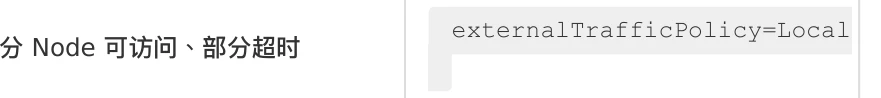

<table>
  <tr>
    <td>HTTP 401 或签名错误</td>
    <td>AK/SK、签名参数或系统时间不正确</td>
    <td>核对凭证和签名参数，同步系统时间。</td>
  </tr>
  <tr>
    <td>HTTP 403</td>
    <td>鉴权成功，但资源权限不足</td>
    <td>检查 RAM、组织和资源集；Pro 版检查凭证所属用户权限。</td>
  </tr>
  <tr>
    <td>SDK 直连超时，但 <code> curl --</code><code>proxy </code> 可达</td>
    <td>SDK 进程未继承代理变量，或目标地址被 <code> NO_PROXY </code> 排除</td>
    <td>在启动 SDK 的同一终端导出代理变量，并从 <code> NO_PROXY </code> 中移除必须经代理访问的目标。</td>
  </tr>
  <tr>
    <td>HTTP 407</td>
    <td>HTTP 代理要求认证</td>
    <td>按交付信息配置带认证的代理地址，避免在脚本、日志或文档中明文记录代理密码。</td>
  </tr>
  <tr>
    <td>代理返回 502/504</td>
    <td>代理无法连接上游 Endpoint</td>
    <td>核对代理的目标网络权限、Node IP、NodePort 和 Service 后端。</td>
  </tr>
  <tr>
    <td>全局代理超时，但 Endpoint 可以直连</td>
    <td>私网 Endpoint 被错误发送到无法访问目标网络的全局代理</td>
    <td>将 Node IP 或集群内域名加入<code> NO_PROXY </code>。</td>
  </tr>
  <tr>
    <td>本地可通、业务服务器不通</td>
    <td>两台机器的 DNS、代理、路由或防火墙不同</td>
    <td>在实际运行调用代码的机器上重新执行连通性检查。</td>
  </tr>
</table>

<a id="section-1-2-2"></a>

### 1.2.2. 获取AccessKey/SecretKey

本文介绍如何获取、保存、验证和轮换 OpenTrek AI 网关的 AccessKey ID 和 AccessKey Secret（简称AK/SK）。

**使用限制**

| 参数 | 说明 |
| --- | --- |
| 颁发方 | UniManager |
| 凭证归属 | UniManager 账号 |
| 调用入口 | UniManager POP Endpoint |
| 签名算法 | HMAC-SHA1 |
| 权限范围 | RAM、组织和资源集 |

**获取 AK/SK**

1. 使用需要调用 OpenAPI 的 UniManager 账号登录 AI 网关控制台。

2. 在页面右上角单击  ，选择**个人信息**，在AccessKey区域获取AK/SK。

**权限说明**

- 账号需要拥有目标 Action 的 RAM 权限。

- 账号需要属于正确的组织，并能访问目标资源集。

- `ListInstances`  返回  `code=200`  但  `records`  为空时，表示该账号的资源可见范围内没有 AI 网关实例。

**配置环境变量**

> **重要**
>
> 请勿将 AK/SK 直接写入 Python、Java、Shell 脚本或 Markdown 文档。

```bash
export AI_GATEWAY_ULTRA_ACCESS_KEY_ID="<access-key-id>"
export AI_GATEWAY_ULTRA_ACCESS_KEY_SECRET="<access-key-secret>"
```

执行完成后可从当前 Shell 清除：

```text
unset AI_GATEWAY_ULTRA_ACCESS_KEY_ID AI_GATEWAY_ULTRA_ACCESS_KEY_SECRET
unset AI_GATEWAY_PRO_ACCESS_KEY_ID AI_GATEWAY_PRO_ACCESS_KEY_SECRET
```

**验证 AK/SK**

AK/SK 不能通过“查询 Secret”接口验证。正确的验证方式是：

1. 按获取 OpenAPI Endpoint配置正确的 Endpoint。

2. 按签名生成指南生成签名。

3. 调用只读的  `ListInstances`  接口。

4. HTTP 2xx 且响应  `code=200`  表示凭证、签名和授权链路已通过。

**轮换 AK/SK**

1. 创建新 AK/SK。

2. 在调用方的密钥管理系统中更新凭证。

3. 用  `ListInstances`  验证新凭证。

4. 确认所有调用方已切换。

5. 停用或删除旧凭证。

AK/SK 曾出现在代码、日志、聊天记录或工单中时，应将其按已泄露凭证处理，并完成轮换。

<a id="section-1-2-3"></a>

### 1.2.3. 签名生成指南

本文介绍 OpenTrek AI 网关的 OpenAPI 签名方法，包括必需请求头、待签名字符串和签名结果的生成规则。

**版本说明**

| 参数 | 说明 |
| --- | --- |
| 协议 | ACS v1 ROA |
| 摘要算法 | HMAC-SHA1 |
| 时间 | UTC GMT <code> Date </code> |
| 防重放 | 随机 Nonce + Date |
| 签名结果 | <code>Authorization: acs &lt;AK&gt;:&lt;Signature&gt;</code> |

**前提条件**

- 已获取 OpenAPI Endpoint。

- 已获取目标环境颁发的 AK/SK。

- 调用机器的系统时间已同步。

**选择签名方式**

| 场景 | 推荐方式 | 是否需要手动计算签名 |
| --- | --- | --- |
| Java 应用 | 使用阿里云 SDK <code>CommonRequest</code> | 否 |
| 非 Java 应用，且当前语言有可用的阿里云 SDK | 使用对应语言的 SDK | 否 |
| 运行环境无法引入 SDK、受限制无法使用 SDK，或需要验证底层协议 | 手动计算签名 | 是 |

> **重要**
>
> 优先使用阿里云 SDK。使用  `CommonRequest`  时，SDK 会自动计算  `Content-MD5` ，生成  `Date` 和 Nonce，完成请求头规范化、HMAC-SHA1 计算和  `Authorization`  组装。调用方无需理解或实现后续的手动签名步骤。

手动签名需要精确处理 Body 字节、换行符、时间、请求头排序和字符编码，对接和排查成本较高。仅在无法使用 SDK 时手动计算签名。

**使用阿里云 SDK（推荐）**

使用  `CommonRequest`  时，调用方仍需要配置以下业务参数：

- Endpoint 和 Region ID。

- AccessKey ID 和 AccessKey Secret。

- Product： `AiGateway` 。

- Version： `2026-04-07` 。

- Action，例如  `ListInstances` 。

- API Path，例如  `/gatewayInstance/listInstances` 。

- 请求 Body 和业务请求头。

SDK 会根据上述配置生成完整签名请求。完整代码见Python、Java、Node.js 和GoSDK 调用示例。

**手动计算签名**

> **说明**
>
> 本节仅适用于无法使用阿里云 SDK 的场景。使用 SDK 的调用方无需关注本节。

**必需请求头**

| 请求头 | 取值 | 是否参与签名 |
| --- | --- | --- |
| <code>Host</code> | Endpoint 主机；如果交付信息单独提供 POP 路由域名，使用该域名。 | 通过 Path 之外的 POP 路由处理，不放入 CanonicalizedHeaders。 |
| <code>Accept</code> | <code>application/json</code> | 是 |
| <code>Content-Type</code> | <code>application/json</code> | 是 |
| <code>Content-MD5</code> | <code>Base64(MD5(body bytes))</code> | 是 |
| <code>Date</code> | UTC GMT，例如 <code> Mon, 24 Aug </code> <code>2026 04:30:00 GMT</code> | 是 |
| <code>x-acs-signature-method</code> | <code>HMAC-SHA1</code> | 是，属于 CanonicalizedHeaders |
| <code>x-acs-signature-version</code> | <code>1.0</code> | 是，属于 CanonicalizedHeaders |
| <code>x-acs-signature-nonce</code> | 每次请求新生成的 UUID | 是，属于 CanonicalizedHeaders |
| <code>x-acs-version</code> | <code>2026-04-07</code> | 是，属于 CanonicalizedHeaders |
| <code>x-acs-product</code> | <code>AiGateway</code> | 是，属于 CanonicalizedHeaders |
| <code>x-acs-regionid</code> | 目标环境 Region ID | 是，属于 CanonicalizedHeaders |
| <code>x-acs-popcode</code> | <code>AiGateway</code> | 是，属于 CanonicalizedHeaders |
| <code>x-acs-action</code> | API Action，例如<code>ListInstances</code> | 是，属于 CanonicalizedHeaders |
| <code>x-acs-organizationid</code> | 组织鉴权时使用的组织 ID | 是，属于 CanonicalizedHeaders |
| <code>Authorization</code> | <code>acs &lt;AccessKeyId&gt;:</code><br><code>&lt;Signature&gt;</code> | 签名结果，不参与自身计算 |

`x-acs-action`  和  `x-acs-organizationid`  二选一：

- 使用 RAM Action 鉴权时，传  `x-acs-action` 。

- 使用组织鉴权时，传  `x-acs-organizationid` 。

- 选中的请求头需要放入 CanonicalizedHeaders，未发送的请求头不参与签名。

**Content-MD5**

1. 将 JSON 序列化为 UTF-8 字节。

2. 对这组字节计算 MD5。

3. 对 MD5 的原始字节结果进行 Base64 编码。

4. 将结果作为  `Content-MD5` 。

> **重要**
>
> 计算  `Content-MD5`  和发送 HTTP 请求必须使用同一组 Body 字节。生成签名后，修改 JSON 格式、空格或字段顺序会导致签名不一致。

**CanonicalizedHeaders**

1. 选取实际发送的所有  `x-acs-*`  请求头。

2. 按请求头名称字典序升序排序。

3. 每个请求头拼接为  `header-name:header-value\n` 。

示例：

```text
x-acs-action:ListInstances\n
x-acs-popcode:AiGateway\n
x-acs-product:AiGateway\n
x-acs-regionid:cn-hangzhou\n
x-acs-signature-method:HMAC-SHA1\n
x-acs-signature-nonce:<uuid>\n
x-acs-signature-version:1.0\n
x-acs-version:2026-04-07\n
```

**StringToSign**

```text
METHOD\n
ACCEPT\n
CONTENT_MD5\n
CONTENT_TYPE\n
DATE\n
CANONICALIZED_HEADERS
PATH
```

以  `ListInstances`  为例，Path 为  `/gatewayInstance/listInstances` 。Path 之后不添加换行符。本指南的现有 API 主要使用 POST JSON Body；请求参数应放在 API 参考指定的位置。

**生成 Authorization**

```text
Signature = Base64(HMAC-SHA1(AccessKeySecret, StringToSign))
Authorization = "acs " + AccessKeyId + ":" + Signature
```

**常见问题**

| 现象 | 原因与处理 |
| --- | --- |
| <code>MissingDate</code> | 没有发送 <code> Date </code>，或请求没有到达签名组装逻辑。 |
| <code>InvalidVersion</code> | Product、Version 或 POP 路由不匹配。当前契约使用<code> AiGateway / 2026-04-07 </code>。 |
| <code>SignatureDoesNotMatch</code> | 核对 Host、Body 字节、Content-MD5、Date、Path和所有实际发送的 <code> x-acs-* </code> 请求头。 |
| 请求已过期 | 同步调用机器时钟，并为每次请求重新生成时间和签名。 |
| 403 或资源不可见 | 签名已可能通过，继续检查 RAM Action、组织和资源集。 |

优先使用 SDK 可以避免手工拼接造成的换行、编码和 Header 集合偏差。

<a id="section-1-2-4"></a>

### 1.2.4. 使用 Go SDK 调用 OpenAPI

本文介绍如何使用阿里云 Go SDK  `CommonRequest`  调用 OpenTrek AI 网关 OpenAPI。示例通过  `ListInstances`  接口查询当前账号可见的 AI 网关实例。

> **重要**
>
> 本文使用的  `github.com/aliyun/alibaba-cloud-sdk-go`  为支持 ACS v1 ROA  `CommonRequest` 的 V1 SDK。该 SDK 已结束官方支持，建议仅在已有项目或确认需要兼容 OpenTrek AI 网关 POP 的场景中使用。引入生产系统前，需要评估 SDK 维护和安全风险。

**前提条件**

- 已获取 OpenAPI Endpoint。

- 已获取目标环境颁发的 AK/SK。

- Go 版本为 1.13 或更高版本。

- 调用机器可以访问 OpenAPI Endpoint，且系统时间已同步。

**安装 SDK**

Go Module 依赖坐标：

```text
github.com/aliyun/alibaba-cloud-sdk-go v1.63.107
```

执行以下命令安装：

```text
go mod init openapi-example
go get github.com/aliyun/alibaba-cloud-sdk-go@v1.63.107
```

**配置环境变量**

```bash
export AI_GATEWAY_ULTRA_ENDPOINT="https://<ultra-openapi-endpoint>"
export AI_GATEWAY_ULTRA_ACCESS_KEY_ID="<access-key-id>"
export AI_GATEWAY_ULTRA_ACCESS_KEY_SECRET="<access-key-secret>"
export AI_GATEWAY_ULTRA_REGION="<region-id>"
```

Endpoint 的传输地址与 POP 路由域名不同时，额外配置：

```bash
export AI_GATEWAY_ULTRA_HOST="<pop-routing-domain>"
```

使用组织鉴权时，额外配置：

```bash
export AI_GATEWAY_ULTRA_ORGANIZATION_ID="<organization-id>"
```

**代码示例**

```go
package main

import (
 "encoding/json"
 "fmt"
 "net/url"
 "os"

 "github.com/aliyun/alibaba-cloud-sdk-go/sdk"
 "github.com/aliyun/alibaba-cloud-sdk-go/sdk/requests"
)

const (
 product = "AiGateway"
 version = "2026-04-07"
 action  = "ListInstances"
 path    = "/gatewayInstance/listInstances"
)

func requiredEnv(name string) string {
 value := os.Getenv(name)
 if value == "" {
  panic("missing required environment variable: " + name)
 }
 return value
}

func main() {
 endpoint := requiredEnv("AI_GATEWAY_ULTRA_ENDPOINT")
 accessKeyID := requiredEnv("AI_GATEWAY_ULTRA_ACCESS_KEY_ID")
 accessKeySecret := requiredEnv("AI_GATEWAY_ULTRA_ACCESS_KEY_SECRET")
 region := requiredEnv("AI_GATEWAY_ULTRA_REGION")
 popHost := os.Getenv("AI_GATEWAY_ULTRA_HOST")
 organizationID := os.Getenv("AI_GATEWAY_ULTRA_ORGANIZATION_ID")

 endpointURL, err := url.Parse(endpoint)
 if err != nil || endpointURL.Scheme == "" || endpointURL.Host == "" {
  panic("invalid AI_GATEWAY_ULTRA_ENDPOINT: " + endpoint)
 }

 client, err := sdk.NewClientWithAccessKey(
  region, accessKeyID, accessKeySecret)
 if err != nil {
  panic(err)
 }

 request := requests.NewCommonRequest()
 request.Product = product
 request.Domain = endpointURL.Host
 request.Version = version
 request.PathPattern = path
 request.Method = "POST"
 request.Scheme = endpointURL.Scheme
 request.SetContentType("application/json")
 request.Headers["x-acs-product"] = product
 request.Headers["x-acs-popcode"] = product
 request.Headers["x-acs-regionid"] = region

 if popHost != "" {
  request.Headers["Host"] = popHost
 }
 if organizationID != "" {
  request.Headers["x-acs-organizationid"] = organizationID
 } else {
  request.ApiName = action
 }

 body, err := json.Marshal(map[string]interface{}{
  "current": 1,
  "size":    10,
 })
 if err != nil {
  panic(err)
 }
 request.SetContent(body)

 response, err := client.ProcessCommonRequest(request)
 if err != nil {
  panic(err)
 }
 fmt.Println(response.GetHttpContentString())
}
```

SDK 会使用 AK/SK 和  `CommonRequest`  中的参数自动生成完整签名请求。

**运行示例**

将代码保存为  `main.go` ，然后执行：

```text
go mod tidy
go run .
```

**结果验证**

HTTP 状态码为 2xx 且响应中  `code`  为  `200`  时，表示调用成功。 `records`  为空表示当前凭证的授权范围内没有可见实例。

常见错误：

| 错误 | 处理方法 |
| --- | --- |
| <code>InvalidVersion</code> | 核对 Product、Version、Endpoint 和 POP 路由域名。 |
| <code>SignatureDoesNotMatch</code> | 核对 AK/SK、Endpoint、Region、Version、Action 和Path。 |
| HTTP 403 | 核对 RAM Action、组织和资源集权限。 |

<a id="section-1-2-5"></a>

### 1.2.5. 使用 Java SDK 调用 OpenAPI

本文介绍如何使用阿里云 Java SDK  `CommonRequest`  调用 OpenTrek AI 网关 OpenAPI。示例通过  `ListInstances`  接口查询当前账号可见的 AI 网关实例。

**前提条件**

- 已获取 OpenAPI Endpoint。

- 已获取目标环境颁发的 AK/SK。

- JDK 版本为 8 或更高版本。

- 调用机器可以访问 OpenAPI Endpoint，且系统时间已同步。

**添加 SDK 依赖**

Maven 依赖坐标：

```xml
<dependency>
  <groupId>com.aliyun</groupId>
  <artifactId>aliyun-java-sdk-core</artifactId>
  <version>4.6.0</version>
</dependency>
```

项目已引入兼容版本时，可以沿用现有版本。

**配置环境变量**

```bash
export AI_GATEWAY_ULTRA_ENDPOINT="https://<ultra-openapi-endpoint>"
export AI_GATEWAY_ULTRA_ACCESS_KEY_ID="<access-key-id>"
export AI_GATEWAY_ULTRA_ACCESS_KEY_SECRET="<access-key-secret>"
export AI_GATEWAY_ULTRA_REGION="<region-id>"
```

Endpoint 的传输地址与 POP 路由域名不同时，额外配置：

```bash
export AI_GATEWAY_ULTRA_HOST="<pop-routing-domain>"
```

使用组织鉴权时，额外配置：

```bash
export AI_GATEWAY_ULTRA_ORGANIZATION_ID="<organization-id>"
```

私网 Endpoint 需要通过 HTTP/HTTPS 代理访问时，按配置 HTTP/HTTPS 代理设置代理环境变量后再启动Java 进程。

**代码示例**

```java
import com.aliyuncs.CommonRequest;
import com.aliyuncs.CommonResponse;
import com.aliyuncs.DefaultAcsClient;
import com.aliyuncs.http.FormatType;
import com.aliyuncs.http.HttpClientConfig;
import com.aliyuncs.http.MethodType;
import com.aliyuncs.http.ProtocolType;
import com.aliyuncs.profile.DefaultProfile;

import java.net.URI;
import java.nio.charset.StandardCharsets;

public class ListInstancesExample {
    private static String requiredEnv(String name) {
        String value = System.getenv(name);
        if (value == null || value.trim().isEmpty()) {
            throw new IllegalArgumentException(
                    "Missing required environment variable: " + name);
        }
        return value;
    }

    public static void main(String[] args) throws Exception {
        String endpoint = requiredEnv("AI_GATEWAY_ULTRA_ENDPOINT");
        String accessKeyId = requiredEnv("AI_GATEWAY_ULTRA_ACCESS_KEY_ID");
        String accessKeySecret = requiredEnv("AI_GATEWAY_ULTRA_ACCESS_KEY_SECRET");
        String region = requiredEnv("AI_GATEWAY_ULTRA_REGION");
        String popHost = System.getenv("AI_GATEWAY_ULTRA_HOST");
        String organizationId = System.getenv("AI_GATEWAY_ULTRA_ORGANIZATION_ID");

        URI endpointUri = URI.create(endpoint);
        if (endpointUri.getScheme() == null || endpointUri.getAuthority() == null) {
            throw new IllegalArgumentException(
                    "Invalid AI_GATEWAY_ULTRA_ENDPOINT: " + endpoint);
        }

        DefaultProfile profile = DefaultProfile.getProfile(
                region, accessKeyId, accessKeySecret);
        HttpClientConfig clientConfig = HttpClientConfig.getDefault();
        clientConfig.setProtocolType(
                "https".equalsIgnoreCase(endpointUri.getScheme())
                        ? ProtocolType.HTTPS : ProtocolType.HTTP);
        profile.setHttpClientConfig(clientConfig);

        DefaultAcsClient client = new DefaultAcsClient(profile);
        try {
            CommonRequest request = new CommonRequest();
            request.setSysDomain(endpointUri.getAuthority());
            request.setSysMethod(MethodType.POST);
            request.setSysProduct("AiGateway");
            request.setSysVersion("2026-04-07");
            request.setSysUriPattern("/gatewayInstance/listInstances");
            request.setSysAccept(FormatType.JSON);
            request.putHeadParameter("x-acs-popcode", "AiGateway");
            request.putHeadParameter("x-acs-regionid", region);

            if (popHost != null && !popHost.trim().isEmpty()) {
                request.putHeadParameter("Host", popHost);
            }
            if (organizationId != null && !organizationId.trim().isEmpty()) {
                request.putHeadParameter(
                        "x-acs-organizationid", organizationId);
            } else {
                request.setSysAction("ListInstances");
            }

            byte[] body = "{\"current\":1,\"size\":10}"
                    .getBytes(StandardCharsets.UTF_8);
            request.setHttpContent(body, "UTF-8", FormatType.JSON);

            CommonResponse response = client.getCommonResponse(request);
            System.out.println(response.getData());
        } finally {
            client.shutdown();
        }
    }
}
```

SDK 会使用 AK/SK 和  `CommonRequest`  中的参数自动生成完整签名请求。代码中的 Product、Version、Action 和 API Path 需要与目标 API 契约一致。

**运行示例**

将代码保存为  `ListInstancesExample.java` ，通过 Maven 或 IDE 编译并运行。

**结果验证**

HTTP 状态码为 2xx 且响应中  `code`  为  `200`  时，表示调用成功。 `records`  为空表示当前凭证的授权范围内没有可见实例。

常见错误：

| 错误 | 处理方法 |
| --- | --- |
| <code>InvalidVersion</code> | 核对 Product、Version、Endpoint 和 POP 路由域名。 |
| <code>SignatureDoesNotMatch</code> | 核对 AK/SK、Endpoint、Region、Product、Version和 Action。 |
| HTTP 403 | 核对 RAM Action、组织和资源集权限。 |

<a id="section-1-2-6"></a>

### 1.2.6. 使用 Node.js SDK 调用 OpenAPI

本文介绍如何使用阿里云 Node.js SDK  `ROAClient`  调用 OpenTrek AI 网关 OpenAPI。示例通过  `ListInstances`  接口查询当前账号可见的 AI 网关实例。

**前提条件**

- 已获取 OpenAPI Endpoint。

- 已获取目标环境颁发的 AK/SK。

- Node.js 版本为 14 或更高版本。

- 调用机器可以访问 OpenAPI Endpoint，且系统时间已同步。

**安装 SDK**

SDK 依赖坐标：

| 项目 | 取值 |
| --- | --- |
| npm 包 | <code>@alicloud/pop-core</code> |
| 版本 | <code>1.8.0</code> |

执行以下命令安装：

```text
npm install @alicloud/pop-core@1.8.0
```

**配置环境变量**

```bash
export AI_GATEWAY_ULTRA_ENDPOINT="https://<ultra-openapi-endpoint>"
export AI_GATEWAY_ULTRA_ACCESS_KEY_ID="<access-key-id>"
export AI_GATEWAY_ULTRA_ACCESS_KEY_SECRET="<access-key-secret>"
export AI_GATEWAY_ULTRA_REGION="<region-id>"
```

Endpoint 的传输地址与 POP 路由域名不同时，额外配置：

```bash
export AI_GATEWAY_ULTRA_HOST="<pop-routing-domain>"
```

使用组织鉴权时，额外配置：

```bash
export AI_GATEWAY_ULTRA_ORGANIZATION_ID="<organization-id>"
```

**代码示例**

```javascript
'use strict';

const { ROAClient } = require('@alicloud/pop-core');

const PRODUCT = 'AiGateway';
const VERSION = '2026-04-07';
const ACTION = 'ListInstances';
const PATH = '/gatewayInstance/listInstances';

function requiredEnv(name) {
  const value = process.env[name];
  if (!value) {
    throw new Error(`Missing required environment variable: ${name}`);
  }
  return value;
}

async function main() {
  const endpoint = requiredEnv('AI_GATEWAY_ULTRA_ENDPOINT').replace(/\/+$/, '');
  const accessKeyId = requiredEnv('AI_GATEWAY_ULTRA_ACCESS_KEY_ID');
  const accessKeySecret = requiredEnv('AI_GATEWAY_ULTRA_ACCESS_KEY_SECRET');
  const region = requiredEnv('AI_GATEWAY_ULTRA_REGION');
  const popHost = process.env.AI_GATEWAY_ULTRA_HOST;
  const organizationId = process.env.AI_GATEWAY_ULTRA_ORGANIZATION_ID;

  const endpointUrl = new URL(endpoint);
  const client = new ROAClient({
    accessKeyId,
    accessKeySecret,
    endpoint: endpointUrl.origin,
    apiVersion: VERSION,
  });

  const headers = {
    'Content-Type': 'application/json',
    'x-acs-product': PRODUCT,
    'x-acs-popcode': PRODUCT,
    'x-acs-regionid': region,
  };
  if (popHost) {
    headers.Host = popHost;
  }
  if (organizationId) {
    headers['x-acs-organizationid'] = organizationId;
  } else {
    headers['x-acs-action'] = ACTION;
  }

  const response = await client.request(
    'POST',
    PATH,
    {},
    JSON.stringify({ current: 1, size: 10 }),
    headers,
    { timeout: 20000 },
  );
  console.log(JSON.stringify(response, null, 2));
}

main().catch((error) => {
  console.error(error);
  process.exitCode = 1;
});
```

SDK 会使用 AK/SK、Endpoint、API Version、Path 和请求头自动生成完整签名请求。

**运行示例**

将代码保存为  `list-instances.js` ，然后执行：

```text
node list-instances.js
```

**结果验证**

HTTP 状态码为 2xx 且响应中  `code`  为  `200`  时，表示调用成功。 `records`  为空表示当前凭证的授权范围内没有可见实例。

常见错误：

| 错误 | 处理方法 |
| --- | --- |
| <code>InvalidVersion</code> | 核对 Product、Version、Endpoint 和 POP 路由域名。 |
| <code>SignatureDoesNotMatch</code> | 核对 AK/SK、Endpoint、Region、Version、Action 和Path。 |
| HTTP 403 | 核对 RAM Action、组织和资源集权限。 |

<a id="section-1-2-7"></a>

### 1.2.7. 使用 Python SDK 调用 OpenAPI

本文介绍如何使用阿里云 Python SDK  `CommonRequest`  调用 OpenTrek AI 网关 OpenAPI。示例通过  `ListInstances`  接口查询当前账号可见的 AI 网关实例。

**前提条件**

- 已获取 OpenAPI Endpoint。

- 已获取目标环境颁发的 AK/SK。

- Python 版本为 3.7 或更高版本。

- 调用机器可以访问 OpenAPI Endpoint，且系统时间已同步。

**安装 SDK**

SDK 依赖坐标：

| 项目 | 取值 |
| --- | --- |
| PyPI 包 | <code>aliyun-python-sdk-core</code> |
| 版本 | <code>2.16.0</code> |

执行以下命令安装：

```text
python3 -m pip install aliyun-python-sdk-core==2.16.0
```

**配置环境变量**

```bash
export AI_GATEWAY_ULTRA_ENDPOINT="https://<ultra-openapi-endpoint>"
export AI_GATEWAY_ULTRA_ACCESS_KEY_ID="<access-key-id>"
export AI_GATEWAY_ULTRA_ACCESS_KEY_SECRET="<access-key-secret>"
export AI_GATEWAY_ULTRA_REGION="<region-id>"
```

Endpoint 的传输地址与 POP 路由域名不同时，额外配置：

```bash
export AI_GATEWAY_ULTRA_HOST="<pop-routing-domain>"
```

使用组织鉴权时，额外配置：

```bash
export AI_GATEWAY_ULTRA_ORGANIZATION_ID="<organization-id>"
```

私网 Endpoint 需要通过 HTTP/HTTPS 代理访问时，按配置 HTTP/HTTPS 代理设置代理环境变量后再启动Python 进程。

**代码示例**

```python
#!/usr/bin/env python3
import json
import os
import sys
from urllib.parse import urlparse

from aliyunsdkcore.acs_exception.exceptions import ClientException
fromaliyunsdkcoreacsexceptionexceptionsimportServerException
from aliyunsdkcore.client import AcsClient
from aliyunsdkcore.request import CommonRequest


def required_env(name):
    value = os.environ.get(name)
    if not value:
        raise RuntimeError("Missing required environment variable: " + name)
    return value


endpoint = required_env("AI_GATEWAY_ULTRA_ENDPOINT").rstrip("/")
access_key_id = required_env("AI_GATEWAY_ULTRA_ACCESS_KEY_ID")
access_key_secret = required_env("AI_GATEWAY_ULTRA_ACCESS_KEY_SECRET")
region = required_env("AI_GATEWAY_ULTRA_REGION")
pop_host = os.environ.get("AI_GATEWAY_ULTRA_HOST")
organization_id = os.environ.get("AI_GATEWAY_ULTRA_ORGANIZATION_ID")

endpoint_uri = urlparse(endpoint)
if endpoint_uri.scheme.lower() not in ("http", "https") or not endpoint_uri.netloc:
    raise RuntimeError("Invalid AI_GATEWAY_ULTRA_ENDPOINT: " + endpoint)

client = AcsClient(
    access_key_id,
    access_key_secret,
    region_id=region,
    connect_timeout=10,
    timeout=20,
)

request = CommonRequest()
request.set_product("AiGateway")
request.set_domain(endpoint_uri.netloc)
request.set_protocol_type(endpoint_uri.scheme.upper())
request.set_accept_format("json")
request.set_method("POST")
request.set_version("2026-04-07")
request.set_uri_pattern("/gatewayInstance/listInstances")
request.add_header("Content-Type", "application/json")
request.add_header("x-acs-popcode", "AiGateway")
request.add_header("x-acs-regionid", region)

if pop_host:
    request.add_header("Host", pop_host)
if organization_id:
    request.add_header("x-acs-organizationid", organization_id)
else:
    request.set_action_name("ListInstances")

body = json.dumps(
    {"current": 1, "size": 10},
    separators=(",", ":"),
).encode("utf-8")
request.set_content(body)

try:
    response = client.do_action_with_exception(request)
    result = json.loads(response.decode("utf-8"))
    print(json.dumps(result, ensure_ascii=False, indent=2))
except (ClientException, ServerException) as error:
    print(str(error), file=sys.stderr)
    raise SystemExit(1)
```

SDK 会使用 AK/SK 和  `CommonRequest`  中的参数自动生成完整签名请求。代码中的 Product、Version、Action 和 API Path 需要与目标 API 契约一致。

**运行示例**

将代码保存为  `list_instances.py` ，然后执行：

```text
python3 list_instances.py
```

**结果验证**

HTTP 状态码为 2xx 且响应中  `code`  为  `200`  时，表示调用成功。 `records`  为空表示当前凭证的授权范围内没有可见实例。

常见错误：

| 错误 | 处理方法 |
| --- | --- |
| <code>InvalidVersion</code> | 核对 Product、Version、Endpoint 和 POP 路由域名。 |
| <code>SignatureDoesNotMatch</code> | 核对 AK/SK、Endpoint、Region、Product、Version和 Action。 |
| HTTP 403 | 核对 RAM Action、组织和资源集权限。 |

<a id="section-1-3"></a>

## 1.3. API参考

<a id="section-1-3-1"></a>

### 1.3.1. AI服务

<a id="section-1-3-1-1"></a>

#### 1.3.1.1. BatchDeleteService

调用 BatchDeleteService 接口批量删除服务。

**请求头**

公共请求头及认证信息的获取与携带方式，请参见获取公共Header参数。

**请求语法**

```http
POST /microservice/batchDeleteService HTTP/1.1
```

**请求参数**

| 参数名称 | 位置 | 类型 | 是否必选 | 示例 | 说明 |
| --- | --- | --- | --- | --- | --- |
| gwInstanceId | <code>body</code> | <code>string</code> | 是 | <code>higress-</code><br><code>001</code> | 网关实例ID。 |
| serviceIds | <code>body</code> | <code>array</code> | 是 | \[\] | 服务ID列表。 |

**返回数据**

| 参数名称 | 类型 | 示例 | 说明 |
| --- | --- | --- | --- |
| requestId | <code>string</code> | <code>uuid-xxx-xxx</code> | 请求 ID。 |
| code | <code>integer&lt;int32&gt;</code> | 200 | 响应码。 |
| msg | <code>string</code> | <code>null</code> | 响应消息。 |
| data | <code>object</code> | {} | 返回数据。 |
| data.successIds | array | \[\] | — |
| data.failedIds | array | \[\] | — |

**示例**

**请求示例**

```http
POST /microservice/batchDeleteService HTTP/1.1

{
  "gwInstanceId": "gwInstanceId_value",
  "serviceIds": []
}
```

**响应示例**

```json
{
  "requestId": "xxx-xxx-xxx",
  "code": 200,
  "msg": null,
  "message": null,
  "data": {
    "successIds": [],
    "failedIds": []
  }
}
```

<a id="section-1-3-1-2"></a>

#### 1.3.1.2. CreateService

调用 CreateService 接口创建服务。

**区分说明**：此接口同时用于创建 AI服务和普通服务，通过参数区分：

- 创建 **AI服务**：传  `serviceSourceType: 9`

- 创建 **普通服务**：传其他类型值，支持： `1` (Nacos服务发现)、 `4` (K8s集群)、 `7` (固定地址)、 `8` (DNS域名)

**请求头**

公共请求头及认证信息的获取与携带方式，请参见获取公共Header参数。

**请求语法**

```http
POST /microservice/createService HTTP/1.1
```

**请求参数**

| 参数名称 | 位置 | 类型 | 是否必选 | 示例 | 说明 |
| --- | --- | --- | --- | --- | --- |
| gwInstanceId | <code>body</code> | <code>string</code> | 是 | <code>higress-</code><br><code>001</code> | 网关实例ID。不能为空或空白字符串。 |
| description | <code>body</code> | <code>string</code> | 否 | <code> </code>通义千问<code>AI</code>服务<code> </code> | 服务描述，长度不超过200字符。 |
| serviceType | <code>body</code> | <code>integer&lt;int</code><br><code>32&gt;</code> | 否 | <code>1</code> | 0表示RPC服务，1表示数据库。 |
| name | <code>body</code> | <code>string</code> | 是 | <code>qwen-</code><br><code>service</code> | 服务名称，网关中标识 不能为空或空白字符串。 |


<table>
  <tr>
    <td>upstreamType</td>
    <td><code>body</code></td>
    <td><code>integer&lt;int</code><br><code>32&gt;</code></td>
    <td>否</td>
    <td><code>1</code></td>
    <td>1 固定节点 2 服务发现 3 服务导入。</td>
  </tr>
  <tr>
    <td>serviceSource Type</td>
    <td><code>body</code></td>
    <td><code>integer&lt;int</code><br><code>32&gt;</code></td>
    <td>否</td>
    <td><code>9</code></td>
    <td>@see com.aliyun.cs b.common.mo del.enums.So urceTypeEnu m。</td>
  </tr>
  <tr>
    <td>serviceName</td>
    <td><code>body</code></td>
    <td><code>string</code></td>
    <td>否</td>
    <td><code>qwen-</code><br><code>service</code></td>
    <td>注册中心中的服务名服务发现时存在固定节点为空。</td>
  </tr>
  <tr>
    <td>loadBalanceT ype</td>
    <td><code>body</code></td>
    <td><code>integer&lt;int</code><br><code>32&gt;</code></td>
    <td>否</td>
    <td><code>1</code></td>
    <td>负载均衡类型&lt;p&gt;可选值参考LoadBalanceT ypeEnum：-WEIGHT_ROU ND_ROBIN(1):加权轮询（仅固定节点）-WEIGHT_RAN DOM(2): 加权随机（仅固定节点）-ROUND_ROBI N(3): 轮询（通用）-RANDOM(4):随机（通用）-LEAST_REQUE ST(5): 最少请求（Higress Nacos 专用）-CONSISTENT_HASH(6): 一致性哈希（Higress Nacos 专用）-LEAST_CONN(7): 最少连接（Higress Nacos 专用）。</td>
  </tr>
  <tr>
    <td>serviceStruct</td>
    <td><code>body</code></td>
    <td>object</td>
    <td>否</td>
    <td>{}</td>
    <td>存储服务相关信息，包括命名空间信息和协议转换相关元数据。</td>
  </tr>
  <tr>
    <td>isOpenHealth Check</td>
    <td><code>body</code></td>
    <td><code>boolean</code></td>
    <td>否</td>
    <td><code>false</code></td>
    <td>是否开启健康检查。</td>
  </tr>
  <tr>
    <td>healthCheckSt ruct</td>
    <td><code>body</code></td>
    <td>object</td>
    <td>否</td>
    <td>{}</td>
    <td>健康检查结构体。</td>
  </tr>
  <tr>
    <td>healthCheckSt ruct.type</td>
    <td>body</td>
    <td>integer&lt;int32 &gt;</td>
    <td>否</td>
    <td>0</td>
    <td>检查类型。</td>
  </tr>
  <tr>
    <td>healthCheckSt ruct.healthPat h</td>
    <td>body</td>
    <td>string</td>
    <td>否</td>
    <td>example</td>
    <td>检查路径。</td>
  </tr>
  <tr>
    <td>healthCheckSt ruct.httpStatu ses</td>
    <td>body</td>
    <td>string</td>
    <td>否</td>
    <td>example</td>
    <td>健康状态码。</td>
  </tr>
  <tr>
    <td>healthCheckSt ruct.timeout</td>
    <td>body</td>
    <td>integer&lt;int32 &gt;</td>
    <td>否</td>
    <td>0</td>
    <td>请求超时。</td>
  </tr>
  <tr>
    <td>healthCheckSt ruct.healthInt erval</td>
    <td>body</td>
    <td>integer&lt;int32 &gt;</td>
    <td>否</td>
    <td>0</td>
    <td>健康检查间隔。</td>
  </tr>
  <tr>
    <td>healthCheckSt ruct.unHealthI nterval</td>
    <td>body</td>
    <td>integer&lt;int32 &gt;</td>
    <td>否</td>
    <td>0</td>
    <td>不健康检查间隔。</td>
  </tr>
  <tr>
    <td>healthCheckSt ruct.httpSucc esses</td>
    <td>body</td>
    <td>integer&lt;int32 &gt;</td>
    <td>否</td>
    <td>0</td>
    <td>成功阈值。</td>
  </tr>
  <tr>
    <td>healthCheckSt ruct.httpFailur es</td>
    <td>body</td>
    <td>integer&lt;int32 &gt;</td>
    <td>否</td>
    <td>0</td>
    <td>失败阈值。</td>
  </tr>
  <tr>
    <td>activeHealthC heckStruct</td>
    <td><code>body</code></td>
    <td>object</td>
    <td>否</td>
    <td>{}</td>
    <td>主动健康检查结构体，higress service。</td>
  </tr>
  <tr>
    <td>activeHealthC heckStruct.en able</td>
    <td>body</td>
    <td>boolean</td>
    <td>否</td>
    <td>false</td>
    <td>是否启用。</td>
  </tr>
  <tr>
    <td>activeHealthC heckStruct.pr otocol</td>
    <td>body</td>
    <td>string</td>
    <td>否</td>
    <td>example</td>
    <td>—</td>
  </tr>
  <tr>
    <td>activeHealthC heckStruct.ti meout</td>
    <td>body</td>
    <td>integer&lt;int32 &gt;</td>
    <td>否</td>
    <td>0</td>
    <td>—</td>
  </tr>
  <tr>
    <td>activeHealthC heckStruct.int erval</td>
    <td>body</td>
    <td>integer&lt;int32 &gt;</td>
    <td>否</td>
    <td>0</td>
    <td>—</td>
  </tr>
  <tr>
    <td>activeHealthC heckStruct.he althyThreshol d</td>
    <td>body</td>
    <td>integer&lt;int32 &gt;</td>
    <td>否</td>
    <td>0</td>
    <td>—</td>
  </tr>
  <tr>
    <td>activeHealthC heckStruct.un healthyThresh old</td>
    <td>body</td>
    <td>integer&lt;int32 &gt;</td>
    <td>否</td>
    <td>0</td>
    <td>—</td>
  </tr>
  <tr>
    <td>activeHealthC heckStruct.htt pPath</td>
    <td>body</td>
    <td>string</td>
    <td>否</td>
    <td>example</td>
    <td>—</td>
  </tr>
  <tr>
    <td>activeHealthC heckStruct.htt pHost</td>
    <td>body</td>
    <td>string</td>
    <td>否</td>
    <td>example</td>
    <td>—</td>
  </tr>
  <tr>
    <td>activeHealthC heckStruct.ex pectedStatuse s</td>
    <td>body</td>
    <td>array</td>
    <td>否</td>
    <td>[]</td>
    <td>—</td>
  </tr>
  <tr>
    <td>protocol</td>
    <td><code>body</code></td>
    <td><code>string</code></td>
    <td>是</td>
    <td><code>HTTP</code></td>
    <td>协议目前支持HTTP、GRPC、Webservice、Dubbo和HSF不能为空或空白字符串。</td>
  </tr>
  <tr>
    <td>serviceId</td>
    <td><code>body</code></td>
    <td><code>string</code></td>
    <td>否</td>
    <td><code>service-</code><br><code>001</code></td>
    <td>服务ID。</td>
  </tr>
  <tr>
    <td>isDisasterRec overy</td>
    <td><code>body</code></td>
    <td><code>boolean</code></td>
    <td>否</td>
    <td><code>false</code></td>
    <td>是否为容灾资源。 默认值：false。</td>
  </tr>
  <tr>
    <td>proxyServerN ame</td>
    <td><code>body</code></td>
    <td><code>string</code></td>
    <td>否</td>
    <td><code>proxy-001</code></td>
    <td>代理服务器名字。</td>
  </tr>
</table>

**healthCheckStruct 对象结构**

| 参数名称 | 位置 | 类型 | 是否必选 | 示例 | 说明 |
| --- | --- | --- | --- | --- | --- |
| type | <code>body</code> | <code>integer</code> | 否 | <code>1</code> | 类型。 |
| healthPath | <code>body</code> | <code>string</code> | 否 | <code>/health</code> | 健康检查路径。 |
| httpStatuses | <code>body</code> | <code>string</code> | 否 | <code>200,301,302</code> | HTTP状态码。 |
| timeout | <code>body</code> | <code>integer</code> | 否 | <code>5</code> | 超时时间（秒）。 |
| healthInterval | <code>body</code> | <code>integer</code> | 否 | <code>10</code> | 健康检查间隔。 |
| unHealthInter val | <code>body</code> | <code>integer</code> | 否 | <code>30</code> | 不健康检查间隔。 |
| httpSuccesses | <code>body</code> | <code>integer</code> | 否 | <code>3</code> | HTTP成功次数阈值。 |
| httpFailures | <code>body</code> | <code>integer</code> | 否 | <code>3</code> | HTTP失败次数阈值。 |


**activeHealthCheckStruct 对象结构**

| 参数名称 | 位置 | 类型 | 是否必选 | 示例 | 说明 |
| --- | --- | --- | --- | --- | --- |
| enable | <code>body</code> | <code>boolean</code> | 否 | <code>false</code> | 是否启用。 |
| protocol | <code>body</code> | <code>string</code> | 否 | <code>HTTP</code> | 服务协议。AI服务默认为<code> HTTP </code>。 |
| timeout | <code>body</code> | <code>integer</code> | 否 | <code>5</code> | 超时时间（秒）。 |
| interval | <code>body</code> | <code>integer</code> | 否 | <code>10</code> | 检查间隔（秒）。 |
| healthyThresh old | <code>body</code> | <code>integer</code> | 否 | <code>3</code> | 健康阈值。 |
| unhealthyThre shold | <code>body</code> | <code>integer</code> | 否 | <code>3</code> | 不健康阈值。 |
| httpPath | <code>body</code> | <code>string</code> | 否 | <code>/health</code> | HTTP路径。 |
| httpHost | <code>body</code> | <code>string</code> | 否 | <code>localhost</code> | HTTP Host头。 |
| expectedStatu ses | <code>body</code> | <code>string[]</code> | 否 | <code>["200"]</code> | 期望的状态码列表。 |

**serviceStruct 对象结构**

**说明**：serviceStruct 根据  `serviceSourceType`  参数有不同的字段结构：

**当 serviceSourceType=9（AI服务）时：**

| 参数名称 | 位置 | 类型 | 是否必选 | 示例 | 说明 |
| --- | --- | --- | --- | --- | --- |
| provider | <code>body</code> | <code>string</code> | 是 | <code>qwen</code> | AI提供商类型。可选值：<code> selfbui</code> <code>ld </code>(自建)、<code> qwen </code>(通义千问)、<code> deepsee</code> <code>k </code>、<code> openai</code><code> </code>、<code> azure </code>、<code> gemini </code>、<code> bedrock </code>、<code> claude </code>、<code> moonshot</code> <code> </code>(月之暗面)、<code> baichua</code> <code>n </code>(百川)、<code> yi </code>(零一万物)、<code> zhipuai</code> <code> </code>(智谱)、<code> hunyuan</code> <code> </code>(混元)、<code> stepfun</code> <code> </code>(阶跃)、<code> spark </code> (讯飞星火)、<code> doubao</code> <code> </code>(豆包)、<code> minimax</code><code> </code>、<code> vertex</code> <code> </code>(Vertex AI)。 |

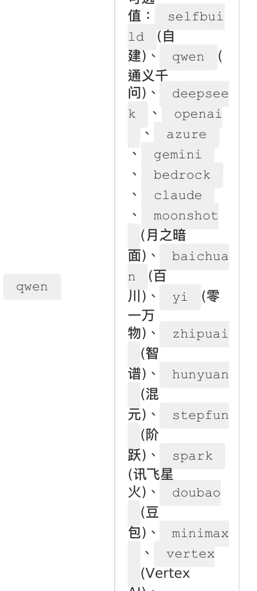

<table>
  <tr>
    <td>aiProtocol</td>
    <td><code>body</code></td>
    <td><code>string</code></td>
    <td>是</td>
    <td><code>openai</code></td>
    <td>AI协议类型。可选值：<code> openai</code> <code> </code>(OpenAI/V1标准协议)、<code> origina</code> <code>l </code>(原始协议)。</td>
  </tr>
  <tr>
    <td>baseUrl</td>
    <td><code>body</code></td>
    <td><code>string</code></td>
    <td>否</td>
    <td><code>https://api</code><br><code>.openai.com</code></td>
    <td>AI服务基础URL地址。部分提供商有默认值，如qwen 默认为<code>https://das</code><br><code>hscope.aliyu</code><br><code>ncs.com/comp</code><br><code>atible-</code><code>mode/v1 </code>。</td>
  </tr>
  <tr>
    <td>apiKeyList</td>
    <td><code>body</code></td>
    <td><code>string[]</code></td>
    <td>否</td>
    <td><code>["sk-</code><br><code>xxx"]</code></td>
    <td>API Key列表。支持配置多个API Key 实现负载均衡和容灾。自建LLM时可省略。</td>
  </tr>
</table>


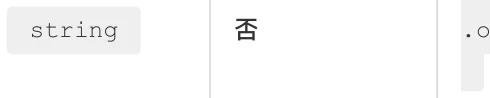

**当 serviceSourceType 为其他值（普通服务）时：**

| 参数名称 | 位置 | 类型 | 是否必选 | 示例 | 说明 |
| --- | --- | --- | --- | --- | --- |
| nodes | <code>body</code> | <code>object[]</code> | 否 | <code>[{"ip":"192</code><br><code>.168.1.1","p</code><br><code>ort":8080}]</code> | 服务节点列表。当serviceSource Type=7(固定地址)或serviceSource Type=8(DNS)时使用。 |
| sourceGroup | <code>body</code> | <code>string</code> | 否 | <code>DEFAULT_GRO</code><br><code>UP</code> | Nacos分组名。当serviceSource Type=1(NACO S)时使用，默认值为<code>DEFAULT_GRO</code> <code>UP </code>。 |
| sourceNames paceId | <code>body</code> | <code>string</code> | 否 | <code>namespace-</code><br><code>001</code> | Nacos命名空间ID。当serviceSource Type=1(NACO S)时使用。 |

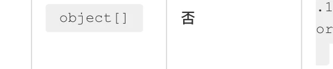

**nodes 对象结构**

| 参数名称 | 位置 | 类型 | 是否必选 | 示例 | 说明 |
| --- | --- | --- | --- | --- | --- |
| ip | <code>body</code> | <code>string</code> | 是 | <code>192.168.1.1</code> | 节点IP地址。 |
| port | <code>body</code> | <code>integer</code> | 是 | <code>8080</code> | 节点端口。 |
| weight | <code>body</code> | <code>integer</code> | 否 | <code>1</code> | 节点权重，用于负载均衡。默认值为 1。 |
| enable | <code>body</code> | <code>boolean</code> | 否 | <code>true</code> | 节点是否启用。默认值为true。 |
| vpcId | <code>body</code> | <code>string</code> | 否 | <code>vpc-xxx-</code><br><code>xxx</code> | VPC ID（跨VPC场景）。 |
| vpcMappingIp | <code>body</code> | <code>string</code> | 否 | <code>10.0.0.1</code> | VPC映射IP。 |
| vpcMappingPo rt | <code>body</code> | <code>integer</code> | 否 | <code>8080</code> | VPC映射端口。 |


**返回数据**

| 参数名称 | 类型 | 示例 | 说明 |
| --- | --- | --- | --- |
| requestId | <code>string</code> | <code>uuid-xxx-xxx</code> | 请求 ID。 |
| code | <code>integer&lt;int32&gt;</code> | 200 | 响应码。 |
| msg | <code>string</code> | <code>null</code> | 响应消息。 |
| data | <code>string</code> | <code>service-001</code> | 响应数据。 |

**示例**

**请求示例**

```http
POST /microservice/createService HTTP/1.1

{
  "gwInstanceId": "gwInstanceId_value",
  "description": "description_value",
  "serviceType": 0,
  "name": "name_value",
  "upstreamType": 0,
  "serviceSourceType": 9,
  "serviceName": "serviceName_value",
  "loadBalanceType": 0,
  "serviceStruct": {
    "provider": "qwen",
    "aiProtocol": "openai",
    "baseUrl": "https://dashscope.aliyuncs.com/compatible-mode/v1",
    "apiKeyList": [
      "sk-xxxxx"
    ]
  },
  "isOpenHealthCheck": true,
  "healthCheckStruct": {
    "type": 0,
    "healthPath": "healthPath_value",
    "httpStatuses": "httpStatuses_value",
    "timeout": 0,
    "healthInterval": 0,
    "unHealthInterval": 0,
    "httpSuccesses": 0,
    "httpFailures": 0
  },
  "activeHealthCheckStruct": {
    "enable": true,
    "protocol": "protocol_value",
    "timeout": 0,
    "interval": 0,
    "healthyThreshold": 0,
    "unhealthyThreshold": 0,
    "httpPath": "httpPath_value",
    "httpHost": "httpHost_value",
    "expectedStatuses": []
  },
  "protocol": "protocol_value",
  "serviceId": "serviceId_value",
  "isDisasterRecovery": false,
  "proxyServerName": "proxyServerName_value"
}
```

**响应示例**

```json
{
  "requestId": "xxx-xxx-xxx",
  "code": 200,
  "msg": null,
  "message": null,
  "data": "data_value"
}
```

<a id="section-1-3-1-3"></a>

#### 1.3.1.3. DeleteService

调用 DeleteService 接口删除服务。

**请求头**

公共请求头及认证信息的获取与携带方式，请参见获取公共Header参数。

**请求语法**

```http
POST /microservice/deleteService HTTP/1.1
```

**请求参数**

| 参数名称 | 位置 | 类型 | 是否必选 | 示例 | 说明 |
| --- | --- | --- | --- | --- | --- |
| gwInstanceId | <code>body</code> | <code>string</code> | 是 | <code>higress-</code><br><code>001</code> | 网关实例ID。 |
| serviceId | <code>body</code> | <code>string</code> | 是 | <code>service-</code><br><code>001</code> | 服务ID。 |

**返回数据**

| 参数名称 | 类型 | 示例 | 说明 |
| --- | --- | --- | --- |
| requestId | <code>string</code> | <code>uuid-xxx-xxx</code> | 请求 ID。 |
| code | <code>integer&lt;int32&gt;</code> | 200 | 响应码。 |
| msg | <code>string</code> | <code>null</code> | 响应消息。 |
| data | <code>string</code> | <code>service-001</code> | 响应数据。 |

**示例**

**请求示例**

```http
POST /microservice/deleteService HTTP/1.1

{
  "gwInstanceId": "gwInstanceId_value",
  "serviceId": "serviceId_value"
}
```

**响应示例**

```json
{
  "requestId": "xxx-xxx-xxx",
  "code": 200,
  "msg": null,
  "message": null,
  "data": "data_value"
}
```

<a id="section-1-3-1-4"></a>

#### 1.3.1.4. ListAllServices

调用 ListAllServices 接口查询所有服务列表。

**请求头**

公共请求头及认证信息的获取与携带方式，请参见获取公共Header参数。

**请求语法**

```http
POST /microservice/listAllServices HTTP/1.1
```

**请求参数**

| 参数名称 | 位置 | 类型 | 是否必选 | 示例 | 说明 |
| --- | --- | --- | --- | --- | --- |
| gwInstanceId | <code>body</code> | <code>string</code> | 否 | <code>higress-</code><br><code>001</code> | 网关实例ID。 |
| serviceType | <code>body</code> | <code>integer&lt;int</code><br><code>32&gt;</code> | 否 | <code>1</code> | FIXME-lvshui 2025/3/23: 什么作用？。 |
| isDisasterRec overy | <code>body</code> | <code>boolean</code> | 否 | <code>false</code> | 是否为容灾资源。 |

**返回数据**

| 参数名称 | 类型 | 示例 | 说明 |
| --- | --- | --- | --- |
| requestId | <code>string</code> | <code>uuid-xxx-xxx</code> | 请求 ID。 |
| code | <code>integer&lt;int32&gt;</code> | 200 | 响应码。 |
| msg | <code>string</code> | <code>null</code> | 响应消息。 |
| data | array | \[\] | 响应数据。 |
| data\[\].serviceId | <code>string</code> | <code>service-001</code> | 服务ID。 |
| data\[\].serviceName | <code>string</code> | <code>my-service</code> | 服务名称。 |
| data\[\].protocol | <code>string</code> | <code>HTTP</code> | 协议类型。 |

**示例**

**请求示例**

```http
POST /microservice/listAllServices HTTP/1.1

{
  "gwInstanceId": "gwInstanceId_value",
  "serviceType": 0,
  "isDisasterRecovery": true
}
```

**响应示例**

```json
{
  "requestId": "xxx-xxx-xxx",
  "code": 200,
  "msg": null,
  "message": null,
  "data": [
    {
      "serviceId": "service-001",
      "serviceName": "demo-service",
      "protocol": "HTTP"
    },
    {
      "serviceId": "service-002",
      "serviceName": "another-service",
      "protocol": "gRPC"
    }
  ]
}
```

<a id="section-1-3-1-5"></a>

#### 1.3.1.5. GetService

调用 GetService 接口查询服务详情。根据ID查询服务。

**区分说明**：此接口同时支持查询 AI服务和普通服务的详情，根据 serviceId 查询，返回数据中  `sourceType=9`  表示 AI服务。

**请求头**

公共请求头及认证信息的获取与携带方式，请参见获取公共Header参数。

**请求语法**

```http
POST /microservice/getService HTTP/1.1
```

**请求参数**

| 参数名称 | 位置 | 类型 | 是否必选 | 示例 | 说明 |
| --- | --- | --- | --- | --- | --- |
| gwInstanceId | <code>body</code> | <code>string</code> | 是 | <code>higress-</code><br><code>001</code> | 网关实例ID。 |
| serviceId | <code>body</code> | <code>string</code> | 是 | <code>service-</code><br><code>001</code> | 服务ID。 |

**返回数据**

| 参数名称 | 类型 | 示例 | 说明 |
| --- | --- | --- | --- |
| requestId | <code>string</code> | <code>uuid-xxx-xxx</code> | 请求 ID。 |
| code | <code>integer&lt;int32&gt;</code> | 200 | 响应码。 |
| msg | <code>string</code> | <code>null</code> | 响应消息。 |
| data | <code>object</code> | <code>{}</code> | 返回数据。 |
| data.serviceId | <code>string</code> | <code>service-001</code> | 服务 ID。 |
| data.name | <code>string</code> | <code>qwen-service</code> | 名称。 |
| data.serviceName | <code>string</code> | <code>qwen-service</code> | 服务名称。 |
| data.description | <code>string</code> | <br><code> </code>通义千问<code>AI</code>服务<code> </code> | 描述。 |
| data.createTime | <code>string</code> | 2026-01-01 00:00:00 | 创建时间 格式：yyyy-MM-dd HH:mm:ss。 |
| data.updateTime | <code>string</code> | 2026-01-01 00:00:00 | 更新时间 格式：yyyy-MM-dd HH:mm:ss。 |
| data.creator | <code>string</code> | <code>admin</code> | — |
| data.updater | <code>string</code> | <code>admin</code> | — |
| data.protocol | <code>string</code> | <code>HTTP</code> | — |
| data.serviceType | integer&lt;int32&gt; | <code>1</code> | — |
| data.upstreamType | integer&lt;int32&gt; | <code>1</code> | — |
| data.upstreamTypeNa me | <code>string</code> | <code> AI</code>服务<code> </code> | — |
| data.loadBalanceType | integer&lt;int32&gt; | <code>1</code> | — |
| data.loadBalanceTypeN ame | <code>string</code> | <br><code> </code>轮询<code> </code> | — |
| data.routeList | array | <code>[]</code> | — |
| data.routeList\[\].routeId | <code>string</code> | <code>route-001</code> | 路由 ID。 |
| data.routeList\[\].routeN ame | <code>string</code> | <code>my-route</code> | 路由名称。 |
| data.routeList\[\].routePa th | array | \[\] | — |
| data.sourceType | integer&lt;int32&gt; | <code>9</code> | — |
| data.serviceSourceTyp e | integer&lt;int32&gt; | <code>9</code> | — |
| data.serviceAddress | <code>string</code> | <code>qwen-</code><br><code>service.example.com</code> | — |
| data.port | integer&lt;int32&gt; | <code>8080</code> | — |
| data.serviceStruct | <code>object</code> | {} | — |
| data.isOpenHealthChec k | <code>boolean</code> | <code>false</code> | — |
| data.healthCheckStruct | <code>object</code> | <code>{}</code> | 健康检查结构体（用于Spring Cloud Gateway）。 |
| data.healthCheckStruct.type | integer&lt;int32&gt; | <code>1</code> | 检查类型。 |
| data.healthCheckStruct.healthPath | <code>string</code> | <code>/health</code> | 检查路径。 |


| 参数名称 | 类型 | 示例 | 说明 |
| --- | --- | --- | --- |
| data.healthCheckStruct.httpStatuses | <code>string</code> | <code>200,301,302</code> | 健康状态码。 |
| data.healthCheckStruct.timeout | integer&lt;int32&gt; | <code>5</code> | 请求超时。 |
| data.healthCheckStruct.healthInterval | integer&lt;int32&gt; | <code>10</code> | 健康检查间隔。 |
| data.healthCheckStruct.unHealthInterval | integer&lt;int32&gt; | <code>30</code> | 不健康检查间隔。 |
| data.healthCheckStruct.httpSuccesses | integer&lt;int32&gt; | <code>3</code> | 成功阈值。 |
| data.healthCheckStruct.httpFailures | integer&lt;int32&gt; | <code>3</code> | 失败阈值。 |
| data.activeHealthCheck Struct | <code>object</code> | <code>{}</code> | 主动健康检查结构体（用于Higress网关）。 |
| data.activeHealthCheck Struct.enable | <code>boolean</code> | <code>false</code> | 是否启用。 |
| data.activeHealthCheck Struct.protocol | <code>string</code> | <code>HTTP</code> | — |
| data.activeHealthCheck Struct.timeout | integer&lt;int32&gt; | <code>5</code> | — |
| data.activeHealthCheck Struct.interval | integer&lt;int32&gt; | <code>10</code> | — |
| data.activeHealthCheck Struct.healthyThreshol d | integer&lt;int32&gt; | <code>3</code> | — |
| data.activeHealthCheck Struct.unhealthyThresh old | integer&lt;int32&gt; | <code>3</code> | — |
| data.activeHealthCheck Struct.httpPath | <code>string</code> | <code>/health</code> | — |
| data.activeHealthCheck Struct.httpHost | <code>string</code> | <code>localhost</code> | — |
| data.activeHealthCheck Struct.expectedStatuse s | array | \[\] | — |
| data.activeHealthCheck StatusStruct | <code>object</code> | <code>{}</code> | 主动健康检查状态结构体（用于Higress网关）。 |
| data.activeHealthCheck StatusStruct.healthStat us | <code>string</code> | <code>healthy</code> | 健康状态HEALTHY, UNHEALTHY, UNKNOWN, CHECKING。 |
| data.activeHealthCheck StatusStruct.unhealthy Endpoints | array | <code>[]</code> | — |
| data.zones | array | \[\] | — |
| data.strategyConfigs | array | <code>[]</code> | — |
| data.strategyConfigs\[\].strategyConfigId | <code>string</code> | <code>strategy-001</code> | — |
| data.strategyConfigs\[\].strategyConfigName | <code>string</code> | <code>token-limit-</code><br><code>config</code> | — |
| data.strategyConfigs\[\].strategyName | <code>string</code> | <code>ai-token-limit</code> | — |
| data.strategyConfigs\[\].status | <code>boolean</code> | <code>true</code> | — |
| data.strategyConfigs\[\].scopes | array | \[\] | — |
| data.strategyConfigs\[\].scope | <code>object</code> | <code>{}</code> | — |
| data.strategyConfigs\[\].scope.routeInfos | array | <code>[]</code> | — |
| data.strategyConfigs\[\].scope.routeInfos\[\].nam e | <code>string</code> | <code>my-route</code> | 名称。 |
| data.strategyConfigs\[\].scope.routeInfos\[\].id | <code>string</code> | <code>route-001</code> | 资源 ID。 |
| data.strategyConfigs\[\].scope.serviceInfos | array | <code>[]</code> | — |
| data.strategyConfigs\[\].scope.serviceInfos\[\].na me | <code>string</code> | <code>qwen-service</code> | 名称。 |
| data.strategyConfigs\[\].scope.serviceInfos\[\].id | <code>string</code> | <code>service-001</code> | 资源 ID。 |
| data.strategyConfigs\[\].scope.appInfos | array | <code>[]</code> | — |
| data.strategyConfigs\[\].scope.appInfos\[\].name | <code>string</code> | <code>my-consumer</code> | 名称。 |
| data.strategyConfigs\[\].scope.appInfos\[\].id | <code>string</code> | <code>app-001</code> | 资源 ID。 |
| data.strategyConfigs\[\].scope.domainInfos | array | <code>[]</code> | — |
| data.strategyConfigs\[\].scope.domainInfos\[\].na me | <code>string</code> | <code>api.example.com</code> | 名称。 |
| data.strategyConfigs\[\].scope.domainInfos\[\].id | <code>string</code> | <code>domain-001</code> | 资源 ID。 |
| data.strategyConfigs\[\].scope.mcpServerInfos | array | <code>[]</code> | — |
| data.strategyConfigs\[\].scope.mcpServerInfos\[\].name | <code>string</code> | <code>mcp-server-001</code> | 名称。 |
| data.strategyConfigs\[\].scope.mcpServerInfos\[\].id | <code>string</code> | <code>mcp-001</code> | 资源 ID。 |
| data.strategyConfigs\[\].scope.scopes | array | \[\] | — |
| data.strategyConfigs\[\].createTime | <code>string</code> | 2026-01-01 00:00:00 | 创建时间 格式：yyyy-MM-dd HH:mm:ss。 |
| data.strategyConfigs\[\].updateTime | <code>string</code> | 2026-01-01 00:00:00 | 更新时间 格式：yyyy-MM-dd HH:mm:ss。 |
| data.proxyServerName | <code>string</code> | <code>proxy-001</code> | — |

**示例**

**请求示例**

```http
POST /microservice/getService HTTP/1.1

{
  "gwInstanceId": "gwInstanceId_value",
  "serviceId": "serviceId_value"
}
```

**响应示例**

```json
{
  "code": 200,
  "message": null,
  "requestId": "xxx-xxx-xxx",
  "data": {
    "serviceId": "serviceId_value",
    "name": "name_value",
    "serviceName": "serviceName_value",
    "description": "description_value",
    "createTime": "2026-01-01 00:00:00",
    "updateTime": "2026-01-01 00:00:00",
    "creator": "creator_value",
    "updater": "updater_value",
    "protocol": "protocol_value",
    "serviceType": 0,
    "upstreamType": 0,
    "upstreamTypeName": "upstreamTypeName_value",
    "loadBalanceType": 0,
    "loadBalanceTypeName": "loadBalanceTypeName_value",
    "routeList": [
      {
        "routeId": "routeId_value",
        "routeName": "routeName_value",
        "routePath": []
      }
    ],
    "sourceType": 0,
    "serviceSourceType": 0,
    "serviceAddress": "serviceAddress_value",
    "port": 0,
    "serviceStruct": {},
    "isOpenHealthCheck": true,
    "healthCheckStruct": {
      "type": 0,
      "healthPath": "healthPath_value",
      "httpStatuses": "httpStatuses_value",
      "timeout": 0,
      "healthInterval": 0,
      "unHealthInterval": 0,
      "httpSuccesses": 0,
      "httpFailures": 0
    },
    "activeHealthCheckStruct": {
      "enable": true,
      "protocol": "protocol_value",
      "timeout": 0,
      "interval": 0,
      "healthyThreshold": 0,
      "unhealthyThreshold": 0,
      "httpPath": "httpPath_value",
      "httpHost": "httpHost_value",
      "expectedStatuses": []
    },
    "activeHealthCheckStatusStruct": {
      "healthStatus": "healthStatus_value",
      "unhealthyEndpoints": []
    },
    "zones": [],
    "strategyConfigs": [
      {
        "strategyConfigId": "strategyConfigId_value",
        "strategyConfigName": "strategyConfigName_value",
        "strategyName": "strategyName_value",
        "status": true,
        "scopes": [],
        "scope": {
          "routeInfos": [
            {
              "name": "demo",
              "id": "-demo"
            }
          ],
          "serviceInfos": [
            {
              "name": "demo",
              "id": "-demo"
            }
          ],
          "appInfos": [
            {
              "name": "demo",
              "id": "-demo"
            }
          ],
          "domainInfos": [
            {
              "name": "demo",
              "id": "-demo"
            }
          ],
          "mcpServerInfos": [
            {
              "name": "demo",
              "id": "-demo"
            }
          ],
          "scopes": []
        },
        "createTime": "2026-01-01 00:00:00",
        "updateTime": "2026-01-01 00:00:00"
      }
    ],
    "proxyServerName": "proxyServerName_value"
  },
  "msg": null
}
```

<a id="section-1-3-1-6"></a>

#### 1.3.1.6. ListServices

调用 ListServices 接口查询服务列表。

**区分说明**：此接口同时用于查询 AI服务和普通服务，通过参数区分：

- 查询 **AI服务**：传  `sourceTypeList: ["ai"]`  或  `sourceTypeList: ["9"]`

- 查询 **普通服务**：不传此参数或传其他类型值

**请求头**

公共请求头及认证信息的获取与携带方式，请参见获取公共Header参数。

**请求语法**

```http
POST /microservice/listServices HTTP/1.1
```

**请求参数**

| 参数名称 | 位置 | 类型 | 是否必选 | 示例 | 说明 |
| --- | --- | --- | --- | --- | --- |
| size | <code>body</code> | <code>integer&lt;int</code><br><code>32&gt;</code> | 否 | <code>10</code> | 每页大小。 默认值：10。 最小值：1。 省略时使用默认值；显式传入 null 不合法。 |
| current | <code>body</code> | <code>integer&lt;int</code><br><code>32&gt;</code> | 否 | <code>1</code> | 当前页码。 默认值：1。 最小值：1。 省略时使用默认值；显式传入 null 不合法。 |
| gwInstanceId | <code>body</code> | <code>string</code> | 是 | <code>higress-</code><br><code>001</code> | 网关实例ID。不能为空或空白字符串。 |
| serviceName | <code>body</code> | <code>string</code> | 否 | <code>qwen-</code><br><code>service</code> | 服务名称。 |
| serviceId | <code>body</code> | <code>string</code> | 否 | <code>service-</code><br><code>001</code> | 服务ID。 |
| sourceName | <code>body</code> | <code>string</code> | 否 | <code>qwen-</code><br><code>provider</code> | 来源名称。 |
| isDisasterRec overy | <code>body</code> | <code>boolean</code> | 否 | <code>false</code> | 是否为容灾资源。 |
| sourceTypeLis t | <code>body</code> | <code>array</code> | 否 | \[\] | 服务来源类型列表。<strong>AI服务</strong>传<code> ["ai"] </code> 或<code> ["9"] </code>；<strong>普</strong><strong>通服务</strong>可选值：<code> nacos </code>(Nacos服务发现)、<code> kuberne</code> <code>tes </code>(K8s集群)、<code> static</code> <code> </code>(固定地址)、<code> dns </code>(D NS域名)。 |
| provider | <code>body</code> | <code>string</code> | 否 | <code>qwen</code> | ai 网关使用的参数。 |

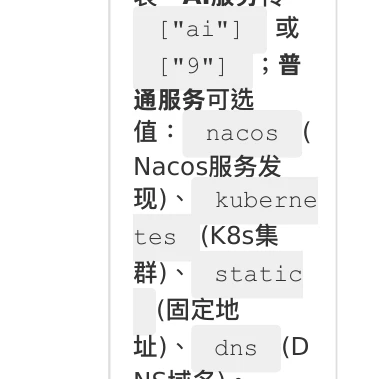

**返回数据**

| 参数名称 | 类型 | 示例 | 说明 |
| --- | --- | --- | --- |
| requestId | <code>string</code> | <code>uuid-xxx-xxx</code> | 请求ID。 |
| code | <code>integer&lt;int32&gt;</code> | 200 | 响应码。 |
| msg | <code>string</code> | <code>null</code> | 响应消息。 |
| data | <code>object</code> | <code>{}</code> | 返回数据。 |
| data.size | integer&lt;int64&gt; | <code>10</code> | 每页条数。 |
| data.total | integer&lt;int64&gt; | <code>100</code> | 记录总数。 |
| data.current | integer&lt;int64&gt; | <code>1</code> | 当前页码。 |
| data.records | array | <code>[]</code> | 记录列表。 |
| data.records\[\].serviceId | <code>string</code> | <code>service-001</code> | 服务 ID。 |
| data.records\[\].name | <code>string</code> | <code>qwen-service</code> | 名称。 |
| data.records\[\].upstrea mType | integer&lt;int32&gt; | <code>1</code> | — |
| data.records\[\].serviceT ype | integer&lt;int32&gt; | <code>1</code> | — |
| data.records\[\].upstrea mTypeName | <code>string</code> | <code> AI</code>服务<code> </code> | — |
| data.records\[\].serviceP rotocol | <code>string</code> | <code>HTTP</code> | — |
| data.records\[\].sourceId | <code>string</code> | <code>source-001</code> | — |
| data.records\[\].sourceN ame | <code>string</code> | <code>qwen-provider</code> | — |
| data.records\[\].sourceTy pe | integer&lt;int32&gt; | <code>9</code> | — |
| data.records\[\].sourceTy peName | <code>string</code> | <code> AI</code>服务<code> </code> | — |
| data.records\[\].createTi me | <code>string</code> | 2026-01-01 00:00:00 | 创建时间 格式：yyyy-MM-dd HH:mm:ss。 |
| data.records\[\].updateTi me | <code>string</code> | 2026-01-01 00:00:00 | 更新时间 格式：yyyy-MM-dd HH:mm:ss。 |
| data.records\[\].creator | <code>string</code> | <code>admin</code> | — |
| data.records\[\].updater | <code>string</code> | <code>admin</code> | — |
| data.records\[\].nodes | array | <code>[]</code> | — |
| data.records\[\].nodes\[\].i p | <code>string</code> | <code>192.168.1.100</code> | — |
| data.records\[\].nodes\[\].port | integer&lt;int32&gt; | <code>8080</code> | — |
| data.records\[\].nodes\[\].weight | integer&lt;int32&gt; | <code>1</code> | — |
| data.records\[\].nodes\[\].enable | <code>boolean</code> | <code>true</code> | 是否启用。 |
| data.records\[\].nodes\[\].vpcId | <code>string</code> | <code>vpc-xxx-xxx</code> | 新增vpcId， 仅仅用于vpc类型服务。 |
| data.records\[\].nodes\[\].vpcMappingIp | <code>string</code> | <code>10.0.0.1</code> | — |
| data.records\[\].nodes\[\].vpcMappingPort | integer&lt;int32&gt; | <code>8080</code> | — |
| data.records\[\].proxySer verName | <code>string</code> | <code>proxy-001</code> | — |
| data.records\[\].serviceA ddress | <code>string</code> | <code>qwen-</code><br><code>service.example.com</code> | dns:domain:portstatic:i p:port, ip:portk8s:fqdn:port。 |
| data.records\[\].activeHe althCheckStruct | <code>object</code> | <code>{}</code> | — |
| data.records\[\].activeHe althCheckStruct.enable | <code>boolean</code> | <code>false</code> | 是否启用。 |
| data.records\[\].activeHe althCheckStruct.protoc ol | <code>string</code> | <code>HTTP</code> | — |
| data.records\[\].activeHe althCheckStruct.timeou t | integer&lt;int32&gt; | <code>5</code> | — |

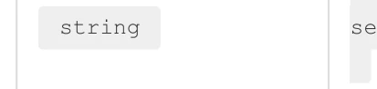

| 参数名称 | 类型 | 示例 | 说明 |
| --- | --- | --- | --- |
| data.records\[\].activeHe althCheckStruct.interva l | integer&lt;int32&gt; | <code>10</code> | — |
| data.records\[\].activeHe althCheckStruct.health yThreshold | integer&lt;int32&gt; | <code>3</code> | — |
| data.records\[\].activeHe althCheckStruct.unheal thyThreshold | integer&lt;int32&gt; | <code>3</code> | — |
| data.records\[\].activeHe althCheckStruct.httpPat h | <code>string</code> | <code>/health</code> | — |
| data.records\[\].activeHe althCheckStruct.httpHo st | <code>string</code> | <code>localhost</code> | — |
| data.records\[\].activeHe althCheckStruct.expect edStatuses | array | \[\] | — |
| data.records\[\].activeHe althCheckStatusStruct | <code>object</code> | <code>{}</code> | — |
| data.records\[\].activeHe althCheckStatusStruct.healthStatus | <code>string</code> | <code>healthy</code> | 健康状态HEALTHY, UNHEALTHY, UNKNOWN, CHECKING。 |
| data.records\[\].activeHe althCheckStatusStruct.unhealthyEndpoints | array | <code>[]</code> | — |
| data.records\[\].aiServic eConfig | <code>object</code> | <code>{}</code> | — |
| data.records\[\].aiServic eConfig.provider | <code>string</code> | <code>qwen</code> | ai-proxy 支持的厂商。 |
| data.records\[\].aiServic eConfig.aiProtocol | <code>string</code> | <code>openai</code> | 历史服务协议兼容字段，可省略；Model API 运行时协议由 protocol-definitions.yml 决定。 |
| data.records\[\].aiServic eConfig.baseUrl | <code>string</code> | <code>https://dashscope.a</code><br><code>liyuncs.com</code> | — |
| data.records\[\].aiServic eConfig.endpoints | array | \[\] | 多主机地址列表（仅 IP 类型支持多个）为空时使用baseUrl 兼容旧数据。 |
| data.records\[\].aiServic eConfig.apiKeyList | array | \[\] | — |
| data.records\[\].aiServic eConfig.claudeCodeMo de | boolean | false | Claude 提供商：Claude Code 兼容模式。 |
| data.records\[\].aiServic eConfig.bailianRegion | string | example | 阿里云百炼/通义千问：地域，cn-beijing / ap-southeast-1 / us-east-1。 |
| data.records\[\].aiServic eConfig.bedrockService Config | object | {} | AWS Bedrock 差异化配置。 |
| data.records\[\].aiServic eConfig.bedrockService Config.awsRegion | string | example | AWS 区域，例如 us-east-1 / ap-southeast-1。 |
| data.records\[\].aiServic eConfig.bedrockService Config.authModeType | string | example | 认证模式：apiKey /akSk。 |
| data.records\[\].aiServic eConfig.bedrockService Config.awsAccessKey | string | DEMO_CREDENTIAL | 仅 akSk 模式必填。 |
| data.records\[\].aiServic eConfig.bedrockService Config.awsSecretKey | string | DEMO_CREDENTIAL | 仅 akSk 模式必填。 |
| data.records\[\].aiServic eConfig.bedrockService Config.promptCacheEn able | boolean | false | 是否启用 Prompt Cache（仅protocol=openai 时有意义）。 |
| data.records\[\].aiServic eConfig.bedrockService Config.promptCacheRe tention | string | example | Prompt Cache 保留策略：in_memory / 24h。 |
| data.records\[\].aiServic eConfig.bedrockService Config.bedrockPromptC achePointPositions | array | \[\] | Prompt Cache 注入位置：systemPrompt /lastUserMessage /lastMessage。 |
| data.records\[\].aiServic eConfig.vertexServiceC onfig | object | {} | Google Vertex AI 差异化配置。 |
| data.records\[\].aiServic eConfig.vertexServiceC onfig.authModeTypeVe rtex | string | example | 认证模式：gcpServiceAccount /vertexAIExpressMode。 |
| data.records\[\].aiServic eConfig.vertexServiceC onfig.vertexAuthKey | string | example | GCP Service Account JSON 全文（仅gcpServiceAccount 模式必填）。 |
| data.records\[\].aiServic eConfig.vertexServiceC onfig.vertexRegion | string | example | Vertex 区域，例如 us-central1 / global。 |
| data.records\[\].aiServic eConfig.vertexServiceC onfig.vertexProjectId | string | vertexproject-demo | GCP Project ID，从vertexAuthKey 自动解析后由前端回填。 |
| data.records\[\].aiServic eConfig.vertexServiceC onfig.vertexOpenAICo mpatible | boolean | false | OpenAI 协议兼容方式：true 走 Vertex 原生兼容端点；false 走 AI Gateway 转换。 |
| data.records\[\].aiServic eConfig.aiStudioService Id | string | aistudioservice-demo | AIStudio 在线服务ID（provider=aistudio时必填，随 metadata 持久化用于来源追溯）。 |
| data.records\[\].aiServic eConfig.aiStudioService Name | string | demo | AIStudio 在线服务名称（前端提交、后端仅透传存储），供编辑抽屉回显服务名使用，后端业务逻辑不消费。 |
| data.records\[\].aiServic eConfig.aiStudioModelN ame | string | demo | AIStudio 在线服务的模型名（前端提交、后端仅透传存储），供前端模型API 表单联动预填使用，后端业务逻辑不消费。 |
| data.records\[\].agentSer viceConfig | object | {} | — |
| data.records\[\].agentSer viceConfig.provider | string | example | Agent 协议类型：BAILIAN/DIFY/CUSTOM，前端列表区分协议的唯一依据。 |
| data.records\[\].agentSer viceConfig.appId | string | app-demo | 百炼应用 ID（仅百炼非空；明文配置字段，非密钥）。 |
| data.records\[\].agentSer viceConfig.hasCredenti al | boolean | false | 是否已配置上游凭证（百炼/Dify 恒为 true，自定义可为 false）。 |
| data.records\[\].agentSer viceConfig.botType | string | example | Dify 应用类型AGENT/WORKFLOW（仅Dify 非空）。 |

**示例**

**请求示例**

```http
POST /microservice/listServices HTTP/1.1

{
  "size": 10,
  "current": 1,
  "gwInstanceId": "gwInstanceId_value",
  "serviceName": "serviceName_value",
  "serviceId": "serviceId_value",
  "sourceName": "sourceName_value",
  "isDisasterRecovery": true,
  "sourceTypeList": [
    "ai"
  ],
  "provider": "provider_value"
}
```

**响应示例**

```json
{
  "requestId": "xxx-xxx-xxx",
  "code": 200,
  "msg": null,
  "message": null,
  "data": {
    "size": 0,
    "total": 0,
    "current": 0,
    "records": [
      {
        "serviceId": "serviceId_value",
        "name": "name_value",
        "upstreamType": 0,
        "serviceType": 0,
        "upstreamTypeName": "upstreamTypeName_value",
        "serviceProtocol": "serviceProtocol_value",
        "sourceId": "sourceId_value",
        "sourceName": "sourceName_value",
        "sourceType": 0,
        "sourceTypeName": "sourceTypeName_value",
        "createTime": "2026-01-01 00:00:00",
        "updateTime": "2026-01-01 00:00:00",
        "creator": "creator_value",
        "updater": "updater_value",
        "nodes": [
          {
            "ip": "ip_value",
            "port": 0,
            "weight": 0,
            "enable": true,
            "vpcId": "vpcId_value",
            "vpcMappingIp": "vpcMappingIp_value",
            "vpcMappingPort": 0
          }
        ],
        "proxyServerName": "proxyServerName_value",
        "serviceAddress": "serviceAddress_value",
        "activeHealthCheckStruct": {
          "enable": true,
          "protocol": "protocol_value",
          "timeout": 0,
          "interval": 0,
          "healthyThreshold": 0,
          "unhealthyThreshold": 0,
          "httpPath": "httpPath_value",
          "httpHost": "httpHost_value",
          "expectedStatuses": []
        },
        "activeHealthCheckStatusStruct": {
          "healthStatus": "healthStatus_value",
          "unhealthyEndpoints": []
        },
        "aiServiceConfig": {
          "provider": "provider_value",
          "aiProtocol": "aiProtocol_value",
          "baseUrl": "baseUrl_value",
          "endpoints": [],
          "apiKeyList": [],
          "claudeCodeMode": false,
          "bailianRegion": "example",
          "bedrockServiceConfig": {
            "awsRegion": "example",
            "authModeType": "example",
            "awsAccessKey": "DEMO_CREDENTIAL",
            "awsSecretKey": "DEMO_CREDENTIAL",
            "promptCacheEnable": false,
            "promptCacheRetention": "example",
            "bedrockPromptCachePointPositions": []
          },
          "vertexServiceConfig": {
            "authModeTypeVertex": "example",
            "vertexAuthKey": "example",
            "vertexRegion": "example",
            "vertexProjectId": "vertexproject-demo",
            "vertexOpenAICompatible": false
          },
          "aiStudioServiceId": "aistudioservice-demo",
          "aiStudioServiceName": "demo",
          "aiStudioModelName": "demo"
        },
        "agentServiceConfig": {
          "provider": "example",
          "appId": "app-demo",
          "hasCredential": false,
          "botType": "example"
        }
      }
    ]
  }
}
```

<a id="section-1-3-1-7"></a>

#### 1.3.1.7. ListServicesBySource

调用 ListServicesBySource 接口按来源查询服务。根据来源查询服务。

**请求头**

公共请求头及认证信息的获取与携带方式，请参见获取公共Header参数。

**请求语法**

```http
POST /microservice/listServicesBySource HTTP/1.1
```

**请求参数**

| 参数名称 | 位置 | 类型 | 是否必选 | 示例 | 说明 |
| --- | --- | --- | --- | --- | --- |
| gwInstanceId | <code>body</code> | <code>string</code> | 是 | <code>higress-</code><br><code>001</code> | 网关实例ID。不能为空或空白字符串。 |
| sourceId | <code>body</code> | <code>string</code> | 是 | <code>source-</code><br><code>001</code> | 来源ID。 不能为空或空白字符串。 |
| sourceNames paceId | <code>body</code> | <code>string</code> | 否 | <code>namespace-</code><br><code>001</code> | Nacos 命名空间ID。 |
| groupName | <code>body</code> | <code>string</code> | 否 | <code>DEFAULT_GRO</code><br><code>UP</code> | Nacos 组名。 |
| sourceType | <code>body</code> | <code>integer&lt;int</code><br><code>32&gt;</code> | 是 | <code>1</code> | 来源类型。可选值：1(Nacos服务发现)、4(K8s集群)、7(固定地址)、8(DNS域名)、9(AI服务)。 最小值：0。 最大值：9。 |
| keyword | <code>body</code> | <code>string</code> | 否 | <code>my-</code><br><code>service</code> | 服务名称关键字。 |

**返回数据**

| 参数名称 | 类型 | 示例 | 说明 |
| --- | --- | --- | --- |
| requestId | <code>string</code> | <code>uuid-xxx-xxx</code> | 请求 ID。 |
| code | <code>integer&lt;int32&gt;</code> | 200 | 响应码。 |
| msg | <code>string</code> | <code>null</code> | 响应消息。 |
| data | <code>object</code> | {} | 返回数据。 |
| data.importServiceList | array | \[\] | — |
| data.notImportServiceL ist | array | \[\] | — |

**示例**

**请求示例**

```http
POST /microservice/listServicesBySource HTTP/1.1

{
  "gwInstanceId": "gwInstanceId_value",
  "sourceId": "sourceId_value",
  "sourceNamespaceId": "sourceNamespaceId_value",
  "groupName": "groupName_value",
  "sourceType": 0,
  "keyword": "keyword_value"
}
```

**响应示例**

```json
{
  "requestId": "xxx-xxx-xxx",
  "code": 200,
  "msg": null,
  "message": null,
  "data": {
    "importServiceList": [],
    "notImportServiceList": []
  }
}
```

<a id="section-1-3-1-8"></a>

#### 1.3.1.8. ModifyService

调用 ModifyService 接口修改服务。

**区分说明**：此接口同时用于修改 AI服务和普通服务，通过参数区分（同 createMicroservice）。

**请求头**

公共请求头及认证信息的获取与携带方式，请参见获取公共Header参数。

**请求语法**

```http
POST /microservice/modifyService HTTP/1.1
```

**请求参数**

| 参数名称 | 位置 | 类型 | 是否必选 | 示例 | 说明 |
| --- | --- | --- | --- | --- | --- |
| serviceId | <code>body</code> | <code>string</code> | 是 | <code>service-</code><br><code>001</code> | new 不能为空或空白字符串。 |
| gwInstanceId | <code>body</code> | <code>string</code> | 是 | <code>higress-</code><br><code>001</code> | 网关实例ID。不能为空或空白字符串。 |
| name | <code>body</code> | <code>string</code> | 是 | <code>qwen-</code><br><code>service-</code><br><code>updated</code> | 名称。 不能为空或空白字符串。 |
| serviceName | <code>body</code> | <code>string</code> | 否 | <code>qwen-</code><br><code>service</code> | 服务名称。 |
| description | <code>body</code> | <code>string</code> | 否 | <code> </code>更新后的通义千问<code>AI</code>服务<code> </code> | 描述信息。 |
| upstreamType | <code>body</code> | <code>integer&lt;int</code><br><code>32&gt;</code> | 否 | <code>1</code> | 1 固定节点 2 服务发现 3、服务导入。 |
| serviceSource Type | <code>body</code> | <code>integer&lt;int</code><br><code>32&gt;</code> | 否 | <code>9</code> | @see com.aliyun.cs b.common.mo del.enums.So urceTypeEnu m。 |
| serviceType | <code>body</code> | <code>integer&lt;int</code><br><code>32&gt;</code> | 否 | <code>1</code> | 服务类型。 |


| 参数名称 | 位置 | 类型 | 是否必选 | 示例 | 说明 |
| --- | --- | --- | --- | --- | --- |
| loadBalanceT ype | <code>body</code> | <code>integer&lt;int</code><br><code>32&gt;</code> | 否 | <code>1</code> | 负载均衡类型&lt;p&gt;可选值参考LoadBalanceT ypeEnum：-WEIGHT_ROU ND_ROBIN(1):加权轮询（仅固定节点）-WEIGHT_RAN DOM(2): 加权随机（仅固定节点）-ROUND_ROBI N(3): 轮询（通用）-RANDOM(4):随机（通用）-LEAST_REQUE ST(5): 最少请求（Higress Nacos 专用）-CONSISTENT_HASH(6): 一致性哈希（Higress Nacos 专用）-LEAST_CONN(7): 最少连接（Higress Nacos 专用）。 |
| serviceStruct | <code>body</code> | object | 否 | {} | 服务配置结构。 |
| isOpenHealth Check | <code>body</code> | <code>boolean</code> | 否 | <code>false</code> | 是否开启健康检查。 |
| healthCheckSt ruct | <code>body</code> | object | 否 | {} | 健康检查结构体。 |
| healthCheckSt ruct.type | body | integer&lt;int32 &gt; | 否 | 0 | 检查类型。 |
| healthCheckSt ruct.healthPat h | body | string | 否 | example | 检查路径。 |
| healthCheckSt ruct.httpStatu ses | body | string | 否 | example | 健康状态码。 |
| healthCheckSt ruct.timeout | body | integer&lt;int32 &gt; | 否 | 0 | 请求超时。 |
| healthCheckSt ruct.healthInt erval | body | integer&lt;int32 &gt; | 否 | 0 | 健康检查间隔。 |
| healthCheckSt ruct.unHealthI nterval | body | integer&lt;int32 &gt; | 否 | 0 | 不健康检查间隔。 |
| healthCheckSt ruct.httpSucc esses | body | integer&lt;int32 &gt; | 否 | 0 | 成功阈值。 |
| healthCheckSt ruct.httpFailur es | body | integer&lt;int32 &gt; | 否 | 0 | 失败阈值。 |
| activeHealthC heckStruct | <code>body</code> | object | 否 | {} | 主动健康检查结构体，higress service。 |
| activeHealthC heckStruct.en able | body | boolean | 否 | false | 是否启用。 |
| activeHealthC heckStruct.pr otocol | body | string | 否 | example | — |
| activeHealthC heckStruct.ti meout | body | integer&lt;int32 &gt; | 否 | 0 | — |
| activeHealthC heckStruct.int erval | body | integer&lt;int32 &gt; | 否 | 0 | — |
| activeHealthC heckStruct.he althyThreshol d | body | integer&lt;int32 &gt; | 否 | 0 | — |
| activeHealthC heckStruct.un healthyThresh old | body | integer&lt;int32 &gt; | 否 | 0 | — |
| activeHealthC heckStruct.htt pPath | body | string | 否 | example | — |
| activeHealthC heckStruct.htt pHost | body | string | 否 | example | — |
| activeHealthC heckStruct.ex pectedStatuse s | body | array | 否 | \[\] | — |
| protocol | <code>body</code> | <code>string</code> | 是 | <code>HTTP</code> | 协议类型。 不能为空或空白字符串。 |
| proxyServerN ame | <code>body</code> | <code>string</code> | 否 | <code>proxy-001</code> | 代理服务器名称。 |
| isDisasterRec overy | <code>body</code> | <code>boolean</code> | 否 | <code>false</code> | 是否为容灾资源。 默认值：false。 |

**healthCheckStruct 对象结构**

| 参数名称 | 位置 | 类型 | 是否必选 | 示例 | 说明 |
| --- | --- | --- | --- | --- | --- |
| type | <code>body</code> | <code>integer</code> | 否 | <code>1</code> | 类型。 |
| healthPath | <code>body</code> | <code>string</code> | 否 | <code>/health</code> | 健康检查路径。 |
| httpStatuses | <code>body</code> | <code>string</code> | 否 | <code>200,301,302</code> | HTTP状态码。 |
| timeout | <code>body</code> | <code>integer</code> | 否 | <code>5</code> | 超时时间（秒）。 |
| healthInterval | <code>body</code> | <code>integer</code> | 否 | <code>10</code> | 健康检查间隔。 |
| unHealthInter val | <code>body</code> | <code>integer</code> | 否 | <code>30</code> | 不健康检查间隔。 |
| httpSuccesses | <code>body</code> | <code>integer</code> | 否 | <code>3</code> | HTTP成功次数阈值。 |
| httpFailures | <code>body</code> | <code>integer</code> | 否 | <code>3</code> | HTTP失败次数阈值。 |


**activeHealthCheckStruct 对象结构**

| 参数名称 | 位置 | 类型 | 是否必选 | 示例 | 说明 |
| --- | --- | --- | --- | --- | --- |
| enable | <code>body</code> | <code>boolean</code> | 否 | <code>false</code> | 是否启用。 |
| protocol | <code>body</code> | <code>string</code> | 否 | <code>HTTP</code> | 协议类型。 |
| timeout | <code>body</code> | <code>integer</code> | 否 | <code>5</code> | 超时时间（秒）。 |
| interval | <code>body</code> | <code>integer</code> | 否 | <code>10</code> | 检查间隔（秒）。 |
| healthyThresh old | <code>body</code> | <code>integer</code> | 否 | <code>3</code> | 健康阈值。 |
| unhealthyThre shold | <code>body</code> | <code>integer</code> | 否 | <code>3</code> | 不健康阈值。 |
| httpPath | <code>body</code> | <code>string</code> | 否 | <code>/health</code> | HTTP路径。 |
|  |  |  |  |  |  |
| 参数名称 | 位置 | 类型 | 是否必选 | 示例 | 说明 |

<table>
  <tr>
    <td>httpHost</td>
    <td><code>body</code></td>
    <td><code>string</code></td>
    <td>否</td>
    <td><code>localhost</code></td>
    <td>HTTP Host头。</td>
  </tr>
  <tr>
    <td>expectedStatu ses</td>
    <td><code>body</code></td>
    <td><code>string[]</code></td>
    <td>否</td>
    <td><code>["200"]</code></td>
    <td>期望的状态码列表。</td>
  </tr>
</table>

**serviceStruct 对象结构**

**说明**：serviceStruct 根据  `serviceSourceType`  参数有不同的字段结构：

**当 serviceSourceType=9（AI服务）时：**

| 参数名称 | 位置 | 类型 | 是否必选 | 示例 | 说明 |
| --- | --- | --- | --- | --- | --- |
| provider | <code>body</code> | <code>string</code> | 是 | <code>qwen</code> | AI提供商类型。可选值：<code> selfbui</code> <code>ld </code>(自建)、<code> qwen </code>(通义千问)、<code> deepsee</code> <code>k </code>、<code> openai</code><code> </code>、<code> azure </code>、<code> gemini </code>、<code> bedrock </code>、<code> claude </code>、<code> moonshot</code> <code> </code>(月之暗面)、<code> baichua</code> <code>n </code>(百川)、<code> yi </code>(零一万物)、<code> zhipuai</code> <code> </code>(智谱)、<code> hunyuan</code> <code> </code>(混元)、<code> stepfun</code> <code> </code>(阶跃)、<code> spark </code> (讯飞星火)、<code> doubao</code> <code> </code>(豆包)、<code> minimax</code><code> </code>、<code> vertex</code> <code> </code>(Vertex AI)。 |

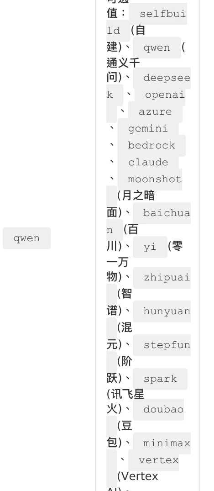

| 参数名称 | 位置 | 类型 | 是否必选 | 示例 | 说明 |
| --- | --- | --- | --- | --- | --- |
| aiProtocol | <code>body</code> | <code>string</code> | 是 | <code>openai</code> | AI协议类型。可选值：<code> openai</code> <code> </code>(OpenAI/V1标准协议)、<code> origina</code> <code>l </code>(原始协议)。 |
| baseUrl | <code>body</code> | <code>string</code> | 否 | <code>https://api</code><br><code>.openai.com</code> | AI服务基础URL地址。部分提供商有默认值，如qwen 默认为<code>https://das</code><br><code>hscope.aliyu</code><br><code>ncs.com/comp</code><br><code>atible-</code><code>mode/v1 </code>。 |
| apiKeyList | <code>body</code> | <code>string[]</code> | 否 | <code>["sk-</code><br><code>xxx"]</code> | API Key列表。支持配置多个API Key 实现负载均衡和容灾。自建LLM时可省略。 |


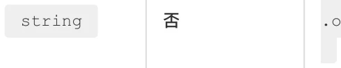

**当 serviceSourceType 为其他值（普通服务）时：**

| 参数名称 | 位置 | 类型 | 是否必选 | 示例 | 说明 |
| --- | --- | --- | --- | --- | --- |
| nodes | <code>body</code> | <code>object[]</code> | 否 | <code>[{"ip":"192</code><br><code>.168.1.1","p</code><br><code>ort":8080}]</code> | 服务节点列表。当serviceSource Type=7(固定地址)或serviceSource Type=8(DNS)时使用。 |
| sourceGroup | <code>body</code> | <code>string</code> | 否 | <code>DEFAULT_GRO</code><br><code>UP</code> | Nacos分组名。当serviceSource Type=1(NACO S)时使用，默认值为<code>DEFAULT_GRO</code> <code>UP </code>。 |

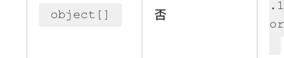

| 参数名称 | 位置 | 类型 | 是否必选 | 示例 | 说明 |
| --- | --- | --- | --- | --- | --- |
| sourceNames paceId | <code>body</code> | <code>string</code> | 否 | <code>namespace-</code><br><code>001</code> | Nacos命名空间ID。当serviceSource Type=1(NACO S)时使用。 |

**nodes 对象结构**

| 参数名称 | 位置 | 类型 | 是否必选 | 示例 | 说明 |
| --- | --- | --- | --- | --- | --- |
| ip | <code>body</code> | <code>string</code> | 是 | <code>192.168.1.1</code> | 节点IP地址。 |
| port | <code>body</code> | <code>integer</code> | 是 | <code>8080</code> | 节点端口。 |
| weight | <code>body</code> | <code>integer</code> | 否 | <code>1</code> | 节点权重，用于负载均衡。默认值为 1。 |
| enable | <code>body</code> | <code>boolean</code> | 否 | <code>true</code> | 节点是否启用。默认值为true。 |
| vpcId | <code>body</code> | <code>string</code> | 否 | <code>vpc-xxx-</code><br><code>xxx</code> | VPC ID（跨VPC场景）。 |
| vpcMappingIp | <code>body</code> | <code>string</code> | 否 | <code>10.0.0.1</code> | VPC映射IP。 |
| vpcMappingPo rt | <code>body</code> | <code>integer</code> | 否 | <code>8080</code> | VPC映射端口。 |


**返回数据**

| 参数名称 | 类型 | 示例 | 说明 |
| --- | --- | --- | --- |
| requestId | <code>string</code> | <code>uuid-xxx-xxx</code> | 请求 ID。 |
| code | <code>integer&lt;int32&gt;</code> | 200 | 响应码。 |
| msg | <code>string</code> | <code>null</code> | 响应消息。 |
| data | <code>string</code> | <code>service-001</code> | 响应数据。 |

**示例**

**请求示例**

```http
POST /microservice/modifyService HTTP/1.1

{
  "serviceId": "serviceId_value",
  "gwInstanceId": "gwInstanceId_value",
  "name": "name_value",
  "serviceName": "serviceName_value",
  "description": "description_value",
  "upstreamType": 0,
  "serviceSourceType": 9,
  "serviceType": 0,
  "loadBalanceType": 0,
  "serviceStruct": {
    "provider": "qwen",
    "aiProtocol": "openai",
    "baseUrl": "https://dashscope.aliyuncs.com/compatible-mode/v1",
    "apiKeyList": [
      "sk-xxxxx"
    ]
  },
  "isOpenHealthCheck": true,
  "healthCheckStruct": {
    "type": 0,
    "healthPath": "healthPath_value",
    "httpStatuses": "httpStatuses_value",
    "timeout": 0,
    "healthInterval": 0,
    "unHealthInterval": 0,
    "httpSuccesses": 0,
    "httpFailures": 0
  },
  "activeHealthCheckStruct": {
    "enable": true,
    "protocol": "protocol_value",
    "timeout": 0,
    "interval": 0,
    "healthyThreshold": 0,
    "unhealthyThreshold": 0,
    "httpPath": "httpPath_value",
    "httpHost": "httpHost_value",
    "expectedStatuses": []
  },
  "protocol": "protocol_value",
  "proxyServerName": "proxyServerName_value",
  "isDisasterRecovery": false
}
```

**响应示例**

```json
{
  "requestId": "xxx-xxx-xxx",
  "code": 200,
  "msg": null,
  "message": null,
  "data": "data_value"
}
```

<a id="section-1-3-1-9"></a>

#### 1.3.1.9. ModifyNode

调用 ModifyNode 接口修改服务节点。修改节点。

**说明**：此接口仅适用于 AI网关（Higress引擎）实例。

**请求头**

公共请求头及认证信息的获取与携带方式，请参见获取公共Header参数。

**请求语法**

```http
POST /microservice/modifyNode HTTP/1.1
```

**请求参数**

| 参数名称 | 位置 | 类型 | 是否必选 | 示例 | 说明 |
| --- | --- | --- | --- | --- | --- |
| gwInstanceId | <code>body</code> | <code>string</code> | 是 | <code>higress-</code><br><code>001</code> | 网关实例ID。 |
| serviceId | <code>body</code> | <code>string</code> | 是 | <code>service-</code><br><code>001</code> | 服务ID。 |
| serviceSource Type | <code>body</code> | <code>integer&lt;int</code><br><code>32&gt;</code> | 否 | <code>9</code> | 服务来源类型。可选值：<code> 1 </code>(Nac os服务发现)、<code> 4 </code>(K8s集群)、<code> 7 </code>(固定地址)、<code> 8 </code>(DNS域名)、<code> 9 </code>(AI服务)。 |
| serviceStruct | <code>body</code> | object | 否 | {} | 服务配置结构。 |

**返回数据**

| 参数名称 | 类型 | 示例 | 说明 |
| --- | --- | --- | --- |
| requestId | <code>string</code> | <code>uuid-xxx-xxx</code> | 请求 ID。 |
| code | <code>integer&lt;int32&gt;</code> | 200 | 响应码。 |
| msg | <code>string</code> | <code>null</code> | 响应消息。 |
| data | <code>string</code> | <code>service-001</code> | 响应数据。 |

**示例**

**请求示例**

```http
POST /microservice/modifyNode HTTP/1.1

{
  "gwInstanceId": "higress-001",
  "serviceId": "service-001",
  "serviceSourceType": 7,
  "serviceStruct": {
    "nodes": [
      {
        "ip": "192.168.1.1",
        "port": 8080,
        "weight": 1,
        "enable": true
      }
    ]
  }
}
```

**响应示例**

```json
{
  "requestId": "uuid-xxx-xxx",
  "code": 200,
  "msg": null,
  "message": null,
  "data": "service-001"
}
```

<a id="section-1-3-1-10"></a>

#### 1.3.1.10. ImportServices

调用 ImportServices 接口把来源中的服务批量导入为网关服务。该接口不支持 Higress。

**请求头**

公共请求头及认证信息的获取与携带方式，请参见获取公共Header参数。

**请求语法**

```http
POST /microservice/importServices HTTP/1.1
```

**请求参数**

| 参数名称 | 位置 | 类型 | 是否必选 | 示例 | 说明 |
| --- | --- | --- | --- | --- | --- |
| gwInstanc eId | body | string | 是 | gw-123456\*\*\*\* | 网关实例 ID。服务、来源、路由和代理服务器必须属于该实例。 不能为空或空白字符串。 |
| descriptio n | body | string | 否 | 订单后端服务 | 服务描述，最多 255 个字符。 |
| loadBalanc eType | body | integer &lt;int32 &gt; | 是 | 1 | 负载均衡：1 加权轮询、2加权随机（固定节点）；3轮询、4 随机；5 最少请求、6 一致性哈希、7 最少连接（Higress Nacos）。 |
| serviceTyp e | body | integer &lt;int32 &gt; | 否 | 0 | 旧服务类别：0 RPC/普通服务，1 数据库。现代Higress 通常使用 0。 |
| sourceId | body | string | 是 | source-123456\*\*\*\* | 服务来源/注册中心 ID。 |
| sourceNa mespaceId | body | string | 否 | public | 来源的nacos命名空间ID。 |
| groupNam e | body | string | 否 | DEFAULT_GROUP | Nacos 分组名称。 |
| port | body | integer &lt;int32 &gt; | 否 | 8080 | K8s 指定服务端口。 |
| serviceList | body | array | 否 | \[\] | 要导入的来源服务名称列表。 |
| protocol | body | string | 是 | HTTP | 后端协议。通用值包括HTTP、gRPC、DUBBO、HSF、WebService；Agent服务仅允许 HTTP/HTTPS 且必须与 baseUrl scheme 一致。 不能为空或空白字符串。 |

gwInstanceId、sourceId、loadBalanceType、protocol 必填；serviceList 指定名称。Kubernetes 可用 port 选择 Service 端口，Nacos 使用 namespace/group。

**返回数据**

| 参数名称 | 类型 | 示例 | 说明 |
| --- | --- | --- | --- |
| requestId | string | req-demo | 请求 ID。 |
| code | integer&lt;int32 &gt; | 200 | 业务状态码，200 表示请求处理成功。 |
| msg | string | null | 响应消息。 |
| data | array | \[\] | 返回数据。 |

data 返回导入成功的 serviceId 列表。

**示例**

**请求示例**

```http
POST /microservice/importServices HTTP/1.1

{
  "gwInstanceId": "gw-123456****",
  "loadBalanceType": 3,
  "sourceId": "source-123456****",
  "sourceNamespaceId": "public",
  "groupName": "DEFAULT_GROUP",
  "serviceList": [
    "order-service"
  ],
  "protocol": "HTTP"
}
```

**正常返回示例**

`JSON`  格式

```json
{
  "requestId": "F0A8A039-930D-5EC1-97C8-************",
  "code": 200,
  "msg": null,
  "message": null,
  "data": [
    "service-order-123456****"
  ]
}
```

**错误码**

| HttpCode | 错误码 | 错误信息 | 描述 |
| --- | --- | --- | --- |
| 400 | InvalidParameter | InvalidParameter | 参数不合法，请检查来源类型、协议、节点、健康检查和代理配置。 |
| 409 | Conflict | Conflict | 服务业务标识已存在或仍被路由、Model API、插件引用。 |
| 404 | ResourceNotFound | ResourceNotFound | 服务、来源、代理服务器或网关实例不存在。 |
| 500 | InternalError | InternalError | 服务配置保存或数据面发布失败。 |

<a id="section-1-3-1-11"></a>

#### 1.3.1.11. ListInstancesByServiceId

调用 ListInstancesByServiceId 接口查询 SCG 服务发现后的实例节点。Higress 不支持该接口。

**请求头**

公共请求头及认证信息的获取与携带方式，请参见获取公共Header参数。

**请求语法**

```http
POST /microservice/listInstancesByServiceId HTTP/1.1
```

**请求参数**

| 参数名称 | 位置 | 类型 | 是否必选 | 示例 | 说明 |
| --- | --- | --- | --- | --- | --- |
| gwInstanc eId | body | string | 是 | gw-123456\*\*\*\* | 网关实例 ID。服务、来源、路由和代理服务器必须属于该实例。 |
| serviceId | body | string | 是 | service-123456\*\*\*\* | 服务存储 ID。Higress 中它是稳定 storageId，不等同于可变的业务地址或服务名。 |

gwInstanceId、serviceId 必填。Higress 请从 GetService 的 serviceStruct/健康状态获取节点信息。

**返回数据**

| 参数名称 | 类型 | 示例 | 说明 |
| --- | --- | --- | --- |
| requestId | string | req-demo | 请求 ID。 |
| code | integer&lt;int32 &gt; | 200 | 响应码。 |
| msg | string | null | 响应消息。 |
| data | object | {} | 返回数据。 |
| data.servic eStruct | object | {} | — |
| data.instan ceList | object | {} | — |

data 为服务实例分页/列表信息。

**示例**

**请求示例**

```http
POST /microservice/listInstancesByServiceId HTTP/1.1

{
  "gwInstanceId": "gw-123456****",
  "serviceId": "service-123456****"
}
```

**正常返回示例**

`JSON`  格式

```json
{
  "requestId": "F0A8A039-930D-5EC1-97C8-************",
  "code": 200,
  "msg": null,
  "data": {
    "records": [
      {
        "ip": "192.0.2.10",
        "port": 8080,
        "status": "UP"
      }
    ],
    "serviceStruct": {},
    "instanceList": {}
  },
  "message": null
}
```

**错误码**

| HttpCode | 错误码 | 错误信息 | 描述 |
| --- | --- | --- | --- |
| 400 | InvalidParameter | InvalidParameter | 参数不合法，请检查来源类型、协议、节点、健康检查和代理配置。 |
| 409 | Conflict | Conflict | 服务业务标识已存在或仍被路由、Model API、插件引用。 |
| 404 | ResourceNotFound | ResourceNotFound | 服务、来源、代理服务器或网关实例不存在。 |
| 500 | InternalError | InternalError | 服务配置保存或数据面发布失败。 |

<a id="section-1-3-1-12"></a>

#### 1.3.1.12. ModifyServiceDescription

调用 ModifyServiceDescription 接口仅修改服务描述。该兼容接口不支持 Higress。

**请求头**

公共请求头及认证信息的获取与携带方式，请参见获取公共Header参数。

**请求语法**

```http
POST /microservice/modifyServiceDescription HTTP/1.1
```

**请求参数**

| 参数名称 | 位置 | 类型 | 是否必选 | 示例 | 说明 |
| --- | --- | --- | --- | --- | --- |
| gwInstanc eId | body | string | 是 | gw-123456\*\*\*\* | 网关实例 ID。服务、来源、路由和代理服务器必须属于该实例。 |
| serviceId | body | string | 是 | service-123456\*\*\*\* | 服务存储 ID。Higress 中它是稳定 storageId，不等同于可变的业务地址或服务名。 |
| descriptio n | body | string | 否 | 订单后端服务 | 服务描述，最多 255 个字符。 |

gwInstanceId、serviceId 必填，description 可为空表示清空。Higress 请使用 ModifyService。

**返回数据**

| 参数名称 | 类型 | 示例 | 说明 |
| --- | --- | --- | --- |
| requestId | string | req-demo | 请求 ID。 |
| code | integer&lt;int32 &gt; | 200 | 业务状态码。 |
| msg | string | null | 响应消息。 |
| data | string | example-data | 服务处理结果。 |

data 返回 serviceId。

**示例**

**请求示例**

```http
POST /microservice/modifyServiceDescription HTTP/1.1

{
  "gwInstanceId": "gw-123456****",
  "serviceId": "service-123456****",
  "description": "新的订单服务描述"
}
```

**正常返回示例**

`JSON`  格式

```json
{
  "requestId": "F0A8A039-930D-5EC1-97C8-************",
  "code": 200,
  "msg": null,
  "message": null,
  "data": "service-123456****"
}
```

**错误码**

| HttpCode | 错误码 | 错误信息 | 描述 |
| --- | --- | --- | --- |
| 400 | InvalidParameter | InvalidParameter | 参数不合法，请检查来源类型、协议、节点、健康检查和代理配置。 |
| 409 | Conflict | Conflict | 服务业务标识已存在或仍被路由、Model API、插件引用。 |
| 404 | ResourceNotFound | ResourceNotFound | 服务、来源、代理服务器或网关实例不存在。 |
| 500 | InternalError | InternalError | 服务配置保存或数据面发布失败。 |

<a id="section-1-3-2"></a>

### 1.3.2. AI网关实例管理

<a id="section-1-3-2-1"></a>

#### 1.3.2.1. CreateInstance

调用 CreateInstance 接口创建实例。创建网关实例。

**请求头**

公共请求头及认证信息的获取与携带方式，请参见获取公共Header参数。

**请求语法**

```http
POST /gatewayInstance/createInstance HTTP/1.1
```

**请求参数**

| 参数名称 | 位置 | 类型 | 是否必选 | 示例 |
| --- | --- | --- | --- | --- |
| gwInstanceName | body | <code>string</code> | 是 | <code>my-gateway</code> |
| clusterCode | body | <code>string</code> | 是 | <code>cluster-001</code> |
| deployConfigCont ent | body | <code>string</code> | 否 | example |
| accessModeConfi gContent | body | <code>string</code> | 否 | example |
| namespace | body | <code>string</code> | 是 | <code>default</code> |
| ingressName | body | <code>string</code> | 否 | <code>my-ingress</code> |
|  |  |  |  |  |
|  |  |  |  |  |
| brokerEngineTyp e参数名称 | body<br>位置 | <code>string</code>类型 | 否<br>是否必选 | <code>HIGRESS</code>示例 |
|  |  |  |  |  |
| instanceClass | body | <code>string</code> | 否 | <code>standard</code> |
| instanceNumber | body | <code>string</code> | 否 | example |
| o11y | body | object | 否 | <code>{}</code> |
|  |  |  |  |  |
|  |  |  |  |  |
| 参数名称 | 位置 | 类型 | 是否必选 | 示例 |
| o11y.prometheus Enabled | body | boolean | 否 | false |
| o11y.trace | body | object | 否 | {} |
| o11y.trace.enable d | body | boolean | 否 | false |
|  |  |  |  |  |

<table>
  <tr>
    <td></td>
    <td></td>
    <td></td>
    <td></td>
    <td></td>
    <td></td>
  </tr>
  <tr>
    <td>参数名称</td>
    <td>位置</td>
    <td>类型</td>
    <td>是否必选</td>
    <td>示例</td>
    <td></td>
  </tr>
  <tr>
    <td>o11y.trace.servic e</td>
    <td>body</td>
    <td>string</td>
    <td>否</td>
    <td>example</td>
    <td></td>
  </tr>
</table>

<table>
  <tr>
    <td></td>
    <td></td>
    <td></td>
    <td></td>
    <td></td>
  </tr>
  <tr>
    <td>参数名称</td>
    <td>位置</td>
    <td>类型</td>
    <td>是否必选</td>
    <td>示例</td>
  </tr>
  <tr>
    <td></td>
    <td></td>
    <td></td>
    <td></td>
    <td></td>
  </tr>
</table>

| 参数名称 | 位置 | 类型 | 是否必选 | 示例 |
| --- | --- | --- | --- | --- |
| o11y.trace.port | body | string | 否 | example |

<table>
  <tr>
    <td></td>
    <td></td>
    <td></td>
    <td></td>
    <td></td>
    <td></td>
  </tr>
  <tr>
    <td>参数名称</td>
    <td>位置</td>
    <td>类型</td>
    <td>是否必选</td>
    <td>示例</td>
    <td></td>
  </tr>
  <tr>
    <td></td>
    <td></td>
    <td></td>
    <td></td>
    <td></td>
    <td></td>
  </tr>
  <tr>
    <td>o11y.trace.sampli ng</td>
    <td>body</td>
    <td>integer&lt;int32&gt;</td>
    <td>否</td>
    <td>0</td>
    <td></td>
  </tr>
  <tr>
    <td>o11y.accessLog</td>
    <td>body</td>
    <td>object</td>
    <td>否</td>
    <td>{}</td>
    <td></td>
  </tr>
  <tr>
    <td></td>
    <td></td>
    <td></td>
    <td></td>
    <td></td>
    <td></td>
  </tr>
  <tr>
    <td></td>
    <td></td>
    <td></td>
    <td></td>
    <td></td>
    <td></td>
  </tr>
  <tr>
    <td>参数名称</td>
    <td>位置</td>
    <td>类型</td>
    <td>是否必选</td>
    <td>示例</td>
    <td></td>
  </tr>
  <tr>
    <td>o11y.accessLog.e nabled</td>
    <td>body</td>
    <td>boolean</td>
    <td>否</td>
    <td>false</td>
    <td></td>
  </tr>
  <tr>
    <td>o11y.accessLog.fi elds</td>
    <td>body</td>
    <td>array</td>
    <td>否</td>
    <td>[]</td>
    <td></td>
  </tr>
  <tr>
    <td></td>
    <td></td>
    <td></td>
    <td></td>
    <td></td>
    <td></td>
  </tr>
  <tr>
    <td></td>
    <td></td>
    <td></td>
    <td></td>
    <td></td>
    <td></td>
  </tr>
  <tr>
    <td>参数名称</td>
    <td>位置</td>
    <td>类型</td>
    <td>是否必选</td>
    <td>示例</td>
    <td></td>
  </tr>
  <tr>
    <td>o11y.accessLog.fi elds[].type</td>
    <td>body</td>
    <td>string</td>
    <td>否</td>
    <td>example</td>
    <td></td>
  </tr>
  <tr>
    <td></td>
    <td></td>
    <td></td>
    <td></td>
    <td></td>
    <td></td>
  </tr>
  <tr>
    <td>参数名称</td>
    <td>位置</td>
    <td>类型</td>
    <td>是否必选</td>
    <td>示例</td>
    <td></td>
  </tr>
  <tr>
    <td></td>
    <td></td>
    <td></td>
    <td></td>
    <td></td>
    <td></td>
  </tr>
  <tr>
    <td></td>
    <td></td>
    <td></td>
    <td></td>
    <td></td>
    <td></td>
  </tr>
  <tr>
    <td></td>
    <td></td>
    <td></td>
    <td></td>
    <td></td>
    <td></td>
  </tr>
  <tr>
    <td>参数名称</td>
    <td>位置</td>
    <td>类型</td>
    <td>是否必选</td>
    <td>示例</td>
    <td></td>
  </tr>
  <tr>
    <td>o11y.accessLog.fi elds[].value</td>
    <td>body</td>
    <td>string</td>
    <td>否</td>
    <td>example</td>
    <td></td>
  </tr>
  <tr>
    <td></td>
    <td></td>
    <td></td>
    <td></td>
    <td></td>
    <td></td>
  </tr>
  <tr>
    <td>参数名称</td>
    <td>位置</td>
    <td>类型</td>
    <td>是否必选</td>
    <td>示例</td>
    <td></td>
  </tr>
  <tr>
    <td></td>
    <td></td>
    <td></td>
    <td></td>
    <td></td>
    <td></td>
  </tr>
  <tr>
    <td></td>
    <td></td>
    <td></td>
    <td></td>
    <td></td>
    <td></td>
  </tr>
  <tr>
    <td>参数名称</td>
    <td>位置</td>
    <td>类型</td>
    <td>是否必选</td>
    <td>示例</td>
    <td></td>
  </tr>
  <tr>
    <td></td>
    <td></td>
    <td></td>
    <td></td>
    <td></td>
    <td></td>
  </tr>
  <tr>
    <td></td>
    <td></td>
    <td></td>
    <td></td>
    <td></td>
    <td></td>
  </tr>
  <tr>
    <td></td>
    <td></td>
    <td></td>
    <td></td>
    <td></td>
    <td></td>
  </tr>
  <tr>
    <td>参数名称</td>
    <td>位置</td>
    <td>类型</td>
    <td>是否必选</td>
    <td>示例</td>
    <td></td>
  </tr>
  <tr>
    <td>o11y.accessLog.fi elds[].alias</td>
    <td>body</td>
    <td>string</td>
    <td>否</td>
    <td>example</td>
    <td></td>
  </tr>
  <tr>
    <td></td>
    <td></td>
    <td></td>
    <td></td>
    <td></td>
    <td></td>
  </tr>
  <tr>
    <td>参数名称</td>
    <td>位置</td>
    <td>类型</td>
    <td>是否必选</td>
    <td>示例</td>
    <td></td>
  </tr>
  <tr>
    <td></td>
    <td></td>
    <td></td>
    <td></td>
    <td></td>
    <td></td>
  </tr>
  <tr>
    <td></td>
    <td></td>
    <td></td>
    <td></td>
    <td></td>
    <td></td>
  </tr>
  <tr>
    <td></td>
    <td></td>
    <td></td>
    <td></td>
    <td></td>
    <td></td>
  </tr>
  <tr>
    <td>参数名称</td>
    <td>位置</td>
    <td>类型</td>
    <td>是否必选</td>
    <td>示例</td>
    <td></td>
  </tr>
  <tr>
    <td>o11y.accessLog.fi elds[].raw</td>
    <td>body</td>
    <td>boolean</td>
    <td>否</td>
    <td>false</td>
    <td></td>
  </tr>
  <tr>
    <td></td>
    <td></td>
    <td></td>
    <td></td>
    <td></td>
    <td></td>
  </tr>
  <tr>
    <td></td>
    <td></td>
    <td></td>
    <td></td>
    <td></td>
    <td></td>
  </tr>
  <tr>
    <td>参数名称</td>
    <td>位置</td>
    <td>类型</td>
    <td>是否必选</td>
    <td>示例</td>
    <td></td>
  </tr>
  <tr>
    <td></td>
    <td></td>
    <td></td>
    <td></td>
    <td></td>
    <td></td>
  </tr>
  <tr>
    <td></td>
    <td></td>
    <td></td>
    <td></td>
    <td></td>
    <td></td>
  </tr>
  <tr>
    <td>参数名称</td>
    <td>位置</td>
    <td>类型</td>
    <td>是否必选</td>
    <td>示例</td>
    <td></td>
  </tr>
  <tr>
    <td>o11y.accessLog.managedKeys</td>
    <td>body</td>
    <td>array</td>
    <td>否</td>
    <td>[]</td>
    <td></td>
  </tr>
</table>

<table>
  <tr>
    <td></td>
    <td></td>
    <td></td>
    <td></td>
    <td></td>
  </tr>
  <tr>
    <td>参数名称</td>
    <td>位置</td>
    <td>类型</td>
    <td>是否必选</td>
    <td>示例</td>
  </tr>
  <tr>
    <td></td>
    <td></td>
    <td></td>
    <td></td>
    <td></td>
  </tr>
</table>

| 参数名称 | 位置 | 类型 | 是否必选 | 示例 |
| --- | --- | --- | --- | --- |
| o11y.accessLog.fi ngerprint | body | string | 否 | example |
| o11y.accessLog.u pdatedAt | body | string | 否 | example |
| o11y.accessLog.u pdatedBy | body | string | 否 | example |
|  |  |  |  |  |

<table>
  <tr>
    <td></td>
    <td></td>
    <td></td>
    <td></td>
    <td></td>
    <td></td>
  </tr>
  <tr>
    <td>参数名称</td>
    <td>位置</td>
    <td>类型</td>
    <td>是否必选</td>
    <td>示例</td>
    <td></td>
  </tr>
  <tr>
    <td>deployMode</td>
    <td>body</td>
    <td><code>string</code></td>
    <td>否</td>
    <td><code>k8s</code></td>
    <td></td>
  </tr>
  <tr>
    <td></td>
    <td></td>
    <td></td>
    <td></td>
    <td></td>
    <td></td>
  </tr>
  <tr>
    <td>参数名称</td>
    <td>位置</td>
    <td>类型</td>
    <td>是否必选</td>
    <td>示例</td>
    <td></td>
  </tr>
  <tr>
    <td></td>
    <td></td>
    <td></td>
    <td></td>
    <td></td>
    <td></td>
  </tr>
  <tr>
    <td></td>
    <td></td>
    <td></td>
    <td></td>
    <td></td>
    <td></td>
  </tr>
  <tr>
    <td>参数名称</td>
    <td>位置</td>
    <td>类型</td>
    <td>是否必选</td>
    <td>示例</td>
    <td></td>
  </tr>
  <tr>
    <td></td>
    <td></td>
    <td></td>
    <td></td>
    <td></td>
    <td></td>
  </tr>
  <tr>
    <td></td>
    <td></td>
    <td></td>
    <td></td>
    <td></td>
    <td></td>
  </tr>
</table>

<table>
  <tr>
    <td></td>
    <td></td>
    <td></td>
    <td></td>
    <td></td>
  </tr>
  <tr>
    <td>参数名称</td>
    <td>位置</td>
    <td>类型</td>
    <td>是否必选</td>
    <td>示例</td>
  </tr>
  <tr>
    <td>redisConfig</td>
    <td>body</td>
    <td>object</td>
    <td>否</td>
    <td>{}</td>
  </tr>
</table>

| 参数名称 | 位置 | 类型 | 是否必选 | 示例 |
| --- | --- | --- | --- | --- |
| redisConfig.type | body | string | 否 | example |
|  |  |  |  |  |

<table>
  <tr>
    <td></td>
    <td></td>
    <td></td>
    <td></td>
    <td></td>
    <td></td>
  </tr>
  <tr>
    <td>参数名称</td>
    <td>位置</td>
    <td>类型</td>
    <td>是否必选</td>
    <td>示例</td>
    <td></td>
  </tr>
  <tr>
    <td>redisConfig.cpu</td>
    <td>body</td>
    <td>string</td>
    <td>否</td>
    <td>example</td>
    <td></td>
  </tr>
  <tr>
    <td></td>
    <td></td>
    <td></td>
    <td></td>
    <td></td>
    <td></td>
  </tr>
  <tr>
    <td></td>
    <td></td>
    <td></td>
    <td></td>
    <td></td>
    <td></td>
  </tr>
  <tr>
    <td>参数名称</td>
    <td>位置</td>
    <td>类型</td>
    <td>是否必选</td>
    <td>示例</td>
    <td></td>
  </tr>
  <tr>
    <td>redisConfig.mem ory</td>
    <td>body</td>
    <td>string</td>
    <td>否</td>
    <td>example</td>
    <td></td>
  </tr>
  <tr>
    <td></td>
    <td></td>
    <td></td>
    <td></td>
    <td></td>
    <td></td>
  </tr>
  <tr>
    <td>参数名称</td>
    <td>位置</td>
    <td>类型</td>
    <td>是否必选</td>
    <td>示例</td>
    <td></td>
  </tr>
  <tr>
    <td></td>
    <td></td>
    <td></td>
    <td></td>
    <td></td>
    <td></td>
  </tr>
  <tr>
    <td>redisConfig.persis tenceEnabled</td>
    <td>body</td>
    <td>boolean</td>
    <td>否</td>
    <td>false</td>
    <td></td>
  </tr>
  <tr>
    <td></td>
    <td></td>
    <td></td>
    <td></td>
    <td></td>
    <td></td>
  </tr>
  <tr>
    <td>参数名称</td>
    <td>位置</td>
    <td>类型</td>
    <td>是否必选</td>
    <td>示例</td>
    <td></td>
  </tr>
  <tr>
    <td></td>
    <td></td>
    <td></td>
    <td></td>
    <td></td>
    <td></td>
  </tr>
  <tr>
    <td></td>
    <td></td>
    <td></td>
    <td></td>
    <td></td>
    <td></td>
  </tr>
  <tr>
    <td></td>
    <td></td>
    <td></td>
    <td></td>
    <td></td>
    <td></td>
  </tr>
  <tr>
    <td>参数名称</td>
    <td>位置</td>
    <td>类型</td>
    <td>是否必选</td>
    <td>示例</td>
    <td></td>
  </tr>
  <tr>
    <td>redisConfig.diskSi ze</td>
    <td>body</td>
    <td>string</td>
    <td>否</td>
    <td>example</td>
    <td></td>
  </tr>
  <tr>
    <td></td>
    <td></td>
    <td></td>
    <td></td>
    <td></td>
    <td></td>
  </tr>
  <tr>
    <td></td>
    <td></td>
    <td></td>
    <td></td>
    <td></td>
    <td></td>
  </tr>
  <tr>
    <td>参数名称</td>
    <td>位置</td>
    <td>类型</td>
    <td>是否必选</td>
    <td>示例</td>
    <td></td>
  </tr>
  <tr>
    <td>redisConfig.stora geClass</td>
    <td>body</td>
    <td>string</td>
    <td>否</td>
    <td>example</td>
    <td></td>
  </tr>
  <tr>
    <td></td>
    <td></td>
    <td></td>
    <td></td>
    <td></td>
    <td></td>
  </tr>
  <tr>
    <td>参数名称</td>
    <td>位置</td>
    <td>类型</td>
    <td>是否必选</td>
    <td>示例</td>
    <td></td>
  </tr>
  <tr>
    <td></td>
    <td></td>
    <td></td>
    <td></td>
    <td></td>
    <td></td>
  </tr>
  <tr>
    <td></td>
    <td></td>
    <td></td>
    <td></td>
    <td></td>
    <td></td>
  </tr>
  <tr>
    <td></td>
    <td></td>
    <td></td>
    <td></td>
    <td></td>
    <td></td>
  </tr>
  <tr>
    <td>参数名称</td>
    <td>位置</td>
    <td>类型</td>
    <td>是否必选</td>
    <td>示例</td>
    <td></td>
  </tr>
  <tr>
    <td></td>
    <td></td>
    <td></td>
    <td></td>
    <td></td>
    <td></td>
  </tr>
  <tr>
    <td></td>
    <td></td>
    <td></td>
    <td></td>
    <td></td>
    <td></td>
  </tr>
  <tr>
    <td>redisConfig.exter nalType参数名称</td>
    <td>body<br>位置</td>
    <td>string<br>类型</td>
    <td>否<br>是否必选</td>
    <td>example<br>示例</td>
    <td></td>
  </tr>
  <tr>
    <td></td>
    <td></td>
    <td></td>
    <td></td>
    <td></td>
    <td></td>
  </tr>
  <tr>
    <td></td>
    <td></td>
    <td></td>
    <td></td>
    <td></td>
    <td></td>
  </tr>
  <tr>
    <td>参数名称</td>
    <td>位置</td>
    <td>类型</td>
    <td>是否必选</td>
    <td>示例</td>
    <td></td>
  </tr>
  <tr>
    <td></td>
    <td></td>
    <td></td>
    <td></td>
    <td></td>
    <td></td>
  </tr>
  <tr>
    <td></td>
    <td></td>
    <td></td>
    <td></td>
    <td></td>
    <td></td>
  </tr>
  <tr>
    <td></td>
    <td></td>
    <td></td>
    <td></td>
    <td></td>
    <td></td>
  </tr>
  <tr>
    <td>参数名称</td>
    <td>位置</td>
    <td>类型</td>
    <td>是否必选</td>
    <td>示例</td>
    <td></td>
  </tr>
  <tr>
    <td></td>
    <td></td>
    <td></td>
    <td></td>
    <td></td>
    <td></td>
  </tr>
  <tr>
    <td></td>
    <td></td>
    <td></td>
    <td></td>
    <td></td>
    <td></td>
  </tr>
  <tr>
    <td>参数名称</td>
    <td>位置</td>
    <td>类型</td>
    <td>是否必选</td>
    <td>示例</td>
    <td></td>
  </tr>
  <tr>
    <td>redisConfig.addre ss</td>
    <td>body</td>
    <td>string</td>
    <td>否</td>
    <td>example</td>
    <td></td>
  </tr>
  <tr>
    <td></td>
    <td></td>
    <td></td>
    <td></td>
    <td></td>
    <td></td>
  </tr>
  <tr>
    <td>参数名称</td>
    <td>位置</td>
    <td>类型</td>
    <td>是否必选</td>
    <td>示例</td>
    <td></td>
  </tr>
  <tr>
    <td></td>
    <td></td>
    <td></td>
    <td></td>
    <td></td>
    <td></td>
  </tr>
  <tr>
    <td></td>
    <td></td>
    <td></td>
    <td></td>
    <td></td>
    <td></td>
  </tr>
  <tr>
    <td></td>
    <td></td>
    <td></td>
    <td></td>
    <td></td>
    <td></td>
  </tr>
  <tr>
    <td>参数名称</td>
    <td>位置</td>
    <td>类型</td>
    <td>是否必选</td>
    <td>示例</td>
    <td></td>
  </tr>
  <tr>
    <td></td>
    <td></td>
    <td></td>
    <td></td>
    <td></td>
    <td></td>
  </tr>
  <tr>
    <td></td>
    <td></td>
    <td></td>
    <td></td>
    <td></td>
    <td></td>
  </tr>
  <tr>
    <td>参数名称</td>
    <td>位置</td>
    <td>类型</td>
    <td>是否必选</td>
    <td>示例</td>
    <td></td>
  </tr>
  <tr>
    <td>redisConfig.domai nAddress</td>
    <td>body</td>
    <td>string</td>
    <td>否</td>
    <td>example</td>
    <td></td>
  </tr>
  <tr>
    <td></td>
    <td></td>
    <td></td>
    <td></td>
    <td></td>
    <td></td>
  </tr>
  <tr>
    <td>参数名称</td>
    <td>位置</td>
    <td>类型</td>
    <td>是否必选</td>
    <td>示例</td>
    <td></td>
  </tr>
  <tr>
    <td></td>
    <td></td>
    <td></td>
    <td></td>
    <td></td>
    <td></td>
  </tr>
  <tr>
    <td></td>
    <td></td>
    <td></td>
    <td></td>
    <td></td>
    <td></td>
  </tr>
  <tr>
    <td>参数名称</td>
    <td>位置</td>
    <td>类型</td>
    <td>是否必选</td>
    <td>示例</td>
    <td></td>
  </tr>
  <tr>
    <td></td>
    <td></td>
    <td></td>
    <td></td>
    <td></td>
    <td></td>
  </tr>
  <tr>
    <td></td>
    <td></td>
    <td></td>
    <td></td>
    <td></td>
    <td></td>
  </tr>
  <tr>
    <td>参数名称</td>
    <td>位置</td>
    <td>类型</td>
    <td>是否必选</td>
    <td>示例</td>
    <td></td>
  </tr>
  <tr>
    <td></td>
    <td></td>
    <td></td>
    <td></td>
    <td></td>
    <td></td>
  </tr>
  <tr>
    <td>redisConfig.public Address</td>
    <td>body</td>
    <td>string</td>
    <td>否</td>
    <td>example</td>
    <td></td>
  </tr>
  <tr>
    <td></td>
    <td></td>
    <td></td>
    <td></td>
    <td></td>
    <td></td>
  </tr>
  <tr>
    <td>参数名称</td>
    <td>位置</td>
    <td>类型</td>
    <td>是否必选</td>
    <td>示例</td>
    <td></td>
  </tr>
  <tr>
    <td></td>
    <td></td>
    <td></td>
    <td></td>
    <td></td>
    <td></td>
  </tr>
  <tr>
    <td></td>
    <td></td>
    <td></td>
    <td></td>
    <td></td>
    <td></td>
  </tr>
  <tr>
    <td></td>
    <td></td>
    <td></td>
    <td></td>
    <td></td>
    <td></td>
  </tr>
  <tr>
    <td>参数名称</td>
    <td>位置</td>
    <td>类型</td>
    <td>是否必选</td>
    <td>示例</td>
    <td></td>
  </tr>
  <tr>
    <td></td>
    <td></td>
    <td></td>
    <td></td>
    <td></td>
    <td></td>
  </tr>
  <tr>
    <td></td>
    <td></td>
    <td></td>
    <td></td>
    <td></td>
    <td></td>
  </tr>
  <tr>
    <td>参数名称</td>
    <td>位置</td>
    <td>类型</td>
    <td>是否必选</td>
    <td>示例</td>
    <td></td>
  </tr>
  <tr>
    <td>redisConfig.mapp ingIp</td>
    <td>body</td>
    <td>string</td>
    <td>否</td>
    <td>example</td>
    <td></td>
  </tr>
  <tr>
    <td></td>
    <td></td>
    <td></td>
    <td></td>
    <td></td>
    <td></td>
  </tr>
  <tr>
    <td>参数名称</td>
    <td>位置</td>
    <td>类型</td>
    <td>是否必选</td>
    <td>示例</td>
    <td></td>
  </tr>
  <tr>
    <td></td>
    <td></td>
    <td></td>
    <td></td>
    <td></td>
    <td></td>
  </tr>
  <tr>
    <td></td>
    <td></td>
    <td></td>
    <td></td>
    <td></td>
    <td></td>
  </tr>
  <tr>
    <td></td>
    <td></td>
    <td></td>
    <td></td>
    <td></td>
    <td></td>
  </tr>
  <tr>
    <td>参数名称</td>
    <td>位置</td>
    <td>类型</td>
    <td>是否必选</td>
    <td>示例</td>
    <td></td>
  </tr>
  <tr>
    <td>redisConfig.mapp ingPort</td>
    <td>body</td>
    <td>integer&lt;int32&gt;</td>
    <td>否</td>
    <td>0</td>
    <td></td>
  </tr>
  <tr>
    <td></td>
    <td></td>
    <td></td>
    <td></td>
    <td></td>
    <td></td>
  </tr>
  <tr>
    <td>参数名称</td>
    <td>位置</td>
    <td>类型</td>
    <td>是否必选</td>
    <td>示例</td>
    <td></td>
  </tr>
  <tr>
    <td></td>
    <td></td>
    <td></td>
    <td></td>
    <td></td>
    <td></td>
  </tr>
  <tr>
    <td>redisConfig.passw ord</td>
    <td>body</td>
    <td>string</td>
    <td>否</td>
    <td>DEMO_CREDENTI AL</td>
    <td></td>
  </tr>
  <tr>
    <td></td>
    <td></td>
    <td></td>
    <td></td>
    <td></td>
    <td></td>
  </tr>
  <tr>
    <td></td>
    <td></td>
    <td></td>
    <td></td>
    <td></td>
    <td></td>
  </tr>
  <tr>
    <td>参数名称</td>
    <td>位置</td>
    <td>类型</td>
    <td>是否必选</td>
    <td>示例</td>
    <td></td>
  </tr>
  <tr>
    <td></td>
    <td></td>
    <td></td>
    <td></td>
    <td></td>
    <td></td>
  </tr>
  <tr>
    <td></td>
    <td></td>
    <td></td>
    <td></td>
    <td></td>
    <td></td>
  </tr>
  <tr>
    <td>nodeScheduleCon fig参数名称</td>
    <td>body位置</td>
    <td>object类型</td>
    <td>否是否必选</td>
    <td>{}示例</td>
    <td></td>
  </tr>
  <tr>
    <td></td>
    <td></td>
    <td></td>
    <td></td>
    <td></td>
    <td></td>
  </tr>
  <tr>
    <td></td>
    <td></td>
    <td></td>
    <td></td>
    <td></td>
    <td></td>
  </tr>
  <tr>
    <td>参数名称</td>
    <td>位置</td>
    <td>类型</td>
    <td>是否必选</td>
    <td>示例</td>
    <td></td>
  </tr>
  <tr>
    <td></td>
    <td></td>
    <td></td>
    <td></td>
    <td></td>
    <td></td>
  </tr>
  <tr>
    <td>nodeScheduleCon fig.nodeSelector</td>
    <td>body</td>
    <td>object</td>
    <td>否</td>
    <td>{}</td>
    <td></td>
  </tr>
  <tr>
    <td></td>
    <td></td>
    <td></td>
    <td></td>
    <td></td>
    <td></td>
  </tr>
  <tr>
    <td>参数名称</td>
    <td>位置</td>
    <td>类型</td>
    <td>是否必选</td>
    <td>示例</td>
    <td></td>
  </tr>
  <tr>
    <td></td>
    <td></td>
    <td></td>
    <td></td>
    <td></td>
    <td></td>
  </tr>
  <tr>
    <td></td>
    <td></td>
    <td></td>
    <td></td>
    <td></td>
    <td></td>
  </tr>
</table>

<table>
  <tr>
    <td></td>
    <td></td>
    <td></td>
    <td></td>
    <td></td>
  </tr>
  <tr>
    <td>nodeScheduleCon fig.tolerations参数名称</td>
    <td>body<br>位置</td>
    <td>array<br>类型</td>
    <td>否<br>是否必选</td>
    <td>[]<br>示例</td>
  </tr>
  <tr>
    <td></td>
    <td></td>
    <td></td>
    <td></td>
    <td></td>
  </tr>
</table>

| 参数名称 | 位置 | 类型 | 是否必选 | 示例 |
| --- | --- | --- | --- | --- |
| nodeScheduleCon fig.tolerations\[\].k ey | body | string | 否 | DEMO_CREDENTI AL |
| nodeScheduleCon fig.tolerations\[\].o perator | body | string | 否 | example |
| nodeScheduleCon fig.tolerations\[\].v alue | body | string | 否 | example |
|  |  |  |  |  |
|  |  |  |  |  |
| nodeScheduleCon fig.tolerations\[\].ef参数名称fect | body<br>位置 | string<br>类型 | 否<br>是否必选 | example<br>示例 |
|  |  |  |  |  |
| nodeScheduleCon fig.tolerations\[\].to lerationSeconds | body | integer&lt;int64&gt; | 否 | 0 |
|  |  |  |  |  |

<table>
  <tr>
    <td></td>
    <td></td>
    <td></td>
    <td></td>
    <td></td>
    <td></td>
  </tr>
  <tr>
    <td>参数名称</td>
    <td>位置</td>
    <td>类型</td>
    <td>是否必选</td>
    <td>示例</td>
    <td></td>
  </tr>
  <tr>
    <td></td>
    <td></td>
    <td></td>
    <td></td>
    <td></td>
    <td></td>
  </tr>
  <tr>
    <td></td>
    <td></td>
    <td></td>
    <td></td>
    <td></td>
    <td></td>
  </tr>
  <tr>
    <td>参数名称</td>
    <td>位置</td>
    <td>类型</td>
    <td>是否必选</td>
    <td>示例</td>
    <td></td>
  </tr>
  <tr>
    <td>nodeScheduleCon fig.affinity</td>
    <td>body</td>
    <td>object</td>
    <td>否</td>
    <td>{}</td>
    <td></td>
  </tr>
  <tr>
    <td></td>
    <td></td>
    <td></td>
    <td></td>
    <td></td>
    <td></td>
  </tr>
  <tr>
    <td>参数名称</td>
    <td>位置</td>
    <td>类型</td>
    <td>是否必选</td>
    <td>示例</td>
    <td></td>
  </tr>
  <tr>
    <td></td>
    <td></td>
    <td></td>
    <td></td>
    <td></td>
    <td></td>
  </tr>
  <tr>
    <td></td>
    <td></td>
    <td></td>
    <td></td>
    <td></td>
    <td></td>
  </tr>
  <tr>
    <td></td>
    <td></td>
    <td></td>
    <td></td>
    <td></td>
    <td></td>
  </tr>
  <tr>
    <td>参数名称</td>
    <td>位置</td>
    <td>类型</td>
    <td>是否必选</td>
    <td>示例</td>
    <td></td>
  </tr>
  <tr>
    <td>imagePullSecretN ame</td>
    <td>body</td>
    <td><code>string</code></td>
    <td>否</td>
    <td>DEMO_CREDENTI AL</td>
    <td></td>
  </tr>
  <tr>
    <td></td>
    <td></td>
    <td></td>
    <td></td>
    <td></td>
    <td></td>
  </tr>
  <tr>
    <td>参数名称</td>
    <td>位置</td>
    <td>类型</td>
    <td>是否必选</td>
    <td>示例</td>
    <td></td>
  </tr>
  <tr>
    <td></td>
    <td></td>
    <td></td>
    <td></td>
    <td></td>
    <td></td>
  </tr>
  <tr>
    <td>gatewayServiceT ype</td>
    <td>body</td>
    <td><code>string</code></td>
    <td>否</td>
    <td><code>LoadBalancer</code></td>
    <td></td>
  </tr>
  <tr>
    <td></td>
    <td></td>
    <td></td>
    <td></td>
    <td></td>
    <td></td>
  </tr>
  <tr>
    <td>参数名称</td>
    <td>位置</td>
    <td>类型</td>
    <td>是否必选</td>
    <td>示例</td>
    <td></td>
  </tr>
  <tr>
    <td></td>
    <td></td>
    <td></td>
    <td></td>
    <td></td>
    <td></td>
  </tr>
  <tr>
    <td></td>
    <td></td>
    <td></td>
    <td></td>
    <td></td>
    <td></td>
  </tr>
  <tr>
    <td></td>
    <td></td>
    <td></td>
    <td></td>
    <td></td>
    <td></td>
  </tr>
  <tr>
    <td>gatewayLoadBala参数名称ncerAddressType</td>
    <td>body位置</td>
    <td>string类型</td>
    <td>否是否必选</td>
    <td>example示例</td>
    <td></td>
  </tr>
  <tr>
    <td></td>
    <td></td>
    <td></td>
    <td></td>
    <td></td>
    <td></td>
  </tr>
  <tr>
    <td></td>
    <td></td>
    <td></td>
    <td></td>
    <td></td>
    <td></td>
  </tr>
  <tr>
    <td></td>
    <td></td>
    <td></td>
    <td></td>
    <td></td>
    <td></td>
  </tr>
  <tr>
    <td>参数名称</td>
    <td>位置</td>
    <td>类型</td>
    <td>是否必选</td>
    <td>示例</td>
    <td></td>
  </tr>
  <tr>
    <td>gatewayNodePort</td>
    <td>body</td>
    <td>integer&lt;int32&gt;</td>
    <td>否</td>
    <td><code>30080</code></td>
    <td></td>
  </tr>
  <tr>
    <td></td>
    <td></td>
    <td></td>
    <td></td>
    <td></td>
    <td></td>
  </tr>
  <tr>
    <td>参数名称</td>
    <td>位置</td>
    <td>类型</td>
    <td>是否必选</td>
    <td>示例</td>
    <td></td>
  </tr>
  <tr>
    <td></td>
    <td></td>
    <td></td>
    <td></td>
    <td></td>
    <td></td>
  </tr>
  <tr>
    <td>imagePrefix</td>
    <td>body</td>
    <td>string</td>
    <td>否</td>
    <td>example</td>
    <td></td>
  </tr>
  <tr>
    <td></td>
    <td></td>
    <td></td>
    <td></td>
    <td></td>
    <td></td>
  </tr>
  <tr>
    <td>参数名称</td>
    <td>位置</td>
    <td>类型</td>
    <td>是否必选</td>
    <td>示例</td>
    <td></td>
  </tr>
  <tr>
    <td></td>
    <td></td>
    <td></td>
    <td></td>
    <td></td>
    <td></td>
  </tr>
  <tr>
    <td>imageTagOverrid e</td>
    <td>body</td>
    <td>string</td>
    <td>否</td>
    <td>example</td>
    <td></td>
  </tr>
</table>

<table>
  <tr>
    <td></td>
    <td></td>
    <td></td>
    <td></td>
    <td></td>
  </tr>
  <tr>
    <td>参数名称</td>
    <td>位置</td>
    <td>类型</td>
    <td>是否必选</td>
    <td>示例</td>
  </tr>
  <tr>
    <td></td>
    <td></td>
    <td></td>
    <td></td>
    <td></td>
  </tr>
</table>

| 参数名称 | 位置 | 类型 | 是否必选 | 示例 |
| --- | --- | --- | --- | --- |
| workloadMetadat a | body | object | 否 | {} |
|  |  |  |  |  |
|  |  |  |  |  |
| workloadMetadat参数名称a.gatewayDeploy ment | 位置body | 类型object | 是否必选否 | 示例{} |
|  |  |  |  |  |
| workloadMetadat a.gatewayDeploy ment.labels | body | object | 否 | {} |
| workloadMetadat a.gatewayDeploy ment.annotations | body | object | 否 | {} |
| workloadMetadat a.gatewayPodTe mplate | body | object | 否 | {} |
| workloadMetadat a.gatewayPodTe mplate.labels | body | object | 否 | {} |
| workloadMetadat a.gatewayPodTe mplate.annotatio ns | body | object | 否 | {} |
| workloadMetadat a.controllerDeplo yment | body | object | 否 | {} |
| workloadMetadat a.controllerDeplo yment.labels | body | object | 否 | {} |
| workloadMetadat a.controllerDeplo yment.annotation s | body | object | 否 | {} |
| workloadMetadat a.controllerPodTe mplate | body | object | 否 | {} |
| workloadMetadat a.controllerPodTe mplate.labels | body | object | 否 | {} |
| workloadMetadat a.controllerPodTe mplate.annotatio ns | body | object | 否 | {} |
| replicas | body | integer&lt;int32&gt; | 否 | <code>2</code> |
| higressVersion | body | <code>string</code> | 否 | <code>1.4.0</code> |
| deploymentUid | body | <code>string</code> | 否 | <code>uid-xxx</code> |

**o11y 二级参数表：**

| 参数名称 | 位置 | 类型 | 是否必选 | 示例 |
| --- | --- | --- | --- | --- |
| slsEnabled | body | <code>boolean</code> | 否 | <code>true</code> |
| prometheusEnabl ed | body | <code>boolean</code> | 否 | <code>true</code> |

**返回数据**

| 参数名称 | 类型 | 示例 | 说明 |
| --- | --- | --- | --- |
| requestId | <code>string</code> | <code>xxx-xxx-xxx</code> | 请求 ID。 |
| code | <code>integer&lt;int32&gt;</code> | <code>200</code> | 响应码，200表示成功。 |
| msg | <code>string</code> | <code>null</code> | 响应消息。 |
| data | <code>string</code> | <code>gw-instance-001</code> | 创建成功后返回的网关实例ID。 |

**示例**

**请求示例**

```http
POST /gatewayInstance/createInstance HTTP/1.1

{
  "gwInstanceName": "my-higress-gateway",
  "clusterCode": "k8s-cluster-001",
  "namespace": "apigateway-system",
  "brokerEngineType": "HIGRESS",
  "deployMode": "k8s",
  "instanceClass": "standard",
  "instanceNumber": "2",
  "gatewayServiceType": "LoadBalancer",
  "o11y": {
    "slsEnabled": true,
    "prometheusEnabled": true
  }
}
```

**响应示例**

```json
{
  "requestId": "req-xxx-xxx-xxx",
  "code": 200,
  "msg": null,
  "message": null,
  "data": "gw-instance-001"
}
```

<a id="section-1-3-2-2"></a>

#### 1.3.2.2. AscmCreateInstance

调用 AscmCreateInstance 接口ASCM创建实例。

**请求头**

公共请求头及认证信息的获取与携带方式，请参见获取公共Header参数。

**请求语法**

```http
POST /gatewayInstance/ascmCreateInstance HTTP/1.1
```

**请求参数**

| 参数名称 | 位置 | 类型 | 是否必选 | 示例 | 说明 |
| --- | --- | --- | --- | --- | --- |
| gwInstanceNa me | <code>body</code> | <code>string</code> | 是 | <code>higress-</code><br><code>001</code> | 网关实例名称。不能为空。 |
| clusterCode | <code>body</code> | <code>string</code> | 否 | <code>k8s-</code><br><code>cluster-</code><br><code>001</code> | Kubernetes集群编码。 |
| Department | <code>body</code> | <code>string</code> | 否 | <code> IT</code>部门<code> </code> | Department参数。 |
| ResourceGrou p | <code>body</code> | <code>string</code> | 否 | <code>rg-001</code> | ResourceGrou p参数。 |
| RegionId | <code>body</code> | <code>string</code> | 是 | <code>cn-</code><br><code>hangzhou</code> | RegionId参数。 不能为空。 |
| instanceNumb er | <code>body</code> | <code>string</code> | 是 | example | 实例数量。 不能为空。 |
| instanceClass | <code>body</code> | <code>string</code> | 否 | <code>2c4g</code> | 实例规格类型。 |
| controllerInsta nceClass | body | string | 否 | example | 控制面（higress-controller）规格，取值同instanceClass（含 highmem档位）。&lt;p&gt;与数据面规格独立、可交叉配置；不传时由后端分流兜底（自建落 small，纳管按集群实况反查），见HigressHelmIn stanceLifecycl eStrategy#set DefaultControl lerSpecificatio n。 |
| uid | <code>body</code> | <code>string</code> | 否 | <code>user-001</code> | uid参数。 |
| deployMode | <code>body</code> | <code>string</code> | 否 | <code>k8s</code> | 枚举类型：edas,custom,a dp,apig_k8s,k 8s。 |
| edasAppInfos | <code>body</code> | <code>array</code> | 否 | \[\] | edasAppInfos参数。 |
| edasAppInfos\[\].appId | body | string | 否 | — | 接口结构声明字段；未补造业务约束或可直接调用的示例值。 |
| edasAppInfos\[\].edasNamesp aceId | body | string | 否 | — | 接口结构声明字段；未补造业务约束或可直接调用的示例值。 |
| edasAppInfos\[\].k8sClusterId | body | string | 否 | — | 接口结构声明字段；未补造业务约束或可直接调用的示例值。 |
| edasAppInfos\[\].k8sNamespa ce | body | string | 否 | — | 接口结构声明字段；未补造业务约束或可直接调用的示例值。 |
| deployConfigC ontent | <code>body</code> | <code>string</code> | 否 | <code> yaml</code>配置内容<code> </code> | 部署配置内容。 |
| accessModeC onfigContent | <code>body</code> | <code>string</code> | 否 | <code> yaml</code>配置内容<code> </code> | 访问模式配置内容。 |
| namespace | <code>body</code> | <code>string</code> | 否 | <code>apigateway-</code><br><code>system</code> | Kubernetes命名空间。 |
| brokerEngineT ype | <code>body</code> | <code>string</code> | 否 | <code>HIGRESS</code> | 引擎类型。可选值：<code> HIGRESS</code><code> </code>（AI网关）、<code> SCG </code>（API网关）、<code> SHARE</code> <code>D_SCG </code>（共享型API网关）、<code> CLOUD</code> <code>_NATIVE_GATE</code> <code>WAY </code>（云原生网关）。 |
| ingressClassN ame | <code>body</code> | <code>string</code> | 否 | <code>higress</code> | ingressClassN ame参数。 |
| o11y | <code>body</code> | object | 否 | {} | 针对helm部署，添加的可观测配置开关。 |


<table>
  <tr>
    <td>o11y.prometh eusEnabled</td>
    <td>body</td>
    <td>boolean</td>
    <td>否</td>
    <td>false</td>
    <td>是否启用阿里云Prometheus配置（为higress-gateway创建PodMonitor）。</td>
  </tr>
  <tr>
    <td>o11y.trace</td>
    <td>body</td>
    <td>object</td>
    <td>否</td>
    <td>{}</td>
    <td>链路追踪配置（开关 + opentelemetr y 采集地址 + 采样率）。</td>
  </tr>
  <tr>
    <td>o11y.trace.en abled</td>
    <td>body</td>
    <td>boolean</td>
    <td>否</td>
    <td>false</td>
    <td>是否启用链路追踪（对应 helm tracing.enable）。nullable 区分「未设置」与显式关闭。</td>
  </tr>
  <tr>
    <td>o11y.trace.ser vice</td>
    <td>body</td>
    <td>string</td>
    <td>否</td>
    <td>example</td>
    <td>opentelemetr y collector 地址（对应 helm tracing.opent elemetry.servi ce）。</td>
  </tr>
  <tr>
    <td>o11y.trace.po rt</td>
    <td>body</td>
    <td>string</td>
    <td>否</td>
    <td>example</td>
    <td>opentelemetr y collector 端口（对应 helm tracing.opent elemetry.port）。</td>
  </tr>
  <tr>
    <td>o11y.trace.sa mpling</td>
    <td>body</td>
    <td>integer&lt;int32 &gt;</td>
    <td>否</td>
    <td>0</td>
    <td>采样率 0-100（对应helm tracing.sampli ng）。</td>
  </tr>
  <tr>
    <td>o11y.accessL og</td>
    <td>body</td>
    <td>object</td>
    <td>否</td>
    <td>{}</td>
    <td>—</td>
  </tr>
  <tr>
    <td>o11y.accessL og.enabled</td>
    <td>body</td>
    <td>boolean</td>
    <td>否</td>
    <td>false</td>
    <td>实例级自定义日志字段总开关。&lt;p&gt;nullable:区分「未设置」(等价 false,从未配置过)与显式 false(用户主动关闭)。&lt;/p&gt;。</td>
  </tr>
  <tr>
    <td>o11y.accessL og.fields</td>
    <td>body</td>
    <td>array</td>
    <td>否</td>
    <td>[]</td>
    <td>用户配置的自定义字段列表。</td>
  </tr>
  <tr>
    <td>o11y.accessL og.fields[].typ e</td>
    <td>body</td>
    <td>string</td>
    <td>否</td>
    <td>example</td>
    <td>字段类型,见{@link AccessLogFiel dTypeEnum} (REQ/RESP/DY NAMIC_META DATA/FILTER_STATE)。</td>
  </tr>
</table>

<table>
  <tr>
    <td>o11y.accessL og.fields[].val ue</td>
    <td>body</td>
    <td>string</td>
    <td>否</td>
    <td>example</td>
    <td>字段取值来源: &lt;ul&gt; &lt;li&gt;REQ/RESP:header 名(可含前导{@code :} 伪header,如{@code:AUTHORITY}) &lt;/li&gt; &lt;li&gt;DYNAMIC _METADATA: {@code ns:key}(如{@code envoy.filters.h ttp.ext_authz: status_code}) &lt;/li&gt; &lt;li&gt;FILTER_S TATE:短名(如{@code aisec_log}); {@link #raw}模式下为完整表达式(如{@code wasm.x:TYPE D})&lt;/li&gt; &lt;/ul&gt;。</td>
  </tr>
  <tr>
    <td>o11y.accessL og.fields[].alia s</td>
    <td>body</td>
    <td>string</td>
    <td>否</td>
    <td>example</td>
    <td>可选别名:落进access log JSON 的顶层key。缺省时由{@link #value} 派生为合法 key。</td>
  </tr>
  <tr>
    <td>o11y.accessL og.fields[].raw</td>
    <td>body</td>
    <td>boolean</td>
    <td>否</td>
    <td>false</td>
    <td>仅FILTER_STATE生效:true 表示按原样写入(不补 {@code wasm.} 前缀与{@code:PLAIN} 后缀),供高级用户指定非 wasm 命名空间或非 PLAIN序列化(如{@code:TYPED})。</td>
  </tr>
  <tr>
    <td>o11y.accessL og.managedK eys</td>
    <td>body</td>
    <td>array</td>
    <td>否</td>
    <td>[]</td>
    <td>上次成功写入现网 {@code accessLogFor mat} 的受管JSON key 集合幂等/删除语义的核心：下次apply 时先从现网移除这批旧key(∪ 当前key),再写入当前字段,保证删除/改名不残留、且不碰基线与其它字段。仅在 apply 成功后更新为当前key 集合，从而即便「DB 已写、apply 失败」下次仍能收敛。</td>
  </tr>
  <tr>
    <td>o11y.accessL og.fingerprint</td>
    <td>body</td>
    <td>string</td>
    <td>否</td>
    <td>example</td>
    <td>配置指纹(enabled + 规范化 fields 的sha256),用于「配置未变」短路。</td>
  </tr>
  <tr>
    <td>o11y.accessL og.updatedAt</td>
    <td>body</td>
    <td>string</td>
    <td>否</td>
    <td>example</td>
    <td>最近更新时间(ISO 8601 格式)。</td>
  </tr>
  <tr>
    <td>o11y.accessL og.updatedBy</td>
    <td>body</td>
    <td>string</td>
    <td>否</td>
    <td>example</td>
    <td>最近更新人。</td>
  </tr>
  <tr>
    <td>redisConfig</td>
    <td>body</td>
    <td>object</td>
    <td>否</td>
    <td>{}</td>
    <td>Redis 配置（可选）：内置(默认)或外部。null时保持现有内置行为。字段名与CreateGwInst anceRequest /InstanceConfi g 统一为redisConfig（BeanUtils 按名拷贝，无需映射）。</td>
  </tr>
  <tr>
    <td>redisConfig.ty pe</td>
    <td>body</td>
    <td>string</td>
    <td>否</td>
    <td>example</td>
    <td>builtin（默认）| external。</td>
  </tr>
  <tr>
    <td>redisConfig.cp u</td>
    <td>body</td>
    <td>string</td>
    <td>否</td>
    <td>example</td>
    <td>内置 redis 容器CPU，如"500m" / "2"，写redis.resource s.requests/limi ts.cpu。</td>
  </tr>
  <tr>
    <td>redisConfig.m emory</td>
    <td>body</td>
    <td>string</td>
    <td>否</td>
    <td>example</td>
    <td>内置 redis 容器内存，如"512Mi" /"2Gi"，写redis.resource s.requests/limi ts.memory。</td>
  </tr>
  <tr>
    <td>redisConfig.pe rsistenceEnabl ed</td>
    <td>body</td>
    <td>boolean</td>
    <td>否</td>
    <td>false</td>
    <td>是否开启持久化，独立开关由表单显式控制（不再由磁盘大小隐式推导）。写redis.persiste nce.enabled；null 时不下发=&gt; 走 chart 默认。</td>
  </tr>
  <tr>
    <td>redisConfig.di skSize</td>
    <td>body</td>
    <td>string</td>
    <td>否</td>
    <td>example</td>
    <td>内置 redis 持久化磁盘大小，如"50Gi"，写redis.persiste nce.size。仅在持久化开启时由chart 生效；空则用 chart 默认。</td>
  </tr>
  <tr>
    <td>redisConfig.st orageClass</td>
    <td>body</td>
    <td>string</td>
    <td>否</td>
    <td>example</td>
    <td>内置 redis 持久化存储类，如"alicloud-disk-efficiency"，写redis.persiste nce.storageCl ass。交给用户决策；空则用chart 默认。</td>
  </tr>
  <tr>
    <td>redisConfig.ex ternalType</td>
    <td>body</td>
    <td>string</td>
    <td>否</td>
    <td>example</td>
    <td>外部 redis 地址类型，取值见{@link com.aliyun.cs b.model.enum s.RedisExtern alTypeEnum}：{@code dns}（域名）| {@code static}（固定地址 IP:端口）| {@code k8s}（K8s Service）| {@code reverseProxy}（反向代理）。<br>* &lt;p&gt;决定console 把外部redis 注册成何种 Higress 服务，使数据面限流类 wasm 插件能经 Envoy访问。type=external时必填；空时为兼容历史按{@code dns}处理。&lt;/p&gt;。</td>
  </tr>
</table>

<table>
  <tr>
    <td>redisConfig.ad dress</td>
    <td>body</td>
    <td>string</td>
    <td>否</td>
    <td>example</td>
    <td>外部 redis VPC/集群内连接地址，统一{@code host:port}：域名型为{@code 域名:端口}，固定地址型为{@code IP:端口}，K8s Service 型为{@code service-fqdn:端口}，反向代理型为用户显式填写的 VPC 内{@code IP:端口}（反向隧道只能以 IP 为目标）。供实例内quota-server /数据面插件访问，并作服务来源注册的domain 来源。</td>
  </tr>
  <tr>
    <td>redisConfig.do mainAddress</td>
    <td>body</td>
    <td>string</td>
    <td>否</td>
    <td>example</td>
    <td>反向代理型（{@code externalType =reverseProx y}）可选的VPC 内域名地址，统一{@code 域名:端口}。 * &lt;p&gt; &lt;b&gt;仅数据面优先使用&lt;/b&gt;：填写后，数据面（Envoy/wasm插件）与集群内quota-server优先经该域名访问 Redis；为空时回退到{@link #address}。console 侧不用它——反向隧道的目标只接受IP（{@code ReverseTunne l.SlbInstance.i p}），域名无法建隧道，因此console 始终走{@link #mappingIp}: {@link #mappingPort}。&lt;/p&gt;。</td>
  </tr>
  <tr>
    <td>redisConfig.pu blicAddress</td>
    <td>body</td>
    <td>string</td>
    <td>否</td>
    <td>example</td>
    <td>外部 redis 公网连接地址，统一{@code host:port}。ASCM 场景下console 不在实例 VPC内，Token 管理读写数据面Redis 时必须使用该地址。</td>
  </tr>
  <tr>
    <td>redisConfig.m appingIp</td>
    <td>body</td>
    <td>string</td>
    <td>否</td>
    <td>example</td>
    <td>反向代理型（{@code externalType =reverseProx y}）经反向隧道映射出的console 侧可达IP。 * &lt;p&gt;由console 为{@link #address} 下发 {@code ReverseTunne l} 后异步分配，隧道就绪时由{@code ExternalRedis TunnelReconc iler} 回写；仅供 console 直连（Token 配额管理）使用，数据面与集群内组件仍走 VPC地址 {@link #address}。用户不填，也不接受前端传入。&lt;/p&gt;。</td>
  </tr>
  <tr>
    <td>redisConfig.m appingPort</td>
    <td>body</td>
    <td>integer&lt;int32 &gt;</td>
    <td>否</td>
    <td>0</td>
    <td>反向代理型经反向隧道映射出的console 侧可达端口，与{@link #mappingIp}同源同生命周期。</td>
  </tr>
  <tr>
    <td>redisConfig.pa ssword</td>
    <td>body</td>
    <td>string</td>
    <td>否</td>
    <td>DEMO_CREDE NTIAL</td>
    <td>redis 密码，内置时空则 chart自动生成；外部时空表示无密码。</td>
  </tr>
  <tr>
    <td>nodeSchedule Config</td>
    <td>body</td>
    <td>object</td>
    <td>否</td>
    <td>{}</td>
    <td>节点调度配置（可选）：节点选择 / 节点亲和/ 污点容忍，统一作用于实例全部数据面组件。字段名与CreateGwInst anceRequest /InstanceConfi g 统一为nodeSchedule Config（Bean Utils 按名拷贝，无需映射）。</td>
  </tr>
  <tr>
    <td>nodeSchedule Config.nodeSe lector</td>
    <td>body</td>
    <td>object</td>
    <td>否</td>
    <td>{}</td>
    <td>节点选择器：label 键值对，Pod 仅调度到同时带这些label 的节点。写 {@code &lt;component &gt;.nodeSelect or}；空 Map /null 时不下发。</td>
  </tr>
  <tr>
    <td>nodeSchedule Config.tolerati ons</td>
    <td>body</td>
    <td>array</td>
    <td>否</td>
    <td>[]</td>
    <td>污点容忍：容忍目标节点上的污点，使 Pod 能调度到被 taint保护的专用节点。写{@code &lt;component &gt;.tolerations}；空 List / null时不下发。</td>
  </tr>
  <tr>
    <td>nodeSchedule Config.tolerati ons[].key</td>
    <td>body</td>
    <td>string</td>
    <td>否</td>
    <td>DEMO_CREDE NTIAL</td>
    <td>污点 key；operator=Exis ts 且 key 为空表示容忍一切污点。</td>
  </tr>
  <tr>
    <td>nodeSchedule Config.tolerati ons[].operator</td>
    <td>body</td>
    <td>string</td>
    <td>否</td>
    <td>example</td>
    <td>Equal（默认，需匹配value）| Exists（仅匹配key）。</td>
  </tr>
  <tr>
    <td>nodeSchedule Config.tolerati ons[].value</td>
    <td>body</td>
    <td>string</td>
    <td>否</td>
    <td>example</td>
    <td>污点value，operat or=Equal 时生效。</td>
  </tr>
  <tr>
    <td>nodeSchedule Config.tolerati ons[].effect</td>
    <td>body</td>
    <td>string</td>
    <td>否</td>
    <td>example</td>
    <td>NoSchedule | PreferNoSche dule | NoExecute；空表示匹配全部effect。</td>
  </tr>
  <tr>
    <td>nodeSchedule Config.tolerati ons[].toleratio nSeconds</td>
    <td>body</td>
    <td>integer&lt;int64 &gt;</td>
    <td>否</td>
    <td>0</td>
    <td>仅effect=NoExe cute 时生效，容忍多久后被驱逐（秒）；空表示一直容忍。</td>
  </tr>
</table>

<table>
  <tr>
    <td>nodeSchedule Config.affinity</td>
    <td>body</td>
    <td>object</td>
    <td>否</td>
    <td>{}</td>
    <td>节点亲和（高级）：完整 K8s {@code affinity} 结构（nodeAffinity/ podAffinity /podAntiAffinit y），原样透传到 {@code &lt;component &gt;.affinity}。供需要表达式级匹配（如In/NotIn/Gt）的高级场景使用。 * &lt;p&gt;用{@code Map&lt;String, Object&gt;} 接收，避免与nodeSelector重复表达；null时不下发。&lt;/p&gt;。</td>
  </tr>
  <tr>
    <td>imagePullSecr etName</td>
    <td><code>body</code></td>
    <td><code>string</code></td>
    <td>否</td>
    <td>DEMO_CREDE NTIAL</td>
    <td>imagePullSecr et 名称（可选，覆盖全局配置）用于指定拉取私有镜像所需的Secret 名称。</td>
  </tr>
  <tr>
    <td>gatewayServi ceType</td>
    <td><code>body</code></td>
    <td><code>string</code></td>
    <td>否</td>
    <td><code>LoadBalance</code><br><code>r</code></td>
    <td>Higress Gateway Service 类型（可选）可选值: ClusterIP, NodePort, LoadBalancer用于控制网关服务的暴露方式。</td>
  </tr>
  <tr>
    <td>gatewayLoad BalancerAddr essType</td>
    <td>body</td>
    <td>string</td>
    <td>否</td>
    <td>example</td>
    <td>LoadBalancer地址类型（当gatewayServi ceType=Load Balancer 时使用）可选值: intranet, internet。留空默认 intranet。</td>
  </tr>
  <tr>
    <td>gatewayNode Port</td>
    <td><code>body</code></td>
    <td>integer&lt;int32 &gt;</td>
    <td>否</td>
    <td><code>30080</code></td>
    <td>NodePort 端口（当gatewayServi ceType=Node Port 时使用）可选，留空由 K8s自动分配，不限制端口范围。</td>
  </tr>
  <tr>
    <td>imagePrefix</td>
    <td>body</td>
    <td>string</td>
    <td>否</td>
    <td>example</td>
    <td>镜像名称前缀（可选）在原有镜像名称前添加前缀，例如"XXXXXX-" 将"cop-gateway-admin" 变为"XXXXXX-cop-gateway-admin"。</td>
  </tr>
  <tr>
    <td>imageTagOve rride</td>
    <td>body</td>
    <td>string</td>
    <td>否</td>
    <td>example</td>
    <td>镜像 Tag 覆盖（可选）完全替换原有 tag，例如 "RELEASE-20250101" 将"apsara-1.5xR" 变为"RELEASE-20250101"。</td>
  </tr>
  <tr>
    <td>workloadMeta data</td>
    <td>body</td>
    <td>object</td>
    <td>否</td>
    <td>{}</td>
    <td>Higress Gateway /Controller Deployment与PodTemplate的用户自定义metadata。</td>
  </tr>
  <tr>
    <td>workloadMeta data.gateway Deployment</td>
    <td>body</td>
    <td>object</td>
    <td>否</td>
    <td>{}</td>
    <td>—</td>
  </tr>
  <tr>
    <td>workloadMeta data.gateway Deployment.la bels</td>
    <td>body</td>
    <td>object</td>
    <td>否</td>
    <td>{}</td>
    <td>—</td>
  </tr>
  <tr>
    <td>workloadMeta data.gateway Deployment.a nnotations</td>
    <td>body</td>
    <td>object</td>
    <td>否</td>
    <td>{}</td>
    <td>—</td>
  </tr>
  <tr>
    <td>workloadMeta data.gateway PodTemplate</td>
    <td>body</td>
    <td>object</td>
    <td>否</td>
    <td>{}</td>
    <td>—</td>
  </tr>
  <tr>
    <td>workloadMeta data.gateway PodTemplate.l abels</td>
    <td>body</td>
    <td>object</td>
    <td>否</td>
    <td>{}</td>
    <td>—</td>
  </tr>
  <tr>
    <td>workloadMeta data.gateway PodTemplate.annotations</td>
    <td>body</td>
    <td>object</td>
    <td>否</td>
    <td>{}</td>
    <td>—</td>
  </tr>
  <tr>
    <td>workloadMeta data.controlle rDeployment</td>
    <td>body</td>
    <td>object</td>
    <td>否</td>
    <td>{}</td>
    <td>—</td>
  </tr>
  <tr>
    <td>workloadMeta data.controlle rDeployment.l abels</td>
    <td>body</td>
    <td>object</td>
    <td>否</td>
    <td>{}</td>
    <td>—</td>
  </tr>
  <tr>
    <td>workloadMeta data.controlle rDeployment.annotations</td>
    <td>body</td>
    <td>object</td>
    <td>否</td>
    <td>{}</td>
    <td>—</td>
  </tr>
  <tr>
    <td>workloadMeta data.controlle rPodTemplate</td>
    <td>body</td>
    <td>object</td>
    <td>否</td>
    <td>{}</td>
    <td>—</td>
  </tr>
  <tr>
    <td>workloadMeta data.controlle rPodTemplate.labels</td>
    <td>body</td>
    <td>object</td>
    <td>否</td>
    <td>{}</td>
    <td>—</td>
  </tr>
  <tr>
    <td>workloadMeta data.controlle rPodTemplate.annotations</td>
    <td>body</td>
    <td>object</td>
    <td>否</td>
    <td>{}</td>
    <td>—</td>
  </tr>
  <tr>
    <td>replicas</td>
    <td><code>body</code></td>
    <td>integer&lt;int32 &gt;</td>
    <td>否</td>
    <td><code>2</code></td>
    <td>发现/导入实例时由调用方填充的Deployment信息。</td>
  </tr>
  <tr>
    <td>higressVersio n</td>
    <td><code>body</code></td>
    <td><code>string</code></td>
    <td>否</td>
    <td><code>1.4.0</code></td>
    <td>—</td>
  </tr>
  <tr>
    <td>deploymentUi d</td>
    <td><code>body</code></td>
    <td><code>string</code></td>
    <td>否</td>
    <td><code>deploy-</code><br><code>uid-001</code></td>
    <td>—</td>
  </tr>
  <tr>
    <td>enableIpv6</td>
    <td><code>body</code></td>
    <td><code>boolean</code></td>
    <td>否</td>
    <td><code>false</code></td>
    <td>是否启用 IPv6地址分配（适用于 EDAS/SCG场景）true: LoadBalancer Service 同时分配 IPv4 和 IPv6地址（双栈模式）false/null:仅分配 IPv4 地址（默认行为）。</td>
  </tr>
</table>

**edasAppInfos 对象结构**

| 参数名称 | 位置 | 类型 | 是否必选 | 示例 | 说明 |
| --- | --- | --- | --- | --- | --- |
| appId | <code>body</code> | <code>string</code> | 否 | <code>app-001</code> | 应用ID。 |
| edasNamespa ceId | <code>body</code> | <code>string</code> | 否 | <code>edas-ns-</code><br><code>001</code> | edasNamespa ceId参数。 |
| k8sClusterId | <code>body</code> | <code>string</code> | 否 | <code>k8s-</code><br><code>cluster-</code><br><code>001</code> | Kubernetes集群ID。 |
| k8sNamespac e | <code>body</code> | <code>string</code> | 否 | <code>default</code> | k8sNamespac e参数。 |

**o11y 对象结构**

| 参数名称 | 位置 | 类型 | 是否必选 | 示例 | 说明 |
| --- | --- | --- | --- | --- | --- |
| slsEnabled | <code>body</code> | <code>boolean</code> | 否 | <code>true</code> | 是否启用SLS日志。 |
| prometheusEn abled | <code>body</code> | <code>boolean</code> | 否 | <code>true</code> | 是否启用Prometheus监控。 |

**返回数据**

| 参数名称 | 类型 | 示例 | 说明 |
| --- | --- | --- | --- |
| requestId | <code>string</code> | <code>uuid-xxx-xxx</code> | 请求 ID。 |
| code | <code>integer&lt;int32&gt;</code> | 200 | 响应码。 |
| msg | <code>string</code> | <code>null</code> | 响应消息。 |
| data | <code>string</code> | <code>higress-001</code> | 响应数据。 |

**示例**

**请求示例**

```http
POST /gatewayInstance/ascmCreateInstance HTTP/1.1

{
  "gwInstanceName": "gwInstanceName_value",
  "clusterCode": "clusterCode_value",
  "instanceNumber": "instanceNumber_value",
  "instanceClass": "instanceClass_value",
  "vpcId": "vpcId_value",
  "backupZoneId": "backupZoneId_value",
  "backupVSwitchId": "backupVSwitchId_value",
  "thirdZoneId": "thirdZoneId_value",
  "thirdVSwitchId": "thirdVSwitchId_value",
  "zoneType": "zoneType_value",
  "uid": "uid_value",
  "deployMode": "k8s",
  "edasAppInfos": [
    {
      "appId": "appId_value",
      "edasNamespaceId": "edasNamespaceId_value",
      "k8sClusterId": "k8sClusterId_value",
      "k8sNamespace": "k8sNamespace_value"
    }
  ],
  "deployConfigContent": "deployConfigContent_value",
  "accessModeConfigContent": "accessModeConfigContent_value",
  "namespace": "namespace_value",
  "brokerEngineType": "brokerEngineType_value",
  "ingressClassName": "ingressClassName_value",
  "o11y": {
    "slsEnabled": true,
    "prometheusEnabled": true
  },
  "imagePullSecretName": "DEMO_CREDENTIAL",
  "gatewayServiceType": "gatewayServiceType_value",
  "gatewayNodePort": 0,
  "replicas": 0,
  "higressVersion": "higressVersion_value",
  "deploymentUid": "deploymentUid_value",
  "enableIpv6": true,
  "Department": "Department_value",
  "ResourceGroup": "ResourceGroup_value",
  "RegionId": "RegionId_value",
  "ZoneId": "ZoneId_value",
  "vSwitchId": "vSwitchId_value"
}
```

**响应示例**

```json
{
  "requestId": "xxx-xxx-xxx",
  "code": 200,
  "msg": null,
  "message": null,
  "data": "data_value"
}
```

<a id="section-1-3-2-3"></a>

#### 1.3.2.3. CreateInstanceDeployConfig

调用 CreateInstanceDeployConfig 接口创建部署配置。

**请求头**

公共请求头及认证信息的获取与携带方式，请参见获取公共Header参数。

**请求语法**

```http
POST /gatewayInstance/createInstanceDeployConfig HTTP/1.1
```

**请求参数**

| 参数名称 | 位置 | 类型 | 是否必选 | 示例 | 说明 |
| --- | --- | --- | --- | --- | --- |
| cpuRequest | <code>body</code> | <code>string</code> | 否 | <code>500m</code> | cpuRequest参数。 |
| cpuLimit | <code>body</code> | <code>string</code> | 否 | <code>1000m</code> | cpuLimit参数。 |
| memoryRequ est | <code>body</code> | <code>string</code> | 否 | <code>512Mi</code> | memoryRequ est参数。 |
| memoryLimit | <code>body</code> | <code>string</code> | 否 | <code>1024Mi</code> | memoryLimit参数。 |
| replicas | <code>body</code> | <code>integer&lt;int</code><br><code>32&gt;</code> | 否 | <code>2</code> | 副本数。 |
| jvmArgs | <code>body</code> | <code>string</code> | 否 | <code>-Xmx512m -</code><br><code>Xms256m</code> | jvmArgs参数。 |
| gwInstanceNa me | <code>body</code> | <code>string</code> | 是 | <code>higress-</code><br><code>001</code> | 网关实例名称。不能为空。 |
| accessModeTy pe | <code>body</code> | <code>string</code> | 是 | <code>LoadBalance</code><br><code>r</code> | accessModeTy pe参数。 不能为空。 |
| ports | <code>body</code> | <code>array</code> | 否 | \[\] | ports参数。 |
| ports\[\].port | body | integer&lt;int32 &gt; | 否 | 0 | 接口结构声明字段；未补造业务约束或可直接调用的示例值。 |
| ports\[\].targetP ort | body | string | 否 | "8080" | 接口结构声明字段；未补造业务约束或可直接调用的示例值。 |
| ports\[\].nodeP ort | body | integer&lt;int32 &gt; | 否 | 0 | 接口结构声明字段；未补造业务约束或可直接调用的示例值。 |
| ports\[\].name | body | string | 否 | "http-port" | 接口结构声明字段；未补造业务约束或可直接调用的示例值。 |
| ports\[\].protoc ol | body | string | 否 | "TCP" | 接口结构声明字段；未补造业务约束或可直接调用的示例值。 |
| namespace | <code>body</code> | <code>string</code> | 否 | <code>apigateway-</code><br><code>system</code> | Kubernetes命名空间。 |
| externalTraffic Policy | <code>body</code> | <code>string</code> | 否 | <code>Local</code> | externalTraffic Policy参数。 |
| ipType | <code>body</code> | <code>string</code> | 是 | <code>intranet</code> | ipType参数。不能为空或空白字符串。 |
| vpcId | <code>body</code> | <code>string</code> | 否 | <code>vpc-xxx-</code><br><code>xxx</code> | 专有网络 VPC的 ID。该参数仅为兼容历史部署形态保留。 |
| vswId | <code>body</code> | <code>string</code> | 否 | <code>vsw-xxx-</code><br><code>xxx</code> | 专有网络交换机的 ID。该参数仅为兼容历史部署形态保留。 |
| uid | <code>body</code> | <code>string</code> | 否 | <code>user-001</code> | uid参数。 |

**ports 对象结构**

| 参数名称 | 位置 | 类型 | 是否必选 | 示例 | 说明 |
| --- | --- | --- | --- | --- | --- |
| port | <code>body</code> | <code>integer</code> | 是 | <code>80</code> | 端口。 |
| targetPort | <code>body</code> | <code>string</code> | 是 | <code>8080</code> | targetPort参数。 |
| nodePort | <code>body</code> | <code>integer</code> | 否 | <code>30080</code> | nodePort参数。 |
| name | <code>body</code> | <code>string</code> | 是 | <code>http-port</code> | 名称。 |
| protocol | <code>body</code> | <code>string</code> | 否 | <code>TCP</code> | 协议类型。 |

**返回数据**

| 参数名称 | 类型 | 示例 | 说明 |
| --- | --- | --- | --- |
| requestId | <code>string</code> | <code>uuid-xxx-xxx</code> | 请求 ID。 |
| code | <code>integer&lt;int32&gt;</code> | 200 | 响应码。 |
| msg | <code>string</code> | <code>null</code> | 响应消息。 |
| data | <code>object</code> | <code>{}</code> | 返回数据。 |
| data.deployConfigYaml Str | <code>string</code> | <code> yaml</code>配置内容<code> </code> | — |
| data.accessModeConfig YamlStr | <code>string</code> | <code> yaml</code>配置内容<code> </code> | — |

**示例**

**请求示例**

```http
POST /gatewayInstance/createInstanceDeployConfig HTTP/1.1

{
  "cpuRequest": "cpuRequest_value",
  "cpuLimit": "cpuLimit_value",
  "memoryRequest": "memoryRequest_value",
  "memoryLimit": "memoryLimit_value",
  "replicas": 0,
  "jvmArgs": "jvmArgs_value",
  "gwInstanceName": "gwInstanceName_value",
  "accessModeType": "accessModeType_value",
  "ports": [
    {
      "port": 0,
      "targetPort": "targetPort_value",
      "nodePort": 0,
      "name": "name_value",
      "protocol": "protocol_value"
    }
  ],
  "namespace": "namespace_value",
  "externalTrafficPolicy": "externalTrafficPolicy_value",
  "ipType": "ipType_value",
  "vpcId": "vpcId_value",
  "vswId": "vswId_value",
  "uid": "uid_value"
}
```

**响应示例**

```json
{
  "requestId": "xxx-xxx-xxx",
  "code": 200,
  "msg": null,
  "message": null,
  "data": {
    "deployConfigYamlStr": "deployConfigYamlStr_value",
    "accessModeConfigYamlStr": "accessModeConfigYamlStr_value"
  }
}
```

<a id="section-1-3-2-4"></a>

#### 1.3.2.4. GetResource

调用 GetResource 接口查询资源容量。

**请求头**

公共请求头及认证信息的获取与携带方式，请参见获取公共Header参数。

**请求语法**

```http
POST /gatewayInstance/getResource HTTP/1.1
```

**请求参数**

| 参数名称 | 位置 | 类型 | 是否必选 | 示例 | 说明 |
| --- | --- | --- | --- | --- | --- |
| gwInstanceId | <code>body</code> | <code>string</code> | 是 | <code>higress-</code><br><code>001</code> | 网关实例 ID。不能为空。 |

**返回数据**

| 参数名称 | 类型 | 示例 | 说明 |
| --- | --- | --- | --- |
| requestId | <code>string</code> | <code>uuid-xxx-xxx</code> | 请求 ID。 |
| code | <code>integer&lt;int32&gt;</code> | 200 | 响应码。 |
| msg | <code>string</code> | <code>null</code> | 响应消息。 |
| data | <code>object</code> | <code>{}</code> | 返回数据。 |
| data.replicas | integer&lt;int32&gt; | <code>2</code> | — |
| data.cpuRequest | <code>object</code> | <code>{}</code> | — |
| data.cpuRequest.amou nt | <code>string</code> | <code>500m</code> | — |
| data.cpuRequest.unit | <code>string</code> | <code>m</code> | — |
| data.memoryRequest | <code>object</code> | <code>{}</code> | — |
| data.memoryRequest.a mount | <code>string</code> | <code>512Mi</code> | — |
| data.memoryRequest.u nit | <code>string</code> | <code>Mi</code> | — |
| data.cpuLimit | <code>object</code> | <code>{}</code> | — |
| data.cpuLimit.amount | <code>string</code> | <code>1000m</code> | — |
| data.cpuLimit.unit | <code>string</code> | <code>m</code> | — |
| data.memoryLimit | <code>object</code> | <code>{}</code> | — |
| data.memoryLimit.amo unt | <code>string</code> | <code>1Gi</code> | — |
| data.memoryLimit.unit | <code>string</code> | <code>Gi</code> | — |
| data.jvmArgs | <code>string</code> | <code>-Xms256m -</code><br><code>Xmx512m</code> | — |
| data.instanceName | <code>string</code> | <code>higress-001</code> | — |
| data.engineSpecificatio n | <code>string</code> | <code>standard</code> | — |
| data.controllerSpecifica tion | string | example | 控制面（higress-controller）规格档位，取DB 中的controller_specification。&lt;p&gt;与数据面 {@link #engineSpecification}同构，是&lt;b&gt;期望值（spec）&lt;/b&gt;：只由创建与变配写，不从集群反写。集群&lt;b&gt;实际生效&lt;/b&gt;的资源量看下面的controllerCpuRequest等字段。两者不一致意味着变更尚未生效、变更失败，或控制面被运维直接改过。 |

<table>
  <tr>
    <td>data.controllerCpuRequ est</td>
    <td>object</td>
    <td>{}</td>
    <td>控制面主容器（higress）的实际资源量（status），实时读集群、不落库，与数据面的{@link #cpuRequest}等字段一个口径。&lt;p&gt;读不到 higress-controller Deployment（例如非标纳管部署）时为 null，前端应展示为“-”。</td>
  </tr>
  <tr>
    <td>data.controllerCpuRequ est.amount</td>
    <td>string</td>
    <td>example</td>
    <td>—</td>
  </tr>
  <tr>
    <td>data.controllerCpuRequ est.unit</td>
    <td>string</td>
    <td>example</td>
    <td>—</td>
  </tr>
  <tr>
    <td>data.controllerMemory Request</td>
    <td>object</td>
    <td>{}</td>
    <td>—</td>
  </tr>
  <tr>
    <td>data.controllerMemory Request.amount</td>
    <td>string</td>
    <td>example</td>
    <td>—</td>
  </tr>
  <tr>
    <td>data.controllerMemory Request.unit</td>
    <td>string</td>
    <td>example</td>
    <td>—</td>
  </tr>
  <tr>
    <td>data.controllerCpuLimit</td>
    <td>object</td>
    <td>{}</td>
    <td>—</td>
  </tr>
  <tr>
    <td>data.controllerCpuLimit.amount</td>
    <td>string</td>
    <td>example</td>
    <td>—</td>
  </tr>
  <tr>
    <td>data.controllerCpuLimit.unit</td>
    <td>string</td>
    <td>example</td>
    <td>—</td>
  </tr>
  <tr>
    <td>data.controllerMemory Limit</td>
    <td>object</td>
    <td>{}</td>
    <td>—</td>
  </tr>
  <tr>
    <td>data.controllerMemory Limit.amount</td>
    <td>string</td>
    <td>example</td>
    <td>—</td>
  </tr>
  <tr>
    <td>data.controllerMemory Limit.unit</td>
    <td>string</td>
    <td>example</td>
    <td>—</td>
  </tr>
  <tr>
    <td>data.regionId</td>
    <td><code>string</code></td>
    <td><code>cn-hangzhou</code></td>
    <td>—</td>
  </tr>
  <tr>
    <td>data.department</td>
    <td>string</td>
    <td>example</td>
    <td>组织 ID（ASCM Department）。变配页需回填组织/资源集下拉（disabled，按 id 匹配），对齐GwInstanceResponse。</td>
  </tr>
  <tr>
    <td>data.resourceGroup</td>
    <td>string</td>
    <td>example</td>
    <td>资源集 ID（ASCM ResourceGroup）。变配页需回填资源集下拉，对齐GwInstanceResponse；漏返回会导致变配页fallback 默认资源集。</td>
  </tr>
</table>

**示例**

**请求示例**

```http
POST /gatewayInstance/getResource HTTP/1.1

{
  "gwInstanceId": "gwInstanceId_value"
}
```

**响应示例**

```json
{
  "requestId": "xxx-xxx-xxx",
  "code": 200,
  "msg": null,
  "message": null,
  "data": {
    "replicas": 0,
    "cpuRequest": {
      "amount": "amount_value",
      "unit": "unit_value"
    },
    "memoryRequest": {
      "amount": "amount_value",
      "unit": "unit_value"
    },
    "cpuLimit": {
      "amount": "amount_value",
      "unit": "unit_value"
    },
    "memoryLimit": {
      "amount": "amount_value",
      "unit": "unit_value"
    },
    "jvmArgs": "jvmArgs_value",
    "instanceName": "instanceName_value",
    "engineSpecification": "engineSpecification_value",
    "controllerSpecification": "example",
    "controllerCpuRequest": {
      "amount": "example",
      "unit": "example"
    },
    "controllerMemoryRequest": {
      "amount": "example",
      "unit": "example"
    },
    "controllerCpuLimit": {
      "amount": "example",
      "unit": "example"
    },
    "controllerMemoryLimit": {
      "amount": "example",
      "unit": "example"
    },
    "vpcId": "vpcId_value",
    "regionId": "regionId_value",
    "zoneId": "zoneId_value",
    "vSwitchId": "vSwitchId_value",
    "backupZoneId": "backupZoneId_value",
    "backupVSwitchId": "backupVSwitchId_value",
    "thirdZoneId": "thirdZoneId_value",
    "thirdVSwitchId": "thirdVSwitchId_value",
    "zoneType": "zoneType_value",
    "department": "example",
    "resourceGroup": "example"
  }
}
```

<a id="section-1-3-2-5"></a>

#### 1.3.2.5. GetCustomDeployConfig

调用 GetCustomDeployConfig 接口查询自定义部署配置。

**请求头**

公共请求头及认证信息的获取与携带方式，请参见获取公共Header参数。

**请求语法**

```http
POST /gatewayInstance/getCustomDeployConfig HTTP/1.1
```

**请求参数**

| 参数名称 | 位置 | 类型 | 是否必选 | 示例 | 说明 |
| --- | --- | --- | --- | --- | --- |
| gwInstanceId | <code>body</code> | <code>string</code> | 是 | <code>higress-</code><br><code>001</code> | 网关实例 ID。不能为空。 |

**返回数据**

| 参数名称 | 类型 | 示例 | 说明 |
| --- | --- | --- | --- |
| requestId | <code>string</code> | <code>uuid-xxx-xxx</code> | 请求 ID。 |
| code | <code>integer&lt;int32&gt;</code> | 200 | 响应码。 |
| msg | <code>string</code> | <code>null</code> | 响应消息。 |
| data | <code>object</code> | <code>{}</code> | 返回数据。 |
| data.deploymentYamlS tr | <code>string</code> | <code>apiVersion:</code><br><code>apps/v1...</code> | — |
| data.serviceYamlStr | <code>string</code> | <code>apiVersion:</code><br><code>v1...</code> | — |
| data.jarStr | <code>string</code> | <code>/app/gateway-</code><br><code>admin.jar</code> | — |
| data.wgetStr | <code>string</code> | <code>wget</code><br><code>http://xxx/gateway-</code><br><code>admin.jar</code> | — |

**示例**

**请求示例**

```http
POST /gatewayInstance/getCustomDeployConfig HTTP/1.1

{
  "gwInstanceId": "gwInstanceId_value"
}
```

**响应示例**

```json
{
  "requestId": "xxx-xxx-xxx",
  "code": 200,
  "msg": null,
  "message": null,
  "data": {
    "deploymentYamlStr": "deploymentYamlStr_value",
    "serviceYamlStr": "serviceYamlStr_value",
    "jarStr": "jarStr_value",
    "wgetStr": "wgetStr_value"
  }
}
```

<a id="section-1-3-2-6"></a>

#### 1.3.2.6. GetInstanceDeployDeployConfig

调用 GetInstanceDeployDeployConfig 接口查询部署配置。

**请求头**

公共请求头及认证信息的获取与携带方式，请参见获取公共Header参数。

**请求语法**

```http
POST /gatewayInstance/getInstanceDeployDeployConfig HTTP/1.1
```

**请求参数**

| 参数名称 | 位置 | 类型 | 是否必选 | 示例 | 说明 |
| --- | --- | --- | --- | --- | --- |
| gwInstanceId | <code>body</code> | <code>string</code> | 是 | <code>higress-</code><br><code>001</code> | 网关实例 ID。不能为空。 |

**返回数据**

| 参数名称 | 类型 | 示例 | 说明 |
| --- | --- | --- | --- |
| requestId | <code>string</code> | <code>uuid-xxx-xxx</code> | 请求 ID。 |
| code | <code>integer&lt;int32&gt;</code> | 200 | 响应码。 |
| msg | <code>string</code> | <code>null</code> | 响应消息。 |
| data | <code>string</code> | example | 响应数据。 |

**示例请求示例**

```http
POST /gatewayInstance/getInstanceDeployDeployConfig HTTP/1.1

{
  "gwInstanceId": "gwInstanceId_value"
}
```

**响应示例**

```json
{
  "requestId": "xxx-xxx-xxx",
  "code": 200,
  "msg": null,
  "message": null,
  "data": "data_value"
}
```

<a id="section-1-3-2-7"></a>

#### 1.3.2.7. GetInstanceImageUrl

调用 GetInstanceImageUrl 接口查询实例镜像地址。

**请求头**

公共请求头及认证信息的获取与携带方式，请参见获取公共Header参数。

**请求语法**

```http
POST /gatewayInstance/getInstanceImageUrl HTTP/1.1
```

**请求参数**

| 参数名称 | 位置 | 类型 | 是否必选 | 示例 | 说明 |
| --- | --- | --- | --- | --- | --- |
| gwInstanceId | <code>body</code> | <code>string</code> | 是 | <code>higress-</code><br><code>001</code> | 网关实例 ID。不能为空或空白字符串。 |

**返回数据**

| 参数名称 | 类型 | 示例 | 说明 |
| --- | --- | --- | --- |
| requestId | <code>string</code> | <code>uuid-xxx-xxx</code> | 请求 ID。 |
| code | <code>integer&lt;int32&gt;</code> | 200 | 响应码。 |
| msg | <code>string</code> | <code>null</code> | 响应消息。 |
| data | <code>string</code> | <code>registry.example.co</code><br><code>m/higress:v1.0</code> | 响应数据。 |

**示例**

**请求示例**

```http
POST /gatewayInstance/getInstanceImageUrl HTTP/1.1

{
  "gwInstanceId": "gwInstanceId_value"
}
```

**响应示例**

```json
{
  "requestId": "xxx-xxx-xxx",
  "code": 200,
  "msg": null,
  "message": null,
  "data": "data_value"
}
```

<a id="section-1-3-2-8"></a>

#### 1.3.2.8. GetInstanceInfo

调用 GetInstanceInfo 接口查询实例详情。查询指定网关实例的详细信息。

**请求头**

公共请求头及认证信息的获取与携带方式，请参见获取公共Header参数。

**请求语法**

```http
POST /gatewayInstance/getInstanceInfo HTTP/1.1
```

**请求参数**

| 参数名称 | 位置 | 类型 | 是否必选 | 示例 |
| --- | --- | --- | --- | --- |
| gwInstanceId | body | <code>string</code> | 是 | <code>gw-instance-</code><br><code>001</code> |

**返回数据**

| 参数名称 | 类型 | 示例 | 说明 |
| --- | --- | --- | --- |
| requestId | <code>string</code> | <code>xxx-xxx-xxx</code> | 请求 ID。 |
| code | <code>integer&lt;int32&gt;</code> | <code>200</code> | 响应码，200 表示成功。 |
| msg | <code>string</code> | <code>null</code> | 响应消息。 |
| data | <code>object</code> | <code>{}</code> | 返回数据。 |
| data.status | integer&lt;int32&gt; | <code>1</code> | — |
| data.gwInstanceId | <code>string</code> | <code>gw-instance-001</code> | 网关实例 ID。 |
| data.name | <code>string</code> | <code>my-gateway</code> | 名称。 |
| data.instanceName | <code>string</code> | <code>my-gateway</code> | — |
| data.deployClusterNam espace | <code>string</code> | <code>apigateway-</code><br><code>system</code> | — |
| data.deployClusterCod e | <code>string</code> | <code>cluster-001</code> | — |
| data.accessMode | <code>array</code> | <code>[]</code> | — |
| data.accessMode\[\].ips | array | \[\] | — |
| data.accessMode\[\].port s | array | \[\] | — |
| data.accessMode\[\].acc essModeType | string | example | — |
| data.accessMode\[\].load BalancerNetworkType | string | example | classic or vpc。 |
| data.accessMode\[\].load BalancerAddressType | string | example | intranet or internet。 |
| data.accessMode\[\].serv iceName | string | demo | 服务名称。 |
| data.accessMode\[\].ext ernalIps | array | \[\] | — |
| data.accessMode\[\].clus terIp | array | \[\] | — |
| data.accessMode\[\].acc essAddressSource | string | example | 当前对外地址来源：USER_SPECIFIED /AUTO_DISCOVERED。 |
| data.accessMode\[\].det ectedExternalIps | array | \[\] | K8s Service 实际探测到的底层地址。仅在自定义访问地址生效时返回，供运维排查。 |
| data.accessMode\[\].eda sAppId | string | edasapp-demo | EDAS应用ID（多应用容灾场景，用于前端分组展示）Higress Helm/SCG Helm架构下该字段为空。 |
| data.accessMode\[\].ipVe rsion | string | example | IP版本类型ipv4 / ipv6。 |
| data.deployClusterNam e | <code>string</code> | <br><code> </code>生产集群<code> </code> | — |
| data.k8sServiceName | <code>string</code> | <code>higress-gateway</code> | — |
| data.createTime | <code>string</code> | 2026-01-01 00:00:00 | 创建时间 格式：yyyy-MM-dd HH:mm:ss。 |
| data.modifyTime | <code>string</code> | 2026-01-01 00:00:00 | — 格式：yyyy-MM-dd HH:mm:ss。 |
| data.tid | string | t-demo | — |
| data.vpcId | <code>string</code> | <code>vpc-xxx</code> | 实例所属专有网络 VPC 的ID。该字段仅为兼容历史部署形态保留。 |
| data.vSwitchId | <code>string</code> | <code>vsw-xxx</code> | 实例所属交换机的 ID。该字段仅为兼容历史部署形态保留。 |
| data.regionId | <code>string</code> | <code>cn-hangzhou</code> | — |
| data.zoneId | <code>string</code> | <code>cn-hangzhou-a</code> | 实例所属可用区的 ID。该字段仅为兼容历史部署形态保留。 |
| data.deployMode | <code>string</code> | <code>k8s</code> | — |
| data.edasAppId | <code>string</code> | <code>app-xxx</code> | — |
| data.edasNamespaceId | <code>string</code> | <code>ns-xxx</code> | — |
| data.k8sClusterId | <code>string</code> | <code>k8s-xxx</code> | — |
| data.k8sNamespace | <code>string</code> | <code>default</code> | — |
| data.instanceClass | <code>string</code> | <code>standard</code> | — |
| data.edasAppInfos | <code>array</code> | <code>[]</code> | — |
| data.edasAppInfos\[\].ap pId | string | app-demo | 消费者 ID。 |
| data.edasAppInfos\[\].ed asNamespaceId | string | edasnamespace-demo | — |
| data.edasAppInfos\[\].k8 sClusterId | string | k8scluster-demo | — |
| data.edasAppInfos\[\].k8 sNamespace | string | example | — |
| data.department | <code>string</code> | <br><code> </code>研发部<code> </code> | — |
| data.resourceGroup | <code>string</code> | <code>group-001</code> | — |
| data.ingressClassName | <code>string</code> | <code>higress</code> | — |
| data.brokerEngineType | <code>string</code> | <code>HIGRESS</code> | broker引擎类型：scg,higress,shared_scg<br>\* @see com.aliyun.csb.model.e nums.BrokerEngineTyp eEnum。 |
| data.brokerEngineVersi on | <code>string</code> | <code>1.4.0</code> | broker引擎版本。 |
| data.brokerLatestEngin eVersion | <code>string</code> | <code>1.5.0</code> | broker最新引擎版本（for upgrade）。 |
| data.deployClusterAttri bute | <code>string</code> | <code>hub</code> | deployCluster 拓展信息。 |
| data.nodeNumber | integer&lt;int32&gt; | <code>2</code> | 新增字段：来自原详情接口的节点数量信息。 |
| data.sharedInstance | <code>boolean</code> | <code>false</code> | 是否为共享实例。 |
| data.sharedInstanceSo urce | <code>string</code> | <code>external-sharing</code> | 共享实例来源。 |
| data.o11y | <code>object</code> | <code>{}</code> | 可观测配置。 |
| data.o11y.prometheus Enabled | <code>boolean</code> | <code>true</code> | 是否启用阿里云Prometheus配置（为higress-gateway创建PodMonitor）。 |
| data.o11y.trace | object | {} | 链路追踪配置（开关 + opentelemetry 采集地址+ 采样率）。 |
| data.o11y.trace.enable d | boolean | false | 是否启用链路追踪（对应helm tracing.enable）。nullable 区分「未设置」与显式关闭。 |
| data.o11y.trace.service | string | example | opentelemetry collector 地址（对应helm tracing.opentelemetry.service）。 |
| data.o11y.trace.port | string | example | opentelemetry collector 端口（对应helm tracing.opentelemetry.port）。 |
| data.o11y.trace.sampli ng | integer&lt;int32&gt; | 0 | 采样率 0-100（对应helm tracing.sampling）。 |
| data.o11y.accessLog | object | {} | — |
| data.o11y.accessLog.e nabled | boolean | false | 实例级自定义日志字段总开关。&lt;p&gt;nullable:区分「未设置」(等价 false,从未配置过)与显式 false(用户主动关闭)。&lt;/p&gt;。 |
| data.o11y.accessLog.fi elds | array | \[\] | 用户配置的自定义字段列表。 |
| data.o11y.accessLog.fi elds\[\].type | string | example | 字段类型,见 {@link AccessLogFieldTypeEn um} (REQ/RESP/DYNAMIC_M ETADATA/FILTER_STAT E)。 |
| data.o11y.accessLog.fi elds\[\].value | string | example | 字段取值来源:&lt;ul&gt; &lt;li&gt;REQ/RESP:header名(可含前导 {@code :}伪 header,如 {@code:AUTHORITY})&lt;/li&gt; &lt;li&gt;DYNAMIC_METADA TA:{@code ns:key}(如{@code envoy.filters.http.ext_a uthz:status_code}) &lt;/li&gt; &lt;li&gt;FILTER_STATE:短名(如 {@code aisec_log});{@link #raw} 模式下为完整表达式(如 {@code wasm.x:TYPED})&lt;/li&gt; &lt;/ul&gt;。 |
| data.o11y.accessLog.fi elds\[\].alias | string | example | 可选别名:落进 access log JSON 的顶层 key。缺省时由 {@link #value}派生为合法 key。 |
| data.o11y.accessLog.fi elds\[\].raw | boolean | false | 仅 FILTER_STATE 生效:true 表示按原样写入(不补 {@code wasm.}前缀与 {@code :PLAIN}后缀),供高级用户指定非wasm 命名空间或非PLAIN 序列化(如 {@code:TYPED})。 |
| data.o11y.accessLog.m anagedKeys | array | \[\] | 上次成功写入现网{@code accessLogFormat} 的受管 JSON key 集合。&lt;p&gt;幂等/删除语义的核心:下次apply 时先从现网移除这批旧 key(∪ 当前 key),再写入当前字段,保证删除/改名不残留、且不碰基线与其它字段。&lt;b&gt;仅在apply 成功后&lt;/b&gt;更新为当前 key 集合,从而即便「DB 已写、apply 失败」下次仍能收敛。&lt;/p&gt;。 |
| data.o11y.accessLog.fi ngerprint | string | example | 配置指纹(enabled + 规范化 fields 的 sha256),用于「配置未变」短路。 |
| data.o11y.accessLog.u pdatedAt | string | example | 最近更新时间(ISO 8601格式)。 |
| data.o11y.accessLog.u pdatedBy | string | example | 最近更新人。 |
| data.redisConfig | object | {} | Redis 配置（内置/外部），供实例设置页回填；密码回传（前端默认遮掩、点击眼睛展开）。 |
| data.redisConfig.type | string | example | builtin（默认）\| external。 |
| data.redisConfig.cpu | string | example | 内置 redis 容器 CPU，如"500m" / "2"，写redis.resources.request s/limits.cpu。 |
| data.redisConfig.memo ry | string | example | 内置 redis 容器内存，如"512Mi" / "2Gi"，写redis.resources.request s/limits.memory。 |
| data.redisConfig.persist enceEnabled | boolean | false | 是否开启持久化，独立开关由表单显式控制（不再由磁盘大小隐式推导）。写redis.persistence.enabl ed；null 时不下发 =&gt; 走chart 默认。 |
| data.redisConfig.diskSi ze | string | example | 内置 redis 持久化磁盘大小，如 "50Gi"，写redis.persistence.size。仅在持久化开启时由chart 生效；空则用 chart默认。 |
| data.redisConfig.storag eClass | string | example | 内置 redis 持久化存储类，如 "alicloud-disk-efficiency"，写redis.persistence.stora geClass。交给用户决策；空则用 chart 默认。 |
| data.redisConfig.extern alType | string | example | 外部 redis 地址类型，取值见 {@link com.aliyun.csb.model.e nums.RedisExternalTyp eEnum}：{@code dns}（域名）\| {@code static}（固定地址 IP:端口）\| {@code k8s}（K8s Service）\| {@code reverseProxy}（反向代理）。 \* &lt;p&gt;决定 console 把外部 redis注册成何种 Higress 服务，使数据面限流类wasm 插件能经 Envoy 访问。type=external 时必填；空时为兼容历史按{@code dns} 处理。&lt;/p&gt;。 |
| data.redisConfig.addre ss | string | example | 外部 redis VPC/集群内连接地址，统一 {@code host:port}：域名型为{@code 域名:端口}，固定地址型为 {@code IP:端口}，K8s Service 型为{@code service-fqdn:端口}，反向代理型为用户显式填写的 VPC 内{@code IP:端口}（反向隧道只能以 IP 为目标）。供实例内 quota-server /数据面插件访问，并作服务来源注册的 domain 来源。 |
| data.redisConfig.domai nAddress | string | example | 反向代理型（{@code externalType=reverseP roxy}）可选的 VPC 内域名地址，统一 {@code 域名:端口}。 \* &lt;p&gt;&lt;b&gt;仅数据面优先使用&lt;/b&gt;：填写后，数据面（Envoy/wasm 插件）与集群内 quota-server 优先经该域名访问 Redis；为空时回退到 {@link #address}。console 侧不用它——反向隧道的目标只接受 IP（{@code ReverseTunnel.SlbInsta nce.ip}），域名无法建隧道，因此 console 始终走{@link #mappingIp}: {@link #mappingPort}。&lt;/p&gt;。 |
| data.redisConfig.public Address | string | example | 外部 redis 公网连接地址，统一 {@code host:port}。ASCM 场景下 console 不在实例 VPC内，Token 管理读写数据面 Redis 时必须使用该地址。 |
| data.redisConfig.mappi ngIp | string | example | 反向代理型（{@code externalType=reverseP roxy}）经反向隧道映射出的 console 侧可达 IP。 \* &lt;p&gt;由 console 为{@link #address} 下发{@code ReverseTunnel} 后异步分配，隧道就绪时由{@code ExternalRedisTunnelRe conciler} 回写；仅供console 直连（Token 配额管理）使用，数据面与集群内组件仍走 VPC 地址{@link #address}。用户不填，也不接受前端传入。&lt;/p&gt;。 |
| data.redisConfig.mappi ngPort | integer&lt;int32&gt; | 0 | 反向代理型经反向隧道映射出的 console 侧可达端口，与 {@link #mappingIp} 同源同生命周期。 |
| data.redisConfig.passw ord | string | DEMO_CREDENTIAL | redis 密码，内置时空则chart 自动生成；外部时空表示无密码。 |
| data.gatewayServiceTy pe | string | example | 网关 Service 类型：ClusterIP / NodePort /LoadBalancer。 |
| data.gatewayLoadBala ncerAddressType | string | example | LoadBalancer 地址类型（intranet / internet）。 |
| data.gatewayNodePort | integer&lt;int32&gt; | 0 | NodePort 端口（仅NodePort 时有值）。 |
| data.imagePullSecretN ame | string | DEMO_CREDENTIAL | imagePullSecret 名称。 |
| data.imagePrefix | string | example | 镜像名称前缀。 |
| data.imageTagOverride | string | example | 镜像 Tag 覆盖。 |
| data.nodeScheduleConf ig | object | {} | 节点调度配置（nodeSelector/tolerati ons/affinity）。 |
| data.nodeScheduleConf ig.nodeSelector | object | {} | 节点选择器：label 键值对，Pod 仅调度到同时带这些 label 的节点。写{@code &lt;component&gt;.nodeSel ector}；空 Map / null 时不下发。 |
| data.nodeScheduleConf ig.tolerations | array | \[\] | 污点容忍：容忍目标节点上的污点，使 Pod 能调度到被 taint 保护的专用节点。写 {@code &lt;component&gt;.toleratio ns}；空 List / null 时不下发。 |
| data.nodeScheduleConf ig.tolerations\[\].key | string | DEMO_CREDENTIAL | 污点 key；operator=Exists 且 key为空表示容忍一切污点。 |
| data.nodeScheduleConf ig.tolerations\[\].operato r | string | example | Equal（默认，需匹配value）\| Exists（仅匹配key）。 |
| data.nodeScheduleConf ig.tolerations\[\].value | string | example | 污点value，operator=Equal时生效。 |
| data.nodeScheduleConf ig.tolerations\[\].effect | string | example | NoSchedule \| PreferNoSchedule \| NoExecute；空表示匹配全部 effect。 |
| data.nodeScheduleConf ig.tolerations\[\].toleratio nSeconds | integer&lt;int64&gt; | 0 | 仅 effect=NoExecute 时生效，容忍多久后被驱逐（秒）；空表示一直容忍。 |
| data.nodeScheduleConf ig.affinity | object | {} | 节点亲和（高级）：完整K8s {@code affinity} 结构（nodeAffinity /podAffinity /podAntiAffinity），原样透传到 {@code &lt;component&gt;.affinity}。供需要表达式级匹配（如 In/NotIn/Gt）的高级场景使用。 \* &lt;p&gt;用{@code Map&lt;String, Object&gt;} 接收，避免与nodeSelector 重复表达；null 时不下发。&lt;/p&gt;。 |
| data.workloadMetadata | object | {} | 用户配置的 Higress workload metadata，不含平台保留键。 |
| data.workloadMetadata.gatewayDeployment | object | {} | — |
| data.workloadMetadata.gatewayDeployment.la bels | object | {} | — |
| data.workloadMetadata.gatewayDeployment.a nnotations | object | {} | — |
| data.workloadMetadata.gatewayPodTemplate | object | {} | — |
| data.workloadMetadata.gatewayPodTemplate.l abels | object | {} | — |
| data.workloadMetadata.gatewayPodTemplate.annotations | object | {} | — |
| data.workloadMetadata.controllerDeployment | object | {} | — |
| data.workloadMetadata.controllerDeployment.l abels | object | {} | — |
| data.workloadMetadata.controllerDeployment.annotations | object | {} | — |
| data.workloadMetadata.controllerPodTemplate | object | {} | — |
| data.workloadMetadata.controllerPodTemplate.labels | object | {} | — |
| data.workloadMetadata.controllerPodTemplate.annotations | object | {} | — |
| data.higressDeploymen tUid | <code>string</code> | <code>uid-xxx</code> | Higress Deployment 的K8s UID。 |
| data.managedByAiStud io | boolean | false | 实例是否已被 AIStudio 纳管（纳管时前端仅禁用ROUTE 域管理：路由 + ROUTER 类型授权，并提示）。 |

**accessMode 二级参数表：**

| 参数名称 | 类型 | 示例 | 说明 |
| --- | --- | --- | --- |
| accessMode\[\].ips | <code>string[]</code> | <code>["192.168.1.1"]</code> | IP 地址列表。 |
| accessMode\[\].ports | <code>string[]</code> | <code>["80", "443"]</code> | 端口列表。 |
| accessMode\[\].accessM odeType | <code>string</code> | <code>LoadBalancer</code> | 访问模式类型。 |
| accessMode\[\].loadBala ncerNetworkType | <code>string</code> | <code>internet</code> | 负载均衡器网络类型。 |
| accessMode\[\].loadBala ncerAddressType | <code>string</code> | <code>external</code> | 负载均衡器地址类型。 |
| accessMode\[\].serviceN ame | <code>string</code> | <code>higress-gateway</code> | K8s Service 名称。 |
| accessMode\[\].externalI ps | <code>string[]</code> | <code>[]</code> | 外部 IP 列表。 |
| accessMode\[\].clusterIp | <code>string[]</code> | <code>["10.0.0.1"]</code> | 集群 IP 列表。 |
| accessMode\[\].edasAppI d | <code>string</code> | <code>app-xxx</code> | EDAS 应用 ID。 |
| accessMode\[\].ipVersion | <code>string</code> | <code>IPv4</code> | IP 版本。 |

**edasAppInfos 二级参数表：**

| 参数名称 | 类型 | 示例 | 说明 |
| --- | --- | --- | --- |
| edasAppInfos\[\].appId | <code>string</code> | <code>app-xxx</code> | EDAS 应用 ID。 |
| edasAppInfos\[\].edasNa mespaceId | <code>string</code> | <code>ns-xxx</code> | EDAS 命名空间 ID。 |
| edasAppInfos\[\].k8sClus terId | <code>string</code> | <code>k8s-xxx</code> | K8s 集群 ID。 |
| edasAppInfos\[\].k8sNam espace | <code>string</code> | <code>default</code> | K8s 命名空间。 |

**示例**

**请求示例**

```http
POST /gatewayInstance/getInstanceInfo HTTP/1.1

{
  "gwInstanceId": "gw-instance-001"
}
```

**响应示例**

```json
{
  "code": 200,
  "msg": null,
  "message": null,
  "requestId": "req-xxx-xxx-xxx",
  "data": {
    "status": 1,
    gwInstanceId: gwinstance001,
    "name": "my-higress-gateway",
    "instanceName": "my-higress-gateway",
    "deployClusterNamespace": "apigateway-system",
    "deployClusterCode": "cluster-001",
    "deployClusterName": "⽣产集群",
    "k8sServiceName": "higress-gateway",
    "createTime": "2026-01-01 00:00:00",
    "modifyTime": "2026-01-01 00:00:00",
    "vpcId": "vpc-xxx",
    "vSwitchId": "vsw-xxx",
    "regionId": "cn-hangzhou",
    "zoneId": "cn-hangzhou-a",
    "deployMode": "k8s",
    "brokerEngineType": "HIGRESS",
    "brokerEngineVersion": "1.4.0",
    "brokerLatestEngineVersion": "1.5.0",
    "nodeNumber": 2,
    "sharedInstance": false,
    "o11y": {
      "slsEnabled": true,
      "prometheusEnabled": true,
      "trace": {
        "enabled": false,
        "service": "example",
        "port": "example",
        "sampling": 0
      },
      "accessLog": {
        "enabled": false,
        "fields": [],
        "managedKeys": [],
        "fingerprint": "example",
        "updatedAt": "example",
        "updatedBy": "example"
      }
    },
    "accessMode": [
      {
        "ips": [
          "192.168.1.1"
        ],
        "ports": [
          "80",
          "443"
        ],
        "accessModeType": "LoadBalancer",
        "serviceName": "higress-gateway",
        "loadBalancerNetworkType": "example",
        "loadBalancerAddressType": "example",
        "externalIps": [],
        "clusterIp": [],
        "accessAddressSource": "example",
        "detectedExternalIps": [],
        "edasAppId": "edasapp-demo",
        "ipVersion": "example"
      }
    ],
    "tid": "t-demo",
    "edasAppId": "edasapp-demo",
    "edasNamespaceId": "edasnamespace-demo",
    "k8sClusterId": "k8scluster-demo",
    "k8sNamespace": "example",
    "instanceClass": "example",
    "edasAppInfos": [],
    "department": "example",
    "resourceGroup": "example",
    "ingressClassName": "demo",
    "deployClusterAttribute": "example",
    "sharedInstanceSource": "example",
    "redisConfig": {
      "type": "example",
      "cpu": "example",
      "memory": "example",
      "persistenceEnabled": false,
      "diskSize": "example",
      "storageClass": "example",
      "externalType": "example",
      "address": "example",
      "domainAddress": "example",
      "publicAddress": "example",
      "mappingIp": "example",
      "mappingPort": 0,
      "password": "DEMO_CREDENTIAL"
    },
    "gatewayServiceType": "example",
    "gatewayLoadBalancerAddressType": "example",
    "gatewayNodePort": 0,
    "imagePullSecretName": "DEMO_CREDENTIAL",
    "imagePrefix": "example",
    "imageTagOverride": "example",
    "nodeScheduleConfig": {
      "nodeSelector": {},
      "tolerations": [],
      "affinity": {}
    },
    "workloadMetadata": {
      "gatewayDeployment": {
        "labels": {},
        "annotations": {}
      },
      "gatewayPodTemplate": {
        "labels": {},
        "annotations": {}
      },
      "controllerDeployment": {
        "labels": {},
        "annotations": {}
      },
      "controllerPodTemplate": {
        "labels": {},
        annotations: {}
      }
    },
    "higressDeploymentUid": "higressdeploymentu-demo",
    "managedByAiStudio": false
  }
}
```

<a id="section-1-3-2-9"></a>

#### 1.3.2.9. GetInstanceDeployMsg

调用 GetInstanceDeployMsg 接口查询实例部署信息。

**请求头**

公共请求头及认证信息的获取与携带方式，请参见获取公共Header参数。

**请求语法**

```http
POST /gatewayInstance/getInstanceDeployMsg HTTP/1.1
```

**请求参数**

| 参数名称 | 位置 | 类型 | 是否必选 | 示例 | 说明 |
| --- | --- | --- | --- | --- | --- |
| gwInstanceId | <code>body</code> | <code>string</code> | 是 | <code>higress-</code><br><code>001</code> | 网关实例 ID。不能为空。 |

**返回数据**

| 参数名称 | 类型 | 示例 | 说明 |
| --- | --- | --- | --- |
| requestId | <code>string</code> | <code>uuid-xxx-xxx</code> | 请求 ID。 |
| code | <code>integer&lt;int32&gt;</code> | 200 | 响应码。 |
| msg | <code>string</code> | <code>null</code> | 响应消息。 |
| data | <code>object</code> | <code>{}</code> | 返回数据。 |
| data.deploymentName | <code>string</code> | <code>higress-001-</code><br><code>deployment</code> | — |
| data.resConfig | <code>object</code> | <code>{}</code> | — |
| data.resConfig.cpuReq uest | <code>string</code> | <code>500m</code> | — |
| data.resConfig.memory Request | <code>string</code> | <code>512Mi</code> | — |
| data.resConfig.cpuLimit | <code>string</code> | <code>1000m</code> | — |
| data.resConfig.memory Limit | <code>string</code> | <code>1Gi</code> | — |
| data.resConfig.replicas | integer&lt;int32&gt; | <code>2</code> | — |
| data.resConfig.jvmArgs | <code>string</code> | <code>-Xms256m -</code><br><code>Xmx512m</code> | — |
| data.clusterConfig | <code>object</code> | <code>{}</code> | — |
| data.clusterConfig.clust erName | <code>string</code> | <code>my-k8s-cluster</code> | — |
| data.clusterConfig.nam espace | <code>string</code> | <code>apigateway-</code><br><code>system</code> | — |
| data.clusterConfig.clust erCode | <code>string</code> | <code>k8s-cluster-001</code> | — |
| data.accessModeList | array | <code>[]</code> | — |
| data.accessModeList\[\].name | <code>string</code> | <br><code> </code>内网访问<code> </code> | 名称。 |
| data.accessModeList\[\].t ype | <code>string</code> | <code>intranet</code> | 类型。 |
| data.accessModeList\[\].i ntranetUrlStrList | array | \[\] | — |
| data.accessModeList\[\].networkUrlStrList | array | \[\] | — |
| data.podInfoList | array | <code>[]</code> | — |
| data.podInfoList\[\].nam e | <code>string</code> | <code>higress-001-pod-</code><br><code>1</code> | 名称。 |
| data.podInfoList\[\].isRea dy | <code>boolean</code> | <code>true</code> | — |
| data.podInfoList\[\].ipList | array | <code>[]</code> | — |
| data.podInfoList\[\].ipList \[\].ip | <code>string</code> | <code>192.168.1.1</code> | — |
| data.podInfoList\[\].ipList \[\].ipType | <code>string</code> | <code>intranet</code> | — |
| data.gwInstanceId | <code>string</code> | <code>higress-001</code> | 网关实例 ID。 |
| data.instanceName | <code>string</code> | <code>higress-gateway</code> | — |
| data.engineSpecificatio n | <code>string</code> | <code>standard</code> | — |
| data.regionId | <code>string</code> | <code>cn-hangzhou</code> | — |

**示例**

**请求示例**

```http
POST /gatewayInstance/getInstanceDeployMsg HTTP/1.1

{
  "gwInstanceId": "gwInstanceId_value"
}
```

**响应示例**

```json
{
  "requestId": "xxx-xxx-xxx",
  "code": 200,
  "msg": null,
  "message": null,
  "data": {
    "deploymentName": "deploymentName_value",
    "resConfig": {
      "cpuRequest": "cpuRequest_value",
      "memoryRequest": "memoryRequest_value",
      "cpuLimit": "cpuLimit_value",
      "memoryLimit": "memoryLimit_value",
      "replicas": 0,
      "jvmArgs": "jvmArgs_value"
    },
    "clusterConfig": {
      "clusterName": "clusterName_value",
      "namespace": "namespace_value",
      "clusterCode": "clusterCode_value"
    },
    "accessModeList": [
      {
        "name": "name_value",
        "type": "type_value",
        "intranetUrlStrList": [],
        "networkUrlStrList": []
      }
    ],
    "podInfoList": [
      {
        "name": "name_value",
        "isReady": true,
        "ipList": [
          {
            "ip": "ip_value",
            "ipType": "ipType_value"
          }
        ]
      }
    ],
    "gwInstanceId": "gwInstanceId_value",
    "instanceName": "instanceName_value",
    "engineSpecification": "engineSpecification_value",
    "vpcId": "vpcId_value",
    "vSwitchId": "vSwitchId_value",
    "regionId": "regionId_value",
    "zoneId": "zoneId_value"
  }
}
```

<a id="section-1-3-2-10"></a>

#### 1.3.2.10. GetInstanceAccessModeConfig

调用 GetInstanceAccessModeConfig 接口查询实例访问配置。

**请求头**

公共请求头及认证信息的获取与携带方式，请参见获取公共Header参数。

**请求语法**

```http
POST /gatewayInstance/getInstanceAccessModeConfig HTTP/1.1
```

**请求参数**

| 参数名称 | 位置 | 类型 | 是否必选 | 示例 | 说明 |
| --- | --- | --- | --- | --- | --- |
| gwInstanceId | <code>body</code> | <code>string</code> | 是 | <code>higress-</code><br><code>001</code> | 网关实例 ID。不能为空。 |

**返回数据**

| 参数名称 | 类型 | 示例 | 说明 |
| --- | --- | --- | --- |
| requestId | <code>string</code> | <code>uuid-xxx-xxx</code> | 请求 ID。 |
| code | <code>integer&lt;int32&gt;</code> | 200 | 响应码。 |
| msg | <code>string</code> | <code>null</code> | 响应消息。 |
| data | <code>object</code> | <code>{}</code> | 响应数据。 |

**示例**

**请求示例**

```http
POST /gatewayInstance/getInstanceAccessModeConfig HTTP/1.1

{
  "gwInstanceId": "gwInstanceId_value"
}
```

**响应示例**

```json
{
  "code": 200,
  "message": null,
  "requestId": "xxx-xxx-xxx",
  "data": {},
  "msg": null
}
```

<a id="section-1-3-2-11"></a>

#### 1.3.2.11. GetInstanceDeployPortTemplates

调用 GetInstanceDeployPortTemplates 接口查询端口模板。

**请求头**

公共请求头及认证信息的获取与携带方式，请参见获取公共Header参数。

**请求语法**

```http
POST /gatewayInstance/getInstanceDeployPortTemplates HTTP/1.1
```

**请求参数**

无请求参数。

**返回数据**

| 参数名称 | 类型 | 示例 | 说明 |
| --- | --- | --- | --- |
| requestId | <code>string</code> | <code>uuid-xxx-xxx</code> | 请求 ID。 |
| code | <code>integer&lt;int32&gt;</code> | 200 | 响应码。 |
| msg | <code>string</code> | <code>null</code> | 响应消息。 |
| data | array | \[\] | 响应数据。 |
| data\[\].port | <code>integer&lt;int32&gt;</code> | <code>80</code> | 端口。 |
| data\[\].targetPort | <code>string</code> | example | targetPort 字段。 |
| data\[\].nodePort | <code>integer&lt;int32&gt;</code> | <code>30080</code> | nodePort 字段。 |
| data\[\].name | <code>string</code> | <code>http-port</code> | 名称。 |
| data\[\].protocol | <code>string</code> | <code>TCP</code> | 协议类型。 |

**示例**

**请求示例**

```http
POST /gatewayInstance/getInstanceDeployPortTemplates HTTP/1.1
```

**响应示例**

```json
{
  "requestId": "xxx-xxx-xxx",
  "code": 200,
  "msg": null,
  "message": null,
  "data": [
    {
      "port": 0,
      "targetPort": "targetPort_value",
      "nodePort": 0,
      "name": "name_value",
      "protocol": "protocol_value"
    }
  ]
}
```

<a id="section-1-3-2-12"></a>

#### 1.3.2.12. ImportHigressInstance

调用 ImportHigressInstance 接口导入 Higress 实例。

**说明**：此接口仅适用于 AI网关（Higress 引擎）实例。

**请求头**

公共请求头及认证信息的获取与携带方式，请参见获取公共Header参数。

**请求语法**

```http
POST /gatewayInstance/importHigressInstance HTTP/1.1
```

**请求参数**

| 参数名称 | 位置 | 类型 | 是否必选 | 示例 | 说明 |
| --- | --- | --- | --- | --- | --- |
| namespace | <code>body</code> | <code>string</code> | 否 | <code>higress-</code><br><code>system</code> | Kubernetes 命名空间。 |
| clusterCode | <code>body</code> | <code>string</code> | 否 | <code>k8s-</code><br><code>cluster-</code><br><code>001</code> | Kubernetes 集群编码。 |
| ingressName | <code>body</code> | <code>string</code> | 否 | <code>higress-</code><br><code>ingress</code> | Ingress 名称。 |

**返回数据**

| 参数名称 | 类型 | 示例 | 说明 |
| --- | --- | --- | --- |
| requestId | <code>string</code> | <code>uuid-xxx-xxx</code> | 请求 ID。 |
| code | <code>integer&lt;int32&gt;</code> | 200 | 响应码。 |
| msg | <code>string</code> | <code>null</code> | 响应消息。 |
| data | <code>boolean</code> | <code>true</code> | 响应数据。 |

**示例**

**请求示例**

```http
POST /gatewayInstance/importHigressInstance HTTP/1.1

{
  "namespace": "namespace_value",
  "clusterCode": "clusterCode_value",
  "ingressName": "ingressName_value"
}
```

**响应示例**

```json
{
  "requestId": "xxx-xxx-xxx",
  "code": 200,
  "msg": null,
  "message": null,
  "data": true
}
```

<a id="section-1-3-2-13"></a>

#### 1.3.2.13. ListAllInstances

调用 ListAllInstances 接口查询所有实例。

**请求头**

公共请求头及认证信息的获取与携带方式，请参见获取公共Header参数。

**请求语法**

```http
POST /gatewayInstance/listAllInstances HTTP/1.1
```

**请求参数**

无请求参数。

**返回数据**

| 参数名称 | 类型 | 示例 | 说明 |
| --- | --- | --- | --- |
| requestId | <code>string</code> | <code>uuid-xxx-xxx</code> | 请求 ID。 |
| code | <code>integer&lt;int32&gt;</code> | 200 | 响应码。 |
| msg | <code>string</code> | <code>null</code> | 响应消息。 |
| data | array | \[\] | 响应数据。 |
| data\[\].gwInstanceId | <code>string</code> | <code>higress-001</code> | 网关实例 ID。 |
| data\[\].name | <code>string</code> | <code>my-higress-</code><br><code>gateway</code> | 名称。 |
| data\[\].status | <code>integer&lt;int32&gt;</code> | <code>1</code> | 状态。 |
| data\[\].accessMode | array | \[\] | accessMode 字段。 |
| data\[\].accessMode\[\].ips | array | \[\] | — |
| data\[\].accessMode\[\].po rts | array | \[\] | — |
| data\[\].accessMode\[\].ac cessModeType | <code>string</code> | <code>LoadBalancer</code> | accessModeType 字段。 |
| data\[\].accessMode\[\].lo adBalancerNetworkTyp e | <code>string</code> | <code>internet</code> | classic or vpc。 |
| data\[\].accessMode\[\].lo adBalancerAddressTyp e | <code>string</code> | <code>external</code> | intranet or internet。 |
| data\[\].accessMode\[\].se rviceName | <code>string</code> | <code>higress-gateway</code> | 服务名称。 |
| data\[\].accessMode\[\].ex ternalIps | array | <code>[]</code> | — |
| data\[\].accessMode\[\].cl usterIp | array | \[\] | — |
| data\[\].accessMode\[\].ac cessAddressSource | string | example | 当前对外地址来源：USER_SPECIFIED /AUTO_DISCOVERED。 |
| data\[\].accessMode\[\].de tectedExternalIps | array | \[\] | K8s Service 实际探测到的底层地址。仅在自定义访问地址生效时返回，供运维排查。 |
| data\[\].accessMode\[\].ed asAppId | <code>string</code> | <code>app-xxx</code> | EDAS应用ID（多应用容灾场景，用于前端分组展示）Higress Helm/SCG Helm架构下该字段为空。 |
| data\[\].accessMode\[\].ip Version | <code>string</code> | <code>IPv4</code> | IP版本类型ipv4 / ipv6。 |
| data\[\].managedByAiStu dio | boolean | false | 实例是否已被 AIStudio 纳管（纳管时前端仅禁用ROUTE 域管理：路由 + ROUTER 类型授权，并提示）。 |

**示例**

**请求示例**

```http
POST /gatewayInstance/listAllInstances HTTP/1.1
```

**响应示例**

```json
{
  "requestId": "xxx-xxx-xxx",
  "code": 200,
  "msg": null,
  "message": null,
  "data": [
    {
      "gwInstanceId": "instance-001",
      "name": "demo-instance",
      "status": 1,
      "accessMode": [
        {
          "ips": [
            "192.168.1.1"
          ],
          "ports": [
            "8080"
          ],
          "accessModeType": "LoadBalancer",
          "loadBalancerNetworkType": "vpc",
          "loadBalancerAddressType": "intranet",
          "serviceName": "service-name",
          "externalIps": [
            "1.2.3.4"
          ],
          "clusterIp": [
            "10.0.0.1"
          ],
          "accessAddressSource": "example",
          "detectedExternalIps": [],
          "edasAppId": "edas-app-001",
          "ipVersion": "ipv4"
        }
      ],
      "managedByAiStudio": false
    },
    {
      "gwInstanceId": "instance-002",
      "name": "another-instance",
      "status": 2,
      "accessMode": [],
      "managedByAiStudio": false
    }
  ]
}
```

<a id="section-1-3-2-14"></a>

#### 1.3.2.14. ListInstances

调用 ListInstances 接口查询实例列表。分页查询网关实例列表。

**请求头**

公共请求头及认证信息的获取与携带方式，请参见获取公共Header参数。

**请求语法**

```http
POST /gatewayInstance/listInstances HTTP/1.1
```

**请求参数**

| 参数名称 | 位置 | 类型 | 是否必选 | 示例 |
| --- | --- | --- | --- | --- |
| current | body | <code>integer&lt;int32&gt;</code> | 是 | <code>1</code> |
| size | body | <code>integer&lt;int32&gt;</code> | 是 | <code>10</code> |
| name | body | <code>string</code> | 否 | <code>my-gateway</code> |


| 参数名称 | 位置 | 类型 | 是否必选 | 示例 |
| --- | --- | --- | --- | --- |
| gwInstanceId | body | <code>string</code> | 否 | <code>gw-instance-</code><br><code>001</code> |
|  |  |  |  |  |

<table>
  <tr>
    <td></td>
    <td></td>
    <td></td>
    <td></td>
    <td></td>
    <td></td>
  </tr>
  <tr>
    <td>参数名称</td>
    <td>位置</td>
    <td>类型</td>
    <td>是否必选</td>
    <td>示例</td>
    <td></td>
  </tr>
  <tr>
    <td>deployMode</td>
    <td>body</td>
    <td><code>string</code></td>
    <td>否</td>
    <td><code>k8s</code></td>
    <td></td>
  </tr>
  <tr>
    <td></td>
    <td></td>
    <td></td>
    <td></td>
    <td></td>
    <td></td>
  </tr>
  <tr>
    <td>参数名称</td>
    <td>位置</td>
    <td>类型</td>
    <td>是否必选</td>
    <td>示例</td>
    <td></td>
  </tr>
  <tr>
    <td></td>
    <td></td>
    <td></td>
    <td></td>
    <td></td>
    <td></td>
  </tr>
  <tr>
    <td></td>
    <td></td>
    <td></td>
    <td></td>
    <td></td>
    <td></td>
  </tr>
  <tr>
    <td>参数名称</td>
    <td>位置</td>
    <td>类型</td>
    <td>是否必选</td>
    <td>示例</td>
    <td></td>
  </tr>
  <tr>
    <td></td>
    <td></td>
    <td></td>
    <td></td>
    <td></td>
    <td></td>
  </tr>
  <tr>
    <td>status</td>
    <td>body</td>
    <td><code>integer&lt;int32&gt;</code></td>
    <td>否</td>
    <td><code>1</code></td>
    <td></td>
  </tr>
  <tr>
    <td></td>
    <td></td>
    <td></td>
    <td></td>
    <td></td>
    <td></td>
  </tr>
</table>

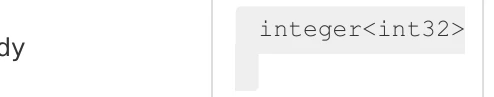

<table>
  <tr>
    <td></td>
    <td></td>
    <td></td>
    <td></td>
    <td></td>
  </tr>
  <tr>
    <td>参数名称</td>
    <td>位置</td>
    <td>类型</td>
    <td>是否必选</td>
    <td>示例</td>
  </tr>
  <tr>
    <td>brokerEngineTyp e</td>
    <td>body</td>
    <td><code>string</code></td>
    <td>否</td>
    <td><code>HIGRESS</code></td>
  </tr>
</table>

**返回数据**

| 参数名称 | 类型 | 示例 | 说明 |
| --- | --- | --- | --- |
| requestId | <code>string</code> | <code>xxx-xxx-xxx</code> | 请求 ID。 |
| code | <code>integer&lt;int32&gt;</code> | <code>200</code> | 响应码，200表示成功。 |
| msg | <code>string</code> | <code>null</code> | 响应消息。 |
| data | <code>object</code> | <code>{}</code> | 返回数据。 |
| data.total | integer&lt;int64&gt; | <code>100</code> | 记录总数。 |
| data.current | integer&lt;int64&gt; | <code>1</code> | 当前页码。 |
| data.size | integer&lt;int64&gt; | <code>10</code> | 每页条数。 |
| data.records | <code>array</code> | <code>[]</code> | 记录列表。 |
| data.records\[\].status | integer&lt;int32&gt; | 0 | — |
| data.records\[\].gwInstan ceId | string | gw-demo | 网关实例 ID。 |
| data.records\[\].name | string | demo | 名称。 |
| data.records\[\].instance Name | string | demo | — |
| data.records\[\].deployCl usterNamespace | string | example | — |
| data.records\[\].deployCl usterCode | string | example | — |
| data.records\[\].accessM ode | array | \[\] | — |
| data.records\[\].accessM ode\[\].ips | array | \[\] | — |
| data.records\[\].accessM ode\[\].ports | array | \[\] | — |
| data.records\[\].accessM ode\[\].accessModeType | string | example | — |
| data.records\[\].accessM ode\[\].loadBalancerNet workType | string | example | classic or vpc。 |
| data.records\[\].accessM ode\[\].loadBalancerAddr essType | string | example | intranet or internet。 |
| data.records\[\].accessM ode\[\].serviceName | string | demo | 服务名称。 |
| data.records\[\].accessM ode\[\].externalIps | array | \[\] | — |
| data.records\[\].accessM ode\[\].clusterIp | array | \[\] | — |
| data.records\[\].accessM ode\[\].accessAddressSo urce | string | example | 当前对外地址来源：USER_SPECIFIED /AUTO_DISCOVERED。 |
| data.records\[\].accessM ode\[\].detectedExternalI ps | array | \[\] | K8s Service 实际探测到的底层地址。仅在自定义访问地址生效时返回，供运维排查。 |
| data.records\[\].accessM ode\[\].edasAppId | string | edasapp-demo | EDAS应用ID（多应用容灾场景，用于前端分组展示）Higress Helm/SCG Helm架构下该字段为空。 |
| data.records\[\].accessM ode\[\].ipVersion | string | example | IP版本类型ipv4 / ipv6。 |
| data.records\[\].deployCl usterName | string | demo | — |
| data.records\[\].k8sServi ceName | string | demo | — |
| data.records\[\].createTi me | string | 2026-01-01 00:00:00 | 创建时间 格式：yyyy-MM-dd HH:mm:ss。 |
| data.records\[\].modifyTi me | string | 2026-01-01 00:00:00 | — 格式：yyyy-MM-dd HH:mm:ss。 |
| data.records\[\].tid | string | t-demo | — |
| data.records\[\].vpcId | string | vpc-demo | 实例所属专有网络 VPC 的ID。该字段仅为兼容历史部署形态保留。 |
| data.records\[\].vSwitchI d | string | vswitch-demo | 实例所属交换机的 ID。该字段仅为兼容历史部署形态保留。 |
| data.records\[\].regionId | string | region-demo | — |
| data.records\[\].zoneId | string | zone-demo | 实例所属可用区的 ID。该字段仅为兼容历史部署形态保留。 |
| data.records\[\].deployM ode | string | example | — |
| data.records\[\].edasApp Id | string | edasapp-demo | — |
| data.records\[\].edasNa mespaceId | string | edasnamespace-demo | — |
| data.records\[\].k8sClust erId | string | k8scluster-demo | — |
| data.records\[\].k8sNam espace | string | example | — |
| data.records\[\].instance Class | string | example | — |
| data.records\[\].edasApp Infos | array | \[\] | — |
| data.records\[\].edasApp Infos\[\].appId | string | app-demo | 消费者 ID。 |
| data.records\[\].edasApp Infos\[\].edasNamespace Id | string | edasnamespace-demo | — |
| data.records\[\].edasApp Infos\[\].k8sClusterId | string | k8scluster-demo | — |
| data.records\[\].edasApp Infos\[\].k8sNamespace | string | example | — |
| data.records\[\].departm ent | string | example | — |
| data.records\[\].resource Group | string | example | — |
| data.records\[\].ingressC lassName | string | demo | — |
| data.records\[\].brokerEn gineType | string | example | broker引擎类型：scg,higress,shared_scg<br>\* @see com.aliyun.csb.model.e nums.BrokerEngineTyp eEnum。 |
| data.records\[\].brokerEn gineVersion | string | example | broker引擎版本。 |
| data.records\[\].brokerLa testEngineVersion | string | example | broker最新引擎版本（for upgrade）。 |
| data.records\[\].deployCl usterAttribute | string | example | deployCluster 拓展信息。 |
| data.records\[\].nodeNu mber | integer&lt;int32&gt; | 0 | 新增字段：来自原详情接口的节点数量信息。 |
| data.records\[\].sharedIn stance | boolean | false | 是否为共享实例。 |
| data.records\[\].sharedIn stanceSource | string | example | 共享实例来源。 |
| data.records\[\].o11y | object | {} | 可观测配置。 |
| data.records\[\].o11y.pro metheusEnabled | boolean | false | 是否启用阿里云Prometheus配置（为higress-gateway创建PodMonitor）。 |
| data.records\[\].o11y.tra ce | object | {} | 链路追踪配置（开关 + opentelemetry 采集地址+ 采样率）。 |
| data.records\[\].o11y.tra ce.enabled | boolean | false | 是否启用链路追踪（对应helm tracing.enable）。nullable 区分「未设置」与显式关闭。 |
| data.records\[\].o11y.tra ce.service | string | example | opentelemetry collector 地址（对应helm tracing.opentelemetry.service）。 |
| data.records\[\].o11y.tra ce.port | string | example | opentelemetry collector 端口（对应helm tracing.opentelemetry.port）。 |
| data.records\[\].o11y.tra ce.sampling | integer&lt;int32&gt; | 0 | 采样率 0-100（对应helm tracing.sampling）。 |
| data.records\[\].o11y.acc essLog | object | {} | — |
| data.records\[\].o11y.acc essLog.enabled | boolean | false | 实例级自定义日志字段总开关。&lt;p&gt;nullable:区分「未设置」(等价 false,从未配置过)与显式 false(用户主动关闭)。&lt;/p&gt;。 |
| data.records\[\].o11y.acc essLog.fields | array | \[\] | 用户配置的自定义字段列表。 |
| data.records\[\].o11y.acc essLog.fields\[\].type | string | example | 字段类型,见 {@link AccessLogFieldTypeEn um} (REQ/RESP/DYNAMIC_M ETADATA/FILTER_STAT E)。 |
| data.records\[\].o11y.acc essLog.fields\[\].value | string | example | 字段取值来源:&lt;ul&gt; &lt;li&gt;REQ/RESP:header名(可含前导 {@code :}伪 header,如 {@code:AUTHORITY})&lt;/li&gt; &lt;li&gt;DYNAMIC_METADA TA:{@code ns:key}(如{@code envoy.filters.http.ext_a uthz:status_code}) &lt;/li&gt; &lt;li&gt;FILTER_STATE:短名(如 {@code aisec_log});{@link #raw} 模式下为完整表达式(如 {@code wasm.x:TYPED})&lt;/li&gt; &lt;/ul&gt;。 |
| data.records\[\].o11y.acc essLog.fields\[\].alias | string | example | 可选别名:落进 access log JSON 的顶层 key。缺省时由 {@link #value}派生为合法 key。 |
| data.records\[\].o11y.acc essLog.fields\[\].raw | boolean | false | 仅 FILTER_STATE 生效:true 表示按原样写入(不补 {@code wasm.}前缀与 {@code :PLAIN}后缀),供高级用户指定非wasm 命名空间或非PLAIN 序列化(如 {@code:TYPED})。 |
| data.records\[\].o11y.acc essLog.managedKeys | array | \[\] | 上次成功写入现网{@code accessLogFormat} 的受管 JSON key 集合。&lt;p&gt;幂等/删除语义的核心:下次apply 时先从现网移除这批旧 key(∪ 当前 key),再写入当前字段,保证删除/改名不残留、且不碰基线与其它字段。&lt;b&gt;仅在apply 成功后&lt;/b&gt;更新为当前 key 集合,从而即便「DB 已写、apply 失败」下次仍能收敛。&lt;/p&gt;。 |
| data.records\[\].o11y.acc essLog.fingerprint | string | example | 配置指纹(enabled + 规范化 fields 的 sha256),用于「配置未变」短路。 |
| data.records\[\].o11y.acc essLog.updatedAt | string | example | 最近更新时间(ISO 8601格式)。 |
| data.records\[\].o11y.acc essLog.updatedBy | string | example | 最近更新人。 |
| data.records\[\].redisCon fig | object | {} | Redis 配置（内置/外部），供实例设置页回填；密码回传（前端默认遮掩、点击眼睛展开）。 |
| data.records\[\].redisCon fig.type | string | example | builtin（默认）\| external。 |
| data.records\[\].redisCon fig.cpu | string | example | 内置 redis 容器 CPU，如"500m" / "2"，写redis.resources.request s/limits.cpu。 |
| data.records\[\].redisCon fig.memory | string | example | 内置 redis 容器内存，如"512Mi" / "2Gi"，写redis.resources.request s/limits.memory。 |
| data.records\[\].redisCon fig.persistenceEnabled | boolean | false | 是否开启持久化，独立开关由表单显式控制（不再由磁盘大小隐式推导）。写redis.persistence.enabl ed；null 时不下发 =&gt; 走chart 默认。 |
| data.records\[\].redisCon fig.diskSize | string | example | 内置 redis 持久化磁盘大小，如 "50Gi"，写redis.persistence.size。仅在持久化开启时由chart 生效；空则用 chart默认。 |
| data.records\[\].redisCon fig.storageClass | string | example | 内置 redis 持久化存储类，如 "alicloud-disk-efficiency"，写redis.persistence.stora geClass。交给用户决策；空则用 chart 默认。 |
| data.records\[\].redisCon fig.externalType | string | example | 外部 redis 地址类型，取值见 {@link com.aliyun.csb.model.e nums.RedisExternalTyp eEnum}：{@code dns}（域名）\| {@code static}（固定地址 IP:端口）\| {@code k8s}（K8s Service）\| {@code reverseProxy}（反向代理）。 \* &lt;p&gt;决定 console 把外部 redis注册成何种 Higress 服务，使数据面限流类wasm 插件能经 Envoy 访问。type=external 时必填；空时为兼容历史按{@code dns} 处理。&lt;/p&gt;。 |
| data.records\[\].redisCon fig.address | string | example | 外部 redis VPC/集群内连接地址，统一 {@code host:port}：域名型为{@code 域名:端口}，固定地址型为 {@code IP:端口}，K8s Service 型为{@code service-fqdn:端口}，反向代理型为用户显式填写的 VPC 内{@code IP:端口}（反向隧道只能以 IP 为目标）。供实例内 quota-server /数据面插件访问，并作服务来源注册的 domain 来源。 |
| data.records\[\].redisCon fig.domainAddress | string | example | 反向代理型（{@code externalType=reverseP roxy}）可选的 VPC 内域名地址，统一 {@code 域名:端口}。 \* &lt;p&gt;&lt;b&gt;仅数据面优先使用&lt;/b&gt;：填写后，数据面（Envoy/wasm 插件）与集群内 quota-server 优先经该域名访问 Redis；为空时回退到 {@link #address}。console 侧不用它——反向隧道的目标只接受 IP（{@code ReverseTunnel.SlbInsta nce.ip}），域名无法建隧道，因此 console 始终走{@link #mappingIp}: {@link #mappingPort}。&lt;/p&gt;。 |
| data.records\[\].redisCon fig.publicAddress | string | example | 外部 redis 公网连接地址，统一 {@code host:port}。ASCM 场景下 console 不在实例 VPC内，Token 管理读写数据面 Redis 时必须使用该地址。 |
| data.records\[\].redisCon fig.mappingIp | string | example | 反向代理型（{@code externalType=reverseP roxy}）经反向隧道映射出的 console 侧可达 IP。 \* &lt;p&gt;由 console 为{@link #address} 下发{@code ReverseTunnel} 后异步分配，隧道就绪时由{@code ExternalRedisTunnelRe conciler} 回写；仅供console 直连（Token 配额管理）使用，数据面与集群内组件仍走 VPC 地址{@link #address}。用户不填，也不接受前端传入。&lt;/p&gt;。 |
| data.records\[\].redisCon fig.mappingPort | integer&lt;int32&gt; | 0 | 反向代理型经反向隧道映射出的 console 侧可达端口，与 {@link #mappingIp} 同源同生命周期。 |
| data.records\[\].redisCon fig.password | string | DEMO_CREDENTIAL | redis 密码，内置时空则chart 自动生成；外部时空表示无密码。 |
| data.records\[\].gateway ServiceType | string | example | 网关 Service 类型：ClusterIP / NodePort /LoadBalancer。 |
| data.records\[\].gateway LoadBalancerAddressT ype | string | example | LoadBalancer 地址类型（intranet / internet）。 |
| data.records\[\].gateway NodePort | integer&lt;int32&gt; | 0 | NodePort 端口（仅NodePort 时有值）。 |
| data.records\[\].imagePu llSecretName | string | DEMO_CREDENTIAL | imagePullSecret 名称。 |
| data.records\[\].imagePr efix | string | example | 镜像名称前缀。 |
| data.records\[\].imageTa gOverride | string | example | 镜像 Tag 覆盖。 |
| data.records\[\].nodeSch eduleConfig | object | {} | 节点调度配置（nodeSelector/tolerati ons/affinity）。 |
| data.records\[\].nodeSch eduleConfig.nodeSelect or | object | {} | 节点选择器：label 键值对，Pod 仅调度到同时带这些 label 的节点。写{@code &lt;component&gt;.nodeSel ector}；空 Map / null 时不下发。 |
| data.records\[\].nodeSch eduleConfig.tolerations | array | \[\] | 污点容忍：容忍目标节点上的污点，使 Pod 能调度到被 taint 保护的专用节点。写 {@code &lt;component&gt;.toleratio ns}；空 List / null 时不下发。 |
| data.records\[\].nodeSch eduleConfig.tolerations \[\].key | string | DEMO_CREDENTIAL | 污点 key；operator=Exists 且 key为空表示容忍一切污点。 |
| data.records\[\].nodeSch eduleConfig.tolerations \[\].operator | string | example | Equal（默认，需匹配value）\| Exists（仅匹配key）。 |
| data.records\[\].nodeSch eduleConfig.tolerations \[\].value | string | example | 污点value，operator=Equal时生效。 |
| data.records\[\].nodeSch eduleConfig.tolerations \[\].effect | string | example | NoSchedule \| PreferNoSchedule \| NoExecute；空表示匹配全部 effect。 |
| data.records\[\].nodeSch eduleConfig.tolerations \[\].tolerationSeconds | integer&lt;int64&gt; | 0 | 仅 effect=NoExecute 时生效，容忍多久后被驱逐（秒）；空表示一直容忍。 |
| data.records\[\].nodeSch eduleConfig.affinity | object | {} | 节点亲和（高级）：完整K8s {@code affinity} 结构（nodeAffinity /podAffinity /podAntiAffinity），原样透传到 {@code &lt;component&gt;.affinity}。供需要表达式级匹配（如 In/NotIn/Gt）的高级场景使用。 \* &lt;p&gt;用{@code Map&lt;String, Object&gt;} 接收，避免与nodeSelector 重复表达；null 时不下发。&lt;/p&gt;。 |
| data.records\[\].workloa dMetadata | object | {} | 用户配置的 Higress workload metadata，不含平台保留键。 |
| data.records\[\].workloa dMetadata.gatewayDe ployment | object | {} | — |
| data.records\[\].workloa dMetadata.gatewayDe ployment.labels | object | {} | — |
| data.records\[\].workloa dMetadata.gatewayDe ployment.annotations | object | {} | — |
| data.records\[\].workloa dMetadata.gatewayPod Template | object | {} | — |
| data.records\[\].workloa dMetadata.gatewayPod Template.labels | object | {} | — |
| data.records\[\].workloa dMetadata.gatewayPod Template.annotations | object | {} | — |
| data.records\[\].workloa dMetadata.controllerDe ployment | object | {} | — |
| data.records\[\].workloa dMetadata.controllerDe ployment.labels | object | {} | — |
| data.records\[\].workloa dMetadata.controllerDe ployment.annotations | object | {} | — |
| data.records\[\].workloa dMetadata.controllerPo dTemplate | object | {} | — |
| data.records\[\].workloa dMetadata.controllerPo dTemplate.labels | object | {} | — |
| data.records\[\].workloa dMetadata.controllerPo dTemplate.annotations | object | {} | — |
| data.records\[\].higressD eploymentUid | string | higressdeploymentu-demo | Higress Deployment 的K8s UID。 |
| data.records\[\].manage dByAiStudio | boolean | false | 实例是否已被 AIStudio 纳管（纳管时前端仅禁用ROUTE 域管理：路由 + ROUTER 类型授权，并提示）。 |

**records 二级参数表：**

| 参数名称 | 类型 | 示例 | 说明 |
| --- | --- | --- | --- |
| records\[\].status | <code>integer</code> | <code>1</code> | 实例状态。 |
| records\[\].gwInstanceId | <code>string</code> | <code>gw-instance-001</code> | 网关实例ID。 |
| records\[\].name | <code>string</code> | <code>my-gateway</code> | 网关实例名称。 |
| records\[\].instanceNam e | <code>string</code> | <code>my-gateway</code> | 实例名称。 |
| records\[\].deployCluster Namespace | <code>string</code> | <code>apigateway-</code><br><code>system</code> | 部署集群命名空间。 |
| records\[\].deployCluster Code | <code>string</code> | <code>cluster-001</code> | 部署集群编码。 |
| records\[\].deployCluster Name | <code>string</code> | <br><code> </code>生产集群<code> </code> | 部署集群名称。 |
| records\[\].k8sServiceNa me | <code>string</code> | <code>higress-gateway</code> | K8s Service名称。 |
| records\[\].createTime | <code>string</code> | <code>2024-01-</code><br><code>01T00:00:00</code> | 创建时间。 |
| records\[\].modifyTime | <code>string</code> | <code>2024-01-</code><br><code>01T00:00:00</code> | 修改时间。 |
| records\[\].vpcId | <code>string</code> | <code>vpc-xxx</code> | VPC ID。 |
| records\[\].vSwitchId | <code>string</code> | <code>vsw-xxx</code> | vSwitch ID。 |
| records\[\].regionId | <code>string</code> | <code>cn-hangzhou</code> | 区域ID。 |
| records\[\].zoneId | <code>string</code> | <code>cn-hangzhou-a</code> | 可用区ID。 |
| records\[\].deployMode | <code>string</code> | <code>k8s</code> | 部署模式。 |
| records\[\].edasAppId | <code>string</code> | <code>app-xxx</code> | EDAS应用ID。 |
| records\[\].edasNamespa ceId | <code>string</code> | <code>ns-xxx</code> | EDAS命名空间ID。 |
| records\[\].k8sClusterId | <code>string</code> | <code>k8s-xxx</code> | K8s集群ID。 |
| records\[\].k8sNamespac e | <code>string</code> | <code>default</code> | K8s命名空间。 |
| records\[\].instanceClass | <code>string</code> | <code>standard</code> | 实例规格类型。 |
| records\[\].department | <code>string</code> | <br><code> </code>研发部<code> </code> | 所属部门。 |
| records\[\].resourceGrou p | <code>string</code> | <code>group-001</code> | 资源组。 |
| records\[\].ingressClassN ame | <code>string</code> | <code>higress</code> | IngressClass名称。 |
| records\[\].brokerEngine Type | <code>string</code> | <code>HIGRESS</code> | 引擎类型。 |
| records\[\].brokerEngine Version | <code>string</code> | <code>1.4.0</code> | 当前引擎版本。 |
| records\[\].brokerLatestE ngineVersion | <code>string</code> | <code>1.5.0</code> | 最新引擎版本。 |
| records\[\].deployCluster Attribute | <code>string</code> | <code>hub</code> | 部署集群属性。 |
| records\[\].nodeNumber | <code>integer</code> | <code>2</code> | 节点数量。 |
| records\[\].sharedInstanc e | <code>boolean</code> | <code>false</code> | 是否为共享实例。 |
| records\[\].sharedInstanc eSource | <code>string</code> | <code>external-sharing</code> | 共享实例来源。 |
| records\[\].higressDeploy mentUid | <code>string</code> | <code>uid-xxx</code> | Higress Deployment的K8s UID。 |
| records\[\].o11y | <code>object</code> | <code>{}</code> | 可观测配置对象。 |
| records\[\].o11y.slsEnabl ed | <code>boolean</code> | <code>true</code> | 是否启用SLS日志。 |
| records\[\].o11y.prometh eusEnabled | <code>boolean</code> | <code>true</code> | 是否启用Prometheus监控。 |
| records\[\].accessMode | <code>array</code> | <code>[]</code> | 访问模式列表，详见下方三级参数表。 |
| records\[\].edasAppInfos | <code>array</code> | <code>[]</code> | EDAS应用信息列表。 |

**records[].accessMode 三级参数表：**

| 参数名称 | 类型 | 示例 | 说明 |
| --- | --- | --- | --- |
| accessMode\[\].ips | <code>string[]</code> | <code>["192.168.1.1"]</code> | IP地址列表。 |
| accessMode\[\].ports | <code>string[]</code> | <code>["80", "443"]</code> | 端口列表。 |
| accessMode\[\].accessM odeType | <code>string</code> | <code>LoadBalancer</code> | 访问模式类型。 |
| accessMode\[\].loadBala ncerNetworkType | <code>string</code> | <code>internet</code> | 负载均衡器网络类型。 |
| accessMode\[\].loadBala ncerAddressType | <code>string</code> | <code>external</code> | 负载均衡器地址类型。 |
| accessMode\[\].serviceN ame | <code>string</code> | <code>higress-gateway</code> | K8s Service名称。 |
| accessMode\[\].externalI ps | <code>string[]</code> | <code>[]</code> | 外部IP列表。 |
| accessMode\[\].clusterIp | <code>string[]</code> | <code>["10.0.0.1"]</code> | 集群IP列表。 |
| accessMode\[\].edasAppI d | <code>string</code> | <code>app-xxx</code> | EDAS应用ID。 |
| accessMode\[\].ipVersion | <code>string</code> | <code>IPv4</code> | IP版本。 |

**示例**

**请求示例**

```http
POST /gatewayInstance/listInstances HTTP/1.1

{
  "current": 1,
  "size": 10,
  "name": "demo",
  "gwInstanceId": "gw-demo",
  "deployMode": "k8s",
  "brokerEngineType": "HIGRESS"
}
```

**响应示例**

```json
{
  "code": 200,
  "msg": null,
  "message": null,
  "requestId": "req-xxx-xxx-xxx",
  "data": {
    "total": 2,
    "current": 1,
    "size": 10,
    "records": [
      {
        "status": 1,
        "gwInstanceId": "gw-instance-001",
        "name": "my-higress-gateway",
        "instanceName": "my-higress-gateway",
        "deployClusterNamespace": "apigateway-system",
        "deployClusterCode": "cluster-001",
        deployClusterName: ⽣产集群,
        "k8sServiceName": "higress-gateway",
        "createTime": "2026-01-01 00:00:00",
        "modifyTime": "2026-01-01 00:00:00",
        "deployMode": "k8s",
        "brokerEngineType": "HIGRESS",
        "brokerEngineVersion": "1.4.0",
        "nodeNumber": 2,
        "sharedInstance": false,
        "o11y": {
          "slsEnabled": true,
          "prometheusEnabled": true,
          "trace": {
            "enabled": false,
            "service": "example",
            "port": "example",
            "sampling": 0
          },
          "accessLog": {
            "enabled": false,
            "fields": [],
            "managedKeys": [],
            "fingerprint": "example",
            "updatedAt": "example",
            "updatedBy": "example"
          }
        },
        "accessMode": [
          {
            "ips": [
              "192.168.1.1"
            ],
            "ports": [
              "80",
              "443"
            ],
            "accessModeType": "LoadBalancer",
            "serviceName": "higress-gateway",
            "loadBalancerNetworkType": "example",
            "loadBalancerAddressType": "example",
            "externalIps": [],
            "clusterIp": [],
            "accessAddressSource": "example",
            "detectedExternalIps": [],
            "edasAppId": "edasapp-demo",
            "ipVersion": "example"
          }
        ],
        "tid": "t-demo",
        "vpcId": "vpc-demo",
        "vSwitchId": "vswitch-demo",
        "regionId": "region-demo",
        "zoneId": "zone-demo",
        "edasAppId": "edasapp-demo",
        "edasNamespaceId": "edasnamespace-demo",
        "k8sClusterId": "k8scluster-demo",
        "k8sNamespace": "example",
        "instanceClass": "example",
        "edasAppInfos": [],
        "department": "example",
        "resourceGroup": "example",
        "ingressClassName": "demo",
        "brokerLatestEngineVersion": "example",
        "deployClusterAttribute": "example",
        "sharedInstanceSource": "example",
        "redisConfig": {
          "type": "example",
          "cpu": "example",
          "memory": "example",
          "persistenceEnabled": false,
          "diskSize": "example",
          "storageClass": "example",
          "externalType": "example",
          "address": "example",
          "domainAddress": "example",
          "publicAddress": "example",
          "mappingIp": "example",
          "mappingPort": 0,
          "password": "DEMO_CREDENTIAL"
        },
        "gatewayServiceType": "example",
        "gatewayLoadBalancerAddressType": "example",
        "gatewayNodePort": 0,
        "imagePullSecretName": "DEMO_CREDENTIAL",
        "imagePrefix": "example",
        "imageTagOverride": "example",
        "nodeScheduleConfig": {
          "nodeSelector": {},
          "tolerations": [],
          "affinity": {}
        },
        "workloadMetadata": {
          "gatewayDeployment": {
            "labels": {},
            "annotations": {}
          },
          "gatewayPodTemplate": {
            "labels": {},
            "annotations": {}
          },
          "controllerDeployment": {
            "labels": {},
            "annotations": {}
          },
          "controllerPodTemplate": {
            "labels": {},
            "annotations": {}
          }
        },
        "higressDeploymentUid": "higressdeploymentu-demo",
        "managedByAiStudio": false
      }
    ]
  }
}
```

<a id="section-1-3-2-15"></a>

#### 1.3.2.15. ModifyInstance

调用 ModifyInstance 接口修改实例。

**请求头**

公共请求头及认证信息的获取与携带方式，请参见获取公共Header参数。

**请求语法**

```http
POST /gatewayInstance/modifyInstance HTTP/1.1
```

**请求参数**

| 参数名称 | 位置 | 类型 | 是否必选 | 示例 | 说明 |
| --- | --- | --- | --- | --- | --- |
| gwInstanceId | <code>body</code> | <code>string</code> | 是 | <code>higress-</code><br><code>001</code> | 网关实例ID。不能为空。 |
| instanceName | <code>body</code> | <code>string</code> | 是 | <code>my-</code><br><code>higress-</code><br><code>instance</code> | instanceName参数。 不能为空。 |

**返回数据**

| 参数名称 | 类型 | 示例 | 说明 |
| --- | --- | --- | --- |
| requestId | <code>string</code> | <code>uuid-xxx-xxx</code> | 请求 ID。 |
| code | <code>integer&lt;int32&gt;</code> | 200 | 响应码。 |
| msg | <code>string</code> | <code>null</code> | 响应消息。 |
| data | <code>boolean</code> | <code>true</code> | 响应数据。 |

**示例**

**请求示例**

```http
POST /gatewayInstance/modifyInstance HTTP/1.1

{
  "gwInstanceId": "higress-001",
  "instanceName": "my-higress-instance"
}
```

**响应示例**

```json
{
  "requestId": "uuid-xxx-xxx",
  "code": 200,
  "msg": null,
  "message": null,
  "data": true
}
```

<a id="section-1-3-2-16"></a>

#### 1.3.2.16. ModifyInstanceImageUrl

调用 ModifyInstanceImageUrl 接口修改实例镜像地址。

**请求头**

公共请求头及认证信息的获取与携带方式，请参见获取公共Header参数。

**请求语法**

```http
POST /gatewayInstance/modifyInstanceImageUrl HTTP/1.1
```

**请求参数**

| 参数名称 | 位置 | 类型 | 是否必选 | 示例 | 说明 |
| --- | --- | --- | --- | --- | --- |
| gwInstanceId | <code>body</code> | <code>string</code> | 是 | <code>higress-</code><br><code>001</code> | 网关实例ID。不能为空。 |
| imageUrl | <code>body</code> | <code>string</code> | 是 | <code>higress-</code><br><code>registry.cn-</code><br><code>hangzhou.cr.</code><br><code>aliyuncs.com</code><br><code>/higress/gat</code><br><code>eway:1.4.0</code> | imageUrl参数。 不能为空。 |

**返回数据**

| 参数名称 | 类型 | 示例 | 说明 |
| --- | --- | --- | --- |
| requestId | <code>string</code> | <code>uuid-xxx-xxx</code> | 请求 ID。 |
| code | <code>integer&lt;int32&gt;</code> | 200 | 响应码。 |
| msg | <code>string</code> | <code>null</code> | 响应消息。 |
| data | <code>boolean</code> | <code>true</code> | 响应数据。 |

**示例**

**请求示例**

```http
POST /gatewayInstance/modifyInstanceImageUrl HTTP/1.1

{
  "gwInstanceId": "gwInstanceId_value",
  "imageUrl": "imageUrl_value"
}
```

**响应示例**

```json
{
  "requestId": "xxx-xxx-xxx",
  "code": 200,
  "msg": null,
  "message": null,
  "data": true
}
```

<a id="section-1-3-2-17"></a>

#### 1.3.2.17. RefreshInstance

调用 RefreshInstance 接口刷新实例状态。

**请求头**

公共请求头及认证信息的获取与携带方式，请参见获取公共Header参数。

**请求语法**

```http
POST /gatewayInstance/refreshInstance HTTP/1.1
```

**请求参数**

| 参数名称 | 位置 | 类型 | 是否必选 | 示例 | 说明 |
| --- | --- | --- | --- | --- | --- |
| gwInstanceCo de | <code>body</code> | <code>string</code> | 是 | <code>higress-</code><br><code>001</code> | gwInstanceCo de 参数。 不能为空。 |

**返回数据**

| 参数名称 | 类型 | 示例 | 说明 |
| --- | --- | --- | --- |
| requestId | <code>string</code> | <code>uuid-xxx-xxx</code> | 请求 ID。 |
| code | <code>integer&lt;int32&gt;</code> | 200 | 响应码。 |
| msg | <code>string</code> | <code>null</code> | 响应消息。 |
| data | <code>object</code> | <code>{}</code> | 返回数据。 |
| data.status | integer&lt;int32&gt; | <code>1</code> | — |
| data.gwInstanceId | <code>string</code> | <code>higress-001</code> | 网关实例 ID。 |
| data.name | <code>string</code> | <code>my-higress-</code><br><code>gateway</code> | 名称。 |
| data.deployClusterNam espace | <code>string</code> | <code>apigateway-</code><br><code>system</code> | — |
| data.deployClusterCod e | <code>string</code> | <code>cluster-001</code> | — |
| data.accessMode | array | \[\] | — |
| data.accessMode\[\].ips | array | \[\] | — |
| data.accessMode\[\].port s | array | \[\] | — |
| data.accessMode\[\].acc essModeType | <code>string</code> | <code>LoadBalancer</code> | — |
| data.accessMode\[\].ext ernalIps | array | <code>[]</code> | — |
| data.accessMode\[\].clus terIp | array | \[\] | — |
| data.deployClusterNam e | <code>string</code> | <br><code> </code>生产集群<code> </code> | — |
| data.k8sServiceName | <code>string</code> | <code>higress-gateway</code> | — |
| data.createTime | <code>string</code> | 2026-01-01 00:00:00 | 创建时间 格式：yyyy-MM-dd HH:mm:ss。 |
| data.modifyTime | <code>string</code> | 2026-01-01 00:00:00 | — 格式：yyyy-MM-dd HH:mm:ss。 |
| data.tid | <code>string</code> | <code>tid-xxx</code> | — |

**示例**

**请求示例**

```http
POST /gatewayInstance/refreshInstance HTTP/1.1

{
  "gwInstanceCode": "gwInstanceCode_value"
}
```

**响应示例**

```json
{
  "requestId": "xxx-xxx-xxx",
  "code": 200,
  "msg": null,
  "message": null,
  "data": {
    "status": 0,
    "gwInstanceId": "gwInstanceId_value",
    "name": "name_value",
    "deployClusterNamespace": "deployClusterNamespace_value",
    "deployClusterCode": "deployClusterCode_value",
    "accessMode": [
      {
        "ips": [],
        "ports": [],
        "accessModeType": "accessModeType_value",
        "externalIps": [],
        "clusterIp": []
      }
    ],
    "deployClusterName": "deployClusterName_value",
    "k8sServiceName": "k8sServiceName_value",
    "createTime": "2026-01-01 00:00:00",
    "modifyTime": "2026-01-01 00:00:00",
    "tid": "tid_value"
  }
}
```

<a id="section-1-3-2-18"></a>

#### 1.3.2.18. DeleteInstance

调用 DeleteInstance 接口删除实例。

**请求头**

公共请求头及认证信息的获取与携带方式，请参见获取公共Header参数。

**请求语法**

```http
POST /gatewayInstance/deleteInstance HTTP/1.1
```

**请求参数**

| 参数名称 | 位置 | 类型 | 是否必选 | 示例 | 说明 |
| --- | --- | --- | --- | --- | --- |
| gwInstanceId | <code>body</code> | <code>string</code> | 是 | <code>higress-</code><br><code>001</code> | 网关实例 ID。不能为空。 |
| forcedDelete | <code>body</code> | <code>boolean</code> | 否 | <code>false</code> | 是否强制删除：处理当集群过期/不可达导致无法删除的情况，跳过数据面清理，确保实例信息在数据库层面被删除（详见AbstractInstan ceLifecycleStr ategy#deleteI nstance）。 \* &lt;p&gt;线上契约字段名为{@code forcedDelete}（Jackson 由getter isForcedDelet e() 推导而来，前端也按此发送）。这里显式声明，并用{@link JsonAlias} 兼容按 Java 字段名误发的{@code isForcedDelet e}，避免标志被静默忽略而导致"强制删除不生效"。&lt;/p&gt;默认值：false。 |

**返回数据**

| 参数名称 | 类型 | 示例 | 说明 |
| --- | --- | --- | --- |
| requestId | <code>string</code> | <code>uuid-xxx-xxx</code> | 请求 ID。 |
| code | <code>integer&lt;int32&gt;</code> | 200 | 响应码。 |
| msg | <code>string</code> | <code>null</code> | 响应消息。 |
| data | <code>object</code> | <code>{}</code> | 响应数据。 |

**示例**

**请求示例**

```http
POST /gatewayInstance/deleteInstance HTTP/1.1

{
  "gwInstanceId": "gwInstanceId_value",
  "forcedDelete": false
}
```

**响应示例**

```json
{
  "code": 200,
  "message": null,
  "requestId": "xxx-xxx-xxx",
  "data": {},
  "msg": null
}
```

<a id="section-1-3-2-19"></a>

#### 1.3.2.19. RestartInstance

调用 RestartInstance 接口重启实例。

**请求头**

公共请求头及认证信息的获取与携带方式，请参见获取公共Header参数。

**请求语法**

```http
POST /gatewayInstance/restartInstance HTTP/1.1
```

**请求参数**

| 参数名称 | 位置 | 类型 | 是否必选 | 示例 | 说明 |
| --- | --- | --- | --- | --- | --- |
| gwInstanceId | <code>body</code> | <code>string</code> | 是 | <code>higress-</code><br><code>001</code> | 网关实例 ID。不能为空。 |

**返回数据**

| 参数名称 | 类型 | 示例 | 说明 |
| --- | --- | --- | --- |
| requestId | <code>string</code> | <code>uuid-xxx-xxx</code> | 请求 ID。 |
| code | <code>integer&lt;int32&gt;</code> | 200 | 响应码。 |
| msg | <code>string</code> | <code>null</code> | 响应消息。 |
| data | <code>object</code> | <code>{}</code> | 响应数据。 |

**示例**

**请求示例**

```http
POST /gatewayInstance/restartInstance HTTP/1.1

{
  "gwInstanceId": "gwInstanceId_value"
}
```

**响应示例**

```json
{
  "code": 200,
  "message": null,
  "requestId": "xxx-xxx-xxx",
  "data": {},
  "msg": null
}
```

<a id="section-1-3-2-20"></a>

#### 1.3.2.20. StopInstance

调用 StopInstance 接口停止实例。

**请求头**

公共请求头及认证信息的获取与携带方式，请参见获取公共Header参数。

**请求语法**

```http
POST /gatewayInstance/stopInstance HTTP/1.1
```

**请求参数**

| 参数名称 | 位置 | 类型 | 是否必选 | 示例 | 说明 |
| --- | --- | --- | --- | --- | --- |
| gwInstanceId | <code>body</code> | <code>string</code> | 是 | <code>higress-</code><br><code>001</code> | 网关实例ID。不能为空。 |

**返回数据**

| 参数名称 | 类型 | 示例 | 说明 |
| --- | --- | --- | --- |
| requestId | <code>string</code> | <code>uuid-xxx-xxx</code> | 请求 ID。 |
| code | <code>integer&lt;int32&gt;</code> | 200 | 响应码。 |
| msg | <code>string</code> | <code>null</code> | 响应消息。 |
| data | <code>boolean</code> | <code>true</code> | 响应数据。 |

**示例**

**请求示例**

```http
POST /gatewayInstance/stopInstance HTTP/1.1

{
  "gwInstanceId": "gwInstanceId_value"
}
```

**响应示例**

```json
{
  "requestId": "xxx-xxx-xxx",
  "code": 200,
  "msg": null,
  "message": null,
  "data": true
}
```

<a id="section-1-3-2-21"></a>

#### 1.3.2.21. UpgradeInstance

调用 UpgradeInstance 接口升级实例。

**请求头**

公共请求头及认证信息的获取与携带方式，请参见获取公共Header参数。

**请求语法**

```http
POST /gatewayInstance/upgradeInstance HTTP/1.1
```

**请求参数**

| 参数名称 | 位置 | 类型 | 是否必选 | 示例 | 说明 |
| --- | --- | --- | --- | --- | --- |
| gwInstanceId | <code>body</code> | <code>string</code> | 是 | <code>higress-</code><br><code>001</code> | 网关实例ID。不能为空或空白字符串。 |

**返回数据**

| 参数名称 | 类型 | 示例 | 说明 |
| --- | --- | --- | --- |
| requestId | <code>string</code> | <code>uuid-xxx-xxx</code> | 请求 ID。 |
| code | <code>integer&lt;int32&gt;</code> | 200 | 响应码。 |
| msg | <code>string</code> | <code>null</code> | 响应消息。 |
| data | <code>object</code> | <code>{}</code> | 响应数据。 |

**示例**

**请求示例**

```http
POST /gatewayInstance/upgradeInstance HTTP/1.1

{
  "gwInstanceId": "gwInstanceId_value"
}
```

**响应示例**

```json
{
  "code": 200,
  "message": null,
  "requestId": "xxx-xxx-xxx",
  "data": {},
  "msg": null
}
```

<a id="section-1-3-2-22"></a>

#### 1.3.2.22. AddRuleConsumers

调用 AddRuleConsumers 接口用于向规则追加消费者绑定（仅推新增消费者）。

配额规则用于限制消费者在指定周期内的调用额度。

**请求头**

公共请求头及认证信息的获取与携带方式，请参见获取公共Header参数。

**请求语法**

```http
POST /quotaRule/addRuleConsumers HTTP/1.1
```

**请求参数**

| 参数名称 | 位置 | 类型 | 是否必选 | 示例 | 说明 |
| --- | --- | --- | --- | --- | --- |
| gwInstanc eId | body | string | 是 | gw-123456\*\*\*\* | 网关实例 ID。 |
| ruleId | body | string | 是 | rule-123456\*\*\*\* | 配额规则 ID。 |
| consumerI ds | body | array | 是 | \[\] | 消费者ID列表。 不能为空。 |

**返回数据**

| 参数名称 | 类型 | 示例 | 说明 |
| --- | --- | --- | --- |
| requestId | string | 06084011-E093-46F3-A51F-4B19A8AD\*\*\*\* | 请求 ID，用于定位和排查问题。 |
| code | integer&lt;int32 &gt; | 200 | 业务状态码，200 表示请求处理成功。 |
| msg | string | null | 响应消息。 |
| data | null | null | 无返回业务数据，值为 null。 |

操作成功时 data 为 null。

**示例**

**请求示例**

```http
POST /quotaRule/addRuleConsumers HTTP/1.1

{
  "gwInstanceId": "gw-123456****",
  "ruleId": "rule-123456****",
  "consumerIds": [
    "example"
  ]
}
```

**正常返回示例**

`JSON`  格式

```json
{
  "requestId": "06084011-E093-46F3-A51F-4B19A8AD****",
  "code": 200,
  "msg": null,
  "message": null,
  "data": null
}
```

<a id="section-1-3-2-23"></a>

#### 1.3.2.23. CheckCascadeInstanceConnection

调用 CheckCascadeInstanceConnection 接口使用外部控制台地址和 AK/SK 查询目标网关实例状态，用于导入或修改外部级联网关前验证连接。

凭据属于敏感信息，不得写入日志。当前成功描述通过状态码数组下标取值，异常状态码可能导致服务端错误。

**请求头**

公共请求头及认证信息的获取与携带方式，请参见获取公共Header参数。

**请求语法**

```http
POST /cascadeInstance/checkCascadeInstanceConnection HTTP/1.1
```

**请求参数**

| 参数名称 | 位置 | 类型 | 是否必选 | 示例 | 说明 |
| --- | --- | --- | --- | --- | --- |
| consoleAd dress | body | string | 是 | https://target-console.example.com | 外部网关控制台地址。instanceType=1 时实际必填，并进行 SSRF 黑名单检查；内部网关不使用。 |
| consoleAk | body | string | 是 | LTAI5tExample\*\*\*\* | 外部控制台 AccessKey ID，instanceType=1 时实际必填，属于敏感凭据。 |
| consoleSk | body | string | 是 | K8sExampleSecret\*\*\*\* | 外部控制台 AccessKey Secret，instanceType=1时实际必填，属于敏感凭据。 |
| cascadeIn stanceId | body | string | 是 | gw-target-123456\*\*\*\* | 目标网关的真实实例 ID；创建后也作为本地级联网关记录 instanceId。 |

四个参数均必填。consoleAddress 应为目标控制台 OpenAPI 地址；AK/SK 需具备查询目标实例权限。该测试不保存配置。

**返回数据**

| 参数名称 | 类型 | 示例 | 说明 |
| --- | --- | --- | --- |
| requestId | string | F0A8A039-930D-5EC1-97C8-\*\*\*\*\*\*\*\*\*\*\*\* | 请求 ID。 |
| code | integer&lt;int32 &gt; | 200 | 业务状态码。200 表示成功。 |
| msg | string | null | 响应消息。 |
| data | object | {} | 返回数据。 |
| data.check Status | boolean | true | — |
| data.descri ption | string | Test succeeded, instance status is: running | 描述。 |

data.checkStatus 表示连接是否成功，description 给出实例状态或失败原因。

**示例**

**请求示例**

```http
POST /cascadeInstance/checkCascadeInstanceConnection HTTP/1.1

{
  "consoleAddress": "https://target-console.example.com",
  "consoleAk": "LTAI5tExample****",
  "consoleSk": "K8sExampleSecret****",
  "cascadeInstanceId": "gw-target-123456****"
}
```

**正常返回示例**

`JSON`  格式

```json
{
  "requestId": "F0A8A039-930D-5EC1-97C8-************",
  "code": 200,
  "msg": null,
  "message": null,
  "data": {
    "checkStatus": true,
    "description": "Test succeeded, instance status is: running"
  }
}
```

**错误码**

| HttpCode | 错误码 | 错误信息 | 描述 |
| --- | --- | --- | --- |
| 400 | InvalidParameter | InvalidParameter | 参数不合法，请检查实例类型、控制台地址和凭据。 |
| 404 | ResourceNotFound | ResourceNotFound | 级联网关或内部目标实例不存在。 |
| 500 | InternalError | InternalError | 远端控制台连接或服务操作失败，请检查网络、地址和凭据。 |

<a id="section-1-3-2-24"></a>

#### 1.3.2.24. CheckInvocationLogAvailability

调用 CheckInvocationLogAvailability 接口用于调用记录可用性检查。

调用前请确保目标实例已启用相应的可观测能力。

**请求头**

公共请求头及认证信息的获取与携带方式，请参见获取公共Header参数。

**请求语法**

```http
POST /sls/checkInvocationLogAvailability HTTP/1.1
```

**返回数据**

| 参数名称 | 类型 | 示例 | 说明 |
| --- | --- | --- | --- |
| requestId | string | 06084011-E093-46F3-A51F-4B19A8AD\*\*\*\* | 请求 ID，用于定位和排查问题。 |
| code | integer&lt;int32 &gt; | 200 | 业务状态码，200 表示请求处理成功。 |
| msg | string | null | 响应消息。 |

返回接口处理结果。

**示例**

**请求示例**

```http
POST /sls/checkInvocationLogAvailability HTTP/1.1
```

**正常返回示例**

`JSON`  格式

```json
{
  "requestId": "06084011-E093-46F3-A51F-4B19A8AD****",
  "code": 200,
  "msg": null,
  "message": null,
  "data": {
    "available": true,
    "logSource": "example-log-source",
    "reason": "示例说明"
  }
}
```

<a id="section-1-3-2-25"></a>

#### 1.3.2.25. CreateCascadeInstance

调用 CreateCascadeInstance 接口登记内部或外部级联网关。内部类型读取本地实例状态；外部类型先用控制台地址和 AK/SK 调用远端状态检查，通过后保存连接信息。

外部控制台凭据将持久化供后续远程创建、更新和删除级联资源，应使用最小权限专用凭据。

**请求头**

公共请求头及认证信息的获取与携带方式，请参见获取公共Header参数。

**请求语法**

```http
POST /cascadeInstance/createCascadeInstance HTTP/1.1
```

**请求参数**

| 参数名称 | 位置 | 类型 | 是否必选 | 示例 | 说明 |
| --- | --- | --- | --- | --- | --- |
| instanceN ame | body | string | 是 | target-gateway | 级联网关显示名称，全局唯一。 |
| instanceTy pe | body | integer &lt;int32 &gt; | 是 | 1 | 级联网关类型：0 内部网关（当前控制台已管理的本地实例）；1 外部网关（通过远端控制台 OpenAPI 管理）。 |
| cascadeIn stanceId | body | string | 是 | gw-target-123456\*\*\*\* | 目标网关的真实实例 ID；创建后也作为本地级联网关记录 instanceId。 |
| consoleAd dress | body | string | 否 | https://target-console.example.com | 外部网关控制台地址。instanceType=1 时实际必填，并进行 SSRF 黑名单检查；内部网关不使用。 |
| consoleAk | body | string | 否 | LTAI5tExample\*\*\*\* | 外部控制台 AccessKey ID，instanceType=1 时实际必填，属于敏感凭据。 |
| consoleSk | body | string | 否 | K8sExampleSecret\*\*\*\* | 外部控制台 AccessKey Secret，instanceType=1时实际必填，属于敏感凭据。 |

instanceName、instanceType、cascadeInstanceId 必填。外部类型还实际要求 consoleAddress、consoleAk、consoleSk；内部类型要求 cascadeInstanceId 对应本地已存在实例。名称和目标实例 ID 都不能重复。

**返回数据**

| 参数名称 | 类型 | 示例 | 说明 |
| --- | --- | --- | --- |
| requestId | string | F0A8A039-930D-5EC1-97C8-\*\*\*\*\*\*\*\*\*\*\*\* | 请求 ID。 |
| code | integer&lt;int32 &gt; | 200 | 业务状态码。200 表示成功。 |
| msg | string | null | 响应消息。 |
| data | string | gw-target-123456\*\*\*\* | 新建级联网关登记 ID。 |

data 返回 instanceId，与 cascadeInstanceId 相同。

**示例**

**请求示例**

```http
POST /cascadeInstance/createCascadeInstance HTTP/1.1

{
  "instanceName": "target-gateway",
  "instanceType": 1,
  "cascadeInstanceId": "gw-target-123456****",
  "consoleAddress": "https://target-console.example.com",
  "consoleAk": "LTAI5tExample****",
  "consoleSk": "K8sExampleSecret****"
}
```

**正常返回示例**

`JSON`  格式

```json
{
  "requestId": "F0A8A039-930D-5EC1-97C8-************",
  "code": 200,
  "msg": null,
  "message": null,
  "data": "gw-target-123456****"
}
```

**错误码**

| HttpCode | 错误码 | 错误信息 | 描述 |
| --- | --- | --- | --- |
| 400 | InvalidParameter | InvalidParameter | 参数不合法，请检查实例类型、控制台地址和凭据。 |
| 404 | ResourceNotFound | ResourceNotFound | 级联网关或内部目标实例不存在。 |
| 500 | InternalError | InternalError | 远端控制台连接或服务操作失败，请检查网络、地址和凭据。 |

<a id="section-1-3-2-26"></a>

#### 1.3.2.26. CreateDisasterRecoveryInstance

调用 CreateDisasterRecoveryInstance 接口导入容灾网关。

该接口用于容灾资源配置，操作前请确认目标网关实例及其关联资源。

**请求头**

公共请求头及认证信息的获取与携带方式，请参见获取公共Header参数。

**请求语法**

```http
POST /disasterRecoveryInstance/createDisasterRecoveryInstance HTTP/1.1
```

**请求参数**

| 参数名称 | 位置 | 类型 | 是否必选 | 示例 | 说明 |
| --- | --- | --- | --- | --- | --- |
| instanceId | body | string | 是 | example-instance-id | 实例 ID。 |
| disasterRe coveryInst anceId | body | string | 是 | example-disaster-recovery-instance-id | 容灾实例 ID。 |
| disasterRe coveryInst anceName | body | string | 否 | example-name | 容灾实例名称。 |
| disasterRe coveryReg ionId | body | string | 是 | cn-hangzhou | 容灾地域 ID。 |
| consoleAd dress | body | string | 否 | https://api.example.com | 控制台地址。 |
| consoleAk | body | string | 否 | \*\*\*\*\*\* | 控制台 AccessKey。 |
| consoleSk | body | string | 否 | \*\*\*\*\*\* | 控制台 SecretKey。 |
| remoteCre ate | body | boolean | 否 | true | 是否在远端创建。 默认值：true。 |

**返回数据**

| 参数名称 | 类型 | 示例 | 说明 |
| --- | --- | --- | --- |
| requestId | string | req-demo | 请求 ID。 |
| code | integer&lt;int32 &gt; | 200 | 业务状态码，200 表示请求处理成功。 |
| msg | string | null | 响应消息。 |
| data | string | instance-123456\*\*\*\* | 容灾实例处理结果。 |

返回接口处理结果。

**示例请求示例**

```http
POST /disasterRecoveryInstance/createDisasterRecoveryInstance HTTP/1.1

{
  "instanceId": "example-instance-id",
  "disasterRecoveryInstanceId": "example-disaster-recovery-instance-id",
  "disasterRecoveryInstanceName": "example-name",
  "disasterRecoveryRegionId": "cn-hangzhou",
  "consoleAddress": "https://api.example.com",
  "consoleAk": "******",
  "consoleSk": "******",
  "remoteCreate": true
}
```

**正常返回示例**

`JSON`  格式

```json
{
  "requestId": "req-demo",
  "code": 200,
  "msg": null,
  "message": null,
  "data": "instance-123456****"
}
```

<a id="section-1-3-2-27"></a>

#### 1.3.2.27. CreateQuotaRule

调用 CreateQuotaRule 接口创建配额规则。

配额规则用于限制消费者在指定周期内的调用额度。

**请求头**

公共请求头及认证信息的获取与携带方式，请参见获取公共Header参数。

**请求语法**

```http
POST /quotaRule/createQuotaRule HTTP/1.1
```

**请求参数**

| 参数名称 | 位置 | 类型 | 是否必选 | 示例 | 说明 |
| --- | --- | --- | --- | --- | --- |
| gwInstanc eId | body | string | 是 | gw-123456\*\*\*\* | 网关实例 ID。 |
| name | body | string | 是 | example-name | 页面显示的服务名称。Higress 限制 1～63 位小写字母、数字、点或连字符，不能以连字符开头，不能以点或连字符结尾；实例内业务标识唯一。 |
| timezone | body | string | 是 | Asia/Shanghai | 时区。 |
| periods | body | array | 是 | \[\] | 周期配额列表（日/周/月，至少一个） 不能为空。 |
| periods\[\].t ype | body | string | 否 | HIGRESS | 周期类型：day / week /month。 |
| periods\[\].li mit | body | integer &lt;int64 &gt; | 否 | 10 | 配额限额（token 数）。 |
| consumerI ds | body | array | 否 | \[\] | 关联的消费者 ID 列表（可空，后续也可在详情页绑定）。 |
| descriptio n | body | string | 否 | "示例配额规则" | 接口结构声明字段；未补造业务约束或可直接调用的示例值。 |

**返回数据**

| 参数名称 | 类型 | 示例 | 说明 |
| --- | --- | --- | --- |
| requestId | string | 06084011-E093-46F3-A51F-4B19A8AD\*\*\*\* | 请求 ID，用于定位和排查问题。 |
| code | integer&lt;int32 &gt; | 200 | 业务状态码，200 表示请求处理成功。 |
| msg | string | null | 响应消息。 |
| data | string | rule-123456\*\*\*\* | 配额规则处理结果。 |

返回接口处理结果。

**示例请求示例**

```http
POST /quotaRule/createQuotaRule HTTP/1.1

{
  "gwInstanceId": "gw-123456****",
  "name": "example-name",
  "timezone": "Asia/Shanghai",
  "periods": [
    {
      "type": "example"
    }
  ]
}
```

**正常返回示例**

`JSON`  格式

```json
{
  "requestId": "06084011-E093-46F3-A51F-4B19A8AD****",
  "code": 200,
  "msg": null,
  "message": null,
  "data": "rule-123456****"
}
```

<a id="section-1-3-2-28"></a>

#### 1.3.2.28. DeleteCascadeInstance

调用 DeleteCascadeInstance 接口删除级联网关登记。若仍有任一级联链路以该实例为目标，服务端拒绝删除。

**请求头**

公共请求头及认证信息的获取与携带方式，请参见获取公共Header参数。

**请求语法**

```http
POST /cascadeInstance/deleteCascadeInstance HTTP/1.1
```

**请求参数**

| 参数名称 | 位置 | 类型 | 是否必选 | 示例 | 说明 |
| --- | --- | --- | --- | --- | --- |
| instanceId | body | string | 是 | gw-target-123456\*\*\*\* | 网关实例 ID。 |

instanceId 必填。先删除或迁移全部指向该实例的级联链路；本接口只删除登记信息，不删除远端网关本身。

**返回数据**

| 参数名称 | 类型 | 示例 | 说明 |
| --- | --- | --- | --- |
| requestId | string | F0A8A039-930D-5EC1-97C8-\*\*\*\*\*\*\*\*\*\*\*\* | 请求 ID。 |
| code | integer&lt;int32 &gt; | 200 | 业务状态码。200 表示成功。 |
| msg | string | null | 响应消息。 |
| data | string | gw-target-123456\*\*\*\* | 已删除级联网关 ID。 |

data 返回已删除 ID。

**示例**

**请求示例**

```http
POST /cascadeInstance/deleteCascadeInstance HTTP/1.1

{
  "instanceId": "gw-target-123456****"
}
```

**正常返回示例**

`JSON`  格式

```json
{
  "requestId": "F0A8A039-930D-5EC1-97C8-************",
  "code": 200,
  "msg": null,
  "message": null,
  "data": "gw-target-123456****"
}
```

**错误码**

| HttpCode | 错误码 | 错误信息 | 描述 |
| --- | --- | --- | --- |
| 400 | InvalidParameter | InvalidParameter | 参数不合法，请检查实例类型、控制台地址和凭据。 |
| 404 | ResourceNotFound | ResourceNotFound | 级联网关或内部目标实例不存在。 |
| 500 | InternalError | InternalError | 远端控制台连接或服务操作失败，请检查网络、地址和凭据。 |

<a id="section-1-3-2-29"></a>

#### 1.3.2.29. DeleteCloudNativeInstance

调用 DeleteCloudNativeInstance 接口删除数据库实例记录和访问模式记录。

**请求头**

公共请求头及认证信息的获取与携带方式，请参见获取公共Header参数。

**请求语法**

```http
POST /gatewayInstance/deleteCloudNativeInstance HTTP/1.1
```

**请求参数**

| 参数名称 | 位置 | 类型 | 是否必选 | 示例 | 说明 |
| --- | --- | --- | --- | --- | --- |
| gwInstanc eId | body | string | 是 | gw-123456\*\*\*\* | 网关实例 ID。使用实例列表/创建接口返回值。 不能为空。 |
| forcedDele te | body | boolean | 否 | false | 是否强制删除：处理当集群过期/不可达导致无法删除的情况，跳过数据面清理，确保实例信息在数据库层面被删除（详见AbstractInstanceLifecycl eStrategy#deleteInstanc e）。 \* &lt;p&gt;线上契约字段名为 {@code forcedDelete}（Jackson由 getter isForcedDelete() 推导而来，前端也按此发送）。这里显式声明，并用 {@link JsonAlias} 兼容按 Java 字段名误发的 {@code isForcedDelete}，避免标志被静默忽略而导致"强制删除不生效"。&lt;/p&gt; 默认值：false。 |

gwInstanceId 必填。当前实现不调用 Kubernetes 清理且忽略 forcedDelete，适用于 ACS 原生实例解除登记，可能遗留集群资源。

**返回数据**

| 参数名称 | 类型 | 示例 | 说明 |
| --- | --- | --- | --- |
| requestId | string | req-demo | 请求 ID。 |
| code | integer&lt;int32 &gt; | 200 | 返回码。200表示成功，其他值表示异常。 |
| msg | string | null | 响应消息。 |
| data | object | {} | 网关实例处理结果。 |

成功时 data 为 null。

**示例**

**请求示例**

```http
POST /gatewayInstance/deleteCloudNativeInstance HTTP/1.1

{
  "gwInstanceId": "gw-123456****",
  "forcedDelete": false
}
```

**正常返回示例**

`JSON`  格式

```json
{
  "requestId": "F0A8A039-930D-5EC1-97C8-************",
  "code": 200,
  "msg": null,
  "data": null,
  "message": null
}
```

**错误码**

| HttpCode | 错误码 | 错误信息 | 描述 |
| --- | --- | --- | --- |
| 400 | InvalidParameter | InvalidParameter | 参数不合法，请检查部署模式、集群、规格、网络和地址。 |
| 409 | Conflict | Conflict | 实例名称已存在或实例状态不允许该操作。 |
| 404 | ResourceNotFound | ResourceNotFound | 实例、集群、Deployment 或Service 不存在。 |
| 500 | InternalError | InternalError | 实例生命周期或 Kubernetes 操作失败。 |

<a id="section-1-3-2-30"></a>

#### 1.3.2.30. DeleteDisasterRecoveryInstance

调用 DeleteDisasterRecoveryInstance 接口删除容灾网关。

该接口用于容灾资源配置，操作前请确认目标网关实例及其关联资源。

**请求头**

公共请求头及认证信息的获取与携带方式，请参见获取公共Header参数。

**请求语法**

```http
POST /disasterRecoveryInstance/deleteDisasterRecoveryInstance HTTP/1.1
```

**请求参数**

| 参数名称 | 位置 | 类型 | 是否必选 | 示例 | 说明 |
| --- | --- | --- | --- | --- | --- |
| instanceId | body | string | 是 | example-instance-id | 实例 ID。 |
| disasterRe coveryInst anceId | body | string | 是 | example-disaster-recovery-instance-id | 容灾实例 ID。 |

**返回数据**

| 参数名称 | 类型 | 示例 | 说明 |
| --- | --- | --- | --- |
| requestId | string | req-demo | 请求 ID。 |
| code | integer&lt;int32 &gt; | 200 | 业务状态码，200 表示请求处理成功。 |
| msg | string | null | 响应消息。 |
| data | string | example-data | 容灾实例处理结果。 |

返回接口处理结果。

**示例**

**请求示例**

```http
POST /disasterRecoveryInstance/deleteDisasterRecoveryInstance HTTP/1.1

{
  "instanceId": "example-instance-id",
  "disasterRecoveryInstanceId": "example-disaster-recovery-instance-id"
}
```

**正常返回示例**

`JSON`  格式

```json
{
  "requestId": "req-demo",
  "code": 200,
  "msg": null,
  "message": null,
  "data": "example-data"
}
```

<a id="section-1-3-2-31"></a>

#### 1.3.2.31. DeleteQuotaRule

调用 DeleteQuotaRule 接口删除配额规则。

配额规则用于限制消费者在指定周期内的调用额度。

**请求头**

公共请求头及认证信息的获取与携带方式，请参见获取公共Header参数。

**请求语法**

```http
POST /quotaRule/deleteQuotaRule HTTP/1.1
```

**请求参数**

| 参数名称 | 位置 | 类型 | 是否必选 | 示例 | 说明 |
| --- | --- | --- | --- | --- | --- |
| gwInstanc eId | body | string | 是 | gw-123456\*\*\*\* | 网关实例 ID。 |
| ruleId | body | string | 是 | rule-123456\*\*\*\* | 配额规则 ID。 |

**返回数据**

| 参数名称 | 类型 | 示例 | 说明 |
| --- | --- | --- | --- |
| requestId | string | 06084011-E093-46F3-A51F-4B19A8AD\*\*\*\* | 请求 ID，用于定位和排查问题。 |
| code | integer&lt;int32 &gt; | 200 | 业务状态码，200 表示请求处理成功。 |
| msg | string | null | 响应消息。 |
| data | string | example-data | 配额规则处理结果。 |

返回接口处理结果。

**示例**

**请求示例**

```http
POST /quotaRule/deleteQuotaRule HTTP/1.1

{
  "gwInstanceId": "gw-123456****",
  "ruleId": "rule-123456****"
}
```

**正常返回示例**

`JSON`  格式

```json
{
  "requestId": "06084011-E093-46F3-A51F-4B19A8AD****",
  "code": 200,
  "msg": null,
  "message": null,
  "data": "example-data"
}
```

<a id="section-1-3-2-32"></a>

#### 1.3.2.32. GetCascadeInstance

调用 GetCascadeInstance 接口查询级联网关类型、状态和外部控制台连接配置。

consoleSk 为高敏感信息；当前接口会直接返回，调用方必须脱敏。

**请求头**

公共请求头及认证信息的获取与携带方式，请参见获取公共Header参数。

**请求语法**

```http
POST /cascadeInstance/getCascadeInstance HTTP/1.1
```

**请求参数**

| 参数名称 | 位置 | 类型 | 是否必选 | 示例 | 说明 |
| --- | --- | --- | --- | --- | --- |
| instanceId | body | string | 是 | gw-target-123456\*\*\*\* | 网关实例 ID。 |

instanceId 必填。响应包含外部控制台 AK/SK，必须限制权限并避免在页面、日志或工单中完整展示。

**返回数据**

| 参数名称 | 类型 | 示例 | 说明 |
| --- | --- | --- | --- |
| requestId | string | F0A8A039-930D-5EC1-97C8-\*\*\*\*\*\*\*\*\*\*\*\* | 请求 ID。 |
| code | integer&lt;int32 &gt; | 200 | 业务状态码。200 表示成功。 |
| msg | string | null | 响应消息。 |

data 为级联网关详情。

**示例**

**请求示例**

```http
POST /cascadeInstance/getCascadeInstance HTTP/1.1

{
  "instanceId": "gw-target-123456****"
}
```

**正常返回示例**

`JSON`  格式

```json
{
  "requestId": "F0A8A039-930D-5EC1-97C8-************",
  "code": 200,
  "msg": null,
  "data": {
    "instanceName": "target-gateway",
    "instanceId": "gw-target-123456****",
    "instanceType": 1,
    "cascadeInstanceId": "gw-target-123456****",
    "status": 2,
    "consoleAddress": "https://target-console.example.com",
    "consoleAk": "LTAI5tExample****",
    "consoleSk": "K8sExampleSecret****"
  },
  "message": null
}
```

**错误码**

| HttpCode | 错误码 | 错误信息 | 描述 |
| --- | --- | --- | --- |
| 400 | InvalidParameter | InvalidParameter | 参数不合法，请检查实例类型、控制台地址和凭据。 |
| 404 | ResourceNotFound | ResourceNotFound | 级联网关或内部目标实例不存在。 |
| 500 | InternalError | InternalError | 远端控制台连接或服务操作失败，请检查网络、地址和凭据。 |

<a id="section-1-3-2-33"></a>

#### 1.3.2.33. GetConsumerUsage

调用 GetConsumerUsage 接口查询指定消费者用量。

配额规则用于限制消费者在指定周期内的调用额度。

**请求头**

公共请求头及认证信息的获取与携带方式，请参见获取公共Header参数。

**请求语法**

```http
POST /quotaRule/getConsumerUsage HTTP/1.1
```

**请求参数**

| 参数名称 | 位置 | 类型 | 是否必选 | 示例 | 说明 |
| --- | --- | --- | --- | --- | --- |
| gwInstanc eId | body | string | 是 | gw-123456\*\*\*\* | 网关实例 ID。 |
| ruleId | body | string | 是 | rule-123456\*\*\*\* | 配额规则 ID。 |
| consumerI d | body | string | 是 | consumer-123456\*\*\*\* | 消费者 ID。 |

**返回数据**

| 参数名称 | 类型 | 示例 | 说明 |
| --- | --- | --- | --- |
| requestId | string | 06084011-E093-46F3-A51F-4B19A8AD\*\*\*\* | 请求 ID，用于定位和排查问题。 |
| code | integer&lt;int32 &gt; | 200 | 业务状态码，200 表示请求处理成功。 |
| msg | string | null | 响应消息。 |
| data | object | {} | 返回数据。 |
| data.id | string | example-id | 消费者唯一标识（= HigressApp.id）。 |
| data.name | string | example-name | 消费者名称。 |
| data.publis hStatus | string | PUBLISHED | 该消费者配额的发布状态：PENDING /PUBLISHED / FAILED。 |
| data.publis hFailureRea son | string | 示例说明 | 数据面下发失败原因（仅publishStatus=FAILED 时非空，前端「查看」展示）。 |
| data.period s | array | \[\] | 各周期用量（与规则启用周期一一对应）。 |
| data.per iods\[\].pe riodType | string | HIGRESS | 周期类型：day / week / month。 |
| data.per iods\[\].li mit | integer&lt;int64 &gt; | 10 | 该周期配额上限（token 数）。 |
| data.per iods\[\].to talToken s | integer&lt;int64 &gt; | null | 总 token 用量（= 已用配额）。用量不可用时为null。 |
| data.per iods\[\].in putToke ns | integer&lt;int64 &gt; | null | 输入 token。 |
| data.per iods\[\].ou tputTok ens | integer&lt;int64 &gt; | null | 输出 token。 |
| data.per iods\[\].ca chedTok ens | integer&lt;int64 &gt; | null | 缓存 token。 |
| data.per iods\[\].ex ceeded | boolean | true | 是否已超限：消费者维度为 totalTokens &gt;= limit；组维度（独享）为任一成员超限。 |
| data.excee ded | boolean | true | 是否存在任一周期超限。 |
| data.usage Available | boolean | true | 用量是否成功读自数据面 Redis（false=不可达，前端展示「—」）。 |

返回资源详情；按 ID 查询不到资源时 data 为 null。

**示例**

**请求示例**

```http
POST /quotaRule/getConsumerUsage HTTP/1.1

{
  "gwInstanceId": "gw-123456****",
  "ruleId": "rule-123456****",
  "consumerId": "consumer-123456****"
}
```

**正常返回示例**

`JSON`  格式

```json
{
  "requestId": "06084011-E093-46F3-A51F-4B19A8AD****",
  "code": 200,
  "msg": null,
  "message": null,
  "data": {
    "id": "example-id",
    "name": "example-name",
    "publishStatus": "PUBLISHED",
    "publishFailureReason": "示例说明",
    "periods": [
      {
        "periodType": "HIGRESS",
        "limit": 10,
        "totalTokens": null,
        "inputTokens": null,
        "outputTokens": null,
        "cachedTokens": null,
        "exceeded": true
      }
    ],
    "exceeded": true,
    "usageAvailable": true
  }
}
```

<a id="section-1-3-2-34"></a>

#### 1.3.2.34. GetDisasterRecoveryInstance

调用 GetDisasterRecoveryInstance 接口查询容灾网关详情。

该接口用于容灾资源配置，操作前请确认目标网关实例及其关联资源。

**请求头**

公共请求头及认证信息的获取与携带方式，请参见获取公共Header参数。

**请求语法**

```http
POST /disasterRecoveryInstance/getDisasterRecoveryInstance HTTP/1.1
```

**请求参数**

| 参数名称 | 位置 | 类型 | 是否必选 | 示例 | 说明 |
| --- | --- | --- | --- | --- | --- |
| instanceId | body | string | 是 | example-instance-id | 实例 ID。 |
| disasterRe coveryInst anceId | body | string | 是 | example-disaster-recovery-instance-id | 容灾实例 ID。 |

**返回数据**

| 参数名称 | 类型 | 示例 | 说明 |
| --- | --- | --- | --- |
| requestId | string | req-demo | 请求 ID。 |
| code | integer&lt;int32 &gt; | 200 | 业务状态码，200 表示请求处理成功。 |
| msg | string | null | 响应消息。 |
| data | object | {} | 返回数据。 |
| data.instan ceId | string | example-instance-id | — |
| data.disast erRecoveryI nstanceNa me | string | example-name | — |
| data.disast erRecoveryI nstanceId | string | example-disaster-recovery-instance-id | — |
| data.disast erRecovery RegionId | string | cn-hangzhou | — |
| data.status | integer&lt;int32 &gt; | 1 | — |
| data.consol eAddress | string | https://api.example.com | — |
| data.consol eAk | string | example | — |
| data.consol eSk | string | \*\*\*\*\*\* | — |

返回资源详情；按 ID 查询不到资源时 data 为 null。

**示例**

**请求示例**

```http
POST /disasterRecoveryInstance/getDisasterRecoveryInstance HTTP/1.1

{
  "instanceId": "example-instance-id",
  "disasterRecoveryInstanceId": "example-disaster-recovery-instance-id"
}
```

**正常返回示例**

`JSON`  格式

```json
{
  "requestId": "req-demo",
  "code": 200,
  "msg": null,
  "message": null,
  "data": {
    "instanceId": "example-instance-id",
    "disasterRecoveryInstanceName": "example-name",
    "disasterRecoveryInstanceId": "example-disaster-recovery-instance-id",
    "disasterRecoveryRegionId": "cn-hangzhou",
    "status": 1,
    "consoleAddress": "https://api.example.com",
    "consoleAk": "example",
    "consoleSk": "******"
  }
}
```

<a id="section-1-3-2-35"></a>

#### 1.3.2.35. GetImportTask

调用 GetImportTask 接口查询任务详情。

**请求头**

公共请求头及认证信息的获取与携带方式，请参见获取公共Header参数。

**请求语法**

```http
POST /dataImport/getImportTask HTTP/1.1
```

**请求参数**

| 参数名称 | 位置 | 类型 | 是否必选 | 示例 | 说明 |
| --- | --- | --- | --- | --- | --- |
| gwInstanc eId | body | string | 是 | gw-123456\*\*\*\* | 网关实例 ID。 |
| taskId | body | string | 是 | task-123456\*\*\*\* | 迁移任务 ID。 |

**返回数据**

| 参数名称 | 类型 | 示例 | 说明 |
| --- | --- | --- | --- |
| requestId | string | 06084011-E093-46F3-A51F-4B19A8AD\*\*\*\* | 请求 ID，用于定位和排查问题。 |
| code | integer&lt;int32 &gt; | 200 | 业务状态码，200 表示请求处理成功。 |
| msg | string | null | 响应消息。 |
| data | object | {} | 返回数据。 |
| data.stage | string | example-stage | — |
| data.msg | string | null | 响应消息。 |
| data.statisti cs | string | example-statistics | — |
| data.status | string | ACTIVE | — |
| data.taskId | string | task-123456\*\*\*\* | — |
| data.regionI d | string | cn-hangzhou | — |
| data.gwInst anceId | string | gw-123456\*\*\*\* | 网关实例 ID。 |
| data.param | string | example | — |
| data.ossUrl | string | https://api.example.com | — |
| data.create Time | string | 2026-01-01 00:00:00 | 创建时间 格式：yyyy-MM-dd HH:mm:ss。 |
| data.update Time | string | 2026-01-01 00:00:00 | 更新时间 格式：yyyy-MM-dd HH:mm:ss。 |

返回资源详情；按 ID 查询不到资源时 data 为 null。

**示例**

**请求示例**

```http
POST /dataImport/getImportTask HTTP/1.1

{
  "gwInstanceId": "gw-123456****",
  "taskId": "task-123456****"
}
```

**正常返回示例**

`JSON`  格式

```json
{
  "requestId": "06084011-E093-46F3-A51F-4B19A8AD****",
  "code": 200,
  "msg": null,
  "message": null,
  "data": {
    "stage": "example-stage",
    "msg": null,
    "statistics": "example-statistics",
    "status": "ACTIVE",
    "taskId": "task-123456****",
    "regionId": "cn-hangzhou",
    "gwInstanceId": "gw-123456****",
    "param": "example",
    "ossUrl": "https://api.example.com",
    "createTime": "2026-01-01 00:00:00",
    "updateTime": "2026-01-01 00:00:00"
  }
}
```

<a id="section-1-3-2-36"></a>

#### 1.3.2.36. GetInstanceAccessDomain

调用 GetInstanceAccessDomain 查询用户配置的稳定地址和主 Service 自动探测的底层外部地址。

**请求头**

公共请求头及认证信息的获取与携带方式，请参见获取公共Header参数。

**请求语法**

```http
POST /gatewayInstance/getInstanceAccessDomain HTTP/1.1
```

**请求参数**

| 参数名称 | 位置 | 类型 | 是否必选 | 示例 | 说明 |
| --- | --- | --- | --- | --- | --- |
| gwInstanc eId | body | string | 是 | gw-123456\*\*\*\* | 网关实例 ID。使用实例列表/创建接口返回值。 不能为空或空白字符串。 |

gwInstanceId 必填。实例不存在返回 data=null；detectedExternalIps 去重且可能为空。

**返回数据**

| 参数名称 | 类型 | 示例 | 说明 |
| --- | --- | --- | --- |
| requestId | string | 06084011-E093-46F3-A51F-4B19A8AD\*\*\*\* | 请求 ID，用于定位和排查问题。 |
| code | integer&lt;int32 &gt; | 200 | 业务状态码。 |
| msg | string | null | 响应消息。 |
| data | object | {} | 返回数据。 |
| data.custo mAccessDo main | string | gateway.example.c om | 用户配置的稳定业务访问地址（域名或 IP）；未配置时为空。 |
| data.detect edExternalI ps | array | \[\] | 主 Service 从 K8s 实际探测到的底层地址。 |

data 包含 customAccessDomain 和 detectedExternalIps。

**示例**

**请求示例**

```http
POST /gatewayInstance/getInstanceAccessDomain HTTP/1.1

{
  "gwInstanceId": "gw-123456****"
}
```

**正常返回示例**

`JSON`  格式

```json
{
  "requestId": "F0A8A039-930D-5EC1-97C8-************",
  "code": 200,
  "msg": null,
  "message": null,
  "data": {
    "customAccessDomain": "api.gateway.example.com",
    "detectedExternalIps": [
      "192.0.2.10"
    ]
  }
}
```

**错误码**

| HttpCode | 错误码 | 错误信息 | 描述 |
| --- | --- | --- | --- |
| 400 | InvalidParameter | InvalidParameter | 参数不合法，请检查部署模式、集群、规格、网络和地址。 |
| 409 | Conflict | Conflict | 实例名称已存在或实例状态不允许该操作。 |
| 404 | ResourceNotFound | ResourceNotFound | 实例、集群、Deployment 或Service 不存在。 |
| 500 | InternalError | InternalError | 实例生命周期或 Kubernetes 操作失败。 |

<a id="section-1-3-2-37"></a>

#### 1.3.2.37. GetInstanceAccessLogFormat

调用 GetInstanceAccessLogFormat 接口查询实例自定义访问日志格式。

调用前请确保目标实例已启用相应的可观测能力。

**请求头**

公共请求头及认证信息的获取与携带方式，请参见获取公共Header参数。

**请求语法**

```http
POST /gatewayInstance/getInstanceAccessLogFormat HTTP/1.1
```

**请求参数**

| 参数名称 | 位置 | 类型 | 是否必选 | 示例 | 说明 |
| --- | --- | --- | --- | --- | --- |
| gwInstanc eId | body | string | 是 | gw-123456\*\*\*\* | 网关实例 ID。 不能为空。 |

**返回数据**

| 参数名称 | 类型 | 示例 | 说明 |
| --- | --- | --- | --- |
| requestId | string | 06084011-E093-46F3-A51F-4B19A8AD\*\*\*\* | 请求 ID，用于定位和排查问题。 |
| code | integer&lt;int32 &gt; | 200 | 业务状态码，200 表示请求处理成功。 |
| msg | string | null | 响应消息。 |
| data | object | {} | 返回数据。 |
| data.enable d | boolean | true | 自定义日志字段总开关(null 表示从未配置,前端按未启用展示)。 |
| data.fields | array | \[\] | 自定义字段列表。 |
| data.fiel ds\[\].type | string | HIGRESS | 字段类型,见 {@link AccessLogFieldTypeEnum} (REQ/RESP/DYNAMIC_METADATA/FILTER_ST ATE)。 |
| data.fiel ds\[\].valu e | string | example-value | 字段取值来源:&lt;ul&gt; &lt;li&gt;REQ/RESP:header 名(可含前导 {@code :} 伪 header,如 {@code:AUTHORITY})&lt;/li&gt; &lt;li&gt;DYNAMIC_METADATA:{@code ns:key} (如 {@code envoy.filters.http.ext_authz:status_code}) &lt;/li&gt; &lt;li&gt;FILTER_STATE:短名(如 {@code aisec_log});{@link #raw} 模式下为完整表达式(如 {@code wasm.x:TYPED})&lt;/li&gt;&lt;/ul&gt;。 |
| data.fiel ds\[\].alia s | string | example-alias | 可选别名:落进 access log JSON 的顶层 key。缺省时由 {@link #value} 派生为合法 key。 |
| data.fiel ds\[\].raw | boolean | true | 仅 FILTER_STATE 生效:true 表示按原样写入(不补 {@code wasm.} 前缀与 {@code :PLAIN}后缀),供高级用户指定非 wasm 命名空间或非PLAIN 序列化(如 {@code :TYPED})。 |
| data.manag edKeys | array | \[\] | 上次成功下发到现网的受管字段 key(供排障/展示生效态)。 |
| data.update dAt | string | 2026-08-21 14:30:00 | 最近更新时间(ISO 8601)。 |
| data.update dBy | string | 2026-08-21 14:30:00 | 最近更新人。 |

返回资源详情；按 ID 查询不到资源时 data 为 null。

**示例**

**请求示例**

```http
POST /gatewayInstance/getInstanceAccessLogFormat HTTP/1.1

{
  "gwInstanceId": "gw-123456****"
}
```

**正常返回示例**

`JSON`  格式

```json
{
  "requestId": "06084011-E093-46F3-A51F-4B19A8AD****",
  "code": 200,
  "msg": null,
  "message": null,
  "data": {
    "enabled": true,
    "fields": [
      {
        "type": "HIGRESS",
        "value": "example-value",
        "alias": "example-alias",
        "raw": true
      }
    ],
    "managedKeys": [
      "example"
    ],
    "updatedAt": "2026-08-21 14:30:00",
    "updatedBy": "2026-08-21 14:30:00"
  }
}
```

<a id="section-1-3-2-38"></a>

#### 1.3.2.38. GetInstanceManagementEndpoint

调用 GetInstanceManagementEndpoint 接口查询控制台访问网关的地址（管理面）。

**请求头**

公共请求头及认证信息的获取与携带方式，请参见获取公共Header参数。

**请求语法**

```http
POST /gatewayInstance/getInstanceManagementEndpoint HTTP/1.1
```

**请求参数**

| 参数名称 | 位置 | 类型 | 是否必选 | 示例 | 说明 |
| --- | --- | --- | --- | --- | --- |
| gwInstanc eId | body | string | 否 | gw-123456\*\*\*\* | 网关实例 ID。 |

**返回数据**

| 参数名称 | 类型 | 示例 | 说明 |
| --- | --- | --- | --- |
| requestId | string | 06084011-E093-46F3-A51F-4B19A8AD\*\*\*\* | 请求 ID，用于定位和排查问题。 |
| code | integer&lt;int32 &gt; | 200 | 业务状态码，200 表示请求处理成功。 |
| msg | string | null | 响应消息。 |
| data | object | {} | 返回数据。 |
| data.effecti veEndpoint | string | https://api.example.com | 实际生效地址：用户指定优先，否则自动推导。 |
| data.autoEn dpoint | string | https://api.example.com | 自动推导的默认地址（同集群 FQDN / 跨集群LB·NodePort / 企业版经典 SLB）。前端作为输入框 placeholder / 默认值展示。 |
| data.userSp ecified | string | example-user-specified | 用户在实例配置中明确指定的地址（未填为null）。前端作为输入框当前值。 |

返回资源详情；按 ID 查询不到资源时 data 为 null。

**示例**

**请求示例**

```http
POST /gatewayInstance/getInstanceManagementEndpoint HTTP/1.1

{
  "gwInstanceId": "gw-123456****"
}
```

**正常返回示例**

`JSON`  格式

```json
{
  "requestId": "06084011-E093-46F3-A51F-4B19A8AD****",
  "code": 200,
  "msg": null,
  "message": null,
  "data": {
    "effectiveEndpoint": "https://api.example.com",
    "autoEndpoint": "https://api.example.com",
    "userSpecified": "example-user-specified"
  }
}
```

<a id="section-1-3-2-39"></a>

#### 1.3.2.39. GetInstanceTraceConfig

调用 GetInstanceTraceConfig 接口查询实例链路追踪配置。

调用前请确保目标实例已启用相应的可观测能力。

**请求头**

公共请求头及认证信息的获取与携带方式，请参见获取公共Header参数。

**请求语法**

```http
POST /gatewayInstance/getInstanceTraceConfig HTTP/1.1
```

**请求参数**

| 参数名称 | 位置 | 类型 | 是否必选 | 示例 | 说明 |
| --- | --- | --- | --- | --- | --- |
| gwInstanc eId | body | string | 是 | gw-123456\*\*\*\* | 网关实例 ID。 不能为空。 |

**返回数据**

| 参数名称 | 类型 | 示例 | 说明 |
| --- | --- | --- | --- |
| requestId | string | 06084011-E093-46F3-A51F-4B19A8AD\*\*\*\* | 请求 ID，用于定位和排查问题。 |
| code | integer&lt;int32 &gt; | 200 | 业务状态码，200 表示请求处理成功。 |
| msg | string | null | 响应消息。 |
| data | object | {} | 返回数据。 |
| data.enable d | boolean | true | 是否启用链路追踪（null 表示从未配置，前端按未启用展示）。 |
| data.servic e | string | example-service | opentelemetry collector 地址。 |
| data.port | string | example-port | opentelemetry collector 端口。 |
| data.sampli ng | integer&lt;int32 &gt; | 1 | 采样率 0-100。 |

返回资源详情；按 ID 查询不到资源时 data 为 null。

**示例**

**请求示例**

```http
POST /gatewayInstance/getInstanceTraceConfig HTTP/1.1

{
  "gwInstanceId": "gw-123456****"
}
```

**正常返回示例**

`JSON`  格式

```json
{
  "requestId": "06084011-E093-46F3-A51F-4B19A8AD****",
  "code": 200,
  "msg": null,
  "message": null,
  "data": {
    "enabled": true,
    "service": "example-service",
    "port": "example-port",
    "sampling": 1
  }
}
```

<a id="section-1-3-2-40"></a>

#### 1.3.2.40. GetModelApiTotalCount

查询模型 API 的总数。

**请求头**

公共请求头及认证信息的获取与携带方式，请参见获取公共Header参数。

**请求语法**

```http
POST /metricService/getModelApiTotalCount HTTP/1.1
```

**返回数据**

| 参数名称 | 类型 | 示例 | 说明 |
| --- | --- | --- | --- |
| requestId | string | req-123456\*\*\*\* | 请求 ID，用于定位和排查问题。 |
| code | integer&lt;int32 &gt; | 200 | 业务状态码。 |
| msg | string | null | 响应消息。 |
| data | object | {} | 返回数据。 |
| data.model ApiCount | integer&lt;int32 &gt; | 1 | 接入模型（ModelApi）总数。 |
| data.instan ceCount | integer&lt;int32 &gt; | 1 | 参与统计的 HIGRESS 实例数（便于排查/前端展示口径）。 |

**示例**

**请求示例**

```http
POST /metricService/getModelApiTotalCount HTTP/1.1
```

**正常返回示例**

`JSON`  格式

```json
{
  "requestId": "req-123456****",
  "code": 200,
  "msg": null,
  "message": null,
  "data": {
    "modelApiCount": 1,
    "instanceCount": 1
  }
}
```

<a id="section-1-3-2-41"></a>

#### 1.3.2.41. GetQuotaRule

调用 GetQuotaRule 接口查询配额规则详情。

配额规则用于限制消费者在指定周期内的调用额度。

**请求头**

公共请求头及认证信息的获取与携带方式，请参见获取公共Header参数。

**请求语法**

```http
POST /quotaRule/getQuotaRule HTTP/1.1
```

**请求参数**

| 参数名称 | 位置 | 类型 | 是否必选 | 示例 | 说明 |
| --- | --- | --- | --- | --- | --- |
| gwInstanc eId | body | string | 是 | gw-123456\*\*\*\* | 网关实例 ID。 |
| ruleId | body | string | 是 | rule-123456\*\*\*\* | 配额规则 ID。 |

**返回数据**

| 参数名称 | 类型 | 示例 | 说明 |
| --- | --- | --- | --- |
| requestId | string | 06084011-E093-46F3-A51F-4B19A8AD\*\*\*\* | 请求 ID，用于定位和排查问题。 |
| code | integer&lt;int32 &gt; | 200 | 业务状态码，200 表示请求处理成功。 |
| msg | string | null | 响应消息。 |
| data | object | {} | 返回数据。 |
| data.id | string | example-id | 规则业务 ID（= quota_rule_id）。 |
| data.name | string | example-name | 名称。 |
| data.status | string | ACTIVE | 状态：active / inactive。 |
| data.timezo ne | string | Asia/Shanghai | — |
| data.period s | array | \[\] | — |
| data.per iods\[\].ty pe | string | HIGRESS | 周期类型：day / week / month。 |
| data.per iods\[\].li mit | integer&lt;int64 &gt; | 10 | 配额限额（token 数）。 |
| data.con sumers\[\].id | string | example-id | 消费者唯一标识（= HigressApp.id）。 |
| data.con sumers\[\].name | string | example-name | 消费者名称。 |
| data.con sumers\[\].bound Rule | string | example-bound-rule | 已绑定的配额规则名（null=未绑定）。供选择器禁用已被占用的消费者。 |
| data.con sumers\[\].publish Status | string | PUBLISHED | 该消费者配额的发布状态：PENDING /PUBLISHED / FAILED（详情页展示每个消费者的数据面同步状态）。 |
| data.consumer s\[\].publishFailu reReason | string | example | 数据面下发失败原因（仅publishStatus=FAILED 时非空，前端「查看」展示）。 |
| data.consumer s\[\].bindTime | string | 2026-01-01 00:00:00 | 绑定到本规则的时间，也就是配额对该消费者的生效起点：计数自此开始累加。&lt;p&gt;同一条规则下各绑定对象的用量不可直接比大小——绑定晚的天然累得少，不给时间就只能被读成「这个人用得少」。 格式：yyyy-MM-dd HH:mm:ss。 |
| data.descri ption | string | 示例说明 | 描述。 |
| data.crPublish | object | {} | — |
| data.crPublish.status | string | example | — |
| data.crPublish.failureReason | string | example | — |
| data.crPublish.updatedAt | string | example | — |
| data.crPublish.targetVersion | string | example | — |
| data.crPublish.confirmedVersi on | string | example | — |
| data.create dAt | string | 2026-08-21 14:30:00 | 创建时间（ISO 字符串）。 |
| data.update dAt | string | 2026-08-21 14:30:00 | 更新时间（ISO 字符串）。 |

返回资源详情；按 ID 查询不到资源时 data 为 null。

**示例**

**请求示例**

```http
POST /quotaRule/getQuotaRule HTTP/1.1

{
  "gwInstanceId": "gw-123456****",
  "ruleId": "rule-123456****"
}
```

**正常返回示例**

`JSON`  格式

```json
{
  "requestId": "06084011-E093-46F3-A51F-4B19A8AD****",
  "code": 200,
  "msg": null,
  "message": null,
  "data": {
    "id": "example-id",
    "name": "example-name",
    "status": "ACTIVE",
    "timezone": "Asia/Shanghai",
    "periods": [
      {
        "type": "HIGRESS",
        "limit": 10
      }
    ],
    "description": "示例说明",
    "crPublish": {
      "status": "example",
      "failureReason": "example",
      "updatedAt": "example",
      "targetVersion": "example",
      "confirmedVersion": "example"
    },
    "createdAt": "2026-08-21 14:30:00",
    "updatedAt": "2026-08-21 14:30:00"
  }
}
```

<a id="section-1-3-2-42"></a>

#### 1.3.2.42. GetRandomStr

调用 GetRandomStr 接口生成一组 appKey、appSecret 和 appCode，供旧版消费者、级联消费者等创建表单预填认证字段。接口每次调用都会生成新值。

appSecret 和 appCode 属于敏感信息。接口位于登录白名单中，调用方不得把返回值写入日志或公开页面；未使用的生成值不会自动注册成消费者。

**请求头**

公共请求头及认证信息的获取与携带方式，请参见获取公共Header参数。

**请求语法**

```http
POST /common/getRandomStr HTTP/1.1
```

接口无业务请求参数，请发送空 JSON 对象。

**返回数据**

| 参数名称 | 类型 | 示例 | 说明 |
| --- | --- | --- | --- |
| requestId | string | F0A8A039-930D-5EC1-97C8-\*\*\*\*\*\*\*\*\*\*\*\* | 请求 ID。 |
| code | integer&lt;int32 &gt; | 200 | 业务状态码。200 表示成功。 |
| msg | string | null | 响应消息。 |
| data | object | {} | 随机生成的应用认证字段。 |
| data.appKe y | string | ak-a1b2c3d4e5f6\*\*\*\* | — |
| data.appSe cret | string | DEMO_CREDENTIAL | — |
| data.appCo de | string | ac-a1b2c3d4e5f6\*\*\*\* | — |

data 为本次新生成的认证字段。

**示例**

**请求示例**

```http
POST /common/getRandomStr HTTP/1.1
```

**正常返回示例**

`JSON`  格式

```json
{
  "requestId": "F0A8A039-930D-5EC1-97C8-************",
  "code": 200,
  "msg": null,
  "message": null,
  "data": {
    "appKey": "ak-a1b2c3d4e5f6****",
    "appSecret": "DEMO_CREDENTIAL",
    "appCode": "ac-a1b2c3d4e5f6****"
  }
}
```

**错误码**

| HttpCode | 错误码 | 错误信息 | 描述 |
| --- | --- | --- | --- |
| 400 | InvalidParameter | InvalidParameter | 请求参数不合法，请按参数说明修正后重试。 |
| 500 | InternalError | InternalError | 服务内部错误，请稍后重试。 |

<a id="section-1-3-2-43"></a>

#### 1.3.2.43. GetRrsaEnvs

调用 GetRrsaEnvs 接口在实例命名空间查找名称包含 rrsa-info-server 的 Pod，并返回容器环境变量。

**请求头**

公共请求头及认证信息的获取与携带方式，请参见获取公共Header参数。

**请求语法**

```http
POST /gatewayInstance/getRrsaEnvs HTTP/1.1
```

**请求参数**

| 参数名称 | 位置 | 类型 | 是否必选 | 示例 | 说明 |
| --- | --- | --- | --- | --- | --- |
| gwInstanc eId | body | string | 是 | gw-123456\*\*\*\* | 网关实例 ID。使用实例列表/创建接口返回值。 |

gwInstanceId 必填，实例和 Kubernetes 客户端必须存在。无 Pod/匹配 Pod 时 exists=false。envVars可能包含敏感配置，严禁公开展示或写日志。

**返回数据**

| 参数名称 | 类型 | 示例 | 说明 |
| --- | --- | --- | --- |
| requestId | string | req-demo | 请求 ID。 |
| code | integer&lt;int32 &gt; | 200 | 业务状态码。 |
| msg | string | null | 响应消息。 |
| data | object | {} | 返回数据。 |
| data.exists | boolean | true | — |
| data.envVa rs | array | \[\] | — |

data 包含 exists 和 envVars。

**示例**

**请求示例**

```http
POST /gatewayInstance/getRrsaEnvs HTTP/1.1

{
  "gwInstanceId": "gw-123456****"
}
```

**正常返回示例**

`JSON`  格式

```json
{
  "requestId": "F0A8A039-930D-5EC1-97C8-************",
  "code": 200,
  "msg": null,
  "data": {
    "exists": true,
    "envVars": [
      {
        "name": "RRSA_ENDPOINT",
        "value": "https://rrsa.example.com"
      },
      {
        "name": "RRSA_TOKEN",
        "value": "****"
      }
    ]
  },
  "message": null
}
```

**错误码**

| HttpCode | 错误码 | 错误信息 | 描述 |
| --- | --- | --- | --- |
| 400 | InvalidParameter | InvalidParameter | 参数不合法，请检查部署模式、集群、规格、网络和地址。 |
| 409 | Conflict | Conflict | 实例名称已存在或实例状态不允许该操作。 |
| 404 | ResourceNotFound | ResourceNotFound | 实例、集群、Deployment 或Service 不存在。 |
| 500 | InternalError | InternalError | 实例生命周期或 Kubernetes 操作失败。 |

<a id="section-1-3-2-44"></a>

#### 1.3.2.44. GetSettings

调用 GetSettings 接口查询部署形态、License 和功能开关等前端全局设置。该接口是前端首屏依赖，License 信息只读本地缓存，不阻塞远端 License 服务。

**请求头**

公共请求头及认证信息的获取与携带方式，请参见获取公共Header参数。

**请求语法**

```http
POST /frontendSettings/getSettings HTTP/1.1
```

**请求参数**

| 参数名称 | 位置 | 类型 | 是否必选 | 示例 | 说明 |
| --- | --- | --- | --- | --- | --- |
| brokerEngi neType | body | string | 否 | HIGRESS | 网关引擎类型，用于计算supportDeployModes。可传 HIGRESS 或 SCG；省略时按默认运行时配置处理。 |

brokerEngineType 可选，用于选择支持的部署模式；新版前端通常传空对象，由运行时配置决定。

**返回数据**

| 参数名称 | 类型 | 示例 | 说明 |
| --- | --- | --- | --- |
| requestId | string | F0A8A039-930D-5EC1-97C8-\*\*\*\*\*\*\*\*\*\*\*\* | 请求 ID，用于问题排查。 |
| code | integer&lt;int32 &gt; | 200 | 业务状态码。200 表示成功。 |
| msg | string | null | 响应消息。 |
| data | object | {} | 返回数据。 |
| data.capaci tyPlatformE nable | boolean | false | 是否开启能力开放平台。 |
| data.custo mPluginEna ble | boolean | true | 是否开启自定义插件。 |
| data.suppor tDeployMod es | array | \[\] | — |
| data.license InfoList | array | \[\] | — |
| data.licenseInf oList\[\].region | string | example | — |
| data.licenseInf oList\[\].vcpuCo unt | integer&lt;int64 &gt; | 0 | 实例 vCPU 总数（Σ 单实例vcpu×副本数，含SCG + Higress）。 |
| data.licenseInf oList\[\].higressV cpuCount | integer&lt;int64 &gt; | 0 | Higress（AI 网关）实例 vCPU 总数，用于分离AI 网关使用量 U 与总量 G+U。 |
| data.licenseInf oList\[\].upLimit Num | integer&lt;int64 &gt; | 0 | vCPU 单值上限，仅 CSB_COP / AI_GATEWAY使用；OpenTrek/AISTACK 独立量纲形态下为空。 |
| data.licenseInf oList\[\].v2Limit | integer&lt;int64 &gt; | 0 | V2 license 配额上限（企业版两本账：U &lt;= V2 × buffer）。 |
| data.licenseInf oList\[\].platinu mLimit | integer&lt;int64 &gt; | 0 | 铂金版 license 配额上限（企业版两本账：G+U &lt;= 铂金版 × buffer）。 |
| data.licenseInf oList\[\].mcpSer verCount | integer&lt;int64 &gt; | 0 | MCP Server 数（按 100:1 抵扣；旧字段名routeCount 已重命名为 mcpServerCount）。全局口径：聚合含全部实例，各 region 明细行均为同一全局值，跨 region 勿求和。 |
| data.licenseInf oList\[\].modelA piCount | integer&lt;int64 &gt; | 0 | 模型 API 数（逐实例统计模型 API ConfigMap数，与 OpenTrek 的 model_api 同一口径）。AI_GATEWAY 展示列中为全局值随各 region 明细行重复下发，跨 region 勿求和。 |
| data.licenseInf oList\[\].agentAp iCount | integer&lt;int64 &gt; | 0 | Agent API 数（企业版按 region 统计，1:1 抵扣vCPU）。 |
| data.licenseInf oList\[\].consum erCount | integer&lt;int64 &gt; | 0 | 消费者数（按 region 统计；CSB_COP 开关关闭时保留原始计数但不折算）。 |
| data.licenseInf oList\[\].normalA piCount | integer&lt;int64 &gt; | 0 | 普通API（Higress 路由）数：按 spec 永不计入license 用量，服务端不填充； 保留字段以显式表达「该维度存在但不计费」，避免后续误把路由并入折算。 |
| data.licenseInf oList\[\].percent age | number | 0 | — |
| data.licenseInf oList\[\].isWarn | boolean | false | 是否告警(vcpu数量达到告警百分比) \* @see LicenseManagerConfig#lowerLimitPercenta ge。 |
| data.licenseInf oList\[\].isError | boolean | false | 是否报错(vcpu数量达到报错百分比) \* @see LicenseManagerConfig#upperLimitPercenta ge。 |
| data.cloudN ativeGatew ayEnable | boolean | true | 是否开启云原生网关使用。 |
| data.shared ApiGateway Enable | boolean | false | 是否开启共享API网关。 |
| data.disast erRecovery Enable | boolean | false | 是否开启异地容灾菜单。 |
| data.higres sCreateEna ble | boolean | true | 是否开启AI网关创建入口。 |
| data.observ abilityDbRe tentionDays | integer&lt;int32 &gt; | 30 | 可观测配置 - DB日志保留天数。 |
| data.supportW orkspace | boolean | false | 是否支持工作空间 -- 由 aigateway 自主控制，并不意味着 ascm 在对应环境中不支持空间，只是我们 aigateway 无需支持空间默认不支持。 |

data 为平台级功能开关和只读配置。

**示例**

**请求示例**

```http
POST /frontendSettings/getSettings HTTP/1.1

{}
```

**正常返回示例**

`JSON`  格式

```json
{
  "requestId": "F0A8A039-930D-5EC1-97C8-************",
  "code": 200,
  "msg": null,
  "message": null,
  "data": {
    "capacityPlatformEnable": false,
    "customPluginEnable": true,
    "supportDeployModes": [
      "ADP",
      "K8S"
    ],
    "licenseInfoList": [],
    "cloudNativeGatewayEnable": true,
    "sharedApiGatewayEnable": false,
    "disasterRecoveryEnable": false,
    "higressCreateEnable": true,
    "observabilityDbRetentionDays": 30,
    "supportWorkspace": false
  }
}
```

**错误码**

| HttpCode | 错误码 | 错误信息 | 描述 |
| --- | --- | --- | --- |
| 400 | InvalidParameter | InvalidParameter | 请求参数不合法，请按参数说明修正后重试。 |
| 500 | InternalError | InternalError | 服务内部错误，请稍后重试。 |

<a id="section-1-3-2-45"></a>

#### 1.3.2.45. GetSlsLog

调用 GetSlsLog 接口查询成功或失败的 AI 调用日志明细，按 SLS、DB 或 ES 分流。

**请求头**

公共请求头及认证信息的获取与携带方式，请参见获取公共Header参数。

**请求语法**

```http
POST /sls/getSlsLog HTTP/1.1
```

**请求参数**

| 参数名称 | 位置 | 类型 | 是否必选 | 示例 | 说明 |
| --- | --- | --- | --- | --- | --- |
| size | body | integer &lt;int32 &gt; | 否 | 10 | 每页数量，从 1 开始。 默认值：10。 最小值：1。 省略时使用默认值；显式传入null 不合法。 |
| current | body | integer &lt;int32 &gt; | 否 | 1 | 当前页码，从 1 开始。 默认值：1。 最小值：1。 省略时使用默认值；显式传入null 不合法。 |
| clusterId | body | string | 否 | gw-123456\*\*\*\* | 集群Id。 |
| startTime | body | string | 是 | 2026-08-20 00:00:00 | 开始时间 (格式: "yyyy-MM-dd HH:mm:ss") 不能为空或空白字符串。 |
| endTime | body | string | 是 | 2026-08-20 23:59:59 | 结束时间 (格式: "yyyy-MM-dd HH:mm:ss") 不能为空或空白字符串。 |
| type | body | string | 是 | SUCCESS | 查询类型。取值：SUCCESS、FAILED。 |
| filterKeys | body | object | 否 | {} | 过滤字段。 |
| sortOrder | body | string | 否 | desc | 排序方向。 |

startTime、endTime、type、current、size 必填。type 为 SUCCESS 或 FAILED，sortOrder 为asc/desc；AIOBS 暂不支持。

**返回数据**

| 参数名称 | 类型 | 示例 | 说明 |
| --- | --- | --- | --- |
| requestId | string | req-demo | 请求 ID。 |
| code | integer&lt;int32 &gt; | 200 | 返回码。200表示成功，其他值表示异常。 |
| msg | string | null | 响应消息。 |
| data | object | {} | 返回数据。 |
| data.total | integer&lt;int64 &gt; | 0 | 记录总数。 |
| data.current | integer&lt;int64 &gt; | 1 | 当前页码。 |
| data.size | integer&lt;int64 &gt; | 1 | 每页条数。 |
| data.records | array | \[\] | 记录列表。 |
| data.records\[\].serviceId | string | service-demo | 服务ID。 |
| data.records\[\].requestConten tType | string | example | contentType。 |
| data.records\[\].consumerId | string | consumer-demo | 消费者ID。 |
| data.records\[\].time | string | example | 时间 (格式: "yyyy-MM-dd HH:mm:ss")。 |
| data.records\[\].i nputToken | integer&lt;int64 &gt; | null | 输入token数量。 |
| data.records\[\].outputToken | integer&lt;int64 &gt; | null | 输出token数量。 |
| data.records\[\].ftTimeCost | integer&lt;int64 &gt; | 0 | 首token耗时(ms)。 |
| data.records\[\].totalTimeCost | integer&lt;int64 &gt; | 0 | 总耗时(ms)。 |
| data.records\[\].responseCode | string | example | 响应码。 |
| data.records\[\].authority | string | example | Host。 |
| data.records\[\].path | string | example | 请求路径。 |
| data.records\[\].method | string | example | 请求方法。 |
| data.records\[\].sourceIp | string | example | 源IP地址。 |
| data.records\[\].requestBody | string | example | 请求体。 |
| data.records\[\].responseBody | string | example | 响应体。 |

data 为分页日志明细。

**示例**

**请求示例**

```http
POST /sls/getSlsLog HTTP/1.1

{
  "clusterId": "gw-123456****",
  "startTime": "2026-08-20 00:00:00",
  "endTime": "2026-08-20 23:59:59",
  "current": 1,
  "size": 10,
  "filterKeys": {
    "model": "qwen-plus",
    "consumer": "order-service"
  },
  "type": "FAILED",
  "sortOrder": "desc"
}
```

**正常返回示例**

`JSON`  格式

```json
{
  "requestId": "F0A8A039-930D-5EC1-97C8-************",
  "code": 200,
  "msg": null,
  "message": null,
  "data": {
    "total": 1,
    "current": 1,
    "size": 20,
    "records": [
      {
        "serviceId": "service-demo",
        "requestContentType": "example",
        "consumerId": "consumer-demo",
        "time": "2026-08-20 10:30:00",
        "inputToken": null,
        "outputToken": null,
        "ftTimeCost": 0,
        "totalTimeCost": 0,
        "responseCode": "example",
        "authority": "example",
        "path": "example",
        "method": "example",
        "sourceIp": "example",
        "requestBody": "example",
        "responseBody": "example"
      }
    ]
  }
}
```

**错误码**

| HttpCode | 错误码 | 错误信息 | 描述 |
| --- | --- | --- | --- |
| 400 | InvalidParameter | InvalidParameter | 参数不合法，请检查时间范围、场景、分页和过滤条件。 |
| 400 | FeatureDisabled | FeatureDisabled | 可观测已关闭或当前日志源不支持该查询。 |
| 500 | InternalError | InternalError | 日志后端或 ACS 服务调用失败。 |

<a id="section-1-3-2-46"></a>

#### 1.3.2.46. GetSlsSecurityLog

调用 GetSlsSecurityLog 接口查询 AI 内容安全检查和拦截明细。

**请求头**

公共请求头及认证信息的获取与携带方式，请参见获取公共Header参数。

**请求语法**

```http
POST /sls/getSlsSecurityLog HTTP/1.1
```

**请求参数**

| 参数名称 | 位置 | 类型 | 是否必选 | 示例 | 说明 |
| --- | --- | --- | --- | --- | --- |
| size | body | integer &lt;int32 &gt; | 否 | 10 | 每页数量，从 1 开始。 默认值：10。 最小值：1。 省略时使用默认值；显式传入null 不合法。 |
| current | body | integer &lt;int32 &gt; | 否 | 1 | 当前页码，从 1 开始。 默认值：1。 最小值：1。 省略时使用默认值；显式传入null 不合法。 |
| clusterId | body | string | 否 | gw-123456\*\*\*\* | 集群 Id。 |
| startTime | body | string | 是 | 2026-08-20 00:00:00 | 开始时间 (格式："yyyy-MM-dd HH:mm:ss") 不能为空或空白字符串。 |
| endTime | body | string | 是 | 2026-08-20 23:59:59 | 结束时间 (格式："yyyy-MM-dd HH:mm:ss") 不能为空或空白字符串。 |
| filterKeys | body | object | 否 | {} | 过滤字段。 |
| sortOrder | body | string | 否 | desc | 排序方向。 |

startTime、endTime、current、size 必填；filterKeys 可按模型、消费者、风险标签等过滤，sortOrder通常 desc。AIOBS 暂不支持。

**返回数据**

| 参数名称 | 类型 | 示例 | 说明 |
| --- | --- | --- | --- |
| requestId | string | req-demo | 请求 ID。 |
| code | integer&lt;int32 &gt; | 200 | 返回码。200表示成功，其他值表示异常。 |
| msg | string | null | 响应消息。 |
| data | object | {} | 返回数据。 |
| data.total | integer&lt;int64 &gt; | 0 | 记录总数。 |
| data.current | integer&lt;int64 &gt; | 1 | 当前页码。 |
| data.size | integer&lt;int64 &gt; | 1 | 每页条数。 |
| data.records | array | \[\] | 记录列表。 |
| data.records\[\].time | string | example | 时间 (格式: "yyyy-MM-dd HH:mm:ss")。 |
| data.records\[\].requestBody | string | example | 请求体。 |
| data.records\[\].responseBody | string | example | 响应体。 |
| data.records\[\].safecheckRequ estRt | integer&lt;int64 &gt; | 0 | 内容安全检查耗时(ms)。 |
| data.records\[\].safecheckServi ceData | string | example | 内容安全检查数据。 |
| data.records\[\].safecheckStatu s | string | example | 内容安全检查状态。 |
| data.records\[\].serviceId | string | service-demo | 服务 ID。 |
| data.records\[\].consumerId | string | consumer-demo | 消费者 ID。 |
| data.records\[\].host | string | example | 主机名。 |

data 为分页安全日志。

**示例**

**请求示例**

```http
POST /sls/getSlsSecurityLog HTTP/1.1

{
  "clusterId": "gw-123456****",
  "startTime": "2026-08-20 00:00:00",
  "endTime": "2026-08-20 23:59:59",
  "current": 1,
  "size": 10,
  "filterKeys": {
    "model": "qwen-plus",
    "consumer": "order-service"
  },
  "sortOrder": "desc"
}
```

**正常返回示例**

`JSON`  格式

```json
{
  "requestId": "F0A8A039-930D-5EC1-97C8-************",
  "code": 200,
  "msg": null,
  "message": null,
  "data": {
    "total": 1,
    "current": 1,
    "size": 20,
    "records": [
      {
        "time": "2026-08-20 10:30:00",
        "requestBody": "example",
        "responseBody": "example",
        "safecheckRequestRt": 0,
        "safecheckServiceData": "example",
        "safecheckStatus": "example",
        "serviceId": "service-demo",
        "consumerId": "consumer-demo",
        "host": "example"
      }
    ]
  }
}
```

**错误码**

| HttpCode | 错误码 | 错误信息 | 描述 |
| --- | --- | --- | --- |
| 400 | InvalidParameter | InvalidParameter | 参数不合法，请检查时间范围、场景、分页和过滤条件。 |
| 400 | FeatureDisabled | FeatureDisabled | 可观测已关闭或当前日志源不支持该查询。 |
| 500 | InternalError | InternalError | 日志后端或 ACS 服务调用失败。 |

<a id="section-1-3-2-47"></a>

#### 1.3.2.47. GetSlsStatistics

调用 GetSlsStatistics 接口查询 Token 或请求数计量统计，并按配置分流到 SLS、DB 或 ES。

**请求头**

公共请求头及认证信息的获取与携带方式，请参见获取公共Header参数。

**请求语法**

```http
POST /sls/getSlsStatistics HTTP/1.1
```

**请求参数**

| 参数名称 | 位置 | 类型 | 是否必选 | 示例 | 说明 |
| --- | --- | --- | --- | --- | --- |
| size | body | integer &lt;int32 &gt; | 否 | 10 | 每页数量，从 1 开始。 默认值：10。 最小值：1。 省略时使用默认值；显式传入null 不合法。 |
| current | body | integer &lt;int32 &gt; | 否 | 1 | 当前页码，从 1 开始。 默认值：1。 最小值：1。 省略时使用默认值；显式传入null 不合法。 |
| clusterId | body | string | 否 | gw-123456\*\*\*\* | 集群Id。 |
| startTime | body | string | 是 | 2026-08-20 00:00:00 | 开始时间 (格式: "yyyy-MM-dd HH:mm:ss") 不能为空或空白字符串。 |
| endTime | body | string | 是 | 2026-08-20 23:59:59 | 结束时间 (格式: "yyyy-MM-dd HH:mm:ss") 不能为空或空白字符串。 |
| timeInterv al | body | integer &lt;int32 &gt; | 否 | 3600 | 时间间隔(秒)。 |
| type | body | string | 是 | INPUT_TOKEN | 查询类型。取值：INPUT_TOKEN、OUTPUT_TOKEN、TOTAL_REQUEST_COUNT、FAILED_REQUEST_COUNT。 |
| filterKeys | body | object | 否 | {} | 过滤字段。 |
| groupByKe ys | body | array | 否 | \[\] | groupBy字段。 |

startTime、endTime、type 必填。type 使用 INPUT_TOKEN、OUTPUT_TOKEN、TOTAL_REQUEST_COUNT、FAILED_REQUEST_COUNT；AIOBS 暂不支持。

**返回数据**

| 参数名称 | 类型 | 示例 | 说明 |
| --- | --- | --- | --- |
| requestId | string | req-demo | 请求 ID。 |
| code | integer&lt;int32 &gt; | 200 | 响应码。 |
| msg | string | null | 响应消息。 |
| data | object | {} | 返回数据。 |
| data.total | integer&lt;int64 &gt; | 0 | 记录总数。 |
| data.current | integer&lt;int64 &gt; | 1 | 当前页码。 |
| data.size | integer&lt;int64 &gt; | 1 | 每页条数。 |
| data.records | array | \[\] | 记录列表。 |
| data.records\[\].serviceId | string | service-demo | 服务ID。 |
| data.records\[\].serviceGroupId | string | servicegroup-demo | 服务组ID。 |
| data.records\[\].consumerId | string | consumer-demo | 消费者ID。 |
| data.records\[\].time | string | example | 时间 (格式: "yyyy-MM-dd HH:mm:ss")。 |
| data.records\[\].i nputToken | integer&lt;int64 &gt; | null | 输入token数量。 |
| data.records\[\].outputToken | integer&lt;int64 &gt; | null | 输出token数量。 |
| data.records\[\].totalRequestCo unt | integer&lt;int64 &gt; | 0 | 总请求数。 |
| data.records\[\].failedRequestC ount | integer&lt;int64 &gt; | 0 | 失败请求数。 |

data 为分页统计结果。

**示例**

**请求示例**

```http
POST /sls/getSlsStatistics HTTP/1.1

{
  "clusterId": "gw-123456****",
  "startTime": "2026-08-20 00:00:00",
  "endTime": "2026-08-20 23:59:59",
  "current": 1,
  "size": 10,
  "filterKeys": {
    "model": "qwen-plus",
    "consumer": "order-service"
  },
  "type": "INPUT_TOKEN",
  "timeInterval": 3600,
  "groupByKeys": [
    "model",
    "consumer"
  ]
}
```

**正常返回示例**

`JSON`  格式

```json
{
  "requestId": "F0A8A039-930D-5EC1-97C8-************",
  "code": 200,
  "msg": null,
  "message": null,
  "data": {
    "total": 1,
    "current": 1,
    "size": 20,
    "records": [
      {
        "serviceId": "service-demo",
        "serviceGroupId": "servicegroup-demo",
        "consumerId": "consumer-demo",
        "time": "2026-08-20 10:00:00",
        "inputToken": null,
        "outputToken": null,
        "totalRequestCount": 0,
        "failedRequestCount": 0
      }
    ]
  }
}
```

**错误码**

| HttpCode | 错误码 | 错误信息 | 描述 |
| --- | --- | --- | --- |
| 400 | InvalidParameter | InvalidParameter | 参数不合法，请检查时间范围、场景、分页和过滤条件。 |
| 400 | FeatureDisabled | FeatureDisabled | 可观测已关闭或当前日志源不支持该查询。 |
| 500 | InternalError | InternalError | 日志后端或 ACS 服务调用失败。 |

<a id="section-1-3-2-48"></a>

#### 1.3.2.48. GetTotalityInfo

调用 GetTotalityInfo 接口查询单个网关实例的资源数量汇总，用于实例仪表盘和总览页聚合。不同引擎统计维度不同。

**请求头**

公共请求头及认证信息的获取与携带方式，请参见获取公共Header参数。

**请求语法**

```http
POST /metricService/getTotalityInfo HTTP/1.1
```

**请求参数**

| 参数名称 | 位置 | 类型 | 是否必选 | 示例 | 说明 |
| --- | --- | --- | --- | --- | --- |
| gwInstanc eId | body | string | 否 | gw-123456\*\*\*\* | 网关实例 ID。 |

gwInstanceId 必填，并校验实例指标读取权限。Higress 统计消费者、路由、服务、MCP、插件、Model API、Agent API 和 AI 服务；旧引擎额外统计门户应用和 API 接口。

**返回数据**

| 参数名称 | 类型 | 示例 | 说明 |
| --- | --- | --- | --- |
| requestId | string | F0A8A039-930D-5EC1-97C8-\*\*\*\*\*\*\*\*\*\*\*\* | 请求 ID。 |
| code | integer&lt;int32 &gt; | 200 | 业务状态码。200 表示成功。 |
| msg | string | null | 响应消息。 |
| data | object | {} | 返回数据。 |
| data.routeT otal | integer&lt;int32 &gt; | 12 | — |
| data.server Count | integer&lt;int32 &gt; | 8 | — |
| data.interfa ceCount | integer&lt;int32 &gt; | 20 | — |
| data.todayR equestCoun t | integer&lt;int32 &gt; | 0 | — |
| data.portal AppTotal | integer&lt;int32 &gt; | 0 | — |
| data.backA ppTotal | integer&lt;int32 &gt; | 5 | — |
| data.mcpSe rverCount | integer&lt;int32 &gt; | 3 | — |
| data.Strate gyCount | integer&lt;int32 &gt; | 6 | — |
| data.model ApiCount | integer&lt;int32 &gt; | 4 | — |
| data.agent ApiCount | integer&lt;int32 &gt; | 2 | — |
| data.aiServi ceCount | integer&lt;int32 &gt; | 7 | — |

data 为当前账号口径下的资源数量；共享实例会按组织和资源集权限过滤。

**示例**

**请求示例**

```http
POST /metricService/getTotalityInfo HTTP/1.1

{
  "gwInstanceId": "gw-123456****"
}
```

**正常返回示例**

`JSON`  格式

```json
{
  "requestId": "F0A8A039-930D-5EC1-97C8-************",
  "code": 200,
  "msg": null,
  "message": null,
  "data": {
    "routeTotal": 12,
    "serverCount": 8,
    "interfaceCount": 20,
    "todayRequestCount": 0,
    "portalAppTotal": 0,
    "backAppTotal": 5,
    "mcpServerCount": 3,
    "StrategyCount": 0,
    "modelApiCount": 4,
    "agentApiCount": 2,
    "aiServiceCount": 7
  }
}
```

**错误码**

| HttpCode | 错误码 | 错误信息 | 描述 |
| --- | --- | --- | --- |
| 400 | InvalidParameter | InvalidParameter | 请求参数不合法，请按参数说明修正后重试。 |
| 500 | InternalError | InternalError | 服务内部错误，请稍后重试。 |

<a id="section-1-3-2-49"></a>

#### 1.3.2.49. ImportDataFromApiGateway

调用 ImportDataFromApiGateway 接口用于从 API Gateway 导入数据。

**请求头**

公共请求头及认证信息的获取与携带方式，请参见获取公共Header参数。

**请求语法**

```http
POST /dataImport/importDataFromApiGateway HTTP/1.1
```

**请求参数**

| 参数名称 | 位置 | 类型 | 是否必选 | 示例 | 说明 |
| --- | --- | --- | --- | --- | --- |
| download URL | body | string | 否 | https://api.example.com | 下载地址。 |
| gwInstanc eId | body | string | 是 | gw-123456\*\*\*\* | 网关实例 ID。 不能为空或空白字符串。 |
| enableGro upHeader | body | boolean | 否 | false | 是否携带分组请求头。 默认值：false。 |
| importCert ificate | body | boolean | 否 | true | 是否导入证书。 默认值：true。 |
| importDo main | body | boolean | 否 | true | 是否导入域名。 默认值：true。 |
| importGro up | body | boolean | 否 | true | 是否导入分组。 默认值：true。 |
| importApi | body | boolean | 否 | true | 是否导入 API。 默认值：true。 |
| importApp | body | boolean | 否 | true | 是否导入消费者。 默认值：true。 |
| groupIds | body | string | 否 | group-123456\*\*\*\* | 分组ID 列表。 |
| groupIdLis t | body | array | 否 | \[\] | — |
| ak | body | string | 否 | ${ak} | 访问密钥 ID。 |
| sk | body | string | 否 | ${sk} | 访问密钥 Secret。 |
| taskId | body | string | 否 | task-123456\*\*\*\* | 迁移任务 ID。 |
| regionId | body | string | 否 | cn-hangzhou | 地域 ID。 |

**返回数据**

| 参数名称 | 类型 | 示例 | 说明 |
| --- | --- | --- | --- |
| requestId | string | 06084011-E093-46F3-A51F-4B19A8AD\*\*\*\* | 请求 ID，用于定位和排查问题。 |
| code | integer&lt;int32 &gt; | 200 | 业务状态码，200 表示请求处理成功。 |
| msg | string | null | 响应消息。 |
| data | array | \[\] | 网关处理结果。 |
| data\[\].stage | string | example-stage | 返回的处理阶段。 |
| data\[\].msg | string | null | 接口处理结果说明。 |
| data\[\].statistics | string | example | — |
| data\[\].statu s | string | ACTIVE | 是否启用。 |
| data\[\].taskI d | string | task-123456\*\*\*\* | 返回的迁移任务 ID。 |
| data\[\].regio nId | string | cn-hangzhou | 返回的地域 ID。 |
| data\[\].gwIn stanceId | string | gw-123456\*\*\*\* | 返回的网关实例 ID。 |
| data\[\].para m | string | example | 返回的参数。 |
| data\[\].ossUr l | string | https://api.example.com | 返回的OSS 下载地址。 |
| data\[\].creat eTime | string | 2026-01-01 00:00:00 | 返回的创建时间。 格式：yyyy-MM-dd HH:mm:ss。 |
| data\[\].upda teTime | string | 2026-01-01 00:00:00 | 返回的更新时间。 格式：yyyy-MM-dd HH:mm:ss。 |

返回接口处理结果。

**示例**

**请求示例**

```http
POST /dataImport/importDataFromApiGateway HTTP/1.1

{
  "downloadURL": "https://api.example.com",
  "gwInstanceId": "gw-123456****",
  "enableGroupHeader": false,
  "importCertificate": true,
  "importDomain": true,
  "importGroup": true,
  "importApi": true,
  "importApp": true,
  "groupIds": "group-123456****",
  "ak": "${ak}",
  "sk": "${sk}",
  "taskId": "task-123456****",
  "regionId": "cn-hangzhou"
}
```

**正常返回示例**

`JSON`  格式

```json
{
  "requestId": "06084011-E093-46F3-A51F-4B19A8AD****",
  "code": 200,
  "msg": null,
  "message": null,
  "data": [
    {
      "stage": "example-stage",
      "msg": null,
      "statistics": "example",
      "status": "ACTIVE",
      "taskId": "task-123456****",
      "regionId": "cn-hangzhou",
      "gwInstanceId": "gw-123456****",
      "param": "example",
      "ossUrl": "https://api.example.com",
      "createTime": "2026-01-01 00:00:00",
      "updateTime": "2026-01-01 00:00:00"
    }
  ]
}
```

<a id="section-1-3-2-50"></a>

#### 1.3.2.50. ListAllCascadeInstances

调用 ListAllCascadeInstances 接口查询全部级联网关，主要用于创建级联链路时选择目标实例。接口不分页且不返回控制台凭据。

**请求头**

公共请求头及认证信息的获取与携带方式，请参见获取公共Header参数。

**请求语法**

```http
POST /cascadeInstance/listAllCascadeInstances HTTP/1.1
```

接口无业务请求参数，请发送空 JSON 对象。

**返回数据**

| 参数名称 | 类型 | 示例 | 说明 |
| --- | --- | --- | --- |
| requestId | string | F0A8A039-930D-5EC1-97C8-\*\*\*\*\*\*\*\*\*\*\*\* | 请求 ID。 |
| code | integer&lt;int32 &gt; | 200 | 业务状态码。200 表示成功。 |
| msg | string | null | 响应消息。 |
| data | array | \[\] | 全部级联网关记录。 |
| data\[\].insta nceName | string | target-gateway | 级联网关名称。 |
| data\[\].insta nceId | string | gw-target-123456\*\*\*\* | 本地级联网关记录 ID。 |
| data\[\].insta nceType | integer&lt;int32 &gt; | 1 | 类型：0 内部，1 外部。 |
| data\[\].casc adeInstanc eId | string | gw-target-123456\*\*\*\* | 目标网关真实实例 ID。 |
| data\[\].statu s | integer&lt;int32 &gt; | 2 | 实例状态：0 starting、1 error、2 running、3 unknown、4 stopped、5 wait_deploy、6 updating、7 stopping。 |
| data\[\].creat eTime | string | 2026-01-01 00:00:00 | 创建时间。 格式：yyyy-MM-dd HH:mm:ss。 |
| data\[\].upda teTime | string | 2026-01-01 00:00:00 | 更新时间。 格式：yyyy-MM-dd HH:mm:ss。 |

data 为级联网关数组。

**示例**

**请求示例**

```http
POST /cascadeInstance/listAllCascadeInstances HTTP/1.1
```

**正常返回示例**

`JSON`  格式

```json
{
  "requestId": "F0A8A039-930D-5EC1-97C8-************",
  "code": 200,
  "msg": null,
  "message": null,
  "data": [
    {
      "instanceName": "target-gateway",
      "instanceId": "gw-target-123456****",
      "instanceType": 1,
      "cascadeInstanceId": "gw-target-123456****",
      "status": 2,
      "createTime": "2026-01-01 00:00:00",
      "updateTime": "2026-01-01 00:00:00"
    }
  ]
}
```

**错误码**

| HttpCode | 错误码 | 错误信息 | 描述 |
| --- | --- | --- | --- |
| 400 | InvalidParameter | InvalidParameter | 参数不合法，请检查实例类型、控制台地址和凭据。 |
| 404 | ResourceNotFound | ResourceNotFound | 级联网关或内部目标实例不存在。 |
| 500 | InternalError | InternalError | 远端控制台连接或服务操作失败，请检查网络、地址和凭据。 |

<a id="section-1-3-2-51"></a>

#### 1.3.2.51. ListAvailableConsumers

调用 ListAvailableConsumers 接口查询可关联消费者。

配额规则用于限制消费者在指定周期内的调用额度。

**请求头**

公共请求头及认证信息的获取与携带方式，请参见获取公共Header参数。

**请求语法**

```http
POST /quotaRule/listAvailableConsumers HTTP/1.1
```

**请求参数**

| 参数名称 | 位置 | 类型 | 是否必选 | 示例 | 说明 |
| --- | --- | --- | --- | --- | --- |
| size | body | integer &lt;int32 &gt; | 否 | 10 | 每页记录数。 默认值：10。最小值：1。 省略时使用默认值；显式传入 null 不合法。 |
| current | body | integer &lt;int32 &gt; | 否 | 1 | 当前页码。 默认值：1。 最小值：1。 省略时使用默认值；显式传入 null 不合法。 |
| gwInstanc eId | body | string | 是 | gw-123456\*\*\*\* | 网关实例 ID。 |
| searchKey | body | string | 否 | example-search-key | 按消费者名称搜索（可空）。 |
| ruleId | body | string | 否 | rule-123456\*\*\*\* | 编辑场景：当前规则 ID。属于该规则的消费者不算「已被其它规则占用」。 |

**返回数据**

| 参数名称 | 类型 | 示例 | 说明 |
| --- | --- | --- | --- |
| requestId | string | 06084011-E093-46F3-A51F-4B19A8AD\*\*\*\* | 请求 ID，用于定位和排查问题。 |
| code | integer&lt;int32 &gt; | 200 | 业务状态码，200 表示请求处理成功。 |
| msg | string | null | 响应消息。 |
| data | object | {} | 返回数据。 |
| data.total | integer&lt;int64 &gt; | 10 | 记录总数。 |
| data.curren t | integer&lt;int64 &gt; | 1 | 当前页码。 |
| data.size | integer&lt;int64 &gt; | 10 | 每页条数。 |
| data.record s | array | \[\] | 记录列表。 |
| data.rec ords\[\].id | string | example-id | 消费者唯一标识（= HigressApp.id）。 |
| data.rec ords\[\].n ame | string | example-name | 消费者名称。 |
| data.rec ords\[\].b oundRul e | string | example-bound-rule | 已绑定的配额规则名（null=未绑定）。供选择器禁用已被占用的消费者。 |
| data.rec ords\[\].p ublishSt atus | string | PUBLISHED | 该消费者配额的发布状态：PENDING /PUBLISHED / FAILED（详情页展示每个消费者的数据面同步状态）。 |
| data.rec ords\[\].p ublishFa ilureRea son | string | 示例说明 | 数据面下发失败原因（仅publishStatus=FAILED 时非空，前端「查看」展示）。 |
| data.records\[\].bindTime | string | 2026-01-01 00:00:00 | 绑定到本规则的时间，也就是配额对该消费者的生效起点：计数自此开始累加。&lt;p&gt;同一条规则下各绑定对象的用量不可直接比大小——绑定晚的天然累得少，不给时间就只能被读成「这个人用得少」。 格式：yyyy-MM-dd HH:mm:ss。 |

返回查询结果；无匹配数据时列表为空。

**示例**

**请求示例**

```http
POST /quotaRule/listAvailableConsumers HTTP/1.1

{
  "size": 10,
  "current": 1,
  "gwInstanceId": "gw-123456****",
  "searchKey": "example-search-key",
  "ruleId": "rule-123456****"
}
```

**正常返回示例**

`JSON`  格式

```json
{
  "requestId": "06084011-E093-46F3-A51F-4B19A8AD****",
  "code": 200,
  "msg": null,
  "message": null,
  "data": {
    "total": 10,
    "current": 1,
    "size": 10,
    "records": [
      {
        "id": "example-id",
        "name": "example-name",
        "boundRule": "example-bound-rule",
        "publishStatus": "PUBLISHED",
        "publishFailureReason": "示例说明",
        "bindTime": "2026-01-01 00:00:00"
      }
    ]
  }
}
```

<a id="section-1-3-2-52"></a>

#### 1.3.2.52. ListCascadeInstances

调用 ListCascadeInstances 接口分页查询级联网关，支持按名称、本地 ID 和目标实例 ID 模糊筛选。列表不返回控制台凭据。

**请求头**

公共请求头及认证信息的获取与携带方式，请参见获取公共Header参数。

**请求语法**

```http
POST /cascadeInstance/listCascadeInstances HTTP/1.1
```

**请求参数**

| 参数名称 | 位置 | 类型 | 是否必选 | 示例 | 说明 |
| --- | --- | --- | --- | --- | --- |
| current | body | integer &lt;int32 &gt; | 是 | 1 | 当前页码，从 1 开始。 最小值：1。 |
| size | body | integer &lt;int32 &gt; | 是 | 20 | 每页记录数，从 1 开始。 最小值：1。 |
| instanceN ame | body | string | 否 | target | 按级联网关名称模糊筛选。 |
| instanceId | body | string | 否 | gw-target | 按本地登记 ID 模糊筛选。 |
| cascadeIn stanceId | body | string | 否 | gw-target | 按目标网关真实实例 ID 模糊筛选。 |

current、size 必填且不小于 1。当前服务转换代码误把 current 设置为响应对象自身默认值，因此返回current 可能固定为 0；调用方分页应暂以请求页码和 total/size 为准。

**返回数据**

| 参数名称 | 类型 | 示例 | 说明 |
| --- | --- | --- | --- |
| requestId | string | F0A8A039-930D-5EC1-97C8-\*\*\*\*\*\*\*\*\*\*\*\* | 请求 ID。 |
| code | integer&lt;int32 &gt; | 200 | 业务状态码。200 表示成功。 |
| msg | string | null | 响应消息。 |
| data | object | {} | 返回数据。 |
| data.total | integer&lt;int64 &gt; | 1 | 记录总数。 |
| data.curren t | integer&lt;int64 &gt; | 0 | 当前页码。 |
| data.size | integer&lt;int64 &gt; | 20 | 每页条数。 |
| data.record s | array | \[\] | 记录列表。 |
| data.rec ords\[\].in stanceN ame | string | target-gateway | — |
| data.rec ords\[\].in stanceId | string | gw-target-123456\*\*\*\* | — |
| data.rec ords\[\].in stanceT ype | integer&lt;int32 &gt; | 1 | — |
| data.rec ords\[\].c ascadeI nstanceI d | string | gw-target-123456\*\*\*\* | — |
| data.rec ords\[\].st atus | integer&lt;int32 &gt; | 2 | — |
| data.rec ords\[\].cr eateTim e | string | 2026-01-01 00:00:00 | 创建时间 格式：yyyy-MM-dd HH:mm:ss。 |
| data.rec ords\[\].u pdateTi me | string | 2026-01-01 00:00:00 | 更新时间 格式：yyyy-MM-dd HH:mm:ss。 |

data 为按创建时间倒序的分页结果。

**示例**

**请求示例**

```http
POST /cascadeInstance/listCascadeInstances HTTP/1.1

{
  "current": 1,
  "size": 20,
  "instanceName": "target"
}
```

**正常返回示例**

`JSON`  格式

```json
{
  "requestId": "F0A8A039-930D-5EC1-97C8-************",
  "code": 200,
  "msg": null,
  "message": null,
  "data": {
    "total": 1,
    "current": 0,
    "size": 20,
    "records": [
      {
        "instanceName": "target-gateway",
        "instanceId": "gw-target-123456****",
        "instanceType": 1,
        "cascadeInstanceId": "gw-target-123456****",
        "status": 2,
        "createTime": "2026-01-01 00:00:00",
        "updateTime": "2026-01-01 00:00:00"
      }
    ]
  }
}
```

**错误码**

| HttpCode | 错误码 | 错误信息 | 描述 |
| --- | --- | --- | --- |
| 400 | InvalidParameter | InvalidParameter | 参数不合法，请检查实例类型、控制台地址和凭据。 |
| 404 | ResourceNotFound | ResourceNotFound | 级联网关或内部目标实例不存在。 |
| 500 | InternalError | InternalError | 远端控制台连接或服务操作失败，请检查网络、地址和凭据。 |

<a id="section-1-3-2-53"></a>

#### 1.3.2.53. ListDisasterRecoveryInstances

调用 ListDisasterRecoveryInstances 接口查询容灾网关实例列表。

该接口用于容灾资源配置，操作前请确认目标网关实例及其关联资源。

**请求头**

公共请求头及认证信息的获取与携带方式，请参见获取公共Header参数。

**请求语法**

```http
POST /disasterRecoveryInstance/listDisasterRecoveryInstances HTTP/1.1
```

**请求参数**

| 参数名称 | 位置 | 类型 | 是否必选 | 示例 | 说明 |
| --- | --- | --- | --- | --- | --- |
| current | body | integer &lt;int32 &gt; | 是 | 1 | 当前页码。 最小值：1。 |
| size | body | integer &lt;int32 &gt; | 是 | 10 | 每页记录数。 最小值：1。 |
| disasterRe coveryInst anceName | body | string | 否 | example-name | 容灾实例名称。 |
| gwInstanc eId | body | string | 否 | gw-123456\*\*\*\* | 网关实例 ID。 |
| disasterRe coveryInst anceId | body | string | 否 | example-disaster-recovery-instance-id | 容灾实例 ID。 |

**返回数据**

| 参数名称 | 类型 | 示例 | 说明 |
| --- | --- | --- | --- |
| requestId | string | req-demo | 请求 ID。 |
| code | integer&lt;int32 &gt; | 200 | 业务状态码，200 表示请求处理成功。 |
| msg | string | null | 响应消息。 |
| data | object | {} | 返回数据。 |
| data.total | integer&lt;int64 &gt; | 10 | 记录总数。 |
| data.curren t | integer&lt;int64 &gt; | 1 | 当前页码。 |
| data.size | integer&lt;int64 &gt; | 10 | 每页条数。 |
| data.record s | array | \[\] | 记录列表。 |

返回查询结果；无匹配数据时列表为空。

**示例**

**请求示例**

```http
POST /disasterRecoveryInstance/listDisasterRecoveryInstances HTTP/1.1

{
  "current": 1,
  "size": 10,
  "disasterRecoveryInstanceName": "example-name",
  "gwInstanceId": "gw-123456****",
  "disasterRecoveryInstanceId": "example-disaster-recovery-instance-id"
}
```

**正常返回示例**

`JSON`  格式

```json
{
  "code": 200,
  "msg": null,
  "data": {
    "total": 10,
    "current": 1,
    "size": 10,
    "records": [
      {
        "status": 1,
        "createTime": "2026-08-21 14:30:00",
        "updateTime": "2026-08-21 14:30:00",
        "gwInstanceId": "gw-123456****",
        "disasterRecoveryInstanceId": "example-disaster-recovery-instance-id",
        "disasterRecoveryInstanceName": "example-name"
      }
    ]
  },
  "requestId": "req-demo",
  "message": null
}
```

<a id="section-1-3-2-54"></a>

#### 1.3.2.54. ListEdasK8sClusters

调用 ListEdasK8sClusters 接口查询当前 ASCM 组织/资源集/地域可用的 EDAS K8s 集群。

**请求头**

公共请求头及认证信息的获取与携带方式，请参见获取公共Header参数。

**请求语法**

```http
POST /gatewayInstance/listEdasK8sClusters HTTP/1.1
```

**请求参数**

| 参数名称 | 位置 | 类型 | 是否必选 | 示例 | 说明 |
| --- | --- | --- | --- | --- | --- |

department、resourceGroup、regionId 来自 ASCM 上下文；当前请求 DTO 为空，字段由接入层扩展传递。

**返回数据**

| 参数名称 | 类型 | 示例 | 说明 |
| --- | --- | --- | --- |
| requestId | string | req-demo | 请求 ID。 |
| code | integer&lt;int32 &gt; | 200 | 业务状态码。 |
| msg | string | null | 响应消息。 |
| data | array | \[\] | 集群查询结果。 |
| data\[\].clust erImportSta tus | integer&lt;int32 &gt; | 8080 | 集群import状态。 |
| data\[\].node Num | integer&lt;int32 &gt; | 1 | 节点数配额：优先取 license 下发的 pod_num规格，未下发时按所购套餐规格从实例配额换算。 |
| data\[\].clust erId | string | cluster-123456\*\*\*\* | 集群ID。 |
| data\[\].cpu | integer&lt;int32 &gt; | 1 | 内置 redis 容器 CPU，如 "500m" / "2"，写redis.resources.requests/limits.cpu。 |
| data\[\].clust erType | integer&lt;int32 &gt; | 1 | 集群类型。 |
| data\[\].netw orkMode | integer&lt;int32 &gt; | 1 | network模式。 |
| data\[\].csClu sterId | string | cscluster-123456\*\*\*\* | cs集群ID。 |
| data\[\].vswit chId | string | vswitch-123456\*\*\*\* | 交换机实例id。 |
| data\[\].vpcId | string | vpc-123456\*\*\*\* | VPC网络ID。 |
| data\[\].mem | integer&lt;int32 &gt; | 1 | 集群可用内存容量。 |
| data\[\].clust erName | string | example-name | 集群名称。 |
| data\[\].subN etCidr | string | example-sub-net-cidr | 集群子网 CIDR。 |
| data\[\].regio nId | string | region-123456\*\*\*\* | 地域ID。 |
| data\[\].csClu sterStatus | string | RUNNING | cs集群状态。 |
| data\[\].clust erStatus | integer&lt;int32 &gt; | 1 | 集群状态。 |
| data\[\].subCl usterType | string | DEFAULT | sub集群类型。 |

data 为 EDAS 集群数组。

**示例**

**请求示例**

```http
POST /gatewayInstance/listEdasK8sClusters HTTP/1.1
```

**正常返回示例**

`JSON`  格式

```json
{
  "requestId": "F0A8A039-930D-5EC1-97C8-************",
  "code": 200,
  "msg": null,
  "message": null,
  "data": [
    {
      "clusterImportStatus": 0,
      "nodeNum": 0,
      "clusterId": "c123456****",
      "cpu": 0,
      "clusterType": 0,
      "networkMode": 0,
      "csClusterId": "cscluster-demo",
      "vswitchId": "vswitch-demo",
      "vpcId": "vpc-demo",
      "mem": 0,
      "clusterName": "production-k8s",
      "subNetCidr": "example",
      "regionId": "cn-hangzhou",
      "csClusterStatus": "example",
      "clusterStatus": 0,
      "subClusterType": "example"
    }
  ]
}
```

**错误码**

| HttpCode | 错误码 | 错误信息 | 描述 |
| --- | --- | --- | --- |
| 400 | InvalidParameter | InvalidParameter | 参数不合法，请检查部署模式、集群、规格、网络和地址。 |
| 409 | Conflict | Conflict | 实例名称已存在或实例状态不允许该操作。 |
| 404 | ResourceNotFound | ResourceNotFound | 实例、集群、Deployment 或Service 不存在。 |
| 500 | InternalError | InternalError | 实例生命周期或 Kubernetes 操作失败。 |

<a id="section-1-3-2-55"></a>

#### 1.3.2.55. ListEdasK8sNamespaces

调用 ListEdasK8sNamespaces 接口查询指定 EDAS K8s 集群的 Kubernetes namespace。

**请求头**

公共请求头及认证信息的获取与携带方式，请参见获取公共Header参数。

**请求语法**

```http
POST /gatewayInstance/listEdasK8sNamespaces HTTP/1.1
```

**请求参数**

| 参数名称 | 位置 | 类型 | 是否必选 | 示例 | 说明 |
| --- | --- | --- | --- | --- | --- |
| departmen t | body | string | 否 | dept-123456\*\*\*\* | ASCM Department/组织ID。请求 JSON 兼容字段名Department。 |
| resourceG roup | body | string | 否 | rg-123456\*\*\*\* | EDAS 资源组 ID。 |
| regionId | body | string | 是 | cn-hangzhou | 地域 ID。 |
| clusterId | body | string | 是 | c123456\*\*\*\* | EDAS/ACS 容器集群 ID。 |

regionId、clusterId 必填；department/resourceGroup 用于 ASCM 资源上下文。

**返回数据**

| 参数名称 | 类型 | 示例 | 说明 |
| --- | --- | --- | --- |
| requestId | string | req-demo | 请求 ID。 |
| code | integer&lt;int32 &gt; | 200 | 业务状态码。 |
| msg | string | null | 响应消息。 |
| data | array | \[\] | 返回数据。 |

data 为 namespace 名称数组。

**示例**

**请求示例**

```http
POST /gatewayInstance/listEdasK8sNamespaces HTTP/1.1

{
  "department": "dept-123456****",
  "resourceGroup": "rg-123456****",
  "regionId": "cn-hangzhou",
  "clusterId": "c123456****"
}
```

**正常返回示例**

`JSON`  格式

```json
{
  "requestId": "F0A8A039-930D-5EC1-97C8-************",
  "code": 200,
  "msg": null,
  "message": null,
  "data": [
    "default",
    "aigateway-system"
  ]
}
```

**错误码**

| HttpCode | 错误码 | 错误信息 | 描述 |
| --- | --- | --- | --- |
| 400 | InvalidParameter | InvalidParameter | 参数不合法，请检查部署模式、集群、规格、网络和地址。 |
| 409 | Conflict | Conflict | 实例名称已存在或实例状态不允许该操作。 |
| 404 | ResourceNotFound | ResourceNotFound | 实例、集群、Deployment 或Service 不存在。 |
| 500 | InternalError | InternalError | 实例生命周期或 Kubernetes 操作失败。 |

<a id="section-1-3-2-56"></a>

#### 1.3.2.56. ListEdasMicroserviceNamespaces

调用 ListEdasMicroserviceNamespaces 接口查询 ASCM 组织/资源集/地域下的 EDAS 微服务空间。

**请求头**

公共请求头及认证信息的获取与携带方式，请参见获取公共Header参数。

**请求语法**

```http
POST /gatewayInstance/listEdasMicroserviceNamespaces HTTP/1.1
```

**请求参数**

| 参数名称 | 位置 | 类型 | 是否必选 | 示例 | 说明 |
| --- | --- | --- | --- | --- | --- |

department、resourceGroup、regionId 由接入层扩展传递；请求 DTO 当前为空。

**返回数据**

| 参数名称 | 类型 | 示例 | 说明 |
| --- | --- | --- | --- |
| requestId | string | req-demo | 请求 ID。 |
| code | integer&lt;int32 &gt; | 200 | 业务状态码。 |
| msg | string | null | 响应消息。 |
| data | array | \[\] | 服务查询结果。 |
| data\[\].edasI d | string | edas-123456\*\*\*\* | EDAS 应用 ID。 |
| data\[\].secre tKey | string | DEMO_CREDENTIAL | 密钥键。 |
| data\[\].tena ntId | string | tenant-123456\*\*\*\* | 租户标识(用于资源隔离): - ADP模式: 始终为null,资源不做租户隔离 - ASCM/Enterprise模式: 等同于userId(阿里云账号UID)。 |
| data\[\].descr iption | string | 示例描述 | 查询EDAS微服务空间列表使用的描述信息。 |
| data\[\].regio nName | string | example-name | 地域名称。 |
| data\[\].userI d | string | user-123456\*\*\*\* | 创建人用户ID。 |
| data\[\].addr essServerH ost | string | example-address-server-host | 地址服务端主机。 |
| data\[\].regio nId | string | region-123456\*\*\*\* | 地域ID。 |
| data\[\].acce ssKey | string | DEMO_CREDENTIAL | CSB 1.0 的ak/sk。 |
| data\[\].belo ngRegion | string | example-belong-region | belong地域。 |

data 为 SecureToken/命名空间数组。

**示例**

**请求示例**

```http
POST /gatewayInstance/listEdasMicroserviceNamespaces HTTP/1.1
```

**正常返回示例**

`JSON`  格式

```json
{
  "requestId": "F0A8A039-930D-5EC1-97C8-************",
  "code": 200,
  "msg": null,
  "message": null,
  "data": [
    {
      "edasId": "edas-demo",
      "secretKey": "DEMO_CREDENTIAL",
      "tenantId": "tenant-demo",
      "description": "demo",
      "regionName": "demo",
      "userId": "user-demo",
      "addressServerHost": "example",
      "regionId": "region-demo",
      "accessKey": "DEMO_CREDENTIAL",
      "belongRegion": "example"
    }
  ]
}
```

**错误码**

| HttpCode | 错误码 | 错误信息 | 描述 |
| --- | --- | --- | --- |
| 400 | InvalidParameter | InvalidParameter | 参数不合法，请检查部署模式、集群、规格、网络和地址。 |
| 409 | Conflict | Conflict | 实例名称已存在或实例状态不允许该操作。 |
| 404 | ResourceNotFound | ResourceNotFound | 实例、集群、Deployment 或Service 不存在。 |
| 500 | InternalError | InternalError | 实例生命周期或 Kubernetes 操作失败。 |

<a id="section-1-3-2-57"></a>

#### 1.3.2.57. ListQuotaRules

调用 ListQuotaRules 接口查询配额规则列表。

配额规则用于限制消费者在指定周期内的调用额度。

**请求头**

公共请求头及认证信息的获取与携带方式，请参见获取公共Header参数。

**请求语法**

```http
POST /quotaRule/listQuotaRules HTTP/1.1
```

**请求参数**

| 参数名称 | 位置 | 类型 | 是否必选 | 示例 | 说明 |
| --- | --- | --- | --- | --- | --- |
| size | body | integer &lt;int32 &gt; | 否 | 10 | 每页记录数。 默认值：10。最小值：1。 省略时使用默认值；显式传入 null 不合法。 |
| current | body | integer &lt;int32 &gt; | 否 | 1 | 当前页码。 默认值：1。 最小值：1。 省略时使用默认值；显式传入 null 不合法。 |
| gwInstanc eId | body | string | 是 | gw-123456\*\*\*\* | 网关实例 ID。 |
| status | body | string | 否 | ACTIVE | 状态过滤：active /inactive（空=全部）。 |
| searchKey | body | string | 否 | example-search-key | 搜索关键词。 |
| searchTyp e | body | string | 否 | HIGRESS | 搜索类型：name（规则名）/ consumer（消费者）。 |

**返回数据**

| 参数名称 | 类型 | 示例 | 说明 |
| --- | --- | --- | --- |
| requestId | string | 06084011-E093-46F3-A51F-4B19A8AD\*\*\*\* | 请求 ID，用于定位和排查问题。 |
| code | integer&lt;int32 &gt; | 200 | 业务状态码，200 表示请求处理成功。 |
| msg | string | null | 响应消息。 |
| data | object | {} | 返回数据。 |
| data.total | integer&lt;int64 &gt; | 10 | 记录总数。 |
| data.curren t | integer&lt;int64 &gt; | 1 | 当前页码。 |
| data.size | integer&lt;int64 &gt; | 10 | 每页条数。 |
| data.record s | array | \[\] | 记录列表。 |
| data.rec ords\[\].id | string | example-id | 规则业务 ID（= quota_rule_id）。 |
| data.rec ords\[\].n ame | string | example-name | 名称。 |
| data.rec ords\[\].st atus | string | ACTIVE | 状态：active / inactive。 |
| data.rec ords\[\].ti mezone | string | Asia/Shanghai | — |
| data.rec ords\[\].p eriods | array | \[\] | — |
| data.recor ds\[\].perio ds\[\].t ype | string | HIGRESS | 周期类型：day / week / month。 |
| data.recor ds\[\].perio ds\[\].l imit | integer&lt;int64 &gt; | 10 | 配额限额（token 数）。 |
| data.recor ds\[\].cons umer s\[\].id | string | example-id | 消费者唯一标识（= HigressApp.id）。 |
| data.recor ds\[\].cons umer s\[\].n ame | string | example-name | 消费者名称。 |
| data.recor ds\[\].cons umer s\[\].b ound Rule | string | example-bound-rule | 已绑定的配额规则名（null=未绑定）。供选择器禁用已被占用的消费者。 |
| data.recor ds\[\].cons umer s\[\].p ublis hStat us | string | PUBLISHED | 该消费者配额的发布状态：PENDING /PUBLISHED / FAILED（详情页展示每个消费者的数据面同步状态）。 |
| data.records\[\].consumers\[\].p ublishFailureRe ason | string | example | 数据面下发失败原因（仅publishStatus=FAILED 时非空，前端「查看」展示）。 |
| data.records\[\].consumers\[\].bi ndTime | string | 2026-01-01 00:00:00 | 绑定到本规则的时间，也就是配额对该消费者的生效起点：计数自此开始累加。&lt;p&gt;同一条规则下各绑定对象的用量不可直接比大小——绑定晚的天然累得少，不给时间就只能被读成「这个人用得少」。 格式：yyyy-MM-dd HH:mm:ss。 |
| data.rec ords\[\].d escriptio n | string | 示例说明 | 描述。 |
| data.records\[\].crPublish | object | {} | — |
| data.records\[\].crPublish.statu s | string | example | — |
| data.records\[\].crPublish.failur eReason | string | example | — |
| data.records\[\].crPublish.upda tedAt | string | example | — |
| data.records\[\].crPublish.targe tVersion | string | example | — |
| data.records\[\].crPublish.confir medVersion | string | example | — |
| data.rec ords\[\].cr eatedAt | string | 2026-08-21 14:30:00 | 创建时间（ISO 字符串）。 |
| data.rec ords\[\].u pdatedA t | string | 2026-08-21 14:30:00 | 更新时间（ISO 字符串）。 |
| data.crPublish | object | {} | — |
| data.crPublish.status | string | example | — |
| data.crPublish.failureReason | string | example | — |
| data.crPublish.updatedAt | string | example | — |
| data.crPublish.targetVersion | string | example | — |
| data.crPublish.confirmedVersi on | string | example | — |

返回查询结果；无匹配数据时列表为空。

**示例**

**请求示例**

```http
POST /quotaRule/listQuotaRules HTTP/1.1

{
  "size": 10,
  "current": 1,
  "gwInstanceId": "gw-123456****",
  "status": "ACTIVE",
  "searchKey": "example-search-key",
  "searchType": "HIGRESS"
}
```

**正常返回示例**

`JSON`  格式

```json
{
  "requestId": "06084011-E093-46F3-A51F-4B19A8AD****",
  "code": 200,
  "msg": null,
  "message": null,
  "data": {
    "total": 10,
    "current": 1,
    "size": 10,
    "records": [
      {
        "id": "example-id",
        "name": "example-name",
        "status": "ACTIVE",
        "timezone": "Asia/Shanghai",
        "periods": [
          {
            "type": "HIGRESS",
            "limit": 10
          }
        ],
        "description": "示例说明",
        "crPublish": {
          "status": "example",
          "failureReason": "example",
          "updatedAt": "example",
          "targetVersion": "example",
          "confirmedVersion": "example"
        },
        "createdAt": "2026-08-21 14:30:00",
        "updatedAt": "2026-08-21 14:30:00"
      }
    ],
    "crPublish": {
      "status": "example",
      "failureReason": "example",
      "updatedAt": "example",
      "targetVersion": "example",
      "confirmedVersion": "example"
    }
  }
}
```

<a id="section-1-3-2-58"></a>

#### 1.3.2.58. ListRuleConsumers

调用 ListRuleConsumers 接口查询规则关联消费者列表。

配额规则用于限制消费者在指定周期内的调用额度。

**请求头**

公共请求头及认证信息的获取与携带方式，请参见获取公共Header参数。

**请求语法**

```http
POST /quotaRule/listRuleConsumers HTTP/1.1
```

**请求参数**

| 参数名称 | 位置 | 类型 | 是否必选 | 示例 | 说明 |
| --- | --- | --- | --- | --- | --- |
| size | body | integer &lt;int32 &gt; | 否 | 10 | 每页记录数。 默认值：10。最小值：1。 省略时使用默认值；显式传入 null 不合法。 |
| current | body | integer &lt;int32 &gt; | 否 | 1 | 当前页码。 默认值：1。 最小值：1。 省略时使用默认值；显式传入 null 不合法。 |
| gwInstanc eId | body | string | 是 | gw-123456\*\*\*\* | 网关实例 ID。 |
| ruleId | body | string | 是 | rule-123456\*\*\*\* | 配额规则 ID。 |
| searchKey | body | string | 否 | example-search-key | 按消费者名称 / ID 搜索（可空）。 |

**返回数据**

| 参数名称 | 类型 | 示例 | 说明 |
| --- | --- | --- | --- |
| requestId | string | 06084011-E093-46F3-A51F-4B19A8AD\*\*\*\* | 请求 ID，用于定位和排查问题。 |
| code | integer&lt;int32 &gt; | 200 | 业务状态码，200 表示请求处理成功。 |
| msg | string | null | 响应消息。 |
| data | object | {} | 返回数据。 |
| data.total | integer&lt;int64 &gt; | 10 | 记录总数。 |
| data.curren t | integer&lt;int64 &gt; | 1 | 当前页码。 |
| data.size | integer&lt;int64 &gt; | 10 | 每页条数。 |
| data.record s | array | \[\] | 记录列表。 |
| data.rec ords\[\].id | string | example-id | 消费者唯一标识（= HigressApp.id）。 |
| data.rec ords\[\].n ame | string | example-name | 消费者名称。 |
| data.rec ords\[\].b oundRul e | string | example-bound-rule | 已绑定的配额规则名（null=未绑定）。供选择器禁用已被占用的消费者。 |
| data.rec ords\[\].p ublishSt atus | string | PUBLISHED | 该消费者配额的发布状态：PENDING /PUBLISHED / FAILED（详情页展示每个消费者的数据面同步状态）。 |
| data.rec ords\[\].p ublishFa ilureRea son | string | 示例说明 | 数据面下发失败原因（仅publishStatus=FAILED 时非空，前端「查看」展示）。 |
| data.records\[\].bindTime | string | 2026-01-01 00:00:00 | 绑定到本规则的时间，也就是配额对该消费者的生效起点：计数自此开始累加。&lt;p&gt;同一条规则下各绑定对象的用量不可直接比大小——绑定晚的天然累得少，不给时间就只能被读成「这个人用得少」。 格式：yyyy-MM-dd HH:mm:ss。 |

返回查询结果；无匹配数据时列表为空。

**示例**

**请求示例**

```http
POST /quotaRule/listRuleConsumers HTTP/1.1

{
  "size": 10,
  "current": 1,
  "gwInstanceId": "gw-123456****",
  "ruleId": "rule-123456****",
  "searchKey": "example-search-key"
}
```

**正常返回示例**

`JSON`  格式

```json
{
  "requestId": "06084011-E093-46F3-A51F-4B19A8AD****",
  "code": 200,
  "msg": null,
  "message": null,
  "data": {
    "total": 10,
    "current": 1,
    "size": 10,
    "records": [
      {
        "id": "example-id",
        "name": "example-name",
        "boundRule": "example-bound-rule",
        "publishStatus": "PUBLISHED",
        "publishFailureReason": "示例说明",
        "bindTime": "2026-01-01 00:00:00"
      }
    ]
  }
}
```

<a id="section-1-3-2-59"></a>

#### 1.3.2.59. ModifyCascadeInstance

调用 ModifyCascadeInstance 接口更新级联网关的外部控制台地址或 AK/SK。名称、类型和目标实例 ID不会改变；仅非 null 字段覆盖。

接口只做字段保存，不主动验证新凭据可用性。

**请求头**

公共请求头及认证信息的获取与携带方式，请参见获取公共Header参数。

**请求语法**

```http
POST /cascadeInstance/modifyCascadeInstance HTTP/1.1
```

**请求参数**

| 参数名称 | 位置 | 类型 | 是否必选 | 示例 | 说明 |
| --- | --- | --- | --- | --- | --- |
| instanceId | body | string | 是 | gw-target-123456\*\*\*\* | 网关实例 ID。 |
| cascadeIn stanceId | body | string | 否 | gw-target-123456\*\*\*\* | 兼容字段，当前修改实现未使用。 |
| consoleAd dress | body | string | 否 | https://target-console.example.com | 外部网关控制台地址。instanceType=1 时实际必填，并进行 SSRF 黑名单检查；内部网关不使用。 |
| consoleAk | body | string | 否 | LTAI5tExample\*\*\*\* | 外部控制台 AccessKey ID，instanceType=1 时实际必填，属于敏感凭据。 |
| consoleSk | body | string | 否 | K8sExampleSecret\*\*\*\* | 外部控制台 AccessKey Secret，instanceType=1时实际必填，属于敏感凭据。 |

instanceId 必填；consoleAddress、consoleAk、consoleSk 可选。当前实现不会在修改时重新执行SSRF 校验或连接测试，保存前应先调用 CheckCascadeInstanceConnection。cascadeInstanceId 字段存在于 DTO 但未被服务实现使用。

**返回数据**

| 参数名称 | 类型 | 示例 | 说明 |
| --- | --- | --- | --- |
| requestId | string | F0A8A039-930D-5EC1-97C8-\*\*\*\*\*\*\*\*\*\*\*\* | 请求 ID。 |
| code | integer&lt;int32 &gt; | 200 | 业务状态码。200 表示成功。 |
| msg | string | null | 响应消息。 |
| data | string | gw-target-123456\*\*\*\* | 更新后的级联网关 ID。 |

data 返回 instanceId。

**示例**

**请求示例**

```http
POST /cascadeInstance/modifyCascadeInstance HTTP/1.1

{
  "instanceId": "gw-target-123456****",
  "consoleAddress": "https://new-target-console.example.com",
  "consoleAk": "${credential}****",
  "consoleSk": "NewSecretExample****"
}
```

**正常返回示例**

`JSON`  格式

```json
{
  "requestId": "F0A8A039-930D-5EC1-97C8-************",
  "code": 200,
  "msg": null,
  "message": null,
  "data": "gw-target-123456****"
}
```

**错误码**

| HttpCode | 错误码 | 错误信息 | 描述 |
| --- | --- | --- | --- |
| 400 | InvalidParameter | InvalidParameter | 参数不合法，请检查实例类型、控制台地址和凭据。 |
| 404 | ResourceNotFound | ResourceNotFound | 级联网关或内部目标实例不存在。 |
| 500 | InternalError | InternalError | 远端控制台连接或服务操作失败，请检查网络、地址和凭据。 |

<a id="section-1-3-2-60"></a>

#### 1.3.2.60. ModifyDisasterRecoveryInstance

调用 ModifyDisasterRecoveryInstance 接口修改容灾网关信息。

该接口用于容灾资源配置，操作前请确认目标网关实例及其关联资源。

**请求头**

公共请求头及认证信息的获取与携带方式，请参见获取公共Header参数。

**请求语法**

```http
POST /disasterRecoveryInstance/modifyDisasterRecoveryInstance HTTP/1.1
```

**请求参数**

| 参数名称 | 位置 | 类型 | 是否必选 | 示例 | 说明 |
| --- | --- | --- | --- | --- | --- |
| instanceId | body | string | 是 | example-instance-id | 实例 ID。 |
| disasterRe coveryInst anceId | body | string | 否 | example-disaster-recovery-instance-id | 容灾实例 ID。 |
| consoleAd dress | body | string | 否 | https://api.example.com | 控制台地址。 |
| consoleAk | body | string | 否 | \*\*\*\*\*\* | 控制台 AccessKey。 |
| consoleSk | body | string | 否 | \*\*\*\*\*\* | 控制台 SecretKey。 |

**返回数据**

| 参数名称 | 类型 | 示例 | 说明 |
| --- | --- | --- | --- |
| requestId | string | req-demo | 请求 ID。 |
| code | integer&lt;int32 &gt; | 200 | 业务状态码，200 表示请求处理成功。 |
| msg | string | null | 响应消息。 |
| data | string | example-data | 容灾实例处理结果。 |

返回接口处理结果。

**示例**

**请求示例**

```http
POST /disasterRecoveryInstance/modifyDisasterRecoveryInstance HTTP/1.1

{
  "instanceId": "example-instance-id",
  "disasterRecoveryInstanceId": "example-disaster-recovery-instance-id",
  "consoleAddress": "https://api.example.com",
  "consoleAk": "******",
  "consoleSk": "******"
}
```

**正常返回示例**

`JSON`  格式

```json
{
  "requestId": "req-demo",
  "code": 200,
  "msg": null,
  "message": null,
  "data": "example-data"
}
```

<a id="section-1-3-2-61"></a>

#### 1.3.2.61. ModifyInstanceCapacity

修改网关实例的容量规格。

**请求头**

公共请求头及认证信息的获取与携带方式，请参见获取公共Header参数。

**请求语法**

```http
POST /gatewayInstance/modifyInstanceCapacity HTTP/1.1
```

**请求参数**

| 参数名称 | 位置 | 类型 | 是否必选 | 示例 | 说明 |
| --- | --- | --- | --- | --- | --- |
| gwInstanc eId | body | string | 是 | gw-123456\*\*\*\* | 网关实例 ID。 不能为空。 |
| replicas | body | integer &lt;int32 &gt; | 否 | 1 | 目标副本数。为空表示不调整副本；停止实例必须使用StopInstance。 最小值：1。 |
| specificati onTemplat e | body | integer &lt;int32 &gt; | 否 | 1 | 规格模板编号：1=mini、2=small、3=standard、4=large、5=small-highmem、6=standard-highmem、7=large-highmem。 |
| controllerI nstanceCl ass | body | string | 否 | example | 控制面（higress-controller）规格档位：mini/small/standard/larg e 及对应 highmem 档位。与数据面规格相互独立、可交叉组合；为空表示不调整控制面，保持现状。 |

**返回数据**

| 参数名称 | 类型 | 示例 | 说明 |
| --- | --- | --- | --- |
| requestId | string | req-demo | 请求 ID。 |
| code | integer&lt;int32 &gt; | 200 | 业务状态码。 |
| msg | string | null | 响应消息。 |
| data | string | example | 网关实例处理结果。 |

**示例**

**请求示例**

```http
POST /gatewayInstance/modifyInstanceCapacity HTTP/1.1

{
  "gwInstanceId": "gw-123456****",
  "replicas": 1,
  "specificationTemplate": 1
}
```

**正常返回示例**

`JSON`  格式

```json
{
  "requestId": "req-demo",
  "code": 200,
  "msg": null,
  "message": null,
  "data": "example"
}
```

<a id="section-1-3-2-62"></a>

#### 1.3.2.62. ModifyInstanceNetwork

修改网关实例的网络配置。

**请求头**

公共请求头及认证信息的获取与携带方式，请参见获取公共Header参数。

**请求语法**

```http
POST /gatewayInstance/modifyInstanceNetwork HTTP/1.1
```

**请求参数**

| 参数名称 | 位置 | 类型 | 是否必选 | 示例 | 说明 |
| --- | --- | --- | --- | --- | --- |
| gwInstanc eId | body | string | 是 | gw-123456\*\*\*\* | 网关实例 ID。 不能为空。 |
| gatewaySe rviceType | body | string | 是 | example | ClusterIP、NodePort 或LoadBalancer。 不能为空。 |
| gatewayLo adBalance rAddressT ype | body | string | 否 | example | LoadBalancer 地址类型：internet 或 intranet。 |
| gatewayN odePort | body | integer &lt;int32 &gt; | 否 | 1 | NodePort 的 http2 端口；为空时由集群分配。 |

**返回数据**

| 参数名称 | 类型 | 示例 | 说明 |
| --- | --- | --- | --- |
| requestId | string | req-demo | 请求 ID。 |
| code | integer&lt;int32 &gt; | 200 | 业务状态码。 |
| msg | string | null | 响应消息。 |
| data | string | example | 网关实例处理结果。 |

**示例**

**请求示例**

```http
POST /gatewayInstance/modifyInstanceNetwork HTTP/1.1

{
  "gwInstanceId": "gw-123456****",
  "gatewayServiceType": "example",
  "gatewayLoadBalancerAddressType": "example",
  "gatewayNodePort": 1
}
```

**正常返回示例**

`JSON`  格式

```json
{
  "requestId": "req-demo",
  "code": 200,
  "msg": null,
  "message": null,
  "data": "example"
}
```

<a id="section-1-3-2-63"></a>

#### 1.3.2.63. ModifyInstanceScheduling

修改网关实例的调度配置。

**请求头**

公共请求头及认证信息的获取与携带方式，请参见获取公共Header参数。

**请求语法**

```http
POST /gatewayInstance/modifyInstanceScheduling HTTP/1.1
```

**请求参数**

| 参数名称 | 位置 | 类型 | 是否必选 | 示例 | 说明 |
| --- | --- | --- | --- | --- | --- |
| gwInstanc eId | body | string | 是 | gw-123456\*\*\*\* | 网关实例 ID。 不能为空。 |
| nodeSche duleConfig | body | object | 是 | {} | 节点调度配置，包括节点选择器、污点容忍和亲和性规则。 |
| nodeSche duleConfig.nodeSelec tor | body | object | 否 | {} | 节点选择器：label 键值对，Pod 仅调度到同时带这些 label 的节点。写{@code &lt;component&gt;.nodeSele ctor}；空 Map / null 时不下发。 |
| nodeSche duleConfig.toleration s | body | array | 否 | \[\] | 污点容忍：容忍目标节点上的污点，使 Pod 能调度到被taint 保护的专用节点。写{@code &lt;component&gt;.toleration s}；空 List / null 时不下发。 |
| nodeSche duleConfig.toleration s\[\].key | body | string | 否 | DEMO_CREDENTIAL | 污点 key；operator=Exists 且 key 为空表示容忍一切污点。 |
| nodeSche duleConfig.toleration s\[\].operato r | body | string | 否 | example | Equal（默认，需匹配value）\| Exists（仅匹配key）。 |
| nodeSche duleConfig.toleration s\[\].value | body | string | 否 | example | 污点value，operator=Equal时生效。 |
| nodeSche duleConfig.toleration s\[\].effect | body | string | 否 | example | NoSchedule \| PreferNoSchedule \| NoExecute；空表示匹配全部 effect。 |
| nodeSche duleConfig.toleration s\[\].tolerati onSeconds | body | integer &lt;int64 &gt; | 否 | 0 | 仅 effect=NoExecute 时生效，容忍多久后被驱逐（秒）；空表示一直容忍。 |
| nodeSche duleConfig.affinity | body | object | 否 | {} | 节点亲和（高级）：完整K8s {@code affinity} 结构（nodeAffinity /podAffinity /podAntiAffinity），原样透传到 {@code &lt;component&gt;.affinity}。供需要表达式级匹配（如In/NotIn/Gt）的高级场景使用。 \* &lt;p&gt;用 {@code Map&lt;String, Object&gt;} 接收，避免与 nodeSelector重复表达；null 时不下发。&lt;/p&gt;。 |

**返回数据**

| 参数名称 | 类型 | 示例 | 说明 |
| --- | --- | --- | --- |
| requestId | string | req-demo | 请求 ID。 |
| code | integer&lt;int32 &gt; | 200 | 业务状态码。 |
| msg | string | null | 响应消息。 |
| data | string | example | 网关实例处理结果。 |

**示例**

**请求示例**

```http
POST /gatewayInstance/modifyInstanceScheduling HTTP/1.1

{
  "gwInstanceId": "gw-123456****",
  "nodeScheduleConfig": {},
  "nodeSelector": {},
  "tolerations": {},
  "affinity": {}
}
```

**正常返回示例**

`JSON`  格式

```json
{
  "requestId": "req-demo",
  "code": 200,
  "msg": null,
  "message": null,
  "data": "example"
}
```

<a id="section-1-3-2-64"></a>

#### 1.3.2.64. PageImportTask

调用 PageImportTask 接口用于列表查询任务。

**请求头**

公共请求头及认证信息的获取与携带方式，请参见获取公共Header参数。

**请求语法**

```http
POST /dataImport/pageImportTask HTTP/1.1
```

**请求参数**

| 参数名称 | 位置 | 类型 | 是否必选 | 示例 | 说明 |
| --- | --- | --- | --- | --- | --- |
| size | body | integer &lt;int32 &gt; | 否 | 10 | 每页记录数。 默认值：10。最小值：1。 省略时使用默认值；显式传入 null 不合法。 |
| current | body | integer &lt;int32 &gt; | 否 | 1 | 当前页码。 默认值：1。 最小值：1。 省略时使用默认值；显式传入 null 不合法。 |
| isShareIns tance | body | boolean | 否 | false | — |
| regionId | body | string | 否 | region-demo | — |
| resourceG roupId | body | integer &lt;int64 &gt; | 否 | 0 | — |
| orgPathId | body | string | 否 | orgpath-demo | — |
| resourceT ype | body | string | 否 | example | — |
| gwInstanc eId | body | string | 是 | gw-123456\*\*\*\* | 网关实例 ID。 |
| stage | body | string | 否 | example-stage | 处理阶段。 |
| status | body | string | 否 | ACTIVE | 策略配置是否启用。创建后Higress 默认启用；修改时省略则保持原状态。 |
| taskId | body | string | 否 | task-123456\*\*\*\* | 迁移任务 ID。 |

**返回数据**

| 参数名称 | 类型 | 示例 | 说明 |
| --- | --- | --- | --- |
| requestId | string | 06084011-E093-46F3-A51F-4B19A8AD\*\*\*\* | 请求 ID，用于定位和排查问题。 |
| code | integer&lt;int32 &gt; | 200 | 业务状态码，200 表示请求处理成功。 |
| msg | string | null | 响应消息。 |
| data | object | {} | 返回数据。 |
| data.total | integer&lt;int64 &gt; | 10 | 记录总数。 |
| data.curren t | integer&lt;int64 &gt; | 1 | 当前页码。 |
| data.size | integer&lt;int64 &gt; | 10 | 每页条数。 |
| data.record s | array | \[\] | 记录列表。 |
| data.rec ords\[\].st age | string | example-stage | — |
| data.rec ords\[\].m sg | string | null | 响应消息。 |
| data.rec ords\[\].st atistics | string | example-statistics | — |
| data.rec ords\[\].st atus | string | ACTIVE | — |
| data.rec ords\[\].ta skId | string | task-123456\*\*\*\* | — |
| data.rec ords\[\].re gionId | string | cn-hangzhou | — |
| data.rec ords\[\].g wInstan ceId | string | gw-123456\*\*\*\* | 网关实例 ID。 |
| data.rec ords\[\].p aram | string | example | — |
| data.rec ords\[\].os sUrl | string | https://api.example.com | — |
| data.rec ords\[\].cr eateTim e | string | 2026-01-01 00:00:00 | 创建时间 格式：yyyy-MM-dd HH:mm:ss。 |
| data.rec ords\[\].u pdateTi me | string | 2026-01-01 00:00:00 | 更新时间 格式：yyyy-MM-dd HH:mm:ss。 |

返回查询结果；无匹配数据时列表为空。

**示例**

**请求示例**

```http
POST /dataImport/pageImportTask HTTP/1.1

{
  "size": 10,
  "current": 1,
  "gwInstanceId": "gw-123456****",
  "stage": "example-stage",
  "status": "ACTIVE",
  "taskId": "task-123456****"
}
```

**正常返回示例**

`JSON`  格式

```json
{
  "requestId": "06084011-E093-46F3-A51F-4B19A8AD****",
  "code": 200,
  "msg": null,
  "message": null,
  "data": {
    "total": 10,
    "current": 1,
    "size": 10,
    "records": [
      {
        "stage": "example-stage",
        "msg": null,
        "statistics": "example-statistics",
        "status": "ACTIVE",
        "taskId": "task-123456****",
        "regionId": "cn-hangzhou",
        "gwInstanceId": "gw-123456****",
        "param": "example",
        "ossUrl": "https://api.example.com",
        "createTime": "2026-01-01 00:00:00",
        "updateTime": "2026-01-01 00:00:00"
      }
    ]
  }
}
```

<a id="section-1-3-2-65"></a>

#### 1.3.2.65. QueryInvocationLogs

调用 QueryInvocationLogs 接口用于调用记录列表查询。

调用前请确保目标实例已启用相应的可观测能力。

**请求头**

公共请求头及认证信息的获取与携带方式，请参见获取公共Header参数。

**请求语法**

```http
POST /sls/queryInvocationLogs HTTP/1.1
```

**请求参数**

| 参数名称 | 位置 | 类型 | 是否必选 | 示例 | 说明 |
| --- | --- | --- | --- | --- | --- |
| gwInstanc eId | body | string | 是 | gw-123456\*\*\*\* | 网关实例 ID。 |
| startTime | body | string | 是 | 2026-08-21 14:30:00 | 开始时间。 |
| endTime | body | string | 是 | 2026-08-21 14:30:00 | 结束时间。 |
| fromTime | body | integer &lt;int32 &gt; | 是 | 1 | 开始时间。 |
| toTime | body | integer &lt;int32 &gt; | 是 | 1 | 结束时间。 |
| requestId | body | string | 是 | 06084011-E093-46F3-A51F-4B19A8AD\*\*\*\* | 请求 ID，用于定位和排查问题。 |
| model | body | array | 是 | \["qwen-plus"\] | 模型。 |
| consumer | body | array | 是 | \["cs-example-7f42"\] | 消费者。 |
| route | body | array | 是 | \["route-demo"\] | 路由。 |
| service | body | array | 是 | \["service-demo"\] | 服务。 |
| clusterId | body | array | 是 | \["gw-example-001"\] | 集群 ID。 |
| statusCod eRanges | body | array | 是 | \["5xx"\] | 响应状态码范围。 |
| pageNumb er | body | integer &lt;int32 &gt; | 是 | 1 | 页码。 |
| pageSize | body | integer &lt;int32 &gt; | 是 | 10 | 每页记录数。 |

**返回数据**

| 参数名称 | 类型 | 示例 | 说明 |
| --- | --- | --- | --- |
| requestId | string | 06084011-E093-46F3-A51F-4B19A8AD\*\*\*\* | 请求 ID，用于定位和排查问题。 |
| code | integer&lt;int32 &gt; | 200 | 业务状态码，200 表示请求处理成功。 |
|  |  |  |  |
| 参数名称 | 类型 | 示例 | 说明 |

<table>
  <tr>
    <td>msg</td>
    <td>string</td>
    <td>null</td>
    <td>响应消息。</td>
  </tr>
  <tr>
    <td>data</td>
    <td>object</td>
    <td>{}</td>
    <td>返回数据。</td>
  </tr>
  <tr>
    <td>data.total</td>
    <td>integer&lt;int64 &gt;</td>
    <td>10</td>
    <td>记录总数。</td>
  </tr>
  <tr>
    <td>data.curren t</td>
    <td>integer&lt;int64 &gt;</td>
    <td>1</td>
    <td>当前页码。</td>
  </tr>
  <tr>
    <td>data.size</td>
    <td>integer&lt;int64 &gt;</td>
    <td>10</td>
    <td>每页条数。</td>
  </tr>
  <tr>
    <td>data.record s</td>
    <td>array</td>
    <td>[]</td>
    <td>记录列表。</td>
  </tr>
</table>

返回查询结果；无匹配数据时列表为空。

**示例**

**请求示例**

```http
POST /sls/queryInvocationLogs HTTP/1.1

{
  "gwInstanceId": "gw-123456****",
  "startTime": "2026-08-21 14:30:00",
  "endTime": "2026-08-21 14:30:00",
  "fromTime": 1,
  "toTime": 1,
  "requestId": "06084011-E093-46F3-A51F-4B19A8AD****",
  "model": [
    "example"
  ],
  "consumer": [
    "example"
  ],
  "route": [
    "example"
  ],
  "service": [
    "example"
  ],
  "clusterId": [
    "example"
  ],
  "statusCodeRanges": [
    "example"
  ],
  "pageNumber": 1,
  "pageSize": 10
}
```

**正常返回示例**

`JSON`  格式

```json
{
  "requestId": "06084011-E093-46F3-A51F-4B19A8AD****",
  "code": 200,
  "msg": null,
  "message": null,
  "data": {
    "total": 10,
    "current": 1,
    "size": 10,
    "records": [
      {
        "requestTime": "2026-08-21 14:30:00",
        "requestId": "06084011-E093-46F3-A51F-4B19A8AD****",
        "model": "example-model",
        "responseCode": 200,
        "inputToken": 1,
        "outputToken": 1,
        "totalToken": 1,
        "maxTokens": 1,
        "duration": 1,
        "firstTokenDuration": 1,
        "llmServiceDuration": 1,
        "consumer": "example-consumer",
        "responseType": "HIGRESS",
        "responseCodeDetails": "example-response-code-details",
        "routeName": "example-name",
        "fallbackFrom": "example-fallback-from",
        "cacheStatus": "ACTIVE",
        "upstreamCluster": "example-upstream-cluster",
        "path": "/v1/example",
        "method": "POST",
        "question": "example-question",
        "answer": "example-answer"
      }
    ]
  }
}
```

<a id="section-1-3-2-66"></a>

#### 1.3.2.66. RemoveRuleConsumer

调用 RemoveRuleConsumer 接口用于从规则移除单个消费者绑定（仅清该消费者 Redis key）。

配额规则用于限制消费者在指定周期内的调用额度。

**请求头**

公共请求头及认证信息的获取与携带方式，请参见获取公共Header参数。

**请求语法**

```http
POST /quotaRule/removeRuleConsumer HTTP/1.1
```

**请求参数**

| 参数名称 | 位置 | 类型 | 是否必选 | 示例 | 说明 |
| --- | --- | --- | --- | --- | --- |
| gwInstanc eId | body | string | 是 | gw-123456\*\*\*\* | 网关实例 ID。 |
| ruleId | body | string | 是 | rule-123456\*\*\*\* | 配额规则 ID。 |
| consumerI d | body | string | 是 | consumer-123456\*\*\*\* | 消费者 ID。 |

**返回数据**

| 参数名称 | 类型 | 示例 | 说明 |
| --- | --- | --- | --- |
| requestId | string | 06084011-E093-46F3-A51F-4B19A8AD\*\*\*\* | 请求 ID，用于定位和排查问题。 |
| code | integer&lt;int32 &gt; | 200 | 业务状态码，200 表示请求处理成功。 |
| msg | string | null | 响应消息。 |
| data | null | null | 无返回业务数据，值为 null。 |

操作成功时 data 为 null。

**示例**

**请求示例**

```http
POST /quotaRule/removeRuleConsumer HTTP/1.1

{
  "gwInstanceId": "gw-123456****",
  "ruleId": "rule-123456****",
  "consumerId": "consumer-123456****"
}
```

**正常返回示例**

`JSON`  格式

```json
{
  "requestId": "06084011-E093-46F3-A51F-4B19A8AD****",
  "code": 200,
  "msg": null,
  "message": null,
  "data": null
}
```

<a id="section-1-3-2-67"></a>

#### 1.3.2.67. RepublishQuotaRule

调用 RepublishQuotaRule 接口重新发布配额规则。

配额规则用于限制消费者在指定周期内的调用额度。

**请求头**

公共请求头及认证信息的获取与携带方式，请参见获取公共Header参数。

**请求语法**

```http
POST /quotaRule/republishQuotaRule HTTP/1.1
```

**请求参数**

| 参数名称 | 位置 | 类型 | 是否必选 | 示例 | 说明 |
| --- | --- | --- | --- | --- | --- |
| gwInstance Id | body | strin g | 是 | gw-123456\*\*\*\* | 网关实例 ID。 |
| ruleId | body | strin g | 是 | rule-123456\*\*\*\* | 配额规则 ID。 |

**返回数据**

| 参数名称 | 类型 | 示例 | 说明 |
| --- | --- | --- | --- |
| requestId | string | 06084011-E093-46F3-A51F-4B19A8AD\*\*\*\* | 请求 ID，用于定位和排查问题。 |
| code | integer&lt;int32 &gt; | 200 | 业务状态码，200 表示请求处理成功。 |
| msg | string | null | 响应消息。 |
| data | string | example-data | 配额规则处理结果。 |

返回接口处理结果。

**示例**

**请求示例**

```http
POST /quotaRule/republishQuotaRule HTTP/1.1

{
  "gwInstanceId": "gw-123456****",
  "ruleId": "rule-123456****"
}
```

**正常返回示例**

`JSON`  格式

```json
{
  "requestId": "06084011-E093-46F3-A51F-4B19A8AD****",
  "code": 200,
  "msg": null,
  "message": null,
  "data": "example-data"
}
```

<a id="section-1-3-2-68"></a>

#### 1.3.2.68. ResetConsumerQuota

调用 ResetConsumerQuota 接口清零指定消费者指定周期的已用量。

配额规则用于限制消费者在指定周期内的调用额度。

**请求头**

公共请求头及认证信息的获取与携带方式，请参见获取公共Header参数。

**请求语法**

```http
POST /quotaRule/resetConsumerQuota HTTP/1.1
```

**请求参数**

| 参数名称 | 位置 | 类型 | 是否必选 | 示例 | 说明 |
| --- | --- | --- | --- | --- | --- |
| gwInstanc eId | body | string | 是 | gw-123456\*\*\*\* | 网关实例 ID。 |
| ruleId | body | string | 是 | rule-123456\*\*\*\* | 配额规则 ID。 |
| consumerI d | body | string | 是 | consumer-123456\*\*\*\* | 消费者 ID。 |
| periodTyp e | body | string | 是 | HIGRESS | 配额周期类型。 |
| timezone | body | string | 否 | Asia/Shanghai | 时区。 |

**返回数据**

| 参数名称 | 类型 | 示例 | 说明 |
| --- | --- | --- | --- |
| requestId | string | 06084011-E093-46F3-A51F-4B19A8AD\*\*\*\* | 请求 ID，用于定位和排查问题。 |
| code | integer&lt;int32 &gt; | 200 | 业务状态码，200 表示请求处理成功。 |
| msg | string | null | 响应消息。 |
| data | null | null | 无返回业务数据，值为 null。 |

操作成功时 data 为 null。

**示例**

**请求示例**

```http
POST /quotaRule/resetConsumerQuota HTTP/1.1

{
  "gwInstanceId": "gw-123456****",
  "ruleId": "rule-123456****",
  "consumerId": "consumer-123456****",
  "periodType": "HIGRESS",
  "timezone": "Asia/Shanghai"
}
```

**正常返回示例**

`JSON`  格式

```json
{
  "requestId": "06084011-E093-46F3-A51F-4B19A8AD****",
  "code": 200,
  "msg": null,
  "message": null,
  "data": null
}
```

<a id="section-1-3-2-69"></a>

#### 1.3.2.69. ResetQuotaRule

调用 ResetQuotaRule 接口用于重置配额。

配额规则用于限制消费者在指定周期内的调用额度。

**请求头**

公共请求头及认证信息的获取与携带方式，请参见获取公共Header参数。

**请求语法**

```http
POST /quotaRule/resetQuotaRule HTTP/1.1
```

**请求参数**

| 参数名称 | 位置 | 类型 | 是否必选 | 示例 | 说明 |
| --- | --- | --- | --- | --- | --- |
| gwInstanc eId | body | string | 是 | gw-123456\*\*\*\* | 网关实例 ID。 |
| ruleId | body | string | 是 | rule-123456\*\*\*\* | 配额规则 ID。 |
| periodTyp e | body | string | 是 | HIGRESS | 要重置的周期类型：day /week / month。 |
| timezone | body | string | 否 | Asia/Shanghai | 时区（用于计算自然窗口边界）。 |

**返回数据**

| 参数名称 | 类型 | 示例 | 说明 |
| --- | --- | --- | --- |
| requestId | string | 06084011-E093-46F3-A51F-4B19A8AD\*\*\*\* | 请求 ID，用于定位和排查问题。 |
| code | integer&lt;int32 &gt; | 200 | 业务状态码，200 表示请求处理成功。 |
| msg | string | null | 响应消息。 |
| data | string | example-data | 配额规则处理结果。 |

返回接口处理结果。

**示例请求示例**

```http
POST /quotaRule/resetQuotaRule HTTP/1.1

{
  "gwInstanceId": "gw-123456****",
  "ruleId": "rule-123456****",
  "periodType": "HIGRESS",
  "timezone": "Asia/Shanghai"
}
```

**正常返回示例**

`JSON`  格式

```json
{
  "requestId": "06084011-E093-46F3-A51F-4B19A8AD****",
  "code": 200,
  "msg": null,
  "message": null,
  "data": "example-data"
}
```

<a id="section-1-3-2-70"></a>

#### 1.3.2.70. SlsCheckLogstore

调用 SlsCheckLogstore 接口检查指定或默认 Project 下的 Logstore。

**请求头**

公共请求头及认证信息的获取与携带方式，请参见获取公共Header参数。

**请求语法**

```http
POST /sls/log/slsCheckLogstore HTTP/1.1
```

**请求参数**

| 参数名称 | 位置 | 类型 | 是否必选 | 示例 | 说明 |
| --- | --- | --- | --- | --- | --- |
| project | body | string | 否 | aigateway-logs | SLS Project 名称。省略时按当前租户和系统配置检查默认 Project。 |
| logstore | body | string | 否 | gateway-access-log | SLS Logstore 名称。省略时检查系统默认 Logstore。 |

project、logstore 均可省略使用默认配置；tid 由上下文注入。可观测关闭时失败。

**返回数据**

| 参数名称 | 类型 | 示例 | 说明 |
| --- | --- | --- | --- |
| requestId | string | F0A8A039-930D-5EC1-97C8-\*\*\*\*\*\*\*\*\*\*\*\* | 请求ID。 |
| code | integer&lt;int32 &gt; | 200 | 返回码。200表示成功，其他值表示异常。 |
| msg | string | null | 响应消息。 |
| data | boolean | true | logstore是否存在。 |

data 为是否存在。

**示例**

**请求示例**

```http
POST /sls/log/slsCheckLogstore HTTP/1.1

{
  "project": "aigateway-logs",
  "logstore": "gateway-access-log"
}
```

**正常返回示例**

`JSON`  格式

```json
{
  "requestId": "F0A8A039-930D-5EC1-97C8-************",
  "code": 200,
  "msg": null,
  "message": null,
  "data": true
}
```

**错误码**

| HttpCode | 错误码 | 错误信息 | 描述 |
| --- | --- | --- | --- |
| 400 | InvalidParameter | InvalidParameter | 参数不合法，请检查时间范围、场景、分页和过滤条件。 |
| 400 | FeatureDisabled | FeatureDisabled | 可观测已关闭或当前日志源不支持该查询。 |
| 500 | InternalError | InternalError | 日志后端或 ACS 服务调用失败。 |

<a id="section-1-3-2-71"></a>

#### 1.3.2.71. SlsCheckProject

调用 SlsCheckProject 接口检查指定或默认 SLS Project 是否存在。

**请求头**

公共请求头及认证信息的获取与携带方式，请参见获取公共Header参数。

**请求语法**

```http
POST /sls/log/slsCheckProject HTTP/1.1
```

**请求参数**

| 参数名称 | 位置 | 类型 | 是否必选 | 示例 | 说明 |
| --- | --- | --- | --- | --- | --- |
| project | body | string | 否 | aigateway-logs | SLS Project 名称。省略时按当前租户和系统配置检查默认 Project。 |

project 可选；tid 由登录上下文注入，前端不可传。logSource=NONE 时返回失败。

**返回数据**

| 参数名称 | 类型 | 示例 | 说明 |
| --- | --- | --- | --- |
| requestId | string | F0A8A039-930D-5EC1-97C8-\*\*\*\*\*\*\*\*\*\*\*\* | 请求ID。 |
| code | integer&lt;int32 &gt; | 200 | 返回码。200表示成功，其他值表示异常。 |
| msg | string | null | 响应消息。 |
| data | boolean | true | 项目是否存在。 |

data 为是否存在。

**示例**

**请求示例**

```http
POST /sls/log/slsCheckProject HTTP/1.1

{
  "project": "aigateway-logs"
}
```

**正常返回示例**

`JSON`  格式

```json
{
  "requestId": "F0A8A039-930D-5EC1-97C8-************",
  "code": 200,
  "msg": null,
  "message": null,
  "data": true
}
```

**错误码**

| HttpCode | 错误码 | 错误信息 | 描述 |
| --- | --- | --- | --- |
| 400 | InvalidParameter | InvalidParameter | 参数不合法，请检查时间范围、场景、分页和过滤条件。 |
| 400 | FeatureDisabled | FeatureDisabled | 可观测已关闭或当前日志源不支持该查询。 |
| 500 | InternalError | InternalError | 日志后端或 ACS 服务调用失败。 |

<a id="section-1-3-2-72"></a>

#### 1.3.2.72. SlsScenarioQuery

调用 SlsScenarioQuery 接口按预置场景查询 SLS、DB、ES 或 AIOBS，并统一转换为折线图、统计卡片或动态表格。

**请求头**

公共请求头及认证信息的获取与携带方式，请参见获取公共Header参数。

**请求语法**

```http
POST /sls/log/slsScenarioQuery HTTP/1.1
```

**请求参数**

| 参数名称 | 位置 | 类型 | 是否必选 | 示例 | 说明 |
| --- | --- | --- | --- | --- | --- |
| fromTime | body | integer &lt;int32 &gt; | 否 | 1724112000 | 开始时间 Unix 时间戳，单位秒。与 startTime 二选一。 |
| toTime | body | integer &lt;int32 &gt; | 否 | 1724198400 | 结束时间 Unix 时间戳，单位秒。与 endTime 二选一。 |
| startTime | body | string | 否 | 2026-08-20 00:00:00 | 查询开始时间，格式 yyyy-MM-dd HH:mm:ss。场景查询也可改用 fromTime 秒时间戳。 |
| endTime | body | string | 否 | 2026-08-20 23:59:59 | 查询结束时间，格式 yyyy-MM-dd HH:mm:ss，必须晚于开始时间。 |
| api | body | array | 否 | \["chat-demo"\] | 按 Model API 名称过滤，多个值为 OR。 |
| model | body | array | 否 | \["qwen-plus"\] | 按模型名称过滤，多个值为OR。 |
| consumer | body | array | 否 | \["example-consumer"\] | 按消费者名称过滤（页面术语），多个值为 OR。 |
| clusterId | body | array | 否 | \["gw-example-001"\] | 按网关实例 ID 过滤。旧计量接口是单字符串，场景接口支持数组。 |
| route | body | array | 否 | \["route-demo"\] | 按路由名称过滤。 |
| service | body | array | 否 | \["service-demo"\] | 按 upstream_cluster 包含匹配服务。 |
| scenario | body | string | 否 | qps_total | 预置场景名。常用 pv、uv、qps_total、success_rate、token_total、rt_avg、model_token_table、invocation_logs 等；未知场景返回 data=null。MCP_SERVER + success_rate 自动改写为mcp_success_rate。 |
| sql | body | string | 否 | none | 内部字段。服务端总是用场景注册表中的预置 SQL 覆盖，调用方不要传自定义SQL。 |
| pageSize | body | integer &lt;int32 &gt; | 否 | 1000 | 底层日志单页条数，1～5000，默认 1000。 |
| interval | body | integer &lt;int32 &gt; | 否 | 60 | 时序聚合间隔，单位秒，默认 60；LINE 响应会按该间隔补齐空点。 |
| bizType | body | string | 否 | MODEL_API | 业务类型：MODEL_API 或MCP_SERVER。MCP_SERVER 会启用 MCP专属过滤和成功率口径。 |

scenario 和时间范围应传入。sql 是内部字段会被覆盖。过滤数组内为 OR。MCP_SERVER 的success_rate 自动改为 mcp_success_rate，按 mcp_call_status 而非 HTTP 状态统计。

**返回数据**

| 参数名称 | 类型 | 示例 | 说明 |
| --- | --- | --- | --- |
| requestId | string | F0A8A039-930D-5EC1-97C8-\*\*\*\*\*\*\*\*\*\*\*\* | 请求ID。 |
| code | integer&lt;int32 &gt; | 200 | 返回码。200表示成功，其他值表示异常。 |
| msg | string | null | 响应消息。 |

data.type 为 LINE、CARD 或 TABLE，仅对应字段有值。

**示例**

**请求示例**

```http
POST /sls/log/slsScenarioQuery HTTP/1.1

{
  "startTime": "2026-08-20 00:00:00",
  "endTime": "2026-08-20 23:59:59",
  "clusterId": [
    "gw-123456****"
  ],
  "model": [
    "qwen-plus"
  ],
  "scenario": "qps_total",
  "bizType": "MODEL_API",
  "pageSize": 1000,
  "interval": 60
}
```

**正常返回示例**

`JSON`  格式

```json
{
  "requestId": "F0A8A039-930D-5EC1-97C8-************",
  "code": 200,
  "msg": null,
  "data": {
    "type": "LINE",
    "timeSeries": {
      "timestamps": [
        1724112000,
        1724112060
      ],
      "series": [
        {
          "name": "qps",
          "values": [
            12,
            15
          ]
        }
      ]
    },
    "stats": null,
    "table": null
  },
  "message": null
}
```

**错误码**

| HttpCode | 错误码 | 错误信息 | 描述 |
| --- | --- | --- | --- |
| 400 | InvalidParameter | InvalidParameter | 参数不合法，请检查时间范围、场景、分页和过滤条件。 |
| 400 | FeatureDisabled | FeatureDisabled | 可观测已关闭或当前日志源不支持该查询。 |
| 500 | InternalError | InternalError | 日志后端或 ACS 服务调用失败。 |

**文档补充说明**

未知场景、后端服务不可用时可能返回 data=null；LINE 会补齐缺失时间点。

<a id="section-1-3-2-73"></a>

#### 1.3.2.73. SwitchPrometheus

调用 SwitchPrometheus 接口通过部署模式生命周期策略启用或禁用 Prometheus。

**请求头**

公共请求头及认证信息的获取与携带方式，请参见获取公共Header参数。

**请求语法**

```http
POST /gatewayInstance/switchPrometheus HTTP/1.1
```

**请求参数**

| 参数名称 | 位置 | 类型 | 是否必选 | 示例 | 说明 |
| --- | --- | --- | --- | --- | --- |
| gwInstanc eId | body | string | 是 | gw-123456\*\*\*\* | 网关实例 ID。使用实例列表/创建接口返回值。 不能为空。 |
| enablePro metheus | body | boolean | 是 | true | 是否启用实例 Prometheus采集，实际能力由部署模式生命周期策略决定。 |

gwInstanceId、enablePrometheus 必填。不是所有部署模式都支持，结果由生命周期策略决定。

**返回数据**

| 参数名称 | 类型 | 示例 | 说明 |
| --- | --- | --- | --- |
| requestId | string | req-demo | 请求 ID。 |
| code | integer&lt;int32 &gt; | 200 | 返回码。200表示成功，其他值表示异常。 |
| msg | string | null | 响应消息。 |
| data | boolean | true | 实例 Prometheus操作是否成功。 |

data 为是否切换成功。

**示例**

**请求示例**

```http
POST /gatewayInstance/switchPrometheus HTTP/1.1

{
  "gwInstanceId": "gw-123456****",
  "enablePrometheus": true
}
```

**正常返回示例**

`JSON`  格式

```json
{
  "requestId": "F0A8A039-930D-5EC1-97C8-************",
  "code": 200,
  "msg": null,
  "message": null,
  "data": true
}
```

**错误码**

| HttpCode | 错误码 | 错误信息 | 描述 |
| --- | --- | --- | --- |
| 400 | InvalidParameter | InvalidParameter | 参数不合法，请检查部署模式、集群、规格、网络和地址。 |
| 409 | Conflict | Conflict | 实例名称已存在或实例状态不允许该操作。 |
| 404 | ResourceNotFound | ResourceNotFound | 实例、集群、Deployment 或Service 不存在。 |
| 500 | InternalError | InternalError | 实例生命周期或 Kubernetes 操作失败。 |

<a id="section-1-3-2-74"></a>

#### 1.3.2.74. ToggleQuotaRuleStatus

调用 ToggleQuotaRuleStatus 接口启用/停用配额规则。

配额规则用于限制消费者在指定周期内的调用额度。

**请求头**

公共请求头及认证信息的获取与携带方式，请参见获取公共Header参数。

**请求语法**

```http
POST /quotaRule/toggleQuotaRuleStatus HTTP/1.1
```

**请求参数**

| 参数名称 | 位置 | 类型 | 是否必选 | 示例 | 说明 |
| --- | --- | --- | --- | --- | --- |
| gwInstanc eId | body | string | 是 | gw-123456\*\*\*\* | 网关实例 ID。 |
| ruleId | body | string | 是 | rule-123456\*\*\*\* | 配额规则 ID。 |
| status | body | string | 是 | ACTIVE | 目标状态：active /inactive。 |

**返回数据**

| 参数名称 | 类型 | 示例 | 说明 |
| --- | --- | --- | --- |
| requestId | string | 06084011-E093-46F3-A51F-4B19A8AD\*\*\*\* | 请求 ID，用于定位和排查问题。 |
| code | integer&lt;int32 &gt; | 200 | 业务状态码，200 表示请求处理成功。 |
| msg | string | null | 响应消息。 |
| data | string | example-data | 配额规则处理结果。 |

返回接口处理结果。

**示例**

**请求示例**

```http
POST /quotaRule/toggleQuotaRuleStatus HTTP/1.1

{
  "gwInstanceId": "gw-123456****",
  "ruleId": "rule-123456****",
  "status": "ACTIVE"
}
```

**正常返回示例**

`JSON`  格式

```json
{
  "requestId": "06084011-E093-46F3-A51F-4B19A8AD****",
  "code": 200,
  "msg": null,
  "message": null,
  "data": "example-data"
}
```

<a id="section-1-3-2-75"></a>

#### 1.3.2.75. UnImportDataFromApiGateway

调用 UnImportDataFromApiGateway 接口删除从 API Gateway 导入的数据。

**请求头**

公共请求头及认证信息的获取与携带方式，请参见获取公共Header参数。

**请求语法**

```http
POST /dataImport/unImportDataFromApiGateway HTTP/1.1
```

**请求参数**

| 参数名称 | 位置 | 类型 | 是否必选 | 示例 | 说明 |
| --- | --- | --- | --- | --- | --- |
| download URL | body | string | 否 | example | — |
| gwInstanc eId | body | string | 是 | gw-123456\*\*\*\* | 网关实例 ID。 不能为空或空白字符串。 |
| enableGro upHeader | body | boolean | 否 | false | — 默认值：false。 |
| importCert ificate | body | boolean | 否 | true | — 默认值：true。 |
| importDo main | body | boolean | 否 | true | — 默认值：true。 |
| importGro up | body | boolean | 否 | true | — 默认值：true。 |
| importApi | body | boolean | 否 | true | — 默认值：true。 |
| importApp | body | boolean | 否 | true | — 默认值：true。 |
| groupIds | body | string | 否 | example | — |
| groupIdLis t | body | array | 否 | \[\] | — |
| ak | body | string | 否 | example | — |
| sk | body | string | 否 | example | — |
| taskId | body | string | 否 | task-123456\*\*\*\* | 迁移任务 ID。 |
| regionId | body | string | 否 | region-demo | — |

**返回数据**

| 参数名称 | 类型 | 示例 | 说明 |
| --- | --- | --- | --- |
| requestId | string | 06084011-E093-46F3-A51F-4B19A8AD\*\*\*\* | 请求 ID，用于定位和排查问题。 |
| code | integer&lt;int32 &gt; | 200 | 业务状态码，200 表示请求处理成功。 |
| msg | string | null | 响应消息。 |
| data | array | \[\] | 网关处理结果。 |
| data\[\].stage | string | example-stage | 返回的处理阶段。 |
| data\[\].msg | string | null | 接口处理结果说明。 |
| data\[\].statistics | string | example | — |
| data\[\].statu s | string | ACTIVE | 是否启用。 |
| data\[\].taskI d | string | task-123456\*\*\*\* | 返回的迁移任务 ID。 |
| data\[\].regio nId | string | cn-hangzhou | 返回的地域 ID。 |
| data\[\].gwIn stanceId | string | gw-123456\*\*\*\* | 返回的网关实例 ID。 |
| data\[\].para m | string | example | 返回的参数。 |
| data\[\].ossUr l | string | https://api.example.com | 返回的OSS 下载地址。 |
| data\[\].creat eTime | string | 2026-01-01 00:00:00 | 返回的创建时间。 格式：yyyy-MM-dd HH:mm:ss。 |
| data\[\].upda teTime | string | 2026-01-01 00:00:00 | 返回的更新时间。 格式：yyyy-MM-dd HH:mm:ss。 |

返回接口处理结果。

**示例**

**请求示例**

```http
POST /dataImport/unImportDataFromApiGateway HTTP/1.1

{
  "gwInstanceId": "gw-123456****",
  "taskId": "task-123456****"
}
```

**正常返回示例**

`JSON`  格式

```json
{
  "requestId": "06084011-E093-46F3-A51F-4B19A8AD****",
  "code": 200,
  "msg": null,
  "message": null,
  "data": [
    {
      "stage": "example-stage",
      "msg": null,
      "statistics": "example",
      "status": "ACTIVE",
      "taskId": "task-123456****",
      "regionId": "cn-hangzhou",
      "gwInstanceId": "gw-123456****",
      "param": "example",
      "ossUrl": "https://api.example.com",
      "createTime": "2026-01-01 00:00:00",
      "updateTime": "2026-01-01 00:00:00"
    }
  ]
}
```

<a id="section-1-3-2-76"></a>

#### 1.3.2.76. UpdateInstanceAccessDomain

调用 UpdateInstanceAccessDomain 设置提供给调用方和 OpenTrek Ops 的稳定域名或 IP，仅更新instance_config，不覆盖 K8s 自动探测结果。

**请求头**

公共请求头及认证信息的获取与携带方式，请参见获取公共Header参数。

**请求语法**

```http
POST /gatewayInstance/updateInstanceAccessDomain HTTP/1.1
```

**请求参数**

| 参数名称 | 位置 | 类型 | 是否必选 | 示例 | 说明 |
| --- | --- | --- | --- | --- | --- |
| gwInstanc eId | body | string | 是 | gw-123456\*\*\*\* | 网关实例 ID。使用实例列表/创建接口返回值。 不能为空或空白字符串。 |
| customAcc essDomain | body | string | 否 | api.gateway.example.co m | 自定义访问地址，支持域名或 IP；留空表示恢复使用K8s 自动探测地址。 |

gwInstanceId 必填。customAccessDomain 最长253，只允许纯域名/IPv4/IPv6，不含 http(s)://、端口或路径；空串清除。

**返回数据**

| 参数名称 | 类型 | 示例 | 说明 |
| --- | --- | --- | --- |
| requestId | string | 06084011-E093-46F3-A51F-4B19A8AD\*\*\*\* | 请求 ID，用于定位和排查问题。 |
| code | integer&lt;int32 &gt; | 200 | 业务状态码。 |
| msg | string | null | 响应消息。 |
| data | null | null | 无返回业务数据，值为 null。 |

成功时 data 为 null。

**示例**

**请求示例**

```http
POST /gatewayInstance/updateInstanceAccessDomain HTTP/1.1

{
  "gwInstanceId": "gw-123456****",
  "customAccessDomain": "api.gateway.example.com"
}
```

**正常返回示例**

`JSON`  格式

```json
{
  "requestId": "F0A8A039-930D-5EC1-97C8-************",
  "code": 200,
  "msg": null,
  "message": null,
  "data": null
}
```

**错误码**

| HttpCode | 错误码 | 错误信息 | 描述 |
| --- | --- | --- | --- |
| 400 | InvalidParameter | InvalidParameter | 参数不合法，请检查部署模式、集群、规格、网络和地址。 |
| 409 | Conflict | Conflict | 实例名称已存在或实例状态不允许该操作。 |
| 404 | ResourceNotFound | ResourceNotFound | 实例、集群、Deployment 或Service 不存在。 |
| 500 | InternalError | InternalError | 实例生命周期或 Kubernetes 操作失败。 |

<a id="section-1-3-2-77"></a>

#### 1.3.2.77. UpdateInstanceAccessLogFormat

调用 UpdateInstanceAccessLogFormat 接口更新实例自定义访问日志格式。

调用前请确保目标实例已启用相应的可观测能力。

**请求头**

公共请求头及认证信息的获取与携带方式，请参见获取公共Header参数。

**请求语法**

```http
POST /gatewayInstance/updateInstanceAccessLogFormat HTTP/1.1
```

**请求参数**

| 参数名称 | 位置 | 类型 | 是否必选 | 示例 | 说明 |
| --- | --- | --- | --- | --- | --- |
| gwInstanc eId | body | string | 是 | gw-123456\*\*\*\* | 网关实例 ID。 不能为空。 |
| enabled | body | boolean | 是 | true | 自定义日志字段总开关。 |
| fields | body | array | 否 | \[\] | 自定义字段列表(可为空,等价无自定义字段)。 |
| fields\[\].typ e | body | string | 否 | HIGRESS | 字段类型,见 {@link AccessLogFieldTypeEnu m} (REQ/RESP/DYNAMIC_ME TADATA/FILTER_STATE)。 |
| fields\[\].val ue | body | string | 否 | example-value | 字段取值来源:&lt;ul&gt; &lt;li&gt;REQ/RESP:header 名(可含前导 {@code :} 伪header,如 {@code:AUTHORITY})&lt;/li&gt; &lt;li&gt;DYNAMIC_METADAT A:{@code ns:key}(如{@code envoy.filters.http.ext_aut hz:status_code})&lt;/li&gt; &lt;li&gt;FILTER_STATE:短名(如 {@code aisec_log}); {@link #raw} 模式下为完整表达式(如 {@code wasm.x:TYPED})&lt;/li&gt; &lt;/ul&gt;。 |
| fields\[\].ali as | body | string | 否 | example-alias | 可选别名:落进 access log JSON 的顶层 key。缺省时由{@link #value} 派生为合法 key。 |
| fields\[\].ra w | body | boolean | 否 | true | 仅 FILTER_STATE 生效:true 表示按原样写入(不补 {@code wasm.} 前缀与 {@code :PLAIN} 后缀),供高级用户指定非 wasm 命名空间或非 PLAIN 序列化(如 {@code :TYPED})。 |

**返回数据**

| 参数名称 | 类型 | 示例 | 说明 |
| --- | --- | --- | --- |
| requestId | string | 06084011-E093-46F3-A51F-4B19A8AD\*\*\*\* | 请求 ID，用于定位和排查问题。 |
| code | integer&lt;int32 &gt; | 200 | 业务状态码，200 表示请求处理成功。 |
| msg | string | null | 响应消息。 |
| data | null | null | 无返回业务数据，值为 null。 |

操作成功时 data 为 null。

**示例请求示例**

```http
POST /gatewayInstance/updateInstanceAccessLogFormat HTTP/1.1

{
  "gwInstanceId": "gw-123456****",
  "enabled": true
}
```

**正常返回示例**

`JSON`  格式

```json
{
  "requestId": "06084011-E093-46F3-A51F-4B19A8AD****",
  "code": 200,
  "msg": null,
  "message": null,
  "data": null
}
```

<a id="section-1-3-2-78"></a>

#### 1.3.2.78. UpdateInstanceManagementEndpoint

调用 UpdateInstanceManagementEndpoint 接口更新控制台访问网关的地址（管理面）。

**请求头**

公共请求头及认证信息的获取与携带方式，请参见获取公共Header参数。

**请求语法**

```http
POST /gatewayInstance/updateInstanceManagementEndpoint HTTP/1.1
```

**请求参数**

| 参数名称 | 位置 | 类型 | 是否必选 | 示例 | 说明 |
| --- | --- | --- | --- | --- | --- |
| gwInstanc eId | body | string | 是 | gw-123456\*\*\*\* | 网关实例 ID。 |
| managem entEndpoi nt | body | string | 是 | https://api.example.com | 管理端点。 |

**返回数据**

| 参数名称 | 类型 | 示例 | 说明 |
| --- | --- | --- | --- |
| requestId | string | 06084011-E093-46F3-A51F-4B19A8AD\*\*\*\* | 请求 ID，用于定位和排查问题。 |
| code | integer&lt;int32 &gt; | 200 | 业务状态码，200 表示请求处理成功。 |
| msg | string | null | 响应消息。 |
| data | null | null | 无返回业务数据，值为 null。 |

操作成功时 data 为 null。

**示例**

**请求示例**

```http
POST /gatewayInstance/updateInstanceManagementEndpoint HTTP/1.1

{
  "gwInstanceId": "gw-123456****",
  "managementEndpoint": "https://api.example.com"
}
```

**正常返回示例**

`JSON`  格式

```json
{
  "requestId": "06084011-E093-46F3-A51F-4B19A8AD****",
  "code": 200,
  "msg": null,
  "message": null,
  "data": null
}
```

<a id="section-1-3-2-79"></a>

#### 1.3.2.79. UpdateInstanceTraceConfig

调用 UpdateInstanceTraceConfig 接口更新实例链路追踪配置。

调用前请确保目标实例已启用相应的可观测能力。

**请求头**

公共请求头及认证信息的获取与携带方式，请参见获取公共Header参数。

**请求语法**

```http
POST /gatewayInstance/updateInstanceTraceConfig HTTP/1.1
```

**请求参数**

| 参数名称 | 位置 | 类型 | 是否必选 | 示例 | 说明 |
| --- | --- | --- | --- | --- | --- |
| gwInstanc eId | body | string | 是 | gw-123456\*\*\*\* | 网关实例 ID。 不能为空。 |
| enabled | body | boolean | 是 | true | 是否启用链路追踪。 |
| service | body | string | 否 | example-service | opentelemetry collector地址。 |
| port | body | string | 否 | example-port | opentelemetry collector端口。 |
| sampling | body | integer &lt;int32 &gt; | 否 | 1 | 采样率 0-100。 |

**返回数据**

| 参数名称 | 类型 | 示例 | 说明 |
| --- | --- | --- | --- |
| requestId | string | 06084011-E093-46F3-A51F-4B19A8AD\*\*\*\* | 请求 ID，用于定位和排查问题。 |
| code | integer&lt;int32 &gt; | 200 | 业务状态码，200 表示请求处理成功。 |
| msg | string | null | 响应消息。 |
| data | null | null | 无返回业务数据，值为 null。 |

操作成功时 data 为 null。

**示例**

**请求示例**

```http
POST /gatewayInstance/updateInstanceTraceConfig HTTP/1.1

{
  "gwInstanceId": "gw-123456****",
  "enabled": true,
  "service": "example-service",
  "port": "example-port",
  "sampling": 1
}
```

**正常返回示例**

`JSON`  格式

```json
{
  "requestId": "06084011-E093-46F3-A51F-4B19A8AD****",
  "code": 200,
  "msg": null,
  "message": null,
  "data": null
}
```

<a id="section-1-3-2-80"></a>

#### 1.3.2.80. UpdateQuotaRule

调用 UpdateQuotaRule 接口更新配额规则。

配额规则用于限制消费者在指定周期内的调用额度。

**请求头**

公共请求头及认证信息的获取与携带方式，请参见获取公共Header参数。

**请求语法**

```http
POST /quotaRule/updateQuotaRule HTTP/1.1
```

**请求参数**

| 参数名称 | 位置 | 类型 | 是否必选 | 示例 | 说明 |
| --- | --- | --- | --- | --- | --- |
| gwInstance Id | body | strin g | 是 | gw-123456\*\*\*\* | 网关实例 ID。 |
| name | body | strin g | 是 | example-name | 页面显示的服务名称。Higress 限制 1～63 位小写字母、数字、点或连字符，不能以连字符开头，不能以点或连字符结尾；实例内业务标识唯一。 |
| timezone | body | strin g | 是 | Asia/Shanghai | 时区。 |
| periods | body | array | 是 | \[\] | 周期配额列表（日/周/月，至少一个） 不能为空。 |
| periods\[\].ty pe | body | strin g | 否 | HIGRESS | 周期类型：day / week /month。 |
| periods\[\].li mit | body | integ er&lt;i nt64 &gt; | 否 | 10 | 配额限额（token 数）。 |
| consumerI ds | body | array | 否 | \[\] | 关联的消费者 ID 列表（可空，后续也可在详情页绑定）。 |
| description | body | strin g | 否 | "示例配额规则" | 接口结构声明字段；未补造业务约束或可直接调用的示例值。 |
| id | body | strin g | 是 | "quota-example-001" | 接口结构声明字段；未补造业务约束或可直接调用的示例值。 |

**返回数据**

| 参数名称 | 类型 | 示例 | 说明 |
| --- | --- | --- | --- |
| requestId | string | 06084011-E093-46F3-A51F-4B19A8AD\*\*\*\* | 请求 ID，用于定位和排查问题。 |
| code | integer&lt;int32 &gt; | 200 | 业务状态码，200 表示请求处理成功。 |
| msg | string | null | 响应消息。 |
| data | string | example-data | 配额规则处理结果。 |

返回接口处理结果。

**示例**

**请求示例**

```http
POST /quotaRule/updateQuotaRule HTTP/1.1

{
  "gwInstanceId": "gw-123456****",
  "name": "example-name",
  "timezone": "Asia/Shanghai",
  "periods": [
    {
      "type": "example"
    }
  ],
  "id": "-demo"
}
```

**正常返回示例**

`JSON`  格式

```json
{
  "requestId": "06084011-E093-46F3-A51F-4B19A8AD****",
  "code": 200,
  "msg": null,
  "message": null,
  "data": "example-data"
}
```

<a id="section-1-3-3"></a>

### 1.3.3. MCP管理

<a id="section-1-3-3-1"></a>

#### 1.3.3.1. AddMcpServerConsumers

调用 AddMcpServerConsumers。

**说明**：此接口仅适用于 AI网关（Higress 引擎）实例。

**请求头**

公共请求头及认证信息的获取与携带方式，请参见获取公共Header参数。

**请求语法**

```http
POST /mcpServer/addMcpServerConsumers HTTP/1.1
```

**请求参数**

| 参数名称 | 位置 | 类型 | 是否必选 | 示例 | 说明 |
| --- | --- | --- | --- | --- | --- |
| gwInstanceId | <code>body</code> | <code>string</code> | 是 | gw-example-001 | 目标网关实例标识，操作指定实例的资源时请显式提供有效值。不能为空或空白字符串。 |
| mcpServerNa me | <code>body</code> | <code>string</code> | 是 | example-mcp | MCP 服务名称，用于定位服务。 不能为空或空白字符串。 |
| consumers | <code>body</code> | <code>array</code> | 是 | \[\] | 消费者标识数组。新增授权时使用CreateApp 返回的标识或应用查询接口返回的appId；解除授权可使用ListMcpServer Consumers 返回且已确认有效的 appId，不要将consumerNam e 展示名称直接作为标识。 |

参数表按接口声明列出名称、类型、位置和是否必选；业务校验及有效值限制见各字段说明。RepeatList 表示数组，路径中的 [] 表示数组元素层级；未列入主表的后端结构不等于可直接传入的 POP 参数。

**返回数据**

| 参数名称 | 类型 | 示例 | 说明 |
| --- | --- | --- | --- |
| requestId | string | req-demo | 请求 ID。 |
| code | <code>integer&lt;int32&gt;</code> | 200 | 业务状态码。示例中的200 表示处理成功，不等同于数据面配置已经生效。 |
| msg | <code>string</code> | <code>null</code> | 响应消息；本接口成功时为空。 |
| data | <code>string</code> | mcp-demo | 本次操作的 MCP 服务名称。 |

本表仅列出本接口声明的 POP 返回字段，不将后端业务对象自动视为 POP 响应。成功时 msg 可能为空；null 的保留或省略方式尚未通过实际 POP 调用验证。

**后端业务结构补充说明**

| 字段路径 | 类型 | 示例 | 说明 |
| --- | --- | --- | --- |
| requestId | <code>string</code> | <code>"request-example-</code><br><code>001"</code> | 请求追踪标识。后端会补充此值；仅当本接口声明包含该字段时才属于 POP返回字段。 本接口未声明该 POP 响应字段。 |

**示例**

**请求示例**

```http
POST /mcpServer/addMcpServerConsumers HTTP/1.1

{
  "gwInstanceId": "gw-example-001",
  "mcpServerName": "example-mcp",
  "consumers": [
    "cs-example-7f42"
  ]
}
```

请求体示例。调用时使用部署环境要求的身份认证和请求签名。

**响应示例**

```json
{
  "requestId": "req-demo",
  "code": 200,
  "msg": null,
  "data": "mcp-demo"
}
```

POP 响应字段示例；仅展示已声明字段，不表示所有空值字段一定保留，也不代替实际返回结果。

<a id="section-1-3-3-2"></a>

#### 1.3.3.2. CreateMcpServer

调用 CreateMcpServer。

**说明**：此接口仅适用于 AI网关（Higress 引擎）实例。

**请求头**

公共请求头及认证信息的获取与携带方式，请参见获取公共Header参数。

**请求语法**

```http
POST /mcpServer/createMcpServer HTTP/1.1
```

**请求参数**

| 参数名称 | 位置 | 类型 | 是否必选 | 示例 | 说明 |
| --- | --- | --- | --- | --- | --- |
| gwInstanceId | <code>body</code> | <code>string</code> | 是 | gw-example-001 | 目标网关实例标识，操作指定实例的资源时请显式提供有效值。 |
| name | <code>body</code> | <code>string</code> | 否 | mcp-demo | MCP 服务名称，用于保存和定位服务。更新时使用已有名称，不支持通过id 改名。 |
| description | <code>body</code> | <code>string</code> | 是 | 示例服务 | Mcp server description 不能为空或空白字符串。 |
| domains | <code>body</code> | <code>array</code> | 否 | <code>[]</code> | Domains that the mcp server applies to.。 |
| services | <code>body</code> | <code>array</code> | 是 | \[\] | 关联服务数组；至少提供一个可查询到的有效serviceId。 不能为空。 |
| services\[\].serv iceId | body | string | 否 | service-demo | 关联服务的ID，调用时提供有效值。 |
| type | <code>body</code> | <code>string</code> | 否 | <code>"DATABASE"</code> | MCP 服务类型。请显式填写与服务配置一致的类型，不依赖未传时的默认行为；当前接口声明的类型为OPEN_API、DATABASE、DIRECT_ROUT E，SDK 对空值的处理尚未确<br><br>认。<code>     </code> |
| consumerAuth Info | <code>body</code> | <code>Json</code> | 否 | <code>{"enable":t</code><br><code>rue}</code> | MCP 服务的消费者认证配置。 |


<table>
  <tr>
    <td>rawConfigurat ions</td>
    <td><code>body</code></td>
    <td><code>string</code></td>
    <td>否</td>
    <td>example</td>
    <td>Raw configurations in YAML format。</td>
  </tr>
  <tr>
    <td>directRouteCo nfig</td>
    <td><code>body</code></td>
    <td><code>Json</code></td>
    <td>否</td>
    <td>—</td>
    <td>直连路由配置。</td>
  </tr>
  <tr>
    <td>observabilityE nabled</td>
    <td><code>body</code></td>
    <td><code>boolean</code></td>
    <td>否</td>
    <td><code>true</code></td>
    <td>Mcp server observability enabled flag。</td>
  </tr>
</table>

参数表按接口声明列出名称、类型、位置和是否必选；业务校验及有效值限制见各字段说明。RepeatList 表示数组，路径中的 [] 表示数组元素层级；未列入主表的后端结构不等于可直接传入的 POP 参数。 当前服务引用的 POP 成员与后端 serviceId 存在接入映射差异；以下请求仅展示声明形态，不是已经验证可成功创建或更新的调用。消费者认证凭证类型及服务类型的缺省行为尚未通过部署版本配套 SDK 验证。

**后端业务结构补充说明：services**

| 参数名称 | 位置 | 类型 | 是否必选 | 示例 | 说明 |
| --- | --- | --- | --- | --- | --- |
| services\[\].serv iceId | <code>body</code> | <code>string</code> | 不适用 | <code>"example"</code> | 后端服务标识，至少一个标识必须能解析到目标网关中的服务；无效引用会被过滤。当前 POP参数未声明此成员，不保证直接传入能生效。 |

**后端业务结构补充说明：consumerAuthInfo**

| 参数名称 | 位置 | 类型 | 是否必选 | 示例 | 说明 |
| --- | --- | --- | --- | --- | --- |
| consumerAuth Info.type | <code>body</code> | <code>string</code> | 不适用 | <code>—</code> | 消费者认证凭证类型，不是MCP 服务类型。当前版本分片模式下不使用此字段选择认证方式；非分片模式的允许值须与部署版本配套确认。 消费者认证凭证类型，与顶层用于指定MCP 服务类型的 type 字段不同。 |
| consumerAuth Info.enable | <code>body</code> | <code>boolean</code> | 不适用 | <code>true</code> | 消费者认证开关。分片模式下，提供consumerAuth Info 对象时，仅enable=true启用认证，false 或对象内未设置enable 均按关闭处理；若整个consumerAuth Info 对象未提供，则不执行本次分片认证开关更新。 |
| consumerAuth Info.allowedC onsumers\[\] | <code>body</code> | <code>Array&lt;Strin</code><br><code>g&gt;</code> | 不适用 | <code>—</code> |  |

**后端业务结构补充说明：dbConfig**

| 参数名称 | 位置 | 类型 | 是否必选 | 示例 | 说明 |
| --- | --- | --- | --- | --- | --- |
| dbConfig.host | <code>body</code> | <code>string</code> | 不适用 | <code>—</code> |  |
| dbConfig.port | <code>body</code> | <code>string</code> | 不适用 | <code>—</code> |  |
| dbConfig.user name | <code>body</code> | <code>string</code> | 不适用 | <code>—</code> |  |
| dbConfig.pass word | <code>body</code> | <code>string</code> | 不适用 | <code>—</code> |  |
| dbConfig.dbna me | <code>body</code> | <code>string</code> | 不适用 | <code>—</code> |  |
| dbConfig.othe rParams | <code>body</code> | <code>object</code> | 不适用 | <code>—</code> |  |

| 参数名称 | 类型 | 示例 | 说明 |
| --- | --- | --- | --- |
| requestId | string | req-demo | 请求 ID。 |
| code | integer&lt;int32&gt; | 200 | 业务状态码。示例中的200 表示处理成功，不等同于数据面配置已经生效。 |
| msg | string | null | 响应消息；本接口成功时为空。 |
| data | string | mcp-demo | 已保存的 MCP 服务名称。 |

**后端业务结构补充说明：directRouteConfig**

| 参数名称 | 位置 | 类型 | 是否必选 | 示例 | 说明 |
| --- | --- | --- | --- | --- | --- |
| directRouteCo nfig.path | <code>body</code> | <code>string</code> | 不适用 | <code>—</code> |  |
| directRouteCo nfig.transport Type | <code>body</code> | <code>string</code> | 不适用 | <code>—</code> |  |
| directRouteCo nfig.protocolC onversion | <code>body</code> | <code>boolean</code> | 不适用 | <code>—</code> |  |

**返回数据**

| 参数名称 | 类型 | 示例 | 说明 |
| --- | --- | --- | --- |
| code | <code>integer&lt;int32&gt;</code> | <code>200</code> | 业务状态码。示例中的200 表示处理成功，不等同于数据面配置已经生效。 |
| msg | <code>string</code> | <code>null</code> | 响应消息，成功时可为空，不保证返回success。 |
| data | <code>string</code> | <code>"example-mcp"</code> | 创建成功的 MCP 服务名称，与请求 name 相同。 |

本表仅列出本接口声明的 POP 返回字段，不将后端业务对象自动视为 POP 响应。成功时 msg 可能为空；null 的保留或省略方式尚未通过实际 POP 调用验证。

**后端业务结构补充说明**

| 字段路径 | 类型 | 示例 | 说明 |
| --- | --- | --- | --- |
| requestId | <code>string</code> | <code>"request-example-</code><br><code>001"</code> | 请求追踪标识。后端会补充此值；仅当本接口声明包含该字段时才属于 POP返回字段。 本接口未声明该 POP 响应字段。 |

**示例**

**请求示例**

```http
POST /mcpServer/createMcpServer HTTP/1.1

{
  "gwInstanceId": "gw-example-001",
  "name": "mcp-demo",
  "description": "数据库查询服务",
  "type": "DIRECT_ROUTE",
  "services": [
    {
      "name": "example-service",
      "port": 3306,
      "version": "v1",
      "weight": 100
    }
  ],
  "dbType": "MYSQL"
}
```

请求体示例。调用时使用部署环境要求的身份认证和请求签名。

**响应示例**

```json
{
  "requestId": "req-demo",
  "code": 200,
  "msg": null,
  "data": "mcp-demo"
}
```

POP 响应字段示例；仅展示已声明字段，不表示所有空值字段一定保留，也不代替实际返回结果。

<a id="section-1-3-3-3"></a>

#### 1.3.3.3. DeleteMcpServerConsumers

调用 DeleteMcpServerConsumers。

**说明**：此接口仅适用于 AI网关（Higress 引擎）实例。

**请求头**

公共请求头及认证信息的获取与携带方式，请参见获取公共Header参数。

**请求语法**

```http
POST /mcpServer/deleteMcpServerConsumers HTTP/1.1
```

**请求参数**

| 参数名称 | 位置 | 类型 | 是否必选 | 示例 | 说明 |
| --- | --- | --- | --- | --- | --- |
| gwInstanceId | <code>body</code> | <code>string</code> | 是 | gw-example-001 | 目标网关实例标识，操作指定实例的资源时请显式提供有效值。不能为空或空白字符串。 |
| mcpServerNa me | <code>body</code> | <code>string</code> | 是 | example-mcp | MCP 服务名称，用于定位服务。 不能为空或空白字符串。 |
| consumers | <code>body</code> | <code>array</code> | 是 | \[\] | 消费者标识数组。新增授权时使用CreateApp 返回的标识或应用查询接口返回的appId；解除授权可使用ListMcpServer Consumers 返回且已确认有效的 appId，不要将consumerNam e 展示名称直接作为标识。 |

参数表按接口声明列出名称、类型、位置和是否必选；业务校验及有效值限制见各字段说明。RepeatList 表示数组，路径中的 [] 表示数组元素层级；未列入主表的后端结构不等于可直接传入的 POP 参数。

**返回数据**

| 参数名称 | 类型 | 示例 | 说明 |
| --- | --- | --- | --- |
| requestId | string | req-demo | 请求 ID。 |
| code | <code>integer&lt;int32&gt;</code> | 200 | 业务状态码。示例中的200 表示处理成功，不等同于数据面配置已经生效。 |
| msg | <code>string</code> | <code>null</code> | 响应消息；本接口成功时为空。 |
| data | <code>string</code> | mcp-demo | 本次操作的 MCP 服务名称。 |

本表仅列出本接口声明的 POP 返回字段，不将后端业务对象自动视为 POP 响应。成功时 msg 可能为空；null 的保留或省略方式尚未通过实际 POP 调用验证。

**后端业务结构补充说明**

| 字段路径 | 类型 | 示例 | 说明 |
| --- | --- | --- | --- |
| requestId | <code>string</code> | <code>"request-example-</code><br><code>001"</code> | 请求追踪标识。后端会补充此值；仅当本接口声明包含该字段时才属于 POP返回字段。 本接口未声明该 POP 响应字段。 |

**示例**

**请求示例**

```http
POST /mcpServer/deleteMcpServerConsumers HTTP/1.1

{
  "gwInstanceId": "gw-example-001",
  "mcpServerName": "example-mcp",
  "consumers": [
    "cs-example-7f42"
  ]
}
```

请求体示例。调用时使用部署环境要求的身份认证和请求签名。

**响应示例**

```json
{
  "requestId": "req-demo",
  "code": 200,
  "msg": null,
  "data": "mcp-demo"
}
```

POP 响应字段示例；仅展示已声明字段，不表示所有空值字段一定保留，也不代替实际返回结果。

<a id="section-1-3-3-4"></a>

#### 1.3.3.4. DeleteMcpServer

调用 DeleteMcpServer。

**说明**：此接口仅适用于 AI网关（Higress 引擎）实例。

**请求头**

公共请求头及认证信息的获取与携带方式，请参见获取公共Header参数。

**请求语法**

```http
POST /mcpServer/deleteMcpServer HTTP/1.1
```

**请求参数**

| 参数名称 | 位置 | 类型 | 是否必选 | 示例 | 说明 |
| --- | --- | --- | --- | --- | --- |
| gwInstanceId | <code>body</code> | <code>string</code> | 是 | gw-example-001 | 目标网关实例标识，操作指定实例的资源时请显式提供有效值。不能为空或空白字符串。 |
| mcpServerNa me | <code>body</code> | <code>string</code> | 是 | example-mcp | MCP 服务名称，用于定位服务。 不能为空或空白字符串。 |

参数表按接口声明列出名称、类型、位置和是否必选；业务校验及有效值限制见各字段说明。RepeatList 表示数组，路径中的 [] 表示数组元素层级；未列入主表的后端结构不等于可直接传入的 POP 参数。

**返回数据**

| 参数名称 | 类型 | 示例 | 说明 |
| --- | --- | --- | --- |
| requestId | string | req-demo | 请求 ID。 |
| code | <code>integer&lt;int32&gt;</code> | 200 | 业务状态码。示例中的200 表示处理成功，不等同于数据面配置已经生效。 |
| msg | <code>string</code> | <code>null</code> | 响应消息；本接口成功时为空。 |
| data | <code>string</code> | mcp-demo | 本次操作的 MCP 服务名称。 |

本表仅列出本接口声明的 POP 返回字段，不将后端业务对象自动视为 POP 响应。成功时 msg 可能为空；null 的保留或省略方式尚未通过实际 POP 调用验证。

**后端业务结构补充说明**

| 字段路径 | 类型 | 示例 | 说明 |
| --- | --- | --- | --- |
| requestId | <code>string</code> | <code>"request-example-</code><br><code>001"</code> | 请求追踪标识。后端会补充此值；仅当本接口声明包含该字段时才属于 POP返回字段。 本接口未声明该 POP 响应字段。 |

**示例请求示例**

```http
POST /mcpServer/deleteMcpServer HTTP/1.1

{
  "gwInstanceId": "gw-example-001",
  "mcpServerName": "example-mcp"
}
```

请求体示例。调用时使用部署环境要求的身份认证和请求签名。

**响应示例**

```json
{
  "requestId": "req-demo",
  "code": 200,
  "msg": null,
  "data": "mcp-demo"
}
```

POP 响应字段示例；仅展示已声明字段，不表示所有空值字段一定保留，也不代替实际返回结果。

<a id="section-1-3-3-5"></a>

#### 1.3.3.5. GetMcpServer

调用 GetMcpServer。

**说明**：此接口仅适用于 AI网关（Higress 引擎）实例。

**请求头**

公共请求头及认证信息的获取与携带方式，请参见获取公共Header参数。

**请求语法**

```http
POST /mcpServer/getMcpServer HTTP/1.1
```

**请求参数**

| 参数名称 | 位置 | 类型 | 是否必选 | 示例 | 说明 |
| --- | --- | --- | --- | --- | --- |
| gwInstanceId | <code>body</code> | <code>string</code> | 是 | gw-example-001 | 目标网关实例标识，操作指定实例的资源时请显式提供有效值。 |
| mcpServerNa me | <code>body</code> | <code>string</code> | 是 | example-mcp | MCP 服务名称，用于定位服务。 |

参数表按接口声明列出名称、类型、位置和是否必选；业务校验及有效值限制见各字段说明。RepeatList 表示数组，路径中的 [] 表示数组元素层级；未列入主表的后端结构不等于可直接传入的 POP 参数。

**返回数据**

| 参数名称 | 类型 | 示例 | 说明 |
| --- | --- | --- | --- |
| requestId | string | req-demo | 请求 ID。 |
| code | <code>integer&lt;int32&gt;</code> | 200 | 业务状态码。示例中的200 表示处理成功，不等同于数据面配置已经生效。 |
| msg | <code>string</code> | <code>null</code> | 响应消息；本接口成功时为空。 |
| data | object | {} | 返回数据。 |
| data.gwInstanceId | string | gw-demo | 网关实例 ID。 |
| data.name | string | demo | 名称。 |
| data.description | string | demo | 描述。 |
| data.domains | array | \[\] | — |
| data.services | array | \[\] | — |
| data.services\[\].serviceI d | string | service-demo | 服务 ID。 |
| data.services\[\].name | string | demo | 名称。 |
| data.rawConfigurations | string | example | — |
| data.type | string | example | 类型。 |
| data.dbType | string | example | — |
| data.observabilityEnabl ed | boolean | false | — |
| data.tools | array | \[\] | 工具数组。DIRECT_ROUTE 类型从缓存读取；未命中时返回空数组并异步加载，其他类型不填充。 |
| data.tools\[\].name | string | demo | 名称。 |
| data.tools\[\].description | string | demo | 描述。 |
| data.tools\[\].inputSche ma | object | {} | — |

本表仅列出本接口声明的 POP 返回字段，不将后端业务对象自动视为 POP 响应。成功时 msg 可能为空；null 的保留或省略方式尚未通过实际 POP 调用验证。 本接口声明未包含 data，下面的后端业务数据不构成POP 必返字段保证。

**后端业务结构补充说明**

| 字段路径 | 类型 | 示例 | 说明 |
| --- | --- | --- | --- |
| requestId | <code>string</code> | <code>"request-example-</code><br><code>001"</code> | 请求追踪标识。后端会补充此值；仅当本接口声明包含该字段时才属于 POP返回字段。 本接口未声明该 POP 响应字段。 |
| data | <code>object</code> | {"gwInstanceId":"gw-example-001","name":"example-mcp","description":"示例服务","domains": \["api.example.com"\],"c onsumerAuthInfo": {"enable":true},"obser vabilityEnabled":false} | 后端 MCP 服务详情对象，包含服务配置；工具列表仅在 DIRECT_ROUTE 类型下填充。 |
| data.gwInstanceId | <code>string</code> | <code>"gw-example-001"</code> |  |
| data.name | <code>string</code> | <code>"example-mcp"</code> | MCP 服务名称，也是服务定位标识。 |
| data.description | <code>string</code> | <code> "</code>示例服务<code>" </code> |  |
| data.domains\[\] | <code>Array&lt;String&gt;</code> | <code>["api.example.com"]</code> |  |
| data.services\[\] | <code>Array&lt;Object&gt;</code> | \[\] | 关联服务数组，每项为服务信息对象，不是单个对象。 |

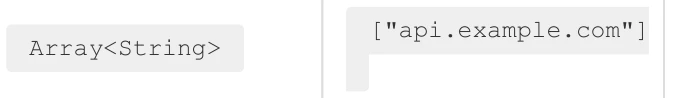

| 字段路径 | 类型 | 示例 | 说明 |
| --- | --- | --- | --- |
| data.services\[\].serviceI d | <code>string</code> | <code>"example"</code> | 关联服务标识。 |
| data.services\[\].name | <code>string</code> | <code>"example-mcp"</code> | 关联服务名称。 |
| data.consumerAuthInfo | <code>object</code> | {"enable":true} |  |
| data.consumerAuthInfo.type | <code>string</code> | <code>—</code> |  |
| data.consumerAuthInfo.enable | <code>boolean</code> | <code>true</code> |  |
| data.consumerAuthInfo.allowedConsumers\[\] | <code>Array&lt;String&gt;</code> | <code>—</code> |  |
| data.rawConfigurations | <code>string</code> | <code>—</code> |  |
| data.type | <code>string</code> | <code>"example"</code> | MCP 服务类型，DIRECT_ROUTE 类型可填充工具列表。 |
| data.dbType | <code>string</code> | <code>"MYSQL"</code> |  |
| data.dbConfig | <code>object</code> | — |  |
| data.dbConfig.host | <code>string</code> | <code>—</code> |  |
| data.dbConfig.port | <code>string</code> | <code>—</code> |  |
| data.dbConfig.usernam e | <code>string</code> | <code>—</code> |  |
| data.dbConfig.passwor d | <code>string</code> | <code>—</code> |  |
| data.dbConfig.dbname | <code>string</code> | <code>—</code> |  |
| data.dbConfig.otherPar ams | <code>object</code> | <code>—</code> |  |
| data.directRouteConfig | <code>object</code> | — |  |
| data.directRouteConfig.path | <code>string</code> | <code>—</code> |  |
| data.directRouteConfig.transportType | <code>string</code> | <code>—</code> |  |
| data.directRouteConfig.protocolConversion | <code>boolean</code> | <code>—</code> |  |
| data.observabilityEnabl ed | <code>boolean</code> | <code>false</code> |  |
| data.tools\[\] | <code>Array&lt;Object&gt;</code> | \[\] | MCP 工具数组。当前仅DIRECT_ROUTE 类型填充；缓存尚未生成时可能返回空数组并触发后台加载，稍后可重新查询。其他类型不保证返回此字段。 工具信息数组，不是单个对象；当前仅DIRECT_ROUTE 类型填充，首次读取可能为空数组。 |
| data.tools\[\].name | <code>string</code> | <code>"get_weather"</code> |  |
| data.tools\[\].description | <code>string</code> | <code> "</code>查询指定城市的天气<code>" </code> |  |
| data.tools\[\].inputSche ma | <code>object</code> | <code>{"type":"object","p</code><br><code>roperties":{"city":</code><br><code>{"type":"string"}},"</code><br><code>required":</code><br><code>["city"]}</code> |  |

**后端业务数据片段**

以下局部 JSON 展示当前后端业务数据形态，不代表 POP 外层响应。尚未通过 SDK 或实际调用验证，凭据使用占位值。

```json
{
  "name": "example-mcp",
  "type": "DIRECT_ROUTE",
  "services": [
    {
      "serviceId": "service-example-001",
      "name": "example-service"
    }
  ],
  "tools": []
}
```

**示例**

**请求示例**

```http
POST /mcpServer/getMcpServer HTTP/1.1

{
  "gwInstanceId": "gw-example-001",
  "mcpServerName": "example-mcp"
}
```

请求体示例。调用时使用部署环境要求的身份认证和请求签名。

**响应示例**

```json
{
  "code": 200,
  "msg": null,
  "requestId": "req-demo",
  "data": {
    "gwInstanceId": "gw-demo",
    "name": "demo",
    "description": "demo",
    "domains": [],
    "services": [],
    "rawConfigurations": "example",
    "type": "example",
    "dbType": "example",
    "observabilityEnabled": false,
    "tools": []
  }
}
```

POP 响应字段示例；仅展示已声明字段，不表示所有空值字段一定保留，也不代替实际返回结果。

<a id="section-1-3-3-6"></a>

#### 1.3.3.6. GetSsePathSuffix

调用 GetSsePathSuffix。

**说明**：此接口仅适用于 AI网关（Higress 引擎）实例。

**请求头**

公共请求头及认证信息的获取与携带方式，请参见获取公共Header参数。

**请求语法**

```http
POST /mcpServer/getSsePathSuffix HTTP/1.1
```

**请求参数**

| 参数名称 | 位置 | 类型 | 是否必选 | 示例 | 说明 |
| --- | --- | --- | --- | --- | --- |
| gwInstanceId | <code>body</code> | <code>string</code> | 是 | gw-example-001 | 目标网关实例标识，操作指定实例的资源时请显式提供有效值。不能为空或空白字符串。 |

参数表按接口声明列出名称、类型、位置和是否必选；业务校验及有效值限制见各字段说明。RepeatList 表示数组，路径中的 [] 表示数组元素层级；未列入主表的后端结构不等于可直接传入的 POP 参数。

**返回数据**

| 参数名称 | 类型 | 示例 | 说明 |
| --- | --- | --- | --- |
| requestId | string | req-demo | 请求 ID。 |
| code | <code>integer&lt;int32&gt;</code> | 200 | 业务状态码。示例中的200 表示处理成功，不等同于数据面配置已经生效。 |
| msg | <code>string</code> | <code>null</code> | 响应消息；本接口成功时为空。 |
| data | <code>string</code> | "" | 实例 higress-config 中配置的 SSE 路径后缀；未读取到配置时为空字符串。 |

本表仅列出本接口声明的 POP 返回字段，不将后端业务对象自动视为 POP 响应。成功时 msg 可能为空；null 的保留或省略方式尚未通过实际 POP 调用验证。

**后端业务结构补充说明**

| 字段路径 | 类型 | 示例 | 说明 |
| --- | --- | --- | --- |
| requestId | <code>string</code> | <code>"request-example-</code><br><code>001"</code> | 请求追踪标识。后端会补充此值；仅当本接口声明包含该字段时才属于 POP返回字段。 本接口未声明该 POP 响应字段。 |

**示例**

**请求示例**

```http
POST /mcpServer/getSsePathSuffix HTTP/1.1

{
  "gwInstanceId": "gw-example-001"
}
```

请求体示例。调用时使用部署环境要求的身份认证和请求签名。

**响应示例**

```json
{
  "requestId": "req-demo",
  "code": 200,
  "msg": null,
  "data": ""
}
```

POP 响应字段示例；仅展示已声明字段，不表示所有空值字段一定保留，也不代替实际返回结果。

<a id="section-1-3-3-7"></a>

#### 1.3.3.7. ListMcpServerConsumers

调用 ListMcpServerConsumers。

**说明**：此接口仅适用于 AI网关（Higress 引擎）实例。

**请求头**

公共请求头及认证信息的获取与携带方式，请参见获取公共Header参数。

**请求语法**

```http
POST /mcpServer/listMcpServerConsumers HTTP/1.1
```

**请求参数**

| 参数名称 | 位置 | 类型 | 是否必选 | 示例 | 说明 |
| --- | --- | --- | --- | --- | --- |
| size | <code>body</code> | <code>integer&lt;int</code><br><code>32&gt;</code> | 否 | <code>10</code> | 每页记录数，默认 10，必须为不小于 1 的整数，不能显式传null。 默认值：10。 最小值：1。 省略时使用默认值；显式传入 null 不合法。 |
| current | <code>body</code> | <code>integer&lt;int</code><br><code>32&gt;</code> | 否 | <code>1</code> | 页码，从 1 开始，默认 1，必须为不小于 1 的整数，不能显式传 null。 默认值：1。 最小值：1。 省略时使用默认值；显式传入 null 不合法。 |
| gwInstanceId | <code>body</code> | <code>string</code> | 是 | gw-example-001 | 目标网关实例标识，操作指定实例的资源时请显式提供有效值。不能为空或空白字符串。 |
| mcpServerNa me | <code>body</code> | <code>string</code> | 否 | example-mcp | MCP 服务名称，用于定位服务。 |
| consumerNam e | <code>body</code> | <code>string</code> | 否 | example-consumer | 消费者名称。 |

参数表按接口声明列出名称、类型、位置和是否必选；业务校验及有效值限制见各字段说明。RepeatList 表示数组，路径中的 [] 表示数组元素层级；未列入主表的后端结构不等于可直接传入的 POP 参数。

**返回数据**

| 参数名称 | 类型 | 示例 | 说明 |
| --- | --- | --- | --- |
| requestId | <code>string</code> | request-example-001 | 请求追踪标识。后端会补充此值；仅当本接口声明包含该字段时才属于 POP返回字段。 |
| code | <code>integer&lt;int32&gt;</code> | 200 | 业务状态码。示例中的200 表示处理成功，不等同于数据面配置已经生效。 |
| msg | <code>string</code> | <code>null</code> | 响应消息；本接口成功时为空。 |
| data | object | {} | 返回数据。 |
| data.total | integer&lt;int64&gt; | 0 | 记录总数。 |
| data.current | integer&lt;int64&gt; | 1 | 当前页码。 |
| data.size | integer&lt;int64&gt; | 1 | 每页条数。 |
| data.records | array | \[\] | 记录列表。 |
| data.records\[\].gwInstan ceId | string | gw-demo | 网关实例 ID。 |
| data.records\[\].mcpServ erName | string | demo | MCP 服务名称。 |
| data.records\[\].appId | string | app-demo | 消费者 appId（前端解除授权时回传此字段，后端按 appId 构造 authId 删除）。 |
| data.records\[\].consume rName | string | demo | 消费者展示名；无法查询展示名时使用 appId。 |
| data.records\[\].authTyp e | string | API_KEY | 消费者认证类型，固定为字符串 API_KEY。取值：Basic、OAUTH2、JWT、CUSTOM、API_KEY、API_GATEWAY、CSB。 |
| data.records\[\].enable | boolean | true | 兼容字段，固定为 true，不代表实时启用状态。 |

本表仅列出本接口声明的 POP 返回字段，不将后端业务对象自动视为 POP 响应。成功时 msg 可能为空；null 的保留或省略方式尚未通过实际 POP 调用验证。 本接口声明未包含 data，下面的后端业务数据不构成POP 必返字段保证。

**后端业务结构补充说明**

| 字段路径 | 类型 | 示例 | 说明 |
| --- | --- | --- | --- |
| data | <code>object</code> | <code>—</code> | 后端分页结果对象；是否包含在 POP 返回中以该接口声明和实际接入映射为准。 |
| data.total | <code>integer&lt;int32&gt;</code> | <code>1</code> | 后端分页查询记录总数。 |
| data.current | <code>integer&lt;int32&gt;</code> | <code>1</code> | 后端分页结果的页码。 |
| data.size | <code>integer&lt;int32&gt;</code> | <code>10</code> | 后端分页结果的分页大小。 |
| data.records\[\] | <code>Array&lt;Object&gt;</code> | <code>[]</code> | 后端记录数组，每个元素是一条业务记录，不是单个对象。 |
| data.records\[\].gwInsta nceId | <code>string</code> | <code>"gw-example-001"</code> |  |
| data.records\[\].mcpServ erName | <code>string</code> | <code>"mcp-example-</code><br><code>001"</code> |  |
| data.records\[\].consum erName | <code>string</code> | <code>"example-</code><br><code>consumer"</code> | 消费者展示名称；历史数据无法解析名称时可能回退为消费者标识。 |
| data.records\[\].authTyp e | <code>string</code> | <code>"API_KEY"</code> | 认证类型，字符串。当前接口固定返回 API_KEY；与应用详情中数值型authType 的表示方式不同。 |
| data.records\[\].enable | <code>boolean</code> | <code>true</code> | 兼容字段，当前接口固定返回 true，不代表消费者的实际启用状态。实际启用状态请通过 GetApp 查询。 |
| data.records\[\].appId | string | "cs-example-7f42" | 消费者标识，解除授权应使用有效 appId，而非consumerName。非分片模式按名称反查标识失败时，此字段可能回退为原名称；处理历史记录时请结合应用查询接口确认真实标识。 |

**后端业务数据片段**

以下局部 JSON 展示当前后端业务数据形态，不代表 POP 外层响应。尚未通过 SDK 或实际调用验证，凭据使用占位值。

```json
{
  "total": 1,
  "size": 10,
  "current": 1,
  "records": [
    {
      "appId": "cs-example-7f42",
      "consumerName": "example-consumer",
      "authType": "API_KEY",
      "enable": true
    }
  ]
}
```

**示例**

**请求示例**

```http
POST /mcpServer/listMcpServerConsumers HTTP/1.1

{
  "size": 10,
  "current": 1,
  "gwInstanceId": "gw-example-001",
  "mcpServerName": "example-mcp"
}
```

请求体示例。调用时使用部署环境要求的身份认证和请求签名。

**响应示例**

```json
{
  "requestId": "request-example-001",
  "code": 200,
  "msg": null,
  "message": null,
  "data": {
    "total": 0,
    "current": 1,
    "size": 1,
    "records": []
  }
}
```

POP 响应字段示例；仅展示已声明字段，不表示所有空值字段一定保留，也不代替实际返回结果。

<a id="section-1-3-3-8"></a>

#### 1.3.3.8. ListMcpServers

调用 ListMcpServers。

**说明**：此接口仅适用于 AI网关（Higress 引擎）实例。

**请求头**

公共请求头及认证信息的获取与携带方式，请参见获取公共Header参数。

**请求语法**

```http
POST /mcpServer/listMcpServers HTTP/1.1
```

**请求参数**

| 参数名称 | 位置 | 类型 | 是否必选 | 示例 | 说明 |
| --- | --- | --- | --- | --- | --- |
| size | <code>body</code> | <code>integer&lt;int</code><br><code>32&gt;</code> | 否 | <code>10</code> | 每页记录数，默认 10，必须不小于 1；不能显式传 null。 默认值：10。 最小值：1。 省略时使用默认值；显式传入 null不合法。 |
| current | <code>body</code> | <code>integer&lt;int</code><br><code>32&gt;</code> | 否 | <code>1</code> | 页码，从 1 开始，默认 1，必须不小于 1；不能显式传 null。默认值：1。 最小值：1。 省略时使用默认值；显式传入 null不合法。 |
| gwInstanceId | <code>body</code> | <code>string</code> | 是 | gw-example-001 | 目标网关实例标识，操作指定实例的资源时请显式提供有效值。不能为空或空白字符串。 |
| name | <code>body</code> | <code>string</code> | 否 | example-mcp | 名称。 |
| type | <code>body</code> | <code>string</code> | 否 | <code>"DATABASE"</code> | 类型。 |
| domainId | <code>body</code> | <code>string</code> | 否 | api.example.c om | 域名名称筛选条件。虽然字段名为 domainId，当前后端按域名名称传递，不进行域名 ID 转换，请填写域名名称。 |
| serviceId | <code>body</code> | <code>string</code> | 否 | example | 服务 ID。 |


参数表按接口声明列出名称、类型、位置和是否必选；业务校验及有效值限制见各字段说明。RepeatList 表示数组，路径中的 [] 表示数组元素层级；未列入主表的后端结构不等于可直接传入的 POP 参数。

**返回数据**

| 参数名称 | 类型 | 示例 | 说明 |
| --- | --- | --- | --- |
| requestId | string | req-demo | 请求 ID。 |
| code | <code>integer&lt;int32&gt;</code> | 200 | 业务状态码。示例中的200 表示处理成功，不等同于数据面配置已经生效。 |
| msg | <code>string</code> | <code>null</code> | 响应消息；本接口成功时为空。 |
| data | object | {} | 返回数据。 |
| data.total | integer&lt;int64&gt; | 0 | 记录总数。 |
| data.current | integer&lt;int64&gt; | 1 | 当前页码。 |
| data.size | integer&lt;int64&gt; | 1 | 每页条数。 |
| data.records | array | \[\] | 记录列表。 |
| data.records\[\].id | string | mcp-demo | MCP 服务标识，与服务名称相同。 |
| data.records\[\].gwInstan ceId | string | gw-demo | 网关实例 ID。 |
| data.records\[\].name | string | demo | 名称。 |
| data.records\[\].descripti on | string | demo | 描述。 |
| data.records\[\].domains | array | \[\] | — |
| data.records\[\].services | array | \[\] | — |
| data.records\[\].services\[\].serviceId | string | service-demo | 服务 ID。 |
| data.records\[\].services\[\].name | string | demo | 名称。 |
| data.records\[\].rawConfi gurations | string | example | — |
| data.records\[\].type | string | example | 类型。 |
| data.records\[\].dbType | string | example | — |

本表仅列出本接口声明的 POP 返回字段，不将后端业务对象自动视为 POP 响应。成功时 msg 可能为空；null 的保留或省略方式尚未通过实际 POP 调用验证。 本接口声明未包含 data，下面的后端业务数据不构成POP 必返字段保证。

**后端业务结构补充说明**

| 字段路径 | 类型 | 示例 | 说明 |
| --- | --- | --- | --- |
| requestId | <code>string</code> | <code>"request-example-</code><br><code>001"</code> | 请求追踪标识。后端会补充此值；仅当本接口声明包含该字段时才属于 POP返回字段。 本接口未声明该 POP 响应字段。 |
| data | <code>object</code> | <code>—</code> | 后端分页结果对象；是否包含在 POP 返回中以该接口声明和实际接入映射为准。 |
| data.total | <code>integer&lt;int32&gt;</code> | <code>1</code> | 后端分页查询记录总数。 |
| data.current | <code>integer&lt;int32&gt;</code> | <code>1</code> | 返回的页码。当前版本无结果时可能为 0，不保证始终回显请求页码。 |
| data.size | <code>integer&lt;int32&gt;</code> | <code>10</code> | 返回的分页大小。当前版本无结果时可能为 0。 |
| data.records\[\] | <code>Array&lt;Object&gt;</code> | <code>[]</code> | MCP 服务记录数组，无结果时为空数组。 |
| data.records\[\].id | <code>string</code> | <code>—</code> | 当前列表使用 MCP 服务名称填充 id，与同一记录的name 相同；这不表示创建或更新请求中已废弃的id 字段有效。 |
| data.records\[\].gwInstan ceId | <code>string</code> | <code>"gw-example-001"</code> |  |
| data.records\[\].name | <code>string</code> | <code>"example-mcp"</code> | MCP 服务名称，也是创建、更新和查询定位时使用的服务标识。 |
| data.records\[\].descripti on | <code>string</code> | <code> "</code>示例服务<code>" </code> |  |
| data.records\[\].domains \[\] | <code>Array&lt;String&gt;</code> | <code>["api.example.com"]</code> |  |
| data.records\[\].services\[\] | <code>Array&lt;Object&gt;</code> | <code>[{"serviceId":"serv</code><br><code>ice-example-</code><br><code>001","name":"example</code><br><code>-service"}]</code> |  |
| data.records\[\].services\[\].serviceId | <code>string</code> | <code>"service-example-</code><br><code>001"</code> |  |
| data.records\[\].services\[\].name | <code>string</code> | <code>"example-</code><br><code>service"</code> |  |
| data.records\[\].consume rAuthInfo | <code>object</code> | <code>—</code> | 当前列表接口不填充此字段，不能通过该字段获取认证开关或认证配置；请通过 GetMcpServer 查询详情。 |
| data.records\[\].consume rAuthInfo.type | <code>string</code> | <code>—</code> | 父字段data.records.consumer AuthInfo 在当前 AI 网关中不填充或不用于该配置；此成员不能作为可用配置或返回值保证。 |
| data.records\[\].consume rAuthInfo.enable | <code>boolean</code> | <code>—</code> | 父字段data.records.consumer AuthInfo 在当前 AI 网关中不填充或不用于该配置；此成员不能作为可用配置或返回值保证。 |

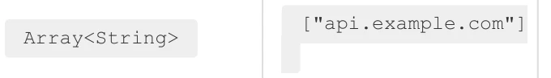

<table>
  <tr>
    <td>data.records[].consume rAuthInfo.allowedConsu mers[]</td>
    <td><code>Array&lt;String&gt;</code></td>
    <td><code>—</code></td>
    <td>父字段data.records.consumer AuthInfo 在当前 AI 网关中不填充或不用于该配置；此成员不能作为可用配置或返回值保证。</td>
  </tr>
  <tr>
    <td>data.records[].rawConfi gurations</td>
    <td><code>string</code></td>
    <td><code>—</code></td>
    <td></td>
  </tr>
  <tr>
    <td>data.records[].type</td>
    <td><code>string</code></td>
    <td><code>"DATABASE"</code></td>
    <td></td>
  </tr>
  <tr>
    <td>data.records[].dbType</td>
    <td><code>string</code></td>
    <td><code>"MYSQL"</code></td>
    <td>数据库类型，返回枚举常量名，例如 MYSQL，不是mysql；未配置时可能为空。</td>
  </tr>
  <tr>
    <td>data.records[].dbConfig</td>
    <td><code>object</code></td>
    <td><code>—</code></td>
    <td></td>
  </tr>
  <tr>
    <td>data.records[].dbConfig.host</td>
    <td><code>string</code></td>
    <td><code>—</code></td>
    <td></td>
  </tr>
  <tr>
    <td>data.records[].dbConfig.port</td>
    <td><code>string</code></td>
    <td><code>—</code></td>
    <td></td>
  </tr>
  <tr>
    <td>data.records[].dbConfig.username</td>
    <td><code>string</code></td>
    <td><code>—</code></td>
    <td></td>
  </tr>
  <tr>
    <td>data.records[].dbConfig.password</td>
    <td><code>string</code></td>
    <td><code>—</code></td>
    <td></td>
  </tr>
  <tr>
    <td>data.records[].dbConfig.dbname</td>
    <td><code>string</code></td>
    <td><code>—</code></td>
    <td></td>
  </tr>
  <tr>
    <td>data.records[].dbConfig.otherParams</td>
    <td><code>object</code></td>
    <td><code>—</code></td>
    <td></td>
  </tr>
  <tr>
    <td>data.records[].directRo uteConfig</td>
    <td><code>object</code></td>
    <td><code>—</code></td>
    <td></td>
  </tr>
  <tr>
    <td>data.records[].directRo uteConfig.path</td>
    <td><code>string</code></td>
    <td><code>—</code></td>
    <td></td>
  </tr>
  <tr>
    <td>data.records[].directRo uteConfig.transportTyp e</td>
    <td><code>string</code></td>
    <td><code>—</code></td>
    <td></td>
  </tr>
  <tr>
    <td>data.records[].directRo uteConfig.protocolConv ersion</td>
    <td><code>boolean</code></td>
    <td><code>—</code></td>
    <td></td>
  </tr>
</table>

**后端业务数据片段**

以下局部 JSON 展示当前后端业务数据形态，不代表 POP 外层响应。尚未通过 SDK 或实际调用验证，凭据使用占位值。

```json
{
  "total": 1,
  "size": 10,
  "current": 1,
  "records": [
    {
      "id": "example-mcp",
      "name": "example-mcp",
      "type": "DATABASE",
      "dbType": "MYSQL",
      "consumerAuthInfo": null
    }
  ]
}
```

**示例**

**请求示例**

```http
POST /mcpServer/listMcpServers HTTP/1.1

{
  "size": 10,
  "current": 1,
  "gwInstanceId": "gw-example-001",
  "name": "demo",
  "type": "example",
  "domainId": "api.example.com"
}
```

请求体示例。调用时使用部署环境要求的身份认证和请求签名。

**响应示例**

```json
{
  "code": 200,
  "msg": null,
  "requestId": "req-demo",
  "data": {
    "total": 0,
    "current": 1,
    "size": 1,
    "records": []
  }
}
```

POP 响应字段示例；仅展示已声明字段，不表示所有空值字段一定保留，也不代替实际返回结果。

<a id="section-1-3-3-9"></a>

#### 1.3.3.9. SwaggerToMcpConfig

调用 SwaggerToMcpConfig。

**说明**：此接口仅适用于 AI网关（Higress 引擎）实例。

**请求头**

公共请求头及认证信息的获取与携带方式，请参见获取公共Header参数。

**请求语法**

```http
POST /mcpServer/swaggerToMcpConfig HTTP/1.1
```

**请求参数**

| 参数名称 | 位置 | 类型 | 是否必选 | 示例 | 说明 |
| --- | --- | --- | --- | --- | --- |
| content | <code>body</code> | <code>string</code> | 是 | example | 需要转换的Swagger 文档内容，使用字符串传递。 不能为空或空白字符串。 |
| gwInstanceId | <code>body</code> | <code>string</code> | 是 | gw-example-001 | 目标网关实例标识，操作指定实例的资源时请显式提供有效值。不能为空或空白字符串。 |

参数表按接口声明列出名称、类型、位置和是否必选；业务校验及有效值限制见各字段说明。RepeatList 表示数组，路径中的 [] 表示数组元素层级；未列入主表的后端结构不等于可直接传入的 POP 参数。

**返回数据**

| 参数名称 | 类型 | 示例 | 说明 |
| --- | --- | --- | --- |
| requestId | string | req-demo | 请求 ID。 |
| code | <code>integer&lt;int32&gt;</code> | 200 | 业务状态码。示例中的200 表示处理成功，不等同于数据面配置已经生效。 |
| msg | <code>string</code> | <code>null</code> | 响应消息；本接口成功时为空。 |
| data | <code>string</code> | <code>—</code> | 接口声明为字符串。转换结果的具体格式尚未通过当前版本 SDK 验证；不要按固定对象结构读取mcpConfigContent 或warnings。 |

**后端业务结构补充说明**

| 字段路径 | 类型 | 示例 | 说明 |
| --- | --- | --- | --- |
| requestId | <code>string</code> | <code>"request-example-</code><br><code>001"</code> | 请求追踪标识。后端会补充此值；仅当本接口声明包含该字段时才属于 POP返回字段。 本接口未声明该 POP 响应字段。 |
| data.mcpConfigConten t | <code>string</code> | <code>—</code> |  |
| data.warnings\[\] | <code>Array&lt;String&gt;</code> | <code>—</code> |  |

**示例**

**请求示例**

```http
POST /mcpServer/swaggerToMcpConfig HTTP/1.1

{
  "content": "example",
  "gwInstanceId": "gw-example-001"
}
```

请求体示例。调用时使用部署环境要求的身份认证和请求签名。

**响应示例**

```json
{
  "code": 200,
  "msg": null,
  "requestId": "req-demo"
}
```

POP 响应字段示例；仅展示已声明字段，不表示所有空值字段一定保留，也不代替实际返回结果。

<a id="section-1-3-3-10"></a>

#### 1.3.3.10. UpdateMcpServer

调用 UpdateMcpServer。

**说明**：此接口仅适用于 AI网关（Higress 引擎）实例。

**请求头**

公共请求头及认证信息的获取与携带方式，请参见获取公共Header参数。

**请求语法**

```http
POST /mcpServer/updateMcpServer HTTP/1.1
```

**请求参数**

| 参数名称 | 位置 | 类型 | 是否必选 | 示例 | 说明 |
| --- | --- | --- | --- | --- | --- |
| gwInstanceId | <code>body</code> | <code>string</code> | 是 | gw-example-001 | 目标网关实例标识，操作指定实例的资源时请显式提供有效值。 |
| name | <code>body</code> | <code>string</code> | 否 | mcp-demo | MCP 服务名称，用于保存和定位服务。更新时使用已有名称，不支持通过id 改名。 |
| description | <code>body</code> | <code>string</code> | 是 | 示例服务 | Mcp server description 不能为空或空白字符串。 |
| domains | <code>body</code> | <code>array</code> | 否 | <code>[]</code> | Domains that the mcp server applies to.。 |
| services | <code>body</code> | <code>array</code> | 是 | \[\] | 关联服务数组；至少提供一个可查询到的有效serviceId。 不能为空。 |
| services\[\].serv iceId | body | string | 否 | service-demo | 关联服务的ID，调用时提供有效值。 |
| type | <code>body</code> | <code>string</code> | 否 | <code>"DATABASE"</code> | 请显式提交与目标 MCP 服务配置一致的类型，不依赖未确认的SDK 缺省行<br><br>为。<code>     </code> |
| consumerAuth Info | <code>body</code> | <code>Json</code> | 否 | <code>{"enable":t</code><br><code>rue}</code> | MCP 服务的消费者认证配置。 |
| rawConfigurat ions | <code>body</code> | <code>string</code> | 否 | example | Raw configurations in YAML format。 |
| dbConfig | <code>body</code> | <code>Json</code> | 否 | — | 数据库配置（type=DATA BASE 时需填写）。 |
| directRouteCo nfig | <code>body</code> | <code>Json</code> | 否 | — | 直连路由配置。 |
| observabilityE nabled | <code>body</code> | <code>boolean</code> | 否 | false | Mcp server observability enabled flag。 |


参数表按接口声明列出名称、类型、位置和是否必选；业务校验及有效值限制见各字段说明。RepeatList 表示数组，路径中的 [] 表示数组元素层级；未列入主表的后端结构不等于可直接传入的 POP 参数。 当前服务引用的 POP 成员与后端 serviceId 存在接入映射差异；以下请求仅展示声明形态，不是已经验证可成功创建或更新的调用。消费者认证凭证类型及服务类型的缺省行为尚未通过部署版本配套 SDK 验证。

**后端业务结构补充说明：services**

| 参数名称 | 位置 | 类型 | 是否必选 | 示例 | 说明 |
| --- | --- | --- | --- | --- | --- |
| services\[\].serv iceId | <code>body</code> | <code>string</code> | 不适用 | <code>"example"</code> | 后端服务标识，至少一个标识必须能解析到目标网关中的服务；无效引用会被过滤。当前 POP参数未声明此成员，不保证直接传入能生效。 |

**后端业务结构补充说明：consumerAuthInfo**

| 参数名称 | 位置 | 类型 | 是否必选 | 示例 | 说明 |
| --- | --- | --- | --- | --- | --- |
| consumerAuth Info.type | <code>body</code> | <code>string</code> | 不适用 | <code>—</code> | 消费者认证凭证类型，与顶层用于指定 MCP 服务类型的 type字段不同。 消费者认证凭证类型。分片模式不使用此字段选择认证方式；非分片模式的允许值须按部署版本确认。 |
| consumerAuth Info.enable | <code>body</code> | <code>boolean</code> | 不适用 | <code>true</code> | 消费者认证开关。分片模式下，提供对象时仅enable=true启用认证，false 或对象内未设置enable 按关闭处理；整个对象未提供时不执行本次开关更新。 |
| consumerAuth Info.allowedC onsumers\[\] | <code>body</code> | <code>Array&lt;Strin</code><br><code>g&gt;</code> | 不适用 | <code>—</code> |  |

**后端业务结构补充说明：dbConfig**

| 参数名称 | 位置 | 类型 | 是否必选 | 示例 | 说明 |
| --- | --- | --- | --- | --- | --- |
| dbConfig.host | <code>body</code> | <code>string</code> | 不适用 | <code>—</code> |  |
| dbConfig.port | <code>body</code> | <code>string</code> | 不适用 | <code>—</code> |  |
| dbConfig.user name | <code>body</code> | <code>string</code> | 不适用 | <code>—</code> |  |
| dbConfig.pass word | <code>body</code> | <code>string</code> | 不适用 | <code>—</code> |  |
| dbConfig.dbna me | <code>body</code> | <code>string</code> | 不适用 | <code>—</code> |  |
| dbConfig.othe rParams | <code>body</code> | <code>object</code> | 不适用 | <code>—</code> |  |

**后端业务结构补充说明：directRouteConfig**

| 参数名称 | 位置 | 类型 | 是否必选 | 示例 | 说明 |
| --- | --- | --- | --- | --- | --- |
| directRouteCo nfig.path | <code>body</code> | <code>string</code> | 不适用 | <code>—</code> |  |
| directRouteCo nfig.transport Type | <code>body</code> | <code>string</code> | 不适用 | <code>—</code> |  |
| directRouteCo nfig.protocolC onversion | <code>body</code> | <code>boolean</code> | 不适用 | <code>—</code> |  |

**返回数据**

| 参数名称 | 类型 | 示例 | 说明 |
| --- | --- | --- | --- |
| requestId | string | req-demo | 请求 ID。 |
| code | <code>integer&lt;int32&gt;</code> | 200 | 业务状态码。示例中的200 表示处理成功，不等同于数据面配置已经生效。 |
| msg | <code>string</code> | <code>null</code> | 响应消息；本接口成功时为空。 |
| data | <code>string</code> | mcp-demo | 已保存的 MCP 服务名称。 |

本表仅列出本接口声明的 POP 返回字段，不将后端业务对象自动视为 POP 响应。成功时 msg 可能为空；null 的保留或省略方式尚未通过实际 POP 调用验证。

**后端业务结构补充说明**

| 字段路径 | 类型 | 示例 | 说明 |
| --- | --- | --- | --- |
| requestId | <code>string</code> | <code>"request-example-</code><br><code>001"</code> | 请求追踪标识。后端会补充此值；仅当本接口声明包含该字段时才属于 POP返回字段。 本接口未声明该 POP 响应字段。 |

**示例**

**请求示例**

```http
POST /mcpServer/updateMcpServer HTTP/1.1

{
  "gwInstanceId": "gw-example-001",
  "name": "mcp-demo",
  "description": "数据库查询服务",
  "type": "DIRECT_ROUTE",
  "services": [
    {
      "name": "example-service",
      "port": 3306,
      "version": "v1",
      "weight": 100
    }
  ],
  "dbType": "MYSQL"
}
```

请求体示例。调用时使用部署环境要求的身份认证和请求签名。

**响应示例**

```json
{
  "requestId": "req-demo",
  "code": 200,
  "msg": null,
  "data": "mcp-demo"
}
```

POP 响应字段示例；仅展示已声明字段，不表示所有空值字段一定保留，也不代替实际返回结果。

<a id="section-1-3-4"></a>

### 1.3.4. 代理服务器

<a id="section-1-3-4-1"></a>

#### 1.3.4.1. CreateProxyServer

调用 CreateProxyServer 接口创建代理服务器。

**说明**：此接口仅适用于 AI网关（Higress引擎）实例。

**请求头**

公共请求头及认证信息的获取与携带方式，请参见获取公共Header参数。

**请求语法**

```http
POST /microservice/createProxyServer HTTP/1.1
```

**请求参数**

| 参数名称 | 位置 | 类型 | 是否必选 | 示例 | 说明 |
| --- | --- | --- | --- | --- | --- |
| gwInstanceId | <code>body</code> | <code>string</code> | 是 | <code>higress-</code><br><code>001</code> | 网关实例ID。不能为空或空白字符串。 |
| type | <code>body</code> | <code>string</code> | 否 | <code>HTTP</code> | 代理服务器类型。目前仅支持<code> HTTP </code>。 |
| name | <code>body</code> | <code>string</code> | 否 | <code>my-proxy-</code><br><code>server</code> | 代理服务器名称。 |
| version | <code>body</code> | <code>string</code> | 否 | <code>v1</code> | 代理服务器版本。更新时必填。 |
| serverAddress | <code>body</code> | <code>string</code> | 否 | <code>192.168.1.1</code><br><code>00</code> | 代理服务器地址，可以是IP或域名。 |
| serverPort | <code>body</code> | <code>integer&lt;int</code><br><code>32&gt;</code> | 否 | <code>8080</code> | 代理服务器端口。 |
| connectTimeo ut | <code>body</code> | <code>integer&lt;int</code><br><code>32&gt;</code> | 否 | <code>1200</code> | 连接超时时间（毫秒），默认1200。 |

**返回数据**

| 参数名称 | 类型 | 示例 | 说明 |
| --- | --- | --- | --- |
| requestId | <code>string</code> | <code>uuid-xxx-xxx</code> | 请求 ID。 |
| code | <code>integer&lt;int32&gt;</code> | 200 | 响应码。 |
| msg | <code>string</code> | <code>null</code> | 响应消息。 |
| data | <code>string</code> | <code>proxy-001</code> | 响应数据。 |

**示例**

**请求示例**

```http
POST /microservice/createProxyServer HTTP/1.1

{
  "type": "type_value",
  "name": "name_value",
  "version": "version_value",
  "serverAddress": "serverAddress_value",
  "serverPort": 0,
  "connectTimeout": 0,
  "gwInstanceId": "gwInstanceId_value"
}
```

**响应示例**

```json
{
  "requestId": "xxx-xxx-xxx",
  "code": 200,
  "msg": null,
  "message": null,
  "data": "data_value"
}
```

<a id="section-1-3-4-2"></a>

#### 1.3.4.2. DeleteProxyServer

调用 DeleteProxyServer 接口删除代理服务器。

**说明**：此接口仅适用于 AI网关（Higress引擎）实例。

**请求头**

公共请求头及认证信息的获取与携带方式，请参见获取公共Header参数。

**请求语法**

```http
POST /microservice/deleteProxyServer HTTP/1.1
```

**请求参数**

| 参数名称 | 位置 | 类型 | 是否必选 | 示例 | 说明 |
| --- | --- | --- | --- | --- | --- |
| gwInstanceId | <code>body</code> | <code>string</code> | 是 | <code>higress-</code><br><code>001</code> | 网关实例ID。 |
| proxyServerId | <code>body</code> | <code>string</code> | 是 | <code>proxy-</code><br><code>server-001</code> | proxyServerId参数。 |

**返回数据**

| 参数名称 | 类型 | 示例 | 说明 |
| --- | --- | --- | --- |
| requestId | <code>string</code> | <code>uuid-xxx-xxx</code> | 请求 ID。 |
| code | <code>integer&lt;int32&gt;</code> | 200 | 响应码。 |
| msg | <code>string</code> | <code>null</code> | 响应消息。 |
| data | <code>string</code> | <code>proxy-server-001</code> | 响应数据。 |

**示例**

**请求示例**

```http
POST /microservice/deleteProxyServer HTTP/1.1

{
  "gwInstanceId": "gwInstanceId_value",
  "proxyServerId": "proxyServerId_value"
}
```

**响应示例**

```json
{
  "requestId": "xxx-xxx-xxx",
  "code": 200,
  "msg": null,
  "message": null,
  "data": "data_value"
}
```

<a id="section-1-3-4-3"></a>

#### 1.3.4.3. GetProxyServer

调用 GetProxyServer 接口查询代理服务器详情。

**说明**：此接口仅适用于 AI网关（Higress引擎）实例。

**请求头**

公共请求头及认证信息的获取与携带方式，请参见获取公共Header参数。

**请求语法**

```http
POST /microservice/getProxyServer HTTP/1.1
```

**请求参数**

| 参数名称 | 位置 | 类型 | 是否必选 | 示例 | 说明 |
| --- | --- | --- | --- | --- | --- |
| gwInstanceId | <code>body</code> | <code>string</code> | 是 | <code>higress-</code><br><code>001</code> | 网关实例ID。 |
| proxyServerId | <code>body</code> | <code>string</code> | 是 | <code>proxy-001</code> | 代理服务器ID。 |

**返回数据**

| 参数名称 | 类型 | 示例 | 说明 |
| --- | --- | --- | --- |
| requestId | <code>string</code> | <code>uuid-xxx-xxx</code> | 请求 ID。 |
| code | <code>integer&lt;int32&gt;</code> | 200 | 响应码。 |
| msg | <code>string</code> | <code>null</code> | 响应消息。 |

**示例**

**请求示例**

```http
POST /microservice/getProxyServer HTTP/1.1

{
  "gwInstanceId": "gwInstanceId_value",
  "proxyServerId": "proxyServerId_value"
}
```

**响应示例**

```text
HTTP/1.1 200 OK
Content-Type: application/json
{
    "code": 200,
    "message": null,
    "requestId": "xxx-xxx-xxx",
    "data": {
        "type": "type_value",
        "name": "name_value",
        "version": "version_value",
        "serverAddress": "serverAddress_value",
        "serverPort": 0,
        "connectTimeout": 0
    }
}
```

<a id="section-1-3-4-4"></a>

#### 1.3.4.4. ListProxyServers

调用 ListProxyServers 接口查询代理服务器列表。

**说明**：此接口仅适用于 AI网关（Higress引擎）实例。

**请求头**

公共请求头及认证信息的获取与携带方式，请参见获取公共Header参数。

**请求语法**

```http
POST /microservice/listProxyServers HTTP/1.1
```

**请求参数**

| 参数名称 | 位置 | 类型 | 是否必选 | 示例 | 说明 |
| --- | --- | --- | --- | --- | --- |
| size | <code>body</code> | <code>integer&lt;int</code><br><code>32&gt;</code> | 否 | <code>10</code> | 每页大小。 默认值：10。 最小值：1。 省略时使用默认值；显式传入 null 不合法。 |
| current | <code>body</code> | <code>integer&lt;int</code><br><code>32&gt;</code> | 否 | <code>1</code> | 当前页码。 默认值：1。 最小值：1。 省略时使用默认值；显式传入 null 不合法。 |
| gwInstanceId | <code>body</code> | <code>string</code> | 是 | <code>higress-</code><br><code>001</code> | 网关实例ID。不能为空或空白字符串。 |

**返回数据**

| 参数名称 | 类型 | 示例 | 说明 |
| --- | --- | --- | --- |
| requestId | <code>string</code> | <code>uuid-xxx-xxx</code> | 请求 ID。 |
| code | <code>integer&lt;int32&gt;</code> | 200 | 响应码。 |
| msg | <code>string</code> | <code>null</code> | 响应消息。 |
| data | <code>object</code> | <code>{}</code> | 返回数据。 |
| data.total | integer&lt;int64&gt; | <code>2</code> | 记录总数。 |
| data.current | integer&lt;int64&gt; | <code>1</code> | 当前页码。 |
| data.size | integer&lt;int64&gt; | <code>10</code> | 每页条数。 |
| data.records | array | <code>[]</code> | 记录列表。 |

**示例**

**请求示例**

```http
POST /microservice/listProxyServers HTTP/1.1

{
  "size": 10,
  "current": 1,
  "gwInstanceId": "gwInstanceId_value"
}
```

**响应示例**

```json
{
  "code": 200,
  "message": null,
  "requestId": "xxx-xxx-xxx",
  "data": {
    "total": 0,
    "current": 0,
    "size": 0,
    "records": [
      {
        "type": "type_value",
        "name": "name_value",
        "version": "version_value",
        "serverAddress": "serverAddress_value",
        "serverPort": 0,
        "connectTimeout": 0
      }
    ]
  },
  "msg": null
}
```

<a id="section-1-3-4-5"></a>

#### 1.3.4.5. UpdateProxyServer

调用 UpdateProxyServer 接口修改代理服务器。编辑代理服务器。

**说明**：此接口仅适用于 AI网关（Higress引擎）实例。

**请求头**

公共请求头及认证信息的获取与携带方式，请参见获取公共Header参数。

**请求语法**

```http
POST /microservice/updateProxyServer HTTP/1.1
```

**请求参数**

| 参数名称 | 位置 | 类型 | 是否必选 | 示例 | 说明 |
| --- | --- | --- | --- | --- | --- |
| gwInstanceId | <code>body</code> | <code>string</code> | 是 | <code>higress-</code><br><code>001</code> | 网关实例ID。不能为空或空白字符串。 |
| type | <code>body</code> | <code>string</code> | 否 | <code>HTTP</code> | 代理服务器类型。目前仅支持<code> HTTP </code>。 |
| name | <code>body</code> | <code>string</code> | 否 | <code>my-proxy</code> | Proxy server name。 |
| version | <code>body</code> | <code>string</code> | 否 | <code>v1.0</code> | Proxy server version.Required when updating。 |
| serverAddress | <code>body</code> | <code>string</code> | 否 | <code>192.168.1.1</code><br><code>00</code> | Proxy server address, can be IP or domain name。 |
| serverPort | <code>body</code> | <code>integer&lt;int</code><br><code>32&gt;</code> | 否 | <code>8080</code> | Proxy server port。 |
| connectTimeo ut | <code>body</code> | <code>integer&lt;int</code><br><code>32&gt;</code> | 否 | <code>1200</code> | Proxy server connect timeout in milliseconds, default is 1200。 |

**返回数据**

| 参数名称 | 类型 | 示例 | 说明 |
| --- | --- | --- | --- |
| requestId | <code>string</code> | <code>uuid-xxx-xxx</code> | 请求 ID。 |
| code | <code>integer&lt;int32&gt;</code> | 200 | 响应码。 |
| msg | <code>string</code> | <code>null</code> | 响应消息。 |
| data | <code>string</code> | <code>my-proxy</code> | 响应数据。 |

**示例**

**请求示例**

```http
POST /microservice/updateProxyServer HTTP/1.1

{
  "type": "type_value",
  "name": "name_value",
  "version": "version_value",
  "serverAddress": "serverAddress_value",
  "serverPort": 0,
  "connectTimeout": 0,
  "gwInstanceId": "gwInstanceId_value"
}
```

**响应示例**

```json
{
  "requestId": "xxx-xxx-xxx",
  "code": 200,
  "msg": null,
  "message": null,
  "data": "data_value"
}
```

<a id="section-1-3-5"></a>

### 1.3.5. 服务来源

<a id="section-1-3-5-1"></a>

#### 1.3.5.1. BatchDeleteSource

调用 BatchDeleteSource 接口批量删除来源。

**说明**：此接口用于批量删除多个服务来源配置。

**请求头**

公共请求头及认证信息的获取与携带方式，请参见获取公共Header参数。

**请求语法**

```http
POST /source/batchDeleteSource HTTP/1.1
```

**请求参数**

| 参数名称 | 位置 | 类型 | 是否必选 | 示例 | 说明 |
| --- | --- | --- | --- | --- | --- |
| sourceIds | <code>body</code> | <code>array</code> | 是 | \[\] | 要删除的来源ID 列表。 |
| gwInstanceId | <code>body</code> | <code>string</code> | 是 | <code>higress-</code><br><code>001</code> | 网关实例唯一标识。 |

**返回数据**

| 参数名称 | 类型 | 示例 | 说明 |
| --- | --- | --- | --- |
| requestId | <code>string</code> | <code>uuid-xxx</code> | 请求 ID。 |
| code | <code>integer&lt;int32&gt;</code> | 200 | 响应码，200 表示成功。 |
| msg | <code>string</code> | <code>null</code> | 响应消息。 |
| data | <code>object</code> | {} | 返回数据。 |
| data.successIds | array | \[\] | — |
| data.failedIds | array | \[\] | — |

**示例**

**请求示例**

```http
POST /source/batchDeleteSource HTTP/1.1

{
  "sourceIds": [
    "source-001",
    "source-002",
    "source-003"
  ],
  "gwInstanceId": "higress-001"
}
```

**响应示例**

```json
{
  "requestId": "xxx-xxx-xxx",
  "code": 200,
  "msg": null,
  "message": null,
  "data": {
    "successIds": [
      "source-001",
      "source-003"
    ],
    "failedIds": [
      "source-002"
    ]
  }
}
```

<a id="section-1-3-5-2"></a>

#### 1.3.5.2. CreateSource

调用 CreateSource 接口创建来源。

**说明**：此接口用于注册新的服务来源（如 Nacos、EDAS、Eureka 等），支持 Higress 整合多种服务发现机制。

**请求头**

公共请求头及认证信息的获取与携带方式，请参见获取公共Header参数。

**请求语法**

```http
POST /source/createSource HTTP/1.1
```

**请求参数**

| 参数名称 | 位置 | 类型 | 是否必选 | 示例 | 说明 |
| --- | --- | --- | --- | --- | --- |
| sourceId | <code>body</code> | <code>string</code> | 见说明 | <code>source-</code><br><code>001</code> | 只有导入的时候会使用到。 是否需要提供取决于具体操作条件。 |
| gwInstanceId | <code>body</code> | <code>string</code> | 是 | <code>higress-</code><br><code>001</code> | 网关实例Id 不能为空或空白字符串。 |
| sourceName | <code>body</code> | <code>string</code> | 是 | <code>my-nacos</code> | 来源名称 不能为空或空白字符串。 |
| host | <code>body</code> | <code>string</code> | 见说明 | <code>nacos.examp</code><br><code>le.com</code> | 注册中心地址。是否需要提供取决于具体操作条件。 |
| port | <code>body</code> | <code>integer&lt;int</code><br><code>32&gt;</code> | 见说明 | <code>8848</code> | 注册中心端口号。 是否需要提供取决于具体操作条件。 |
| username | <code>body</code> | <code>string</code> | 见说明 | <code>nacos</code> | 注册中心用户名。 是否需要提供取决于具体操作条件。 |
| password | <code>body</code> | <code>string</code> | 见说明 | DEMO_CREDE NTIAL | 注册中心密码。是否需要提供取决于具体操作条件。 |
| description | <code>body</code> | <code>string</code> | 见说明 | <code> Nacos </code>服务发现<code> </code> | 来源备注。 是否需要提供取决于具体操作条件。 |
| sourceType | <code>body</code> | <code>integer&lt;int</code><br><code>32&gt;</code> | 是 | <code>1</code> | 来源类型 \* @see com.aliyun.cs b.common.mo del.enums.So urceTypeEnu m。 |
| sourceStruct | <code>body</code> | object | 见说明 | {} | sourceType=1<br>\* @see NacosSourceD TOsourceType =2@see EdasSourceDT OsourceType =3@see EurekaSource DTOsourceTy pe=4@see K8sSourceStr uct&lt;p&gt;source Type=7@see FixedNodesDT O。 是否需要提供取决于具体操作条件。 |


**sourceType 枚举值**

| 值 | 类型名称 | 说明 |
| --- | --- | --- |
| 1 | Nacos | Nacos 服务发现，支持阿里云 MSE Nacos 和开源 Nacos。 |
| 2 | EDAS | EDAS 服务发现，支持阿里云EDAS。 |
| 3 | Eureka | Eureka 服务发现。 |
| 4 | K8s | Kubernetes 服务发现。 |
| 7 | 固定节点 | 固定 IP 地址节点。 |

**sourceStruct 结构说明Nacos 来源配置（sourceType = 1）**

| 参数名称 | 类型 | 是否必选 | 说明 |
| --- | --- | --- | --- |
| requestId | string | 见说明 | 请求 ID。 |
| code | integer&lt;int32&gt; | 见说明 | 响应码，200 表示成功。 |
| msg | string | 见说明 | 响应消息。 |
| data | string | 见说明 | 创建成功的来源 ID。 |

**示例**：

```json
{
  "nacosRegistry": "example.com:8848",
  "checkType": 0,
  "nacosAccessKey": "AK_xxx",
  "nacosSecretKey": "SK_xxx"
}
```

**EDAS 来源配置（sourceType = 2）**

| 参数名称 | 类型 | 是否必选 | 说明 |
| --- | --- | --- | --- |
| type | <code>integer</code> | 是 | 注册类型：0=Nacos，1=ConfigSer ver。 |
| edasNameSpaceId | <code>string</code> | 是 | EDAS 命名空间 ID。 |
| edasServerAddr | <code>string</code> | 否 | 服务器地址。 |
| edasEndPoint | <code>string</code> | 否 | 端点地址。 |
| edasEndPointPort | <code>integer</code> | 否 | 端点端口。 |
| edasAccessKey | <code>string</code> | 否 | 阿里云 AccessKey。 |
| edasSecretKey | <code>string</code> | 否 | 阿里云 SecretKey。 |

**示例**：

```json
{
  "type": 0,
  "edasNameSpaceId": "namespace-001",
  "edasServerAddr": "edas-server.aliyuncs.com",
  "edasAccessKey": "AK_xxx",
  "edasSecretKey": "SK_xxx"
}
```

**Eureka 来源配置（sourceType = 3）**

| 参数名称 | 类型 | 是否必选 | 说明 |
| --- | --- | --- | --- |
| eurekaRegistry | <code>string</code> | 是 | Eureka 注册中心地址。 |

**示例**：

```json
{
  "eurekaRegistry": "eureka.example.com:8761"
}
```

**K8s 来源配置（sourceType = 4）**

| 参数名称 | 类型 | 是否必选 | 说明 |
| --- | --- | --- | --- |
| k8sConfig | <code>string</code> | 是 | KubeConfig 内容（Base64 编码）。 |

**示例**：

```json
{
  "k8sConfig": "base64-encoded-kubeconfig"
}
```

**固定节点配置（sourceType = 7）**

| 参数名称 | 类型 | 是否必选 | 说明 |
| --- | --- | --- | --- |
| nodes | <code>array</code> | 是 | 节点列表。 |
| nodes\[\].ip | <code>string</code> | 是 | IP 地址。 |
| nodes\[\].port | <code>integer</code> | 是 | 端口。 |
| nodes\[\].weight | <code>integer</code> | 否 | 权重，默认 1。 |
| nodes\[\].enable | <code>boolean</code> | 否 | 是否启用，默认 true。 |
| nodes\[\].vpcId | <code>string</code> | 否 | VPC ID（VPC 场景）。 |
| nodes\[\].vpcMappingIp | <code>string</code> | 否 | VPC 映射 IP。 |
| nodes\[\].vpcMappingPor t | <code>integer</code> | 否 | VPC 映射端口。 |

**示例**：

```json
{
  "nodes": [
    {
      "ip": "192.168.1.1",
      "port": 8080,
      "weight": 1,
      "enable": true
    },
    {
      "ip": "192.168.1.2",
      "port": 8080,
      "weight": 1,
      "enable": true
    }
  ]
}
```

**返回数据**

| 参数名称 | 类型 | 示例 | 说明 |
| --- | --- | --- | --- |
| requestId | <code>string</code> | <code>uuid-xxx</code> | 请求ID。 |
| code | <code>integer&lt;int32&gt;</code> | <code>200</code> | 响应码，200 表示成功。 |
| msg | <code>string</code> | <code>null</code> | 响应消息。成功时可为空，不保证为success；是否省略取决于实际响应序列化。 |
| data | <code>string</code> | <code>source-001</code> | 创建成功的来源 ID。 |

**示例**

**请求示例 - 创建 Nacos 来源**

```http
POST /source/createSource HTTP/1.1

{
  "gwInstanceId": "higress-001",
  "sourceName": "my-nacos",
  "sourceType": 1,
  "description": "Nacos 服务发现",
  "sourceStruct": {
    "nacosRegistry": "example.com:8848",
    "checkType": 0,
    "nacosAccessKey": "DEMO_CREDENTIAL",
    "nacosSecretKey": "DEMO_CREDENTIAL"
  }
}
```

**请求示例 - 创建固定节点来源**

```http
POST /source/createSource HTTP/1.1

{
  "gwInstanceId": "higress-001",
  "sourceName": "fixed-backend",
  "sourceType": 7,
  "description": "固定后端服务",
  "sourceStruct": {
    "nodes": [
      {
        "ip": "192.168.1.1",
        "port": 8080,
        "weight": 1,
        "enable": true
      },
      {
        "ip": "192.168.1.2",
        "port": 8080,
        "weight": 1,
        "enable": true
      }
    ]
  }
}
```

**响应示例**

```json
{
  "requestId": "xxx-xxx-xxx",
  "code": 200,
  "msg": null,
  "message": null,
  "data": "source-001"
}
```

<a id="section-1-3-5-3"></a>

#### 1.3.5.3. DeleteSource

调用 DeleteSource 接口删除来源。

**说明**：此接口用于删除指定的服务来源配置。

**请求头**

公共请求头及认证信息的获取与携带方式，请参见获取公共Header参数。

**请求语法**

```http
POST /source/deleteSource HTTP/1.1
```

**请求参数**

| 参数名称 | 位置 | 类型 | 是否必选 | 示例 | 说明 |
| --- | --- | --- | --- | --- | --- |
| sourceId | <code>body</code> | <code>string</code> | 是 | <code>source-</code><br><code>001</code> | 要删除的来源ID。 |
| gwInstanceId | <code>body</code> | <code>string</code> | 是 | <code>higress-</code><br><code>001</code> | 网关实例唯一标识。 |

**返回数据**

| 参数名称 | 类型 | 示例 | 说明 |
| --- | --- | --- | --- |
| requestId | <code>string</code> | <code>uuid-xxx</code> | 请求 ID。 |
| code | <code>integer&lt;int32&gt;</code> | 200 | 响应码，200 表示成功。 |
| msg | <code>string</code> | <code>null</code> | 响应消息。 |
| data | <code>string</code> | <code>source-001</code> | 已删除的来源 ID。 |

**示例请求示例**

```http
POST /source/deleteSource HTTP/1.1

{
  "sourceId": "source-001",
  "gwInstanceId": "higress-001"
}
```

**响应示例**

```json
{
  "requestId": "xxx-xxx-xxx",
  "code": 200,
  "msg": null,
  "message": null,
  "data": "source-001"
}
```

<a id="section-1-3-5-4"></a>

#### 1.3.5.4. GetSource

调用 GetSource 接口查询来源详情。

**说明**：此接口用于获取单个服务来源的详细配置信息。

**请求头**

公共请求头及认证信息的获取与携带方式，请参见获取公共Header参数。

**请求语法**

```http
POST /source/getSource HTTP/1.1
```

**请求参数**

| 参数名称 | 位置 | 类型 | 是否必选 | 示例 | 说明 |
| --- | --- | --- | --- | --- | --- |
| sourceId | <code>body</code> | <code>string</code> | 是 | <code>source-</code><br><code>001</code> | 来源唯一标识。 |
| gwInstanceId | <code>body</code> | <code>string</code> | 是 | <code>higress-</code><br><code>001</code> | 网关实例唯一标识。 |

**返回数据**

| 参数名称 | 类型 | 示例 | 说明 |
| --- | --- | --- | --- |
| requestId | <code>string</code> | <code>uuid-xxx</code> | 请求 ID。 |
| code | <code>integer&lt;int32&gt;</code> | 200 | 响应码，200 表示成功。 |
| msg | <code>string</code> | <code>null</code> | 响应消息。 |
| data | <code>object</code> | {} | 返回数据。 |
| data.sourceId | <code>string</code> | <code>source-001</code> | — |
| data.sourceName | <code>string</code> | <code>my-nacos</code> | — |
| data.sourceType | integer&lt;int32&gt; | <code>1</code> | — |
| data.sourceTypeName | <code>string</code> | <code>Nacos</code> | — |
| data.sourceStruct | <code>object</code> | <code>{}</code> | — |
| data.description | <code>string</code> | <code> Nacos </code>服务发现<code> </code> | 描述。 |
| data.createTime | <code>string</code> | 2026-01-01 00:00:00 | 创建时间 格式：yyyy-MM-dd HH:mm:ss。 |
| data.updateTime | <code>string</code> | 2026-01-01 00:00:00 | 更新时间 格式：yyyy-MM-dd HH:mm:ss。 |

**示例**

**请求示例**

```http
POST /source/getSource HTTP/1.1

{
  "sourceId": "source-001",
  "gwInstanceId": "higress-001"
}
```

**响应示例**

```json
{
  "code": 200,
  "message": null,
  "requestId": "xxx-xxx-xxx",
  "data": {
    "sourceId": "source-001",
    "sourceName": "my-nacos",
    "sourceType": 1,
    "sourceTypeName": "Nacos",
    "sourceStruct": {
      "nacosRegistry": "example.com:8848",
      "checkType": 0,
      "nacosAccessKey": "DEMO_CREDENTIAL",
      "nacosSecretKey": "DEMO_CREDENTIAL"
    },
    "description": "Nacos 服务发现",
    "createTime": "2026-01-01 00:00:00",
    "updateTime": "2026-01-01 00:00:00"
  },
  "msg": null
}
```

<a id="section-1-3-5-5"></a>

#### 1.3.5.5. ListAllNamespaces

调用 ListAllNamespaces 接口获取所有命名空间。查询来源下的命名空间列表。

**说明**：此接口用于查询指定服务来源（如 Nacos、EDAS）下的命名空间列表，主要用于服务发现场景。

**请求头**

公共请求头及认证信息的获取与携带方式，请参见获取公共Header参数。

**请求语法**

```http
POST /source/listAllNamespaces HTTP/1.1
```

**请求参数**

| 参数名称 | 位置 | 类型 | 是否必选 | 示例 | 说明 |
| --- | --- | --- | --- | --- | --- |
| gwInstanceId | <code>body</code> | <code>string</code> | 是 | <code>higress-</code><br><code>001</code> | 网关实例唯一标识。 |
| sourceId | <code>body</code> | <code>string</code> | 是 | <code>source-</code><br><code>001</code> | 来源唯一标识。 |

**返回数据**

| 参数名称 | 类型 | 示例 | 说明 |
| --- | --- | --- | --- |
| requestId | <code>string</code> | <code>uuid-xxx</code> | 请求 ID。 |
| code | <code>integer&lt;int32&gt;</code> | 200 | 响应码，200 表示成功。 |
| msg | <code>string</code> | <code>null</code> | 响应消息。 |
| data | array | <code>[]</code> | 命名空间列表。 |
| data\[\].namespaceId | <code>string</code> | <code>namespace-001</code> | 命名空间 ID。 |
| data\[\].namespaceNam e | <code>string</code> | <br><code> </code>生产环境<code> </code> | 命名空间展示名称。 |

**示例**

**请求示例**

```http
POST /source/listAllNamespaces HTTP/1.1

{
  "gwInstanceId": "higress-001",
  "sourceId": "source-001"
}
```

**响应示例**

```json
{
  "requestId": "xxx-xxx-xxx",
  "code": 200,
  "msg": null,
  "message": null,
  "data": [
    {
      "namespaceId": "public",
      "namespaceName": "公共命名空间"
    },
    {
      "namespaceId": "namespace-001",
      "namespaceName": "⽣产环境"
    },
    {
      "namespaceId": "namespace-002",
      "namespaceName": "测试环境"
    }
  ]
}
```

<a id="section-1-3-5-6"></a>

#### 1.3.5.6. ListAllSources

调用 ListAllSources 接口获取所有来源。全量查询来源列表。

**说明**：此接口用于全量查询指定网关实例下的所有服务来源（不分页）。

**请求头**

公共请求头及认证信息的获取与携带方式，请参见获取公共Header参数。

**请求语法**

```http
POST /source/listAllSources HTTP/1.1
```

**请求参数**

| 参数名称 | 位置 | 类型 | 是否必选 | 示例 | 说明 |
| --- | --- | --- | --- | --- | --- |
| gwInstanceId | <code>body</code> | <code>string</code> | 否 | <code>higress-</code><br><code>001</code> | 网关实例唯一标识。 |
| serviceType | <code>body</code> | <code>integer&lt;int</code><br><code>32&gt;</code> | 否 | <code>1</code> | FIXME-lvshui 2025/3/23: 什么作用？。 |
| isDisasterRec overy | <code>body</code> | <code>boolean</code> | 否 | <code>false</code> | 是否容灾来源。 |

**返回数据**

| 参数名称 | 类型 | 示例 | 说明 |
| --- | --- | --- | --- |
| requestId | <code>string</code> | <code>uuid-xxx</code> | 请求 ID。 |
| code | <code>integer&lt;int32&gt;</code> | 200 | 响应码，200 表示成功。 |
| msg | <code>string</code> | <code>null</code> | 响应消息。 |
| data | array | <code>[]</code> | 来源列表。 |
| data\[\].sourceId | <code>string</code> | <code>source-001</code> | 来源 ID。 |
| data\[\].sourceName | <code>string</code> | <code>my-nacos</code> | 来源名称。 |
| data\[\].sourceType | <code>integer&lt;int32&gt;</code> | <code>1</code> | 类型代码。 |
| data\[\].sourceTypeNam e | <code>string</code> | <code>Nacos</code> | 类型名称。 |
| data\[\].sourceStruct | object | {} | 接口结构声明字段；未补造业务约束或可直接调用的示例值。 |
| data\[\].description | <code>string</code> | <code> Nacos </code>服务发现<code> </code> | 描述。 |

**示例**

**请求示例**

```http
POST /source/listAllSources HTTP/1.1

{
  "gwInstanceId": "higress-001"
}
```

**响应示例**

```json
{
  "code": 200,
  "message": null,
  "requestId": "xxx-xxx-xxx",
  "data": [
    {
      "sourceId": "source-001",
      "sourceName": "my-nacos",
      "sourceType": 1,
      "sourceTypeName": "Nacos",
      "description": "Nacos 服务发现",
      "sourceStruct": {}
    },
    {
      "sourceId": "source-002",
      "sourceName": "my-eureka",
      "sourceType": 3,
      "sourceTypeName": "Eureka",
      "description": "Eureka 服务发现",
      "sourceStruct": {}
    }
  ],
  "msg": null
}
```

<a id="section-1-3-5-7"></a>

#### 1.3.5.7. ListSources

调用 ListSources 接口分页查询来源列表。

**说明**：此接口用于分页查询指定网关实例下的服务来源列表。

**请求头**

公共请求头及认证信息的获取与携带方式，请参见获取公共Header参数。

**请求语法**

```http
POST /source/listSources HTTP/1.1
```

**请求参数**

| 参数名称 | 位置 | 类型 | 是否必选 | 示例 | 说明 |
| --- | --- | --- | --- | --- | --- |
| size | <code>body</code> | <code>integer&lt;int</code><br><code>32&gt;</code> | 否 | <code>10</code> | 每页大小。 默认值：10。 最小值：1。 省略时使用默认值；显式传入 null 不合法。 |
| current | <code>body</code> | <code>integer&lt;int</code><br><code>32&gt;</code> | 否 | <code>1</code> | 当前页码。 默认值：1。 最小值：1。 省略时使用默认值；显式传入 null 不合法。 |
| isShareInstan ce | body | boolean | 否 | false | 接口结构声明字段；未补造业务约束或可直接调用的示例值。 |
| regionId | body | string | 否 | — | 接口结构声明字段；未补造业务约束或可直接调用的示例值。 |
| resourceGrou pId | body | integer&lt;int64 &gt; | 否 | 0 | 接口结构声明字段；未补造业务约束或可直接调用的示例值。 |
| orgPathId | <code>body</code> | <code>string</code> | 否 | <code>org-001</code> | 组织路径 ID。 |
| resourceType | <code>body</code> | <code>string</code> | 否 | <code>Nacos</code> | 资源类型过滤。 |
| gwInstanceId | <code>body</code> | <code>string</code> | 是 | <code>higress-</code><br><code>001</code> | 网关实例唯一标识。 |
| sourceId | <code>body</code> | <code>string</code> | 否 | <code>source-</code><br><code>001</code> | 来源 ID 精确检索。 |
| sourceName | <code>body</code> | <code>string</code> | 否 | <code>nacos</code> | 来源名称模糊检索。 |
| sourceType | body | integer&lt;int32 &gt; | 否 | 0 | 服务来源类型筛选@see com.aliyun.cs b.common.mo del.enums.So urceTypeEnu m。 |

**返回数据**

| 参数名称 | 类型 | 示例 | 说明 |
| --- | --- | --- | --- |
| requestId | <code>string</code> | <code>uuid-xxx</code> | 请求 ID。 |
| code | <code>integer&lt;int32&gt;</code> | 200 | 响应码，200 表示成功。 |
| msg | <code>string</code> | <code>null</code> | 响应消息。 |
| data | <code>object</code> | {} | 返回数据。 |
| data.size | integer&lt;int32&gt; | <code>10</code> | 每页条数。 |
| data.total | integer&lt;int64&gt; | <code>100</code> | 记录总数。 |
| data.current | integer&lt;int32&gt; | <code>1</code> | 当前页码。 |
| data.records | <code>array</code> | <code>[]</code> | 记录列表。 |
| data.records\[\].sourceId | <code>string</code> | <code>source-001</code> | — |
| data.records\[\].sourceN ame | <code>string</code> | <code>my-nacos</code> | — |
| data.records\[\].sourceTy pe | integer&lt;int32&gt; | <code>1</code> | — |
| data.records\[\].sourceTy peName | <code>string</code> | <code>Nacos</code> | — |
| data.records\[\].descripti on | <code>string</code> | <code> Nacos </code>服务发现<code> </code> | 描述。 |
| data.records\[\].createTi me | <code>string</code> | 2026-01-01 00:00:00 | 创建时间 格式：yyyy-MM-dd HH:mm:ss。 |
| data.records\[\].updateTi me | <code>string</code> | 2026-01-01 00:00:00 | 更新时间 格式：yyyy-MM-dd HH:mm:ss。 |

**示例**

**请求示例**

```http
POST /source/listSources HTTP/1.1

{
  "size": 10,
  "current": 1,
  "gwInstanceId": "higress-001",
  "sourceName": "nacos"
}
```

**响应示例**

```json
{
  "requestId": "xxx-xxx-xxx",
  "code": 200,
  "msg": null,
  "message": null,
  "data": {
    "size": 10,
    "total": 2,
    "current": 1,
    "records": [
      {
        "sourceId": "source-001",
        "sourceName": "my-nacos",
        "sourceType": 1,
        "sourceTypeName": "Nacos",
        "description": "Nacos 服务发现",
        "createTime": "2026-01-01 00:00:00",
        "updateTime": "2026-01-01 00:00:00"
      },
      {
        "sourceId": "source-002",
        "sourceName": "my-nacos-backup",
        "sourceType": 1,
        "sourceTypeName": "Nacos",
        "description": "备⽤ Nacos",
        "createTime": "2026-01-01 00:00:00",
        "updateTime": "2026-01-01 00:00:00"
      }
    ]
  }
}
```

<a id="section-1-3-5-8"></a>

#### 1.3.5.8. ModifySource

调用 ModifySource 接口修改来源。

**说明**：此接口用于修改现有的服务来源配置。

**请求头**

公共请求头及认证信息的获取与携带方式，请参见获取公共Header参数。

**请求语法**

```http
POST /source/modifySource HTTP/1.1
```

**请求参数**

| 参数名称 | 位置 | 类型 | 是否必选 | 示例 | 说明 |
| --- | --- | --- | --- | --- | --- |
| sourceId | <code>body</code> | <code>string</code> | 是 | <code>source-</code><br><code>001</code> | 来源唯一标识。不能为空或空白字符串。 |
| gwInstanceId | <code>body</code> | <code>string</code> | 是 | <code>higress-</code><br><code>001</code> | 网关实例唯一标识。 不能为空或空白字符串。 |
| sourceName | <code>body</code> | <code>string</code> | 见说明 | <code>my-nacos-</code><br><code>updated</code> | 来源名称。 是否需要提供取决于具体操作条件。 |
| sourceStruct | <code>body</code> | object | 见说明 | {} | 来源详细配置。是否需要提供取决于具体操作条件。 |
| description | <code>body</code> | <code>string</code> | 见说明 | <code> </code>更新后的<code> </code><code>Nacos </code>配置<code> </code> | 备注说明。 是否需要提供取决于具体操作条件。 |
| sourceType | <code>body</code> | <code>integer&lt;int</code><br><code>32&gt;</code> | 见说明 | <code>1</code> | 来源类型。 是否需要提供取决于具体操作条件。 |


**说明**： `sourceStruct`  的结构请参考 createSource 接口文档中的  `sourceStruct` 结构说明 。

**返回数据**

| 参数名称 | 类型 | 示例 | 说明 |
| --- | --- | --- | --- |
| requestId | <code>string</code> | <code>uuid-xxx</code> | 请求 ID。 |
| code | <code>integer&lt;int32&gt;</code> | 200 | 响应码，200 表示成功。 |
| msg | <code>string</code> | <code>null</code> | 响应消息。 |
| data | <code>string</code> | <code>source-001</code> | 已修改的来源 ID。 |

**示例请求示例**

```http
POST /source/modifySource HTTP/1.1

{
  "sourceId": "source-001",
  "gwInstanceId": "higress-001",
  "sourceName": "my-nacos-updated",
  "description": "更新后的 Nacos 配置",
  "sourceStruct": {
    "nacosRegistry": "example.com:8848",
    "checkType": 0,
    "nacosAccessKey": "DEMO_CREDENTIAL",
    "nacosSecretKey": "DEMO_CREDENTIAL"
  }
}
```

**响应示例**

```json
{
  "requestId": "xxx-xxx-xxx",
  "code": 200,
  "msg": null,
  "message": null,
  "data": "source-001"
}
```

<a id="section-1-3-5-9"></a>

#### 1.3.5.9. CreateCascadeService

调用 CreateCascadeService 接口在目标网关创建访问源网关的固定节点服务，并发布到配置中心。该接口主要由创建级联链路自动调用。

**请求头**

公共请求头及认证信息的获取与携带方式，请参见获取公共Header参数。

**请求语法**

```http
POST /cascadeService/createCascadeService HTTP/1.1
```

**请求参数**

| 参数名称 | 位置 | 类型 | 是否必选 | 示例 | 说明 |
| --- | --- | --- | --- | --- | --- |
| gwInstanc eId | body | string | 是 | gw-target-123456\*\*\*\* | 目标网关实例 ID。 不能为空或空白字符串。 |
| descriptio n | body | string | 否 | 由源网关创建的级联访问服务 | 描述，最多 255 字符。 |
| serviceTyp e | body | integer &lt;int32 &gt; | 否 | 0 | 0表示RPC服务，1表示数据库。 |
| name | body | string | 是 | gw-source-123456\*\*\*\*:source-gateway | 服务名称，网关中标识 不能为空或空白字符串。 |
| upstreamT ype | body | integer &lt;int32 &gt; | 否 | 1 | 1 固定节点 2 服务发现 3 服务导入。 |
| serviceSou rceType | body | integer &lt;int32 &gt; | 否 | 4 | @see com.aliyun.csb.common.model.enums.SourceTyp eEnum。 |
| serviceNa me | body | string | 否 | source-gateway | 注册中心中的服务名服务发现时存在固定节点为空。 |
| loadBalanc eType | body | integer &lt;int32 &gt; | 否 | 1 | 负载均衡类型&lt;p&gt;可选值参考LoadBalanceTypeEnum：-WEIGHT_ROUND_ROBIN(1): 加权轮询（仅固定节点）-WEIGHT_RANDOM(2): 加权随机（仅固定节点）-ROUND_ROBIN(3): 轮询（通用）- RANDOM(4): 随机（通用）-LEAST_REQUEST(5): 最少请求（Higress Nacos 专用）-CONSISTENT_HASH(6): 一致性哈希（Higress Nacos专用）- LEAST_CONN(7):最少连接（Higress Nacos专用）。 |
| serviceStr uct | body | object | 否 | {} | 存储服务相关信息，包括命名空间信息和协议转换相关元数据。 |
| isOpenHea lthCheck | body | boolean | 否 | false | 是否开启健康检查。 |
| healthChe ckStruct | body | object | 否 | {} | 健康检查结构体。 |
| healthChe ckStruct.ty pe | body | integer &lt;int32 &gt; | 否 | 0 | 检查类型。 |
| healthChe ckStruct.h ealthPath | body | string | 否 | example | 检查路径。 |
| healthChe ckStruct.ht tpStatuses | body | string | 否 | example | 健康状态码。 |
| healthChe ckStruct.ti meout | body | integer &lt;int32 &gt; | 否 | 0 | 请求超时。 |
| healthChe ckStruct.h ealthInterv al | body | integer &lt;int32 &gt; | 否 | 0 | 健康检查间隔。 |
| healthChe ckStruct.u nHealthInt erval | body | integer &lt;int32 &gt; | 否 | 0 | 不健康检查间隔。 |
| healthChe ckStruct.ht tpSuccess es | body | integer &lt;int32 &gt; | 否 | 0 | 成功阈值。 |
| healthChe ckStruct.ht tpFailures | body | integer &lt;int32 &gt; | 否 | 0 | 失败阈值。 |
| activeHeal thCheckStr uct | body | object | 否 | {} | 主动健康检查结构体，higress service。 |
| activeHeal thCheckStr uct.enable | body | boolean | 否 | false | 是否启用。 |
| activeHeal thCheckStr uct.protoc ol | body | string | 否 | example | — |
| activeHeal thCheckStr uct.timeou t | body | integer &lt;int32 &gt; | 否 | 0 | — |
| activeHeal thCheckStr uct.interva l | body | integer &lt;int32 &gt; | 否 | 0 | — |
| activeHeal thCheckStr uct.health yThreshol d | body | integer &lt;int32 &gt; | 否 | 0 | — |
| activeHeal thCheckStr uct.unheal thyThresh old | body | integer &lt;int32 &gt; | 否 | 0 | — |
| activeHeal thCheckStr uct.httpPat h | body | string | 否 | example | — |
| activeHeal thCheckStr uct.httpHo st | body | string | 否 | example | — |
| activeHeal thCheckStr uct.expect edStatuse s | body | array | 否 | \[\] | — |
| protocol | body | string | 是 | HTTP | 协议目前支持HTTP、GRPC、 Webservice、Dubbo和HSF 不能为空或空白字符串。 |
| serviceId | body | string | 否 | — | 接口结构声明字段；未补造业务约束或可直接调用的示例值。 |
| isDisaster Recovery | body | boolean | 否 | false | — 默认值：false。 |
| proxyServ erName | body | string | 否 | demo | 代理服务器名字。 |
| sourceInst anceId | body | string | 是 | gw-source-123456\*\*\*\* | 源网关实例 ID。 不能为空或空白字符串。 |
| sourceInst anceAddre ss | body | string | 是 | http://192.0.2.10:8080 | 源网关访问地址，用于追踪链路来源；真实转发节点来自 serviceStruct.nodes。不能为空或空白字符串。 |

gwInstanceId、name、upstreamType、serviceStruct、protocol、sourceInstanceId、sourceInstanceAddress 必填；upstreamType 必须为 1，protocol 必须为 HTTP，nodes 不能为空。

**返回数据**

| 参数名称 | 类型 | 示例 | 说明 |
| --- | --- | --- | --- |
| requestId | string | F0A8A039-930D-5EC1-97C8-\*\*\*\*\*\*\*\*\*\*\*\* | 请求 ID。 |
| code | integer&lt;int32 &gt; | 200 | 业务状态码。200 表示成功。 |
| msg | string | null | 响应消息。 |
| data | string | cascade-service-123456\*\*\*\* | 新建级联服务 ID。 |

data 返回级联服务 ID。

**示例**

**请求示例**

```http
POST /cascadeService/createCascadeService HTTP/1.1

{
  "gwInstanceId": "gw-target-123456****",
  "description": "由源⽹关创建的级联访问服务",
  "serviceType": 0,
  "name": "gw-source-123456****:source-gateway",
  "upstreamType": 1,
  "loadBalanceType": 1,
  "serviceStruct": {
    "nodes": [
      {
        "ip": "192.0.2.10",
        "port": 8080,
        "weight": 100,
        "enable": true
      }
    ]
  },
  "isOpenHealthCheck": false,
  "protocol": "HTTP",
  "sourceInstanceId": "gw-source-123456****",
  "sourceInstanceAddress": "http://192.0.2.10:8080"
}
```

**正常返回示例**

`JSON`  格式

```json
{
  "requestId": "F0A8A039-930D-5EC1-97C8-************",
  "code": 200,
  "msg": null,
  "message": null,
  "data": "cascade-service-123456****"
}
```

**错误码**

| HttpCode | 错误码 | 错误信息 | 描述 |
| --- | --- | --- | --- |
| 400 | InvalidParameter | InvalidParameter | 参数不合法；级联服务只支持 HTTP固定节点且节点不能为空。 |
| 404 | ResourceNotFound | ResourceNotFound | 指定级联服务不存在。 |
| 500 | InternalError | InternalError | 服务配置发布失败，请检查配置中心状态。 |

<a id="section-1-3-5-10"></a>

#### 1.3.5.10. CreateDisasterRecoveryService

调用 CreateDisasterRecoveryService 接口创建容灾服务。

该接口用于容灾资源配置，操作前请确认目标网关实例及其关联资源。

**请求头**

公共请求头及认证信息的获取与携带方式，请参见获取公共Header参数。

**请求语法**

```http
POST /disasterRecoveryService/createDisasterRecoveryService HTTP/1.1
```

**请求参数**

| 参数名称 | 位置 | 类型 | 是否必选 | 示例 | 说明 |
| --- | --- | --- | --- | --- | --- |
| gwInstance Id | body | strin g | 是 | gw-123456\*\*\*\* | 网关实例 ID。 不能为空或空白字符串。 |
| description | body | strin g | 否 | 示例说明 | 消费者描述，最多255个字符。 |
| serviceTyp e | body | integ er&lt;i nt32 &gt; | 否 | 1 | 0表示RPC服务，1表示数据库。 |
| name | body | strin g | 是 | example-name | 服务名称，网关中标识 不能为空或空白字符串。 |
| upstreamT ype | body | integ er&lt;i nt32 &gt; | 否 | 1 | 1 固定节点 2 服务发现 3 服务导入。 |
| serviceSou rceType | body | integ er&lt;i nt32 &gt; | 否 | 1 | @see com.aliyun.csb.common.m odel.enums.SourceTypeEn um。 |
| serviceNa me | body | strin g | 否 | example-name | 注册中心中的服务名服务发现时存在固定节点为空。 |
| loadBalanc eType | body | integ er&lt;i nt32 &gt; | 否 | 1 | 负载均衡类型&lt;p&gt;可选值参考LoadBalanceTypeEnum：-WEIGHT_ROUND_ROBIN(1): 加权轮询（仅固定节点）-WEIGHT_RANDOM(2): 加权随机（仅固定节点）-ROUND_ROBIN(3): 轮询（通用）- RANDOM(4): 随机（通用）-LEAST_REQUEST(5): 最少请求（Higress Nacos 专用）-CONSISTENT_HASH(6): 一致性哈希（Higress Nacos 专用）- LEAST_CONN(7): 最少连接（Higress Nacos 专用）。 |
| serviceStru ct | body | obje ct | 否 | {} | 存储服务相关信息，包括命名空间信息和协议转换相关元数据。 |
| isOpenHeal thCheck | body | bool ean | 否 | true | 是否开启健康检查。 |
| healthChec kStruct | body | obje ct | 否 | {} | 健康检查结构体。 |
| healthChec kStruct.typ e | body | integ er&lt;i nt32 &gt; | 否 | 0 | 检查类型。 |
| healthChec kStruct.hea lthPath | body | strin g | 否 | example | 检查路径。 |
| healthChec kStruct.htt pStatuses | body | strin g | 否 | example | 健康状态码。 |
| healthChec kStruct.tim eout | body | integ er&lt;i nt32 &gt; | 否 | 0 | 请求超时。 |
| healthChec kStruct.hea lthInterval | body | integ er&lt;i nt32 &gt; | 否 | 0 | 健康检查间隔。 |
| healthChec kStruct.un HealthInter val | body | integ er&lt;i nt32 &gt; | 否 | 0 | 不健康检查间隔。 |
| healthChec kStruct.htt pSuccesses | body | integ er&lt;i nt32 &gt; | 否 | 0 | 成功阈值。 |
| healthChec kStruct.htt pFailures | body | integ er&lt;i nt32 &gt; | 否 | 0 | 失败阈值。 |
| activeHealt hCheckStru ct | body | obje ct | 否 | {} | 主动健康检查结构体，higress service。 |
| activeHealt hCheckStru ct.enable | body | bool ean | 否 | false | 是否启用。 |
| activeHealt hCheckStru ct.protocol | body | strin g | 否 | example | — |
| activeHealt hCheckStru ct.timeout | body | integ er&lt;i nt32 &gt; | 否 | 0 | — |
| activeHealt hCheckStru ct.interval | body | integ er&lt;i nt32 &gt; | 否 | 0 | — |
| activeHealt hCheckStru ct.healthyT hreshold | body | integ er&lt;i nt32 &gt; | 否 | 0 | — |
| activeHealt hCheckStru ct.unhealth yThreshold | body | integ er&lt;i nt32 &gt; | 否 | 0 | — |
| activeHealt hCheckStru ct.httpPath | body | strin g | 否 | example | — |
| activeHealt hCheckStru ct.httpHost | body | strin g | 否 | example | — |
| activeHealt hCheckStru ct.expecte dStatuses | body | array | 否 | \[\] | — |
| protocol | body | strin g | 是 | HTTP | 协议目前支持HTTP、GRPC、Webservice、Dubbo和HSF不能为空或空白字符串。 |
| serviceId | body | strin g | 否 | service-123456\*\*\*\* | 服务 ID。 |
| isDisasterR ecovery | body | bool ean | 否 | false | 是否为容灾资源。 默认值：false。 |
| proxyServe rName | body | strin g | 否 | example-name | 代理服务器名字。 |

**返回数据**

| 参数名称 | 类型 | 示例 | 说明 |
| --- | --- | --- | --- |
| requestId | string | req-demo | 请求 ID。 |
| code | integer&lt;int32 &gt; | 200 | 业务状态码，200 表示请求处理成功。 |
| msg | string | null | 响应消息。 |
| data | string | service-123456\*\*\*\* | 容灾服务处理结果。 |

返回接口处理结果。

**示例**

**请求示例**

```http
POST /disasterRecoveryService/createDisasterRecoveryService HTTP/1.1

{
  "gwInstanceId": "gw-123456****",
  "description": "示例说明",
  "serviceType": 1,
  "name": "example-name",
  "upstreamType": 1,
  "serviceSourceType": 1,
  "serviceName": "example-name",
  "loadBalanceType": 1,
  "serviceStruct": {},
  "isOpenHealthCheck": true,
  "healthCheckStruct": {
    "type": 0
  },
  "protocol": "HTTP",
  "serviceId": "service-123456****",
  "activeHealthCheckStruct": {},
  "isDisasterRecovery": false,
  "proxyServerName": "example-name"
}
```

**正常返回示例**

`JSON`  格式

```json
{
  "requestId": "req-demo",
  "code": 200,
  "msg": null,
  "message": null,
  "data": "service-123456****"
}
```

<a id="section-1-3-5-11"></a>

#### 1.3.5.11. CreateSourceApplication

调用 CreateSourceApplication 接口在源实例创建消费者，并沿最多 2 条级联链路创建认证凭据相同、名称带 cascade- 前缀的目标副本。

**请求头**

公共请求头及认证信息的获取与携带方式，请参见获取公共Header参数。

**请求语法**

```http
POST /sourceApplication/createSourceApplication HTTP/1.1
```

**请求参数**

| 参数名称 | 位置 | 类型 | 是否必选 | 示例 | 说明 |
| --- | --- | --- | --- | --- | --- |
| key | body | string | 否 | DEMO_CREDENTIAL | 此应用的唯一key。 |
| payload | body | object | 否 | {} | 生成的JWTToken的payload。 |
| payloa d.subje ct | body | string | 否 | consumer-user | — |
| payloa d.issue r | body | string | 否 | ai-gateway | — |
| oauth2Pay load | body | object | 否 | {} | OAuth2配置。 |
| oauth2 Payloa d.scope s | body | string | 否 | read,write | OAuth2 中的scope，多个scope以逗号分割。 |
| oauth2 Payloa d.autho rization Code | body | boolean | 否 | true | 0表示不开启，1表示开启，授权码模式。 |
| oauth2 Payloa d.client Creden tials | body | boolean | 否 | true | 0表示不开启，1表示开启，客户端模式。 |
| oauth2 Payloa d.impli citGran t | body | boolean | 否 | false | 0表示不开启，1表示开启，简易模式。 |
| oauth2 Payloa d.pass wordGr ant | body | boolean | 否 | null | 0表示不开启，1表示开启，密码模式。 |
| oauth2 Payloa d.token Expirati on | body | integer &lt;int64 &gt; | 否 | null | OAuth2 token有效期，默认7200s。 |
| oauth2 Payloa d.refres hToken Expirati on | body | integer &lt;int64 &gt; | 否 | null | OAuth2 refreshToken有效期，默认14天。 |
| oauth2 Payloa d.client Id | body | string | 否 | client-123456\*\*\*\* | OAuth2 clientId。 |
| oauth2 Payloa d.client Secret | body | string | 否 | DEMO_CREDENTIAL | OAuth2 clientSecret。 |
| oauth2 Payloa d.redir ectUris | body | string | 否 | https://client.example.co m/callback | OAuth2 重定向URL，多个URL以"，"分割。 |
| oauth2 Payloa d.pkce | body | boolean | 否 | true | OAuth2 PKCE加密，关闭值为0，开启值为1。 |
| password | body | string | 否 | DEMO_CREDENTIAL | basic认证密码。 |
| expireTim e | body | integer &lt;int64 &gt; | 否 | 31536000000 | Token过期时间。 |
| appSecret | body | string | 否 | DEMO_CREDENTIAL | JWT秘钥。 |
| requestHe ader | body | string | 否 | X-Custom-Token | 旧版自定义认证从请求中读取凭据时使用的Header名称。新版Higress API Key请使用apiKeyLocationType和keyName。 |
| token | body | string | 否 | DEMO_CREDENTIAL | 调用方预先生成的JWT Token，仅authType=3的旧版流程可选传递；省略时后端根据key、payload、expireTime和appSecret生成。 |
| useAuth | body | boolean | 否 | true | 是否启用消费者认证。新版Higress消费者创建后默认使用API Key认证。 |
| appId | body | string | 否 | source-consumer-123456\*\*\*\* | 消费者 ID。 |
| authType | body | integer &lt;int32 &gt; | 是 | 5 | 认证类型。取值：1=BASIC；2=OAuth2.0；3=JWT；4=CUSTOM；5=API_KEY；6=API_GATEWAY；7=CSB_AUTH。新版AI网关页面固定使用5（API Key），其他值用于旧引擎兼容。 |
| useWhiteLi st | body | boolean | 否 | false | 是否启用旧版消费者IP白名单。Higress消费者不通过该字段配置白名单。 |
| ipWhiteLis t | body | string | 否 | 192.0.2.10,198.51.100.0/24 | 旧版消费者允许访问的IP或CIDR列表，多个值按旧引擎约定分隔；仅useWhiteList=true时生效。 |
| appName | body | string | 是 | order-service | 源消费者名称；目标副本同步为 cascade-{名称}。 |
| descriptio n | body | string | 否 | 订单服务调用AI网关使用的消费者 | 消费者描述，最多255个字符。 |
| gwInstanc eId | body | string | 是 | gw-source-123456\*\*\*\* | 源网关实例 ID。 |
| userId | body | string | 否 | user-123456\*\*\*\* | 创建人 ID，由登录上下文注入。 |
| userName | body | string | 否 | example-name | 创建人名称，由登录上下文注入。 |
| appKey | body | string | 否 | legacy-app-key-\*\*\*\* | 旧版应用认证兼容字段，普通Higress API Key消费者不要传递。 |
| groups | body | array | 否 | \[\] | 消费者所属分组列表。旧引擎将列表保存为逗号分隔值；新版页面当前不开放该配置。 |
| appCode | body | string | 否 | APP20260101 | appCode 为 API Gateway类型应用需要填写的参数(还有 appKey, appSecret )。 |
| accessKey | body | string | 否 | DEMO_CREDENTIAL | CSB 1.0 的ak/sk。 |
| secretKey | body | string | 否 | DEMO_CREDENTIAL | 密钥键。 |
| isDisaster Recovery | body | boolean | 否 | false | 容灾兼容字段，普通源消费者传 false。 |
| apiKeyLoc ationType | body | string | 否 | BEARER | API Key位置类型(HEADER/QUERY/BEARER)higress 引擎使用。 |
| keyName | body | string | 否 | x-api-key | API Key在Header/Query中的名称当apiKeyLocationType 为HEADER 或 QUERY 时需要提供BEARER 类型不需要此字段（固定使用Authorization）。 |
| cascadeLi nkIds | body | array | 是 | \[\] | 级联链路 ID 列表，1～2条；服务端排序保存并逐条创建目标消费者副本。 不能为空。 |

cascadeLinkIds 不能为空且最多 2 条；其余认证字段遵循通用消费者规则。未传 expireTime 时默认约365 天。远端创建失败不会回滚源消费者，而是记录 CREATE_FAILED。

**返回数据**

| 参数名称 | 类型 | 示例 | 说明 |
| --- | --- | --- | --- |
| requestId | string | req-demo | 请求 ID。 |
| code | integer&lt;int32 &gt; | 200 | 业务状态码。200 表示请求处理成功。 |
| msg | string | null | 响应消息。 |
| data | string | cs-a1b2c3d4e5f6g7h8 \*\*\*\* | 新建消费者ID。 |

data 返回源消费者 ID。

**示例**

**请求示例**

```http
POST /sourceApplication/createSourceApplication HTTP/1.1

{
  "key": "DEMO_CREDENTIAL",
  "expireTime": 31536000000,
  "appId": "app-demo",
  "authType": 5,
  "appName": "order-service",
  "description": "订单服务级联调⽤消费者",
  "gwInstanceId": "gw-source-123456****",
  "apiKeyLocationType": "BEARER",
  "cascadeLinkIds": [
    "link-east-123456****"
  ]
}
```

**正常返回示例**

`JSON`  格式

```json
{
  "requestId": "F0A8A039-930D-5EC1-97C8-************",
  "code": 200,
  "msg": null,
  "message": null,
  "data": "source-consumer-123456****"
}
```

**文档补充说明**

创建后使用 GetSourceApplication 检查链路同步状态。

<a id="section-1-3-5-12"></a>

#### 1.3.5.12. CreateSourceRoute

调用 CreateSourceRoute 接口在源网关创建路由，并沿 1～2 条级联链路向目标实例创建 cascade-{源路由名} 副本。服务端自动补充 csb_cascade=true Header。

创建后调用 GetSourceRoute 检查每条链路同步状态。

**请求头**

公共请求头及认证信息的获取与携带方式，请参见获取公共Header参数。

**请求语法**

```http
POST /sourceRoute/createSourceRoute HTTP/1.1
```

**请求参数**

| 参数名称 | 位置 | 类型 | 是否必选 | 示例 | 说明 |
| --- | --- | --- | --- | --- | --- |
| order | body | integer &lt;int32 &gt; | 否 | 0 | 路由优先级，数值越小优先级越高；级联同步默认 0。 |
| filters | body | string | 否 | example | 底层过滤器兼容字段，普通调用方不要手工拼接。 |
| routeId | body | string | 否 | — | 接口结构声明字段；未补造业务约束或可直接调用的示例值。 |
| routeNam e | body | string | 否 | source-chat | 源路由名称，在实例和分组内唯一。长度 2～129，以字母或中文开头，不允许空白及常见特殊字符。 |
| descriptio n | body | string | 否 | demo | Route description stored in Higress Ingress annotations。 |
| serviceId | body | string | 否 | service-chat-123456\*\*\*\* | 源路由关联的普通后端服务ID，必须存在于源实例。 |
| serviceTyp e | body | string | 否 | SINGLE | 服务模式：SINGLE 或MULTI。级联路由应使用SINGLE；编辑级联路由时服务关联保持原值。 |
| gwInstanc eId | body | string | 否 | gw-source-123456\*\*\*\* | 源网关实例 ID。 |
| methods | body | array | 否 | \[\] | 允许的 HTTP 方法列表，例如 POST；空列表表示不按方法限制。 |
| header | body | array | 否 | \[\] | Header 匹配条件。服务端会强制新增或修正csb_cascade=true，用于识别级联请求。 |
| header \[\].key | body | string | 否 | DEMO_CREDENTIAL | 匹配键，例如 Header、Cookie 或 Query 参数名。 |
| header \[\].value | body | string | 否 | example | 匹配值。 |
| cookie | body | array | 否 | \[\] | 参与路由匹配的 Cookie 条件。 |
| cookie\[\].key | body | string | 否 | DEMO_CREDENTIAL | 匹配键，例如 Header、Cookie 或 Query 参数名。 |
| cookie\[\].value | body | string | 否 | example | 匹配值。 |
| queryPara m | body | array | 否 | \[\] | Query 参数匹配条件列表。 |
| queryP aram\[\].key | body | string | 否 | DEMO_CREDENTIAL | 匹配键，例如 Header、Cookie 或 Query 参数名。 |
| queryP aram\[\].value | body | string | 否 | example | 匹配值。 |
| domainIds | body | array | 否 | \[\] | 域名 ID 列表。源路由禁止绑定域名，必须为空列表。 |
| routePath | body | array | 否 | \[\] | 旧版路径列表，至少一项且不能重复；每项长度不超过255，必须以 / 开头，不能包含 ?、# 或任何空白。 |
| stripPrefix | body | integer &lt;int32 &gt; | 否 | 0 | 需要截取的路径段数。级联路由不开启前缀截取，应为0。 |
| requestTi meout | body | integer &lt;int32 &gt; | 否 | 30000 | 请求超时，单位毫秒；服务端保存策略时除以 1000 转为秒。 |
| openStripP refix | body | boolean | 否 | false | 源路由是否截取路径前缀；目标级联副本始终关闭前缀截取。 |
| enableForc eNonceCh eck | body | boolean | 否 | false | 是否开启防重放 Nonce 校验。 |
| path | body | object | 否 | {} | 新版本的path入参，若是routePath和path同时存在时，path优先级高 \* @since 20250304。 |
| path.matc hType | body | string | 否 | example | — |
| path.matc hValue | body | string | 否 | example | — |
| path.caseS ensitive | body | boolean | 否 | false | — |
| serviceIds | body | array | 否 | \[\] | 多服务权重列表，仅serviceType=MULTI 使用；级联路由通常不使用。 |
| serviceI ds\[\].ser viceId | body | string | 否 | service-chat-123456\*\*\*\* | 源路由关联的普通后端服务ID，必须存在于源实例。 |
| serviceI ds\[\].wei ght | body | integer &lt;int32 &gt; | 否 | 100 | 服务权重。级联路由通常使用单服务。 |
| groupId | body | string | 否 | default | 路由分组 ID，省略时使用默认分组。 |
| enableStat us | body | boolean | 否 | true | 创建后是否启用。禁用路由不会推送配置中心。 默认值：true。 |
| isDisaster Recovery | body | boolean | 否 | false | 是否为容灾路由。普通源路由传 false。 |
| disasterRe coverySer viceId | body | string | 否 | dr-service-123456\*\*\*\* | 旧单容灾服务字段；源路由级联场景通常不使用。 |
| disasterRe coverySer viceIds | body | array | 否 | \[\] | 多容灾服务及权重；仅容灾模式使用。 |
| disasterRe coverySer viceIds\[\].s erviceId | body | string | 否 | service-demo | 服务 ID。 |
| disasterRe coverySer viceIds\[\].w eight | body | integer &lt;int32 &gt; | 否 | 0 | — |
| hsfMethod MappingC onfig | body | object | 否 | {} | 只有当后端服务协议为hsf时，才需要进行设值。 |
| hsfMethod MappingC onfig.hsfM ethod | body | string | 否 | example | — |
| hsfMethod MappingC onfig.para meterMap pingList | body | array | 否 | \[\] | — |
| hsfMethod MappingC onfig.para meterMap pingList\[\].name | body | string | 否 | demo | 名称。 |
| hsfMethod MappingC onfig.para meterMap pingList\[\].s chema | body | object | 否 | {} | — |
| hsfMethod MappingC onfig.para meterMap pingList\[\].s chema.typ e | body | string | 否 | example | 基础类型-枚举&lt;p&gt;1.byte2. shot3. int4. long5.float6. double7. char8.boolean9. array&lt;/p&gt;引用类型-自定义输入。 |
| hsfMethod MappingC onfig.para meterMap pingList\[\].s chema.ite ms | body | object | 否 | {} | 数组或集合类型，其元素的类型声明当type=array时，items为必填字段。 |
| hsfMethod MappingC onfig.para meterMap pingList\[\].l ocation | body | string | 否 | example | enum: header, body, path, query, any特别说明：当location=body时，支持content-type=application/json,ap plication/x-www-form-urlencoded参考{@link ParamLocationEnum}。 |
| hsfMethod MappingC onfig.para meterMap pingList\[\].r equired | body | boolean | 否 | false | — |
| hsfMethod MappingC onfig.para meterMap pingList\[\].order | body | integer &lt;int32 &gt; | 否 | 0 | 对应hsf的参数顺序。 |
| cascadeLi nkIds | body | array | 是 | \[\] | 级联链路 ID 列表，不能为空且最多 2 条。服务端按 ID排序保存；每条链路会生成一个目标级联路由副本。 不能为空。 |

除通用路由字段外，cascadeLinkIds 必填且最多 2 条。源路由不能绑定域名；路径至少一项、不能重复、最长 255、以 / 开头且不含 ?、#、空白。远端创建失败不会回滚源路由，而是记录 CREATE_FAILED。

**返回数据**

| 参数名称 | 类型 | 示例 | 说明 |
| --- | --- | --- | --- |
| requestId | string | F0A8A039-930D-5EC1-97C8-\*\*\*\*\*\*\*\*\*\*\*\* | 请求 ID。 |
| code | integer&lt;int32 &gt; | 200 | 业务状态码。200 表示成功。 |
| msg | string | null | 响应消息。 |
| data | string | source-route-123456\*\*\*\* | 新建源路由 ID。 |

data 返回源路由 ID。

**示例**

**请求示例**

```http
POST /sourceRoute/createSourceRoute HTTP/1.1

{
  "order": 0,
  "routeName": "source-chat",
  "serviceId": "service-chat-123456****",
  "serviceType": "SINGLE",
  "gwInstanceId": "gw-source-123456****",
  "methods": [
    "POST"
  ],
  "header": [],
  "cookie": [],
  "queryParam": [],
  "domainIds": [],
  "routePath": [
    "/api/chat"
  ],
  "stripPrefix": 0,
  "openStripPrefix": false,
  "enableForceNonceCheck": false,
  "path": {
    "matchType": "prefix",
    "matchValue": "/api/chat",
    "caseSensitive": false
  },
  "groupId": "default",
  "enableStatus": true,
  "cascadeLinkIds": [
    "link-east-123456****"
  ],
  "routeId": "route-demo"
}
```

**正常返回示例**

`JSON`  格式

```json
{
  "requestId": "F0A8A039-930D-5EC1-97C8-************",
  "code": 200,
  "msg": null,
  "message": null,
  "data": "source-route-123456****"
}
```

**错误码**

| HttpCode | 错误码 | 错误信息 | 描述 |
| --- | --- | --- | --- |
| 400 | InvalidParameter | InvalidParameter | 参数不合法，请检查路由、级联链路、消费者或插件配置。 |
| 404 | ResourceNotFound | ResourceNotFound | 源路由、后端服务、级联链路、消费者或插件不存在。 |
| 500 | InternalError | InternalError | 本地配置发布或远端级联同步失败，请查询详情状态。 |

<a id="section-1-3-5-13"></a>

#### 1.3.5.13. CreateSourceRoutePlugin

调用 CreateSourceRoutePlugin 接口创建源路由的插件配置。插件以 RoutePluginConfig 保存，启用配置会参与路由 filters。

**请求头**

公共请求头及认证信息的获取与携带方式，请参见获取公共Header参数。

**请求语法**

```http
POST /sourceRoute/createSourceRoutePlugin HTTP/1.1
```

**请求参数**

| 参数名称 | 位置 | 类型 | 是否必选 | 示例 | 说明 |
| --- | --- | --- | --- | --- | --- |
| gwInstanc eId | body | string | 是 | gw-source-123456\*\*\*\* | 源网关实例 ID。 |
| routeId | body | string | 是 | source-route-123456\*\*\*\* | 源路由 ID。 |
| pluginId | body | string | 是 | plugin-cors-123456\*\*\*\* | 插件定义 ID，必须存在。 |
| order | body | integer &lt;int32 &gt; | 是 | 100 | 插件执行顺序，取值 0～10000。 最小值：0。 最大值：10000。 |
| status | body | boolean | 是 | true | 插件是否启用。状态变化会重建源路由 filters 并发布。 |
| config | body | string | 否 | example | 插件配置 JSON 字符串，结构由 pluginId 对应插件定义决定。 |
| routePlugi nId | body | string | 否 | route-plugin-123456\*\*\*\* | 可选的插件配置 ID；普通创建场景省略，由服务端生成。 |
| isStop | body | boolean | 否 | false | 容灾停止流程内部字段，普通调用方传 false。 默认值：false。 |
| isDisaster Recovery | body | boolean | 否 | false | 容灾兼容字段，普通源路由插件传 false。 |

pluginId、order、status 必填，order 0～10000；config 按插件 Schema。

**返回数据**

| 参数名称 | 类型 | 示例 | 说明 |
| --- | --- | --- | --- |
| requestId | string | F0A8A039-930D-5EC1-97C8-\*\*\*\*\*\*\*\*\*\*\*\* | 请求 ID。 |
| code | integer&lt;int32 &gt; | 200 | 业务状态码。200 表示成功。 |
| msg | string | null | 响应消息。 |
| data | string | source-route-123456\*\*\*\* | 源路由 ID。 |

data 返回源路由 ID。

**示例**

**请求示例**

```http
POST /sourceRoute/createSourceRoutePlugin HTTP/1.1

{
  "gwInstanceId": "gw-source-123456****",
  "routeId": "source-route-123456****",
  "pluginId": "plugin-cors-123456****",
  "order": 100,
  "status": true,
  "config": "example",
  "isStop": false
}
```

**正常返回示例**

`JSON`  格式

```json
{
  "requestId": "F0A8A039-930D-5EC1-97C8-************",
  "code": 200,
  "msg": null,
  "message": null,
  "data": "source-route-123456****"
}
```

**错误码**

| HttpCode | 错误码 | 错误信息 | 描述 |
| --- | --- | --- | --- |
| 400 | InvalidParameter | InvalidParameter | 参数不合法，请检查路由、级联链路、消费者或插件配置。 |
| 404 | ResourceNotFound | ResourceNotFound | 源路由、后端服务、级联链路、消费者或插件不存在。 |
| 500 | InternalError | InternalError | 本地配置发布或远端级联同步失败，请查询详情状态。 |

<a id="section-1-3-5-14"></a>

#### 1.3.5.14. CreateSourceSigScheme

调用 CreateSourceSigScheme 接口创建源签名方案，并沿所选级联链路在目标实例创建同 ID、同算法、同secretKey 的级联副本。初始状态为启用。

创建结果可能是部分成功；调用 GetSourceSigScheme 检查每条链路的 lastUpdateStatus。

**请求头**

公共请求头及认证信息的获取与携带方式，请参见获取公共Header参数。

**请求语法**

```http
POST /sourceSigScheme/createSourceSigScheme HTTP/1.1
```

**请求参数**

| 参数名称 | 位置 | 类型 | 是否必选 | 示例 | 说明 |
| --- | --- | --- | --- | --- | --- |
| cascadeLi nkIds | body | array | 是 | \[\] | 级联链路 ID 列表，不能为空且最多 2 条。每个链路必须存在；服务端按 ID 排序后保存，并向对应目标实例创建级联签名副本。 不能为空。 |
| sigScheme Name | body | string | 否 | partner-cascade-sign | 签名方案名称，在同一实例的源/级联签名表中必须唯一。 |
| sigAlg | body | string | 否 | HmacSHA256 | 签名算法值：HmacSHA256、HmacSHA1 或HmacSM3。 |
| gwInstanc eId | body | string | 否 | gw-source-123456\*\*\*\* | 当前操作所属网关实例 ID。 |

gwInstanceId、sigSchemeName、sigAlg、cascadeLinkIds 必填；链路数量为 1～2。名称不能与实例中的其他源/级联方案重复。远端副本创建失败时源方案仍会创建，并在关系中记录 CREATE_FAILED。

**返回数据**

| 参数名称 | 类型 | 示例 | 说明 |
| --- | --- | --- | --- |
| requestId | string | F0A8A039-930D-5EC1-97C8-\*\*\*\*\*\*\*\*\*\*\*\* | 请求 ID。 |
| code | integer&lt;int32 &gt; | 200 | 业务状态码。200 表示请求处理成功。 |
| msg | string | null | 响应消息。 |
| data | string | 8f1d2a3b-4c5d-6e7f-8a9b-\*\*\*\*\*\*\*\*\*\*\*\* | 新建源签名方案 ID。 |

data 返回源签名方案 ID。

**示例**

**请求示例**

```http
POST /sourceSigScheme/createSourceSigScheme HTTP/1.1

{
  "gwInstanceId": "gw-source-123456****",
  "sigSchemeName": "partner-cascade-sign",
  "sigAlg": "HmacSHA256",
  "cascadeLinkIds": [
    "link-east-123456****",
    "link-west-123456****"
  ]
}
```

**正常返回示例**

`JSON`  格式

```json
{
  "requestId": "F0A8A039-930D-5EC1-97C8-************",
  "code": 200,
  "msg": null,
  "message": null,
  "data": "8f1d2a3b-4c5d-6e7f-8a9b-************"
}
```

**错误码**

| HttpCode | 错误码 | 错误信息 | 描述 |
| --- | --- | --- | --- |
| 400 | InvalidParameter | InvalidParameter | 参数不合法，请检查实例、签名方案、级联链路和状态。 |
| 404 | ResourceNotFound | ResourceNotFound | 签名方案、源路由、级联链路或目标实例不存在。 |
| 500 | InternalError | InternalError | 级联操作失败，请查询详情中的链路同步状态后重试。 |

<a id="section-1-3-5-15"></a>

#### 1.3.5.15. DeleteCascadeService

调用 DeleteCascadeService 接口删除级联服务及配置中心数据。若仍有级联路由引用该服务，服务端拒绝删除；服务不存在时幂等返回传入 ID。

**请求头**

公共请求头及认证信息的获取与携带方式，请参见获取公共Header参数。

**请求语法**

```http
POST /cascadeService/deleteCascadeService HTTP/1.1
```

**请求参数**

| 参数名称 | 位置 | 类型 | 是否必选 | 示例 | 说明 |
| --- | --- | --- | --- | --- | --- |
| gwInstanc eId | body | string | 是 | gw-target-123456\*\*\*\* | 目标网关实例 ID。 |
| serviceId | body | string | 是 | cascade-service-123456\*\*\*\* | 级联服务 ID。 |

gwInstanceId、serviceId 必填。调用前解除全部级联路由引用。

**返回数据**

| 参数名称 | 类型 | 示例 | 说明 |
| --- | --- | --- | --- |
| requestId | string | F0A8A039-930D-5EC1-97C8-\*\*\*\*\*\*\*\*\*\*\*\* | 请求 ID。 |
| code | integer&lt;int32 &gt; | 200 | 业务状态码。200 表示成功。 |
| msg | string | null | 响应消息。 |
| data | string | cascade-service-123456\*\*\*\* | 已删除或原本不存在的服务 ID。 |

data 返回服务 ID。

**示例**

**请求示例**

```http
POST /cascadeService/deleteCascadeService HTTP/1.1

{
  "gwInstanceId": "gw-target-123456****",
  "serviceId": "cascade-service-123456****"
}
```

**正常返回示例**

`JSON`  格式

```json
{
  "requestId": "F0A8A039-930D-5EC1-97C8-************",
  "code": 200,
  "msg": null,
  "message": null,
  "data": "cascade-service-123456****"
}
```

**错误码**

| HttpCode | 错误码 | 错误信息 | 描述 |
| --- | --- | --- | --- |
| 400 | InvalidParameter | InvalidParameter | 参数不合法；级联服务只支持 HTTP固定节点且节点不能为空。 |
| 404 | ResourceNotFound | ResourceNotFound | 指定级联服务不存在。 |
| 500 | InternalError | InternalError | 服务配置发布失败，请检查配置中心状态。 |

<a id="section-1-3-5-16"></a>

#### 1.3.5.16. DeleteDisasterRecoveryService

调用 DeleteDisasterRecoveryService 接口删除容灾服务。

该接口用于容灾资源配置，操作前请确认目标网关实例及其关联资源。

**请求头**

公共请求头及认证信息的获取与携带方式，请参见获取公共Header参数。

**请求语法**

```http
POST /disasterRecoveryService/deleteDisasterRecoveryService HTTP/1.1
```

**请求参数**

| 参数名称 | 位置 | 类型 | 是否必选 | 示例 | 说明 |
| --- | --- | --- | --- | --- | --- |
| gwInstanc eId | body | string | 是 | gw-123456\*\*\*\* | 网关实例 ID。 |
| serviceId | body | string | 是 | service-123456\*\*\*\* | 服务 ID。 |

**返回数据**

| 参数名称 | 类型 | 示例 | 说明 |
| --- | --- | --- | --- |
| requestId | string | req-demo | 请求 ID。 |
| code | integer&lt;int32 &gt; | 200 | 业务状态码，200 表示请求处理成功。 |
| msg | string | null | 响应消息。 |
| data | string | example-data | 容灾服务处理结果。 |

返回接口处理结果。

**示例**

**请求示例**

```http
POST /disasterRecoveryService/deleteDisasterRecoveryService HTTP/1.1

{
  "gwInstanceId": "gw-123456****",
  "serviceId": "service-123456****"
}
```

**正常返回示例**

`JSON`  格式

```json
{
  "requestId": "req-demo",
  "code": 200,
  "msg": null,
  "message": null,
  "data": "example-data"
}
```

<a id="section-1-3-5-17"></a>

#### 1.3.5.17. DeleteSourceApplication

调用 DeleteSourceApplication 接口先删除各目标级联消费者，再删除源消费者和关系。任一远端删除失败会记录 DELETE_FAILED 并保留源消费者。

**请求头**

公共请求头及认证信息的获取与携带方式，请参见获取公共Header参数。

**请求语法**

```http
POST /sourceApplication/deleteSourceApplication HTTP/1.1
```

**请求参数**

| 参数名称 | 位置 | 类型 | 是否必选 | 示例 | 说明 |
| --- | --- | --- | --- | --- | --- |
| appId | body | string | 是 | source-consumer-123456\*\*\*\* | 消费者 ID。 不能为空。 |
| gwInstanc eId | body | string | 是 | gw-source-123456\*\*\*\* | 源网关实例 ID。 不能为空。 |

gwInstanceId 和 appId 必填；其余认证字段条件与通用消费者接口一致。

**返回数据**

| 参数名称 | 类型 | 示例 | 说明 |
| --- | --- | --- | --- |
| requestId | string | req-demo | 请求 ID。 |
| code | integer&lt;int32 &gt; | 200 | 业务状态码。200 表示请求处理成功。 |
| msg | string | null | 响应消息。 |
| data | string | cs-a1b2c3d4e5f6g7h8 \*\*\*\* | 已删除的消费者 ID。 |

data 返回源消费者 ID。

**示例**

**请求示例**

```http
POST /sourceApplication/deleteSourceApplication HTTP/1.1

{
  "appId": "source-consumer-123456****",
  "gwInstanceId": "gw-source-123456****"
}
```

**正常返回示例**

`JSON`  格式

```json
{
  "requestId": "F0A8A039-930D-5EC1-97C8-************",
  "code": 200,
  "msg": null,
  "message": null,
  "data": "source-consumer-123456****"
}
```

<a id="section-1-3-5-18"></a>

#### 1.3.5.18. DeleteSourceRoute

调用 DeleteSourceRoute 接口先删除各目标实例的级联路由副本，再删除本地源路由和链路关系。

**请求头**

公共请求头及认证信息的获取与携带方式，请参见获取公共Header参数。

**请求语法**

```http
POST /sourceRoute/deleteSourceRoute HTTP/1.1
```

**请求参数**

| 参数名称 | 位置 | 类型 | 是否必选 | 示例 | 说明 |
| --- | --- | --- | --- | --- | --- |
| gwInstanc eId | body | string | 是 | gw-source-123456\*\*\*\* | 源网关实例 ID。 不能为空或空白字符串。 |
| routeId | body | string | 是 | source-route-123456\*\*\*\* | 源路由 ID。 不能为空或空白字符串。 |

gwInstanceId、routeId 必填。若本地路由仍被授权/策略等引用会拒绝删除；任一远端删除失败会记录DELETE_FAILED 并保留源路由。

**返回数据**

| 参数名称 | 类型 | 示例 | 说明 |
| --- | --- | --- | --- |
| requestId | string | F0A8A039-930D-5EC1-97C8-\*\*\*\*\*\*\*\*\*\*\*\* | 请求 ID。 |
| code | integer&lt;int32 &gt; | 200 | 业务状态码。200 表示成功。 |
| msg | string | null | 响应消息。 |
| data | string | source-route-123456\*\*\*\* | 已删除源路由 ID。 |

data 返回源路由 ID。

**示例**

**请求示例**

```http
POST /sourceRoute/deleteSourceRoute HTTP/1.1

{
  "gwInstanceId": "gw-source-123456****",
  "routeId": "source-route-123456****"
}
```

**正常返回示例**

`JSON`  格式

```json
{
  "requestId": "F0A8A039-930D-5EC1-97C8-************",
  "code": 200,
  "msg": null,
  "message": null,
  "data": "source-route-123456****"
}
```

**错误码**

| HttpCode | 错误码 | 错误信息 | 描述 |
| --- | --- | --- | --- |
| 400 | InvalidParameter | InvalidParameter | 参数不合法，请检查路由、级联链路、消费者或插件配置。 |
| 404 | ResourceNotFound | ResourceNotFound | 源路由、后端服务、级联链路、消费者或插件不存在。 |
| 500 | InternalError | InternalError | 本地配置发布或远端级联同步失败，请查询详情状态。 |

<a id="section-1-3-5-19"></a>

#### 1.3.5.19. DeleteSourceRoutePlugin

调用 DeleteSourceRoutePlugin 接口删除源路由的插件配置。插件以 RoutePluginConfig 保存，启用配置会参与路由 filters。

**请求头**

公共请求头及认证信息的获取与携带方式，请参见获取公共Header参数。

**请求语法**

```http
POST /sourceRoute/deleteSourceRoutePlugin HTTP/1.1
```

**请求参数**

| 参数名称 | 位置 | 类型 | 是否必选 | 示例 | 说明 |
| --- | --- | --- | --- | --- | --- |
| gwInstanc eId | body | string | 是 | gw-source-123456\*\*\*\* | 源网关实例 ID。 |
| routeId | body | string | 是 | source-route-123456\*\*\*\* | 源路由 ID。 |
| routePlugi nId | body | string | 是 | route-plugin-123456\*\*\*\* | 路由插件配置 ID。 |
| isStop | body | boolean | 否 | false | 容灾停止流程内部字段，普通调用方传 false。 默认值：false。 |

插件启用时删除后重建 filters；不存在则失败。

**返回数据**

| 参数名称 | 类型 | 示例 | 说明 |
| --- | --- | --- | --- |
| requestId | string | F0A8A039-930D-5EC1-97C8-\*\*\*\*\*\*\*\*\*\*\*\* | 请求 ID。 |
| code | integer&lt;int32 &gt; | 200 | 业务状态码。200 表示成功。 |
| msg | string | null | 响应消息。 |
| data | string | route-plugin-123456\*\*\*\* | 已删除插件配置 ID。 |

data 返回已删除插件配置 ID。

**示例**

**请求示例**

```http
POST /sourceRoute/deleteSourceRoutePlugin HTTP/1.1

{
  "gwInstanceId": "gw-source-123456****",
  "routeId": "source-route-123456****",
  "routePluginId": "route-plugin-123456****",
  "isStop": false
}
```

**正常返回示例**

`JSON`  格式

```json
{
  "requestId": "F0A8A039-930D-5EC1-97C8-************",
  "code": 200,
  "msg": null,
  "message": null,
  "data": "route-plugin-123456****"
}
```

**错误码**

| HttpCode | 错误码 | 错误信息 | 描述 |
| --- | --- | --- | --- |
| 400 | InvalidParameter | InvalidParameter | 参数不合法，请检查路由、级联链路、消费者或插件配置。 |
| 404 | ResourceNotFound | ResourceNotFound | 源路由、后端服务、级联链路、消费者或插件不存在。 |
| 500 | InternalError | InternalError | 本地配置发布或远端级联同步失败，请查询详情状态。 |

<a id="section-1-3-5-20"></a>

#### 1.3.5.20. DeleteSourceSigScheme

调用 DeleteSourceSigScheme 接口删除源签名方案。服务端先删除各目标实例的级联副本；任一非“不存在”错误都会保留源方案并把关系标记 DELETE_FAILED。全部成功后才清理关系并删除源方案。

删除会永久丢失签名密钥。

**请求头**

公共请求头及认证信息的获取与携带方式，请参见获取公共Header参数。

**请求语法**

```http
POST /sourceSigScheme/deleteSourceSigScheme HTTP/1.1
```

**请求参数**

| 参数名称 | 位置 | 类型 | 是否必选 | 示例 | 说明 |
| --- | --- | --- | --- | --- | --- |
| sigScheme Id | body | string | 是 | 8f1d2a3b-4c5d-6e7f-8a9b-\*\*\*\*\*\*\*\*\*\*\*\* | 签名方案 ID，使用创建或列表接口返回值。 |
| gwInstanc eId | body | string | 是 | gw-source-123456\*\*\*\* | 当前操作所属网关实例 ID。 |

gwInstanceId 和 sigSchemeId 必填。删除前应解除路由引用；删除源方案前应确认所有级联目标可访问。

**返回数据**

| 参数名称 | 类型 | 示例 | 说明 |
| --- | --- | --- | --- |
| requestId | string | F0A8A039-930D-5EC1-97C8-\*\*\*\*\*\*\*\*\*\*\*\* | 请求 ID。 |
| code | integer&lt;int32 &gt; | 200 | 业务状态码。200 表示请求处理成功。 |
| msg | string | null | 响应消息。 |
| data | string | 8f1d2a3b-4c5d-6e7f-8a9b-\*\*\*\*\*\*\*\*\*\*\*\* | 已删除的签名方案 ID。 |

data 返回已删除的签名方案 ID。

**示例**

**请求示例**

```http
POST /sourceSigScheme/deleteSourceSigScheme HTTP/1.1

{
  "sigSchemeId": "8f1d2a3b-4c5d-6e7f-8a9b-************",
  "gwInstanceId": "gw-source-123456****"
}
```

**正常返回示例**

`JSON`  格式

```json
{
  "requestId": "F0A8A039-930D-5EC1-97C8-************",
  "code": 200,
  "msg": null,
  "message": null,
  "data": "8f1d2a3b-4c5d-6e7f-8a9b-************"
}
```

**错误码**

| HttpCode | 错误码 | 错误信息 | 描述 |
| --- | --- | --- | --- |
| 400 | InvalidParameter | InvalidParameter | 参数不合法，请检查实例、签名方案、级联链路和状态。 |
| 404 | ResourceNotFound | ResourceNotFound | 签名方案、源路由、级联链路或目标实例不存在。 |
| 500 | InternalError | InternalError | 级联操作失败，请查询详情中的链路同步状态后重试。 |

<a id="section-1-3-5-21"></a>

#### 1.3.5.21. GetCascadeService

调用 GetCascadeService 接口查询级联服务节点、健康检查和引用路由。

**请求头**

公共请求头及认证信息的获取与携带方式，请参见获取公共Header参数。

**请求语法**

```http
POST /cascadeService/getCascadeService HTTP/1.1
```

**请求参数**

| 参数名称 | 位置 | 类型 | 是否必选 | 示例 | 说明 |
| --- | --- | --- | --- | --- | --- |
| gwInstanc eId | body | string | 是 | gw-target-123456\*\*\*\* | 目标网关实例 ID。 |
| serviceId | body | string | 是 | cascade-service-123456\*\*\*\* | 级联服务 ID。 |

gwInstanceId、serviceId 必填。服务不存在时返回错误。

**返回数据**

| 参数名称 | 类型 | 示例 | 说明 |
| --- | --- | --- | --- |
| requestId | string | F0A8A039-930D-5EC1-97C8-\*\*\*\*\*\*\*\*\*\*\*\* | 请求 ID。 |
| code | integer&lt;int32 &gt; | 200 | 业务状态码。200 表示成功。 |
| msg | string | null | 响应消息。 |
| data | object | {} | 返回数据。 |
| data.servic eId | string | cascade-service-123456\*\*\*\* | 服务 ID。 |
| data.name | string | gw-source-123456\*\*\*\*:source-gateway | 名称。 |
| data.descri ption | string | 由源网关创建的级联访问服务 | 描述。 |
| data.create Time | string | 2026-01-01 00:00:00 | 创建时间 格式：yyyy-MM-dd HH:mm:ss。 |
| data.servic eProtocol | string | HTTP | — |
| data.upstre amType | integer&lt;int32 &gt; | 1 | — |
| data.loadBa lanceType | integer&lt;int32 &gt; | 1 | — |
| data.source InstanceId | string | gw-source-123456\*\*\*\* | — |
| data.routeLi st | array | \[\] | — |
| data.rou teList\[\].r outeId | string | cascade-route-123456\*\*\*\* | 路由 ID。 |
| data.rou teList\[\].r outeNa me | string | cascade-chat-route | 路由名称。 |
| data.rou teList\[\].r outePat h | array | \[\] | — |
| data.servic eStruct | object | {} | — |
| data.isOpen HealthChec k | boolean | false | — |
| data.health CheckStruct | object | {} | 健康检查结构体。 |
| data.healthChe ckStruct.type | integer&lt;int32 &gt; | 0 | 检查类型。 |
| data.healthChe ckStruct.health Path | string | example | 检查路径。 |
| data.healthChe ckStruct.httpSt atuses | string | example | 健康状态码。 |
| data.healthChe ckStruct.timeo ut | integer&lt;int32 &gt; | 0 | 请求超时。 |
| data.healthChe ckStruct.health Interval | integer&lt;int32 &gt; | 0 | 健康检查间隔。 |
| data.healthChe ckStruct.unHea lthInterval | integer&lt;int32 &gt; | 0 | 不健康检查间隔。 |
| data.healthChe ckStruct.httpSu ccesses | integer&lt;int32 &gt; | 0 | 成功阈值。 |
| data.healthChe ckStruct.httpFa ilures | integer&lt;int32 &gt; | 0 | 失败阈值。 |

routeList 用于判断删除前需要解除的级联路由。

**示例**

**请求示例**

```http
POST /cascadeService/getCascadeService HTTP/1.1

{
  "gwInstanceId": "gw-target-123456****",
  "serviceId": "cascade-service-123456****"
}
```

**正常返回示例**

`JSON`  格式

```json
{
  "requestId": "F0A8A039-930D-5EC1-97C8-************",
  "code": 200,
  "msg": null,
  "data": {
    "serviceId": "cascade-service-123456****",
    "name": "gw-source-123456****:source-gateway",
    "description": "由源⽹关创建的级联访问服务",
    "createTime": "2026-01-01 00:00:00",
    "serviceProtocol": "HTTP",
    "upstreamType": 1,
    "loadBalanceType": 1,
    "sourceInstanceId": "gw-source-123456****",
    "serviceStruct": {
      "nodes": [
        {
          "ip": "192.0.2.10",
          "port": 8080,
          "weight": 100,
          "enable": true
        }
      ]
    },
    "isOpenHealthCheck": false,
    "healthCheckStruct": {
      "type": 0,
      "healthPath": "/health",
      "httpStatuses": "200",
      "timeout": 0,
      "healthInterval": 0,
      "unHealthInterval": 0,
      "httpSuccesses": 0,
      "httpFailures": 0
    },
    "routeList": [
      {
        "routeId": "cascade-route-123456****",
        "routeName": "cascade-chat-route",
        "routePath": [
          "/api/chat"
        ]
      }
    ]
  },
  "message": null
}
```

**错误码**

| HttpCode | 错误码 | 错误信息 | 描述 |
| --- | --- | --- | --- |
| 400 | InvalidParameter | InvalidParameter | 参数不合法；级联服务只支持 HTTP固定节点且节点不能为空。 |
| 404 | ResourceNotFound | ResourceNotFound | 指定级联服务不存在。 |
| 500 | InternalError | InternalError | 服务配置发布失败，请检查配置中心状态。 |

<a id="section-1-3-5-22"></a>

#### 1.3.5.22. GetDisasterRecoveryService

调用 GetDisasterRecoveryService 接口查询容灾服务详情。

该接口用于容灾资源配置，操作前请确认目标网关实例及其关联资源。

**请求头**

公共请求头及认证信息的获取与携带方式，请参见获取公共Header参数。

**请求语法**

```http
POST /disasterRecoveryService/getDisasterRecoveryService HTTP/1.1
```

**请求参数**

| 参数名称 | 位置 | 类型 | 是否必选 | 示例 | 说明 |
| --- | --- | --- | --- | --- | --- |
| gwInstanc eId | body | string | 是 | gw-123456\*\*\*\* | 网关实例 ID。 |
| serviceId | body | string | 是 | service-123456\*\*\*\* | 服务 ID。 |

**返回数据**

| 参数名称 | 类型 | 示例 | 说明 |
| --- | --- | --- | --- |
| requestId | string | req-demo | 请求 ID。 |
| code | integer&lt;int32 &gt; | 200 | 业务状态码，200 表示请求处理成功。 |
| msg | string | null | 响应消息。 |
| data | object | {} | 返回数据。 |
| data.servic eId | string | service-123456\*\*\*\* | 服务 ID。 |
| data.name | string | example-name | 名称。 |
| data.servic eName | string | example-name | 服务名称。 |
| data.descri ption | string | 示例说明 | 描述。 |
| data.create Time | string | 2026-01-01 00:00:00 | 创建时间 格式：yyyy-MM-dd HH:mm:ss。 |
| data.updateTi me | string | 2026-01-01 00:00:00 | 更新时间 格式：yyyy-MM-dd HH:mm:ss。 |
| data.creator | string | example | — |
| data.updater | string | example | — |
| data.protoc ol | string | HTTP | — |
| data.servic eType | integer&lt;int32 &gt; | 1 | — |
| data.upstre amType | integer&lt;int32 &gt; | 1 | — |
| data.upstre amTypeNa me | string | HIGRESS | — |
| data.loadBa lanceType | integer&lt;int32 &gt; | 1 | — |
| data.loadBa lanceTypeN ame | string | HIGRESS | — |
| data.routeLi st | array | \[\] | — |
| data.rou teList\[\].r outeId | string | route-123456\*\*\*\* | 路由 ID。 |
| data.rou teList\[\].r outeNa me | string | example-name | 路由名称。 |
| data.rou teList\[\].r outePat h | array | \[\] | — |
| data.source Type | integer&lt;int32 &gt; | 1 | — |
| data.servic eSourceTyp e | integer&lt;int32 &gt; | 1 | — |
| data.serviceAd dress | string | example | — |
| data.port | integer&lt;int32 &gt; | 0 | — |
| data.servic eStruct | object | {} | — |
| data.isOpen HealthChec k | boolean | true | — |
| data.health CheckStruct | object | {} | 健康检查结构体（用于Spring Cloud Gateway）。 |
| data.he althChe ckStruct.type | integer&lt;int32 &gt; | 1 | 检查类型。 |
| data.he althChe ckStruct.healthP ath | string | /v1/example | 检查路径。 |
| data.he althChe ckStruct.httpStat uses | string | ACTIVE | 健康状态码。 |
| data.he althChe ckStruct.timeout | integer&lt;int32 &gt; | 1 | 请求超时。 |
| data.he althChe ckStruct.healthI nterval | integer&lt;int32 &gt; | 1 | 健康检查间隔。 |
| data.he althChe ckStruct.unHealt hInterva l | integer&lt;int32 &gt; | 1 | 不健康检查间隔。 |
| data.he althChe ckStruct.httpSuc cesses | integer&lt;int32 &gt; | 1 | 成功阈值。 |
| data.he althChe ckStruct.httpFail ures | integer&lt;int32 &gt; | 1 | 失败阈值。 |
| data.activeHea lthCheckStruct | object | {} | 主动健康检查结构体（用于Higress网关）。 |
| data.activeHea lthCheckStruct.enable | boolean | false | 是否启用。 |
| data.activeHea lthCheckStruct.protocol | string | example | — |
| data.activeHea lthCheckStruct.timeout | integer&lt;int32 &gt; | 0 | — |
| data.activeHea lthCheckStruct.interval | integer&lt;int32 &gt; | 0 | — |
| data.activeHea lthCheckStruct.healthyThresh old | integer&lt;int32 &gt; | 0 | — |
| data.activeHea lthCheckStruct.unhealthyThre shold | integer&lt;int32 &gt; | 0 | — |
| data.activeHea lthCheckStruct.httpPath | string | example | — |
| data.activeHea lthCheckStruct.httpHost | string | example | — |
| data.activeHea lthCheckStruct.expectedStatu ses | array | \[\] | — |
| data.activeHea lthCheckStatus Struct | object | {} | 主动健康检查状态结构体（用于Higress网关）。 |
| data.activeHea lthCheckStatus Struct.healthSt atus | string | example | 健康状态HEALTHY, UNHEALTHY, UNKNOWN, CHECKING。 |
| data.activeHea lthCheckStatus Struct.unhealt hyEndpoints | array | \[\] | — |
| data.zones | array | \[\] | — |
| data.strate gyConfigs | array | \[\] | — |
| data.str ategyCo nfigs\[\].st rategyC onfigId | string | strategy-123456\*\*\*\* | — |
| data.str ategyCo nfigs\[\].st rategyC onfigNa me | string | example-name | — |
| data.str ategyCo nfigs\[\].st rategyN ame | string | example-name | — |
| data.str ategyCo nfigs\[\].st atus | boolean | true | — |
| data.str ategyCo nfigs\[\].s copes | array | \[\] | — |
| data.str ategyCo nfigs\[\].s cope | object | {} | — |
| data.strat egyC onfig s\[\].sc ope.r outeI nfos | array | \[\] | — |
| d a t a.st r a t e g y C o n fi g s\[\].s c o p e.r o u t eI n fo s\[\].n a m e | string | example-name | 名称。 |
| d a t a.st r a t e g y C o n fi g s\[\].s c o p e.r o u t eI n fo s\[\].i d | string | example-id | 资源 ID。 |
| data.strat egyC onfig s\[\].sc ope.servi ceInf os | array | \[\] | — |
| d a t a.st r a t e g y C o n fi g s\[\].s c o p e.s e r vi c eI n fo s\[\].n a m e | string | example-name | 名称。 |
| d a t a.st r a t e g y C o n fi g s\[\].s c o p e.s e r vi c eI n fo s\[\].i d | string | example-id | 资源 ID。 |
| data.strat egyC onfig s\[\].sc ope.appI nfos | array | \[\] | — |
| d a t a.st r a t e g y C o n fi g s\[\].s c o p e.a p pI n fo s\[\].n a m e | string | example-name | 名称。 |
| d a t a.st r a t e g y C o n fi g s\[\].s c o p e.a p pI n fo s\[\].i d | string | example-id | 资源 ID。 |
| data.strat egyC onfig s\[\].sc ope.dom ainIn fos | array | \[\] | — |
| d a t a.st r a t e g y C o n fi g s\[\].s c o p e.d o m ai nI n fo s\[\].n a m e | string | example-name | 名称。 |
| d a t a.st r a t e g y C o n fi g s\[\].s c o p e.d o m ai nI n fo s\[\].i d | string | example-id | 资源 ID。 |
| data.strat egyC onfig s\[\].sc ope.mcp Serv erInf os | array | \[\] | — |
| d a t a.st r a t e g y C o n fi g s\[\].s c o p e.m c p S e r v e rI n fo s\[\].n a m e | string | example-name | 名称。 |
| d a t a.st r a t e g y C o n fi g s\[\].s c o p e.m c p S e r v e rI n fo s\[\].i d | string | example-id | 资源 ID。 |
|  |  |  |  |
| 参数名称 | 类型 | 示例 | 说明 |
|  |  |  |  |
| data.strat egyC onfig s\[\].sc ope.scop es | array | \[\] | — |
| data.str ategyCo nfigs\[\].c reateTi me | string | 2026-01-01 00:00:00 | 创建时间 格式：yyyy-MM-dd HH:mm:ss。 |
| data.str ategyCo nfigs\[\].u pdateTi me | string | 2026-01-01 00:00:00 | 更新时间 格式：yyyy-MM-dd HH:mm:ss。 |
| data.proxyServ erName | string | demo | — |

返回资源详情；按 ID 查询不到资源时 data 为 null。

**示例**

**请求示例**

```http
POST /disasterRecoveryService/getDisasterRecoveryService HTTP/1.1

{
  "gwInstanceId": "gw-123456****",
  "serviceId": "service-123456****"
}
```

**正常返回示例**

`JSON`  格式

```json
{
  "code": 200,
  "msg": null,
  "data": {
    "serviceId": "service-123456****",
    "name": "example-name",
    "serviceName": "example-name",
    "description": "示例说明",
    "createTime": "2026-01-01 00:00:00",
    "protocol": "HTTP",
    "serviceType": 1,
    "upstreamType": 1,
    "upstreamTypeName": "HIGRESS",
    "loadBalanceType": 1,
    "loadBalanceTypeName": "HIGRESS",
    "routeList": [
      {
        "routeId": "route-123456****",
        "routeName": "example-name",
        "routePath": [
          "/v1/example"
        ]
      }
    ],
    "sourceType": 1,
    "serviceSourceType": 1,
    "serviceStruct": {},
    "isOpenHealthCheck": true,
    "healthCheckStruct": {
      "type": 1,
      "healthPath": "/v1/example",
      "httpStatuses": "ACTIVE",
      "timeout": 1,
      "healthInterval": 1,
      "unHealthInterval": 1,
      "httpSuccesses": 1,
      "httpFailures": 1
    },
    "zones": [
      "example"
    ],
    "strategyConfigs": [
      {
        "strategyConfigId": "strategy-123456****",
        "strategyConfigName": "example-name",
        "strategyName": "example-name",
        "status": true,
        "scopes": [
          "example"
        ],
        "scope": {
          "routeInfos": [
            {
              "name": "example-name",
              "id": "example-id"
            }
          ],
          "serviceInfos": [
            {
              "name": "example-name",
              "id": "example-id"
            }
          ],
          "appInfos": [
            {
              "name": "example-name",
              "id": "example-id"
            }
          ],
          "domainInfos": [
            {
              "name": "example-name",
              "id": "example-id"
            }
          ],
          "mcpServerInfos": [
            {
              "name": "example-name",
              "id": "example-id"
            }
          ],
          "scopes": [
            "example"
          ]
        },
        "createTime": "2026-01-01 00:00:00",
        "updateTime": "2026-01-01 00:00:00"
      }
    ],
    "updateTime": "2026-01-01 00:00:00",
    "creator": "example",
    "updater": "example",
    "serviceAddress": "example",
    "port": 0,
    "activeHealthCheckStruct": {
      "enable": false,
      "protocol": "example",
      "timeout": 0,
      "interval": 0,
      "healthyThreshold": 0,
      "unhealthyThreshold": 0,
      "httpPath": "example",
      "httpHost": "example",
      "expectedStatuses": []
    },
    "activeHealthCheckStatusStruct": {
      "healthStatus": "example",
      "unhealthyEndpoints": []
    },
    "proxyServerName": "demo"
  },
  "requestId": "req-demo",
  "message": null
}
```

<a id="section-1-3-5-23"></a>

#### 1.3.5.23. GetSourceApplication

调用 GetSourceApplication 接口查询源消费者认证配置、敏感凭据及每条级联链路的同步状态。源消费者不支持独立策略。

**请求头**

公共请求头及认证信息的获取与携带方式，请参见获取公共Header参数。

**请求语法**

```http
POST /sourceApplication/getSourceApplication HTTP/1.1
```

**请求参数**

| 参数名称 | 位置 | 类型 | 是否必选 | 示例 | 说明 |
| --- | --- | --- | --- | --- | --- |
| appId | body | string | 是 | source-consumer-123456\*\*\*\* | 消费者 ID。 |
| gwInstanc eId | body | string | 是 | gw-source-123456\*\*\*\* | 源网关实例 ID。 |

gwInstanceId、appId 必填；响应凭据需脱敏。

**返回数据**

| 参数名称 | 类型 | 示例 | 说明 |
| --- | --- | --- | --- |
| requestId | string | req-demo | 请求 ID。 |
| code | integer&lt;int32 &gt; | 200 | 业务状态码。200 表示请求处理成功。 |
| msg | string | null | 响应消息。 |
| data | object | {} | 返回数据。 |
| data.appId | string | cs-a1b2c3d4e5f6g7h8 \*\*\*\* | 消费者 ID。 |
| data.appNa me | string | order-service.client-a | 消费者名称。 |
| data.useAut h | boolean | true | — |
| data.authTy pe | integer&lt;int32 &gt; | 5 | — |
| data.reques tHeader | string | x-api-key | — |
| data.authTy peName | string | API_KEY | — |
| data.ipWhit eList | string | example | — |
| data.useWh iteList | boolean | false | — |
| data.descri ption | string | 订单服务调用AI网关使用的消费者 | 描述。 |
| data.appTa gs | array | \[\] | — |
| data.token | string | DEMO_CREDENTIAL | — |
| data.appSe cret | string | DEMO_CREDENTIAL | — |
| data.isDisa ble | boolean | false | — |
| data.payloa d | object | {} | — |
| data.pa yload.su bject | string | CN=example.com | — |
| data.pa yload.iss uer | string | https://auth.exampl e.com | — |
| data.oauth2 Payload | object | {} | OAuth2配置。 |
| data.oa uth2Payl oad.sco pes | string | example | OAuth2 中的scope，多个scope以逗号分割。 |
| data.oa uth2Payl oad.aut horizatio nCode | boolean | true | 0表示不开启，1表示开启，授权码模式。 |
| data.oa uth2Payl oad.clie ntCrede ntials | boolean | true | 0表示不开启，1表示开启，客户端模式。 |
| data.oa uth2Payl oad.impl icitGrant | boolean | false | 0表示不开启，1表示开启，简易模式。 |
| data.oa uth2Payl oad.pas swordGr ant | boolean | null | 0表示不开启，1表示开启，密码模式。 |
| data.oa uth2Payl oad.toke nExpirat ion | integer&lt;int64 &gt; | null | OAuth2 token有效期，默认7200s。 |
| data.oa uth2Payl oad.refr eshToke nExpirat ion | integer&lt;int64 &gt; | null | OAuth2 refreshToken有效期，默认14天。 |
| data.oa uth2Payl oad.clie ntId | string | client-123456\*\*\*\* | OAuth2 clientId。 |
| data.oa uth2Payl oad.clie ntSecret | string | DEMO_CREDENTIAL | OAuth2 clientSecret。 |
| data.oa uth2Payl oad.redi rectUris | string | https://example.co m/callback | OAuth2 重定向URL，多个URL以"，"分割。 |
| data.oa uth2Payl oad.pkc e | boolean | true | OAuth2 PKCE加密，关闭值为0，开启值为1。 |
| data.enable | boolean | true | 是否启用。 |
| data.key | string | DEMO_CREDENTIAL | API Key。 |
| data.passw ord | string | DEMO_CREDENTIAL | — |
| data.expire Time | integer&lt;int64 &gt; | 3600000 | — |
| data.groups | array | \[\] | — |
| data.strate gyConfigs | array | \[\] | — |
| data.str ategyCo nfigs\[\].st rategyC onfigId | string | strategyconfig-123456\*\*\*\* | — |
| data.str ategyCo nfigs\[\].st rategyC onfigNa me | string | 默认策略 | — |
| data.str ategyCo nfigs\[\].st rategyN ame | string | 流量控制策略 | — |
| data.str ategyCo nfigs\[\].st atus | boolean | false | — |
| data.str ategyCo nfigs\[\].s copes | array | \[\] | — |
| data.str ategyCo nfigs\[\].s cope | object | {} | — |
| data.strat egyC onfig s\[\].sc ope.r outeI nfos | array | \[\] | — |
| d a t a.st r a t e g y C o n fi g s\[\].s c o p e.r o u t eI n fo s\[\].n a m e | string | my-resource | 名称。 |
| d a t a.st r a t e g y C o n fi g s\[\].s c o p e.r o u t eI n fo s\[\].i d | string | resource-123456\*\*\*\* | 资源 ID。 |
| data.strat egyC onfig s\[\].sc ope.servi ceInf os | array | \[\] | — |
| d a t a.st r a t e g y C o n fi g s\[\].s c o p e.s e r vi c eI n fo s\[\].n a m e | string | my-resource | 名称。 |
| d a t a.st r a t e g y C o n fi g s\[\].s c o p e.s e r vi c eI n fo s\[\].i d | string | resource-123456\*\*\*\* | 资源 ID。 |
| data.strat egyC onfig s\[\].sc ope.appI nfos | array | \[\] | — |
| d a t a.st r a t e g y C o n fi g s\[\].s c o p e.a p pI n fo s\[\].n a m e | string | my-resource | 名称。 |
| d a t a.st r a t e g y C o n fi g s\[\].s c o p e.a p pI n fo s\[\].i d | string | resource-123456\*\*\*\* | 资源 ID。 |
| data.strat egyC onfig s\[\].sc ope.dom ainIn fos | array | \[\] | — |
| d a t a.st r a t e g y C o n fi g s\[\].s c o p e.d o m ai nI n fo s\[\].n a m e | string | my-resource | 名称。 |
| d a t a.st r a t e g y C o n fi g s\[\].s c o p e.d o m ai nI n fo s\[\].i d | string | resource-123456\*\*\*\* | 资源 ID。 |
| data.strat egyC onfig s\[\].sc ope.mcp Serv erInf os | array | \[\] | — |
|  |  |  |  |
|  |  |  |  |
| d参数名称a t | 类型 | 示例 | 说明 |
| a.st r a t e g y C o n fi g s\[\].s c o p e.m c p S e r v e rI n fo s\[\].n a m e | string | my-resource | 名称。 |
|  |  |  |  |
| 参数名称 | 类型 | 示例 | 说明 |
|  |  |  |  |
| d a t a.st r a t e g y C o n fi g s\[\].s c o p e.m c p S e r v e rI n fo s\[\].i d | string | resource-123456\*\*\*\* | 资源 ID。 |
| data.strat egyC onfig s\[\].sc ope.scop es | array | \[\] | — |
| data.str ategyCo nfigs\[\].c reateTi me | string | 2026-01-01 00:00:00 | 创建时间 格式：yyyy-MM-dd HH:mm:ss。 |
| data.str ategyCo nfigs\[\].u pdateTi me | string | 2026-01-01 00:00:00 | 更新时间 格式：yyyy-MM-dd HH:mm:ss。 |
| data.appCo de | string | APP20260101 | API Gateway 配置 (appKey 复用了上面的key）。 |
| data.access Key | string | DEMO_CREDENTIAL | CSB 1.0 的ak/sk。 |
| data.secret Key | string | DEMO_CREDENTIAL | — |
| data.apiKey LocationTyp e | string | BEARER | API Key位置类型(HEADER/QUERY/BEARER)。 |
| data.gwInst anceId | string | gw-123456\*\*\*\* | 网关实例ID。 |
| data.broker EngineType | string | HIGRESS | 引擎类型(SCG/HIGRESS/SHARED_SCG/CLOUD_NATIV E_GATEWAY)。 |
| data.keyNa me | string | x-api-key | API Key在Header/Query中的名称。 |
| data.linkEnt ityRelations | array | \[\] | — |
| data.link EntityRe lations\[\].linkId | string | link-east-123456\*\*\*\* | — |
| data.linkEntity Relations\[\].link Name | string | demo | — |
| data.linkEntity Relations\[\].sou rceInstanceId | string | sourceinstance-demo | — |
| data.linkEntity Relations\[\].sou rceInstanceNa me | string | demo | — |
| data.link EntityRe lations\[\].cascadeI nstanceI d | string | gw-target-123456\*\*\*\* | — |
| data.linkEntity Relations\[\].cas cadeInstanceN ame | string | demo | — |
| data.link EntityRe lations\[\].cascade EntityId | string | cascade-consumer-123456\*\*\*\* | — |
| data.linkEntity Relations\[\].last UpdateTime | string | 2026-01-01 00:00:00 | — 格式：yyyy-MM-dd HH:mm:ss。 |
| data.link EntityRe lations\[\].lastUpd ateStatu s | integer&lt;int32 &gt; | 3 | — |

data 为源消费者详情。

**示例**

**请求示例**

```http
POST /sourceApplication/getSourceApplication HTTP/1.1

{
  "appId": "source-consumer-123456****",
  "gwInstanceId": "gw-source-123456****"
}
```

**正常返回示例**

`JSON`  格式

```json
{
  "code": 200,
  "msg": null,
  "data": {
    "appId": "cs-a1b2c3d4e5f6g7h8****",
    "appName": "order-service.client-a",
    "description": "订单服务调⽤AI⽹关使⽤的消费者",
    "enable": true,
    "authType": 5,
    "authTypeName": "API_KEY",
    "key": "DEMO_CREDENTIAL",
    "apiKeyLocationType": "BEARER",
    "keyName": null,
    "gwInstanceId": "gw-123456****",
    "brokerEngineType": "HIGRESS",
    "strategyConfigs": [],
    "linkEntityRelations": [
      {
        "linkId": "link-east-123456****",
        "cascadeInstanceId": "gw-target-123456****",
        "cascadeEntityId": "cascade-consumer-123456****",
        "lastUpdateStatus": 3,
        "linkName": "demo",
        "sourceInstanceId": "sourceinstance-demo",
        "sourceInstanceName": "demo",
        "cascadeInstanceName": "demo",
        "lastUpdateTime": "2026-01-01 00:00:00"
      }
    ],
    "useAuth": false,
    "requestHeader": "example",
    "ipWhiteList": "example",
    "useWhiteList": false,
    "appTags": [],
    "token": "DEMO_CREDENTIAL",
    "appSecret": "DEMO_CREDENTIAL",
    "isDisable": false,
    "payload": {
      "subject": "example",
      "issuer": "example"
    },
    "oauth2Payload": {
      "scopes": "example",
      "authorizationCode": false,
      "clientCredentials": false,
      "implicitGrant": false,
      "passwordGrant": null,
      "tokenExpiration": null,
      "refreshTokenExpiration": null,
      "clientId": "client-demo",
      "clientSecret": "DEMO_CREDENTIAL",
      "redirectUris": "example",
      "pkce": false
    },
    "password": "DEMO_CREDENTIAL",
    "expireTime": 0,
    "groups": [],
    "appCode": "example",
    "accessKey": "DEMO_CREDENTIAL",
    "secretKey": "DEMO_CREDENTIAL"
  },
  "requestId": "req-demo",
  "message": null
}
```

<a id="section-1-3-5-24"></a>

#### 1.3.5.24. GetSourceRoute

调用 GetSourceRoute 接口查询源路由完整配置和各级联链路同步状态。

**请求头**

公共请求头及认证信息的获取与携带方式，请参见获取公共Header参数。

**请求语法**

```http
POST /sourceRoute/getSourceRoute HTTP/1.1
```

**请求参数**

| 参数名称 | 位置 | 类型 | 是否必选 | 示例 | 说明 |
| --- | --- | --- | --- | --- | --- |
| gwInstanc eId | body | string | 否 | gw-source-123456\*\*\*\* | 源网关实例 ID。 |
| routeId | body | string | 否 | source-route-123456\*\*\*\* | 源路由 ID。 |

gwInstanceId、routeId 必填。通过 linkRouteRelations 判断目标副本是否创建或同步成功。

**返回数据**

| 参数名称 | 类型 | 示例 | 说明 |
| --- | --- | --- | --- |
| requestId | string | F0A8A039-930D-5EC1-97C8-\*\*\*\*\*\*\*\*\*\*\*\* | 请求 ID。 |
| code | integer&lt;int32 &gt; | 200 | 业务状态码。200 表示成功。 |
| msg | string | null | 响应消息。 |
| data | object | {} | 返回数据。 |
| data.routeI d | string | source-route-123456\*\*\*\* | 路由 ID。 |
| data.routeN ame | string | source-chat | 路由名称。 |
| data.descriptio n | string | demo | 备注。 |
| data.enableSta tus | boolean | false | — |
| data.routeP ath | array | \[\] | — |
| data.openStrip Prefix | boolean | false | — |
| data.stripPrefix | integer&lt;int32 &gt; | 0 | — |
| data.order | integer&lt;int32 &gt; | 0 | — |
| data.metho ds | array | \[\] | — |
| data.header | array | \[\] | — |
| data.header\[\].key | string | DEMO_CREDENTIAL | API Key。 |
| data.header\[\].value | string | example | — |
| data.cookie | array | \[\] | — |
| data.cookie\[\].k ey | string | DEMO_CREDENTIAL | API Key。 |
| data.cookie\[\].v alue | string | example | — |
| data.queryPara m | array | \[\] | 请求参数。 |
| data.queryPara m\[\].key | string | DEMO_CREDENTIAL | API Key。 |
| data.queryPara m\[\].value | string | example | — |
| data.routeCrea teTime | string | 2026-01-01 00:00:00 | 路由创建时间 格式：yyyy-MM-dd HH:mm:ss。 |
| data.groupId | string | group-demo | — |
| data.groupNa me | string | demo | — |
| data.basePath | string | example | — |
| data.servic eName | string | chat-service | 服务名称。 |
| data.servic eId | string | service-chat-123456\*\*\*\* | 服务ID。 |
| data.serviceDe scription | string | demo | 服务描述。 |
| data.upstream Type | integer&lt;int32 &gt; | 0 | 上游类型。 |
| data.upstream TypeName | string | demo | 上游类型名称。 |
| data.loadBalan ceType | integer&lt;int32 &gt; | 0 | 负载均衡类型。 |
| data.loadBalan ceTypeName | string | demo | 负载均衡类型名称。 |
| data.serviceCr eateTime | string | 2026-01-01 00:00:00 | 服务创建时间 格式：yyyy-MM-dd HH:mm:ss。 |
| data.disasterR ecoveryLoadBa lanceType | integer&lt;int32 &gt; | 0 | 负载均衡类型。 |
| data.disasterR ecoveryLoadBa lanceTypeNam e | string | demo | 负载均衡类型名称。 |
| data.disasterR ecoveryService Name | string | demo | 服务名称。 |
| data.disasterR ecoveryService Id | string | disasterrecoveryser vice-demo | 服务ID。 |
| data.disasterR ecoveryService Description | string | demo | 服务描述。 |
| data.disasterR ecoveryUpstre amTypeName | string | demo | 上游类型名称。 |
| data.disasterR ecoveryUpstre amType | integer&lt;int32 &gt; | 0 | 上游类型。 |
| data.disasterR ecoveryService CreateTime | string | 2026-01-01 00:00:00 | 服务创建时间 格式：yyyy-MM-dd HH:mm:ss。 |
| data.isOpenFre eCert | boolean | false | 是否开启免认证 1：开启 0 关闭免认证。 |
| data.isOpenTra ffic | boolean | false | 1、打开流控 0、关闭流控。 |
| data.trafficCon trol | object | {} | — |
| data.trafficCon trol.id | integer&lt;int64 &gt; | 0 | 资源 ID。 |
| data.trafficCon trol.userId | string | user-demo | — |
| data.trafficCon trol.namespac e | string | example | — |
| data.trafficCon trol.routeId | string | route-demo | 路由 ID。 |
| data.trafficCon trol.resourceM ode | integer&lt;int32 &gt; | 0 | — |
| data.trafficCon trol.thresholdT ype | integer&lt;int32 &gt; | 0 | — |
| data.trafficCon trol.count | number | 0 | — |
| data.trafficCon trol.controlBeh avior | integer&lt;int32 &gt; | 0 | — |
| data.trafficCon trol.intervalSec | integer&lt;int64 &gt; | 0 | — |
| data.trafficCon trol.burst | integer&lt;int32 &gt; | 0 | — |
| data.trafficCon trol.maxQueuei ngTimeoutMs | integer&lt;int32 &gt; | 0 | — |
| data.trafficCon trol.isRequestA ttr | boolean | false | — |
| data.trafficCon trol.attrStr | object | {} | — |
| data.trafficCon trol.attrStr.par amAttr | integer&lt;int32 &gt; | 0 | — |
| data.trafficCon trol.attrStr.par amAttrDetail | string | example | — |
| data.trafficCon trol.attrStr.isOp enMatch | integer&lt;int32 &gt; | 0 | — |
| data.trafficCon trol.attrStr.mat chMode | integer&lt;int32 &gt; | 0 | — |
| data.trafficCon trol.attrStr.mat chString | string | example | — |
| data.trafficCon trol.enable | boolean | false | 是否启用。 |
| data.trafficCon trol.gwInstance Id | string | gw-demo | 网关实例 ID。 |
| data.trafficCon trol.createTime | string | 2026-01-01 00:00:00 | 创建时间 格式：yyyy-MM-dd HH:mm:ss。 |
| data.trafficCon trol.updateTim e | string | 2026-01-01 00:00:00 | 更新时间 格式：yyyy-MM-dd HH:mm:ss。 |
| data.trafficCon trol.thresholdB yQps | object | {} | — |
| data.trafficCon trol.thresholdB yQps.qpsThres hold | integer&lt;int32 &gt; | 0 | — |
| data.trafficCon trol.thresholdB yQps.timeInter val | integer&lt;int64 &gt; | 0 | — |
| data.trafficCon trol.thresholdB yQps.timeUnit | integer&lt;int32 &gt; | 0 | — |
| data.trafficCon trol.thresholdB yQps.flowContr olMethod | integer&lt;int32 &gt; | 0 | — |
| data.trafficCon trol.thresholdB yQps.flowContr olInfo | integer&lt;int64 &gt; | 0 | — |
| data.trafficCon trol.thresholdB yThreadVo | object | {} | — |
| data.trafficCon trol.thresholdB yThreadVo.thr eadNum | integer&lt;int32 &gt; | 0 | — |
| data.isOpenMo ck | boolean | false | 1、打开mock 0、关闭mock。 |
| data.routeMoc kConfigVo | object | {} | — |
| data.routeMoc kConfigVo.isOp en | integer&lt;int32 &gt; | 0 | 0:关闭 1：开启。 |
| data.routeMoc kConfigVo.resp onseBody | string | example | — |
| data.routeMoc kConfigVo.resp onseHeader | array | \[\] | — |
| data.routeMoc kConfigVo.resp onseCode | integer&lt;int32 &gt; | 0 | — |
| data.isOpenTi meOut | boolean | false | 默认打开。 |
| data.requestTi meout | integer&lt;int32 &gt; | 0 | requestTimeout。 |
| data.isOpenPlu gin | boolean | false | 1、打开插件 0、关闭插件。 |
| data.plugins | array | \[\] | 插件。 |
| data.plugins\[\].key | string | DEMO_CREDENTIAL | API Key。 |
| data.plugins\[\].value | string | example | — |
| data.isOpenFu se | boolean | false | 熔断配置。 |
| data.routeFuse sConfigVo | object | {} | — |
| data.routeFuse sConfigVo.reso urceId | string | resource-demo | 资源ID。 |
| data.routeFuse sConfigVo.com binedCondition | string | example | 组合条件。 |
| data.routeFuse sConfigVo.rout eFusesConditio n | array | \[\] | 熔断条件。 |
| data.routeFuse sConfigVo.rout eFusesConditio n\[\].id | integer&lt;int64 &gt; | 0 | ID。 |
| data.routeFuse sConfigVo.rout eFusesConditio n\[\].type | integer&lt;int32 &gt; | 0 | 规则类型: 1:平均响应时间 2:异常数 3:后端超时。 |
| data.routeFuse sConfigVo.rout eFusesConditio n\[\].operator | string | example | 比较符 gt、in、notIn。 |
| data.routeFuse sConfigVo.rout eFusesConditio n\[\].judgValue | string | example | 判断值。 |
| data.routeFuse sConfigVo.rout eFusesConditio n\[\].errorCount | number | 0 | 错误次数。 |
| data.routeFuse sConfigVo.rout eFusesConditio n\[\].statInterval | integer&lt;int32 &gt; | 0 | 断路器持续时间s。 |
| data.routeFuse sConfigVo.rout eFusesConditio n\[\].timeWindo w | integer&lt;int32 &gt; | 0 | 判断时间窗口。 |
| data.routeFuse sConfigVo.rout eFusesConditio n\[\].minRequest Amount | integer&lt;int32 &gt; | 0 | 最小请求数。 |
| data.routeFuse sConfigVo.rout eFusesConditio n\[\].halfOpenBa seAmountPerSt ep | integer&lt;int32 &gt; | 0 | 渐进恢复步长。 |
| data.routeFuse sConfigVo.rout eFusesConditio n\[\].halfOpenRe coveryStepNu m | integer&lt;int32 &gt; | 0 | 渐进恢复周期。 |
| data.routeFuse sConfigVo.degr adeStrategy | integer&lt;int32 &gt; | 0 | 降级策略。 |
| data.routeFuse sConfigVo.fuse Mock | object | {} | 降级mock。 |
| data.routeFuse sConfigVo.fuse Mock.isOpen | integer&lt;int32 &gt; | 0 | 0:关闭 1：开启。 |
| data.routeFuse sConfigVo.fuse Mock.response Body | string | example | — |
| data.routeFuse sConfigVo.fuse Mock.response Header | array | \[\] | — |
| data.routeFuse sConfigVo.fuse Mock.response Code | integer&lt;int32 &gt; | 0 | — |
| data.isOpenSig | boolean | false | — |
| data.sigSchem eDTOList | array | \[\] | — |
| data.sigSchem eDTOList\[\].sigS chemeStatus | integer&lt;int32 &gt; | 0 | — |
| data.sigSchem eDTOList\[\].sigS chemeName | string | demo | — |
| data.sigSchem eDTOList\[\].sigS chemeId | string | sigscheme-demo | — |
| data.sigSchem eDTOList\[\].sigA lg | string | example | — |
| data.sigSchem eDTOList\[\].secr etKey | string | DEMO_CREDENTIAL | — |
| data.routeAuth VO | object | {} | — |
| data.routeAuth VO.requestHea der | string | example | — |
| data.routeAuth VO.authType | integer&lt;int32 &gt; | 0 | — |
| data.routeAuth VO.customAut h | object | {} | — |
| data.routeAuth VO.customAut h.authRequest Header | array | \[\] | — |
| data.routeAuth VO.customAut h.authRespons eHeader | array | \[\] | — |
| data.routeAuth VO.customAut h.authServerH ost | string | example | — |
| data.routeAuth VO.customAut h.authServerUr i | string | example | — |
| data.routeAuth VO.customAut h.authTimeout | integer&lt;int64 &gt; | 0 | — |
| data.routeAuth VO.customAut h.keepAlive | integer&lt;int64 &gt; | 0 | 空闲连接存活时长。 |
| data.routeAuth VO.customAut h.tokenExpirati on | integer&lt;int64 &gt; | null | 校验凭证超时时间。 |
| data.routeAuth VO.customAut h.authAssertTy pe | string | example | — |
| data.routeAuth VO.customAut h.authAssertVa lue | string | example | — |
| data.routeAuth VO.customAut h.openLoosePa ttern | boolean | false | — |
| data.routeAuth VO.customAut h.cachedClient | object | {} | — |
| data.routeAuth VO.apiKey | object | {} | — |
| data.routeAuth VO.apiKey.ena bleInHeader | boolean | false | — |
| data.routeAuth VO.apiKey.ena bleInQuery | boolean | false | — |
| data.routeAuth VO.apiKey.apiK eyName | string | demo | — |
| data.routeAuth VO.apiKey.ena bleRmParam | boolean | false | — |
| data.routeAuth VO.apiKey.ena bleOptionsFree Auth | boolean | false | — |
| data.routeAuth VO.appCodeAu thType | string | example | — |
| data.isRewrite | boolean | false | 是否重写路径 0不重写 1重写。 |
| data.isOpenCr oss | boolean | false | — |
| data.isOpenRe sponseCache | boolean | false | — |
| data.crossConf ig | object | {} | — |
| data.crossConf ig.isOpenCross | boolean | false | — |
| data.crossConf ig.crossType | string | example | — |
| data.crossConf ig.allowedOrigi ns | string | example | — |
| data.crossConf ig.allowedMeth ods | array | \[\] | — |
| data.crossConf ig.exposedHea ders | string | example | — |
| data.crossConf ig.allowedHead ers | string | example | — |
| data.crossConf ig.allowedCred entials | boolean | false | — |
| data.crossConf ig.maxAge | integer&lt;int64 &gt; | 0 | — |
| data.crossConf ig.callbackFunc | string | example | — |
| data.response CacheConfig | object | {} | — |
| data.response CacheConfig.m axAge | integer&lt;int64 &gt; | 0 | — |
| data.response CacheConfig.is OpenCacheCon trol | boolean | false | — |
| data.response CacheConfig.al lowedStatusCo de | string | example | — |
| data.response CacheConfig.ro uteInterfaceLis t | array | \[\] | — |
| data.response CacheConfig.ro uteInterfaceLis t\[\].method | string | example | — |
| data.response CacheConfig.ro uteInterfaceLis t\[\].headers | string | example | — |
| data.response CacheConfig.ro uteInterfaceLis t\[\].path | string | example | — |
| data.response CacheConfig.ro uteInterfaceLis t\[\].queryParam s | string | example | — |
| data.response CacheConfig.is OpenResponse Cache | boolean | false | — |
| data.routeIpBlo ckConfigVO | object | {} | — |
| data.routeIpBlo ckConfigVO.ipB lockRules | array | \[\] | — |
| data.routeIpBlo ckConfigVO.ipB lockRules\[\].ip | string | example | — |
| data.routeIpBlo ckConfigVO.ipB lockRules\[\].poli cy | string | example | — |
| data.routeIpBlo ckConfigVO.isO penIpBlock | boolean | false | — |
| data.domainV O | array | \[\] | — |
| data.domainV O\[\].domainId | string | domain-demo | — |
| data.domainV O\[\].domain | string | example | — |
| data.domainV O\[\].protocol | string | example | — |
| data.domainV O\[\].createTime | string | 2026-01-01 00:00:00 | 创建时间 格式：yyyy-MM-dd HH:mm:ss。 |
| data.domainV O\[\].defaultDo main | boolean | false | — |
| data.groupDo mainVO | array | \[\] | — |
| data.groupDo mainVO\[\].dom ainId | string | domain-demo | — |
| data.groupDo mainVO\[\].dom ain | string | example | — |
| data.groupDo mainVO\[\].proto col | string | example | — |
| data.groupDo mainVO\[\].creat eTime | string | 2026-01-01 00:00:00 | 创建时间 格式：yyyy-MM-dd HH:mm:ss。 |
| data.groupDo mainVO\[\].defa ultDomain | boolean | false | — |
| data.routeACL Config | object | {} | — |
| data.routeACL Config.aclRules | array | \[\] | — |
| data.routeACL Config.aclRules \[\].group | string | example | — |
| data.routeACL Config.aclRules \[\].policy | string | example | — |
| data.routeACL Config.isEnable ACL | boolean | false | — |
| data.routeTraci ngConfig | object | {} | — |
| data.routeTraci ngConfig.trace Header | string | example | — |
| data.routeTraci ngConfig.isEna bleDownstrea m | boolean | false | — |
| data.routeTraci ngConfig.isEna bleTracing | boolean | false | — |
| data.strategyC onfigs | array | \[\] | — |
| data.strategyC onfigs\[\].strateg yConfigId | string | strategyconfig-demo | — |
| data.strategyC onfigs\[\].strateg yConfigName | string | demo | — |
| data.strategyC onfigs\[\].strateg yName | string | demo | — |
| data.strategyC onfigs\[\].status | boolean | false | — |
| data.strategyC onfigs\[\].scopes | array | \[\] | — |
| data.strategyC onfigs\[\].scope | object | {} | — |
| data.strategyC onfigs\[\].scope.routeInfos | array | \[\] | — |
| data.strategyC onfigs\[\].scope.routeInfos\[\].na me | string | demo | 名称。 |
| data.strategyC onfigs\[\].scope.routeInfos\[\].id | string | -demo | 资源 ID。 |
| data.strategyC onfigs\[\].scope.serviceInfos | array | \[\] | — |
| data.strategyC onfigs\[\].scope.serviceInfos\[\].n ame | string | demo | 名称。 |
| data.strategyC onfigs\[\].scope.serviceInfos\[\].i d | string | -demo | 资源 ID。 |
| data.strategyC onfigs\[\].scope.appInfos | array | \[\] | — |
| data.strategyC onfigs\[\].scope.appInfos\[\].nam e | string | demo | 名称。 |
| data.strategyC onfigs\[\].scope.appInfos\[\].id | string | -demo | 资源 ID。 |
| data.strategyC onfigs\[\].scope.domainInfos | array | \[\] | — |
| data.strategyC onfigs\[\].scope.domainInfos\[\].name | string | demo | 名称。 |
| data.strategyC onfigs\[\].scope.domainInfos\[\].i d | string | -demo | 资源 ID。 |
| data.strategyC onfigs\[\].scope.mcpServerInfo s | array | \[\] | — |
| data.strategyC onfigs\[\].scope.mcpServerInfo s\[\].name | string | demo | 名称。 |
| data.strategyC onfigs\[\].scope.mcpServerInfo s\[\].id | string | -demo | 资源 ID。 |
| data.strategyC onfigs\[\].scope.scopes | array | \[\] | — |
| data.strategyC onfigs\[\].create Time | string | 2026-01-01 00:00:00 | 创建时间 格式：yyyy-MM-dd HH:mm:ss。 |
| data.strategyC onfigs\[\].update Time | string | 2026-01-01 00:00:00 | 更新时间 格式：yyyy-MM-dd HH:mm:ss。 |
| data.serviceTy pe | string | example | — |
| data.serviceIds | array | \[\] | — |
| data.disasterR ecoveryService Ids | array | \[\] | — |
| data.modelApi Route | boolean | false | 是否为模型 API 生成的路由。此类路由的降级配置统一在模型 API 编辑页维护，前端据此收敛路由页的降级入口。 |
| data.linkRo uteRelation s | array | \[\] | — |
| data.link RouteRe lations\[\].linkId | string | link-east-123456\*\*\*\* | — |
| data.link RouteRe lations\[\].linkNam e | string | east-link | — |
| data.linkRoute Relations\[\].sou rceInstanceId | string | sourceinstance-demo | — |
| data.linkRoute Relations\[\].sou rceInstanceNa me | string | demo | — |
| data.link RouteRe lations\[\].cascadeI nstanceI d | string | gw-target-123456\*\*\*\* | — |
| data.linkRoute Relations\[\].cas cadeInstanceN ame | string | demo | — |
| data.link RouteRe lations\[\].cascade EntityId | string | cascade-route-123456\*\*\*\* | — |
| data.link RouteRe lations\[\].lastUpd ateTime | string | 2026-01-01 00:00:00 | — 格式：yyyy-MM-dd HH:mm:ss。 |
| data.link RouteRe lations\[\].lastUpd ateStatu s | integer&lt;int32 &gt; | 3 | — |

data 还可能包含通用路由策略配置。

**示例**

**请求示例**

```http
POST /sourceRoute/getSourceRoute HTTP/1.1

{
  "gwInstanceId": "gw-source-123456****",
  "routeId": "source-route-123456****"
}
```

**正常返回示例**

`JSON`  格式

```json
{
  "requestId": "F0A8A039-930D-5EC1-97C8-************",
  "code": 200,
  "msg": null,
  "data": {
    "routeId": "source-route-123456****",
    "routeName": "source-chat",
    "routePath": [
      "/api/chat"
    ],
    "methods": [
      "POST"
    ],
    "header": [
      {
        "key": "DEMO_CREDENTIAL",
        "value": "true"
      }
    ],
    "serviceId": "service-chat-123456****",
    "serviceName": "chat-service",
    "linkRouteRelations": [
      {
        "linkId": "link-east-123456****",
        "linkName": "east-link",
        "cascadeInstanceId": "gw-target-123456****",
        "cascadeEntityId": "cascade-route-123456****",
        "lastUpdateTime": "2026-01-01 00:00:00",
        "lastUpdateStatus": 3,
        "sourceInstanceId": "sourceinstance-demo",
        "sourceInstanceName": "demo",
        "cascadeInstanceName": "demo"
      }
    ],
    "description": "demo",
    "enableStatus": false,
    "openStripPrefix": false,
    "stripPrefix": 0,
    "order": 0,
    "cookie": [],
    "queryParam": [],
    "routeCreateTime": "2026-01-01 00:00:00",
    "groupId": "group-demo",
    "groupName": "demo",
    "basePath": "example",
    "serviceDescription": "demo",
    "upstreamType": 0,
    "upstreamTypeName": "demo",
    "loadBalanceType": 0,
    "loadBalanceTypeName": "demo",
    "serviceCreateTime": "2026-01-01 00:00:00",
    "disasterRecoveryLoadBalanceType": 0,
    "disasterRecoveryLoadBalanceTypeName": "demo",
    "disasterRecoveryServiceName": "demo",
    "disasterRecoveryServiceId": "disasterrecoveryservice-demo",
    "disasterRecoveryServiceDescription": "demo",
    "disasterRecoveryUpstreamTypeName": "demo",
    "disasterRecoveryUpstreamType": 0,
    "disasterRecoveryServiceCreateTime": "2026-01-01 00:00:00",
    "isOpenFreeCert": false,
    "isOpenTraffic": false,
    "trafficControl": {
      "id": 0,
      "userId": "user-demo",
      "namespace": "example",
      "routeId": "route-demo",
      "resourceMode": 0,
      "thresholdType": 0,
      "count": 0,
      "controlBehavior": 0,
      "intervalSec": 0,
      "burst": 0,
      "maxQueueingTimeoutMs": 0,
      "isRequestAttr": false,
      "attrStr": {
        "paramAttr": 0,
        "paramAttrDetail": "example",
        "isOpenMatch": 0,
        "matchMode": 0,
        "matchString": "example"
      },
      "enable": false,
      "gwInstanceId": "gw-demo",
      "createTime": "2026-01-01 00:00:00",
      "updateTime": "2026-01-01 00:00:00",
      "thresholdByQps": {
        "qpsThreshold": 0,
        "timeInterval": 0,
        "timeUnit": 0,
        "flowControlMethod": 0,
        "flowControlInfo": 0
      },
      "thresholdByThreadVo": {
        "threadNum": 0
      }
    },
    "isOpenMock": false,
    "routeMockConfigVo": {
      "isOpen": 0,
      "responseBody": "example",
      "responseHeader": [],
      "responseCode": 0
    },
    "isOpenTimeOut": false,
    "requestTimeout": 0,
    "isOpenPlugin": false,
    "plugins": [],
    "isOpenFuse": false,
    "routeFusesConfigVo": {
      "resourceId": "resource-demo",
      "combinedCondition": "example",
      "routeFusesCondition": [],
      "degradeStrategy": 0,
      "fuseMock": {
        "isOpen": 0,
        "responseBody": "example",
        "responseHeader": [],
        "responseCode": 0
      }
    },
    "isOpenSig": false,
    "sigSchemeDTOList": [],
    "routeAuthVO": {
      "requestHeader": "example",
      "authType": 0,
      "customAuth": {
        "authRequestHeader": [],
        "authResponseHeader": [],
        "authServerHost": "example",
        "authServerUri": "example",
        "authTimeout": 0,
        "keepAlive": 0,
        "tokenExpiration": null,
        "authAssertType": "example",
        "authAssertValue": "example",
        "openLoosePattern": false,
        "cachedClient": {}
      },
      "apiKey": {
        "enableInHeader": false,
        "enableInQuery": false,
        "apiKeyName": "demo",
        "enableRmParam": false,
        "enableOptionsFreeAuth": false
      },
      "appCodeAuthType": "example"
    },
    "isRewrite": false,
    "isOpenCross": false,
    "isOpenResponseCache": false,
    "crossConfig": {
      "isOpenCross": false,
      "crossType": "example",
      "allowedOrigins": "example",
      "allowedMethods": [],
      "exposedHeaders": "example",
      "allowedHeaders": "example",
      "allowedCredentials": false,
      "maxAge": 0,
      "callbackFunc": "example"
    },
    "responseCacheConfig": {
      "maxAge": 0,
      "isOpenCacheControl": false,
      "allowedStatusCode": "example",
      "routeInterfaceList": [],
      "isOpenResponseCache": false
    },
    "routeIpBlockConfigVO": {
      "ipBlockRules": [],
      "isOpenIpBlock": false
    },
    "domainVO": [],
    "groupDomainVO": [],
    "routeACLConfig": {
      "aclRules": [],
      "isEnableACL": false
    },
    "routeTracingConfig": {
      "traceHeader": "example",
      "isEnableDownstream": false,
      "isEnableTracing": false
    },
    "strategyConfigs": [],
    "serviceType": "example",
    "serviceIds": [],
    "disasterRecoveryServiceIds": [],
    "modelApiRoute": false
  },
  "message": null
}
```

**错误码**

| HttpCode | 错误码 | 错误信息 | 描述 |
| --- | --- | --- | --- |
| 400 | InvalidParameter | InvalidParameter | 参数不合法，请检查路由、级联链路、消费者或插件配置。 |
| 404 | ResourceNotFound | ResourceNotFound | 源路由、后端服务、级联链路、消费者或插件不存在。 |
| 500 | InternalError | InternalError | 本地配置发布或远端级联同步失败，请查询详情状态。 |

<a id="section-1-3-5-25"></a>

#### 1.3.5.25. GetSourceSigScheme

调用 GetSourceSigScheme 接口查询源签名方案及各级联链路的创建、同步或删除状态。

**请求头**

公共请求头及认证信息的获取与携带方式，请参见获取公共Header参数。

**请求语法**

```http
POST /sourceSigScheme/getSourceSigScheme HTTP/1.1
```

**请求参数**

| 参数名称 | 位置 | 类型 | 是否必选 | 示例 | 说明 |
| --- | --- | --- | --- | --- | --- |
| sigScheme Id | body | string | 是 | 8f1d2a3b-4c5d-6e7f-8a9b-\*\*\*\*\*\*\*\*\*\*\*\* | 签名方案 ID，使用创建或列表接口返回值。 |
| gwInstanc eId | body | string | 是 | gw-source-123456\*\*\*\* | 当前操作所属网关实例 ID。 |

gwInstanceId 和 sigSchemeId 必填。响应包含 secretKey，按敏感凭据处理。

**返回数据**

| 参数名称 | 类型 | 示例 | 说明 |
| --- | --- | --- | --- |
| requestId | string | F0A8A039-930D-5EC1-97C8-\*\*\*\*\*\*\*\*\*\*\*\* | 请求 ID。 |
| code | integer&lt;int32 &gt; | 200 | 业务状态码。200 表示请求处理成功。 |
| msg | string | null | 响应消息。 |
| data | object | {} | 返回数据。 |
| data.sigSch emeId | string | 8f1d2a3b-4c5d-6e7f-8a9b-\*\*\*\*\*\*\*\*\*\*\*\* | — |
| data.sigSch emeName | string | partner-cascade-sign | — |
| data.sigAlg | string | HMAC-SHA256 | — |
| data.sigSch emeStatus | integer&lt;int32 &gt; | 0 | — |
| data.secret Key | string | DEMO_CREDENTIAL | — |
| data.create Time | string | 2026-01-01 00:00:00 | 创建时间 格式：yyyy-MM-dd HH:mm:ss。 |
| data.update Time | string | 2026-01-01 00:00:00 | 更新时间 格式：yyyy-MM-dd HH:mm:ss。 |
| data.linkEnt ityRelations | array | \[\] | — |
| data.link EntityRe lations\[\].linkId | string | link-east-123456\*\*\*\* | — |
| data.link EntityRe lations\[\].linkNam e | string | east-link | — |
| data.link EntityRe lations\[\].sourceIn stanceId | string | gw-source-123456\*\*\*\* | — |
| data.link EntityRe lations\[\].sourceIn stanceN ame | string | source-gateway | — |
| data.link EntityRe lations\[\].cascadeI nstanceI d | string | gw-target-123456\*\*\*\* | — |
| data.link EntityRe lations\[\].cascadeI nstance Name | string | target-gateway | — |
| data.link EntityRe lations\[\].cascade EntityId | string | 8f1d2a3b-4c5d-6e7f-8a9b-\*\*\*\*\*\*\*\*\*\*\*\* | — |
| data.link EntityRe lations\[\].lastUpd ateTime | string | 2026-01-01 00:00:00 | — 格式：yyyy-MM-dd HH:mm:ss。 |
| data.link EntityRe lations\[\].lastUpd ateStatu s | integer&lt;int32 &gt; | 3 | — |

通过 linkEntityRelations.lastUpdateStatus 判断是否需要重试级联操作。

**示例**

**请求示例**

```http
POST /sourceSigScheme/getSourceSigScheme HTTP/1.1

{
  "sigSchemeId": "8f1d2a3b-4c5d-6e7f-8a9b-************",
  "gwInstanceId": "gw-source-123456****"
}
```

**正常返回示例**

`JSON`  格式

```json
{
  "requestId": "F0A8A039-930D-5EC1-97C8-************",
  "code": 200,
  "msg": null,
  "message": null,
  "data": {
    "sigSchemeId": "8f1d2a3b-4c5d-6e7f-8a9b-************",
    "sigSchemeName": "partner-cascade-sign",
    "sigAlg": "HmacSHA256",
    "sigSchemeStatus": 0,
    "secretKey": "DEMO_CREDENTIAL",
    "createTime": "2026-01-01 00:00:00",
    "updateTime": "2026-01-01 00:00:00",
    "linkEntityRelations": [
      {
        "linkId": "link-east-123456****",
        "linkName": "east-link",
        "sourceInstanceId": "gw-source-123456****",
        "sourceInstanceName": "source-gateway",
        "cascadeInstanceId": "gw-target-123456****",
        "cascadeInstanceName": "target-gateway",
        "cascadeEntityId": "8f1d2a3b-4c5d-6e7f-8a9b-************",
        "lastUpdateTime": "2026-01-01 00:00:00",
        "lastUpdateStatus": 3
      }
    ]
  }
}
```

**错误码**

| HttpCode | 错误码 | 错误信息 | 描述 |
| --- | --- | --- | --- |
| 400 | InvalidParameter | InvalidParameter | 参数不合法，请检查实例、签名方案、级联链路和状态。 |
| 404 | ResourceNotFound | ResourceNotFound | 签名方案、源路由、级联链路或目标实例不存在。 |
| 500 | InternalError | InternalError | 级联操作失败，请查询详情中的链路同步状态后重试。 |

<a id="section-1-3-5-26"></a>

#### 1.3.5.26. ListAllSourceRoutes

调用 ListAllSourceRoutes 接口查询指定源实例下全部源路由的 ID 和名称。

**请求头**

公共请求头及认证信息的获取与携带方式，请参见获取公共Header参数。

**请求语法**

```http
POST /sourceRoute/listAllSourceRoutes HTTP/1.1
```

**请求参数**

| 参数名称 | 位置 | 类型 | 是否必选 | 示例 | 说明 |
| --- | --- | --- | --- | --- | --- |
| gwInstanc eId | body | string | 否 | gw-source-123456\*\*\*\* | 源网关实例 ID。 |
| serviceTyp e | body | integer &lt;int32 &gt; | 否 | 1 | FIXME-lvshui 2025/3/23:什么作用？。 |
| isDisaster Recovery | body | boolean | 否 | true | 兼容字段，当前实现未使用。 |

仅 gwInstanceId 有效且必填；接口不分页。

**返回数据**

| 参数名称 | 类型 | 示例 | 说明 |
| --- | --- | --- | --- |
| requestId | string | F0A8A039-930D-5EC1-97C8-\*\*\*\*\*\*\*\*\*\*\*\* | 请求 ID。 |
| code | integer&lt;int32 &gt; | 200 | 业务状态码。200 表示成功。 |
| msg | string | null | 响应消息。 |
| data | array | \[\] | 源路由简要列表。 |
| data\[\].route Id | string | source-route-123456\*\*\*\* | 路由 ID。 |
| data\[\].route Name | string | source-chat | 路由名称。 |

data 仅包含 ID 和名称。

**示例**

**请求示例**

```http
POST /sourceRoute/listAllSourceRoutes HTTP/1.1

{
  "gwInstanceId": "gw-source-123456****"
}
```

**正常返回示例**

`JSON`  格式

```json
{
  "requestId": "F0A8A039-930D-5EC1-97C8-************",
  "code": 200,
  "msg": null,
  "message": null,
  "data": [
    {
      "routeId": "source-route-123456****",
      "routeName": "source-chat"
    }
  ]
}
```

**错误码**

| HttpCode | 错误码 | 错误信息 | 描述 |
| --- | --- | --- | --- |
| 400 | InvalidParameter | InvalidParameter | 参数不合法，请检查路由、级联链路、消费者或插件配置。 |
| 404 | ResourceNotFound | ResourceNotFound | 源路由、后端服务、级联链路、消费者或插件不存在。 |
| 500 | InternalError | InternalError | 本地配置发布或远端级联同步失败，请查询详情状态。 |

<a id="section-1-3-5-27"></a>

#### 1.3.5.27. ListAvailableSourceRoutes

调用 ListAvailableSourceRoutes 接口查询与指定级联消费者拥有相同链路集合的源路由，供消费者授权选择。

**请求头**

公共请求头及认证信息的获取与携带方式，请参见获取公共Header参数。

**请求语法**

```http
POST /sourceRoute/listAvailableSourceRoutes HTTP/1.1
```

**请求参数**

| 参数名称 | 位置 | 类型 | 是否必选 | 示例 | 说明 |
| --- | --- | --- | --- | --- | --- |
| appId | body | string | 是 | cascade-consumer-123456\*\*\*\* | 消费者 ID。 |
| gwInstanc eId | body | string | 是 | gw-source-123456\*\*\*\* | 源网关实例 ID。 |

appId 实际是级联消费者 ID，gwInstanceId 是源实例。服务端按消费者保存的 links 与源路由 links 完全匹配，不是普通全量路由查询。

**返回数据**

| 参数名称 | 类型 | 示例 | 说明 |
| --- | --- | --- | --- |
| requestId | string | F0A8A039-930D-5EC1-97C8-\*\*\*\*\*\*\*\*\*\*\*\* | 请求 ID。 |
| code | integer&lt;int32 &gt; | 200 | 业务状态码。200 表示成功。 |
| msg | string | null | 响应消息。 |
| data | array | \[\] | 可授权源路由列表。 |
| data\[\].route Id | string | source-route-123456\*\*\*\* | 可授权源路由 ID。 |
| data\[\].route Name | string | source-chat | 源路由名称。 |
| data\[\].route Path | string | example | 路由路径 JSON。 |
| data\[\].servi ceId | string | service-chat-123456\*\*\*\* | 后端服务 ID。 |
| data\[\].servi ceName | string | chat-service | 后端服务名称。 |
| data\[\].servi ceProtocol | string | HTTP | 服务协议。 |
| data\[\].isDis asterRecov ery | boolean | false | — |

data 为链路集合兼容的源路由。

**示例**

**请求示例**

```http
POST /sourceRoute/listAvailableSourceRoutes HTTP/1.1

{
  "appId": "cascade-consumer-123456****",
  "gwInstanceId": "gw-source-123456****"
}
```

**正常返回示例**

`JSON`  格式

```json
{
  "requestId": "F0A8A039-930D-5EC1-97C8-************",
  "code": 200,
  "msg": null,
  "message": null,
  "data": [
    {
      "routeId": "source-route-123456****",
      "routeName": "source-chat",
      "routePath": "example",
      "serviceId": "service-chat-123456****",
      "serviceName": "chat-service",
      "serviceProtocol": "HTTP",
      "isDisasterRecovery": false
    }
  ]
}
```

**错误码**

| HttpCode | 错误码 | 错误信息 | 描述 |
| --- | --- | --- | --- |
| 400 | InvalidParameter | InvalidParameter | 参数不合法，请检查路由、级联链路、消费者或插件配置。 |
| 404 | ResourceNotFound | ResourceNotFound | 源路由、后端服务、级联链路、消费者或插件不存在。 |
| 500 | InternalError | InternalError | 本地配置发布或远端级联同步失败，请查询详情状态。 |

<a id="section-1-3-5-28"></a>

#### 1.3.5.28. ListCascadeServices

调用 ListCascadeServices 接口分页查询目标实例中的级联服务。

**请求头**

公共请求头及认证信息的获取与携带方式，请参见获取公共Header参数。

**请求语法**

```http
POST /cascadeService/listCascadeServices HTTP/1.1
```

**请求参数**

| 参数名称 | 位置 | 类型 | 是否必选 | 示例 | 说明 |
| --- | --- | --- | --- | --- | --- |
| size | body | integer &lt;int32 &gt; | 否 | 10 | 每页数量。 默认值：10。最小值：1。 省略时使用默认值；显式传入 null 不合法。 |
| current | body | integer &lt;int32 &gt; | 否 | 1 | 当前页码，从 1 开始。 默认值：1。 最小值：1。 省略时使用默认值；显式传入null 不合法。 |
| gwInstanc eId | body | string | 是 | gw-target-123456\*\*\*\* | 目标网关实例 ID。 不能为空或空白字符串。 |
| serviceNa me | body | string | 否 | source-gateway | 按服务名称筛选；兼容别名name。 |
| serviceId | body | string | 否 | cascade-service | 按服务 ID 筛选。 |
| sourceNa me | body | string | 否 | source | 按来源名称筛选。 |
| isDisaster Recovery | body | boolean | 否 | true | 是否查询容灾/级联服务，当前接口固定查询级联服务。 |
| sourceTyp eList | body | array | 否 | \[\] | 来源类型列表；级联服务场景通常无需传。 |
| provider | body | string | 否 | custom | ai 网关使用的参数。 |

gwInstanceId、current、size 必填。serviceName、serviceId、sourceName 可筛选；sourceTypeLabelValue 是 DTO 派生 getter，不是调用参数。

**返回数据**

| 参数名称 | 类型 | 示例 | 说明 |
| --- | --- | --- | --- |
| requestId | string | F0A8A039-930D-5EC1-97C8-\*\*\*\*\*\*\*\*\*\*\*\* | 请求 ID。 |
| code | integer&lt;int32 &gt; | 200 | 业务状态码。200 表示成功。 |
| msg | string | null | 响应消息。 |
| data | object | {} | 返回数据。 |
| data.size | integer&lt;int64 &gt; | 20 | 每页条数。 |
| data.total | integer&lt;int64 &gt; | 1 | 记录总数。 |
| data.curren t | integer&lt;int64 &gt; | 1 | 当前页码。 |
| data.record s | array | \[\] | 记录列表。 |
| data.rec ords\[\].se rviceId | string | cascade-service-123456\*\*\*\* | 服务 ID。 |
| data.rec ords\[\].n ame | string | gw-source-123456\*\*\*\*:source-gateway | 名称。 |
| data.rec ords\[\].u pstream Type | integer&lt;int32 &gt; | 1 | — |
| data.rec ords\[\].u pstream TypeNa me | string | 固定节点 | — |
| data.rec ords\[\].se rvicePro tocol | string | HTTP | — |
| data.rec ords\[\].so urceInst anceId | string | gw-source-123456\*\*\*\* | — |
| data.rec ords\[\].cr eateTim e | string | 2026-01-01 00:00:00 | 创建时间 格式：yyyy-MM-dd HH:mm:ss。 |

data 为分页结果。

**示例**

**请求示例**

```http
POST /cascadeService/listCascadeServices HTTP/1.1

{
  "size": 10,
  "current": 1,
  "gwInstanceId": "gw-target-123456****",
  "serviceName": "source-gateway"
}
```

**正常返回示例**

`JSON`  格式

```json
{
  "requestId": "F0A8A039-930D-5EC1-97C8-************",
  "code": 200,
  "msg": null,
  "message": null,
  "data": {
    "size": 20,
    "total": 1,
    "current": 1,
    "records": [
      {
        "serviceId": "cascade-service-123456****",
        "name": "gw-source-123456****:source-gateway",
        "upstreamType": 1,
        "upstreamTypeName": "固定节点",
        "serviceProtocol": "HTTP",
        "sourceInstanceId": "gw-source-123456****",
        "createTime": "2026-01-01 00:00:00"
      }
    ]
  }
}
```

**错误码**

| HttpCode | 错误码 | 错误信息 | 描述 |
| --- | --- | --- | --- |
| 400 | InvalidParameter | InvalidParameter | 参数不合法；级联服务只支持 HTTP固定节点且节点不能为空。 |
| 404 | ResourceNotFound | ResourceNotFound | 指定级联服务不存在。 |
| 500 | InternalError | InternalError | 服务配置发布失败，请检查配置中心状态。 |

<a id="section-1-3-5-29"></a>

#### 1.3.5.29. ListDisasterRecoveryServices

调用 ListDisasterRecoveryServices 接口查询容灾服务列表。

该接口用于容灾资源配置，操作前请确认目标网关实例及其关联资源。

**请求头**

公共请求头及认证信息的获取与携带方式，请参见获取公共Header参数。

**请求语法**

```http
POST /disasterRecoveryService/listDisasterRecoveryServices HTTP/1.1
```

**请求参数**

| 参数名称 | 位置 | 类型 | 是否必选 | 示例 | 说明 |
| --- | --- | --- | --- | --- | --- |
| size | body | integ er&lt;i nt32 &gt; | 否 | 10 | 每页记录数。 默认值：10。最小值：1。 省略时使用默认值；显式传入 null 不合法。 |
| current | body | integ er&lt;i nt32 &gt; | 否 | 1 | 当前页码。 默认值：1。 最小值：1。 省略时使用默认值；显式传入 null 不合法。 |
| gwInstance Id | body | strin g | 是 | gw-123456\*\*\*\* | 网关实例 ID。 不能为空或空白字符串。 |
| serviceNa me | body | strin g | 否 | example-name | 服务名称。 |
| serviceId | body | strin g | 否 | service-123456\*\*\*\* | 服务 ID。 |
| sourceNam e | body | strin g | 否 | example-name | 来源名称。 |
| isDisasterR ecovery | body | bool ean | 否 | true | 是否为容灾资源。 |
| sourceType List | body | array | 否 | \[\] | 来源类型列表。 |
| provider | body | strin g | 否 | example-provider | ai 网关使用的参数。 |

**返回数据**

| 参数名称 | 类型 | 示例 | 说明 |
| --- | --- | --- | --- |
| requestId | string | 06084011-E093-46F3-A51F-4B19A8AD\*\*\*\* | 请求 ID，用于定位和排查问题。 |
| code | integer&lt;int32 &gt; | 200 | 业务状态码，200 表示请求处理成功。 |
| msg | string | null | 响应消息。 |
| data | object | {} | 返回数据。 |
| data.size | integer&lt;int64 &gt; | 10 | 每页条数。 |
| data.total | integer&lt;int64 &gt; | 10 | 记录总数。 |
| data.current | integer&lt;int64 &gt; | 1 | 当前页码。 |
| data.records | array | \[\] | 记录列表。 |
| data.records\[\].serviceId | string | service-123456\*\*\*\* | 服务 ID。 |
| data.records\[\].name | string | example-name | 名称。 |
| data.records\[\].upstreamType | integer&lt;int32 &gt; | 1 | — |
| data.records\[\].serviceType | integer&lt;int32 &gt; | 1 | — |
| data.records\[\].upstreamType Name | string | HIGRESS | — |
| data.records\[\].serviceProtocol | string | HTTP | — |
| data.records\[\].sourceId | string | resource-123456\*\*\*\* | — |
| data.records\[\].sourceName | string | example-name | — |
| data.records\[\].sourceType | integer&lt;int32 &gt; | 1 | — |
| data.records\[\].sourceTypeNa me | string | HIGRESS | — |
| data.records\[\].createTime | string | 2026-01-01 00:00:00 | 创建时间 格式：yyyy-MM-dd HH:mm:ss。 |
| data.records\[\].updateTime | string | 2026-01-01 00:00:00 | 更新时间 格式：yyyy-MM-dd HH:mm:ss。 |
| data.records\[\].creator | string | example-creator | — |
| data.records\[\].updater | string | 2026-08-21 14:30:00 | — |
| data.records\[\].nodes | array | \[\] | — |
| data.records\[\].nodes\[\].ip | string | 192.168.XX.XX | — |
| data.records\[\].nodes\[\].port | integer&lt;int32 &gt; | 1 | — |
| data.records\[\].nodes\[\].weight | integer&lt;int32 &gt; | 1 | — |
| data.records\[\].nodes\[\].enable | boolean | true | 是否启用。 |
| data.records\[\].nodes\[\].vpcId | string | example-vpc-id | 新增vpcId， 仅仅用于vpc类型服务。 |
| data.records\[\].nodes\[\].vpcMa ppingIp | string | 192.168.XX.XX | — |
| data.records\[\].nodes\[\].vpcMa ppingPort | integer&lt;int32 &gt; | 1 | — |
| data.records\[\].proxyServerNa me | string | example-name | — |
| data.records\[\].serviceAddress | string | https://api.example.com | dns:domain:portstatic:ip:port, ip:portk8s:fqdn:port。 |
| data.records\[\].activeHealthCh eckStruct | object | {} | — |
| data.records\[\].activeHealthCh eckStruct.enab le | boolean | true | 是否启用。 |
| data.records\[\].activeHealthCh eckStruct.proto col | string | HTTP | — |
| data.records\[\].activeHealthCh eckStruct.time out | integer&lt;int32 &gt; | 1 | — |
| data.records\[\].activeHealthCh eckStruct.inter val | integer&lt;int32 &gt; | 1 | — |
| data.records\[\].activeHealthCh eckStruct.healt hyThreshold | integer&lt;int32 &gt; | 1 | — |
| data.records\[\].activeHealthCh eckStruct.unhe althyThreshold | integer&lt;int32 &gt; | 1 | — |
| data.records\[\].activeHealthCh eckStruct.httpP ath | string | /v1/example | — |
| data.records\[\].activeHealthCh eckStruct.http Host | string | api.example.com | — |
| data.records\[\].activeHealthCh eckStruct.expe ctedStatuses | array | \[\] | — |
| data.records\[\].activeHealthCh eckStatusStruc t | object | {} | — |
| data.records\[\].activeHealthCh eckStatusStruc t.healthStatus | string | ACTIVE | 健康状态HEALTHY, UNHEALTHY, UNKNOWN, CHECKING。 |
| data.records\[\].activeHealthCh eckStatusStruc t.unhealthyEnd points | array | \[\] | — |
| data.records\[\].aiServiceConfi g | object | {} | — |
| data.records\[\].aiServiceConfi g.provider | string | example-provider | ai-proxy 支持的厂商。 |
| data.records\[\].aiServiceConfi g.aiProtocol | string | HTTP | 历史服务协议兼容字段，可省略；Model API 运行时协议由 protocol-definitions.yml 决定。 |
| data.records\[\].aiServiceConfi g.baseUrl | string | https://api.example.com | — |
| data.records\[\].aiServiceConfi g.endpoints | array | \[\] | 多主机地址列表（仅 IP 类型支持多个）为空时使用 baseUrl 兼容旧数据。 |
| data.records\[\].aiServiceConfi g.apiKeyList | array | \[\] | — |
| data.records\[\].aiServiceConfi g.claudeCodeM ode | boolean | true | Claude 提供商：Claude Code 兼容模式。 |
| data.records\[\].aiServiceConfi g.bailianRegion | string | cn-hangzhou | 阿里云百炼/通义千问：地域，cn-beijing / ap-southeast-1 / us-east-1。 |
| data.records\[\].aiServiceConfi g.bedrockServi ceConfig | object | {} | AWS Bedrock 差异化配置。 |
| data.records\[\].aiServiceConfi g.bedrockServi ceConfig.awsR egion | string | example | AWS 区域，例如 us-east-1 / ap-southeast-1。 |
| data.records\[\].aiServiceConfi g.bedrockServi ceConfig.auth ModeType | string | example | 认证模式：apiKey / akSk。 |
| data.records\[\].aiServiceConfi g.bedrockServi ceConfig.awsA ccessKey | string | DEMO_CREDENTIAL | 仅 akSk 模式必填。 |
| data.records\[\].aiServiceConfi g.bedrockServi ceConfig.awsS ecretKey | string | DEMO_CREDENTIAL | 仅 akSk 模式必填。 |
| data.records\[\].aiServiceConfi g.bedrockServi ceConfig.prom ptCacheEnable | boolean | false | 是否启用 Prompt Cache（仅 protocol=openai时有意义）。 |
| data.records\[\].aiServiceConfi g.bedrockServi ceConfig.prom ptCacheRetent ion | string | example | Prompt Cache 保留策略：in_memory / 24h。 |
| data.records\[\].aiServiceConfi g.bedrockServi ceConfig.bedro ckPromptCach ePointPositions | array | \[\] | Prompt Cache 注入位置：systemPrompt /lastUserMessage / lastMessage。 |
| data.records\[\].aiServiceConfi g.vertexServic eConfig | object | {} | Google Vertex AI 差异化配置。 |
| data.records\[\].aiServiceConfi g.vertexServic eConfig.authM odeTypeVertex | string | example | 认证模式：gcpServiceAccount /vertexAIExpressMode。 |
| data.records\[\].aiServiceConfi g.vertexServic eConfig.vertex AuthKey | string | example | GCP Service Account JSON 全文（仅gcpServiceAccount 模式必填）。 |
| data.records\[\].aiServiceConfi g.vertexServic eConfig.vertex Region | string | example | Vertex 区域，例如 us-central1 / global。 |
| data.records\[\].aiServiceConfi g.vertexServic eConfig.vertex ProjectId | string | vertexproject-demo | GCP Project ID，从 vertexAuthKey 自动解析后由前端回填。 |
| data.records\[\].aiServiceConfi g.vertexServic eConfig.vertex OpenAICompat ible | boolean | false | OpenAI 协议兼容方式：true 走 Vertex 原生兼容端点；false 走 AI Gateway 转换。 |
| data.records\[\].aiServiceConfi g.aiStudioServi ceId | string | aistudioservice-demo | AIStudio 在线服务 ID（provider=aistudio 时必填，随 metadata 持久化用于来源追溯）。 |
| data.records\[\].aiServiceConfi g.aiStudioServi ceName | string | demo | AIStudio 在线服务名称（前端提交、后端仅透传存储），供编辑抽屉回显服务名使用，后端业务逻辑不消费。 |
| data.records\[\].aiServiceConfi g.aiStudioMode lName | string | demo | AIStudio 在线服务的模型名（前端提交、后端仅透传存储），供前端模型 API 表单联动预填使用，后端业务逻辑不消费。 |
| data.records\[\].agentServiceC onfig | object | {} | — |
| data.records\[\].agentServiceC onfig.provider | string | example-provider | Agent 协议类型：BAILIAN/DIFY/CUSTOM，前端列表区分协议的唯一依据。 |
| data.records\[\].agentServiceC onfig.appId | string | consumer-123456\*\*\*\* | 百炼应用 ID（仅百炼非空；明文配置字段，非密钥）。 |
| data.records\[\].agentServiceC onfig.hasCrede ntial | boolean | true | 是否已配置上游凭证（百炼/Dify 恒为 true，自定义可为 false）。 |
| data.records\[\].agentServiceC onfig.botType | string | HIGRESS | Dify 应用类型 AGENT/WORKFLOW（仅 Dify 非空）。 |

返回查询结果；无匹配数据时列表为空。

**示例**

**请求示例**

```http
POST /disasterRecoveryService/listDisasterRecoveryServices HTTP/1.1

{
  "size": 10,
  "current": 1,
  "gwInstanceId": "gw-123456****",
  "serviceName": "example-name",
  "serviceId": "service-123456****",
  "sourceName": "example-name",
  "isDisasterRecovery": true,
  "sourceTypeList": [
    "example"
  ],
  "provider": "example-provider"
}
```

**正常返回示例**

`JSON`  格式

```json
{
  "requestId": "06084011-E093-46F3-A51F-4B19A8AD****",
  "code": 200,
  "msg": null,
  "message": null,
  "data": {
    "size": 10,
    "total": 10,
    "current": 1,
    "records": [
      {
        "serviceId": "service-123456****",
        "name": "example-name",
        "upstreamType": 1,
        "serviceType": 1,
        "upstreamTypeName": "HIGRESS",
        "serviceProtocol": "HTTP",
        "sourceId": "resource-123456****",
        "sourceName": "example-name",
        "sourceType": 1,
        "sourceTypeName": "HIGRESS",
        "createTime": "2026-01-01 00:00:00",
        "updateTime": "2026-01-01 00:00:00",
        "creator": "example-creator",
        "updater": "2026-08-21 14:30:00",
        "nodes": [
          {
            "ip": "192.168.XX.XX",
            "port": 1,
            "weight": 1,
            "enable": true,
            "vpcId": "example-vpc-id",
            "vpcMappingIp": "192.168.XX.XX",
            "vpcMappingPort": 1
          }
        ],
        "proxyServerName": "example-name",
        "serviceAddress": "https://api.example.com",
        "activeHealthCheckStruct": {
          "enable": true,
          "protocol": "HTTP",
          "timeout": 1,
          "interval": 1,
          "healthyThreshold": 1,
          "unhealthyThreshold": 1,
          "httpPath": "/v1/example",
          "httpHost": "api.example.com",
          "expectedStatuses": [
            "ACTIVE"
          ]
        },
        "activeHealthCheckStatusStruct": {
          "healthStatus": "ACTIVE",
          "unhealthyEndpoints": [
            "https://api.example.com"
          ]
        },
        "aiServiceConfig": {
          "provider": "example-provider",
          "aiProtocol": "HTTP",
          "baseUrl": "https://api.example.com",
          "endpoints": [
            "https://api.example.com"
          ],
          "apiKeyList": [
            "example"
          ],
          "claudeCodeMode": true,
          "bailianRegion": "cn-hangzhou",
          "bedrockServiceConfig": {
            "awsRegion": "example",
            "authModeType": "example",
            "awsAccessKey": "DEMO_CREDENTIAL",
            "awsSecretKey": "DEMO_CREDENTIAL",
            "promptCacheEnable": false,
            "promptCacheRetention": "example",
            "bedrockPromptCachePointPositions": []
          },
          "vertexServiceConfig": {
            "authModeTypeVertex": "example",
            "vertexAuthKey": "example",
            "vertexRegion": "example",
            "vertexProjectId": "vertexproject-demo",
            "vertexOpenAICompatible": false
          },
          "aiStudioServiceId": "aistudioservice-demo",
          "aiStudioServiceName": "demo",
          "aiStudioModelName": "demo"
        },
        "agentServiceConfig": {
          "provider": "example-provider",
          "appId": "consumer-123456****",
          "hasCredential": true,
          "botType": "HIGRESS"
        }
      }
    ]
  }
}
```

<a id="section-1-3-5-30"></a>

#### 1.3.5.30. ListSourceApplications

调用 ListSourceApplications 接口分页查询源实例中的源消费者。

**请求头**

公共请求头及认证信息的获取与携带方式，请参见获取公共Header参数。

**请求语法**

```http
POST /sourceApplication/listSourceApplications HTTP/1.1
```

**请求参数**

| 参数名称 | 位置 | 类型 | 是否必选 | 示例 | 说明 |
| --- | --- | --- | --- | --- | --- |
| size | body | integer &lt;int32 &gt; | 否 | 10 | 每页记录数，必须大于或等于1；一次性全量查询的内部上限为10000，页面建议使用分页。 默认值：10。 最小值：1。 省略时使用默认值；显式传入 null 不合法。 |
| current | body | integer &lt;int32 &gt; | 否 | 1 | 当前页码，从1开始。 默认值：1。 最小值：1。 省略时使用默认值；显式传入null 不合法。 |
| isShareIns tance | body | boolean | 否 | false | 是否按企业版共享实例资源范围查询。 |
| regionId | body | string | 否 | cn-hangzhou-env01 | 企业版地域ID；共享实例查询时用于补充用户上下文。 |
| resourceG roupId | body | integer &lt;int64 &gt; | 否 | 1001 | 企业版资源集ID；共享实例查询时用于资源可见性隔离。 |
| orgPathId | body | string | 否 | 1/100/200 | 企业版组织路径筛选条件。 |
| resourceT ype | body | string | 否 | CONSUMER | 资源管理查询类型，普通调用方无需传递。 |
| appId | body | string | 否 | source-consumer-123456\*\*\*\* | 消费者 ID。 |
| appName | body | string | 否 | order-service | 源消费者名称；目标副本同步为 cascade-{名称}。 |
| credential Key | body | string | 否 | example | Higress 消费者凭证原始值，用于完整凭证精确查询。 |
| appTags | body | string | 否 | production | 按旧版消费者标签筛选。 |
| authType | body | string | 否 | example | 按认证类型筛选，可使用认证类型码的字符串形式；新版Higress消费者为5（API_KEY）。 |
| userId | body | string | 否 | user-123456\*\*\*\* | 创建人 ID，由登录上下文注入。 |
| userName | body | string | 否 | operator | 创建人名称，由登录上下文注入。 |
| email | body | string | 否 | operator@example.com | 按旧版消费者创建人邮箱筛选。 |
| status | body | integer &lt;int32 &gt; | 否 | 1 | 按旧版消费者状态筛选；新版Higress页面优先使用返回字段enable判断启停状态。 |
| gwInstanc eId | body | string | 否 | gw-source-123456\*\*\*\* | 源网关实例 ID。 |
| appType | body | integer &lt;int32 &gt; | 否 | 0 | 应用类别0后台应用1门户应用。 |
| isDisaster Recovery | body | boolean | 否 | false | 容灾兼容字段，普通源消费者传 false。 |
| tid | body | string | 否 | t-demo | 租户ID（用于多租户查询过滤）。 |
| organizati onId | body | string | 否 | organization-demo | — |

gwInstanceId 必填；分页接口还要求 current、size。字段 appId/appName 在页面中分别称消费者 ID/消费者名称。

**返回数据**

| 参数名称 | 类型 | 示例 | 说明 |
| --- | --- | --- | --- |
| requestId | string | req-demo | 请求 ID。 |
| code | integer&lt;int32 &gt; | 200 | 业务状态码。200 表示请求处理成功。 |
| msg | string | null | 响应消息。 |
| data | object | {} | 返回数据。 |
| data.total | integer&lt;int64 &gt; | 1 | 记录总数。 |
| data.curren t | integer&lt;int64 &gt; | 1 | 当前页码。 |
| data.size | integer&lt;int64 &gt; | 20 | 每页条数。 |
| data.record s | array | \[\] | 记录列表。 |
| data.rec ords\[\].a ppId | string | cs-a1b2c3d4e5f6g7h8 \*\*\*\* | 消费者 ID。 |
| data.rec ords\[\].a ppName | string | order-service.client-a | 消费者名称。 |
| data.rec ords\[\].a ppAddre ss | string | https://consumer.ex ample.com | — |
| data.rec ords\[\].a ppTags | array | \[\] | — |
| data.rec ords\[\].us eAuth | boolean | true | — |
| data.rec ords\[\].a uthType | integer&lt;int32 &gt; | 5 | — |
| data.rec ords\[\].a uthType Name | string | API_KEY | — |
| data.rec ords\[\].us eWhiteLi st | boolean | false | — |
| data.rec ords\[\].ip WhiteLis t | array | \[\] | — |
| data.rec ords\[\].d escriptio n | string | 订单服务调用AI网关使用的消费者 | 描述。 |
| data.rec ords\[\].c hargePe rsonNa me | string | operator | — |
| data.rec ords\[\].cr eateBy | integer&lt;int64 &gt; | 1001 | — |
| data.rec ords\[\].cr eateTim e | string | 2026-01-01 00:00:00 | 创建时间 格式：yyyy-MM-dd HH:mm:ss。 |
| data.rec ords\[\].u pdateBy | integer&lt;int64 &gt; | 1001 | — |
| data.rec ords\[\].u pdateTi me | string | 2026-01-01 00:00:00 | 更新时间 格式：yyyy-MM-dd HH:mm:ss。 |
| data.records\[\].i sTimeOut | boolean | false | — |
| data.rec ords\[\].us erId | string | user-123456\*\*\*\* | — |
| data.rec ords\[\].us erName | string | operator | — |
| data.rec ords\[\].d elFlag | string | example | — |
| data.rec ords\[\].is Disable | boolean | false | — |
| data.rec ords\[\].e nable | boolean | true | 是否启用。 |
| data.rec ords\[\].gr oups | array | \[\] | — |
| data.records\[\].credentials | array | \[\] | — |
| data.rec ords\[\].p ublishSt atus | string | PUBLISHED | 发布状态: PENDING / PUBLISHED /FAILED（仅 Higress 消费者）。 |
| data.rec ords\[\].p ublishFa ilureRea son | string | example | 数据面发布失败原因（仅publishStatus=FAILED 时非空，前端「查看」展示）。 |
| data.rec ords\[\].g wInstan ceId | string | gw-123456\*\*\*\* | 网关实例ID。 |
| data.rec ords\[\].br okerEngi neType | string | HIGRESS | 引擎类型(SCG/HIGRESS/SHARED_SCG/CLOUD_NATIV E_GATEWAY)。 |

data 为源消费者列表。

**示例**

**请求示例**

```http
POST /sourceApplication/listSourceApplications HTTP/1.1

{
  "size": 10,
  "current": 1,
  "appId": "app-demo",
  "authType": "example",
  "gwInstanceId": "gw-source-123456****"
}
```

**正常返回示例**

`JSON`  格式

```json
{
  "code": 200,
  "msg": null,
  "data": {
    "total": 1,
    "current": 1,
    "size": 20,
    "records": [
      {
        "appId": "cs-a1b2c3d4e5f6g7h8****",
        "appName": "order-service.client-a",
        "description": "订单服务调⽤AI⽹关使⽤的消费者",
        "enable": true,
        "authType": 5,
        "authTypeName": "API_KEY",
        "publishStatus": "PUBLISHED",
        "publishFailureReason": null,
        "gwInstanceId": "gw-123456****",
        "brokerEngineType": "HIGRESS",
        "appAddress": "example",
        "appTags": [],
        "useAuth": false,
        "useWhiteList": false,
        "ipWhiteList": [],
        "chargePersonName": "demo",
        "createBy": 0,
        "createTime": "2026-01-01 00:00:00",
        "updateBy": 0,
        "updateTime": "2026-01-01 00:00:00",
        "isTimeOut": false,
        "userId": "user-demo",
        "userName": "demo",
        "delFlag": "example",
        "isDisable": false,
        "groups": [],
        "credentials": []
      }
    ]
  },
  "requestId": "req-demo",
  "message": null
}
```

<a id="section-1-3-5-31"></a>

#### 1.3.5.31. ListSourceAppsByGwInstanceId

调用 ListSourceAppsByGwInstanceId 接口查询指定源实例的全部源消费者，主要用于选择器。

**请求头**

公共请求头及认证信息的获取与携带方式，请参见获取公共Header参数。

**请求语法**

```http
POST /sourceApplication/listSourceAppsByGwInstanceId HTTP/1.1
```

**请求参数**

| 参数名称 | 位置 | 类型 | 是否必选 | 示例 | 说明 |
| --- | --- | --- | --- | --- | --- |
| gwInstanc eId | body | string | 否 | gw-source-123456\*\*\*\* | 源网关实例 ID。 |
| serviceTyp e | body | integer &lt;int32 &gt; | 否 | 1 | FIXME-lvshui 2025/3/23:什么作用？。 |
| isDisaster Recovery | body | boolean | 否 | false | 容灾兼容字段，普通源消费者传 false。 |

gwInstanceId 必填；分页接口还要求 current、size。字段 appId/appName 在页面中分别称消费者 ID/消费者名称。

**返回数据**

| 参数名称 | 类型 | 示例 | 说明 |
| --- | --- | --- | --- |
| requestId | string | req-demo | 请求 ID。 |
| code | integer&lt;int32 &gt; | 200 | 业务状态码。200 表示请求处理成功。 |
| msg | string | null | 响应消息。 |
| data | array | \[\] | 指定网关实例下的消费者详情列表。 |
| data\[\].appI d | string | cs-a1b2c3d4e5f6g7h8 \*\*\*\* | 消费者ID。 |
| data\[\].appN ame | string | order-service.client-a | 消费者名称。 |
| data\[\].useA uth | boolean | true | 是否启用认证。 |
| data\[\].auth Type | integer&lt;int32 &gt; | 5 | 认证类型码：1 BASIC、2 OAuth2.0、3 JWT、4 CUSTOM、5 API_KEY、6 API_GATEWAY、7 CSB_AUTH。 |
| data\[\].requ estHeader | string | x-api-key | 旧版认证读取凭据的请求头名称。 |
| data\[\].auth TypeName | string | API_KEY | 认证类型名称。 |
| data\[\].ipWh iteList | string | example | 旧版IP白名单。 |
| data\[\].useW hiteList | boolean | false | 旧版IP白名单是否启用。 |
| data\[\].descr iption | string | 订单服务调用AI网关使用的消费者 | 消费者描述。 |
| data\[\].appT ags | array | \[\] | 消费者标签列表。 |
| data\[\].toke n | string | DEMO_CREDENTIAL | 旧版JWT Token。 |
| data\[\].appS ecret | string | DEMO_CREDENTIAL | 旧版认证密钥，属于敏感信息。 |
| data\[\].isDis able | boolean | false | 旧版禁用标记。 |
| data\[\].paylo ad | object | {} | — |
| data\[\].p ayload.s ubject | string | CN=example.com | — |
| data\[\].p ayload.i ssuer | string | https://auth.exampl e.com | — |
| data\[\].oaut h2Payload | object | {} | OAuth2配置。 |
| data\[\].o auth2Pa yload.sc opes | string | example | OAuth2 中的scope，多个scope以逗号分割。 |
| data\[\].o auth2Pa yload.au thorizati onCode | boolean | true | 0表示不开启，1表示开启，授权码模式。 |
| data\[\].o auth2Pa yload.cli entCred entials | boolean | true | 0表示不开启，1表示开启，客户端模式。 |
| data\[\].o auth2Pa yload.im plicitGra nt | boolean | false | 0表示不开启，1表示开启，简易模式。 |
| data\[\].o auth2Pa yload.pa sswordG rant | boolean | null | 0表示不开启，1表示开启，密码模式。 |
| data\[\].o auth2Pa yload.to kenExpir ation | integer&lt;int64 &gt; | null | OAuth2 token有效期，默认7200s。 |
| data\[\].o auth2Pa yload.re freshTok enExpir ation | integer&lt;int64 &gt; | null | OAuth2 refreshToken有效期，默认14天。 |
| data\[\].o auth2Pa yload.cli entId | string | client-123456\*\*\*\* | OAuth2 clientId。 |
| data\[\].o auth2Pa yload.cli entSecr et | string | DEMO_CREDENTIAL | OAuth2 clientSecret。 |
| data\[\].o auth2Pa yload.re directUri s | string | https://example.co m/callback | OAuth2 重定向URL，多个URL以"，"分割。 |
| data\[\].o auth2Pa yload.pk ce | boolean | true | OAuth2 PKCE加密，关闭值为0，开启值为1。 |
| data\[\].enab le | boolean | true | 消费者是否启用。 |
| data\[\].key | string | DEMO_CREDENTIAL | 消费者凭据值，属于敏感信息。 |
| data\[\].pass word | string | DEMO_CREDENTIAL | BASIC认证密码，属于敏感信息。 |
| data\[\].expir eTime | integer&lt;int64 &gt; | 3600000 | 旧版Token有效时长，单位毫秒。 |
| data\[\].grou ps | array | \[\] | — |
| data\[\].strat egyConfigs | array | \[\] | 与消费者关联的策略配置列表。 |
| data\[\].st rategyC onfigs\[\].strategy ConfigId | string | strategyconfig-123456\*\*\*\* | 策略配置ID。 |
| data\[\].st rategyC onfigs\[\].strategy ConfigN ame | string | 默认策略 | 策略配置名称。 |
| data\[\].st rategyC onfigs\[\].strategy Name | string | 流量控制策略 | 策略名称。 |
| data\[\].st rategyC onfigs\[\].status | boolean | false | 状态。true 表示是，false 表示否。 |
| data\[\].st rategyC onfigs\[\].scopes | array | \[\] | — |
| data\[\].st rategyC onfigs\[\].scope | object | {} | — |
| data\[\].stra tegy Confi gs\[\].s cope.rout eInfo s | array | \[\] | — |
| d a t a \[\].s tr a t e g y C o n fi g s\[\].s c o p e.r o u t eI n fo s\[\].n a m e | string | my-resource | 名称。 |
| d a t a \[\].s tr a t e g y C o n fi g s\[\].s c o p e.r o u t eI n fo s\[\].i d | string | resource-123456\*\*\*\* | 资源 ID。 |
| data\[\].stra tegy Confi gs\[\].s cope.serv iceIn fos | array | \[\] | — |
| d a t a \[\].s tr a t e g y C o n fi g s\[\].s c o p e.s e r vi c eI n fo s\[\].n a m e | string | my-resource | 名称。 |
| d a t a \[\].s tr a t e g y C o n fi g s\[\].s c o p e.s e r vi c eI n fo s\[\].i d | string | resource-123456\*\*\*\* | 资源 ID。 |
| data\[\].stra tegy Confi gs\[\].s cope.appI nfos | array | \[\] | — |
| d a t a \[\].s tr a t e g y C o n fi g s\[\].s c o p e.a p pI n fo s\[\].n a m e | string | my-resource | 名称。 |
| d a t a \[\].s tr a t e g y C o n fi g s\[\].s c o p e.a p pI n fo s\[\].i d | string | resource-123456\*\*\*\* | 资源 ID。 |
| data\[\].stra tegy Confi gs\[\].s cope.dom ainIn fos | array | \[\] | — |
| d a t a \[\].s tr a t e g y C o n fi g s\[\].s c o p e.d o m ai nI n fo s\[\].n a m e | string | my-resource | 名称。 |
| d a t a \[\].s tr a t e g y C o n fi g s\[\].s c o p e.d o m ai nI n fo s\[\].i d | string | resource-123456\*\*\*\* | 资源 ID。 |
| data\[\].stra tegy Confi gs\[\].s cope.mcp Serv erInf os | array | \[\] | — |
| d a t a \[\].s tr a t e g y C o n fi g s\[\].s c o p e.m c p S e r v e rI n fo s\[\].n a m e | string | my-resource | 名称。 |
| d a t a \[\].s tr a t e g y C o n fi g s\[\].s c o p e.m c p S e r v e rI n fo s\[\].i d | string | resource-123456\*\*\*\* | 资源 ID。 |
| data\[\].stra tegy Confi gs\[\].s cope.scop es | array | \[\] | — |
| data\[\].st rategyC onfigs\[\].createTi me | string | 2026-01-01 00:00:00 | 创建时间。 格式：yyyy-MM-dd HH:mm:ss。 |
| data\[\].st rategyC onfigs\[\].updateT ime | string | 2026-01-01 00:00:00 | 更新时间。 格式：yyyy-MM-dd HH:mm:ss。 |
| data\[\].appC ode | string | APP20260101 | API Gateway 配置 (appKey 复用了上面的key）。 |
| data\[\].acce ssKey | string | DEMO_CREDENTIAL | CSB 1.0 的ak/sk。 |
| data\[\].secre tKey | string | DEMO_CREDENTIAL | 签名密钥。源方案与其级联副本共享同一密钥，属于敏感凭据。 |
| data\[\].apiK eyLocationT ype | string | BEARER | API Key位置类型(HEADER/QUERY/BEARER)。 |
| data\[\].gwIn stanceId | string | gw-123456\*\*\*\* | 网关实例ID。 |
| data\[\].brok erEngineTy pe | string | HIGRESS | 引擎类型(SCG/HIGRESS/SHARED_SCG/CLOUD_NATIV E_GATEWAY)。 |
| data\[\].keyN ame | string | x-api-key | API Key在Header/Query中的名称。 |

data 为源消费者列表。

**示例**

**请求示例**

```http
POST /sourceApplication/listSourceAppsByGwInstanceId HTTP/1.1

{
  "gwInstanceId": "gw-source-123456****"
}
```

**正常返回示例**

`JSON`  格式

```json
{
  "code": 200,
  "msg": null,
  "data": [
    {
      "appId": "cs-a1b2c3d4e5f6g7h8****",
      "appName": "order-service.client-a",
      "description": "订单服务调⽤AI⽹关使⽤的消费者",
      "enable": true,
      "authType": 5,
      "authTypeName": "API_KEY",
      "key": "DEMO_CREDENTIAL",
      "apiKeyLocationType": "BEARER",
      "gwInstanceId": "gw-123456****",
      "brokerEngineType": "HIGRESS",
      "useAuth": false,
      "requestHeader": "example",
      "ipWhiteList": "example",
      "useWhiteList": false,
      "appTags": [],
      "token": "DEMO_CREDENTIAL",
      "appSecret": "DEMO_CREDENTIAL",
      "isDisable": false,
      "payload": {
        "subject": "example",
        "issuer": "example"
      },
      "oauth2Payload": {
        "scopes": "example",
        "authorizationCode": false,
        "clientCredentials": false,
        "implicitGrant": false,
        "passwordGrant": null,
        "tokenExpiration": null,
        "refreshTokenExpiration": null,
        "clientId": "client-demo",
        "clientSecret": "DEMO_CREDENTIAL",
        "redirectUris": "example",
        "pkce": false
      },
      "password": "DEMO_CREDENTIAL",
      "expireTime": 0,
      "groups": [],
      "strategyConfigs": [],
      "appCode": "example",
      "accessKey": "DEMO_CREDENTIAL",
      "secretKey": "DEMO_CREDENTIAL",
      "keyName": "demo"
    }
  ],
  "requestId": "req-demo",
  "message": null
}
```

<a id="section-1-3-5-32"></a>

#### 1.3.5.32. ListSourceRoutes

调用 ListSourceRoutes 接口分页查询源实例中的源路由。

**请求头**

公共请求头及认证信息的获取与携带方式，请参见获取公共Header参数。

**请求语法**

```http
POST /sourceRoute/listSourceRoutes HTTP/1.1
```

**请求参数**

| 参数名称 | 位置 | 类型 | 是否必选 | 示例 | 说明 |
| --- | --- | --- | --- | --- | --- |
| size | body | integer &lt;int32 &gt; | 否 | 10 | 每页数量。 默认值：10。最小值：1。 省略时使用默认值；显式传入 null 不合法。 |
| current | body | integer &lt;int32 &gt; | 否 | 1 | 当前页码。 默认值：1。 最小值：1。 省略时使用默认值；显式传入 null 不合法。 |
| routeNam e | body | string | 否 | source-chat | 路由名称。 |
| serviceNa me | body | string | 否 | chat-service | 服务名称-模糊检索。 |
| exactServi ceId | body | string | 否 | service-chat-123456\*\*\*\* | 服务id-精确检索。 |
| enableStat us | body | boolean | 否 | true | 路由状态。 |
| gwInstanc eId | body | string | 是 | gw-source-123456\*\*\*\* | 网关实例id。 |
| routeId | body | string | 否 | route-123456\*\*\*\* | 路由 ID。 |
| groupNam e | body | string | 否 | example-name | 分组名称。 |
| domainNa me | body | string | 否 | api.example.com | 域名筛选字段；源路由不绑定域名，通常不传。 |
| isDisaster Recovery | body | boolean | 否 | true | 是否disasterrecovery。true 表示是，false 表示否。 |
| routePath | body | string | 否 | example | 路由路径-模糊检索。 |

gwInstanceId、current、size 必填；支持路由名称、服务、状态、分组和路径筛选。

**返回数据**

| 参数名称 | 类型 | 示例 | 说明 |
| --- | --- | --- | --- |
| requestId | string | F0A8A039-930D-5EC1-97C8-\*\*\*\*\*\*\*\*\*\*\*\* | 请求 ID。 |
| code | integer&lt;int32 &gt; | 200 | 业务状态码。200 表示成功。 |
| msg | string | null | 响应消息。 |
| data | object | {} | 返回数据。 |
| data.size | integer&lt;int64 &gt; | 20 | 每页条数。 |
| data.total | integer&lt;int64 &gt; | 1 | 记录总数。 |
| data.curren t | integer&lt;int64 &gt; | 1 | 当前页码。 |
| data.record s | array | \[\] | 记录列表。 |
| data.rec ords\[\].ro uteId | string | source-route-123456\*\*\*\* | new。 |
| data.rec ords\[\].ro uteNam e | string | source-chat | 路由名称。 |
| data.records\[\].description | string | demo | 备注。 |
| data.records\[\].enableStatus | boolean | false | — |
| data.rec ords\[\].ro utePath | array | \[\] | — |
| data.rec ords\[\].cr eateTim e | string | 2026-01-01 00:00:00 | 创建时间 格式：yyyy-MM-dd HH:mm:ss。 |
| data.rec ords\[\].se rviceId | string | service-chat-123456\*\*\*\* | new。 |
| data.records\[\].serviceType | string | example | new。 |
| data.records\[\].serviceIds | array | \[\] | — |
| data.records\[\].disasterRecove ryServiceId | string | disasterrecoveryser vice-demo | — |
| data.rec ords\[\].se rviceNa me | string | chat-service | 服务名称。 |
| data.records\[\].groupId | string | group-demo | — |
| data.records\[\].groupName | string | demo | — |
| data.records\[\].domains | array | \[\] | — |

data 为分页结果。

**示例请求示例**

```http
POST /sourceRoute/listSourceRoutes HTTP/1.1

{
  "size": 10,
  "current": 1,
  "routeName": "source",
  "gwInstanceId": "gw-source-123456****",
  "routeId": "route-demo"
}
```

**正常返回示例**

`JSON`  格式

```json
{
  "requestId": "F0A8A039-930D-5EC1-97C8-************",
  "code": 200,
  "msg": null,
  "data": {
    "total": 1,
    "current": 1,
    "size": 20,
    "records": [
      {
        "routeId": "source-route-123456****",
        "routeName": "source-chat",
        "routePath": [
          "/api/chat"
        ],
        "createTime": "2026-01-01 00:00:00",
        "serviceId": "service-chat-123456****",
        "serviceName": "chat-service",
        "description": "demo",
        "enableStatus": false,
        "serviceType": "example",
        "serviceIds": [],
        "disasterRecoveryServiceId": "disasterrecoveryservice-demo",
        "groupId": "group-demo",
        "groupName": "demo",
        "domains": []
      }
    ]
  },
  "message": null
}
```

**错误码**

| HttpCode | 错误码 | 错误信息 | 描述 |
| --- | --- | --- | --- |
| 400 | InvalidParameter | InvalidParameter | 参数不合法，请检查路由、级联链路、消费者或插件配置。 |
| 404 | ResourceNotFound | ResourceNotFound | 源路由、后端服务、级联链路、消费者或插件不存在。 |
| 500 | InternalError | InternalError | 本地配置发布或远端级联同步失败，请查询详情状态。 |

<a id="section-1-3-5-33"></a>

#### 1.3.5.33. ListSourceSigSchemes

调用 ListSourceSigSchemes 接口分页查询指定实例的源签名方案，支持名称模糊筛选。响应包含secretKey，必须按敏感凭据处理。

secretKey 不得写入日志或非安全存储。

**请求头**

公共请求头及认证信息的获取与携带方式，请参见获取公共Header参数。

**请求语法**

```http
POST /sourceSigScheme/listSourceSigSchemes HTTP/1.1
```

**请求参数**

| 参数名称 | 位置 | 类型 | 是否必选 | 示例 | 说明 |
| --- | --- | --- | --- | --- | --- |
| current | body | integer &lt;int32 &gt; | 是 | 1 | 当前页码，从 1 开始。 最小值：1。 |
| size | body | integer &lt;int32 &gt; | 是 | 20 | 每页记录数，从 1 开始。 最小值：1。 |
| gwInstanc eId | body | string | 否 | gw-source-123456\*\*\*\* | 当前操作所属网关实例 ID。 |
| sigScheme Name | body | string | 否 | partner | 按签名方案名称模糊筛选。 |

current、size、gwInstanceId 必填；sigSchemeName 可选并执行模糊匹配。

**返回数据**

| 参数名称 | 类型 | 示例 | 说明 |
| --- | --- | --- | --- |
| requestId | string | F0A8A039-930D-5EC1-97C8-\*\*\*\*\*\*\*\*\*\*\*\* | 请求 ID。 |
| code | integer&lt;int32 &gt; | 200 | 业务状态码。200 表示请求处理成功。 |
| msg | string | null | 响应消息。 |
| data | object | {} | 返回数据。 |
| data.total | integer&lt;int64 &gt; | 1 | 记录总数。 |
| data.curren t | integer&lt;int64 &gt; | 1 | 当前页码。 |
| data.size | integer&lt;int64 &gt; | 20 | 每页条数。 |
| data.record s | array | \[\] | 记录列表。 |
| data.rec ords\[\].si gSchem eId | string | 8f1d2a3b-4c5d-6e7f-8a9b-\*\*\*\*\*\*\*\*\*\*\*\* | — |
| data.rec ords\[\].si gSchem eName | string | partner-cascade-sign | — |
| data.rec ords\[\].si gAlg | string | HMAC-SHA256 | — |
| data.rec ords\[\].si gSchem eStatus | integer&lt;int32 &gt; | 0 | — |
| data.rec ords\[\].se cretKey | string | DEMO_CREDENTIAL | — |
| data.rec ords\[\].cr eateTim e | string | 2026-01-01 00:00:00 | 创建时间 格式：yyyy-MM-dd HH:mm:ss。 |
| data.rec ords\[\].u pdateTi me | string | 2026-01-01 00:00:00 | 更新时间 格式：yyyy-MM-dd HH:mm:ss。 |

data 为分页结果。

**示例**

**请求示例**

```http
POST /sourceSigScheme/listSourceSigSchemes HTTP/1.1

{
  "current": 1,
  "size": 20,
  "gwInstanceId": "gw-source-123456****",
  "sigSchemeName": "partner"
}
```

**正常返回示例**

`JSON`  格式

```json
{
  "requestId": "F0A8A039-930D-5EC1-97C8-************",
  "code": 200,
  "msg": null,
  "message": null,
  "data": {
    "total": 1,
    "current": 1,
    "size": 20,
    "records": [
      {
        "sigSchemeId": "8f1d2a3b-4c5d-6e7f-8a9b-************",
        "sigSchemeName": "partner-cascade-sign",
        "sigAlg": "HMAC-SHA256",
        "sigSchemeStatus": 0,
        "secretKey": "DEMO_CREDENTIAL",
        "createTime": "2026-01-01 00:00:00",
        "updateTime": "2026-01-01 00:00:00"
      }
    ]
  }
}
```

**错误码**

| HttpCode | 错误码 | 错误信息 | 描述 |
| --- | --- | --- | --- |
| 400 | InvalidParameter | InvalidParameter | 参数不合法，请检查实例、签名方案、级联链路和状态。 |
| 404 | ResourceNotFound | ResourceNotFound | 签名方案、源路由、级联链路或目标实例不存在。 |
| 500 | InternalError | InternalError | 级联操作失败，请查询详情中的链路同步状态后重试。 |

<a id="section-1-3-5-34"></a>

#### 1.3.5.34. ListSourceSigSchemesKVByGwInstanceId

调用 ListSourceSigSchemesKVByGwInstanceId 接口查询指定实例下全部源签名方案的 label/value 选项。此接口不按状态过滤。

**请求头**

公共请求头及认证信息的获取与携带方式，请参见获取公共Header参数。

**请求语法**

```http
POST /sourceSigScheme/listSourceSigSchemesKVByGwInstanceId HTTP/1.1
```

**请求参数**

| 参数名称 | 位置 | 类型 | 是否必选 | 示例 | 说明 |
| --- | --- | --- | --- | --- | --- |
| gwInstanc eId | body | string | 否 | gw-source-123456\*\*\*\* | 当前操作所属网关实例 ID。 |
| serviceTyp e | body | integer &lt;int32 &gt; | 否 | 0 | FIXME-lvshui 2025/3/23:什么作用？。 |
| isDisaster Recovery | body | boolean | 否 | false | 兼容字段，当前实现未使用。 |

仅 gwInstanceId 有效；serviceType、isDisasterRecovery 是未使用的兼容字段。

**返回数据**

| 参数名称 | 类型 | 示例 | 说明 |
| --- | --- | --- | --- |
| requestId | string | F0A8A039-930D-5EC1-97C8-\*\*\*\*\*\*\*\*\*\*\*\* | 请求 ID。 |
| code | integer&lt;int32 &gt; | 200 | 业务状态码。200 表示请求处理成功。 |
| msg | string | null | 响应消息。 |
| data | array | \[\] | 签名方案选项。 |
| data\[\].label | string | partner-cascade-sign | 签名方案名称。 |
| data\[\].value | string | 8f1d2a3b-4c5d-6e7f-8a9b-\*\*\*\*\*\*\*\*\*\*\*\* | 签名方案 ID。 |

data 不包含 secretKey。

**示例**

**请求示例**

```http
POST /sourceSigScheme/listSourceSigSchemesKVByGwInstanceId HTTP/1.1

{
  "gwInstanceId": "gw-source-123456****"
}
```

**正常返回示例**

`JSON`  格式

```json
{
  "requestId": "F0A8A039-930D-5EC1-97C8-************",
  "code": 200,
  "msg": null,
  "message": null,
  "data": [
    {
      "label": "partner-cascade-sign",
      "value": "8f1d2a3b-4c5d-6e7f-8a9b-************"
    }
  ]
}
```

**错误码**

| HttpCode | 错误码 | 错误信息 | 描述 |
| --- | --- | --- | --- |
| 400 | InvalidParameter | InvalidParameter | 参数不合法，请检查实例、签名方案、级联链路和状态。 |
| 404 | ResourceNotFound | ResourceNotFound | 签名方案、源路由、级联链路或目标实例不存在。 |
| 500 | InternalError | InternalError | 级联操作失败，请查询详情中的链路同步状态后重试。 |

<a id="section-1-3-5-35"></a>

#### 1.3.5.35. ListSourceSigSchemesKVByGwInstanceIdAndRouteId

调用该接口查询可用于指定源路由的启用源签名方案。服务端要求路由类型为 SOURCE，并按路由 links 与源方案保存的链路 JSON 完全匹配。

**请求头**

公共请求头及认证信息的获取与携带方式，请参见获取公共Header参数。

**请求语法**

```http
POST /sourceSigScheme/listSourceSigSchemesKVByGwInstanceIdAndRouteId HTTP/1.1
```

**请求参数**

| 参数名称 | 位置 | 类型 | 是否必选 | 示例 | 说明 |
| --- | --- | --- | --- | --- | --- |
| gwInstanc eId | body | string | 是 | gw-source-123456\*\*\*\* | 当前操作所属网关实例 ID。不能为空或空白字符串。 |
| routeId | body | string | 是 | source-route-123456\*\*\*\* | 源路由 ID。必须属于当前实例且类型为 SOURCE。 不能为空或空白字符串。 |

gwInstanceId 和 routeId 必填。路由不存在或不是源路由时失败；只返回状态为启用且级联链路集合完全一致的方案。

**返回数据**

| 参数名称 | 类型 | 示例 | 说明 |
| --- | --- | --- | --- |
| requestId | string | F0A8A039-930D-5EC1-97C8-\*\*\*\*\*\*\*\*\*\*\*\* | 请求 ID。 |
| code | integer&lt;int32 &gt; | 200 | 业务状态码。200 表示请求处理成功。 |
| msg | string | null | 响应消息。 |
| data | array | \[\] | 可用源签名方案选项。 |
| data\[\].label | string | partner-cascade-sign | 签名方案名称。 |
| data\[\].value | string | 8f1d2a3b-4c5d-6e7f-8a9b-\*\*\*\*\*\*\*\*\*\*\*\* | 签名方案 ID。 |

data 仅包含可与该源路由共同下发的签名方案。

**示例**

**请求示例**

```http
POST /sourceSigScheme/listSourceSigSchemesKVByGwInstanceIdAndRouteId HTTP/1.1

{
  "gwInstanceId": "gw-source-123456****",
  "routeId": "source-route-123456****"
}
```

**正常返回示例**

`JSON`  格式

```json
{
  "requestId": "F0A8A039-930D-5EC1-97C8-************",
  "code": 200,
  "msg": null,
  "message": null,
  "data": [
    {
      "label": "partner-cascade-sign",
      "value": "8f1d2a3b-4c5d-6e7f-8a9b-************"
    }
  ]
}
```

**错误码**

| HttpCode | 错误码 | 错误信息 | 描述 |
| --- | --- | --- | --- |
| 400 | InvalidParameter | InvalidParameter | 参数不合法，请检查实例、签名方案、级联链路和状态。 |
| 404 | ResourceNotFound | ResourceNotFound | 签名方案、源路由、级联链路或目标实例不存在。 |
| 500 | InternalError | InternalError | 级联操作失败，请查询详情中的链路同步状态后重试。 |

<a id="section-1-3-5-36"></a>

#### 1.3.5.36. ModifyDisasterRecoveryService

调用 ModifyDisasterRecoveryService 接口修改容灾服务。

该接口用于容灾资源配置，操作前请确认目标网关实例及其关联资源。

**请求头**

公共请求头及认证信息的获取与携带方式，请参见获取公共Header参数。

**请求语法**

```http
POST /disasterRecoveryService/modifyDisasterRecoveryService HTTP/1.1
```

**请求参数**

| 参数名称 | 位置 | 类型 | 是否必选 | 示例 | 说明 |
| --- | --- | --- | --- | --- | --- |
| serviceId | body | string | 是 | service-123456\*\*\*\* | new 不能为空或空白字符串。 |
| gwInstanc eId | body | string | 是 | gw-123456\*\*\*\* | 网关实例 ID。 不能为空或空白字符串。 |
| name | body | string | 是 | example-name | 页面显示的服务名称。Higress 限制 1～63 位小写字母、数字、点或连字符，不能以连字符开头，不能以点或连字符结尾；实例内业务标识唯一。 不能为空或空白字符串。 |
| serviceNa me | body | string | 否 | example-name | 服务名称。 |
| descriptio n | body | string | 否 | 示例说明 | 消费者描述，最多255个字符。 |
| upstreamT ype | body | integer &lt;int32 &gt; | 否 | 1 | 1 固定节点 2 服务发现 3、服务导入。 |
| serviceSou rceType | body | integer &lt;int32 &gt; | 否 | 1 | @see com.aliyun.csb.common.model.enums.SourceTyp eEnum。 |
| serviceTyp e | body | integer &lt;int32 &gt; | 否 | 1 | 服务类型。 |
| loadBalanc eType | body | integer &lt;int32 &gt; | 否 | 1 | 负载均衡类型&lt;p&gt;可选值参考LoadBalanceTypeEnum：-WEIGHT_ROUND_ROBIN(1): 加权轮询（仅固定节点）-WEIGHT_RANDOM(2): 加权随机（仅固定节点）-ROUND_ROBIN(3): 轮询（通用）- RANDOM(4): 随机（通用）-LEAST_REQUEST(5): 最少请求（Higress Nacos 专用）-CONSISTENT_HASH(6): 一致性哈希（Higress Nacos专用）- LEAST_CONN(7):最少连接（Higress Nacos专用）。 |
| serviceStr uct | body | object | 否 | {} | 服务配置。 |
| isOpenHea lthCheck | body | boolean | 否 | true | 是否开启健康检查。 |
| healthChe ckStruct | body | object | 否 | {} | 健康检查结构体。 |
| healthChe ckStruct.ty pe | body | integer &lt;int32 &gt; | 否 | 0 | 检查类型。 |
| healthChe ckStruct.h ealthPath | body | string | 否 | example | 检查路径。 |
| healthChe ckStruct.ht tpStatuses | body | string | 否 | example | 健康状态码。 |
| healthChe ckStruct.ti meout | body | integer &lt;int32 &gt; | 否 | 0 | 请求超时。 |
| healthChe ckStruct.h ealthInterv al | body | integer &lt;int32 &gt; | 否 | 0 | 健康检查间隔。 |
| healthChe ckStruct.u nHealthInt erval | body | integer &lt;int32 &gt; | 否 | 0 | 不健康检查间隔。 |
| healthChe ckStruct.ht tpSuccess es | body | integer &lt;int32 &gt; | 否 | 0 | 成功阈值。 |
| healthChe ckStruct.ht tpFailures | body | integer &lt;int32 &gt; | 否 | 0 | 失败阈值。 |
| activeHeal thCheckStr uct | body | object | 否 | {} | 主动健康检查结构体，higress service。 |
| activeHeal thCheckStr uct.enable | body | boolean | 否 | false | 是否启用。 |
| activeHeal thCheckStr uct.protoc ol | body | string | 否 | example | — |
| activeHeal thCheckStr uct.timeou t | body | integer &lt;int32 &gt; | 否 | 0 | — |
| activeHeal thCheckStr uct.interva l | body | integer &lt;int32 &gt; | 否 | 0 | — |
| activeHeal thCheckStr uct.health yThreshol d | body | integer &lt;int32 &gt; | 否 | 0 | — |
| activeHeal thCheckStr uct.unheal thyThresh old | body | integer &lt;int32 &gt; | 否 | 0 | — |
| activeHeal thCheckStr uct.httpPat h | body | string | 否 | example | — |
| activeHeal thCheckStr uct.httpHo st | body | string | 否 | example | — |
| activeHeal thCheckStr uct.expect edStatuse s | body | array | 否 | \[\] | — |
| protocol | body | string | 是 | HTTP | 协议。 不能为空或空白字符串。 |
| proxyServ erName | body | string | 否 | example-name | 代理服务名称。 |
| isDisaster Recovery | body | boolean | 否 | false | 是否为容灾资源。 默认值：false。 |

**返回数据**

| 参数名称 | 类型 | 示例 | 说明 |
| --- | --- | --- | --- |
| requestId | string | req-demo | 请求 ID。 |
| code | integer&lt;int32 &gt; | 200 | 业务状态码，200 表示请求处理成功。 |
| msg | string | null | 响应消息。 |
| data | string | example-data | 容灾服务处理结果。 |

返回接口处理结果。

**示例**

**请求示例**

```http
POST /disasterRecoveryService/modifyDisasterRecoveryService HTTP/1.1

{
  "serviceId": "service-123456****",
  "gwInstanceId": "gw-123456****",
  "name": "example-name",
  "serviceName": "example-name",
  "description": "示例说明",
  "upstreamType": 1,
  "serviceSourceType": 1,
  "serviceType": 1,
  "loadBalanceType": 1,
  "serviceStruct": {},
  "isOpenHealthCheck": true,
  "healthCheckStruct": {
    "type": 0
  },
  "protocol": "HTTP",
  "activeHealthCheckStruct": {},
  "isDisasterRecovery": false,
  "proxyServerName": "example-name"
}
```

**正常返回示例**

`JSON`  格式

```json
{
  "requestId": "req-demo",
  "code": 200,
  "msg": null,
  "message": null,
  "data": "example-data"
}
```

<a id="section-1-3-5-37"></a>

#### 1.3.5.37. ModifySourceAppOpenStatus

调用 ModifySourceAppOpenStatus 接口启停源消费者，并同步各目标副本；远端失败只记录关系状态。

**请求头**

公共请求头及认证信息的获取与携带方式，请参见获取公共Header参数。

**请求语法**

```http
POST /sourceApplication/modifySourceAppOpenStatus HTTP/1.1
```

**请求参数**

| 参数名称 | 位置 | 类型 | 是否必选 | 示例 | 说明 |
| --- | --- | --- | --- | --- | --- |
| appId | body | string | 是 | source-consumer-123456\*\*\*\* | 消费者 ID。 |
| gwInstanc eId | body | string | 是 | gw-source-123456\*\*\*\* | 源网关实例 ID。 |
| enable | body | boolean | 是 | false | 消费者目标启用状态。true表示启用；false 表示停用。 |

gwInstanceId 和 appId 必填；其余认证字段条件与通用消费者接口一致。

**返回数据**

| 参数名称 | 类型 | 示例 | 说明 |
| --- | --- | --- | --- |
| requestId | string | req-demo | 请求 ID。 |
| code | integer&lt;int32 &gt; | 200 | 业务状态码。200 表示请求处理成功。 |
| msg | string | null | 响应消息。 |
| data | string | cs-a1b2c3d4e5f6g7h8 \*\*\*\* | 状态已更新的消费者 ID。 |

data 返回源消费者 ID。

**示例**

**请求示例**

```http
POST /sourceApplication/modifySourceAppOpenStatus HTTP/1.1

{
  "appId": "source-consumer-123456****",
  "gwInstanceId": "gw-source-123456****",
  "enable": false
}
```

**正常返回示例**

`JSON`  格式

```json
{
  "requestId": "F0A8A039-930D-5EC1-97C8-************",
  "code": 200,
  "msg": null,
  "message": null,
  "data": "source-consumer-123456****"
}
```

<a id="section-1-3-5-38"></a>

#### 1.3.5.38. ModifySourceApplication

调用 ModifySourceApplication 接口更新源消费者，并同步到已成功创建的级联副本。CREATE_FAILED 关系跳过，远端失败记 UPDATE_FAILED，但本地更新仍生效。

**请求头**

公共请求头及认证信息的获取与携带方式，请参见获取公共Header参数。

**请求语法**

```http
POST /sourceApplication/modifySourceApplication HTTP/1.1
```

**请求参数**

| 参数名称 | 位置 | 类型 | 是否必选 | 示例 | 说明 |
| --- | --- | --- | --- | --- | --- |
| key | body | string | 否 | DEMO_CREDENTIAL | 此应用的唯一key。 |
| payload | body | object | 否 | {} | 生成的JWTToken的payload。 |
| payloa d.subje ct | body | string | 否 | consumer-user | — |
| payloa d.issue r | body | string | 否 | ai-gateway | — |
| oauth2Pay load | body | object | 否 | {} | OAuth2配置。 |
| oauth2 Payloa d.scope s | body | string | 否 | read,write | OAuth2 中的scope，多个scope以逗号分割。 |
| oauth2 Payloa d.autho rization Code | body | boolean | 否 | true | 0表示不开启，1表示开启，授权码模式。 |
| oauth2 Payloa d.client Creden tials | body | boolean | 否 | true | 0表示不开启，1表示开启，客户端模式。 |
| oauth2 Payloa d.impli citGran t | body | boolean | 否 | false | 0表示不开启，1表示开启，简易模式。 |
| oauth2 Payloa d.pass wordGr ant | body | boolean | 否 | null | 0表示不开启，1表示开启，密码模式。 |
| oauth2 Payloa d.token Expirati on | body | integer &lt;int64 &gt; | 否 | null | OAuth2 token有效期，默认7200s。 |
| oauth2 Payloa d.refres hToken Expirati on | body | integer &lt;int64 &gt; | 否 | null | OAuth2 refreshToken有效期，默认14天。 |
| oauth2 Payloa d.client Id | body | string | 否 | client-123456\*\*\*\* | OAuth2 clientId。 |
| oauth2 Payloa d.client Secret | body | string | 否 | DEMO_CREDENTIAL | OAuth2 clientSecret。 |
| oauth2 Payloa d.redir ectUris | body | string | 否 | https://client.example.co m/callback | OAuth2 重定向URL，多个URL以"，"分割。 |
| oauth2 Payloa d.pkce | body | boolean | 否 | true | OAuth2 PKCE加密，关闭值为0，开启值为1。 |
| password | body | string | 否 | DEMO_CREDENTIAL | basic认证密码。 |
| expireTim e | body | integer &lt;int64 &gt; | 否 | 31536000000 | Token过期时间。 |
| appSecret | body | string | 否 | DEMO_CREDENTIAL | JWT秘钥。 |
| requestHe ader | body | string | 否 | X-Custom-Token | 旧版自定义认证从请求中读取凭据时使用的Header名称。新版Higress API Key请使用apiKeyLocationType和keyName。 |
| token | body | string | 否 | DEMO_CREDENTIAL | 调用方预先生成的JWT Token，仅authType=3的旧版流程可选传递；省略时后端根据key、payload、expireTime和appSecret生成。 |
| useAuth | body | boolean | 否 | true | 是否启用消费者认证。新版Higress消费者创建后默认使用API Key认证。 |
| appId | body | string | 否 | source-consumer-123456\*\*\*\* | 消费者 ID。 |
| authType | body | integer &lt;int32 &gt; | 是 | 5 | 认证类型。取值：1=BASIC；2=OAuth2.0；3=JWT；4=CUSTOM；5=API_KEY；6=API_GATEWAY；7=CSB_AUTH。新版AI网关页面固定使用5（API Key），其他值用于旧引擎兼容。 |
| useWhiteLi st | body | boolean | 否 | false | 是否启用旧版消费者IP白名单。Higress消费者不通过该字段配置白名单。 |
| ipWhiteLis t | body | string | 否 | 192.0.2.10,198.51.100.0/24 | 旧版消费者允许访问的IP或CIDR列表，多个值按旧引擎约定分隔；仅useWhiteList=true时生效。 |
| appName | body | string | 是 | order-service | 源消费者名称；目标副本同步为 cascade-{名称}。 |
| descriptio n | body | string | 否 | 订单服务调用AI网关使用的消费者 | 消费者描述，最多255个字符。 |
| gwInstanc eId | body | string | 是 | gw-source-123456\*\*\*\* | 源网关实例 ID。 |
| userId | body | string | 否 | user-123456\*\*\*\* | 创建人 ID，由登录上下文注入。 |
| userName | body | string | 否 | example-name | 创建人名称，由登录上下文注入。 |
| appKey | body | string | 否 | legacy-app-key-\*\*\*\* | 旧版应用认证兼容字段，普通Higress API Key消费者不要传递。 |
| groups | body | array | 否 | \[\] | 消费者所属分组列表。旧引擎将列表保存为逗号分隔值；新版页面当前不开放该配置。 |
| appCode | body | string | 否 | APP20260101 | appCode 为 API Gateway类型应用需要填写的参数(还有 appKey, appSecret )。 |
| accessKey | body | string | 否 | DEMO_CREDENTIAL | CSB 1.0 的ak/sk。 |
| secretKey | body | string | 否 | DEMO_CREDENTIAL | 密钥键。 |
| isDisaster Recovery | body | boolean | 否 | false | 容灾兼容字段，普通源消费者传 false。 |
| apiKeyLoc ationType | body | string | 否 | BEARER | API Key位置类型(HEADER/QUERY/BEARER)higress 引擎使用。 |
| keyName | body | string | 否 | x-api-key | API Key在Header/Query中的名称当apiKeyLocationType 为HEADER 或 QUERY 时需要提供BEARER 类型不需要此字段（固定使用Authorization）。 |
| appAddres s | body | string | 否 | https://consumer.exampl e.com | 旧版消费者地址字段，新版Higress消费者不使用。 |
| appTagsSt r | body | string | 否 | production,order | 旧版消费者标签字符串，多个标签按逗号分隔。 |
| chargePer sonName | body | string | 否 | 张三 | 旧版消费者负责人名称。 |
| openCross | body | boolean | 否 | false | 旧版消费者是否启用跨域配置。 |
| allowedOri gins | body | string | 否 | https://client.example.co m | 旧版跨域允许的Origin列表，仅openCross=true时使用。 |
| allowedHe aders | body | string | 否 | Content-Type,Authorization | 旧版跨域允许的请求头列表，仅openCross=true时使用。 |
| allowedMe thods | body | string | 否 | GET,POST | 旧版跨域允许的HTTP方法列表，仅openCross=true时使用。 |
| isDisable | body | boolean | 否 | false | 旧版禁用标记；新版消费者启停请使用ModifyAppOpenStatus.en able。 |
| appType | body | integer &lt;int32 &gt; | 否 | 0 | 旧版消费者类别：0后台消费者，1门户消费者。普通API创建固定为后台消费者。 |

gwInstanceId 和 appId 必填；其余认证字段条件与通用消费者接口一致。

**返回数据**

| 参数名称 | 类型 | 示例 | 说明 |
| --- | --- | --- | --- |
| requestId | string | req-demo | 请求 ID。 |
| code | integer&lt;int32 &gt; | 200 | 业务状态码。200 表示请求处理成功。 |
| msg | string | null | 响应消息。 |
| data | string | cs-a1b2c3d4e5f6g7h8 \*\*\*\* | 已编辑消费者ID。 |

data 返回源消费者 ID。

**示例**

**请求示例**

```http
POST /sourceApplication/modifySourceApplication HTTP/1.1

{
  "key": "DEMO_CREDENTIAL",
  "appId": "source-consumer-123456****",
  "authType": 5,
  "appName": "order-service-v2",
  "description": "更新后的源消费者",
  "gwInstanceId": "gw-source-123456****",
  "apiKeyLocationType": "BEARER"
}
```

**正常返回示例**

`JSON`  格式

```json
{
  "requestId": "F0A8A039-930D-5EC1-97C8-************",
  "code": 200,
  "msg": null,
  "message": null,
  "data": "source-consumer-123456****"
}
```

<a id="section-1-3-5-39"></a>

#### 1.3.5.39. ModifySourceRoute

调用 ModifySourceRoute 接口全量更新源路由，并把名称、路径和匹配条件同步到已成功创建的目标副本。

**请求头**

公共请求头及认证信息的获取与携带方式，请参见获取公共Header参数。

**请求语法**

```http
POST /sourceRoute/modifySourceRoute HTTP/1.1
```

**请求参数**

| 参数名称 | 位置 | 类型 | 是否必选 | 示例 | 说明 |
| --- | --- | --- | --- | --- | --- |
| order | body | integer &lt;int32 &gt; | 否 | 0 | 路由优先级，数值越小优先级越高；级联同步默认 0。 |
| filters | body | string | 否 | example | 底层过滤器兼容字段，普通调用方不要手工拼接。 |
| routeId | body | string | 否 | source-route-123456\*\*\*\* | 源路由 ID。 |
| routeNam e | body | string | 否 | source-chat-v2 | 更新后的源路由名称；目标副本同步为 cascade-{名称}。 |
| descriptio n | body | string | 否 | demo | Route description stored in Higress Ingress annotations。 |
| serviceId | body | string | 否 | service-chat-123456\*\*\*\* | 源实例普通后端服务 ID。 |
| serviceTyp e | body | string | 否 | SINGLE | 服务模式：SINGLE 或MULTI。级联路由应使用SINGLE；编辑级联路由时服务关联保持原值。 |
| gwInstanc eId | body | string | 否 | gw-source-123456\*\*\*\* | 源网关实例 ID。 |
| methods | body | array | 否 | \[\] | 允许的 HTTP 方法列表，例如 POST；空列表表示不按方法限制。 |
| header | body | array | 否 | \[\] | Header 匹配条件；服务端保证 csb_cascade=true。 |
| header \[\].key | body | string | 否 | DEMO_CREDENTIAL | 匹配键，例如 Header、Cookie 或 Query 参数名。 |
| header \[\].value | body | string | 否 | example | 匹配值。 |
| cookie | body | array | 否 | \[\] | 参与路由匹配的 Cookie 条件。 |
| cookie\[\].key | body | string | 否 | DEMO_CREDENTIAL | 匹配键，例如 Header、Cookie 或 Query 参数名。 |
| cookie\[\].value | body | string | 否 | example | 匹配值。 |
| queryPara m | body | array | 否 | \[\] | Query 参数匹配条件列表。 |
| queryP aram\[\].key | body | string | 否 | DEMO_CREDENTIAL | 匹配键，例如 Header、Cookie 或 Query 参数名。 |
| queryP aram\[\].value | body | string | 否 | example | 匹配值。 |
| domainIds | body | array | 否 | \[\] | 源路由禁止绑定域名，必须为空列表。 |
| routePath | body | array | 否 | \[\] | 旧版路径列表，至少一项且不能重复；每项长度不超过255，必须以 / 开头，不能包含 ?、# 或任何空白。 |
| stripPrefix | body | integer &lt;int32 &gt; | 否 | 0 | 需要截取的路径段数。级联路由不开启前缀截取，应为0。 |
| requestTi meout | body | integer &lt;int32 &gt; | 否 | 30000 | 请求超时，单位毫秒；服务端保存策略时除以 1000 转为秒。 |
| openStripP refix | body | boolean | 否 | false | 是否截取路径前缀。级联路由同步固定为 false。 |
| enableForc eNonceCh eck | body | boolean | 否 | false | 是否开启防重放 Nonce 校验。 |
| path | body | object | 否 | {} | 新版本的path入参，若是routePath和path同时存在时，path优先级高 \* @since 20250304。 |
| path.matc hType | body | string | 否 | example | — |
| path.matc hValue | body | string | 否 | example | — |
| path.caseS ensitive | body | boolean | 否 | false | — |
| serviceIds | body | array | 否 | \[\] | 多服务权重列表，仅serviceType=MULTI 使用；级联路由通常不使用。 |
| serviceI ds\[\].ser viceId | body | string | 否 | service-chat-123456\*\*\*\* | 源实例普通后端服务 ID。 |
| serviceI ds\[\].wei ght | body | integer &lt;int32 &gt; | 否 | 100 | 服务权重。级联路由通常使用单服务。 |
| disasterRe coverySer viceId | body | string | 否 | dr-service-123456\*\*\*\* | 旧单容灾服务字段。 |
| disasterRe coverySer viceIds | body | array | 否 | \[\] | 多容灾服务权重列表。 |
| disasterRe coverySer viceIds\[\].s erviceId | body | string | 否 | service-demo | 服务 ID。 |
| disasterRe coverySer viceIds\[\].w eight | body | integer &lt;int32 &gt; | 否 | 0 | — |

请求需回传完整路由配置；domainIds 必须为空。CREATE_FAILED 的关系会跳过同步，其他远端失败记为UPDATE_FAILED，但本地源路由仍已更新。

**返回数据**

| 参数名称 | 类型 | 示例 | 说明 |
| --- | --- | --- | --- |
| requestId | string | F0A8A039-930D-5EC1-97C8-\*\*\*\*\*\*\*\*\*\*\*\* | 请求 ID。 |
| code | integer&lt;int32 &gt; | 200 | 业务状态码。200 表示成功。 |
| msg | string | null | 响应消息。 |
| data | string | source-route-123456\*\*\*\* | 更新后的源路由 ID。 |

data 返回源路由 ID。

**示例**

**请求示例**

```http
POST /sourceRoute/modifySourceRoute HTTP/1.1

{
  "order": 0,
  "routeId": "source-route-123456****",
  "routeName": "source-chat-v2",
  "serviceId": "service-chat-123456****",
  "serviceType": "SINGLE",
  "gwInstanceId": "gw-source-123456****",
  "methods": [
    "POST"
  ],
  "header": [],
  "cookie": [],
  "queryParam": [],
  "domainIds": [],
  "routePath": [
    "/api/chat"
  ],
  "stripPrefix": 0,
  "openStripPrefix": false,
  "enableForceNonceCheck": false,
  "path": {
    "matchType": "prefix",
    "matchValue": "/api/chat",
    "caseSensitive": false
  }
}
```

**正常返回示例**

`JSON`  格式

```json
{
  "requestId": "F0A8A039-930D-5EC1-97C8-************",
  "code": 200,
  "msg": null,
  "message": null,
  "data": "source-route-123456****"
}
```

**错误码**

| HttpCode | 错误码 | 错误信息 | 描述 |
| --- | --- | --- | --- |
| 400 | InvalidParameter | InvalidParameter | 参数不合法，请检查路由、级联链路、消费者或插件配置。 |
| 404 | ResourceNotFound | ResourceNotFound | 源路由、后端服务、级联链路、消费者或插件不存在。 |
| 500 | InternalError | InternalError | 本地配置发布或远端级联同步失败，请查询详情状态。 |

<a id="section-1-3-5-40"></a>

#### 1.3.5.40. ModifySourceRoutePlugin

调用 ModifySourceRoutePlugin 接口编辑源路由的插件配置。插件以 RoutePluginConfig 保存，启用配置会参与路由 filters。

**请求头**

公共请求头及认证信息的获取与携带方式，请参见获取公共Header参数。

**请求语法**

```http
POST /sourceRoute/modifySourceRoutePlugin HTTP/1.1
```

**请求参数**

| 参数名称 | 位置 | 类型 | 是否必选 | 示例 | 说明 |
| --- | --- | --- | --- | --- | --- |
| gwInstanc eId | body | string | 是 | gw-source-123456\*\*\*\* | 源网关实例 ID。 |
| routeId | body | string | 是 | source-route-123456\*\*\*\* | 源路由 ID。 |
| routePlugi nId | body | string | 是 | route-plugin-123456\*\*\*\* | 路由插件配置 ID。 |
| order | body | integer &lt;int32 &gt; | 否 | 100 | 插件执行顺序，取值 0～10000。 最小值：0。 最大值：10000。 |
| config | body | string | 否 | example | 插件配置 JSON 字符串，结构由 pluginId 对应插件定义决定。 |
| status | body | boolean | 否 | true | 插件是否启用。状态变化会重建源路由 filters 并发布。 |
| isStop | body | boolean | 否 | false | — 默认值：false。 |

仅非 null 的 order/config 更新；插件启用时会立即重建 filters。

**返回数据**

| 参数名称 | 类型 | 示例 | 说明 |
| --- | --- | --- | --- |
| requestId | string | F0A8A039-930D-5EC1-97C8-\*\*\*\*\*\*\*\*\*\*\*\* | 请求 ID。 |
| code | integer&lt;int32 &gt; | 200 | 业务状态码。200 表示成功。 |
| msg | string | null | 响应消息。 |
| data | string | route-plugin-123456\*\*\*\* | 插件配置 ID。 |

data 返回插件配置 ID。

**示例**

**请求示例**

```http
POST /sourceRoute/modifySourceRoutePlugin HTTP/1.1

{
  "gwInstanceId": "gw-source-123456****",
  "routeId": "source-route-123456****",
  "routePluginId": "route-plugin-123456****",
  "order": 200,
  "config": "example",
  "isStop": false
}
```

**正常返回示例**

`JSON`  格式

```json
{
  "requestId": "F0A8A039-930D-5EC1-97C8-************",
  "code": 200,
  "msg": null,
  "message": null,
  "data": "route-plugin-123456****"
}
```

**错误码**

| HttpCode | 错误码 | 错误信息 | 描述 |
| --- | --- | --- | --- |
| 400 | InvalidParameter | InvalidParameter | 参数不合法，请检查路由、级联链路、消费者或插件配置。 |
| 404 | ResourceNotFound | ResourceNotFound | 源路由、后端服务、级联链路、消费者或插件不存在。 |
| 500 | InternalError | InternalError | 本地配置发布或远端级联同步失败，请查询详情状态。 |

<a id="section-1-3-5-41"></a>

#### 1.3.5.41. ModifySourceRoutePluginStatus

调用 ModifySourceRoutePluginStatus 接口启停源路由的插件配置。插件以 RoutePluginConfig 保存，启用配置会参与路由 filters。

**请求头**

公共请求头及认证信息的获取与携带方式，请参见获取公共Header参数。

**请求语法**

```http
POST /sourceRoute/modifySourceRoutePluginStatus HTTP/1.1
```

**请求参数**

| 参数名称 | 位置 | 类型 | 是否必选 | 示例 | 说明 |
| --- | --- | --- | --- | --- | --- |
| gwInstanc eId | body | string | 是 | gw-source-123456\*\*\*\* | 源网关实例 ID。 |
| routeId | body | string | 是 | source-route-123456\*\*\*\* | 源路由 ID。 |
| routePlugi nId | body | string | 是 | route-plugin-123456\*\*\*\* | 路由插件配置 ID。 |
| order | body | integer &lt;int32 &gt; | 否 | 100 | 插件执行顺序，取值 0～10000。 最小值：0。 最大值：10000。 |
| config | body | string | 否 | example | 插件配置 JSON 字符串，结构由 pluginId 对应插件定义决定。 |
| status | body | boolean | 否 | true | 插件是否启用。状态变化会重建源路由 filters 并发布。 |
| isStop | body | boolean | 否 | false | — 默认值：false。 |

仅 status 变化时更新并重建 filters；order/config 在此接口不生效。

**返回数据**

| 参数名称 | 类型 | 示例 | 说明 |
| --- | --- | --- | --- |
| requestId | string | F0A8A039-930D-5EC1-97C8-\*\*\*\*\*\*\*\*\*\*\*\* | 请求 ID。 |
| code | integer&lt;int32 &gt; | 200 | 业务状态码。200 表示成功。 |
| msg | string | null | 响应消息。 |
| data | string | route-plugin-123456\*\*\*\* | 插件配置 ID。 |

data 返回插件配置 ID。

**示例**

**请求示例**

```http
POST /sourceRoute/modifySourceRoutePluginStatus HTTP/1.1

{
  "gwInstanceId": "gw-source-123456****",
  "routeId": "source-route-123456****",
  "routePluginId": "route-plugin-123456****",
  "status": false,
  "isStop": false
}
```

**正常返回示例**

`JSON`  格式

```json
{
  "requestId": "F0A8A039-930D-5EC1-97C8-************",
  "code": 200,
  "msg": null,
  "message": null,
  "data": "route-plugin-123456****"
}
```

**错误码**

| HttpCode | 错误码 | 错误信息 | 描述 |
| --- | --- | --- | --- |
| 400 | InvalidParameter | InvalidParameter | 参数不合法，请检查路由、级联链路、消费者或插件配置。 |
| 404 | ResourceNotFound | ResourceNotFound | 源路由、后端服务、级联链路、消费者或插件不存在。 |
| 500 | InternalError | InternalError | 本地配置发布或远端级联同步失败，请查询详情状态。 |

<a id="section-1-3-5-42"></a>

#### 1.3.5.42. ModifySourceSigScheme

调用 ModifySourceSigScheme 接口修改源签名方案名称。服务端会把 cascade- 前缀的新名称同步到所有已成功创建的级联副本，并记录每条链路同步结果。

**请求头**

公共请求头及认证信息的获取与携带方式，请参见获取公共Header参数。

**请求语法**

```http
POST /sourceSigScheme/modifySourceSigScheme HTTP/1.1
```

**请求参数**

| 参数名称 | 位置 | 类型 | 是否必选 | 示例 | 说明 |
| --- | --- | --- | --- | --- | --- |
| gwInstanc eId | body | string | 是 | gw-source-123456\*\*\*\* | 当前操作所属网关实例 ID。不能为空。 |
| sigScheme Id | body | string | 是 | 8f1d2a3b-4c5d-6e7f-8a9b-\*\*\*\*\*\*\*\*\*\*\*\* | 签名方案 ID，使用创建或列表接口返回值。 不能为空。 |
| sigScheme Name | body | string | 是 | partner-cascade-sign | 签名方案名称，在同一实例的源/级联签名表中必须唯一。 不能为空。 |

gwInstanceId、sigSchemeId、sigSchemeName 必填。算法、密钥和状态不会改变；源端远程同步失败不会阻止本地方案更新，应随后查询详情处理失败链路。

**返回数据**

| 参数名称 | 类型 | 示例 | 说明 |
| --- | --- | --- | --- |
| requestId | string | F0A8A039-930D-5EC1-97C8-\*\*\*\*\*\*\*\*\*\*\*\* | 请求 ID。 |
| code | integer&lt;int32 &gt; | 200 | 业务状态码。200 表示请求处理成功。 |
| msg | string | null | 响应消息。 |
| data | string | 8f1d2a3b-4c5d-6e7f-8a9b-\*\*\*\*\*\*\*\*\*\*\*\* | 更新后的签名方案 ID。 |

data 返回签名方案 ID。

**示例**

**请求示例**

```http
POST /sourceSigScheme/modifySourceSigScheme HTTP/1.1

{
  "gwInstanceId": "gw-source-123456****",
  "sigSchemeId": "8f1d2a3b-4c5d-6e7f-8a9b-************",
  "sigSchemeName": "partner-cascade-sign-v2"
}
```

**正常返回示例**

`JSON`  格式

```json
{
  "requestId": "F0A8A039-930D-5EC1-97C8-************",
  "code": 200,
  "msg": null,
  "message": null,
  "data": "8f1d2a3b-4c5d-6e7f-8a9b-************"
}
```

**错误码**

| HttpCode | 错误码 | 错误信息 | 描述 |
| --- | --- | --- | --- |
| 400 | InvalidParameter | InvalidParameter | 参数不合法，请检查实例、签名方案、级联链路和状态。 |
| 404 | ResourceNotFound | ResourceNotFound | 签名方案、源路由、级联链路或目标实例不存在。 |
| 500 | InternalError | InternalError | 级联操作失败，请查询详情中的链路同步状态后重试。 |

<a id="section-1-3-5-43"></a>

#### 1.3.5.43. ModifySourceSigSchemeStatus

调用 ModifySourceSigSchemeStatus 接口修改源签名方案状态。源端会把状态同步到各级联副本，失败关系标记为 UPDATE_FAILED；随后更新本地关联路由缓存。

**请求头**

公共请求头及认证信息的获取与携带方式，请参见获取公共Header参数。

**请求语法**

```http
POST /sourceSigScheme/modifySourceSigSchemeStatus HTTP/1.1
```

**请求参数**

| 参数名称 | 位置 | 类型 | 是否必选 | 示例 | 说明 |
| --- | --- | --- | --- | --- | --- |
| sigScheme Id | body | string | 是 | 8f1d2a3b-4c5d-6e7f-8a9b-\*\*\*\*\*\*\*\*\*\*\*\* | 签名方案 ID，使用创建或列表接口返回值。 |
| sigScheme Status | body | integer &lt;int32 &gt; | 是 | 0 | 状态：0 启用，1 禁用。修改源方案时会同步到已创建成功的级联副本。 最小值：0。 最大值：1。 |
| gwInstanc eId | body | string | 是 | gw-source-123456\*\*\*\* | 当前操作所属网关实例 ID。 |

状态只能为 0（启用）或 1（禁用）。禁用会影响所有使用该方案的路由；源端同步可能部分失败。

**返回数据**

| 参数名称 | 类型 | 示例 | 说明 |
| --- | --- | --- | --- |
| requestId | string | F0A8A039-930D-5EC1-97C8-\*\*\*\*\*\*\*\*\*\*\*\* | 请求 ID。 |
| code | integer&lt;int32 &gt; | 200 | 业务状态码。200 表示请求处理成功。 |
| msg | string | null | 响应消息。 |
| data | string | 8f1d2a3b-4c5d-6e7f-8a9b-\*\*\*\*\*\*\*\*\*\*\*\* | 状态更新后的签名方案 ID。 |

data 返回签名方案 ID。

**示例**

**请求示例**

```http
POST /sourceSigScheme/modifySourceSigSchemeStatus HTTP/1.1

{
  "sigSchemeId": "8f1d2a3b-4c5d-6e7f-8a9b-************",
  "sigSchemeStatus": 1,
  "gwInstanceId": "gw-source-123456****"
}
```

**正常返回示例**

`JSON`  格式

```json
{
  "requestId": "F0A8A039-930D-5EC1-97C8-************",
  "code": 200,
  "msg": null,
  "message": null,
  "data": "8f1d2a3b-4c5d-6e7f-8a9b-************"
}
```

**错误码**

| HttpCode | 错误码 | 错误信息 | 描述 |
| --- | --- | --- | --- |
| 400 | InvalidParameter | InvalidParameter | 参数不合法，请检查实例、签名方案、级联链路和状态。 |
| 404 | ResourceNotFound | ResourceNotFound | 签名方案、源路由、级联链路或目标实例不存在。 |
| 500 | InternalError | InternalError | 级联操作失败，请查询详情中的链路同步状态后重试。 |

<a id="section-1-3-5-44"></a>

#### 1.3.5.44. RefreshSourceAppToken

调用 RefreshSourceAppToken 接口刷新源消费者凭据，并把相同凭据同步到各目标副本。

**请求头**

公共请求头及认证信息的获取与携带方式，请参见获取公共Header参数。

**请求语法**

```http
POST /sourceApplication/refreshSourceAppToken HTTP/1.1
```

**请求参数**

| 参数名称 | 位置 | 类型 | 是否必选 | 示例 | 说明 |
| --- | --- | --- | --- | --- | --- |
| key | body | string | 见说明 | DEMO_CREDENTIAL | 此应用的唯一key。 是否需要提供取决于具体操作条件。 |
| payload | body | object | 见说明 | {} | 生成的JWTToken的payload。 是否需要提供取决于具体操作条件。 |
| payload.su bject | body | string | 见说明 | example | — 是否需要提供取决于具体操作条件。 |
| payload.is suer | body | string | 见说明 | example | — 是否需要提供取决于具体操作条件。 |
| oauth2Pay load | body | object | 见说明 | {} | OAuth2配置。 是否需要提供取决于具体操作条件。 |
| oauth2Pay load.scope s | body | string | 见说明 | example | OAuth2 中的scope，多个scope以逗号分割。 是否需要提供取决于具体操作条件。 |
| oauth2Pay load.autho rizationCo de | body | boolean | 见说明 | false | 0表示不开启，1表示开启，授权码模式。 是否需要提供取决于具体操作条件。 |
| oauth2Pay load.client Credential s | body | boolean | 见说明 | false | 0表示不开启，1表示开启，客户端模式。 是否需要提供取决于具体操作条件。 |
| oauth2Pay load.implic itGrant | body | boolean | 见说明 | false | 0表示不开启，1表示开启，简易模式。 是否需要提供取决于具体操作条件。 |
| oauth2Pay load.pass wordGrant | body | boolean | 见说明 | null | 0表示不开启，1表示开启，密码模式。 是否需要提供取决于具体操作条件。 |
| oauth2Pay load.token Expiration | body | integer &lt;int64 &gt; | 见说明 | null | OAuth2 token有效期，默认7200s。 是否需要提供取决于具体操作条件。 |
| oauth2Pay load.refres hTokenEx piration | body | integer &lt;int64 &gt; | 见说明 | null | OAuth2 refreshToken有效期，默认14天。 是否需要提供取决于具体操作条件。 |
| oauth2Pay load.clientI d | body | string | 见说明 | client-demo | OAuth2 clientId。 是否需要提供取决于具体操作条件。 |
| oauth2Pay load.client Secret | body | string | 见说明 | DEMO_CREDENTIAL | OAuth2 clientSecret。 是否需要提供取决于具体操作条件。 |
| oauth2Pay load.redire ctUris | body | string | 见说明 | example | OAuth2 重定向URL，多个URL以"，"分割。 是否需要提供取决于具体操作条件。 |
| oauth2Pay load.pkce | body | boolean | 见说明 | false | OAuth2 PKCE加密，关闭值为0，开启值为1。 是否需要提供取决于具体操作条件。 |
| password | body | string | 见说明 | DEMO_CREDENTIAL | basic认证密码。 是否需要提供取决于具体操作条件。 |
| expireTim e | body | integer &lt;int64 &gt; | 见说明 | 31536000000 | Token过期时间。 是否需要提供取决于具体操作条件。 |
| appSecret | body | string | 见说明 | DEMO_CREDENTIAL | JWT秘钥。 是否需要提供取决于具体操作条件。 |
| requestHe ader | body | string | 见说明 | example-request-header | 请求header。 是否需要提供取决于具体操作条件。 |
| token | body | string | 见说明 | DEMO_CREDENTIAL | 令牌。 是否需要提供取决于具体操作条件。 |
| useAuth | body | boolean | 见说明 | true | 是否开启验证。 是否需要提供取决于具体操作条件。 |
| appId | body | string | 见说明 | source-consumer-123456\*\*\*\* | 消费者 ID。 是否需要提供取决于具体操作条件。 |
| authType | body | integer &lt;int32 &gt; | 是 | 1 | 授权类型。 |
| useWhiteLi st | body | boolean | 见说明 | true | 是否开启白名单。 是否需要提供取决于具体操作条件。 |
| ipWhiteLis t | body | string | 见说明 | example-ip-white-list | ip白名单。 是否需要提供取决于具体操作条件。 |
| appName | body | string | 是 | order-service | 源消费者名称；目标副本同步为 cascade-{名称}。 |
| descriptio n | body | string | 见说明 | 示例描述 | 刷新源消费者Token使用的描述信息。 是否需要提供取决于具体操作条件。 |
| gwInstanc eId | body | string | 是 | gw-source-123456\*\*\*\* | 源网关实例 ID。 |
| userId | body | string | 见说明 | user-123456\*\*\*\* | 创建人 ID，由登录上下文注入。 是否需要提供取决于具体操作条件。 |
| userName | body | string | 见说明 | example-name | 创建人名称，由登录上下文注入。 是否需要提供取决于具体操作条件。 |
| appKey | body | string | 见说明 | ${appKey} | 应用密钥。 是否需要提供取决于具体操作条件。 |
| groups | body | array | 见说明 | \[\] | 消费者所属分组列表。旧引擎将列表保存为逗号分隔值；新版页面当前不开放该配置。 是否需要提供取决于具体操作条件。 |
| appCode | body | string | 见说明 | example-app-code | appCode 为 API Gateway类型应用需要填写的参数(还有 appKey, appSecret )。是否需要提供取决于具体操作条件。 |
| accessKey | body | string | 见说明 | DEMO_CREDENTIAL | CSB 1.0 的ak/sk。 是否需要提供取决于具体操作条件。 |
| secretKey | body | string | 见说明 | DEMO_CREDENTIAL | 密钥键。 是否需要提供取决于具体操作条件。 |
| isDisaster Recovery | body | boolean | 见说明 | false | 容灾兼容字段，普通源消费者传 false。 是否需要提供取决于具体操作条件。 |
| apiKeyLoc ationType | body | string | 见说明 | HEADER | API Key位置类型(HEADER/QUERY/BEARER)higress 引擎使用。 是否需要提供取决于具体操作条件。 |
| keyName | body | string | 见说明 | x-api-key | API Key在Header/Query中的名称当apiKeyLocationType 为HEADER 或 QUERY 时需要提供BEARER 类型不需要此字段（固定使用Authorization）。 是否需要提供取决于具体操作条件。 |

gwInstanceId 和 appId 必填；其余认证字段条件与通用消费者接口一致。

**返回数据**

| 参数名称 | 类型 | 示例 | 说明 |
| --- | --- | --- | --- |
| requestId | string | req-demo | 请求 ID。 |
| code | integer&lt;int32 &gt; | 200 | 业务状态码。200 表示请求处理成功。 |
| msg | string | null | 响应消息。 |
| data | string | cs-a1b2c3d4e5f6g7h8 \*\*\*\* | 已重置凭据的消费者 ID。 |

data 返回源消费者 ID。

**示例**

**请求示例**

```http
POST /sourceApplication/refreshSourceAppToken HTTP/1.1

{
  "gwInstanceId": "gw-source-123456****",
  "appId": "source-consumer-123456****",
  "key": "DEMO_CREDENTIAL",
  "apiKeyLocationType": "BEARER",
  "authType": 0,
  "appName": "demo"
}
```

**正常返回示例**

`JSON`  格式

```json
{
  "requestId": "F0A8A039-930D-5EC1-97C8-************",
  "code": 200,
  "msg": null,
  "message": null,
  "data": "source-consumer-123456****"
}
```

<a id="section-1-3-5-45"></a>

#### 1.3.5.45. UpdateCascadeNode

调用 UpdateCascadeNode 接口全量替换级联服务固定节点并重新发布配置。

**请求头**

公共请求头及认证信息的获取与携带方式，请参见获取公共Header参数。

**请求语法**

```http
POST /cascadeService/updateCascadeNode HTTP/1.1
```

**请求参数**

| 参数名称 | 位置 | 类型 | 是否必选 | 示例 | 说明 |
| --- | --- | --- | --- | --- | --- |
| gwInstanc eId | body | string | 是 | gw-target-123456\*\*\*\* | 目标网关实例 ID。 |
| serviceId | body | string | 是 | cascade-service-123456\*\*\*\* | 级联服务 ID。 |
| serviceSou rceType | body | integer &lt;int32 &gt; | 否 | 4 | 兼容字段，当前更新实现未使用。 |
| serviceStr uct | body | object | 否 | {} | 完整固定节点列表，至少一个节点启用。 |

gwInstanceId、serviceId、serviceStruct 必填。nodes 至少一项，且不能全部设置 enable=false；接口只修改节点，不修改名称、协议或来源实例。

**返回数据**

| 参数名称 | 类型 | 示例 | 说明 |
| --- | --- | --- | --- |
| requestId | string | F0A8A039-930D-5EC1-97C8-\*\*\*\*\*\*\*\*\*\*\*\* | 请求 ID。 |
| code | integer&lt;int32 &gt; | 200 | 业务状态码。200 表示成功。 |
| msg | string | null | 响应消息。 |
| data | string | cascade-service-123456\*\*\*\* | 更新后的服务 ID。 |

data 返回服务 ID。

**示例**

**请求示例**

```http
POST /cascadeService/updateCascadeNode HTTP/1.1

{
  "gwInstanceId": "gw-target-123456****",
  "serviceId": "cascade-service-123456****",
  "serviceStruct": {
    "nodes": [
      {
        "ip": "192.0.2.11",
        "port": 8080,
        "weight": 100,
        "enable": true
      }
    ]
  }
}
```

**正常返回示例**

`JSON`  格式

```json
{
  "requestId": "F0A8A039-930D-5EC1-97C8-************",
  "code": 200,
  "msg": null,
  "message": null,
  "data": "cascade-service-123456****"
}
```

**错误码**

| HttpCode | 错误码 | 错误信息 | 描述 |
| --- | --- | --- | --- |
| 400 | InvalidParameter | InvalidParameter | 参数不合法；级联服务只支持 HTTP固定节点且节点不能为空。 |
| 404 | ResourceNotFound | ResourceNotFound | 指定级联服务不存在。 |
| 500 | InternalError | InternalError | 服务配置发布失败，请检查配置中心状态。 |

<a id="section-1-3-6"></a>

### 1.3.6. 插件

<a id="section-1-3-6-1"></a>

#### 1.3.6.1. CreateCustomWasmPlugin

调用 CreateCustomWasmPlugin 接口创建自定义WASM插件。

**请求头**

公共请求头及认证信息的获取与携带方式，请参见获取公共Header参数。

**请求语法**

```http
POST /plugin/createCustomWasmPlugin HTTP/1.1
```

**请求参数**

| 参数名称 | 位置 | 类型 | 是否必选 | 示例 | 说明 |
| --- | --- | --- | --- | --- | --- |
| gwInstanceId | <code>body</code> | <code>string</code> | 是 | <code>higress-</code><br><code>001</code> | 网关实例ID。 |
| pluginName | <code>body</code> | <code>string</code> | 是 | <code>my-custom-</code><br><code>plugin</code> | Plugin name。 |
| category | <code>body</code> | <code>string</code> | 否 | custom | Plugin category 默认值："custom"。 |
| title | <code>body</code> | <code>string</code> | 是 | <code> </code>自定义认证插件<code> </code> | Plugin title for display。 |


| 参数名称 | 位置 | 类型 | 是否必选 | 示例 | 说明 |
| --- | --- | --- | --- | --- | --- |
| description | <code>body</code> | <code>string</code> | 是 | <code> </code>用于<code>API</code>请求认证的自定义插件<code> </code> | Plugin description for display。 |
| imageReposit ory | <code>body</code> | <code>string</code> | 是 | <code>registry.ex</code><br><code>ample.com/my</code><br><code>-plugin</code> | Plugin image repository。 |
| imagePullPolic y | <code>body</code> | <code>string</code> | 是 | <code>IfNotPresen</code><br><code>t</code> | Plugin image pull policy。 |
| imagePullSecr et | <code>body</code> | <code>string</code> | 否 | DEMO_CREDE NTIAL | Plugin image pull secret。 |
| phase | <code>body</code> | <code>string</code> | 是 | <code>AUTH</code> | Plugin execution phase。 |
| priority | <code>body</code> | <code>integer&lt;int</code><br><code>32&gt;</code> | 是 | <code>100</code> | Plugin execution priority in the given phase。 |
| example | <code>body</code> | <code>string</code> | 否 | example | example。 |
| document | <code>body</code> | <code>string</code> | 否 | <code>https://doc</code><br><code>s.example.co</code><br><code>m/plugin</code> | document。 |


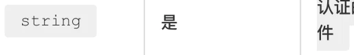

**返回数据**

| 参数名称 | 类型 | 示例 | 说明 |
| --- | --- | --- | --- |
| requestId | <code>string</code> | <code>uuid-xxx-xxx</code> | 请求 ID。 |
| code | <code>integer&lt;int32&gt;</code> | 200 | 响应码。 |
| msg | <code>string</code> | <code>null</code> | 响应消息。 |
| data | <code>string</code> | <code>my-custom-plugin</code> | 响应数据。 |

**示例**

**请求示例**

```http
POST /plugin/createCustomWasmPlugin HTTP/1.1

{
  "gwInstanceId": "gwInstanceId_value",
  "pluginName": "pluginName_value",
  "category": "custom",
  "title": "title_value",
  "description": "description_value",
  "imageRepository": "imageRepository_value",
  "imagePullPolicy": "imagePullPolicy_value",
  "imagePullSecret": "DEMO_CREDENTIAL",
  "phase": "phase_value",
  "priority": 0,
  "example": "example_value",
  "document": "document_value"
}
```

**响应示例**

```json
{
  "requestId": "xxx-xxx-xxx",
  "code": 200,
  "msg": null,
  "message": null,
  "data": "data_value"
}
```

<a id="section-1-3-6-2"></a>

#### 1.3.6.2. DeleteCustomWasmPlugin

调用 DeleteCustomWasmPlugin 接口删除自定义WASM插件。

**请求头**

公共请求头及认证信息的获取与携带方式，请参见获取公共Header参数。

**请求语法**

```http
POST /plugin/deleteCustomWasmPlugin HTTP/1.1
```

**请求参数**

| 参数名称 | 位置 | 类型 | 是否必选 | 示例 | 说明 |
| --- | --- | --- | --- | --- | --- |
| gwInstanceId | <code>body</code> | <code>string</code> | 是 | <code>higress-</code><br><code>001</code> | 网关实例ID。 |
| pluginName | <code>body</code> | <code>string</code> | 是 | <code>my-custom-</code><br><code>plugin</code> | 插件名称。 |

**返回数据**

| 参数名称 | 类型 | 示例 | 说明 |
| --- | --- | --- | --- |
| requestId | <code>string</code> | <code>uuid-xxx-xxx</code> | 请求 ID。 |
| code | <code>integer&lt;int32&gt;</code> | 200 | 响应码。 |
| msg | <code>string</code> | <code>null</code> | 响应消息。 |
| data | <code>string</code> | <code>my-custom-plugin</code> | 响应数据。 |

**示例**

**请求示例**

```http
POST /plugin/deleteCustomWasmPlugin HTTP/1.1

{
  "gwInstanceId": "gwInstanceId_value",
  "pluginName": "pluginName_value"
}
```

**响应示例**

```json
{
  "requestId": "xxx-xxx-xxx",
  "code": 200,
  "msg": null,
  "message": null,
  "data": "data_value"
}
```

<a id="section-1-3-6-3"></a>

#### 1.3.6.3. GetCustomWasmPlugin

调用 GetCustomWasmPlugin 接口查询自定义WASM插件详情。

**请求头**

公共请求头及认证信息的获取与携带方式，请参见获取公共Header参数。

**请求语法**

```http
POST /plugin/getCustomWasmPlugin HTTP/1.1
```

**请求参数**

| 参数名称 | 位置 | 类型 | 是否必选 | 示例 | 说明 |
| --- | --- | --- | --- | --- | --- |
| gwInstanceId | <code>body</code> | <code>string</code> | 是 | <code>higress-</code><br><code>001</code> | Gateway instance ID。 |
| pluginName | <code>body</code> | <code>string</code> | 是 | <code>my-custom-</code><br><code>plugin</code> | Plugin name。 |

**返回数据**

| 参数名称 | 类型 | 示例 | 说明 |
| --- | --- | --- | --- |
| requestId | <code>string</code> | <code>uuid-xxx-xxx</code> | 请求 ID。 |
| code | <code>integer&lt;int32&gt;</code> | 200 | 响应码。 |
| msg | <code>string</code> | <code>null</code> | 响应消息。 |
| data | <code>object</code> | {} | 返回数据。 |
| data.pluginName | <code>string</code> | <code>my-custom-plugin</code> | Plugin name。 |
| data.category | <code>string</code> | <code>auth</code> | Plugin category。 |
| data.title | <code>string</code> | <br><code> </code>自定义认证插件<code> </code> | Plugin title for display。 |
| data.description | <code>string</code> | <code> </code>用于<code>API</code>请求认证的自定义插件<code> </code> | Plugin description for display。 |
| data.example | <code>string</code> | example | Plugin configuration example。 |

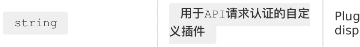

| 参数名称 | 类型 | 示例 | 说明 |
| --- | --- | --- | --- |
| data.document | <code>string</code> | <code>https://docs.exampl</code><br><code>e.com/plugin</code> | Plugin document。 |
| data.imageRepository | <code>string</code> | <code>registry.example.co</code><br><code>m/my-plugin</code> | Plugin image repository。 |
| data.imagePullPolicy | <code>string</code> | <code>IfNotPresent</code> | Plugin image pull policy。 |
| data.imagePullSecret | <code>string</code> | DEMO_CREDENTIAL | Plugin image pull secret。 |
| data.phase | <code>string</code> | <code>AUTH</code> | Plugin execution phase。 |
| data.priority | integer&lt;int32&gt; | <code>100</code> | Plugin execution priority in the given phase。 |
| data.gwInstanceId | <code>string</code> | <code>higress-001</code> | Gateway instance ID。 |

**示例**

**请求示例**

```http
POST /plugin/getCustomWasmPlugin HTTP/1.1

{
  "gwInstanceId": "gwInstanceId_value",
  "pluginName": "pluginName_value"
}
```

**响应示例**

```json
{
  "requestId": "xxx-xxx-xxx",
  "code": 200,
  "msg": null,
  "message": null,
  "data": {
    "pluginName": "pluginName_value",
    "category": "category_value",
    "title": "title_value",
    "description": "description_value",
    "example": "example_value",
    "document": "document_value",
    "imageRepository": "imageRepository_value",
    "imagePullPolicy": "imagePullPolicy_value",
    "imagePullSecret": "DEMO_CREDENTIAL",
    "phase": "phase_value",
    "priority": 0,
    "gwInstanceId": "gwInstanceId_value"
  }
}
```

<a id="section-1-3-6-4"></a>

#### 1.3.6.4. ModifyCustomWasmPlugin

调用 ModifyCustomWasmPlugin 接口修改自定义WASM插件。编辑自定义WASM插件。

**请求头**

公共请求头及认证信息的获取与携带方式，请参见获取公共Header参数。

**请求语法**

```http
POST /plugin/modifyCustomWasmPlugin HTTP/1.1
```

**请求参数**

| 参数名称 | 位置 | 类型 | 是否必选 | 示例 | 说明 |
| --- | --- | --- | --- | --- | --- |
| gwInstanceId | <code>body</code> | <code>string</code> | 是 | <code>higress-</code><br><code>001</code> | 网关实例ID。 |
| pluginName | <code>body</code> | <code>string</code> | 是 | <code>my-custom-</code><br><code>plugin</code> | Plugin name。 |
| category | <code>body</code> | <code>string</code> | 否 | custom | Plugin category 默认值："custom"。 |
| title | <code>body</code> | <code>string</code> | 是 | <code> </code>自定义认证插件<code> </code> | Plugin title for display。 |
| description | <code>body</code> | <code>string</code> | 是 | <code> </code>用于自定义认证逻辑的<code>WASM</code>插件<code> </code> | Plugin description for display。 |
| imageReposit ory | <code>body</code> | <code>string</code> | 是 | <code>registry.ex</code><br><code>ample.com/pl</code><br><code>ugins/auth</code> | Plugin image repository。 |
| imagePullPolic y | <code>body</code> | <code>string</code> | 是 | <code>IfNotPresen</code><br><code>t</code> | Plugin image pull policy。 |
| imagePullSecr et | <code>body</code> | <code>string</code> | 否 | DEMO_CREDE NTIAL | Plugin image pull secret。 |
| phase | <code>body</code> | <code>string</code> | 是 | <code>AUTHN</code> | Plugin execution phase。 |
| priority | <code>body</code> | <code>integer&lt;int</code><br><code>32&gt;</code> | 是 | <code>100</code> | Plugin execution priority in the given phase。 |
| example | <code>body</code> | <code>string</code> | 否 | example | example。 |
| document | <code>body</code> | <code>string</code> | 否 | <code>https://doc</code><br><code>s.example.co</code><br><code>m/plugin</code> | document。 |
| version | <code>body</code> | <code>string</code> | 否 | <code>1.0.0</code> | 版本号。 |


**返回数据**

| 参数名称 | 类型 | 示例 | 说明 |
| --- | --- | --- | --- |
| requestId | <code>string</code> | <code>uuid-xxx-xxx</code> | 请求 ID。 |
| code | <code>integer&lt;int32&gt;</code> | 200 | 响应码。 |
| msg | <code>string</code> | <code>null</code> | 响应消息。 |
| data | <code>string</code> | <code>my-custom-plugin</code> | 响应数据。 |

**示例**

**请求示例**

```http
POST /plugin/modifyCustomWasmPlugin HTTP/1.1

{
  "gwInstanceId": "higress-001",
  "pluginName": "my-custom-plugin",
  "category": "custom",
  "title": "⾃定义认证插件",
  "description": "⽤于⾃定义认证逻辑的WASM插件",
  "imageRepository": "registry.example.com/plugins/auth",
  "imagePullPolicy": "IfNotPresent",
  "imagePullSecret": "DEMO_CREDENTIAL",
  "phase": "AUTHN",
  "priority": 100,
  "example": "example",
  "document": "https://docs.example.com/plugin",
  "version": "1.0.0"
}
```

**响应示例**

```json
{
  "requestId": "uuid-xxx-xxx",
  "code": 200,
  "msg": null,
  "message": null,
  "data": "my-custom-plugin"
}
```

<a id="section-1-3-6-5"></a>

#### 1.3.6.5. CreateCascadeStrategyConfig

调用 CreateCascadeStrategyConfig 接口创建级联策略配置。级联策略接口仅支持非 Higress；Higress调用返回失败。

**请求头**

公共请求头及认证信息的获取与携带方式，请参见获取公共Header参数。

**请求语法**

```http
POST /strategyConfig/createCascadeStrategyConfig HTTP/1.1
```

**请求参数**

| 参数名称 | 位置 | 类型 | 是否必选 | 示例 | 说明 |
| --- | --- | --- | --- | --- | --- |
| strategyCo nfigName | body | string | 否 | route-key-auth-prod | 策略配置实例名称，用于页面识别。建议在实例内具有可读性；创建时省略会由不同实现生成默认名称。 |
| strategyNa me | body | string | 是 | key-auth | FIXME-lvshui 2025/1/20:修改为通过业务id来表达策略唯一性 不能为空。 |
| config | body | object | 否 | {} | 策略参数&lt;p&gt;if strategyName is "HSF协议映射策略", then config is {@link HsfMethodMappingConfi g}&lt;/p&gt;。 |
| rawConfig | body | string | 否 | global_auth: false keys: -Authorization - x-api-key in_header: true | yaml格式的策略参数 config和 rawConfig不能同时为空@since 20250226。 |
| gwInstanc eId | body | string | 是 | gw-123456\*\*\*\* | 网关实例 ID。普通接口按真实引擎分流；源/级联策略接口仅支持非 Higress。 不能为空。 |
| routeId | body | string | 否 | route-123456\*\*\*\* | 路由 ID。 |
| serviceId | body | string | 否 | service-123456\*\*\*\* | 服务 ID。 |
| appId | body | string | 否 | consumer-123456\*\*\*\* | 消费者 ID。 |
| domainId | body | string | 否 | api.example.com | 域名 ID。 |
| routeIds | body | array | 否 | \[\] | 路由 ID 列表。策略只支持ROUTE 作用域时可绑定多个路由。 |
| serviceIds | body | array | 否 | \[\] | 服务 ID 列表。 |
| appIds | body | array | 否 | \[\] | 消费者 ID 列表（页面术语）。 |
| domainIds | body | array | 否 | \[\] | 域名 ID 列表。 |
| mcpIds | body | array | 否 | \[\] | MCP 服务名称/ID列表。 |
| strategyCo nfigId | body | string | 否 | strategy-config-123456\*\*\*\* | 策略配置实例 ID。创建时可省略；查询、修改、删除和启停时必填。 |
| isDisaster Recovery | body | boolean | 否 | false | 是否属于容灾配置；普通策略传 false。 |

strategyName、gwInstanceId 必填，config/rawConfig 至少一个。作用范围使用routeIds/serviceIds/appIds/domainIds/mcpIds；全为空表示实例级。旧单 ID 字段非空时优先。相同策略与作用目标不能重复。

**返回数据**

| 参数名称 | 类型 | 示例 | 说明 |
| --- | --- | --- | --- |
| requestId | string | F0A8A039-930D-5EC1-97C8-\*\*\*\*\*\*\*\*\*\*\*\* | 请求 ID。 |
| code | integer&lt;int32 &gt; | 200 | 业务状态码。200 表示成功。 |
| msg | string | null | 响应消息。 |
| data | string | strategy-config-123456\*\*\*\* | 操作结果；写接口通常返回策略配置 ID。 |

data 返回新建策略配置 ID。

**示例**

**请求示例**

```http
POST /strategyConfig/createCascadeStrategyConfig HTTP/1.1

{
  "strategyConfigName": "route-key-auth-prod",
  "strategyName": "key-auth",
  "rawConfig": "global_auth: falsekeys:  - Authorization  - x-api-keyin_header: true",
  "gwInstanceId": "gw-123456****",
  "routeIds": [
    "route-123456****"
  ],
  "status": true,
  "routeId": "route-demo",
  "appId": "app-demo"
}
```

**正常返回示例**

`JSON`  格式

```json
{
  "requestId": "F0A8A039-930D-5EC1-97C8-************",
  "code": 200,
  "msg": null,
  "message": null,
  "data": "strategy-config-123456****"
}
```

**错误码**

| HttpCode | 错误码 | 错误信息 | 描述 |
| --- | --- | --- | --- |
| 400 | InvalidParameter | InvalidParameter | 参数不合法，请检查策略类型、配置YAML/JSON 和作用范围。 |
| 409 | Conflict | Conflict | 相同策略类型和作用范围的配置已存在，请修改现有配置。 |
| 404 | ResourceNotFound | ResourceNotFound | 策略定义、策略配置或作用范围目标不存在。 |
| 500 | InternalError | InternalError | 配置发布或级联同步失败，请检查实例和配置中心。 |

**文档补充说明**

创建成功后默认启用。源策略还会同步目标级联配置，远端失败按关系状态记录。

<a id="section-1-3-6-6"></a>

#### 1.3.6.6. CreateDisasterRecoveryStrategyConfig

调用 CreateDisasterRecoveryStrategyConfig 接口创建容灾鉴权策略。

该接口用于容灾资源配置，操作前请确认目标网关实例及其关联资源。

**请求头**

公共请求头及认证信息的获取与携带方式，请参见获取公共Header参数。

**请求语法**

```http
POST /disasterRecoveryStrategyConfig/createDisasterRecoveryStrategyConfig HTTP/1.1
```

**请求参数**

| 参数名称 | 位置 | 类型 | 是否必选 | 示例 | 说明 |
| --- | --- | --- | --- | --- | --- |
| strategyCo nfigName | body | string | 否 | example-name | 策略配置名称。 |
| strategyNa me | body | string | 是 | example-name | FIXME-lvshui 2025/1/20:修改为通过业务id来表达策略唯一性 不能为空。 |
| config | body | object | 否 | {} | 策略参数&lt;p&gt;if strategyName is "HSF协议映射策略", then config is {@link HsfMethodMappingConfi g}&lt;/p&gt;。 |
| rawConfig | body | string | 否 | example | yaml格式的策略参数 config和 rawConfig不能同时为空@since 20250226。 |
| gwInstanc eId | body | string | 是 | gw-123456\*\*\*\* | 网关实例 ID。 不能为空。 |
| routeId | body | string | 否 | route-123456\*\*\*\* | 路由ID。 |
| serviceId | body | string | 否 | service-123456\*\*\*\* | 服务 ID。 |
| appId | body | string | 否 | consumer-123456\*\*\*\* | 消费者ID。 |
| domainId | body | string | 否 | domain-123456\*\*\*\* | 域名 ID。 |
| routeIds | body | array | 否 | \[\] | 路由ID 列表。 |
| serviceIds | body | array | 否 | \[\] | 服务ID 列表。 |
| appIds | body | array | 否 | \[\] | 消费者ID 列表。 |
| domainIds | body | array | 否 | \[\] | 域名ID 列表。 |
| mcpIds | body | array | 否 | \[\] | MCPID 列表。 |
| strategyCo nfigId | body | string | 否 | strategy-123456\*\*\*\* | 策略配置 ID。 |
| isDisaster Recovery | body | boolean | 否 | false | — |

**返回数据**

| 参数名称 | 类型 | 示例 | 说明 |
| --- | --- | --- | --- |
| requestId | string | req-demo | 请求 ID。 |
| code | integer&lt;int32 &gt; | 200 | 业务状态码，200 表示请求处理成功。 |
| msg | string | null | 响应消息。 |
| data | string | strategy-123456\*\*\*\* | 容灾策略处理结果。 |

返回接口处理结果。

**示例**

**请求示例**

```http
POST /disasterRecoveryStrategyConfig/createDisasterRecoveryStrategyConfig HTTP/1.1

{
  "strategyConfigName": "example-name",
  "strategyName": "example-name",
  "config": {},
  "rawConfig": "example",
  "gwInstanceId": "gw-123456****",
  "routeId": "route-123456****",
  "serviceId": "service-123456****",
  "appId": "consumer-123456****",
  "domainId": "domain-123456****",
  "routeIds": [
    "example"
  ],
  "serviceIds": [
    "example"
  ],
  "appIds": [
    "example"
  ],
  "domainIds": [
    "example"
  ],
  "mcpIds": [
    "example"
  ],
  "strategyConfigId": "strategy-123456****"
}
```

**正常返回示例**

`JSON`  格式

```json
{
  "requestId": "req-demo",
  "code": 200,
  "msg": null,
  "message": null,
  "data": "strategy-123456****"
}
```

<a id="section-1-3-6-7"></a>

#### 1.3.6.7. CreateGlobalPlugin

调用 CreateGlobalPlugin 接口为网关实例创建全局插件配置。全局插件使用内部固定 routeId，作用于实例所有请求。

**请求头**

公共请求头及认证信息的获取与携带方式，请参见获取公共Header参数。

**请求语法**

```http
POST /globalPlugin/createGlobalPlugin HTTP/1.1
```

**请求参数**

| 参数名称 | 位置 | 类型 | 是否必选 | 示例 | 说明 |
| --- | --- | --- | --- | --- | --- |
| gwInstanc eId | body | string | 是 | gw-123456\*\*\*\* | 网关实例 ID。全局插件作用于该实例的所有请求，需谨慎启用。 |
| pluginId | body | string | 是 | plugin-cors-123456\*\*\*\* | 插件定义 ID，必须已存在；创建后不可修改。 |
| order | body | integer &lt;int32 &gt; | 是 | 100 | 插件执行顺序。数值越小越早执行；DTO 当前未真正应用 0～10000 注解，建议仍按该通用范围填写。 |
| status | body | boolean | 是 | true | 是否启用。创建为 true 时立即发布；状态变化会发布或禁用配置。 |
| config | body | string | 否 | example | 插件配置 JSON 字符串，结构必须符合 pluginId 对应插件定义。 |

gwInstanceId、pluginId、order、status 必填。config 按插件 Schema。status=true 时创建后立即发布；共享实例会绑定资源组织关系。

**返回数据**

| 参数名称 | 类型 | 示例 | 说明 |
| --- | --- | --- | --- |
| requestId | string | F0A8A039-930D-5EC1-97C8-\*\*\*\*\*\*\*\*\*\*\*\* | 请求 ID。 |
| code | integer&lt;int32 &gt; | 200 | 业务状态码。200 表示成功。 |
| msg | string | null | 响应消息。 |
| data | string | global-plugin-config-123456\*\*\*\* | 全局插件配置 ID。 |

data 返回全局插件配置 ID。

**示例**

**请求示例**

```http
POST /globalPlugin/createGlobalPlugin HTTP/1.1

{
  "gwInstanceId": "gw-123456****",
  "pluginId": "plugin-cors-123456****",
  "order": 100,
  "status": true,
  "config": "example"
}
```

**正常返回示例**

`JSON`  格式

```json
{
  "requestId": "F0A8A039-930D-5EC1-97C8-************",
  "code": 200,
  "msg": null,
  "message": null,
  "data": "global-plugin-config-123456****"
}
```

**错误码**

| HttpCode | 错误码 | 错误信息 | 描述 |
| --- | --- | --- | --- |
| 400 | InvalidParameter | InvalidParameter | 参数不合法，请检查插件定义、配置JSON 和执行顺序。 |
| 404 | ResourceNotFound | ResourceNotFound | 插件定义或全局插件配置不存在。 |
| 500 | InternalError | InternalError | 全局插件发布、禁用或删除失败，请检查配置中心。 |

<a id="section-1-3-6-8"></a>

#### 1.3.6.8. CreatePlugin

调用 CreatePlugin 接口创建由 Broker 动态下载加载的 JAR 插件（SCG 引擎）定义，并立即发布插件元数据。

**请求头**

公共请求头及认证信息的获取与携带方式，请参见获取公共Header参数。

**请求语法**

```http
POST /plugin/createPlugin HTTP/1.1
```

**请求参数**

| 参数名称 | 位置 | 类型 | 是否必选 | 示例 | 说明 |
| --- | --- | --- | --- | --- | --- |
| gwInstanc eId | body | string | 是 | gw-123456\*\*\*\* | 网关实例 ID。JAR 插件（SCG 引擎）和自定义WASM 插件都按实例隔离。 |
| pluginNam e | body | string | 是 | request-transformer-custom | 插件英文名称，在实例内唯一。WASM 名称同时作为Kubernetes WasmPlugin资源名，创建后不可修改。 |
| descriptio n | body | string | 是 | 按业务规则转换请求Header 和 Body | 插件说明，用于列表和策略选择器展示。 |
| download URL | body | string | 是 | https://artifact.example.c om/plugins/request-transformer-1.0.0.jar | JAR 插件（SCG 引擎）下载地址。Broker 根据该地址动态下载并加载 JAR；修改时不能有任何路由/全局配置正在使用插件。 |
| config | body | array | 否 | \[\] | 旧插件可配置字段定义列表；每项包含 name 和required，实际插件实例据此填写配置。 |
| config\[\].name | body | string | 否 | my-resource | 创建插件使用的名称。 |
| config\[\].requir ed | body | boolean | 否 | true | 是否必需。 |

五个字段按 DTO 提交；pluginName/description/downloadURL 必填，config 定义插件配置表单字段。该接口不是 Higress WASM 插件入口。

**返回数据**

| 参数名称 | 类型 | 示例 | 说明 |
| --- | --- | --- | --- |
| requestId | string | F0A8A039-930D-5EC1-97C8-\*\*\*\*\*\*\*\*\*\*\*\* | 请求 ID。 |
| code | integer&lt;int32 &gt; | 200 | 业务状态码。200 表示成功。 |
| msg | string | null | 响应消息。 |
| data | string | plugin-123456\*\*\*\* | 操作结果标识。 |

data 返回插件定义 ID。

**示例**

**请求示例**

```http
POST /plugin/createPlugin HTTP/1.1

{
  "gwInstanceId": "gw-123456****",
  "pluginName": "request-transformer-custom",
  "description": "转换请求 Header",
  "downloadURL": "https://artifact.example.com/plugins/request-transformer-1.0.0.jar",
  "config": [
    {
      "name": "headerName",
      "required": true
    },
    {
      "name": "headerValue",
      "required": true
    }
  ]
}
```

**正常返回示例**

`JSON`  格式

```json
{
  "requestId": "F0A8A039-930D-5EC1-97C8-************",
  "code": 200,
  "msg": null,
  "message": null,
  "data": "plugin-123456****"
}
```

**错误码**

| HttpCode | 错误码 | 错误信息 | 描述 |
| --- | --- | --- | --- |
| 400 | InvalidParameter | InvalidParameter | 参数不合法，请检查插件名称、地址、镜像、阶段和配置字段。 |
| 409 | Conflict | Conflict | 插件名称已存在或插件仍被配置实例使用。 |
| 404 | ResourceNotFound | ResourceNotFound | 插件定义或网关实例不存在。 |
| 500 | InternalError | InternalError | Broker 插件发布或 WasmPlugin CR 操作失败。 |

<a id="section-1-3-6-9"></a>

#### 1.3.6.9. CreateSourceStrategyConfig

调用 CreateSourceStrategyConfig 接口创建源策略配置。源策略接口仅支持非 Higress；Higress 调用返回失败。

**请求头**

公共请求头及认证信息的获取与携带方式，请参见获取公共Header参数。

**请求语法**

```http
POST /strategyConfig/createSourceStrategyConfig HTTP/1.1
```

**请求参数**

| 参数名称 | 位置 | 类型 | 是否必选 | 示例 | 说明 |
| --- | --- | --- | --- | --- | --- |
| strategyCo nfigName | body | string | 否 | route-key-auth-prod | 策略配置实例名称，用于页面识别。建议在实例内具有可读性；创建时省略会由不同实现生成默认名称。 |
| strategyNa me | body | string | 是 | key-auth | FIXME-lvshui 2025/1/20:修改为通过业务id来表达策略唯一性 不能为空。 |
| config | body | object | 否 | {} | 策略参数&lt;p&gt;if strategyName is "HSF协议映射策略", then config is {@link HsfMethodMappingConfi g}&lt;/p&gt;。 |
| rawConfig | body | string | 否 | global_auth: false keys: -Authorization - x-api-key in_header: true | yaml格式的策略参数 config和 rawConfig不能同时为空@since 20250226。 |
| gwInstanc eId | body | string | 是 | gw-123456\*\*\*\* | 网关实例 ID。普通接口按真实引擎分流；源/级联策略接口仅支持非 Higress。 不能为空。 |
| routeId | body | string | 否 | route-123456\*\*\*\* | 路由 ID。 |
| serviceId | body | string | 否 | service-123456\*\*\*\* | 服务 ID。 |
| appId | body | string | 否 | consumer-123456\*\*\*\* | 消费者 ID。 |
| domainId | body | string | 否 | api.example.com | 域名 ID。 |
| routeIds | body | array | 否 | \[\] | 路由 ID 列表。策略只支持ROUTE 作用域时可绑定多个路由。 |
| serviceIds | body | array | 否 | \[\] | 服务 ID 列表。 |
| appIds | body | array | 否 | \[\] | 消费者 ID 列表（页面术语）。 |
| domainIds | body | array | 否 | \[\] | 域名 ID 列表。 |
| mcpIds | body | array | 否 | \[\] | MCP 服务名称/ID列表。 |
| strategyCo nfigId | body | string | 否 | strategy-config-123456\*\*\*\* | 策略配置实例 ID。创建时可省略；查询、修改、删除和启停时必填。 |
| isDisaster Recovery | body | boolean | 否 | false | 是否属于容灾配置；普通策略传 false。 |

strategyName、gwInstanceId 必填，config/rawConfig 至少一个。作用范围使用routeIds/serviceIds/appIds/domainIds/mcpIds；全为空表示实例级。旧单 ID 字段非空时优先。相同策略与作用目标不能重复。

**返回数据**

| 参数名称 | 类型 | 示例 | 说明 |
| --- | --- | --- | --- |
| requestId | string | F0A8A039-930D-5EC1-97C8-\*\*\*\*\*\*\*\*\*\*\*\* | 请求 ID。 |
| code | integer&lt;int32 &gt; | 200 | 业务状态码。200 表示成功。 |
| msg | string | null | 响应消息。 |
| data | string | strategy-config-123456\*\*\*\* | 操作结果；写接口通常返回策略配置 ID。 |

data 返回新建策略配置 ID。

**示例**

**请求示例**

```http
POST /strategyConfig/createSourceStrategyConfig HTTP/1.1

{
  "strategyConfigName": "route-key-auth-prod",
  "strategyName": "key-auth",
  "rawConfig": "global_auth: falsekeys:  - Authorization  - x-api-keyin_header: true",
  "gwInstanceId": "gw-123456****",
  "routeIds": [
    "route-123456****"
  ],
  "status": true,
  "routeId": "route-demo",
  "appId": "app-demo"
}
```

**正常返回示例**

`JSON`  格式

```json
{
  "requestId": "F0A8A039-930D-5EC1-97C8-************",
  "code": 200,
  "msg": null,
  "message": null,
  "data": "strategy-config-123456****"
}
```

**错误码**

| HttpCode | 错误码 | 错误信息 | 描述 |
| --- | --- | --- | --- |
| 400 | InvalidParameter | InvalidParameter | 参数不合法，请检查策略类型、配置YAML/JSON 和作用范围。 |
| 409 | Conflict | Conflict | 相同策略类型和作用范围的配置已存在，请修改现有配置。 |
| 404 | ResourceNotFound | ResourceNotFound | 策略定义、策略配置或作用范围目标不存在。 |
| 500 | InternalError | InternalError | 配置发布或级联同步失败，请检查实例和配置中心。 |

**文档补充说明**

创建成功后默认启用。源策略还会同步目标级联配置，远端失败按关系状态记录。

<a id="section-1-3-6-10"></a>

#### 1.3.6.10. CreateStrategyConfig

调用 CreateStrategyConfig 接口创建普通策略配置。普通接口按实例分流：Higress 使用 WASM 插件实例实现，SCG 使用传统策略配置。

**请求头**

公共请求头及认证信息的获取与携带方式，请参见获取公共Header参数。

**请求语法**

```http
POST /strategyConfig/createStrategyConfig HTTP/1.1
```

**请求参数**

| 参数名称 | 位置 | 类型 | 是否必选 | 示例 | 说明 |
| --- | --- | --- | --- | --- | --- |
| strategyCo nfigName | body | string | 否 | route-key-auth-prod | 策略配置实例名称，用于页面识别。建议在实例内具有可读性；创建时省略会由不同实现生成默认名称。 |
| strategyNa me | body | string | 是 | key-auth | FIXME-lvshui 2025/1/20:修改为通过业务id来表达策略唯一性 不能为空。 |
| config | body | object | 否 | {} | 策略参数&lt;p&gt;if strategyName is "HSF协议映射策略", then config is {@link HsfMethodMappingConfi g}&lt;/p&gt;。 |
| rawConfig | body | string | 否 | global_auth: false keys: -Authorization - x-api-key in_header: true | yaml格式的策略参数 config和 rawConfig不能同时为空@since 20250226。 |
| gwInstanc eId | body | string | 是 | gw-123456\*\*\*\* | 网关实例 ID。普通接口按真实引擎分流；源/级联策略接口仅支持非 Higress。 不能为空。 |
| routeId | body | string | 否 | route-123456\*\*\*\* | 路由 ID。 |
| serviceId | body | string | 否 | service-123456\*\*\*\* | 服务 ID。 |
| appId | body | string | 否 | consumer-123456\*\*\*\* | 消费者 ID。 |
| domainId | body | string | 否 | api.example.com | 域名 ID。 |
| routeIds | body | array | 否 | \[\] | 路由 ID 列表。策略只支持ROUTE 作用域时可绑定多个路由。 |
| serviceIds | body | array | 否 | \[\] | 服务 ID 列表。 |
| appIds | body | array | 否 | \[\] | 消费者 ID 列表（页面术语）。 |
| domainIds | body | array | 否 | \[\] | 域名 ID 列表。 |
| mcpIds | body | array | 否 | \[\] | MCP 服务名称/ID列表。 |
| strategyCo nfigId | body | string | 否 | strategy-config-123456\*\*\*\* | 策略配置实例 ID。创建时可省略；查询、修改、删除和启停时必填。 |
| isDisaster Recovery | body | boolean | 否 | false | 是否属于容灾配置；普通策略传 false。 |

strategyName、gwInstanceId 必填，config/rawConfig 至少一个。作用范围使用routeIds/serviceIds/appIds/domainIds/mcpIds；全为空表示实例级。旧单 ID 字段非空时优先。相同策略与作用目标不能重复。

**返回数据**

| 参数名称 | 类型 | 示例 | 说明 |
| --- | --- | --- | --- |
| requestId | string | F0A8A039-930D-5EC1-97C8-\*\*\*\*\*\*\*\*\*\*\*\* | 请求 ID。 |
| code | integer&lt;int32 &gt; | 200 | 业务状态码。200 表示成功。 |
| msg | string | null | 响应消息。 |
| data | string | strategy-config-123456\*\*\*\* | 操作结果；写接口通常返回策略配置 ID。 |

data 返回新建策略配置 ID。

**示例**

**请求示例**

```http
POST /strategyConfig/createStrategyConfig HTTP/1.1

{
  "strategyConfigName": "route-key-auth-prod",
  "strategyName": "key-auth",
  "rawConfig": "global_auth: falsekeys:  - Authorization  - x-api-keyin_header: true",
  "gwInstanceId": "gw-123456****",
  "routeIds": [
    "route-123456****"
  ],
  "status": true,
  "routeId": "route-demo",
  "appId": "app-demo"
}
```

**正常返回示例**

`JSON`  格式

```json
{
  "requestId": "F0A8A039-930D-5EC1-97C8-************",
  "code": 200,
  "msg": null,
  "message": null,
  "data": "strategy-config-123456****"
}
```

**错误码**

| HttpCode | 错误码 | 错误信息 | 描述 |
| --- | --- | --- | --- |
| 400 | InvalidParameter | InvalidParameter | 参数不合法，请检查策略类型、配置YAML/JSON 和作用范围。 |
| 409 | Conflict | Conflict | 相同策略类型和作用范围的配置已存在，请修改现有配置。 |
| 404 | ResourceNotFound | ResourceNotFound | 策略定义、策略配置或作用范围目标不存在。 |
| 500 | InternalError | InternalError | 配置发布或级联同步失败，请检查实例和配置中心。 |

**文档补充说明**

创建成功后默认启用。源策略还会同步目标级联配置，远端失败按关系状态记录。

<a id="section-1-3-6-11"></a>

#### 1.3.6.11. DeleteCascadeStrategyConfig

调用 DeleteCascadeStrategyConfig 接口按目标实例、级联路由和策略名称删除级联配置。仅支持非Higress。

**请求头**

公共请求头及认证信息的获取与携带方式，请参见获取公共Header参数。

**请求语法**

```http
POST /strategyConfig/deleteCascadeStrategyConfig HTTP/1.1
```

**请求参数**

| 参数名称 | 位置 | 类型 | 是否必选 | 示例 | 说明 |
| --- | --- | --- | --- | --- | --- |
| gwInstanc eId | body | string | 否 | gw-123456\*\*\*\* | 网关实例 ID。普通接口按真实引擎分流；源/级联策略接口仅支持非 Higress。 |
| routeId | body | string | 否 | route-123456\*\*\*\* | 路由 ID。 |
| strategyNa me | body | string | 否 | key-auth | 策略英文名称，必须来自GetStrategy/ListStrategie s，例如 key-auth、cors、request-block、ai-proxy。修改时必须与原配置一致。 |

gwInstanceId、routeId、strategyName 均应传入。

**返回数据**

| 参数名称 | 类型 | 示例 | 说明 |
| --- | --- | --- | --- |
| requestId | string | F0A8A039-930D-5EC1-97C8-\*\*\*\*\*\*\*\*\*\*\*\* | 请求 ID。 |
| code | integer&lt;int32 &gt; | 200 | 业务状态码。200 表示成功。 |
| msg | string | null | 响应消息。 |
| data | string | strategy-config-123456\*\*\*\* | 操作结果；写接口通常返回策略配置 ID。 |

data 返回已删除策略配置 ID。

**示例**

**请求示例**

```http
POST /strategyConfig/deleteCascadeStrategyConfig HTTP/1.1

{
  "gwInstanceId": "gw-target-123456****",
  "routeId": "cascade-route-123456****",
  "strategyName": "cors"
}
```

**正常返回示例**

`JSON`  格式

```json
{
  "requestId": "F0A8A039-930D-5EC1-97C8-************",
  "code": 200,
  "msg": null,
  "message": null,
  "data": "strategy-config-123456****"
}
```

**错误码**

| HttpCode | 错误码 | 错误信息 | 描述 |
| --- | --- | --- | --- |
| 400 | InvalidParameter | InvalidParameter | 参数不合法，请检查策略类型、配置YAML/JSON 和作用范围。 |
| 409 | Conflict | Conflict | 相同策略类型和作用范围的配置已存在，请修改现有配置。 |
| 404 | ResourceNotFound | ResourceNotFound | 策略定义、策略配置或作用范围目标不存在。 |
| 500 | InternalError | InternalError | 配置发布或级联同步失败，请检查实例和配置中心。 |

<a id="section-1-3-6-12"></a>

#### 1.3.6.12. DeleteDisasterRecoveryStrategyConfig

调用 DeleteDisasterRecoveryStrategyConfig 接口删除容灾策略。

该接口用于容灾资源配置，操作前请确认目标网关实例及其关联资源。

**请求头**

公共请求头及认证信息的获取与携带方式，请参见获取公共Header参数。

**请求语法**

```http
POST /disasterRecoveryStrategyConfig/deleteDisasterRecoveryStrategyConfig HTTP/1.1
```

**请求参数**

| 参数名称 | 位置 | 类型 | 是否必选 | 示例 | 说明 |
| --- | --- | --- | --- | --- | --- |
| gwInstanc eId | body | string | 是 | gw-123456\*\*\*\* | 网关实例 ID。 不能为空。 |
| strategyCo nfigId | body | string | 是 | strategy-123456\*\*\*\* | 策略配置 ID。 不能为空。 |

**返回数据**

| 参数名称 | 类型 | 示例 | 说明 |
| --- | --- | --- | --- |
| requestId | string | req-demo | 请求 ID。 |
| code | integer&lt;int32 &gt; | 200 | 业务状态码，200 表示请求处理成功。 |
| msg | string | null | 响应消息。 |
| data | string | example-data | 容灾策略处理结果。 |

返回接口处理结果。

**示例**

**请求示例**

```http
POST /disasterRecoveryStrategyConfig/deleteDisasterRecoveryStrategyConfig HTTP/1.1

{
  "gwInstanceId": "gw-123456****",
  "strategyConfigId": "strategy-123456****"
}
```

**正常返回示例**

`JSON`  格式

```json
{
  "requestId": "req-demo",
  "code": 200,
  "msg": null,
  "message": null,
  "data": "example-data"
}
```

<a id="section-1-3-6-13"></a>

#### 1.3.6.13. DeleteGlobalPlugin

调用 DeleteGlobalPlugin 接口删除全局插件记录。删除前若处于启用状态，还会从配置中心移除数据面配置。

**请求头**

公共请求头及认证信息的获取与携带方式，请参见获取公共Header参数。

**请求语法**

```http
POST /globalPlugin/deleteGlobalPlugin HTTP/1.1
```

**请求参数**

| 参数名称 | 位置 | 类型 | 是否必选 | 示例 | 说明 |
| --- | --- | --- | --- | --- | --- |
| gwInstanc eId | body | string | 是 | gw-123456\*\*\*\* | 网关实例 ID。全局插件作用于该实例的所有请求，需谨慎启用。 |
| routePlugi nId | body | string | 是 | global-plugin-config-123456\*\*\*\* | 全局插件配置 ID，由创建接口返回。虽然历史字段名包含 routePlugin，但实际是实例级插件配置。 |

gwInstanceId、routePluginId 必填。删除会影响整个实例流量且不可逆。

**返回数据**

| 参数名称 | 类型 | 示例 | 说明 |
| --- | --- | --- | --- |
| requestId | string | F0A8A039-930D-5EC1-97C8-\*\*\*\*\*\*\*\*\*\*\*\* | 请求 ID。 |
| code | integer&lt;int32 &gt; | 200 | 业务状态码。200 表示成功。 |
| msg | string | null | 响应消息。 |
| data | string | global-plugin-config-123456\*\*\*\* | 全局插件配置 ID。 |

data 返回已删除配置 ID。

**示例**

**请求示例**

```http
POST /globalPlugin/deleteGlobalPlugin HTTP/1.1

{
  "gwInstanceId": "gw-123456****",
  "routePluginId": "global-plugin-config-123456****"
}
```

**正常返回示例**

`JSON`  格式

```json
{
  "requestId": "F0A8A039-930D-5EC1-97C8-************",
  "code": 200,
  "msg": null,
  "message": null,
  "data": "global-plugin-config-123456****"
}
```

**错误码**

| HttpCode | 错误码 | 错误信息 | 描述 |
| --- | --- | --- | --- |
| 400 | InvalidParameter | InvalidParameter | 参数不合法，请检查插件定义、配置JSON 和执行顺序。 |
| 404 | ResourceNotFound | ResourceNotFound | 插件定义或全局插件配置不存在。 |
| 500 | InternalError | InternalError | 全局插件发布、禁用或删除失败，请检查配置中心。 |

<a id="section-1-3-6-14"></a>

#### 1.3.6.14. DeletePlugin

调用 DeletePlugin 接口删除 JAR 插件（SCG 引擎）定义，并通知 Broker 从内存移除。

**请求头**

公共请求头及认证信息的获取与携带方式，请参见获取公共Header参数。

**请求语法**

```http
POST /plugin/deletePlugin HTTP/1.1
```

**请求参数**

| 参数名称 | 位置 | 类型 | 是否必选 | 示例 | 说明 |
| --- | --- | --- | --- | --- | --- |
| gwInstanc eId | body | string | 是 | gw-123456\*\*\*\* | 网关实例 ID。JAR 插件（SCG 引擎）和自定义WASM 插件都按实例隔离。 |
| pluginId | body | string | 是 | plugin-123456\*\*\*\* | 旧插件定义 ID，由CreatePlugin 返回。 |

gwInstanceId、pluginId 必填。存在任何路由或全局配置引用时拒绝删除。共享实例会同时解除资源组织关系。

**返回数据**

| 参数名称 | 类型 | 示例 | 说明 |
| --- | --- | --- | --- |
| requestId | string | F0A8A039-930D-5EC1-97C8-\*\*\*\*\*\*\*\*\*\*\*\* | 请求 ID。 |
| code | integer&lt;int32 &gt; | 200 | 业务状态码。200 表示成功。 |
| msg | string | null | 响应消息。 |
| data | string | plugin-123456\*\*\*\* | 操作结果标识。 |

data 返回已删除插件 ID。

**示例**

**请求示例**

```http
POST /plugin/deletePlugin HTTP/1.1

{
  "gwInstanceId": "gw-123456****",
  "pluginId": "plugin-123456****"
}
```

**正常返回示例**

`JSON`  格式

```json
{
  "requestId": "F0A8A039-930D-5EC1-97C8-************",
  "code": 200,
  "msg": null,
  "message": null,
  "data": "plugin-123456****"
}
```

**错误码**

| HttpCode | 错误码 | 错误信息 | 描述 |
| --- | --- | --- | --- |
| 400 | InvalidParameter | InvalidParameter | 参数不合法，请检查插件名称、地址、镜像、阶段和配置字段。 |
| 409 | Conflict | Conflict | 插件名称已存在或插件仍被配置实例使用。 |
| 404 | ResourceNotFound | ResourceNotFound | 插件定义或网关实例不存在。 |
| 500 | InternalError | InternalError | Broker 插件发布或 WasmPlugin CR 操作失败。 |

<a id="section-1-3-6-15"></a>

#### 1.3.6.15. DeleteSourceStrategyConfig

调用 DeleteSourceStrategyConfig 删除源策略配置及数据面配置。

**请求头**

公共请求头及认证信息的获取与携带方式，请参见获取公共Header参数。

**请求语法**

```http
POST /strategyConfig/deleteSourceStrategyConfig HTTP/1.1
```

**请求参数**

| 参数名称 | 位置 | 类型 | 是否必选 | 示例 | 说明 |
| --- | --- | --- | --- | --- | --- |
| gwInstanc eId | body | string | 是 | gw-123456\*\*\*\* | 网关实例 ID。普通接口按真实引擎分流；源/级联策略接口仅支持非 Higress。 不能为空。 |
| strategyCo nfigId | body | string | 是 | strategy-config-123456\*\*\*\* | 策略配置实例 ID。创建时可省略；查询、修改、删除和启停时必填。 不能为空。 |

gwInstanceId、strategyConfigId 必填。源接口仅支持非 Higress，并先处理各级联副本；失败时保留可恢复状态。

**返回数据**

| 参数名称 | 类型 | 示例 | 说明 |
| --- | --- | --- | --- |
| requestId | string | F0A8A039-930D-5EC1-97C8-\*\*\*\*\*\*\*\*\*\*\*\* | 请求 ID。 |
| code | integer&lt;int32 &gt; | 200 | 业务状态码。200 表示成功。 |
| msg | string | null | 响应消息。 |
| data | string | strategy-config-123456\*\*\*\* | 操作结果；写接口通常返回策略配置 ID。 |

data 返回已删除策略配置 ID。

**示例**

**请求示例**

```http
POST /strategyConfig/deleteSourceStrategyConfig HTTP/1.1

{
  "gwInstanceId": "gw-123456****",
  "strategyConfigId": "strategy-config-123456****"
}
```

**正常返回示例**

`JSON`  格式

```json
{
  "requestId": "F0A8A039-930D-5EC1-97C8-************",
  "code": 200,
  "msg": null,
  "message": null,
  "data": "strategy-config-123456****"
}
```

**错误码**

| HttpCode | 错误码 | 错误信息 | 描述 |
| --- | --- | --- | --- |
| 400 | InvalidParameter | InvalidParameter | 参数不合法，请检查策略类型、配置YAML/JSON 和作用范围。 |
| 409 | Conflict | Conflict | 相同策略类型和作用范围的配置已存在，请修改现有配置。 |
| 404 | ResourceNotFound | ResourceNotFound | 策略定义、策略配置或作用范围目标不存在。 |
| 500 | InternalError | InternalError | 配置发布或级联同步失败，请检查实例和配置中心。 |

<a id="section-1-3-6-16"></a>

#### 1.3.6.16. DeleteStrategyConfig

调用 DeleteStrategyConfig 接口删除普通策略配置及数据面配置。

**请求头**

公共请求头及认证信息的获取与携带方式，请参见获取公共Header参数。

**请求语法**

```http
POST /strategyConfig/deleteStrategyConfig HTTP/1.1
```

**请求参数**

| 参数名称 | 位置 | 类型 | 是否必选 | 示例 | 说明 |
| --- | --- | --- | --- | --- | --- |
| gwInstanc eId | body | string | 是 | gw-123456\*\*\*\* | 网关实例 ID。普通接口按真实引擎分流；源/级联策略接口仅支持非 Higress。 不能为空。 |
| strategyCo nfigId | body | string | 是 | strategy-config-123456\*\*\*\* | 策略配置实例 ID。创建时可省略；查询、修改、删除和启停时必填。 不能为空。 |

gwInstanceId、strategyConfigId 必填。源接口仅支持非 Higress，并先处理各级联副本；失败时保留可恢复状态。

**返回数据**

| 参数名称 | 类型 | 示例 | 说明 |
| --- | --- | --- | --- |
| requestId | string | F0A8A039-930D-5EC1-97C8-\*\*\*\*\*\*\*\*\*\*\*\* | 请求 ID。 |
| code | integer&lt;int32 &gt; | 200 | 业务状态码。200 表示成功。 |
| msg | string | null | 响应消息。 |
| data | string | strategy-config-123456\*\*\*\* | 操作结果；写接口通常返回策略配置 ID。 |

data 返回已删除策略配置 ID。

**示例**

**请求示例**

```http
POST /strategyConfig/deleteStrategyConfig HTTP/1.1

{
  "gwInstanceId": "gw-123456****",
  "strategyConfigId": "strategy-config-123456****"
}
```

**正常返回示例**

`JSON`  格式

```json
{
  "requestId": "F0A8A039-930D-5EC1-97C8-************",
  "code": 200,
  "msg": null,
  "message": null,
  "data": "strategy-config-123456****"
}
```

**错误码**

| HttpCode | 错误码 | 错误信息 | 描述 |
| --- | --- | --- | --- |
| 400 | InvalidParameter | InvalidParameter | 参数不合法，请检查策略类型、配置YAML/JSON 和作用范围。 |
| 409 | Conflict | Conflict | 相同策略类型和作用范围的配置已存在，请修改现有配置。 |
| 404 | ResourceNotFound | ResourceNotFound | 策略定义、策略配置或作用范围目标不存在。 |
| 500 | InternalError | InternalError | 配置发布或级联同步失败，请检查实例和配置中心。 |

<a id="section-1-3-6-17"></a>

#### 1.3.6.17. GetCascadeStrategyConfig

调用 GetCascadeStrategyConfig 接口查询级联策略配置、YAML/JSON内容和作用目标。

**请求头**

公共请求头及认证信息的获取与携带方式，请参见获取公共Header参数。

**请求语法**

```http
POST /strategyConfig/getCascadeStrategyConfig HTTP/1.1
```

**请求参数**

| 参数名称 | 位置 | 类型 | 是否必选 | 示例 | 说明 |
| --- | --- | --- | --- | --- | --- |
| gwInstanc eId | body | string | 否 | gw-123456\*\*\*\* | 网关实例 ID。普通接口按真实引擎分流；源/级联策略接口仅支持非 Higress。 |
| strategyCo nfigId | body | string | 否 | strategy-config-123456\*\*\*\* | 策略配置实例 ID。创建时可省略；查询、修改、删除和启停时必填。 |

gwInstanceId、strategyConfigId 必填。源/级联接口仅支持非 Higress。响应旧 appId/appName 字段在页面中称消费者 ID/名称。

**返回数据**

| 参数名称 | 类型 | 示例 | 说明 |
| --- | --- | --- | --- |
| requestId | string | F0A8A039-930D-5EC1-97C8-\*\*\*\*\*\*\*\*\*\*\*\* | 请求 ID。 |
| code | integer&lt;int32 &gt; | 200 | 业务状态码。200 表示成功。 |
| msg | string | null | 响应消息。 |
| data | object | {} | 返回数据。 |
| data.strate gyConfigNa me | string | route-key-auth-prod | — |
| data.strate gyConfigId | string | strategy-config-123456\*\*\*\* | — |
| data.strate gyName | string | key-auth | — |
| data.strate gyTitle | string | API Key 认证 | 专门用于前端做国际化展示。 |
| data.routeId | string | route-demo | 路由 ID。 |
| data.routeNam e | string | demo | 路由名称。 |
| data.serviceId | string | service-demo | 服务 ID。 |
| data.serviceNa me | string | demo | 服务名称。 |
| data.appId | string | app-demo | 消费者 ID。 |
| data.appName | string | demo | 消费者名称。 |
| data.domainId | string | domain-demo | — |
| data.domainNa me | string | demo | — |
| data.status | boolean | true | — |
| data.config | object | {} | case1: hsf method mapping {@link com.aliyun.csb.common.model.entity.strate gy.hsf.HsfMethodMappingConfig}。 |
| data.rawCo nfig | string | global_auth: false keys: -Authorization | yaml格式的策略参数 config 和 rawConfig不能同时为空。 |
| data.create Time | string | 2026-01-01 00:00:00 | 创建时间 格式：yyyy-MM-dd HH:mm:ss。 |
| data.update Time | string | 2026-01-01 00:00:00 | 更新时间 格式：yyyy-MM-dd HH:mm:ss。 |
| data.scopes | array | \[\] | — |
| data.scope | object | {} | 配合 scopes 使用。 higress引擎支持的wasmplugin 配置有两种形式：&lt;p&gt;1）scope类型只有一种，比如：路由级，允许指定多个路由2）scope 类型有多种，比如：路由 + 服务，则指定的多个路由 + 多个服务是一个笛卡尔集。即类似条件：in (route1,route2) and in (svc1,svc2)== 20250909可以先忽略，因为目前页面产品设计上并不支持这种&lt;/p&gt;。 |
| data.sco pe.route Infos | array | \[\] | — |
| data.scope.rou teInfos\[\].name | string | demo | 名称。 |
| data.scope.rou teInfos\[\].id | string | -demo | 资源 ID。 |
| data.sco pe.servi ceInfos | array | \[\] | — |
| data.scope.ser viceInfos\[\].na me | string | demo | 名称。 |
| data.scope.ser viceInfos\[\].id | string | -demo | 资源 ID。 |
| data.sco pe.appIn fos | array | \[\] | — |
| data.scope.app Infos\[\].name | string | demo | 名称。 |
| data.scope.app Infos\[\].id | string | -demo | 资源 ID。 |
| data.sco pe.dom ainInfos | array | \[\] | — |
| data.scope.do mainInfos\[\].na me | string | demo | 名称。 |
| data.scope.do mainInfos\[\].id | string | -demo | 资源 ID。 |
| data.sco pe.mcpS erverInf os | array | \[\] | — |
| data.scope.mc pServerInfos\[\].name | string | demo | 名称。 |
| data.scope.mc pServerInfos\[\].i d | string | -demo | 资源 ID。 |
| data.sco pe.scop es | array | \[\] | — |

data 为策略配置详情。

**示例**

**请求示例**

```http
POST /strategyConfig/getCascadeStrategyConfig HTTP/1.1

{
  "gwInstanceId": "gw-123456****",
  "strategyConfigId": "strategy-config-123456****"
}
```

**正常返回示例**

`JSON`  格式

```json
{
  "requestId": "F0A8A039-930D-5EC1-97C8-************",
  "code": 200,
  "msg": null,
  "data": {
    "strategyConfigName": "route-key-auth-prod",
    "strategyConfigId": "strategy-config-123456****",
    "strategyName": "key-auth",
    "strategyTitle": "API Key 认证",
    "status": true,
    "config": {
      "global_auth": false,
      "keys": [
        "Authorization"
      ]
    },
    "rawConfig": "global_auth: falsekeys:  - Authorization",
    "scope": {
      "scopes": [
        "ROUTE"
      ],
      "routeInfos": [
        {
          "id": "route-123456****",
          "name": "chat-route"
        }
      ],
      "serviceInfos": [],
      "appInfos": [],
      "domainInfos": [],
      "mcpServerInfos": []
    },
    "createTime": "2026-01-01 00:00:00",
    "updateTime": "2026-01-01 00:00:00",
    "routeId": "route-demo",
    "routeName": "demo",
    "serviceId": "service-demo",
    "serviceName": "demo",
    "appId": "app-demo",
    "appName": "demo",
    "domainId": "domain-demo",
    "domainName": "demo",
    "scopes": []
  },
  "message": null
}
```

**错误码**

| HttpCode | 错误码 | 错误信息 | 描述 |
| --- | --- | --- | --- |
| 400 | InvalidParameter | InvalidParameter | 参数不合法，请检查策略类型、配置YAML/JSON 和作用范围。 |
| 409 | Conflict | Conflict | 相同策略类型和作用范围的配置已存在，请修改现有配置。 |
| 404 | ResourceNotFound | ResourceNotFound | 策略定义、策略配置或作用范围目标不存在。 |
| 500 | InternalError | InternalError | 配置发布或级联同步失败，请检查实例和配置中心。 |

<a id="section-1-3-6-18"></a>

#### 1.3.6.18. GetDisasterRecoveryStrategyConfig

调用 GetDisasterRecoveryStrategyConfig 接口查询容灾策略详情。

该接口用于容灾资源配置，操作前请确认目标网关实例及其关联资源。

**请求头**

公共请求头及认证信息的获取与携带方式，请参见获取公共Header参数。

**请求语法**

```http
POST /disasterRecoveryStrategyConfig/getDisasterRecoveryStrategyConfig HTTP/1.1
```

**请求参数**

| 参数名称 | 位置 | 类型 | 是否必选 | 示例 | 说明 |
| --- | --- | --- | --- | --- | --- |
| gwInstanc eId | body | string | 否 | gw-123456\*\*\*\* | 网关实例 ID。 |
| strategyCo nfigId | body | string | 否 | strategy-123456\*\*\*\* | 策略配置 ID。 |

**返回数据**

| 参数名称 | 类型 | 示例 | 说明 |
| --- | --- | --- | --- |
| requestId | string | req-demo | 请求 ID。 |
| code | integer&lt;int32 &gt; | 200 | 业务状态码，200 表示请求处理成功。 |
| msg | string | null | 响应消息。 |
| data | object | {} | 返回数据。 |
| data.strate gyConfigNa me | string | example-name | — |
| data.strate gyConfigId | string | strategy-123456\*\*\*\* | — |
| data.strate gyName | string | example-name | — |
| data.strategyTi tle | string | example | 专门用于前端做国际化展示。 |
| data.routeI d | string | route-123456\*\*\*\* | 路由 ID。 |
| data.routeN ame | string | example-name | 路由名称。 |
| data.servic eId | string | service-123456\*\*\*\* | 服务 ID。 |
| data.servic eName | string | example-name | 服务名称。 |
| data.appId | string | consumer-123456\*\*\*\* | 消费者 ID。 |
| data.appNa me | string | example-name | 消费者名称。 |
| data.domai nId | string | domain-123456\*\*\*\* | — |
| data.domai nName | string | api.example.com | — |
| data.status | boolean | true | — |
| data.config | object | {} | case1: hsf method mapping {@link com.aliyun.csb.common.model.entity.strate gy.hsf.HsfMethodMappingConfig}。 |
| data.rawCo nfig | string | example | yaml格式的策略参数 config 和 rawConfig不能同时为空。 |
| data.create Time | string | 2026-01-01 00:00:00 | 创建时间 格式：yyyy-MM-dd HH:mm:ss。 |
| data.update Time | string | 2026-01-01 00:00:00 | 更新时间 格式：yyyy-MM-dd HH:mm:ss。 |
| data.scopes | array | \[\] | — |
| data.scope | object | {} | 配合 scopes 使用。 higress引擎支持的wasmplugin 配置有两种形式：&lt;p&gt;1）scope类型只有一种，比如：路由级，允许指定多个路由2）scope 类型有多种，比如：路由 + 服务，则指定的多个路由 + 多个服务是一个笛卡尔集。即类似条件：in (route1,route2) and in (svc1,svc2)== 20250909可以先忽略，因为目前页面产品设计上并不支持这种&lt;/p&gt;。 |
| data.sco pe.route Infos | array | \[\] | — |
| data.scop e.rou teInf os\[\].nam e | string | example-name | 名称。 |
| data.scop e.rou teInf os\[\].i d | string | example-id | 资源 ID。 |
| data.sco pe.servi ceInfos | array | \[\] | — |
| data.scop e.ser viceI nfos\[\].na me | string | example-name | 名称。 |
| data.scop e.ser viceI nfos\[\].id | string | example-id | 资源 ID。 |
| data.sco pe.appIn fos | array | \[\] | — |
| data.scop e.ap pInfo s\[\].n ame | string | example-name | 名称。 |
| data.scop e.ap pInfo s\[\].id | string | example-id | 资源 ID。 |
| data.sco pe.dom ainInfos | array | \[\] | — |
| data.scop e.do main Infos \[\].na me | string | example-name | 名称。 |
| data.scop e.do main Infos \[\].id | string | example-id | 资源 ID。 |
| data.sco pe.mcpS erverInf os | array | \[\] | — |
| data.scop e.mc pSer verIn fos\[\].nam e | string | example-name | 名称。 |
| data.scop e.mc pSer verIn fos\[\].id | string | example-id | 资源 ID。 |
| data.sco pe.scop es | array | \[\] | — |

返回资源详情；按 ID 查询不到资源时 data 为 null。

**示例**

**请求示例**

```http
POST /disasterRecoveryStrategyConfig/getDisasterRecoveryStrategyConfig HTTP/1.1

{
  "gwInstanceId": "gw-123456****",
  "strategyConfigId": "strategy-123456****"
}
```

**正常返回示例**

`JSON`  格式

```json
{
  "code": 200,
  "msg": null,
  "data": {
    "strategyConfigName": "example-name",
    "strategyConfigId": "strategy-123456****",
    "strategyName": "example-name",
    "routeId": "route-123456****",
    "routeName": "example-name",
    "serviceId": "service-123456****",
    "serviceName": "example-name",
    "appId": "consumer-123456****",
    "appName": "example-name",
    "domainId": "domain-123456****",
    "domainName": "api.example.com",
    "status": true,
    "config": {},
    "rawConfig": "example",
    "createTime": "2026-01-01 00:00:00",
    "updateTime": "2026-01-01 00:00:00",
    "scopes": [
      "example"
    ],
    "scope": {
      "routeInfos": [
        {
          "name": "example-name",
          "id": "example-id"
        }
      ],
      "serviceInfos": [
        {
          "name": "example-name",
          "id": "example-id"
        }
      ],
      "appInfos": [
        {
          "name": "example-name",
          "id": "example-id"
        }
      ],
      "domainInfos": [
        {
          "name": "example-name",
          "id": "example-id"
        }
      ],
      "mcpServerInfos": [
        {
          "name": "example-name",
          "id": "example-id"
        }
      ],
      "scopes": [
        "example"
      ]
    },
    "strategyTitle": "example"
  },
  "requestId": "req-demo",
  "message": null
}
```

<a id="section-1-3-6-19"></a>

#### 1.3.6.19. GetPlugin

调用 GetPlugin 接口查询旧版插件定义、配置字段和使用状态。

**请求头**

公共请求头及认证信息的获取与携带方式，请参见获取公共Header参数。

**请求语法**

```http
POST /plugin/getPlugin HTTP/1.1
```

**请求参数**

| 参数名称 | 位置 | 类型 | 是否必选 | 示例 | 说明 |
| --- | --- | --- | --- | --- | --- |
| gwInstanc eId | body | string | 是 | gw-123456\*\*\*\* | 网关实例 ID。JAR 插件（SCG 引擎）和自定义WASM 插件都按实例隔离。 |
| pluginId | body | string | 是 | plugin-123456\*\*\*\* | 旧插件定义 ID，由CreatePlugin 返回。 |

gwInstanceId、pluginId 必填。资源不存在时返回 code=200、data=null。

**返回数据**

| 参数名称 | 类型 | 示例 | 说明 |
| --- | --- | --- | --- |
| requestId | string | F0A8A039-930D-5EC1-97C8-\*\*\*\*\*\*\*\*\*\*\*\* | 请求 ID。 |
| code | integer&lt;int32 &gt; | 200 | 业务状态码。200 表示成功。 |
| msg | string | null | 响应消息。 |
| data | object | {} | 返回数据。 |
| data.pluginI d | string | plugin-123456\*\*\*\* | — |
| data.gwInst anceId | string | gw-123456\*\*\*\* | 网关实例 ID。 |
| data.plugin Name | string | request-transformer-custom | — |
| data.descri ption | string | 转换请求 Header 和Body | 描述。 |
| data.downl oadURL | string | https://artifact.exa mple.com/plugins/r equest-transformer-1.0.1.jar | — |
| data.type | integer&lt;int32 &gt; | 1 | 类型。 |
| data.config | array | \[\] | — |
| data.config\[\].n ame | string | demo | 名称。 |
| data.config\[\].re quired | boolean | false | — |
| data.used | boolean | true | 插件是否被使用。 |

data 为插件定义详情。

**示例**

**请求示例**

```http
POST /plugin/getPlugin HTTP/1.1

{
  "gwInstanceId": "gw-123456****",
  "pluginId": "plugin-123456****"
}
```

**正常返回示例**

`JSON`  格式

```json
{
  "requestId": "F0A8A039-930D-5EC1-97C8-************",
  "code": 200,
  "msg": null,
  "message": null,
  "data": {
    "pluginId": "plugin-123456****",
    "gwInstanceId": "gw-123456****",
    "pluginName": "request-transformer-custom",
    "description": "转换请求 Header 和 Body",
    "downloadURL": "https://artifact.example.com/plugins/request-transformer-1.0.1.jar",
    "type": 1,
    "config": [
      {
        "name": "headerName",
        "required": true
      },
      {
        "name": "headerValue",
        "required": true
      }
    ],
    "used": true
  }
}
```

**错误码**

| HttpCode | 错误码 | 错误信息 | 描述 |
| --- | --- | --- | --- |
| 400 | InvalidParameter | InvalidParameter | 参数不合法，请检查插件名称、地址、镜像、阶段和配置字段。 |
| 409 | Conflict | Conflict | 插件名称已存在或插件仍被配置实例使用。 |
| 404 | ResourceNotFound | ResourceNotFound | 插件定义或网关实例不存在。 |
| 500 | InternalError | InternalError | Broker 插件发布或 WasmPlugin CR 操作失败。 |

<a id="section-1-3-6-20"></a>

#### 1.3.6.20. GetSourceStrategyConfig

调用 GetSourceStrategyConfig 接口查询源策略配置、YAML/JSON内容和作用目标。

**请求头**

公共请求头及认证信息的获取与携带方式，请参见获取公共Header参数。

**请求语法**

```http
POST /strategyConfig/getSourceStrategyConfig HTTP/1.1
```

**请求参数**

| 参数名称 | 位置 | 类型 | 是否必选 | 示例 | 说明 |
| --- | --- | --- | --- | --- | --- |
| gwInstanc eId | body | string | 否 | gw-123456\*\*\*\* | 网关实例 ID。普通接口按真实引擎分流；源/级联策略接口仅支持非 Higress。 |
| strategyCo nfigId | body | string | 否 | strategy-config-123456\*\*\*\* | 策略配置实例 ID。创建时可省略；查询、修改、删除和启停时必填。 |

gwInstanceId、strategyConfigId 必填。源/级联接口仅支持非 Higress。响应旧 appId/appName 字段在页面中称消费者 ID/名称。

**返回数据**

| 参数名称 | 类型 | 示例 | 说明 |
| --- | --- | --- | --- |
| requestId | string | F0A8A039-930D-5EC1-97C8-\*\*\*\*\*\*\*\*\*\*\*\* | 请求 ID。 |
| code | integer&lt;int32 &gt; | 200 | 业务状态码。200 表示成功。 |
| msg | string | null | 响应消息。 |
| data | object | {} | 返回数据。 |
| data.strate gyConfigNa me | string | route-key-auth-prod | — |
| data.strate gyConfigId | string | strategy-config-123456\*\*\*\* | — |
| data.strate gyName | string | key-auth | — |
| data.strate gyTitle | string | API Key 认证 | 专门用于前端做国际化展示。 |
| data.routeId | string | route-demo | 路由 ID。 |
| data.routeNam e | string | demo | 路由名称。 |
| data.serviceId | string | service-demo | 服务 ID。 |
| data.serviceNa me | string | demo | 服务名称。 |
| data.appId | string | app-demo | 消费者 ID。 |
| data.appName | string | demo | 消费者名称。 |
| data.domainId | string | domain-demo | — |
| data.domainNa me | string | demo | — |
| data.status | boolean | true | — |
| data.config | object | {} | case1: hsf method mapping {@link com.aliyun.csb.common.model.entity.strate gy.hsf.HsfMethodMappingConfig}。 |
| data.rawCo nfig | string | global_auth: false keys: -Authorization | yaml格式的策略参数 config 和 rawConfig不能同时为空。 |
| data.create Time | string | 2026-01-01 00:00:00 | 创建时间 格式：yyyy-MM-dd HH:mm:ss。 |
| data.update Time | string | 2026-01-01 00:00:00 | 更新时间 格式：yyyy-MM-dd HH:mm:ss。 |
| data.scopes | array | \[\] | — |
| data.scope | object | {} | 配合 scopes 使用。 higress引擎支持的wasmplugin 配置有两种形式：&lt;p&gt;1）scope类型只有一种，比如：路由级，允许指定多个路由2）scope 类型有多种，比如：路由 + 服务，则指定的多个路由 + 多个服务是一个笛卡尔集。即类似条件：in (route1,route2) and in (svc1,svc2)== 20250909可以先忽略，因为目前页面产品设计上并不支持这种&lt;/p&gt;。 |
| data.sco pe.route Infos | array | \[\] | — |
| data.scope.rou teInfos\[\].name | string | demo | 名称。 |
| data.scope.rou teInfos\[\].id | string | -demo | 资源 ID。 |
| data.sco pe.servi ceInfos | array | \[\] | — |
| data.scope.ser viceInfos\[\].na me | string | demo | 名称。 |
| data.scope.ser viceInfos\[\].id | string | -demo | 资源 ID。 |
| data.sco pe.appIn fos | array | \[\] | — |
| data.scope.app Infos\[\].name | string | demo | 名称。 |
| data.scope.app Infos\[\].id | string | -demo | 资源 ID。 |
| data.sco pe.dom ainInfos | array | \[\] | — |
| data.scope.do mainInfos\[\].na me | string | demo | 名称。 |
| data.scope.do mainInfos\[\].id | string | -demo | 资源 ID。 |
| data.sco pe.mcpS erverInf os | array | \[\] | — |
| data.scope.mc pServerInfos\[\].name | string | demo | 名称。 |
| data.scope.mc pServerInfos\[\].i d | string | -demo | 资源 ID。 |
| data.sco pe.scop es | array | \[\] | — |

data 为策略配置详情。

**示例**

**请求示例**

```http
POST /strategyConfig/getSourceStrategyConfig HTTP/1.1

{
  "gwInstanceId": "gw-123456****",
  "strategyConfigId": "strategy-config-123456****"
}
```

**正常返回示例**

`JSON`  格式

```json
{
  "requestId": "F0A8A039-930D-5EC1-97C8-************",
  "code": 200,
  "msg": null,
  "data": {
    "strategyConfigName": "route-key-auth-prod",
    "strategyConfigId": "strategy-config-123456****",
    "strategyName": "key-auth",
    "strategyTitle": "API Key 认证",
    "status": true,
    "config": {
      "global_auth": false,
      "keys": [
        "Authorization"
      ]
    },
    "rawConfig": "global_auth: falsekeys:  - Authorization",
    "scope": {
      "scopes": [
        "ROUTE"
      ],
      "routeInfos": [
        {
          "id": "route-123456****",
          "name": "chat-route"
        }
      ],
      "serviceInfos": [],
      "appInfos": [],
      "domainInfos": [],
      "mcpServerInfos": []
    },
    "createTime": "2026-01-01 00:00:00",
    "updateTime": "2026-01-01 00:00:00",
    "routeId": "route-demo",
    "routeName": "demo",
    "serviceId": "service-demo",
    "serviceName": "demo",
    "appId": "app-demo",
    "appName": "demo",
    "domainId": "domain-demo",
    "domainName": "demo",
    "scopes": []
  },
  "message": null
}
```

**错误码**

| HttpCode | 错误码 | 错误信息 | 描述 |
| --- | --- | --- | --- |
| 400 | InvalidParameter | InvalidParameter | 参数不合法，请检查策略类型、配置YAML/JSON 和作用范围。 |
| 409 | Conflict | Conflict | 相同策略类型和作用范围的配置已存在，请修改现有配置。 |
| 404 | ResourceNotFound | ResourceNotFound | 策略定义、策略配置或作用范围目标不存在。 |
| 500 | InternalError | InternalError | 配置发布或级联同步失败，请检查实例和配置中心。 |

<a id="section-1-3-6-21"></a>

#### 1.3.6.21. GetStrategy

调用 GetStrategy 接口按英文名称查询单个策略定义，并补充 Higress 插件配置示例和 README。自定义WASM 插件也通过本接口查询。

**请求头**

公共请求头及认证信息的获取与携带方式，请参见获取公共Header参数。

**请求语法**

```http
POST /strategy/getStrategy HTTP/1.1
```

**请求参数**

| 参数名称 | 位置 | 类型 | 是否必选 | 示例 | 说明 |
| --- | --- | --- | --- | --- | --- |
| gwInstanc eId | body | string | 是 | gw-123456\*\*\*\* | 网关实例 ID，用于确定SCG/HIGRESS 引擎、共享实例限制以及读取自定义插件。 不能为空或空白字符串。 |
| strategyNa me | body | string | 是 | key-auth | 这是一个业务唯一性表达字段。需要优化：1）统一使用业务id 不能为空或空白字符串。 |
| isDisaster Recovery | body | boolean | 否 | false | 是否为容灾/级联场景。true时从返回 scopes 中移除SERVICE。 默认值：false。 |

gwInstanceId、strategyName 必填且执行精确匹配。isDisasterRecovery=true 时移除 SERVICE 作用范围。

**返回数据**

| 参数名称 | 类型 | 示例 | 说明 |
| --- | --- | --- | --- |
| requestId | string | req-demo | 请求 ID。 |
| code | integer&lt;int32 &gt; | 200 | 响应码。 |
| msg | string | null | 响应消息。 |
| data | object | {} | 返回数据。 |
| data.scopes | array | \[\] | — |
| data.strate gyName | string | key-auth | — |
| data.strate gyTitle | string | API Key 认证 | — |
| data.descri ption | string | 基于 API Key 对请求进行认证 | 描述。 |
| data.suppor tCascade | integer&lt;int32 &gt; | 1 | — |
| data.uiStyle s | array | \[\] | 配置的交互风格，"raw-yaml","form-data"。 |
| data.rawCo nfigExampl e | string | consumers: -credential: example-key name: consumer-a | yaml配置示例。 |
| data.order | integer&lt;int32 &gt; | 100 | — |
| data.docum ent | string | # API Key 认证 配置消费者凭据并绑定作用域。 | — |

data 为策略定义详情；key-auth 的 rawConfigExample 有意为空。

**示例**

**请求示例**

```http
POST /strategy/getStrategy HTTP/1.1

{
  "gwInstanceId": "gw-123456****",
  "strategyName": "key-auth",
  "isDisasterRecovery": false
}
```

**正常返回示例**

`JSON`  格式

```json
{
  "requestId": "F0A8A039-930D-5EC1-97C8-************",
  "code": 200,
  "msg": null,
  "message": null,
  "data": {
    "scopes": [
      "INSTANCE",
      "ROUTE"
    ],
    "strategyName": "key-auth",
    "strategyTitle": "API Key 认证",
    "description": "基于 API Key 对请求进⾏认证",
    "supportCascade": 1,
    "uiStyles": [
      "form-data",
      "raw-yaml"
    ],
    "rawConfigExample": "example",
    "order": 100,
    "document": "# API Key 认证配置消费者凭据并绑定作⽤域。"
  }
}
```

**错误码**

| HttpCode | 错误码 | 错误信息 | 描述 |
| --- | --- | --- | --- |
| 400 | InvalidParameter | InvalidParameter | 参数不合法，请检查策略名称、作用范围和分页参数。 |
| 404 | ResourceNotFound | ResourceNotFound | 指定策略定义不存在。 |
| 500 | InternalError | InternalError | 读取插件 Schema、示例或文档失败，请检查网关连接。 |

<a id="section-1-3-6-22"></a>

#### 1.3.6.22. GetStrategyConfig

调用 GetStrategyConfig 接口查询普通策略配置、YAML/JSON内容和作用目标。

**请求头**

公共请求头及认证信息的获取与携带方式，请参见获取公共Header参数。

**请求语法**

```http
POST /strategyConfig/getStrategyConfig HTTP/1.1
```

**请求参数**

| 参数名称 | 位置 | 类型 | 是否必选 | 示例 | 说明 |
| --- | --- | --- | --- | --- | --- |
| gwInstanc eId | body | string | 否 | gw-123456\*\*\*\* | 网关实例 ID。普通接口按真实引擎分流；源/级联策略接口仅支持非 Higress。 |
| strategyCo nfigId | body | string | 否 | strategy-config-123456\*\*\*\* | 策略配置实例 ID。创建时可省略；查询、修改、删除和启停时必填。 |

gwInstanceId、strategyConfigId 必填。源/级联接口仅支持非 Higress。响应旧 appId/appName 字段在页面中称消费者 ID/名称。

**返回数据**

| 参数名称 | 类型 | 示例 | 说明 |
| --- | --- | --- | --- |
| requestId | string | F0A8A039-930D-5EC1-97C8-\*\*\*\*\*\*\*\*\*\*\*\* | 请求 ID。 |
| code | integer&lt;int32 &gt; | 200 | 业务状态码。200 表示成功。 |
| msg | string | null | 响应消息。 |
| data | object | {} | 返回数据。 |
| data.strate gyConfigNa me | string | route-key-auth-prod | — |
| data.strate gyConfigId | string | strategy-config-123456\*\*\*\* | — |
| data.strate gyName | string | key-auth | — |
| data.strate gyTitle | string | API Key 认证 | 专门用于前端做国际化展示。 |
| data.routeId | string | route-demo | 路由 ID。 |
| data.routeNam e | string | demo | 路由名称。 |
| data.serviceId | string | service-demo | 服务 ID。 |
| data.serviceNa me | string | demo | 服务名称。 |
| data.appId | string | app-demo | 消费者 ID。 |
| data.appName | string | demo | 消费者名称。 |
| data.domainId | string | domain-demo | — |
| data.domainNa me | string | demo | — |
| data.status | boolean | true | — |
| data.config | object | {} | case1: hsf method mapping {@link com.aliyun.csb.common.model.entity.strate gy.hsf.HsfMethodMappingConfig}。 |
| data.rawCo nfig | string | global_auth: false keys: -Authorization | yaml格式的策略参数 config 和 rawConfig不能同时为空。 |
| data.create Time | string | 2026-01-01 00:00:00 | 创建时间 格式：yyyy-MM-dd HH:mm:ss。 |
| data.update Time | string | 2026-01-01 00:00:00 | 更新时间 格式：yyyy-MM-dd HH:mm:ss。 |
| data.scopes | array | \[\] | — |
| data.scope | object | {} | 配合 scopes 使用。 higress引擎支持的wasmplugin 配置有两种形式：&lt;p&gt;1）scope类型只有一种，比如：路由级，允许指定多个路由2）scope 类型有多种，比如：路由 + 服务，则指定的多个路由 + 多个服务是一个笛卡尔集。即类似条件：in (route1,route2) and in (svc1,svc2)== 20250909可以先忽略，因为目前页面产品设计上并不支持这种&lt;/p&gt;。 |
| data.sco pe.route Infos | array | \[\] | — |
| data.scope.rou teInfos\[\].name | string | demo | 名称。 |
| data.scope.rou teInfos\[\].id | string | -demo | 资源 ID。 |
| data.sco pe.servi ceInfos | array | \[\] | — |
| data.scope.ser viceInfos\[\].na me | string | demo | 名称。 |
| data.scope.ser viceInfos\[\].id | string | -demo | 资源 ID。 |
| data.sco pe.appIn fos | array | \[\] | — |
| data.scope.app Infos\[\].name | string | demo | 名称。 |
| data.scope.app Infos\[\].id | string | -demo | 资源 ID。 |
| data.sco pe.dom ainInfos | array | \[\] | — |
| data.scope.do mainInfos\[\].na me | string | demo | 名称。 |
| data.scope.do mainInfos\[\].id | string | -demo | 资源 ID。 |
| data.sco pe.mcpS erverInf os | array | \[\] | — |
| data.scope.mc pServerInfos\[\].name | string | demo | 名称。 |
| data.scope.mc pServerInfos\[\].i d | string | -demo | 资源 ID。 |
| data.sco pe.scop es | array | \[\] | — |

data 为策略配置详情。

**示例**

**请求示例**

```http
POST /strategyConfig/getStrategyConfig HTTP/1.1

{
  "gwInstanceId": "gw-123456****",
  "strategyConfigId": "strategy-config-123456****"
}
```

**正常返回示例**

`JSON`  格式

```json
{
  "requestId": "F0A8A039-930D-5EC1-97C8-************",
  "code": 200,
  "msg": null,
  "data": {
    "strategyConfigName": "route-key-auth-prod",
    "strategyConfigId": "strategy-config-123456****",
    "strategyName": "key-auth",
    "strategyTitle": "API Key 认证",
    "status": true,
    "config": {
      "global_auth": false,
      "keys": [
        "Authorization"
      ]
    },
    "rawConfig": "global_auth: falsekeys:  - Authorization",
    "scope": {
      "scopes": [
        "ROUTE"
      ],
      "routeInfos": [
        {
          "id": "route-123456****",
          "name": "chat-route"
        }
      ],
      "serviceInfos": [],
      "appInfos": [],
      "domainInfos": [],
      "mcpServerInfos": []
    },
    "createTime": "2026-01-01 00:00:00",
    "updateTime": "2026-01-01 00:00:00",
    "routeId": "route-demo",
    "routeName": "demo",
    "serviceId": "service-demo",
    "serviceName": "demo",
    "appId": "app-demo",
    "appName": "demo",
    "domainId": "domain-demo",
    "domainName": "demo",
    "scopes": []
  },
  "message": null
}
```

**错误码**

| HttpCode | 错误码 | 错误信息 | 描述 |
| --- | --- | --- | --- |
| 400 | InvalidParameter | InvalidParameter | 参数不合法，请检查策略类型、配置YAML/JSON 和作用范围。 |
| 409 | Conflict | Conflict | 相同策略类型和作用范围的配置已存在，请修改现有配置。 |
| 404 | ResourceNotFound | ResourceNotFound | 策略定义、策略配置或作用范围目标不存在。 |
| 500 | InternalError | InternalError | 配置发布或级联同步失败，请检查实例和配置中心。 |

<a id="section-1-3-6-23"></a>

#### 1.3.6.23. HandlerConsumerAuth

调用 HandlerConsumerAuth 为 Higress MCP 服务创建或启停 key-auth 策略。仅 Higress 可用。

**请求头**

公共请求头及认证信息的获取与携带方式，请参见获取公共Header参数。

**请求语法**

```http
POST /strategyConfig/handlerConsumerAuth HTTP/1.1
```

**请求参数**

| 参数名称 | 位置 | 类型 | 是否必选 | 示例 | 说明 |
| --- | --- | --- | --- | --- | --- |
| isOpen | body | boolean | 否 | false | 启停模式的目标状态；创建模式忽略并默认启用。 默认值：false。 |
| name | body | string | 否 | mcp-tools | Mcp server name。 |
| gwInstanc eId | body | string | 是 | gw-123456\*\*\*\* | 网关实例 ID。普通接口按真实引擎分流；源/级联策略接口仅支持非 Higress。 |
| strategyCo nfigId | body | string | 否 | strategy-config-123456\*\*\*\* | 策略配置 ID。启停模式必填；创建模式必须为空。 |

创建模式：name 非空且 strategyConfigId 为空，自动创建 global_auth=false、Header keys 为Authorization/x-api-key 的 key-auth；启停模式：strategyConfigId 必填，isOpen 决定状态。

**返回数据**

| 参数名称 | 类型 | 示例 | 说明 |
| --- | --- | --- | --- |
| requestId | string | F0A8A039-930D-5EC1-97C8-\*\*\*\*\*\*\*\*\*\*\*\* | 请求 ID。 |
| code | integer&lt;int32 &gt; | 200 | 业务状态码。200 表示成功。 |
| msg | string | null | 响应消息。 |
| data | string | strategy-config-123456\*\*\*\* | 操作结果；写接口通常返回策略配置 ID。 |

data 返回新建或已有 key-auth 策略配置 ID。

**示例**

**请求示例**

```http
POST /strategyConfig/handlerConsumerAuth HTTP/1.1

{
  "isOpen": false,
  "name": "mcp-tools",
  "gwInstanceId": "gw-123456****",
  "strategyConfigId": "strategyconfig-demo"
}
```

**正常返回示例**

`JSON`  格式

```json
{
  "requestId": "F0A8A039-930D-5EC1-97C8-************",
  "code": 200,
  "msg": null,
  "message": null,
  "data": "strategy-config-123456****"
}
```

**错误码**

| HttpCode | 错误码 | 错误信息 | 描述 |
| --- | --- | --- | --- |
| 400 | InvalidParameter | InvalidParameter | 参数不合法，请检查策略类型、配置YAML/JSON 和作用范围。 |
| 409 | Conflict | Conflict | 相同策略类型和作用范围的配置已存在，请修改现有配置。 |
| 404 | ResourceNotFound | ResourceNotFound | 策略定义、策略配置或作用范围目标不存在。 |
| 500 | InternalError | InternalError | 配置发布或级联同步失败，请检查实例和配置中心。 |

<a id="section-1-3-6-24"></a>

#### 1.3.6.24. ListCascadeStrategies

调用 ListCascadeStrategies 接口分页查询可用于级联路由的策略定义。服务端固定筛选包含 ROUTE 作用域的策略，并把每项 scopes 收敛为仅 ROUTE。

**请求头**

公共请求头及认证信息的获取与携带方式，请参见获取公共Header参数。

**请求语法**

```http
POST /strategy/listCascadeStrategies HTTP/1.1
```

**请求参数**

| 参数名称 | 位置 | 类型 | 是否必选 | 示例 | 说明 |
| --- | --- | --- | --- | --- | --- |
| size | body | integer &lt;int32 &gt; | 否 | 10 | 每页数量，必须大于 0。 默认值：10。 最小值：1。 省略时使用默认值；显式传入null 不合法。 |
| current | body | integer &lt;int32 &gt; | 否 | 1 | 当前页码，从 1 开始。 默认值：1。 最小值：1。 省略时使用默认值；显式传入null 不合法。 |
| gwInstanc eId | body | string | 是 | gw-123456\*\*\*\* | 网关实例 ID，用于确定SCG/HIGRESS 引擎、共享实例限制以及读取自定义插件。 不能为空或空白字符串。 |
| scope | body | string | 否 | ROUTE | 按作用范围筛选，取值INSTANCE、ROUTE、SERVICE、CONSUMER、DOMAIN、MCP；不区分大小写，非法值会抛出枚举错误。 |
| strategyNa me | body | string | 否 | key-auth | 模糊检索。 |
| brokerEngi neType | body | string | 否 | HIGRESS | 兼容字段。ListStrategies会根据 gwInstanceId 强制改写为 HIGRESS 或 SCG，调用方传值不会覆盖实例真实引擎。 |
| isDisaster Recovery | body | boolean | 否 | false | 是否为容灾/级联场景。true时从返回 scopes 中移除SERVICE。 默认值：false。 |

current、size 应大于 0。该实现不使用 gwInstanceId、scope、strategyName 或 brokerEngineType进一步过滤，也未按 supportCascade 字段过滤。

**返回数据**

| 参数名称 | 类型 | 示例 | 说明 |
| --- | --- | --- | --- |
| requestId | string | req-demo | 请求 ID。 |
| code | integer&lt;int32 &gt; | 200 | 业务状态码。 |
| msg | string | null | 响应消息。 |
| data | object | {} | 返回数据。 |
| data.total | integer&lt;int64 &gt; | 1 | 记录总数。 |
| data.curren t | integer&lt;int64 &gt; | 1 | 当前页码。 |
| data.size | integer&lt;int64 &gt; | 20 | 每页条数。 |
| data.record s | array | \[\] | 记录列表。 |
| data.rec ords\[\].sc opes | array | \[\] | — |
| data.rec ords\[\].st rategyN ame | string | key-auth | — |
| data.rec ords\[\].st rategyTi tle | string | API Key 认证 | — |
| data.rec ords\[\].d escriptio n | string | 基于 API Key 对请求进行认证 | 描述。 |
| data.rec ords\[\].su pportCa scade | integer&lt;int32 &gt; | 1 | — |
| data.rec ords\[\].ui Styles | array | \[\] | 配置的交互风格，"raw-yaml","form-data"。 |
| data.rec ords\[\].ra wConfig Example | string | consumers: -credential: example-key name: consumer-a | yaml配置示例。 |
| data.rec ords\[\].or der | integer&lt;int32 &gt; | 100 | — |
| data.rec ords\[\].d ocumen t | string | # API Key 认证 配置消费者凭据并绑定作用域。 | — |

data 为分页策略定义，records.scopes 固定为 ["ROUTE"]。

**示例**

**请求示例**

```http
POST /strategy/listCascadeStrategies HTTP/1.1

{
  "size": 10,
  "current": 1,
  "gwInstanceId": "gw-123456****"
}
```

**正常返回示例**

`JSON`  格式

```json
{
  "requestId": "F0A8A039-930D-5EC1-97C8-************",
  "code": 200,
  "msg": null,
  "message": null,
  "data": {
    "total": 1,
    "current": 1,
    "size": 20,
    "records": [
      {
        "scopes": [
          "ROUTE"
        ],
        "strategyName": "key-auth",
        "strategyTitle": "API Key 认证",
        "description": "基于 API Key 对请求进⾏认证",
        "supportCascade": 1,
        "uiStyles": [
          "form-data",
          "raw-yaml"
        ],
        "rawConfigExample": "example",
        "order": 100,
        "document": "# API Key 认证配置消费者凭据并绑定作⽤域。"
      }
    ]
  }
}
```

**错误码**

| HttpCode | 错误码 | 错误信息 | 描述 |
| --- | --- | --- | --- |
| 400 | InvalidParameter | InvalidParameter | 参数不合法，请检查策略名称、作用范围和分页参数。 |
| 404 | ResourceNotFound | ResourceNotFound | 指定策略定义不存在。 |
| 500 | InternalError | InternalError | 读取插件 Schema、示例或文档失败，请检查网关连接。 |

<a id="section-1-3-6-25"></a>

#### 1.3.6.25. ListDisasterRecoveryStrategyConfigs

调用 ListDisasterRecoveryStrategyConfigs 接口查询容灾策略列表。

该接口用于容灾资源配置，操作前请确认目标网关实例及其关联资源。

**请求头**

公共请求头及认证信息的获取与携带方式，请参见获取公共Header参数。

**请求语法**

```http
POST /disasterRecoveryStrategyConfig/listDisasterRecoveryStrategyConfigs HTTP/1.1
```

**请求参数**

| 参数名称 | 位置 | 类型 | 是否必选 | 示例 | 说明 |
| --- | --- | --- | --- | --- | --- |
| size | body | integer &lt;int32 &gt; | 否 | 10 | 每页记录数。 默认值：10。最小值：1。 省略时使用默认值；显式传入 null 不合法。 |
| current | body | integer &lt;int32 &gt; | 否 | 1 | 当前页码。 默认值：1。 最小值：1。 省略时使用默认值；显式传入 null 不合法。 |
| strategyCo nfigName | body | string | 否 | example-name | 策略配置名称。 |
| strategyCo nfigId | body | string | 否 | strategy-123456\*\*\*\* | 策略配置 ID。 |
| strategyNa me | body | string | 否 | example-name | 策略名称，支持精确查询这是个可枚举的值，不支持模糊查询。 |
| scope | body | object | 否 | {} | 策略配置实例的作用域范围：1）查询所有：scope=null2）查询作用域为指定路由&amp;服务&amp;应用下的策略配置：scope!=null &amp; scope.routeId!=null &amp; scope.serviceId!=null &amp; scope.appId!=null3）查询作用域为指定服务的策略配置：scope!=null &amp; scope.routeId==null &amp; scope.serviceId!=null &amp; scope.appId==null4）查询作用域为指定应用的策略配置：scope!=null &amp; scope.routeId==null &amp; scope.serviceId==null &amp; scope.appId!=null5）查询作用域为指定路由的策略配置：scope!=null &amp; scope.routeId!=null &amp; scope.serviceId==null &amp; scope.appId==null。 |
| scope.rout eId | body | string | 否 | route-demo | 路由唯一标识。 |
| scope.serv iceId | body | string | 否 | service-demo | 服务 ID。 |
| scope.appI d | body | string | 否 | app-demo | 消费者 ID。 |
| scope.dom ainId | body | string | 否 | domain-demo | — |
| scope.mcp Id | body | string | 否 | mcp-demo | — |
| gwInstanc eId | body | string | 是 | gw-123456\*\*\*\* | 网关实例 ID。 不能为空或空白字符串。 |
| isDisaster Recovery | body | boolean | 否 | false | — |

**返回数据**

| 参数名称 | 类型 | 示例 | 说明 |
| --- | --- | --- | --- |
| requestId | string | req-demo | 请求 ID。 |
| code | integer&lt;int32 &gt; | 200 | 业务状态码，200 表示请求处理成功。 |
| msg | string | null | 响应消息。 |
| data | object | {} | 返回数据。 |
| data.total | integer&lt;int64 &gt; | 10 | 记录总数。 |
| data.curren t | integer&lt;int64 &gt; | 1 | 当前页码。 |
| data.size | integer&lt;int64 &gt; | 10 | 每页条数。 |
| data.record s | array | \[\] | 记录列表。 |
| data.rec ords\[\].st rategyC onfigId | string | strategy-123456\*\*\*\* | — |
| data.rec ords\[\].st rategyC onfigNa me | string | example-name | — |
| data.records\[\].strategyConfig Title | string | example | — |
| data.rec ords\[\].st rategyN ame | string | example-name | — |
| data.rec ords\[\].sc opes | array | \[\] | — |
| data.rec ords\[\].sc ope | object | {} | — |
| data.recor ds\[\].s cope.rout eInfo s | array | \[\] | — |
| d a t a.r e c o r d s\[\].s c o p e.r o u t eI n fo s\[\].n a m e | string | example-name | 名称。 |
| d a t a.r e c o r d s\[\].s c o p e.r o u t eI n fo s\[\].i d | string | example-id | 资源 ID。 |
| data.recor ds\[\].s cope.serv iceIn fos | array | \[\] | — |
| d a t a.r e c o r d s\[\].s c o p e.s e r vi c eI n fo s\[\].n a m e | string | example-name | 名称。 |
| d a t a.r e c o r d s\[\].s c o p e.s e r vi c eI n fo s\[\].i d | string | example-id | 资源 ID。 |
| data.recor ds\[\].s cope.appI nfos | array | \[\] | — |
| d a t a.r e c o r d s\[\].s c o p e.a p pI n fo s\[\].n a m e | string | example-name | 名称。 |
| d a t a.r e c o r d s\[\].s c o p e.a p pI n fo s\[\].i d | string | example-id | 资源 ID。 |
| data.recor ds\[\].s cope.dom ainIn fos | array | \[\] | — |
| d a t a.r e c o r d s\[\].s c o p e.d o m ai nI n fo s\[\].n a m e | string | example-name | 名称。 |
| d a t a.r e c o r d s\[\].s c o p e.d o m ai nI n fo s\[\].i d | string | example-id | 资源 ID。 |
| data.recor ds\[\].s cope.mcp Serv erInf os | array | \[\] | — |
| d a t a.r e c o r d s\[\].s c o p e.m c p S e r v e rI n fo s\[\].n a m e | string | example-name | 名称。 |
| d a t a.r e c o r d s\[\].s c o p e.m c p S e r v e rI n fo s\[\].i d | string | example-id | 资源 ID。 |
| data.recor ds\[\].s cope.scop es | array | \[\] | — |
| data.rec ords\[\].st atus | boolean | true | — |
| data.rec ords\[\].cr eateTim e | string | 2026-01-01 00:00:00 | 创建时间 格式：yyyy-MM-dd HH:mm:ss。 |
| data.rec ords\[\].u pdateTi me | string | 2026-01-01 00:00:00 | 更新时间 格式：yyyy-MM-dd HH:mm:ss。 |

返回查询结果；无匹配数据时列表为空。

**示例**

**请求示例**

```http
POST /disasterRecoveryStrategyConfig/listDisasterRecoveryStrategyConfigs HTTP/1.1

{
  "size": 10,
  "current": 1,
  "strategyConfigName": "example-name",
  "strategyConfigId": "strategy-123456****",
  "strategyName": "example-name",
  "scope": {
    "routeId": "route-demo",
    "appId": "app-demo"
  },
  "gwInstanceId": "gw-123456****"
}
```

**正常返回示例**

`JSON`  格式

```json
{
  "requestId": "req-demo",
  "code": 200,
  "msg": null,
  "message": null,
  "data": {
    "total": 10,
    "current": 1,
    "size": 10,
    "records": [
      {
        "strategyConfigId": "strategy-123456****",
        "strategyConfigName": "example-name",
        "strategyConfigTitle": "example",
        "strategyName": "example-name",
        "scopes": [
          "example"
        ],
        "scope": {
          "routeInfos": [
            {
              "name": "example-name",
              "id": "example-id"
            }
          ],
          "serviceInfos": [
            {
              "name": "example-name",
              "id": "example-id"
            }
          ],
          "appInfos": [
            {
              "name": "example-name",
              "id": "example-id"
            }
          ],
          "domainInfos": [
            {
              "name": "example-name",
              "id": "example-id"
            }
          ],
          "mcpServerInfos": [
            {
              "name": "example-name",
              "id": "example-id"
            }
          ],
          "scopes": [
            "example"
          ]
        },
        "status": true,
        "createTime": "2026-01-01 00:00:00",
        "updateTime": "2026-01-01 00:00:00"
      }
    ]
  }
}
```

<a id="section-1-3-6-26"></a>

#### 1.3.6.26. ListGlobalPlugins

调用 ListGlobalPlugins 接口分页查询当前账号在指定实例可见的全局插件配置。

**请求头**

公共请求头及认证信息的获取与携带方式，请参见获取公共Header参数。

**请求语法**

```http
POST /globalPlugin/listGlobalPlugins HTTP/1.1
```

**请求参数**

| 参数名称 | 位置 | 类型 | 是否必选 | 示例 | 说明 |
| --- | --- | --- | --- | --- | --- |
| current | body | integer &lt;int32 &gt; | 是 | 1 | 当前页码，从 1 开始。 |
| size | body | integer &lt;int32 &gt; | 是 | 20 | 每页数量，从 1 开始。 |
| gwInstanc eId | body | string | 是 | gw-123456\*\*\*\* | 网关实例 ID。全局插件作用于该实例的所有请求，需谨慎启用。 |
| searchNa me | body | string | 否 | cors | 按插件名称模糊搜索。 |

gwInstanceId、current、size 必填；searchName 按插件名称模糊筛选。共享实例会按资源组织关系过滤。

**返回数据**

| 参数名称 | 类型 | 示例 | 说明 |
| --- | --- | --- | --- |
| requestId | string | F0A8A039-930D-5EC1-97C8-\*\*\*\*\*\*\*\*\*\*\*\* | 请求 ID。 |
| code | integer&lt;int32 &gt; | 200 | 业务状态码。200 表示成功。 |
| msg | string | null | 响应消息。 |
| data | object | {} | 返回数据。 |
| data.size | integer&lt;int64 &gt; | 20 | 每页条数。 |
| data.total | integer&lt;int64 &gt; | 1 | 记录总数。 |
| data.curren t | integer&lt;int64 &gt; | 1 | 当前页码。 |
| data.record s | array | \[\] | 记录列表。 |
| data.rec ords\[\].g wInstan ceId | string | gw-123456\*\*\*\* | 网关实例 ID。 |
| data.rec ords\[\].pl uginId | string | plugin-cors-123456\*\*\*\* | — |
| data.rec ords\[\].ro utePlugi nId | string | global-plugin-config-123456\*\*\*\* | — |
| data.rec ords\[\].pl uginNa me | string | cors | — |
| data.rec ords\[\].c onfig | string | example | — |
| data.rec ords\[\].or der | integer&lt;int32 &gt; | 100 | — |
| data.rec ords\[\].st atus | boolean | true | — |
| data.rec ords\[\].cr eateTim e | string | 2026-01-01 00:00:00 | 创建时间 格式：yyyy-MM-dd HH:mm:ss。 |
| data.rec ords\[\].u pdateTi me | string | 2026-01-01 00:00:00 | 更新时间 格式：yyyy-MM-dd HH:mm:ss。 |

data 为分页结果。

**示例**

**请求示例**

```http
POST /globalPlugin/listGlobalPlugins HTTP/1.1

{
  "current": 1,
  "size": 20,
  "gwInstanceId": "gw-123456****",
  "searchName": "cors"
}
```

**正常返回示例**

`JSON`  格式

```json
{
  "requestId": "F0A8A039-930D-5EC1-97C8-************",
  "code": 200,
  "msg": null,
  "message": null,
  "data": {
    "size": 20,
    "total": 1,
    "current": 1,
    "records": [
      {
        "gwInstanceId": "gw-123456****",
        "pluginId": "plugin-cors-123456****",
        "routePluginId": "global-plugin-config-123456****",
        "pluginName": "cors",
        "config": "example",
        "order": 100,
        "status": true,
        "createTime": "2026-01-01 00:00:00",
        "updateTime": "2026-01-01 00:00:00"
      }
    ]
  }
}
```

**错误码**

| HttpCode | 错误码 | 错误信息 | 描述 |
| --- | --- | --- | --- |
| 400 | InvalidParameter | InvalidParameter | 参数不合法，请检查插件定义、配置JSON 和执行顺序。 |
| 404 | ResourceNotFound | ResourceNotFound | 插件定义或全局插件配置不存在。 |
| 500 | InternalError | InternalError | 全局插件发布、禁用或删除失败，请检查配置中心。 |

<a id="section-1-3-6-27"></a>

#### 1.3.6.27. ListOpenPlugins

调用 ListOpenPlugins 接口查询实例当前账号可见的全部插件定义，供路由/全局插件配置选择。接口名称中的 Open 不代表启停状态，插件定义本身没有启用字段。

**请求头**

公共请求头及认证信息的获取与携带方式，请参见获取公共Header参数。

**请求语法**

```http
POST /plugin/listOpenPlugins HTTP/1.1
```

**请求参数**

| 参数名称 | 位置 | 类型 | 是否必选 | 示例 | 说明 |
| --- | --- | --- | --- | --- | --- |
| current | body | integer &lt;int32 &gt; | 否 | 1 | 当前页码，从 1 开始。 |
| size | body | integer &lt;int32 &gt; | 否 | 20 | 每页数量，从 1 开始。 |
| gwInstanc eId | body | string | 否 | gw-123456\*\*\*\* | 网关实例 ID。JAR 插件（SCG 引擎）和自定义WASM 插件都按实例隔离。 |
| searchNa me | body | string | 否 | transformer | 按插件名称模糊搜索。 |

仅 gwInstanceId 实际用于查询；current、size、searchName 当前实现忽略，接口不分页。

**返回数据**

| 参数名称 | 类型 | 示例 | 说明 |
| --- | --- | --- | --- |
| requestId | string | F0A8A039-930D-5EC1-97C8-\*\*\*\*\*\*\*\*\*\*\*\* | 请求 ID。 |
| code | integer&lt;int32 &gt; | 200 | 业务状态码。200 表示成功。 |
| msg | string | null | 响应消息。 |
| data | array | \[\] | 全部可选插件定义。 |
| data\[\].plugi nId | string | plugin-123456\*\*\*\* | 插件 ID。 |
| data\[\].gwInsta nceId | string | — | 接口结构声明字段；未补造业务约束或可直接调用的示例值。 |
| data\[\].plugi nName | string | request-transformer-custom | 插件名称。 |
| data\[\].descr iption | string | 转换请求 Header | 插件说明。 |
| data\[\].down loadURL | string | https://artifact.exa mple.com/plugin.jar | JAR 插件（SCG 引擎）下载地址。 |
| data\[\].type | integer&lt;int32 &gt; | 0 | 接口结构声明字段；未补造业务约束或可直接调用的示例值。 |
| data\[\].config | array | \[\] | 接口结构声明字段；未补造业务约束或可直接调用的示例值。 |
| data\[\].config\[\].name | string | — | 接口结构声明字段；未补造业务约束或可直接调用的示例值。 |
| data\[\].config\[\].required | boolean | false | 接口结构声明字段；未补造业务约束或可直接调用的示例值。 |
| data\[\].used | boolean | false | 插件是否被使用。 |

data 为插件定义数组。

**示例**

**请求示例**

```http
POST /plugin/listOpenPlugins HTTP/1.1

{
  "gwInstanceId": "gw-123456****"
}
```

**正常返回示例**

`JSON`  格式

```json
{
  "requestId": "F0A8A039-930D-5EC1-97C8-************",
  "code": 200,
  "msg": null,
  "message": null,
  "data": [
    {
      "pluginId": "plugin-123456****",
      "gwInstanceId": "gw-demo",
      "pluginName": "request-transformer-custom",
      "description": "转换请求 Header",
      "downloadURL": "https://artifact.example.com/plugin.jar",
      "type": 0,
      "config": [],
      "used": false
    }
  ]
}
```

**错误码**

| HttpCode | 错误码 | 错误信息 | 描述 |
| --- | --- | --- | --- |
| 400 | InvalidParameter | InvalidParameter | 参数不合法，请检查插件名称、地址、镜像、阶段和配置字段。 |
| 409 | Conflict | Conflict | 插件名称已存在或插件仍被配置实例使用。 |
| 404 | ResourceNotFound | ResourceNotFound | 插件定义或网关实例不存在。 |
| 500 | InternalError | InternalError | Broker 插件发布或 WasmPlugin CR 操作失败。 |

<a id="section-1-3-6-28"></a>

#### 1.3.6.28. ListPluginUsage

调用 ListPluginUsage 接口分页查询某插件定义被哪些路由插件配置引用。

**请求头**

公共请求头及认证信息的获取与携带方式，请参见获取公共Header参数。

**请求语法**

```http
POST /plugin/listPluginUsage HTTP/1.1
```

**请求参数**

| 参数名称 | 位置 | 类型 | 是否必选 | 示例 | 说明 |
| --- | --- | --- | --- | --- | --- |
| current | body | integer &lt;int32 &gt; | 是 | 1 | 当前页码，从 1 开始。 |
| size | body | integer &lt;int32 &gt; | 是 | 20 | 每页数量，从 1 开始。 |
| gwInstanc eId | body | string | 是 | gw-123456\*\*\*\* | 网关实例 ID。JAR 插件（SCG 引擎）和自定义WASM 插件都按实例隔离。 |
| pluginId | body | string | 是 | plugin-123456\*\*\*\* | 旧插件定义 ID，由CreatePlugin 返回。 |

current、size、gwInstanceId、pluginId 必填。used=true 时可用本接口定位阻止编辑/删除的引用。

**返回数据**

| 参数名称 | 类型 | 示例 | 说明 |
| --- | --- | --- | --- |
| requestId | string | F0A8A039-930D-5EC1-97C8-\*\*\*\*\*\*\*\*\*\*\*\* | 请求 ID。 |
| code | integer&lt;int32 &gt; | 200 | 业务状态码。200 表示成功。 |
| msg | string | null | 响应消息。 |
| data | object | {} | 返回数据。 |
| data.size | integer&lt;int64 &gt; | 20 | 每页条数。 |
| data.total | integer&lt;int64 &gt; | 1 | 记录总数。 |
| data.curren t | integer&lt;int64 &gt; | 1 | 当前页码。 |
| data.record s | array | \[\] | 记录列表。 |
| data.rec ords\[\].ro uteId | string | route-123456\*\*\*\* | 路由 ID。 |
| data.rec ords\[\].ro uteNam e | string | chat-route | 路由名称。 |
| data.rec ords\[\].st atus | boolean | true | — |

records 返回引用路由和该插件配置状态。

**示例**

**请求示例**

```http
POST /plugin/listPluginUsage HTTP/1.1

{
  "current": 1,
  "size": 20,
  "gwInstanceId": "gw-123456****",
  "pluginId": "plugin-123456****"
}
```

**正常返回示例**

`JSON`  格式

```json
{
  "requestId": "F0A8A039-930D-5EC1-97C8-************",
  "code": 200,
  "msg": null,
  "message": null,
  "data": {
    "size": 20,
    "total": 1,
    "current": 1,
    "records": [
      {
        "routeId": "route-123456****",
        "routeName": "chat-route",
        "status": true
      }
    ]
  }
}
```

**错误码**

| HttpCode | 错误码 | 错误信息 | 描述 |
| --- | --- | --- | --- |
| 400 | InvalidParameter | InvalidParameter | 参数不合法，请检查插件名称、地址、镜像、阶段和配置字段。 |
| 409 | Conflict | Conflict | 插件名称已存在或插件仍被配置实例使用。 |
| 404 | ResourceNotFound | ResourceNotFound | 插件定义或网关实例不存在。 |
| 500 | InternalError | InternalError | Broker 插件发布或 WasmPlugin CR 操作失败。 |

<a id="section-1-3-6-29"></a>

#### 1.3.6.29. ListPlugins

调用 ListPlugins 分页查询实例可见的旧版插件定义。

**请求头**

公共请求头及认证信息的获取与携带方式，请参见获取公共Header参数。

**请求语法**

```http
POST /plugin/listPlugins HTTP/1.1
```

**请求参数**

| 参数名称 | 位置 | 类型 | 是否必选 | 示例 | 说明 |
| --- | --- | --- | --- | --- | --- |
| current | body | integer &lt;int32 &gt; | 是 | 1 | 当前页码，从 1 开始。 |
| size | body | integer &lt;int32 &gt; | 是 | 20 | 每页数量，从 1 开始。 |
| gwInstanc eId | body | string | 是 | gw-123456\*\*\*\* | 网关实例 ID。JAR 插件（SCG 引擎）和自定义WASM 插件都按实例隔离。 |
| searchNa me | body | string | 否 | transformer | 按插件名称模糊搜索。 |

gwInstanceId、current、size 必填，searchName 按名称模糊搜索；共享实例按资源组织过滤。

**返回数据**

| 参数名称 | 类型 | 示例 | 说明 |
| --- | --- | --- | --- |
| requestId | string | F0A8A039-930D-5EC1-97C8-\*\*\*\*\*\*\*\*\*\*\*\* | 请求 ID。 |
| code | integer&lt;int32 &gt; | 200 | 业务状态码。200 表示成功。 |
| msg | string | null | 响应消息。 |
| data | object | {} | 返回数据。 |
| data.size | integer&lt;int64 &gt; | 20 | 每页条数。 |
| data.total | integer&lt;int64 &gt; | 1 | 记录总数。 |
| data.curren t | integer&lt;int64 &gt; | 1 | 当前页码。 |
| data.record s | array | \[\] | 记录列表。 |
| data.rec ords\[\].pl uginId | string | plugin-123456\*\*\*\* | — |
| data.rec ords\[\].g wInstan ceId | string | gw-123456\*\*\*\* | 网关实例 ID。 |
| data.rec ords\[\].pl uginNa me | string | request-transformer-custom | — |
| data.rec ords\[\].d escriptio n | string | 转换请求 Header 和Body | 描述。 |
| data.rec ords\[\].d ownload URL | string | https://artifact.exa mple.com/plugins/r equest-transformer-1.0.1.jar | — |
| data.rec ords\[\].ty pe | integer&lt;int32 &gt; | 1 | 类型。 |
| data.rec ords\[\].c onfig | array | \[\] | — |
| data.records\[\].config\[\].name | string | demo | 名称。 |
| data.records\[\].config\[\].require d | boolean | false | — |
| data.rec ords\[\].us ed | boolean | true | 插件是否被使用。 |

data 为分页结果。

**示例**

**请求示例**

```http
POST /plugin/listPlugins HTTP/1.1

{
  "current": 1,
  "size": 20,
  "gwInstanceId": "gw-123456****",
  "searchName": "transformer"
}
```

**正常返回示例**

`JSON`  格式

```json
{
  "requestId": "F0A8A039-930D-5EC1-97C8-************",
  "code": 200,
  "msg": null,
  "message": null,
  "data": {
    "size": 20,
    "total": 1,
    "current": 1,
    "records": [
      {
        "pluginId": "plugin-123456****",
        "gwInstanceId": "gw-demo",
        "pluginName": "request-transformer-custom",
        "description": "demo",
        "downloadURL": "example",
        "type": 0,
        "config": [],
        "used": true
      }
    ]
  }
}
```

**错误码**

| HttpCode | 错误码 | 错误信息 | 描述 |
| --- | --- | --- | --- |
| 400 | InvalidParameter | InvalidParameter | 参数不合法，请检查插件名称、地址、镜像、阶段和配置字段。 |
| 409 | Conflict | Conflict | 插件名称已存在或插件仍被配置实例使用。 |
| 404 | ResourceNotFound | ResourceNotFound | 插件定义或网关实例不存在。 |
| 500 | InternalError | InternalError | Broker 插件发布或 WasmPlugin CR 操作失败。 |

<a id="section-1-3-6-30"></a>

#### 1.3.6.30. ListStrategies

调用 ListStrategies 接口查询当前网关引擎支持的策略定义，按分类和排序返回；Higress 还会合并当前实例的自定义 WASM 插件。

**请求头**

公共请求头及认证信息的获取与携带方式，请参见获取公共Header参数。

**请求语法**

```http
POST /strategy/listStrategies HTTP/1.1
```

**请求参数**

| 参数名称 | 位置 | 类型 | 是否必选 | 示例 | 说明 |
| --- | --- | --- | --- | --- | --- |
| size | body | integer &lt;int32 &gt; | 否 | 10 | 兼容分页字段。ListStrategies 返回按分类组织的全量结果，当前实现不使用 size；ListCascadeStrategies 使用该字段分页且必须大于0。 默认值：10。 最小值：1。 省略时使用默认值；显式传入 null 不合法。 |
| current | body | integer &lt;int32 &gt; | 否 | 1 | 兼容分页字段。ListStrategies 当前不分页；ListCascadeStrategies 从1 开始分页。 默认值：1。最小值：1。 省略时使用默认值；显式传入 null 不合法。 |
| gwInstanc eId | body | string | 是 | gw-123456\*\*\*\* | 网关实例 ID，用于确定SCG/HIGRESS 引擎、共享实例限制以及读取自定义插件。 不能为空或空白字符串。 |
| scope | body | string | 否 | ROUTE | 按作用范围筛选，取值INSTANCE、ROUTE、SERVICE、CONSUMER、DOMAIN、MCP；不区分大小写，非法值会抛出枚举错误。 |
| strategyNa me | body | string | 否 | key-auth | 模糊检索。 |
| brokerEngi neType | body | string | 否 | HIGRESS | 兼容字段。ListStrategies会根据 gwInstanceId 强制改写为 HIGRESS 或 SCG，调用方传值不会覆盖实例真实引擎。 |
| isDisaster Recovery | body | boolean | 否 | false | 是否为容灾/级联场景。true时从返回 scopes 中移除SERVICE。 默认值：false。 |

gwInstanceId 必填。scope 可按六类作用范围筛选，strategyName 为大小写敏感子串。current/size 当前不参与分页。共享实例和容灾场景会进一步收窄 scopes。

**返回数据**

| 参数名称 | 类型 | 示例 | 说明 |
| --- | --- | --- | --- |
| requestId | string | req-demo | 请求 ID。 |
| code | integer&lt;int32 &gt; | 200 | 响应码。 |
| msg | string | null | 响应消息。 |
| data | array | \[\] | 策略定义查询结果。 |
| data\[\].cate gory | object | {} | — |
| data\[\].c ategory.name | string | security | 名称。 |
| data\[\].c ategory.title | string | 安全认证 | — |
| data\[\].c ategory.order | integer&lt;int32 &gt; | 100 | — |
| data\[\].strat egies | array | \[\] | 该分类下按 order 排序的策略定义。 |
| data\[\].st rategies \[\].scope s | array | \[\] | — |
| data\[\].st rategies \[\].strate gyName | string | key-auth | 策略英文名称。列表接口执行大小写敏感的子串匹配；详情接口执行精确匹配。 |
| data\[\].st rategies \[\].strate gyTitle | string | API Key 认证 | 国际化后的策略展示标题。 |
| data\[\].st rategies \[\].descri ption | string | 基于 API Key 对请求进行认证 | 国际化策略说明；自定义 WASM 插件使用其注册描述。 |
| data\[\].st rategies \[\].suppo rtCasca de | integer&lt;int32 &gt; | 1 | 是否支持级联：1 支持，0 不支持。 |
| data\[\].st rategies \[\].uiStyl es | array | \[\] | 配置的交互风格，"raw-yaml","form-data"。 |
| data\[\].st rategies \[\].rawCo nfigExa mple | string | consumers: -credential: example-key name: consumer-a | yaml配置示例。 |
| data\[\].st rategies \[\].order | integer&lt;int32 &gt; | 100 | 策略在分类中的展示顺序。 |
| data\[\].st rategies \[\].docu ment | string | # API Key 认证 配置消费者凭据并绑定作用域。 | 插件 README 文档。Higress 详情接口按当前语言从扩展内置插件或 WASM 服务读取。 |

data 为分类数组，每个分类包含策略定义列表。

**示例**

**请求示例**

```http
POST /strategy/listStrategies HTTP/1.1

{
  "gwInstanceId": "gw-123456****",
  "scope": "ROUTE",
  "strategyName": "auth",
  "isDisasterRecovery": false
}
```

**正常返回示例**

`JSON`  格式

```json
{
  "requestId": "F0A8A039-930D-5EC1-97C8-************",
  "code": 200,
  "msg": null,
  "message": null,
  "data": [
    {
      "category": {
        "name": "security",
        "title": "安全认证",
        "order": 10
      },
      "strategies": [
        {
          "scopes": [
            "INSTANCE",
            "ROUTE"
          ],
          "strategyName": "key-auth",
          "strategyTitle": "API Key 认证",
          "description": "基于 API Key 对请求进⾏认证",
          "supportCascade": 1,
          "uiStyles": [
            "form-data",
            "raw-yaml"
          ],
          "rawConfigExample": "example",
          "order": 100,
          "document": "# API Key 认证配置消费者凭据并绑定作⽤域。"
        }
      ]
    }
  ]
}
```

**错误码**

| HttpCode | 错误码 | 错误信息 | 描述 |
| --- | --- | --- | --- |
| 400 | InvalidParameter | InvalidParameter | 参数不合法，请检查策略名称、作用范围和分页参数。 |
| 404 | ResourceNotFound | ResourceNotFound | 指定策略定义不存在。 |
| 500 | InternalError | InternalError | 读取插件 Schema、示例或文档失败，请检查网关连接。 |

<a id="section-1-3-6-31"></a>

#### 1.3.6.31. ListStrategyConfigs

调用 ListStrategyConfigs 接口分页查询策略配置。Higress 从插件实例查询，SCG 从数据库查询。

**请求头**

公共请求头及认证信息的获取与携带方式，请参见获取公共Header参数。

**请求语法**

```http
POST /strategyConfig/listStrategyConfigs HTTP/1.1
```

**请求参数**

| 参数名称 | 位置 | 类型 | 是否必选 | 示例 | 说明 |
| --- | --- | --- | --- | --- | --- |
| size | body | integer &lt;int32 &gt; | 否 | 10 | 每页数量，从 1 开始。 默认值：10。 最小值：1。 省略时使用默认值；显式传入null 不合法。 |
| current | body | integer &lt;int32 &gt; | 否 | 1 | 当前页码，从 1 开始。 默认值：1。 最小值：1。 省略时使用默认值；显式传入null 不合法。 |
| strategyCo nfigName | body | string | 否 | route-key-auth-prod | 策略配置实例名称，用于页面识别。建议在实例内具有可读性；创建时省略会由不同实现生成默认名称。 |
| strategyCo nfigId | body | string | 否 | strategy-config-123456\*\*\*\* | 策略配置实例 ID。创建时可省略；查询、修改、删除和启停时必填。 |
| strategyNa me | body | string | 否 | key-auth | 策略名称，支持精确查询这是个可枚举的值，不支持模糊查询。 |
| scope | body | object | 否 | {} | 策略配置实例的作用域范围：1）查询所有：scope=null2）查询作用域为指定路由&amp;服务&amp;应用下的策略配置：scope!=null &amp; scope.routeId!=null &amp; scope.serviceId!=null &amp; scope.appId!=null3）查询作用域为指定服务的策略配置：scope!=null &amp; scope.routeId==null &amp; scope.serviceId!=null &amp; scope.appId==null4）查询作用域为指定应用的策略配置：scope!=null &amp; scope.routeId==null &amp; scope.serviceId==null &amp; scope.appId!=null5）查询作用域为指定路由的策略配置：scope!=null &amp; scope.routeId!=null &amp; scope.serviceId==null &amp; scope.appId==null。 |
| scope.rout eId | body | string | 否 | route-demo | 路由唯一标识。 |
| scope.serv iceId | body | string | 否 | service-demo | 服务 ID。 |
| scope.appI d | body | string | 否 | app-demo | 消费者 ID。 |
| scope.dom ainId | body | string | 否 | domain-demo | — |
| scope.mcp Id | body | string | 否 | mcp-demo | — |
| gwInstanc eId | body | string | 是 | gw-123456\*\*\*\* | 网关实例 ID。普通接口按真实引擎分流；源/级联策略接口仅支持非 Higress。 不能为空或空白字符串。 |
| isDisaster Recovery | body | boolean | 否 | false | 是否属于容灾配置；普通策略传 false。 |

gwInstanceId、current、size 必填。strategyConfigName 模糊匹配，strategyName 精确匹配。scope 为空查全部；字段全空表示实例级；指定多个目标字段表示组合范围。

**返回数据**

| 参数名称 | 类型 | 示例 | 说明 |
| --- | --- | --- | --- |
| requestId | string | F0A8A039-930D-5EC1-97C8-\*\*\*\*\*\*\*\*\*\*\*\* | 请求 ID。 |
| code | integer&lt;int32 &gt; | 200 | 业务状态码。200 表示成功。 |
| msg | string | null | 响应消息。 |
| data | object | {} | 返回数据。 |
| data.total | integer&lt;int64 &gt; | 1 | 记录总数。 |
| data.curren t | integer&lt;int64 &gt; | 1 | 当前页码。 |
| data.size | integer&lt;int64 &gt; | 20 | 每页条数。 |
| data.record s | array | \[\] | 记录列表。 |
| data.rec ords\[\].st rategyC onfigId | string | strategy-config-123456\*\*\*\* | — |
| data.rec ords\[\].st rategyC onfigNa me | string | route-key-auth-prod | — |
| data.rec ords\[\].st rategyC onfigTitl e | string | API Key 认证 | — |
| data.rec ords\[\].st rategyN ame | string | key-auth | — |
| data.rec ords\[\].sc opes | array | \[\] | — |
| data.rec ords\[\].sc ope | object | {} | — |
| data.records\[\].scope.routeInf os | array | \[\] | — |
| data.records\[\].scope.routeInf os\[\].name | string | demo | 名称。 |
| data.records\[\].scope.routeInf os\[\].id | string | -demo | 资源 ID。 |
| data.records\[\].scope.serviceI nfos | array | \[\] | — |
| data.records\[\].scope.serviceI nfos\[\].name | string | demo | 名称。 |
| data.records\[\].scope.serviceI nfos\[\].id | string | -demo | 资源 ID。 |
| data.records\[\].scope.appInfos | array | \[\] | — |
| data.records\[\].scope.appInfos \[\].name | string | demo | 名称。 |
| data.records\[\].scope.appInfos \[\].id | string | -demo | 资源 ID。 |
| data.records\[\].scope.domainI nfos | array | \[\] | — |
| data.records\[\].scope.domainI nfos\[\].name | string | demo | 名称。 |
| data.records\[\].scope.domainI nfos\[\].id | string | -demo | 资源 ID。 |
| data.records\[\].scope.mcpServ erInfos | array | \[\] | — |
| data.records\[\].scope.mcpServ erInfos\[\].name | string | demo | 名称。 |
| data.records\[\].scope.mcpServ erInfos\[\].id | string | -demo | 资源 ID。 |
| data.records\[\].scope.scopes | array | \[\] | — |
| data.rec ords\[\].st atus | boolean | true | — |
| data.rec ords\[\].cr eateTim e | string | 2026-01-01 00:00:00 | 创建时间 格式：yyyy-MM-dd HH:mm:ss。 |
| data.rec ords\[\].u pdateTi me | string | 2026-01-01 00:00:00 | 更新时间 格式：yyyy-MM-dd HH:mm:ss。 |

data 为策略配置分页结果。

**示例**

**请求示例**

```http
POST /strategyConfig/listStrategyConfigs HTTP/1.1

{
  "size": 10,
  "current": 1,
  "strategyConfigName": "auth",
  "strategyName": "key-auth",
  "scope": {
    "routeId": "route-123456****",
    "appId": "app-demo"
  },
  "gwInstanceId": "gw-123456****"
}
```

**正常返回示例**

`JSON`  格式

```json
{
  "requestId": "F0A8A039-930D-5EC1-97C8-************",
  "code": 200,
  "msg": null,
  "message": null,
  "data": {
    "total": 1,
    "current": 1,
    "size": 20,
    "records": [
      {
        "strategyConfigId": "strategy-config-123456****",
        "strategyConfigName": "route-key-auth-prod",
        "strategyConfigTitle": "API Key 认证",
        "strategyName": "key-auth",
        "scopes": [
          "ROUTE"
        ],
        "scope": {
          "routeInfos": [
            {
              "name": "chat-route",
              "id": "route-123456****"
            }
          ],
          "serviceInfos": [],
          "appInfos": [],
          "domainInfos": [],
          "mcpServerInfos": [],
          "scopes": []
        },
        "status": true,
        "createTime": "2026-01-01 00:00:00",
        "updateTime": "2026-01-01 00:00:00"
      }
    ]
  }
}
```

**错误码**

| HttpCode | 错误码 | 错误信息 | 描述 |
| --- | --- | --- | --- |
| 400 | InvalidParameter | InvalidParameter | 参数不合法，请检查策略类型、配置YAML/JSON 和作用范围。 |
| 409 | Conflict | Conflict | 相同策略类型和作用范围的配置已存在，请修改现有配置。 |
| 404 | ResourceNotFound | ResourceNotFound | 策略定义、策略配置或作用范围目标不存在。 |
| 500 | InternalError | InternalError | 配置发布或级联同步失败，请检查实例和配置中心。 |

<a id="section-1-3-6-32"></a>

#### 1.3.6.32. ModifyCascadeStrategyConfig

调用 ModifyCascadeStrategyConfig 接口编辑目标级联路由的策略配置。该接口仅支持非 Higress。

**请求头**

公共请求头及认证信息的获取与携带方式，请参见获取公共Header参数。

**请求语法**

```http
POST /strategyConfig/modifyCascadeStrategyConfig HTTP/1.1
```

**请求参数**

| 参数名称 | 位置 | 类型 | 是否必选 | 示例 | 说明 |
| --- | --- | --- | --- | --- | --- |
| gwInstanc eId | body | string | 否 | gw-123456\*\*\*\* | 网关实例 ID。普通接口按真实引擎分流；源/级联策略接口仅支持非 Higress。 |
| routeId | body | string | 否 | route-123456\*\*\*\* | 路由 ID。 |
| strategyNa me | body | string | 否 | key-auth | 策略英文名称，必须来自GetStrategy/ListStrategie s，例如 key-auth、cors、request-block、ai-proxy。修改时必须与原配置一致。 |
| config | body | object | 否 | {} | 结构化策略配置对象。config 与 rawConfig 至少提供一个；config 非空时优先使用，具体 Schema 由strategyName 决定。 |
| rawConfig | body | string | 否 | global_auth: false keys: -Authorization - x-api-key in_header: true | yaml格式的策略参数 config和 rawConfig不能同时为空。 |
| strategyCo nfigName | body | string | 否 | route-key-auth-prod | 策略配置实例名称，用于页面识别。建议在实例内具有可读性；创建时省略会由不同实现生成默认名称。 |
| status | body | boolean | 否 | true | 策略配置是否启用。创建后Higress 默认启用；修改时省略则保持原状态。 |

gwInstanceId、routeId、strategyName 用于定位配置。编辑时 config/rawConfig 至少一个；状态接口使用 status。

**返回数据**

| 参数名称 | 类型 | 示例 | 说明 |
| --- | --- | --- | --- |
| requestId | string | F0A8A039-930D-5EC1-97C8-\*\*\*\*\*\*\*\*\*\*\*\* | 请求 ID。 |
| code | integer&lt;int32 &gt; | 200 | 业务状态码。200 表示成功。 |
| msg | string | null | 响应消息。 |
| data | string | strategy-config-123456\*\*\*\* | 操作结果；写接口通常返回策略配置 ID。 |

data 返回策略配置 ID。

**示例**

**请求示例**

```http
POST /strategyConfig/modifyCascadeStrategyConfig HTTP/1.1

{
  "gwInstanceId": "gw-target-123456****",
  "routeId": "cascade-route-123456****",
  "strategyName": "cors",
  "strategyConfigName": "cascade-cors",
  "config": {
    "allowOrigins": [
      "https://example.com"
    ]
  },
  "status": true
}
```

**正常返回示例**

`JSON`  格式

```json
{
  "requestId": "F0A8A039-930D-5EC1-97C8-************",
  "code": 200,
  "msg": null,
  "message": null,
  "data": "strategy-config-123456****"
}
```

**错误码**

| HttpCode | 错误码 | 错误信息 | 描述 |
| --- | --- | --- | --- |
| 400 | InvalidParameter | InvalidParameter | 参数不合法，请检查策略类型、配置YAML/JSON 和作用范围。 |
| 409 | Conflict | Conflict | 相同策略类型和作用范围的配置已存在，请修改现有配置。 |
| 404 | ResourceNotFound | ResourceNotFound | 策略定义、策略配置或作用范围目标不存在。 |
| 500 | InternalError | InternalError | 配置发布或级联同步失败，请检查实例和配置中心。 |

<a id="section-1-3-6-33"></a>

#### 1.3.6.33. ModifyCascadeStrategyConfigStatus

调用 ModifyCascadeStrategyConfigStatus 接口修改状态目标级联路由的策略配置。该接口仅支持非Higress。

**请求头**

公共请求头及认证信息的获取与携带方式，请参见获取公共Header参数。

**请求语法**

```http
POST /strategyConfig/modifyCascadeStrategyConfigStatus HTTP/1.1
```

**请求参数**

| 参数名称 | 位置 | 类型 | 是否必选 | 示例 | 说明 |
| --- | --- | --- | --- | --- | --- |
| gwInstanc eId | body | string | 否 | gw-123456\*\*\*\* | 网关实例 ID。普通接口按真实引擎分流；源/级联策略接口仅支持非 Higress。 |
| routeId | body | string | 否 | route-123456\*\*\*\* | 路由 ID。 |
| strategyNa me | body | string | 否 | key-auth | 策略英文名称，必须来自GetStrategy/ListStrategie s，例如 key-auth、cors、request-block、ai-proxy。修改时必须与原配置一致。 |
| config | body | object | 否 | {} | 结构化策略配置对象。config 与 rawConfig 至少提供一个；config 非空时优先使用，具体 Schema 由strategyName 决定。 |
| rawConfig | body | string | 否 | global_auth: false keys: -Authorization - x-api-key in_header: true | yaml格式的策略参数 config和 rawConfig不能同时为空。 |
| strategyCo nfigName | body | string | 否 | route-key-auth-prod | 策略配置实例名称，用于页面识别。建议在实例内具有可读性；创建时省略会由不同实现生成默认名称。 |
| status | body | boolean | 否 | true | 策略配置是否启用。创建后Higress 默认启用；修改时省略则保持原状态。 |

gwInstanceId、routeId、strategyName 用于定位配置。编辑时 config/rawConfig 至少一个；状态接口使用 status。

**返回数据**

| 参数名称 | 类型 | 示例 | 说明 |
| --- | --- | --- | --- |
| requestId | string | F0A8A039-930D-5EC1-97C8-\*\*\*\*\*\*\*\*\*\*\*\* | 请求 ID。 |
| code | integer&lt;int32 &gt; | 200 | 业务状态码。200 表示成功。 |
| msg | string | null | 响应消息。 |
| data | string | strategy-config-123456\*\*\*\* | 操作结果；写接口通常返回策略配置 ID。 |

data 返回策略配置 ID。

**示例**

**请求示例**

```http
POST /strategyConfig/modifyCascadeStrategyConfigStatus HTTP/1.1

{
  "gwInstanceId": "gw-target-123456****",
  "routeId": "cascade-route-123456****",
  "strategyName": "cors",
  "strategyConfigName": "cascade-cors",
  "config": {
    "allowOrigins": [
      "https://example.com"
    ]
  },
  "status": true
}
```

**正常返回示例**

`JSON`  格式

```json
{
  "requestId": "F0A8A039-930D-5EC1-97C8-************",
  "code": 200,
  "msg": null,
  "message": null,
  "data": "strategy-config-123456****"
}
```

**错误码**

| HttpCode | 错误码 | 错误信息 | 描述 |
| --- | --- | --- | --- |
| 400 | InvalidParameter | InvalidParameter | 参数不合法，请检查策略类型、配置YAML/JSON 和作用范围。 |
| 409 | Conflict | Conflict | 相同策略类型和作用范围的配置已存在，请修改现有配置。 |
| 404 | ResourceNotFound | ResourceNotFound | 策略定义、策略配置或作用范围目标不存在。 |
| 500 | InternalError | InternalError | 配置发布或级联同步失败，请检查实例和配置中心。 |

<a id="section-1-3-6-34"></a>

#### 1.3.6.34. ModifyDisasterRecoveryStrategyConfig

调用 ModifyDisasterRecoveryStrategyConfig 接口用于编辑容灾策略配置。

该接口用于容灾资源配置，操作前请确认目标网关实例及其关联资源。

**请求头**

公共请求头及认证信息的获取与携带方式，请参见获取公共Header参数。

**请求语法**

```http
POST /disasterRecoveryStrategyConfig/modifyDisasterRecoveryStrategyConfig HTTP/1.1
```

**请求参数**

| 参数名称 | 位置 | 类型 | 是否必选 | 示例 | 说明 |
| --- | --- | --- | --- | --- | --- |
| strategyCo nfigName | body | string | 否 | example-name | 策略配置名称。 |
| strategyCo nfigId | body | string | 否 | strategy-123456\*\*\*\* | 策略配置 ID。 |
| strategyNa me | body | string | 否 | example-name | 策略名称。 |
| config | body | object | 否 | {} | 结构化策略配置对象。config 与 rawConfig 至少提供一个；config 非空时优先使用，具体 Schema 由strategyName 决定。 |
| rawConfig | body | string | 否 | example | yaml格式的策略参数 config和 rawConfig不能同时为空。 |
| gwInstanc eId | body | string | 否 | gw-123456\*\*\*\* | 网关实例 ID。 |
| routeId | body | string | 否 | route-123456\*\*\*\* | 路由ID。 |
| serviceId | body | string | 否 | service-123456\*\*\*\* | 服务 ID。 |
| appId | body | string | 否 | consumer-123456\*\*\*\* | 消费者ID。 |
| domainId | body | string | 否 | domain-123456\*\*\*\* | 域名 ID。 |
| routeIds | body | array | 否 | \[\] | 路由ID 列表。 |
| serviceIds | body | array | 否 | \[\] | 服务ID 列表。 |
| appIds | body | array | 否 | \[\] | 消费者ID 列表。 |
| domainIds | body | array | 否 | \[\] | 域名ID 列表。 |
| mcpIds | body | array | 否 | \[\] | MCPID 列表。 |
| status | body | boolean | 否 | true | 策略配置是否启用。创建后Higress 默认启用；修改时省略则保持原状态。 |
| isDisaster Recovery | body | boolean | 否 | true | 是否为容灾资源。 |

**返回数据**

| 参数名称 | 类型 | 示例 | 说明 |
| --- | --- | --- | --- |
| requestId | string | req-demo | 请求 ID。 |
| code | integer&lt;int32 &gt; | 200 | 业务状态码，200 表示请求处理成功。 |
| msg | string | null | 响应消息。 |
| data | string | example-data | 容灾策略处理结果。 |

返回接口处理结果。

**示例**

**请求示例**

```http
POST /disasterRecoveryStrategyConfig/modifyDisasterRecoveryStrategyConfig HTTP/1.1

{
  "strategyConfigName": "example-name",
  "strategyConfigId": "strategy-123456****",
  "strategyName": "example-name",
  "config": {},
  "rawConfig": "example",
  "gwInstanceId": "gw-123456****",
  "routeId": "route-123456****",
  "serviceId": "service-123456****",
  "appId": "consumer-123456****",
  "domainId": "domain-123456****",
  "routeIds": [
    "example"
  ],
  "serviceIds": [
    "example"
  ],
  "appIds": [
    "example"
  ],
  "domainIds": [
    "example"
  ],
  "mcpIds": [
    "example"
  ],
  "status": true,
  "isDisasterRecovery": true
}
```

**正常返回示例**

`JSON`  格式

```json
{
  "requestId": "req-demo",
  "code": 200,
  "msg": null,
  "message": null,
  "data": "example-data"
}
```

<a id="section-1-3-6-35"></a>

#### 1.3.6.35. ModifyGlobalPlugin

调用 ModifyGlobalPlugin 接口按非空字段更新执行顺序或配置内容。插件当前启用时，修改后立即重新发布。

**请求头**

公共请求头及认证信息的获取与携带方式，请参见获取公共Header参数。

**请求语法**

```http
POST /globalPlugin/modifyGlobalPlugin HTTP/1.1
```

**请求参数**

| 参数名称 | 位置 | 类型 | 是否必选 | 示例 | 说明 |
| --- | --- | --- | --- | --- | --- |
| gwInstanc eId | body | string | 是 | gw-123456\*\*\*\* | 网关实例 ID。全局插件作用于该实例的所有请求，需谨慎启用。 |
| routePlugi nId | body | string | 是 | global-plugin-config-123456\*\*\*\* | 全局插件配置 ID，由创建接口返回。虽然历史字段名包含 routePlugin，但实际是实例级插件配置。 |
| order | body | integer &lt;int32 &gt; | 否 | 100 | 插件执行顺序。数值越小越早执行；DTO 当前未真正应用 0～10000 注解，建议仍按该通用范围填写。 |
| config | body | string | 否 | example | 插件配置 JSON 字符串，结构必须符合 pluginId 对应插件定义。 |
| status | body | boolean | 否 | true | 是否启用。创建为 true 时立即发布；状态变化会发布或禁用配置。 |

gwInstanceId、routePluginId 必填；order/config 至少按需提供一个。status 字段在本接口不会被读取，启停请调用 ModifyGlobalPluginStatus。

**返回数据**

| 参数名称 | 类型 | 示例 | 说明 |
| --- | --- | --- | --- |
| requestId | string | F0A8A039-930D-5EC1-97C8-\*\*\*\*\*\*\*\*\*\*\*\* | 请求 ID。 |
| code | integer&lt;int32 &gt; | 200 | 业务状态码。200 表示成功。 |
| msg | string | null | 响应消息。 |
| data | string | global-plugin-config-123456\*\*\*\* | 全局插件配置 ID。 |

data 返回配置 ID。

**示例**

**请求示例**

```http
POST /globalPlugin/modifyGlobalPlugin HTTP/1.1

{
  "gwInstanceId": "gw-123456****",
  "routePluginId": "global-plugin-config-123456****",
  "order": 200,
  "config": "example"
}
```

**正常返回示例**

`JSON`  格式

```json
{
  "requestId": "F0A8A039-930D-5EC1-97C8-************",
  "code": 200,
  "msg": null,
  "message": null,
  "data": "global-plugin-config-123456****"
}
```

**错误码**

| HttpCode | 错误码 | 错误信息 | 描述 |
| --- | --- | --- | --- |
| 400 | InvalidParameter | InvalidParameter | 参数不合法，请检查插件定义、配置JSON 和执行顺序。 |
| 404 | ResourceNotFound | ResourceNotFound | 插件定义或全局插件配置不存在。 |
| 500 | InternalError | InternalError | 全局插件发布、禁用或删除失败，请检查配置中心。 |

<a id="section-1-3-6-36"></a>

#### 1.3.6.36. ModifyGlobalPluginStatus

调用 ModifyGlobalPluginStatus 接口启用或禁用全局插件。状态确有变化时才更新配置中心，重复调用幂等返回。

**请求头**

公共请求头及认证信息的获取与携带方式，请参见获取公共Header参数。

**请求语法**

```http
POST /globalPlugin/modifyGlobalPluginStatus HTTP/1.1
```

**请求参数**

| 参数名称 | 位置 | 类型 | 是否必选 | 示例 | 说明 |
| --- | --- | --- | --- | --- | --- |
| gwInstanc eId | body | string | 是 | gw-123456\*\*\*\* | 网关实例 ID。全局插件作用于该实例的所有请求，需谨慎启用。 |
| routePlugi nId | body | string | 是 | global-plugin-config-123456\*\*\*\* | 全局插件配置 ID，由创建接口返回。虽然历史字段名包含 routePlugin，但实际是实例级插件配置。 |
| order | body | integer &lt;int32 &gt; | 否 | 100 | 插件执行顺序。数值越小越早执行；DTO 当前未真正应用 0～10000 注解，建议仍按该通用范围填写。 |
| config | body | string | 否 | example | 插件配置 JSON 字符串，结构必须符合 pluginId 对应插件定义。 |
| status | body | boolean | 否 | true | 是否启用。创建为 true 时立即发布；状态变化会发布或禁用配置。 |

gwInstanceId、routePluginId 必填，status 应明确传 true 或 false。order/config 在本接口不生效。

**返回数据**

| 参数名称 | 类型 | 示例 | 说明 |
| --- | --- | --- | --- |
| requestId | string | F0A8A039-930D-5EC1-97C8-\*\*\*\*\*\*\*\*\*\*\*\* | 请求 ID。 |
| code | integer&lt;int32 &gt; | 200 | 业务状态码。200 表示成功。 |
| msg | string | null | 响应消息。 |
| data | string | global-plugin-config-123456\*\*\*\* | 全局插件配置 ID。 |

data 返回配置 ID。

**示例**

**请求示例**

```http
POST /globalPlugin/modifyGlobalPluginStatus HTTP/1.1

{
  "gwInstanceId": "gw-123456****",
  "routePluginId": "global-plugin-config-123456****",
  "status": false
}
```

**正常返回示例**

`JSON`  格式

```json
{
  "requestId": "F0A8A039-930D-5EC1-97C8-************",
  "code": 200,
  "msg": null,
  "message": null,
  "data": "global-plugin-config-123456****"
}
```

**错误码**

| HttpCode | 错误码 | 错误信息 | 描述 |
| --- | --- | --- | --- |
| 400 | InvalidParameter | InvalidParameter | 参数不合法，请检查插件定义、配置JSON 和执行顺序。 |
| 404 | ResourceNotFound | ResourceNotFound | 插件定义或全局插件配置不存在。 |
| 500 | InternalError | InternalError | 全局插件发布、禁用或删除失败，请检查配置中心。 |

<a id="section-1-3-6-37"></a>

#### 1.3.6.37. ModifyPlugin

调用 ModifyPlugin 接口按非空字段更新 JAR 插件（SCG 引擎）下载地址、描述或配置字段，并通知 Broker重新加载。

**请求头**

公共请求头及认证信息的获取与携带方式，请参见获取公共Header参数。

**请求语法**

```http
POST /plugin/modifyPlugin HTTP/1.1
```

**请求参数**

| 参数名称 | 位置 | 类型 | 是否必选 | 示例 | 说明 |
| --- | --- | --- | --- | --- | --- |
| gwInstance Id | body | strin g | 是 | gw-123456\*\*\*\* | 网关实例 ID。JAR 插件（SCG引擎）和自定义 WASM 插件都按实例隔离。 |
| pluginId | body | strin g | 是 | plugin-123456\*\*\*\* | 旧插件定义 ID，由CreatePlugin 返回。 |
| description | body | strin g | 否 | 按业务规则转换请求 Header和 Body | 插件说明，用于列表和策略选择器展示。 |
| downloadU RL | body | strin g | 否 | https://artifact.example.co m/plugins/request-transformer-1.0.0.jar | JAR 插件（SCG 引擎）下载地址。Broker 根据该地址动态下载并加载 JAR；修改时不能有任何路由/全局配置正在使用插件。 |
| config | body | array | 否 | \[\] | 旧插件可配置字段定义列表；每项包含 name 和required，实际插件实例据此填写配置。 |
| config\[\].na me | body | strin g | 否 | my-resource | 修改插件使用的名称。 |
| config\[\].req uired | body | bool ean | 否 | true | 是否必需。 |

gwInstanceId、pluginId 必填。插件被任何路由/全局插件配置使用时禁止编辑；pluginName 不可修改。

**返回数据**

| 参数名称 | 类型 | 示例 | 说明 |
| --- | --- | --- | --- |
| requestId | string | F0A8A039-930D-5EC1-97C8-\*\*\*\*\*\*\*\*\*\*\*\* | 请求 ID。 |
| code | integer&lt;int32 &gt; | 200 | 业务状态码。200 表示成功。 |
| msg | string | null | 响应消息。 |
| data | string | plugin-123456\*\*\*\* | 操作结果标识。 |

data 返回插件定义 ID。

**示例请求示例**

```http
POST /plugin/modifyPlugin HTTP/1.1

{
  "gwInstanceId": "gw-123456****",
  "pluginId": "plugin-123456****",
  "description": "转换请求 Header 和 Body",
  "downloadURL": "https://artifact.example.com/plugins/request-transformer-1.0.1.jar",
  "config": [
    {
      "name": "headerName",
      "required": true
    },
    {
      "name": "headerValue",
      "required": true
    }
  ]
}
```

**正常返回示例**

`JSON`  格式

```json
{
  "requestId": "F0A8A039-930D-5EC1-97C8-************",
  "code": 200,
  "msg": null,
  "message": null,
  "data": "plugin-123456****"
}
```

**错误码**

| HttpCode | 错误码 | 错误信息 | 描述 |
| --- | --- | --- | --- |
| 400 | InvalidParameter | InvalidParameter | 参数不合法，请检查插件名称、地址、镜像、阶段和配置字段。 |
| 409 | Conflict | Conflict | 插件名称已存在或插件仍被配置实例使用。 |
| 404 | ResourceNotFound | ResourceNotFound | 插件定义或网关实例不存在。 |
| 500 | InternalError | InternalError | Broker 插件发布或 WasmPlugin CR 操作失败。 |

<a id="section-1-3-6-38"></a>

#### 1.3.6.38. ModifySourceStrategyConfig

调用 ModifySourceStrategyConfig 接口全量编辑源策略配置。

**请求头**

公共请求头及认证信息的获取与携带方式，请参见获取公共Header参数。

**请求语法**

```http
POST /strategyConfig/modifySourceStrategyConfig HTTP/1.1
```

**请求参数**

| 参数名称 | 位置 | 类型 | 是否必选 | 示例 | 说明 |
| --- | --- | --- | --- | --- | --- |
| strategyCo nfigName | body | string | 否 | route-key-auth-prod | 策略配置实例名称，用于页面识别。建议在实例内具有可读性；创建时省略会由不同实现生成默认名称。 |
| strategyCo nfigId | body | string | 否 | strategy-config-123456\*\*\*\* | 策略配置实例 ID。创建时可省略；查询、修改、删除和启停时必填。 |
| strategyNa me | body | string | 否 | key-auth | 策略英文名称，必须来自GetStrategy/ListStrategie s，例如 key-auth、cors、request-block、ai-proxy。修改时必须与原配置一致。 |
| config | body | object | 否 | {} | 结构化策略配置对象。config 与 rawConfig 至少提供一个；config 非空时优先使用，具体 Schema 由strategyName 决定。 |
| rawConfig | body | string | 否 | global_auth: false keys: -Authorization - x-api-key in_header: true | yaml格式的策略参数 config和 rawConfig不能同时为空。 |
| gwInstanc eId | body | string | 否 | gw-123456\*\*\*\* | 网关实例 ID。普通接口按真实引擎分流；源/级联策略接口仅支持非 Higress。 |
| routeId | body | string | 否 | route-123456\*\*\*\* | 路由 ID。 |
| serviceId | body | string | 否 | service-123456\*\*\*\* | 服务 ID。 |
| appId | body | string | 否 | consumer-123456\*\*\*\* | 消费者 ID。 |
| domainId | body | string | 否 | api.example.com | 域名 ID。 |
| routeIds | body | array | 否 | \[\] | 路由 ID 列表。策略只支持ROUTE 作用域时可绑定多个路由。 |
| serviceIds | body | array | 否 | \[\] | 服务 ID 列表。 |
| appIds | body | array | 否 | \[\] | 消费者 ID 列表（页面术语）。 |
| domainIds | body | array | 否 | \[\] | 域名 ID 列表。 |
| mcpIds | body | array | 否 | \[\] | MCP 服务名称/ID列表。 |
| status | body | boolean | 否 | true | 策略配置是否启用。创建后Higress 默认启用；修改时省略则保持原状态。 |
| isDisaster Recovery | body | boolean | 否 | false | 是否属于容灾配置；普通策略传 false。 |

strategyConfigId、strategyName、gwInstanceId 必填，config/rawConfig 至少一个。strategyName和实例不能改变；作用范围变化会重新做唯一性检查；status 省略保持原值。源接口仅支持非 Higress并同步级联目标。

**返回数据**

| 参数名称 | 类型 | 示例 | 说明 |
| --- | --- | --- | --- |
| requestId | string | F0A8A039-930D-5EC1-97C8-\*\*\*\*\*\*\*\*\*\*\*\* | 请求 ID。 |
| code | integer&lt;int32 &gt; | 200 | 业务状态码。200 表示成功。 |
| msg | string | null | 响应消息。 |
| data | string | strategy-config-123456\*\*\*\* | 操作结果；写接口通常返回策略配置 ID。 |

data 返回策略配置 ID。

**示例**

**请求示例**

```http
POST /strategyConfig/modifySourceStrategyConfig HTTP/1.1

{
  "strategyConfigName": "route-key-auth-prod-v2",
  "strategyConfigId": "strategy-config-123456****",
  "strategyName": "key-auth",
  "config": {
    "global_auth": false,
    "keys": [
      "Authorization",
      "x-api-key"
    ],
    "in_header": true
  },
  "gwInstanceId": "gw-123456****",
  "routeIds": [
    "route-123456****"
  ],
  "status": true,
  "routeId": "route-demo",
  "appId": "app-demo"
}
```

**正常返回示例**

`JSON`  格式

```json
{
  "requestId": "F0A8A039-930D-5EC1-97C8-************",
  "code": 200,
  "msg": null,
  "message": null,
  "data": "strategy-config-123456****"
}
```

**错误码**

| HttpCode | 错误码 | 错误信息 | 描述 |
| --- | --- | --- | --- |
| 400 | InvalidParameter | InvalidParameter | 参数不合法，请检查策略类型、配置YAML/JSON 和作用范围。 |
| 409 | Conflict | Conflict | 相同策略类型和作用范围的配置已存在，请修改现有配置。 |
| 404 | ResourceNotFound | ResourceNotFound | 策略定义、策略配置或作用范围目标不存在。 |
| 500 | InternalError | InternalError | 配置发布或级联同步失败，请检查实例和配置中心。 |

<a id="section-1-3-6-39"></a>

#### 1.3.6.39. ModifySourceStrategyConfigStatus

调用 ModifySourceStrategyConfigStatus 接口启用或禁用源策略配置。

**请求头**

公共请求头及认证信息的获取与携带方式，请参见获取公共Header参数。

**请求语法**

```http
POST /strategyConfig/modifySourceStrategyConfigStatus HTTP/1.1
```

**请求参数**

| 参数名称 | 位置 | 类型 | 是否必选 | 示例 | 说明 |
| --- | --- | --- | --- | --- | --- |
| isOpen | body | boolean | 是 | true | 目标状态：true 启用，false禁用。 |
| strategyCo nfigId | body | string | 是 | strategy-config-123456\*\*\*\* | 策略配置实例 ID。创建时可省略；查询、修改、删除和启停时必填。 不能为空。 |
| gwInstanc eId | body | string | 是 | gw-123456\*\*\*\* | 网关实例 ID。普通接口按真实引擎分流；源/级联策略接口仅支持非 Higress。 不能为空。 |
| isStop | body | boolean | 否 | false | 容灾远端同步内部标识，普通调用方传 false。 默认值：false。 |

isOpen、strategyConfigId、gwInstanceId 必填。Higress 普通配置直接启停 WASM 插件实例；源接口仅非 Higress并同步级联目标。isStop 为内部容灾标识。

**返回数据**

| 参数名称 | 类型 | 示例 | 说明 |
| --- | --- | --- | --- |
| requestId | string | F0A8A039-930D-5EC1-97C8-\*\*\*\*\*\*\*\*\*\*\*\* | 请求 ID。 |
| code | integer&lt;int32 &gt; | 200 | 业务状态码。200 表示成功。 |
| msg | string | null | 响应消息。 |
| data | string | strategy-config-123456\*\*\*\* | 操作结果；写接口通常返回策略配置 ID。 |

data 返回策略配置 ID。

**示例**

**请求示例**

```http
POST /strategyConfig/modifySourceStrategyConfigStatus HTTP/1.1

{
  "isOpen": true,
  "strategyConfigId": "strategy-config-123456****",
  "gwInstanceId": "gw-123456****",
  "isStop": false
}
```

**正常返回示例**

`JSON`  格式

```json
{
  "requestId": "F0A8A039-930D-5EC1-97C8-************",
  "code": 200,
  "msg": null,
  "message": null,
  "data": "strategy-config-123456****"
}
```

**错误码**

| HttpCode | 错误码 | 错误信息 | 描述 |
| --- | --- | --- | --- |
| 400 | InvalidParameter | InvalidParameter | 参数不合法，请检查策略类型、配置YAML/JSON 和作用范围。 |
| 409 | Conflict | Conflict | 相同策略类型和作用范围的配置已存在，请修改现有配置。 |
| 404 | ResourceNotFound | ResourceNotFound | 策略定义、策略配置或作用范围目标不存在。 |
| 500 | InternalError | InternalError | 配置发布或级联同步失败，请检查实例和配置中心。 |

<a id="section-1-3-6-40"></a>

#### 1.3.6.40. ModifyStrategyConfig

调用 ModifyStrategyConfig 接口全量编辑普通策略配置。

**请求头**

公共请求头及认证信息的获取与携带方式，请参见获取公共Header参数。

**请求语法**

```http
POST /strategyConfig/modifyStrategyConfig HTTP/1.1
```

**请求参数**

| 参数名称 | 位置 | 类型 | 是否必选 | 示例 | 说明 |
| --- | --- | --- | --- | --- | --- |
| strategyCo nfigName | body | string | 否 | route-key-auth-prod | 策略配置实例名称，用于页面识别。建议在实例内具有可读性；创建时省略会由不同实现生成默认名称。 |
| strategyCo nfigId | body | string | 否 | strategy-config-123456\*\*\*\* | 策略配置实例 ID。创建时可省略；查询、修改、删除和启停时必填。 |
| strategyNa me | body | string | 否 | key-auth | 策略英文名称，必须来自GetStrategy/ListStrategie s，例如 key-auth、cors、request-block、ai-proxy。修改时必须与原配置一致。 |
| config | body | object | 否 | {} | 结构化策略配置对象。config 与 rawConfig 至少提供一个；config 非空时优先使用，具体 Schema 由strategyName 决定。 |
| rawConfig | body | string | 否 | global_auth: false keys: -Authorization - x-api-key in_header: true | yaml格式的策略参数 config和 rawConfig不能同时为空。 |
| gwInstanc eId | body | string | 否 | gw-123456\*\*\*\* | 网关实例 ID。普通接口按真实引擎分流；源/级联策略接口仅支持非 Higress。 |
| routeId | body | string | 否 | route-123456\*\*\*\* | 路由 ID。 |
| serviceId | body | string | 否 | service-123456\*\*\*\* | 服务 ID。 |
| appId | body | string | 否 | consumer-123456\*\*\*\* | 消费者 ID。 |
| domainId | body | string | 否 | api.example.com | 域名 ID。 |
| routeIds | body | array | 否 | \[\] | 路由 ID 列表。策略只支持ROUTE 作用域时可绑定多个路由。 |
| serviceIds | body | array | 否 | \[\] | 服务 ID 列表。 |
| appIds | body | array | 否 | \[\] | 消费者 ID 列表（页面术语）。 |
| domainIds | body | array | 否 | \[\] | 域名 ID 列表。 |
| mcpIds | body | array | 否 | \[\] | MCP 服务名称/ID列表。 |
| status | body | boolean | 否 | true | 策略配置是否启用。创建后Higress 默认启用；修改时省略则保持原状态。 |
| isDisaster Recovery | body | boolean | 否 | false | 是否属于容灾配置；普通策略传 false。 |

strategyConfigId、strategyName、gwInstanceId 必填，config/rawConfig 至少一个。strategyName和实例不能改变；作用范围变化会重新做唯一性检查；status 省略保持原值。源接口仅支持非 Higress并同步级联目标。

**返回数据**

| 参数名称 | 类型 | 示例 | 说明 |
| --- | --- | --- | --- |
| requestId | string | F0A8A039-930D-5EC1-97C8-\*\*\*\*\*\*\*\*\*\*\*\* | 请求 ID。 |
| code | integer&lt;int32 &gt; | 200 | 业务状态码。200 表示成功。 |
| msg | string | null | 响应消息。 |
| data | string | strategy-config-123456\*\*\*\* | 操作结果；写接口通常返回策略配置 ID。 |

data 返回策略配置 ID。

**示例**

**请求示例**

```http
POST /strategyConfig/modifyStrategyConfig HTTP/1.1

{
  "strategyConfigName": "route-key-auth-prod-v2",
  "strategyConfigId": "strategy-config-123456****",
  "strategyName": "key-auth",
  "config": {
    "global_auth": false,
    "keys": [
      "Authorization",
      "x-api-key"
    ],
    "in_header": true
  },
  "gwInstanceId": "gw-123456****",
  "routeIds": [
    "route-123456****"
  ],
  "status": true,
  "routeId": "route-demo",
  "appId": "app-demo"
}
```

**正常返回示例**

`JSON`  格式

```json
{
  "requestId": "F0A8A039-930D-5EC1-97C8-************",
  "code": 200,
  "msg": null,
  "message": null,
  "data": "strategy-config-123456****"
}
```

**错误码**

| HttpCode | 错误码 | 错误信息 | 描述 |
| --- | --- | --- | --- |
| 400 | InvalidParameter | InvalidParameter | 参数不合法，请检查策略类型、配置YAML/JSON 和作用范围。 |
| 409 | Conflict | Conflict | 相同策略类型和作用范围的配置已存在，请修改现有配置。 |
| 404 | ResourceNotFound | ResourceNotFound | 策略定义、策略配置或作用范围目标不存在。 |
| 500 | InternalError | InternalError | 配置发布或级联同步失败，请检查实例和配置中心。 |

<a id="section-1-3-6-41"></a>

#### 1.3.6.41. ModifyStrategyConfigStatus

调用 ModifyStrategyConfigStatus 接口启用或禁用普通策略配置。

**请求头**

公共请求头及认证信息的获取与携带方式，请参见获取公共Header参数。

**请求语法**

```http
POST /strategyConfig/modifyStrategyConfigStatus HTTP/1.1
```

**请求参数**

| 参数名称 | 位置 | 类型 | 是否必选 | 示例 | 说明 |
| --- | --- | --- | --- | --- | --- |
| isOpen | body | boolean | 是 | true | 目标状态：true 启用，false禁用。 |
| strategyCo nfigId | body | string | 是 | strategy-config-123456\*\*\*\* | 策略配置实例 ID。创建时可省略；查询、修改、删除和启停时必填。 不能为空。 |
| gwInstanc eId | body | string | 是 | gw-123456\*\*\*\* | 网关实例 ID。普通接口按真实引擎分流；源/级联策略接口仅支持非 Higress。 不能为空。 |
| isStop | body | boolean | 否 | false | 容灾远端同步内部标识，普通调用方传 false。 默认值：false。 |

isOpen、strategyConfigId、gwInstanceId 必填。Higress 普通配置直接启停 WASM 插件实例；源接口仅非 Higress并同步级联目标。isStop 为内部容灾标识。

**返回数据**

| 参数名称 | 类型 | 示例 | 说明 |
| --- | --- | --- | --- |
| requestId | string | F0A8A039-930D-5EC1-97C8-\*\*\*\*\*\*\*\*\*\*\*\* | 请求 ID。 |
| code | integer&lt;int32 &gt; | 200 | 业务状态码。200 表示成功。 |
| msg | string | null | 响应消息。 |
| data | string | strategy-config-123456\*\*\*\* | 操作结果；写接口通常返回策略配置 ID。 |

data 返回策略配置 ID。

**示例**

**请求示例**

```http
POST /strategyConfig/modifyStrategyConfigStatus HTTP/1.1

{
  "isOpen": true,
  "strategyConfigId": "strategy-config-123456****",
  "gwInstanceId": "gw-123456****",
  "isStop": false
}
```

**正常返回示例**

`JSON`  格式

```json
{
  "requestId": "F0A8A039-930D-5EC1-97C8-************",
  "code": 200,
  "msg": null,
  "message": null,
  "data": "strategy-config-123456****"
}
```

**错误码**

| HttpCode | 错误码 | 错误信息 | 描述 |
| --- | --- | --- | --- |
| 400 | InvalidParameter | InvalidParameter | 参数不合法，请检查策略类型、配置YAML/JSON 和作用范围。 |
| 409 | Conflict | Conflict | 相同策略类型和作用范围的配置已存在，请修改现有配置。 |
| 404 | ResourceNotFound | ResourceNotFound | 策略定义、策略配置或作用范围目标不存在。 |
| 500 | InternalError | InternalError | 配置发布或级联同步失败，请检查实例和配置中心。 |

<a id="section-1-3-7"></a>

### 1.3.7. 消费者

<a id="section-1-3-7-1"></a>

#### 1.3.7.1. BatchCreateAppAuthByRoute

调用 BatchCreateAppAuthByRoute。

**请求头**

公共请求头及认证信息的获取与携带方式，请参见获取公共Header参数。

**请求语法**

```http
POST /applicationauth/batchCreateAppAuthByRoute HTTP/1.1
```

**请求参数**

| 参数名称 | 位置 | 类型 | 是否必选 | 示例 | 说明 |
| --- | --- | --- | --- | --- | --- |
| gwInstanceId | <code>body</code> | <code>string</code> | 是 | gw-example-001 | 目标网关实例标识，操作指定实例的资源时请显式提供有效值。 |
| appId | <code>body</code> | <code>string</code> | 是 | cs-example-7f42 | 消费者标识，请使用CreateApp 返回的 appId，不要以消费者展示名称代替。 |
| routeId | <code>body</code> | <code>array</code> | 否 | \[\] | 兼容的授权目标标识。目标类型由 grantType决定，不应将模型 API ID 或MCP 服务名称与 ROUTER 类型组合使用。 |
| authStatus | <code>body</code> | <code>integer&lt;int</code><br><code>32&gt;</code> | 是 | <code>1</code> | 授权状态。 |
| isDisasterRec overy | <code>body</code> | <code>boolean</code> | 否 | false | — |
| grantType | <code>body</code> | <code>string</code> | 否 | ROUTER | 授权目标类型：ROUTER、MODEL_API、MCP_SERVER或AGENT_API。比较时转为大写；空白或不匹配时按ROUTER 处理。 默认值："ROUTER"。 |
| grantTargetId s | <code>body</code> | <code>array</code> | 否 | <code>[]</code> | 授权目标ID列表。 |
| expireTime | body | string | 否 | 2026-01-01 00:00:00 | 有效期截止时间（NULL=永久有效） 格式：yyyy-MM-dd HH:mm:ss。 |
| validTimeStart | body | string | 否 | 2026-01-01 00:00:00 | 每日有效时段开始时间 格式：HH:mm:ss。 |
| validTimeEnd | body | string | 否 | 2026-01-01 00:00:00 | 每日有效时段结束时间 格式：HH:mm:ss。 |

参数表按接口声明列出名称、类型、位置和是否必选；业务校验及有效值限制见各字段说明。RepeatList 表示数组，路径中的 [] 表示数组元素层级；未列入主表的后端结构不等于可直接传入的 POP 参数。

**返回数据**

| 参数名称 | 类型 | 示例 | 说明 |
| --- | --- | --- | --- |
| requestId | <code>string</code> | request-example-001 | 请求追踪标识。后端会补充此值；仅当本接口声明包含该字段时才属于 POP返回字段。 |
| code | <code>integer&lt;int32&gt;</code> | 200 | 业务状态码。示例中的200 表示处理成功，不等同于数据面配置已经生效。 |
| msg | <code>string</code> | <code>null</code> | 响应消息；本接口成功时为空。 |
| data | <code>string</code> | 批量更新成功 | 操作结果，成功时为“批量更新成功”。 |

本表仅列出本接口声明的 POP 返回字段，不将后端业务对象自动视为 POP 响应。成功时 msg 可能为空；null 的保留或省略方式尚未通过实际 POP 调用验证。

**示例**

**请求示例**

```http
POST /applicationauth/batchCreateAppAuthByRoute HTTP/1.1

{
  "gwInstanceId": "gw-example-001",
  "appId": "cs-example-7f42",
  "grantType": "ROUTER",
  "routeId": [
    "route-example-001"
  ],
  "authStatus": 0
}
```

请求体示例。调用时使用部署环境要求的身份认证和请求签名。

**响应示例**

```json
{
  "requestId": "request-example-001",
  "code": 200,
  "msg": null,
  "data": "批量更新成功"
}
```

POP 响应字段示例；仅展示已声明字段，不表示所有空值字段一定保留，也不代替实际返回结果。

<a id="section-1-3-7-2"></a>

#### 1.3.7.2. BatchDeleteApp

调用 BatchDeleteApp。

**请求头**

公共请求头及认证信息的获取与携带方式，请参见获取公共Header参数。

**请求语法**

```http
POST /application/batchDeleteApp HTTP/1.1
```

**请求参数**

| 参数名称 | 位置 | 类型 | 是否必选 | 示例 | 说明 |
| --- | --- | --- | --- | --- | --- |
| appIds | <code>body</code> | <code>array</code> | 是 | \[\] | 待删除的消费者标识数组，不能为空，单次最多100 个。 不能为空。 |
| gwInstanceId | <code>body</code> | <code>string</code> | 是 | gw-example-001 | 消费者所属网关实例标识，不能为空。 不能为空。 |

参数表按接口声明列出名称、类型、位置和是否必选；业务校验及有效值限制见各字段说明。RepeatList 表示数组，路径中的 [] 表示数组元素层级；未列入主表的后端结构不等于可直接传入的 POP 参数。

**返回数据**

| 参数名称 | 类型 | 示例 | 说明 |
| --- | --- | --- | --- |
| requestId | string | req-demo | 请求 ID。 |
| code | <code>integer&lt;int32&gt;</code> | 200 | 业务状态码。示例中的200 表示处理成功，不等同于数据面配置已经生效。 |
| msg | <code>string</code> | <code>null</code> | 响应消息；本接口成功时为空。 |
| data | object | {} | 返回数据。 |
| data.successIds | array | \[\] | — |
| data.failedIds | array | \[\] | — |

本表仅列出本接口声明的 POP 返回字段，不将后端业务对象自动视为 POP 响应。成功时 msg 可能为空；null 的保留或省略方式尚未通过实际 POP 调用验证。 本接口声明未包含 data，下面的后端业务数据不构成POP 必返字段保证。

**后端业务结构补充说明**

| 字段路径 | 类型 | 示例 | 说明 |
| --- | --- | --- | --- |
| requestId | <code>string</code> | <code>"request-example-</code><br><code>001"</code> | 请求追踪标识。后端会补充此值；仅当本接口声明包含该字段时才属于 POP返回字段。 本接口未声明该 POP 响应字段。 |
| data | <code>object</code> | <code>{"successIds":</code><br><code>[],"failedIds":[]}</code> | 后端批量删除结果对象，包含成功与失败标识数组，应逐项检查结果。 |
| data.successIds\[\] | <code>Array&lt;String&gt;</code> | <code>[]</code> | 删除成功的消费者标识数组。 |
| data.failedIds\[\] | <code>Array&lt;String&gt;</code> | <code>[]</code> | 删除失败的消费者标识数组；应逐项检查，不要仅凭接口成功响应认定全部删除成功。 |

**后端业务数据片段**

以下局部 JSON 展示当前后端业务数据形态，不代表 POP 外层响应。尚未通过 SDK 或实际调用验证，凭据使用占位值。

```json
{
  "successIds": [
    "cs-example-7f42"
  ],
  "failedIds": []
}
```

**示例**

**请求示例**

```http
POST /application/batchDeleteApp HTTP/1.1

{
  "appIds": [
    "cs-example-7f42"
  ],
  "gwInstanceId": "gw-example-001"
}
```

请求体示例。调用时使用部署环境要求的身份认证和请求签名。

**响应示例**

```json
{
  "requestId": "req-demo",
  "code": 200,
  "msg": null,
  "data": {
    "successIds": [],
    "failedIds": []
  }
}
```

POP 响应字段示例；仅展示已声明字段，不表示所有空值字段一定保留，也不代替实际返回结果。

<a id="section-1-3-7-3"></a>

#### 1.3.7.3. CreateAppAuthByRoute

调用 CreateAppAuthByRoute。

**请求头**

公共请求头及认证信息的获取与携带方式，请参见获取公共Header参数。

**请求语法**

```http
POST /applicationauth/createAppAuthByRoute HTTP/1.1
```

**请求参数**

| 参数名称 | 位置 | 类型 | 是否必选 | 示例 | 说明 |
| --- | --- | --- | --- | --- | --- |
| gwInstanceId | <code>body</code> | <code>string</code> | 是 | gw-example-001 | 目标网关实例标识，操作指定实例的资源时请显式提供有效值。 |
| appId | <code>body</code> | <code>string</code> | 是 | cs-example-7f42 | 消费者标识，请使用CreateApp 返回的 appId，不要以消费者展示名称代替。 |
| authId | <code>body</code> | <code>string</code> | 否 | auth-example-001 | 真实字符串授权标识，使用创建授权返回值或授权列表的authId；不要使用GetAppAuth返回的数值哈希。 |
| routeId | <code>body</code> | <code>string</code> | 否 | route-example-001 | 兼容的授权目标标识。目标类型由 grantType决定，不应将模型 API ID 或MCP 服务名称与 ROUTER 类型组合使用。 |
| authStatus | <code>body</code> | <code>integer&lt;int</code><br><code>32&gt;</code> | 是 | <code>1</code> | 授权状态。 |
| isStop | <code>body</code> | <code>boolean</code> | 否 | false | 是否停止。 默认值：false。 |
| isDisasterRec overy | <code>body</code> | <code>boolean</code> | 否 | false | — |
| grantType | <code>body</code> | <code>string</code> | 否 | ROUTER | 授权目标类型：ROUTER、MODEL_API、MCP_SERVER或AGENT_API。比较时转为大写；空白或不匹配时按ROUTER 处理。 默认值："ROUTER"。 |
| grantTargetId | <code>body</code> | <code>string</code> | 否 | example | 授权目标ID。 |
| expireTime | body | string | 否 | 2026-01-01 00:00:00 | 有效期截止时间（NULL=永久有效） 格式：yyyy-MM-dd HH:mm:ss。 |
| validTimeStart | body | string | 否 | 2026-01-01 00:00:00 | 每日有效时段开始时间 格式：HH:mm:ss。 |
| validTimeEnd | body | string | 否 | 2026-01-01 00:00:00 | 每日有效时段结束时间 格式：HH:mm:ss。 |

参数表按接口声明列出名称、类型、位置和是否必选；业务校验及有效值限制见各字段说明。RepeatList 表示数组，路径中的 [] 表示数组元素层级；未列入主表的后端结构不等于可直接传入的 POP 参数。

**返回数据**

| 参数名称 | 类型 | 示例 | 说明 |
| --- | --- | --- | --- |
| requestId | <code>string</code> | request-example-001 | 请求追踪标识。后端会补充此值；仅当本接口声明包含该字段时才属于 POP返回字段。 |
| code | <code>integer&lt;int32&gt;</code> | 200 | 业务状态码。示例中的200 表示处理成功，不等同于数据面配置已经生效。 |
| msg | <code>string</code> | <code>null</code> | 响应消息；本接口成功时为空。 |
| data | <code>string</code> | auth-demo | 创建的授权 ID。 |

本表仅列出本接口声明的 POP 返回字段，不将后端业务对象自动视为 POP 响应。成功时 msg 可能为空；null 的保留或省略方式尚未通过实际 POP 调用验证。

**示例请求示例**

```http
POST /applicationauth/createAppAuthByRoute HTTP/1.1

{
  "gwInstanceId": "gw-example-001",
  "appId": "cs-example-7f42",
  "grantType": "ROUTER",
  "routeId": "route-example-001",
  "authStatus": 0
}
```

请求体示例。调用时使用部署环境要求的身份认证和请求签名。

**响应示例**

```json
{
  "requestId": "request-example-001",
  "code": 200,
  "msg": null,
  "data": "auth-demo"
}
```

POP 响应字段示例；仅展示已声明字段，不表示所有空值字段一定保留，也不代替实际返回结果。

<a id="section-1-3-7-4"></a>

#### 1.3.7.4. CreateApp

调用 CreateApp。创建使用 API Key 的消费者；成功返回服务端生成的 appId，不能用名称代替。

**请求头**

公共请求头及认证信息的获取与携带方式，请参见获取公共Header参数。

**请求语法**

```http
POST /application/createApp HTTP/1.1
```

**请求参数**

| 参数名称 | 位置 | 类型 | 是否必选 | 示例 | 说明 |
| --- | --- | --- | --- | --- | --- |
| key | <code>body</code> | <code>string</code> | 否 | DEMO_API_KE Y | API Key。为空白时自动生成。 |
| payload | <code>body</code> | object | 否 | {} | 兼容参数；Higress 不使用此参数保存对应配置。 |
| payload.subje ct | body | string | 否 | — | 兼容参数；Higress 不使用此参数保存对应配置。 |
| payload.issuer | body | string | 否 | — | 兼容参数；Higress 不使用此参数保存对应配置。 |
| oauth2Payloa d | <code>body</code> | object | 否 | {} | 兼容参数；Higress 不使用此参数保存对应配置。 |
| oauth2Payloa d.scopes | body | string | 否 | — | 兼容参数；Higress 不使用此参数保存对应配置。 |
| oauth2Payloa d.authorizatio nCode | body | boolean | 否 | false | 兼容参数；Higress 不使用此参数保存对应配置。 |
| oauth2Payloa d.clientCreden tials | body | boolean | 否 | false | 兼容参数；Higress 不使用此参数保存对应配置。 |
| oauth2Payloa d.implicitGran t | body | boolean | 否 | false | 兼容参数；Higress 不使用此参数保存对应配置。 |
| oauth2Payloa d.passwordGr ant | body | boolean | 否 | null | 兼容参数；Higress 不使用此参数保存对应配置。 |
| oauth2Payloa d.tokenExpira tion | body | integer&lt;int64 &gt; | 否 | null | 兼容参数；Higress 不使用此参数保存对应配置。 |
| oauth2Payloa d.refreshToke nExpiration | body | integer&lt;int64 &gt; | 否 | null | 兼容参数；Higress 不使用此参数保存对应配置。 |
| oauth2Payloa d.clientId | body | string | 否 | — | 兼容参数；Higress 不使用此参数保存对应配置。 |
| oauth2Payloa d.clientSecret | body | string | 否 | DEMO_CREDE NTIAL | 兼容参数；Higress 不使用此参数保存对应配置。 |
| oauth2Payloa d.redirectUris | body | string | 否 | — | 兼容参数；Higress 不使用此参数保存对应配置。 |
| oauth2Payloa d.pkce | body | boolean | 否 | false | 兼容参数；Higress 不使用此参数保存对应配置。 |
| password | <code>body</code> | <code>string</code> | 否 | DEMO_CREDE NTIAL | 兼容参数；Higress 不使用此参数保存对应配置。 |
| expireTime | <code>body</code> | integer&lt;int64 &gt; | 否 | 0 | 兼容的有效期参数，不支持负数。Higress 不将此值保存为API Key 的有效期。 |
| appSecret | <code>body</code> | <code>string</code> | 否 | DEMO_CREDE NTIAL | 兼容参数；Higress 不使用此参数保存对应配置。 |
| requestHeade r | <code>body</code> | <code>string</code> | 否 | <code>—</code> | 兼容参数；Higress 不使用此参数保存对应配置。 |
| token | <code>body</code> | <code>string</code> | 否 | DEMO_CREDE NTIAL | 兼容参数；Higress 不使用此参数保存对应配置。 |
| useAuth | <code>body</code> | <code>boolean</code> | 否 | false | 兼容参数；Higress 不使用此参数保存对应配置。 |
| appId | <code>body</code> | <code>string</code> | 否 | <code>—</code> | 消费者 ID，由服务端生成；传入值会被覆盖。 |
| authType | <code>body</code> | <code>integer&lt;int</code><br><code>32&gt;</code> | 是 | <code>5</code> | 认证类型，传入整数5（API_KEY）。Higress 使用API Key 认证，此参数不用于切换其他认证机制。 |
| useWhiteList | <code>body</code> | <code>boolean</code> | 否 | false | 兼容参数；Higress 不使用此参数保存对应配置。 |
| ipWhiteList | <code>body</code> | <code>string</code> | 否 | <code>—</code> | 兼容参数；Higress 不使用此参数保存对应配置。 |
| appName | <code>body</code> | <code>string</code> | 是 | example-consumer | 消费者名称，请显式填写；名称与服务端生成的appId 是两个不同的值。 |
| description | <code>body</code> | <code>string</code> | 否 | 示例服务 | 消费者描述。 |
| gwInstanceId | <code>body</code> | <code>string</code> | 是 | gw-example-001 | 目标网关实例标识，操作指定实例的资源时请显式提供有效值。 |
| userId | <code>body</code> | <code>string</code> | 否 | <code>—</code> | 由当前登录用户上下文确定；请求中传入的值会被覆盖。 |
| userName | <code>body</code> | <code>string</code> | 否 | <code>—</code> | 由当前登录用户上下文确定；请求中传入的值会被覆盖。 |
| appKey | <code>body</code> | <code>string</code> | 否 | <code>—</code> | 兼容参数；Higress 不使用此参数保存对应配置。 |
| groups | <code>body</code> | <code>array</code> | 否 | \[\] | 兼容参数；Higress 不使用此参数保存对应配置。 |
| appCode | <code>body</code> | <code>string</code> | 否 | <code>—</code> | 兼容参数；Higress 不使用此参数保存对应配置。 |
| accessKey | <code>body</code> | <code>string</code> | 否 | DEMO_CREDE NTIAL | 兼容参数；Higress 不使用此参数保存对应配置。 |
| secretKey | <code>body</code> | <code>string</code> | 否 | DEMO_CREDE NTIAL | 兼容参数；Higress 不使用此参数保存对应配置。 |
| isDisasterRec overy | <code>body</code> | <code>boolean</code> | 否 | false | 兼容参数；Higress 不使用此参数保存对应配置。 |
| apiKeyLocatio nType | <code>body</code> | <code>string</code> | 否 | HEADER | API Key 携带位置：HEADER、QUERY 或BEARER。省略或未知值按HEADER 处理。 |
| keyName | <code>body</code> | <code>string</code> | 否 | x-api-key | API Key 参数名称。HEADER默认 x-api-key，QUERY默认 api-key；BEARER 不使用此参数。 |

参数表按接口声明列出名称、类型、位置和是否必选；业务校验及有效值限制见各字段说明。RepeatList 表示数组，路径中的 [] 表示数组元素层级；未列入主表的后端结构不等于可直接传入的 POP 参数。

**后端业务结构补充说明：payload**

| 参数名称 | 位置 | 类型 | 是否必选 | 示例 | 说明 |
| --- | --- | --- | --- | --- | --- |
| payload.subje ct | <code>body</code> | <code>string</code> | 不适用 | <code>—</code> | 父字段 payload在当前 AI 网关中不填充或不用于该配置；此成员不能作为可用配置或返回值保证。 |
| payload.issuer | <code>body</code> | <code>string</code> | 不适用 | <code>—</code> | 父字段 payload在当前 AI 网关中不填充或不用于该配置；此成员不能作为可用配置或返回值保证。 |

**后端业务结构补充说明：oauth2Payload**

| 参数名称 | 位置 | 类型 | 是否必选 | 示例 | 说明 |
| --- | --- | --- | --- | --- | --- |
| oauth2Payloa d.scopes | <code>body</code> | <code>string</code> | 不适用 | <code>—</code> | 父字段oauth2Payloa d 在当前 AI 网关中不填充或不用于该配置；此成员不能作为可用配置或返回值保证。 |
| oauth2Payloa d.authorizatio nCode | <code>body</code> | <code>boolean</code> | 不适用 | <code>—</code> | 父字段oauth2Payloa d 在当前 AI 网关中不填充或不用于该配置；此成员不能作为可用配置或返回值保证。 |
| oauth2Payloa d.clientCreden tials | <code>body</code> | <code>boolean</code> | 不适用 | <code>—</code> | 父字段oauth2Payloa d 在当前 AI 网关中不填充或不用于该配置；此成员不能作为可用配置或返回值保证。 |
| oauth2Payloa d.implicitGran t | <code>body</code> | <code>boolean</code> | 不适用 | <code>—</code> | 父字段oauth2Payloa d 在当前 AI 网关中不填充或不用于该配置；此成员不能作为可用配置或返回值保证。 |
| oauth2Payloa d.passwordGr ant | <code>body</code> | <code>boolean</code> | 不适用 | <code>—</code> | 父字段oauth2Payloa d 在当前 AI 网关中不填充或不用于该配置；此成员不能作为可用配置或返回值保证。 |
| oauth2Payloa d.tokenExpira tion | <code>body</code> | <code>integer&lt;int</code><br><code>32&gt;</code> | 不适用 | <code>—</code> | 父字段oauth2Payloa d 在当前 AI 网关中不填充或不用于该配置；此成员不能作为可用配置或返回值保证。 |
| oauth2Payloa d.refreshToke nExpiration | <code>body</code> | <code>integer&lt;int</code><br><code>32&gt;</code> | 不适用 | <code>—</code> | 父字段oauth2Payloa d 在当前 AI 网关中不填充或不用于该配置；此成员不能作为可用配置或返回值保证。 |
| oauth2Payloa d.clientId | <code>body</code> | <code>string</code> | 不适用 | <code>—</code> | 父字段oauth2Payloa d 在当前 AI 网关中不填充或不用于该配置；此成员不能作为可用配置或返回值保证。 |
| oauth2Payloa d.clientSecret | <code>body</code> | <code>string</code> | 不适用 | <code>—</code> | 父字段oauth2Payloa d 在当前 AI 网关中不填充或不用于该配置；此成员不能作为可用配置或返回值保证。 |
| oauth2Payloa d.redirectUris | <code>body</code> | <code>string</code> | 不适用 | <code>—</code> | 父字段oauth2Payloa d 在当前 AI 网关中不填充或不用于该配置；此成员不能作为可用配置或返回值保证。 |
| oauth2Payloa d.pkce | <code>body</code> | <code>boolean</code> | 不适用 | <code>—</code> | 父字段oauth2Payloa d 在当前 AI 网关中不填充或不用于该配置；此成员不能作为可用配置或返回值保证。 |

**返回数据**

| 参数名称 | 类型 | 示例 | 说明 |
| --- | --- | --- | --- |
| requestId | string | req-demo | 请求 ID。 |
| code | <code>integer&lt;int32&gt;</code> | 200 | 业务状态码。示例中的200 表示处理成功，不等同于数据面配置已经生效。 |
| msg | <code>string</code> | <code>null</code> | 响应消息；本接口成功时为空。 |
| data | <code>string</code> | app-demo | 创建成功的消费者 ID。 |

本表仅列出本接口声明的 POP 返回字段，不将后端业务对象自动视为 POP 响应。成功时 msg 可能为空；null 的保留或省略方式尚未通过实际 POP 调用验证。

**后端业务结构补充说明**

| 字段路径 | 类型 | 示例 | 说明 |
| --- | --- | --- | --- |
| requestId | <code>string</code> | <code>"request-example-</code><br><code>001"</code> | 请求追踪标识。后端会补充此值；仅当本接口声明包含该字段时才属于 POP返回字段。 本接口未声明该 POP 响应字段。 |

**示例**

**请求示例**

```http
POST /application/createApp HTTP/1.1

{
  "key": "DEMO_API_KEY",
  "appId": "app-demo",
  "authType": 5,
  "appName": "example-consumer",
  "description": "示例消费者",
  "gwInstanceId": "gw-example-001",
  "apiKeyLocationType": "HEADER",
  "keyName": "x-api-key"
}
```

请求体示例。调用时使用部署环境要求的身份认证和请求签名。

**响应示例**

```json
{
  "requestId": "req-demo",
  "code": 200,
  "msg": null,
  "data": "app-demo"
}
```

POP 响应字段示例；仅展示已声明字段，不表示所有空值字段一定保留，也不代替实际返回结果。

<a id="section-1-3-7-5"></a>

#### 1.3.7.5. DeleteApp

调用 DeleteApp。

**请求头**

公共请求头及认证信息的获取与携带方式，请参见获取公共Header参数。

**请求语法**

```http
POST /application/deleteApp HTTP/1.1
```

**请求参数**

| 参数名称 | 位置 | 类型 | 是否必选 | 示例 | 说明 |
| --- | --- | --- | --- | --- | --- |
| appId | <code>body</code> | <code>string</code> | 是 | cs-example-7f42 | 待删除的消费者标识，不能为空。 不能为空。 |
| gwInstanceId | <code>body</code> | <code>string</code> | 是 | gw-example-001 | 消费者所属网关实例标识，不能为空。 不能为空。 |

参数表按接口声明列出名称、类型、位置和是否必选；业务校验及有效值限制见各字段说明。RepeatList 表示数组，路径中的 [] 表示数组元素层级；未列入主表的后端结构不等于可直接传入的 POP 参数。

**返回数据**

| 参数名称 | 类型 | 示例 | 说明 |
| --- | --- | --- | --- |
| requestId | string | req-demo | 请求 ID。 |
| code | <code>integer&lt;int32&gt;</code> | 200 | 业务状态码。示例中的200 表示处理成功，不等同于数据面配置已经生效。 |
| msg | <code>string</code> | <code>null</code> | 响应消息；本接口成功时为空。 |
| data | <code>string</code> | app-demo | 已删除的消费者 appId。 |

本表仅列出本接口声明的 POP 返回字段，不将后端业务对象自动视为 POP 响应。成功时 msg 可能为空；null 的保留或省略方式尚未通过实际 POP 调用验证。

**后端业务结构补充说明**

| 字段路径 | 类型 | 示例 | 说明 |
| --- | --- | --- | --- |
| requestId | <code>string</code> | <code>"request-example-</code><br><code>001"</code> | 请求追踪标识。后端会补充此值；仅当本接口声明包含该字段时才属于 POP返回字段。 本接口未声明该 POP 响应字段。 |

**示例**

**请求示例**

```http
POST /application/deleteApp HTTP/1.1

{
  "appId": "cs-example-7f42",
  "gwInstanceId": "gw-example-001"
}
```

请求体示例。调用时使用部署环境要求的身份认证和请求签名。

**响应示例**

```json
{
  "requestId": "req-demo",
  "code": 200,
  "msg": null,
  "data": "app-demo"
}
```

POP 响应字段示例；仅展示已声明字段，不表示所有空值字段一定保留，也不代替实际返回结果。

<a id="section-1-3-7-6"></a>

#### 1.3.7.6. DeleteAppAuth

调用 DeleteAppAuth。

**请求头**

公共请求头及认证信息的获取与携带方式，请参见获取公共Header参数。

**请求语法**

```http
POST /applicationauth/deleteAppAuth HTTP/1.1
```

**请求参数**

| 参数名称 | 位置 | 类型 | 是否必选 | 示例 | 说明 |
| --- | --- | --- | --- | --- | --- |
| authId | <code>body</code> | <code>string</code> | 是 | auth-example-001 | 真实字符串授权标识，使用创建授权返回值或授权列表的authId；不要使用GetAppAuth返回的数值哈希。 |
| gwInstanceId | <code>body</code> | <code>string</code> | 是 | gw-example-001 | 目标网关实例标识，操作指定实例的资源时请显式提供有效值。 |
| isStop | <code>body</code> | <code>boolean</code> | 否 | false | 是否停止。 默认值：false。 |

参数表按接口声明列出名称、类型、位置和是否必选；业务校验及有效值限制见各字段说明。RepeatList 表示数组，路径中的 [] 表示数组元素层级；未列入主表的后端结构不等于可直接传入的 POP 参数。

**返回数据**

| 参数名称 | 类型 | 示例 | 说明 |
| --- | --- | --- | --- |
| requestId | <code>string</code> | request-example-001 | 请求追踪标识。后端会补充此值；仅当本接口声明包含该字段时才属于 POP返回字段。 |
| code | <code>integer&lt;int32&gt;</code> | 200 | 业务状态码。示例中的200 表示处理成功，不等同于数据面配置已经生效。 |
| msg | <code>string</code> | <code>null</code> | 响应消息；本接口成功时为空。 |
| data | <code>string</code> | 删除成功 | 操作结果，成功时为“删除成功”。 |

本表仅列出本接口声明的 POP 返回字段，不将后端业务对象自动视为 POP 响应。成功时 msg 可能为空；null 的保留或省略方式尚未通过实际 POP 调用验证。

**示例请求示例**

```http
POST /applicationauth/deleteAppAuth HTTP/1.1

{
  "authId": "auth-example-001",
  "gwInstanceId": "gw-example-001"
}
```

请求体示例。调用时使用部署环境要求的身份认证和请求签名。

**响应示例**

```json
{
  "requestId": "request-example-001",
  "code": 200,
  "msg": null,
  "data": "删除成功"
}
```

POP 响应字段示例；仅展示已声明字段，不表示所有空值字段一定保留，也不代替实际返回结果。

<a id="section-1-3-7-7"></a>

#### 1.3.7.7. GetApp

调用 GetApp。

**请求头**

公共请求头及认证信息的获取与携带方式，请参见获取公共Header参数。

**请求语法**

```http
POST /application/getApp HTTP/1.1
```

**请求参数**

| 参数名称 | 位置 | 类型 | 是否必选 | 示例 | 说明 |
| --- | --- | --- | --- | --- | --- |
| appId | <code>body</code> | <code>string</code> | 是 | cs-example-7f42 | 消费者标识，请使用CreateApp 返回的 appId，不要以消费者展示名称代替。 |
| gwInstanceId | <code>body</code> | <code>string</code> | 是 | gw-example-001 | 目标网关实例标识，操作指定实例的资源时请显式提供有效值。 |

参数表按接口声明列出名称、类型、位置和是否必选；业务校验及有效值限制见各字段说明。RepeatList 表示数组，路径中的 [] 表示数组元素层级；未列入主表的后端结构不等于可直接传入的 POP 参数。

**返回数据**

| 参数名称 | 类型 | 示例 | 说明 |
| --- | --- | --- | --- |
| requestId | string | req-demo | 请求 ID。 |
| code | <code>integer&lt;int32&gt;</code> | 200 | 业务状态码。示例中的200 表示处理成功，不等同于数据面配置已经生效。 |
| msg | <code>string</code> | <code>null</code> | 响应消息；本接口成功时为空。 |
| data | object | {} | 消费者详情；找不到消费者时为空。 |
| data.appId | string | app-demo | 消费者 ID。 |
| data.appName | string | demo | 消费者名称。 |
| data.useAuth | boolean | false | — |
| data.authType | integer&lt;int32&gt; | 5 | API Key 凭证对应 5；没有凭证时为空。 |
| data.requestHeader | string | null | 兼容字段；Higress 消费者详情不填充此字段。 |
| data.authTypeName | string | API_KEY | API Key 凭证对应API_KEY；没有凭证时为no-auth。 |
| data.ipWhiteList | string | null | 兼容字段；Higress 消费者详情不填充此字段。 |
| data.useWhiteList | boolean | null | 兼容字段；Higress 消费者详情不填充此字段。 |
| data.description | string | demo | 描述。 |
| data.appTags | array | null | 兼容字段；Higress 消费者详情不填充此字段。 |
| data.token | string | DEMO_API_KEY | 消费者的 API Key；token 是兼容字段，不是JWT。 |
| data.appSecret | string | null | 兼容字段；API Key 认证时不填充 JWT 密钥。 |
| data.isDisable | boolean | null | 兼容字段；Higress 消费者详情不填充此字段。 |
| data.payload | object | null | 兼容字段；Higress 消费者详情不填充此字段。 |
| data.payload.subject | string | example | — |
| data.payload.issuer | string | example | — |
| data.oauth2Payload | object | null | 兼容字段；Higress 消费者详情不填充此字段。 |
| data.oauth2Payload.sc opes | string | example | OAuth2 中的scope，多个scope以逗号分割。 |
| data.oauth2Payload.au thorizationCode | boolean | false | 0表示不开启，1表示开启，授权码模式。 |
| data.oauth2Payload.cli entCredentials | boolean | false | 0表示不开启，1表示开启，客户端模式。 |
| data.oauth2Payload.im plicitGrant | boolean | false | 0表示不开启，1表示开启，简易模式。 |
| data.oauth2Payload.pa sswordGrant | boolean | null | 0表示不开启，1表示开启，密码模式。 |
| data.oauth2Payload.tok enExpiration | integer&lt;int64&gt; | null | OAuth2 token有效期，默认7200s。 |
| data.oauth2Payload.ref reshTokenExpiration | integer&lt;int64&gt; | null | OAuth2 refreshToken有效期，默认14天。 |
| data.oauth2Payload.cli entId | string | client-demo | OAuth2 clientId。 |
| data.oauth2Payload.cli entSecret | string | DEMO_CREDENTIAL | OAuth2 clientSecret。 |
| data.oauth2Payload.re directUris | string | example | OAuth2 重定向URL，多个URL以"，"分割。 |
| data.oauth2Payload.pk ce | boolean | false | OAuth2 PKCE加密，关闭值为0，开启值为1。 |
| data.enable | boolean | false | 是否启用。 |
| data.key | string | DEMO_API_KEY | 消费者的 API Key；token 是兼容字段，不是JWT。 |
| data.password | string | null | 兼容字段；Higress 消费者详情不填充此字段。 |
| data.expireTime | integer&lt;int64&gt; | null | 兼容字段；Higress 消费者详情不填充此字段。 |
| data.groups | array | null | 兼容字段；Higress 消费者详情不填充此字段。 |
| data.strategyConfigs | array | null | 兼容字段；Higress 消费者详情不填充此字段。 |
| data.strategyConfigs\[\].strategyConfigId | string | strategyconfig-demo | — |
| data.strategyConfigs\[\].strategyConfigName | string | demo | — |
| data.strategyConfigs\[\].strategyName | string | demo | — |
| data.strategyConfigs\[\].status | boolean | false | — |
| data.strategyConfigs\[\].scopes | array | \[\] | — |
| data.strategyConfigs\[\].scope | object | {} | — |
| data.strategyConfigs\[\].scope.routeInfos | array | \[\] | — |
| data.strategyConfigs\[\].scope.routeInfos\[\].nam e | string | demo | 名称。 |
| data.strategyConfigs\[\].scope.routeInfos\[\].id | string | -demo | 资源 ID。 |
| data.strategyConfigs\[\].scope.serviceInfos | array | \[\] | — |
| data.strategyConfigs\[\].scope.serviceInfos\[\].na me | string | demo | 名称。 |
| data.strategyConfigs\[\].scope.serviceInfos\[\].id | string | -demo | 资源 ID。 |
| data.strategyConfigs\[\].scope.appInfos | array | \[\] | — |
| data.strategyConfigs\[\].scope.appInfos\[\].name | string | demo | 名称。 |
| data.strategyConfigs\[\].scope.appInfos\[\].id | string | -demo | 资源 ID。 |
| data.strategyConfigs\[\].scope.domainInfos | array | \[\] | — |
| data.strategyConfigs\[\].scope.domainInfos\[\].na me | string | demo | 名称。 |
| data.strategyConfigs\[\].scope.domainInfos\[\].id | string | -demo | 资源 ID。 |
| data.strategyConfigs\[\].scope.mcpServerInfos | array | \[\] | — |
| data.strategyConfigs\[\].scope.mcpServerInfos\[\].name | string | demo | 名称。 |
| data.strategyConfigs\[\].scope.mcpServerInfos\[\].id | string | -demo | 资源 ID。 |
| data.strategyConfigs\[\].scope.scopes | array | \[\] | — |
| data.strategyConfigs\[\].createTime | string | 2026-01-01 00:00:00 | 创建时间 格式：yyyy-MM-dd HH:mm:ss。 |
| data.strategyConfigs\[\].updateTime | string | 2026-01-01 00:00:00 | 更新时间 格式：yyyy-MM-dd HH:mm:ss。 |
| data.appCode | string | null | 兼容字段；Higress 消费者详情不填充此字段。 |
| data.accessKey | string | null | 兼容字段；Higress 消费者详情不填充此字段。 |
| data.secretKey | string | null | 兼容字段；Higress 消费者详情不填充此字段。 |
| data.apiKeyLocationTy pe | string | example | API Key位置类型(HEADER/QUERY/BEAR ER)。 |
| data.gwInstanceId | string | gw-demo | 网关实例ID。 |
| data.brokerEngineType | string | example | 引擎类型(SCG/HIGRESS/SHARED _SCG/CLOUD_NATIVE_GATEWAY)。 |
| data.keyName | string | demo | API Key在Header/Query中的名称。 |

本表仅列出本接口声明的 POP 返回字段，不将后端业务对象自动视为 POP 响应。成功时 msg 可能为空；null 的保留或省略方式尚未通过实际 POP 调用验证。 本接口声明未包含 data，下面的后端业务数据不构成POP 必返字段保证。

**后端业务结构补充说明**

| 字段路径 | 类型 | 示例 | 说明 |
| --- | --- | --- | --- |
| requestId | <code>string</code> | <code>"request-example-</code><br><code>001"</code> | 请求追踪标识。后端会补充此值；仅当本接口声明包含该字段时才属于 POP返回字段。 本接口未声明该 POP 响应字段。 |
| data | <code>object</code> | <code>—</code> | 消费者详情对象；目标消费者不存在时可能为空。 |
| data.appId | <code>string</code> | <code>"cs-example-</code><br><code>7f42"</code> | 消费者标识，由服务端生成，不应以 appName 代替。 |
| data.appName | <code>string</code> | <code>"example-</code><br><code>consumer"</code> | 消费者展示名称，与消费者标识 appId 不同。 |
| data.useAuth | <code>boolean</code> | <code>true</code> | 是否存在 API Key 认证配置；有 API Key 凭证时为true，无凭证时为 false。当前 AI 网关已填充此响应字段，有 API Key 凭证时为 true，无凭证时为false。 |
| data.authType | <code>integer&lt;int32&gt;</code> | <code>5</code> | 认证类型，整数。API Key认证返回 5；无认证凭证时为空，不返回字符串API_KEY。 |
| data.requestHeader | <code>string</code> | <code>—</code> | 当前 AI 网关详情不填充此兼容字段，凭证位置请查看 apiKeyLocationType和 keyName。 |
| data.authTypeName | <code>string</code> | <code>"API_KEY"</code> | 认证类型名称，API Key认证为 API_KEY，无认证凭证时为 no-auth。 |
| data.ipWhiteList | <code>string</code> | <code>—</code> | 当前 AI 网关详情不填充此兼容字段。 |
| data.useWhiteList | <code>boolean</code> | <code>—</code> | 当前 AI 网关详情不填充此兼容字段。 |
| data.description | <code>string</code> | <code> "</code>示例服务<code>" </code> | 消费者描述。 |
| data.appTags\[\] | <code>Array&lt;Object&gt;</code> | <code>—</code> | 当前 AI 网关详情不填充此兼容字段。 |
| data.token | <code>string</code> | <code>"REPLACE_WITH_YOUR_</code><br><code>API_KEY"</code> | 当前 AI 网关返回 API Key的值，与 key 相同，不是JWT。 |
| data.appSecret | <code>string</code> | <code>—</code> |  |
| data.isDisable | <code>boolean</code> | <code>—</code> |  |
| data.payload | <code>object</code> | <code>—</code> | 当前 AI 网关详情不填充JWT 配置。 JWT 配置对象类型的兼容字段，当前 AI网关不填充，不应根据此字段构造 JWT 调用示例。 |
| data.payload.subject | <code>string</code> | <code>—</code> | 父字段 data.payload 在当前 AI 网关中不填充或不用于该配置；此成员不能作为可用配置或返回值保证。 |
| data.payload.issuer | <code>string</code> | <code>—</code> | 父字段 data.payload 在当前 AI 网关中不填充或不用于该配置；此成员不能作为可用配置或返回值保证。 |
| data.oauth2Payload | <code>object</code> | <code>—</code> | 当前 AI 网关详情不填充OAuth 2.0 配置。 |
| data.oauth2Payload.sc opes | <code>string</code> | <code>—</code> | 父字段data.oauth2Payload 在当前 AI 网关中不填充或不用于该配置；此成员不能作为可用配置或返回值保证。 |
| data.oauth2Payload.au thorizationCode | <code>boolean</code> | <code>—</code> | 父字段data.oauth2Payload 在当前 AI 网关中不填充或不用于该配置；此成员不能作为可用配置或返回值保证。 |
| data.oauth2Payload.cli entCredentials | <code>boolean</code> | <code>—</code> | 父字段data.oauth2Payload 在当前 AI 网关中不填充或不用于该配置；此成员不能作为可用配置或返回值保证。 |
| data.oauth2Payload.im plicitGrant | <code>boolean</code> | <code>—</code> | 父字段data.oauth2Payload 在当前 AI 网关中不填充或不用于该配置；此成员不能作为可用配置或返回值保证。 |
| data.oauth2Payload.pa sswordGrant | <code>boolean</code> | <code>—</code> | 父字段data.oauth2Payload 在当前 AI 网关中不填充或不用于该配置；此成员不能作为可用配置或返回值保证。 |
| data.oauth2Payload.to kenExpiration | <code>integer&lt;int32&gt;</code> | <code>—</code> | 父字段data.oauth2Payload 在当前 AI 网关中不填充或不用于该配置；此成员不能作为可用配置或返回值保证。 |
| data.oauth2Payload.ref reshTokenExpiration | <code>integer&lt;int32&gt;</code> | <code>—</code> | 父字段data.oauth2Payload 在当前 AI 网关中不填充或不用于该配置；此成员不能作为可用配置或返回值保证。 |
| data.oauth2Payload.cli entId | <code>string</code> | <code>—</code> | 父字段data.oauth2Payload 在当前 AI 网关中不填充或不用于该配置；此成员不能作为可用配置或返回值保证。 |
| data.oauth2Payload.cli entSecret | <code>string</code> | <code>—</code> | 父字段data.oauth2Payload 在当前 AI 网关中不填充或不用于该配置；此成员不能作为可用配置或返回值保证。 |
| data.oauth2Payload.re directUris | <code>string</code> | <code>—</code> | 父字段data.oauth2Payload 在当前 AI 网关中不填充或不用于该配置；此成员不能作为可用配置或返回值保证。 |
| data.oauth2Payload.pk ce | <code>boolean</code> | <code>—</code> | 父字段data.oauth2Payload 在当前 AI 网关中不填充或不用于该配置；此成员不能作为可用配置或返回值保证。 |
| data.enable | <code>boolean</code> | <code>true</code> | 消费者启用状态，true 表示启用，false 表示禁用。 |
| data.key | <code>string</code> | <code>"REPLACE_WITH_YOUR_</code><br><code>API_KEY"</code> | 当前 API Key 凭证值，请妥善保管，不要写入日志或公开示例。 |
| data.password | <code>string</code> | <code>—</code> | 当前 AI 网关详情不填充此兼容字段。 |
| data.expireTime | <code>integer&lt;int32&gt;</code> | <code>—</code> | 当前 AI 网关详情不填充此兼容字段，不能据此判断授权是否过期。 |
| data.groups\[\] | <code>Array&lt;String&gt;</code> | <code>—</code> | 当前 AI 网关详情不填充分组列表。 |
| data.strategyConfigs\[\] | <code>Array&lt;Object&gt;</code> | <code>—</code> | 当前 AI 网关详情不填充策略配置列表。 策略配置数组类型的兼容字段，当前AI 网关不填充，不保证返回空数组。 |
| data.strategyConfigs\[\].strategyConfigId | <code>string</code> | <code>—</code> | 父字段data.strategyConfigs 在当前 AI 网关中不填充或不用于该配置；此成员不能作为可用配置或返回值保证。 |
| data.strategyConfigs\[\].strategyConfigName | <code>string</code> | <code>—</code> | 父字段data.strategyConfigs 在当前 AI 网关中不填充或不用于该配置；此成员不能作为可用配置或返回值保证。 |
| data.strategyConfigs\[\].strategyName | <code>string</code> | <code>—</code> | 父字段data.strategyConfigs 在当前 AI 网关中不填充或不用于该配置；此成员不能作为可用配置或返回值保证。 |
| data.strategyConfigs\[\].status | <code>boolean</code> | <code>—</code> | 父字段data.strategyConfigs 在当前 AI 网关中不填充或不用于该配置；此成员不能作为可用配置或返回值保证。 |
| data.strategyConfigs\[\].scopes\[\] | <code>Array&lt;String&gt;</code> | <code>—</code> | 父字段data.strategyConfigs 在当前 AI 网关中不填充或不用于该配置；此成员不能作为可用配置或返回值保证。 |
| data.strategyConfigs\[\].scope | <code>object</code> | <code>—</code> | 父字段data.strategyConfigs 在当前 AI 网关中不填充或不用于该配置；此成员不能作为可用配置或返回值保证。 |
| data.strategyConfigs\[\].scope.routeInfos\[\] | <code>Array&lt;Object&gt;</code> | <code>—</code> | 父字段data.strategyConfigs 在当前 AI 网关中不填充或不用于该配置；此成员不能作为可用配置或返回值保证。 |
| data.strategyConfigs\[\].scope.routeInfos\[\].nam e | <code>string</code> | <code>—</code> | 父字段data.strategyConfigs 在当前 AI 网关中不填充或不用于该配置；此成员不能作为可用配置或返回值保证。 |
| data.strategyConfigs\[\].scope.routeInfos\[\].id | <code>string</code> | <code>—</code> | 父字段data.strategyConfigs 在当前 AI 网关中不填充或不用于该配置；此成员不能作为可用配置或返回值保证。 |
| data.strategyConfigs\[\].scope.serviceInfos\[\] | <code>Array&lt;Object&gt;</code> | <code>—</code> | 父字段data.strategyConfigs 在当前 AI 网关中不填充或不用于该配置；此成员不能作为可用配置或返回值保证。 |
| data.strategyConfigs\[\].scope.serviceInfos\[\].na me | <code>string</code> | <code>—</code> | 父字段data.strategyConfigs 在当前 AI 网关中不填充或不用于该配置；此成员不能作为可用配置或返回值保证。 |
| data.strategyConfigs\[\].scope.serviceInfos\[\].id | <code>string</code> | <code>—</code> | 父字段data.strategyConfigs 在当前 AI 网关中不填充或不用于该配置；此成员不能作为可用配置或返回值保证。 |
| data.strategyConfigs\[\].scope.appInfos\[\] | <code>Array&lt;Object&gt;</code> | <code>—</code> | 父字段data.strategyConfigs 在当前 AI 网关中不填充或不用于该配置；此成员不能作为可用配置或返回值保证。 |
| data.strategyConfigs\[\].scope.appInfos\[\].name | <code>string</code> | <code>—</code> | 父字段data.strategyConfigs 在当前 AI 网关中不填充或不用于该配置；此成员不能作为可用配置或返回值保证。 |
| data.strategyConfigs\[\].scope.appInfos\[\].id | <code>string</code> | <code>—</code> | 父字段data.strategyConfigs 在当前 AI 网关中不填充或不用于该配置；此成员不能作为可用配置或返回值保证。 |
| data.strategyConfigs\[\].scope.domainInfos\[\] | <code>Array&lt;Object&gt;</code> | <code>—</code> | 父字段data.strategyConfigs 在当前 AI 网关中不填充或不用于该配置；此成员不能作为可用配置或返回值保证。 |
| data.strategyConfigs\[\].scope.domainInfos\[\].na me | <code>string</code> | <code>—</code> | 父字段data.strategyConfigs 在当前 AI 网关中不填充或不用于该配置；此成员不能作为可用配置或返回值保证。 |
| data.strategyConfigs\[\].scope.domainInfos\[\].id | <code>string</code> | <code>—</code> | 父字段data.strategyConfigs 在当前 AI 网关中不填充或不用于该配置；此成员不能作为可用配置或返回值保证。 |
| data.strategyConfigs\[\].scope.mcpServerInfos\[\] | <code>Array&lt;Object&gt;</code> | <code>—</code> | 父字段data.strategyConfigs 在当前 AI 网关中不填充或不用于该配置；此成员不能作为可用配置或返回值保证。 |
| data.strategyConfigs\[\].scope.mcpServerInfos\[\].name | <code>string</code> | <code>—</code> | 父字段data.strategyConfigs 在当前 AI 网关中不填充或不用于该配置；此成员不能作为可用配置或返回值保证。 |
| data.strategyConfigs\[\].scope.mcpServerInfos\[\].id | <code>string</code> | <code>—</code> | 父字段data.strategyConfigs 在当前 AI 网关中不填充或不用于该配置；此成员不能作为可用配置或返回值保证。 |
| data.strategyConfigs\[\].scope.scopes\[\] | <code>Array&lt;String&gt;</code> | <code>—</code> | 父字段data.strategyConfigs 在当前 AI 网关中不填充或不用于该配置；此成员不能作为可用配置或返回值保证。 |
| data.strategyConfigs\[\].createTime | <code>string</code> | <code>—</code> | 父字段data.strategyConfigs 在当前 AI 网关中不填充或不用于该配置；此成员不能作为可用配置或返回值保证。 |
| data.strategyConfigs\[\].updateTime | <code>string</code> | <code>—</code> | 父字段data.strategyConfigs 在当前 AI 网关中不填充或不用于该配置；此成员不能作为可用配置或返回值保证。 |
| data.appCode | <code>string</code> | <code>—</code> | 当前 AI 网关详情不填充此兼容字段。 |
| data.accessKey | <code>string</code> | <code>—</code> | 当前 AI 网关详情不填充此兼容字段。 |
| data.secretKey | <code>string</code> | <code>—</code> | 当前 AI 网关详情不填充此兼容字段。 |
| data.apiKeyLocationTy pe | <code>string</code> | <code>"HEADER"</code> | API Key 凭证位置类型，从凭证配置填充。 |
| data.keyName | <code>string</code> | <code>"x-api-key"</code> | Header 或 Query 模式下的凭证名称；BEARER 模式不填充此字段。 |

**后端业务数据片段**

以下局部 JSON 展示当前后端业务数据形态，不代表 POP 外层响应。尚未通过 SDK 或实际调用验证，凭据使用占位值。

```json
{
  "appId": "cs-example-7f42",
  "appName": "example-consumer",
  "authType": 5,
  "authTypeName": "API_KEY",
  "useAuth": true,
  "enable": true,
  "key": "REPLACE_WITH_YOUR_API_KEY",
  "token": "REPLACE_WITH_YOUR_API_KEY",
  "apiKeyLocationType": "HEADER",
  "keyName": "x-api-key",
  "strategyConfigs": null,
  "payload": null
}
```

**示例**

**请求示例**

```http
POST /application/getApp HTTP/1.1

{
  "appId": "cs-example-7f42",
  "gwInstanceId": "gw-example-001"
}
```

请求体示例。调用时使用部署环境要求的身份认证和请求签名。

**响应示例**

```json
{
  "code": 200,
  "msg": null,
  "requestId": "req-demo",
  "data": {
    "appId": "app-demo",
    "appName": "demo",
    "useAuth": false,
    "authType": 5,
    "requestHeader": null,
    "authTypeName": "API_KEY",
    "ipWhiteList": null,
    "useWhiteList": null,
    "description": "demo",
    "appTags": null,
    "token": "DEMO_API_KEY",
    "appSecret": null,
    "isDisable": null,
    "payload": null,
    "oauth2Payload": null,
    "enable": false,
    "key": "DEMO_API_KEY",
    "password": null,
    "expireTime": null,
    "groups": null,
    "strategyConfigs": null,
    "appCode": null,
    "accessKey": null,
    "secretKey": null,
    "apiKeyLocationType": "example",
    "gwInstanceId": "gw-demo",
    "brokerEngineType": "example",
    "keyName": "demo"
  }
}
```

POP 响应字段示例；仅展示已声明字段，不表示所有空值字段一定保留，也不代替实际返回结果。

<a id="section-1-3-7-8"></a>

#### 1.3.7.8. GetAppAuth

调用 GetAppAuth。

**请求头**

公共请求头及认证信息的获取与携带方式，请参见获取公共Header参数。

**请求语法**

```http
POST /applicationauth/getAppAuth HTTP/1.1
```

**请求参数**

| 参数名称 | 位置 | 类型 | 是否必选 | 示例 | 说明 |
| --- | --- | --- | --- | --- | --- |
| gwInstanceId | <code>body</code> | <code>string</code> | 是 | gw-example-001 | 目标网关实例标识，操作指定实例的资源时请显式提供有效值。 |
| authId | <code>body</code> | <code>string</code> | 是 | auth-example-001 | 真实字符串授权标识，使用创建授权返回值或授权列表的authId；不要使用GetAppAuth返回的数值哈希。 |

参数表按接口声明列出名称、类型、位置和是否必选；业务校验及有效值限制见各字段说明。RepeatList 表示数组，路径中的 [] 表示数组元素层级；未列入主表的后端结构不等于可直接传入的 POP 参数。

**返回数据**

| 参数名称 | 类型 | 示例 | 说明 |
| --- | --- | --- | --- |
| requestId | <code>string</code> | request-example-001 | 请求追踪标识。后端会补充此值；仅当本接口声明包含该字段时才属于 POP返回字段。 |
| code | <code>integer&lt;int32&gt;</code> | 200 | 业务状态码。示例中的200 表示处理成功，不等同于数据面配置已经生效。 |
| msg | <code>string</code> | <code>null</code> | 响应消息；本接口成功时为空。 |
| data | object | {} | 返回数据。 |
| data.authId | integer&lt;int64&gt; | 0 | 兼容的数值标识，为字符串授权 ID 的 Java hashCode，不可替代创建接口返回的授权 ID。 |
| data.appId | string | app-demo | 消费者 ID。 |
| data.routeId | string | route-demo | 路由 ID。 |
| data.routePath | string | example | — |
| data.serviceId | integer&lt;int64&gt; | null | 兼容字段；Higress 授权详情不填充此字段。 |
| data.serviceName | string | null | 兼容字段；Higress 授权详情不填充此字段。 |
| data.serviceProtocol | string | null | 兼容字段；Higress 授权详情不填充此字段。 |
| data.authStatus | integer&lt;int32&gt; | null | 兼容字段；Higress 授权详情不填充此字段。 |
| data.expireTime | string | 2026-01-01 00:00:00 | 有效期截止时间 格式：yyyy-MM-dd HH:mm:ss。 |
| data.authValidityStatus | string | example | 授权状态: ACTIVE(有效) /EXPIRED(已过期) /OUT_OF_TIME(不在有效时段)。 |

本表仅列出本接口声明的 POP 返回字段，不将后端业务对象自动视为 POP 响应。成功时 msg 可能为空；null 的保留或省略方式尚未通过实际 POP 调用验证。 本接口声明未包含 data，下面的后端业务数据不构成POP 必返字段保证。

**后端业务结构补充说明**

| 字段路径 | 类型 | 示例 | 说明 |
| --- | --- | --- | --- |
| data | <code>object</code> | <code>{"appId":"cs-</code><br><code>example-</code><br><code>7f42","routeId":"rou</code><br><code>te-example-</code><br><code>001","routePath":"/o</code><br><code>rders"}</code> | 后端授权详情对象；该业务对象未列入本接口 POP外层返回声明。 |
| data.authId | <code>integer&lt;int64&gt;</code> | <code>1</code> | 兼容数值标识，由请求授权 ID 的哈希生成，不是真实授权 ID。删除或修改授权时应保留并使用创建授权返回的字符串 ID。 |
| data.appId | <code>string</code> | <code>"cs-example-</code><br><code>7f42"</code> |  |
| data.routeId | <code>string</code> | <code>"route-example-</code><br><code>001"</code> |  |
| data.routePath | <code>string</code> | <code>"/orders"</code> |  |
| data.serviceId | <code>integer&lt;int32&gt;</code> | <code>—</code> | 当前 AI 网关授权详情不填充此字段。 |
| data.serviceName | <code>string</code> | <code>—</code> | 当前 AI 网关授权详情不填充此字段。 |
| data.serviceProtocol | <code>string</code> | <code>—</code> | 当前 AI 网关授权详情不填充此字段。 |
| data.authStatus | <code>integer&lt;int32&gt;</code> | <code>null</code> | 兼容状态字段，当前 AI 网关返回空值，不用于判断授权是否有效。 |
| data.authValidityStatus | string | "example" | 根据授权有效期和每日有效时段动态计算的状态：ACTIVE、EXPIRED 或OUT_OF_TIME。 |

**后端业务数据片段**

以下局部 JSON 展示当前后端业务数据形态，不代表 POP 外层响应。尚未通过 SDK 或实际调用验证，凭据使用占位值。

```json
{
  "authId": -1382011223,
  "authStatus": null,
  "serviceId": null,
  "serviceName": null,
  "serviceProtocol": null
}
```

**示例**

**请求示例**

```http
POST /applicationauth/getAppAuth HTTP/1.1

{
  "gwInstanceId": "gw-example-001",
  "authId": "auth-example-001"
}
```

请求体示例。调用时使用部署环境要求的身份认证和请求签名。

**响应示例**

```json
{
  "requestId": "request-example-001",
  "code": 200,
  "msg": null,
  "data": {
    "authId": 0,
    "appId": "app-demo",
    "routeId": "route-demo",
    "routePath": "example",
    "serviceId": null,
    "serviceName": null,
    "serviceProtocol": null,
    "authStatus": null,
    "expireTime": "2026-01-01 00:00:00",
    "authValidityStatus": "example"
  }
}
```

POP 响应字段示例；仅展示已声明字段，不表示所有空值字段一定保留，也不代替实际返回结果。

<a id="section-1-3-7-9"></a>

#### 1.3.7.9. ListApps

调用 ListApps。

**请求头**

公共请求头及认证信息的获取与携带方式，请参见获取公共Header参数。

**请求语法**

```http
POST /application/listApps HTTP/1.1
```

**请求参数**

| 参数名称 | 位置 | 类型 | 是否必选 | 示例 | 说明 |
| --- | --- | --- | --- | --- | --- |
| size | <code>body</code> | <code>integer&lt;int</code><br><code>32&gt;</code> | 否 | <code>10</code> | 每页记录数，默认 10，必须不小于 1，不得显式传 null。 默认值：10。 最小值：1。 省略时使用默认值；显式传入 null不合法。 |
| current | <code>body</code> | <code>integer&lt;int</code><br><code>32&gt;</code> | 否 | <code>1</code> | 页码，从 1 开始，默认 1，必须不小于 1，不得显式传 null。默认值：1。 最小值：1。 省略时使用默认值；显式传入 null不合法。 |
| isShareInstan ce | <code>body</code> | <code>boolean</code> | 否 | false | 兼容查询字段，当前 AI 网关消费者查询不使用此字段过滤结果。 |
| regionId | <code>body</code> | <code>string</code> | 否 | example | 地域ID。 |
| resourceGrou pId | <code>body</code> | integer&lt;int64 &gt; | 否 | <code>1</code> | 资源组ID。 |
| orgPathId | <code>body</code> | <code>string</code> | 否 | example | 组织路径ID。 |
| resourceType | <code>body</code> | <code>string</code> | 否 | <code>—</code> | 兼容查询字段，当前 AI 网关消费者查询不使用此字段过滤结果。 |
| appId | <code>body</code> | <code>string</code> | 否 | cs-example-7f42 | 消费者标识，请使用CreateApp 返回的 appId，不要以消费者展示名称代替。 |
| appName | <code>body</code> | <code>string</code> | 否 | example-consumer | 应用名称。 |
| credentialKey | body | string | 否 | example | Higress 消费者凭证原始值，用于完整凭证精确查询。 |
| appTags | <code>body</code> | <code>string</code> | 否 | example | 应用标签。 |
| authType | <code>body</code> | <code>string</code> | 否 | <code>—</code> | 兼容查询字段，当前 AI 网关不按此字段过滤消费者；传入值不会限制认证类型。 |
| userId | <code>body</code> | <code>string</code> | 否 | <code>—</code> | — |
| userName | <code>body</code> | <code>string</code> | 否 | <code>—</code> | — |
| email | <code>body</code> | <code>string</code> | 否 | example | 用户邮箱。 |
| status | <code>body</code> | <code>integer&lt;int</code><br><code>32&gt;</code> | 否 | <code>1</code> | 状态。 |
| gwInstanceId | <code>body</code> | <code>string</code> | 否 | gw-example-001 | 目标网关实例标识，操作指定实例的资源时请显式提供有效值。 |
| appType | <code>body</code> | <code>integer&lt;int</code><br><code>32&gt;</code> | 否 | 0 | 应用类别0后台应用1门户应用。 |
| isDisasterRec overy | <code>body</code> | <code>boolean</code> | 否 | false | — |
| tid | body | string | 否 | t-demo | 租户ID（用于多租户查询过滤）。 |
| organizationId | body | string | 否 | organization-demo | — |

参数表按接口声明列出名称、类型、位置和是否必选；业务校验及有效值限制见各字段说明。RepeatList 表示数组，路径中的 [] 表示数组元素层级；未列入主表的后端结构不等于可直接传入的 POP 参数。

**返回数据**

| 参数名称 | 类型 | 示例 | 说明 |
| --- | --- | --- | --- |
| requestId | string | req-demo | 请求 ID。 |
| code | <code>integer&lt;int32&gt;</code> | 200 | 业务状态码。示例中的200 表示处理成功，不等同于数据面配置已经生效。 |
| msg | <code>string</code> | <code>null</code> | 响应消息；本接口成功时为空。 |
| data | object | {} | 返回数据。 |
| data.total | integer&lt;int64&gt; | 0 | 记录总数。 |
| data.current | integer&lt;int64&gt; | 1 | 当前页码。 |
| data.size | integer&lt;int64&gt; | 1 | 每页条数。 |
| data.records | array | \[\] | 记录列表。 |
| data.records\[\].appId | string | app-demo | 消费者 ID。 |
| data.records\[\].appNam e | string | demo | 消费者名称。 |
| data.records\[\].appAddr ess | string | null | 兼容字段；Higress 分页结果不填充此字段。 |
| data.records\[\].appTags | array | null | 兼容字段；Higress 分页结果不填充此字段。 |
| data.records\[\].useAuth | boolean | false | — |
| data.records\[\].authTyp e | integer&lt;int32&gt; | 5 | 凭证列表非空时为 5；没有凭证时为空。 |
| data.records\[\].authTyp eName | string | API_KEY | 凭证列表非空时为API_KEY；没有凭证时为no-auth。 |
| data.records\[\].useWhit eList | boolean | null | 兼容字段；Higress 分页结果不填充此字段。 |
| data.records\[\].ipWhiteL ist | array | null | 兼容字段；Higress 分页结果不填充此字段。 |
| data.records\[\].descripti on | string | demo | 描述。 |
| data.records\[\].chargeP ersonName | string | null | 兼容字段；Higress 分页结果不填充此字段。 |
| data.records\[\].createBy | integer&lt;int64&gt; | null | 兼容字段；Higress 分页结果不填充此字段。 |
| data.records\[\].createTi me | string | null | 兼容字段；Higress 分页结果不填充此字段。 格式：yyyy-MM-dd HH:mm:ss。 |
| data.records\[\].updateB y | integer&lt;int64&gt; | null | 兼容字段；Higress 分页结果不填充此字段。 |
| data.records\[\].updateTi me | string | null | 兼容字段；Higress 分页结果不填充此字段。 格式：yyyy-MM-dd HH:mm:ss。 |
| data.records\[\].isTimeO ut | boolean | false | 兼容字段，默认 false。 |
| data.records\[\].userId | string | null | 兼容字段；Higress 分页结果不填充此字段。 |
| data.records\[\].userNam e | string | null | 兼容字段；Higress 分页结果不填充此字段。 |
| data.records\[\].delFlag | string | null | 兼容字段；Higress 分页结果不填充此字段。 |
| data.records\[\].isDisable | boolean | null | 兼容字段；Higress 分页结果不填充此字段。 |
| data.records\[\].enable | boolean | false | 是否启用。 |
| data.records\[\].groups | array | null | 兼容字段；Higress 分页结果不填充此字段。 |
| data.records\[\].credenti als | array | \[\] | — |
| data.records\[\].publishS tatus | string | example | 发布状态: PENDING /PUBLISHED /FAILED（仅 Higress 消费者）。 |
| data.records\[\].publishF ailureReason | string | example | 数据面发布失败原因（仅publishStatus=FAILED时非空，前端「查看」展示）。 |
| data.records\[\].gwInstan ceId | string | gw-demo | 网关实例ID。 |
| data.records\[\].brokerEn gineType | string | example | 引擎类型(SCG/HIGRESS/SHARED _SCG/CLOUD_NATIVE_GATEWAY)。 |

本表仅列出本接口声明的 POP 返回字段，不将后端业务对象自动视为 POP 响应。成功时 msg 可能为空；null 的保留或省略方式尚未通过实际 POP 调用验证。 本接口声明未包含 data，下面的后端业务数据不构成POP 必返字段保证。

**后端业务结构补充说明**

| 字段路径 | 类型 | 示例 | 说明 |
| --- | --- | --- | --- |
| requestId | <code>string</code> | <code>"request-example-</code><br><code>001"</code> | 请求追踪标识。后端会补充此值；仅当本接口声明包含该字段时才属于 POP返回字段。 本接口未声明该 POP 响应字段。 |
| data | <code>object</code> | <code>—</code> | 后端分页结果对象；是否包含在 POP 返回中以该接口声明和实际接入映射为准。 |
| data.total | <code>integer&lt;int32&gt;</code> | <code>1</code> | 后端分页查询记录总数。 |
| data.current | <code>integer&lt;int32&gt;</code> | <code>1</code> | 后端分页结果的页码。 |
| data.size | <code>integer&lt;int32&gt;</code> | <code>10</code> | 后端分页结果的分页大小。 |
| data.records\[\] | <code>Array&lt;Object&gt;</code> | <code>[]</code> | 后端记录数组，每个元素是一条业务记录，不是单个对象。 |
| data.records\[\].appId | <code>string</code> | <code>"cs-example-</code><br><code>7f42"</code> | 消费者标识，由服务端生成，不应以 appName 代替。 |
| data.records\[\].appNam e | <code>string</code> | <code>"example-</code><br><code>consumer"</code> | 消费者展示名称，与消费者标识 appId 不同。 |
| data.records\[\].appAddr ess | <code>string</code> | <code>—</code> |  |
| data.records\[\].appTags \[\] | <code>Array&lt;Object&gt;</code> | <code>—</code> | 当前 AI 网关列表不填充此兼容字段。 |
| data.records\[\].useAuth | <code>boolean</code> | <code>true</code> | 是否存在认证凭证，有凭证时为 true，无凭证时为false。 当前 AI 网关已填充此响应字段，有 API Key 凭证时为 true，无凭证时为 false。 |
| data.records\[\].authTyp e | <code>integer&lt;int32&gt;</code> | <code>5</code> | 认证类型，整数。有认证凭证时为 5，无凭证时为空。 |
| data.records\[\].authTyp eName | <code>string</code> | <code>"API_KEY"</code> | 认证类型名称，有凭证时为 API_KEY，无凭证时为no-auth。 |
| data.records\[\].useWhit eList | <code>boolean</code> | <code>—</code> | 当前 AI 网关列表不填充此兼容字段。 |
| data.records\[\].ipWhiteL ist\[\] | <code>Array&lt;String&gt;</code> | <code>—</code> | 当前 AI 网关列表不填充此兼容字段。 |
| data.records\[\].descripti on | <code>string</code> | <code> "</code>示例服务<code>" </code> | 消费者描述。 |
| data.records\[\].chargeP ersonName | <code>string</code> | <code>—</code> |  |
| data.records\[\].createBy | <code>integer&lt;int32&gt;</code> | <code>—</code> |  |
| data.records\[\].createTi me | <code>string</code> | <code>—</code> | 当前 AI 网关列表转换不填充此字段。 |
| data.records\[\].updateB y | <code>integer&lt;int32&gt;</code> | <code>—</code> |  |
| data.records\[\].updateTi me | <code>string</code> | <code>—</code> | 当前 AI 网关列表转换不填充此字段。 |
| data.records\[\].userId | <code>string</code> | <code>—</code> |  |
| data.records\[\].userNa me | <code>string</code> | <code>—</code> |  |
| data.records\[\].delFlag | <code>string</code> | <code>—</code> |  |
| data.records\[\].isDisabl e | <code>boolean</code> | <code>—</code> |  |
| data.records\[\].enable | <code>boolean</code> | <code>true</code> | 消费者启用状态，true 表示启用，false 表示禁用。 |
| data.records\[\].groups\[\] | <code>Array&lt;String&gt;</code> | <code>—</code> | 当前 AI 网关列表不填充分组列表。 |
| data.records\[\].credenti als\[\] | <code>Array&lt;Object&gt;</code> | <code>[]</code> | 当前 AI 网关列表已填充凭证集合，不应标记为恒空。 |
| data.records\[\].timeOut | <code>boolean</code> | <code>false</code> |  |
| data.records\[\].isTimeO ut | boolean | false | 兼容布尔字段，当前转换未计算，默认 false，不代表凭证或授权有效期判断结果。 |
| data.records\[\].publishS tatus | string | "example" | 消费者数据面发布状态，当前列表从消费者对象填充，不应标记为恒空。 |
| data.records\[\].publishF ailureReason | string | "example" | 数据面发布失败原因，可能为空，不保证每条记录都有值。 |

**后端业务数据片段**

以下局部 JSON 展示当前后端业务数据形态，不代表 POP 外层响应。尚未通过 SDK 或实际调用验证，凭据使用占位值。

```json
{
  "total": 1,
  "size": 10,
  "current": 1,
  "records": [
    {
      "appId": "cs-example-7f42",
      "appName": "example-consumer",
      "authType": 5,
      "authTypeName": "API_KEY",
      "useAuth": true,
      "enable": true
    }
  ]
}
```

**示例**

**请求示例**

```http
POST /application/listApps HTTP/1.1

{
  "size": 10,
  "current": 1,
  "appId": "app-demo",
  "authType": "example",
  "gwInstanceId": "gw-example-001"
}
```

请求体示例。调用时使用部署环境要求的身份认证和请求签名。

**响应示例**

```json
{
  "code": 200,
  "msg": null,
  "requestId": "req-demo",
  "data": {
    "total": 0,
    "current": 1,
    "size": 1,
    "records": []
  }
}
```

POP 响应字段示例；仅展示已声明字段，不表示所有空值字段一定保留，也不代替实际返回结果。

<a id="section-1-3-7-10"></a>

#### 1.3.7.10. ListAppsByGwInstanceId

调用 ListAppsByGwInstanceId。

**请求头**

公共请求头及认证信息的获取与携带方式，请参见获取公共Header参数。

**请求语法**

```http
POST /application/listAppsByGwInstanceId HTTP/1.1
```

**请求参数**

| 参数名称 | 位置 | 类型 | 是否必选 | 示例 | 说明 |
| --- | --- | --- | --- | --- | --- |
| gwInstanceId | <code>body</code> | <code>string</code> | 否 | gw-example-001 | 需要查询的网关实例标识。按实例查询时请显式提供；省略时的行为受服务端引擎配置影响，不应依赖其实现跨实例查询。 |
| serviceType | <code>body</code> | <code>integer&lt;int</code><br><code>32&gt;</code> | 否 | 0 | FIXME-lvshui 2025/3/23: 什么作用？。 |
| isDisasterRec overy | <code>body</code> | <code>boolean</code> | 否 | false | — |

参数表按接口声明列出名称、类型、位置和是否必选；业务校验及有效值限制见各字段说明。RepeatList 表示数组，路径中的 [] 表示数组元素层级；未列入主表的后端结构不等于可直接传入的 POP 参数。

**返回数据**

| 参数名称 | 类型 | 示例 | 说明 |
| --- | --- | --- | --- |
| requestId | string | req-demo | 请求 ID。 |
| code | <code>integer&lt;int32&gt;</code> | 200 | 业务状态码。示例中的200 表示处理成功，不等同于数据面配置已经生效。 |
| msg | <code>string</code> | <code>null</code> | 响应消息；本接口成功时为空。 |
| data | array | <code>[]</code> | 消费者详情数组；最多查询一页，页大小为10000。 |
| data\[\].appId | <code>string</code> | cs-example-7f42 | 消费者标识，由服务端生成，不应以 appName 代替。 |
| data\[\].appName | <code>string</code> | example-consumer | 消费者展示名称，与消费者标识 appId 不同。 |
| data\[\].useAuth | <code>boolean</code> | <code>true</code> | 有 API Key 凭证时为true，无凭证时为 false。当前 AI 网关已填充此响应字段，有 API Key 凭证时为 true，无凭证时为false。 |
| data\[\].authType | <code>integer&lt;int32&gt;</code> | <code>5</code> | API Key 凭证对应 5；没有凭证时为空。 |
| data\[\].requestHeader | <code>string</code> | null | 兼容字段；Higress 消费者详情不填充此字段。 |
| data\[\].authTypeName | <code>string</code> | API_KEY | API Key 凭证对应API_KEY；没有凭证时为no-auth。 |
| data\[\].ipWhiteList | <code>string</code> | null | 兼容字段；Higress 消费者详情不填充此字段。 |
| data\[\].useWhiteList | <code>boolean</code> | null | 兼容字段；Higress 消费者详情不填充此字段。 |
| data\[\].description | <code>string</code> | 示例服务 | 消费者描述。 |
| data\[\].appTags | array | null | 兼容字段；Higress 消费者详情不填充此字段。 |
| data\[\].token | <code>string</code> | DEMO_API_KEY | 消费者的 API Key；token 是兼容字段，不是JWT。 |
| data\[\].appSecret | <code>string</code> | null | 兼容字段；API Key 认证时不填充 JWT 密钥。 |
| data\[\].isDisable | <code>boolean</code> | null | 兼容字段；Higress 消费者详情不填充此字段。 |
| data\[\].payload | object | null | 兼容字段；Higress 消费者详情不填充此字段。 |
| data\[\].payload.subject | string | example | — |
| data\[\].payload.issuer | string | example | — |
| data\[\].oauth2Payload | object | null | 兼容字段；Higress 消费者详情不填充此字段。 |
| data\[\].oauth2Payload.s copes | string | example | OAuth2 中的scope，多个scope以逗号分割。 |
| data\[\].oauth2Payload.a uthorizationCode | boolean | false | 0表示不开启，1表示开启，授权码模式。 |
| data\[\].oauth2Payload.cl ientCredentials | boolean | false | 0表示不开启，1表示开启，客户端模式。 |
| data\[\].oauth2Payload.i mplicitGrant | boolean | false | 0表示不开启，1表示开启，简易模式。 |
| data\[\].oauth2Payload.p asswordGrant | boolean | null | 0表示不开启，1表示开启，密码模式。 |
| data\[\].oauth2Payload.t okenExpiration | integer&lt;int64&gt; | null | OAuth2 token有效期，默认7200s。 |
| data\[\].oauth2Payload.r efreshTokenExpiration | integer&lt;int64&gt; | null | OAuth2 refreshToken有效期，默认14天。 |
| data\[\].oauth2Payload.cl ientId | string | client-demo | OAuth2 clientId。 |
| data\[\].oauth2Payload.cl ientSecret | string | DEMO_CREDENTIAL | OAuth2 clientSecret。 |
| data\[\].oauth2Payload.r edirectUris | string | example | OAuth2 重定向URL，多个URL以"，"分割。 |
| data\[\].oauth2Payload.p kce | boolean | false | OAuth2 PKCE加密，关闭值为0，开启值为1。 |
| data\[\].enable | <code>boolean</code> | <code>true</code> | 消费者启用状态，true 表示启用，false 表示禁用。 |
| data\[\].key | <code>string</code> | DEMO_API_KEY | 消费者的 API Key；token 是兼容字段，不是JWT。 |
| data\[\].password | <code>string</code> | null | 兼容字段；Higress 消费者详情不填充此字段。 |
| data\[\].expireTime | integer&lt;int64&gt; | null | 兼容字段；Higress 消费者详情不填充此字段。 |
| data\[\].groups | array | null | 兼容字段；Higress 消费者详情不填充此字段。 |
| data\[\].strategyConfigs | array | null | 兼容字段；Higress 消费者详情不填充此字段。 |
| data\[\].strategyConfigs\[\].strategyConfigId | <code>string</code> | <code>—</code> | 父字段data.strategyConfigs 在当前 AI 网关中不填充或不用于该配置；此成员不能作为可用配置或返回值保证。 |
| data\[\].strategyConfigs\[\].strategyConfigName | <code>string</code> | <code>—</code> | 父字段data.strategyConfigs 在当前 AI 网关中不填充或不用于该配置；此成员不能作为可用配置或返回值保证。 |
| data\[\].strategyConfigs\[\].strategyName | <code>string</code> | <code>—</code> | 父字段data.strategyConfigs 在当前 AI 网关中不填充或不用于该配置；此成员不能作为可用配置或返回值保证。 |
| data\[\].strategyConfigs\[\].status | <code>boolean</code> | false | 父字段data.strategyConfigs 在当前 AI 网关中不填充或不用于该配置；此成员不能作为可用配置或返回值保证。 |
| data\[\].strategyConfigs\[\].scopes | array | \[\] | — |
| data\[\].strategyConfigs\[\].scope | object | {} | — |
| data\[\].strategyConfigs\[\].scope.routeInfos | array | \[\] | — |
| data\[\].strategyConfigs\[\].scope.routeInfos\[\].nam e | string | demo | 名称。 |
| data\[\].strategyConfigs\[\].scope.routeInfos\[\].id | string | -demo | 资源 ID。 |
| data\[\].strategyConfigs\[\].scope.serviceInfos | array | \[\] | — |
| data\[\].strategyConfigs\[\].scope.serviceInfos\[\].na me | string | demo | 名称。 |
| data\[\].strategyConfigs\[\].scope.serviceInfos\[\].id | string | -demo | 资源 ID。 |
| data\[\].strategyConfigs\[\].scope.appInfos | array | \[\] | — |
| data\[\].strategyConfigs\[\].scope.appInfos\[\].name | string | demo | 名称。 |
| data\[\].strategyConfigs\[\].scope.appInfos\[\].id | string | -demo | 资源 ID。 |
| data\[\].strategyConfigs\[\].scope.domainInfos | array | \[\] | — |
| data\[\].strategyConfigs\[\].scope.domainInfos\[\].n ame | string | demo | 名称。 |
| data\[\].strategyConfigs\[\].scope.domainInfos\[\].id | string | -demo | 资源 ID。 |
| data\[\].strategyConfigs\[\].scope.mcpServerInfos | array | \[\] | — |
| data\[\].strategyConfigs\[\].scope.mcpServerInfos\[\].name | string | demo | 名称。 |
| data\[\].strategyConfigs\[\].scope.mcpServerInfos\[\].id | string | -demo | 资源 ID。 |
| data\[\].strategyConfigs\[\].scope.scopes | array | \[\] | — |
| data\[\].strategyConfigs\[\].createTime | <code>string</code> | 2026-01-01 00:00:00 | 父字段data.strategyConfigs 在当前 AI 网关中不填充或不用于该配置；此成员不能作为可用配置或返回值保证。 格式：yyyy-MM-dd HH:mm:ss。 |
| data\[\].strategyConfigs\[\].updateTime | <code>string</code> | 2026-01-01 00:00:00 | 父字段data.strategyConfigs 在当前 AI 网关中不填充或不用于该配置；此成员不能作为可用配置或返回值保证。 格式：yyyy-MM-dd HH:mm:ss。 |
| data\[\].appCode | <code>string</code> | null | 兼容字段；Higress 消费者详情不填充此字段。 |
| data\[\].accessKey | <code>string</code> | null | 兼容字段；Higress 消费者详情不填充此字段。 |
| data\[\].secretKey | <code>string</code> | null | 兼容字段；Higress 消费者详情不填充此字段。 |
| data\[\].apiKeyLocationT ype | string | example | API Key位置类型(HEADER/QUERY/BEAR ER)。 |
| data\[\].gwInstanceId | string | gw-demo | 网关实例ID。 |
| data\[\].brokerEngineTyp e | string | example | 引擎类型(SCG/HIGRESS/SHARED _SCG/CLOUD_NATIVE_GATEWAY)。 |
| data\[\].keyName | string | demo | API Key在Header/Query中的名称。 |

本表仅列出本接口声明的 POP 返回字段，不将后端业务对象自动视为 POP 响应。成功时 msg 可能为空；null 的保留或省略方式尚未通过实际 POP 调用验证。

**后端业务结构补充说明**

| 字段路径 | 类型 | 示例 | 说明 |
| --- | --- | --- | --- |
| requestId | <code>string</code> | <code>"request-example-</code><br><code>001"</code> | 请求追踪标识。后端会补充此值；仅当本接口声明包含该字段时才属于 POP返回字段。 本接口未声明该 POP 响应字段。 |
| data\[\].payload | <code>object</code> | <code>—</code> | 当前 AI 网关不填充此兼容字段。 |
| data\[\].payload.subject | <code>string</code> | <code>—</code> | 父字段 data.payload 在当前 AI 网关中不填充或不用于该配置；此成员不能作为可用配置或返回值保证。 |
| data\[\].payload.issuer | <code>string</code> | <code>—</code> | 父字段 data.payload 在当前 AI 网关中不填充或不用于该配置；此成员不能作为可用配置或返回值保证。 |
| data\[\].oauth2Payload | <code>object</code> | <code>—</code> | 当前 AI 网关不填充此兼容字段。 |
| data\[\].oauth2Payload.s copes | <code>string</code> | <code>—</code> | 父字段data.oauth2Payload 在当前 AI 网关中不填充或不用于该配置；此成员不能作为可用配置或返回值保证。 |
| data\[\].oauth2Payload.a uthorizationCode | <code>boolean</code> | <code>—</code> | 父字段data.oauth2Payload 在当前 AI 网关中不填充或不用于该配置；此成员不能作为可用配置或返回值保证。 |
| data\[\].oauth2Payload.c lientCredentials | <code>boolean</code> | <code>—</code> | 父字段data.oauth2Payload 在当前 AI 网关中不填充或不用于该配置；此成员不能作为可用配置或返回值保证。 |
| data\[\].oauth2Payload.i mplicitGrant | <code>boolean</code> | <code>—</code> | 父字段data.oauth2Payload 在当前 AI 网关中不填充或不用于该配置；此成员不能作为可用配置或返回值保证。 |
| data\[\].oauth2Payload.p asswordGrant | <code>boolean</code> | <code>—</code> | 父字段data.oauth2Payload 在当前 AI 网关中不填充或不用于该配置；此成员不能作为可用配置或返回值保证。 |
| data\[\].oauth2Payload.t okenExpiration | <code>integer&lt;int32&gt;</code> | <code>—</code> | 父字段data.oauth2Payload 在当前 AI 网关中不填充或不用于该配置；此成员不能作为可用配置或返回值保证。 |
| data\[\].oauth2Payload.r efreshTokenExpiration | <code>integer&lt;int32&gt;</code> | <code>—</code> | 父字段data.oauth2Payload 在当前 AI 网关中不填充或不用于该配置；此成员不能作为可用配置或返回值保证。 |
| data\[\].oauth2Payload.c lientId | <code>string</code> | <code>—</code> | 父字段data.oauth2Payload 在当前 AI 网关中不填充或不用于该配置；此成员不能作为可用配置或返回值保证。 |
| data\[\].oauth2Payload.c lientSecret | <code>string</code> | <code>—</code> | 父字段data.oauth2Payload 在当前 AI 网关中不填充或不用于该配置；此成员不能作为可用配置或返回值保证。 |
| data\[\].oauth2Payload.r edirectUris | <code>string</code> | <code>—</code> | 父字段data.oauth2Payload 在当前 AI 网关中不填充或不用于该配置；此成员不能作为可用配置或返回值保证。 |
| data\[\].oauth2Payload.p kce | <code>boolean</code> | <code>—</code> | 父字段data.oauth2Payload 在当前 AI 网关中不填充或不用于该配置；此成员不能作为可用配置或返回值保证。 |
| data\[\].groups\[\] | <code>Array&lt;String&gt;</code> | <code>—</code> | 当前 AI 网关不填充分组列表。 |
| data\[\].strategyConfigs\[\].scopes\[\] | <code>Array&lt;String&gt;</code> | <code>—</code> | 父字段data.strategyConfigs 在当前 AI 网关中不填充或不用于该配置；此成员不能作为可用配置或返回值保证。 |
| data\[\].strategyConfigs\[\].scope | <code>object</code> | <code>—</code> | 父字段data.strategyConfigs 在当前 AI 网关中不填充或不用于该配置；此成员不能作为可用配置或返回值保证。 |
| data\[\].strategyConfigs\[\].scope.routeInfos\[\] | <code>Array&lt;Object&gt;</code> | <code>—</code> | 父字段data.strategyConfigs 在当前 AI 网关中不填充或不用于该配置；此成员不能作为可用配置或返回值保证。 |
| data\[\].strategyConfigs\[\].scope.routeInfos\[\].na me | <code>string</code> | <code>—</code> | 父字段data.strategyConfigs 在当前 AI 网关中不填充或不用于该配置；此成员不能作为可用配置或返回值保证。 |
| data\[\].strategyConfigs\[\].scope.routeInfos\[\].id | <code>string</code> | <code>—</code> | 父字段data.strategyConfigs 在当前 AI 网关中不填充或不用于该配置；此成员不能作为可用配置或返回值保证。 |
| data\[\].strategyConfigs\[\].scope.serviceInfos\[\] | <code>Array&lt;Object&gt;</code> | <code>—</code> | 父字段data.strategyConfigs 在当前 AI 网关中不填充或不用于该配置；此成员不能作为可用配置或返回值保证。 |
| data\[\].strategyConfigs\[\].scope.serviceInfos\[\].n ame | <code>string</code> | <code>—</code> | 父字段data.strategyConfigs 在当前 AI 网关中不填充或不用于该配置；此成员不能作为可用配置或返回值保证。 |
| data\[\].strategyConfigs\[\].scope.serviceInfos\[\].i d | <code>string</code> | <code>—</code> | 父字段data.strategyConfigs 在当前 AI 网关中不填充或不用于该配置；此成员不能作为可用配置或返回值保证。 |
| data\[\].strategyConfigs\[\].scope.appInfos\[\] | <code>Array&lt;Object&gt;</code> | <code>—</code> | 父字段data.strategyConfigs 在当前 AI 网关中不填充或不用于该配置；此成员不能作为可用配置或返回值保证。 |
| data\[\].strategyConfigs\[\].scope.appInfos\[\].nam e | <code>string</code> | <code>—</code> | 父字段data.strategyConfigs 在当前 AI 网关中不填充或不用于该配置；此成员不能作为可用配置或返回值保证。 |
| data\[\].strategyConfigs\[\].scope.appInfos\[\].id | <code>string</code> | <code>—</code> | 父字段data.strategyConfigs 在当前 AI 网关中不填充或不用于该配置；此成员不能作为可用配置或返回值保证。 |
| data\[\].strategyConfigs\[\].scope.domainInfos\[\] | <code>Array&lt;Object&gt;</code> | <code>—</code> | 父字段data.strategyConfigs 在当前 AI 网关中不填充或不用于该配置；此成员不能作为可用配置或返回值保证。 |
| data\[\].strategyConfigs\[\].scope.domainInfos\[\].n ame | <code>string</code> | <code>—</code> | 父字段data.strategyConfigs 在当前 AI 网关中不填充或不用于该配置；此成员不能作为可用配置或返回值保证。 |
| data\[\].strategyConfigs\[\].scope.domainInfos\[\].i d | <code>string</code> | <code>—</code> | 父字段data.strategyConfigs 在当前 AI 网关中不填充或不用于该配置；此成员不能作为可用配置或返回值保证。 |
| data\[\].strategyConfigs\[\].scope.mcpServerInfos \[\] | <code>Array&lt;Object&gt;</code> | <code>—</code> | 父字段data.strategyConfigs 在当前 AI 网关中不填充或不用于该配置；此成员不能作为可用配置或返回值保证。 |
| data\[\].strategyConfigs\[\].scope.mcpServerInfos \[\].name | <code>string</code> | <code>—</code> | 父字段data.strategyConfigs 在当前 AI 网关中不填充或不用于该配置；此成员不能作为可用配置或返回值保证。 |
| data\[\].strategyConfigs\[\].scope.mcpServerInfos \[\].id | <code>string</code> | <code>—</code> | 父字段data.strategyConfigs 在当前 AI 网关中不填充或不用于该配置；此成员不能作为可用配置或返回值保证。 |
| data\[\].strategyConfigs\[\].scope.scopes\[\] | <code>Array&lt;String&gt;</code> | <code>—</code> | 父字段data.strategyConfigs 在当前 AI 网关中不填充或不用于该配置；此成员不能作为可用配置或返回值保证。 |
| data\[\].apiKeyLocationT ype | <code>string</code> | <code>"HEADER"</code> | API Key 所在位置类型，从当前凭证配置获取。 |
| data\[\].keyName | <code>string</code> | <code>"x-api-key"</code> | HEADER 或 QUERY 模式下的凭证名称；BEARER模式不填充。 |

**示例**

**请求示例**

```http
POST /application/listAppsByGwInstanceId HTTP/1.1

{
  "gwInstanceId": "gw-example-001"
}
```

请求体示例。调用时使用部署环境要求的身份认证和请求签名。

**响应示例**

```json
{
  "code": 200,
  "msg": null,
  "data": [
    {
      "appId": "cs-example-7f42",
      "appName": "example-consumer",
      "authType": 5,
      "authTypeName": "API_KEY",
      "useAuth": true,
      "enable": true,
      "key": "DEMO_API_KEY",
      "token": "DEMO_API_KEY",
      "requestHeader": null,
      "ipWhiteList": null,
      "useWhiteList": null,
      "description": "demo",
      "appTags": null,
      "appSecret": null,
      "isDisable": null,
      "payload": null,
      "oauth2Payload": null,
      "password": null,
      "expireTime": null,
      "groups": null,
      "strategyConfigs": null,
      "appCode": null,
      "accessKey": null,
      "secretKey": null,
      "apiKeyLocationType": "example",
      "gwInstanceId": "gw-demo",
      "brokerEngineType": "example",
      "keyName": "demo"
    }
  ],
  "requestId": "req-demo"
}
```

POP 响应字段示例；仅展示已声明字段，不表示所有空值字段一定保留，也不代替实际返回结果。

<a id="section-1-3-7-11"></a>

#### 1.3.7.11. ListMcpServersByAppId

调用 ListMcpServersByAppId。

**请求头**

公共请求头及认证信息的获取与携带方式，请参见获取公共Header参数。

**请求语法**

```http
POST /applicationauth/listMcpServersByAppId HTTP/1.1
```

**请求参数**

| 参数名称 | 位置 | 类型 | 是否必选 | 示例 | 说明 |
| --- | --- | --- | --- | --- | --- |
| size | <code>body</code> | <code>integer&lt;int</code><br><code>32&gt;</code> | 否 | <code>10</code> | 每页记录数，默认 10，必须不小于 1。 默认值：10。 最小值：1。 省略时使用默认值；显式传入 null 不合法。 |
| current | <code>body</code> | <code>integer&lt;int</code><br><code>32&gt;</code> | 否 | <code>1</code> | 页码，从 1 开始，默认 1，必须不小于 1。 默认值：1。 最小值：1。 省略时使用默认值；显式传入 null 不合法。 |
| total | <code>body</code> | <code>integer&lt;int</code><br><code>32&gt;</code> | 否 | 0 | 记录总数。 |
| routeName | <code>body</code> | <code>string</code> | 否 | <code>—</code> | 兼容参数；Higress 不使用此参数过滤授权。 |
| routeId | <code>body</code> | <code>string</code> | 否 | <code>—</code> | 兼容参数；Higress 不使用此参数过滤授权。 |
| appId | <code>body</code> | <code>string</code> | 否 | cs-example-7f42 | 消费者 ID；为空时查询该实例下对应类型的全部授权。 |
| gwInstanceId | <code>body</code> | <code>string</code> | 是 | gw-example-001 | 目标网关实例标识，操作指定实例的资源时请显式提供有效值。 |
| isDisasterRec overy | <code>body</code> | <code>boolean</code> | 否 | false | — |

参数表按接口声明列出名称、类型、位置和是否必选；业务校验及有效值限制见各字段说明。RepeatList 表示数组，路径中的 [] 表示数组元素层级；未列入主表的后端结构不等于可直接传入的 POP 参数。

**返回数据**

| 参数名称 | 类型 | 示例 | 说明 |
| --- | --- | --- | --- |
| requestId | <code>string</code> | request-example-001 | 请求追踪标识。后端会补充此值；仅当本接口声明包含该字段时才属于 POP返回字段。 |
| code | <code>integer&lt;int32&gt;</code> | 200 | 业务状态码。示例中的200 表示处理成功，不等同于数据面配置已经生效。 |
| msg | <code>string</code> | <code>null</code> | 响应消息；本接口成功时为空。 |
| data | object | {} | 返回数据。 |
| data.size | integer&lt;int64&gt; | 1 | 每页条数。 |
| data.total | integer&lt;int64&gt; | 0 | 记录总数。 |
| data.current | integer&lt;int64&gt; | 1 | 当前页码。 |
| data.records | array | \[\] | 记录列表。 |
| data.records\[\].routeId | string | route-demo | 兼容字段，表示授权目标的MCP 服务标识或名称。 |
| data.records\[\].routeNa me | string | demo | 兼容字段，表示授权目标的MCP 服务标识或名称。 |
| data.records\[\].routePat h | string | example | 兼容字段，返回 MCP 服务名称，不是 HTTP 路径。 |
| data.records\[\].serviceId | string | null | 兼容字段；Higress 授权列表不填充此字段。 |
| data.records\[\].serviceN ame | string | null | 兼容字段；Higress 授权列表不填充此字段。 |
| data.records\[\].serviceP rotocol | string | null | 兼容字段；Higress 授权列表不填充此字段。 |
| data.records\[\].authId | string | auth-demo | — |
| data.records\[\].authStat us | integer&lt;int32&gt; | 1 | 兼容状态字段，固定为1，不代表授权实时有效性。 |
| data.records\[\].createTi me | string | null | 兼容字段；Higress 授权列表不填充此字段。 格式：yyyy-MM-dd HH:mm:ss。 |
| data.records\[\].updateTi me | string | null | 兼容字段；Higress 授权列表不填充此字段。 格式：yyyy-MM-dd HH:mm:ss。 |
| data.records\[\].targetId | string | target-demo | — |
| data.records\[\].targetNa me | string | demo | — |
| data.records\[\].expireTi me | string | 2026-01-01 00:00:00 | — 格式：yyyy-MM-dd HH:mm:ss。 |
| data.records\[\].authVali dityStatus | string | example | 授权状态: ACTIVE(有效) /EXPIRED(已过期) /OUT_OF_TIME(不在有效时段)。 |

本表仅列出本接口声明的 POP 返回字段，不将后端业务对象自动视为 POP 响应。成功时 msg 可能为空；null 的保留或省略方式尚未通过实际 POP 调用验证。 本接口声明未包含 data，下面的后端业务数据不构成POP 必返字段保证。

**后端业务结构补充说明**

| 字段路径 | 类型 | 示例 | 说明 |
| --- | --- | --- | --- |
| data | <code>object</code> | <code>—</code> | 后端分页结果对象；是否包含在 POP 返回中以该接口声明和实际接入映射为准。 |
| data.size | <code>integer&lt;int32&gt;</code> | <code>10</code> | 响应分页大小；无授权记录时当前版本返回 0，不能据此将请求 size 设置为0。 |
| data.total | <code>integer&lt;int32&gt;</code> | <code>1</code> | 后端分页查询记录总数。 |
| data.current | <code>integer&lt;int32&gt;</code> | <code>1</code> | 后端分页结果的页码。 |
| data.records\[\] | <code>Array&lt;Object&gt;</code> | <code>[]</code> | 授权目标记录数组，无结果时为空数组。 |
| data.records\[\].routeId | <code>string</code> | <code>"route-example-</code><br><code>001"</code> | 兼容字段，在模型 API 和MCP 列表中表示对应授权目标标识，不一定是路由ID。 |
| data.records\[\].routeNa me | <code>string</code> | <code>"example"</code> |  |
| data.records\[\].routePat h | <code>string</code> | <code>"example"</code> |  |
| data.records\[\].serviceI d | <code>string</code> | <code>—</code> | 当前 AI 网关授权列表不填充此字段。 |
| data.records\[\].serviceN ame | <code>string</code> | <code>—</code> | 当前 AI 网关授权列表不填充此字段。 |
| data.records\[\].serviceP rotocol | <code>string</code> | <code>—</code> | 当前 AI 网关授权列表不填充此字段。 |
| data.records\[\].authId | <code>string</code> | <code>"auth-example-</code><br><code>001"</code> | 真实的字符串授权标识，可用于后续授权操作，与GetAppAuth 返回的兼容数值哈希不同。 |
| data.records\[\].authStat us | <code>integer&lt;int32&gt;</code> | <code>1</code> | 兼容字段，当前固定为 1，不表示授权当前一定有效。 |
| data.records\[\].createTi me | <code>string</code> | <code>—</code> | 当前 AI 网关授权列表不填充此字段。 |
| data.records\[\].updateTi me | <code>string</code> | <code>—</code> | 当前 AI 网关授权列表不填充此字段。 |
| data.records\[\].targetId | <code>string</code> | <code>"example"</code> | 授权目标标识，分别为路由 ID、模型 API ID 或MCP 服务名称。 |
| data.records\[\].targetNa me | <code>string</code> | <code>"example"</code> | 授权目标名称，分别对应路由、模型 API 或 MCP服务。 |
| data.records\[\].authVali dityStatus | string | "example" | 根据授权时间配置动态计算的有效状态，应与固定为 1 的 authStatus 区分。 |

**后端业务数据片段**

以下局部 JSON 展示当前后端业务数据形态，不代表 POP 外层响应。尚未通过 SDK 或实际调用验证，凭据使用占位值。

```json
{
  "total": 1,
  "size": 10,
  "current": 1,
  "records": [
    {
      "authId": "auth-example-001",
      "targetId": "example-mcp",
      "routeId": "example-mcp",
      "authStatus": 1,
      "serviceId": null,
      "serviceName": null,
      "serviceProtocol": null,
      "createTime": null,
      "updateTime": null
    }
  ]
}
```

**示例**

**请求示例**

```http
POST /applicationauth/listMcpServersByAppId HTTP/1.1

{
  "size": 10,
  "current": 1,
  "routeId": "route-demo",
  "appId": "cs-example-7f42",
  "gwInstanceId": "gw-example-001"
}
```

请求体示例。调用时使用部署环境要求的身份认证和请求签名。

**响应示例**

```json
{
  "requestId": "request-example-001",
  "code": 200,
  "msg": null,
  "data": {
    "size": 1,
    "total": 0,
    "current": 1,
    "records": []
  }
}
```

POP 响应字段示例；仅展示已声明字段，不表示所有空值字段一定保留，也不代替实际返回结果。

<a id="section-1-3-7-12"></a>

#### 1.3.7.12. ListModelApisByAppId

调用 ListModelApisByAppId。

**请求头**

公共请求头及认证信息的获取与携带方式，请参见获取公共Header参数。

**请求语法**

```http
POST /applicationauth/listModelApisByAppId HTTP/1.1
```

**请求参数**

| 参数名称 | 位置 | 类型 | 是否必选 | 示例 | 说明 |
| --- | --- | --- | --- | --- | --- |
| size | <code>body</code> | <code>integer&lt;int</code><br><code>32&gt;</code> | 否 | <code>10</code> | 每页记录数，默认 10，必须不小于 1。 默认值：10。 最小值：1。 省略时使用默认值；显式传入 null 不合法。 |
| current | <code>body</code> | <code>integer&lt;int</code><br><code>32&gt;</code> | 否 | <code>1</code> | 页码，从 1 开始，默认 1，必须不小于 1。 默认值：1。 最小值：1。 省略时使用默认值；显式传入 null 不合法。 |
| total | <code>body</code> | <code>integer&lt;int</code><br><code>32&gt;</code> | 否 | 0 | 记录总数。 |
| routeName | <code>body</code> | <code>string</code> | 否 | <code>—</code> | 兼容参数；Higress 不使用此参数过滤授权。 |
| routeId | <code>body</code> | <code>string</code> | 否 | <code>—</code> | 兼容参数；Higress 不使用此参数过滤授权。 |
| appId | <code>body</code> | <code>string</code> | 否 | cs-example-7f42 | 消费者 ID；为空时查询该实例下对应类型的全部授权。 |
| gwInstanceId | <code>body</code> | <code>string</code> | 是 | gw-example-001 | 目标网关实例标识，操作指定实例的资源时请显式提供有效值。 |
| isDisasterRec overy | <code>body</code> | <code>boolean</code> | 否 | false | — |

参数表按接口声明列出名称、类型、位置和是否必选；业务校验及有效值限制见各字段说明。RepeatList 表示数组，路径中的 [] 表示数组元素层级；未列入主表的后端结构不等于可直接传入的 POP 参数。

**返回数据**

| 参数名称 | 类型 | 示例 | 说明 |
| --- | --- | --- | --- |
| requestId | <code>string</code> | request-example-001 | 请求追踪标识。后端会补充此值；仅当本接口声明包含该字段时才属于 POP返回字段。 |
| code | <code>integer&lt;int32&gt;</code> | 200 | 业务状态码。示例中的200 表示处理成功，不等同于数据面配置已经生效。 |
| msg | <code>string</code> | <code>null</code> | 响应消息；本接口成功时为空。 |
| data | object | {} | 返回数据。 |
| data.size | integer&lt;int64&gt; | 1 | 每页条数。 |
| data.total | integer&lt;int64&gt; | 0 | 记录总数。 |
| data.current | integer&lt;int64&gt; | 1 | 当前页码。 |
| data.records | array | \[\] | 记录列表。 |
| data.records\[\].routeId | string | route-demo | 兼容字段，表示授权目标的模型 API标识或名称。 |
| data.records\[\].routeNa me | string | demo | 兼容字段，表示授权目标的模型 API标识或名称。 |
| data.records\[\].routePat h | string | example | — |
| data.records\[\].serviceId | string | null | 兼容字段；Higress 授权列表不填充此字段。 |
| data.records\[\].serviceN ame | string | null | 兼容字段；Higress 授权列表不填充此字段。 |
| data.records\[\].serviceP rotocol | string | null | 兼容字段；Higress 授权列表不填充此字段。 |
| data.records\[\].authId | string | auth-demo | — |
| data.records\[\].authStat us | integer&lt;int32&gt; | 1 | 兼容状态字段，固定为1，不代表授权实时有效性。 |
| data.records\[\].createTi me | string | null | 兼容字段；Higress 授权列表不填充此字段。 格式：yyyy-MM-dd HH:mm:ss。 |
| data.records\[\].updateTi me | string | null | 兼容字段；Higress 授权列表不填充此字段。 格式：yyyy-MM-dd HH:mm:ss。 |
| data.records\[\].targetId | string | target-demo | — |
| data.records\[\].targetNa me | string | demo | — |
| data.records\[\].expireTi me | string | 2026-01-01 00:00:00 | — 格式：yyyy-MM-dd HH:mm:ss。 |
| data.records\[\].authVali dityStatus | string | example | 授权状态: ACTIVE(有效) /EXPIRED(已过期) /OUT_OF_TIME(不在有效时段)。 |

本表仅列出本接口声明的 POP 返回字段，不将后端业务对象自动视为 POP 响应。成功时 msg 可能为空；null 的保留或省略方式尚未通过实际 POP 调用验证。 本接口声明未包含 data，下面的后端业务数据不构成POP 必返字段保证。

**后端业务结构补充说明**

| 字段路径 | 类型 | 示例 | 说明 |
| --- | --- | --- | --- |
| data | <code>object</code> | <code>—</code> | 后端分页结果对象；是否包含在 POP 返回中以该接口声明和实际接入映射为准。 |
| data.size | <code>integer&lt;int32&gt;</code> | <code>10</code> | 响应分页大小；无授权记录时当前版本返回 0，不能据此将请求 size 设置为0。 |
| data.total | <code>integer&lt;int32&gt;</code> | <code>1</code> | 后端分页查询记录总数。 |
| data.current | <code>integer&lt;int32&gt;</code> | <code>1</code> | 后端分页结果的页码。 |
| data.records\[\] | <code>Array&lt;Object&gt;</code> | <code>[]</code> | 授权目标记录数组，无结果时为空数组。 |
| data.records\[\].routeId | <code>string</code> | <code>"route-example-</code><br><code>001"</code> | 兼容字段，在模型 API 和MCP 列表中表示对应授权目标标识，不一定是路由ID。 |
| data.records\[\].routeNa me | <code>string</code> | <code>"example"</code> |  |
| data.records\[\].routePat h | <code>string</code> | <code>"/api/v1/chat</code><br><code>(/v1/chat/completion</code><br><code>s)"</code> |  |
| data.records\[\].serviceI d | <code>string</code> | <code>—</code> | 当前 AI 网关授权列表不填充此字段。 |
| data.records\[\].serviceN ame | <code>string</code> | <code>—</code> | 当前 AI 网关授权列表不填充此字段。 |
| data.records\[\].serviceP rotocol | <code>string</code> | <code>—</code> | 当前 AI 网关授权列表不填充此字段。 |
| data.records\[\].authId | <code>string</code> | <code>"auth-example-</code><br><code>001"</code> | 真实的字符串授权标识，可用于后续授权操作，与GetAppAuth 返回的兼容数值哈希不同。 |
| data.records\[\].authStat us | <code>integer&lt;int32&gt;</code> | <code>1</code> | 兼容字段，当前固定为 1，不表示授权当前一定有效。 |
| data.records\[\].createTi me | <code>string</code> | <code>—</code> | 当前 AI 网关授权列表不填充此字段。 |
| data.records\[\].updateTi me | <code>string</code> | <code>—</code> | 当前 AI 网关授权列表不填充此字段。 |
| data.records\[\].targetId | <code>string</code> | <code>"example"</code> | 授权目标标识，分别为路由 ID、模型 API ID 或MCP 服务名称。 |
| data.records\[\].targetNa me | <code>string</code> | <code>"example"</code> | 授权目标名称，分别对应路由、模型 API 或 MCP服务。 |
| data.records\[\].authVali dityStatus | string | "example" | 根据授权时间配置动态计算的有效状态，应与固定为 1 的 authStatus 区分。 |

**后端业务数据片段**

以下局部 JSON 展示当前后端业务数据形态，不代表 POP 外层响应。尚未通过 SDK 或实际调用验证，凭据使用占位值。

```json
{
  "total": 1,
  "size": 10,
  "current": 1,
  "records": [
    {
      "authId": "auth-example-001",
      "targetId": "model-api-example-001",
      "routeId": "model-api-example-001",
      "authStatus": 1,
      "serviceId": null,
      "serviceName": null,
      "serviceProtocol": null,
      "createTime": null,
      "updateTime": null
    }
  ]
}
```

**示例**

**请求示例**

```http
POST /applicationauth/listModelApisByAppId HTTP/1.1

{
  "size": 10,
  "current": 1,
  "routeId": "route-demo",
  "appId": "cs-example-7f42",
  "gwInstanceId": "gw-example-001"
}
```

请求体示例。调用时使用部署环境要求的身份认证和请求签名。

**响应示例**

```json
{
  "requestId": "request-example-001",
  "code": 200,
  "msg": null,
  "data": {
    "size": 1,
    "total": 0,
    "current": 1,
    "records": []
  }
}
```

POP 响应字段示例；仅展示已声明字段，不表示所有空值字段一定保留，也不代替实际返回结果。

<a id="section-1-3-7-13"></a>

#### 1.3.7.13. ListRoutesByAppId

调用 ListRoutesByAppId。

**请求头**

公共请求头及认证信息的获取与携带方式，请参见获取公共Header参数。

**请求语法**

```http
POST /applicationauth/listRoutesByAppId HTTP/1.1
```

**请求参数**

| 参数名称 | 位置 | 类型 | 是否必选 | 示例 | 说明 |
| --- | --- | --- | --- | --- | --- |
| size | <code>body</code> | <code>integer&lt;int</code><br><code>32&gt;</code> | 否 | <code>10</code> | 每页记录数，默认 10，必须不小于 1。 默认值：10。 最小值：1。 省略时使用默认值；显式传入 null 不合法。 |
| current | <code>body</code> | <code>integer&lt;int</code><br><code>32&gt;</code> | 否 | <code>1</code> | 页码，从 1 开始，默认 1，必须不小于 1。 默认值：1。 最小值：1。 省略时使用默认值；显式传入 null 不合法。 |
| total | <code>body</code> | <code>integer&lt;int</code><br><code>32&gt;</code> | 否 | 0 | 记录总数。 |
| routeName | <code>body</code> | <code>string</code> | 否 | <code>—</code> | 兼容参数；Higress 不使用此参数过滤授权。 |
| routeId | <code>body</code> | <code>string</code> | 否 | <code>—</code> | 兼容参数；Higress 不使用此参数过滤授权。 |
| appId | <code>body</code> | <code>string</code> | 否 | cs-example-7f42 | 消费者 ID；为空时查询该实例下对应类型的全部授权。 |
| gwInstanceId | <code>body</code> | <code>string</code> | 是 | gw-example-001 | 目标网关实例标识，操作指定实例的资源时请显式提供有效值。 |
| isDisasterRec overy | <code>body</code> | <code>boolean</code> | 否 | false | — |

参数表按接口声明列出名称、类型、位置和是否必选；业务校验及有效值限制见各字段说明。RepeatList 表示数组，路径中的 [] 表示数组元素层级；未列入主表的后端结构不等于可直接传入的 POP 参数。

**返回数据**

| 参数名称 | 类型 | 示例 | 说明 |
| --- | --- | --- | --- |
| requestId | <code>string</code> | request-example-001 | 请求追踪标识。后端会补充此值；仅当本接口声明包含该字段时才属于 POP返回字段。 |
| code | <code>integer&lt;int32&gt;</code> | 200 | 业务状态码。示例中的200 表示处理成功，不等同于数据面配置已经生效。 |
| msg | <code>string</code> | <code>null</code> | 响应消息；本接口成功时为空。 |
| data | object | {} | 返回数据。 |
| data.size | integer&lt;int64&gt; | 1 | 每页条数。 |
| data.total | integer&lt;int64&gt; | 0 | 记录总数。 |
| data.current | integer&lt;int64&gt; | 1 | 当前页码。 |
| data.records | array | \[\] | 记录列表。 |
| data.records\[\].routeId | string | route-demo | 路由 ID。 |
| data.records\[\].routeNa me | string | demo | 路由名称。 |
| data.records\[\].routePat h | string | example | — |
| data.records\[\].serviceId | string | null | 兼容字段；Higress 授权列表不填充此字段。 |
| data.records\[\].serviceN ame | string | null | 兼容字段；Higress 授权列表不填充此字段。 |
| data.records\[\].serviceP rotocol | string | null | 兼容字段；Higress 授权列表不填充此字段。 |
| data.records\[\].authId | string | auth-demo | — |
| data.records\[\].authStat us | integer&lt;int32&gt; | 1 | 兼容状态字段，固定为1，不代表授权实时有效性。 |
| data.records\[\].createTi me | string | null | 兼容字段；Higress 授权列表不填充此字段。 格式：yyyy-MM-dd HH:mm:ss。 |
| data.records\[\].updateTi me | string | null | 兼容字段；Higress 授权列表不填充此字段。 格式：yyyy-MM-dd HH:mm:ss。 |
| data.records\[\].targetId | string | target-demo | — |
| data.records\[\].targetNa me | string | demo | — |
| data.records\[\].expireTi me | string | 2026-01-01 00:00:00 | — 格式：yyyy-MM-dd HH:mm:ss。 |
| data.records\[\].authVali dityStatus | string | example | 授权状态: ACTIVE(有效) /EXPIRED(已过期) /OUT_OF_TIME(不在有效时段)。 |

本表仅列出本接口声明的 POP 返回字段，不将后端业务对象自动视为 POP 响应。成功时 msg 可能为空；null 的保留或省略方式尚未通过实际 POP 调用验证。 本接口声明未包含 data，下面的后端业务数据不构成POP 必返字段保证。

**后端业务结构补充说明**

| 字段路径 | 类型 | 示例 | 说明 |
| --- | --- | --- | --- |
| data | <code>object</code> | <code>—</code> | 后端分页结果对象；是否包含在 POP 返回中以该接口声明和实际接入映射为准。 |
| data.size | <code>integer&lt;int32&gt;</code> | <code>10</code> | 响应分页大小；无授权记录时当前版本返回 0，不能据此将请求 size 设置为0。 |
| data.total | <code>integer&lt;int32&gt;</code> | <code>1</code> | 后端分页查询记录总数。 |
| data.current | <code>integer&lt;int32&gt;</code> | <code>1</code> | 后端分页结果的页码。 |
| data.records\[\] | <code>Array&lt;Object&gt;</code> | <code>[]</code> | 授权目标记录数组，无结果时为空数组。 |
| data.records\[\].routeId | <code>string</code> | <code>"route-example-</code><br><code>001"</code> | 兼容字段，在模型 API 和MCP 列表中表示对应授权目标标识，不一定是路由ID。 |
| data.records\[\].routeNa me | <code>string</code> | <code>"example"</code> |  |
| data.records\[\].routePat h | <code>string</code> | <code>"/orders"</code> |  |
| data.records\[\].serviceI d | <code>string</code> | <code>—</code> | 当前 AI 网关授权列表不填充此字段。 |
| data.records\[\].serviceN ame | <code>string</code> | <code>—</code> | 当前 AI 网关授权列表不填充此字段。 |
| data.records\[\].serviceP rotocol | <code>string</code> | <code>—</code> | 当前 AI 网关授权列表不填充此字段。 |
| data.records\[\].authId | <code>string</code> | <code>"auth-example-</code><br><code>001"</code> | 真实的字符串授权标识，可用于后续授权操作，与GetAppAuth 返回的兼容数值哈希不同。 |
| data.records\[\].authStat us | <code>integer&lt;int32&gt;</code> | <code>1</code> | 兼容字段，当前固定为 1，不表示授权当前一定有效。 |
| data.records\[\].createTi me | <code>string</code> | <code>—</code> | 当前 AI 网关授权列表不填充此字段。 |
| data.records\[\].updateTi me | <code>string</code> | <code>—</code> | 当前 AI 网关授权列表不填充此字段。 |
| data.records\[\].targetId | <code>string</code> | <code>"example"</code> | 授权目标标识，分别为路由 ID、模型 API ID 或MCP 服务名称。 |
| data.records\[\].targetNa me | <code>string</code> | <code>"example"</code> | 授权目标名称，分别对应路由、模型 API 或 MCP服务。 |
| data.records\[\].authVali dityStatus | string | "example" | 根据授权时间配置动态计算的有效状态，应与固定为 1 的 authStatus 区分。 |

**后端业务数据片段**

以下局部 JSON 展示当前后端业务数据形态，不代表 POP 外层响应。尚未通过 SDK 或实际调用验证，凭据使用占位值。

```json
{
  "total": 1,
  "size": 10,
  "current": 1,
  "records": [
    {
      "authId": "auth-example-001",
      "targetId": "route-example-001",
      "routeId": "route-example-001",
      "authStatus": 1,
      "serviceId": null,
      "serviceName": null,
      "serviceProtocol": null,
      "createTime": null,
      "updateTime": null
    }
  ]
}
```

**示例请求示例**

```http
POST /applicationauth/listRoutesByAppId HTTP/1.1

{
  "size": 10,
  "current": 1,
  "routeId": "route-demo",
  "appId": "cs-example-7f42",
  "gwInstanceId": "gw-example-001"
}
```

请求体示例。调用时使用部署环境要求的身份认证和请求签名。

**响应示例**

```json
{
  "requestId": "request-example-001",
  "code": 200,
  "msg": null,
  "data": {
    "size": 1,
    "total": 0,
    "current": 1,
    "records": []
  }
}
```

POP 响应字段示例；仅展示已声明字段，不表示所有空值字段一定保留，也不代替实际返回结果。

<a id="section-1-3-7-14"></a>

#### 1.3.7.14. ListRoutesByGwInstanceId

调用 ListRoutesByGwInstanceId。

**请求头**

公共请求头及认证信息的获取与携带方式，请参见获取公共Header参数。

**请求语法**

```http
POST /applicationauth/listRoutesByGwInstanceId HTTP/1.1
```

**请求参数**

| 参数名称 | 位置 | 类型 | 是否必选 | 示例 | 说明 |
| --- | --- | --- | --- | --- | --- |
| gwInstanceId | <code>body</code> | <code>string</code> | 否 | gw-example-001 | 需要查询路由的网关实例标识，请显式提供，不依赖未传时的行为。 |
| serviceType | <code>body</code> | <code>integer&lt;int</code><br><code>32&gt;</code> | 否 | 0 | 兼容参数；Higress 不使用此参数过滤路由。 |
| isDisasterRec overy | <code>body</code> | <code>boolean</code> | 否 | false | 兼容参数；Higress 不使用此参数过滤路由。 |

参数表按接口声明列出名称、类型、位置和是否必选；业务校验及有效值限制见各字段说明。RepeatList 表示数组，路径中的 [] 表示数组元素层级；未列入主表的后端结构不等于可直接传入的 POP 参数。

**返回数据**

| 参数名称 | 类型 | 示例 | 说明 |
| --- | --- | --- | --- |
| requestId | string | req-demo | 请求 ID。 |
| code | <code>integer&lt;int32&gt;</code> | 200 | 业务状态码。示例中的200 表示处理成功，不等同于数据面配置已经生效。 |
| msg | <code>string</code> | <code>null</code> | 响应消息；本接口成功时为空。 |
| data | array | <code>[]</code> | 路由摘要数组，不是单个对象。当前只返回首批最多 10000 条，较大结果集请使用支持分页的路由查询接口。 |
| data\[\].routeId | <code>string</code> | route-example-001 | 路由标识。 |
| data\[\].routeName | <code>string</code> | example | 路由名称。 |
| data\[\].routePath | <code>string</code> | null | 兼容字段；本接口不填充此字段。 |
| data\[\].serviceId | <code>string</code> | null | 兼容字段；本接口不填充此字段。 |
| data\[\].serviceName | <code>string</code> | null | 兼容字段；本接口不填充此字段。 |
| data\[\].serviceProtocol | <code>string</code> | null | 兼容字段；本接口不填充此字段。 |
| data\[\].isDisasterRecove ry | boolean | null | 兼容字段；本接口不填充此字段。 |

本表仅列出本接口声明的 POP 返回字段，不将后端业务对象自动视为 POP 响应。成功时 msg 可能为空；null 的保留或省略方式尚未通过实际 POP 调用验证。

**后端业务结构补充说明**

| 字段路径 | 类型 | 示例 | 说明 |
| --- | --- | --- | --- |
| requestId | <code>string</code> | <code>"request-example-</code><br><code>001"</code> | 请求追踪标识。后端会补充此值；仅当本接口声明包含该字段时才属于 POP返回字段。 本接口未声明该 POP 响应字段。 |
| data\[\].isDisasterRecov ery | <code>boolean</code> | <code>—</code> | 当前 AI 网关接口不填充此字段。 |

**示例**

**请求示例**

```http
POST /applicationauth/listRoutesByGwInstanceId HTTP/1.1

{
  "gwInstanceId": "gw-example-001"
}
```

请求体示例。调用时使用部署环境要求的身份认证和请求签名。

**响应示例**

```json
{
  "requestId": "req-demo",
  "code": 200,
  "msg": null,
  "data": [
    {
      "routeId": "route-example-001",
      "routeName": "example-route",
      "routePath": null,
      "serviceId": null,
      "serviceName": null,
      "serviceProtocol": null,
      "isDisasterRecovery": null
    }
  ]
}
```

POP 响应字段示例；仅展示已声明字段，不表示所有空值字段一定保留，也不代替实际返回结果。

<a id="section-1-3-7-15"></a>

#### 1.3.7.15. ModifyApp

调用 ModifyApp。修改消费者时必须沿用现有名称，但不要求 appId 等于 appName；本次操作会启用消费者。

**请求头**

公共请求头及认证信息的获取与携带方式，请参见获取公共Header参数。

**请求语法**

```http
POST /application/modifyApp HTTP/1.1
```

**请求参数**

| 参数名称 | 位置 | 类型 | 是否必选 | 示例 | 说明 |
| --- | --- | --- | --- | --- | --- |
| key | <code>body</code> | <code>string</code> | 否 | DEMO_API_KE Y | API Key。非空白时更新凭证；仅修改位置参数不会更新凭证位置。 |
| payload | <code>body</code> | object | 否 | {} | 兼容参数；Higress 不使用此参数保存对应配置。 |
| payload.subje ct | body | string | 否 | — | 兼容参数；Higress 不使用此参数保存对应配置。 |
| payload.issuer | body | string | 否 | — | 兼容参数；Higress 不使用此参数保存对应配置。 |
| oauth2Payloa d | <code>body</code> | object | 否 | {} | 兼容参数；Higress 不使用此参数保存对应配置。 |
| oauth2Payloa d.scopes | body | string | 否 | — | 兼容参数；Higress 不使用此参数保存对应配置。 |
| oauth2Payloa d.authorizatio nCode | body | boolean | 否 | false | 兼容参数；Higress 不使用此参数保存对应配置。 |
| oauth2Payloa d.clientCreden tials | body | boolean | 否 | false | 兼容参数；Higress 不使用此参数保存对应配置。 |
| oauth2Payloa d.implicitGran t | body | boolean | 否 | false | 兼容参数；Higress 不使用此参数保存对应配置。 |
| oauth2Payloa d.passwordGr ant | body | boolean | 否 | null | 兼容参数；Higress 不使用此参数保存对应配置。 |
| oauth2Payloa d.tokenExpira tion | body | integer&lt;int64 &gt; | 否 | null | 兼容参数；Higress 不使用此参数保存对应配置。 |
| oauth2Payloa d.refreshToke nExpiration | body | integer&lt;int64 &gt; | 否 | null | 兼容参数；Higress 不使用此参数保存对应配置。 |
| oauth2Payloa d.clientId | body | string | 否 | — | 兼容参数；Higress 不使用此参数保存对应配置。 |
| oauth2Payloa d.clientSecret | body | string | 否 | DEMO_CREDE NTIAL | 兼容参数；Higress 不使用此参数保存对应配置。 |
| oauth2Payloa d.redirectUris | body | string | 否 | — | 兼容参数；Higress 不使用此参数保存对应配置。 |
| oauth2Payloa d.pkce | body | boolean | 否 | false | 兼容参数；Higress 不使用此参数保存对应配置。 |
| password | <code>body</code> | <code>string</code> | 否 | DEMO_CREDE NTIAL | 兼容参数；Higress 不使用此参数保存对应配置。 |
| expireTime | <code>body</code> | integer&lt;int64 &gt; | 否 | 0 | 兼容参数；Higress 不使用此参数保存对应配置。 |
| appSecret | <code>body</code> | <code>string</code> | 否 | DEMO_CREDE NTIAL | 兼容参数；Higress 不使用此参数保存对应配置。 |
| requestHeade r | <code>body</code> | <code>string</code> | 否 | <code>—</code> | 兼容参数；Higress 不使用此参数保存对应配置。 |
| token | <code>body</code> | <code>string</code> | 否 | DEMO_CREDE NTIAL | 兼容参数；Higress 不使用此参数保存对应配置。 |
| useAuth | <code>body</code> | <code>boolean</code> | 否 | false | 兼容参数；Higress 不使用此参数保存对应配置。 |
| appId | <code>body</code> | <code>string</code> | 否 | app-demo | 待修改的消费者ID。调用时必须提供有效 ID，用于定位已有消费者。 |
| authType | <code>body</code> | <code>integer&lt;int</code><br><code>32&gt;</code> | 是 | <code>5</code> | 认证类型，传入整数5（API_KEY）。Higress 使用API Key 认证，此参数不用于切换其他认证机制。 |
| useWhiteList | <code>body</code> | <code>boolean</code> | 否 | false | 兼容参数；Higress 不使用此参数保存对应配置。 |
| ipWhiteList | <code>body</code> | <code>string</code> | 否 | <code>—</code> | 兼容参数；Higress 不使用此参数保存对应配置。 |
| appName | <code>body</code> | <code>string</code> | 是 | demo-consumer | 已有消费者的名称，必须与存量名称相同，不支持改名。名称无需等于 appId。 |
| description | <code>body</code> | <code>string</code> | 否 | 示例服务 | 消费者描述，长度不超过 255个字符。 |
| gwInstanceId | <code>body</code> | <code>string</code> | 是 | gw-example-001 | 消费者所属的网关实例标识，与appId 一起定位待修改对象。 |
| userId | <code>body</code> | <code>string</code> | 否 | <code>—</code> | 兼容参数；Higress 不使用此参数保存对应配置。 |
| userName | <code>body</code> | <code>string</code> | 否 | <code>—</code> | 兼容参数；Higress 不使用此参数保存对应配置。 |
| appKey | <code>body</code> | <code>string</code> | 否 | <code>—</code> | 兼容参数；Higress 不使用此参数保存对应配置。 |
| groups | <code>body</code> | <code>array</code> | 否 | \[\] | 兼容参数；Higress 不使用此参数保存对应配置。 |
| appCode | <code>body</code> | <code>string</code> | 否 | <code>—</code> | 兼容参数；Higress 不使用此参数保存对应配置。 |
| accessKey | <code>body</code> | <code>string</code> | 否 | DEMO_CREDE NTIAL | 兼容参数；Higress 不使用此参数保存对应配置。 |
| secretKey | <code>body</code> | <code>string</code> | 否 | DEMO_CREDE NTIAL | 兼容参数；Higress 不使用此参数保存对应配置。 |
| isDisasterRec overy | <code>body</code> | <code>boolean</code> | 否 | false | 兼容参数；Higress 不使用此参数保存对应配置。 |
| apiKeyLocatio nType | <code>body</code> | <code>string</code> | 否 | HEADER | API Key 携带位置：HEADER、QUERY 或BEARER。省略或未知值按HEADER 处理。 |
| keyName | <code>body</code> | <code>string</code> | 否 | x-api-key | API Key 参数名称。HEADER默认 x-api-key，QUERY默认 api-key；BEARER 不使用此参数。 |
| appAddress | <code>body</code> | <code>string</code> | 否 | <code>—</code> | 兼容参数；Higress 不使用此参数保存对应配置。 |
| appTagsStr | <code>body</code> | <code>string</code> | 否 | <code>—</code> | 兼容参数；Higress 不使用此参数保存对应配置。 |
| chargePerson Name | <code>body</code> | <code>string</code> | 否 | <code>—</code> | 兼容参数；Higress 不使用此参数保存对应配置。 |
| openCross | <code>body</code> | <code>boolean</code> | 否 | false | 兼容参数；Higress 不使用此参数保存对应配置。 |
| allowedOrigin s | <code>body</code> | <code>string</code> | 否 | <code>—</code> | 兼容参数；Higress 不使用此参数保存对应配置。 |
| allowedHeade rs | <code>body</code> | <code>string</code> | 否 | <code>—</code> | 兼容参数；Higress 不使用此参数保存对应配置。 |
| allowedMetho ds | <code>body</code> | <code>string</code> | 否 | <code>—</code> | 兼容参数；Higress 不使用此参数保存对应配置。 |
| isDisable | <code>body</code> | <code>boolean</code> | 否 | false | 兼容参数；Higress 不使用此参数保存对应配置。 |
| appType | <code>body</code> | <code>integer&lt;int</code><br><code>32&gt;</code> | 否 | 0 | 兼容参数；Higress 不使用此参数保存对应配置。 |

参数表按接口声明列出名称、类型、位置和是否必选；业务校验及有效值限制见各字段说明。RepeatList 表示数组，路径中的 [] 表示数组元素层级；未列入主表的后端结构不等于可直接传入的 POP 参数。

**后端业务结构补充说明：payload**

| 参数名称 | 位置 | 类型 | 是否必选 | 示例 | 说明 |
| --- | --- | --- | --- | --- | --- |
| payload.subje ct | <code>body</code> | <code>string</code> | 不适用 | <code>—</code> | 父字段 payload在当前 AI 网关中不填充或不用于该配置；此成员不能作为可用配置或返回值保证。 |
| payload.issuer | <code>body</code> | <code>string</code> | 不适用 | <code>—</code> | 父字段 payload在当前 AI 网关中不填充或不用于该配置；此成员不能作为可用配置或返回值保证。 |

**后端业务结构补充说明：oauth2Payload**

| 参数名称 | 位置 | 类型 | 是否必选 | 示例 | 说明 |
| --- | --- | --- | --- | --- | --- |
| oauth2Payloa d.scopes | <code>body</code> | <code>string</code> | 不适用 | <code>—</code> | 父字段oauth2Payloa d 在当前 AI 网关中不填充或不用于该配置；此成员不能作为可用配置或返回值保证。 |
| oauth2Payloa d.authorizatio nCode | <code>body</code> | <code>boolean</code> | 不适用 | <code>—</code> | 父字段oauth2Payloa d 在当前 AI 网关中不填充或不用于该配置；此成员不能作为可用配置或返回值保证。 |
| oauth2Payloa d.clientCreden tials | <code>body</code> | <code>boolean</code> | 不适用 | <code>—</code> | 父字段oauth2Payloa d 在当前 AI 网关中不填充或不用于该配置；此成员不能作为可用配置或返回值保证。 |
| oauth2Payloa d.implicitGran t | <code>body</code> | <code>boolean</code> | 不适用 | <code>—</code> | 父字段oauth2Payloa d 在当前 AI 网关中不填充或不用于该配置；此成员不能作为可用配置或返回值保证。 |
| oauth2Payloa d.passwordGr ant | <code>body</code> | <code>boolean</code> | 不适用 | <code>—</code> | 父字段oauth2Payloa d 在当前 AI 网关中不填充或不用于该配置；此成员不能作为可用配置或返回值保证。 |
| oauth2Payloa d.tokenExpira tion | <code>body</code> | <code>integer&lt;int</code><br><code>32&gt;</code> | 不适用 | <code>—</code> | 父字段oauth2Payloa d 在当前 AI 网关中不填充或不用于该配置；此成员不能作为可用配置或返回值保证。 |
| oauth2Payloa d.refreshToke nExpiration | <code>body</code> | <code>integer&lt;int</code><br><code>32&gt;</code> | 不适用 | <code>—</code> | 父字段oauth2Payloa d 在当前 AI 网关中不填充或不用于该配置；此成员不能作为可用配置或返回值保证。 |
| oauth2Payloa d.clientId | <code>body</code> | <code>string</code> | 不适用 | <code>—</code> | 父字段oauth2Payloa d 在当前 AI 网关中不填充或不用于该配置；此成员不能作为可用配置或返回值保证。 |
| oauth2Payloa d.clientSecret | <code>body</code> | <code>string</code> | 不适用 | <code>—</code> | 父字段oauth2Payloa d 在当前 AI 网关中不填充或不用于该配置；此成员不能作为可用配置或返回值保证。 |
| oauth2Payloa d.redirectUris | <code>body</code> | <code>string</code> | 不适用 | <code>—</code> | 父字段oauth2Payloa d 在当前 AI 网关中不填充或不用于该配置；此成员不能作为可用配置或返回值保证。 |
| oauth2Payloa d.pkce | <code>body</code> | <code>boolean</code> | 不适用 | <code>—</code> | 父字段oauth2Payloa d 在当前 AI 网关中不填充或不用于该配置；此成员不能作为可用配置或返回值保证。 |

**返回数据**

| 参数名称 | 类型 | 示例 | 说明 |
| --- | --- | --- | --- |
| requestId | string | req-demo | 请求 ID。 |
| code | <code>integer&lt;int32&gt;</code> | 200 | 业务状态码。示例中的200 表示处理成功，不等同于数据面配置已经生效。 |
| msg | <code>string</code> | <code>null</code> | 响应消息；本接口成功时为空。 |
| data | <code>string</code> | app-demo | 本次修改的消费者appId。 |

本表仅列出本接口声明的 POP 返回字段，不将后端业务对象自动视为 POP 响应。成功时 msg 可能为空；null 的保留或省略方式尚未通过实际 POP 调用验证。

**后端业务结构补充说明**

| 字段路径 | 类型 | 示例 | 说明 |
| --- | --- | --- | --- |
| requestId | <code>string</code> | <code>"request-example-</code><br><code>001"</code> | 请求追踪标识。后端会补充此值；仅当本接口声明包含该字段时才属于 POP返回字段。 本接口未声明该 POP 响应字段。 |

**示例**

**请求示例**

```http
POST /application/modifyApp HTTP/1.1

{
  "key": "DEMO_API_KEY",
  "appId": "app-demo",
  "authType": 5,
  "appName": "demo-consumer",
  "description": "示例消费者",
  "gwInstanceId": "gw-example-001",
  "apiKeyLocationType": "HEADER",
  "keyName": "x-api-key"
}
```

请求体示例。调用时使用部署环境要求的身份认证和请求签名。

**响应示例**

```json
{
  "requestId": "req-demo",
  "code": 200,
  "msg": null,
  "data": "app-demo"
}
```

POP 响应字段示例；仅展示已声明字段，不表示所有空值字段一定保留，也不代替实际返回结果。

<a id="section-1-3-7-16"></a>

#### 1.3.7.16. RefreshToken

调用 RefreshToken。替换 API Key，而非签发 JWT；未提交 key 时自动生成。

**请求头**

公共请求头及认证信息的获取与携带方式，请参见获取公共Header参数。

**请求语法**

```http
POST /application/refreshToken HTTP/1.1
```

**请求参数**

| 参数名称 | 位置 | 类型 | 是否必选 | 示例 | 说明 |
| --- | --- | --- | --- | --- | --- |
| key | <code>body</code> | <code>string</code> | 见说明 | DEMO_API_KE Y | 新的 API Key；为空白时自动生成。 |
| payload | <code>body</code> | object | 见说明 | {} | 生成的JWTToken的payload。 是否需要提供取决于具体操作条件。 |
| payload.subje ct | body | string | 见说明 | — | 兼容参数。当前API Key 刷新操作不使用此字段配置其他认证方式或消费者属性。 是否需要提供取决于具体操作条件。 |
| payload.issuer | body | string | 见说明 | — | 兼容参数。当前API Key 刷新操作不使用此字段配置其他认证方式或消费者属性。 是否需要提供取决于具体操作条件。 |
| oauth2Payloa d | <code>body</code> | object | 见说明 | {} | OAuth2配置。是否需要提供取决于具体操作条件。 |
| oauth2Payloa d.scopes | body | string | 见说明 | — | OAuth2 中的scope，多个scope以逗号分割。 是否需要提供取决于具体操作条件。 |
| oauth2Payloa d.authorizatio nCode | body | boolean | 见说明 | false | 0表示不开启，1表示开启，授权码模式。 是否需要提供取决于具体操作条件。 |
| oauth2Payloa d.clientCreden tials | body | boolean | 见说明 | false | 0表示不开启，1表示开启，客户端模式。 是否需要提供取决于具体操作条件。 |
| oauth2Payloa d.implicitGran t | body | boolean | 见说明 | false | 0表示不开启，1表示开启，简易模式。 是否需要提供取决于具体操作条件。 |
| oauth2Payloa d.passwordGr ant | body | boolean | 见说明 | null | 0表示不开启，1表示开启，密码模式。 是否需要提供取决于具体操作条件。 |
| oauth2Payloa d.tokenExpira tion | body | integer&lt;int64 &gt; | 见说明 | null | OAuth2 token有效期，默认7200s。 是否需要提供取决于具体操作条件。 |
| oauth2Payloa d.refreshToke nExpiration | body | integer&lt;int64 &gt; | 见说明 | null | OAuth2 refreshToken有效期，默认14天。 是否需要提供取决于具体操作条件。 |
| oauth2Payloa d.clientId | body | string | 见说明 | — | OAuth2 clientId。 是否需要提供取决于具体操作条件。 |
| oauth2Payloa d.clientSecret | body | string | 见说明 | DEMO_CREDE NTIAL | OAuth2 clientSecret。是否需要提供取决于具体操作条件。 |
| oauth2Payloa d.redirectUris | body | string | 见说明 | — | OAuth2 重定向URL，多个URL以"，"分割。 是否需要提供取决于具体操作条件。 |
| oauth2Payloa d.pkce | body | boolean | 见说明 | false | OAuth2 PKCE加密，关闭值为0，开启值为1。是否需要提供取决于具体操作条件。 |
| password | <code>body</code> | <code>string</code> | 见说明 | DEMO_CREDE NTIAL | basic认证密码。 是否需要提供取决于具体操作条件。 |
| expireTime | <code>body</code> | integer&lt;int64 &gt; | 见说明 | 0 | Token过期时间。 是否需要提供取决于具体操作条件。 |
| appSecret | <code>body</code> | <code>string</code> | 见说明 | DEMO_CREDE NTIAL | JWT秘钥。 是否需要提供取决于具体操作条件。 |
| requestHeade r | <code>body</code> | <code>string</code> | 见说明 | <code>—</code> | 兼容参数。当前API Key 刷新操作不使用此字段配置其他认证方式或消费者属性。 是否需要提供取决于具体操作条件。 |
| token | <code>body</code> | <code>string</code> | 见说明 | DEMO_CREDE NTIAL | 兼容参数。当前API Key 刷新操作不使用此字段配置其他认证方式或消费者属性。 是否需要提供取决于具体操作条件。 |
| useAuth | <code>body</code> | <code>boolean</code> | 见说明 | false | 兼容参数。当前API Key 刷新操作不使用此字段配置其他认证方式或消费者属性。 是否需要提供取决于具体操作条件。 |
| appId | <code>body</code> | <code>string</code> | 见说明 | cs-example-7f42 | 用于定位已有消费者，必须提供有效值。 |
| authType | <code>body</code> | <code>integer&lt;int</code><br><code>32&gt;</code> | 见说明 | 0 | 兼容参数；Higress 不使用此值选择认证类型。 |
| useWhiteList | <code>body</code> | <code>boolean</code> | 见说明 | false | 兼容参数。当前API Key 刷新操作不使用此字段配置其他认证方式或消费者属性。 是否需要提供取决于具体操作条件。 |
| ipWhiteList | <code>body</code> | <code>string</code> | 见说明 | <code>—</code> | 兼容参数。当前API Key 刷新操作不使用此字段配置其他认证方式或消费者属性。 是否需要提供取决于具体操作条件。 |
| appName | <code>body</code> | <code>string</code> | 见说明 | <code>—</code> | 消费者名称，服务端使用已有消费者名称覆盖传入值。 |
| description | <code>body</code> | <code>string</code> | 见说明 | <code>—</code> | 兼容参数。当前API Key 刷新操作不使用此字段配置其他认证方式或消费者属性。 是否需要提供取决于具体操作条件。 |
| gwInstanceId | <code>body</code> | <code>string</code> | 见说明 | gw-example-001 | 用于定位已有消费者，必须提供有效值。 |
| userId | <code>body</code> | <code>string</code> | 见说明 | <code>—</code> | 兼容参数。当前API Key 刷新操作不使用此字段配置其他认证方式或消费者属性。 是否需要提供取决于具体操作条件。 |
| userName | <code>body</code> | <code>string</code> | 见说明 | <code>—</code> | 兼容参数。当前API Key 刷新操作不使用此字段配置其他认证方式或消费者属性。 是否需要提供取决于具体操作条件。 |
| appKey | <code>body</code> | <code>string</code> | 见说明 | <code>—</code> | 兼容参数。当前API Key 刷新操作不使用此字段配置其他认证方式或消费者属性。 是否需要提供取决于具体操作条件。 |
| groups | <code>body</code> | <code>array</code> | 见说明 | \[\] | 兼容参数。当前API Key 刷新操作不使用此字段配置其他认证方式或消费者属性。 是否需要提供取决于具体操作条件。 |
| appCode | <code>body</code> | <code>string</code> | 见说明 | <code>—</code> | appCode 为API Gateway类型应用需要填写的参数(还有appKey, appSecret )。是否需要提供取决于具体操作条件。 |
| accessKey | <code>body</code> | <code>string</code> | 见说明 | DEMO_CREDE NTIAL | 兼容参数。当前API Key 刷新操作不使用此字段配置其他认证方式或消费者属性。 是否需要提供取决于具体操作条件。 |
| secretKey | <code>body</code> | <code>string</code> | 见说明 | DEMO_CREDE NTIAL | 兼容参数。当前API Key 刷新操作不使用此字段配置其他认证方式或消费者属性。 是否需要提供取决于具体操作条件。 |
| isDisasterRec overy | <code>body</code> | <code>boolean</code> | 见说明 | false | 兼容参数。当前API Key 刷新操作不使用此字段配置其他认证方式或消费者属性。 是否需要提供取决于具体操作条件。 |
| apiKeyLocatio nType | <code>body</code> | <code>string</code> | 见说明 | HEADER | 新的凭证位置；省略时优先保留原 API Key 位置，无原位置时使用HEADER。 |
| keyName | <code>body</code> | <code>string</code> | 见说明 | x-api-key | API Key在Header/Query中的名称当apiKeyLocatio nType 为HEADER 或QUERY 时需要提供BEARER 类型不需要此字段（固定使用Authorization）。 是否需要提供取决于具体操作条件。 |

参数表按接口声明列出名称、类型、位置和是否必选；业务校验及有效值限制见各字段说明。RepeatList 表示数组，路径中的 [] 表示数组元素层级；未列入主表的后端结构不等于可直接传入的 POP 参数。

**后端业务结构补充说明：payload**

| 参数名称 | 位置 | 类型 | 是否必选 | 示例 | 说明 |
| --- | --- | --- | --- | --- | --- |
| payload.subje ct | <code>body</code> | <code>string</code> | 不适用 | <code>—</code> | 兼容参数。当前API Key 刷新操作不使用此字段配置其他认证方式或消费者属性。 |
| payload.issuer | <code>body</code> | <code>string</code> | 不适用 | <code>—</code> | 兼容参数。当前API Key 刷新操作不使用此字段配置其他认证方式或消费者属性。 |

**后端业务结构补充说明：oauth2Payload**

| 参数名称 | 位置 | 类型 | 是否必选 | 示例 | 说明 |
| --- | --- | --- | --- | --- | --- |
| oauth2Payloa d.scopes | <code>body</code> | <code>string</code> | 不适用 | <code>—</code> | 兼容参数。当前API Key 刷新操作不使用此字段配置其他认证方式或消费者属性。 |
|  |  |  |  |  |  |
| 参数名称 | 位置 | 类型 | 是否必选 | 示例 | 说明 |

<table>
  <tr>
    <td>oauth2Payloa d.authorizatio nCode</td>
    <td><code>body</code></td>
    <td><code>boolean</code></td>
    <td>不适用</td>
    <td><code>—</code></td>
    <td>兼容参数。当前API Key 刷新操作不使用此字段配置其他认证方式或消费者属性。</td>
  </tr>
  <tr>
    <td>oauth2Payloa d.clientCreden tials</td>
    <td><code>body</code></td>
    <td><code>boolean</code></td>
    <td>不适用</td>
    <td><code>—</code></td>
    <td>兼容参数。当前API Key 刷新操作不使用此字段配置其他认证方式或消费者属性。</td>
  </tr>
  <tr>
    <td>oauth2Payloa d.implicitGran t</td>
    <td><code>body</code></td>
    <td><code>boolean</code></td>
    <td>不适用</td>
    <td><code>—</code></td>
    <td>兼容参数。当前API Key 刷新操作不使用此字段配置其他认证方式或消费者属性。</td>
  </tr>
  <tr>
    <td>oauth2Payloa d.passwordGr ant</td>
    <td><code>body</code></td>
    <td><code>boolean</code></td>
    <td>不适用</td>
    <td><code>—</code></td>
    <td>兼容参数。当前API Key 刷新操作不使用此字段配置其他认证方式或消费者属性。</td>
  </tr>
  <tr>
    <td>oauth2Payloa d.tokenExpira tion</td>
    <td><code>body</code></td>
    <td><code>integer&lt;int</code><br><code>32&gt;</code></td>
    <td>不适用</td>
    <td><code>—</code></td>
    <td>兼容参数。当前API Key 刷新操作不使用此字段配置其他认证方式或消费者属性。</td>
  </tr>
  <tr>
    <td>oauth2Payloa d.refreshToke nExpiration</td>
    <td><code>body</code></td>
    <td><code>integer&lt;int</code><br><code>32&gt;</code></td>
    <td>不适用</td>
    <td><code>—</code></td>
    <td>兼容参数。当前API Key 刷新操作不使用此字段配置其他认证方式或消费者属性。</td>
  </tr>
</table>

| 参数名称 | 位置 | 类型 | 是否必选 | 示例 | 说明 |
| --- | --- | --- | --- | --- | --- |
| oauth2Payloa d.clientId | <code>body</code> | <code>string</code> | 不适用 | <code>—</code> | 兼容参数。当前API Key 刷新操作不使用此字段配置其他认证方式或消费者属性。 |
| oauth2Payloa d.clientSecret | <code>body</code> | <code>string</code> | 不适用 | <code>—</code> | 兼容参数。当前API Key 刷新操作不使用此字段配置其他认证方式或消费者属性。 |
| oauth2Payloa d.redirectUris | <code>body</code> | <code>string</code> | 不适用 | <code>—</code> | 兼容参数。当前API Key 刷新操作不使用此字段配置其他认证方式或消费者属性。 |
| oauth2Payloa d.pkce | <code>body</code> | <code>boolean</code> | 不适用 | <code>—</code> | 兼容参数。当前API Key 刷新操作不使用此字段配置其他认证方式或消费者属性。 |

**返回数据**

| 参数名称 | 类型 | 示例 | 说明 |
| --- | --- | --- | --- |
| requestId | string | req-demo | 请求 ID。 |
| code | <code>integer&lt;int32&gt;</code> | 200 | 业务状态码。示例中的200 表示处理成功，不等同于数据面配置已经生效。 |
| msg | <code>string</code> | <code>null</code> | 响应消息；本接口成功时为空。 |
| data | string | app-demo | 已刷新 API Key 的消费者appId，不是新 Token。 |

本表仅列出本接口声明的 POP 返回字段，不将后端业务对象自动视为 POP 响应。成功时 msg 可能为空；null 的保留或省略方式尚未通过实际 POP 调用验证。 data 声明为 Map，而后端返回 appId 字符串；以下仅展示已确认的 POP 公共字段；data 的转换结果需结合部署版本确认，后端业务结果另列。

**后端业务结构补充说明**

| 字段路径 | 类型 | 示例 | 说明 |
| --- | --- | --- | --- |
| requestId | <code>string</code> | <code>"request-example-</code><br><code>001"</code> | 请求追踪标识。后端会补充此值；仅当本接口声明包含该字段时才属于 POP返回字段。 本接口未声明该 POP 响应字段。 |

**后端业务数据片段**

以下局部 JSON 展示当前后端业务数据形态，不代表 POP 外层响应。尚未通过 SDK 或实际调用验证，凭据使用占位值。

```text
"cs-example-7f42"
```

**示例**

**请求示例**

```http
POST /application/refreshToken HTTP/1.1

{
  "gwInstanceId": "gw-example-001",
  "appId": "cs-example-7f42",
  "authType": 0
}
```

请求体示例。调用时使用部署环境要求的身份认证和请求签名。

**响应示例**

```json
{
  "requestId": "req-demo",
  "code": 200,
  "msg": null,
  "data": "app-demo"
}
```

POP 响应字段示例；仅展示已声明字段，不表示所有空值字段一定保留，也不代替实际返回结果。

<a id="section-1-3-7-17"></a>

#### 1.3.7.17. BatchCreateSourceAppAuthByRoute

调用BatchCreateSourceAppAuthByRoute接口批量创建源消费者路由授权。该接口仅用于旧版级联/源网关授权，Higress引擎调用会直接失败。后端历史字段appId表示消费者ID。

**请求头**

公共请求头及认证信息的获取与携带方式，请参见获取公共Header参数。

**请求语法**

```http
POST /applicationauth/batchCreateSourceAppAuthByRoute HTTP/1.1
```

**请求参数**

| 参数名称 | 位置 | 类型 | 是否必选 | 示例 | 说明 |
| --- | --- | --- | --- | --- | --- |
| gwInstanc eId | body | string | 是 | gw-123456\*\*\*\* | 网关实例ID，限定消费者、授权目标和数据面配置所在实例。 |
| appId | body | string | 是 | cs-a1b2c3d4e5f6g7h8\*\*\*\* | 消费者 ID。 |
| routeId | body | array | 否 | \[\] | 历史授权目标字段。grantTargetId为空时作为兼容值：ROUTER为路由ID，MODEL_API为模型API ID，MCP_SERVER为MCP服务名称，AGENT_API为Agent API ID。 |
| authStatus | body | integer &lt;int32 &gt; | 是 | 1 | 授权启用状态。1表示已启用，0表示已禁用。Higress创建授权时初始状态为ACTIVE，对外列表通常显示为1。 |
| isDisaster Recovery | body | boolean | 否 | false | 是否为灾备消费者授权，仅旧版级联/灾备流程使用。 |
| grantType | body | string | 否 | ROUTER | 授权类型：ROUTER、MODEL_API、MCP_SERVER、AGENT_API默认为ROUTER（路由授权）支持大小写不敏感 默认值："ROUTER"。 |
| grantTarg etIds | body | array | 否 | \[\] | 接口结构声明字段；未补造业务约束或可直接调用的示例值。 |
| expireTim e | body | string | 否 | 2026-01-01 00:00:00 | 有效期截止时间（NULL=永久有效） 格式：yyyy-MM-dd HH:mm:ss。 |
| validTimeS tart | body | string | 否 | 2026-01-01 00:00:00 | 每日有效时段开始时间 格式：HH:mm:ss。 |
| validTimeE nd | body | string | 否 | 2026-01-01 00:00:00 | 每日有效时段结束时间 格式：HH:mm:ss。 |

按字段说明传入旧版网关实例、消费者和路由标识；Higress消费者授权请使用CreateAppAuthByRoute、BatchCreateAppAuthByRoute和DeleteAppAuth。

**返回数据**

| 参数名称 | 类型 | 示例 | 说明 |
| --- | --- | --- | --- |
| requestId | string | req-demo | 请求 ID。 |
| code | integer&lt;int32 &gt; | 200 | 业务状态码。200表示请求处理成功。 |
| msg | string | null | 响应消息。 |
| data | string | success | 批量创建源消费者路由授权结果。 |

**示例**

**请求示例**

```http
POST /applicationauth/batchCreateSourceAppAuthByRoute HTTP/1.1

{
  "gwInstanceId": "gw-123456****",
  "appId": "cs-a1b2c3d4e5f6g7h8****",
  "routeId": [
    "route-123456****"
  ],
  "authStatus": 1,
  "isDisasterRecovery": false
}
```

**正常返回示例**

`JSON`  格式

```json
{
  "requestId": "req-demo",
  "code": 200,
  "msg": null,
  "message": null,
  "data": "success"
}
```

<a id="section-1-3-7-18"></a>

#### 1.3.7.18. CreateCascadeAppAuthByRoute

调用CreateCascadeAppAuthByRoute接口创建级联消费者路由授权。该接口仅用于旧版级联/源网关授权，Higress引擎调用会直接失败。后端历史字段appId表示消费者ID。

**请求头**

公共请求头及认证信息的获取与携带方式，请参见获取公共Header参数。

**请求语法**

```http
POST /applicationauth/createCascadeAppAuthByRoute HTTP/1.1
```

**请求参数**

| 参数名称 | 位置 | 类型 | 是否必选 | 示例 | 说明 |
| --- | --- | --- | --- | --- | --- |
| gwInstanc eId | body | string | 是 | gw-123456\*\*\*\* | 网关实例ID，限定消费者、授权目标和数据面配置所在实例。 |
| appId | body | string | 是 | cs-a1b2c3d4e5f6g7h8\*\*\*\* | 消费者 ID。 |
| authId | body | string | 否 | — | 接口结构声明字段；未补造业务约束或可直接调用的示例值。 |
| routeId | body | string | 否 | route-123456\*\*\*\* | 历史授权目标字段。grantTargetId为空时作为兼容值：ROUTER为路由ID，MODEL_API为模型API ID，MCP_SERVER为MCP服务名称，AGENT_API为Agent API ID。 |
| authStatus | body | integer &lt;int32 &gt; | 是 | 1 | 授权启用状态。1表示已启用，0表示已禁用。Higress创建授权时初始状态为ACTIVE，对外列表通常显示为1。 |
| isStop | body | boolean | 否 | false | 接口结构声明字段；未补造业务约束或可直接调用的示例值。 默认值：false。 |
| isDisaster Recovery | body | boolean | 否 | false | 是否为灾备消费者授权，仅旧版级联/灾备流程使用。 |
| grantType | body | string | 否 | ROUTER | 授权类型：ROUTER、MODEL_API、MCP_SERVER、AGENT_API默认为ROUTER（路由授权）支持大小写不敏感 默认值："ROUTER"。 |
| grantTarg etId | body | string | 否 | — | 接口结构声明字段；未补造业务约束或可直接调用的示例值。 |
| expireTim e | body | string | 否 | 2026-01-01 00:00:00 | 有效期截止时间（NULL=永久有效） 格式：yyyy-MM-dd HH:mm:ss。 |
| validTimeS tart | body | string | 否 | 2026-01-01 00:00:00 | 每日有效时段开始时间 格式：HH:mm:ss。 |
| validTimeE nd | body | string | 否 | 2026-01-01 00:00:00 | 每日有效时段结束时间 格式：HH:mm:ss。 |

按字段说明传入旧版网关实例、消费者和路由标识；Higress消费者授权请使用CreateAppAuthByRoute、BatchCreateAppAuthByRoute和DeleteAppAuth。

**返回数据**

| 参数名称 | 类型 | 示例 | 说明 |
| --- | --- | --- | --- |
| requestId | string | req-demo | 请求 ID。 |
| code | integer&lt;int32 &gt; | 200 | 业务状态码。200表示请求处理成功。 |
| msg | string | null | 响应消息。 |
| data | string | success | 创建级联消费者路由授权结果。 |

**示例**

**请求示例**

```http
POST /applicationauth/createCascadeAppAuthByRoute HTTP/1.1

{
  "gwInstanceId": "gw-123456****",
  "appId": "cs-a1b2c3d4e5f6g7h8****",
  "routeId": "route-123456****",
  "authStatus": 1,
  "isDisasterRecovery": false
}
```

**正常返回示例**

`JSON`  格式

```json
{
  "requestId": "req-demo",
  "code": 200,
  "msg": null,
  "message": null,
  "data": "success"
}
```

<a id="section-1-3-7-19"></a>

#### 1.3.7.19. CreateCascadeApplication

调用 CreateCascadeApplication 接口在目标实例创建源消费者的级联副本。认证凭据、有效期和认证类型由源端复制，名称通常加 cascade- 前缀。

**请求头**

公共请求头及认证信息的获取与携带方式，请参见获取公共Header参数。

**请求语法**

```http
POST /cascadeApplication/createCascadeApplication HTTP/1.1
```

**请求参数**

| 参数名称 | 位置 | 类型 | 是否必选 | 示例 | 说明 |
| --- | --- | --- | --- | --- | --- |
| key | body | string | 否 | DEMO_CREDENTIAL | 此应用的唯一key。 |
| payload | body | object | 否 | {} | 生成的JWTToken的payload。 |
| payloa d.subje ct | body | string | 否 | consumer-user | — |
| payloa d.issue r | body | string | 否 | ai-gateway | — |
| oauth2Pay load | body | object | 否 | {} | OAuth2配置。 |
| oauth2 Payloa d.scope s | body | string | 否 | read,write | OAuth2 中的scope，多个scope以逗号分割。 |
| oauth2 Payloa d.autho rization Code | body | boolean | 否 | true | 0表示不开启，1表示开启，授权码模式。 |
| oauth2 Payloa d.client Creden tials | body | boolean | 否 | true | 0表示不开启，1表示开启，客户端模式。 |
| oauth2 Payloa d.impli citGran t | body | boolean | 否 | false | 0表示不开启，1表示开启，简易模式。 |
| oauth2 Payloa d.pass wordGr ant | body | boolean | 否 | null | 0表示不开启，1表示开启，密码模式。 |
| oauth2 Payloa d.token Expirati on | body | integer &lt;int64 &gt; | 否 | null | OAuth2 token有效期，默认7200s。 |
| oauth2 Payloa d.refres hToken Expirati on | body | integer &lt;int64 &gt; | 否 | null | OAuth2 refreshToken有效期，默认14天。 |
| oauth2 Payloa d.client Id | body | string | 否 | client-123456\*\*\*\* | OAuth2 clientId。 |
| oauth2 Payloa d.client Secret | body | string | 否 | DEMO_CREDENTIAL | OAuth2 clientSecret。 |
| oauth2 Payloa d.redir ectUris | body | string | 否 | https://client.example.co m/callback | OAuth2 重定向URL，多个URL以"，"分割。 |
| oauth2 Payloa d.pkce | body | boolean | 否 | true | OAuth2 PKCE加密，关闭值为0，开启值为1。 |
| password | body | string | 否 | DEMO_CREDENTIAL | basic认证密码。 |
| expireTim e | body | integer &lt;int64 &gt; | 否 | 31536000000 | Token过期时间。 |
| appSecret | body | string | 否 | DEMO_CREDENTIAL | JWT秘钥。 |
| requestHe ader | body | string | 否 | X-Custom-Token | 旧版自定义认证从请求中读取凭据时使用的Header名称。新版Higress API Key请使用apiKeyLocationType和keyName。 |
| token | body | string | 否 | DEMO_CREDENTIAL | 调用方预先生成的JWT Token，仅authType=3的旧版流程可选传递；省略时后端根据key、payload、expireTime和appSecret生成。 |
| useAuth | body | boolean | 否 | true | 是否启用消费者认证。新版Higress消费者创建后默认使用API Key认证。 |
| appId | body | string | 否 | cascade-consumer-123456\*\*\*\* | 消费者 ID。 |
| authType | body | integer &lt;int32 &gt; | 是 | 5 | 认证类型。取值：1=BASIC；2=OAuth2.0；3=JWT；4=CUSTOM；5=API_KEY；6=API_GATEWAY；7=CSB_AUTH。新版AI网关页面固定使用5（API Key），其他值用于旧引擎兼容。 |
| useWhiteLi st | body | boolean | 否 | false | 是否启用旧版消费者IP白名单。Higress消费者不通过该字段配置白名单。 |
| ipWhiteLis t | body | string | 否 | 192.0.2.10,198.51.100.0/24 | 旧版消费者允许访问的IP或CIDR列表，多个值按旧引擎约定分隔；仅useWhiteList=true时生效。 |
| appName | body | string | 是 | cascade-order-service | 级联消费者名称，通常由源端同步为 cascade-{源消费者名称}。 |
| descriptio n | body | string | 否 | 订单服务调用AI网关使用的消费者 | 消费者描述，最多255个字符。 |
| gwInstanc eId | body | string | 是 | gw-target-123456\*\*\*\* | 目标级联网关实例 ID。 |
| userId | body | string | 否 | user-123456\*\*\*\* | 创建人 ID，由登录上下文注入，普通调用方不要传。 |
| userName | body | string | 否 | example-name | 创建人名称，由登录上下文注入，普通调用方不要传。 |
| appKey | body | string | 否 | legacy-app-key-\*\*\*\* | 旧版应用认证兼容字段，普通Higress API Key消费者不要传递。 |
| groups | body | array | 否 | \[\] | 消费者所属分组列表。旧引擎将列表保存为逗号分隔值；新版页面当前不开放该配置。 |
| appCode | body | string | 否 | APP20260101 | appCode 为 API Gateway类型应用需要填写的参数(还有 appKey, appSecret )。 |
| accessKey | body | string | 否 | DEMO_CREDENTIAL | CSB 1.0 的ak/sk。 |
| secretKey | body | string | 否 | DEMO_CREDENTIAL | 密钥键。 |
| isDisaster Recovery | body | boolean | 否 | false | 容灾兼容字段，普通级联消费者传 false。 |
| apiKeyLoc ationType | body | string | 否 | BEARER | API Key位置类型(HEADER/QUERY/BEARER)higress 引擎使用。 |
| keyName | body | string | 否 | x-api-key | API Key在Header/Query中的名称当apiKeyLocationType 为HEADER 或 QUERY 时需要提供BEARER 类型不需要此字段（固定使用Authorization）。 |
| sourceApp Id | body | string | 是 | source-consumer-123456\*\*\*\* | 源消费者 ID。 不能为空或空白字符串。 |
| sourceApp Name | body | string | 是 | order-service | 源消费者名称。 不能为空或空白字符串。 |

目标实例、消费者配置、sourceAppId 和 sourceAppName 必须来自可信源控制台。未传 expireTime 时默认约 365 天；用户身份从请求上下文注入。

**返回数据**

| 参数名称 | 类型 | 示例 | 说明 |
| --- | --- | --- | --- |
| requestId | string | req-demo | 请求 ID。 |
| code | integer&lt;int32 &gt; | 200 | 业务状态码。200 表示请求处理成功。 |
| msg | string | null | 响应消息。 |
| data | string | cs-a1b2c3d4e5f6g7h8 \*\*\*\* | 新建消费者ID。 |

data 返回新建级联消费者 ID。

**示例**

**请求示例**

```http
POST /cascadeApplication/createCascadeApplication HTTP/1.1

{
  "key": "DEMO_CREDENTIAL",
  "expireTime": 31536000000,
  "appId": "app-demo",
  "authType": 5,
  "appName": "cascade-order-service",
  "description": "源消费者 order-service 的级联副本",
  "gwInstanceId": "gw-target-123456****",
  "apiKeyLocationType": "BEARER",
  "sourceAppId": "source-consumer-123456****",
  "sourceAppName": "order-service"
}
```

**正常返回示例**

`JSON`  格式

```json
{
  "requestId": "F0A8A039-930D-5EC1-97C8-************",
  "code": 200,
  "msg": null,
  "message": null,
  "data": "cascade-consumer-123456****"
}
```

**文档补充说明**

该接口主要由源控制台远程同步调用；凭据属于敏感信息。

<a id="section-1-3-7-20"></a>

#### 1.3.7.20. CreateDisasterRecoveryApplication

调用 CreateDisasterRecoveryApplication 接口创建容灾消费者。

该接口用于容灾资源配置，操作前请确认目标网关实例及其关联资源。

**请求头**

公共请求头及认证信息的获取与携带方式，请参见获取公共Header参数。

**请求语法**

```http
POST /disasterRecoveryApplication/createDisasterRecoveryApplication HTTP/1.1
```

**请求参数**

| 参数名称 | 位置 | 类型 | 是否必选 | 示例 | 说明 |
| --- | --- | --- | --- | --- | --- |
| key | body | string | 否 | DEMO_CREDENTIAL | 此应用的唯一key。 |
| payload | body | object | 否 | {} | 生成的JWTToken的payload。 |
| payload.su bject | body | string | 否 | example | — |
| payload.is suer | body | string | 否 | example | — |
| oauth2Pay load | body | object | 否 | {} | OAuth2配置。 |
| oauth2Pay load.scope s | body | string | 否 | example | OAuth2 中的scope，多个scope以逗号分割。 |
| oauth2Pay load.autho rizationCo de | body | boolean | 否 | false | 0表示不开启，1表示开启，授权码模式。 |
| oauth2Pay load.client Credential s | body | boolean | 否 | false | 0表示不开启，1表示开启，客户端模式。 |
| oauth2Pay load.implic itGrant | body | boolean | 否 | false | 0表示不开启，1表示开启，简易模式。 |
| oauth2Pay load.pass wordGrant | body | boolean | 否 | null | 0表示不开启，1表示开启，密码模式。 |
| oauth2Pay load.token Expiration | body | integer &lt;int64 &gt; | 否 | null | OAuth2 token有效期，默认7200s。 |
| oauth2Pay load.refres hTokenEx piration | body | integer &lt;int64 &gt; | 否 | null | OAuth2 refreshToken有效期，默认14天。 |
| oauth2Pay load.clientI d | body | string | 否 | client-demo | OAuth2 clientId。 |
| oauth2Pay load.client Secret | body | string | 否 | DEMO_CREDENTIAL | OAuth2 clientSecret。 |
| oauth2Pay load.redire ctUris | body | string | 否 | example | OAuth2 重定向URL，多个URL以"，"分割。 |
| oauth2Pay load.pkce | body | boolean | 否 | false | OAuth2 PKCE加密，关闭值为0，开启值为1。 |
| password | body | string | 否 | DEMO_CREDENTIAL | basic认证密码。 |
| expireTim e | body | integer &lt;int64 &gt; | 否 | 1 | Token过期时间。 |
| appSecret | body | string | 否 | DEMO_CREDENTIAL | JWT秘钥。 |
| requestHe ader | body | string | 否 | x-example-header | 认证请求头。 |
| token | body | string | 否 | DEMO_CREDENTIAL | 访问令牌。 |
| useAuth | body | boolean | 否 | true | 是否使用认证。 |
| appId | body | string | 否 | consumer-123456\*\*\*\* | 消费者ID。 |
| authType | body | integer &lt;int32 &gt; | 是 | 1 | 认证类型。 |
| useWhiteLi st | body | boolean | 否 | true | 是否启用 IP 白名单。 |
| ipWhiteLis t | body | string | 否 | 192.168.XX.XX | IP 白名单。 |
| appName | body | string | 是 | example-name | 消费者名称。 |
| descriptio n | body | string | 否 | 示例说明 | 消费者描述，最多255个字符。 |
| gwInstanc eId | body | string | 是 | gw-123456\*\*\*\* | 网关实例 ID。 |
| userId | body | string | 否 | example-user-id | 创建人 ID，由登录上下文注入，普通调用方不要传。 |
| userName | body | string | 否 | example-name | 用户名。 |
| appKey | body | string | 否 | ${appKey} | 消费者键。 |
| groups | body | array | 否 | \[\] | 分组列表。 |
| appCode | body | string | 否 | example-app-code | appCode 为 API Gateway类型应用需要填写的参数(还有 appKey, appSecret )。 |
| accessKey | body | string | 否 | DEMO_CREDENTIAL | 访问密钥。 |
| secretKey | body | string | 否 | DEMO_CREDENTIAL | 密钥。 |
| isDisaster Recovery | body | boolean | 否 | true | 是否为容灾资源。 |
| apiKeyLoc ationType | body | string | 否 | HIGRESS | API Key位置类型(HEADER/QUERY/BEARER)higress 引擎使用。 |
| keyName | body | string | 否 | example-name | API Key在Header/Query中的名称当apiKeyLocationType 为HEADER 或 QUERY 时需要提供BEARER 类型不需要此字段（固定使用Authorization）。 |

**返回数据**

| 参数名称 | 类型 | 示例 | 说明 |
| --- | --- | --- | --- |
| requestId | string | req-demo | 请求 ID。 |
| code | integer&lt;int32 &gt; | 200 | 业务状态码，200 表示请求处理成功。 |
| msg | string | null | 响应消息。 |
| data | string | consumer-123456\*\*\*\* | 容灾消费者处理结果。 |

返回接口处理结果。

**示例**

**请求示例**

```http
POST /disasterRecoveryApplication/createDisasterRecoveryApplication HTTP/1.1

{
  "key": "DEMO_CREDENTIAL",
  "payload": {},
  "oauth2Payload": {},
  "password": "DEMO_CREDENTIAL",
  "expireTime": 1,
  "appSecret": "DEMO_CREDENTIAL",
  "requestHeader": "x-example-header",
  "token": "DEMO_CREDENTIAL",
  "useAuth": true,
  "appId": "consumer-123456****",
  "authType": 1,
  "useWhiteList": true,
  "ipWhiteList": "192.168.XX.XX",
  "appName": "example-name",
  "description": "示例说明",
  "gwInstanceId": "gw-123456****",
  "userId": "example-user-id",
  "userName": "example-name",
  "appKey": "${appKey}",
  "groups": [
    "example"
  ],
  "appCode": "example-app-code",
  "accessKey": "DEMO_CREDENTIAL",
  "secretKey": "DEMO_CREDENTIAL",
  "isDisasterRecovery": true,
  "apiKeyLocationType": "HIGRESS",
  "keyName": "example-name"
}
```

**正常返回示例**

`JSON`  格式

```json
{
  "requestId": "req-demo",
  "code": 200,
  "msg": null,
  "message": null,
  "data": "consumer-123456****"
}
```

<a id="section-1-3-7-21"></a>

#### 1.3.7.21. DeleteCascadeAppAuth

调用DeleteCascadeAppAuth接口删除级联消费者路由授权。该接口仅用于旧版级联/源网关授权，Higress引擎调用会直接失败。后端历史字段appId表示消费者ID。

**请求头**

公共请求头及认证信息的获取与携带方式，请参见获取公共Header参数。

**请求语法**

```http
POST /applicationauth/deleteCascadeAppAuth HTTP/1.1
```

**请求参数**

| 参数名称 | 位置 | 类型 | 是否必选 | 示例 | 说明 |
| --- | --- | --- | --- | --- | --- |
| gwInstanc eId | body | string | 是 | gw-123456\*\*\*\* | 网关实例ID，限定消费者、授权目标和数据面配置所在实例。 |
| appId | body | string | 是 | cs-a1b2c3d4e5f6g7h8\*\*\*\* | 消费者 ID。 |
| authId | body | string | 否 | — | 接口结构声明字段；未补造业务约束或可直接调用的示例值。 |
| routeId | body | string | 否 | route-123456\*\*\*\* | 历史授权目标字段。grantTargetId为空时作为兼容值：ROUTER为路由ID，MODEL_API为模型API ID，MCP_SERVER为MCP服务名称，AGENT_API为Agent API ID。 |
| authStatus | body | integer &lt;int32 &gt; | 是 | 0 | 接口结构声明字段；未补造业务约束或可直接调用的示例值。 |
| isStop | body | boolean | 否 | false | 接口结构声明字段；未补造业务约束或可直接调用的示例值。 默认值：false。 |
| isDisaster Recovery | body | boolean | 否 | false | 接口结构声明字段；未补造业务约束或可直接调用的示例值。 |
| grantType | body | string | 否 | ROUTER | 授权类型：ROUTER、MODEL_API、MCP_SERVER、AGENT_API默认为ROUTER（路由授权）支持大小写不敏感 默认值："ROUTER"。 |
| grantTarg etId | body | string | 否 | — | 接口结构声明字段；未补造业务约束或可直接调用的示例值。 |
| expireTim e | body | string | 否 | 2026-01-01 00:00:00 | 有效期截止时间（NULL=永久有效） 格式：yyyy-MM-dd HH:mm:ss。 |
| validTimeS tart | body | string | 否 | 2026-01-01 00:00:00 | 每日有效时段开始时间 格式：HH:mm:ss。 |
| validTimeE nd | body | string | 否 | 2026-01-01 00:00:00 | 每日有效时段结束时间 格式：HH:mm:ss。 |

按字段说明传入旧版网关实例、消费者和路由标识；Higress消费者授权请使用CreateAppAuthByRoute、BatchCreateAppAuthByRoute和DeleteAppAuth。

**返回数据**

| 参数名称 | 类型 | 示例 | 说明 |
| --- | --- | --- | --- |
| requestId | string | req-demo | 请求 ID。 |
| code | integer&lt;int32 &gt; | 200 | 业务状态码。200表示请求处理成功。 |
| msg | string | null | 响应消息。 |
| data | string | success | 删除级联消费者路由授权结果。 |

**示例**

**请求示例**

```http
POST /applicationauth/deleteCascadeAppAuth HTTP/1.1

{
  "gwInstanceId": "gw-123456****",
  "appId": "cs-a1b2c3d4e5f6g7h8****",
  "routeId": "route-123456****",
  "authStatus": 0
}
```

**正常返回示例**

`JSON`  格式

```json
{
  "requestId": "req-demo",
  "code": 200,
  "msg": null,
  "message": null,
  "data": "success"
}
```

<a id="section-1-3-7-22"></a>

#### 1.3.7.22. DeleteCascadeApplication

调用 DeleteCascadeApplication 接口删除目标实例中的级联消费者。正常级联清理由源端发起，以保持关系状态一致。

**请求头**

公共请求头及认证信息的获取与携带方式，请参见获取公共Header参数。

**请求语法**

```http
POST /cascadeApplication/deleteCascadeApplication HTTP/1.1
```

**请求参数**

| 参数名称 | 位置 | 类型 | 是否必选 | 示例 | 说明 |
| --- | --- | --- | --- | --- | --- |
| appId | body | string | 是 | cascade-consumer-123456\*\*\*\* | 消费者 ID。 不能为空。 |
| gwInstanc eId | body | string | 是 | gw-target-123456\*\*\*\* | 目标级联网关实例 ID。 不能为空。 |

gwInstanceId 和 appId 必填；其他字段条件与通用消费者接口一致，凭据字段必须符合 authType。

**返回数据**

| 参数名称 | 类型 | 示例 | 说明 |
| --- | --- | --- | --- |
| requestId | string | req-demo | 请求 ID。 |
| code | integer&lt;int32 &gt; | 200 | 业务状态码。200 表示请求处理成功。 |
| msg | string | null | 响应消息。 |
| data | string | cs-a1b2c3d4e5f6g7h8 \*\*\*\* | 已删除的消费者 ID。 |

data 返回级联消费者 ID。

**示例**

**请求示例**

```http
POST /cascadeApplication/deleteCascadeApplication HTTP/1.1

{
  "appId": "cascade-consumer-123456****",
  "gwInstanceId": "gw-target-123456****"
}
```

**正常返回示例**

`JSON`  格式

```json
{
  "requestId": "F0A8A039-930D-5EC1-97C8-************",
  "code": 200,
  "msg": null,
  "message": null,
  "data": "cascade-consumer-123456****"
}
```

<a id="section-1-3-7-23"></a>

#### 1.3.7.23. DeleteDisasterRecoveryApplication

调用 DeleteDisasterRecoveryApplication 接口删除容灾消费者。

该接口用于容灾资源配置，操作前请确认目标网关实例及其关联资源。

**请求头**

公共请求头及认证信息的获取与携带方式，请参见获取公共Header参数。

**请求语法**

```http
POST /disasterRecoveryApplication/deleteDisasterRecoveryApplication HTTP/1.1
```

**请求参数**

| 参数名称 | 位置 | 类型 | 是否必选 | 示例 | 说明 |
| --- | --- | --- | --- | --- | --- |
| appId | body | string | 是 | consumer-123456\*\*\*\* | 消费者ID。 不能为空。 |
| gwInstanc eId | body | string | 是 | gw-123456\*\*\*\* | 网关实例 ID。 不能为空。 |

**返回数据**

| 参数名称 | 类型 | 示例 | 说明 |
| --- | --- | --- | --- |
| requestId | string | req-demo | 请求 ID。 |
| code | integer&lt;int32 &gt; | 200 | 业务状态码，200 表示请求处理成功。 |
| msg | string | null | 响应消息。 |
| data | string | example-data | 容灾消费者处理结果。 |

返回接口处理结果。

**示例**

**请求示例**

```http
POST /disasterRecoveryApplication/deleteDisasterRecoveryApplication HTTP/1.1

{
  "appId": "consumer-123456****",
  "gwInstanceId": "gw-123456****"
}
```

**正常返回示例**

`JSON`  格式

```json
{
  "requestId": "req-demo",
  "code": 200,
  "msg": null,
  "message": null,
  "data": "example-data"
}
```

<a id="section-1-3-7-24"></a>

#### 1.3.7.24. DeleteSourceAppAuth

调用DeleteSourceAppAuth接口删除源消费者授权。该接口仅用于旧版级联/源网关授权，Higress引擎调用会直接失败。后端历史字段appId表示消费者ID。

**请求头**

公共请求头及认证信息的获取与携带方式，请参见获取公共Header参数。

**请求语法**

```http
POST /applicationauth/deleteSourceAppAuth HTTP/1.1
```

**请求参数**

| 参数名称 | 位置 | 类型 | 是否必选 | 示例 | 说明 |
| --- | --- | --- | --- | --- | --- |
| authId | body | string | 是 | auth-a1b2c3d4\*\*\*\* | 消费者授权ID。创建时由后端根据实例、消费者和授权目标生成；查询、删除或修改已有授权时必填。 |
| gwInstanc eId | body | string | 是 | gw-123456\*\*\*\* | 网关实例ID，限定消费者、授权目标和数据面配置所在实例。 |
| isStop | body | boolean | 否 | false | 旧版授权操作的停止标记，默认false；新版Higress授权流程无需传递。 默认值：false。 |

按字段说明传入旧版网关实例、消费者和路由标识；Higress消费者授权请使用CreateAppAuthByRoute、BatchCreateAppAuthByRoute和DeleteAppAuth。

**返回数据**

| 参数名称 | 类型 | 示例 | 说明 |
| --- | --- | --- | --- |
| requestId | string | req-demo | 请求 ID。 |
| code | integer&lt;int32 &gt; | 200 | 业务状态码。200表示请求处理成功。 |
| msg | string | null | 响应消息。 |
| data | string | success | 删除源消费者授权结果。 |

**示例请求示例**

```http
POST /applicationauth/deleteSourceAppAuth HTTP/1.1

{
  "authId": "auth-a1b2c3d4****",
  "gwInstanceId": "gw-123456****",
  "isStop": false
}
```

**正常返回示例**

`JSON`  格式

```json
{
  "requestId": "req-demo",
  "code": 200,
  "msg": null,
  "message": null,
  "data": "success"
}
```

<a id="section-1-3-7-25"></a>

#### 1.3.7.25. FullPublish

Full发布。

**请求头**

公共请求头及认证信息的获取与携带方式，请参见获取公共Header参数。

**请求语法**

```http
POST /application/fullPublish HTTP/1.1
```

**请求参数**

| 参数名称 | 位置 | 类型 | 是否必选 | 示例 | 说明 |
| --- | --- | --- | --- | --- | --- |
| gwInstanc eId | body | string | 否 | gw-123456 | 网关实例ID。 |
| serviceTyp e | body | integer &lt;int32 &gt; | 否 | 1 | FIXME-lvshui 2025/3/23:什么作用？。 |
| isDisaster Recovery | body | boolean | 否 | true | 是否为容灾资源。 |

**返回数据**

| 参数名称 | 类型 | 示例 | 说明 |
| --- | --- | --- | --- |
| requestId | string | req-123456 | 请求ID。 |
| code | integer&lt;int32 &gt; | 200 | 响应码。 |
| msg | string | null | 响应消息。 |
| data | string | example | 数据。 |

**示例**

**请求示例**

```http
POST /application/fullPublish HTTP/1.1

{
  "gwInstanceId": "gw-demo"
}
```

**正常返回示例**

`JSON`  格式

```json
{
  "requestId": "req-123456",
  "code": 200,
  "msg": null,
  "message": null,
  "data": "example"
}
```

<a id="section-1-3-7-26"></a>

#### 1.3.7.26. GetCascadeApplication

调用 GetCascadeApplication 接口查询级联消费者认证、凭据和源消费者标识。级联消费者不支持独立策略，strategyConfigs 固定为空。

**请求头**

公共请求头及认证信息的获取与携带方式，请参见获取公共Header参数。

**请求语法**

```http
POST /cascadeApplication/getCascadeApplication HTTP/1.1
```

**请求参数**

| 参数名称 | 位置 | 类型 | 是否必选 | 示例 | 说明 |
| --- | --- | --- | --- | --- | --- |
| appId | body | string | 是 | cascade-consumer-123456\*\*\*\* | 消费者 ID。 |
| gwInstanc eId | body | string | 是 | gw-target-123456\*\*\*\* | 目标级联网关实例 ID。 |

gwInstanceId 和 appId 必填；响应包含敏感凭据，必须脱敏展示。

**返回数据**

| 参数名称 | 类型 | 示例 | 说明 |
| --- | --- | --- | --- |
| requestId | string | req-demo | 请求 ID。 |
| code | integer&lt;int32 &gt; | 200 | 业务状态码。200 表示请求处理成功。 |
| msg | string | null | 响应消息。 |
| data | object | {} | 返回数据。 |
| data.appId | string | cs-a1b2c3d4e5f6g7h8 \*\*\*\* | 消费者 ID。 |
| data.appNa me | string | order-service.client-a | 消费者名称。 |
| data.useAut h | boolean | true | — |
| data.authTy pe | integer&lt;int32 &gt; | 5 | — |
| data.reques tHeader | string | x-api-key | — |
| data.authTy peName | string | API_KEY | — |
| data.ipWhit eList | string | example | — |
| data.useWh iteList | boolean | false | — |
| data.descri ption | string | 订单服务调用AI网关使用的消费者 | 描述。 |
| data.appTa gs | array | \[\] | — |
| data.token | string | DEMO_CREDENTIAL | — |
| data.appSe cret | string | DEMO_CREDENTIAL | — |
| data.isDisa ble | boolean | false | — |
| data.payloa d | object | {} | — |
| data.pa yload.su bject | string | CN=example.com | — |
| data.pa yload.iss uer | string | https://auth.exampl e.com | — |
| data.oauth2 Payload | object | {} | OAuth2配置。 |
| data.oa uth2Payl oad.sco pes | string | example | OAuth2 中的scope，多个scope以逗号分割。 |
| data.oa uth2Payl oad.aut horizatio nCode | boolean | true | 0表示不开启，1表示开启，授权码模式。 |
| data.oa uth2Payl oad.clie ntCrede ntials | boolean | true | 0表示不开启，1表示开启，客户端模式。 |
| data.oa uth2Payl oad.impl icitGrant | boolean | false | 0表示不开启，1表示开启，简易模式。 |
| data.oa uth2Payl oad.pas swordGr ant | boolean | null | 0表示不开启，1表示开启，密码模式。 |
| data.oa uth2Payl oad.toke nExpirat ion | integer&lt;int64 &gt; | null | OAuth2 token有效期，默认7200s。 |
| data.oa uth2Payl oad.refr eshToke nExpirat ion | integer&lt;int64 &gt; | null | OAuth2 refreshToken有效期，默认14天。 |
| data.oa uth2Payl oad.clie ntId | string | client-123456\*\*\*\* | OAuth2 clientId。 |
| data.oa uth2Payl oad.clie ntSecret | string | DEMO_CREDENTIAL | OAuth2 clientSecret。 |
| data.oa uth2Payl oad.redi rectUris | string | https://example.co m/callback | OAuth2 重定向URL，多个URL以"，"分割。 |
| data.oa uth2Payl oad.pkc e | boolean | true | OAuth2 PKCE加密，关闭值为0，开启值为1。 |
| data.enable | boolean | true | 是否启用。 |
| data.key | string | DEMO_CREDENTIAL | API Key。 |
| data.passw ord | string | DEMO_CREDENTIAL | — |
| data.expire Time | integer&lt;int64 &gt; | 3600000 | — |
| data.groups | array | \[\] | — |
| data.strate gyConfigs | array | \[\] | — |
| data.str ategyCo nfigs\[\].st rategyC onfigId | string | strategyconfig-123456\*\*\*\* | — |
| data.str ategyCo nfigs\[\].st rategyC onfigNa me | string | 默认策略 | — |
| data.str ategyCo nfigs\[\].st rategyN ame | string | 流量控制策略 | — |
| data.str ategyCo nfigs\[\].st atus | boolean | false | — |
| data.str ategyCo nfigs\[\].s copes | array | \[\] | — |
| data.str ategyCo nfigs\[\].s cope | object | {} | — |
| data.strat egyC onfig s\[\].sc ope.r outeI nfos | array | \[\] | — |
| d a t a.st r a t e g y C o n fi g s\[\].s c o p e.r o u t eI n fo s\[\].n a m e | string | my-resource | 名称。 |
| d a t a.st r a t e g y C o n fi g s\[\].s c o p e.r o u t eI n fo s\[\].i d | string | resource-123456\*\*\*\* | 资源 ID。 |
| data.strat egyC onfig s\[\].sc ope.servi ceInf os | array | \[\] | — |
| d a t a.st r a t e g y C o n fi g s\[\].s c o p e.s e r vi c eI n fo s\[\].n a m e | string | my-resource | 名称。 |
| d a t a.st r a t e g y C o n fi g s\[\].s c o p e.s e r vi c eI n fo s\[\].i d | string | resource-123456\*\*\*\* | 资源 ID。 |
| data.strat egyC onfig s\[\].sc ope.appI nfos | array | \[\] | — |
| d a t a.st r a t e g y C o n fi g s\[\].s c o p e.a p pI n fo s\[\].n a m e | string | my-resource | 名称。 |
| d a t a.st r a t e g y C o n fi g s\[\].s c o p e.a p pI n fo s\[\].i d | string | resource-123456\*\*\*\* | 资源 ID。 |
| data.strat egyC onfig s\[\].sc ope.dom ainIn fos | array | \[\] | — |
| d a t a.st r a t e g y C o n fi g s\[\].s c o p e.d o m ai nI n fo s\[\].n a m e | string | my-resource | 名称。 |
| d a t a.st r a t e g y C o n fi g s\[\].s c o p e.d o m ai nI n fo s\[\].i d | string | resource-123456\*\*\*\* | 资源 ID。 |
| data.strat egyC onfig s\[\].sc ope.mcp Serv erInf os | array | \[\] | — |
| d a t a.st r a t e g y C o n fi g s\[\].s c o p e.m c p S e r v e rI n fo s\[\].n a m e | string | my-resource | 名称。 |
| d a t a.st r a t e g y C o n fi g s\[\].s c o p e.m c p S e r v e rI n fo s\[\].i d | string | resource-123456\*\*\*\* | 资源 ID。 |
| data.strat egyC onfig s\[\].sc ope.scop es | array | \[\] | — |
| data.str ategyCo nfigs\[\].c reateTi me | string | 2026-01-01 00:00:00 | 创建时间 格式：yyyy-MM-dd HH:mm:ss。 |
| data.str ategyCo nfigs\[\].u pdateTi me | string | 2026-01-01 00:00:00 | 更新时间 格式：yyyy-MM-dd HH:mm:ss。 |
| data.appCo de | string | APP20260101 | API Gateway 配置 (appKey 复用了上面的key）。 |
| data.access Key | string | DEMO_CREDENTIAL | CSB 1.0 的ak/sk。 |
| data.secret Key | string | DEMO_CREDENTIAL | — |
| data.apiKey LocationTyp e | string | BEARER | API Key位置类型(HEADER/QUERY/BEARER)。 |
| data.gwInst anceId | string | gw-123456\*\*\*\* | 网关实例ID。 |
| data.broker EngineType | string | HIGRESS | 引擎类型(SCG/HIGRESS/SHARED_SCG/CLOUD_NATIV E_GATEWAY)。 |
| data.keyNa me | string | x-api-key | API Key在Header/Query中的名称。 |

data 为级联消费者详情。

**示例**

**请求示例**

```http
POST /cascadeApplication/getCascadeApplication HTTP/1.1

{
  "appId": "cascade-consumer-123456****",
  "gwInstanceId": "gw-target-123456****"
}
```

**正常返回示例**

`JSON`  格式

```json
{
  "code": 200,
  "msg": null,
  "data": {
    "appId": "cs-a1b2c3d4e5f6g7h8****",
    "appName": "order-service.client-a",
    "description": "订单服务调⽤AI⽹关使⽤的消费者",
    "enable": true,
    "authType": 5,
    "authTypeName": "API_KEY",
    "key": "DEMO_CREDENTIAL",
    "apiKeyLocationType": "BEARER",
    "keyName": null,
    "gwInstanceId": "gw-123456****",
    "brokerEngineType": "HIGRESS",
    "sourceAppId": "source-consumer-123456****",
    "sourceAppName": "order-service",
    "strategyConfigs": [],
    "useAuth": false,
    "requestHeader": "example",
    "ipWhiteList": "example",
    "useWhiteList": false,
    "appTags": [],
    "token": "DEMO_CREDENTIAL",
    "appSecret": "DEMO_CREDENTIAL",
    "isDisable": false,
    "payload": {
      "subject": "example",
      "issuer": "example"
    },
    "oauth2Payload": {
      "scopes": "example",
      "authorizationCode": false,
      "clientCredentials": false,
      "implicitGrant": false,
      "passwordGrant": null,
      "tokenExpiration": null,
      "refreshTokenExpiration": null,
      "clientId": "client-demo",
      "clientSecret": "DEMO_CREDENTIAL",
      "redirectUris": "example",
      "pkce": false
    },
    "password": "DEMO_CREDENTIAL",
    "expireTime": 0,
    "groups": [],
    "appCode": "example",
    "accessKey": "DEMO_CREDENTIAL",
    "secretKey": "DEMO_CREDENTIAL"
  },
  "requestId": "req-demo",
  "message": null
}
```

**文档补充说明**

appId 在页面中称消费者 ID。

<a id="section-1-3-7-27"></a>

#### 1.3.7.27. GetDisasterRecoveryApplication

调用 GetDisasterRecoveryApplication 接口查询容灾消费者详情。

该接口用于容灾资源配置，操作前请确认目标网关实例及其关联资源。

**请求头**

公共请求头及认证信息的获取与携带方式，请参见获取公共Header参数。

**请求语法**

```http
POST /disasterRecoveryApplication/getDisasterRecoveryApplication HTTP/1.1
```

**请求参数**

| 参数名称 | 位置 | 类型 | 是否必选 | 示例 | 说明 |
| --- | --- | --- | --- | --- | --- |
| appId | body | string | 是 | consumer-123456\*\*\*\* | 消费者ID。 |
| gwInstanc eId | body | string | 是 | gw-123456\*\*\*\* | 网关实例 ID。 |

**返回数据**

| 参数名称 | 类型 | 示例 | 说明 |
| --- | --- | --- | --- |
| requestId | string | req-demo | 请求 ID。 |
| code | integer&lt;int32 &gt; | 200 | 业务状态码，200 表示请求处理成功。 |
| msg | string | null | 响应消息。 |
| data | object | {} | 返回数据。 |
| data.appId | string | consumer-123456\*\*\*\* | 消费者 ID。 |
| data.appNa me | string | example-name | 消费者名称。 |
| data.useAut h | boolean | true | — |
| data.authTy pe | integer&lt;int32 &gt; | 1 | — |
| data.reques tHeader | string | x-example-header | — |
| data.authTy peName | string | HIGRESS | — |
| data.ipWhit eList | string | 192.168.XX.XX | — |
| data.useWh iteList | boolean | true | — |
| data.descri ption | string | 示例说明 | 描述。 |
| data.appTa gs | array | \[\] | — |
| data.token | string | DEMO_CREDENTIAL | — |
| data.appSe cret | string | DEMO_CREDENTIAL | — |
| data.isDisa ble | boolean | true | — |
| data.payloa d | object | {} | — |
| data.pa yload.su bject | string | example-subject | — |
| data.pa yload.iss uer | string | example-issuer | — |
| data.oauth2 Payload | object | {} | OAuth2配置。 |
| data.oa uth2Payl oad.sco pes | string | example-scopes | OAuth2 中的scope，多个scope以逗号分割。 |
| data.oa uth2Payl oad.aut horizatio nCode | boolean | true | 0表示不开启，1表示开启，授权码模式。 |
| data.oa uth2Payl oad.clie ntCrede ntials | boolean | true | 0表示不开启，1表示开启，客户端模式。 |
| data.oa uth2Payl oad.impl icitGrant | boolean | true | 0表示不开启，1表示开启，简易模式。 |
| data.oa uth2Payl oad.pas swordGr ant | boolean | null | 0表示不开启，1表示开启，密码模式。 |
| data.oa uth2Payl oad.toke nExpirat ion | integer&lt;int64 &gt; | null | OAuth2 token有效期，默认7200s。 |
| data.oa uth2Payl oad.refr eshToke nExpirat ion | integer&lt;int64 &gt; | null | OAuth2 refreshToken有效期，默认14天。 |
| data.oa uth2Payl oad.clie ntId | string | example-client-id | OAuth2 clientId。 |
| data.oa uth2Payl oad.clie ntSecret | string | DEMO_CREDENTIAL | OAuth2 clientSecret。 |
| data.oa uth2Payl oad.redi rectUris | string | https://api.example.com | OAuth2 重定向URL，多个URL以"，"分割。 |
| data.oa uth2Payl oad.pkc e | boolean | true | OAuth2 PKCE加密，关闭值为0，开启值为1。 |
| data.enable | boolean | true | 是否启用。 |
| data.key | string | DEMO_CREDENTIAL | API Key。 |
| data.passw ord | string | DEMO_CREDENTIAL | — |
| data.expire Time | integer&lt;int64 &gt; | 1 | — |
| data.groups | array | \[\] | — |
| data.strate gyConfigs | array | \[\] | — |
| data.str ategyCo nfigs\[\].st rategyC onfigId | string | strategy-123456\*\*\*\* | — |
| data.str ategyCo nfigs\[\].st rategyC onfigNa me | string | example-name | — |
| data.str ategyCo nfigs\[\].st rategyN ame | string | example-name | — |
| data.str ategyCo nfigs\[\].st atus | boolean | true | — |
| data.str ategyCo nfigs\[\].s copes | array | \[\] | — |
| data.str ategyCo nfigs\[\].s cope | object | {} | — |
| data.strat egyC onfig s\[\].sc ope.r outeI nfos | array | \[\] | — |
| d a t a.st r a t e g y C o n fi g s\[\].s c o p e.r o u t eI n fo s\[\].n a m e | string | example-name | 名称。 |
| d a t a.st r a t e g y C o n fi g s\[\].s c o p e.r o u t eI n fo s\[\].i d | string | example-id | 资源 ID。 |
| data.strat egyC onfig s\[\].sc ope.servi ceInf os | array | \[\] | — |
| d a t a.st r a t e g y C o n fi g s\[\].s c o p e.s e r vi c eI n fo s\[\].n a m e | string | example-name | 名称。 |
| d a t a.st r a t e g y C o n fi g s\[\].s c o p e.s e r vi c eI n fo s\[\].i d | string | example-id | 资源 ID。 |
| data.strat egyC onfig s\[\].sc ope.appI nfos | array | \[\] | — |
| d a t a.st r a t e g y C o n fi g s\[\].s c o p e.a p pI n fo s\[\].n a m e | string | example-name | 名称。 |
| d a t a.st r a t e g y C o n fi g s\[\].s c o p e.a p pI n fo s\[\].i d | string | example-id | 资源 ID。 |
| data.strat egyC onfig s\[\].sc ope.dom ainIn fos | array | \[\] | — |
| d a t a.st r a t e g y C o n fi g s\[\].s c o p e.d o m ai nI n fo s\[\].n a m e | string | example-name | 名称。 |
| d a t a.st r a t e g y C o n fi g s\[\].s c o p e.d o m ai nI n fo s\[\].i d | string | example-id | 资源 ID。 |
| data.strat egyC onfig s\[\].sc ope.mcp Serv erInf os | array | \[\] | — |
| d a t a.st r a t e g y C o n fi g s\[\].s c o p e.m c p S e r v e rI n fo s\[\].n a m e | string | example-name | 名称。 |
| d a t a.st r a t e g y C o n fi g s\[\].s c o p e.m c p S e r v e rI n fo s\[\].i d | string | example-id | 资源 ID。 |
| data.strat egyC onfig s\[\].sc ope.scop es | array | \[\] | — |
| data.str ategyCo nfigs\[\].c reateTi me | string | 2026-01-01 00:00:00 | 创建时间 格式：yyyy-MM-dd HH:mm:ss。 |
| data.str ategyCo nfigs\[\].u pdateTi me | string | 2026-01-01 00:00:00 | 更新时间 格式：yyyy-MM-dd HH:mm:ss。 |
| data.appCo de | string | example-app-code | API Gateway 配置 (appKey 复用了上面的key）。 |
| data.access Key | string | DEMO_CREDENTIAL | CSB 1.0 的ak/sk。 |
| data.secret Key | string | DEMO_CREDENTIAL | — |
| data.apiKeyLoc ationType | string | example | API Key位置类型(HEADER/QUERY/BEARER)。 |
| data.gwInstanc eId | string | gw-demo | 网关实例ID。 |
| data.brokerEng ineType | string | example | 引擎类型(SCG/HIGRESS/SHARED_SCG/CLOUD_NATIV E_GATEWAY)。 |
| data.keyName | string | demo | API Key在Header/Query中的名称。 |

返回资源详情；按 ID 查询不到资源时 data 为 null。

**示例**

**请求示例**

```http
POST /disasterRecoveryApplication/getDisasterRecoveryApplication HTTP/1.1

{
  "appId": "consumer-123456****",
  "gwInstanceId": "gw-123456****"
}
```

**正常返回示例**

`JSON`  格式

```json
{
  "code": 200,
  "msg": null,
  "data": {
    "appId": "consumer-123456****",
    "appName": "example-name",
    "useAuth": true,
    "authType": 1,
    "requestHeader": "x-example-header",
    "authTypeName": "HIGRESS",
    "ipWhiteList": "192.168.XX.XX",
    "useWhiteList": true,
    "description": "示例说明",
    "appTags": [
      {}
    ],
    "token": "DEMO_CREDENTIAL",
    "appSecret": "DEMO_CREDENTIAL",
    "isDisable": true,
    "payload": {
      "subject": "example-subject",
      "issuer": "example-issuer"
    },
    "oauth2Payload": {
      "scopes": "example-scopes",
      "authorizationCode": true,
      "clientCredentials": true,
      "implicitGrant": true,
      "passwordGrant": null,
      "tokenExpiration": null,
      "refreshTokenExpiration": null,
      "clientId": "example-client-id",
      "clientSecret": "DEMO_CREDENTIAL",
      "redirectUris": "https://api.example.com",
      "pkce": true
    },
    "enable": true,
    "key": "DEMO_CREDENTIAL",
    "password": "DEMO_CREDENTIAL",
    "expireTime": 1,
    "groups": [
      "example"
    ],
    "strategyConfigs": [
      {
        "strategyConfigId": "strategy-123456****",
        "strategyConfigName": "example-name",
        "strategyName": "example-name",
        "status": true,
        "scopes": [
          "example"
        ],
        "scope": {
          "routeInfos": [
            {
              "name": "example-name",
              "id": "example-id"
            }
          ],
          "serviceInfos": [
            {
              "name": "example-name",
              "id": "example-id"
            }
          ],
          "appInfos": [
            {
              "name": "example-name",
              "id": "example-id"
            }
          ],
          "domainInfos": [
            {
              "name": "example-name",
              "id": "example-id"
            }
          ],
          "mcpServerInfos": [
            {
              "name": "example-name",
              "id": "example-id"
            }
          ],
          "scopes": [
            "example"
          ]
        },
        "createTime": "2026-01-01 00:00:00",
        "updateTime": "2026-01-01 00:00:00"
      }
    ],
    "appCode": "example-app-code",
    "accessKey": "DEMO_CREDENTIAL",
    "secretKey": "DEMO_CREDENTIAL",
    "apiKeyLocationType": "example",
    "gwInstanceId": "gw-demo",
    "brokerEngineType": "example",
    "keyName": "demo"
  },
  "requestId": "req-demo",
  "message": null
}
```

<a id="section-1-3-7-28"></a>

#### 1.3.7.28. ListAgentApisByAppId

调用 ListAgentApisByAppId 接口查询Agent API列表。

**请求头**

公共请求头及认证信息的获取与携带方式，请参见获取公共Header参数。

**请求语法**

```http
POST /applicationauth/listAgentApisByAppId HTTP/1.1
```

**请求参数**

| 参数名称 | 位置 | 类型 | 是否必选 | 示例 | 说明 |
| --- | --- | --- | --- | --- | --- |
| size | body | integer &lt;int32 &gt; | 否 | 10 | 每页记录数。 默认值：10。最小值：1。 省略时使用默认值；显式传入 null 不合法。 |
| current | body | integer &lt;int32 &gt; | 否 | 1 | 当前页码。 默认值：1。 最小值：1。 省略时使用默认值；显式传入 null 不合法。 |
| total | body | integer &lt;int32 &gt; | 否 | 10 | 记录总数。 |
| routeNam e | body | string | 否 | example-name | 模糊检索。 |
| routeId | body | string | 否 | route-123456\*\*\*\* | 精确检索。 |
| appId | body | string | 否 | consumer-123456\*\*\*\* | 消费者ID。 |
| gwInstanc eId | body | string | 是 | gw-123456\*\*\*\* | 网关实例 ID。 |
| isDisaster Recovery | body | boolean | 否 | true | 是否为容灾资源。 |

**返回数据**

| 参数名称 | 类型 | 示例 | 说明 |
| --- | --- | --- | --- |
| requestId | string | 06084011-E093-46F3-A51F-4B19A8AD\*\*\*\* | 请求 ID，用于定位和排查问题。 |
| code | integer&lt;int32 &gt; | 200 | 业务状态码，200 表示请求处理成功。 |
| msg | string | null | 响应消息。 |
| data | object | {} | 返回数据。 |
| data.size | integer&lt;int64 &gt; | 10 | 每页条数。 |
| data.total | integer&lt;int64 &gt; | 10 | 记录总数。 |
| data.curren t | integer&lt;int64 &gt; | 1 | 当前页码。 |
| data.record s | array | \[\] | 记录列表。 |
| data.rec ords\[\].ro uteId | string | route-123456\*\*\*\* | 路由 ID。 |
| data.rec ords\[\].ro uteNam e | string | example-name | 路由名称。 |
| data.rec ords\[\].ro utePath | string | /v1/example | — |
| data.rec ords\[\].se rviceId | string | service-123456\*\*\*\* | 服务 ID。 |
| data.rec ords\[\].se rviceNa me | string | example-name | 服务名称。 |
| data.rec ords\[\].se rvicePro tocol | string | HTTP | — |
| data.rec ords\[\].a uthId | string | auth-123456\*\*\*\* | — |
| data.rec ords\[\].a uthStatu s | integer&lt;int32 &gt; | 1 | — |
| data.rec ords\[\].cr eateTim e | string | 2026-01-01 00:00:00 | 创建时间 格式：yyyy-MM-dd HH:mm:ss。 |
| data.rec ords\[\].u pdateTi me | string | 2026-01-01 00:00:00 | 更新时间 格式：yyyy-MM-dd HH:mm:ss。 |
| data.rec ords\[\].ta rgetId | string | resource-123456\*\*\*\* | — |
| data.rec ords\[\].ta rgetNam e | string | example-name | — |
| data.records\[\].expireTime | string | 2026-01-01 00:00:00 | — 格式：yyyy-MM-dd HH:mm:ss。 |
| data.records\[\].authValiditySta tus | string | example | 授权状态: ACTIVE(有效) / EXPIRED(已过期) /OUT_OF_TIME(不在有效时段)。 |

返回查询结果；无匹配数据时列表为空。

**示例**

**请求示例**

```http
POST /applicationauth/listAgentApisByAppId HTTP/1.1

{
  "size": 10,
  "current": 1,
  "total": 10,
  "routeName": "example-name",
  "routeId": "route-123456****",
  "appId": "consumer-123456****",
  "gwInstanceId": "gw-123456****",
  "isDisasterRecovery": true
}
```

**正常返回示例**

`JSON`  格式

```json
{
  "requestId": "06084011-E093-46F3-A51F-4B19A8AD****",
  "code": 200,
  "msg": null,
  "message": null,
  "data": {
    "size": 10,
    "total": 10,
    "current": 1,
    "records": [
      {
        "routeId": "route-123456****",
        "routeName": "example-name",
        "routePath": "/v1/example",
        "serviceId": "service-123456****",
        "serviceName": "example-name",
        "serviceProtocol": "HTTP",
        "authId": "auth-123456****",
        "authStatus": 1,
        "createTime": "2026-01-01 00:00:00",
        "updateTime": "2026-01-01 00:00:00",
        "targetId": "resource-123456****",
        "targetName": "example-name",
        "expireTime": "2026-01-01 00:00:00",
        "authValidityStatus": "example"
      }
    ]
  }
}
```

<a id="section-1-3-7-29"></a>

#### 1.3.7.29. ListAppAuthLogs

调用ListAppAuthLogs接口分页查询旧版消费者授权操作日志。Higress引擎不支持该接口。后端历史字段appId/appName表示消费者ID/消费者名称。

**请求头**

公共请求头及认证信息的获取与携带方式，请参见获取公共Header参数。

**请求语法**

```http
POST /applicationauth/listAppAuthLogs HTTP/1.1
```

**请求参数**

| 参数名称 | 位置 | 类型 | 是否必选 | 示例 | 说明 |
| --- | --- | --- | --- | --- | --- |
| current | body | integer &lt;int32 &gt; | 是 | 1 | 页数。 |
| size | body | integer &lt;int32 &gt; | 是 | 10 | 每页数量。 |
| appId | body | string | 否 | cs-a1b2c3d4e5f6g7h8\*\*\*\* | 消费者 ID。 |
| appName | body | string | 否 | order-service.client-a | 消费者名称。 |
| serviceId | body | string | 否 | service-123456\*\*\*\* | 按后端服务ID筛选授权记录。 |
| serviceNa me | body | string | 否 | order-service | 按后端服务名称筛选授权记录。 |
| routeId | body | string | 否 | route-123456\*\*\*\* | 历史授权目标字段。grantTargetId为空时作为兼容值：ROUTER为路由ID，MODEL_API为模型API ID，MCP_SERVER为MCP服务名称，AGENT_API为Agent API ID。 |
| routeNam e | body | string | 否 | order-route | 按授权目标名称模糊筛选；路由列表中对应路由名称。 |
| gwInstanc eId | body | string | 否 | gw-123456\*\*\*\* | 网关实例ID，限定消费者、授权目标和数据面配置所在实例。 |
| appIdList | body | array | 否 | \[\] | 消费者 ID 过滤列表。 |

current和size必填；gwInstanceId用于限定实例，其余消费者、服务和路由字段均为可选筛选条件。

**返回数据**

| 参数名称 | 类型 | 示例 | 说明 |
| --- | --- | --- | --- |
| requestId | string | 06084011-E093-46F3-A51F-4B19A8AD\*\*\*\* | 请求ID，用于定位和排查问题。 |
| code | integer&lt;int32 &gt; | 200 | 业务状态码。200表示请求处理成功。 |
| msg | string | null | 响应消息。 |

**示例**

**请求示例**

```http
POST /applicationauth/listAppAuthLogs HTTP/1.1

{
  "current": 1,
  "size": 10,
  "appId": "cs-a1b2c3d4e5f6g7h8****",
  "appName": "order-service.client-a",
  "serviceId": "service-123456****",
  "serviceName": "order-service",
  "routeId": "route-123456****",
  "routeName": "order-route",
  "gwInstanceId": "gw-123456****",
  "appIdList": [
    "route-123456****"
  ]
}
```

**正常返回示例**

`JSON`  格式

```json
{
  "requestId": "06084011-E093-46F3-A51F-4B19A8AD****",
  "code": 200,
  "msg": null,
  "data": {
    "searchCount": false,
    "hitCount": false,
    "records": [
      {
        "id": 1,
        "appId": "app-legacy-123456****",
        "appName": "legacy-consumer",
        "serviceId": "service-123456****",
        "serviceName": "order-service",
        "routeId": "route-123456****",
        "routeName": "order-route",
        "interfaceList": "/orders",
        "authEndTime": "2024-10-14 08:00:00",
        "availableTimes": 1000000,
        "remainingTimes": 1000000,
        "authStatus": 1,
        "operation": "GRANT",
        "operationTime": "2026-08-19T12:00:00",
        "createBy": 1001,
        "createTime": "2026-08-19T12:00:00",
        "updateBy": 1001,
        "updateTime": "2026-08-19T13:00:00",
        "saveActionRecord": {},
        "cancelActionRecord": {}
      }
    ],
    "current": 1,
    "total": 1000,
    "pages": 100,
    "size": 10
  },
  "message": null
}
```

<a id="section-1-3-7-30"></a>

#### 1.3.7.30. ListCascadeApplications

调用 ListCascadeApplications 接口分页查询目标实例中的级联消费者。控制器强制 appType=BACK，页面语义统一为消费者。

**请求头**

公共请求头及认证信息的获取与携带方式，请参见获取公共Header参数。

**请求语法**

```http
POST /cascadeApplication/listCascadeApplications HTTP/1.1
```

**请求参数**

| 参数名称 | 位置 | 类型 | 是否必选 | 示例 | 说明 |
| --- | --- | --- | --- | --- | --- |
| size | body | integer &lt;int32 &gt; | 否 | 10 | 每页记录数，必须大于或等于1；一次性全量查询的内部上限为10000，页面建议使用分页。 默认值：10。 最小值：1。 省略时使用默认值；显式传入 null 不合法。 |
| current | body | integer &lt;int32 &gt; | 否 | 1 | 当前页码，从1开始。 默认值：1。 最小值：1。 省略时使用默认值；显式传入null 不合法。 |
| isShareIns tance | body | boolean | 否 | false | 是否按企业版共享实例资源范围查询。 |
| regionId | body | string | 否 | cn-hangzhou-env01 | 企业版地域ID；共享实例查询时用于补充用户上下文。 |
| resourceG roupId | body | integer &lt;int64 &gt; | 否 | 1001 | 企业版资源集ID；共享实例查询时用于资源可见性隔离。 |
| orgPathId | body | string | 否 | 1/100/200 | 企业版组织路径筛选条件。 |
| resourceT ype | body | string | 否 | CONSUMER | 资源管理查询类型，普通调用方无需传递。 |
| appId | body | string | 否 | cascade-consumer-123456\*\*\*\* | 消费者 ID。 |
| appName | body | string | 否 | cascade-order-service | 级联消费者名称，通常由源端同步为 cascade-{源消费者名称}。 |
| credential Key | body | string | 否 | example | Higress 消费者凭证原始值，用于完整凭证精确查询。 |
| appTags | body | string | 否 | production | 按旧版消费者标签筛选。 |
| authType | body | string | 否 | example | 按认证类型筛选，可使用认证类型码的字符串形式；新版Higress消费者为5（API_KEY）。 |
| userId | body | string | 否 | user-123456\*\*\*\* | 创建人 ID，由登录上下文注入，普通调用方不要传。 |
| userName | body | string | 否 | operator | 创建人名称，由登录上下文注入，普通调用方不要传。 |
| email | body | string | 否 | operator@example.com | 按旧版消费者创建人邮箱筛选。 |
| status | body | integer &lt;int32 &gt; | 否 | 1 | 按旧版消费者状态筛选；新版Higress页面优先使用返回字段enable判断启停状态。 |
| gwInstanc eId | body | string | 否 | gw-target-123456\*\*\*\* | 目标级联网关实例 ID。 |
| appType | body | integer &lt;int32 &gt; | 否 | 0 | 应用类别0后台应用1门户应用。 |
| isDisaster Recovery | body | boolean | 否 | false | 容灾兼容字段，普通级联消费者传 false。 |
| tid | body | string | 否 | t-demo | 租户ID（用于多租户查询过滤）。 |
| organizati onId | body | string | 否 | organization-demo | — |

gwInstanceId、current、size 必填；支持按消费者 ID、名称、认证类型和状态筛选。

**返回数据**

| 参数名称 | 类型 | 示例 | 说明 |
| --- | --- | --- | --- |
| requestId | string | req-demo | 请求 ID。 |
| code | integer&lt;int32 &gt; | 200 | 业务状态码。200 表示请求处理成功。 |
| msg | string | null | 响应消息。 |
| data | object | {} | 返回数据。 |
| data.total | integer&lt;int64 &gt; | 1 | 记录总数。 |
| data.curren t | integer&lt;int64 &gt; | 1 | 当前页码。 |
| data.size | integer&lt;int64 &gt; | 20 | 每页条数。 |
| data.record s | array | \[\] | 记录列表。 |
| data.rec ords\[\].a ppId | string | cs-a1b2c3d4e5f6g7h8 \*\*\*\* | 消费者 ID。 |
| data.rec ords\[\].a ppName | string | order-service.client-a | 消费者名称。 |
| data.rec ords\[\].a ppAddre ss | string | https://consumer.ex ample.com | — |
| data.rec ords\[\].a ppTags | array | \[\] | — |
| data.rec ords\[\].us eAuth | boolean | true | — |
| data.rec ords\[\].a uthType | integer&lt;int32 &gt; | 5 | — |
| data.rec ords\[\].a uthType Name | string | API_KEY | — |
| data.rec ords\[\].us eWhiteLi st | boolean | false | — |
| data.rec ords\[\].ip WhiteLis t | array | \[\] | — |
| data.rec ords\[\].d escriptio n | string | 订单服务调用AI网关使用的消费者 | 描述。 |
| data.rec ords\[\].c hargePe rsonNa me | string | operator | — |
| data.rec ords\[\].cr eateBy | integer&lt;int64 &gt; | 1001 | — |
| data.rec ords\[\].cr eateTim e | string | 2026-01-01 00:00:00 | 创建时间 格式：yyyy-MM-dd HH:mm:ss。 |
| data.rec ords\[\].u pdateBy | integer&lt;int64 &gt; | 1001 | — |
| data.rec ords\[\].u pdateTi me | string | 2026-01-01 00:00:00 | 更新时间 格式：yyyy-MM-dd HH:mm:ss。 |
| data.records\[\].i sTimeOut | boolean | false | — |
| data.rec ords\[\].us erId | string | user-123456\*\*\*\* | — |
| data.rec ords\[\].us erName | string | operator | — |
| data.rec ords\[\].d elFlag | string | example | — |
| data.rec ords\[\].is Disable | boolean | false | — |
| data.rec ords\[\].e nable | boolean | true | 是否启用。 |
| data.rec ords\[\].gr oups | array | \[\] | — |
| data.records\[\].credentials | array | \[\] | — |
| data.rec ords\[\].p ublishSt atus | string | PUBLISHED | 发布状态: PENDING / PUBLISHED /FAILED（仅 Higress 消费者）。 |
| data.rec ords\[\].p ublishFa ilureRea son | string | example | 数据面发布失败原因（仅publishStatus=FAILED 时非空，前端「查看」展示）。 |
| data.rec ords\[\].g wInstan ceId | string | gw-123456\*\*\*\* | 网关实例ID。 |
| data.rec ords\[\].br okerEngi neType | string | HIGRESS | 引擎类型(SCG/HIGRESS/SHARED_SCG/CLOUD_NATIV E_GATEWAY)。 |

data 为分页结果。

**示例**

**请求示例**

```http
POST /cascadeApplication/listCascadeApplications HTTP/1.1

{
  "size": 10,
  "current": 1,
  "appId": "app-demo",
  "appName": "cascade-order",
  "authType": "example",
  "gwInstanceId": "gw-target-123456****"
}
```

**正常返回示例**

`JSON`  格式

```json
{
  "code": 200,
  "msg": null,
  "data": {
    "total": 1,
    "current": 1,
    "size": 20,
    "records": [
      {
        "appId": "cs-a1b2c3d4e5f6g7h8****",
        "appName": "order-service.client-a",
        "description": "订单服务调⽤AI⽹关使⽤的消费者",
        "enable": true,
        "authType": 5,
        "authTypeName": "API_KEY",
        "publishStatus": "PUBLISHED",
        "publishFailureReason": null,
        "gwInstanceId": "gw-123456****",
        "brokerEngineType": "HIGRESS",
        "appAddress": "example",
        "appTags": [],
        "useAuth": false,
        "useWhiteList": false,
        "ipWhiteList": [],
        "chargePersonName": "demo",
        "createBy": 0,
        "createTime": "2026-01-01 00:00:00",
        "updateBy": 0,
        "updateTime": "2026-01-01 00:00:00",
        "isTimeOut": false,
        "userId": "user-demo",
        "userName": "demo",
        "delFlag": "example",
        "isDisable": false,
        "groups": [],
        "credentials": []
      }
    ]
  },
  "requestId": "req-demo",
  "message": null
}
```

<a id="section-1-3-7-31"></a>

#### 1.3.7.31. ListCascadeAppsByGwInstanceId

调用 ListCascadeAppsByGwInstanceId 接口查询目标实例中全部级联消费者，主要用于选择器。

**请求头**

公共请求头及认证信息的获取与携带方式，请参见获取公共Header参数。

**请求语法**

```http
POST /cascadeApplication/listCascadeAppsByGwInstanceId HTTP/1.1
```

**请求参数**

| 参数名称 | 位置 | 类型 | 是否必选 | 示例 | 说明 |
| --- | --- | --- | --- | --- | --- |
| gwInstanc eId | body | string | 否 | gw-target-123456\*\*\*\* | 目标级联网关实例 ID。 |
| serviceTyp e | body | integer &lt;int32 &gt; | 否 | 1 | FIXME-lvshui 2025/3/23:什么作用？。 |
| isDisaster Recovery | body | boolean | 否 | false | 容灾兼容字段，普通级联消费者传 false。 |

仅 gwInstanceId 有效且必填；serviceType、isDisasterRecovery 为未使用兼容字段。

**返回数据**

| 参数名称 | 类型 | 示例 | 说明 |
| --- | --- | --- | --- |
| requestId | string | req-demo | 请求 ID。 |
| code | integer&lt;int32 &gt; | 200 | 业务状态码。200 表示请求处理成功。 |
| msg | string | null | 响应消息。 |
| data | array | \[\] | 指定网关实例下的消费者详情列表。 |
| data\[\].appI d | string | cs-a1b2c3d4e5f6g7h8 \*\*\*\* | 消费者ID。 |
| data\[\].appN ame | string | order-service.client-a | 消费者名称。 |
| data\[\].useA uth | boolean | true | 是否启用认证。 |
| data\[\].auth Type | integer&lt;int32 &gt; | 5 | 认证类型码：1 BASIC、2 OAuth2.0、3 JWT、4 CUSTOM、5 API_KEY、6 API_GATEWAY、7 CSB_AUTH。 |
| data\[\].requ estHeader | string | x-api-key | 旧版认证读取凭据的请求头名称。 |
| data\[\].auth TypeName | string | API_KEY | 认证类型名称。 |
| data\[\].ipWh iteList | string | example | 旧版IP白名单。 |
| data\[\].useW hiteList | boolean | false | 旧版IP白名单是否启用。 |
| data\[\].descr iption | string | 订单服务调用AI网关使用的消费者 | 消费者描述。 |
| data\[\].appT ags | array | \[\] | 消费者标签列表。 |
| data\[\].toke n | string | DEMO_CREDENTIAL | 旧版JWT Token。 |
| data\[\].appS ecret | string | DEMO_CREDENTIAL | 旧版认证密钥，属于敏感信息。 |
| data\[\].isDis able | boolean | false | 旧版禁用标记。 |
| data\[\].paylo ad | object | {} | — |
| data\[\].p ayload.s ubject | string | CN=example.com | — |
| data\[\].p ayload.i ssuer | string | https://auth.exampl e.com | — |
| data\[\].oaut h2Payload | object | {} | OAuth2配置。 |
| data\[\].o auth2Pa yload.sc opes | string | example | OAuth2 中的scope，多个scope以逗号分割。 |
| data\[\].o auth2Pa yload.au thorizati onCode | boolean | true | 0表示不开启，1表示开启，授权码模式。 |
| data\[\].o auth2Pa yload.cli entCred entials | boolean | true | 0表示不开启，1表示开启，客户端模式。 |
| data\[\].o auth2Pa yload.im plicitGra nt | boolean | false | 0表示不开启，1表示开启，简易模式。 |
| data\[\].o auth2Pa yload.pa sswordG rant | boolean | null | 0表示不开启，1表示开启，密码模式。 |
| data\[\].o auth2Pa yload.to kenExpir ation | integer&lt;int64 &gt; | null | OAuth2 token有效期，默认7200s。 |
| data\[\].o auth2Pa yload.re freshTok enExpir ation | integer&lt;int64 &gt; | null | OAuth2 refreshToken有效期，默认14天。 |
| data\[\].o auth2Pa yload.cli entId | string | client-123456\*\*\*\* | OAuth2 clientId。 |
| data\[\].o auth2Pa yload.cli entSecr et | string | DEMO_CREDENTIAL | OAuth2 clientSecret。 |
| data\[\].o auth2Pa yload.re directUri s | string | https://example.co m/callback | OAuth2 重定向URL，多个URL以"，"分割。 |
| data\[\].o auth2Pa yload.pk ce | boolean | true | OAuth2 PKCE加密，关闭值为0，开启值为1。 |
| data\[\].enab le | boolean | true | 消费者是否启用。 |
| data\[\].key | string | DEMO_CREDENTIAL | 消费者凭据值，属于敏感信息。 |
| data\[\].pass word | string | DEMO_CREDENTIAL | BASIC认证密码，属于敏感信息。 |
| data\[\].expir eTime | integer&lt;int64 &gt; | 3600000 | 旧版Token有效时长，单位毫秒。 |
| data\[\].grou ps | array | \[\] | — |
| data\[\].strat egyConfigs | array | \[\] | 与消费者关联的策略配置列表。 |
| data\[\].st rategyC onfigs\[\].strategy ConfigId | string | strategyconfig-123456\*\*\*\* | 策略配置ID。 |
| data\[\].st rategyC onfigs\[\].strategy ConfigN ame | string | 默认策略 | 策略配置名称。 |
| data\[\].st rategyC onfigs\[\].strategy Name | string | 流量控制策略 | 策略名称。 |
| data\[\].st rategyC onfigs\[\].status | boolean | false | 状态。true 表示是，false 表示否。 |
| data\[\].st rategyC onfigs\[\].scopes | array | \[\] | — |
| data\[\].st rategyC onfigs\[\].scope | object | {} | — |
| data\[\].stra tegy Confi gs\[\].s cope.rout eInfo s | array | \[\] | — |
| d a t a \[\].s tr a t e g y C o n fi g s\[\].s c o p e.r o u t eI n fo s\[\].n a m e | string | my-resource | 名称。 |
| d a t a \[\].s tr a t e g y C o n fi g s\[\].s c o p e.r o u t eI n fo s\[\].i d | string | resource-123456\*\*\*\* | 资源 ID。 |
| data\[\].stra tegy Confi gs\[\].s cope.serv iceIn fos | array | \[\] | — |
| d a t a \[\].s tr a t e g y C o n fi g s\[\].s c o p e.s e r vi c eI n fo s\[\].n a m e | string | my-resource | 名称。 |
| d a t a \[\].s tr a t e g y C o n fi g s\[\].s c o p e.s e r vi c eI n fo s\[\].i d | string | resource-123456\*\*\*\* | 资源 ID。 |
| data\[\].stra tegy Confi gs\[\].s cope.appI nfos | array | \[\] | — |
| d a t a \[\].s tr a t e g y C o n fi g s\[\].s c o p e.a p pI n fo s\[\].n a m e | string | my-resource | 名称。 |
| d a t a \[\].s tr a t e g y C o n fi g s\[\].s c o p e.a p pI n fo s\[\].i d | string | resource-123456\*\*\*\* | 资源 ID。 |
| data\[\].stra tegy Confi gs\[\].s cope.dom ainIn fos | array | \[\] | — |
| d a t a \[\].s tr a t e g y C o n fi g s\[\].s c o p e.d o m ai nI n fo s\[\].n a m e | string | my-resource | 名称。 |
| d a t a \[\].s tr a t e g y C o n fi g s\[\].s c o p e.d o m ai nI n fo s\[\].i d | string | resource-123456\*\*\*\* | 资源 ID。 |
| data\[\].stra tegy Confi gs\[\].s cope.mcp Serv erInf os | array | \[\] | — |
| d a t a \[\].s tr a t e g y C o n fi g s\[\].s c o p e.m c p S e r v e rI n fo s\[\].n a m e | string | my-resource | 名称。 |
| d a t a \[\].s tr a t e g y C o n fi g s\[\].s c o p e.m c p S e r v e rI n fo s\[\].i d | string | resource-123456\*\*\*\* | 资源 ID。 |
| data\[\].stra tegy Confi gs\[\].s cope.scop es | array | \[\] | — |
| data\[\].st rategyC onfigs\[\].createTi me | string | 2026-01-01 00:00:00 | 创建时间。 格式：yyyy-MM-dd HH:mm:ss。 |
| data\[\].st rategyC onfigs\[\].updateT ime | string | 2026-01-01 00:00:00 | 更新时间。 格式：yyyy-MM-dd HH:mm:ss。 |
| data\[\].appC ode | string | APP20260101 | API Gateway 配置 (appKey 复用了上面的key）。 |
| data\[\].acce ssKey | string | DEMO_CREDENTIAL | CSB 1.0 的ak/sk。 |
| data\[\].secre tKey | string | DEMO_CREDENTIAL | 签名密钥。源方案与其级联副本共享同一密钥，属于敏感凭据。 |
| data\[\].apiK eyLocationT ype | string | BEARER | API Key位置类型(HEADER/QUERY/BEARER)。 |
| data\[\].gwIn stanceId | string | gw-123456\*\*\*\* | 网关实例ID。 |
| data\[\].brok erEngineTy pe | string | HIGRESS | 引擎类型(SCG/HIGRESS/SHARED_SCG/CLOUD_NATIV E_GATEWAY)。 |
| data\[\].keyN ame | string | x-api-key | API Key在Header/Query中的名称。 |

data 为级联消费者详情数组。

**示例**

**请求示例**

```http
POST /cascadeApplication/listCascadeAppsByGwInstanceId HTTP/1.1

{
  "gwInstanceId": "gw-target-123456****"
}
```

**正常返回示例**

`JSON`  格式

```json
{
  "code": 200,
  "msg": null,
  "data": [
    {
      "appId": "cs-a1b2c3d4e5f6g7h8****",
      "appName": "order-service.client-a",
      "description": "订单服务调⽤AI⽹关使⽤的消费者",
      "enable": true,
      "authType": 5,
      "authTypeName": "API_KEY",
      "key": "DEMO_CREDENTIAL",
      "apiKeyLocationType": "BEARER",
      "gwInstanceId": "gw-123456****",
      "brokerEngineType": "HIGRESS",
      "useAuth": false,
      "requestHeader": "example",
      "ipWhiteList": "example",
      "useWhiteList": false,
      "appTags": [],
      "token": "DEMO_CREDENTIAL",
      "appSecret": "DEMO_CREDENTIAL",
      "isDisable": false,
      "payload": {
        "subject": "example",
        "issuer": "example"
      },
      "oauth2Payload": {
        "scopes": "example",
        "authorizationCode": false,
        "clientCredentials": false,
        "implicitGrant": false,
        "passwordGrant": null,
        "tokenExpiration": null,
        "refreshTokenExpiration": null,
        "clientId": "client-demo",
        "clientSecret": "DEMO_CREDENTIAL",
        "redirectUris": "example",
        "pkce": false
      },
      "password": "DEMO_CREDENTIAL",
      "expireTime": 0,
      "groups": [],
      "strategyConfigs": [],
      "appCode": "example",
      "accessKey": "DEMO_CREDENTIAL",
      "secretKey": "DEMO_CREDENTIAL",
      "keyName": "demo"
    }
  ],
  "requestId": "req-demo",
  "message": null
}
```

<a id="section-1-3-7-32"></a>

#### 1.3.7.32. ListCascadeRoutesByAppId

调用ListCascadeRoutesByAppId接口分页查询级联消费者路由授权。该接口仅用于旧版级联/源网关授权，Higress引擎调用会直接失败。后端历史字段appId表示消费者ID。

**请求头**

公共请求头及认证信息的获取与携带方式，请参见获取公共Header参数。

**请求语法**

```http
POST /applicationauth/listCascadeRoutesByAppId HTTP/1.1
```

**请求参数**

| 参数名称 | 位置 | 类型 | 是否必选 | 示例 | 说明 |
| --- | --- | --- | --- | --- | --- |
| size | body | integer &lt;int32 &gt; | 否 | 10 | 每页记录数，必须大于或等于1。 默认值：10。 最小值：1。 省略时使用默认值；显式传入 null 不合法。 |
| current | body | integer &lt;int32 &gt; | 否 | 1 | 当前页码，从1开始。 默认值：1。 最小值：1。 省略时使用默认值；显式传入null 不合法。 |
| total | body | integer &lt;int32 &gt; | 否 | 0 | 接口结构声明字段；未补造业务约束或可直接调用的示例值。 |
| routeNam e | body | string | 否 | order-route | 模糊检索。 |
| routeId | body | string | 否 | route-123456\*\*\*\* | 精确检索。 |
| appId | body | string | 否 | cs-a1b2c3d4e5f6g7h8\*\*\*\* | 消费者 ID。 |
| gwInstanc eId | body | string | 是 | gw-123456\*\*\*\* | 网关实例ID，限定消费者、授权目标和数据面配置所在实例。 |
| isDisaster Recovery | body | boolean | 否 | false | 是否为灾备消费者授权，仅旧版级联/灾备流程使用。 |

按字段说明传入旧版网关实例、消费者和路由标识；Higress消费者授权请使用CreateAppAuthByRoute、BatchCreateAppAuthByRoute和DeleteAppAuth。

**返回数据**

| 参数名称 | 类型 | 示例 | 说明 |
| --- | --- | --- | --- |
| requestId | string | req-demo | 请求 ID。 |
| code | integer&lt;int32 &gt; | 200 | 业务状态码。200表示请求处理成功。 |
| msg | string | null | 响应消息。 |
| data | object | {} | 返回数据。 |
| data.size | integer&lt;int64 &gt; | 1 | 每页条数。 |
| data.total | integer&lt;int64 &gt; | 1 | 记录总数。 |
| data.curren t | integer&lt;int64 &gt; | 1 | 当前页码。 |
| data.record s | array | \[\] | 记录列表。 |
| data.rec ords\[\].ro uteId | string | route-123456\*\*\*\* | 路由 ID。 |
| data.rec ords\[\].ro uteNam e | string | order-route | 路由名称。 |
| data.rec ords\[\].ro utePath | string | /orders | — |
| data.rec ords\[\].se rviceId | string | service-123456\*\*\*\* | 服务 ID。 |
| data.rec ords\[\].se rviceNa me | string | order-service | 服务名称。 |
| data.rec ords\[\].se rvicePro tocol | string | HTTP | — |
| data.rec ords\[\].a uthId | string | auth-a1b2c3d4\*\*\*\* | — |
| data.rec ords\[\].a uthStatu s | integer&lt;int32 &gt; | 1 | — |
| data.rec ords\[\].cr eateTim e | string | 2026-01-01 00:00:00 | 创建时间 格式：yyyy-MM-dd HH:mm:ss。 |
| data.rec ords\[\].u pdateTi me | string | 2026-01-01 00:00:00 | 更新时间 格式：yyyy-MM-dd HH:mm:ss。 |
| data.records\[\].targetId | string | target-demo | — |
| data.records\[\].targetName | string | demo | — |
| data.records\[\].expireTime | string | 2026-01-01 00:00:00 | — 格式：yyyy-MM-dd HH:mm:ss。 |
| data.records\[\].authValiditySta tus | string | example | 授权状态: ACTIVE(有效) / EXPIRED(已过期) /OUT_OF_TIME(不在有效时段)。 |

**示例**

**请求示例**

```http
POST /applicationauth/listCascadeRoutesByAppId HTTP/1.1

{
  "size": 10,
  "current": 1,
  "routeName": "order-route",
  "routeId": "route-123456****",
  "appId": "cs-a1b2c3d4e5f6g7h8****",
  "gwInstanceId": "gw-123456****",
  "isDisasterRecovery": false
}
```

**正常返回示例**

`JSON`  格式

```json
{
  "code": 200,
  "msg": null,
  "data": {
    "size": 1,
    "total": 1,
    "current": 1,
    "records": [
      {
        "routeId": "route-123456****",
        "routeName": "order-route",
        "routePath": "/orders",
        "serviceId": "service-123456****",
        "serviceName": "order-service",
        "serviceProtocol": "HTTP",
        "authId": "auth-a1b2c3d4****",
        "authStatus": 1,
        "createTime": "2026-01-01 00:00:00",
        "updateTime": "2026-01-01 00:00:00",
        "targetId": "target-demo",
        "targetName": "demo",
        "expireTime": "2026-01-01 00:00:00",
        "authValidityStatus": "example"
      }
    ]
  },
  "requestId": "req-demo",
  "message": null
}
```

<a id="section-1-3-7-33"></a>

#### 1.3.7.33. ListDisasterRecoveryApplications

调用 ListDisasterRecoveryApplications 接口查询容灾消费者列表。

该接口用于容灾资源配置，操作前请确认目标网关实例及其关联资源。

**请求头**

公共请求头及认证信息的获取与携带方式，请参见获取公共Header参数。

**请求语法**

```http
POST /disasterRecoveryApplication/listDisasterRecoveryApplications HTTP/1.1
```

**请求参数**

| 参数名称 | 位置 | 类型 | 是否必选 | 示例 | 说明 |
| --- | --- | --- | --- | --- | --- |
| size | body | integer &lt;int32 &gt; | 否 | 10 | 每页记录数。 默认值：10。最小值：1。 省略时使用默认值；显式传入 null 不合法。 |
| current | body | integer &lt;int32 &gt; | 否 | 1 | 当前页码。 默认值：1。 最小值：1。 省略时使用默认值；显式传入 null 不合法。 |
| isShareIns tance | body | boolean | 否 | true | 是否为共享实例。 |
| regionId | body | string | 否 | cn-hangzhou | 地域 ID。 |
| resourceG roupId | body | integer &lt;int64 &gt; | 否 | 1 | 资源分组ID。 |
| orgPathId | body | string | 否 | /v1/example | 组织路径ID。 |
| resourceT ype | body | string | 否 | HIGRESS | 资源类型。 |
| appId | body | string | 否 | consumer-123456\*\*\*\* | 消费者ID。 |
| appName | body | string | 否 | example-name | 消费者名称。 |
| credential Key | body | string | 否 | example | Higress 消费者凭证原始值，用于完整凭证精确查询。 |
| appTags | body | string | 否 | example-app-tags | 消费者标签。 |
| authType | body | string | 否 | HIGRESS | 认证类型。 |
| userId | body | string | 否 | example-user-id | 创建人 ID，由登录上下文注入，普通调用方不要传。 |
| userName | body | string | 否 | example-name | 用户名。 |
| email | body | string | 否 | example-email | 邮箱地址。 |
| status | body | integer &lt;int32 &gt; | 否 | 1 | 策略配置是否启用。创建后Higress 默认启用；修改时省略则保持原状态。 |
| gwInstanc eId | body | string | 否 | gw-123456\*\*\*\* | 网关实例 ID。 |
| appType | body | integer &lt;int32 &gt; | 否 | 1 | 应用类别0后台应用1门户应用。 |
| isDisaster Recovery | body | boolean | 否 | true | 是否为容灾资源。 |
| tid | body | string | 否 | t-demo | 租户ID（用于多租户查询过滤）。 |
| organizati onId | body | string | 否 | organization-demo | — |

**返回数据**

| 参数名称 | 类型 | 示例 | 说明 |
| --- | --- | --- | --- |
| requestId | string | req-demo | 请求 ID。 |
| code | integer&lt;int32 &gt; | 200 | 业务状态码，200 表示请求处理成功。 |
| msg | string | null | 响应消息。 |
| data | object | {} | 返回数据。 |
| data.total | integer&lt;int64 &gt; | 10 | 记录总数。 |
| data.curren t | integer&lt;int64 &gt; | 1 | 当前页码。 |
| data.size | integer&lt;int64 &gt; | 10 | 每页条数。 |
| data.record s | array | \[\] | 记录列表。 |
| data.rec ords\[\].a ppId | string | consumer-123456\*\*\*\* | 消费者 ID。 |
| data.rec ords\[\].a ppName | string | example-name | 消费者名称。 |
| data.rec ords\[\].a ppAddre ss | string | https://api.example.com | — |
| data.rec ords\[\].a ppTags | array | \[\] | — |
| data.rec ords\[\].us eAuth | boolean | true | — |
| data.rec ords\[\].a uthType | integer&lt;int32 &gt; | 1 | — |
| data.rec ords\[\].a uthType Name | string | HIGRESS | — |
| data.rec ords\[\].us eWhiteLi st | boolean | true | — |
| data.rec ords\[\].ip WhiteLis t | array | \[\] | — |
| data.rec ords\[\].d escriptio n | string | 示例说明 | 描述。 |
| data.rec ords\[\].c hargePe rsonNa me | string | example-name | — |
| data.rec ords\[\].cr eateBy | integer&lt;int64 &gt; | 1 | — |
| data.rec ords\[\].cr eateTim e | string | 2026-01-01 00:00:00 | 创建时间 格式：yyyy-MM-dd HH:mm:ss。 |
| data.rec ords\[\].u pdateBy | integer&lt;int64 &gt; | 1 | — |
| data.rec ords\[\].u pdateTi me | string | 2026-01-01 00:00:00 | 更新时间 格式：yyyy-MM-dd HH:mm:ss。 |
| data.records\[\].i sTimeOut | boolean | false | — |
| data.rec ords\[\].us erId | string | example-user-id | — |
| data.rec ords\[\].us erName | string | example-name | — |
| data.rec ords\[\].d elFlag | string | example-del-flag | — |
| data.rec ords\[\].is Disable | boolean | true | — |
| data.rec ords\[\].e nable | boolean | true | 是否启用。 |
| data.rec ords\[\].gr oups | array | \[\] | — |
| data.records\[\].credentials | array | \[\] | — |
| data.records\[\].publishStatus | string | example | 发布状态: PENDING / PUBLISHED /FAILED（仅 Higress 消费者）。 |
| data.records\[\].publishFailureR eason | string | example | 数据面发布失败原因（仅publishStatus=FAILED 时非空，前端「查看」展示）。 |
| data.records\[\].gwInstanceId | string | gw-demo | 网关实例ID。 |
| data.records\[\].brokerEngineT ype | string | example | 引擎类型(SCG/HIGRESS/SHARED_SCG/CLOUD_NATIV E_GATEWAY)。 |

返回查询结果；无匹配数据时列表为空。

**示例**

**请求示例**

```http
POST /disasterRecoveryApplication/listDisasterRecoveryApplications HTTP/1.1

{
  "size": 10,
  "current": 1,
  "isShareInstance": true,
  "regionId": "cn-hangzhou",
  "resourceGroupId": 1,
  "orgPathId": "/v1/example",
  "resourceType": "HIGRESS",
  "appId": "consumer-123456****",
  "appName": "example-name",
  "appTags": "example-app-tags",
  "authType": "HIGRESS",
  "userId": "example-user-id",
  "userName": "example-name",
  "email": "example-email",
  "status": 1,
  "gwInstanceId": "gw-123456****",
  "appType": 1,
  "isDisasterRecovery": true
}
```

**正常返回示例**

`JSON`  格式

```json
{
  "code": 200,
  "msg": null,
  "data": {
    "total": 10,
    "current": 1,
    "size": 10,
    "records": [
      {
        "appId": "consumer-123456****",
        "appName": "example-name",
        "appAddress": "https://api.example.com",
        "appTags": [
          {}
        ],
        "useAuth": true,
        "authType": 1,
        "authTypeName": "HIGRESS",
        "useWhiteList": true,
        "ipWhiteList": [
          "192.168.XX.XX"
        ],
        "description": "示例说明",
        "chargePersonName": "example-name",
        "createBy": 1,
        "createTime": "2026-01-01 00:00:00",
        "updateBy": 1,
        "updateTime": "2026-01-01 00:00:00",
        "userId": "example-user-id",
        "userName": "example-name",
        "delFlag": "example-del-flag",
        "isDisable": true,
        "enable": true,
        "groups": [
          "example"
        ],
        "timeOut": true,
        "isTimeOut": false,
        "credentials": [],
        "publishStatus": "example",
        "publishFailureReason": "example",
        "gwInstanceId": "gw-demo",
        "brokerEngineType": "example"
      }
    ]
  },
  "requestId": "req-demo",
  "message": null
}
```

<a id="section-1-3-7-34"></a>

#### 1.3.7.34. ListSourceRoutesByAppId

调用ListSourceRoutesByAppId接口分页查询源消费者路由授权。该接口仅用于旧版级联/源网关授权，Higress引擎调用会直接失败。后端历史字段appId表示消费者ID。

**请求头**

公共请求头及认证信息的获取与携带方式，请参见获取公共Header参数。

**请求语法**

```http
POST /applicationauth/listSourceRoutesByAppId HTTP/1.1
```

**请求参数**

| 参数名称 | 位置 | 类型 | 是否必选 | 示例 | 说明 |
| --- | --- | --- | --- | --- | --- |
| size | body | integer &lt;int32 &gt; | 否 | 10 | 每页记录数，必须大于或等于1。 默认值：10。 最小值：1。 省略时使用默认值；显式传入 null 不合法。 |
| current | body | integer &lt;int32 &gt; | 否 | 1 | 当前页码，从1开始。 默认值：1。 最小值：1。 省略时使用默认值；显式传入null 不合法。 |
| total | body | integer &lt;int32 &gt; | 否 | 0 | 接口结构声明字段；未补造业务约束或可直接调用的示例值。 |
| routeNam e | body | string | 否 | order-route | 模糊检索。 |
| routeId | body | string | 否 | route-123456\*\*\*\* | 精确检索。 |
| appId | body | string | 否 | cs-a1b2c3d4e5f6g7h8\*\*\*\* | 消费者 ID。 |
| gwInstanc eId | body | string | 是 | gw-123456\*\*\*\* | 网关实例ID，限定消费者、授权目标和数据面配置所在实例。 |
| isDisaster Recovery | body | boolean | 否 | false | 是否为灾备消费者授权，仅旧版级联/灾备流程使用。 |

按字段说明传入旧版网关实例、消费者和路由标识；Higress消费者授权请使用CreateAppAuthByRoute、BatchCreateAppAuthByRoute和DeleteAppAuth。

**返回数据**

| 参数名称 | 类型 | 示例 | 说明 |
| --- | --- | --- | --- |
| requestId | string | req-demo | 请求 ID。 |
| code | integer&lt;int32 &gt; | 200 | 业务状态码。200表示请求处理成功。 |
| msg | string | null | 响应消息。 |
| data | object | {} | 返回数据。 |
| data.size | integer&lt;int64 &gt; | 1 | 每页条数。 |
| data.total | integer&lt;int64 &gt; | 1 | 记录总数。 |
| data.curren t | integer&lt;int64 &gt; | 1 | 当前页码。 |
| data.record s | array | \[\] | 记录列表。 |
| data.rec ords\[\].ro uteId | string | route-123456\*\*\*\* | 路由 ID。 |
| data.rec ords\[\].ro uteNam e | string | order-route | 路由名称。 |
| data.rec ords\[\].ro utePath | string | /orders | — |
| data.rec ords\[\].se rviceId | string | service-123456\*\*\*\* | 服务 ID。 |
| data.rec ords\[\].se rviceNa me | string | order-service | 服务名称。 |
| data.rec ords\[\].se rvicePro tocol | string | HTTP | — |
| data.rec ords\[\].a uthId | string | auth-a1b2c3d4\*\*\*\* | — |
| data.rec ords\[\].a uthStatu s | integer&lt;int32 &gt; | 1 | — |
| data.rec ords\[\].cr eateTim e | string | 2026-01-01 00:00:00 | 创建时间 格式：yyyy-MM-dd HH:mm:ss。 |
| data.rec ords\[\].u pdateTi me | string | 2026-01-01 00:00:00 | 更新时间 格式：yyyy-MM-dd HH:mm:ss。 |
| data.records\[\].targetId | string | target-demo | — |
| data.records\[\].targetName | string | demo | — |
| data.records\[\].expireTime | string | 2026-01-01 00:00:00 | — 格式：yyyy-MM-dd HH:mm:ss。 |
| data.records\[\].authValiditySta tus | string | example | 授权状态: ACTIVE(有效) / EXPIRED(已过期) /OUT_OF_TIME(不在有效时段)。 |

**示例**

**请求示例**

```http
POST /applicationauth/listSourceRoutesByAppId HTTP/1.1

{
  "size": 10,
  "current": 1,
  "routeName": "order-route",
  "routeId": "route-123456****",
  "appId": "cs-a1b2c3d4e5f6g7h8****",
  "gwInstanceId": "gw-123456****",
  "isDisasterRecovery": false
}
```

**正常返回示例**

`JSON`  格式

```json
{
  "code": 200,
  "msg": null,
  "data": {
    "size": 1,
    "total": 1,
    "current": 1,
    "records": [
      {
        "routeId": "route-123456****",
        "routeName": "order-route",
        "routePath": "/orders",
        "serviceId": "service-123456****",
        "serviceName": "order-service",
        "serviceProtocol": "HTTP",
        "authId": "auth-a1b2c3d4****",
        "authStatus": 1,
        "createTime": "2026-01-01 00:00:00",
        "updateTime": "2026-01-01 00:00:00",
        "targetId": "target-demo",
        "targetName": "demo",
        "expireTime": "2026-01-01 00:00:00",
        "authValidityStatus": "example"
      }
    ]
  },
  "requestId": "req-demo",
  "message": null
}
```

<a id="section-1-3-7-35"></a>

#### 1.3.7.35. ModifyAppAuthStatus

调用ModifyAppAuthStatus接口修改旧版消费者授权的启用状态。Higress引擎不支持该接口；Higress授权当前通过创建/删除及时间约束管理。

**请求头**

公共请求头及认证信息的获取与携带方式，请参见获取公共Header参数。

**请求语法**

```http
POST /applicationauth/modifyAppAuthStatus HTTP/1.1
```

**请求参数**

| 参数名称 | 位置 | 类型 | 是否必选 | 示例 | 说明 |
| --- | --- | --- | --- | --- | --- |
| gwInstanc eId | body | string | 是 | gw-123456\*\*\*\* | 网关实例ID，限定消费者、授权目标和数据面配置所在实例。 |
| authId | body | string | 是 | auth-a1b2c3d4\*\*\*\* | 消费者授权ID。创建时由后端根据实例、消费者和授权目标生成；查询、删除或修改已有授权时必填。 |
| authStatus | body | integer &lt;int32 &gt; | 是 | 1 | 授权启用状态。1表示已启用，0表示已禁用。Higress创建授权时初始状态为ACTIVE，对外列表通常显示为1。 |
| isStop | body | boolean | 否 | false | 旧版授权操作的停止标记，默认false；新版Higress授权流程无需传递。 默认值：false。 |

gwInstanceId、authId和authStatus必填。authStatus=1启用，0禁用；isStop为旧版兼容字段，默认false。

**返回数据**

| 参数名称 | 类型 | 示例 | 说明 |
| --- | --- | --- | --- |
| requestId | string | req-demo | 请求 ID。 |
| code | integer&lt;int32 &gt; | 200 | 业务状态码。200表示请求处理成功。 |
| msg | string | null | 响应消息。 |
| data | object | {} | 返回数据。 |
| data.id | integer&lt;int64 &gt; | 1001 | 资源 ID。 |
| data.create By | integer&lt;int64 &gt; | 1001 | — |
| data.update By | integer&lt;int64 &gt; | 1001 | — |
| data.appId | string | cs-a1b2c3d4e5f6g7h8 \*\*\*\* | 应用id。 |
| data.authId | string | auth-a1b2c3d4\*\*\*\* | — |
| data.routeI d | string | route-123456\*\*\*\* | 路由id。 |
| data.authSt atus | integer&lt;int32 &gt; | 1 | 授权状态authStatus。 |
| data.gwInst anceId | string | gw-123456\*\*\*\* | 网关实例id。 |
| data.isDisaster Recovery | boolean | false | 是否是容灾消费者授权路由 0：普通 1：容灾。 |

data返回更新后的旧版授权记录。

**示例**

**请求示例**

```http
POST /applicationauth/modifyAppAuthStatus HTTP/1.1

{
  "gwInstanceId": "gw-123456****",
  "authId": "auth-a1b2c3d4****",
  "authStatus": 1
}
```

**正常返回示例**

`JSON`  格式

```json
{
  "requestId": "req-demo",
  "code": 200,
  "msg": null,
  "message": null,
  "data": {
    "id": 1,
    "createBy": 1001,
    "updateBy": 1001,
    "appId": "app-123456****",
    "authId": "auth-123456****",
    "routeId": "route-123456****",
    "authStatus": 1,
    "gwInstanceId": "gw-123456****",
    "isDisasterRecovery": false
  }
}
```

<a id="section-1-3-7-36"></a>

#### 1.3.7.36. ModifyAppAuthTimeConstraint

调用 ModifyAppAuthTimeConstraint 接口修改消费者授权时间约束。

**请求头**

公共请求头及认证信息的获取与携带方式，请参见获取公共Header参数。

**请求语法**

```http
POST /application/modifyAppAuthTimeConstraint HTTP/1.1
```

**请求参数**

| 参数名称 | 位置 | 类型 | 是否必选 | 示例 | 说明 |
| --- | --- | --- | --- | --- | --- |
| gwInstanc eId | body | string | 是 | gw-123456\*\*\*\* | 网关实例ID 不能为空或空白字符串。 |
| authId | body | string | 是 | auth-123456\*\*\*\* | 授权ID 不能为空或空白字符串。 |
| expireTim e | body | string | 否 | 2026-01-01 00:00:00 | 有效期截止时间（NULL=永久有效） 格式：yyyy-MM-dd HH:mm:ss。 |
| validTimeS tart | body | string | 否 | 2026-01-01 00:00:00 | 每日有效时段开始时间 格式：HH:mm:ss。 |
| validTimeE nd | body | string | 否 | 2026-01-01 00:00:00 | 每日有效时段结束时间 格式：HH:mm:ss。 |

**返回数据**

| 参数名称 | 类型 | 示例 | 说明 |
| --- | --- | --- | --- |
| requestId | string | 06084011-E093-46F3-A51F-4B19A8AD\*\*\*\* | 请求 ID，用于定位和排查问题。 |
| code | integer&lt;int32 &gt; | 200 | 业务状态码，200 表示请求处理成功。 |
| msg | string | null | 响应消息。 |
| data | null | null | 无返回业务数据，值为 null。 |

操作成功时 data 为 null。

**示例**

**请求示例**

```http
POST /application/modifyAppAuthTimeConstraint HTTP/1.1

{
  "gwInstanceId": "gw-123456****",
  "authId": "auth-123456****",
  "expireTime": "2026-01-01 00:00:00",
  "validTimeStart": "2026-01-01 00:00:00",
  "validTimeEnd": "2026-01-01 00:00:00"
}
```

**正常返回示例**

`JSON`  格式

```json
{
  "requestId": "06084011-E093-46F3-A51F-4B19A8AD****",
  "code": 200,
  "msg": null,
  "message": null,
  "data": null
}
```

<a id="section-1-3-7-37"></a>

#### 1.3.7.37. ModifyAppOpenStatus

调用 ModifyAppOpenStatus。启用或禁用消费者，变更通过后台发布流程下发；接口受理成功不表示配置已完成数据面发布。

**请求头**

公共请求头及认证信息的获取与携带方式，请参见获取公共Header参数。

**请求语法**

```http
POST /application/modifyAppOpenStatus HTTP/1.1
```

**请求参数**

| 参数名称 | 位置 | 类型 | 是否必选 | 示例 | 说明 |
| --- | --- | --- | --- | --- | --- |
| appId | body | string | 是 | cs-example-7f42 | 需要启用或禁用的消费者appId，请提供目标消费者的有效标识。 |
| gwInstanc eId | body | string | 是 | gw-example-001 | 消费者所属网关实例标识，请显式提供。 |
| enable | body | boolean | 是 | true | 消费者启用状态，true 为启用，false 为禁用。当前 AI网关已实现此操作；变更通过后台发布流程下发。 |

参数表按接口声明列出名称、类型、位置和是否必选；业务校验及有效值限制见各字段说明。RepeatList 表示数组，路径中的 [] 表示数组元素层级；未列入主表的后端结构不等于可直接传入的 POP 参数。

操作时请显式提供有效的 appId、gwInstanceId 和目标 enable。参数表的是否必选来自接口声明，业务操作仍需完整定位消费者。

**返回数据**

| 参数名称 | 类型 | 示例 | 说明 |
| --- | --- | --- | --- |
| requestId | string | req-demo | 请求 ID。 |
| code | integer&lt;int32 &gt; | 200 | 业务状态码。示例中的 200 表示处理成功，不等同于数据面配置已经生效。 |
| msg | string | null | 响应消息。 |
| data | object | {} | 返回数据。 |

本表仅列出本接口声明的 POP 返回字段，不将后端业务对象自动视为 POP 响应。成功时 msg 可能为空；null 的保留或省略方式尚未通过实际 POP 调用验证。 data 声明为 Map，而后端返回 appId 字符串；以下仅展示已确认的 POP 公共字段；data 的转换结果需结合部署版本确认，后端业务结果另列。

**后端业务数据片段**

以下局部 JSON 展示当前后端业务数据形态，不代表 POP 外层响应。尚未通过 SDK 或实际调用验证，凭据使用占位值。

```text
"cs-example-7f42"
```

**示例**

**请求示例**

```http
POST /application/modifyAppOpenStatus HTTP/1.1

{
  "appId": "cs-example-7f42",
  "gwInstanceId": "gw-example-001",
  "enable": false
}
```

请求体示例。调用时使用部署环境要求的身份认证和请求签名。

**正常返回示例**

`JSON`  格式

```json
{
  "code": 200,
  "msg": null,
  "requestId": "req-demo",
  "message": null,
  "data": {}
}
```

POP 响应字段示例；仅展示已声明字段，不表示所有空值字段一定保留，也不代替实际返回结果。

<a id="section-1-3-7-38"></a>

#### 1.3.7.38. ModifyAppWhiteListStatus

调用 ModifyAppWhiteListStatus 接口启用或停用旧版消费者的 IP 白名单校验。该能力仅适用于非 Higress网关；Higress 引擎调用会直接失败。

**请求头**

公共请求头及认证信息的获取与携带方式，请参见获取公共Header参数。

**请求语法**

```http
POST /application/modifyAppWhiteListStatus HTTP/1.1
```

**请求参数**

| 参数名称 | 位置 | 类型 | 是否必选 | 示例 | 说明 |
| --- | --- | --- | --- | --- | --- |
| isOpen | body | boolean | 是 | true | IP 白名单功能目标状态。true 表示启用白名单校验；false 表示停用。 |
| appId | body | string | 是 | app-legacy-123456\*\*\*\* | 消费者 ID。 |
| gwInstanc eId | body | string | 是 | gw-123456\*\*\*\* | 网关实例 ID。用于限定消费者所属实例和数据面配置发布目标。 |

isOpen、appId 和 gwInstanceId 均必填。接口只切换白名单功能开关，不修改 ipWhiteList 内容。消费者必须存在且调用方拥有写权限。

**返回数据**

| 参数名称 | 类型 | 示例 | 说明 |
| --- | --- | --- | --- |
| requestId | string | req-demo | 请求 ID。 |
| code | integer&lt;int32 &gt; | 200 | 业务状态码。200 表示请求处理成功。 |
| msg | string | null | 响应消息。 |
| data | string | app-legacy-123456\*\*\*\* | 白名单状态已修改的旧版消费者 ID。 |

data 返回已修改的旧版消费者 ID。

**示例**

**请求示例**

```http
POST /application/modifyAppWhiteListStatus HTTP/1.1

{
  "isOpen": true,
  "appId": "app-legacy-123456****",
  "gwInstanceId": "gw-123456****"
}
```

**正常返回示例**

`JSON`  格式

```json
{
  "requestId": "req-demo",
  "code": 200,
  "msg": null,
  "message": null,
  "data": "app-legacy-123456****"
}
```

<a id="section-1-3-7-39"></a>

#### 1.3.7.39. ModifyCascadeAppAuthStatus

调用ModifyCascadeAppAuthStatus接口修改级联消费者授权状态。该接口仅用于旧版级联/源网关授权，Higress引擎调用会直接失败。后端历史字段appId表示消费者ID。

**请求头**

公共请求头及认证信息的获取与携带方式，请参见获取公共Header参数。

**请求语法**

```http
POST /applicationauth/modifyCascadeAppAuthStatus HTTP/1.1
```

**请求参数**

| 参数名称 | 位置 | 类型 | 是否必选 | 示例 | 说明 |
| --- | --- | --- | --- | --- | --- |
| gwInstanc eId | body | string | 是 | gw-123456\*\*\*\* | 网关实例ID，限定消费者、授权目标和数据面配置所在实例。 |
| appId | body | string | 是 | cs-a1b2c3d4e5f6g7h8\*\*\*\* | 消费者 ID。 |
| authId | body | string | 否 | — | 接口结构声明字段；未补造业务约束或可直接调用的示例值。 |
| routeId | body | string | 否 | route-123456\*\*\*\* | 历史授权目标字段。grantTargetId为空时作为兼容值：ROUTER为路由ID，MODEL_API为模型API ID，MCP_SERVER为MCP服务名称，AGENT_API为Agent API ID。 |
| authStatus | body | integer &lt;int32 &gt; | 是 | 1 | 授权启用状态。1表示已启用，0表示已禁用。Higress创建授权时初始状态为ACTIVE，对外列表通常显示为1。 |
| isStop | body | boolean | 否 | false | 接口结构声明字段；未补造业务约束或可直接调用的示例值。 默认值：false。 |
| isDisaster Recovery | body | boolean | 否 | false | 是否为灾备消费者授权，仅旧版级联/灾备流程使用。 |
| grantType | body | string | 否 | ROUTER | 授权类型：ROUTER、MODEL_API、MCP_SERVER、AGENT_API默认为ROUTER（路由授权）支持大小写不敏感 默认值："ROUTER"。 |
| grantTarg etId | body | string | 否 | — | 接口结构声明字段；未补造业务约束或可直接调用的示例值。 |
| expireTim e | body | string | 否 | 2026-01-01 00:00:00 | 有效期截止时间（NULL=永久有效） 格式：yyyy-MM-dd HH:mm:ss。 |
| validTimeS tart | body | string | 否 | 2026-01-01 00:00:00 | 每日有效时段开始时间 格式：HH:mm:ss。 |
| validTimeE nd | body | string | 否 | 2026-01-01 00:00:00 | 每日有效时段结束时间 格式：HH:mm:ss。 |

按字段说明传入旧版网关实例、消费者和路由标识；Higress消费者授权请使用CreateAppAuthByRoute、BatchCreateAppAuthByRoute和DeleteAppAuth。

**返回数据**

| 参数名称 | 类型 | 示例 | 说明 |
| --- | --- | --- | --- |
| requestId | string | req-demo | 请求 ID。 |
| code | integer&lt;int32 &gt; | 200 | 业务状态码。200表示请求处理成功。 |
| msg | string | null | 响应消息。 |
| data | object | {} | 返回数据。 |
| data.id | integer&lt;int64 &gt; | 1001 | 资源 ID。 |
| data.create By | integer&lt;int64 &gt; | 1001 | — |
| data.update By | integer&lt;int64 &gt; | 1001 | — |
| data.appId | string | cs-a1b2c3d4e5f6g7h8 \*\*\*\* | 应用id。 |
| data.authId | string | auth-a1b2c3d4\*\*\*\* | — |
| data.routeI d | string | route-123456\*\*\*\* | 路由id。 |
| data.authSt atus | integer&lt;int32 &gt; | 1 | 授权状态authStatus。 |
| data.gwInst anceId | string | gw-123456\*\*\*\* | 网关实例id。 |
| data.isDisaster Recovery | boolean | false | 是否是容灾消费者授权路由 0：普通 1：容灾。 |

**示例**

**请求示例**

```http
POST /applicationauth/modifyCascadeAppAuthStatus HTTP/1.1

{
  "gwInstanceId": "gw-123456****",
  "appId": "cs-a1b2c3d4e5f6g7h8****",
  "routeId": "route-123456****",
  "authStatus": 1,
  "isDisasterRecovery": false
}
```

**正常返回示例**

`JSON`  格式

```json
{
  "requestId": "req-demo",
  "code": 200,
  "msg": null,
  "message": null,
  "data": {
    "id": 1001,
    "createBy": 1001,
    "updateBy": 1001,
    "appId": "cs-a1b2c3d4e5f6g7h8****",
    "authId": "auth-a1b2c3d4****",
    "routeId": "route-123456****",
    "authStatus": 1,
    "gwInstanceId": "gw-123456****",
    "isDisasterRecovery": false
  }
}
```

<a id="section-1-3-7-40"></a>

#### 1.3.7.40. ModifyCascadeAppOpenStatus

调用 ModifyCascadeAppOpenStatus 接口启用或禁用级联消费者；直接修改不会反向同步源消费者。

**请求头**

公共请求头及认证信息的获取与携带方式，请参见获取公共Header参数。

**请求语法**

```http
POST /cascadeApplication/modifyCascadeAppOpenStatus HTTP/1.1
```

**请求参数**

| 参数名称 | 位置 | 类型 | 是否必选 | 示例 | 说明 |
| --- | --- | --- | --- | --- | --- |
| appId | body | string | 是 | cascade-consumer-123456\*\*\*\* | 消费者 ID。 |
| gwInstanc eId | body | string | 是 | gw-target-123456\*\*\*\* | 目标级联网关实例 ID。 |
| enable | body | boolean | 是 | false | 消费者目标启用状态。true表示启用；false 表示停用。 |

gwInstanceId 和 appId 必填；其他字段条件与通用消费者接口一致，凭据字段必须符合 authType。

**返回数据**

| 参数名称 | 类型 | 示例 | 说明 |
| --- | --- | --- | --- |
| requestId | string | req-demo | 请求 ID。 |
| code | integer&lt;int32 &gt; | 200 | 业务状态码。200 表示请求处理成功。 |
| msg | string | null | 响应消息。 |
| data | string | cs-a1b2c3d4e5f6g7h8 \*\*\*\* | 状态已更新的消费者 ID。 |

data 返回级联消费者 ID。

**示例**

**请求示例**

```http
POST /cascadeApplication/modifyCascadeAppOpenStatus HTTP/1.1

{
  "appId": "cascade-consumer-123456****",
  "gwInstanceId": "gw-target-123456****",
  "enable": false
}
```

**正常返回示例**

`JSON`  格式

```json
{
  "requestId": "F0A8A039-930D-5EC1-97C8-************",
  "code": 200,
  "msg": null,
  "message": null,
  "data": "cascade-consumer-123456****"
}
```

<a id="section-1-3-7-41"></a>

#### 1.3.7.41. ModifyCascadeApplication

调用 ModifyCascadeApplication 接口全量更新级联消费者；该接口只更新目标副本，不反向修改源消费者。

**请求头**

公共请求头及认证信息的获取与携带方式，请参见获取公共Header参数。

**请求语法**

```http
POST /cascadeApplication/modifyCascadeApplication HTTP/1.1
```

**请求参数**

| 参数名称 | 位置 | 类型 | 是否必选 | 示例 | 说明 |
| --- | --- | --- | --- | --- | --- |
| key | body | string | 否 | DEMO_CREDENTIAL | 此应用的唯一key。 |
| payload | body | object | 否 | {} | 生成的JWTToken的payload。 |
| payloa d.subje ct | body | string | 否 | consumer-user | — |
| payloa d.issue r | body | string | 否 | ai-gateway | — |
| oauth2Pay load | body | object | 否 | {} | OAuth2配置。 |
| oauth2 Payloa d.scope s | body | string | 否 | read,write | OAuth2 中的scope，多个scope以逗号分割。 |
| oauth2 Payloa d.autho rization Code | body | boolean | 否 | true | 0表示不开启，1表示开启，授权码模式。 |
| oauth2 Payloa d.client Creden tials | body | boolean | 否 | true | 0表示不开启，1表示开启，客户端模式。 |
| oauth2 Payloa d.impli citGran t | body | boolean | 否 | false | 0表示不开启，1表示开启，简易模式。 |
| oauth2 Payloa d.pass wordGr ant | body | boolean | 否 | null | 0表示不开启，1表示开启，密码模式。 |
| oauth2 Payloa d.token Expirati on | body | integer &lt;int64 &gt; | 否 | null | OAuth2 token有效期，默认7200s。 |
| oauth2 Payloa d.refres hToken Expirati on | body | integer &lt;int64 &gt; | 否 | null | OAuth2 refreshToken有效期，默认14天。 |
| oauth2 Payloa d.client Id | body | string | 否 | client-123456\*\*\*\* | OAuth2 clientId。 |
| oauth2 Payloa d.client Secret | body | string | 否 | DEMO_CREDENTIAL | OAuth2 clientSecret。 |
| oauth2 Payloa d.redir ectUris | body | string | 否 | https://client.example.co m/callback | OAuth2 重定向URL，多个URL以"，"分割。 |
| oauth2 Payloa d.pkce | body | boolean | 否 | true | OAuth2 PKCE加密，关闭值为0，开启值为1。 |
| password | body | string | 否 | DEMO_CREDENTIAL | basic认证密码。 |
| expireTim e | body | integer &lt;int64 &gt; | 否 | 31536000000 | Token过期时间。 |
| appSecret | body | string | 否 | DEMO_CREDENTIAL | JWT秘钥。 |
| requestHe ader | body | string | 否 | X-Custom-Token | 旧版自定义认证从请求中读取凭据时使用的Header名称。新版Higress API Key请使用apiKeyLocationType和keyName。 |
| token | body | string | 否 | DEMO_CREDENTIAL | 调用方预先生成的JWT Token，仅authType=3的旧版流程可选传递；省略时后端根据key、payload、expireTime和appSecret生成。 |
| useAuth | body | boolean | 否 | true | 是否启用消费者认证。新版Higress消费者创建后默认使用API Key认证。 |
| appId | body | string | 否 | cascade-consumer-123456\*\*\*\* | 消费者 ID。 |
| authType | body | integer &lt;int32 &gt; | 是 | 5 | 认证类型。取值：1=BASIC；2=OAuth2.0；3=JWT；4=CUSTOM；5=API_KEY；6=API_GATEWAY；7=CSB_AUTH。新版AI网关页面固定使用5（API Key），其他值用于旧引擎兼容。 |
| useWhiteLi st | body | boolean | 否 | false | 是否启用旧版消费者IP白名单。Higress消费者不通过该字段配置白名单。 |
| ipWhiteLis t | body | string | 否 | 192.0.2.10,198.51.100.0/24 | 旧版消费者允许访问的IP或CIDR列表，多个值按旧引擎约定分隔；仅useWhiteList=true时生效。 |
| appName | body | string | 是 | cascade-order-service | 级联消费者名称，通常由源端同步为 cascade-{源消费者名称}。 |
| descriptio n | body | string | 否 | 订单服务调用AI网关使用的消费者 | 消费者描述，最多255个字符。 |
| gwInstanc eId | body | string | 是 | gw-target-123456\*\*\*\* | 目标级联网关实例 ID。 |
| userId | body | string | 否 | user-123456\*\*\*\* | 创建人 ID，由登录上下文注入，普通调用方不要传。 |
| userName | body | string | 否 | example-name | 创建人名称，由登录上下文注入，普通调用方不要传。 |
| appKey | body | string | 否 | legacy-app-key-\*\*\*\* | 旧版应用认证兼容字段，普通Higress API Key消费者不要传递。 |
| groups | body | array | 否 | \[\] | 消费者所属分组列表。旧引擎将列表保存为逗号分隔值；新版页面当前不开放该配置。 |
| appCode | body | string | 否 | APP20260101 | appCode 为 API Gateway类型应用需要填写的参数(还有 appKey, appSecret )。 |
| accessKey | body | string | 否 | DEMO_CREDENTIAL | CSB 1.0 的ak/sk。 |
| secretKey | body | string | 否 | DEMO_CREDENTIAL | 密钥键。 |
| isDisaster Recovery | body | boolean | 否 | false | 容灾兼容字段，普通级联消费者传 false。 |
| apiKeyLoc ationType | body | string | 否 | BEARER | API Key位置类型(HEADER/QUERY/BEARER)higress 引擎使用。 |
| keyName | body | string | 否 | x-api-key | API Key在Header/Query中的名称当apiKeyLocationType 为HEADER 或 QUERY 时需要提供BEARER 类型不需要此字段（固定使用Authorization）。 |
| appAddres s | body | string | 否 | https://consumer.exampl e.com | 旧版消费者地址字段，新版Higress消费者不使用。 |
| appTagsSt r | body | string | 否 | production,order | 旧版消费者标签字符串，多个标签按逗号分隔。 |
| chargePer sonName | body | string | 否 | 张三 | 旧版消费者负责人名称。 |
| openCross | body | boolean | 否 | false | 旧版消费者是否启用跨域配置。 |
| allowedOri gins | body | string | 否 | https://client.example.co m | 旧版跨域允许的Origin列表，仅openCross=true时使用。 |
| allowedHe aders | body | string | 否 | Content-Type,Authorization | 旧版跨域允许的请求头列表，仅openCross=true时使用。 |
| allowedMe thods | body | string | 否 | GET,POST | 旧版跨域允许的HTTP方法列表，仅openCross=true时使用。 |
| isDisable | body | boolean | 否 | false | 旧版禁用标记；新版消费者启停请使用ModifyAppOpenStatus.en able。 |
| appType | body | integer &lt;int32 &gt; | 否 | 0 | 旧版消费者类别：0后台消费者，1门户消费者。普通API创建固定为后台消费者。 |

gwInstanceId 和 appId 必填；其他字段条件与通用消费者接口一致，凭据字段必须符合 authType。

**返回数据**

| 参数名称 | 类型 | 示例 | 说明 |
| --- | --- | --- | --- |
| requestId | string | req-demo | 请求 ID。 |
| code | integer&lt;int32 &gt; | 200 | 业务状态码。200 表示请求处理成功。 |
| msg | string | null | 响应消息。 |
| data | string | cs-a1b2c3d4e5f6g7h8 \*\*\*\* | 已编辑消费者ID。 |

data 返回级联消费者 ID。

**示例**

**请求示例**

```http
POST /cascadeApplication/modifyCascadeApplication HTTP/1.1

{
  "key": "DEMO_CREDENTIAL",
  "appId": "cascade-consumer-123456****",
  "authType": 5,
  "appName": "cascade-order-service",
  "description": "更新后的级联消费者",
  "gwInstanceId": "gw-target-123456****",
  "apiKeyLocationType": "BEARER"
}
```

**正常返回示例**

`JSON`  格式

```json
{
  "requestId": "F0A8A039-930D-5EC1-97C8-************",
  "code": 200,
  "msg": null,
  "message": null,
  "data": "cascade-consumer-123456****"
}
```

<a id="section-1-3-7-42"></a>

#### 1.3.7.42. ModifyDisasterRecoveryApplication

调用 ModifyDisasterRecoveryApplication 接口修改容灾消费者。

该接口用于容灾资源配置，操作前请确认目标网关实例及其关联资源。

**请求头**

公共请求头及认证信息的获取与携带方式，请参见获取公共Header参数。

**请求语法**

```http
POST /disasterRecoveryApplication/modifyDisasterRecoveryApplication HTTP/1.1
```

**请求参数**

| 参数名称 | 位置 | 类型 | 是否必选 | 示例 | 说明 |
| --- | --- | --- | --- | --- | --- |
| key | body | string | 否 | DEMO_CREDENTIAL | 此应用的唯一key。 |
| payload | body | object | 否 | {} | 生成的JWTToken的payload。 |
| payload.su bject | body | string | 否 | example | — |
| payload.is suer | body | string | 否 | example | — |
| oauth2Pay load | body | object | 否 | {} | OAuth2配置。 |
| oauth2Pay load.scope s | body | string | 否 | example | OAuth2 中的scope，多个scope以逗号分割。 |
| oauth2Pay load.autho rizationCo de | body | boolean | 否 | false | 0表示不开启，1表示开启，授权码模式。 |
| oauth2Pay load.client Credential s | body | boolean | 否 | false | 0表示不开启，1表示开启，客户端模式。 |
| oauth2Pay load.implic itGrant | body | boolean | 否 | false | 0表示不开启，1表示开启，简易模式。 |
| oauth2Pay load.pass wordGrant | body | boolean | 否 | null | 0表示不开启，1表示开启，密码模式。 |
| oauth2Pay load.token Expiration | body | integer &lt;int64 &gt; | 否 | null | OAuth2 token有效期，默认7200s。 |
| oauth2Pay load.refres hTokenEx piration | body | integer &lt;int64 &gt; | 否 | null | OAuth2 refreshToken有效期，默认14天。 |
| oauth2Pay load.clientI d | body | string | 否 | client-demo | OAuth2 clientId。 |
| oauth2Pay load.client Secret | body | string | 否 | DEMO_CREDENTIAL | OAuth2 clientSecret。 |
| oauth2Pay load.redire ctUris | body | string | 否 | example | OAuth2 重定向URL，多个URL以"，"分割。 |
| oauth2Pay load.pkce | body | boolean | 否 | false | OAuth2 PKCE加密，关闭值为0，开启值为1。 |
| password | body | string | 否 | DEMO_CREDENTIAL | basic认证密码。 |
| expireTim e | body | integer &lt;int64 &gt; | 否 | 1 | Token过期时间。 |
| appSecret | body | string | 否 | DEMO_CREDENTIAL | JWT秘钥。 |
| requestHe ader | body | string | 否 | x-example-header | 认证请求头。 |
| token | body | string | 否 | DEMO_CREDENTIAL | 访问令牌。 |
| useAuth | body | boolean | 否 | true | 是否使用认证。 |
| appId | body | string | 否 | consumer-123456\*\*\*\* | 消费者ID。 |
| authType | body | integer &lt;int32 &gt; | 是 | 1 | 认证类型。 |
| useWhiteLi st | body | boolean | 否 | true | 是否启用 IP 白名单。 |
| ipWhiteLis t | body | string | 否 | 192.168.XX.XX | IP 白名单。 |
| appName | body | string | 是 | example-name | 消费者名称。 |
| descriptio n | body | string | 否 | 示例说明 | 消费者描述，最多255个字符。 |
| gwInstanc eId | body | string | 是 | gw-123456\*\*\*\* | 网关实例 ID。 |
| userId | body | string | 否 | example-user-id | 创建人 ID，由登录上下文注入，普通调用方不要传。 |
| userName | body | string | 否 | example-name | 用户名。 |
| appKey | body | string | 否 | ${appKey} | 消费者键。 |
| groups | body | array | 否 | \[\] | 分组列表。 |
| appCode | body | string | 否 | example-app-code | appCode 为 API Gateway类型应用需要填写的参数(还有 appKey, appSecret )。 |
| accessKey | body | string | 否 | DEMO_CREDENTIAL | 访问密钥。 |
| secretKey | body | string | 否 | DEMO_CREDENTIAL | 密钥。 |
| isDisaster Recovery | body | boolean | 否 | true | 是否为容灾资源。 |
| apiKeyLoc ationType | body | string | 否 | HIGRESS | API Key位置类型(HEADER/QUERY/BEARER)higress 引擎使用。 |
| keyName | body | string | 否 | example-name | API Key在Header/Query中的名称当apiKeyLocationType 为HEADER 或 QUERY 时需要提供BEARER 类型不需要此字段（固定使用Authorization）。 |
| appAddres s | body | string | 否 | https://api.example.com | 消费者地址。 |
| appTagsSt r | body | string | 否 | example-app-tags-str | 消费者标签。 |
| chargePer sonName | body | string | 否 | example-name | 负责人姓名。 |
| openCross | body | boolean | 否 | true | 是否启用跨域。 |
| allowedOri gins | body | string | 否 | example-allowed-origins | 允许的跨域来源。 |
| allowedHe aders | body | string | 否 | x-example-header | 允许的跨域请求头。 |
| allowedMe thods | body | string | 否 | POST | 允许的跨域请求方法。 |
| isDisable | body | boolean | 否 | true | 是否禁用。 |
| appType | body | integer &lt;int32 &gt; | 否 | 1 | 消费者类型。 |

**返回数据**

| 参数名称 | 类型 | 示例 | 说明 |
| --- | --- | --- | --- |
| requestId | string | req-demo | 请求 ID。 |
| code | integer&lt;int32 &gt; | 200 | 业务状态码，200 表示请求处理成功。 |
| msg | string | null | 响应消息。 |
| data | string | example-data | 容灾消费者处理结果。 |

返回接口处理结果。

**示例**

**请求示例**

```http
POST /disasterRecoveryApplication/modifyDisasterRecoveryApplication HTTP/1.1

{
  "key": "DEMO_CREDENTIAL",
  "payload": {},
  "oauth2Payload": {},
  "password": "DEMO_CREDENTIAL",
  "expireTime": 1,
  "appSecret": "DEMO_CREDENTIAL",
  "requestHeader": "x-example-header",
  "token": "DEMO_CREDENTIAL",
  "useAuth": true,
  "appId": "consumer-123456****",
  "authType": 1,
  "useWhiteList": true,
  "ipWhiteList": "192.168.XX.XX",
  "appName": "example-name",
  "description": "示例说明",
  "gwInstanceId": "gw-123456****",
  "userId": "example-user-id",
  "userName": "example-name",
  "appKey": "${appKey}",
  "groups": [
    "example"
  ],
  "appCode": "example-app-code",
  "accessKey": "DEMO_CREDENTIAL",
  "secretKey": "DEMO_CREDENTIAL",
  "isDisasterRecovery": true,
  "apiKeyLocationType": "HIGRESS",
  "keyName": "example-name",
  "appAddress": "https://api.example.com",
  "appTagsStr": "example-app-tags-str",
  "chargePersonName": "example-name",
  "openCross": true,
  "allowedOrigins": "example-allowed-origins",
  "allowedHeaders": "x-example-header",
  "allowedMethods": "POST",
  "isDisable": true,
  "appType": 1
}
```

**正常返回示例**

`JSON`  格式

```json
{
  "requestId": "req-demo",
  "code": 200,
  "msg": null,
  "message": null,
  "data": "example-data"
}
```

<a id="section-1-3-7-43"></a>

#### 1.3.7.43. ModifySourceAppAuthStatus

调用ModifySourceAppAuthStatus接口修改旧版源消费者授权的启用状态。Higress引擎不支持该接口；Higress授权当前通过创建/删除及时间约束管理。

**请求头**

公共请求头及认证信息的获取与携带方式，请参见获取公共Header参数。

**请求语法**

```http
POST /applicationauth/modifySourceAppAuthStatus HTTP/1.1
```

**请求参数**

| 参数名称 | 位置 | 类型 | 是否必选 | 示例 | 说明 |
| --- | --- | --- | --- | --- | --- |
| gwInstanc eId | body | string | 是 | gw-123456\*\*\*\* | 网关实例ID，限定消费者、授权目标和数据面配置所在实例。 |
| authId | body | string | 是 | auth-a1b2c3d4\*\*\*\* | 消费者授权ID。创建时由后端根据实例、消费者和授权目标生成；查询、删除或修改已有授权时必填。 |
| authStatus | body | integer &lt;int32 &gt; | 是 | 1 | 授权启用状态。1表示已启用，0表示已禁用。Higress创建授权时初始状态为ACTIVE，对外列表通常显示为1。 |
| isStop | body | boolean | 否 | false | 旧版授权操作的停止标记，默认false；新版Higress授权流程无需传递。 默认值：false。 |

gwInstanceId、authId和authStatus必填。authStatus=1启用，0禁用；isStop为旧版兼容字段，默认false。

**返回数据**

| 参数名称 | 类型 | 示例 | 说明 |
| --- | --- | --- | --- |
| requestId | string | req-demo | 请求 ID。 |
| code | integer&lt;int32 &gt; | 200 | 业务状态码。200表示请求处理成功。 |
| msg | string | null | 响应消息。 |
| data | object | {} | 返回数据。 |
| data.id | integer&lt;int64 &gt; | 1001 | 资源 ID。 |
| data.create By | integer&lt;int64 &gt; | 1001 | — |
| data.update By | integer&lt;int64 &gt; | 1001 | — |
| data.appId | string | cs-a1b2c3d4e5f6g7h8 \*\*\*\* | 应用id。 |
| data.authId | string | auth-a1b2c3d4\*\*\*\* | — |
| data.routeI d | string | route-123456\*\*\*\* | 路由id。 |
| data.authSt atus | integer&lt;int32 &gt; | 1 | 授权状态authStatus。 |
| data.gwInst anceId | string | gw-123456\*\*\*\* | 网关实例id。 |
| data.isDisaster Recovery | boolean | false | 是否是容灾消费者授权路由 0：普通 1：容灾。 |

data返回更新后的旧版授权记录。

**示例**

**请求示例**

```http
POST /applicationauth/modifySourceAppAuthStatus HTTP/1.1

{
  "gwInstanceId": "gw-123456****",
  "authId": "auth-a1b2c3d4****",
  "authStatus": 1
}
```

**正常返回示例**

`JSON`  格式

```json
{
  "requestId": "req-demo",
  "code": 200,
  "msg": null,
  "message": null,
  "data": {
    "id": 1,
    "createBy": 1,
    "updateBy": 1,
    "appId": "app-123456****",
    "authId": "auth-123456****",
    "routeId": "route-123456****",
    "authStatus": 1,
    "gwInstanceId": "gw-123456****",
    "isDisasterRecovery": false
  }
}
```

<a id="section-1-3-7-44"></a>

#### 1.3.7.44. RefreshCascadeAppToken

调用 RefreshCascadeAppToken 接口重新生成或设置级联消费者凭据。源端刷新会同步相同凭据。

**请求头**

公共请求头及认证信息的获取与携带方式，请参见获取公共Header参数。

**请求语法**

```http
POST /cascadeApplication/refreshCascadeAppToken HTTP/1.1
```

**请求参数**

| 参数名称 | 位置 | 类型 | 是否必选 | 示例 | 说明 |
| --- | --- | --- | --- | --- | --- |
| key | body | string | 见说明 | DEMO_CREDENTIAL | 此应用的唯一key。 是否需要提供取决于具体操作条件。 |
| payload | body | object | 见说明 | {} | 生成的JWTToken的payload。 是否需要提供取决于具体操作条件。 |
| payload.su bject | body | string | 见说明 | example | — 是否需要提供取决于具体操作条件。 |
| payload.is suer | body | string | 见说明 | example | — 是否需要提供取决于具体操作条件。 |
| oauth2Pay load | body | object | 见说明 | {} | OAuth2配置。 是否需要提供取决于具体操作条件。 |
| oauth2Pay load.scope s | body | string | 见说明 | example | OAuth2 中的scope，多个scope以逗号分割。 是否需要提供取决于具体操作条件。 |
| oauth2Pay load.autho rizationCo de | body | boolean | 见说明 | false | 0表示不开启，1表示开启，授权码模式。 是否需要提供取决于具体操作条件。 |
| oauth2Pay load.client Credential s | body | boolean | 见说明 | false | 0表示不开启，1表示开启，客户端模式。 是否需要提供取决于具体操作条件。 |
| oauth2Pay load.implic itGrant | body | boolean | 见说明 | false | 0表示不开启，1表示开启，简易模式。 是否需要提供取决于具体操作条件。 |
| oauth2Pay load.pass wordGrant | body | boolean | 见说明 | null | 0表示不开启，1表示开启，密码模式。 是否需要提供取决于具体操作条件。 |
| oauth2Pay load.token Expiration | body | integer &lt;int64 &gt; | 见说明 | null | OAuth2 token有效期，默认7200s。 是否需要提供取决于具体操作条件。 |
| oauth2Pay load.refres hTokenEx piration | body | integer &lt;int64 &gt; | 见说明 | null | OAuth2 refreshToken有效期，默认14天。 是否需要提供取决于具体操作条件。 |
| oauth2Pay load.clientI d | body | string | 见说明 | client-demo | OAuth2 clientId。 是否需要提供取决于具体操作条件。 |
| oauth2Pay load.client Secret | body | string | 见说明 | DEMO_CREDENTIAL | OAuth2 clientSecret。 是否需要提供取决于具体操作条件。 |
| oauth2Pay load.redire ctUris | body | string | 见说明 | example | OAuth2 重定向URL，多个URL以"，"分割。 是否需要提供取决于具体操作条件。 |
| oauth2Pay load.pkce | body | boolean | 见说明 | false | OAuth2 PKCE加密，关闭值为0，开启值为1。 是否需要提供取决于具体操作条件。 |
| password | body | string | 见说明 | DEMO_CREDENTIAL | basic认证密码。 是否需要提供取决于具体操作条件。 |
| expireTim e | body | integer &lt;int64 &gt; | 见说明 | 31536000000 | Token过期时间。 是否需要提供取决于具体操作条件。 |
| appSecret | body | string | 见说明 | DEMO_CREDENTIAL | JWT秘钥。 是否需要提供取决于具体操作条件。 |
| requestHe ader | body | string | 见说明 | example-request-header | 请求header。 是否需要提供取决于具体操作条件。 |
| token | body | string | 见说明 | DEMO_CREDENTIAL | 令牌。 是否需要提供取决于具体操作条件。 |
| useAuth | body | boolean | 见说明 | true | 是否开启验证。 是否需要提供取决于具体操作条件。 |
| appId | body | string | 见说明 | cascade-consumer-123456\*\*\*\* | 消费者 ID。 是否需要提供取决于具体操作条件。 |
| authType | body | integer &lt;int32 &gt; | 是 | 1 | 授权类型。 |
| useWhiteLi st | body | boolean | 见说明 | true | 是否开启白名单。 是否需要提供取决于具体操作条件。 |
| ipWhiteLis t | body | string | 见说明 | example-ip-white-list | ip白名单。 是否需要提供取决于具体操作条件。 |
| appName | body | string | 是 | cascade-order-service | 级联消费者名称，通常由源端同步为 cascade-{源消费者名称}。 |
| descriptio n | body | string | 见说明 | 示例描述 | 刷新Token使用的描述信息。 是否需要提供取决于具体操作条件。 |
| gwInstanc eId | body | string | 是 | gw-target-123456\*\*\*\* | 目标级联网关实例 ID。 |
| userId | body | string | 见说明 | user-123456\*\*\*\* | 创建人 ID，由登录上下文注入，普通调用方不要传。 是否需要提供取决于具体操作条件。 |
| userName | body | string | 见说明 | example-name | 创建人名称，由登录上下文注入，普通调用方不要传。是否需要提供取决于具体操作条件。 |
| appKey | body | string | 见说明 | ${appKey} | 应用密钥。 是否需要提供取决于具体操作条件。 |
| groups | body | array | 见说明 | \[\] | 消费者所属分组列表。旧引擎将列表保存为逗号分隔值；新版页面当前不开放该配置。 是否需要提供取决于具体操作条件。 |
| appCode | body | string | 见说明 | example-app-code | appCode 为 API Gateway类型应用需要填写的参数(还有 appKey, appSecret )。是否需要提供取决于具体操作条件。 |
| accessKey | body | string | 见说明 | DEMO_CREDENTIAL | CSB 1.0 的ak/sk。 是否需要提供取决于具体操作条件。 |
| secretKey | body | string | 见说明 | DEMO_CREDENTIAL | 密钥键。 是否需要提供取决于具体操作条件。 |
| isDisaster Recovery | body | boolean | 见说明 | false | 容灾兼容字段，普通级联消费者传 false。 是否需要提供取决于具体操作条件。 |
| apiKeyLoc ationType | body | string | 见说明 | HEADER | API Key位置类型(HEADER/QUERY/BEARER)higress 引擎使用。 是否需要提供取决于具体操作条件。 |
| keyName | body | string | 见说明 | x-api-key | API Key在Header/Query中的名称当apiKeyLocationType 为HEADER 或 QUERY 时需要提供BEARER 类型不需要此字段（固定使用Authorization）。 是否需要提供取决于具体操作条件。 |

gwInstanceId 和 appId 必填；其他字段条件与通用消费者接口一致，凭据字段必须符合 authType。

**返回数据**

| 参数名称 | 类型 | 示例 | 说明 |
| --- | --- | --- | --- |
| requestId | string | req-demo | 请求 ID。 |
| code | integer&lt;int32 &gt; | 200 | 业务状态码。200 表示请求处理成功。 |
| msg | string | null | 响应消息。 |
| data | string | cs-a1b2c3d4e5f6g7h8 \*\*\*\* | 已重置凭据的消费者 ID。 |

data 返回级联消费者 ID。

**示例**

**请求示例**

```http
POST /cascadeApplication/refreshCascadeAppToken HTTP/1.1

{
  "gwInstanceId": "gw-target-123456****",
  "appId": "cascade-consumer-123456****",
  "key": "DEMO_CREDENTIAL",
  "apiKeyLocationType": "BEARER",
  "authType": 0,
  "appName": "demo"
}
```

**正常返回示例**

`JSON`  格式

```json
{
  "requestId": "F0A8A039-930D-5EC1-97C8-************",
  "code": 200,
  "msg": null,
  "message": null,
  "data": "cascade-consumer-123456****"
}
```

<a id="section-1-3-7-45"></a>

#### 1.3.7.45. ResetSecretKey

调用 ResetSecretKey 接口为旧版 CSB 1.0 消费者重新生成 AK/SK。该接口仅适用于非 Higress 网关；Higress 消费者请使用 RefreshToken 重置页面所称的“消费者凭据”。

重新生成 AK/SK 会影响仍使用旧密钥的调用方，请在业务低峰执行并及时分发新凭据。

**请求头**

公共请求头及认证信息的获取与携带方式，请参见获取公共Header参数。

**请求语法**

```http
POST /application/resetSecretKey HTTP/1.1
```

**请求参数**

| 参数名称 | 位置 | 类型 | 是否必选 | 示例 | 说明 |
| --- | --- | --- | --- | --- | --- |
| appId | body | string | 是 | app-legacy-123456\*\*\*\* | 消费者 ID。 |
| gwInstanc eId | body | string | 是 | gw-123456\*\*\*\* | 网关实例 ID。用于限定消费者所属实例和数据面配置发布目标。 |

appId 和 gwInstanceId 均必填。目标网关实例不能是 Higress 引擎，否则接口直接返回失败。

**返回数据**

| 参数名称 | 类型 | 示例 | 说明 |
| --- | --- | --- | --- |
| requestId | string | req-demo | 请求 ID。 |
| code | integer&lt;int32 &gt; | 200 | 业务状态码。200 表示请求处理成功。 |
| msg | string | null | 响应消息。 |
| data | boolean | true | 是否成功重新生成 AK/SK。true 表示成功。 |

data=true 表示旧版消费者 AK/SK 已重新生成；接口不直接返回密钥内容。

**示例**

**请求示例**

```http
POST /application/resetSecretKey HTTP/1.1

{
  "appId": "app-legacy-123456****",
  "gwInstanceId": "gw-123456****"
}
```

**正常返回示例**

`JSON`  格式

```json
{
  "requestId": "req-demo",
  "code": 200,
  "msg": null,
  "message": null,
  "data": true
}
```

<a id="section-1-3-7-46"></a>

#### 1.3.7.46. RetryPublish

调用 RetryPublish 接口重试发布。

**请求头**

公共请求头及认证信息的获取与携带方式，请参见获取公共Header参数。

**请求语法**

```http
POST /application/retryPublish HTTP/1.1
```

**请求参数**

| 参数名称 | 位置 | 类型 | 是否必选 | 示例 | 说明 |
| --- | --- | --- | --- | --- | --- |
| appId | body | string | 是 | consumer-123456\*\*\*\* | 消费者ID。 |
| gwInstanc eId | body | string | 是 | gw-123456\*\*\*\* | 网关实例 ID。 |

**返回数据**

| 参数名称 | 类型 | 示例 | 说明 |
| --- | --- | --- | --- |
| requestId | string | 06084011-E093-46F3-A51F-4B19A8AD\*\*\*\* | 请求 ID，用于定位和排查问题。 |
| code | integer&lt;int32 &gt; | 200 | 业务状态码，200 表示请求处理成功。 |
| msg | string | null | 响应消息。 |
| data | string | example-data | 发布处理结果。 |

返回接口处理结果。

**示例**

**请求示例**

```http
POST /application/retryPublish HTTP/1.1

{
  "appId": "consumer-123456****",
  "gwInstanceId": "gw-123456****"
}
```

**正常返回示例**

`JSON`  格式

```json
{
  "requestId": "06084011-E093-46F3-A51F-4B19A8AD****",
  "code": 200,
  "msg": null,
  "message": null,
  "data": "example-data"
}
```

<a id="section-1-3-8"></a>

### 1.3.8. 域名

<a id="section-1-3-8-1"></a>

#### 1.3.8.1. CreateDomain

调用 CreateDomain 接口创建域名。

**请求头**

公共请求头及认证信息的获取与携带方式，请参见获取公共Header参数。

**请求语法**

```http
POST /domain/createDomain HTTP/1.1
```

**请求参数**

| 参数名称 | 位置 | 类型 | 是否必选 | 示例 | 说明 |
| --- | --- | --- | --- | --- | --- |
| domainId | <code>body</code> | <code>string</code> | 否 | <code>domain-</code><br><code>001</code> | 域名ID。 |
| gwInstanceId | <code>body</code> | <code>string</code> | 是 | <code>higress-</code><br><code>001</code> | 网关实例ID。 |
| protocol | <code>body</code> | <code>string</code> | 是 | <code>HTTP</code> | 协议类型。可选值：<code> HTTP </code>、<code> HTTPS </code>。 |
| certificateId | <code>body</code> | <code>string</code> | 否 | <code>cert-001</code> | HTTPS协议时需要的服务端证书ID。HTTP协议时不需要。 |
| domain | <code>body</code> | <code>string</code> | 是 | <code>api.example</code><br><code>.com</code> | 域名，长度不超过255字符。支持精确域名和通配符域名（如\*.example.co m）。 |
| clientAuth | <code>body</code> | <code>integer&lt;int</code><br><code>32&gt;</code> | 否 | <code>0</code> | 是否开启客户端认证。<code> 0 </code>=关闭，<code> 1 </code>=开启。仅HTTPS协议且非Higress引擎时生效。 |
| caCertificateId | <code>body</code> | <code>string</code> | 否 | <code>ca-cert-</code><br><code>001</code> | 客户端认证开启时需要的CA证书ID。 |
| subjectDn | <code>body</code> | <code>string</code> | 否 | <code>X-Subject-</code><br><code>Dn</code> | Subject DN转发头。 |
| issuerDn | <code>body</code> | <code>string</code> | 否 | <code>X-Issuer-</code><br><code>Dn</code> | Issuer DN转发头。 |
| forceHttps | body | boolean | 否 | false | — |

**返回数据**

| 参数名称 | 类型 | 示例 | 说明 |
| --- | --- | --- | --- |
| requestId | <code>string</code> | <code>uuid-xxx-xxx</code> | 请求 ID。 |
| code | <code>integer&lt;int32&gt;</code> | 200 | 响应码。 |
| msg | <code>string</code> | <code>null</code> | 响应消息。 |
| data | <code>string</code> | <code>domain-001</code> | 响应数据。 |

**示例**

**请求示例**

```http
POST /domain/createDomain HTTP/1.1

{
  "domainId": "domainId_value",
  "gwInstanceId": "gwInstanceId_value",
  "protocol": "protocol_value",
  "certificateId": "certificateId_value",
  "domain": "domain_value",
  "clientAuth": 0,
  "caCertificateId": "caCertificateId_value",
  "subjectDn": "subjectDn_value",
  "issuerDn": "issuerDn_value"
}
```

**响应示例**

```json
{
  "requestId": "xxx-xxx-xxx",
  "code": 200,
  "msg": null,
  "message": null,
  "data": "data_value"
}
```

<a id="section-1-3-8-2"></a>

#### 1.3.8.2. DeleteDomain

调用 DeleteDomain 接口删除域名。

**请求头**

公共请求头及认证信息的获取与携带方式，请参见获取公共Header参数。

**请求语法**

```http
POST /domain/deleteDomain HTTP/1.1
```

**请求参数**

| 参数名称 | 位置 | 类型 | 是否必选 | 示例 | 说明 |
| --- | --- | --- | --- | --- | --- |
| gwInstanceId | <code>body</code> | <code>string</code> | 是 | <code>higress-</code><br><code>001</code> | 网关实例ID。 |
| domainId | <code>body</code> | <code>string</code> | 是 | <code>domain-</code><br><code>001</code> | 域名ID。 |

**返回数据**

| 参数名称 | 类型 | 示例 | 说明 |
| --- | --- | --- | --- |
| requestId | <code>string</code> | <code>uuid-xxx-xxx</code> | 请求 ID。 |
| code | <code>integer&lt;int32&gt;</code> | 200 | 响应码。 |
| msg | <code>string</code> | <code>null</code> | 响应消息。 |
| data | <code>string</code> | <code>domain-001</code> | 响应数据。 |

**示例**

**请求示例**

```http
POST /domain/deleteDomain HTTP/1.1

{
  "gwInstanceId": "higress-001",
  "domainId": "domain-001"
}
```

**响应示例**

```json
{
  "requestId": "uuid-xxx-xxx",
  "code": 200,
  "msg": null,
  "message": null,
  "data": "domain-001"
}
```

<a id="section-1-3-8-3"></a>

#### 1.3.8.3. GetDomain

调用 GetDomain 接口查询域名详情。

**请求头**

公共请求头及认证信息的获取与携带方式，请参见获取公共Header参数。

**请求语法**

```http
POST /domain/getDomain HTTP/1.1
```

**请求参数**

| 参数名称 | 位置 | 类型 | 是否必选 | 示例 | 说明 |
| --- | --- | --- | --- | --- | --- |
| domainId | <code>body</code> | <code>string</code> | 否 | <code>domain-</code><br><code>001</code> | 这是一个业务唯一性。 |
| gwInstanceId | <code>body</code> | <code>string</code> | 否 | <code>higress-</code><br><code>001</code> | 网关实例ID。 |

**返回数据**

| 参数名称 | 类型 | 示例 | 说明 |
| --- | --- | --- | --- |
| requestId | <code>string</code> | <code>uuid-xxx-xxx</code> | 请求 ID。 |
| code | <code>integer&lt;int32&gt;</code> | 200 | 响应码。 |
| msg | <code>string</code> | <code>null</code> | 响应消息。 |
| data | <code>object</code> | {} | 返回数据。 |
| data.domainId | <code>string</code> | <code>domain-001</code> | — |
| data.domain | <code>string</code> | <code>api.example.com</code> | — |
| data.protocol | <code>string</code> | <code>HTTP</code> | — |
| data.createTime | <code>string</code> | 2026-01-01 00:00:00 | 创建时间 格式：yyyy-MM-dd HH:mm:ss。 |
| data.updateTime | <code>string</code> | 2026-01-01 00:00:00 | 更新时间 格式：yyyy-MM-dd HH:mm:ss。 |
| data.certificateId | <code>string</code> | <code>cert-001</code> | — |
| data.clientAuth | integer&lt;int32&gt; | <code>0</code> | — |
| data.caCertificateId | <code>string</code> | <code>ca-cert-001</code> | — |
| data.subjectDn | <code>string</code> | <code>X-Subject-Dn</code> | — |
| data.issuerDn | <code>string</code> | <code>X-Issuer-Dn</code> | — |
| data.forceHttps | boolean | false | — |
| data.forceHttpsEnforce d | boolean | false | — |
| data.routeInfos | array | \[\] | 该域名已绑定的路由信息列表，元素含 routeId、routeName、serviceId、serviceName、createTime。接口迁移，绑定路由改用/route/listRoutes + domainName 参数分页查询。 |
| data.routeInfos\[\].routeI d | <code>string</code> | <code>route-001</code> | 路由 ID。 |
| data.routeInfos\[\].route Name | <code>string</code> | <code>my-route</code> | 路由名称。 |
| data.routeInfos\[\].servic eId | <code>string</code> | <code>service-001</code> | 服务 ID。 |
| data.routeInfos\[\].servic eName | <code>string</code> | <code>my-service</code> | 服务名称。 |
| data.routeInfos\[\].create Time | <code>string</code> | 2026-01-01 00:00:00 | 创建时间 格式：yyyy-MM-dd HH:mm:ss。 |

**示例请求示例**

```http
POST /domain/getDomain HTTP/1.1

{
  "domainId": "domainId_value",
  "gwInstanceId": "gwInstanceId_value"
}
```

**响应示例**

```json
{
  "requestId": "xxx-xxx-xxx",
  "code": 200,
  "msg": null,
  "message": null,
  "data": {
    "domainId": "domainId_value",
    "domain": "domain_value",
    "protocol": "protocol_value",
    "createTime": "2026-01-01 00:00:00",
    "updateTime": "2026-01-01 00:00:00",
    "certificateId": "certificateId_value",
    "clientAuth": 0,
    "caCertificateId": "caCertificateId_value",
    "subjectDn": "subjectDn_value",
    "issuerDn": "issuerDn_value",
    "forceHttps": false,
    "forceHttpsEnforced": false,
    "routeInfos": [
      {
        "routeId": "routeId_value",
        "routeName": "routeName_value",
        "serviceId": "serviceId_value",
        "serviceName": "serviceName_value",
        "createTime": "2026-01-01 00:00:00"
      }
    ]
  }
}
```

<a id="section-1-3-8-4"></a>

#### 1.3.8.4. ListAllDomains

调用 ListAllDomains 接口查询所有域名。

**请求头**

公共请求头及认证信息的获取与携带方式，请参见获取公共Header参数。

**请求语法**

```http
POST /domain/listAllDomains HTTP/1.1
```

**请求参数**

| 参数名称 | 位置 | 类型 | 是否必选 | 示例 | 说明 |
| --- | --- | --- | --- | --- | --- |
| gwInstanceId | <code>body</code> | <code>string</code> | 否 | <code>higress-</code><br><code>001</code> | 网关实例ID。 |
| serviceType | <code>body</code> | <code>integer&lt;int</code><br><code>32&gt;</code> | 否 | <code>1</code> | FIXME-lvshui 2025/3/23: 什么作用？。 |
| isDisasterRec overy | <code>body</code> | <code>boolean</code> | 否 | <code>false</code> | 是否为容灾资源。 |

**返回数据**

| 参数名称 | 类型 | 示例 | 说明 |
| --- | --- | --- | --- |
| requestId | <code>string</code> | <code>uuid-xxx-xxx</code> | 请求 ID。 |
| code | <code>integer&lt;int32&gt;</code> | 200 | 响应码。 |
| msg | <code>string</code> | <code>null</code> | 响应消息。 |
| data | array | \[\] | 响应数据。 |
| data\[\].domainId | <code>string</code> | <code>domain-001</code> | 域名ID。 |
| data\[\].certificateId | <code>string</code> | <code>cert-001</code> | 证书ID。 |
| data\[\].certificateName | <code>string</code> | <code>my-cert</code> | 证书名称。 |
| data\[\].domain | <code>string</code> | <code>api.example.com</code> | 域名。 |
| data\[\].protocol | <code>string</code> | <code>HTTP</code> | 协议类型。 |
| data\[\].createTime | <code>string</code> | 2026-01-01 00:00:00 | 创建时间。 格式：yyyy-MM-dd HH:mm:ss。 |
| data\[\].updateTime | <code>string</code> | 2026-01-01 00:00:00 | 更新时间。 格式：yyyy-MM-dd HH:mm:ss。 |
| data\[\].clientAuth | <code>integer&lt;int32&gt;</code> | <code>0</code> | 是否开启客户端认证。 |
| data\[\].caCertificateId | <code>string</code> | <code>ca-cert-001</code> | CA证书ID。 |
| data\[\].caCertificateNa me | <code>string</code> | <code>my-ca-cert</code> | CA证书名称。 |
| data\[\].forceHttps | boolean | false | — |
| data\[\].forceHttpsEnforc ed | boolean | false | — |

**示例**

**请求示例**

```http
POST /domain/listAllDomains HTTP/1.1

{
  "gwInstanceId": "gwInstanceId_value",
  "serviceType": 0,
  "isDisasterRecovery": true
}
```

**响应示例**

```json
{
  "requestId": "xxx-xxx-xxx",
  "code": 200,
  "msg": null,
  "message": null,
  "data": [
    {
      "domainId": "domainId_value",
      "certificateId": "certificateId_value",
      "certificateName": "certificateName_value",
      "domain": "domain_value",
      "protocol": "protocol_value",
      "createTime": "2026-01-01 00:00:00",
      "updateTime": "2026-01-01 00:00:00",
      "clientAuth": 0,
      "caCertificateId": "caCertificateId_value",
      "caCertificateName": "caCertificateName_value",
      "forceHttps": false,
      "forceHttpsEnforced": false
    }
  ]
}
```

<a id="section-1-3-8-5"></a>

#### 1.3.8.5. ListDomains

调用 ListDomains 接口查询域名列表。

**请求头**

公共请求头及认证信息的获取与携带方式，请参见获取公共Header参数。

**请求语法**

```http
POST /domain/listDomains HTTP/1.1
```

**请求参数**

| 参数名称 | 位置 | 类型 | 是否必选 | 示例 | 说明 |
| --- | --- | --- | --- | --- | --- |
| size | <code>body</code> | <code>integer&lt;int</code><br><code>32&gt;</code> | 否 | <code>10</code> | 每页大小。 默认值：10。 最小值：1。 省略时使用默认值；显式传入 null 不合法。 |
| current | <code>body</code> | <code>integer&lt;int</code><br><code>32&gt;</code> | 否 | <code>1</code> | 当前页码。 默认值：1。 最小值：1。 省略时使用默认值；显式传入 null 不合法。 |
| domain | <code>body</code> | <code>string</code> | 否 | <code>api.example</code><br><code>.com</code> | 模糊检索。 |
| gwInstanceId | <code>body</code> | <code>string</code> | 是 | <code>higress-</code><br><code>001</code> | 网关实例ID。 |

**返回数据**

| 参数名称 | 类型 | 示例 | 说明 |
| --- | --- | --- | --- |
| requestId | <code>string</code> | <code>uuid-xxx-xxx</code> | 请求 ID。 |
| code | <code>integer&lt;int32&gt;</code> | 200 | 响应码。 |
| msg | <code>string</code> | <code>null</code> | 响应消息。 |
| data | <code>object</code> | {} | 返回数据。 |
| data.size | integer&lt;int64&gt; | <code>10</code> | 每页条数。 |
| data.total | integer&lt;int64&gt; | <code>100</code> | 记录总数。 |
| data.current | integer&lt;int64&gt; | <code>1</code> | 当前页码。 |
| data.records | array | \[\] | 记录列表。 |
| data.records\[\].domainI d | <code>string</code> | <code>domain-001</code> | — |
| data.records\[\].certificat eId | <code>string</code> | <code>cert-001</code> | — |
| data.records\[\].certificat eName | <code>string</code> | <code>my-cert</code> | — |
| data.records\[\].domain | <code>string</code> | <code>api.example.com</code> | — |
| data.records\[\].protocol | <code>string</code> | <code>HTTP</code> | — |
| data.records\[\].createTi me | <code>string</code> | 2026-01-01 00:00:00 | 创建时间 格式：yyyy-MM-dd HH:mm:ss。 |
| data.records\[\].updateTi me | <code>string</code> | 2026-01-01 00:00:00 | 更新时间 格式：yyyy-MM-dd HH:mm:ss。 |
| data.records\[\].clientAut h | integer&lt;int32&gt; | <code>0</code> | — |
| data.records\[\].caCertifi cateId | <code>string</code> | <code>ca-cert-001</code> | — |
| data.records\[\].caCertifi cateName | <code>string</code> | <code>my-ca-cert</code> | — |
| data.records\[\].forceHtt ps | boolean | false | — |
| data.records\[\].forceHtt psEnforced | boolean | false | — |

**示例**

**请求示例**

```http
POST /domain/listDomains HTTP/1.1

{
  "size": 10,
  "current": 1,
  "domain": "domain_value",
  "gwInstanceId": "gwInstanceId_value"
}
```

**响应示例**

```json
{
  "requestId": "xxx-xxx-xxx",
  "code": 200,
  "msg": null,
  "message": null,
  "data": {
    "size": 0,
    "total": 0,
    "current": 0,
    "records": [
      {
        "domainId": "domainId_value",
        "certificateId": "certificateId_value",
        "certificateName": "certificateName_value",
        "domain": "domain_value",
        "protocol": "protocol_value",
        "createTime": "2026-01-01 00:00:00",
        "updateTime": "2026-01-01 00:00:00",
        "clientAuth": 0,
        "caCertificateId": "caCertificateId_value",
        "caCertificateName": "caCertificateName_value",
        "forceHttps": false,
        "forceHttpsEnforced": false
      }
    ]
  }
}
```

<a id="section-1-3-8-6"></a>

#### 1.3.8.6. ModifyDomain

调用 ModifyDomain 接口修改域名。

**请求头**

公共请求头及认证信息的获取与携带方式，请参见获取公共Header参数。

**请求语法**

```http
POST /domain/modifyDomain HTTP/1.1
```

**请求参数**

| 参数名称 | 位置 | 类型 | 是否必选 | 示例 | 说明 |
| --- | --- | --- | --- | --- | --- |
| domainId | <code>body</code> | <code>string</code> | 否 | <code>domain-</code><br><code>001</code> | 域名ID，修改时必填。 |
| gwInstanceId | <code>body</code> | <code>string</code> | 是 | <code>higress-</code><br><code>001</code> | 网关实例ID。 |
| protocol | <code>body</code> | <code>string</code> | 是 | <code>HTTPS</code> | 协议类型。可选值：<code> HTTP </code>、<code> HTTPS </code>。 |
| certificateId | <code>body</code> | <code>string</code> | 否 | <code>cert-001</code> | HTTPS协议时需要的服务端证书ID。 |
| domain | <code>body</code> | <code>string</code> | 是 | <code>api.example</code><br><code>.com</code> | 域名。 |
| clientAuth | <code>body</code> | <code>integer&lt;int</code><br><code>32&gt;</code> | 否 | <code>1</code> | 是否开启客户端认证。 |
| caCertificateId | <code>body</code> | <code>string</code> | 否 | <code>ca-cert-</code><br><code>001</code> | CA证书ID。 |
| subjectDn | <code>body</code> | <code>string</code> | 否 | <code>X-Subject-</code><br><code>Dn</code> | Subject DN转发头。 |
| issuerDn | <code>body</code> | <code>string</code> | 否 | <code>X-Issuer-</code><br><code>Dn</code> | Issuer DN转发头。 |
| forceHttps | body | boolean | 否 | false | — |

**返回数据**

| 参数名称 | 类型 | 示例 | 说明 |
| --- | --- | --- | --- |
| requestId | <code>string</code> | <code>uuid-xxx-xxx</code> | 请求 ID。 |
| code | <code>integer&lt;int32&gt;</code> | 200 | 响应码。 |
| msg | <code>string</code> | <code>null</code> | 响应消息。 |
| data | <code>string</code> | <code>domain-001</code> | 响应数据。 |

**示例**

**请求示例**

```http
POST /domain/modifyDomain HTTP/1.1

{
  "domainId": "domainId_value",
  "gwInstanceId": "gwInstanceId_value",
  "protocol": "protocol_value",
  "certificateId": "certificateId_value",
  "domain": "domain_value",
  "clientAuth": 0,
  "caCertificateId": "caCertificateId_value",
  "subjectDn": "subjectDn_value",
  "issuerDn": "issuerDn_value"
}
```

**响应示例**

```json
{
  "requestId": "xxx-xxx-xxx",
  "code": 200,
  "msg": null,
  "message": null,
  "data": "data_value"
}
```

<a id="section-1-3-8-7"></a>

#### 1.3.8.7. AddGroupDomain

调用 AddGroupDomain 接口为路由分组绑定一个或多个已有域名并重新发布分组配置。

**请求头**

公共请求头及认证信息的获取与携带方式，请参见获取公共Header参数。

**请求语法**

```http
POST /group/addGroupDomain HTTP/1.1
```

**请求参数**

| 参数名称 | 位置 | 类型 | 是否必选 | 示例 | 说明 |
| --- | --- | --- | --- | --- | --- |
| gwInstanc eId | body | string | 是 | gw-123456\*\*\*\* | 网关实例 ID。分组、域名和路由必须位于该实例。 |
| groupId | body | string | 是 | group-orders-123456\*\*\*\* | 路由分组 ID。创建时普通调用方省略由服务端生成group-{randomId}；容灾同步可指定。 |
| domainIds | body | array | 否 | \[\] | 绑定域名 ID 列表。域名必须存在于同一实例；创建时会额外加入服务端自动生成的默认域名。 |

gwInstanceId、groupId 必填，domainIds 不能为空。每个域名必须存在且尚未绑定该分组。

**返回数据**

| 参数名称 | 类型 | 示例 | 说明 |
| --- | --- | --- | --- |
| requestId | string | req-demo | 请求 ID。 |
| code | integer&lt;int32 &gt; | 200 | 返回码。200表示成功，其他值表示异常。 |
| msg | string | null | 响应消息。 |
| data | string | example | 返回数据。操作成功时返回字符串'true'。 |

data 返回分组 ID。

**示例**

**请求示例**

```http
POST /group/addGroupDomain HTTP/1.1

{
  "gwInstanceId": "gw-123456****",
  "groupId": "group-orders-123456****",
  "domainIds": [
    "api.example.com"
  ]
}
```

**正常返回示例**

`JSON`  格式

```json
{
  "requestId": "F0A8A039-930D-5EC1-97C8-************",
  "code": 200,
  "msg": null,
  "message": null,
  "data": "group-orders-123456****"
}
```

**错误码**

| HttpCode | 错误码 | 错误信息 | 描述 |
| --- | --- | --- | --- |
| 400 | InvalidParameter | InvalidParameter | 参数不合法，请检查分组、域名和分页字段。 |
| 409 | Conflict | Conflict | 分组名称重复、域名重复绑定，或分组仍包含路由。 |
| 404 | ResourceNotFound | ResourceNotFound | 分组或域名不存在。 |
| 500 | InternalError | InternalError | 分组配置或 DNS 发布失败。 |

<a id="section-1-3-8-8"></a>

#### 1.3.8.8. CorrectDefaultDomain

调用 CorrectDefaultDomain 接口用于订正路由分组默认域名的dns解析：解析到共享实例broker的vip。

**请求头**

公共请求头及认证信息的获取与携带方式，请参见获取公共Header参数。

**请求语法**

```http
POST /group/correctDefaultDomain HTTP/1.1
```

**请求参数**

| 参数名称 | 位置 | 类型 | 是否必选 | 示例 | 说明 |
| --- | --- | --- | --- | --- | --- |
| gwInstanc eId | body | string | 是 | gw-123456\*\*\*\* | 网关实例 ID。 不能为空或空白字符串。 |
| groupIdLis t | body | array | 是 | \[\] | 路由分组id列表 不能为空。 |

**返回数据**

| 参数名称 | 类型 | 示例 | 说明 |
| --- | --- | --- | --- |
| requestId | string | req-demo | 请求 ID，用于定位和排查问题。 |
| code | integer&lt;int32 &gt; | 200 | 业务状态码，200 表示请求处理成功。 |
| msg | string | null | 响应消息。 |
| data | boolean | true | 域名操作是否成功。 |

返回接口处理结果。

**示例**

**请求示例**

```http
POST /group/correctDefaultDomain HTTP/1.1

{
  "gwInstanceId": "gw-123456****",
  "groupIdList": [
    "example"
  ]
}
```

**正常返回示例**

`JSON`  格式

```json
{
  "requestId": "req-demo",
  "code": 200,
  "msg": null,
  "message": null,
  "data": true
}
```

<a id="section-1-3-8-9"></a>

#### 1.3.8.9. CreateDisasterRecoveryGroup

调用 CreateDisasterRecoveryGroup 接口创建容灾分组。

该接口用于容灾资源配置，操作前请确认目标网关实例及其关联资源。

**请求头**

公共请求头及认证信息的获取与携带方式，请参见获取公共Header参数。

**请求语法**

```http
POST /disasterRecoveryGroup/createDisasterRecoveryGroup HTTP/1.1
```

**请求参数**

| 参数名称 | 位置 | 类型 | 是否必选 | 示例 | 说明 |
| --- | --- | --- | --- | --- | --- |
| gwInstanc eId | body | string | 是 | gw-123456\*\*\*\* | 网关实例 ID。 |
| name | body | string | 是 | example-name | 页面显示的服务名称。Higress 限制 1～63 位小写字母、数字、点或连字符，不能以连字符开头，不能以点或连字符结尾；实例内业务标识唯一。 |
| groupId | body | string | 否 | group-123456\*\*\*\* | 分组 ID。 |
| isDisaster Recovery | body | boolean | 否 | true | 是否为容灾资源。 |
| basePath | body | string | 是 | /v1/example | 基础路径。 |
| needDefau ltDomain | body | boolean | 否 | true | 是否需要默认域名。 |
| descriptio n | body | string | 否 | 示例说明 | 消费者描述，最多255个字符。 |
| domainIds | body | array | 否 | \[\] | 域名ID 列表。 |
| defaultDo mainForRo ute | body | boolean | 否 | false | 路由默认域名。 默认值：false。 |

**返回数据**

| 参数名称 | 类型 | 示例 | 说明 |
| --- | --- | --- | --- |
| requestId | string | req-demo | 请求 ID。 |
| code | integer&lt;int32 &gt; | 200 | 业务状态码，200 表示请求处理成功。 |
| msg | string | null | 响应消息。 |
| data | string | group-123456\*\*\*\* | 容灾分组处理结果。 |

返回接口处理结果。

**示例**

**请求示例**

```http
POST /disasterRecoveryGroup/createDisasterRecoveryGroup HTTP/1.1

{
  "gwInstanceId": "gw-123456****",
  "name": "example-name",
  "groupId": "group-123456****",
  "isDisasterRecovery": true,
  "basePath": "/v1/example",
  "needDefaultDomain": true,
  "description": "示例说明",
  "domainIds": [
    "example"
  ],
  "defaultDomainForRoute": false
}
```

**正常返回示例**

`JSON`  格式

```json
{
  "requestId": "req-demo",
  "code": 200,
  "msg": null,
  "message": null,
  "data": "group-123456****"
}
```

<a id="section-1-3-8-10"></a>

#### 1.3.8.10. CreateGroup

调用 CreateGroup 接口创建路由分组，自动生成分组 ID、默认访问域名和 DNS 解析，并绑定指定已有域名。

**请求头**

公共请求头及认证信息的获取与携带方式，请参见获取公共Header参数。

**请求语法**

```http
POST /group/createGroup HTTP/1.1
```

**请求参数**

| 参数名称 | 位置 | 类型 | 是否必选 | 示例 | 说明 |
| --- | --- | --- | --- | --- | --- |
| gwInstanc eId | body | string | 是 | gw-123456\*\*\*\* | 网关实例 ID。分组、域名和路由必须位于该实例。 |
| name | body | string | 是 | 订单 API | 分组名称，在实例内唯一。 |
| groupId | body | string | 否 | group-orders-123456\*\*\*\* | 仅容灾同步/迁移时指定；普通创建省略，由服务端生成。 |
| isDisaster Recovery | body | boolean | 否 | false | 是否容灾分组。GetAllGroups 会过滤容灾分组。 |
| basePath | body | string | 是 | /orders | 分组 Base Path，用于 API/路由组织；创建必填。 |
| needDefau ltDomain | body | boolean | 否 | true | 历史请求字段，当前createGroup 实现未读取；服务端仍会按实例访问模式自动生成默认域名。 |
| descriptio n | body | string | 否 | 订单相关路由分组 | 分组说明。 |
| domainIds | body | array | 否 | \[\] | 绑定域名 ID 列表。域名必须存在于同一实例；创建时会额外加入服务端自动生成的默认域名。 |
| defaultDo mainForRo ute | body | boolean | 否 | false | 是否把分组默认域名作为路由匹配条件，保存到分组metadata。 默认值：false。 |

gwInstanceId、name、basePath 必填。名称实例内唯一；domainIds 中每个域名必须存在。groupId 仅容灾同步使用。needDefaultDomain 当前未生效，默认域名始终按实例配置生成。

**返回数据**

| 参数名称 | 类型 | 示例 | 说明 |
| --- | --- | --- | --- |
| requestId | string | req-demo | 请求 ID。 |
| code | integer&lt;int32 &gt; | 200 | 业务状态码，200 表示请求处理成功。 |
| msg | string | null | 响应消息。 |
| data | string | example | 分组处理结果。 |

data 返回分组 ID。

**示例**

**请求示例**

```http
POST /group/createGroup HTTP/1.1

{
  "gwInstanceId": "gw-123456****",
  "name": "订单 API",
  "isDisasterRecovery": false,
  "basePath": "/orders",
  "description": "订单相关路由分组",
  "domainIds": [
    "api.example.com"
  ],
  "defaultDomainForRoute": false
}
```

**正常返回示例**

`JSON`  格式

```json
{
  "requestId": "F0A8A039-930D-5EC1-97C8-************",
  "code": 200,
  "msg": null,
  "message": null,
  "data": "共享实例会绑定资源组织关系。"
}
```

**错误码**

| HttpCode | 错误码 | 错误信息 | 描述 |
| --- | --- | --- | --- |
| 400 | InvalidParameter | InvalidParameter | 参数不合法，请检查分组、域名和分页字段。 |
| 409 | Conflict | Conflict | 分组名称重复、域名重复绑定，或分组仍包含路由。 |
| 404 | ResourceNotFound | ResourceNotFound | 分组或域名不存在。 |
| 500 | InternalError | InternalError | 分组配置或 DNS 发布失败。 |

<a id="section-1-3-8-11"></a>

#### 1.3.8.11. DeleteDisasterRecoveryGroup

调用 DeleteDisasterRecoveryGroup 接口删除容灾分组。

该接口用于容灾资源配置，操作前请确认目标网关实例及其关联资源。

**请求头**

公共请求头及认证信息的获取与携带方式，请参见获取公共Header参数。

**请求语法**

```http
POST /disasterRecoveryGroup/deleteDisasterRecoveryGroup HTTP/1.1
```

**请求参数**

| 参数名称 | 位置 | 类型 | 是否必选 | 示例 | 说明 |
| --- | --- | --- | --- | --- | --- |
| gwInstanc eId | body | string | 否 | gw-123456\*\*\*\* | 网关实例 ID。 |
| groupId | body | string | 否 | group-123456\*\*\*\* | 分组 ID。 |

**返回数据**

| 参数名称 | 类型 | 示例 | 说明 |
| --- | --- | --- | --- |
| requestId | string | req-demo | 请求 ID。 |
| code | integer&lt;int32 &gt; | 200 | 业务状态码，200 表示请求处理成功。 |
| msg | string | null | 响应消息。 |
| data | string | example-data | 容灾分组处理结果。 |

返回接口处理结果。

**示例**

**请求示例**

```http
POST /disasterRecoveryGroup/deleteDisasterRecoveryGroup HTTP/1.1

{
  "gwInstanceId": "gw-123456****",
  "groupId": "group-123456****"
}
```

**正常返回示例**

`JSON`  格式

```json
{
  "requestId": "req-demo",
  "code": 200,
  "msg": null,
  "message": null,
  "data": "example-data"
}
```

<a id="section-1-3-8-12"></a>

#### 1.3.8.12. DeleteGroup

调用 DeleteGroup 接口删除分组、域名关系、系统默认域名、DNS 解析和配置中心数据。

**请求头**

公共请求头及认证信息的获取与携带方式，请参见获取公共Header参数。

**请求语法**

```http
POST /group/deleteGroup HTTP/1.1
```

**请求参数**

| 参数名称 | 位置 | 类型 | 是否必选 | 示例 | 说明 |
| --- | --- | --- | --- | --- | --- |
| gwInstanc eId | body | string | 否 | gw-123456\*\*\*\* | 网关实例 ID。分组、域名和路由必须位于该实例。 |
| groupId | body | string | 否 | group-orders-123456\*\*\*\* | 路由分组 ID。创建时普通调用方省略由服务端生成group-{randomId}；容灾同步可指定。 |

gwInstanceId、groupId 必填。不可编辑分组不能删除；分组下仍有路由时必须先删除路由。用户绑定的普通域名只解除关系，系统默认域名会一并删除。

**返回数据**

| 参数名称 | 类型 | 示例 | 说明 |
| --- | --- | --- | --- |
| requestId | string | req-demo | 请求 ID。 |
| code | integer&lt;int32 &gt; | 200 | 响应码。 |
| msg | string | null | 响应消息。 |
| data | string | example | 分组处理结果。 |

data 返回已删除分组 ID。

**示例**

**请求示例**

```http
POST /group/deleteGroup HTTP/1.1

{
  "gwInstanceId": "gw-123456****",
  "groupId": "group-orders-123456****"
}
```

**正常返回示例**

`JSON`  格式

```json
{
  "requestId": "F0A8A039-930D-5EC1-97C8-************",
  "code": 200,
  "msg": null,
  "message": null,
  "data": "group-orders-123456****"
}
```

**错误码**

| HttpCode | 错误码 | 错误信息 | 描述 |
| --- | --- | --- | --- |
| 400 | InvalidParameter | InvalidParameter | 参数不合法，请检查分组、域名和分页字段。 |
| 409 | Conflict | Conflict | 分组名称重复、域名重复绑定，或分组仍包含路由。 |
| 404 | ResourceNotFound | ResourceNotFound | 分组或域名不存在。 |
| 500 | InternalError | InternalError | 分组配置或 DNS 发布失败。 |

<a id="section-1-3-8-13"></a>

#### 1.3.8.13. DeleteGroupDomain

调用 DeleteGroupDomain 接口解除单个域名与分组的关系。

**请求头**

公共请求头及认证信息的获取与携带方式，请参见获取公共Header参数。

**请求语法**

```http
POST /group/deleteGroupDomain HTTP/1.1
```

**请求参数**

| 参数名称 | 位置 | 类型 | 是否必选 | 示例 | 说明 |
| --- | --- | --- | --- | --- | --- |
| gwInstanc eId | body | string | 是 | gw-123456\*\*\*\* | 网关实例 ID。分组、域名和路由必须位于该实例。 |
| groupId | body | string | 是 | group-orders-123456\*\*\*\* | 路由分组 ID。创建时普通调用方省略由服务端生成group-{randomId}；容灾同步可指定。 |
| domainId | body | string | 否 | api.example.com | 要解除的域名 ID。系统自动生成的分组默认域名禁止解除。 |

gwInstanceId、groupId、domainId 必填。域名必须已绑定；服务端自动生成的系统默认域名禁止解除。

**返回数据**

| 参数名称 | 类型 | 示例 | 说明 |
| --- | --- | --- | --- |
| requestId | string | req-demo | 请求 ID。 |
| code | integer&lt;int32 &gt; | 200 | 响应码。 |
| msg | string | null | 响应消息。 |
| data | string | example | 域名处理结果。 |

data 返回已解除的域名 ID。

**示例**

**请求示例**

```http
POST /group/deleteGroupDomain HTTP/1.1

{
  "gwInstanceId": "gw-123456****",
  "groupId": "group-orders-123456****",
  "domainId": "api.example.com"
}
```

**正常返回示例**

`JSON`  格式

```json
{
  "requestId": "F0A8A039-930D-5EC1-97C8-************",
  "code": 200,
  "msg": null,
  "message": null,
  "data": "api.example.com"
}
```

**错误码**

| HttpCode | 错误码 | 错误信息 | 描述 |
| --- | --- | --- | --- |
| 400 | InvalidParameter | InvalidParameter | 参数不合法，请检查分组、域名和分页字段。 |
| 409 | Conflict | Conflict | 分组名称重复、域名重复绑定，或分组仍包含路由。 |
| 404 | ResourceNotFound | ResourceNotFound | 分组或域名不存在。 |
| 500 | InternalError | InternalError | 分组配置或 DNS 发布失败。 |

<a id="section-1-3-8-14"></a>

#### 1.3.8.14. GetAllGroups

调用 GetAllGroups 接口查询实例下全部可见的非容灾分组，主要用于路由创建选择器。

**请求头**

公共请求头及认证信息的获取与携带方式，请参见获取公共Header参数。

**请求语法**

```http
POST /group/getAllGroups HTTP/1.1
```

**请求参数**

| 参数名称 | 位置 | 类型 | 是否必选 | 示例 | 说明 |
| --- | --- | --- | --- | --- | --- |
| gwInstanc eId | body | string | 否 | gw-123456\*\*\*\* | 网关实例 ID。分组、域名和路由必须位于该实例。 |
| serviceTyp e | body | integer &lt;int32 &gt; | 否 | 0 | FIXME-lvshui 2025/3/23:什么作用？。 |
| isDisaster Recovery | body | boolean | 否 | false | 是否容灾分组。GetAllGroups 会过滤容灾分组。 |

仅 gwInstanceId 有效且必填；serviceType、isDisasterRecovery 为兼容字段。接口会主动过滤isDisasterRecovery=true 的分组且不分页。

**返回数据**

| 参数名称 | 类型 | 示例 | 说明 |
| --- | --- | --- | --- |
| requestId | string | req-demo | 请求 ID。 |
| code | integer&lt;int32 &gt; | 200 | 响应码。 |
| msg | string | null | 响应消息。 |
| data | array | \[\] | 分组详情。 |
| data\[\].grou pId | string | group-123456\*\*\*\* | 分组ID。 |
| data\[\].gwIn stanceId | string | gw-123456\*\*\*\* | 网关实例ID。 |
| data\[\].nam e | string | my-resource | 查看所有路由分组使用的名称。 |
| data\[\].base Path | string | /api/v1 | 基础路径。 |
| data\[\].descr iption | string | 这是一个示例服务 | 查看所有路由分组使用的描述信息。 |
| data\[\].defa ultDomain | string | api.example.com | 默认域名。 |
| data\[\].dom ains | array | \[\] | 域名列表。 |
| data\[\].d omains\[\].domai nId | string | domain-123456\*\*\*\* | 域名ID。 |
| data\[\].d omains\[\].domai n | string | api.example.com | 模糊检索。 |
| data\[\].d omains\[\].protoc ol | string | HTTP | 协议。 |
| data\[\].d omains\[\].create Time | string | 2026-01-01 00:00:00 | 创建时间。 格式：yyyy-MM-dd HH:mm:ss。 |
| data\[\].domains \[\].defaultDoma in | boolean | false | — |
| data\[\].edita ble | boolean | true | 是否可编辑。 |
| data\[\].creat eTime | string | 2026-01-01 00:00:00 | 创建时间。 格式：yyyy-MM-dd HH:mm:ss。 |
| data\[\].upda teTime | string | 2026-01-01 00:00:00 | 更新时间。 格式：yyyy-MM-dd HH:mm:ss。 |

data 为非容灾分组数组。

**示例**

**请求示例**

```http
POST /group/getAllGroups HTTP/1.1

{
  "gwInstanceId": "gw-123456****"
}
```

**正常返回示例**

`JSON`  格式

```json
{
  "requestId": "F0A8A039-930D-5EC1-97C8-************",
  "code": 200,
  "msg": null,
  "message": null,
  "data": [
    {
      "groupId": "group-orders-123456****",
      "gwInstanceId": "gw-123456****",
      "name": "订单 API",
      "basePath": "/orders",
      "description": "订单相关路由分组",
      "defaultDomain": "group-orders.example.internal",
      "domains": [],
      "editable": false,
      "createTime": "2026-01-01 00:00:00",
      "updateTime": "2026-01-01 00:00:00"
    }
  ]
}
```

**错误码**

| HttpCode | 错误码 | 错误信息 | 描述 |
| --- | --- | --- | --- |
| 400 | InvalidParameter | InvalidParameter | 参数不合法，请检查分组、域名和分页字段。 |
| 409 | Conflict | Conflict | 分组名称重复、域名重复绑定，或分组仍包含路由。 |
| 404 | ResourceNotFound | ResourceNotFound | 分组或域名不存在。 |
| 500 | InternalError | InternalError | 分组配置或 DNS 发布失败。 |

<a id="section-1-3-8-15"></a>

#### 1.3.8.15. GetDisasterRecoveryGroup

调用 GetDisasterRecoveryGroup 接口查询容灾分组详情。

该接口用于容灾资源配置，操作前请确认目标网关实例及其关联资源。

**请求头**

公共请求头及认证信息的获取与携带方式，请参见获取公共Header参数。

**请求语法**

```http
POST /disasterRecoveryGroup/getDisasterRecoveryGroup HTTP/1.1
```

**请求参数**

| 参数名称 | 位置 | 类型 | 是否必选 | 示例 | 说明 |
| --- | --- | --- | --- | --- | --- |
| gwInstanc eId | body | string | 否 | gw-123456\*\*\*\* | 网关实例 ID。 |
| groupId | body | string | 否 | group-123456\*\*\*\* | 分组 ID。 |

**返回数据**

| 参数名称 | 类型 | 示例 | 说明 |
| --- | --- | --- | --- |
| requestId | string | req-demo | 请求 ID。 |
| code | integer&lt;int32 &gt; | 200 | 业务状态码，200 表示请求处理成功。 |
| msg | string | null | 响应消息。 |
| data | object | {} | 返回数据。 |
| data.groupI d | string | group-123456\*\*\*\* | — |
| data.gwInst anceId | string | gw-123456\*\*\*\* | 网关实例 ID。 |
| data.name | string | example-name | 名称。 |
| data.baseP ath | string | /v1/example | — |
| data.descri ption | string | 示例说明 | 描述。 |
| data.default Domain | string | api.example.com | — |
| data.editabl e | boolean | true | — |
| data.domai ns | array | \[\] | — |
| data.do mains\[\].domainI d | string | domain-123456\*\*\*\* | — |
| data.do mains\[\].domain | string | api.example.com | — |
| data.do mains\[\].protocol | string | HTTP | — |
| data.do mains\[\].createTi me | string | 2026-01-01 00:00:00 | 创建时间 格式：yyyy-MM-dd HH:mm:ss。 |
| data.domains\[\].defaultDomain | boolean | false | — |
| data.create Time | string | 2026-01-01 00:00:00 | 创建时间 格式：yyyy-MM-dd HH:mm:ss。 |
| data.update Time | string | 2026-01-01 00:00:00 | 更新时间 格式：yyyy-MM-dd HH:mm:ss。 |
| data.defaultDo mainForRoute | boolean | false | — |

返回资源详情；按 ID 查询不到资源时 data 为 null。

**示例**

**请求示例**

```http
POST /disasterRecoveryGroup/getDisasterRecoveryGroup HTTP/1.1

{
  "gwInstanceId": "gw-123456****",
  "groupId": "group-123456****"
}
```

**正常返回示例**

`JSON`  格式

```json
{
  "requestId": "req-demo",
  "code": 200,
  "msg": null,
  "message": null,
  "data": {
    "groupId": "group-123456****",
    "gwInstanceId": "gw-123456****",
    "name": "example-name",
    "basePath": "/v1/example",
    "description": "示例说明",
    "defaultDomain": "api.example.com",
    "editable": true,
    "domains": [
      {
        "domainId": "domain-123456****",
        "domain": "api.example.com",
        "protocol": "HTTP",
        "createTime": "2026-01-01 00:00:00",
        "defaultDomain": false
      }
    ],
    "createTime": "2026-01-01 00:00:00",
    "updateTime": "2026-01-01 00:00:00",
    "defaultDomainForRoute": false
  }
}
```

<a id="section-1-3-8-16"></a>

#### 1.3.8.16. GetGroup

调用 GetGroup 接口查询分组属性、默认域名和全部绑定域名。

**请求头**

公共请求头及认证信息的获取与携带方式，请参见获取公共Header参数。

**请求语法**

```http
POST /group/getGroup HTTP/1.1
```

**请求参数**

| 参数名称 | 位置 | 类型 | 是否必选 | 示例 | 说明 |
| --- | --- | --- | --- | --- | --- |
| gwInstanc eId | body | string | 否 | gw-123456\*\*\*\* | 网关实例 ID。分组、域名和路由必须位于该实例。 |
| groupId | body | string | 否 | group-orders-123456\*\*\*\* | 路由分组 ID。创建时普通调用方省略由服务端生成group-{randomId}；容灾同步可指定。 |

gwInstanceId、groupId 必填；共享实例按组织关系隔离。

**返回数据**

| 参数名称 | 类型 | 示例 | 说明 |
| --- | --- | --- | --- |
| requestId | string | F0A8A039-930D-5EC1-97C8-\*\*\*\*\*\*\*\*\*\*\*\* | 请求 ID。 |
| code | integer&lt;int32 &gt; | 200 | 业务状态码。200 表示成功。 |
| msg | string | null | 响应消息。 |
| data | object | {} | 返回数据。 |
| data.groupI d | string | group-orders-123456\*\*\*\* | — |
| data.gwInst anceId | string | gw-123456\*\*\*\* | 网关实例 ID。 |
| data.name | string | 订单 API | 名称。 |
| data.baseP ath | string | /orders | — |
| data.descri ption | string | 订单相关路由分组 | 描述。 |
| data.default Domain | string | group-orders.example.inte rnal | — |
| data.editabl e | boolean | true | — |
| data.domai ns | array | \[\] | — |
| data.do mains\[\].domainI d | string | api.example.com | — |
| data.do mains\[\].domain | string | api.example.com | — |
| data.do mains\[\].protocol | string | HTTPS | — |
| data.domains\[\].createTime | string | 2026-01-01 00:00:00 | 创建时间 格式：yyyy-MM-dd HH:mm:ss。 |
| data.do mains\[\].defaultD omain | boolean | false | — |
| data.create Time | string | 2026-01-01 00:00:00 | 创建时间 格式：yyyy-MM-dd HH:mm:ss。 |
| data.update Time | string | 2026-01-01 00:00:00 | 更新时间 格式：yyyy-MM-dd HH:mm:ss。 |
| data.default DomainFor Route | boolean | true | — |

data 为分组详情。

**示例**

**请求示例**

```http
POST /group/getGroup HTTP/1.1

{
  "gwInstanceId": "gw-123456****",
  "groupId": "group-orders-123456****"
}
```

**正常返回示例**

`JSON`  格式

```json
{
  "requestId": "F0A8A039-930D-5EC1-97C8-************",
  "code": 200,
  "msg": null,
  "message": null,
  "data": {
    "groupId": "group-orders-123456****",
    "gwInstanceId": "gw-123456****",
    "name": "订单 API",
    "basePath": "/orders",
    "description": "订单相关路由分组",
    "defaultDomain": "group-orders.example.internal",
    "editable": true,
    "domains": [
      {
        "domainId": "api.example.com",
        "domain": "api.example.com",
        "protocol": "HTTPS",
        "createTime": "2026-01-01 00:00:00",
        "defaultDomain": false
      }
    ],
    "createTime": "2026-01-01 00:00:00",
    "updateTime": "2026-01-01 00:00:00",
    "defaultDomainForRoute": true
  }
}
```

**错误码**

| HttpCode | 错误码 | 错误信息 | 描述 |
| --- | --- | --- | --- |
| 400 | InvalidParameter | InvalidParameter | 参数不合法，请检查分组、域名和分页字段。 |
| 409 | Conflict | Conflict | 分组名称重复、域名重复绑定，或分组仍包含路由。 |
| 404 | ResourceNotFound | ResourceNotFound | 分组或域名不存在。 |
| 500 | InternalError | InternalError | 分组配置或 DNS 发布失败。 |

<a id="section-1-3-8-17"></a>

#### 1.3.8.17. ListDisasterRecoveryGroups

调用 ListDisasterRecoveryGroups 接口查询容灾分组列表。

该接口用于容灾资源配置，操作前请确认目标网关实例及其关联资源。

**请求头**

公共请求头及认证信息的获取与携带方式，请参见获取公共Header参数。

**请求语法**

```http
POST /disasterRecoveryGroup/listDisasterRecoveryGroups HTTP/1.1
```

**请求参数**

| 参数名称 | 位置 | 类型 | 是否必选 | 示例 | 说明 |
| --- | --- | --- | --- | --- | --- |
| size | body | integer &lt;int32 &gt; | 是 | 10 | 每页记录数。 |
| current | body | integer &lt;int32 &gt; | 是 | 1 | 当前页码。 |
| isShareIns tance | body | boolean | 否 | true | 是否为共享实例。 |
| regionId | body | string | 否 | cn-hangzhou | 地域 ID。 |
| resourceG roupId | body | integer &lt;int64 &gt; | 否 | 1 | 资源分组ID。 |
| orgPathId | body | string | 否 | /v1/example | 组织路径ID。 |
| resourceT ype | body | string | 否 | HIGRESS | 资源类型。 |
| gwInstanc eId | body | string | 是 | gw-123456\*\*\*\* | 网关实例 ID。 |
| groupId | body | string | 否 | group-123456\*\*\*\* | 分组 ID。 |
| groupIdLis t | body | array | 否 | \[\] | 分组IDList。 |
| name | body | string | 否 | example-name | 页面显示的服务名称。Higress 限制 1～63 位小写字母、数字、点或连字符，不能以连字符开头，不能以点或连字符结尾；实例内业务标识唯一。 |
| defaultDo mainIsNull | body | boolean | 否 | true | 默认域名是否为空。 |
| editable | body | boolean | 否 | true | 是否可编辑。 |
| isDisaster Recovery | body | boolean | 否 | true | 是否为容灾资源。 |

**返回数据**

| 参数名称 | 类型 | 示例 | 说明 |
| --- | --- | --- | --- |
| requestId | string | req-demo | 请求 ID。 |
| code | integer&lt;int32 &gt; | 200 | 业务状态码，200 表示请求处理成功。 |
| msg | string | null | 响应消息。 |
| data | object | {} | 返回数据。 |
| data.total | integer&lt;int64 &gt; | 10 | 记录总数。 |
| data.curren t | integer&lt;int64 &gt; | 1 | 当前页码。 |
| data.size | integer&lt;int64 &gt; | 10 | 每页条数。 |
| data.record s | array | \[\] | 记录列表。 |
| data.rec ords\[\].gr oupId | string | group-123456\*\*\*\* | — |
| data.rec ords\[\].g wInstan ceId | string | gw-123456\*\*\*\* | 网关实例 ID。 |
| data.rec ords\[\].n ame | string | example-name | 名称。 |
| data.rec ords\[\].b asePath | string | /v1/example | — |
| data.rec ords\[\].d escriptio n | string | 示例说明 | 描述。 |
| data.rec ords\[\].d efaultDo main | string | api.example.com | — |
| data.rec ords\[\].d omains | array | \[\] | — |
| data.recor ds\[\].dom ains\[\].do main Id | string | domain-123456\*\*\*\* | — |
| data.recor ds\[\].dom ains\[\].do main | string | api.example.com | — |
| data.recor ds\[\].dom ains\[\].pro tocol | string | HTTP | — |
| data.recor ds\[\].dom ains\[\].cre ateTi me | string | 2026-01-01 00:00:00 | 创建时间 格式：yyyy-MM-dd HH:mm:ss。 |
| data.records\[\].domains\[\].defa ultDomain | boolean | false | — |
| data.rec ords\[\].e ditable | boolean | true | — |
| data.rec ords\[\].cr eateTim e | string | 2026-01-01 00:00:00 | 创建时间 格式：yyyy-MM-dd HH:mm:ss。 |
| data.rec ords\[\].u pdateTi me | string | 2026-01-01 00:00:00 | 更新时间 格式：yyyy-MM-dd HH:mm:ss。 |

返回查询结果；无匹配数据时列表为空。

**示例**

**请求示例**

```http
POST /disasterRecoveryGroup/listDisasterRecoveryGroups HTTP/1.1

{
  "size": 10,
  "current": 1,
  "isShareInstance": true,
  "regionId": "cn-hangzhou",
  "resourceGroupId": 1,
  "orgPathId": "/v1/example",
  "resourceType": "HIGRESS",
  "gwInstanceId": "gw-123456****",
  "groupId": "group-123456****",
  "groupIdList": [
    "example"
  ],
  "name": "example-name",
  "defaultDomainIsNull": true,
  "editable": true,
  "isDisasterRecovery": true
}
```

**正常返回示例**

`JSON`  格式

```json
{
  "requestId": "req-demo",
  "code": 200,
  "msg": null,
  "message": null,
  "data": {
    "total": 10,
    "current": 1,
    "size": 10,
    "records": [
      {
        "groupId": "group-123456****",
        "gwInstanceId": "gw-123456****",
        "name": "example-name",
        "basePath": "/v1/example",
        "description": "示例说明",
        "defaultDomain": "api.example.com",
        "domains": [
          {
            "domainId": "domain-123456****",
            "domain": "api.example.com",
            "protocol": "HTTP",
            "createTime": "2026-01-01 00:00:00",
            "defaultDomain": false
          }
        ],
        "editable": true,
        "createTime": "2026-01-01 00:00:00",
        "updateTime": "2026-01-01 00:00:00"
      }
    ]
  }
}
```

<a id="section-1-3-8-18"></a>

#### 1.3.8.18. ListGroups

调用 ListGroups 接口分页查询实例中当前账号可见的路由分组。

**请求头**

公共请求头及认证信息的获取与携带方式，请参见获取公共Header参数。

**请求语法**

```http
POST /group/listGroups HTTP/1.1
```

**请求参数**

| 参数名称 | 位置 | 类型 | 是否必选 | 示例 | 说明 |
| --- | --- | --- | --- | --- | --- |
| size | body | integer &lt;int32 &gt; | 是 | 20 | 每页数量，从 1 开始。 |
| current | body | integer &lt;int32 &gt; | 是 | 1 | 当前页码，从 1 开始。 |
| isShareIns tance | body | boolean | 否 | false | 共享实例权限内部字段，由组织上下文填充。 |
| regionId | body | string | 否 | region-123456\*\*\*\* | 地域ID。 |
| resourceG roupId | body | integer &lt;int64 &gt; | 否 | 1 | 资源集id。 |
| orgPathId | body | string | 否 | orgpath-123456\*\*\*\* | org id全路径：1/3/5/6。 |
| resourceT ype | body | string | 否 | DEFAULT | 资源类型。 |
| gwInstanc eId | body | string | 是 | gw-123456\*\*\*\* | 网关实例 ID。分组、域名和路由必须位于该实例。 |
| groupId | body | string | 否 | group-orders-123456\*\*\*\* | 路由分组 ID。创建时普通调用方省略由服务端生成group-{randomId}；容灾同步可指定。 |
| groupIdLis t | body | array | 否 | \[\] | 按多个分组 ID 筛选。 |
| name | body | string | 否 | 订单 API | 分组名称，在实例内唯一。 |
| defaultDo mainIsNull | body | boolean | 否 | false | 筛选默认域名是否为空。 |
| editable | body | boolean | 否 | true | 按是否可编辑筛选；系统/默认分组可能不可编辑。 |
| isDisaster Recovery | body | boolean | 否 | false | 是否容灾分组。GetAllGroups 会过滤容灾分组。 |

gwInstanceId、current、size 必填；可按 groupId/groupIdList/name、默认域名是否为空、editable 和容灾标识筛选。共享实例按组织资源权限过滤。

**返回数据**

| 参数名称 | 类型 | 示例 | 说明 |
| --- | --- | --- | --- |
| requestId | string | req-demo | 请求 ID。 |
| code | integer&lt;int32 &gt; | 200 | 响应码。 |
| msg | string | null | 响应消息。 |
| data | object | {} | 返回数据。 |
| data.total | integer&lt;int64 &gt; | 1000 | 记录总数。 |
| data.curren t | integer&lt;int64 &gt; | 1 | 当前页码。 |
| data.size | integer&lt;int64 &gt; | 100 | 每页条数。 |
| data.record s | array | \[\] | 记录列表。 |
| data.rec ords\[\].gr oupId | string | group-123456\*\*\*\* | — |
| data.rec ords\[\].g wInstan ceId | string | gw-123456\*\*\*\* | 网关实例 ID。 |
| data.rec ords\[\].n ame | string | my-resource | 名称。 |
| data.rec ords\[\].b asePath | string | /api/v1 | — |
| data.rec ords\[\].d escriptio n | string | 这是一个示例服务 | 描述。 |
| data.rec ords\[\].d efaultDo main | string | api.example.com | — |
| data.rec ords\[\].d omains | array | \[\] | — |
| data.recor ds\[\].dom ains\[\].do main Id | string | domain-123456\*\*\*\* | — |
| data.recor ds\[\].dom ains\[\].do main | string | api.example.com | — |
| data.recor ds\[\].dom ains\[\].pro tocol | string | HTTP | — |
| data.recor ds\[\].dom ains\[\].cre ateTi me | string | 2026-01-01 00:00:00 | 创建时间 格式：yyyy-MM-dd HH:mm:ss。 |
| data.records\[\].domains\[\].defa ultDomain | boolean | false | — |
| data.rec ords\[\].e ditable | boolean | true | — |
| data.rec ords\[\].cr eateTim e | string | 2026-01-01 00:00:00 | 创建时间 格式：yyyy-MM-dd HH:mm:ss。 |
| data.rec ords\[\].u pdateTi me | string | 2026-01-01 00:00:00 | 更新时间 格式：yyyy-MM-dd HH:mm:ss。 |

data 为分组分页结果。

**示例**

**请求示例**

```http
POST /group/listGroups HTTP/1.1

{
  "size": 20,
  "current": 1,
  "gwInstanceId": "gw-123456****",
  "name": "订单",
  "editable": true
}
```

**正常返回示例**

`JSON`  格式

```json
{
  "requestId": "F0A8A039-930D-5EC1-97C8-************",
  "code": 200,
  "msg": null,
  "message": null,
  "data": {
    "total": 1,
    "current": 1,
    "size": 20,
    "records": [
      {
        "groupId": "group-orders-123456****",
        "gwInstanceId": "gw-demo",
        "name": "订单 API",
        "basePath": "/orders",
        "description": "demo",
        "defaultDomain": "group-orders.example.internal",
        "domains": [],
        "editable": true,
        "createTime": "2026-01-01 00:00:00",
        "updateTime": "2026-01-01 00:00:00"
      }
    ]
  }
}
```

**错误码**

| HttpCode | 错误码 | 错误信息 | 描述 |
| --- | --- | --- | --- |
| 400 | InvalidParameter | InvalidParameter | 参数不合法，请检查分组、域名和分页字段。 |
| 409 | Conflict | Conflict | 分组名称重复、域名重复绑定，或分组仍包含路由。 |
| 404 | ResourceNotFound | ResourceNotFound | 分组或域名不存在。 |
| 500 | InternalError | InternalError | 分组配置或 DNS 发布失败。 |

<a id="section-1-3-8-19"></a>

#### 1.3.8.19. ModifyDisasterRecoveryGroup

调用 ModifyDisasterRecoveryGroup 接口修改容灾分组。

该接口用于容灾资源配置，操作前请确认目标网关实例及其关联资源。

**请求头**

公共请求头及认证信息的获取与携带方式，请参见获取公共Header参数。

**请求语法**

```http
POST /disasterRecoveryGroup/modifyDisasterRecoveryGroup HTTP/1.1
```

**请求参数**

| 参数名称 | 位置 | 类型 | 是否必选 | 示例 | 说明 |
| --- | --- | --- | --- | --- | --- |
| gwInstanc eId | body | string | 是 | gw-123456\*\*\*\* | 网关实例 ID。 |
| groupId | body | string | 是 | group-123456\*\*\*\* | 分组 ID。 |
| name | body | string | 否 | example-name | 页面显示的服务名称。Higress 限制 1～63 位小写字母、数字、点或连字符，不能以连字符开头，不能以点或连字符结尾；实例内业务标识唯一。 |
| basePath | body | string | 否 | /v1/example | 基础路径。 |
| descriptio n | body | string | 否 | 示例说明 | 消费者描述，最多255个字符。 |
| domainIds | body | array | 否 | \[\] | 域名ID 列表。 |
| defaultDo mainForRo ute | body | boolean | 否 | false | 路由默认域名。 默认值：false。 |

**返回数据**

| 参数名称 | 类型 | 示例 | 说明 |
| --- | --- | --- | --- |
| requestId | string | req-demo | 请求 ID。 |
| code | integer&lt;int32 &gt; | 200 | 业务状态码，200 表示请求处理成功。 |
| msg | string | null | 响应消息。 |
| data | string | example-data | 容灾分组处理结果。 |

返回接口处理结果。

**示例请求示例**

```http
POST /disasterRecoveryGroup/modifyDisasterRecoveryGroup HTTP/1.1

{
  "gwInstanceId": "gw-123456****",
  "groupId": "group-123456****",
  "name": "example-name",
  "basePath": "/v1/example",
  "description": "示例说明",
  "domainIds": [
    "example"
  ],
  "defaultDomainForRoute": false
}
```

**正常返回示例**

`JSON`  格式

```json
{
  "requestId": "req-demo",
  "code": 200,
  "msg": null,
  "message": null,
  "data": "example-data"
}
```

<a id="section-1-3-8-20"></a>

#### 1.3.8.20. ModifyGroup

调用 ModifyGroup 接口修改名称、Base Path、描述或默认域名路由条件。

**请求头**

公共请求头及认证信息的获取与携带方式，请参见获取公共Header参数。

**请求语法**

```http
POST /group/modifyGroup HTTP/1.1
```

**请求参数**

| 参数名称 | 位置 | 类型 | 是否必选 | 示例 | 说明 |
| --- | --- | --- | --- | --- | --- |
| gwInstanc eId | body | string | 是 | gw-123456\*\*\*\* | 网关实例 ID。分组、域名和路由必须位于该实例。 |
| groupId | body | string | 是 | group-orders-123456\*\*\*\* | 路由分组 ID。创建时普通调用方省略由服务端生成group-{randomId}；容灾同步可指定。 |
| name | body | string | 否 | 订单 API | 分组名称，在实例内唯一。 |
| basePath | body | string | 否 | /orders | 分组 Base Path，用于 API/路由组织；创建必填。 |
| descriptio n | body | string | 否 | 订单相关路由分组 | 分组说明。 |
| domainIds | body | array | 否 | \[\] | 绑定域名 ID 列表。域名必须存在于同一实例；创建时会额外加入服务端自动生成的默认域名。 |
| defaultDo mainForRo ute | body | boolean | 否 | false | 是否把分组默认域名作为路由匹配条件，保存到分组metadata。 默认值：false。 |

gwInstanceId、groupId 必填。非默认分组仅非空 name/basePath/description 覆盖，改名需唯一；默认分组只允许修改 defaultDomainForRoute。domainIds 字段当前实现不处理，增删域名请用专用接口。

**返回数据**

| 参数名称 | 类型 | 示例 | 说明 |
| --- | --- | --- | --- |
| requestId | string | req-demo | 请求 ID。 |
| code | integer&lt;int32 &gt; | 200 | 业务状态码，200 表示请求处理成功。 |
| msg | string | null | 响应消息。 |
| data | string | example | 分组处理结果。 |

data 返回分组 ID。

**示例**

**请求示例**

```http
POST /group/modifyGroup HTTP/1.1

{
  "gwInstanceId": "gw-123456****",
  "groupId": "group-orders-123456****",
  "name": "订单服务 API",
  "basePath": "/orders",
  "description": "更新后的说明",
  "defaultDomainForRoute": false
}
```

**正常返回示例**

`JSON`  格式

```json
{
  "requestId": "F0A8A039-930D-5EC1-97C8-************",
  "code": 200,
  "msg": null,
  "message": null,
  "data": "group-orders-123456****"
}
```

**错误码**

| HttpCode | 错误码 | 错误信息 | 描述 |
| --- | --- | --- | --- |
| 400 | InvalidParameter | InvalidParameter | 参数不合法，请检查分组、域名和分页字段。 |
| 409 | Conflict | Conflict | 分组名称重复、域名重复绑定，或分组仍包含路由。 |
| 404 | ResourceNotFound | ResourceNotFound | 分组或域名不存在。 |
| 500 | InternalError | InternalError | 分组配置或 DNS 发布失败。 |

<a id="section-1-3-9"></a>

### 1.3.9. 模型API

<a id="section-1-3-9-1"></a>

#### 1.3.9.1. BatchGrantModelApi

批量授权 modelApiId 与 consumerIds 非空，模型必须存在。逐消费者保存，部分失败会整体抛错，已成功的授权和发布事件不回滚；重试前核对现有关系。成功 data=null，返回不代表数据面同步完成。时间约束需实例能力且起止成对、不可相等；当前公共清单未列出的时间参数不在主表承诺。

**说明**：此接口仅适用于 AI网关（Higress引擎）实例。

**接口约束与兼容边界**

批量授权 modelApiId 与 consumerIds 非空，模型必须存在。逐消费者保存，部分失败会整体抛错，已成功的授权和发布事件不回滚；重试前核对现有关系。成功 data=null，返回不代表数据面同步完成。时间约束需实例能力且起止成对、不可相等；当前公共清单未列出的时间参数不在主表承诺。

**请求头**

公共请求头及认证信息的获取与携带方式，请参见获取公共Header参数。

**请求语法**

```http
POST /modelapi/batchGrantModelApi HTTP/1.1
```

**请求参数**

主表字段路径、类型、顺序与当前API JSON一致。是否必选优先采用非空docRequired，否则采用required；表中“否”不代表可绕过说明列的业务必填及条件约束。

| 参数名称 | 位置 | 类型 | 是否必选 | 示例 | 说明 |
| --- | --- | --- | --- | --- | --- |
| gwInstanceId | <code>body</code> | <code>string</code> | 是 | <code>${gwInstanc</code><br><code>eId}</code> | 网关实例ID 不能为空或空白字符串。 |
| modelApiId | <code>body</code> | <code>string</code> | 是 | <code>model-api-</code><br><code>chat-demo</code> | 模型API ID 不能为空或空白字符串。 |
| consumerIds | <code>body</code> | <code>array</code> | 是 | \[\] | 消费者ID列表不能为空。 |
| expireTime | body | string | 见说明 | 2026-01-01 00:00:00 | 有效期截止时间（NULL=永久有效） 格式：yyyy-MM-dd HH:mm:ss。是否需要提供取决于具体操作条件。 |
| validTimeStart | body | string | 见说明 | 2026-01-01 00:00:00 | 每日有效时段开始时间 格式：HH:mm:ss。是否需要提供取决于具体操作条件。 |
| validTimeEnd | body | string | 见说明 | 2026-01-01 00:00:00 | 每日有效时段结束时间 格式：HH:mm:ss。是否需要提供取决于具体操作条件。 |

**返回数据**

本主表仅列当前API JSON声明的响应成员，不统一套用BaseResult。未列入清单的后端业务数据在补充结构中说明，不据此承诺POP外层映射。

| 参数名称 | 类型 | 示例 | 说明 |
| --- | --- | --- | --- |
| requestId | <code>string</code> | <code>${requestId}</code> | 请求ID。 |
| code | <code>integer&lt;int32&gt;</code> | 200 | 业务响应码，Integer；不是已验证的外层 HTTP 状态码。 |
| msg | <code>string</code> | <code>null</code> | 响应消息。 |
| data | null | null | 无返回业务数据，值为null。 |

**后端业务结构与旧展开字段（不扩展POP主表）**

| 参数名称 | 类型 | 示例 | 说明 |
| --- | --- | --- | --- |

**示例**

**请求示例**

```http
POST /modelapi/batchGrantModelApi HTTP/1.1

{
  "gwInstanceId": "${gwInstanceId}",
  "modelApiId": "model-api-chat-demo",
  "consumerIds": [
    "${consumerId}"
  ]
}
```

**响应示例**

```json
{
  "requestId": "${requestId}",
  "code": 200,
  "msg": null,
  "message": null,
  "data": null
}
```

<a id="section-1-3-9-2"></a>

#### 1.3.9.2. ChangeModelApiAuthStatus

鉴权先保存再异步下发；开启且未传 credentialTypeList 时使用本地发布器的默认 key-auth 分支。显式凭据别名集合需目标 SDK 制品验证，不能照抄 apiKey/bearer；最终重试失败会尝试写 FAILED。 成功 data为 null，不是空对象，也不代表异步鉴权下发完成。

**说明**：此接口仅适用于 AI网关（Higress引擎）实例。

**接口约束与兼容边界**

鉴权先保存再异步下发；开启且未传 credentialTypeList 时使用本地发布器的默认 key-auth 分支。显式凭据别名集合需目标 SDK 制品验证，不能照抄 apiKey/bearer；最终重试失败会尝试写 FAILED。

成功 data 为 null，不是空对象，也不代表异步鉴权下发完成。

**请求头**

公共请求头及认证信息的获取与携带方式，请参见获取公共Header参数。

**请求语法**

```http
POST /modelapi/changeModelApiAuthStatus HTTP/1.1
```

**请求参数**

主表字段路径、类型、顺序与当前API JSON一致。是否必选优先采用非空docRequired，否则采用required；表中“否”不代表可绕过说明列的业务必填及条件约束。

| 参数名称 | 位置 | 类型 | 是否必选 | 示例 | 说明 |
| --- | --- | --- | --- | --- | --- |
| gwInstanceId | <code>body</code> | <code>string</code> | 是 | <code>${gwInstanc</code><br><code>eId}</code> | 网关实例ID 不能为空或空白字符串。 |
| id | <code>body</code> | <code>string</code> | 是 | <code>model-api-</code><br><code>chat-demo</code> | 模型API ID 不能为空或空白字符串。 |
| authentication Config | <code>body</code> | object | 是 | {} | 鉴权配置。 |
| authentication Config.enable | body | boolean | 否 | false | 是否启用。 |
| authentication Config.creden tialTypeList | body | array | 否 | \[\] | 启用哪些凭证类型 \* @see CredentialTyp eEnum。 |

**authenticationConfig 对象结构**

| 参数名称 | 位置 | 类型 | 是否必选 | 示例 | 说明 |
| --- | --- | --- | --- | --- | --- |
| enable | <code>body</code> | <code>boolean</code> | 否 | <code>true</code> | 是否启用。 |
| credentialTyp eList | <code>body</code> | <code>string[]</code> | 否 |  |  |

**返回数据**

本主表仅列当前API JSON声明的响应成员，不统一套用BaseResult。未列入清单的后端业务数据在补充结构中说明，不据此承诺POP外层映射。

| 参数名称 | 类型 | 示例 | 说明 |
| --- | --- | --- | --- |
| requestId | <code>string</code> | <code>${requestId}</code> | 请求ID。 |
| code | <code>integer&lt;int32&gt;</code> | 200 | 业务响应码，Integer；不是已验证的外层 HTTP 状态码。 |
| msg | <code>string</code> | <code>null</code> | 响应消息。 |
| data | null | <code>null</code> | 无返回业务数据，值为null。 |

**示例**

**请求示例**

```http
POST /modelapi/changeModelApiAuthStatus HTTP/1.1

{
  "gwInstanceId": "${gwInstanceId}",
  "id": "model-api-chat-demo",
  "authenticationConfig": {
    "enable": true
  }
}
```

**响应示例**

```json
{
  "requestId": "${requestId}",
  "code": 200,
  "msg": null,
  "message": null,
  "data": null
}
```

<a id="section-1-3-9-3"></a>

#### 1.3.9.3. CreateModelApi

当前公共创建请求使用 methodPathList 非空数组，每项含 path 和 method。清单保留的 pathList 只用于旧数据兼容，不能替代 methodPathList，也不作为当前公共请求示例。 apiName 长度2—50，只含小写字母、数字、连字符，首尾不是连字符；description 最多255字符，domainNameList 最多一个域名。method 非空并转大写，path 以 / 开头；按 method+path 去重，同一路径可有不同具体方法，但 MULTI不能与具体方法共存。 模型创建 data 为 model-api- 加 apiName。初始状态 UNPUBLISHED，随后异步发布；状态为 PUBLISHING、SUCCESS、FAILED、UNPUBLISHED。重发布仅适用于 FAILED 或UNPUBLISHED 的存量模型，提交前写 PUBLISHING，提交失败回写 FAILED 和原因；不保证跨副本严格幂等。

**说明**：此接口仅适用于 AI网关（Higress引擎）实例。

**接口约束与兼容边界**

当前公共创建请求使用 methodPathList 非空数组，每项含 path 和 method。清单保留的 pathList 只用于旧数据兼容，不能替代 methodPathList，也不作为当前公共请求示例。

basePath 为业务必填，不能为空白且以 / 开头。

routeDispatcher 为业务必填，必须含 strategyType 和对应规则。WEIGHT 的 rules 非空，每项serviceId 非空、weight 非负；serviceName 为展示值，不替代 serviceId。不要求普通 WEIGHT 权重总和一定为100。

模型协议支持 HTTP_CUSTOM、WS_CUSTOM、OPENAI_COMPATIBLE、ANTHROPIC_COMPATIBLE、ALIYUN_BAILIAN、VLLM、DOUBAO、COMFYUI。创建/更新先转大写解析，但 openai 不是OPENAI_COMPATIBLE 的别名。场景、协议、方法和路径还必须符合协议目录。

apiName 长度2—50，只含小写字母、数字、连字符，首尾不是连字符；description 最多255字符，domainNameList 最多一个域名。method 非空并转大写，path 以 / 开头；按 method+path 去重，同一路径可有不同具体方法，但 MULTI 不能与具体方法共存。

模型创建 data 为 model-api- 加 apiName。初始状态 UNPUBLISHED，随后异步发布；状态为PUBLISHING、SUCCESS、FAILED、UNPUBLISHED。重发布仅适用于 FAILED 或 UNPUBLISHED 的存量模型，提交前写 PUBLISHING，提交失败回写 FAILED 和原因；不保证跨副本严格幂等。

sceneType 保留 TEXT_GENERATION、IMAGE_GENERATION、VIDEO_GENERATION、SPEECH_SYNTHESIS、TEXT_RERANK、EMBEDDING、OTHER 七类；合法枚举仍需满足协议目录组合校验。

**请求头**

公共请求头及认证信息的获取与携带方式，请参见获取公共Header参数。

**请求语法**

```http
POST /modelapi/createModelApi HTTP/1.1
```

**请求参数**

主表字段路径、类型、顺序与当前API JSON一致。是否必选优先采用非空docRequired，否则采用required；表中“否”不代表可绕过说明列的业务必填及条件约束。

| 参数名称 | 位置 | 类型 | 是否必选 | 示例 | 说明 |
| --- | --- | --- | --- | --- | --- |
| gwInstanceId | <code>body</code> | <code>string</code> | 是 | <code>${gwInstanc</code><br><code>eId}</code> | 业务必填：目标网关实例 ID；关联资源须在同实例且具备正常权限。 不能为空或空白字符串。 |
| apiName | <code>body</code> | <code>string</code> | 是 | <code>chat-demo</code> | 模型名称，2— 50字符，小写字母、数字和连字符，首尾非连字符。 不能为空或空白字符串。 |
| description | <code>body</code> | <code>string</code> | 否 | <code> OpenAI</code>文本生成<code>API </code> | 描述信息，最多255字符。 |
| basePath | <code>body</code> | <code>string</code> | 否 | <code>/chat-</code><br><code>demo</code> | 业务必填：非空白且以 / 开头。 |
| basePathRem ove | <code>body</code> | <code>boolean</code> | 否 | <code>true</code> | 是否移除基础路径前缀。 |
| methodPathLi st | <code>body</code> | array | 是 | \[\] | 业务必填：非空数组，每项path/method必填且不得为null；方法转大写后按方法+路径去重，MULTI不能与具体方法共存。 不能为空。 |
| methodPathLi st\[\].path | body | string | 否 | example | — |
| methodPathLi st\[\].method | body | string | 否 | example | — |
| domainNameL ist | <code>body</code> | <code>array</code> | 否 | \[\] | 域名数组，最多一个域名。 |
| protocol | <code>body</code> | <code>string</code> | 是 | <code>OPENAI_COMP</code><br><code>ATIBLE</code> | @see ModelApiProto colEnum 不能为空或空白字符串。 |
| sceneType | <code>body</code> | <code>string</code> | 是 | <code>TEXT_GENERA</code><br><code>TION</code> | @see SceneTypeEn um 不能为空或空白字符串。 |
| routeDispatch er | <code>body</code> | object | 否 | {} | 业务必填：对象，strategyT ype 必需。支持WEIGHT、HEADER、WEIGHT_MOD EL_MAPPING、SINGLE_MODE L_MAPPING、CONTEXT_LEN GTH；不同策略使用不同结构。 |
| routeDispatch er.strategyTy pe | body | string | 否 | WEIGHT | —。取值：WEIGHT、HEADER、WEIGHT_MOD EL_MAPPING、SINGLE_MODE L_MAPPING、CONTEXT_LEN GTH。 |
| upstreamAffin ityConfig | body | object | 否 | {} | 清单字段；具体业务行为未由本轮证据确认。 |
| upstreamAffin ityConfig.enab led | body | boolean | 否 | false | 是否启用 默认值：false。 |
| upstreamAffin ityConfig.affini tyType | body | string | 否 | SESSION | —。取值：SESSION、CONSUMER、TENANT、USER、AGENT、CUSTOM。 |
| upstreamAffin ityConfig.keyH eader | body | string | 否 | example | — |
| upstreamAffin ityConfig.fallb ackKeyHeader | body | string | 否 | example | — |
| observationCo nfig | <code>body</code> | object | 否 | {} | 可观测性配置。 |
| observationCo nfig.enable | body | boolean | 否 | false | 是否启用。 |
| observationCo nfig.logReque stInfo | body | boolean | 否 | false | — |
| observationCo nfig.logRespo nseInfo | body | boolean | 否 | false | — |
| fallback | <code>body</code> | object | 否 | {} | 降级配置。 |
| fallback.enabl e | body | boolean | 否 | false | 是否启用兜底。 |

<table>
  <tr>
    <td>fallback.fallba ckTriggerScop e</td>
    <td>body</td>
    <td>string</td>
    <td>否</td>
    <td>BACKEND_ON LY</td>
    <td>Fallback 触发范围BACKEND_ON LY: 仅后端服务5xx错误触发（限流429、鉴权401/403不触发）BACKEND _AND_GATEW AY: 网关限流<br>(429) + 后端服务错误(5xx) 触发 注意：鉴权拒绝(401/403)不触发，未认证请求不应通过fallback 路由绕过鉴权如果未设置，默认为BACKEND_ON LY。取值：BACKEND_ON LY、BACKEND_AN D_GATEWAY。</td>
  </tr>
  <tr>
    <td>fallback.fallba ckServiceId</td>
    <td>body</td>
    <td>string</td>
    <td>否</td>
    <td>fallbackservic e-demo</td>
    <td>兜底服务ID（单服务模式，向后兼容）推荐使用fallbackServic es 支持多服务+ 模型名称映射。</td>
  </tr>
  <tr>
    <td>fallback.fallba ckServices</td>
    <td>body</td>
    <td>array</td>
    <td>否</td>
    <td>[]</td>
    <td>兜底服务列表（多服务模式）支持配置多个降级服务，每个服务可指定模型名称映射当同时配置了fallbackServic eId 和fallbackServic es 时，优先使用fallbackServic es。</td>
  </tr>
  <tr>
    <td>fallback.fallba ckServices[].s erviceId</td>
    <td>body</td>
    <td>string</td>
    <td>否</td>
    <td>service-demo</td>
    <td>服务 ID。</td>
  </tr>
  <tr>
    <td>fallback.fallba ckServices[].modelMappin g</td>
    <td>body</td>
    <td>object</td>
    <td>否</td>
    <td>{}</td>
    <td>模型名称映射key: 请求中的模型名称（支持通配符"*"）value: 实际转发到降级服务时使用的模型名称示例：{"*": "gpt-3.5-turbo"} - 所有模型都映射到gpt-3.5-turbo{"gpt-4": "gpt-3.5-turbo", "*": "gpt-3.5-turbo-16k"} -gpt-4 映射到gpt-3.5-turbo，其他映射到 gpt-3.5-turbo-16k。</td>
  </tr>
  <tr>
    <td>fallback.fallba ckServices[].w eight</td>
    <td>body</td>
    <td>integer&lt;int32 &gt;</td>
    <td>否</td>
    <td>0</td>
    <td>权重（仅 RAND策略使用，SEQUENC E 策略下此字段无效，按列表顺序级联降级）默认为 100。</td>
  </tr>
  <tr>
    <td>fallback.fallba ckStrategy</td>
    <td>body</td>
    <td>string</td>
    <td>否</td>
    <td>example</td>
    <td>兜底策略: random（按权重负载均衡）或sequence（按列表顺序级联降级）。</td>
  </tr>
  <tr>
    <td>firstByteTime out</td>
    <td>body</td>
    <td>integer&lt;int64 &gt;</td>
    <td>否</td>
    <td>0</td>
    <td>首包超时时间（毫秒），非必填。不设置或配置为 0 表示不限制超时。设置后会下发到 ai-proxy 插件provider.firstB yteTimeout。</td>
  </tr>
</table>

**methodPathList 数组元素结构**

| 参数名称 | 位置 | 类型 | 是否必选 | 示例 | 说明 |
| --- | --- | --- | --- | --- | --- |
| path | <code>body</code> | <code>string</code> | 是 | <code>/v1/chat/co</code><br><code>mpletions</code> | 业务必填：非空且以/开头，按协议目录校验。 |
| method | <code>body</code> | <code>string</code> | 是 | <code>POST</code> | 业务必填：非空，转大写后与path组合校验及去重。 |

**observationConfig 对象结构**

| 参数名称 | 位置 | 类型 | 是否必选 | 示例 | 说明 |
| --- | --- | --- | --- | --- | --- |
| enable | <code>body</code> | <code>boolean</code> | 否 | <code>true</code> | 是否启用。 |
| logRequestInf o | <code>body</code> | <code>boolean</code> | 否 | <code>true</code> | 是否记录请求信息。 |
| logResponseIn fo | <code>body</code> | <code>boolean</code> | 否 | <code>false</code> | 是否记录响应信息。 |

**fallback 对象结构**

| 参数名称 | 位置 | 类型 | 是否必选 | 示例 | 说明 |
| --- | --- | --- | --- | --- | --- |
| enable | <code>body</code> | <code>boolean</code> | 否 | <code>false</code> | 是否启用。 |
| responseCode s | <code>body</code> | <code>string[]</code> | 否 | \["5xx"\] | 触发降级的响应码。 |
| fallbackServic eId | <code>body</code> | <code>string</code> | 否 | <code>fallback-</code><br><code>service-</code><br><code>001</code> | 降级服务ID。 |
| fallbackStrate gy | <code>body</code> | <code>string</code> | 否 | <code> random</code>（模型<code>DTO</code>说明值，不保证存量归一化）<code> </code> | 模型 DTO 使用random/seque nce 字符串，不保证存量值统一规范化；普通路由 FALLBACK兼容RANDOM/RAN D、SEQUENCE/SE Q。 |

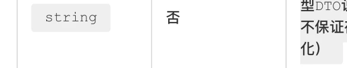

**routeDispatcher 对象结构**

路由分发配置，根据  `strategyType`  字段值采用不同的策略类型。

| 参数名称 | 位置 | 类型 | 是否必选 | 示例 | 说明 |
| --- | --- | --- | --- | --- | --- |
| strategyType | <code>body</code> | <code>string</code> | 是 | <code>WEIGHT</code> | 必需；WEIGHT、HEADER、WEIGHT_MOD EL_MAPPING、SINGLE_MODE L_MAPPING、CONTEXT_LEN GTH。子类结构不可混<br><br>用。<code>     </code> |
| rules | <code>body</code> | <code>array</code> | 按策略必填 | <code>[{"weight":</code><br><code>100,"service</code><br><code>Id":"${aiSer</code><br><code>viceId}"}]</code> | 业务必填的非空规则数组；结构按strategyType选择，不能混用各子类。WEIGHT、HEADER、WEIGHT_MOD EL_MAPPING要求非空；SINGLE_MODE L_MAPPING 必须恰好一项。CONTEXT_LEN GTH 使用自己的模型及区间规则，完整入口约束尚未核验，不提供可调用示例。此处示例仅对应WEIGHT。 |

**WEIGHT 策略（权重分发）：**

| 参数名称 | 位置 | 类型 | 是否必选 | 示例 | 说明 |
| --- | --- | --- | --- | --- | --- |
| rules | body | <code>array</code> | 是 | <code>[{"weight":</code><br><code>100,"service</code><br><code>Id":"${aiSer</code><br><code>viceId}"}]</code> | 业务必填的非空规则数组；结构按strategyType选择，不能混用各子类。 |
| rules\[\].weight | body | <code>integer</code> | 是 | <code>50</code> | 整数权重，非空且非负；普通WEIGHT 不要求权重总和为100。 |
| rules\[\].service Id | body | <code>string</code> | 是 | <code>${aiService</code><br><code>Id}</code> | 每条规则业务必填：同实例有效服务 ID，非空白；与普通路由顶层 SINGLE 无关。 |
| rules\[\].service Name | body | <code>string</code> | 否 | <code>model-</code><br><code>service</code> | 展示用服务名称，不替代serviceId，也不参与服务标识校验。 |

**HEADER 策略（Header条件分发）：**

| 参数名称 | 位置 | 类型 | 是否必选 | 示例 | 说明 |
| --- | --- | --- | --- | --- | --- |
| rules | body | <code>array</code> | 是 | <code>[{"headerMa</code><br><code>tch":</code><br><code>{"model":"mo</code><br><code>del-</code><br><code>demo"},"weig</code><br><code>htRuleList":</code><br><code>[{"weight":1</code><br><code>00,"serviceI</code><br><code>d":"${aiServ</code><br><code>iceId}"}]}]</code> | HEADER 匹配规则非空。每项提供headerMatch；优先使用非空weightRuleLis t，其每项weight 非空且非负、serviceId 非空白；未提供权重列表时须提供旧兼容serviceId。 |
| rules\[\].header Match | body | <code>object</code> | 是 | <code>{"model":</code><br><code>"gpt-4"}</code> | Header匹配条件，key-value形式，如<code>{"model":</code> <code>"gpt-4"} </code>。 |
| rules\[\].weight RuleList | body | <code>array</code> | 否 | <code>[{"weight":</code><br><code>100,"service</code><br><code>Id":"${aiSer</code><br><code>viceId}"}]</code> | 优先使用的权重规则数组。非空时逐项要求weight 为非负Integer、serviceId 为非空白字符串；为空时必须提供该HEADER 规则的旧兼容serviceId。 |

**WEIGHT_MODEL_MAPPING / SINGLE_MODEL_MAPPING 策略（权重+模型映射）：**

| 参数名称 | 位置 | 类型 | 是否必选 | 示例 | 说明 |
| --- | --- | --- | --- | --- | --- |

<table>
  <tr>
    <td>rules</td>
    <td>body</td>
    <td><code>array</code></td>
    <td>是</td>
    <td><code>[{"weight":</code><br><code>100,"service</code><br><code>Id":"${aiSer</code><br><code>viceId}","mo</code><br><code>delMapping":</code><br><code>{"model-</code><br><code>source":"mod</code><br><code>el-</code><br><code>target"}}]</code></td>
    <td>WEIGHT_MOD EL_MAPPING要求非空数组；SINGLE_MODE L_MAPPING 必须恰好一项，且该项省略或传null 的 weight会设为100。两者每项serviceId 均非空白。</td>
  </tr>
  <tr>
    <td>rules[].weight</td>
    <td>body</td>
    <td><code>integer</code></td>
    <td>按策略条件</td>
    <td><code>50</code></td>
    <td>Integer。WEIGHT_MOD EL_MAPPING中必填且非负；SINGLE_MODE L_MAPPING 必须仅一条规则，weight 省略或为 null 时设为100，非空值仍须非负。</td>
  </tr>
  <tr>
    <td>rules[].service Id</td>
    <td>body</td>
    <td><code>string</code></td>
    <td>是</td>
    <td><code>${aiService</code><br><code>Id}</code></td>
    <td>每条规则业务必填：同实例有效服务 ID，非空白；与普通路由顶层 SINGLE 无关。</td>
  </tr>
  <tr>
    <td>rules[].model Mapping</td>
    <td>body</td>
    <td><code>object</code></td>
    <td>否</td>
    <td><code>{"gpt-</code><br><code>3.5": "gpt-</code><br><code>4"}</code></td>
    <td>模型名称映射，键和值均为字符串；已读本地校验未要求非空，不将示例升级为强制必填或数据面保证。<code>  </code></td>
  </tr>
  <tr>
    <td>rules[].service Name</td>
    <td>body</td>
    <td><code>string</code></td>
    <td>否</td>
    <td><code>model-</code><br><code>service</code></td>
    <td>展示用服务名称，不替代serviceId，也不参与服务标识校验。</td>
  </tr>
</table>

**模型兜底兼容字段补充**

| 字段路径 | 本地类型 | 说明 |
| --- | --- | --- |
| fallbackTriggerScope | String |  |
| fallbackServices | array |  |

**返回数据**

本主表仅列当前API JSON声明的响应成员，不统一套用BaseResult。未列入清单的后端业务数据在补充结构中说明，不据此承诺POP外层映射。

| 参数名称 | 类型 | 示例 | 说明 |
| --- | --- | --- | --- |
| requestId | <code>string</code> | <code>${requestId}</code> | 请求ID。 |
| code | <code>integer&lt;int32&gt;</code> | <code>200</code> | 业务响应码，Integer；不是已验证的外层 HTTP 状态码。 |
| msg | <code>string</code> | <code>null</code> | 响应消息。 |
| data | <code>string</code> | <code>model-api-chat-</code><br><code>demo</code> | data为新建的模型API ID，类型为字符串。配置保存后会触发异步发布，接口返回成功不表示发布已完成。 |

**后端业务结构与旧展开字段（不扩展POP主表）**

| 参数名称 | 类型 | 示例 | 说明 |
| --- | --- | --- | --- |

**示例**

**请求示例**

```http
POST /modelapi/createModelApi HTTP/1.1

{
  "gwInstanceId": "${gwInstanceId}",
  "apiName": "chat-demo",
  "basePath": "/chat-demo",
  "basePathRemove": true,
  "methodPathList": [
    {
      "path": "/v1/chat/completions",
      "method": "POST"
    }
  ],
  "protocol": "OPENAI_COMPATIBLE",
  "sceneType": "TEXT_GENERATION",
  "routeDispatcher": {
    "strategyType": "WEIGHT",
    "rules": [
      {
        "serviceId": "${aiServiceId}",
        "weight": 100
      }
    ]
  }
}
```

**响应示例**

```json
{
  "requestId": "${requestId}",
  "code": 200,
  "msg": null,
  "message": null,
  "data": "model-api-chat-demo"
}
```

<a id="section-1-3-9-4"></a>

#### 1.3.9.4. DeleteModelApi

删除要求模型 ID 非空且资源存在；先级联清理消费者和消费者组授权，再删除配置并撤销路由。单项授权清理异常可能仅记日志，非跨数据库与 K8s 事务；成功 data=null。

**说明**：此接口仅适用于 AI网关（Higress引擎）实例。

**接口约束与兼容边界**

模型 ID 使用创建返回的 model-api- 前缀标识。更新和删除要求资源存在；详情查询有效但不存在的 ID 时data=null。格式非法、资源不存在和查询失败的行为不能混为一谈。

删除要求模型 ID 非空且资源存在；先级联清理消费者和消费者组授权，再删除配置并撤销路由。单项授权清理异常可能仅记日志，非跨数据库与 K8s 事务；成功 data=null。

**请求头**

公共请求头及认证信息的获取与携带方式，请参见获取公共Header参数。

**请求语法**

```http
POST /modelapi/deleteModelApi HTTP/1.1
```

**请求参数**

主表字段路径、类型、顺序与当前API JSON一致。是否必选优先采用非空docRequired，否则采用required；表中“否”不代表可绕过说明列的业务必填及条件约束。

| 参数名称 | 位置 | 类型 | 是否必选 | 示例 | 说明 |
| --- | --- | --- | --- | --- | --- |
| gwInstanceId | <code>body</code> | <code>string</code> | 否 | <code>${gwInstanc</code><br><code>eId}</code> | 业务必填：目标网关实例 ID；关联资源须在同实例且具备正常权限。 |
| id | <code>body</code> | <code>string</code> | 否 | <code>model-api-</code><br><code>chat-demo</code> | 业务必填：模型ID，使用创建返回的model-api-前缀标识，不能为空白。 |

**返回数据**

本主表仅列当前API JSON声明的响应成员，不统一套用BaseResult。未列入清单的后端业务数据在补充结构中说明，不据此承诺POP外层映射。

| 参数名称 | 类型 | 示例 | 说明 |
| --- | --- | --- | --- |
| requestId | <code>string</code> | <code>${requestId}</code> | 请求ID。 |
| code | <code>integer&lt;int32&gt;</code> | 200 | 业务响应码，Integer；不是已验证的外层 HTTP 状态码。 |
| msg | <code>string</code> | <code>null</code> | 响应消息。 |
| data | null | <code>null</code> | 无返回业务数据，值为null。 |

**示例**

**请求示例**

```http
POST /modelapi/deleteModelApi HTTP/1.1

{
  "gwInstanceId": "${gwInstanceId}",
  "id": "model-api-chat-demo"
}
```

**响应示例**

```json
{
  "requestId": "${requestId}",
  "code": 200,
  "msg": null,
  "message": null,
  "data": null
}
```

<a id="section-1-3-9-5"></a>

#### 1.3.9.5. GetModelApi

模型详情业务结构包含 methodPathList 数组；有效模型 ID 查无时 data=null，不返回全字段为空的模型对象。 id 为业务必填且非空白；gwInstanceId 为对应实例。缺少参数与有效 ID 查无返回 null 是不同情况，不以静态异常推断 POP 外层 HTTP 状态码。 methodPathList 为数组。publishStatus、publishFailureReason、firstByteTimeout 属于后端业务结构；firstByteTimeout 为 Long，单位毫秒，未设置或0表示不限制，不与秒级 TIMEOUT/RETRY 混用。

**说明**：此接口仅适用于 AI网关（Higress引擎）实例。

**接口约束与兼容边界**

模型创建 data 为 model-api- 加 apiName。初始状态 UNPUBLISHED，随后异步发布；状态为PUBLISHING、SUCCESS、FAILED、UNPUBLISHED。重发布仅适用于 FAILED 或 UNPUBLISHED 的存量模型，提交前写 PUBLISHING，提交失败回写 FAILED 和原因；不保证跨副本严格幂等。

模型 ID 使用创建返回的 model-api- 前缀标识。更新和删除要求资源存在；详情查询有效但不存在的 ID 时data=null。格式非法、资源不存在和查询失败的行为不能混为一谈。

更新保留原名称、policyConfig、authenticationConfig、publishStatus、publishFailureReason，保存后异步发布 UPDATE。主发布 SUCCESS 不证明附属策略、鉴权、授权和兜底全部成功，需分别核对。

模型详情业务结构包含 methodPathList 数组；有效模型 ID 查无时 data=null，不返回全字段为空的模型对象。

id 为业务必填且非空白；gwInstanceId 为对应实例。缺少参数与有效 ID 查无返回 null 是不同情况，不以静态异常推断 POP 外层 HTTP 状态码。

methodPathList 为数组。publishStatus、publishFailureReason、firstByteTimeout 属于后端业务结构；firstByteTimeout 为 Long，单位毫秒，未设置或0表示不限制，不与秒级 TIMEOUT/RETRY 混用。

sceneType 保留 TEXT_GENERATION、IMAGE_GENERATION、VIDEO_GENERATION、SPEECH_SYNTHESIS、TEXT_RERANK、EMBEDDING、OTHER 七类；合法枚举仍需满足协议目录组合校验。

**请求头**

公共请求头及认证信息的获取与携带方式，请参见获取公共Header参数。

**请求语法**

```http
POST /modelapi/getModelApi HTTP/1.1
```

**请求参数**

主表字段路径、类型、顺序与当前API JSON一致。是否必选优先采用非空docRequired，否则采用required；表中“否”不代表可绕过说明列的业务必填及条件约束。

| 参数名称 | 位置 | 类型 | 是否必选 | 示例 | 说明 |
| --- | --- | --- | --- | --- | --- |
| gwInstanceId | <code>body</code> | <code>string</code> | 否 | <code>${gwInstanc</code><br><code>eId}</code> | 业务必填：目标网关实例 ID；关联资源须在同实例且具备正常权限。 |
| id | <code>body</code> | <code>string</code> | 否 | <code>model-api-</code><br><code>chat-demo</code> | 业务必填：模型ID，使用创建返回的model-api-前缀标识，不能为空白。 |

**返回数据**

本主表仅列当前API JSON声明的响应成员，不统一套用BaseResult。未列入清单的后端业务数据在补充结构中说明，不据此承诺POP外层映射。

| 参数名称 | 类型 | 示例 | 说明 |
| --- | --- | --- | --- |
| requestId | <code>string</code> | <code>${requestId}</code> | 请求ID。 |
| code | <code>integer&lt;int32&gt;</code> | 200 | 业务响应码，Integer；不是已验证的外层 HTTP 状态码。 |
| msg | <code>string</code> | <code>null</code> | 响应消息。 |
| data | object | {} | 后端业务结构（非POP主表字段保证）：响应数据。 |
| data.id | string | model-api-chat-demo | 后端业务结构（非POP主表字段保证）：ID标识。 |
| data.apiName | string | chat-demo | 后端业务结构（非POP主表字段保证）：模型名称，2—50字符，小写字母、数字和连字符，首尾非连字符。 |
| data.description | string | 文本生成模型API | 后端业务结构（非POP主表字段保证）：描述信息，最多255字符。 |
| data.basePath | string | /api/v1/chat | 后端业务结构（非POP主表字段保证）：模型基础路径。 |
| data.basePathRemove | boolean | false | 后端业务结构（非POP主表字段保证）：是否移除基础路径。 |
| data.methodPathList | array | \[\] | 后端业务结构（非POP主表字段保证）：方法路径数组，每项含path和method。 |
| data.methodPathList\[\].path | string | /v1/chat/completions | 后端业务结构（非POP主表字段保证）：方法路径数组元素：path为路径字符串，method为HTTP方法字符串。 |
| data.methodPathList\[\].method | string | POST | 后端业务结构（非POP主表字段保证）：方法路径数组元素：path为路径字符串，method为HTTP方法字符串。 |
| data.domainNameList | array | \[\] | 后端业务结构（非POP主表字段保证）：关联域名字符串数组。 |
| data.protocol | string | OPENAI_COMPATIBLE | 后端业务结构（非POP主表字段保证）：模型协议支持 HTTP_CUSTOM、WS_CUSTOM、OPENAI_COMPATIBLE、ANTHROPIC_COMPATIB LE、ALIYUN_BAILIAN、VLLM、DOUBAO、COMFYUI。创建/更新先转大写解析，但 openai不是OPENAI_COMPATIBLE的别名。场景、协议、方法和路径还必须符合协议目录。取值：HTTP_CUSTOM、WS_CUSTOM、OPENAI_COMPATIBLE、ANTHROPIC_COMPATIB LE、ALIYUN_BAILIAN、VLLM、DOUBAO、COMFYUI。 |
| data.sceneType | string | TEXT_GENERATION | 后端业务结构（非POP主表字段保证）：场景类型。取值：TEXT_GENERATION、IMAGE_GENERATION、VIDEO_GENERATION、SPEECH_SYNTHESIS、TEXT_RERANK、EMBEDDING、OTHER。 |
| data.routeDispatcher | object | {} | 后端业务结构（非POP主表字段保证）：后端服务分配配置对象；不将其作为未经校验的更新报文。 |
| data.routeDispatcher.st rategyType | string | WEIGHT | —。取值：WEIGHT、HEADER、WEIGHT_MODEL_MAPPI NG、SINGLE_MODEL_MAPPI NG、CONTEXT_LENGTH。 |
| data.upstreamAffinityC onfig | object | {} | — |
| data.upstreamAffinityC onfig.enabled | boolean | false | 是否启用。 |
| data.upstreamAffinityC onfig.affinityType | string | SESSION | —。取值：SESSION、CONSUMER、TENANT、USER、AGENT、CUSTOM。 |
| data.upstreamAffinityC onfig.keyHeader | string | example | — |
| data.upstreamAffinityC onfig.fallbackKeyHeade r | string | example | — |
| data.observationConfig | object | {} | 后端业务结构（非POP主表字段保证）：可观测性配置。 |
| data.observationConfig.enable | boolean | true | 后端业务结构（非POP主表字段保证）：是否启用。 |
| data.observationConfig.logRequestInfo | boolean | false | — |
| data.observationConfig.logResponseInfo | boolean | false | — |
| data.fallback | object | {} | 后端业务结构（非POP主表字段保证）：降级配置。 |
| data.fallback.enable | boolean | false | 是否启用兜底。 |
| data.fallback.fallbackTr iggerScope | string | BACKEND_ONLY | Fallback 触发范围BACKEND_ONLY: 仅后端服务5xx错误触发（限流429、鉴权401/403不触发）BACKEND_AND_GA TEWAY: 网关限流(429) + 后端服务错误(5xx) 触发 注意：鉴权拒绝(401/403)不触发，未认证请求不应通过 fallback路由绕过鉴权如果未设置，默认为BACKEND_ONLY。取值：BACKEND_ONLY、BACKEND_AND_GATEW AY。 |
| data.fallback.fallbackSe rviceId | string | fallback-service-001 | 兜底服务 ID（单服务模式，向后兼容）推荐使用fallbackServices 支持多服务 + 模型名称映射。 |
| data.fallback.fallbackSe rvices | array | \[\] | 兜底服务列表（多服务模式）支持配置多个降级服务，每个服务可指定模型名称映射当同时配置了fallbackServiceId 和fallbackServices 时，优先使用fallbackServices。 |
| data.fallback.fallbackSe rvices\[\].serviceId | string | service-demo | 服务 ID。 |

<table>
  <tr>
    <td>data.fallback.fallbackSe rvices[].modelMapping</td>
    <td>object</td>
    <td>{}</td>
    <td>模型名称映射key: 请求中的模型名称（支持通配符"*"）value: 实际转发到降级服务时使用的模型名称示例：{"*": "gpt-3.5-turbo"} - 所有模型都映射到 gpt-3.5-turbo{"gpt-4": "gpt-3.5-turbo", "*": "gpt-3.5-turbo-16k"} -gpt-4 映射到 gpt-3.5-turbo，其他映射到 gpt-3.5-turbo-16k。</td>
  </tr>
  <tr>
    <td>data.fallback.fallbackSe rvices[].weight</td>
    <td>integer&lt;int32&gt;</td>
    <td>0</td>
    <td>权重（仅 RAND 策略使用，SEQUENCE 策略下此字段无效，按列表顺序级联降级）默认为 100。</td>
  </tr>
  <tr>
    <td>data.fallback.fallbackSt rategy</td>
    <td>string</td>
    <td>random（模型DTO说明值，不保证存量归一化）</td>
    <td>兜底策略: random（按权重负载均衡）或sequence（按列表顺序级联降级）。</td>
  </tr>
  <tr>
    <td>data.fallback.effectiveR esponseCodes</td>
    <td>array</td>
    <td>[]</td>
    <td>—</td>
  </tr>
  <tr>
    <td>data.authenticationCon fig</td>
    <td>object</td>
    <td>{}</td>
    <td>后端业务结构（非POP主表字段保证）：鉴权配置对象；先保存再异步下发，控制面成功不等于插件生效。</td>
  </tr>
  <tr>
    <td>data.authenticationCon fig.enable</td>
    <td>boolean</td>
    <td>true</td>
    <td>后端业务结构（非POP主表字段保证）：是否启用。</td>
  </tr>
  <tr>
    <td>data.authenticationCon fig.credentialTypeList</td>
    <td>array</td>
    <td>[]</td>
    <td>启用哪些凭证类型 * @see CredentialTypeEnum。</td>
  </tr>
  <tr>
    <td>data.publishStatus</td>
    <td>string</td>
    <td>PUBLISHING</td>
    <td>—。取值：PUBLISHING、SUCCESS、FAILED、UNPUBLISHED。</td>
  </tr>
  <tr>
    <td>data.publishFailureRea son</td>
    <td>string</td>
    <td>example</td>
    <td>—</td>
  </tr>
  <tr>
    <td>data.firstByteTimeout</td>
    <td>integer&lt;int64&gt;</td>
    <td>0</td>
    <td>首包超时时间（毫秒），非必填。不设置或配置为0 表示不限制超时。</td>
  </tr>
</table>

**有证据的后端业务字段补充（非POP主表）**

| 字段路径 | 业务类型 | 说明 |
| --- | --- | --- |
| data.methodPathList | array | 方法路径数组，每项含path和method。 |
| data.methodPathList\[\].path | String | 方法路径数组元素：path为路径字符串，method为HTTP方法字符串。 |
| data.methodPathList\[\].method | String | 方法路径数组元素：path为路径字符串，method为HTTP方法字符串。 |
| data.publishStatus | String | 主发布状态：PUBLISHING、SUCCESS、FAILED、UNPUBLISHED；SUCCESS不保证附属策略全部成功。 |
| data.publishFailureReason | String/null | 发布失败原因，可为空；原因空不证明附属配置全部成功。 |
| data.firstByteTimeout | Long/null | 后端 Long，单位毫秒；未设置或0表示不限制。 |

**示例**

**请求示例**

```http
POST /modelapi/getModelApi HTTP/1.1

{
  "gwInstanceId": "${gwInstanceId}",
  "id": "model-api-chat-demo"
}
```

**响应示例**

```json
{
  "requestId": "${requestId}",
  "code": 200,
  "msg": null,
  "data": {
    "id": "model-api-chat-demo",
    "apiName": "chat-demo",
    "protocol": "OPENAI_COMPATIBLE",
    "methodPathList": [
      {
        "path": "/v1/chat/completions",
        "method": "POST"
      }
    ],
    "publishStatus": "UNPUBLISHED",
    "publishFailureReason": null,
    "firstByteTimeout": 0,
    "description": "demo",
    "basePath": "example",
    "basePathRemove": false,
    "domainNameList": [],
    "sceneType": "TEXT_GENERATION",
    "routeDispatcher": {
      "strategyType": "WEIGHT"
    },
    "upstreamAffinityConfig": {
      "enabled": false,
      "affinityType": "SESSION",
      "keyHeader": "example",
      "fallbackKeyHeader": "example"
    },
    "observationConfig": {
      "enable": false,
      "logRequestInfo": false,
      "logResponseInfo": false
    },
    "fallback": {
      "enable": false,
      "fallbackTriggerScope": "BACKEND_ONLY",
      "fallbackServiceId": "fallbackservice-demo",
      "fallbackServices": [],
      "fallbackStrategy": "example",
      "effectiveResponseCodes": []
    },
    "authenticationConfig": {
      "enable": false,
      "credentialTypeList": []
    }
  },
  "message": null
}
```

<a id="section-1-3-9-6"></a>

#### 1.3.9.6. GetModelApiPolicies

模型策略业务响应有九个配置块，包含 allClusterLimitPolicyConfig 和 retryConfig。未保存策略时返回空策略对象，单块转换失败可能缺失。ALL_CLUSTER_LIMIT 的 globalThresholds 与 ruleItems 不能同时为空，可同时提供；全局 limitKeys 是整数映射，规则 limitKeys 是数组。 查询模型策略要求gwInstanceId、id 均非空白且模型存在；不能套用详情查询的查无 null 语义。

**说明**：此接口仅适用于 AI网关（Higress引擎）实例。

**接口约束与兼容边界**

Token 时间单位使用 PER_SECOND、PER_MINUTE、PER_HOUR、PER_DAY。非法字符串会回退为每分钟，不能依赖该回退；limitKeys.key 是匹配值，\* 表示全匹配。

AI_SECURITY 按 securityProvider 区分绿网与天鉴，天鉴还分公网和私有部署。不得混用不同提供商配置。

AI_MODEL_PARAMETER_OVERRIDE 开启时 items 非空、元素非 null，name/value/overwrite 必填且name 唯一；rawKey 非 null 时不得空白。关闭时省略、null 或空 items 会保留非空旧值，不表示清空。AI_CONTEXT_LIMIT 开启时 maxContextTokens 大于0，errorStatusCode 为400—599，bufferRatio大于0且不超过10。

模型策略业务响应有九个配置块，包含 allClusterLimitPolicyConfig 和 retryConfig。未保存策略时返回空策略对象，单块转换失败可能缺失。ALL_CLUSTER_LIMIT 的 globalThresholds 与 ruleItems 不能同时为空，可同时提供；全局 limitKeys 是整数映射，规则 limitKeys 是数组。

查询模型策略要求 gwInstanceId、id 均非空白且模型存在；不能套用详情查询的查无 null 语义。

riskLevelBar 推荐 max/high/medium/low 等小写值，绿网默认 low；本地对非空字符串透传，不承诺自动转小写或拒绝 HIGH。Token 的匹配 key 不固定为 token_limit，时间单位用 PER_DAY 等完整值。

模型策略包含 aiModelParameterOverridePolicyConfig、aiContextLimitPolicyConfig。CLUSTER_QPS_LIMIT 开启时至少一项正值，但下发只按秒、分、时、日顺序选择首个非 null 值，不是多窗口同时生效；集群限流依赖实例 Redis。

**请求头**

公共请求头及认证信息的获取与携带方式，请参见获取公共Header参数。

**请求语法**

```http
POST /modelapi/getModelApiPolicies HTTP/1.1
```

**请求参数**

主表字段路径、类型、顺序与当前API JSON一致。是否必选优先采用非空docRequired，否则采用required；表中“否”不代表可绕过说明列的业务必填及条件约束。

| 参数名称 | 位置 | 类型 | 是否必选 | 示例 | 说明 |
| --- | --- | --- | --- | --- | --- |
| gwInstanceId | <code>body</code> | <code>string</code> | 否 | <code>${gwInstanc</code><br><code>eId}</code> | 业务必填：目标网关实例 ID；关联资源须在同实例且具备正常权限。 |
| id | <code>body</code> | <code>string</code> | 否 | <code>model-api-</code><br><code>chat-demo</code> | 业务必填：模型ID，使用创建返回的model-api-前缀标识，不能为空白。 |

**返回数据**

本主表仅列当前API JSON声明的响应成员，不统一套用BaseResult。未列入清单的后端业务数据在补充结构中说明，不据此承诺POP外层映射。

| 参数名称 | 类型 | 示例 | 说明 |
| --- | --- | --- | --- |
| requestId | string | req-demo | 请求 ID。 |
| code | <code>integer&lt;int32&gt;</code> | 200 | 业务响应码，Integer；不是已验证的外层 HTTP 状态码。 |
| msg | <code>string</code> | <code>null</code> | 响应消息。 |
| data | object | {} | 后端业务结构（非POP主表字段保证）：响应数据。 |
| data.aiSecurityPolicyCo nfig | object | {} | 后端业务结构（非POP主表字段保证）：AI安全策略配置。 |
| data.aiSecurityPolicyCo nfig.enabled | boolean | false | 策略启用开关。 |
| data.aiSecurityPolicyCo nfig.accessUrl | string | example | 接入地址。 |
| data.aiSecurityPolicyCo nfig.checkRequestEnab led | boolean | false | 检查请求开关。 |
| data.aiSecurityPolicyCo nfig.checkResponseEna bled | boolean | false | 检查响应开关。 |
| data.aiSecurityPolicyCo nfig.streamChunkSize | integer&lt;int32&gt; | 100 | 流式响应分块大小。 |
| data.aiSecurityPolicyCo nfig.timeoutSeconds | integer&lt;int32&gt; | 1 | 超时时间(秒)。 |
| data.aiSecurityPolicyCo nfig.denyMessage | string | 未设置/按约束 | 内容非法时的响应消息。 |
| data.aiSecurityPolicyCo nfig.requestCheckServi ce | string | 未设置/按约束 | 指定阿里云内容安全用于检测输入内容的服务。 |
| data.aiSecurityPolicyCo nfig.responseCheckSer vice | string | 未设置/按约束 | 指定阿里云内容安全用于检测输出内容的服务。 |
| data.aiSecurityPolicyCo nfig.riskLevelBar | string | 未设置/按约束 | 风险等级拦截阈值，决定什么级别的风险需要拦截请求注意: 此字段仅用于阿里云内容安全（绿网）。 |
| data.aiSecurityPolicyCo nfig.securityProvider | string | example | 安全服务类型- "lvwang":阿里云内容安全（绿网）-"tianjian": 蚂蚁天鉴安全护栏。 |
| data.aiSecurityPolicyCo nfig.tianjianDeployType | string | example | 天鉴部署类型- "public":公网天鉴（AntChain OpenAPI 协议）- 默认-"private": 私有化部署天鉴（REST API）。 |
| data.aiSecurityPolicyCo nfig.tianjianServiceHost | string | example | 私有化天鉴服务地址（仅tianjianDeployType=pri vate 时使用）。 |
| data.aiSecurityPolicyCo nfig.tianjianServicePort | integer&lt;int32&gt; | 0 | 私有化天鉴服务端口（仅tianjianDeployType=pri vate 时使用）。 |
| data.aiSecurityPolicyCo nfig.tianjianAppCode | string | example | 私有化天鉴应用标识（仅tianjianDeployType=pri vate 时必填）。 |
| data.aiSecurityPolicyCo nfig.enterprise | string | example | 企业标识（公网天鉴必填）。 |
| data.aiSecurityPolicyCo nfig.businessId | string | business-demo | 租户标识（天鉴必填）。 |
| data.aiSecurityPolicyCo nfig.tianjianAk | string | example | 天鉴 AccessKey（可选，若未填写则使用后端默认配置）。 |
| data.aiSecurityPolicyCo nfig.tianjianSk | string | example | 天鉴AccessKeySecret（可选，若未填写则使用后端默认配置）。 |
| data.aiSecurityPolicyCo nfig.tianjianSceneCodeI nput | string | example | 天鉴输入检测场景码。 |
| data.aiSecurityPolicyCo nfig.tianjianSceneCode Output | string | example | 天鉴输出检测场景码。 |
| data.aiSecurityPolicyCo nfig.tianjianPromptAtta ckDefense | boolean | false | 是否开启提示词攻击防御（天鉴）。 |
| data.aiSecurityPolicyCo nfig.tianjianMultiSessio nDetect | boolean | false | 是否开启多轮对话检测（天鉴）。 |
| data.aiSecurityPolicyCo nfig.tianjianFinanceCo mplianceDetection | boolean | false | 是否开启金融合规专项检测（天鉴）。 |
| data.aiSecurityPolicyCo nfig.tianjianPrivacyData Detection | boolean | false | 是否开启隐私数据泄露检测（天鉴）。 |
| data.aiSecurityPolicyCo nfig.tianjianFieldIdentif y | boolean | false | 是否开启领域识别（天鉴）。 |
| data.aiSecurityPolicyCo nfig.tianjianPromptRew ord | boolean | false | 是否开启安全改写（天鉴）。 |
| data.aiSecurityPolicyCo nfig.tianjianPrivacyData Obfuscation | boolean | false | 是否开启隐私数据脱敏（天鉴）。 |
| data.aiTokenLimitPolicy Config | object | null | 后端业务结构（非POP主表字段保证）：AI Token限流策略配置。 |
| data.aiTokenLimitPolicy Config.enabled | boolean | false | 后端业务结构（非POP主表字段保证）：本地配置字段。DTO默认：false。 |
| data.aiTokenLimitPolicy Config.ruleItems | array | \[\] | 限流规则项列表。 |
| data.aiTokenLimitPolicy Config.ruleItems\[\].limit ByType | string | 未设置/按约束 | 限流条件类型。 |
| data.aiTokenLimitPolicy Config.ruleItems\[\].limit ByValue | string | 未设置/按约束 | 限流条件值（如header名称、param名称等）。 |
| data.aiTokenLimitPolicy Config.ruleItems\[\].limit Keys | array | \[\] | 限流键配置列表。 |
| data.aiTokenLimitPolicy Config.ruleItems\[\].limit Keys\[\].key | string | DEMO_CREDENTIAL | 匹配的键值。 |
| data.aiTokenLimitPolicy Config.ruleItems\[\].limit Keys\[\].timeUnit | string | 未设置/按约束 | 限流时间单位。 |
| data.aiTokenLimitPolicy Config.ruleItems\[\].limit Keys\[\].tokenLimit | integer&lt;int32&gt; | null | 限流Token数量。 |
| data.aiModelParameter OverridePolicyConfig | object | {} | — |
| data.aiModelParameter OverridePolicyConfig.e nabled | boolean | false | 策略启用开关。 |
| data.aiModelParameter OverridePolicyConfig.it ems | array | \[\] | 参数覆盖项列表。用户按需添加，未添加的参数不下发。 |
| data.aiModelParameter OverridePolicyConfig.it ems\[\].name | string | MAX_TOKENS | 参数名（枚举限定合法值）。取值：MAX_TOKENS、TEMPERATURE、TOP_P、TOP_K、SEED、ENABLE_THINKING。 |
| data.aiModelParameter OverridePolicyConfig.it ems\[\].value | object | {} | 参数值。数值参数用BigDecimal 承载避免精度丢失，ENABLE_THINKING为布尔值，故统一用Object 承载。 |
| data.aiModelParameter OverridePolicyConfig.it ems\[\].overwrite | boolean | false | 是否强制覆盖客户端传入值。true：强制覆盖；false：仅在客户端未传时填充。该字段每项独立设置，必须显式输出到 ai-proxy（ai-proxy 默认true）。 |
| data.aiModelParameter OverridePolicyConfig.it ems\[\].rawKey | string | example | 自定义下发参数名。传入后覆盖 name 枚举对应的下发名，用于ENABLE_THINKING 等需要前端自定义下发 key 的场景。 |
| data.clusterQpsLimitPol icyConfig | object | {} | 后端业务结构（非POP主表字段保证）：集群QPS限流策略配置。 |
| data.clusterQpsLimitPol icyConfig.enabled | boolean | false | 后端业务结构（非POP主表字段保证）：本地配置字段。DTO默认：false。仅按秒/分/时/日选择首个非null值；0不等同不限制。 |
| data.clusterQpsLimitPol icyConfig.queryPerSeco nd | integer&lt;int32&gt; | 0 | 每秒允许的请求数。 |
| data.clusterQpsLimitPol icyConfig.queryPerMinu te | integer&lt;int32&gt; | 0 | 每分钟允许的请求数。 |
| data.clusterQpsLimitPol icyConfig.queryPerHour | integer&lt;int32&gt; | 0 | 每小时允许的请求数。 |
| data.clusterQpsLimitPol icyConfig.queryPerDay | integer&lt;int32&gt; | 0 | 每天允许的请求数。 |
| data.allClusterLimitPoli cyConfig | object | {} | 全局限流策略 （ai 限流）。 |
| data.allClusterLimitPoli cyConfig.enabled | boolean | false | 是否启用限流。 |
| data.allClusterLimitPoli cyConfig.multiRuleMod e | boolean | true | 是否启用多规则匹配模式，开启后可同时匹配多个限流规则默认值：true。 |
| data.allClusterLimitPoli cyConfig.maxConcurre ntRules | integer&lt;int32&gt; | 10 | 多规则模式下最大并发规则数，防止规则过多影响性能默认值：10。 |
| data.allClusterLimitPoli cyConfig.rejectedCode | integer&lt;int32&gt; | 429 | 请求被限流时，返回的HTTP 状态码默认值：429。 |
| data.allClusterLimitPoli cyConfig.rejectedMsg | string | Too many requests | 请求被限流时，返回的响应体默认值：Too many requests。 |
| data.allClusterLimitPoli cyConfig.globalThresho lds | array | \[\] | 全局限流配置列表，支持多个全局配置\`globalThresholds\` 或\`ruleItems\` 选填一项。 |
| data.allClusterLimitPoli cyConfig.globalThresho lds\[\].limitType | string | token | 限流类型，支持 token、request、concurrency、response默认值：token。 |
| data.allClusterLimitPoli cyConfig.globalThresho lds\[\].limitKeys | object | {} | 限制key详情， 示例：concurrency_limit：100，concurrency_ttl：100。 |
| data.allClusterLimitPoli cyConfig.globalThresho lds\[\].fixedQuotaMode | boolean | false | 是否固定配额值，开启时插件不会主动配置配额个数，配额更新由配额管理更新默认值：false。 |
| data.allClusterLimitPoli cyConfig.globalThresho lds\[\].hitsAddend | object | {} | 限流计数配置，通过请求/响应头中计数。 |
| data.allClusterLimitPoli cyConfig.globalThresho lds\[\].hitsAddend.base | integer&lt;int32&gt; | 1 | 基础计数值，当 header中无值时使用此值默认值：1。 |
| data.allClusterLimitPoli cyConfig.globalThresho lds\[\].hitsAddend.fromH eader | string | 未设置/按约束 | 从响应头中获取计数值的header 名称，支持动态计数。 |
| data.allClusterLimitPoli cyConfig.ruleItems | array | \[\] | 限流规则项列表，按照ruleItems 下的排列顺序，匹配第一个 ruleItem后命中限流规则，后续规则将被忽略\`globalThresholds\` 或\`ruleItems\` 选填一项。 |
| data.allClusterLimitPoli cyConfig.ruleItems\[\].li mitBy | string | 未设置/按约束 | 从哪个维度进行限制：limit_by_per_ip、limit_by_custom_match er、limit_by_per_param、limit_by_per_header、limit_by_per_cookie、limit_by_per_consumer、limit_by_per_ip。 |
| data.allClusterLimitPoli cyConfig.ruleItems\[\].li mitByFrom | string | 未设置/按约束 | 该维度-匹配的键：对于limit_by_per_ip来说：以from-header-对应的header名，示例：from-header-x-forwarded-for。 |
| data.allClusterLimitPoli cyConfig.ruleItems\[\].an dMatcherConfig | array | \[\] | 当rule_items的limitBy = "limit_by_custom_matc her"（多条件匹配限流标识）limitByFrom = "multi_condition"时生效。 |

<table>
  <tr>
    <td>data.allClusterLimitPoli cyConfig.ruleItems[].an dMatcherConfig[].limitB y</td>
    <td>string</td>
    <td>未设置/按约束</td>
    <td>从哪个维度进行限制：limit_by_per_ip、limit_by_custom_match er、limit_by_per_param、limit_by_per_header、limit_by_per_cookie、limit_by_per_consumer、limit_by_per_ip。</td>
  </tr>
  <tr>
    <td>data.allClusterLimitPoli cyConfig.ruleItems[].an dMatcherConfig[].limitB yFrom</td>
    <td>string</td>
    <td>未设置/按约束</td>
    <td>该维度-匹配的键：对于limit_by_per_ip来说：以from-header-对应的header名，示例：from-header-x-forwarded-for。</td>
  </tr>
  <tr>
    <td>data.allClusterLimitPoli cyConfig.ruleItems[].an dMatcherConfig[].key</td>
    <td>string</td>
    <td>DEMO_CREDENTIAL</td>
    <td>匹配的具体值，支持正则表达式和 IP 段。</td>
  </tr>
  <tr>
    <td>data.allClusterLimitPoli cyConfig.ruleItems[].li mitKeys</td>
    <td>array</td>
    <td>[]</td>
    <td>后端业务结构（非POP主表字段保证）：本地配置字段。</td>
  </tr>
  <tr>
    <td>data.allClusterLimitPoli cyConfig.ruleItems[].li mitKeys[].limitType</td>
    <td>string</td>
    <td>token</td>
    <td>限流类型，支持 token、request、concurrency、response默认值：token。</td>
  </tr>
  <tr>
    <td>data.allClusterLimitPoli cyConfig.ruleItems[].li mitKeys[].limitKeys</td>
    <td>object</td>
    <td>{}</td>
    <td>限制key详情， 示例：concurrency_limit：100，concurrency_ttl：100。</td>
  </tr>
  <tr>
    <td>data.allClusterLimitPoli cyConfig.ruleItems[].li mitKeys[].fixedQuotaM ode</td>
    <td>boolean</td>
    <td>false</td>
    <td>是否固定配额值，开启时插件不会主动配置配额个数，配额更新由配额管理更新默认值：false。</td>
  </tr>
  <tr>
    <td>data.allClusterLimitPoli cyConfig.ruleItems[].li mitKeys[].hitsAddend</td>
    <td>object</td>
    <td>{}</td>
    <td>限流计数配置，通过请求/响应头中计数。</td>
  </tr>
  <tr>
    <td>data.allClusterLimitPoli cyConfig.ruleItems[].li mitKeys[].hitsAddend.b ase</td>
    <td>integer&lt;int32&gt;</td>
    <td>1</td>
    <td>基础计数值，当 header中无值时使用此值默认值：1。</td>
  </tr>
  <tr>
    <td>data.allClusterLimitPoli cyConfig.ruleItems[].li mitKeys[].hitsAddend.fr omHeader</td>
    <td>string</td>
    <td>未设置/按约束</td>
    <td>从响应头中获取计数值的header 名称，支持动态计数。</td>
  </tr>
  <tr>
    <td>data.allClusterLimitPoli cyConfig.ruleItems[].li mitKeys[].key</td>
    <td>string</td>
    <td>DEMO_CREDENTIAL</td>
    <td>匹配的键值对于limit_by_per_ip: from-remote-addr来说key示例：192.168.1.0/24。</td>
  </tr>
  <tr>
    <td>data.timeoutConfig</td>
    <td>object</td>
    <td>{}</td>
    <td>后端业务结构（非POP主表字段保证）：超时配置。</td>
  </tr>
  <tr>
    <td>data.timeoutConfig.ena bled</td>
    <td>boolean</td>
    <td>false</td>
    <td>后端业务结构（非POP主表字段保证）：本地配置字段。</td>
  </tr>
  <tr>
    <td>data.timeoutConfig.tim eout</td>
    <td>integer&lt;int32&gt;</td>
    <td>0</td>
    <td>后端业务结构（非POP主表字段保证）：单位秒DTO默认：0。</td>
  </tr>
  <tr>
    <td>data.retryConfig</td>
    <td>object</td>
    <td>{}</td>
    <td>后端业务结构（非POP主表字段保证）：重试配置。</td>
  </tr>
  <tr>
    <td>data.retryConfig.enable d</td>
    <td>boolean</td>
    <td>false</td>
    <td>后端业务结构（非POP主表字段保证）：本地配置字段。DTO默认：false。</td>
  </tr>
  <tr>
    <td>data.retryConfig.attem pts</td>
    <td>integer&lt;int32&gt;</td>
    <td>2</td>
    <td>后端业务结构（非POP主表字段保证）：本地配置字段。最小值：1。DTO默认：2。不解释为已验证的总请求次数。</td>
  </tr>
  <tr>
    <td>data.retryConfig.timeo ut</td>
    <td>integer&lt;int32&gt;</td>
    <td>0</td>
    <td>后端业务结构（非POP主表字段保证）：每次重试请求超时，单位秒最小值：0。</td>
  </tr>
  <tr>
    <td>data.retryConfig.conditi ons</td>
    <td>array</td>
    <td>[]</td>
    <td>后端业务结构（非POP主表字段保证）：本地配置字段。DTO默认：["error","timeout","non _idempotent"]。数组元素可选值：["error","timeout","inva lid_header","non_idem potent"]。</td>
  </tr>
  <tr>
    <td>data.retryConfig.httpSt atusCodes</td>
    <td>array</td>
    <td>[]</td>
    <td>后端业务结构（非POP主表字段保证）：本地配置字段。DTO默认：[502,503,504]。</td>
  </tr>
  <tr>
    <td>data.aiContextLimitPoli cyConfig</td>
    <td>object</td>
    <td>{}</td>
    <td>—</td>
  </tr>
  <tr>
    <td>data.aiContextLimitPoli cyConfig.enabled</td>
    <td>boolean</td>
    <td>false</td>
    <td>是否启用。</td>
  </tr>
  <tr>
    <td>data.aiContextLimitPoli cyConfig.maxContextT okens</td>
    <td>integer&lt;int64&gt;</td>
    <td>null</td>
    <td>最大上下文 Token 数（必填，&gt; 0）。</td>
  </tr>
  <tr>
    <td>data.aiContextLimitPoli cyConfig.errorStatusCo de</td>
    <td>integer&lt;int32&gt;</td>
    <td>0</td>
    <td>拦截响应状态码（可选，400-599）。</td>
  </tr>
  <tr>
    <td>data.aiContextLimitPoli cyConfig.bufferRatio</td>
    <td>number</td>
    <td>0</td>
    <td>缓冲系数（可选，(0, 10]）。</td>
  </tr>
</table>

**后端业务结构与旧展开字段（不扩展POP主表）**

| 参数名称 | 类型 | 示例 | 说明 |
| --- | --- | --- | --- |
| requestId | <code>string</code> | "request-example-001" |  |
| data | <code>object</code> | <code> </code>见字段约束，非调用示例<code> </code> | 后端业务结构（非POP主表字段保证）：响应数据。 |
| data.aiSecurityPolicyCo nfig | <code>object</code> | <code> </code>见字段约束，非调用示例<code> </code> | 后端业务结构（非POP主表字段保证）：AI安全策略配置。 |
| data.aiSecurityPolicyCo nfig.enabled | <code>boolean/null</code> | <code>false</code> | 后端业务结构（非POP主表字段保证）：本地配置字段。DTO默认：false。 |
| data.aiSecurityPolicyCo nfig.checkRequestEnab led | <code>boolean/null</code> | <code>false</code> | 后端业务结构（非POP主表字段保证）：本地配置字段。DTO默认：false。 |

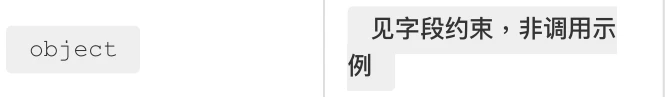


<table>
  <tr>
    <td>data.aiSecurityPolicyCo nfig.checkResponseEna bled</td>
    <td><code>boolean/null</code></td>
    <td><code>false</code></td>
    <td>后端业务结构（非POP主表字段保证）：本地配置字段。DTO默认：false。</td>
  </tr>
  <tr>
    <td>data.aiSecurityPolicyCo nfig.streamChunkSize</td>
    <td><code>integer/null</code></td>
    <td><code>100</code></td>
    <td>后端业务结构（非POP主表字段保证）：本地配置字段。DTO默认：100。</td>
  </tr>
  <tr>
    <td>data.aiSecurityPolicyCo nfig.timeoutSeconds</td>
    <td><code>integer/null</code></td>
    <td><code>1</code></td>
    <td>后端业务结构（非POP主表字段保证）：超时时间，单位秒。DTO默认：1。</td>
  </tr>
  <tr>
    <td>data.aiSecurityPolicyCo nfig.denyMessage</td>
    <td><code>string/null</code></td>
    <td><br><code> </code>未设置<code>/</code>按约束<code> </code></td>
    <td>后端业务结构（非POP主表字段保证）：本地配置字段。</td>
  </tr>
  <tr>
    <td>data.aiSecurityPolicyCo nfig.requestCheckServi ce</td>
    <td><code>string/null</code></td>
    <td><br><code> </code>未设置<code>/</code>按约束<code> </code></td>
    <td>后端业务结构（非POP主表字段保证）：本地配置字段。</td>
  </tr>
  <tr>
    <td>data.aiSecurityPolicyCo nfig.responseCheckSer vice</td>
    <td><code>string/null</code></td>
    <td><br><code> </code>未设置<code>/</code>按约束<code> </code></td>
    <td>后端业务结构（非POP主表字段保证）：本地配置字段。</td>
  </tr>
  <tr>
    <td>data.aiSecurityPolicyCo nfig.riskLevelBar</td>
    <td><code>string/null</code></td>
    <td><br><code> </code>未设置<code>/</code>按约束<code> </code></td>
    <td>后端业务结构（非POP主表字段保证）：仅绿网；推荐max/high/medium/low，非空字符串原样下发。</td>
  </tr>
  <tr>
    <td>data.aiTokenLimitPolicy Config</td>
    <td><code>object</code></td>
    <td><code> </code>见字段约束，非调用示例<code> </code></td>
    <td>后端业务结构（非POP主表字段保证）：AI Token限流策略配置。</td>
  </tr>
  <tr>
    <td>data.aiTokenLimitPolicy Config.enabled</td>
    <td><code>boolean/null</code></td>
    <td><code>false</code></td>
    <td>后端业务结构（非POP主表字段保证）：本地配置字段。DTO默认：false。</td>
  </tr>
  <tr>
    <td>data.aiTokenLimitPolicy Config.ruleItems</td>
    <td><code>array/null</code></td>
    <td><br><code> </code>未设置<code>/</code>按约束<code> </code></td>
    <td>后端业务结构（非POP主表字段保证）：本地配置字段。</td>
  </tr>
  <tr>
    <td>data.aiTokenLimitPolicy Config.ruleItems.limitB yType</td>
    <td><code>string/null</code></td>
    <td><br><code> </code>未设置<code>/</code>按约束<code> </code></td>
    <td>后端业务结构（非POP主表字段保证）：本地配置字段。</td>
  </tr>
  <tr>
    <td>data.aiTokenLimitPolicy Config.ruleItems.limitB yValue</td>
    <td><code>string/null</code></td>
    <td><br><code> </code>未设置<code>/</code>按约束<code> </code></td>
    <td>后端业务结构（非POP主表字段保证）：本地配置字段。</td>
  </tr>
</table>


<table>
  <tr>
    <td>data.aiTokenLimitPolicy Config.ruleItems.limitK eys</td>
    <td><code>array/null</code></td>
    <td><br><code> </code>未设置<code>/</code>按约束<code> </code></td>
    <td>后端业务结构（非POP主表字段保证）：本地配置字段。</td>
  </tr>
  <tr>
    <td>data.aiTokenLimitPolicy Config.ruleItems.limitK eys.key</td>
    <td><code>string/null</code></td>
    <td><br><code> </code>未设置<code>/</code>按约束<code> </code></td>
    <td>后端业务结构（非POP主表字段保证）：本地配置字段。</td>
  </tr>
  <tr>
    <td>data.aiTokenLimitPolicy Config.ruleItems.limitK eys.timeUnit</td>
    <td><code>string</code></td>
    <td><br><code> </code>未设置<code>/</code>按约束<code> </code></td>
    <td>后端业务结构（非POP主表字段保证）：本地配置字段。可选值：["PER_SECOND","PER_MINUTE","PER_HOUR"," PER_DAY"]。</td>
  </tr>
  <tr>
    <td>data.aiTokenLimitPolicy Config.ruleItems.limitK eys.tokenLimit</td>
    <td><code>integer/null</code></td>
    <td><br><code> </code>未设置<code>/</code>按约束<code> </code></td>
    <td>后端业务结构（非POP主表字段保证）：本地配置字段。</td>
  </tr>
  <tr>
    <td>data.clusterQpsLimitPol icyConfig</td>
    <td><code>object</code></td>
    <td><code> </code>见字段约束，非调用示例<code> </code></td>
    <td>后端业务结构（非POP主表字段保证）：集群QPS限流策略配置。</td>
  </tr>
  <tr>
    <td>data.clusterQpsLimitPol icyConfig.enabled</td>
    <td><code>boolean/null</code></td>
    <td><code>false</code></td>
    <td>后端业务结构（非POP主表字段保证）：本地配置字段。DTO默认：false。仅按秒/分/时/日选择首个非null值；0不等同不限制。</td>
  </tr>
  <tr>
    <td>data.clusterQpsLimitPol icyConfig.queryPerSeco nd</td>
    <td><code>integer/null</code></td>
    <td><br><code> </code>未设置<code>/</code>按约束<code> </code></td>
    <td>后端业务结构（非POP主表字段保证）：本地配置字段。仅按秒/分/时/日选择首个非null值；0不等同不限制。</td>
  </tr>
  <tr>
    <td>data.clusterQpsLimitPol icyConfig.queryPerMinu te</td>
    <td><code>integer/null</code></td>
    <td><br><code> </code>未设置<code>/</code>按约束<code> </code></td>
    <td>后端业务结构（非POP主表字段保证）：本地配置字段。仅按秒/分/时/日选择首个非null值；0不等同不限制。</td>
  </tr>
  <tr>
    <td>data.clusterQpsLimitPol icyConfig.queryPerHour</td>
    <td><code>integer/null</code></td>
    <td><br><code> </code>未设置<code>/</code>按约束<code> </code></td>
    <td>后端业务结构（非POP主表字段保证）：本地配置字段。仅按秒/分/时/日选择首个非null值；0不等同不限制。</td>
  </tr>
</table>


<table>
  <tr>
    <td>data.clusterQpsLimitPol icyConfig.queryPerDay</td>
    <td><code>integer/null</code></td>
    <td><br><code> </code>未设置<code>/</code>按约束<code> </code></td>
    <td>后端业务结构（非POP主表字段保证）：本地配置字段。仅按秒/分/时/日选择首个非null值；0不等同不限制。</td>
  </tr>
  <tr>
    <td>data.allClusterLimitPoli cyConfig</td>
    <td><code>object</code></td>
    <td><code> </code>见字段约束，非调用示例<code> </code></td>
    <td>后端业务结构（非POP主表字段保证）：全局限流策略配置。</td>
  </tr>
  <tr>
    <td>data.allClusterLimitPoli cyConfig.enabled</td>
    <td><code>boolean/null</code></td>
    <td><code>false</code></td>
    <td>后端业务结构（非POP主表字段保证）：本地配置字段。DTO默认：false。</td>
  </tr>
  <tr>
    <td>data.allClusterLimitPoli cyConfig.multiRuleMod e</td>
    <td><code>boolean/null</code></td>
    <td><code>true</code></td>
    <td>后端业务结构（非POP主表字段保证）：本地配置字段。DTO默认：true。</td>
  </tr>
  <tr>
    <td>data.allClusterLimitPoli cyConfig.maxConcurre ntRules</td>
    <td><code>integer/null</code></td>
    <td><code>10</code></td>
    <td>后端业务结构（非POP主表字段保证）：本地配置字段。DTO默认：10。</td>
  </tr>
  <tr>
    <td>data.allClusterLimitPoli cyConfig.rejectedCode</td>
    <td><code>integer/null</code></td>
    <td><code>429</code></td>
    <td>后端业务结构（非POP主表字段保证）：本地配置字段。DTO默认：429。</td>
  </tr>
  <tr>
    <td>data.allClusterLimitPoli cyConfig.rejectedMsg</td>
    <td><code>string/null</code></td>
    <td><code>"Too many</code><br><code>requests"</code></td>
    <td>后端业务结构（非POP主表字段保证）：本地配置字段。DTO默认："Too many requests"。</td>
  </tr>
  <tr>
    <td>data.allClusterLimitPoli cyConfig.globalThresho lds</td>
    <td><code>array/null</code></td>
    <td><br><code> </code>未设置<code>/</code>按约束<code> </code></td>
    <td>后端业务结构（非POP主表字段保证）：本地配置字段。</td>
  </tr>
  <tr>
    <td>data.allClusterLimitPoli cyConfig.globalThresho lds.limitType</td>
    <td><code>string/null</code></td>
    <td><code>"token"</code></td>
    <td>后端业务结构（非POP主表字段保证）：本地配置字段。DTO默认："token"。注释列token/request/concurre ncy/response，不是强枚举校验。</td>
  </tr>
  <tr>
    <td>data.allClusterLimitPoli cyConfig.globalThresho lds.limitKeys</td>
    <td><code>object/null</code></td>
    <td><br><code> </code>未设置<code>/</code>按约束<code> </code></td>
    <td>后端业务结构（非POP主表字段保证）：本地配置字段。映射值结构：{"type":"integer"}。</td>
  </tr>
</table>


<table>
  <tr>
    <td>data.allClusterLimitPoli cyConfig.globalThresho lds.fixedQuotaMode</td>
    <td><code>boolean/null</code></td>
    <td><br><code> </code>未设置<code>/</code>按约束<code> </code></td>
    <td>后端业务结构（非POP主表字段保证）：本地配置字段。字段无初始化，缺省为null，不承诺默认false。</td>
  </tr>
  <tr>
    <td>data.allClusterLimitPoli cyConfig.globalThresho lds.hitsAddend</td>
    <td><code>object/null</code></td>
    <td><br><code> </code>未设置<code>/</code>按约束<code> </code></td>
    <td>后端业务结构（非POP主表字段保证）：本地配置字段。</td>
  </tr>
  <tr>
    <td>data.allClusterLimitPoli cyConfig.globalThresho lds.hitsAddend.base</td>
    <td><code>integer/null</code></td>
    <td><code>1</code></td>
    <td>后端业务结构（非POP主表字段保证）：本地配置字段。DTO默认：1。</td>
  </tr>
  <tr>
    <td>data.allClusterLimitPoli cyConfig.globalThresho lds.hitsAddend.fromHe ader</td>
    <td><code>string/null</code></td>
    <td><br><code> </code>未设置<code>/</code>按约束<code> </code></td>
    <td>后端业务结构（非POP主表字段保证）：本地配置字段。</td>
  </tr>
  <tr>
    <td>data.allClusterLimitPoli cyConfig.ruleItems</td>
    <td><code>array/null</code></td>
    <td><br><code> </code>未设置<code>/</code>按约束<code> </code></td>
    <td>后端业务结构（非POP主表字段保证）：本地配置字段。</td>
  </tr>
  <tr>
    <td>data.allClusterLimitPoli cyConfig.ruleItems.limit By</td>
    <td><code>string/null</code></td>
    <td><br><code> </code>未设置<code>/</code>按约束<code> </code></td>
    <td>后端业务结构（非POP主表字段保证）：本地配置字段。</td>
  </tr>
  <tr>
    <td>data.allClusterLimitPoli cyConfig.ruleItems.limit ByFrom</td>
    <td><code>string/null</code></td>
    <td><br><code> </code>未设置<code>/</code>按约束<code> </code></td>
    <td>后端业务结构（非POP主表字段保证）：本地配置字段。</td>
  </tr>
  <tr>
    <td>data.allClusterLimitPoli cyConfig.ruleItems.and MatcherConfig</td>
    <td><code>array/null</code></td>
    <td><br><code> </code>未设置<code>/</code>按约束<code> </code></td>
    <td>后端业务结构（非POP主表字段保证）：本地配置字段。</td>
  </tr>
  <tr>
    <td>data.allClusterLimitPoli cyConfig.ruleItems.and MatcherConfig.limitBy</td>
    <td><code>string</code></td>
    <td><br><code> </code>未设置<code>/</code>按约束<code> </code></td>
    <td>后端业务结构（非POP主表字段保证）：本地配置字段。</td>
  </tr>
  <tr>
    <td>data.allClusterLimitPoli cyConfig.ruleItems.and MatcherConfig.limitByF rom</td>
    <td><code>string</code></td>
    <td><br><code> </code>未设置<code>/</code>按约束<code> </code></td>
    <td>后端业务结构（非POP主表字段保证）：本地配置字段。</td>
  </tr>
  <tr>
    <td>data.allClusterLimitPoli cyConfig.ruleItems.and MatcherConfig.key</td>
    <td><code>string</code></td>
    <td><br><code> </code>未设置<code>/</code>按约束<code> </code></td>
    <td>后端业务结构（非POP主表字段保证）：本地配置字段。</td>
  </tr>
  <tr>
    <td>data.allClusterLimitPoli cyConfig.ruleItems.limit Keys</td>
    <td><code>array/null</code></td>
    <td><br><code> </code>未设置<code>/</code>按约束<code> </code></td>
    <td>后端业务结构（非POP主表字段保证）：本地配置字段。</td>
  </tr>
  <tr>
    <td>data.allClusterLimitPoli cyConfig.ruleItems.limit Keys.limitType</td>
    <td><code>string/null</code></td>
    <td><code>"token"</code></td>
    <td>后端业务结构（非POP主表字段保证）：本地配置字段。DTO默认："token"。注释列token/request/concurre ncy/response，不是强枚举校验。</td>
  </tr>
  <tr>
    <td>data.allClusterLimitPoli cyConfig.ruleItems.limit Keys.limitKeys</td>
    <td><code>object/null</code></td>
    <td><br><code> </code>未设置<code>/</code>按约束<code> </code></td>
    <td>后端业务结构（非POP主表字段保证）：本地配置字段。映射值结构：{"type":"integer"}。</td>
  </tr>
  <tr>
    <td>data.allClusterLimitPoli cyConfig.ruleItems.limit Keys.fixedQuotaMode</td>
    <td><code>boolean/null</code></td>
    <td><br><code> </code>未设置<code>/</code>按约束<code> </code></td>
    <td>后端业务结构（非POP主表字段保证）：本地配置字段。字段无初始化，缺省为null，不承诺默认false。</td>
  </tr>
  <tr>
    <td>data.allClusterLimitPoli cyConfig.ruleItems.limit Keys.hitsAddend</td>
    <td><code>object/null</code></td>
    <td><br><code> </code>未设置<code>/</code>按约束<code> </code></td>
    <td>后端业务结构（非POP主表字段保证）：本地配置字段。</td>
  </tr>
  <tr>
    <td>data.allClusterLimitPoli cyConfig.ruleItems.limit Keys.hitsAddend.base</td>
    <td><code>integer/null</code></td>
    <td><code>1</code></td>
    <td>后端业务结构（非POP主表字段保证）：本地配置字段。DTO默认：1。</td>
  </tr>
  <tr>
    <td>data.allClusterLimitPoli cyConfig.ruleItems.limit Keys.hitsAddend.fromH eader</td>
    <td><code>string/null</code></td>
    <td><br><code> </code>未设置<code>/</code>按约束<code> </code></td>
    <td>后端业务结构（非POP主表字段保证）：本地配置字段。</td>
  </tr>
  <tr>
    <td>data.allClusterLimitPoli cyConfig.ruleItems.limit Keys.key</td>
    <td><code>string/null</code></td>
    <td><br><code> </code>未设置<code>/</code>按约束<code> </code></td>
    <td>后端业务结构（非POP主表字段保证）：本地配置字段。</td>
  </tr>
  <tr>
    <td>data.headerControl</td>
    <td><code>object</code></td>
    <td><code> </code>见字段约束，非调用示例<code> </code></td>
    <td>后端业务结构（非POP主表字段保证）：Header控制配置。</td>
  </tr>
  <tr>
    <td>data.headerControl.ena bled</td>
    <td></td>
    <td>true</td>
    <td></td>
  </tr>
</table>


<table>
  <tr>
    <td>data.headerControl.req uest</td>
    <td></td>
    <td>{"add":[{"key":"X-Client-Tag","value":"demo"}], "set":[{"key":"X-Environment","value":" demo"}],"remove":["X-Client-Debug"]}</td>
    <td></td>
  </tr>
  <tr>
    <td>data.headerControl.req uest.add</td>
    <td></td>
    <td>[{"key":"X-Client-Tag","value":"demo"}]</td>
    <td></td>
  </tr>
  <tr>
    <td>data.headerControl.req uest.add.key</td>
    <td></td>
    <td>"X-Client-Tag"</td>
    <td></td>
  </tr>
  <tr>
    <td>data.headerControl.req uest.add.value</td>
    <td></td>
    <td>"demo"</td>
    <td></td>
  </tr>
  <tr>
    <td>data.headerControl.req uest.set</td>
    <td></td>
    <td>[{"key":"X-Environment","value":" demo"}]</td>
    <td></td>
  </tr>
  <tr>
    <td>data.headerControl.req uest.set.key</td>
    <td></td>
    <td>"X-Environment"</td>
    <td></td>
  </tr>
  <tr>
    <td>data.headerControl.req uest.set.value</td>
    <td></td>
    <td>"demo"</td>
    <td></td>
  </tr>
  <tr>
    <td>data.headerControl.req uest.remove</td>
    <td></td>
    <td>["X-Client-Debug"]</td>
    <td></td>
  </tr>
  <tr>
    <td>data.headerControl.res ponse</td>
    <td></td>
    <td>{"add":[{"key":"X-Service-Tag","value":"demo"}], "set":[{"key":"X-Environment","value":" demo"}],"remove":["X-Service-Debug"]}</td>
    <td></td>
  </tr>
  <tr>
    <td>data.headerControl.res ponse.add</td>
    <td></td>
    <td>[{"key":"X-Service-Tag","value":"demo"}]</td>
    <td></td>
  </tr>
  <tr>
    <td>data.headerControl.res ponse.add.key</td>
    <td></td>
    <td>"X-Service-Tag"</td>
    <td></td>
  </tr>
  <tr>
    <td>data.headerControl.res ponse.add.value</td>
    <td></td>
    <td>"demo"</td>
    <td></td>
  </tr>
  <tr>
    <td>data.headerControl.res ponse.set</td>
    <td></td>
    <td>[{"key":"X-Environment","value":" demo"}]</td>
    <td></td>
  </tr>
  <tr>
    <td>data.headerControl.res ponse.set.key</td>
    <td></td>
    <td>"X-Environment"</td>
    <td></td>
  </tr>
  <tr>
    <td>data.headerControl.res ponse.set.value</td>
    <td></td>
    <td>"demo"</td>
    <td></td>
  </tr>
  <tr>
    <td>data.headerControl.res ponse.remove</td>
    <td></td>
    <td>["X-Service-Debug"]</td>
    <td></td>
  </tr>
  <tr>
    <td>data.timeoutConfig</td>
    <td><code>object</code></td>
    <td><code> </code>见字段约束，非调用示例<code> </code></td>
    <td>后端业务结构（非POP主表字段保证）：超时配置。</td>
  </tr>
  <tr>
    <td>data.timeoutConfig.ena bled</td>
    <td><code>boolean/null</code></td>
    <td><br><code> </code>未设置<code>/</code>按约束<code> </code></td>
    <td>后端业务结构（非POP主表字段保证）：本地配置字段。</td>
  </tr>
  <tr>
    <td>data.timeoutConfig.tim eout</td>
    <td><code>integer/null</code></td>
    <td><code>0</code></td>
    <td>后端业务结构（非POP主表字段保证）：单位秒DTO默认：0。</td>
  </tr>
  <tr>
    <td>data.retryConfig</td>
    <td><code>object</code></td>
    <td><code> </code>见字段约束，非调用示例<code> </code></td>
    <td>后端业务结构（非POP主表字段保证）：重试配置。</td>
  </tr>
  <tr>
    <td>data.retryConfig.enable d</td>
    <td><code>boolean/null</code></td>
    <td><code>false</code></td>
    <td>后端业务结构（非POP主表字段保证）：本地配置字段。DTO默认：false。</td>
  </tr>
  <tr>
    <td>data.retryConfig.attem pts</td>
    <td><code>integer/null</code></td>
    <td><code>2</code></td>
    <td>后端业务结构（非POP主表字段保证）：本地配置字段。最小值：1。DTO默认：2。不解释为已验证的总请求次数。</td>
  </tr>
  <tr>
    <td>data.retryConfig.timeo ut</td>
    <td><code>integer/null</code></td>
    <td><br><code> </code>未设置<code>/</code>按约束<code> </code></td>
    <td>后端业务结构（非POP主表字段保证）：每次重试请求超时，单位秒最小值：0。</td>
  </tr>
</table>


<table>
  <tr>
    <td>data.retryConfig.conditi ons</td>
    <td><code>array/null</code></td>
    <td><code>["error","timeout",</code><br><code>"non_idempotent"]</code></td>
    <td>后端业务结构（非POP主表字段保证）：本地配置字段。DTO默认：["error","timeout","non _idempotent"]。数组元素可选值：["error","timeout","inva lid_header","non_idem potent"]。</td>
  </tr>
  <tr>
    <td>data.retryConfig.httpSt atusCodes</td>
    <td><code>array/null</code></td>
    <td><code>[502,503,504]</code></td>
    <td>后端业务结构（非POP主表字段保证）：本地配置字段。DTO默认：[502,503,504]。</td>
  </tr>
</table>

**timeoutConfig：TIMEOUT 完整本地字段**

完整本地DTO；适用于普通路由与模型超时策略。

| 字段路径 | 本地类型 | 约束与默认值 |
| --- | --- | --- |
| enabled | boolean/null | 本地配置字段。 |
| timeout | integer/null | 单位秒DTO默认：0。 |

以下为本地JSON Schema，不可将schema本身作为configData发送。

```json
{
  "type": "object",
  "properties": {
    "enabled": {
      "type": [
        "boolean",
        "null"
      ]
    },
    "timeout": {
      "type": [
        "integer",
        "null"
      ],
      "default": 0,
      "description": "单位秒"
    }
  }
}
```

**retryConfig：RETRY 完整本地字段**

本地DTO与归一化约束；SDK转换和数据面精确重试语义未实测。

schema给规范输入；实际归一化另会忽略空白条件及http_前缀条件。

attempts不解释为已验证的总请求次数；以匹配版本数据面文档为准。

| 字段路径 | 本地类型 | 约束与默认值 |
| --- | --- | --- |
| enabled | boolean/null | 本地配置字段。DTO默认：false。 |
| attempts | integer/null | 本地配置字段。最小值：1。DTO默认：2。不解释为已验证的总请求次数。 |
| timeout | integer/null | 每次重试请求超时，单位秒最小值：0。 |
| conditions | array/null | 本地配置字段。DTO默认：\["error","timeout","non_idempot ent"\]。数组元素可选值：\["error","timeout","invalid_head er","non_idempotent"\]。 |
| httpStatusCodes | array/null | 本地配置字段。DTO默认：\[502,503,504\]。 |

以下为本地JSON Schema，不可将schema本身作为configData发送。

```json
{
  "type": "object",
  "properties": {
    "enabled": {
      "type": [
        "boolean",
        "null"
      ],
      "default": false
    },
    "attempts": {
      "type": [
        "integer",
        "null"
      ],
      "minimum": 1,
      "default": 2
    },
    "timeout": {
      "type": [
        "integer",
        "null"
      ],
      "minimum": 0,
      "description": "每次重试请求超时，单位秒"
    },
    "conditions": {
      "type": [
        "array",
        "null"
      ],
      "items": {
        "type": "string",
        "enum": [
          "error",
          "timeout",
          "invalid_header",
          "non_idempotent"
        ]
      },
      "default": [
        "error",
        "timeout",
        "non_idempotent"
      ]
    },
    "httpStatusCodes": {
      "type": [
        "array",
        "null"
      ],
      "items": {
        "type": [
          "integer",
          "null"
        ],
        "minimum": 100,
        "maximum": 599
      },
      "default": [
        502,
        503,
        504
      ]
    }
  }
}
```

**aiSecurityPolicyConfig：AI_SECURITY 完整本地字段**

AI_SECURITY 按 securityProvider 区分绿网与天鉴，天鉴还分公网和私有部署。不得混用不同提供商配置。

riskLevelBar 推荐 max/high/medium/low 等小写值，绿网默认 low；本地对非空字符串透传，不承诺自动转小写或拒绝 HIGH。Token 的匹配 key 不固定为 token_limit，时间单位用 PER_DAY 等完整值。

| 字段路径 | 本地类型 | 约束与默认值 |
| --- | --- | --- |
| enabled | boolean/null | 本地配置字段。DTO默认：false。 |
| checkRequestEnabled | boolean/null | 本地配置字段。DTO默认：false。 |
| checkResponseEnabled | boolean/null | 本地配置字段。DTO默认：false。 |
| tianjianPromptAttackDefense | boolean/null | 本地配置字段。DTO默认：false。 |
| tianjianMultiSessionDetect | boolean/null | 本地配置字段。DTO默认：false。 |
| tianjianFinanceComplianceDetec tion | boolean/null | 本地配置字段。DTO默认：false。 |
| tianjianPrivacyDataDetection | boolean/null | 本地配置字段。DTO默认：false。 |
| tianjianFieldIdentify | boolean/null | 本地配置字段。DTO默认：false。 |
| tianjianPromptReword | boolean/null | 本地配置字段。DTO默认：false。 |
| tianjianPrivacyDataObfuscation | boolean/null | 本地配置字段。DTO默认：false。 |
| denyMessage | string/null | 本地配置字段。 |
| requestCheckService | string/null | 本地配置字段。 |
| responseCheckService | string/null | 本地配置字段。 |
| riskLevelBar | string/null | 仅绿网；推荐max/high/medium/low，非空字符串原样下发。 |
| securityProvider | string/null | lvwang 为绿网，tianjian 为天鉴；按提供商配置。DTO默认："lvwang"。 |
| tianjianDeployType | string/null | public 为公网，private 为私有部署；仅天鉴使用。DTO默认："public"。 |
| tianjianServiceHost | string/null | 私有部署天鉴字段；不得作为绿网配置。 |
| tianjianAppCode | string/null | 私有部署天鉴字段；不得作为绿网配置。 |
| enterprise | string/null | 公网天鉴企业标识；DTO注释要求提供，不等同独立校验注解。 |
| businessId | string/null | 天鉴租户标识；DTO注释要求提供。 |
| tianjianAk | string/null | 敏感配置，文档不提供凭证值；未填写时使用系统配置。 |
| tianjianSk | string/null | 敏感配置，文档不提供凭证值；未填写时使用系统配置。 |
| tianjianSceneCodeInput | string/null | 本地配置字段。 |
| tianjianSceneCodeOutput | string/null | 本地配置字段。 |
| streamChunkSize | integer/null | 本地配置字段。DTO默认：100。 |
| timeoutSeconds | integer/null | 超时时间，单位秒。DTO默认：1。 |
| tianjianServicePort | integer/null | 私有部署天鉴端口。 |

以下为本地JSON Schema，不可将schema本身作为configData发送。

```json
{
  "type": "object",
  "properties": {
    "enabled": {
      "type": [
        "boolean",
        "null"
      ],
      "default": false
    },
    "checkRequestEnabled": {
      "type": [
        "boolean",
        "null"
      ],
      "default": false
    },
    "checkResponseEnabled": {
      "type": [
        "boolean",
        "null"
      ],
      "default": false
    },
    "tianjianPromptAttackDefense": {
      "type": [
        "boolean",
        "null"
      ],
      "default": false
    },
    "tianjianMultiSessionDetect": {
      "type": [
        "boolean",
        "null"
      ],
      "default": false
    },
    "tianjianFinanceComplianceDetection": {
      "type": [
        "boolean",
        "null"
      ],
      "default": false
    },
    "tianjianPrivacyDataDetection": {
      "type": [
        "boolean",
        "null"
      ],
      "default": false
    },
    "tianjianFieldIdentify": {
      "type": [
        "boolean",
        "null"
      ],
      "default": false
    },
    "tianjianPromptReword": {
      "type": [
        "boolean",
        "null"
      ],
      "default": false
    },
    "tianjianPrivacyDataObfuscation": {
      "type": [
        "boolean",
        "null"
      ],
      "default": false
    },
    "denyMessage": {
      "type": [
        "string",
        "null"
      ]
    },
    "requestCheckService": {
      "type": [
        "string",
        "null"
      ]
    },
    "responseCheckService": {
      "type": [
        "string",
        "null"
      ]
    },
    "riskLevelBar": {
      "type": [
        "string",
        "null"
      ],
      "description": "仅绿⽹；推荐 max/high/medium/low，非空字符串原样下发。"
    },
    "securityProvider": {
      "type": [
        "string",
        "null"
      ],
      "default": "lvwang",
      "description": "lvwang 为绿⽹，tianjian 为天鉴；按提供商配置。"
    },
    "tianjianDeployType": {
      "type": [
        "string",
        "null"
      ],
      "default": "public",
      "description": "public 为公⽹，private 为私有部署；仅天鉴使⽤。"
    },
    "tianjianServiceHost": {
      "type": [
        "string",
        "null"
      ],
      "description": "私有部署天鉴字段；不得作为绿⽹配置。"
    },
    "tianjianAppCode": {
      "type": [
        "string",
        "null"
      ],
      "description": "私有部署天鉴字段；不得作为绿⽹配置。"
    },
    "enterprise": {
      "type": [
        "string",
        "null"
      ],
      "description": "公⽹天鉴企业标识；DTO注释要求提供，不等同独立校验注解。"
    },
    "businessId": {
      "type": [
        "string",
        "null"
      ],
      "description": "天鉴租户标识；DTO注释要求提供。"
    },
    "tianjianAk": {
      "type": [
        "string",
        "null"
      ],
      "description": "敏感配置，⽂档不提供凭证值；未填写时使⽤系统配置。"
    },
    "tianjianSk": {
      "type": [
        "string",
        "null"
      ],
      "description": "敏感配置，⽂档不提供凭证值；未填写时使⽤系统配置。"
    },
    "tianjianSceneCodeInput": {
      "type": [
        "string",
        "null"
      ]
    },
    "tianjianSceneCodeOutput": {
      "type": [
        "string",
        "null"
      ]
    },
    "streamChunkSize": {
      "type": [
        "integer",
        "null"
      ],
      "default": 100
    },
    "timeoutSeconds": {
      "type": [
        "integer",
        "null"
      ],
      "default": 1,
      "description": "超时时间，单位秒。"
    },
    "tianjianServicePort": {
      "type": [
        "integer",
        "null"
      ],
      "description": "私有部署天鉴端⼝。"
    }
  }
}
```

AI_SECURITY 按 securityProvider 区分绿网与天鉴，天鉴还分公网和私有部署。不得混用不同提供商配置。

riskLevelBar 推荐 max/high/medium/low 等小写值，绿网默认 low；本地对非空字符串透传，不承诺自动转小写或拒绝 HIGH。Token 的匹配 key 不固定为 token_limit，时间单位用 PER_DAY 等完整值。

**aiTokenLimitPolicyConfig：AI_TOKEN_LIMIT 完整本地字段**

timeUnit枚举约束是推荐有效输入；实现对非法字符串实际回退为每分钟。

不能根据DTO无注解推断任意配额、空规则都能成功下发。

| 字段路径 | 本地类型 | 约束与默认值 |
| --- | --- | --- |
| enabled | boolean/null | 本地配置字段。DTO默认：false。 |
| ruleItems | array/null | 本地配置字段。 |
| ruleItems\[\].limitByType | string/null | 本地配置字段。 |
| ruleItems\[\].limitByValue | string/null | 本地配置字段。 |
| ruleItems\[\].limitKeys | array/null | 本地配置字段。 |
| ruleItems\[\].limitKeys\[\].key | string/null | 本地配置字段。 |
| ruleItems\[\].limitKeys\[\].timeUnit | string | 本地配置字段。可选值：\["PER_SECOND","PER_MINUTE"," PER_HOUR","PER_DAY"\]。 |
| ruleItems\[\].limitKeys\[\].tokenLimi t | integer/null | 本地配置字段。 |

以下为本地JSON Schema，不可将schema本身作为configData发送。

```json
{
  "type": "object",
  "properties": {
    "enabled": {
      "type": [
        "boolean",
        "null"
      ],
      "default": false
    },
    "ruleItems": {
      "type": [
        "array",
        "null"
      ],
      "items": {
        "type": "object",
        "properties": {
          limitByType: {
            "type": [
              "string",
              "null"
            ]
          },
          "limitByValue": {
            "type": [
              "string",
              "null"
            ]
          },
          "limitKeys": {
            "type": [
              "array",
              "null"
            ],
            "items": {
              "type": "object",
              "properties": {
                "key": {
                  "type": [
                    "string",
                    "null"
                  ]
                },
                "timeUnit": {
                  "type": "string",
                  "enum": [
                    "PER_SECOND",
                    "PER_MINUTE",
                    "PER_HOUR",
                    "PER_DAY"
                  ]
                },
                "tokenLimit": {
                  "type": [
                    "integer",
                    "null"
                  ]
                }
              }
            }
          }
        }
      }
    }
  }
}
```

**aiModelParameterOverridePolicyConfig：AI_MODEL_PARAMETER_OVERRIDE 完整本地字段**

本地DTO字段和开启时校验。按name限制value及名称去重见constraints，不伪装为SDK完整schema。

开启时items.name唯一。

MAX_TOKENS/TOP_K为整数且至少1；TEMPERATURE在[0,2]；TOP_P在[0,1]；SEED为整数。

ENABLE_THINKING仅Boolean；其他name仅可解析数值。

| 字段路径 | 本地类型 | 约束与默认值 |
| --- | --- | --- |
| enabled | boolean/null | 本地配置字段。DTO默认：false。开启约束及各name的value范围见本节约束；关闭不等同清空。 |
| items | array/null | 本地配置字段。开启约束及各name的value范围见本节约束；关闭不等同清空。 |
| items\[\].name | string | 本地配置字段。可选值：\["MAX_TOKENS","TEMPERATURE ","TOP_P","TOP_K","SEED","ENAB LE_THINKING"\]。开启约束及各name的value范围见本节约束；关闭不等同清空。 |
| items\[\].value | number/string/boolean/null | 本地配置字段。开启约束及各name的value范围见本节约束；关闭不等同清空。 |
| items\[\].overwrite | boolean/null | 本地配置字段。开启约束及各name的value范围见本节约束；关闭不等同清空。 |
| items\[\].rawKey | string/null | 本地配置字段。开启约束及各name的value范围见本节约束；关闭不等同清空。 |

以下为本地JSON Schema，不可将schema本身作为configData发送。

```json
{
  "type": "object",
  "properties": {
    "enabled": {
      "type": [
        "boolean",
        "null"
      ],
      "default": false
    },
    "items": {
      "type": [
        "array",
        "null"
      ],
      "items": {
        "type": [
          "object",
          "null"
        ],
        "properties": {
          "name": {
            "type": "string",
            "enum": [
              "MAX_TOKENS",
              "TEMPERATURE",
              "TOP_P",
              "TOP_K",
              "SEED",
              "ENABLE_THINKING"
            ]
          },
          "value": {
            "type": [
              "number",
              "string",
              "boolean",
              "null"
            ]
          },
          "overwrite": {
            "type": [
              "boolean",
              "null"
            ]
          },
          "rawKey": {
            "type": [
              "string",
              "null"
            ]
          }
        }
      }
    }
  },
  "allOf": [
    {
      "if": {
        "required": [
          "enabled"
        ],
        "properties": {
          "enabled": {
            "const": true
          }
        }
      },
      "then": {
        "required": [
          "items"
        ],
        "properties": {
          "items": {
            "type": "array",
            "minItems": 1,
            "items": {
              "type": "object",
              "required": [
                "name",
                "value",
                "overwrite"
              ],
              "properties": {
                "value": {
                  "type": [
                    "number",
                    "string",
                    "boolean"
                  ]
                },
                "overwrite": {
                  "type": "boolean"
                },
                "rawKey": {
                  "type": [
                    "string",
                    "null"
                  ],
                  "pattern": "\\S"
                }
              }
            }
          }
        }
      }
    }
  ]
}
```

**clusterQpsLimitPolicyConfig：CLUSTER_QPS_LIMIT 完整本地字段**

本地DTO全部字段；至少一项正值及选择优先级由constraints表达。

enabled=true时四个配额至少一个大于0。

实际下发只选择按秒、分、时、日排序的首个非null值；不是多窗口同时生效。

| 字段路径 | 本地类型 | 约束与默认值 |
| --- | --- | --- |
| enabled | boolean/null | 本地配置字段。DTO默认：false。仅按秒/分/时/日选择首个非null值；0不等同不限制。 |
| queryPerSecond | integer/null | 本地配置字段。仅按秒/分/时/日选择首个非null值；0不等同不限制。 |
| queryPerMinute | integer/null | 本地配置字段。仅按秒/分/时/日选择首个非null值；0不等同不限制。 |
| queryPerHour | integer/null | 本地配置字段。仅按秒/分/时/日选择首个非null值；0不等同不限制。 |
| queryPerDay | integer/null | 本地配置字段。仅按秒/分/时/日选择首个非null值；0不等同不限制。 |

以下为本地JSON Schema，不可将schema本身作为configData发送。

```json
{
  "type": "object",
  "properties": {
    "enabled": {
      "type": [
        "boolean",
        "null"
      ],
      "default": false
    },
    "queryPerSecond": {
      "type": [
        "integer",
        "null"
      ]
    },
    "queryPerMinute": {
      "type": [
        "integer",
        "null"
      ]
    },
    "queryPerHour": {
      "type": [
        "integer",
        "null"
      ]
    },
    "queryPerDay": {
      "type": [
        "integer",
        "null"
      ]
    }
  }
}
```

模型策略包含 aiModelParameterOverridePolicyConfig、aiContextLimitPolicyConfig。CLUSTER_QPS_LIMIT 开启时至少一项正值，但下发只按秒、分、时、日顺序选择首个非 null 值，不是多窗口同时生效；集群限流依赖实例 Redis。

**allClusterLimitPolicyConfig：ALL_CLUSTER_LIMIT 完整本地字段**

limitType注释列token/request/concurrency/response，不把注释升级为本地强枚举校验。

fixedQuotaMode注释说默认false，但字段无初始化，DTO缺省实际为null。

空limitKeys阈值会被过滤；不能保证传入任意规则都有效。

| 字段路径 | 本地类型 | 约束与默认值 |
| --- | --- | --- |
| enabled | boolean/null | 本地配置字段。DTO默认：false。 |
| multiRuleMode | boolean/null | 本地配置字段。DTO默认：true。 |
| maxConcurrentRules | integer/null | 本地配置字段。DTO默认：10。 |
| rejectedCode | integer/null | 本地配置字段。DTO默认：429。 |
| rejectedMsg | string/null | 本地配置字段。DTO默认："Too many requests"。 |
| globalThresholds | array/null | 本地配置字段。 |
| globalThresholds\[\].limitType | string/null | 本地配置字段。DTO默认："token"。注释列token/request/concurrency/resp onse，不是强枚举校验。 |
| globalThresholds\[\].limitKeys | object/null | 本地配置字段。映射值结构：{"type":"integer"}。 |
| globalThresholds\[\].fixedQuotaM ode | boolean/null | 本地配置字段。字段无初始化，缺省为null，不承诺默认false。 |
| globalThresholds\[\].hitsAddend | object/null | 本地配置字段。 |
| globalThresholds\[\].hitsAddend.b ase | integer/null | 本地配置字段。DTO默认：1。 |
| globalThresholds\[\].hitsAddend.fr omHeader | string/null | 本地配置字段。 |
| ruleItems | array/null | 本地配置字段。 |
| ruleItems\[\].limitBy | string/null | 本地配置字段。 |
| ruleItems\[\].limitByFrom | string/null | 本地配置字段。 |
| ruleItems\[\].andMatcherConfig | array/null | 本地配置字段。 |
| ruleItems\[\].andMatcherConfig\[\].l imitBy | string | 本地配置字段。 |
| ruleItems\[\].andMatcherConfig\[\].l imitByFrom | string | 本地配置字段。 |
| ruleItems\[\].andMatcherConfig\[\].key | string | 本地配置字段。 |
| ruleItems\[\].limitKeys | array/null | 本地配置字段。 |
| ruleItems\[\].limitKeys\[\].limitType | string/null | 本地配置字段。DTO默认："token"。注释列token/request/concurrency/resp onse，不是强枚举校验。 |
| ruleItems\[\].limitKeys\[\].limitKeys | object/null | 本地配置字段。映射值结构：{"type":"integer"}。 |
| ruleItems\[\].limitKeys\[\].fixedQuot aMode | boolean/null | 本地配置字段。字段无初始化，缺省为null，不承诺默认false。 |
| ruleItems\[\].limitKeys\[\].hitsAdden d | object/null | 本地配置字段。 |
| ruleItems\[\].limitKeys\[\].hitsAdden d.base | integer/null | 本地配置字段。DTO默认：1。 |
| ruleItems\[\].limitKeys\[\].hitsAdden d.fromHeader | string/null | 本地配置字段。 |
| ruleItems\[\].limitKeys\[\].key | string/null | 本地配置字段。 |

以下为本地JSON Schema，不可将schema本身作为configData发送。

```json
{
  "type": "object",
  "properties": {
    "enabled": {
      "type": [
        "boolean",
        "null"
      ],
      "default": false
    },
    "multiRuleMode": {
      "type": [
        "boolean",
        "null"
      ],
      "default": true
    },
    "maxConcurrentRules": {
      "type": [
        "integer",
        "null"
      ],
      "default": 10
    },
    "rejectedCode": {
      "type": [
        "integer",
        "null"
      ],
      "default": 429
    },
    "rejectedMsg": {
      "type": [
        "string",
        "null"
      ],
      "default": "Too many requests"
    },
    "globalThresholds": {
      "type": [
        "array",
        "null"
      ],
      "items": {
        "$ref": "#/$defs/threshold"
      }
    },
    "ruleItems": {
      "type": [
        "array",
        "null"
      ],
      "items": {
        "type": "object",
        "properties": {
          "limitBy": {
            "type": [
              "string",
              "null"
            ]
          },
          "limitByFrom": {
            "type": [
              "string",
              "null"
            ]
          },
          "andMatcherConfig": {
            "type": [
              "array",
              "null"
            ],
            "items": {
              "type": "object",
              "properties": {
                "limitBy": {
                  "type": "string"
                },
                "limitByFrom": {
                  "type": "string"
                },
                "key": {
                  "type": "string"
                }
              }
            }
          },
          "limitKeys": {
            "type": [
              "array",
              "null"
            ],
            "items": {
              "allOf": [
                {
                  "$ref": "#/$defs/threshold"
                },
                {
                  "properties": {
                    "key": {
                      "type": [
                        "string",
                        "null"
                      ]
                    }
                  }
                }
              ]
            }
          }
        }
      }
    }
  },
  "$defs": {
    "threshold": {
      "type": "object",
      "properties": {
        "limitType": {
          "type": [
            "string",
            "null"
          ],
          "default": "token"
        },
        "limitKeys": {
          "type": [
            "object",
            "null"
          ],
          "additionalProperties": {
            "type": "integer"
          }
        },
        "fixedQuotaMode": {
          "type": [
            "boolean",
            "null"
          ]
        },
        "hitsAddend": {
          "type": [
            "object",
            "null"
          ],
          "properties": {
            "base": {
              "type": [
                "integer",
                "null"
              ],
              "default": 1
            },
            "fromHeader": {
              "type": [
                "string",
                "null"
              ]
            }
          }
        }
      }
    }
  }
}
```

模型策略业务响应有九个配置块，包含 allClusterLimitPolicyConfig 和 retryConfig。未保存策略时返回空策略对象，单块转换失败可能缺失。ALL_CLUSTER_LIMIT 的 globalThresholds 与 ruleItems 不能同时为空，可同时提供；全局 limitKeys 是整数映射，规则 limitKeys 是数组。

**aiContextLimitPolicyConfig：AI_CONTEXT_LIMIT 完整本地字段**

本地DTO及开启时强校验；不扩展为数据面插件合约。

| 字段路径 | 本地类型 | 约束与默认值 |
| --- | --- | --- |
| enabled | boolean/null | 本地配置字段。DTO默认：false。 |
| maxContextTokens | integer/null | 本地配置字段。 |
| errorStatusCode | integer/null | 本地配置字段。 |
| bufferRatio | number/null | 本地配置字段。 |

以下为本地JSON Schema，不可将schema本身作为configData发送。

```json
{
  "type": "object",
  "properties": {
    "enabled": {
      "type": [
        "boolean",
        "null"
      ],
      "default": false
    },
    "maxContextTokens": {
      "type": [
        "integer",
        "null"
      ]
    },
    "errorStatusCode": {
      "type": [
        "integer",
        "null"
      ]
    },
    "bufferRatio": {
      "type": [
        "number",
        "null"
      ]
    }
  },
  "allOf": [
    {
      "if": {
        "required": [
          "enabled"
        ],
        "properties": {
          "enabled": {
            "const": true
          }
        }
      },
      "then": {
        "required": [
          "maxContextTokens"
        ],
        "properties": {
          "maxContextTokens": {
            "type": "integer",
            "exclusiveMinimum": 0
          },
          "errorStatusCode": {
            "type": [
              "integer",
              "null"
            ],
            "minimum": 400,
            "maximum": 599
          },
          "bufferRatio": {
            "type": [
              "number",
              "null"
            ],
            "exclusiveMinimum": 0,
            "maximum": 10
          }
        }
      }
    }
  ]
}
```

AI_MODEL_PARAMETER_OVERRIDE 开启时 items 非空、元素非 null，name/value/overwrite 必填且name 唯一；rawKey 非 null 时不得空白。关闭时省略、null 或空 items 会保留非空旧值，不表示清空。AI_CONTEXT_LIMIT 开启时 maxContextTokens 大于0，errorStatusCode 为400—599，bufferRatio大于0且不超过10。

**外部SDK结构边界**

HEADER依赖目标SDK；未取得匹配制品，不沿用旧分支或历史javap结果，不承诺未知字段的处理。

**示例**

**请求示例**

```http
POST /modelapi/getModelApiPolicies HTTP/1.1

{
  "gwInstanceId": "${gwInstanceId}",
  "id": "model-api-chat-demo"
}
```

**响应示例**

```json
{
  "code": 200,
  "msg": null,
  "data": {
    "timeoutConfig": {
      "enabled": true,
      "timeout": 30
    },
    "retryConfig": {
      "enabled": true,
      "attempts": 2,
      "timeout": 10,
      "conditions": [
        "error",
        "timeout"
      ],
      "httpStatusCodes": [
        502,
        503,
        504
      ]
    },
    "aiModelParameterOverridePolicyConfig": {
      "enabled": true,
      "items": [
        {
          "name": "MAX_TOKENS",
          "value": {},
          "overwrite": true,
          "rawKey": "example"
        }
      ]
    },
    "aiContextLimitPolicyConfig": {
      "enabled": true,
      "maxContextTokens": null,
      "errorStatusCode": 413,
      "bufferRatio": 1.1
    },
    "aiSecurityPolicyConfig": {
      "enabled": false,
      "accessUrl": "example",
      "checkRequestEnabled": false,
      "checkResponseEnabled": false,
      "streamChunkSize": 0,
      "timeoutSeconds": 0,
      "denyMessage": "example",
      "requestCheckService": "example",
      "responseCheckService": "example",
      "riskLevelBar": "example",
      "securityProvider": "example",
      "tianjianDeployType": "example",
      "tianjianServiceHost": "example",
      "tianjianServicePort": 0,
      "tianjianAppCode": "example",
      "enterprise": "example",
      "businessId": "business-demo",
      "tianjianAk": "example",
      "tianjianSk": "example",
      "tianjianSceneCodeInput": "example",
      "tianjianSceneCodeOutput": "example",
      "tianjianPromptAttackDefense": false,
      "tianjianMultiSessionDetect": false,
      "tianjianFinanceComplianceDetection": false,
      "tianjianPrivacyDataDetection": false,
      "tianjianFieldIdentify": false,
      "tianjianPromptReword": false,
      "tianjianPrivacyDataObfuscation": false
    },
    "aiTokenLimitPolicyConfig": {
      "enabled": false,
      "ruleItems": []
    },
    "clusterQpsLimitPolicyConfig": {
      "enabled": false,
      "queryPerSecond": 0,
      "queryPerMinute": 0,
      "queryPerHour": 0,
      "queryPerDay": 0
    },
    "allClusterLimitPolicyConfig": {
      "enabled": false,
      "multiRuleMode": false,
      "maxConcurrentRules": 0,
      "rejectedCode": 0,
      "rejectedMsg": "example",
      "globalThresholds": [],
      "ruleItems": []
    }
  },
  "requestId": "req-demo",
  "message": null
}
```

<a id="section-1-3-9-7"></a>

#### 1.3.9.7. ListModelApiConsumers

size/current 为整数，默认10/1，规范输入至少1；本入口启用分页校验，不把内部常量当作公共最大页大小。 消费者列表采用数据库授权分页，空页复制分页对象 total/current/size，不再归零；名称过滤下推查询。缺失消费者详情可能被跳过，records 数量可少于授权页记录数，total 仍来自授权分页；授权有效状态受有效期和每日时段影响。

**说明**：此接口仅适用于 AI网关（Higress引擎）实例。

**接口约束与兼容边界**

size/current 为整数，默认10/1，规范输入至少1；本入口启用分页校验，不把内部常量当作公共最大页大小。

模型消费者响应 authType 存在凭据时为 API_KEY，否则为 null；这不是鉴权请求 SDK 别名的证据。

消费者列表采用数据库授权分页，空页复制分页对象 total/current/size，不再归零；名称过滤下推查询。缺失消费者详情可能被跳过，records 数量可少于授权页记录数，total 仍来自授权分页；授权有效状态受有效期和每日时段影响。

**请求头**

公共请求头及认证信息的获取与携带方式，请参见获取公共Header参数。

**请求语法**

```http
POST /modelapi/listModelApiConsumers HTTP/1.1
```

**请求参数**

主表字段路径、类型、顺序与当前API JSON一致。是否必选优先采用非空docRequired，否则采用required；表中“否”不代表可绕过说明列的业务必填及条件约束。

| 参数名称 | 位置 | 类型 | 是否必选 | 示例 | 说明 |
| --- | --- | --- | --- | --- | --- |
| size | <code>body</code> | <code>integer&lt;int</code><br><code>32&gt;</code> | 否 | <code>10</code> | 分页大小，Integer，默认10，规范输入至少1。 默认值：10。 最小值：1。 省略时使用默认值；显式传入 null 不合法。 |
| current | <code>body</code> | <code>integer&lt;int</code><br><code>32&gt;</code> | 否 | <code>1</code> | 页码，Integer，默认1，规范输入至少1。 默认值：1。 最小值：1。 省略时使用默认值；显式传入 null 不合法。 |
| gwInstanceId | <code>body</code> | <code>string</code> | 是 | <code>${gwInstanc</code><br><code>eId}</code> | 网关实例ID 不能为空或空白字符串。 |
| modelApiId | <code>body</code> | <code>string</code> | 是 | <code>model-api-</code><br><code>chat-demo</code> | 模型API ID 不能为空或空白字符串。 |
| consumerNam e | <code>body</code> | <code>string</code> | 否 | <code>app-001</code> | 消费者名称（可选，支持模糊查询）。 |

**返回数据**

本主表仅列当前API JSON声明的响应成员，不统一套用BaseResult。未列入清单的后端业务数据在补充结构中说明，不据此承诺POP外层映射。

| 参数名称 | 类型 | 示例 | 说明 |
| --- | --- | --- | --- |
| requestId | <code>string</code> | <code>${requestId}</code> | 请求ID。 |
| code | <code>integer&lt;int32&gt;</code> | 200 | 业务响应码，Integer；不是已验证的外层 HTTP 状态码。 |
| msg | <code>string</code> | <code>null</code> | 响应消息。 |
| data | object | {} | 后端业务结构（非POP主表字段保证）：响应数据。 |
| data.total | integer&lt;int64&gt; | 2 | 后端业务结构（非POP主表字段保证）：总数。 |
| data.current | integer&lt;int64&gt; | 1 | 后端业务结构（非POP主表字段保证）：消费者列表采用数据库授权分页，空页复制分页对象total/current/size，不再归零；名称过滤下推查询。缺失消费者详情可能被跳过，records 数量可少于授权页记录数，total仍来自授权分页；授权有效状态受有效期和每日时段影响。 |
| data.size | integer&lt;int64&gt; | 10 | 后端业务结构（非POP主表字段保证）：消费者列表采用数据库授权分页，空页复制分页对象total/current/size，不再归零；名称过滤下推查询。缺失消费者详情可能被跳过，records 数量可少于授权页记录数，total仍来自授权分页；授权有效状态受有效期和每日时段影响。 |
| data.records | array | \[\] | 后端业务结构（非POP主表字段保证）：记录列表。 |
| data.records\[\].gwInstan ceId | string | higress-001 | 网关实例ID。 |
| data.records\[\].modelAp iId | string | model-api-chat-demo | 模型API ID。 |
| data.records\[\].appId | string | app-001 | 消费者ID。 |
| data.records\[\].consume rName | string | 消费者应用1 | 消费者名称。 |
| data.records\[\].authTyp e | string | API_KEY | 认证类型。取值：Basic、OAUTH2、JWT、CUSTOM、API_KEY、API_GATEWAY、CSB。 |
| data.records\[\].enable | boolean | true | 是否启用。 |
| data.records\[\].authId | string | auth-001 | 授权ID。 |
| data.records\[\].expireTi me | string | 2026-01-01 00:00:00 | 有效期截止时间（NULL=永久有效） 格式：yyyy-MM-dd HH:mm:ss。 |
| data.records\[\].authVali dityStatus | string | example | 授权状态: ACTIVE(有效) /EXPIRED(已过期) /OUT_OF_TIME(不在有效时段)。 |

**有证据的后端业务字段补充（非POP主表）**

| 字段路径 | 业务类型 | 说明 |
| --- | --- | --- |
| data.records\[\].expireTime | 后端字段，精确类型以实际返回为准 | 消费者列表采用数据库授权分页，空页复制分页对象total/current/size，不再归零；名称过滤下推查询。缺失消费者详情可能被跳过，records 数量可少于授权页记录数，total 仍来自授权分页；授权有效状态受有效期和每日时段影响。 |
| data.records\[\].validTimeStart | 后端字段，精确类型以实际返回为准 | 消费者列表采用数据库授权分页，空页复制分页对象total/current/size，不再归零；名称过滤下推查询。缺失消费者详情可能被跳过，records 数量可少于授权页记录数，total 仍来自授权分页；授权有效状态受有效期和每日时段影响。 |
| data.records\[\].validTimeEnd | 后端字段，精确类型以实际返回为准 | 消费者列表采用数据库授权分页，空页复制分页对象total/current/size，不再归零；名称过滤下推查询。缺失消费者详情可能被跳过，records 数量可少于授权页记录数，total 仍来自授权分页；授权有效状态受有效期和每日时段影响。 |
| data.records\[\].authValidityStatu s | 后端字段，精确类型以实际返回为准 | 消费者列表采用数据库授权分页，空页复制分页对象total/current/size，不再归零；名称过滤下推查询。缺失消费者详情可能被跳过，records 数量可少于授权页记录数，total 仍来自授权分页；授权有效状态受有效期和每日时段影响。 |

**示例**

**请求示例**

```http
POST /modelapi/listModelApiConsumers HTTP/1.1

{
  "size": 10,
  "current": 1,
  "gwInstanceId": "${gwInstanceId}",
  "modelApiId": "model-api-chat-demo"
}
```

**响应示例**

```json
{
  "requestId": "${requestId}",
  "code": 200,
  "msg": null,
  "data": {
    "total": 1,
    "current": 1,
    "size": 10,
    "records": [
      {
        "gwInstanceId": "${gwInstanceId}",
        "modelApiId": "model-api-chat-demo",
        "appId": "${consumerId}",
        "consumerName": "consumer-demo",
        "enable": true,
        "authId": "${authId}",
        "authType": "API_KEY",
        "expireTime": "2026-01-01 00:00:00",
        "authValidityStatus": "example"
      }
    ]
  },
  "message": null
}
```

<a id="section-1-3-9-8"></a>

#### 1.3.9.8. ListModelApiRoutes

id 为模型 ID，非空且模型须存在。接口计算期望路由再查询实际路由；缺失或查询异常时也可能返回期望记录且 enableStatus=false，不能按数组长度判断发布完成。 业务 data 为路由数组，methods 为字符串数组；routePath 是兼容路径数组，不替代实际 path。缺失实际路由时可能从模型配置补充路径和方法。

**说明**：此接口仅适用于 AI网关（Higress引擎）实例。

**请求头**

公共请求头及认证信息的获取与携带方式，请参见获取公共Header参数。

**请求语法**

```http
POST /modelapi/listModelApiRoutes HTTP/1.1
```

**请求参数**

主表字段路径、类型、顺序与当前API JSON一致。是否必选优先采用非空docRequired，否则采用required；表中“否”不代表可绕过说明列的业务必填及条件约束。

| 参数名称 | 位置 | 类型 | 是否必选 | 示例 | 说明 |
| --- | --- | --- | --- | --- | --- |
| gwInstanceId | <code>body</code> | <code>string</code> | 否 | <code>${gwInstanc</code><br><code>eId}</code> | 业务必填：目标网关实例 ID；关联资源须在同实例且具备正常权限。 |
| id | <code>body</code> | <code>string</code> | 否 | <code>model-api-</code><br><code>chat-demo</code> | 业务必填：模型ID，使用创建返回的model-api-前缀标识，不能为空白。 |

**返回数据**

本主表仅列当前API JSON声明的响应成员，不统一套用BaseResult。未列入清单的后端业务数据在补充结构中说明，不据此承诺POP外层映射。

| 参数名称 | 类型 | 示例 | 说明 |
| --- | --- | --- | --- |
| requestId | <code>string</code> | <code>${requestId}</code> | 请求ID。 |
| code | <code>integer&lt;int32&gt;</code> | 200 | 业务响应码，Integer；不是已验证的外层 HTTP 状态码。 |
| msg | <code>string</code> | <code>null</code> | 响应消息。 |
| data | array | <code>[]</code> | 响应数据。 |
| data\[\].routeId | <code>string</code> | <code>route-demo</code> | 路由ID。 |
| data\[\].routeName | <code>string</code> | <code>route-demo</code> | 路由名称。 |
| data\[\].enableStatus | <code>boolean</code> | <code>true</code> | 启用状态。 |
| data\[\].routePath | array | \[\] | 路由路径列表。 |
| data\[\].createTime | <code>string</code> | 2026-01-01 00:00:00 | 创建时间 格式：yyyy-MM-dd HH:mm:ss。 |
| data\[\].methods | array | \[\] | HTTP 方法列表。 |
| data\[\].domains | array | \[\] | 域名列表。 |
| data\[\].routeDispatcher Config | object | {} | 路由分发配置。 |
| data\[\].routeDispatcher Config.strategyType | string | WEIGHT | —。取值：WEIGHT、HEADER、WEIGHT_MODEL_MAPPI NG、SINGLE_MODEL_MAPPI NG、CONTEXT_LENGTH。 |

**有证据的后端业务字段补充（非POP主表）**

| 字段路径 | 业务类型 | 说明 |
| --- | --- | --- |
| data\[\].methods | String\[\] | 业务 data 为路由数组，methods 为字符串数组；routePath 是兼容路径数组，不替代实际 path。缺失实际路由时可能从模型配置补充路径和方法。 |
| data\[\].enableStatus | Boolean | id 为模型 ID，非空且模型须存在。接口计算期望路由再查询实际路由；缺失或查询异常时也可能返回期望记录且 enableStatus=false，不能按数组长度判断发布完成。 |
| data\[\].path | Object | 模型协议目录匹配枚举EXACT/PREFIX/REGEX 与 SDK 的EQUAL/PRE/REGULAR 不同；不能声称所有模型路由固定 PRE。实际返回的 path 及 SDK 别名、精确序列化规则未以目标制品核验。 |
| data\[\].routePath | String\[\] | 业务 data 为路由数组，methods 为字符串数组；routePath 是兼容路径数组，不替代实际 path。缺失实际路由时可能从模型配置补充路径和方法。 |

**示例**

**请求示例**

```http
POST /modelapi/listModelApiRoutes HTTP/1.1

{
  "gwInstanceId": "${gwInstanceId}",
  "id": "model-api-chat-demo"
}
```

**响应示例**

```json
{
  "requestId": "${requestId}",
  "code": 200,
  "msg": null,
  "data": [
    {
      "routeId": "${modelRouteId}",
      "routeName": "${modelRouteName}",
      "enableStatus": false,
      "methods": [
        "POST"
      ],
      "routePath": [
        "/v1/chat/completions"
      ],
      "createTime": "2026-01-01 00:00:00",
      "domains": [],
      "routeDispatcherConfig": {
        "strategyType": "WEIGHT"
      }
    }
  ],
  "message": null
}
```

<a id="section-1-3-9-9"></a>

#### 1.3.9.9. ListModelApis

模型列表使用内存分页，size/current 请求至少1，推荐10/1；空源列表响应 current/size 为0，records 为数组。内存分页越界保护有限，不保证任意超范围页码都安全返回空数组。 protocol、sceneType 先转大写解析，非法值会放宽对应过滤项，不一定返回全量；其他有效条件仍生效。apiName 为区分大小写的包含匹配。

**说明**：此接口仅适用于 AI网关（Higress引擎）实例。

**接口约束与兼容边界**

methodPathList 为数组。publishStatus、publishFailureReason、firstByteTimeout 属于后端业务结构；firstByteTimeout 为 Long，单位毫秒，未设置或0表示不限制，不与秒级 TIMEOUT/RETRY 混用。

模型列表使用内存分页，size/current 请求至少1，推荐10/1；空源列表响应 current/size 为0，records 为数组。内存分页越界保护有限，不保证任意超范围页码都安全返回空数组。

protocol、sceneType 先转大写解析，非法值会放宽对应过滤项，不一定返回全量；其他有效条件仍生效。apiName 为区分大小写的包含匹配。

records 为 ModelApiResponse 数组，methodPathList 也为数组。protocol 使用当前八种协议；凭据及降级字符串的完整规范化规则未以目标 SDK 复核，不构造未经验证的完整响应。

sceneType 保留 TEXT_GENERATION、IMAGE_GENERATION、VIDEO_GENERATION、SPEECH_SYNTHESIS、TEXT_RERANK、EMBEDDING、OTHER 七类；合法枚举仍需满足协议目录组合校验。

**请求头**

公共请求头及认证信息的获取与携带方式，请参见获取公共Header参数。

**请求语法**

```http
POST /modelapi/listModelApis HTTP/1.1
```

**请求参数**

主表字段路径、类型、顺序与当前API JSON一致。是否必选优先采用非空docRequired，否则采用required；表中“否”不代表可绕过说明列的业务必填及条件约束。

| 参数名称 | 位置 | 类型 | 是否必选 | 示例 | 说明 |
| --- | --- | --- | --- | --- | --- |
| size | <code>body</code> | <code>integer&lt;int</code><br><code>32&gt;</code> | 否 | <code>10</code> | 分页大小，Integer，默认10，规范输入至少1。 默认值：10。 最小值：1。 省略时使用默认值；显式传入 null 不合法。 |
| current | <code>body</code> | <code>integer&lt;int</code><br><code>32&gt;</code> | 否 | <code>1</code> | 页码，Integer，默认1，规范输入至少1。 默认值：1。 最小值：1。 省略时使用默认值；显式传入 null 不合法。 |
| gwInstanceId | <code>body</code> | <code>string</code> | 否 | <code>${gwInstanc</code><br><code>eId}</code> | 业务必填：目标网关实例 ID；关联资源须在同实例且具备正常权限。 |
| apiName | <code>body</code> | <code>string</code> | 否 | <code>chat-demo</code> | protocol、sceneType 先转大写解析，非法值会放宽对应过滤项，不一定返回全量；其他有效条件仍生效。apiName为区分大小写的包含匹配。 |
| protocol | <code>body</code> | <code>string</code> | 否 | <code>OPENAI_COMP</code><br><code>ATIBLE</code> | @see com.aliyun.cs b.model.entity.biz.modelapi.ModelApiProto colEnum。 |
| sceneType | <code>body</code> | <code>string</code> | 否 | <code>TEXT_GENERA</code><br><code>TION</code> | @see com.aliyun.cs b.model.entity.biz.modelapi.SceneTypeEn um。 |

**返回数据**

本主表仅列当前API JSON声明的响应成员，不统一套用BaseResult。未列入清单的后端业务数据在补充结构中说明，不据此承诺POP外层映射。

| 参数名称 | 类型 | 示例 | 说明 |
| --- | --- | --- | --- |
| requestId | <code>string</code> | <code>${requestId}</code> | 请求ID。 |
| code | <code>integer&lt;int32&gt;</code> | 200 | 业务响应码，Integer；不是已验证的外层 HTTP 状态码。 |
| msg | <code>string</code> | <code>null</code> | 响应消息。 |
| data | object | {} | 后端业务结构（非POP主表字段保证）：响应数据。 |
| data.total | integer&lt;int64&gt; | 100 | 后端业务结构（非POP主表字段保证）：总数。 |
| data.current | integer&lt;int64&gt; | 1 | 后端业务结构（非POP主表字段保证）：模型列表使用内存分页，size/current 请求至少1，推荐10/1；空源列表响应 current/size 为0，records 为数组。内存分页越界保护有限，不保证任意超范围页码都安全返回空数组。 |
| data.size | integer&lt;int64&gt; | 10 | 后端业务结构（非POP主表字段保证）：模型列表使用内存分页，size/current 请求至少1，推荐10/1；空源列表响应 current/size 为0，records 为数组。内存分页越界保护有限，不保证任意超范围页码都安全返回空数组。 |
|  |  |  |  |
| 参数名称 | 类型 | 示例 | 说明 |

<table>
  <tr>
    <td>data.records</td>
    <td>array</td>
    <td>[]</td>
    <td>后端业务结构（非POP主表字段保证）：记录列表。</td>
  </tr>
  <tr>
    <td>data.records[].id</td>
    <td>string</td>
    <td>model-api-chat-demo</td>
    <td>后端业务结构（非POP主表字段保证）：ID标识。</td>
  </tr>
  <tr>
    <td>data.records[].apiName</td>
    <td>string</td>
    <td>chat-demo</td>
    <td>后端业务结构（非POP主表字段保证）：模型名称，2—50字符，小写字母、数字和连字符，首尾非连字符。</td>
  </tr>
  <tr>
    <td>data.records[].descripti on</td>
    <td>string</td>
    <td>文本生成模型API</td>
    <td>后端业务结构（非POP主表字段保证）：描述信息，最多255字符。</td>
  </tr>
  <tr>
    <td>data.records[].basePat h</td>
    <td>string</td>
    <td>/api/v1/chat</td>
    <td>后端业务结构（非POP主表字段保证）：模型基础路径。</td>
  </tr>
  <tr>
    <td>data.records[].basePat hRemove</td>
    <td>boolean</td>
    <td>false</td>
    <td>后端业务结构（非POP主表字段保证）：是否移除基础路径。</td>
  </tr>
  <tr>
    <td>data.records[].methodP athList</td>
    <td>array</td>
    <td>[]</td>
    <td>后端业务结构（非POP主表字段保证）：方法路径数组，每项含path和method。</td>
  </tr>
  <tr>
    <td>data.records[].methodP athList[].path</td>
    <td>string</td>
    <td>/v1/chat/completions</td>
    <td>后端业务结构（非POP主表字段保证）：方法路径数组元素：path为路径字符串，method为HTTP方法字符串。</td>
  </tr>
</table>

| 参数名称 | 类型 | 示例 | 说明 |
| --- | --- | --- | --- |
| data.records\[\].methodP athList\[\].method | string | POST | 后端业务结构（非POP主表字段保证）：方法路径数组元素：path为路径字符串，method为HTTP方法字符串。 |
| data.records\[\].domainN ameList | array | \[\] | 后端业务结构（非POP主表字段保证）：关联域名字符串数组。 |
| data.records\[\].protocol | string | OPENAI_COMPATIBLE | 后端业务结构（非POP主表字段保证）：模型协议支持 HTTP_CUSTOM、WS_CUSTOM、OPENAI_COMPATIBLE、ANTHROPIC_COMPATIB LE、ALIYUN_BAILIAN、VLLM、DOUBAO、COMFYUI。创建/更新先转大写解析，但 openai不是OPENAI_COMPATIBLE的别名。场景、协议、方法和路径还必须符合协议目录。取值：HTTP_CUSTOM、WS_CUSTOM、OPENAI_COMPATIBLE、ANTHROPIC_COMPATIB LE、ALIYUN_BAILIAN、VLLM、DOUBAO、COMFYUI。 |
| data.records\[\].sceneTy pe | string | TEXT_GENERATION | 后端业务结构（非POP主表字段保证）：场景类型。取值：TEXT_GENERATION、IMAGE_GENERATION、VIDEO_GENERATION、SPEECH_SYNTHESIS、TEXT_RERANK、EMBEDDING、OTHER。 |
| data.records\[\].routeDis patcher | object | {} | 后端业务结构（非POP主表字段保证）：后端服务分配配置对象；不将其作为未经校验的更新报文。 |
| data.records\[\].routeDis patcher.strategyType | string | WEIGHT | —。取值：WEIGHT、HEADER、WEIGHT_MODEL_MAPPI NG、SINGLE_MODEL_MAPPI NG、CONTEXT_LENGTH。 |
| data.records\[\].upstrea mAffinityConfig | object | {} | — |
| data.records\[\].upstrea mAffinityConfig.enable d | boolean | false | 是否启用。 |
| data.records\[\].upstrea mAffinityConfig.affinity Type | string | SESSION | —。取值：SESSION、CONSUMER、TENANT、USER、AGENT、CUSTOM。 |
| data.records\[\].upstrea mAffinityConfig.keyHea der | string | example | — |
| data.records\[\].upstrea mAffinityConfig.fallback KeyHeader | string | example | — |
| data.records\[\].observat ionConfig | object | {} | 后端业务结构（非POP主表字段保证）：可观测性配置。 |
| data.records\[\].observat ionConfig.enable | boolean | true | 后端业务结构（非POP主表字段保证）：是否启用。 |
| data.records\[\].observat ionConfig.logRequestInf o | boolean | false | — |
| data.records\[\].observat ionConfig.logResponseI nfo | boolean | false | — |
| data.records\[\].fallback | object | {} | 后端业务结构（非POP主表字段保证）：降级配置。 |
| data.records\[\].fallback.enable | boolean | false | 是否启用兜底。 |
| data.records\[\].fallback.fallbackTriggerScope | string | BACKEND_ONLY | Fallback 触发范围BACKEND_ONLY: 仅后端服务5xx错误触发（限流429、鉴权401/403不触发）BACKEND_AND_GA TEWAY: 网关限流(429) + 后端服务错误(5xx) 触发 注意：鉴权拒绝(401/403)不触发，未认证请求不应通过 fallback路由绕过鉴权如果未设置，默认为BACKEND_ONLY。取值：BACKEND_ONLY、BACKEND_AND_GATEW AY。 |
| data.records\[\].fallback.fallbackServiceId | string | fallback-service-001 | 兜底服务 ID（单服务模式，向后兼容）推荐使用fallbackServices 支持多服务 + 模型名称映射。 |
| data.records\[\].fallback.fallbackServices | array | \[\] | 兜底服务列表（多服务模式）支持配置多个降级服务，每个服务可指定模型名称映射当同时配置了fallbackServiceId 和fallbackServices 时，优先使用fallbackServices。 |
| data.records\[\].fallback.fallbackServices\[\].servi ceId | string | service-demo | 服务 ID。 |
| data.records\[\].fallback.fallbackServices\[\].mod elMapping | object | {} | 模型名称映射key: 请求中的模型名称（支持通配符"\*"）value: 实际转发到降级服务时使用的模型名称示例：{"\*": "gpt-3.5-turbo"} - 所有模型都映射到 gpt-3.5-turbo{"gpt-4": "gpt-3.5-turbo", "\*": "gpt-3.5-turbo-16k"} -gpt-4 映射到 gpt-3.5-turbo，其他映射到 gpt-3.5-turbo-16k。 |
| data.records\[\].fallback.fallbackServices\[\].weig ht | integer&lt;int32&gt; | 0 | 权重（仅 RAND 策略使用，SEQUENCE 策略下此字段无效，按列表顺序级联降级）默认为 100。 |
| data.records\[\].fallback.fallbackStrategy | string | random（模型DTO说明值，不保证存量归一化） | 兜底策略: random（按权重负载均衡）或sequence（按列表顺序级联降级）。 |
| data.records\[\].fallback.effectiveResponseCode s | array | \[\] | — |
| data.records\[\].authenti cationConfig | object | {} | 后端业务结构（非POP主表字段保证）：鉴权配置对象；先保存再异步下发，控制面成功不等于插件生效。 |
| data.records\[\].authenti cationConfig.enable | boolean | true | 后端业务结构（非POP主表字段保证）：是否启用。 |
| data.records\[\].authenti cationConfig.credential TypeList | array | \[\] | 启用哪些凭证类型 \* @see CredentialTypeEnum。 |
| data.records\[\].publishS tatus | string | PUBLISHING | —。取值：PUBLISHING、SUCCESS、FAILED、UNPUBLISHED。 |
| data.records\[\].publishF ailureReason | string | example | — |
| data.records\[\].firstByte Timeout | integer&lt;int64&gt; | 0 | 首包超时时间（毫秒），非必填。不设置或配置为0 表示不限制超时。 |

**后端业务结构与旧展开字段（不扩展POP主表）**

| 参数名称 | 类型 | 示例 | 说明 |
| --- | --- | --- | --- |
| data | <code>object</code> | <code>-</code> | 后端业务结构（非POP主表字段保证）：响应数据。 |
| data.total | <code>integer</code> | <code>100</code> | 后端业务结构（非POP主表字段保证）：总数。 |
| data.current | <code>integer</code> | <code>1</code> | 后端业务结构（非POP主表字段保证）：模型列表使用内存分页，size/current 请求至少1，推荐10/1；空源列表响应 current/size 为0，records 为数组。内存分页越界保护有限，不保证任意超范围页码都安全返回空数组。 |
| data.size | <code>integer</code> | <code>10</code> | 后端业务结构（非POP主表字段保证）：模型列表使用内存分页，size/current 请求至少1，推荐10/1；空源列表响应 current/size 为0，records 为数组。内存分页越界保护有限，不保证任意超范围页码都安全返回空数组。 |
| data.records | <code>array</code> | <code>-</code> | 后端业务结构（非POP主表字段保证）：记录列表。 |
| data.records.id | <code>string</code> | <code>model-api-chat-</code><br><code>demo</code> | 后端业务结构（非POP主表字段保证）：ID标识。 |
| data.records.apiName | <code>string</code> | <code>chat-demo</code> | 后端业务结构（非POP主表字段保证）：模型名称，2—50字符，小写字母、数字和连字符，首尾非连字符。 |
| data.records.descriptio n | <code>string</code> | <code> </code>文本生成模型<code>API </code> | 后端业务结构（非POP主表字段保证）：描述信息，最多255字符。 |
| data.records.basePath | <code>string</code> | <code>/api/v1/chat</code> | 后端业务结构（非POP主表字段保证）：模型基础路径。 |
| data.records.basePath Remove | <code>boolean</code> | <code>false</code> | 后端业务结构（非POP主表字段保证）：是否移除基础路径。 |
| data.records.methodPa thList | <code>array</code> | <code>[{"path":"/v1/chat/</code><br><code>completions","method</code><br><code>":"POST"}]</code> | 后端业务结构（非POP主表字段保证）：方法路径数组，每项含path和method。 |
| data.records.methodPa thList.path | <code>string</code> | <code>/v1/chat/completion</code><br><code>s</code> | 后端业务结构（非POP主表字段保证）：方法路径数组元素：path为路径字符串，method为HTTP方法字符串。 |
| data.records.methodPa thList.method | <code>string</code> | <code>POST</code> | 后端业务结构（非POP主表字段保证）：方法路径数组元素：path为路径字符串，method为HTTP方法字符串。 |
| data.records.domainNa meList | <code>string[]</code> | <code>["api.example.com"]</code> | 后端业务结构（非POP主表字段保证）：关联域名字符串数组。 |
| data.records.protocol | <code>string</code> | <code>OPENAI_COMPATIBLE</code> | 后端业务结构（非POP主表字段保证）：模型协议支持 HTTP_CUSTOM、WS_CUSTOM、OPENAI_COMPATIBLE、ANTHROPIC_COMPATIB LE、ALIYUN_BAILIAN、VLLM、DOUBAO、COMFYUI。创建/更新先转大写解析，但 openai 不是OPENAI_COMPATIBLE 的别名。场景、协议、方法和路径还必须符合协议目录。 |
| data.records.sceneTyp e | <code>string</code> | <code>TEXT_GENERATION</code> | 后端业务结构（非POP主表字段保证）：场景类型。 |
| data.records.routeDisp atcher | <code>object</code> | <code>-</code> | 后端业务结构（非POP主表字段保证）：后端服务分配配置对象；不将其作为未经校验的更新报文。 |

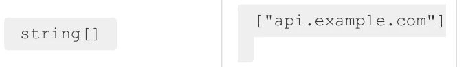

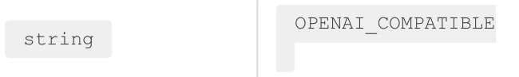

| 参数名称 | 类型 | 示例 | 说明 |
| --- | --- | --- | --- |
| data.records.observati onConfig | <code>object</code> | <code>{"enable":true,"log</code><br><code>RequestInfo":false,"</code><br><code>logResponseInfo":fal</code><br><code>se}</code> | 后端业务结构（非POP主表字段保证）：可观测性配置。 |
| data.records.observati onConfig.enable | <code>boolean</code> | <code>true</code> | 后端业务结构（非POP主表字段保证）：是否启用。 |
| data.records.observati onConfig.logRequestInf o | <code>boolean</code> | false |  |
| data.records.observati onConfig.logResponseI nfo | <code>boolean</code> | false |  |
| data.records.fallback | <code>object</code> | <code>{"enable":false,"re</code><br><code>sponseCodes":</code><br><code>["5xx"],"fallbackSer</code><br><code>viceId":"fallback-</code><br><code>service-001"}</code> | 后端业务结构（非POP主表字段保证）：降级配置。 |
| data.records.fallback.e nable | <code>boolean</code> | <code>false</code> | 后端业务结构（非POP主表字段保证）：是否启用。 |
| data.records.fallback.re sponseCodes | <code>string[]</code> | \["5xx"\] | 后端业务结构（非POP主表字段保证）：触发降级的响应码。 |
| data.records.fallback.fa llbackServiceId | <code>string</code> | <code>fallback-service-</code><br><code>001</code> | 后端业务结构（非POP主表字段保证）：降级服务ID。 |
| data.records.fallback.fa llbackStrategy | <code>string</code> | <code> random</code>（模型<code>DTO</code>说明值，不保证存量归一化）<code> </code> | 后端业务结构（非POP主表字段保证）：模型 DTO使用 random/sequence字符串，不保证存量值统一规范化；普通路由FALLBACK 兼容RANDOM/RAND、SEQUENCE/SEQ。 |

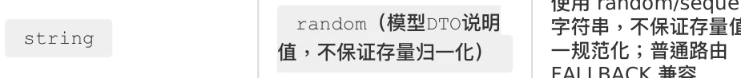

| 参数名称 | 类型 | 示例 | 说明 |
| --- | --- | --- | --- |
| data.records.authentic ationConfig | <code>object</code> | <code>{"enable":true}</code> | 后端业务结构（非POP主表字段保证）：鉴权配置对象；先保存再异步下发，控制面成功不等于插件生效。 |
| data.records.authentic ationConfig.enable | <code>boolean</code> | <code>true</code> | 后端业务结构（非POP主表字段保证）：是否启用。 |
| data.records.authentic ationConfig.credentialT ypeList | <code>string[]</code> |  |  |

**有证据的后端业务字段补充（非POP主表）**

| 字段路径 | 业务类型 | 说明 |
| --- | --- | --- |
| data.records\[\].methodPathList | array | 方法路径数组，每项含path和method。 |
| data.records\[\].methodPathList\[\].path | String | 方法路径数组元素：path为路径字符串，method为HTTP方法字符串。 |
| data.records\[\].methodPathList\[\].method | String | 方法路径数组元素：path为路径字符串，method为HTTP方法字符串。 |
| data.records\[\].publishStatus | String | 主发布状态：PUBLISHING、SUCCESS、FAILED、UNPUBLISHED；SUCCESS不保证附属策略全部成功。 |
| data.records\[\].publishFailureRea son | String/null | 发布失败原因，可为空；原因空不证明附属配置全部成功。 |
| data.records\[\].firstByteTimeout | Long/null | 后端 Long，单位毫秒；未设置或0表示不限制。 |

**示例**

**请求示例**

```http
POST /modelapi/listModelApis HTTP/1.1

{
  "size": 10,
  "current": 1,
  "gwInstanceId": "${gwInstanceId}",
  "protocol": "OPENAI_COMPATIBLE",
  "sceneType": "TEXT_GENERATION"
}
```

**响应示例**

```json
{
  "requestId": "${requestId}",
  "code": 200,
  "msg": null,
  "data": {
    "total": 1,
    "current": 1,
    "size": 10,
    "records": [
      {
        "id": "model-api-chat-demo",
        "apiName": "chat-demo",
        "protocol": "OPENAI_COMPATIBLE",
        "methodPathList": [
          {
            "path": "/v1/chat/completions",
            "method": "POST"
          }
        ],
        "publishStatus": "UNPUBLISHED",
        "publishFailureReason": null,
        "firstByteTimeout": 0,
        "description": "demo",
        "basePath": "example",
        "basePathRemove": false,
        "domainNameList": [],
        "sceneType": "TEXT_GENERATION",
        "routeDispatcher": {
          "strategyType": "WEIGHT"
        },
        "upstreamAffinityConfig": {
          "enabled": false,
          "affinityType": "SESSION",
          "keyHeader": "example",
          "fallbackKeyHeader": "example"
        },
        "observationConfig": {
          "enable": false,
          "logRequestInfo": false,
          "logResponseInfo": false
        },
        "fallback": {
          "enable": false,
          "fallbackTriggerScope": "BACKEND_ONLY",
          "fallbackServiceId": "fallbackservice-demo",
          "fallbackServices": [],
          "fallbackStrategy": "example",
          "effectiveResponseCodes": []
        },
        "authenticationConfig": {
          "enable": false,
          "credentialTypeList": []
        }
      }
    ]
  },
  "message": null
}
```

<a id="section-1-3-9-10"></a>

#### 1.3.9.10. ModifyModelApiPolicy

模型策略支持 HEADER、TIMEOUT、RETRY、AI_SECURITY、AI_TOKEN_LIMIT、AI_MODEL_PARAMETER_OVERRIDE、CLUSTER_QPS_LIMIT、ALL_CLUSTER_LIMIT、AI_CONTEXT_LIMIT。configType 使用大写枚举名；目标固定为 MODEL_API，请求不消费 targetType。模型策略接口不支持 FALLBACK、REWRITE；普通路由使用 ModifyRoutePolicy。模型创建/更新的fallback 是另一种配置对象，不可混用。 模型策略更新成功的业务 data 为模型 ID 字符串。保存和下发并非跨资源事务；参数覆盖异步刷新 ai-proxy，返回 ID 不保证全部关联路由和插件生效。

> **说明**
>
> 此接口仅适用于 AI网关（Higress引擎）实例。

**请求头**

公共请求头及认证信息的获取与携带方式，请参见获取公共Header参数。

**请求语法**

```http
POST /modelapi/modifyModelApiPolicy HTTP/1.1
```

**请求参数**

主表字段路径、类型、顺序与当前API JSON一致。是否必选优先采用非空docRequired，否则采用required；表中“否”不代表可绕过说明列的业务必填及条件约束。

| 参数名称 | 位置 | 类型 | 是否必选 | 示例 | 说明 |
| --- | --- | --- | --- | --- | --- |
| configT ype | <code>body</code> | <code>strin</code><br><code>g</code> | 否 | <code>TIMEO</code><br><code>UT</code> | 业务必填。支持：HEADER、TIMEOUT、RETRY、AI_SECURITY、AI_TOKEN_LIMIT、AI_MODEL_PARAMETER_OVERRIDE、CLUSTER_QPS_LIMIT、ALL_CLUSTER_LIMIT、AI_CONTEXT_LIMIT；使用枚举名，不用内部小写value。取值：REWRITE、HEADER、TIMEOUT、RETRY、FALLBACK、AI_SECURITY、AI_TOKEN_LIMIT、AI_MODEL_PARAMETER_OVERRIDE、CLUSTER_QPS_LIMIT、ALL_CLUSTER_LIMIT、AI_CONTEXT_LIMIT。 |
| gwInsta nceId | <code>body</code> | <code>strin</code><br><code>g</code> | 否 | <code>${gwI</code><br><code>nstance</code><br><code>Id}</code> | 业务必填：目标网关实例 ID；关联资源须在同实例且具备正常权限。 |
| targetId | <code>body</code> | <code>strin</code><br><code>g</code> | 否 | <code>model</code><br><code>-api-</code><br><code>chat-</code><br><code>demo</code> | 模型策略中业务必填的模型ID。 |

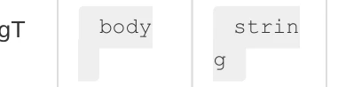

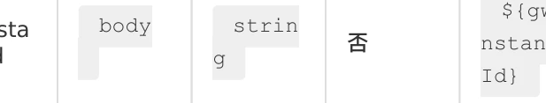

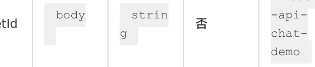

**configType 与 configData 对应关系**

模型策略支持 `HEADER`、`TIMEOUT`、`RETRY`、`AI_SECURITY`、`AI_TOKEN_LIMIT`、

```text
AI_MODEL_PARAMETER_OVERRIDE、CLUSTER_QPS_LIMIT、ALL_CLUSTER_LIMIT、AI_CONTEXT_LIMIT。
```

```text
configType 使⽤⼤写枚举名；⽬标固定为 MODEL_API，请求不消费 targetType。 模型策略接⼝不⽀持 FALLBACK、
```

`REWRITE`；普通路由使用 `ModifyRoutePolicy`。模型创建`/`更新的 `fallback` 是另一种配置对象，不可混用。

**AI_SECURITY（AI 内容安全策略）**

**configData 本地 JSON Schema（仅结构，不是请求值）：**

```json
{
  "type": "object",
  "properties": {
    "enabled": {
      "type": [
        "boolean",
        "null"
      ],
      "default": false
    },
    "checkRequestEnabled": {
      "type": [
        "boolean",
        "null"
      ],
      "default": false
    },
    "checkResponseEnabled": {
      "type": [
        "boolean",
        "null"
      ],
      "default": false
    },
    "tianjianPromptAttackDefense": {
      "type": [
        "boolean",
        "null"
      ],
      "default": false
    },
    "tianjianMultiSessionDetect": {
      "type": [
        "boolean",
        "null"
      ],
      "default": false
    },
    "tianjianFinanceComplianceDetection": {
      "type": [
        "boolean",
        "null"
      ],
      "default": false
    },
    "tianjianPrivacyDataDetection": {
      "type": [
        "boolean",
        "null"
      ],
      "default": false
    },
    "tianjianFieldIdentify": {
      "type": [
        "boolean",
        "null"
      ],
      "default": false
    },
    "tianjianPromptReword": {
      "type": [
        "boolean",
        "null"
      ],
      "default": false
    },
    "tianjianPrivacyDataObfuscation": {
      "type": [
        "boolean",
        "null"
      ],
      "default": false
    },
    "accessUrl": {
      "type": [
        "string",
        "null"
      ]
    },
    "denyMessage": {
      "type": [
        "string",
        "null"
      ]
    },
    "requestCheckService": {
      "type": [
        "string",
        "null"
      ]
    },
    "responseCheckService": {
      "type": [
        "string",
        "null"
      ]
    },
    "riskLevelBar": {
      "type": [
        "string",
        "null"
      ],
      "description": "仅绿⽹；推荐 max/high/medium/low，非空字符串原样下发。"
    },
    "securityProvider": {
      "type": [
        "string",
        "null"
      ],
      "default": "lvwang",
      "description": "lvwang 为绿⽹，tianjian 为天鉴；按提供商配置。"
    },
    "tianjianDeployType": {
      "type": [
        "string",
        "null"
      ],
      "default": "public",
      "description": "public 为公⽹，private 为私有部署；仅天鉴使⽤。"
    },
    "tianjianServiceHost": {
      "type": [
        "string",
        "null"
      ],
      "description": "私有部署天鉴字段；不得作为绿⽹配置。"
    },
    "tianjianAppCode": {
      "type": [
        "string",
        "null"
      ],
      "description": "私有部署天鉴字段；不得作为绿⽹配置。"
    },
    "enterprise": {
      "type": [
        "string",
        "null"
      ],
      "description": "公⽹天鉴企业标识；DTO注释要求提供，不等同独立校验注解。"
    },
    "businessId": {
      "type": [
        "string",
        "null"
      ],
      "description": "天鉴租户标识；DTO注释要求提供。"
    },
    "tianjianAk": {
      "type": [
        "string",
        "null"
      ],
      "description": "敏感配置，⽂档不提供凭证值；未填写时使⽤系统配置。"
    },
    "tianjianSk": {
      "type": [
        "string",
        "null"
      ],
      "description": "敏感配置，⽂档不提供凭证值；未填写时使⽤系统配置。"
    },
    "tianjianSceneCodeInput": {
      "type": [
        "string",
        "null"
      ]
    },
    "tianjianSceneCodeOutput": {
      "type": [
        "string",
        "null"
      ]
    },
    "streamChunkSize": {
      "type": [
        "integer",
        "null"
      ],
      "default": 100
    },
    "timeoutSeconds": {
      "type": [
        "integer",
        "null"
      ],
      "default": 1,
      "description": "超时时间，单位秒。"
    },
    "tianjianServicePort": {
      "type": [
        "integer",
        "null"
      ],
      "description": "私有部署天鉴端⼝。"
    }
  }
}
```

**参数说明：**

| 参数名 | 类型 | 必填 | 默认值 | 说明 |
| --- | --- | --- | --- | --- |
| enabled | boolean/null | 按开启约束 | false | 本地配置字段。DTO默认：false。 |
| checkRequestEna bled | boolean/null | 按开启约束 | false | 本地配置字段。DTO默认：false。 |
| checkResponseEn abled | boolean/null | 按开启约束 | false | 本地配置字段。DTO默认：false。 |
| streamChunkSize | integer/null | 按开启约束 | 100 | 本地配置字段。DTO默认：100。 |
| timeoutSeconds | integer/null | 按开启约束 | 1 | 超时时间，单位秒。DTO默认：1。 |
| denyMessage | string/null | 按开启约束 | 未设置/按约束 | 本地配置字段。 |
| requestCheckServ ice | string/null | 按开启约束 | 未设置/按约束 | 本地配置字段。 |
| responseCheckSe rvice | string/null | 按开启约束 | 未设置/按约束 | 本地配置字段。 |
| riskLevelBar | string/null | 按开启约束 | 未设置/按约束 | 仅绿网；推荐max/high/mediu m/low，非空字符串原样下<br><br>发。<code>       </code> |

**AI_TOKEN_LIMIT（AI Token 限流策略）**

**configData 本地 JSON Schema（仅结构，不是请求值）：**

```json
{
  "type": "object",
  "properties": {
    "enabled": {
      "type": [
        "boolean",
        "null"
      ],
      "default": false
    },
    "ruleItems": {
      "type": [
        "array",
        "null"
      ],
      "items": {
        "type": "object",
        "properties": {
          "limitByType": {
            "type": [
              "string",
              "null"
            ]
          },
          "limitByValue": {
            "type": [
              "string",
              "null"
            ]
          },
          "limitKeys": {
            "type": [
              "array",
              "null"
            ],
            "items": {
              "type": "object",
              "properties": {
                "key": {
                  "type": [
                    "string",
                    "null"
                  ]
                },
                "timeUnit": {
                  "type": "string",
                  "enum": [
                    "PER_SECOND",
                    "PER_MINUTE",
                    "PER_HOUR",
                    "PER_DAY"
                  ]
                },
                "tokenLimit": {
                  "type": [
                    "integer",
                    "null"
                  ]
                }
              }
            }
          }
        }
      }
    }
  }
}
```

**参数说明：**

| 参数名 | 类型 | 必填 | 说明 |
| --- | --- | --- | --- |
| enabled | boolean/null | 按开启约束 | 本地配置字段。DTO默认：false。 |
| ruleItems | array/null | 按开启约束 | 本地配置字段。 |
| ruleItems\[\].limitByType | string/null | 按开启约束 | 本地配置字段。 |
| ruleItems\[\].limitByValu e | string/null | 按开启约束 | 本地配置字段。 |
| ruleItems\[\].limitKeys | array/null | 按开启约束 | 本地配置字段。 |
| ruleItems\[\].limitKeys\[\].k ey | string/null | 按开启约束 | 本地配置字段。 |
| ruleItems\[\].limitKeys\[\].t imeUnit | string | 按开启约束 | 本地配置字段。可选值：\["PER_SECOND","PER_MINUTE","PER_HOUR"," PER_DAY"\]。 |
| ruleItems\[\].limitKeys\[\].t okenLimit | integer/null | 按开启约束 | 本地配置字段。 |

**CLUSTER_QPS_LIMIT（集群 QPS 限流策略）**

**configData 业务配置示例（静态校准）：**

```json
{
  "enabled": true,
  "queryPerSecond": 100
}
```

**参数说明：**

| 参数名 | 类型 | 必填 | 默认值 | 说明 |
| --- | --- | --- | --- | --- |
| enabled | boolean/null | 按开启约束 | false | 本地配置字段。DTO默认：false。仅按秒/分/时/日选择首个非null值；0不等同不限制。 |
| queryPerSecond | integer/null | 按开启约束 | 未设置/按约束 | 本地配置字段。仅按秒/分/时/日选择首个非null值；0不等同不限制。 |
| queryPerMinute | integer/null | 按开启约束 | 未设置/按约束 | 本地配置字段。仅按秒/分/时/日选择首个非null值；0不等同不限制。 |
| queryPerHour | integer/null | 按开启约束 | 未设置/按约束 | 本地配置字段。仅按秒/分/时/日选择首个非null值；0不等同不限制。 |
| queryPerDay | integer/null | 按开启约束 | 未设置/按约束 | 本地配置字段。仅按秒/分/时/日选择首个非null值；0不等同不限制。 |

**ALL_CLUSTER_LIMIT（全局限流策略）**

**configData 本地 JSON Schema（仅结构，不是请求值）：**

```json
{
  "type": "object",
  "properties": {
    "enabled": {
      "type": [
        "boolean",
        "null"
      ],
      "default": false
    },
    "multiRuleMode": {
      "type": [
        "boolean",
        "null"
      ],
      "default": true
    },
    "maxConcurrentRules": {
      "type": [
        "integer",
        "null"
      ],
      "default": 10
    },
    "rejectedCode": {
      "type": [
        "integer",
        "null"
      ],
      "default": 429
    },
    "rejectedMsg": {
      "type": [
        "string",
        "null"
      ],
      "default": "Too many requests"
    },
    "globalThresholds": {
      "type": [
        "array",
        "null"
      ],
      "items": {
        "$ref": "#/$defs/threshold"
      }
    },
    "ruleItems": {
      "type": [
        "array",
        "null"
      ],
      "items": {
        "type": "object",
        "properties": {
          "limitBy": {
            "type": [
              "string",
              "null"
            ]
          },
          limitByFrom: {
            "type": [
              "string",
              "null"
            ]
          },
          "andMatcherConfig": {
            "type": [
              "array",
              "null"
            ],
            "items": {
              "type": "object",
              "properties": {
                "limitBy": {
                  "type": "string"
                },
                "limitByFrom": {
                  "type": "string"
                },
                "key": {
                  "type": "string"
                }
              }
            }
          },
          "limitKeys": {
            "type": [
              "array",
              "null"
            ],
            "items": {
              "allOf": [
                {
                  "$ref": "#/$defs/threshold"
                },
                {
                  "properties": {
                    "key": {
                      "type": [
                        "string",
                        "null"
                      ]
                    }
                  }
                }
              ]
            }
          }
        }
      }
    }
  },
  "$defs": {
    "threshold": {
      "type": "object",
      "properties": {
        "limitType": {
          "type": [
            "string",
            "null"
          ],
          "default": "token"
        },
        "limitKeys": {
          "type": [
            "object",
            "null"
          ],
          "additionalProperties": {
            "type": "integer"
          }
        },
        "fixedQuotaMode": {
          "type": [
            "boolean",
            "null"
          ]
        },
        "hitsAddend": {
          "type": [
            "object",
            "null"
          ],
          "properties": {
            "base": {
              "type": [
                "integer",
                "null"
              ],
              "default": 1
            },
            "fromHeader": {
              "type": [
                "string",
                "null"
              ]
            }
          }
        }
      }
    }
  }
}
```

**参数说明：**

| 参数名 | 类型 | 必填 | 默认值 | 说明 |
| --- | --- | --- | --- | --- |
| enabled | boolean/null | 按开启约束 | false | 本地配置字段。DTO默认：false。 |
| multiRuleMode | boolean/null | 按开启约束 | true | 本地配置字段。DTO默认：true。 |
| maxConcurrentRu les | integer/null | 按开启约束 | 10 | 本地配置字段。DTO默认：10。 |
| rejectedCode | integer/null | 按开启约束 | 429 | 本地配置字段。DTO默认：429。 |
| rejectedMsg | string/null | 按开启约束 | "Too many requests" | 本地配置字段。DTO默认："Too many requests"。 |
| globalThresholds | array/null | 按开启约束 | 未设置/按约束 | 本地配置字段。 |
| globalThresholds\[\].limitType | string/null | 按开启约束 | "token" | 本地配置字段。DTO默认："token"。注释列token/request/co ncurrency/respon se，不是强枚举校<br><br>验。<code>      </code> |
| globalThresholds\[\].fixedQuotaMode | boolean/null | 按开启约束 | 未设置/按约束 | 本地配置字段。字段无初始化，缺省为null，不承诺默认false。 |
| globalThresholds\[\].hitsAddend | object/null | 按开启约束 | 未设置/按约束 | 本地配置字段。 |
| globalThresholds\[\].hitsAddend.base | integer/null | 按开启约束 | 1 | 本地配置字段。DTO默认：1。 |
| globalThresholds\[\].hitsAddend.from Header | string/null | 按开启约束 | 未设置/按约束 | 本地配置字段。 |
| ruleItems | array/null | 按开启约束 | 未设置/按约束 | 本地配置字段。 |
| ruleItems\[\].limitB y | string/null | 按开启约束 | 未设置/按约束 | 本地配置字<br><br>段。<code>      </code> |
| ruleItems\[\].limitB yFrom | string/null | 按开启约束 | 未设置/按约束 | 本地配置字段。 |
| ruleItems\[\].andM atcherConfig | array/null | 按开启约束 | 未设置/按约束 | 本地配置字段。 |
| ruleItems\[\].limitK eys | array/null | 按开启约束 | 未设置/按约束 | 本地配置字段。 |
| ruleItems\[\].limitK eys\[\].limitType | string/null | 按开启约束 | "token" | 本地配置字段。DTO默认："token"。注释列token/request/co ncurrency/respon se，不是强枚举校<br><br>验。<code>    </code> |
| ruleItems\[\].limitK eys\[\].key | string/null | 按开启约束 | 未设置/按约束 | 本地配置字段。 |

**TIMEOUT（超时控制策略）**

**configData 业务配置示例（静态校准）：**

```json
{
  "enabled": true,
  "timeout": 30
}
```

**参数说明：**

| 参数名 | 类型 | 必填 | 默认值 | 说明 |
| --- | --- | --- | --- | --- |
| enabled | boolean/null | 按开启约束 | 未设置/按约束 | 本地配置字段。 |
| timeout | integer/null | 按开启约束 | 0 | 单位秒DTO默认：0。 |

**RETRY（重试策略）**

**configData 业务配置示例（静态校准）：**

```json
{
  "enabled": true,
  "attempts": 2,
  "timeout": 10,
  "conditions": [
    "error",
    "timeout"
  ],
  "httpStatusCodes": [
    502,
    503,
    504
  ]
}
```

**参数说明：**

| 参数名 | 类型 | 必填 | 默认值 | 说明 |
| --- | --- | --- | --- | --- |
| enabled | boolean/null | 按开启约束 | false | 本地配置字段。DTO默认：false。 |
| attempts | integer/null | 按开启约束 | 2 | 本地配置字段。最小值：1。DTO默认：2。不解释为已验证的总请求次数。 |
| timeout | integer/null | 按开启约束 | 未设置/按约束 | 每次重试请求超时，单位秒最小值：0。 |
| conditions | array/null | 按开启约束 | <code>["error","time</code><br><code>out","non_idempo</code><br><code>tent"]</code> | 本地配置字段。DTO默认：\["error","timeout","non_idempotent "\]。数组元素可选值：\["error","timeout","invalid_header", "non_idempotent"<br><br>\]。<code>      </code> |
| httpStatusCodes | array/null | 按开启约束 | <code>[502,503,504]</code> | 本地配置字段。DTO默认：\[502,503,504\]。 |


**HEADER（请求头控制策略）**

```http
POST /modelapi/modifyModelApiPolicy HTTP/1.1

{
  "gwInstanceId": "gw-demo"
}
```

| 参数名 | 类型 | 必填 | 说明 |
| --- | --- | --- | --- |
| enabled |  |  |  |
| request |  |  |  |
| request.add |  |  |  |
| request.set |  |  |  |
| request.remove |  |  |  |
| response |  |  |  |
| response.add |  |  |  |
| response.set |  |  |  |
| response.remove |  |  |  |

**AI_MODEL_PARAMETER_OVERRIDE（AI 模型参数覆盖策略）**

AI_MODEL_PARAMETER_OVERRIDE 开启时 items 非空、元素非 null，name/value/overwrite 必填且name 唯一；rawKey 非 null 时不得空白。关闭时省略、null 或空 items 会保留非空旧值，不表示清空。AI_CONTEXT_LIMIT 开启时 maxContextTokens 大于0，errorStatusCode 为400—599，bufferRatio大于0且不超过10。 完整本地字段、按name约束和示例见本节。

> **重要**
>
> AI_MODEL_PARAMETER_OVERRIDE 开启时 items 非空、元素非 null，name/value/overwrite 必填且 name 唯一；rawKey 非 null 时不得空白。关闭时省略、null 或空 items 会保留非空旧值，不表示清空。AI_CONTEXT_LIMIT 开启时 maxContextTokens 大于0，errorStatusCode 为400— 599，bufferRatio 大于0且不超过10。 完整本地字段、按name约束和示例见本节。

**TIMEOUT 完整本地字段**

完整本地DTO；适用于普通路由与模型超时策略。

| 字段路径 | 本地类型 | 约束与默认值 |
| --- | --- | --- |
| enabled | boolean/null | 本地配置字段。 |
| timeout | integer/null | 单位秒DTO默认：0。 |

以下为本地JSON Schema，不可将schema本身作为configData发送。

```json
{
  "type": "object",
  "properties": {
    "enabled": {
      "type": [
        "boolean",
        "null"
      ]
    },
    "timeout": {
      "type": [
        "integer",
        "null"
      ],
      "default": 0,
      "description": "单位秒"
    }
  }
}
```

**RETRY 完整本地字段**

本地DTO与归一化约束；SDK转换和数据面精确重试语义未实测。

schema给规范输入；实际归一化另会忽略空白条件及http_前缀条件。

attempts不解释为已验证的总请求次数；以匹配版本数据面文档为准。

| 字段路径 | 本地类型 | 约束与默认值 |
| --- | --- | --- |
| enabled | boolean/null | 本地配置字段。DTO默认：false。 |
| attempts | integer/null | 本地配置字段。最小值：1。DTO默认：2。不解释为已验证的总请求次数。 |
| timeout | integer/null | 每次重试请求超时，单位秒最小值：0。 |
| conditions | array/null | 本地配置字段。DTO默认：\["error","timeout","non_idempot ent"\]。数组元素可选值：\["error","timeout","invalid_head er","non_idempotent"\]。 |
| httpStatusCodes | array/null | 本地配置字段。DTO默认：\[502,503,504\]。 |

以下为本地JSON Schema，不可将schema本身作为configData发送。

```json
{
  "type": "object",
  "properties": {
    "enabled": {
      "type": [
        "boolean",
        "null"
      ],
      "default": false
    },
    "attempts": {
      "type": [
        "integer",
        "null"
      ],
      "minimum": 1,
      "default": 2
    },
    "timeout": {
      "type": [
        "integer",
        "null"
      ],
      "minimum": 0,
      "description": "每次重试请求超时，单位秒"
    },
    "conditions": {
      "type": [
        "array",
        "null"
      ],
      "items": {
        "type": "string",
        "enum": [
          "error",
          "timeout",
          "invalid_header",
          "non_idempotent"
        ]
      },
      "default": [
        "error",
        "timeout",
        "non_idempotent"
      ]
    },
    "httpStatusCodes": {
      "type": [
        "array",
        "null"
      ],
      "items": {
        "type": [
          "integer",
          "null"
        ],
        "minimum": 100,
        "maximum": 599
      },
      "default": [
        502,
        503,
        504
      ]
    }
  }
}
```

**AI_SECURITY 完整本地字段**

AI_SECURITY 按 securityProvider 区分绿网与天鉴，天鉴还分公网和私有部署。不得混用不同提供商配置。

riskLevelBar 推荐 max/high/medium/low 等小写值，绿网默认 low；本地对非空字符串透传，不承诺自动转小写或拒绝 HIGH。Token 的匹配 key 不固定为 token_limit，时间单位用 PER_DAY 等完整值。

| 字段路径 | 本地类型 | 约束与默认值 |
| --- | --- | --- |
| enabled | boolean/null | 本地配置字段。DTO默认：false。 |
| checkRequestEnabled | boolean/null | 本地配置字段。DTO默认：false。 |
| checkResponseEnabled | boolean/null | 本地配置字段。DTO默认：false。 |
| tianjianPromptAttackDefense | boolean/null | 本地配置字段。DTO默认：false。 |
| tianjianMultiSessionDetect | boolean/null | 本地配置字段。DTO默认：false。 |
| tianjianFinanceComplianceDetec tion | boolean/null | 本地配置字段。DTO默认：false。 |
| tianjianPrivacyDataDetection | boolean/null | 本地配置字段。DTO默认：false。 |
| tianjianFieldIdentify | boolean/null | 本地配置字段。DTO默认：false。 |
| tianjianPromptReword | boolean/null | 本地配置字段。DTO默认：false。 |
| tianjianPrivacyDataObfuscation | boolean/null | 本地配置字段。DTO默认：false。 |
| denyMessage | string/null | 本地配置字段。 |
| requestCheckService | string/null | 本地配置字段。 |
| responseCheckService | string/null | 本地配置字段。 |
| riskLevelBar | string/null | 仅绿网；推荐max/high/medium/low，非空字符串原样下发。 |
| securityProvider | string/null | lvwang 为绿网，tianjian 为天鉴；按提供商配置。DTO默认："lvwang"。 |
| tianjianDeployType | string/null | public 为公网，private 为私有部署；仅天鉴使用。DTO默认："public"。 |
| tianjianServiceHost | string/null | 私有部署天鉴字段；不得作为绿网配置。 |
| tianjianAppCode | string/null | 私有部署天鉴字段；不得作为绿网配置。 |
| enterprise | string/null | 公网天鉴企业标识；DTO注释要求提供，不等同独立校验注解。 |
| businessId | string/null | 天鉴租户标识；DTO注释要求提供。 |
| tianjianAk | string/null | 敏感配置，文档不提供凭证值；未填写时使用系统配置。 |
| tianjianSk | string/null | 敏感配置，文档不提供凭证值；未填写时使用系统配置。 |
| tianjianSceneCodeInput | string/null | 本地配置字段。 |
| tianjianSceneCodeOutput | string/null | 本地配置字段。 |
| streamChunkSize | integer/null | 本地配置字段。DTO默认：100。 |
| timeoutSeconds | integer/null | 超时时间，单位秒。DTO默认：1。 |
| tianjianServicePort | integer/null | 私有部署天鉴端口。 |

以下为本地JSON Schema，不可将schema本身作为configData发送。

```json
{
  "type": "object",
  "properties": {
    "enabled": {
      "type": [
        "boolean",
        "null"
      ],
      "default": false
    },
    "checkRequestEnabled": {
      "type": [
        "boolean",
        "null"
      ],
      "default": false
    },
    "checkResponseEnabled": {
      "type": [
        "boolean",
        "null"
      ],
      "default": false
    },
    "tianjianPromptAttackDefense": {
      "type": [
        "boolean",
        "null"
      ],
      "default": false
    },
    "tianjianMultiSessionDetect": {
      "type": [
        "boolean",
        "null"
      ],
      "default": false
    },
    "tianjianFinanceComplianceDetection": {
      "type": [
        "boolean",
        "null"
      ],
      "default": false
    },
    "tianjianPrivacyDataDetection": {
      "type": [
        "boolean",
        "null"
      ],
      "default": false
    },
    "tianjianFieldIdentify": {
      "type": [
        "boolean",
        "null"
      ],
      "default": false
    },
    "tianjianPromptReword": {
      "type": [
        "boolean",
        "null"
      ],
      "default": false
    },
    "tianjianPrivacyDataObfuscation": {
      "type": [
        "boolean",
        "null"
      ],
      "default": false
    },
    "denyMessage": {
      "type": [
        "string",
        "null"
      ]
    },
    "requestCheckService": {
      "type": [
        "string",
        "null"
      ]
    },
    "responseCheckService": {
      "type": [
        "string",
        "null"
      ]
    },
    "riskLevelBar": {
      "type": [
        "string",
        "null"
      ],
      "description": "仅绿⽹；推荐 max/high/medium/low，非空字符串原样下发。"
    },
    "securityProvider": {
      "type": [
        "string",
        "null"
      ],
      "default": "lvwang",
      "description": "lvwang 为绿⽹，tianjian 为天鉴；按提供商配置。"
    },
    "tianjianDeployType": {
      "type": [
        "string",
        "null"
      ],
      "default": "public",
      "description": "public 为公⽹，private 为私有部署；仅天鉴使⽤。"
    },
    "tianjianServiceHost": {
      "type": [
        "string",
        "null"
      ],
      "description": "私有部署天鉴字段；不得作为绿⽹配置。"
    },
    "tianjianAppCode": {
      "type": [
        "string",
        "null"
      ],
      "description": "私有部署天鉴字段；不得作为绿⽹配置。"
    },
    "enterprise": {
      "type": [
        "string",
        "null"
      ],
      "description": "公⽹天鉴企业标识；DTO注释要求提供，不等同独立校验注解。"
    },
    "businessId": {
      "type": [
        "string",
        "null"
      ],
      "description": "天鉴租户标识；DTO注释要求提供。"
    },
    "tianjianAk": {
      "type": [
        "string",
        "null"
      ],
      "description": "敏感配置，⽂档不提供凭证值；未填写时使⽤系统配置。"
    },
    "tianjianSk": {
      "type": [
        "string",
        "null"
      ],
      "description": "敏感配置，⽂档不提供凭证值；未填写时使⽤系统配置。"
    },
    "tianjianSceneCodeInput": {
      "type": [
        "string",
        "null"
      ]
    },
    "tianjianSceneCodeOutput": {
      "type": [
        "string",
        "null"
      ]
    },
    "streamChunkSize": {
      "type": [
        "integer",
        "null"
      ],
      "default": 100
    },
    "timeoutSeconds": {
      "type": [
        "integer",
        "null"
      ],
      "default": 1,
      "description": "超时时间，单位秒。"
    },
    "tianjianServicePort": {
      "type": [
        "integer",
        "null"
      ],
      "description": "私有部署天鉴端⼝。"
    }
  }
}
```

AI_SECURITY 按 securityProvider 区分绿网与天鉴，天鉴还分公网和私有部署。不得混用不同提供商配置。

riskLevelBar 推荐 max/high/medium/low 等小写值，绿网默认 low；本地对非空字符串透传，不承诺自动转小写或拒绝 HIGH。Token 的匹配 key 不固定为 token_limit，时间单位用 PER_DAY 等完整值。

**AI_TOKEN_LIMIT 完整本地字段**

timeUnit枚举约束是推荐有效输入；实现对非法字符串实际回退为每分钟。

不能根据DTO无注解推断任意配额、空规则都能成功下发。

| 字段路径 | 本地类型 | 约束与默认值 |
| --- | --- | --- |
| enabled | boolean/null | 本地配置字段。DTO默认：false。 |
| ruleItems | array/null | 本地配置字段。 |
| ruleItems\[\].limitByType | string/null | 本地配置字段。 |
| ruleItems\[\].limitByValue | string/null | 本地配置字段。 |
| ruleItems\[\].limitKeys | array/null | 本地配置字段。 |
| ruleItems\[\].limitKeys\[\].key | string/null | 本地配置字段。 |
| ruleItems\[\].limitKeys\[\].timeUnit | string | 本地配置字段。可选值：\["PER_SECOND","PER_MINUTE"," PER_HOUR","PER_DAY"\]。 |
| ruleItems\[\].limitKeys\[\].tokenLimi t | integer/null | 本地配置字段。 |

以下为本地JSON Schema，不可将schema本身作为configData发送。

```json
{
  "type": "object",
  "properties": {
    "enabled": {
      "type": [
        "boolean",
        "null"
      ],
      "default": false
    },
    "ruleItems": {
      "type": [
        "array",
        "null"
      ],
      "items": {
        "type": "object",
        "properties": {
          "limitByType": {
            "type": [
              "string",
              "null"
            ]
          },
          "limitByValue": {
            "type": [
              "string",
              "null"
            ]
          },
          "limitKeys": {
            "type": [
              "array",
              "null"
            ],
            "items": {
              "type": "object",
              "properties": {
                "key": {
                  "type": [
                    "string",
                    "null"
                  ]
                },
                "timeUnit": {
                  "type": "string",
                  "enum": [
                    "PER_SECOND",
                    "PER_MINUTE",
                    "PER_HOUR",
                    "PER_DAY"
                  ]
                },
                "tokenLimit": {
                  "type": [
                    "integer",
                    "null"
                  ]
                }
              }
            }
          }
        }
      }
    }
  }
}
```

**AI_MODEL_PARAMETER_OVERRIDE 完整本地字段**

本地DTO字段和开启时校验。按name限制value及名称去重见constraints，不伪装为SDK完整schema。

开启时items.name唯一。

MAX_TOKENS/TOP_K为整数且至少1；TEMPERATURE在[0,2]；TOP_P在[0,1]；SEED为整数。

ENABLE_THINKING仅Boolean；其他name仅可解析数值。

| 字段路径 | 本地类型 | 约束与默认值 |
| --- | --- | --- |
| enabled | boolean/null | 本地配置字段。DTO默认：false。开启约束及各name的value范围见本节约束；关闭不等同清空。 |
| items | array/null | 本地配置字段。开启约束及各name的value范围见本节约束；关闭不等同清空。 |
| items\[\].name | string | 本地配置字段。可选值：\["MAX_TOKENS","TEMPERATURE ","TOP_P","TOP_K","SEED","ENAB LE_THINKING"\]。开启约束及各name的value范围见本节约束；关闭不等同清空。 |
| items\[\].value | number/string/boolean/null | 本地配置字段。开启约束及各name的value范围见本节约束；关闭不等同清空。 |
| items\[\].overwrite | boolean/null | 本地配置字段。开启约束及各name的value范围见本节约束；关闭不等同清空。 |
| items\[\].rawKey | string/null | 本地配置字段。开启约束及各name的value范围见本节约束；关闭不等同清空。 |

以下为本地JSON Schema，不可将schema本身作为configData发送。

```json
{
  "type": "object",
  "properties": {
    "enabled": {
      "type": [
        "boolean",
        "null"
      ],
      "default": false
    },
    "items": {
      "type": [
        "array",
        "null"
      ],
      "items": {
        "type": [
          "object",
          "null"
        ],
        "properties": {
          "name": {
            "type": "string",
            "enum": [
              "MAX_TOKENS",
              "TEMPERATURE",
              "TOP_P",
              "TOP_K",
              "SEED",
              "ENABLE_THINKING"
            ]
          },
          "value": {
            "type": [
              "number",
              "string",
              "boolean",
              "null"
            ]
          },
          "overwrite": {
            "type": [
              "boolean",
              "null"
            ]
          },
          "rawKey": {
            "type": [
              string,
              "null"
            ]
          }
        }
      }
    }
  },
  "allOf": [
    {
      "if": {
        "required": [
          "enabled"
        ],
        "properties": {
          "enabled": {
            "const": true
          }
        }
      },
      "then": {
        "required": [
          "items"
        ],
        "properties": {
          "items": {
            "type": "array",
            "minItems": 1,
            "items": {
              "type": "object",
              "required": [
                "name",
                "value",
                "overwrite"
              ],
              "properties": {
                "value": {
                  "type": [
                    "number",
                    "string",
                    "boolean"
                  ]
                },
                "overwrite": {
                  "type": "boolean"
                },
                "rawKey": {
                  "type": [
                    "string",
                    "null"
                  ],
                  "pattern": "\\S"
                }
              }
            }
          }
        }
      }
    }
  ]
}
```

**CLUSTER_QPS_LIMIT 完整本地字段**

本地DTO全部字段；至少一项正值及选择优先级由constraints表达。

enabled=true时四个配额至少一个大于0。

实际下发只选择按秒、分、时、日排序的首个非null值；不是多窗口同时生效。

| 字段路径 | 本地类型 | 约束与默认值 |
| --- | --- | --- |
| enabled | boolean/null | 本地配置字段。DTO默认：false。仅按秒/分/时/日选择首个非null值；0不等同不限制。 |
| queryPerSecond | integer/null | 本地配置字段。仅按秒/分/时/日选择首个非null值；0不等同不限制。 |
| queryPerMinute | integer/null | 本地配置字段。仅按秒/分/时/日选择首个非null值；0不等同不限制。 |
| queryPerHour | integer/null | 本地配置字段。仅按秒/分/时/日选择首个非null值；0不等同不限制。 |
| queryPerDay | integer/null | 本地配置字段。仅按秒/分/时/日选择首个非null值；0不等同不限制。 |

以下为本地JSON Schema，不可将schema本身作为configData发送。

```json
{
  "type": "object",
  "properties": {
    "enabled": {
      "type": [
        "boolean",
        "null"
      ],
      "default": false
    },
    "queryPerSecond": {
      "type": [
        "integer",
        "null"
      ]
    },
    "queryPerMinute": {
      "type": [
        "integer",
        "null"
      ]
    },
    "queryPerHour": {
      "type": [
        "integer",
        "null"
      ]
    },
    "queryPerDay": {
      "type": [
        "integer",
        "null"
      ]
    }
  }
}
```

模型策略包含 aiModelParameterOverridePolicyConfig、aiContextLimitPolicyConfig。CLUSTER_QPS_LIMIT 开启时至少一项正值，但下发只按秒、分、时、日顺序选择首个非 null 值，不是多窗口同时生效；集群限流依赖实例 Redis。

**ALL_CLUSTER_LIMIT 完整本地字段**

limitType注释列token/request/concurrency/response，不把注释升级为本地强枚举校验。

fixedQuotaMode注释说默认false，但字段无初始化，DTO缺省实际为null。

空limitKeys阈值会被过滤；不能保证传入任意规则都有效。

| 字段路径 | 本地类型 | 约束与默认值 |
| --- | --- | --- |
| enabled | boolean/null | 本地配置字段。DTO默认：false。 |
| multiRuleMode | boolean/null | 本地配置字段。DTO默认：true。 |
| maxConcurrentRules | integer/null | 本地配置字段。DTO默认：10。 |
| rejectedCode | integer/null | 本地配置字段。DTO默认：429。 |
| rejectedMsg | string/null | 本地配置字段。DTO默认："Too many requests"。 |
| globalThresholds | array/null | 本地配置字段。 |
| globalThresholds\[\].limitType | string/null | 本地配置字段。DTO默认："token"。注释列token/request/concurrency/resp onse，不是强枚举校验。 |
| globalThresholds\[\].limitKeys | object/null | 本地配置字段。映射值结构：{"type":"integer"}。 |
| globalThresholds\[\].fixedQuotaM ode | boolean/null | 本地配置字段。字段无初始化，缺省为null，不承诺默认false。 |
| globalThresholds\[\].hitsAddend | object/null | 本地配置字段。 |
| globalThresholds\[\].hitsAddend.b ase | integer/null | 本地配置字段。DTO默认：1。 |
| globalThresholds\[\].hitsAddend.fr omHeader | string/null | 本地配置字段。 |
| ruleItems | array/null | 本地配置字段。 |
| ruleItems\[\].limitBy | string/null | 本地配置字段。 |
| ruleItems\[\].limitByFrom | string/null | 本地配置字段。 |
| ruleItems\[\].andMatcherConfig | array/null | 本地配置字段。 |
| ruleItems\[\].andMatcherConfig\[\].l imitBy | string | 本地配置字段。 |
| ruleItems\[\].andMatcherConfig\[\].l imitByFrom | string | 本地配置字段。 |
| ruleItems\[\].andMatcherConfig\[\].key | string | 本地配置字段。 |
| ruleItems\[\].limitKeys | array/null | 本地配置字段。 |
| ruleItems\[\].limitKeys\[\].limitType | string/null | 本地配置字段。DTO默认："token"。注释列token/request/concurrency/resp onse，不是强枚举校验。 |
| ruleItems\[\].limitKeys\[\].limitKeys | object/null | 本地配置字段。映射值结构：{"type":"integer"}。 |
| ruleItems\[\].limitKeys\[\].fixedQuot aMode | boolean/null | 本地配置字段。字段无初始化，缺省为null，不承诺默认false。 |
| ruleItems\[\].limitKeys\[\].hitsAdden d | object/null | 本地配置字段。 |
| ruleItems\[\].limitKeys\[\].hitsAdden d.base | integer/null | 本地配置字段。DTO默认：1。 |
| ruleItems\[\].limitKeys\[\].hitsAdden d.fromHeader | string/null | 本地配置字段。 |
| ruleItems\[\].limitKeys\[\].key | string/null | 本地配置字段。 |

以下为本地JSON Schema，不可将schema本身作为configData发送。

```json
{
  "type": "object",
  "properties": {
    "enabled": {
      "type": [
        "boolean",
        "null"
      ],
      "default": false
    },
    "multiRuleMode": {
      "type": [
        "boolean",
        "null"
      ],
      "default": true
    },
    "maxConcurrentRules": {
      "type": [
        "integer",
        "null"
      ],
      "default": 10
    },
    "rejectedCode": {
      "type": [
        "integer",
        "null"
      ],
      "default": 429
    },
    "rejectedMsg": {
      "type": [
        "string",
        "null"
      ],
      "default": "Too many requests"
    },
    "globalThresholds": {
      "type": [
        "array",
        "null"
      ],
      "items": {
        "$ref": "#/$defs/threshold"
      }
    },
    "ruleItems": {
      "type": [
        "array",
        "null"
      ],
      "items": {
        "type": "object",
        "properties": {
          "limitBy": {
            "type": [
              "string",
              "null"
            ]
          },
          "limitByFrom": {
            "type": [
              "string",
              "null"
            ]
          },
          "andMatcherConfig": {
            "type": [
              "array",
              "null"
            ],
            "items": {
              "type": "object",
              "properties": {
                "limitBy": {
                  "type": "string"
                },
                "limitByFrom": {
                  "type": "string"
                },
                "key": {
                  "type": "string"
                }
              }
            }
          },
          "limitKeys": {
            "type": [
              "array",
              "null"
            ],
            "items": {
              "allOf": [
                {
                  "$ref": "#/$defs/threshold"
                },
                {
                  "properties": {
                    "key": {
                      "type": [
                        "string",
                        "null"
                      ]
                    }
                  }
                }
              ]
            }
          }
        }
      }
    }
  },
  "$defs": {
    "threshold": {
      "type": "object",
      "properties": {
        "limitType": {
          "type": [
            "string",
            "null"
          ],
          "default": "token"
        },
        "limitKeys": {
          "type": [
            "object",
            "null"
          ],
          "additionalProperties": {
            "type": "integer"
          }
        },
        "fixedQuotaMode": {
          "type": [
            "boolean",
            "null"
          ]
        },
        "hitsAddend": {
          "type": [
            "object",
            "null"
          ],
          "properties": {
            "base": {
              "type": [
                "integer",
                "null"
              ],
              "default": 1
            },
            "fromHeader": {
              "type": [
                "string",
                "null"
              ]
            }
          }
        }
      }
    }
  }
}
```

模型策略业务响应有九个配置块，包含 allClusterLimitPolicyConfig 和 retryConfig。未保存策略时返回空策略对象，单块转换失败可能缺失。ALL_CLUSTER_LIMIT 的 globalThresholds 与 ruleItems 不能同时为空，可同时提供；全局 limitKeys 是整数映射，规则 limitKeys 是数组。

**AI_CONTEXT_LIMIT 完整本地字段**

本地DTO及开启时强校验；不扩展为数据面插件合约。

| 字段路径 | 本地类型 | 约束与默认值 |
| --- | --- | --- |
| enabled | boolean/null | 本地配置字段。DTO默认：false。 |
| maxContextTokens | integer/null | 本地配置字段。 |
| errorStatusCode | integer/null | 本地配置字段。 |
| bufferRatio | number/null | 本地配置字段。 |

以下为本地JSON Schema，不可将schema本身作为configData发送。

```json
{
  "type": "object",
  "properties": {
    "enabled": {
      "type": [
        "boolean",
        "null"
      ],
      "default": false
    },
    "maxContextTokens": {
      "type": [
        "integer",
        "null"
      ]
    },
    "errorStatusCode": {
      "type": [
        "integer",
        "null"
      ]
    },
    "bufferRatio": {
      "type": [
        "number",
        "null"
      ]
    }
  },
  "allOf": [
    {
      "if": {
        "required": [
          "enabled"
        ],
        "properties": {
          "enabled": {
            "const": true
          }
        }
      },
      "then": {
        "required": [
          "maxContextTokens"
        ],
        "properties": {
          "maxContextTokens": {
            "type": "integer",
            "exclusiveMinimum": 0
          },
          "errorStatusCode": {
            "type": [
              "integer",
              "null"
            ],
            "minimum": 400,
            "maximum": 599
          },
          "bufferRatio": {
            "type": [
              "number",
              "null"
            ],
            "exclusiveMinimum": 0,
            "maximum": 10
          }
        }
      }
    }
  ]
}
```

AI_MODEL_PARAMETER_OVERRIDE 开启时 items 非空、元素非 null，name/value/overwrite 必填且name 唯一；rawKey 非 null 时不得空白。关闭时省略、null 或空 items 会保留非空旧值，不表示清空。AI_CONTEXT_LIMIT 开启时 maxContextTokens 大于0，errorStatusCode 为400—599，bufferRatio大于0且不超过10。

**外部SDK结构边界**

HEADER依赖目标SDK；未取得匹配制品，不沿用旧分支或历史javap结果，不承诺未知字段的处理。

**返回数据**

本主表仅列当前API JSON声明的响应成员，不统一套用BaseResult。未列入清单的后端业务数据在补充结构中说明，不据此承诺POP外层映射。

| 参数名称 | 类型 | 示例 | 说明 |
| --- | --- | --- | --- |
| requestId | string | req-demo | 请求 ID。 |
| code | <code>integer&lt;int32&gt;</code> | 200 | 业务响应码，Integer；不是已验证的外层 HTTP 状态码。 |
| msg | <code>string</code> | null | 响应消息。 |
| data | <code>string</code> | model-api-chat-demo | 模型ID字符串；返回不等于全部异步发布完成。 |

**示例**

**请求示例示例 1：TIMEOUT**

```json
{
  "gwInstanceId": "${gwInstanceId}",
  "targetId": "model-api-chat-demo",
  "configType": "TIMEOUT",
  "configData": {
    "enabled": true,
    "timeout": 30
  }
}
```

**示例 2：AI_MODEL_PARAMETER_OVERRIDE**

```json
{
  "gwInstanceId": "${gwInstanceId}",
  "targetId": "model-api-chat-demo",
  "configType": "AI_MODEL_PARAMETER_OVERRIDE",
  "configData": {
    "enabled": true,
    "items": [
      {
        "name": "MAX_TOKENS",
        "value": 2048,
        "overwrite": true
      },
      {
        "name": "TEMPERATURE",
        "value": 0.7,
        "overwrite": false
      }
    ]
  }
}
```

**示例 3：AI_CONTEXT_LIMIT**

```json
{
  "gwInstanceId": "${gwInstanceId}",
  "targetId": "model-api-chat-demo",
  "configType": "AI_CONTEXT_LIMIT",
  "configData": {
    "enabled": true,
    "maxContextTokens": 8192,
    "errorStatusCode": 413,
    "bufferRatio": 1.1
  }
}
```

**响应示例**

```json
{
  "requestId": "req-demo",
  "code": 200,
  "msg": null,
  "message": null,
  "data": "model-api-chat-demo"
}
```

**AI_MODEL_PARAMETER_OVERRIDE 业务请求示例**

配置被合并到ai-proxy；刷新异步，非接口实测。

```http
POST /modelapi/modifyModelApiPolicy HTTP/1.1

{
  "gwInstanceId": "${gwInstanceId}",
  "targetId": "model-api-chat-demo",
  "configType": "AI_MODEL_PARAMETER_OVERRIDE",
  "configData": {
    "enabled": true,
    "items": [
      {
        "name": "MAX_TOKENS",
        "value": 2048,
        "overwrite": true
      },
      {
        "name": "TEMPERATURE",
        "value": 0.7,
        "overwrite": false
      }
    ]
  }
}
```

**AI_CONTEXT_LIMIT 业务请求示例**

需存在模型与可下发的关联路由；非接口实测。

```http
POST /modelapi/modifyModelApiPolicy HTTP/1.1

{
  "gwInstanceId": "${gwInstanceId}",
  "targetId": "model-api-chat-demo",
  "configType": "AI_CONTEXT_LIMIT",
  "configData": {
    "enabled": true,
    "maxContextTokens": 8192,
    "errorStatusCode": 413,
    "bufferRatio": 1.1
  }
}
```

**CLUSTER_QPS_LIMIT 业务请求示例**

需要实例Redis与关联路由；仅静态配置示例。

```http
POST /modelapi/modifyModelApiPolicy HTTP/1.1

{
  "gwInstanceId": "${gwInstanceId}",
  "targetId": "model-api-chat-demo",
  "configType": "CLUSTER_QPS_LIMIT",
  "configData": {
    "enabled": true,
    "queryPerSecond": 100
  }
}
```

**RETRY 业务请求示例**

```http
POST /modelapi/modifyModelApiPolicy HTTP/1.1

{
  "gwInstanceId": "${gwInstanceId}",
  "targetId": "model-api-chat-demo",
  "configType": "RETRY",
  "configData": {
    "enabled": true,
    "attempts": 2,
    "timeout": 10,
    "conditions": [
      "error",
      "timeout"
    ],
    "httpStatusCodes": [
      502,
      503,
      504
    ]
  }
}
```

**接口约束与兼容边界**

模型策略支持 HEADER、TIMEOUT、RETRY、AI_SECURITY、AI_TOKEN_LIMIT、AI_MODEL_PARAMETER_OVERRIDE、CLUSTER_QPS_LIMIT、ALL_CLUSTER_LIMIT、AI_CONTEXT_LIMIT。configType 使用大写枚举名；目标固定为 MODEL_API，请求不消费 targetType。

模型策略接口不支持 FALLBACK、REWRITE；普通路由使用 ModifyRoutePolicy。模型创建/更新的fallback 是另一种配置对象，不可混用。

Token 时间单位使用 PER_SECOND、PER_MINUTE、PER_HOUR、PER_DAY。非法字符串会回退为每分钟，不能依赖该回退；limitKeys.key 是匹配值，\* 表示全匹配。

普通路由 FALLBACK 兼容 RANDOM/RAND、SEQUENCE/SEQ，并先转大写。ratio、modelFallback 没有映射；不保证省略策略时总会设置为 SEQ。

AI_SECURITY 按 securityProvider 区分绿网与天鉴，天鉴还分公网和私有部署。不得混用不同提供商配置。

AI_MODEL_PARAMETER_OVERRIDE 开启时 items 非空、元素非 null，name/value/overwrite 必填且name 唯一；rawKey 非 null 时不得空白。关闭时省略、null 或空 items 会保留非空旧值，不表示清空。AI_CONTEXT_LIMIT 开启时 maxContextTokens 大于0，errorStatusCode 为400—599，bufferRatio大于0且不超过10。

模型策略更新成功的业务 data 为模型 ID 字符串。保存和下发并非跨资源事务；参数覆盖异步刷新 ai-proxy，返回 ID 不保证全部关联路由和插件生效。

riskLevelBar 推荐 max/high/medium/low 等小写值，绿网默认 low；本地对非空字符串透传，不承诺自动转小写或拒绝 HIGH。Token 的匹配 key 不固定为 token_limit，时间单位用 PER_DAY 等完整值。

模型策略包含 aiModelParameterOverridePolicyConfig、aiContextLimitPolicyConfig。CLUSTER_QPS_LIMIT 开启时至少一项正值，但下发只按秒、分、时、日顺序选择首个非 null 值，不是多窗口同时生效；集群限流依赖实例 Redis。

普通路由策略支持 REWRITE、HEADER、TIMEOUT、RETRY、FALLBACK 五类。模型专用策略不能仅修改targetType 后调用普通路由入口。

<a id="section-1-3-9-11"></a>

#### 1.3.9.11. RevokeModelApiGrant

撤销使用 authId 授权关系 ID，不是模型 ID；gwInstanceId 与 authId 非空，成功 data=null。

**说明**：此接口仅适用于 AI网关（Higress引擎）实例。

**接口约束与兼容边界**

撤销使用 authId 授权关系 ID，不是模型 ID；gwInstanceId 与 authId 非空，成功 data=null。

**请求头**

公共请求头及认证信息的获取与携带方式，请参见获取公共Header参数。

**请求语法**

```http
POST /modelapi/revokeModelApiGrant HTTP/1.1
```

**请求参数**

主表字段路径、类型、顺序与当前API JSON一致。是否必选优先采用非空docRequired，否则采用required；表中“否”不代表可绕过说明列的业务必填及条件约束。

| 参数名称 | 位置 | 类型 | 是否必选 | 示例 | 说明 |
| --- | --- | --- | --- | --- | --- |
| gwInstanceId | <code>body</code> | <code>string</code> | 是 | <code>${gwInstanc</code><br><code>eId}</code> | 网关实例ID 不能为空或空白字符串。 |
| authId | <code>body</code> | <code>string</code> | 是 | <code>${authId}</code> | 授权ID 不能为空或空白字符串。 |

**返回数据**

本主表仅列当前API JSON声明的响应成员，不统一套用BaseResult。未列入清单的后端业务数据在补充结构中说明，不据此承诺POP外层映射。

| 参数名称 | 类型 | 示例 | 说明 |
| --- | --- | --- | --- |
| requestId | <code>string</code> | <code>${requestId}</code> | 请求ID。 |
| code | <code>integer&lt;int32&gt;</code> | 200 | 业务响应码，Integer；不是已验证的外层 HTTP 状态码。 |
| msg | <code>string</code> | <code>null</code> | 响应消息。 |
| data | null | <code>null</code> | 无返回业务数据，值为null。 |

**示例**

**请求示例**

```http
POST /modelapi/revokeModelApiGrant HTTP/1.1

{
  "gwInstanceId": "${gwInstanceId}",
  "authId": "${authId}"
}
```

**响应示例**

```json
{
  "requestId": "${requestId}",
  "code": 200,
  "msg": null,
  "message": null,
  "data": null
}
```

<a id="section-1-3-9-12"></a>

#### 1.3.9.12. UpdateModelApi

更新仍需 protocol、sceneType、basePath、methodPathList 和 routeDispatcher；不是任意字段都可省略的 PATCH。更新前先查询并保留需要的其他配置。 apiName 在公共更新请求中仍必填，但服务使用存量名称，不支持改名；示例必须填写原名称。 更新保留原名称、policyConfig、authenticationConfig、publishStatus、publishFailureReason，保存后异步发布 UPDATE。主发布 SUCCESS 不证明附属策略、鉴权、授权和兜底全部成功，需分别核对。

**说明**：此接口仅适用于 AI网关（Higress引擎）实例。

**接口约束与兼容边界**

模型协议支持 HTTP_CUSTOM、WS_CUSTOM、OPENAI_COMPATIBLE、ANTHROPIC_COMPATIBLE、ALIYUN_BAILIAN、VLLM、DOUBAO、COMFYUI。创建/更新先转大写解析，但 openai 不是OPENAI_COMPATIBLE 的别名。场景、协议、方法和路径还必须符合协议目录。

apiName 长度2—50，只含小写字母、数字、连字符，首尾不是连字符；description 最多255字符，domainNameList 最多一个域名。method 非空并转大写，path 以 / 开头；按 method+path 去重，同一路径可有不同具体方法，但 MULTI 不能与具体方法共存。

当前更新请求使用 methodPathList 非空数组，每项 path 和 method 必填，不允许 null 元素。

更新仍需 protocol、sceneType、basePath、methodPathList 和 routeDispatcher；不是任意字段都可省略的 PATCH。更新前先查询并保留需要的其他配置。

apiName 在公共更新请求中仍必填，但服务使用存量名称，不支持改名；示例必须填写原名称。

模型 ID 使用创建返回的 model-api- 前缀标识。更新和删除要求资源存在；详情查询有效但不存在的 ID 时data=null。格式非法、资源不存在和查询失败的行为不能混为一谈。

更新保留原名称、policyConfig、authenticationConfig、publishStatus、publishFailureReason，保存后异步发布 UPDATE。主发布 SUCCESS 不证明附属策略、鉴权、授权和兜底全部成功，需分别核对。

sceneType 保留 TEXT_GENERATION、IMAGE_GENERATION、VIDEO_GENERATION、SPEECH_SYNTHESIS、TEXT_RERANK、EMBEDDING、OTHER 七类；合法枚举仍需满足协议目录组合校验。

**请求头**

公共请求头及认证信息的获取与携带方式，请参见获取公共Header参数。

**请求语法**

```http
POST /modelapi/updateModelApi HTTP/1.1
```

**请求参数**

主表字段路径、类型、顺序与当前API JSON一致。是否必选优先采用非空docRequired，否则采用required；表中“否”不代表可绕过说明列的业务必填及条件约束。

| 参数名称 | 位置 | 类型 | 是否必选 | 示例 | 说明 |
| --- | --- | --- | --- | --- | --- |
| gwInstanceId | <code>body</code> | <code>string</code> | 是 | <code>${gwInstanc</code><br><code>eId}</code> | id和gwInstanceId均不能为空白。id用于指定gwInstanceId对应网关实例中已存在的模型API。 不能为空或空白字符串。 |
| id | <code>body</code> | <code>string</code> | 是 | <code>model-api-</code><br><code>chat-demo</code> | id和gwInstanceId均不能为空白。id用于指定gwInstanceId对应网关实例中已存在的模型API。 不能为空或空白字符串。 |
| apiName | <code>body</code> | <code>string</code> | 是 | <code>chat-demo</code> | apiName必须提供非空白值。更新时保留目标模型API的原名称，不支持通过此参数改名。 不能为空或空白字符串。 |
| description | <code>body</code> | <code>string</code> | 否 | <code> GPT-4</code>模型<code>API</code>接口<code> </code> | 描述信息，最多255字符。 |
| basePath | <code>body</code> | <code>string</code> | 否 | <code>/chat-</code><br><code>demo</code> | 业务必填：非空白且以 / 开头。 |
| basePathRem ove | <code>body</code> | <code>boolean</code> | 否 | <code>true</code> | 是否移除基础路径。 |
| methodPathLi st | <code>body</code> | array | 是 | \[\] | 业务必填：非空数组，每项path/method必填且不得为null；方法转大写后按方法+路径去重，MULTI不能与具体方法共存。 不能为空。 |
| methodPathLi st\[\].path | body | string | 否 | example | — |
| methodPathLi st\[\].method | body | string | 否 | example | — |
| domainNameL ist | <code>body</code> | <code>array</code> | 否 | \[\] | 域名数组，最多一个域名。 |
| protocol | <code>body</code> | <code>string</code> | 是 | <code>OPENAI_COMP</code><br><code>ATIBLE</code> | @see ModelApiProto colEnum 不能为空或空白字符串。 |
| sceneType | <code>body</code> | <code>string</code> | 是 | <code>TEXT_GENERA</code><br><code>TION</code> | @see SceneTypeEn um 不能为空或空白字符串。 |
| routeDispatch er | <code>body</code> | object | 否 | {} | 业务必填：对象，strategyT ype 必需。支持WEIGHT、HEADER、WEIGHT_MOD EL_MAPPING、SINGLE_MODE L_MAPPING、CONTEXT_LEN GTH；不同策略使用不同结构。 |


<table>
  <tr>
    <td>routeDispatch er.strategyTy pe</td>
    <td>body</td>
    <td>string</td>
    <td>否</td>
    <td>WEIGHT</td>
    <td>—。取值：WEIGHT、HEADER、WEIGHT_MOD EL_MAPPING、SINGLE_MODE L_MAPPING、CONTEXT_LEN GTH。</td>
  </tr>
  <tr>
    <td>upstreamAffin ityConfig</td>
    <td>body</td>
    <td>object</td>
    <td>否</td>
    <td>{}</td>
    <td>清单字段；具体业务行为未由本轮证据确认。</td>
  </tr>
  <tr>
    <td>upstreamAffin ityConfig.enab led</td>
    <td>body</td>
    <td>boolean</td>
    <td>否</td>
    <td>false</td>
    <td>是否启用 默认值：false。</td>
  </tr>
  <tr>
    <td>upstreamAffin ityConfig.affini tyType</td>
    <td>body</td>
    <td>string</td>
    <td>否</td>
    <td>SESSION</td>
    <td>—。取值：SESSION、CONSUMER、TENANT、USER、AGENT、CUSTOM。</td>
  </tr>
  <tr>
    <td>upstreamAffin ityConfig.keyH eader</td>
    <td>body</td>
    <td>string</td>
    <td>否</td>
    <td>example</td>
    <td>—</td>
  </tr>
  <tr>
    <td>upstreamAffin ityConfig.fallb ackKeyHeader</td>
    <td>body</td>
    <td>string</td>
    <td>否</td>
    <td>example</td>
    <td>—</td>
  </tr>
  <tr>
    <td>observationCo nfig</td>
    <td><code>body</code></td>
    <td>object</td>
    <td>否</td>
    <td>{}</td>
    <td>可观测性配置。</td>
  </tr>
  <tr>
    <td>observationCo nfig.enable</td>
    <td>body</td>
    <td>boolean</td>
    <td>否</td>
    <td>false</td>
    <td>是否启用。</td>
  </tr>
  <tr>
    <td>observationCo nfig.logReque stInfo</td>
    <td>body</td>
    <td>boolean</td>
    <td>否</td>
    <td>false</td>
    <td>—</td>
  </tr>
  <tr>
    <td>observationCo nfig.logRespo nseInfo</td>
    <td>body</td>
    <td>boolean</td>
    <td>否</td>
    <td>false</td>
    <td>—</td>
  </tr>
  <tr>
    <td>fallback</td>
    <td><code>body</code></td>
    <td>object</td>
    <td>否</td>
    <td>{}</td>
    <td>降级配置。</td>
  </tr>
  <tr>
    <td>fallback.enabl e</td>
    <td>body</td>
    <td>boolean</td>
    <td>否</td>
    <td>false</td>
    <td>是否启用兜底。</td>
  </tr>
  <tr>
    <td>fallback.fallba ckTriggerScop e</td>
    <td>body</td>
    <td>string</td>
    <td>否</td>
    <td>BACKEND_ON LY</td>
    <td>Fallback 触发范围BACKEND_ON LY: 仅后端服务5xx错误触发（限流429、鉴权401/403不触发）BACKEND _AND_GATEW AY: 网关限流<br>(429) + 后端服务错误(5xx) 触发 注意：鉴权拒绝(401/403)不触发，未认证请求不应通过fallback 路由绕过鉴权如果未设置，默认为BACKEND_ON LY。取值：BACKEND_ON LY、BACKEND_AN D_GATEWAY。</td>
  </tr>
  <tr>
    <td>fallback.fallba ckServiceId</td>
    <td>body</td>
    <td>string</td>
    <td>否</td>
    <td>fallbackservic e-demo</td>
    <td>兜底服务ID（单服务模式，向后兼容）推荐使用fallbackServic es 支持多服务+ 模型名称映射。</td>
  </tr>
  <tr>
    <td>fallback.fallba ckServices</td>
    <td>body</td>
    <td>array</td>
    <td>否</td>
    <td>[]</td>
    <td>兜底服务列表（多服务模式）支持配置多个降级服务，每个服务可指定模型名称映射当同时配置了fallbackServic eId 和fallbackServic es 时，优先使用fallbackServic es。</td>
  </tr>
  <tr>
    <td>fallback.fallba ckServices[].s erviceId</td>
    <td>body</td>
    <td>string</td>
    <td>否</td>
    <td>service-demo</td>
    <td>服务 ID。</td>
  </tr>
  <tr>
    <td>fallback.fallba ckServices[].modelMappin g</td>
    <td>body</td>
    <td>object</td>
    <td>否</td>
    <td>{}</td>
    <td>模型名称映射key: 请求中的模型名称（支持通配符"*"）value: 实际转发到降级服务时使用的模型名称示例：{"*": "gpt-3.5-turbo"} - 所有模型都映射到gpt-3.5-turbo{"gpt-4": "gpt-3.5-turbo", "*": "gpt-3.5-turbo-16k"} -gpt-4 映射到gpt-3.5-turbo，其他映射到 gpt-3.5-turbo-16k。</td>
  </tr>
  <tr>
    <td>fallback.fallba ckServices[].w eight</td>
    <td>body</td>
    <td>integer&lt;int32 &gt;</td>
    <td>否</td>
    <td>0</td>
    <td>权重（仅 RAND策略使用，SEQUENC E 策略下此字段无效，按列表顺序级联降级）默认为 100。</td>
  </tr>
  <tr>
    <td>fallback.fallba ckStrategy</td>
    <td>body</td>
    <td>string</td>
    <td>否</td>
    <td>example</td>
    <td>兜底策略: random（按权重负载均衡）或sequence（按列表顺序级联降级）。</td>
  </tr>
  <tr>
    <td>firstByteTime out</td>
    <td>body</td>
    <td>integer&lt;int64 &gt;</td>
    <td>否</td>
    <td>0</td>
    <td>首包超时时间（毫秒），非必填。不设置或配置为 0 表示不限制超时。设置后会下发到 ai-proxy 插件provider.firstB yteTimeout。</td>
  </tr>
</table>

**methodPathList 数组元素结构**

| 参数名称 | 位置 | 类型 | 是否必选 | 示例 | 说明 |
| --- | --- | --- | --- | --- | --- |
| path | <code>body</code> | <code>string</code> | 是 | <code>/v1/chat/co</code><br><code>mpletions</code> | 业务必填：非空且以/开头，按协议目录校验。 |
| method | <code>body</code> | <code>string</code> | 是 | <code>POST</code> | 业务必填：非空，转大写后与path组合校验及去重。 |

**observationConfig 对象结构**

| 参数名称 | 位置 | 类型 | 是否必选 | 示例 | 说明 |
| --- | --- | --- | --- | --- | --- |
| enable | <code>body</code> | <code>boolean</code> | 否 | <code>true</code> | 是否启用。 |
| logRequestInf o | <code>body</code> | <code>boolean</code> | 否 | <code>true</code> | 是否记录请求信息。 |
| logResponseIn fo | <code>body</code> | <code>boolean</code> | 否 | <code>false</code> | 是否记录响应信息。 |

**fallback 对象结构**

| 参数名称 | 位置 | 类型 | 是否必选 | 示例 | 说明 |
| --- | --- | --- | --- | --- | --- |
| enable | <code>body</code> | <code>boolean</code> | 否 | <code>false</code> | 是否启用。 |
| responseCode s | <code>body</code> | <code>string[]</code> | 否 | \["5xx"\] | 触发降级的响应码。 |
| fallbackServic eId | <code>body</code> | <code>string</code> | 否 | <code>fallback-</code><br><code>service-</code><br><code>001</code> | 降级服务ID。 |

<table>
  <tr>
    <td>fallbackStrate gy</td>
    <td><code>body</code></td>
    <td><code>string</code></td>
    <td>否</td>
    <td><code> random</code>（模型<code>DTO</code>说明值，不保证存量归一化）<code> </code></td>
    <td>模型 DTO 使用random/seque nce 字符串，不保证存量值统一规范化；普通路由 FALLBACK兼容RANDOM/RAN D、SEQUENCE/SE Q。</td>
  </tr>
</table>

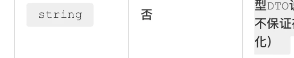

**routeDispatcher 对象结构**

路由分发配置，根据  `strategyType`  字段值采用不同的策略类型。

| 参数名称 | 位置 | 类型 | 是否必选 | 示例 | 说明 |
| --- | --- | --- | --- | --- | --- |
| strategyType | <code>body</code> | <code>string</code> | 是 | <code>WEIGHT</code> | 必需；WEIGHT、HEADER、WEIGHT_MOD EL_MAPPING、SINGLE_MODE L_MAPPING、CONTEXT_LEN GTH。子类结构不可混<br><br>用。<code>     </code> |

<table>
  <tr>
    <td>rules</td>
    <td><code>body</code></td>
    <td><code>array</code></td>
    <td>按策略必填</td>
    <td><code>[{"weight":</code><br><code>100,"service</code><br><code>Id":"${aiSer</code><br><code>viceId}"}]</code></td>
    <td>业务必填的非空规则数组；结构按strategyType选择，不能混用各子类。WEIGHT、HEADER、WEIGHT_MOD EL_MAPPING要求非空；SINGLE_MODE L_MAPPING 必须恰好一项。CONTEXT_LEN GTH 使用自己的模型及区间规则，完整入口约束尚未核验，不提供可调用示例。此处示例仅对应WEIGHT。</td>
  </tr>
</table>

**WEIGHT 策略（权重分发）：**

| 参数名称 | 位置 | 类型 | 是否必选 | 示例 | 说明 |
| --- | --- | --- | --- | --- | --- |
| rules | body | <code>array</code> | 是 | <code>[{"weight":</code><br><code>100,"service</code><br><code>Id":"${aiSer</code><br><code>viceId}"}]</code> | 业务必填的非空规则数组；结构按strategyType选择，不能混用各子类。 |
| rules\[\].weight | body | <code>integer</code> | 是 | <code>50</code> | 整数权重，非空且非负；普通WEIGHT 不要求权重总和为100。 |
| rules\[\].service Id | body | <code>string</code> | 是 | <code>${aiService</code><br><code>Id}</code> | 每条规则业务必填：同实例有效服务 ID，非空白；与普通路由顶层 SINGLE 无关。 |
| rules\[\].service Name | body | <code>string</code> | 否 | <code>model-</code><br><code>service</code> | 展示用服务名称，不替代serviceId，也不参与服务标识校验。 |

**HEADER 策略（Header条件分发）：**

| 参数名称 | 位置 | 类型 | 是否必选 | 示例 | 说明 |
| --- | --- | --- | --- | --- | --- |
| rules | body | <code>array</code> | 是 | <code>[{"headerMa</code><br><code>tch":</code><br><code>{"model":"mo</code><br><code>del-</code><br><code>demo"},"weig</code><br><code>htRuleList":</code><br><code>[{"weight":1</code><br><code>00,"serviceI</code><br><code>d":"${aiServ</code><br><code>iceId}"}]}]</code> | HEADER 匹配规则非空。每项提供headerMatch；优先使用非空weightRuleLis t，其每项weight 非空且非负、serviceId 非空白；未提供权重列表时须提供旧兼容serviceId。 |
| rules\[\].header Match | body | <code>object</code> | 是 | <code>{"model":</code><br><code>"gpt-4"}</code> | Header匹配条件，key-value形式，如<code>{"model":</code> <code>"gpt-4"} </code>。 |
| rules\[\].weight RuleList | body | <code>array</code> | 否 | <code>[{"weight":</code><br><code>100,"service</code><br><code>Id":"${aiSer</code><br><code>viceId}"}]</code> | 优先使用的权重规则数组。非空时逐项要求weight 为非负Integer、serviceId 为非空白字符串；为空时必须提供该HEADER 规则的旧兼容serviceId。 |
| rules\[\].service Id | body | <code>string</code> | 否 | <code>${aiService</code><br><code>Id}</code> | 旧兼容服务ID，已弃用。仅weightRuleLis t 为空时业务必填且非空白；优先使用weightRuleLis t，不能把该字段套用为SINGLE 条件。 |

**WEIGHT_MODEL_MAPPING / SINGLE_MODEL_MAPPING 策略（权重+模型映射）：**

| 参数名称 | 位置 | 类型 | 是否必选 | 示例 | 说明 |
| --- | --- | --- | --- | --- | --- |
| rules | body | <code>array</code> | 是 | <code>[{"weight":</code><br><code>100,"service</code><br><code>Id":"${aiSer</code><br><code>viceId}","mo</code><br><code>delMapping":</code><br><code>{"model-</code><br><code>source":"mod</code><br><code>el-</code><br><code>target"}}]</code> | WEIGHT_MOD EL_MAPPING要求非空数组；SINGLE_MODE L_MAPPING 必须恰好一项，且该项省略或传null 的 weight会设为100。两者每项serviceId 均非空白。 |
| rules\[\].weight | body | <code>integer</code> | 按策略条件 | <code>50</code> | Integer。WEIGHT_MOD EL_MAPPING中必填且非负；SINGLE_MODE L_MAPPING 必须仅一条规则，weight 省略或为 null 时设为100，非空值仍须非负。 |
| rules\[\].service Id | body | <code>string</code> | 是 | <code>${aiService</code><br><code>Id}</code> | 每条规则业务必填：同实例有效服务 ID，非空白；与普通路由顶层 SINGLE 无关。 |
| rules\[\].model Mapping | body | <code>object</code> | 否 | <code>{"gpt-</code><br><code>3.5": "gpt-</code><br><code>4"}</code> | 模型名称映射，键和值均为字符串；已读本地校验未要求非空，不将示例升级为强制必填或数据面保证。<code>  </code> |
| rules\[\].service Name | body | <code>string</code> | 否 | <code>model-</code><br><code>service</code> | 展示用服务名称，不替代serviceId，也不参与服务标识校验。 |

**模型兜底兼容字段补充**

| 字段路径 | 本地类型 | 说明 |
| --- | --- | --- |
| fallbackTriggerScope | String |  |
| fallbackServices | array |  |

**返回数据**

本主表仅列当前API JSON声明的响应成员，不统一套用BaseResult。未列入清单的后端业务数据在补充结构中说明，不据此承诺POP外层映射。

| 参数名称 | 类型 | 示例 | 说明 |
| --- | --- | --- | --- |
| requestId | <code>string</code> | <code>${requestId}</code> | 请求ID。 |
| code | <code>integer&lt;int32&gt;</code> | <code>200</code> | 业务响应码，Integer；不是已验证的外层 HTTP 状态码。 |
| msg | <code>string</code> | <code>null</code> | 响应消息。 |
| data | <code>string</code> | <code>model-api-chat-</code><br><code>demo</code> | data为本次更新的模型API ID，与请求中的id一致，类型为字符串。配置保存后会触发异步重新发布，接口返回成功不表示发布已完成。 |

**示例**

**请求示例**

```http
POST /modelapi/updateModelApi HTTP/1.1

{
  "gwInstanceId": "${gwInstanceId}",
  "id": "model-api-chat-demo",
  "apiName": "chat-demo",
  "basePath": "/chat-demo",
  "basePathRemove": true,
  "methodPathList": [
    {
      "path": "/v1/chat/completions",
      "method": "POST"
    }
  ],
  "protocol": "OPENAI_COMPATIBLE",
  "sceneType": "TEXT_GENERATION",
  "routeDispatcher": {
    "strategyType": "WEIGHT",
    "rules": [
      {
        "serviceId": "${aiServiceId}",
        "weight": 100
      }
    ]
  }
}
```

**响应示例**

```json
{
  "requestId": "${requestId}",
  "code": 200,
  "msg": null,
  "message": null,
  "data": "model-api-chat-demo"
}
```

<a id="section-1-3-9-13"></a>

#### 1.3.9.13. AcknowledgeAgentApiOperation

Acknowledge智能体API操作。

**请求头**

公共请求头及认证信息的获取与携带方式，请参见获取公共Header参数。

**请求语法**

```http
POST /agentApi/acknowledgeAgentApiOperation HTTP/1.1
```

**请求参数**

| 参数名称 | 位置 | 类型 | 是否必选 | 示例 | 说明 |
| --- | --- | --- | --- | --- | --- |
| gwInstanc eId | body | string | 是 | gw-123456 | 网关实例ID。 不能为空或空白字符串。 |
| operationI d | body | string | 是 | operation-123456 | 异步操作 ID。 不能为空或空白字符串。 |

**返回数据**

| 参数名称 | 类型 | 示例 | 说明 |
| --- | --- | --- | --- |
| requestId | string | req-123456 | 请求ID。 |
| code | integer&lt;int32 &gt; | 200 | 响应码。 |
| msg | string | null | 响应消息。 |
| data | null | null | 无返回业务数据，值为 null。 |

**示例**

**请求示例**

```http
POST /agentApi/acknowledgeAgentApiOperation HTTP/1.1

{
  "gwInstanceId": "gw-demo",
  "operationId": "operation-demo"
}
```

**正常返回示例**

`JSON`  格式

```json
{
  "requestId": "req-123456",
  "code": 200,
  "msg": null,
  "message": null,
  "data": null
}
```

<a id="section-1-3-9-14"></a>

#### 1.3.9.14. AiChatCompletions

调用 AiChatCompletions 接口通过普通路由或 Model API 发起 OpenAI 兼容的 /v1/chat/completions 流式请求。服务端通过 SSE 原样转发上游数据。

**请求头**

公共请求头及认证信息的获取与携带方式，请参见获取公共Header参数。

本接口返回 SSE 流式数据。若显式设置 Accept，请使用 text/event-stream 或允许该响应类型。

**请求语法**

```http
POST /aiDebug/aiChatCompletions HTTP/1.1
```

**请求参数**

| 参数名称 | 位置 | 类型 | 是否必选 | 示例 | 说明 |
| --- | --- | --- | --- | --- | --- |
| instanceId | body | string | 是 | gw-123456\*\*\*\* | AI 网关实例 ID。仅支持HIGRESS 引擎；非 AI 网关实例会被拒绝。 不能为空。 |
| routeId | body | string | 否 | route-chat-123456\*\*\*\* | 普通路由 ID，与modelApiId 至少传一个；两者同时传时优先使用modelApiId。路由必须有新版 path.matchValue。 |
| modelApiI d | body | string | 否 | model-api-chat-completions | 模型 API ID。 |
| domainId | body | string | 否 | api.example.com | 可选域名 ID。服务端仍连接实例管理面地址，仅把域名写入 Host Header 供路由匹配。 |
| consumerI d | body | string | 否 | consumer-123456\*\*\*\* | 可选消费者 ID。服务端读取其 API Key，并按BEARER、HEADER 或QUERY 位置注入；消费者必须属于该实例。 |
| model | body | string | 是 | qwen-plus | 传给上游 OpenAI 兼容接口的模型名称。 不能为空。 |
| messages | body | array | 否 | \[\] | OpenAI Chat 消息列表，实际调用至少传一条。 |
| messag es\[\].rol e | body | string | 否 | user | — |
| messag es\[\].co ntent | body | string | 否 | 请用一句话介绍 AI 网关 | — |
| temperatu re | body | number | 否 | 0.7 | 采样温度，取值范围由上游模型决定，常见为 0～2。 |
| maxToken s | body | integer &lt;int32 &gt; | 否 | null | 最大生成 Token 数，必须符合上游模型限制。 |
| stream | body | boolean | 否 | true | 是否流式输出。本接口为SSE，必须传 true；服务端超时 30 分钟。 默认值：true。 |
| headers | body | object | 否 | {} | — |

instanceId、model、messages、stream 必填；routeId/modelApiId 至少一个。Model API 优先。domainId 只作为 Host Header，consumerId 用于自动注入 API Key。预检错误也通过 SSE error 事件返回，不一定是普通 JSON 500。

**返回数据**

| 参数名称 | 类型 | 示例 | 说明 |
| --- | --- | --- | --- |
| timeout | integer&lt;int32 &gt; | — | 接口结构声明字段；未补造业务约束或可直接调用的示例值。 |

响应 Content-Type 为 text/event-stream；客户端需逐事件消费直到 [DONE] 或错误事件。

**示例**

**请求示例**

```http
POST /aiDebug/aiChatCompletions HTTP/1.1

{
  "instanceId": "gw-123456****",
  "modelApiId": "model-api-chat-completions",
  "domainId": "api.example.com",
  "consumerId": "consumer-123456****",
  "model": "qwen-plus",
  "messages": [
    {
      "role": "user",
      "content": "请⽤⼀句话介绍 AI ⽹关"
    }
  ],
  "temperature": 0.7,
  "maxTokens": null,
  "stream": true,
  "routeId": "route-demo"
}
```

**正常返回示例**

`JSON`  格式

```json
{
  "streamExample": "data: {\"id\":\"chatcmpl-
example****\",\"object\":\"chat.completion.chunk\",\"choices\":[{\"delta\":
{\"content\":\"AI ⽹关统⼀管理模型访问。\"},\"index\":0}]}data: [DONE]"
}
```

**错误码**

| HttpCode | 错误码 | 错误信息 | 描述 |
| --- | --- | --- | --- |
| 400 | InvalidParameter | InvalidParameter | 参数不合法或目标资源不存在，请检查实例、路由、Model API、域名和消费者。 |
| 500 | InternalError | InternalError | 网关或上游模型服务调用失败，请检查路由及服务状态。 |

**文档补充说明**

该接口不会返回 BaseResult 包装。

<a id="section-1-3-9-15"></a>

#### 1.3.9.15. BatchGrantAgentApi

Batch授权智能体API。

**请求头**

公共请求头及认证信息的获取与携带方式，请参见获取公共Header参数。

**请求语法**

```http
POST /agentApi/batchGrantAgentApi HTTP/1.1
```

**请求参数**

| 参数名称 | 位置 | 类型 | 是否必选 | 示例 | 说明 |
| --- | --- | --- | --- | --- | --- |
| gwInstanc eId | body | string | 否 | gw-123456 | 网关实例ID。 |
| apiId | body | string | 否 | api-123456 | Agent API 的唯一标识。 |
| consumerI ds | body | Json | 否 | {} | 消费者 ID 列表，API 内批量。 |
| expireTim e | body | string | 否 | 2026-01-01T00:00:00Z | 有效期截止时间，ISO-8601（如 2026-12-31T15:59:59），null=永久有效。 |
| validTimeS tart | body | string | 否 | 2026-01-01T00:00:00Z | 每日有效时段开始，HH:mm:ss。 |
| validTimeE nd | body | string | 否 | 2026-01-01T00:00:00Z | 每日有效时段结束，HH:mm:ss。 |

**返回数据**

| 参数名称 | 类型 | 示例 | 说明 |
| --- | --- | --- | --- |
| requestId | string | req-123456 | 请求ID。 |
| code | integer&lt;int32 &gt; | 200 | 响应码。 |
| msg | string | null | 响应消息。 |
| data | null | null | 无返回业务数据，值为 null。 |

**示例**

**请求示例**

```http
POST /agentApi/batchGrantAgentApi HTTP/1.1

{}
```

**正常返回示例**

`JSON`  格式

```json
{
  "requestId": "req-123456",
  "code": 200,
  "msg": null,
  "message": null,
  "data": null
}
```

<a id="section-1-3-9-16"></a>

#### 1.3.9.16. ChangeAgentApiAuthStatus

变更智能体API认证状态。

**请求头**

公共请求头及认证信息的获取与携带方式，请参见获取公共Header参数。

**请求语法**

```http
POST /agentApi/changeAgentApiAuthStatus HTTP/1.1
```

**请求参数**

| 参数名称 | 位置 | 类型 | 是否必选 | 示例 | 说明 |
| --- | --- | --- | --- | --- | --- |
| gwInstanc eId | body | string | 否 | gw-123456 | 网关实例ID。 |
| apiId | body | string | 否 | api-123456 | Agent API 的唯一标识。 |
| enabled | body | boolean | 否 | true | 是否启用。 |

**返回数据**

| 参数名称 | 类型 | 示例 | 说明 |
| --- | --- | --- | --- |
| requestId | string | req-123456 | 请求ID。 |
| code | integer&lt;int32 &gt; | 200 | 响应码。 |
| msg | string | null | 响应消息。 |
| data | object | {} | 返回数据。 |
| data.operat ionId | string | operation-123456 | operation ID，每次 execution attempt 唯一。 |
| data.operat ionType | string | example | operation 类型：ROUTE_PUBLISH /API_REVISION_APPLY / API_DELETE /AUTH_ENABLE。 |
| data.apiId | string | api-123456 | 所属 Agent API ID。 |
| data.routeI d | string | route-123456 | Route ID，仅 ROUTE_PUBLISH 非空。 |
| data.target Revision | integer&lt;int64 &gt; | 1 | 执行意图版本，按 operationType 定义：ROUTE_PUBLISH=本次发布的 Route 草稿revision；API_REVISION_APPLY=目标desiredRevision；API_DELETE /AUTH_ENABLE=null（去重键退化为(operationType, apiId)）。不是永久幂等键。 |
| data.execut ionAttempt | integer&lt;int32 &gt; | 1 | 同一执行意图第 N 次执行，从 1 起。 |
| data.operat ionEpoch | integer&lt;int64 &gt; | 1 | fencing epoch，API 内单调递增；接管/重试必然更高。 |
| data.status | string | ENABLED | operation 状态：新受理=RUNNING；去重回放时为原 operation 当前状态。 |
| data.aggre gateStatus | string | example | API 列表聚合状态：PUBLISHING / APPLYING /DELETING / AUTH_ENABLING 等；终态回放时为对象当前聚合状态。 |
| data.starte dAt | string | 2026-01-01T00:00:00Z | 开始时间，ISO-8601 UTC。 |
| data.deadli neAt | string | 2026-01-01T00:00:00Z | wall-clock 预算截止时间。 |
| data.finishe dAt | string | 2026-01-01T00:00:00Z | 终态完成时间，仅终态回放非空。 |
| data.pollInt ervalSecon ds | integer&lt;int32 &gt; | 1 | 建议轮询间隔（秒），固定 3。 |

**示例**

**请求示例**

```http
POST /agentApi/changeAgentApiAuthStatus HTTP/1.1

{}
```

**正常返回示例**

`JSON`  格式

```json
{
  "requestId": "req-123456",
  "code": 200,
  "msg": null,
  "message": null,
  "data": {
    "operationId": "operation-123456",
    "operationType": "example",
    "apiId": "api-123456",
    "routeId": "route-123456",
    "targetRevision": 1,
    "executionAttempt": 1,
    "operationEpoch": 1,
    "status": "ENABLED",
    "aggregateStatus": "example",
    "startedAt": "2026-01-01T00:00:00Z",
    "deadlineAt": "2026-01-01T00:00:00Z",
    "finishedAt": "2026-01-01T00:00:00Z",
    "pollIntervalSeconds": 1
  }
}
```

<a id="section-1-3-9-17"></a>

#### 1.3.9.17. CreateAgentApi

创建智能体API。

**请求头**

公共请求头及认证信息的获取与携带方式，请参见获取公共Header参数。

**请求语法**

```http
POST /agentApi/createAgentApi HTTP/1.1
```

**请求参数**

| 参数名称 | 位置 | 类型 | 是否必选 | 示例 | 说明 |
| --- | --- | --- | --- | --- | --- |
| gwInstanc eId | body | string | 是 | gw-123456 | 网关实例ID。 不能为空或空白字符串。 |
| name | body | string | 是 | example-name | 名称。 不能为空或空白字符串。 |
| descriptio n | body | string | 否 | example description | 描述。 |
| protocol | body | string | 是 | example | 协议。 不能为空或空白字符串。 |
| domainId | body | string | 是 | domain-123456 | 域名 ID。 不能为空或空白字符串。 |
| basePath | body | string | 是 | example | Agent API 对外基础路径，以 / 开头；最终路径由该值与路由路径拼接。 不能为空或空白字符串。 |
| removeBa sePath | body | boolean | 否 | true | 是否移除基础路径。 |
| consumer AuthEnabl ed | body | boolean | 否 | true | 是否启用消费者身份认证。 |
| observatio nEnabled | body | boolean | 否 | true | AI 请求观测开关，创建默认开启 默认值：true。 |

**返回数据**

| 参数名称 | 类型 | 示例 | 说明 |
| --- | --- | --- | --- |
| requestId | string | req-123456 | 请求ID。 |
| code | integer&lt;int32 &gt; | 200 | 响应码。 |
| msg | string | null | 响应消息。 |
| data | object | {} | 返回数据。 |
| data.apiId | string | api-123456 | 稳定 ID，服务端生成，前缀 agent-api-。 |
| data.gwInst anceId | string | gw-123456 | 网关实例 ID。 |
| data.name | string | example-name | API 名称，实例内与 Model API/Agent API 双向唯一，创建后不可改。 |
| data.descri ption | string | example description | 描述。 |
| data.protoc ol | string | example | Agent 协议：BAILIAN / DIFY / CUSTOM，创建后不可改。 |
| data.consu merAuthEn abled | boolean | true | 消费者认证开关（key-auth）。 |
| data.observ ationEnable d | boolean | true | AI 请求观测开关，创建默认开启。 |
| data.desire dConfig | object | {} | 目标配置（草稿），编辑页展示。 |
| data.des iredConf ig.domai nId | string | domain-123456 | 域名 ID，单 API 域名数上限 1（Higress 硬约束）。 |
| data.des iredConf ig.domai nName | string | example | 域名名称，响应回显用。 |
| data.des iredConf ig.baseP ath | string | example | Base Path，以 / 开头；对外路径 = basePath + routePath。 |
| data.des iredConf ig.remo veBaseP ath | boolean | true | 是否移除 Base Path：开启后仅移除 Base Path，保留 Route Path。 |
| data.desire dRevision | integer&lt;int64 &gt; | 1 | desired 配置版本，单调递增。 |
| data.applie dConfig | object | {} | 线上生效配置；Route 发布只使用appliedConfig。 |
| data.ap pliedCon fig.dom ainId | string | domain-123456 | 域名 ID，单 API 域名数上限 1（Higress 硬约束）。 |
| data.ap pliedCon fig.dom ainNam e | string | example | 域名名称，响应回显用。 |
| data.ap pliedCon fig.base Path | string | example | Base Path，以 / 开头；对外路径 = basePath + routePath。 |
| data.ap pliedCon fig.remo veBaseP ath | boolean | true | 是否移除 Base Path：开启后仅移除 Base Path，保留 Route Path。 |
| data.applie dRevision | integer&lt;int64 &gt; | 1 | 已生效配置版本（唯一真相源）。 |
| data.applyS tatus | string | example | API Revision apply 状态：APPLIED /APPLYING / APPLY_FAILED。 |
| data.rollbac kStatus | string | example | 回滚状态，仅 APPLY_FAILED 时非空：SUCCEEDED / PARTIAL / FAILED。 |
| data.applyO perationId | string | applyoperation-123456 | 最近一次 revision apply 的 operationId。 |
| data.delete OperationId | string | deleteoperation-123456 | 最近一次 API_DELETE 的 operationId（删除失败后的重试依据）。 |
| data.active Operation | object | {} | 当前 RUNNING 的 operation 摘要；无RUNNING 时为 null。 |
| data.act iveOper ation.op erationI d | string | operation-123456 | 异步操作 ID。 |
| data.act iveOper ation.op erationT ype | string | example | — |
| data.act iveOper ation.op erationE poch | integer&lt;int64 &gt; | 1 | — |
| data.act iveOper ation.sta rtedAt | string | 2026-01-01T00:00:00Z | — |
| data.act iveOper ation.he artbeatA t | string | 2026-01-01T00:00:00Z | — |
| data.act iveOper ation.de adlineAt | string | 2026-01-01T00:00:00Z | — |
| data.aggre gateStatus | string | example | API 列表聚合状态（§2.5 优先级矩阵）。 |
| data.routeC ount | integer&lt;int32 &gt; | 1 | 路由总数。 |
| data.publis hedRouteC ount | integer&lt;int32 &gt; | 1 | 已发布路由数。 |
| data.revisio n | integer&lt;int64 &gt; | 1 | 对象级乐观锁版本，UpdateAgentApi 携带expectedRevision 比对。 |
| data.failure Reason | object | {} | 最近一次终态失败 operation 的结构化原因；新operation 受理后清空。 |
| data.fail ureReas on.code | string | example | 错误码，契约 §8 码表枚举（与同步 msg token共用一张表）。 |
| data.fail ureReas on.mess age | string | null | 英文失败描述，不含敏感信息。 |
| data.fail ureReas on.curre ntPhase | string | example | 失败发生的 phase（契约 §2.4 phase 序列）。 |
| data.fail ureReas on.failed Resourc es | array | \[\] | 失败资源明细。 |
| data.failur eRea son.f ailed Reso urce s\[\].re sour ceTy pe | string | example | 资源类型，如Ingress/ConfigMap/WasmPlugin。 |
| data.failur eRea son.f ailed Reso urce s\[\].re sour ceNa me | string | example | 资源名称，如 routeResourceName。 |
| data.failur eRea son.f ailed Reso urce s\[\].er ror | string | example | 英文错误信息，不含敏感信息。 |
| data.fail ureReas on.rollba ckStatus | string | SUCCEEDED | 回滚状态；无回滚语义的 operation 为 null。取值：SUCCEEDED、PARTIAL、FAILED。 |
| data.fail ureReas on.rollba ckErrors | array | \[\] | 回滚失败明细。 |
| data.failur eRea son.r ollba ckErr ors\[\].reso urce Type | string | example | 资源类型，如Ingress/ConfigMap/WasmPlugin。 |
| data.failur eRea son.r ollba ckErr ors\[\].reso urce Nam e | string | example | 资源名称，如 routeResourceName。 |
| data.failur eRea son.r ollba ckErr ors\[\].error | string | example | 英文错误信息，不含敏感信息。 |
| data.fail ureReas on.retry able | boolean | true | 是否允许用户以新 execution attempt 重试。 |
| data.gmtCr eate | string | 2026-01-01T00:00:00Z | 创建时间，ISO-8601。 |
| data.gmtMo dified | string | 2026-01-01T00:00:00Z | 最后修改时间，ISO-8601。 |

**示例**

**请求示例**

```http
POST /agentApi/createAgentApi HTTP/1.1

{
  "gwInstanceId": "gw-demo",
  "name": "demo",
  "protocol": "example",
  "domainId": "domain-demo",
  "basePath": "example"
}
```

**正常返回示例**

`JSON`  格式

```json
{
  "requestId": "req-123456",
  "code": 200,
  "msg": null,
  "message": null,
  "data": {
    "apiId": "api-123456",
    "gwInstanceId": "gw-123456",
    "name": "example-name",
    "description": "example description",
    "protocol": "example",
    "consumerAuthEnabled": true,
    "observationEnabled": true,
    "desiredConfig": {
      "domainId": "domain-123456",
      "domainName": "example",
      "basePath": "example",
      "removeBasePath": true
    },
    "desiredRevision": 1,
    "appliedConfig": {
      "domainId": "domain-123456",
      "domainName": "example",
      "basePath": "example",
      "removeBasePath": true
    },
    "appliedRevision": 1,
    "applyStatus": "example",
    "rollbackStatus": "example",
    "applyOperationId": "applyoperation-123456",
    "deleteOperationId": "deleteoperation-123456",
    "activeOperation": {
      "operationId": "operation-123456",
      "operationType": "example",
      "operationEpoch": 1,
      "startedAt": "2026-01-01T00:00:00Z",
      "heartbeatAt": "2026-01-01T00:00:00Z",
      "deadlineAt": "2026-01-01T00:00:00Z"
    },
    "aggregateStatus": "example",
    "routeCount": 1,
    "publishedRouteCount": 1,
    "revision": 1,
    "failureReason": {
      "code": "200",
      "message": null,
      "currentPhase": "example",
      "failedResources": [
        {
          "resourceType": "example",
          "resourceName": "example",
          "error": "example"
        }
      ],
      "rollbackStatus": "SUCCEEDED",
      "rollbackErrors": [
        {
          "resourceType": "example",
          "resourceName": "example",
          "error": "example"
        }
      ],
      "retryable": true
    },
    "gmtCreate": "2026-01-01T00:00:00Z",
    "gmtModified": "2026-01-01T00:00:00Z"
  }
}
```

<a id="section-1-3-9-18"></a>

#### 1.3.9.18. CreateAgentApiRoute

创建智能体API路由。

**请求头**

公共请求头及认证信息的获取与携带方式，请参见获取公共Header参数。

**请求语法**

```http
POST /agentApi/createAgentApiRoute HTTP/1.1
```

**请求参数**

| 参数名称 | 位置 | 类型 | 是否必选 | 示例 | 说明 |
| --- | --- | --- | --- | --- | --- |
| gwInstanc eId | body | string | 是 | gw-123456 | 网关实例ID。 不能为空或空白字符串。 |
| apiId | body | string | 是 | api-123456 | Agent API 的唯一标识。 不能为空或空白字符串。 |
| name | body | string | 是 | example-name | 名称。 不能为空或空白字符串。 |
| descriptio n | body | string | 否 | example description | 描述。 |
| config | body | object | 是 | {} | 结构化策略配置对象。config 与 rawConfig 至少提供一个；config 非空时优先使用，具体 Schema 由strategyName 决定。 |
| config.mat ch | body | object | 否 | {} | 匹配条件。 |
| config.mat ch.path | body | object | 否 | {} | 路径匹配。 |
| config.mat ch.path.m atchType | body | string | 否 | EXACT | 匹配类型。取值：EXACT、PREFIX、REGEX。 |
| config.mat ch.path.va lue | body | string | 否 | example | 路径值，以 / 开头，统一规范化归校验层。 |
| config.mat ch.method s | body | array | 否 | \[\] | HTTP Method 列表，标准大写枚举。 |
| config.mat ch.header s | body | array | 否 | \[\] | Header 匹配列表，headers + queryParams 合计上限归校验层校验。 |
| config.mat ch.header s\[\].key | body | string | 否 | DEMO_CREDENTIAL | 键名。 |
| config.mat ch.header s\[\].matchT ype | body | string | 否 | EXACT | 匹配类型。取值：EXACT、PREFIX、REGEX。 |
| config.mat ch.header s\[\].value | body | string | 否 | example | 匹配值。 |
| config.mat ch.queryP arams | body | array | 否 | \[\] | Query 参数匹配列表。 |
| config.mat ch.queryP arams\[\].ke y | body | string | 否 | DEMO_CREDENTIAL | 键名。 |
| config.mat ch.queryP arams\[\].m atchType | body | string | 否 | EXACT | 匹配类型。取值：EXACT、PREFIX、REGEX。 |
| config.mat ch.queryP arams\[\].va lue | body | string | 否 | example | 匹配值。 |
| config.bac kend | body | object | 否 | {} | 后端目标。 |
| config.bac kend.type | body | string | 否 | SINGLE | 后端类型。取值：SINGLE、WEIGHTED。 |
| config.bac kend.servi ces | body | array | 否 | \[\] | 目标服务列表。 |
| config.bac kend.servi ces\[\].servi ceId | body | string | 否 | service-demo | Agent Service 稳定 ID。 |
| config.bac kend.servi ces\[\].weig ht | body | integer &lt;int32 &gt; | 否 | 0 | 权重：SINGLE 时为 null；WEIGHTED 时 1-100 整数。 |

**返回数据**

| 参数名称 | 类型 | 示例 | 说明 |
| --- | --- | --- | --- |
| requestId | string | req-123456 | 请求ID。 |
| code | integer&lt;int32 &gt; | 200 | 响应码。 |
| msg | string | null | 响应消息。 |
| data | object | {} | 返回数据。 |
| data.routeI d | string | route-123456 | 稳定 Route ID，前缀 agent-route-。 |
| data.apiId | string | api-123456 | 所属 Agent API ID。 |
| data.gwInst anceId | string | gw-123456 | 网关实例 ID。 |
| data.name | string | example-name | 路由名称，仅展示用，可编辑，不参与 K8s 资源标识。 |
| data.descri ption | string | example description | 描述。 |
| data.routeR esourceNa me | string | example | 稳定资源名 agent-rt-{apiIdHash8}-{routeIdHash8}，创建时生成永不变。 |
| data.draftC onfig | object | {} | 草稿配置（编辑目标）。 |
| data.dra ftConfig.match | object | {} | 匹配条件。 |
| data.draftConfi g.match.path | object | {} | 路径匹配。 |
| data.draftConfi g.match.path.matchType | string | EXACT | 匹配类型。取值：EXACT、PREFIX、REGEX。 |
| data.draftConfi g.match.path.v alue | string | example | 路径值，以 / 开头，统一规范化归校验层。 |
| data.draft Confi g.ma tch.meth ods | array | \[\] | HTTP Method 列表，标准大写枚举。 |
| data.draft Confi g.ma tch.h eade rs | array | \[\] | Header 匹配列表，headers + queryParams合计上限归校验层校验。 |
| d a t a.d r a ft C o n fi g.m a tc h.h e a d e rs \[\].k e y | string | DEMO_CREDENTIAL | 键名。 |
| d a t a.d r a ft C o n fi g.m a tc h.h e a d e rs \[\].m a tc h T y p e | string | EXACT | 匹配类型。取值：EXACT、PREFIX、REGEX。 |
| d a t a.d r a ft C o n fi g.m a tc h.h e a d e rs \[\].v al u e | string | example | 匹配值。 |
| data.draft Confi g.ma tch.q uery Para ms | array | \[\] | Query 参数匹配列表。 |
| d a t a.d r a ft C o n fi g.m a tc h.q u e r y P a r a m s\[\].k e y | string | DEMO_CREDENTIAL | 键名。 |
| d a t a.d r a ft C o n fi g.m a tc h.q u e r y P a r a m s\[\].m a tc h T y p e | string | EXACT | 匹配类型。取值：EXACT、PREFIX、REGEX。 |
| d a t a.d r a ft C o n fi g.m a tc h.q u e r y P a r a m s\[\].v al u e | string | example | 匹配值。 |
| data.dra ftConfig.backend | object | {} | 后端目标。 |
| data.draft Confi g.ba cken d.typ e | string | SINGLE | 后端类型。取值：SINGLE、WEIGHTED。 |
| data.draft Confi g.ba cken d.ser vices | array | \[\] | 目标服务列表。 |
| d a t a.d r a ft C o n fi g.b a c k e n d.s e r vi c e s\[\].s e r vi c eI d | string | service-123456 | Agent Service 稳定 ID。 |
| d a t a.d r a ft C o n fi g.b a c k e n d.s e r vi c e s\[\].w ei g h t | integer&lt;int32 &gt; | 1 | 权重：SINGLE 时为 null；WEIGHTED 时 1-100整数。 |
| data.publis hedSnapsh ot | object | {} | 已发布快照（服务中配置）；未发布 / 已下线为null。 |
| data.pu blishedS napshot.match | object | {} | 匹配条件。 |
| data.published Snapshot.matc h.path | object | {} | 路径匹配。 |
| data.published Snapshot.matc h.path.matchT ype | string | EXACT | 匹配类型。取值：EXACT、PREFIX、REGEX。 |
| data.published Snapshot.matc h.path.value | string | example | 路径值，以 / 开头，统一规范化归校验层。 |
| data.publi shed Snap shot.matc h.me thod s | array | \[\] | HTTP Method 列表，标准大写枚举。 |
| data.publi shed Snap shot.matc h.he ader s | array | \[\] | Header 匹配列表，headers + queryParams合计上限归校验层校验。 |
| d a t a.p u bl is h e d S n a p s h o t.m a tc h.h e a d e rs \[\].k e y | string | DEMO_CREDENTIAL | 键名。 |
| d a t a.p u bl is h e d S n a p s h o t.m a tc h.h e a d e rs \[\].m a tc h T y p e | string | EXACT | 匹配类型。取值：EXACT、PREFIX、REGEX。 |
| d a t a.p u bl is h e d S n a p s h o t.m a tc h.h e a d e rs \[\].v al u e | string | example | 匹配值。 |
| data.publi shed Snap shot.matc h.qu eryP aram s | array | \[\] | Query 参数匹配列表。 |
| d a t a.p u bl is h e d S n a p s h o t.m a tc h.q u e r y P a r a m s\[\].k e y | string | DEMO_CREDENTIAL | 键名。 |
| d a t a.p u bl is h e d S n a p s h o t.m a tc h.q u e r y P a r a m s\[\].m a tc h T y p e | string | EXACT | 匹配类型。取值：EXACT、PREFIX、REGEX。 |
| d a t a.p u bl is h e d S n a p s h o t.m a tc h.q u e r y P a r a m s\[\].v al u e | string | example | 匹配值。 |
| data.pu blishedS napshot.backend | object | {} | 后端目标。 |
| data.publi shed Snap shot.back end.t ype | string | SINGLE | 后端类型。取值：SINGLE、WEIGHTED。 |
| data.publi shed Snap shot.back end.servi ces | array | \[\] | 目标服务列表。 |
| d a t a.p u bl is h e d S n a p s h o t.b a c k e n d.s e r vi c e s\[\].s e r vi c eI d | string | service-123456 | Agent Service 稳定 ID。 |
| d a t a.p u bl is h e d S n a p s h o t.b a c k e n d.s e r vi c e s\[\].w ei g h t | integer&lt;int32 &gt; | 1 | 权重：SINGLE 时为 null；WEIGHTED 时 1-100整数。 |
| data.publis hedApiRevi sion | integer&lt;int64 &gt; | 1 | 发布时捕获的 API appliedRevision。 |
| data.publis hStatus | string | example | 发布状态：UNPUBLISHED / PUBLISHING /SUCCESS / FAILED。 |
| data.pendin gChanges | boolean | true | 草稿相对快照有未发布修改。 |
| data.delete Status | string | example | 删除状态：DELETE_FAILED 或 null，允许失败后幂等重删。 |
| data.publis hOperationI d | string | publishoperation-123456 | 当前/最近发布 operation。 |
| data.heartb eatAt | string | 2026-01-01T00:00:00Z | 发布心跳时间，ISO-8601；前端判断「陈旧可接管」：now - heartbeatAt &gt; 5min。 |
| data.failure Reason | object | {} | 最近发布/删除失败明细。 |
| data.fail ureReas on.code | string | example | 错误码，契约 §8 码表枚举（与同步 msg token共用一张表）。 |
| data.fail ureReas on.mess age | string | null | 英文失败描述，不含敏感信息。 |
| data.fail ureReas on.curre ntPhase | string | example | 失败发生的 phase（契约 §2.4 phase 序列）。 |
| data.fail ureReas on.failed Resourc es | array | \[\] | 失败资源明细。 |
| data.failur eRea son.f ailed Reso urce s\[\].re sour ceTy pe | string | example | 资源类型，如Ingress/ConfigMap/WasmPlugin。 |
| data.failur eRea son.f ailed Reso urce s\[\].re sour ceNa me | string | example | 资源名称，如 routeResourceName。 |
| data.failur eRea son.f ailed Reso urce s\[\].er ror | string | example | 英文错误信息，不含敏感信息。 |
| data.fail ureReas on.rollba ckStatus | string | SUCCEEDED | 回滚状态；无回滚语义的 operation 为 null。取值：SUCCEEDED、PARTIAL、FAILED。 |
| data.fail ureReas on.rollba ckErrors | array | \[\] | 回滚失败明细。 |
| data.failur eRea son.r ollba ckErr ors\[\].reso urce Type | string | example | 资源类型，如Ingress/ConfigMap/WasmPlugin。 |
| data.failur eRea son.r ollba ckErr ors\[\].reso urce Nam e | string | example | 资源名称，如 routeResourceName。 |
| data.failur eRea son.r ollba ckErr ors\[\].error | string | example | 英文错误信息，不含敏感信息。 |
| data.fail ureReas on.retry able | boolean | true | 是否允许用户以新 execution attempt 重试。 |
| data.revisio n | integer&lt;int64 &gt; | 1 | 乐观锁版本。 |
| data.gmtCr eate | string | 2026-01-01T00:00:00Z | 创建时间，ISO-8601。 |
| data.gmtMo dified | string | 2026-01-01T00:00:00Z | 最后修改时间，ISO-8601。 |

**示例**

**请求示例**

```http
POST /agentApi/createAgentApiRoute HTTP/1.1

{
  "gwInstanceId": "gw-demo",
  "apiId": "api-demo",
  "name": "demo",
  "config": {}
}
```

**正常返回示例**

`JSON`  格式

```json
{
  "requestId": "req-123456",
  "code": 200,
  "msg": null,
  "message": null,
  "data": {
    "routeId": "route-123456",
    "apiId": "api-123456",
    "gwInstanceId": "gw-123456",
    "name": "example-name",
    description: example description,
    "routeResourceName": "example",
    "draftConfig": {
      "match": {
        "path": {
          "matchType": "EXACT",
          "value": "example"
        },
        "methods": [],
        "headers": [
          {
            "key": "DEMO_CREDENTIAL",
            "matchType": "EXACT",
            "value": "example"
          }
        ],
        "queryParams": [
          {
            "key": "DEMO_CREDENTIAL",
            "matchType": "EXACT",
            "value": "example"
          }
        ]
      },
      "backend": {
        "type": "SINGLE",
        "services": [
          {
            "serviceId": "service-123456",
            "weight": 1
          }
        ]
      }
    },
    "publishedSnapshot": {
      "match": {
        "path": {
          "matchType": "EXACT",
          "value": "example"
        },
        "methods": [],
        "headers": [
          {
            "key": "DEMO_CREDENTIAL",
            "matchType": "EXACT",
            "value": "example"
          }
        ],
        "queryParams": [
          {
            "key": "DEMO_CREDENTIAL",
            "matchType": "EXACT",
            "value": "example"
          }
        ]
      },
      "backend": {
        "type": "SINGLE",
        "services": [
          {
            "serviceId": "service-123456",
            "weight": 1
          }
        ]
      }
    },
    "publishedApiRevision": 1,
    "publishStatus": "example",
    "pendingChanges": true,
    "deleteStatus": "example",
    "publishOperationId": "publishoperation-123456",
    "heartbeatAt": "2026-01-01T00:00:00Z",
    "failureReason": {
      "code": "200",
      "message": null,
      "currentPhase": "example",
      "failedResources": [
        {
          "resourceType": "example",
          "resourceName": "example",
          "error": "example"
        }
      ],
      "rollbackStatus": "SUCCEEDED",
      "rollbackErrors": [
        {
          "resourceType": "example",
          "resourceName": "example",
          "error": "example"
        }
      ],
      "retryable": true
    },
    "revision": 1,
    "gmtCreate": "2026-01-01T00:00:00Z",
    "gmtModified": "2026-01-01T00:00:00Z"
  }
}
```

<a id="section-1-3-9-19"></a>

#### 1.3.9.19. CreateApi

调用 CreateApi 接口在路由下创建 API 及首个版本，可保存草稿或直接发布。

**请求头**

公共请求头及认证信息的获取与携带方式，请参见获取公共Header参数。

**请求语法**

```http
POST /api/createApi HTTP/1.1
```

**请求参数**

| 参数名称 | 位置 | 类型 | 是否必选 | 示例 | 说明 |
| --- | --- | --- | --- | --- | --- |
| gwInstanc eId | body | string | 否 | gw-123456\*\*\*\* | 实例id。 |
| routeId | body | string | 否 | route-orders-123456\*\*\*\* | 路由id。 |
| name | body | string | 否 | GetOrder | 接口名称。 |
| descriptio n | body | string | 否 | 按订单 ID 查询订单详情 | 接口描述。 |
| pushDescr ibe | body | string | 否 | 首次发布订单查询接口 | 发布描述。 |
| request | body | object | 否 | {} | 请求参数。 |
| request.na me | body | string | 否 | demo | 名称。 |
| request.m ethod | body | string | 否 | example | — |
| request.ro utePath | body | string | 否 | example | — |
| request.op enSubPath | body | boolean | 否 | false | — |
| request.co ntentType | body | string | 否 | example | — |
| request.pa th | body | string | 否 | example | — |
| request.ar guments | body | array | 否 | \[\] | — |
| request.ar guments\[\].name | body | string | 否 | demo | 名称。 |
| request.ar guments\[\].value | body | string | 否 | example | — |
| request.ar guments\[\].type | body | string | 否 | example | 类型。 |
| request.ar guments\[\].files | body | array | 否 | \[\] | — |
| request.ar guments\[\].files\[\].id | body | string | 否 | -demo | 资源 ID。 |
| request.ar guments\[\].files\[\].nam e | body | string | 否 | demo | 名称。 |
| request.ar guments\[\].descriptio n | body | string | 否 | demo | 描述。 |
| request.ar guments\[\].contentTy pe | body | string | 否 | example | — |
| request.ar guments\[\].enable | body | boolean | 否 | true | 是否启用 默认值：true。 |
| request.ar guments\[\].encode | body | boolean | 否 | true | — 默认值：true。 |
| request.ar guments\[\].required | body | boolean | 否 | false | — |
| request.ar guments\[\].requiredM apping | body | boolean | 否 | false | — |
| request.ar guments\[\].innerType | body | string | 否 | example | — |
| request.ar guments\[\].customDef aultValue | body | string | 否 | example | — |
| request.ar guments\[\].customBac kendName | body | string | 否 | demo | — |
| request.ar guments\[\].customBac kendLocati on | body | string | 否 | example | — |
| request.ar guments\[\].maximum | body | string | 否 | example | — |
| request.ar guments\[\].minimum | body | string | 否 | example | — |
| request.ar guments\[\].maxLengt h | body | integer &lt;int32 &gt; | 否 | 0 | — |
| request.ar guments\[\].pattern | body | string | 否 | example | — |
| request.ar guments\[\].customEn ums | body | string | 否 | example | — |
| request.he aders | body | array | 否 | \[\] | — |
| request.he aders\[\].na me | body | string | 否 | demo | 名称。 |
| request.he aders\[\].val ue | body | string | 否 | example | — |
| request.he aders\[\].typ e | body | string | 否 | example | 类型。 |
| request.he aders\[\].file s | body | array | 否 | \[\] | — |
| request.he aders\[\].file s\[\].id | body | string | 否 | -demo | 资源 ID。 |
| request.he aders\[\].file s\[\].name | body | string | 否 | demo | 名称。 |
| request.he aders\[\].de scription | body | string | 否 | demo | 描述。 |
| request.he aders\[\].co ntentType | body | string | 否 | example | — |
| request.he aders\[\].en able | body | boolean | 否 | true | 是否启用 默认值：true。 |
| request.he aders\[\].en code | body | boolean | 否 | true | — 默认值：true。 |
| request.he aders\[\].re quired | body | boolean | 否 | false | — |
| request.he aders\[\].re quiredMap ping | body | boolean | 否 | false | — |
| request.he aders\[\].inn erType | body | string | 否 | example | — |
| request.he aders\[\].cu stomDefau ltValue | body | string | 否 | example | — |
| request.he aders\[\].cu stomBack endName | body | string | 否 | demo | — |
| request.he aders\[\].cu stomBack endLocatio n | body | string | 否 | example | — |
| request.he aders\[\].ma ximum | body | string | 否 | example | — |
| request.he aders\[\].mi nimum | body | string | 否 | example | — |
| request.he aders\[\].ma xLength | body | integer &lt;int32 &gt; | 否 | 0 | — |
| request.he aders\[\].pat tern | body | string | 否 | example | — |
| request.he aders\[\].cu stomEnum s | body | string | 否 | example | — |
| request.re st | body | array | 否 | \[\] | — |
| request.re st\[\].name | body | string | 否 | demo | 名称。 |
| request.re st\[\].value | body | string | 否 | example | — |
| request.re st\[\].type | body | string | 否 | example | 类型。 |
| request.re st\[\].files | body | array | 否 | \[\] | — |
| request.re st\[\].files\[\].i d | body | string | 否 | -demo | 资源 ID。 |
| request.re st\[\].files\[\].name | body | string | 否 | demo | 名称。 |
| request.re st\[\].descri ption | body | string | 否 | demo | 描述。 |
| request.re st\[\].conten tType | body | string | 否 | example | — |
| request.re st\[\].enable | body | boolean | 否 | true | 是否启用 默认值：true。 |
| request.re st\[\].encod e | body | boolean | 否 | true | — 默认值：true。 |
| request.re st\[\].requir ed | body | boolean | 否 | false | — |
| request.re st\[\].requir edMappin g | body | boolean | 否 | false | — |
| request.re st\[\].innerT ype | body | string | 否 | example | — |
| request.re st\[\].custo mDefaultV alue | body | string | 否 | example | — |
| request.re st\[\].custo mBackend Name | body | string | 否 | demo | — |
| request.re st\[\].custo mBackend Location | body | string | 否 | example | — |
| request.re st\[\].maxim um | body | string | 否 | example | — |
| request.re st\[\].minim um | body | string | 否 | example | — |
| request.re st\[\].maxLe ngth | body | integer &lt;int32 &gt; | 否 | 0 | — |
| request.re st\[\].patter n | body | string | 否 | example | — |
| request.re st\[\].custo mEnums | body | string | 否 | example | — |
| request.co nstant | body | array | 否 | \[\] | — |
| request.co nstant\[\].na me | body | string | 否 | demo | 名称。 |
| request.co nstant\[\].va lue | body | string | 否 | example | — |
| request.co nstant\[\].ty pe | body | string | 否 | example | 类型。 |
| request.co nstant\[\].fil es | body | array | 否 | \[\] | — |
| request.co nstant\[\].fil es\[\].id | body | string | 否 | -demo | 资源 ID。 |
| request.co nstant\[\].fil es\[\].name | body | string | 否 | demo | 名称。 |
| request.co nstant\[\].de scription | body | string | 否 | demo | 描述。 |
| request.co nstant\[\].co ntentType | body | string | 否 | example | — |
| request.co nstant\[\].en able | body | boolean | 否 | true | 是否启用 默认值：true。 |
| request.co nstant\[\].en code | body | boolean | 否 | true | — 默认值：true。 |
| request.co nstant\[\].re quired | body | boolean | 否 | false | — |
| request.co nstant\[\].re quiredMap ping | body | boolean | 否 | false | — |
| request.co nstant\[\].in nerType | body | string | 否 | example | — |
| request.co nstant\[\].cu stomDefau ltValue | body | string | 否 | example | — |
| request.co nstant\[\].cu stomBack endName | body | string | 否 | demo | — |
| request.co nstant\[\].cu stomBack endLocatio n | body | string | 否 | example | — |
| request.co nstant\[\].m aximum | body | string | 否 | example | — |
| request.co nstant\[\].mi nimum | body | string | 否 | example | — |
| request.co nstant\[\].m axLength | body | integer &lt;int32 &gt; | 否 | 0 | — |
| request.co nstant\[\].pa ttern | body | string | 否 | example | — |
| request.co nstant\[\].cu stomEnum s | body | string | 否 | example | — |
| request.bo dy | body | object | 否 | {} | — |
| request.bo dy.type | body | string | 否 | example | 类型。 |
| request.bo dy.raw | body | string | 否 | example | — |
| request.bo dy.format | body | string | 否 | example | — |
| request.bo dy.kvs | body | array | 否 | \[\] | — |
| request.bo dy.kvs\[\].na me | body | string | 否 | demo | 名称。 |
| request.bo dy.kvs\[\].va lue | body | string | 否 | example | — |
| request.bo dy.kvs\[\].ty pe | body | string | 否 | example | 类型。 |
| request.bo dy.kvs\[\].fil es | body | array | 否 | \[\] | — |
| request.bo dy.kvs\[\].fil es\[\].id | body | string | 否 | -demo | 资源 ID。 |
| request.bo dy.kvs\[\].fil es\[\].name | body | string | 否 | demo | 名称。 |
| request.bo dy.kvs\[\].de scription | body | string | 否 | demo | 描述。 |
| request.bo dy.kvs\[\].co ntentType | body | string | 否 | example | — |
| request.bo dy.kvs\[\].en able | body | boolean | 否 | true | 是否启用 默认值：true。 |
| request.bo dy.kvs\[\].en code | body | boolean | 否 | true | — 默认值：true。 |
| request.bo dy.kvs\[\].re quired | body | boolean | 否 | false | — |
| request.bo dy.kvs\[\].re quiredMap ping | body | boolean | 否 | false | — |
| request.bo dy.kvs\[\].in nerType | body | string | 否 | example | — |
| request.bo dy.kvs\[\].cu stomDefau ltValue | body | string | 否 | example | — |
| request.bo dy.kvs\[\].cu stomBack endName | body | string | 否 | demo | — |
| request.bo dy.kvs\[\].cu stomBack endLocatio n | body | string | 否 | example | — |
| request.bo dy.kvs\[\].m aximum | body | string | 否 | example | — |
| request.bo dy.kvs\[\].mi nimum | body | string | 否 | example | — |
| request.bo dy.kvs\[\].m axLength | body | integer &lt;int32 &gt; | 否 | 0 | — |
| request.bo dy.kvs\[\].pa ttern | body | string | 否 | example | — |
| request.bo dy.kvs\[\].cu stomEnum s | body | string | 否 | example | — |
| request.bo dy.binary | body | array | 否 | \[\] | — |
| request.bo dy.binary\[\].name | body | string | 否 | demo | 名称。 |
| request.bo dy.binary\[\].value | body | string | 否 | example | — |
| request.bo dy.binary\[\].type | body | string | 否 | example | 类型。 |
| request.bo dy.binary\[\].files | body | array | 否 | \[\] | — |
| request.bo dy.binary\[\].files\[\].id | body | string | 否 | -demo | 资源 ID。 |
| request.bo dy.binary\[\].files\[\].na me | body | string | 否 | demo | 名称。 |
| request.bo dy.binary\[\].descriptio n | body | string | 否 | demo | 描述。 |
| request.bo dy.binary\[\].contentTy pe | body | string | 否 | example | — |
| request.bo dy.binary\[\].enable | body | boolean | 否 | true | 是否启用 默认值：true。 |
| request.bo dy.binary\[\].encode | body | boolean | 否 | true | — 默认值：true。 |
| request.bo dy.binary\[\].required | body | boolean | 否 | false | — |
| request.bo dy.binary\[\].requiredM apping | body | boolean | 否 | false | — |
| request.bo dy.binary\[\].innerType | body | string | 否 | example | — |
| request.bo dy.binary\[\].customDe faultValue | body | string | 否 | example | — |
| request.bo dy.binary\[\].customBa ckendNam e | body | string | 否 | demo | — |
| request.bo dy.binary\[\].customBa ckendLoca tion | body | string | 否 | example | — |
| request.bo dy.binary\[\].maximum | body | string | 否 | example | — |
| request.bo dy.binary\[\].minimum | body | string | 否 | example | — |
| request.bo dy.binary\[\].maxLengt h | body | integer &lt;int32 &gt; | 否 | 0 | — |
| request.bo dy.binary\[\].pattern | body | string | 否 | example | — |
| request.bo dy.binary\[\].customEn ums | body | string | 否 | example | — |
| request.bo dy.jsonSch ema | body | object | 否 | {} | — |
| request.bo dy.jsonSch ema.id | body | string | 否 | -demo | 资源 ID。 |
| request.bo dy.jsonSch ema.title | body | string | 否 | example | — |
| request.bo dy.jsonSch ema.type | body | string | 否 | example | 类型。 |
| request.bo dy.jsonSch ema.descri ption | body | string | 否 | demo | 描述。 |
| request.bo dy.jsonSch ema.swag gerItems | body | array | 否 | \[\] | — |
| request.bo dy.jsonSch ema.items | body | object | 否 | {} | — |
| request.bo dy.jsonSch ema.mock | body | object | 否 | {} | — |
| request.bo dy.jsonSch ema.prope rties | body | object | 否 | {} | — |
| request.bo dy.jsonSch ema.sche ma | body | string | 否 | example | — |
| request.bo dy.jsonSch ema.requir edMappin g | body | boolean | 否 | false | — |
| request.bo dy.jsonSch ema.requir ed | body | array | 否 | \[\] | — |
| request.bo dy.jsonSch ema.custo mDefaultV alue | body | string | 否 | example | — |
| request.bo dy.jsonSch ema.custo mBackend Name | body | string | 否 | demo | — |
| request.bo dy.jsonSch ema.custo mBackend Location | body | string | 否 | example | — |
| request.bo dy.jsonSch ema.maxi mum | body | string | 否 | example | — |
| request.bo dy.jsonSch ema.mini mum | body | string | 否 | example | — |
| request.bo dy.jsonSch ema.maxL ength | body | integer &lt;int32 &gt; | 否 | 0 | — |
| request.bo dy.jsonSch ema.patte rn | body | string | 否 | example | — |
| request.bo dy.jsonSch ema.custo mEnums | body | string | 否 | example | — |
| request.bo dy.formDa taJson | body | object | 否 | {} | — |
| request.bo dy.tmpFile Path | body | string | 否 | example | — |
| response | body | object | 否 | {} | 响应参数。 |
| response.h eaders | body | array | 否 | \[\] | Header参数。 |
| response.h eaders\[\].n ame | body | string | 否 | demo | 名称。 |
| response.h eaders\[\].v alue | body | string | 否 | example | — |
| response.h eaders\[\].ty pe | body | string | 否 | example | 类型。 |
| response.h eaders\[\].fil es | body | array | 否 | \[\] | — |
| response.h eaders\[\].fil es\[\].id | body | string | 否 | -demo | 资源 ID。 |
| response.h eaders\[\].fil es\[\].name | body | string | 否 | demo | 名称。 |
| response.h eaders\[\].d escription | body | string | 否 | demo | 描述。 |
| response.h eaders\[\].c ontentTyp e | body | string | 否 | example | — |
| response.h eaders\[\].e nable | body | boolean | 否 | true | 是否启用 默认值：true。 |
| response.h eaders\[\].e ncode | body | boolean | 否 | true | — 默认值：true。 |
| response.h eaders\[\].re quired | body | boolean | 否 | false | — |
| response.h eaders\[\].re quiredMap ping | body | boolean | 否 | false | — |
| response.h eaders\[\].in nerType | body | string | 否 | example | — |
| response.h eaders\[\].c ustomDefa ultValue | body | string | 否 | example | — |
| response.h eaders\[\].c ustomBac kendName | body | string | 否 | demo | — |
| response.h eaders\[\].c ustomBac kendLocati on | body | string | 否 | example | — |
| response.h eaders\[\].m aximum | body | string | 否 | example | — |
| response.h eaders\[\].m inimum | body | string | 否 | example | — |
| response.h eaders\[\].m axLength | body | integer &lt;int32 &gt; | 否 | 0 | — |
| response.h eaders\[\].p attern | body | string | 否 | example | — |
| response.h eaders\[\].c ustomEnu ms | body | string | 否 | example | — |
| response.b ody | body | object | 否 | {} | Body参数。 |
| response.b ody.type | body | string | 否 | example | 类型。 |
| response.b ody.raw | body | string | 否 | example | — |
| response.b ody.format | body | string | 否 | example | — |
| response.b ody.kvs | body | array | 否 | \[\] | — |
| response.b ody.kvs\[\].n ame | body | string | 否 | demo | 名称。 |
| response.b ody.kvs\[\].v alue | body | string | 否 | example | — |
| response.b ody.kvs\[\].t ype | body | string | 否 | example | 类型。 |
| response.b ody.kvs\[\].fi les | body | array | 否 | \[\] | — |
| response.b ody.kvs\[\].fi les\[\].id | body | string | 否 | -demo | 资源 ID。 |
| response.b ody.kvs\[\].fi les\[\].name | body | string | 否 | demo | 名称。 |
| response.b ody.kvs\[\].d escription | body | string | 否 | demo | 描述。 |
| response.b ody.kvs\[\].c ontentTyp e | body | string | 否 | example | — |
| response.b ody.kvs\[\].e nable | body | boolean | 否 | true | 是否启用 默认值：true。 |
| response.b ody.kvs\[\].e ncode | body | boolean | 否 | true | — 默认值：true。 |
| response.b ody.kvs\[\].r equired | body | boolean | 否 | false | — |
| response.b ody.kvs\[\].r equiredMa pping | body | boolean | 否 | false | — |
| response.b ody.kvs\[\].i nnerType | body | string | 否 | example | — |
| response.b ody.kvs\[\].c ustomDefa ultValue | body | string | 否 | example | — |
| response.b ody.kvs\[\].c ustomBac kendName | body | string | 否 | demo | — |
| response.b ody.kvs\[\].c ustomBac kendLocati on | body | string | 否 | example | — |
| response.b ody.kvs\[\].maximum | body | string | 否 | example | — |
| response.b ody.kvs\[\].minimum | body | string | 否 | example | — |
| response.b ody.kvs\[\].maxLengt h | body | integer &lt;int32 &gt; | 否 | 0 | — |
| response.b ody.kvs\[\].p attern | body | string | 否 | example | — |
| response.b ody.kvs\[\].c ustomEnu ms | body | string | 否 | example | — |
| response.b ody.binary | body | array | 否 | \[\] | — |
| response.b ody.binary \[\].name | body | string | 否 | demo | 名称。 |
| response.b ody.binary \[\].value | body | string | 否 | example | — |
| response.b ody.binary \[\].type | body | string | 否 | example | 类型。 |
| response.b ody.binary \[\].files | body | array | 否 | \[\] | — |
| response.b ody.binary \[\].files\[\].id | body | string | 否 | -demo | 资源 ID。 |
| response.b ody.binary \[\].files\[\].na me | body | string | 否 | demo | 名称。 |
| response.b ody.binary \[\].descripti on | body | string | 否 | demo | 描述。 |
| response.b ody.binary \[\].contentT ype | body | string | 否 | example | — |
| response.b ody.binary \[\].enable | body | boolean | 否 | true | 是否启用 默认值：true。 |
| response.b ody.binary \[\].encode | body | boolean | 否 | true | — 默认值：true。 |
| response.b ody.binary \[\].required | body | boolean | 否 | false | — |
| response.b ody.binary \[\].required Mapping | body | boolean | 否 | false | — |
| response.b ody.binary \[\].innerTyp e | body | string | 否 | example | — |
| response.b ody.binary \[\].customD efaultValu e | body | string | 否 | example | — |
| response.b ody.binary \[\].customB ackendNa me | body | string | 否 | demo | — |
| response.b ody.binary \[\].customB ackendLoc ation | body | string | 否 | example | — |
| response.b ody.binary \[\].maximu m | body | string | 否 | example | — |
| response.b ody.binary \[\].minimu m | body | string | 否 | example | — |
| response.b ody.binary \[\].maxLen gth | body | integer &lt;int32 &gt; | 否 | 0 | — |
| response.b ody.binary \[\].pattern | body | string | 否 | example | — |
| response.b ody.binary \[\].customE nums | body | string | 否 | example | — |
| response.b ody.jsonSc hema | body | object | 否 | {} | — |
| response.b ody.jsonSc hema.id | body | string | 否 | -demo | 资源 ID。 |
| response.b ody.jsonSc hema.title | body | string | 否 | example | — |
| response.b ody.jsonSc hema.type | body | string | 否 | example | 类型。 |
| response.b ody.jsonSc hema.desc ription | body | string | 否 | demo | 描述。 |
| response.b ody.jsonSc hema.swa ggerItems | body | array | 否 | \[\] | — |
| response.b ody.jsonSc hema.item s | body | object | 否 | {} | — |
| response.b ody.jsonSc hema.moc k | body | object | 否 | {} | — |
| response.b ody.jsonSc hema.prop erties | body | object | 否 | {} | — |
| response.b ody.jsonSc hema.sche ma | body | string | 否 | example | — |
| response.b ody.jsonSc hema.requ iredMappi ng | body | boolean | 否 | false | — |
| response.b ody.jsonSc hema.requ ired | body | array | 否 | \[\] | — |
| response.b ody.jsonSc hema.cust omDefault Value | body | string | 否 | example | — |
| response.b ody.jsonSc hema.cust omBacken dName | body | string | 否 | demo | — |
| response.b ody.jsonSc hema.cust omBacken dLocation | body | string | 否 | example | — |
| response.b ody.jsonSc hema.max imum | body | string | 否 | example | — |
| response.b ody.jsonSc hema.mini mum | body | string | 否 | example | — |
| response.b ody.jsonSc hema.max Length | body | integer &lt;int32 &gt; | 否 | 0 | — |
| response.b ody.jsonSc hema.patt ern | body | string | 否 | example | — |
| response.b ody.jsonSc hema.cust omEnums | body | string | 否 | example | — |
| response.b ody.formD ataJson | body | object | 否 | {} | — |
| response.b ody.tmpFil ePath | body | string | 否 | example | — |
| response.s tatusCode | body | array | 否 | \[\] | 状态码。 |
| response.s tatusCode\[\].name | body | string | 否 | demo | 名称。 |
| response.s tatusCode\[\].value | body | string | 否 | example | — |
| response.s tatusCode\[\].type | body | string | 否 | example | 类型。 |
| response.s tatusCode\[\].files | body | array | 否 | \[\] | — |
| response.s tatusCode\[\].files\[\].id | body | string | 否 | -demo | 资源 ID。 |
| response.s tatusCode\[\].files\[\].na me | body | string | 否 | demo | 名称。 |
| response.s tatusCode\[\].descripti on | body | string | 否 | demo | 描述。 |
| response.s tatusCode\[\].contentT ype | body | string | 否 | example | — |
| response.s tatusCode\[\].enable | body | boolean | 否 | true | 是否启用 默认值：true。 |
| response.s tatusCode\[\].encode | body | boolean | 否 | true | — 默认值：true。 |
| response.s tatusCode\[\].required | body | boolean | 否 | false | — |
| response.s tatusCode\[\].required Mapping | body | boolean | 否 | false | — |
| response.s tatusCode\[\].innerTyp e | body | string | 否 | example | — |
| response.s tatusCode\[\].customD efaultValu e | body | string | 否 | example | — |
| response.s tatusCode\[\].customB ackendNa me | body | string | 否 | demo | — |
| response.s tatusCode\[\].customB ackendLoc ation | body | string | 否 | example | — |
| response.s tatusCode\[\].maximu m | body | string | 否 | example | — |
| response.s tatusCode\[\].minimum | body | string | 否 | example | — |
| response.s tatusCode\[\].maxLeng th | body | integer &lt;int32 &gt; | 否 | 0 | — |
| response.s tatusCode\[\].pattern | body | string | 否 | example | — |
| response.s tatusCode\[\].customE nums | body | string | 否 | example | — |
| status | body | integer &lt;int32 &gt; | 否 | 1 | 接口状态 0:草稿 1:发布 2:归档状态。 |
| method | body | string | 否 | GET | 客户端调用 API 的 HTTP 方法。 |
| transferMo de | body | string | 否 | mapping | 参数传输模式：transparent 仅校验/映射Path；mapping 严格按定义映射并丢弃未定义参数；transparent_mapping 映射已定义参数并透传其余参数。 |
| contentTy pe | body | string | 否 | application/json | 内容类型。 |
| backendM ethod | body | string | 否 | GET | 发送到后端服务的 HTTP 方法。 |
| backendUr l | body | string | 否 | /internal/orders/{orderId} | 后端请求路径/URL 模板，与参数映射后的 Path/Query组合。 |
| routePath | body | string | 否 | /orders | 路由路径。 |
| openSubP ath | body | boolean | 否 | false | 是否开放 path 下的任意子路径。Swagger 导入固定为true。 |
| path | body | string | 否 | /{orderId} | API 在 routePath 下的相对路径，建议以 / 开头。 |
| contentTy peType | body | string | 否 | transmit | contentType的类型1.default2. custom3.transmitcom.aliyun.csb.c onsole.api.enums.Conten tTypeEnum。 |
| type | body | integer &lt;int32 &gt; | 否 | 2 | 类型。0:源API 1:级联API 2:普通API 默认值：2。 |
| apiId | body | string | 否 | api-get-order-123456\*\*\*\* | 创建级联接口时，需要指定apiId；其他情况，生成ID。 |
| versionId | body | string | 否 | version-123456\*\*\*\* | 创建级联接口时，需要指定versionId；其他情况，生成ID。 |

gwInstanceId、routeId、name、method、transferMode、contentType、backendMethod、backendUrl、routePath 必填。request 映射通过 ApiRequestValidator 做重复、位置和数值边界校验。源/级联类型另有同步 ID 规则。

**返回数据**

| 参数名称 | 类型 | 示例 | 说明 |
| --- | --- | --- | --- |
| requestId | string | req-demo | 请求 ID。 |
| code | integer&lt;int32 &gt; | 200 | 业务状态码。 |
| msg | string | null | 响应消息。 |
| data | string | example-data | API 定义处理结果。 |

data 返回 API ID。

**示例**

**请求示例**

```http
POST /api/createApi HTTP/1.1

{
  "gwInstanceId": "gw-123456****",
  "routeId": "route-orders-123456****",
  "name": "GetOrder",
  "description": "按订单 ID 查询订单详情",
  "pushDescribe": "⾸次发布",
  "request": {
    "method": "GET",
    "routePath": "/orders",
    "path": "/{orderId}",
    "openSubPath": false,
    "contentType": "application/json",
    "arguments": [],
    "headers": [],
    "rest": [
      {
        "name": "orderId",
        "type": "string",
        "required": true,
        "customBackendName": "orderId",
        "customBackendLocation": "path"
      }
    ],
    "body": {
      "type": "Raw",
      "raw": "example"
    },
    "name": "demo"
  },
  "response": {
    "headers": [],
    "statusCode": [
      {
        "name": "200",
        "description": "成功",
        "type": "example"
      }
    ],
    "body": {
      "type": "JSON",
      "jsonSchema": {
        "type": "object",
        "properties": {
          "orderId": {
            "type": "string"
          },
          "status": {
            "type": "string"
          }
        }
      }
    }
  },
  "status": 1,
  "method": "GET",
  "transferMode": "mapping",
  "contentType": "application/json",
  "backendMethod": "GET",
  "backendUrl": "/internal/orders/{orderId}",
  "routePath": "/orders",
  "openSubPath": false,
  "path": "/{orderId}",
  "contentTypeType": "custom",
  "type": 2
}
```

**正常返回示例**

`JSON`  格式

```json
{
  "requestId": "F0A8A039-930D-5EC1-97C8-************",
  "code": 200,
  "msg": null,
  "message": null,
  "data": "发布普通/源 API 会下发 API 缓存；级联 API 不实际下发。"
}
```

**错误码**

| HttpCode | 错误码 | 错误信息 | 描述 |
| --- | --- | --- | --- |
| 400 | InvalidParameter | InvalidParameter | 参数不合法，请检查 API 版本、请求映射、路径和导入/SDK 配置。 |
| 409 | Conflict | Conflict | API 名称、方法+路径或版本状态冲突。 |
| 404 | ResourceNotFound | ResourceNotFound | API、版本或所属路由不存在。 |
| 500 | InternalError | InternalError | API 配置发布、文档解析或 SDK 生成失败。 |

<a id="section-1-3-9-20"></a>

#### 1.3.9.20. DeleteAgentApi

删除智能体API。

**请求头**

公共请求头及认证信息的获取与携带方式，请参见获取公共Header参数。

**请求语法**

```http
POST /agentApi/deleteAgentApi HTTP/1.1
```

**请求参数**

| 参数名称 | 位置 | 类型 | 是否必选 | 示例 | 说明 |
| --- | --- | --- | --- | --- | --- |
| gwInstanc eId | body | string | 是 | gw-123456 | 网关实例ID。 不能为空或空白字符串。 |
| apiId | body | string | 是 | api-123456 | Agent API 的唯一标识。 不能为空或空白字符串。 |

**返回数据**

| 参数名称 | 类型 | 示例 | 说明 |
| --- | --- | --- | --- |
| requestId | string | req-123456 | 请求ID。 |
| code | integer&lt;int32 &gt; | 200 | 响应码。 |
| msg | string | null | 响应消息。 |
| data | object | {} | 返回数据。 |
| data.operat ionId | string | operation-123456 | operation ID，每次 execution attempt 唯一。 |
| data.operat ionType | string | example | operation 类型：ROUTE_PUBLISH /API_REVISION_APPLY / API_DELETE /AUTH_ENABLE。 |
| data.apiId | string | api-123456 | 所属 Agent API ID。 |
| data.routeI d | string | route-123456 | Route ID，仅 ROUTE_PUBLISH 非空。 |
| data.target Revision | integer&lt;int64 &gt; | 1 | 执行意图版本，按 operationType 定义：ROUTE_PUBLISH=本次发布的 Route 草稿revision；API_REVISION_APPLY=目标desiredRevision；API_DELETE /AUTH_ENABLE=null（去重键退化为(operationType, apiId)）。不是永久幂等键。 |
| data.execut ionAttempt | integer&lt;int32 &gt; | 1 | 同一执行意图第 N 次执行，从 1 起。 |
| data.operat ionEpoch | integer&lt;int64 &gt; | 1 | fencing epoch，API 内单调递增；接管/重试必然更高。 |
| data.status | string | ENABLED | operation 状态：新受理=RUNNING；去重回放时为原 operation 当前状态。 |
| data.aggre gateStatus | string | example | API 列表聚合状态：PUBLISHING / APPLYING /DELETING / AUTH_ENABLING 等；终态回放时为对象当前聚合状态。 |
| data.starte dAt | string | 2026-01-01T00:00:00Z | 开始时间，ISO-8601 UTC。 |
| data.deadli neAt | string | 2026-01-01T00:00:00Z | wall-clock 预算截止时间。 |
| data.finishe dAt | string | 2026-01-01T00:00:00Z | 终态完成时间，仅终态回放非空。 |
| data.pollInt ervalSecon ds | integer&lt;int32 &gt; | 1 | 建议轮询间隔（秒），固定 3。 |

**示例**

**请求示例**

```http
POST /agentApi/deleteAgentApi HTTP/1.1

{
  "gwInstanceId": "gw-demo",
  "apiId": "api-demo"
}
```

**正常返回示例**

`JSON`  格式

```json
{
  "requestId": "req-123456",
  "code": 200,
  "msg": null,
  "message": null,
  "data": {
    "operationId": "operation-123456",
    "operationType": "example",
    "apiId": "api-123456",
    "routeId": "route-123456",
    "targetRevision": 1,
    "executionAttempt": 1,
    "operationEpoch": 1,
    "status": "ENABLED",
    "aggregateStatus": "example",
    "startedAt": "2026-01-01T00:00:00Z",
    "deadlineAt": "2026-01-01T00:00:00Z",
    "finishedAt": "2026-01-01T00:00:00Z",
    "pollIntervalSeconds": 1
  }
}
```

<a id="section-1-3-9-21"></a>

#### 1.3.9.21. DeleteAgentApiRoute

删除智能体API路由。

**请求头**

公共请求头及认证信息的获取与携带方式，请参见获取公共Header参数。

**请求语法**

```http
POST /agentApi/deleteAgentApiRoute HTTP/1.1
```

**请求参数**

| 参数名称 | 位置 | 类型 | 是否必选 | 示例 | 说明 |
| --- | --- | --- | --- | --- | --- |
| gwInstanc eId | body | string | 是 | gw-123456 | 网关实例ID。 不能为空或空白字符串。 |
| apiId | body | string | 是 | api-123456 | Agent API 的唯一标识。 不能为空或空白字符串。 |
| routeId | body | string | 是 | route-123456 | 路由ID。 不能为空或空白字符串。 |

**返回数据**

| 参数名称 | 类型 | 示例 | 说明 |
| --- | --- | --- | --- |
| requestId | string | req-123456 | 请求ID。 |
| code | integer&lt;int32 &gt; | 200 | 响应码。 |
| msg | string | null | 响应消息。 |
| data | null | null | 无返回业务数据，值为 null。 |

**示例**

**请求示例**

```http
POST /agentApi/deleteAgentApiRoute HTTP/1.1

{
  "gwInstanceId": "gw-demo",
  "apiId": "api-demo",
  "routeId": "route-demo"
}
```

**正常返回示例**

`JSON`  格式

```json
{
  "requestId": "req-123456",
  "code": 200,
  "msg": null,
  "message": null,
  "data": null
}
```

<a id="section-1-3-9-22"></a>

#### 1.3.9.22. DeleteAllApis

调用 DeleteAllApis 接口删除指定路由下全部 API 和版本。

**请求头**

公共请求头及认证信息的获取与携带方式，请参见获取公共Header参数。

**请求语法**

```http
POST /api/deleteAllApis HTTP/1.1
```

**请求参数**

| 参数名称 | 位置 | 类型 | 是否必选 | 示例 | 说明 |
| --- | --- | --- | --- | --- | --- |
| gwInstanc eId | body | string | 否 | gw-123456\*\*\*\* | 网关实例 ID。API、路由和版本必须属于该实例。 |
| routeId | body | string | 否 | route-orders-123456\*\*\*\* | API 所属路由 ID。API 的外部访问路径由路由路径与API path 共同决定。 |

gwInstanceId、routeId 必填。该操作影响整条路由且不可逆。

**返回数据**

| 参数名称 | 类型 | 示例 | 说明 |
| --- | --- | --- | --- |
| requestId | string | req-demo | 请求 ID。 |
| code | integer&lt;int32 &gt; | 200 | 业务状态码。 |
| msg | string | null | 响应消息。 |
| data | boolean | true | 路由下全部 API操作是否成功。 |

data 为是否删除成功。

**示例**

**请求示例**

```http
POST /api/deleteAllApis HTTP/1.1

{
  "gwInstanceId": "gw-123456****",
  "routeId": "route-orders-123456****"
}
```

**正常返回示例**

`JSON`  格式

```json
{
  "requestId": "F0A8A039-930D-5EC1-97C8-************",
  "code": 200,
  "msg": null,
  "message": null,
  "data": true
}
```

**错误码**

| HttpCode | 错误码 | 错误信息 | 描述 |
| --- | --- | --- | --- |
| 400 | InvalidParameter | InvalidParameter | 参数不合法，请检查 API 版本、请求映射、路径和导入/SDK 配置。 |
| 409 | Conflict | Conflict | API 名称、方法+路径或版本状态冲突。 |
| 404 | ResourceNotFound | ResourceNotFound | API、版本或所属路由不存在。 |
| 500 | InternalError | InternalError | API 配置发布、文档解析或 SDK 生成失败。 |

<a id="section-1-3-9-23"></a>

#### 1.3.9.23. DeleteApi

调用 DeleteApi 接口删除 API、全部版本和非级联数据面配置。

**请求头**

公共请求头及认证信息的获取与携带方式，请参见获取公共Header参数。

**请求语法**

```http
POST /api/deleteApi HTTP/1.1
```

**请求参数**

| 参数名称 | 位置 | 类型 | 是否必选 | 示例 | 说明 |
| --- | --- | --- | --- | --- | --- |
| gwInstanc eId | body | string | 否 | gw-123456\*\*\*\* | 网关实例 ID。API、路由和版本必须属于该实例。 |
| apiId | body | string | 否 | api-get-order-123456\*\*\*\* | API 的唯一标识。 |

gwInstanceId、apiId 必填。源 API 会同步删除级联副本。

**返回数据**

| 参数名称 | 类型 | 示例 | 说明 |
| --- | --- | --- | --- |
| requestId | string | req-demo | 请求 ID。 |
| code | integer&lt;int32 &gt; | 200 | 业务状态码。 |
| msg | string | null | 响应消息。 |
| data | string | example-data | API处理结果。 |

data 返回已删除 API ID。

**示例**

**请求示例**

```http
POST /api/deleteApi HTTP/1.1

{
  "gwInstanceId": "gw-123456****",
  "apiId": "api-get-order-123456****"
}
```

**正常返回示例**

`JSON`  格式

```json
{
  "requestId": "F0A8A039-930D-5EC1-97C8-************",
  "code": 200,
  "msg": null,
  "message": null,
  "data": "api-get-order-123456****"
}
```

**错误码**

| HttpCode | 错误码 | 错误信息 | 描述 |
| --- | --- | --- | --- |
| 400 | InvalidParameter | InvalidParameter | 参数不合法，请检查 API 版本、请求映射、路径和导入/SDK 配置。 |
| 409 | Conflict | Conflict | API 名称、方法+路径或版本状态冲突。 |
| 404 | ResourceNotFound | ResourceNotFound | API、版本或所属路由不存在。 |
| 500 | InternalError | InternalError | API 配置发布、文档解析或 SDK 生成失败。 |

<a id="section-1-3-9-24"></a>

#### 1.3.9.24. DeleteApiBatch

调用 DeleteApiBatch 接口删除一组 API。

**请求头**

公共请求头及认证信息的获取与携带方式，请参见获取公共Header参数。

**请求语法**

```http
POST /api/deleteApiBatch HTTP/1.1
```

**请求参数**

| 参数名称 | 位置 | 类型 | 是否必选 | 示例 | 说明 |
| --- | --- | --- | --- | --- | --- |
| gwInstanc eId | body | string | 否 | gw-123456\*\*\*\* | 网关实例 ID。API、路由和版本必须属于该实例。 |
| apiIdList | body | array | 否 | \[\] | API ID 列表。批量删除要求所有 ID 属于同一路由；SDK生成会先过滤无权限 ID。 |
| type | body | integer &lt;int32 &gt; | 否 | 2 | 类型。0:源API 1:级联API 2:普通API 默认值：2。 |

apiIdList 不能为空且所有 API 必须属于同一路由；type 为 0 源、1 级联、2 普通。控制器先过滤权限。当前实现忽略服务层布尔结果，可能把实际失败的有权限 ID 仍报告在 successIds，需再次查询确认。

**返回数据**

| 参数名称 | 类型 | 示例 | 说明 |
| --- | --- | --- | --- |
| requestId | string | req-demo | 请求 ID。 |
| code | integer&lt;int32 &gt; | 200 | 业务状态码。 |
| msg | string | null | 响应消息。 |
| data | object | {} | 返回数据。 |
| data.succes sIds | array | \[\] | — |
| data.failedI ds | array | \[\] | — |

data 返回 successIds/failedIds，但存在实现口径缺陷。

**示例**

**请求示例**

```http
POST /api/deleteApiBatch HTTP/1.1

{
  "gwInstanceId": "gw-123456****",
  "apiIdList": [
    "api-a-123456****",
    "api-b-123456****"
  ],
  "type": 2
}
```

**正常返回示例**

`JSON`  格式

```json
{
  "requestId": "F0A8A039-930D-5EC1-97C8-************",
  "code": 200,
  "msg": null,
  "message": null,
  "data": {
    "successIds": [
      "api-a-123456****"
    ],
    "failedIds": [
      "api-b-123456****"
    ]
  }
}
```

**错误码**

| HttpCode | 错误码 | 错误信息 | 描述 |
| --- | --- | --- | --- |
| 400 | InvalidParameter | InvalidParameter | 参数不合法，请检查 API 版本、请求映射、路径和导入/SDK 配置。 |
| 409 | Conflict | Conflict | API 名称、方法+路径或版本状态冲突。 |
| 404 | ResourceNotFound | ResourceNotFound | API、版本或所属路由不存在。 |
| 500 | InternalError | InternalError | API 配置发布、文档解析或 SDK 生成失败。 |

<a id="section-1-3-9-25"></a>

#### 1.3.9.25. GenSdk

调用 GenSdk 接口为有权限的 API 生成指定语言客户端 ZIP。该接口直接返回 application/zip，不是BaseResult JSON。

**请求头**

公共请求头及认证信息的获取与携带方式，请参见获取公共Header参数。

**请求语法**

```http
POST /api/genSdk HTTP/1.1
```

**请求参数**

| 参数名称 | 位置 | 类型 | 是否必选 | 示例 | 说明 |
| --- | --- | --- | --- | --- | --- |
| gwInstanc eId | body | string | 否 | gw-123456\*\*\*\* | 网关实例 ID。API、路由和版本必须属于该实例。 |
| routeId | body | string | 否 | route-orders-123456\*\*\*\* | API 所属路由 ID。API 的外部访问路径由路由路径与API path 共同决定。 |
| apiIdList | body | array | 否 | \[\] | API ID 列表。批量删除要求所有 ID 属于同一路由；SDK生成会先过滤无权限 ID。 |
| serverIP | body | string | 否 | https://api.example.com | 生成 SDK 使用的服务端基础地址。 |
| language | body | string | 否 | java | SDK 语言：java、csharp、go、cpp-restsdk、javascript、android、php、kotlin、python、scala-sttp、typescript-angular、typescript-fetch。 |
| sdkVersion | body | string | 否 | 1.0.0 | SDK 包版本。不同语言映射到 npmVersion、packageVersion 或artifactVersion。 |
| contactEm ail | body | string | 否 | api-owner@example.com | SDK 元数据联系人邮箱。 |
| sdkDescrip tion | body | string | 否 | 订单 API Java SDK | SDK 包说明。 |
| configItem | body | object | 否 | {} | 语言专属代码生成配置，键来自 ListSdkConfig。 |

gwInstanceId、routeId、apiIdList、language 必填。无权限 API 会被过滤；configItem 使用ListSdkConfig 返回的 option。

**返回数据**

| 参数名称 | 类型 | 示例 | 说明 |
| --- | --- | --- | --- |
| code | integer&lt;int32 &gt; | — | 接口结构声明字段；未补造业务约束或可直接调用的示例值。 |
| data | string | — | 接口结构声明字段；未补造业务约束或可直接调用的示例值。 |

响应为 {language}-client-generated.zip 二进制文件。

**示例**

**请求示例**

```http
POST /api/genSdk HTTP/1.1

{
  "gwInstanceId": "gw-123456****",
  "routeId": "route-orders-123456****",
  "apiIdList": [
    "api-get-order-123456****"
  ],
  "serverIP": "https://api.example.com",
  "language": "java",
  "sdkVersion": "1.0.0",
  "contactEmail": "api-owner@example.com",
  "sdkDescription": "订单 API Java SDK",
  "configItem": {
    "groupId": "com.example",
    "artifactId": "order-sdk"
  }
}
```

**正常返回示例**

`JSON`  格式

```json
{
  "requestId": "F0A8A039-930D-5EC1-97C8-************",
  "code": 200,
  "msg": null,
  "data": {
    "contentType": "application/zip",
    "fileName": "java-client-generated.zip",
    "sizeBytes": 24576
  }
}
```

**错误码**

| HttpCode | 错误码 | 错误信息 | 描述 |
| --- | --- | --- | --- |
| 400 | InvalidParameter | InvalidParameter | 参数不合法，请检查 API 版本、请求映射、路径和导入/SDK 配置。 |
| 409 | Conflict | Conflict | API 名称、方法+路径或版本状态冲突。 |
| 404 | ResourceNotFound | ResourceNotFound | API、版本或所属路由不存在。 |
| 500 | InternalError | InternalError | API 配置发布、文档解析或 SDK 生成失败。 |

<a id="section-1-3-9-26"></a>

#### 1.3.9.26. GetAgentApi

获取智能体API。

**请求头**

公共请求头及认证信息的获取与携带方式，请参见获取公共Header参数。

**请求语法**

```http
POST /agentApi/getAgentApi HTTP/1.1
```

**请求参数**

| 参数名称 | 位置 | 类型 | 是否必选 | 示例 | 说明 |
| --- | --- | --- | --- | --- | --- |
| gwInstanc eId | body | string | 是 | gw-123456 | 网关实例ID。 不能为空或空白字符串。 |
| apiId | body | string | 是 | api-123456 | Agent API 的唯一标识。 不能为空或空白字符串。 |

**返回数据**

| 参数名称 | 类型 | 示例 | 说明 |
| --- | --- | --- | --- |
| requestId | string | req-123456 | 请求ID。 |
| code | integer&lt;int32 &gt; | 200 | 响应码。 |
| msg | string | null | 响应消息。 |
| data | object | {} | 返回数据。 |
| data.apiId | string | api-123456 | 稳定 ID，服务端生成，前缀 agent-api-。 |
| data.gwInst anceId | string | gw-123456 | 网关实例 ID。 |
| data.name | string | example-name | API 名称，实例内与 Model API/Agent API 双向唯一，创建后不可改。 |
| data.descri ption | string | example description | 描述。 |
| data.protoc ol | string | example | Agent 协议：BAILIAN / DIFY / CUSTOM，创建后不可改。 |
| data.consu merAuthEn abled | boolean | true | 消费者认证开关（key-auth）。 |
| data.observ ationEnable d | boolean | true | AI 请求观测开关，创建默认开启。 |
| data.desire dConfig | object | {} | 目标配置（草稿），编辑页展示。 |
| data.des iredConf ig.domai nId | string | domain-123456 | 域名 ID，单 API 域名数上限 1（Higress 硬约束）。 |
| data.des iredConf ig.domai nName | string | example | 域名名称，响应回显用。 |
| data.des iredConf ig.baseP ath | string | example | Base Path，以 / 开头；对外路径 = basePath + routePath。 |
| data.des iredConf ig.remo veBaseP ath | boolean | true | 是否移除 Base Path：开启后仅移除 Base Path，保留 Route Path。 |
| data.desire dRevision | integer&lt;int64 &gt; | 1 | desired 配置版本，单调递增。 |
| data.applie dConfig | object | {} | 线上生效配置；Route 发布只使用appliedConfig。 |
| data.ap pliedCon fig.dom ainId | string | domain-123456 | 域名 ID，单 API 域名数上限 1（Higress 硬约束）。 |
| data.ap pliedCon fig.dom ainNam e | string | example | 域名名称，响应回显用。 |
| data.ap pliedCon fig.base Path | string | example | Base Path，以 / 开头；对外路径 = basePath + routePath。 |
| data.ap pliedCon fig.remo veBaseP ath | boolean | true | 是否移除 Base Path：开启后仅移除 Base Path，保留 Route Path。 |
| data.applie dRevision | integer&lt;int64 &gt; | 1 | 已生效配置版本（唯一真相源）。 |
| data.applyS tatus | string | example | API Revision apply 状态：APPLIED /APPLYING / APPLY_FAILED。 |
| data.rollbac kStatus | string | example | 回滚状态，仅 APPLY_FAILED 时非空：SUCCEEDED / PARTIAL / FAILED。 |
| data.applyO perationId | string | applyoperation-123456 | 最近一次 revision apply 的 operationId。 |
| data.delete OperationId | string | deleteoperation-123456 | 最近一次 API_DELETE 的 operationId（删除失败后的重试依据）。 |
| data.active Operation | object | {} | 当前 RUNNING 的 operation 摘要；无RUNNING 时为 null。 |
| data.act iveOper ation.op erationI d | string | operation-123456 | 异步操作 ID。 |
| data.act iveOper ation.op erationT ype | string | example | — |
| data.act iveOper ation.op erationE poch | integer&lt;int64 &gt; | 1 | — |
| data.act iveOper ation.sta rtedAt | string | 2026-01-01T00:00:00Z | — |
| data.act iveOper ation.he artbeatA t | string | 2026-01-01T00:00:00Z | — |
| data.act iveOper ation.de adlineAt | string | 2026-01-01T00:00:00Z | — |
| data.aggre gateStatus | string | example | API 列表聚合状态（§2.5 优先级矩阵）。 |
| data.routeC ount | integer&lt;int32 &gt; | 1 | 路由总数。 |
| data.publis hedRouteC ount | integer&lt;int32 &gt; | 1 | 已发布路由数。 |
| data.revisio n | integer&lt;int64 &gt; | 1 | 对象级乐观锁版本，UpdateAgentApi 携带expectedRevision 比对。 |
| data.failure Reason | object | {} | 最近一次终态失败 operation 的结构化原因；新operation 受理后清空。 |
| data.fail ureReas on.code | string | example | 错误码，契约 §8 码表枚举（与同步 msg token共用一张表）。 |
| data.fail ureReas on.mess age | string | null | 英文失败描述，不含敏感信息。 |
| data.fail ureReas on.curre ntPhase | string | example | 失败发生的 phase（契约 §2.4 phase 序列）。 |
| data.fail ureReas on.failed Resourc es | array | \[\] | 失败资源明细。 |
| data.failur eRea son.f ailed Reso urce s\[\].re sour ceTy pe | string | example | 资源类型，如Ingress/ConfigMap/WasmPlugin。 |
| data.failur eRea son.f ailed Reso urce s\[\].re sour ceNa me | string | example | 资源名称，如 routeResourceName。 |
| data.failur eRea son.f ailed Reso urce s\[\].er ror | string | example | 英文错误信息，不含敏感信息。 |
| data.fail ureReas on.rollba ckStatus | string | SUCCEEDED | 回滚状态；无回滚语义的 operation 为 null。取值：SUCCEEDED、PARTIAL、FAILED。 |
| data.fail ureReas on.rollba ckErrors | array | \[\] | 回滚失败明细。 |
| data.failur eRea son.r ollba ckErr ors\[\].reso urce Type | string | example | 资源类型，如Ingress/ConfigMap/WasmPlugin。 |
| data.failur eRea son.r ollba ckErr ors\[\].reso urce Nam e | string | example | 资源名称，如 routeResourceName。 |
| data.failur eRea son.r ollba ckErr ors\[\].error | string | example | 英文错误信息，不含敏感信息。 |
| data.fail ureReas on.retry able | boolean | true | 是否允许用户以新 execution attempt 重试。 |
| data.gmtCr eate | string | 2026-01-01T00:00:00Z | 创建时间，ISO-8601。 |
| data.gmtMo dified | string | 2026-01-01T00:00:00Z | 最后修改时间，ISO-8601。 |

**示例**

**请求示例**

```http
POST /agentApi/getAgentApi HTTP/1.1

{
  "gwInstanceId": "gw-demo",
  "apiId": "api-demo"
}
```

**正常返回示例**

`JSON`  格式

```json
{
  "requestId": "req-123456",
  "code": 200,
  "msg": null,
  "message": null,
  "data": {
    "apiId": "api-123456",
    "gwInstanceId": "gw-123456",
    "name": "example-name",
    "description": "example description",
    "protocol": "example",
    "consumerAuthEnabled": true,
    "observationEnabled": true,
    "desiredConfig": {
      "domainId": "domain-123456",
      "domainName": "example",
      "basePath": "example",
      "removeBasePath": true
    },
    "desiredRevision": 1,
    "appliedConfig": {
      "domainId": "domain-123456",
      "domainName": "example",
      "basePath": "example",
      "removeBasePath": true
    },
    "appliedRevision": 1,
    "applyStatus": "example",
    "rollbackStatus": "example",
    "applyOperationId": "applyoperation-123456",
    "deleteOperationId": "deleteoperation-123456",
    "activeOperation": {
      "operationId": "operation-123456",
      "operationType": "example",
      "operationEpoch": 1,
      "startedAt": "2026-01-01T00:00:00Z",
      "heartbeatAt": "2026-01-01T00:00:00Z",
      "deadlineAt": "2026-01-01T00:00:00Z"
    },
    "aggregateStatus": "example",
    "routeCount": 1,
    "publishedRouteCount": 1,
    "revision": 1,
    "failureReason": {
      "code": "200",
      "message": null,
      "currentPhase": "example",
      "failedResources": [
        {
          "resourceType": "example",
          "resourceName": "example",
          "error": "example"
        }
      ],
      "rollbackStatus": "SUCCEEDED",
      "rollbackErrors": [
        {
          "resourceType": "example",
          "resourceName": "example",
          "error": "example"
        }
      ],
      "retryable": true
    },
    "gmtCreate": "2026-01-01T00:00:00Z",
    "gmtModified": "2026-01-01T00:00:00Z"
  }
}
```

<a id="section-1-3-9-27"></a>

#### 1.3.9.27. GetAgentApiOperation

获取智能体API操作。

**请求头**

公共请求头及认证信息的获取与携带方式，请参见获取公共Header参数。

**请求语法**

```http
POST /agentApi/getAgentApiOperation HTTP/1.1
```

**请求参数**

| 参数名称 | 位置 | 类型 | 是否必选 | 示例 | 说明 |
| --- | --- | --- | --- | --- | --- |
| gwInstanc eId | body | string | 是 | gw-123456 | 网关实例ID。 不能为空或空白字符串。 |
| operationI d | body | string | 是 | operation-123456 | 异步操作 ID。 不能为空或空白字符串。 |

**返回数据**

| 参数名称 | 类型 | 示例 | 说明 |
| --- | --- | --- | --- |
| requestId | string | req-123456 | 请求ID。 |
| code | integer&lt;int32 &gt; | 200 | 响应码。 |
| msg | string | null | 响应消息。 |
| data | object | {} | 返回数据。 |
| data.operat ionId | string | operation-123456 | 每次 execution attempt 唯一的 operation ID。 |
| data.operat ionType | string | example | operation 类型：ROUTE_PUBLISH /API_REVISION_APPLY / API_DELETE /AUTH_ENABLE。 |
| data.gwInst anceId | string | gw-123456 | 网关实例 ID。 |
| data.apiId | string | api-123456 | 所属 Agent API ID。 |
| data.routeI d | string | route-123456 | Route ID，仅 ROUTE_PUBLISH 非空。 |
| data.target Revision | integer&lt;int64 &gt; | 1 | 执行意图版本，按 operationType 定义：ROUTE_PUBLISH=本次发布的 Route 草稿revision；API_REVISION_APPLY=目标desiredRevision；API_DELETE /AUTH_ENABLE=null。不是永久幂等键。 |
| data.execut ionAttempt | integer&lt;int32 &gt; | 1 | 同一执行意图第 N 次执行，从 1 起。 |
| data.operat ionEpoch | integer&lt;int64 &gt; | 1 | fencing epoch，API 内单调递增；接管/重试必然更高。 |
| data.status | string | ENABLED | operation 状态：RUNNING / SUCCESS /FAILED / PREEMPTED。 |
| data.curren tPhase | string | example | 当前阶段（按 operationType 固定序列，前端仅展示不判逻辑）。 |
| data.progre ss | object | {} | 进度，单调不减；终态计数闭合（completed + failed = total）。 |
| data.pro gress.tot al | integer&lt;int32 &gt; | 1 | 总步骤数。 |
| data.pro gress.co mpleted | integer&lt;int32 &gt; | 1 | 已完成步骤数。 |
| data.pro gress.fai led | integer&lt;int32 &gt; | 1 | 失败步骤数。 |
| data.starte dAt | string | 2026-01-01T00:00:00Z | 开始时间，ISO-8601。 |
| data.heartb eatAt | string | 2026-01-01T00:00:00Z | 心跳时间，ISO-8601。 |
| data.deadli neAt | string | 2026-01-01T00:00:00Z | wall-clock 预算截止时间。 |
| data.finishe dAt | string | 2026-01-01T00:00:00Z | 终态完成时间，仅终态非空。 |
| data.failure Reason | object | {} | 失败原因，仅 FAILED / PREEMPTED 非空。 |
| data.fail ureReas on.code | string | example | 错误码，契约 §8 码表枚举（与同步 msg token共用一张表）。 |
| data.fail ureReas on.mess age | string | null | 英文失败描述，不含敏感信息。 |
| data.fail ureReas on.curre ntPhase | string | example | 失败发生的 phase（契约 §2.4 phase 序列）。 |
| data.fail ureReas on.failed Resourc es | array | \[\] | 失败资源明细。 |
| data.failur eRea son.f ailed Reso urce s\[\].re sour ceTy pe | string | example | 资源类型，如Ingress/ConfigMap/WasmPlugin。 |
| data.failur eRea son.f ailed Reso urce s\[\].re sour ceNa me | string | example | 资源名称，如 routeResourceName。 |
| data.failur eRea son.f ailed Reso urce s\[\].er ror | string | example | 英文错误信息，不含敏感信息。 |
| data.fail ureReas on.rollba ckStatus | string | SUCCEEDED | 回滚状态；无回滚语义的 operation 为 null。取值：SUCCEEDED、PARTIAL、FAILED。 |
| data.fail ureReas on.rollba ckErrors | array | \[\] | 回滚失败明细。 |
| data.failur eRea son.r ollba ckErr ors\[\].reso urce Type | string | example | 资源类型，如Ingress/ConfigMap/WasmPlugin。 |
| data.failur eRea son.r ollba ckErr ors\[\].reso urce Nam e | string | example | 资源名称，如 routeResourceName。 |
| data.failur eRea son.r ollba ckErr ors\[\].error | string | example | 英文错误信息，不含敏感信息。 |
| data.fail ureReas on.retry able | boolean | true | 是否允许用户以新 execution attempt 重试。 |
| data.result | object | {} | 类型化结果；API_DELETE 终态为删除操作结果：{@code {deletedApiId, deletedApiName, cascade:{routesDeleted, grantsDeleted, policiesDeleted}}}。 |
| data.ackno wledgeable | boolean | true | true 表示删除操作结果可确认，前端消费终态后应调 AcknowledgeAgentApiOperation。 |
| data.pollInt ervalSecon ds | integer&lt;int32 &gt; | 1 | 建议轮询间隔（秒），固定 3。 |

**示例请求示例**

```http
POST /agentApi/getAgentApiOperation HTTP/1.1

{
  "gwInstanceId": "gw-demo",
  "operationId": "operation-demo"
}
```

**正常返回示例**

`JSON`  格式

```json
{
  "msg": null,
  "code": 200,
  "data": {
    "targetRevision": 1,
    "operationEpoch": 1,
    "acknowledgeable": true,
    "progress": {
      "total": 1,
      "completed": 1,
      "failed": 1
    },
    "startedAt": "2026-01-01T00:00:00Z",
    "pollIntervalSeconds": 1,
    "heartbeatAt": "2026-01-01T00:00:00Z",
    "finishedAt": "2026-01-01T00:00:00Z",
    "result": {},
    "routeId": "route-123456",
    "currentPhase": "example",
    "failureReason": {
      "retryable": true,
      "code": "200",
      "rollbackErrors": [
        {
          "resourceName": "example",
          "error": "example",
          "resourceType": "example"
        }
      ],
      "currentPhase": "example",
      "failedResources": [
        {
          "resourceName": "example",
          "error": "example",
          "resourceType": "example"
        }
      ],
      "rollbackStatus": "SUCCEEDED",
      "message": null
    },
    "operationId": "operation-123456",
    "operationType": "example",
    "deadlineAt": "2026-01-01T00:00:00Z",
    "gwInstanceId": "gw-123456",
    "apiId": "api-123456",
    "executionAttempt": 1,
    "status": "ENABLED"
  },
  "requestId": "req-123456",
  "message": null
}
```

<a id="section-1-3-9-28"></a>

#### 1.3.9.28. GetAgentApiPolicies

获取智能体API策略。

**请求头**

公共请求头及认证信息的获取与携带方式，请参见获取公共Header参数。

**请求语法**

```http
POST /agentApi/getAgentApiPolicies HTTP/1.1
```

**请求参数**

| 参数名称 | 位置 | 类型 | 是否必选 | 示例 | 说明 |
| --- | --- | --- | --- | --- | --- |
| gwInstanc eId | body | string | 否 | gw-123456 | 网关实例ID。 |
| apiId | body | string | 否 | api-123456 | Agent API 的唯一标识。 |

**返回数据**

| 参数名称 | 类型 | 示例 | 说明 |
| --- | --- | --- | --- |
| requestId | string | req-123456 | 请求ID。 |
| code | integer&lt;int32 &gt; | 200 | 响应码。 |
| msg | string | null | 响应消息。 |

**示例**

**请求示例**

```http
POST /agentApi/getAgentApiPolicies HTTP/1.1

{
  "gwInstanceId": "gw-123456",
  "apiId": "api-123456"
}
```

**正常返回示例**

`JSON`  格式

```json
{
  "requestId": "req-123456",
  "code": 200,
  "msg": null,
  "message": null,
  "data": {
    "apiId": "api-123456",
    "headerControl": {
      "enabled": true,
      "requestHeaders": [
        {
          "action": "example",
          "key": "DEMO_CREDENTIAL",
          "value": "example"
        }
      ],
      "responseHeaders": [
        {
          "action": "example",
          "key": "DEMO_CREDENTIAL",
          "value": "example"
        }
      ]
    },
    "timeout": {
      "enabled": true,
      "timeoutSeconds": 0
    },
    "qps": {},
    "concurrency": {
      "enabled": true,
      "maxConcurrency": 1
    },
    "aiLimit": {}
  }
}
```

<a id="section-1-3-9-29"></a>

#### 1.3.9.29. GetAgentApiRoute

获取智能体API路由。

**请求头**

公共请求头及认证信息的获取与携带方式，请参见获取公共Header参数。

**请求语法**

```http
POST /agentApi/getAgentApiRoute HTTP/1.1
```

**请求参数**

| 参数名称 | 位置 | 类型 | 是否必选 | 示例 | 说明 |
| --- | --- | --- | --- | --- | --- |
| gwInstanc eId | body | string | 是 | gw-123456 | 网关实例ID。 不能为空或空白字符串。 |
| apiId | body | string | 是 | api-123456 | Agent API 的唯一标识。 不能为空或空白字符串。 |
| routeId | body | string | 是 | route-123456 | 路由ID。 不能为空或空白字符串。 |

**返回数据**

| 参数名称 | 类型 | 示例 | 说明 |
| --- | --- | --- | --- |
| requestId | string | req-123456 | 请求ID。 |
| code | integer&lt;int32 &gt; | 200 | 响应码。 |
| msg | string | null | 响应消息。 |
| data | object | {} | 返回数据。 |
| data.routeI d | string | route-123456 | 稳定 Route ID，前缀 agent-route-。 |
| data.apiId | string | api-123456 | 所属 Agent API ID。 |
| data.gwInst anceId | string | gw-123456 | 网关实例 ID。 |
| data.name | string | example-name | 路由名称，仅展示用，可编辑，不参与 K8s 资源标识。 |
| data.descri ption | string | example description | 描述。 |
| data.routeR esourceNa me | string | example | 稳定资源名 agent-rt-{apiIdHash8}-{routeIdHash8}，创建时生成永不变。 |
| data.draftC onfig | object | {} | 草稿配置（编辑目标）。 |
| data.dra ftConfig.match | object | {} | 匹配条件。 |
| data.draftConfi g.match.path | object | {} | 路径匹配。 |
| data.draftConfi g.match.path.matchType | string | EXACT | 匹配类型。取值：EXACT、PREFIX、REGEX。 |
| data.draftConfi g.match.path.v alue | string | example | 路径值，以 / 开头，统一规范化归校验层。 |
| data.draft Confi g.ma tch.meth ods | array | \[\] | HTTP Method 列表，标准大写枚举。 |
| data.draft Confi g.ma tch.h eade rs | array | \[\] | Header 匹配列表，headers + queryParams合计上限归校验层校验。 |
| d a t a.d r a ft C o n fi g.m a tc h.h e a d e rs \[\].k e y | string | DEMO_CREDENTIAL | 键名。 |
| d a t a.d r a ft C o n fi g.m a tc h.h e a d e rs \[\].m a tc h T y p e | string | EXACT | 匹配类型。取值：EXACT、PREFIX、REGEX。 |
| d a t a.d r a ft C o n fi g.m a tc h.h e a d e rs \[\].v al u e | string | example | 匹配值。 |
| data.draft Confi g.ma tch.q uery Para ms | array | \[\] | Query 参数匹配列表。 |
| d a t a.d r a ft C o n fi g.m a tc h.q u e r y P a r a m s\[\].k e y | string | DEMO_CREDENTIAL | 键名。 |
| d a t a.d r a ft C o n fi g.m a tc h.q u e r y P a r a m s\[\].m a tc h T y p e | string | EXACT | 匹配类型。取值：EXACT、PREFIX、REGEX。 |
| d a t a.d r a ft C o n fi g.m a tc h.q u e r y P a r a m s\[\].v al u e | string | example | 匹配值。 |
| data.dra ftConfig.backend | object | {} | 后端目标。 |
| data.draft Confi g.ba cken d.typ e | string | SINGLE | 后端类型。取值：SINGLE、WEIGHTED。 |
| data.draft Confi g.ba cken d.ser vices | array | \[\] | 目标服务列表。 |
| d a t a.d r a ft C o n fi g.b a c k e n d.s e r vi c e s\[\].s e r vi c eI d | string | service-123456 | Agent Service 稳定 ID。 |
| d a t a.d r a ft C o n fi g.b a c k e n d.s e r vi c e s\[\].w ei g h t | integer&lt;int32 &gt; | 1 | 权重：SINGLE 时为 null；WEIGHTED 时 1-100整数。 |
| data.publis hedSnapsh ot | object | {} | 已发布快照（服务中配置）；未发布 / 已下线为null。 |
| data.pu blishedS napshot.match | object | {} | 匹配条件。 |
| data.published Snapshot.matc h.path | object | {} | 路径匹配。 |
| data.published Snapshot.matc h.path.matchT ype | string | EXACT | 匹配类型。取值：EXACT、PREFIX、REGEX。 |
| data.published Snapshot.matc h.path.value | string | example | 路径值，以 / 开头，统一规范化归校验层。 |
| data.publi shed Snap shot.matc h.me thod s | array | \[\] | HTTP Method 列表，标准大写枚举。 |
| data.publi shed Snap shot.matc h.he ader s | array | \[\] | Header 匹配列表，headers + queryParams合计上限归校验层校验。 |
| d a t a.p u bl is h e d S n a p s h o t.m a tc h.h e a d e rs \[\].k e y | string | DEMO_CREDENTIAL | 键名。 |
|  |  |  |  |
|  |  |  |  |
| d参数名称a t | 类型 | 示例 | 说明 |
| a.p u bl is h e d S n a p s h o t.m a tc h.h e a d e rs \[\].m a tc h T y p e | string | EXACT | 匹配类型。取值：EXACT、PREFIX、REGEX。 |
| d a t a.p u bl is h e d S n a p s h o t.m a tc h.h e a d e rs \[\].v al u e | string | example | 匹配值。 |
| data.publi shed Snap shot.matc h.qu eryP aram s | array | \[\] | Query 参数匹配列表。 |
| d a t a.p u bl is h e d S n a p s h o t.m a tc h.q u e r y P a r a m s\[\].k e y | string | DEMO_CREDENTIAL | 键名。 |
| d a t a.p u bl is h e d S n a p s h o t.m a tc h.q u e r y P a r a m s\[\].m a tc h T y p e | string | EXACT | 匹配类型。取值：EXACT、PREFIX、REGEX。 |
|  |  |  |  |
| 参数名称 | 类型 | 示例 | 说明 |
|  |  |  |  |
| d a t a.p u bl is h e d S n a p s h o t.m a tc h.q u e r y P a r a m s\[\].v al u e | string | example | 匹配值。 |
| data.pu blishedS napshot.backend | object | {} | 后端目标。 |
| data.publi shed Snap shot.back end.t ype | string | SINGLE | 后端类型。取值：SINGLE、WEIGHTED。 |
| data.publi shed Snap shot.back end.servi ces | array | \[\] | 目标服务列表。 |
| d a t a.p u bl is h e d S n a p s h o t.b a c k e n d.s e r vi c e s\[\].s e r vi c eI d | string | service-123456 | Agent Service 稳定 ID。 |
| d a t a.p u bl is h e d S n a p s h o t.b a c k e n d.s e r vi c e s\[\].w ei g h t | integer&lt;int32 &gt; | 1 | 权重：SINGLE 时为 null；WEIGHTED 时 1-100整数。 |
| data.publis hedApiRevi sion | integer&lt;int64 &gt; | 1 | 发布时捕获的 API appliedRevision。 |
| data.publis hStatus | string | example | 发布状态：UNPUBLISHED / PUBLISHING /SUCCESS / FAILED。 |
| data.pendin gChanges | boolean | true | 草稿相对快照有未发布修改。 |
| data.delete Status | string | example | 删除状态：DELETE_FAILED 或 null，允许失败后幂等重删。 |
| data.publis hOperationI d | string | publishoperation-123456 | 当前/最近发布 operation。 |
| data.heartb eatAt | string | 2026-01-01T00:00:00Z | 发布心跳时间，ISO-8601；前端判断「陈旧可接管」：now - heartbeatAt &gt; 5min。 |
| data.failure Reason | object | {} | 最近发布/删除失败明细。 |
| data.fail ureReas on.code | string | example | 错误码，契约 §8 码表枚举（与同步 msg token共用一张表）。 |
| data.fail ureReas on.mess age | string | null | 英文失败描述，不含敏感信息。 |
| data.fail ureReas on.curre ntPhase | string | example | 失败发生的 phase（契约 §2.4 phase 序列）。 |
| data.fail ureReas on.failed Resourc es | array | \[\] | 失败资源明细。 |
| data.failur eRea son.f ailed Reso urce s\[\].re sour ceTy pe | string | example | 资源类型，如Ingress/ConfigMap/WasmPlugin。 |
| data.failur eRea son.f ailed Reso urce s\[\].re sour ceNa me | string | example | 资源名称，如 routeResourceName。 |
| data.failur eRea son.f ailed Reso urce s\[\].er ror | string | example | 英文错误信息，不含敏感信息。 |
| data.fail ureReas on.rollba ckStatus | string | SUCCEEDED | 回滚状态；无回滚语义的 operation 为 null。取值：SUCCEEDED、PARTIAL、FAILED。 |
| data.fail ureReas on.rollba ckErrors | array | \[\] | 回滚失败明细。 |
| data.failur eRea son.r ollba ckErr ors\[\].reso urce Type | string | example | 资源类型，如Ingress/ConfigMap/WasmPlugin。 |
| data.failur eRea son.r ollba ckErr ors\[\].reso urce Nam e | string | example | 资源名称，如 routeResourceName。 |
| data.failur eRea son.r ollba ckErr ors\[\].error | string | example | 英文错误信息，不含敏感信息。 |
| data.fail ureReas on.retry able | boolean | true | 是否允许用户以新 execution attempt 重试。 |
| data.revisio n | integer&lt;int64 &gt; | 1 | 乐观锁版本。 |
| data.gmtCr eate | string | 2026-01-01T00:00:00Z | 创建时间，ISO-8601。 |
| data.gmtMo dified | string | 2026-01-01T00:00:00Z | 最后修改时间，ISO-8601。 |

**示例**

**请求示例**

```http
POST /agentApi/getAgentApiRoute HTTP/1.1

{
  "gwInstanceId": "gw-demo",
  "apiId": "api-demo",
  "routeId": "route-demo"
}
```

**正常返回示例**

`JSON`  格式

```json
{
  "requestId": "req-123456",
  "code": 200,
  "msg": null,
  "message": null,
  "data": {
    "routeId": "route-123456",
    "apiId": "api-123456",
    "gwInstanceId": "gw-123456",
    "name": "example-name",
    "description": "example description",
    "routeResourceName": "example",
    "draftConfig": {
      "match": {
        "path": {
          "matchType": "EXACT",
          "value": "example"
        },
        "methods": [],
        "headers": [
          {
            "key": "DEMO_CREDENTIAL",
            "matchType": "EXACT",
            "value": "example"
          }
        ],
        "queryParams": [
          {
            "key": "DEMO_CREDENTIAL",
            "matchType": "EXACT",
            "value": "example"
          }
        ]
      },
      "backend": {
        "type": "SINGLE",
        "services": [
          {
            "serviceId": "service-123456",
            "weight": 1
          }
        ]
      }
    },
    "publishedSnapshot": {
      "match": {
        "path": {
          "matchType": "EXACT",
          "value": "example"
        },
        "methods": [],
        "headers": [
          {
            "key": "DEMO_CREDENTIAL",
            "matchType": "EXACT",
            "value": "example"
          }
        ],
        "queryParams": [
          {
            "key": "DEMO_CREDENTIAL",
            "matchType": "EXACT",
            "value": "example"
          }
        ]
      },
      "backend": {
        "type": "SINGLE",
        "services": [
          {
            "serviceId": "service-123456",
            "weight": 1
          }
        ]
      }
    },
    "publishedApiRevision": 1,
    "publishStatus": "example",
    "pendingChanges": true,
    "deleteStatus": "example",
    "publishOperationId": "publishoperation-123456",
    "heartbeatAt": "2026-01-01T00:00:00Z",
    "failureReason": {
      "code": "200",
      "message": null,
      "currentPhase": "example",
      "failedResources": [
        {
          "resourceType": "example",
          "resourceName": "example",
          "error": "example"
        }
      ],
      "rollbackStatus": "SUCCEEDED",
      "rollbackErrors": [
        {
          "resourceType": "example",
          "resourceName": "example",
          "error": "example"
        }
      ],
      "retryable": true
    },
    "revision": 1,
    "gmtCreate": "2026-01-01T00:00:00Z",
    "gmtModified": "2026-01-01T00:00:00Z"
  }
}
```

<a id="section-1-3-9-30"></a>

#### 1.3.9.30. GetAll

调用 GetAll 接口查询指定路由下全部 API 简要信息，接口不分页。

**请求头**

公共请求头及认证信息的获取与携带方式，请参见获取公共Header参数。

**请求语法**

```http
POST /api/getAll HTTP/1.1
```

**请求参数**

| 参数名称 | 位置 | 类型 | 是否必选 | 示例 | 说明 |
| --- | --- | --- | --- | --- | --- |
| gwInstanc eId | body | string | 否 | gw-123456\*\*\*\* | 网关实例 ID。API、路由和版本必须属于该实例。 |
| routeId | body | string | 否 | route-orders-123456\*\*\*\* | API 所属路由 ID。API 的外部访问路径由路由路径与API path 共同决定。 |

gwInstanceId、routeId 必填。

**返回数据**

| 参数名称 | 类型 | 示例 | 说明 |
| --- | --- | --- | --- |
| requestId | string | req-demo | 请求 ID。 |
| code | integer&lt;int32 &gt; | 200 | 业务状态码。 |
| msg | string | null | 响应消息。 |
| data | array | \[\] | 路由下全部 API详情。 |
| data\[\].apiId | string | api-123456\*\*\*\* | API 的唯一标识。 |
| data\[\].realP ath | string | /example/path | real路径。 |
| data\[\].meth od | string | example-method | 方法。 |
| data\[\].nam e | string | example-name | 获取路由下所有接口使用的名称。 |

data 为 API 数组。

**示例**

**请求示例**

```http
POST /api/getAll HTTP/1.1

{
  "gwInstanceId": "gw-123456****",
  "routeId": "route-orders-123456****"
}
```

**正常返回示例**

`JSON`  格式

```json
{
  "requestId": "F0A8A039-930D-5EC1-97C8-************",
  "code": 200,
  "msg": null,
  "message": null,
  "data": [
    {
      "apiId": "api-get-order-123456****",
      "realPath": "example",
      "method": "GET",
      "name": "GetOrder"
    }
  ]
}
```

**错误码**

| HttpCode | 错误码 | 错误信息 | 描述 |
| --- | --- | --- | --- |
| 400 | InvalidParameter | InvalidParameter | 参数不合法，请检查 API 版本、请求映射、路径和导入/SDK 配置。 |
| 409 | Conflict | Conflict | API 名称、方法+路径或版本状态冲突。 |
| 404 | ResourceNotFound | ResourceNotFound | API、版本或所属路由不存在。 |
| 500 | InternalError | InternalError | API 配置发布、文档解析或 SDK 生成失败。 |

<a id="section-1-3-9-31"></a>

#### 1.3.9.31. GetApi

调用 GetApi 接口查询 API 当前有效详情。

**请求头**

公共请求头及认证信息的获取与携带方式，请参见获取公共Header参数。

**请求语法**

```http
POST /api/getApi HTTP/1.1
```

**请求参数**

| 参数名称 | 位置 | 类型 | 是否必选 | 示例 | 说明 |
| --- | --- | --- | --- | --- | --- |
| gwInstanc eId | body | string | 否 | gw-123456\*\*\*\* | 网关实例 ID。API、路由和版本必须属于该实例。 |
| apiId | body | string | 否 | api-get-order-123456\*\*\*\* | API 的唯一标识。 |

gwInstanceId、apiId 必填。

**返回数据**

| 参数名称 | 类型 | 示例 | 说明 |
| --- | --- | --- | --- |
| requestId | string | req-demo | 请求 ID。 |
| code | integer&lt;int32 &gt; | 200 | 业务状态码。 |
| msg | string | null | 响应消息。 |
| data | object | {} | 返回数据。 |
| data.gwInst anceId | string | gw-123456\*\*\*\* | 网关实例 ID。 |
| data.routeI d | string | route-123456\*\*\*\* | 路由id。 |
| data.apiId | string | api-123456\*\*\*\* | API id。 |
| data.versio nStatus | integer&lt;int32 &gt; | 1 | 接口状态。 |
| data.versio nId | string | version-123456\*\*\*\* | 接口号。 |
| data.pushD escribe | string | example-push-describe | 接口发布描述。 |
| data.name | string | example-name | API名称。 |
| data.descri ption | string | 示例描述 | API描述。 |
| data.reques t | object | {} | 请求内容。 |
| data.respon se | object | {} | 响应内容。 |
| data.realPat h | string | /example/path | — |
| data.backe ndUrl | string | https://gateway.exa mple.com | 后端接口路径。 |
| data.transfe rMode | string | example-transfer-mode | 映射模式。 |

data 为 API 版本详情。

**示例**

**请求示例**

```http
POST /api/getApi HTTP/1.1

{
  "gwInstanceId": "gw-123456****",
  "apiId": "api-get-order-123456****"
}
```

**正常返回示例**

`JSON`  格式

```json
{
  "requestId": "F0A8A039-930D-5EC1-97C8-************",
  "code": 200,
  "msg": null,
  "data": null,
  "message": null
}
```

**错误码**

| HttpCode | 错误码 | 错误信息 | 描述 |
| --- | --- | --- | --- |
| 400 | InvalidParameter | InvalidParameter | 参数不合法，请检查 API 版本、请求映射、路径和导入/SDK 配置。 |
| 409 | Conflict | Conflict | API 名称、方法+路径或版本状态冲突。 |
| 404 | ResourceNotFound | ResourceNotFound | API、版本或所属路由不存在。 |
| 500 | InternalError | InternalError | API 配置发布、文档解析或 SDK 生成失败。 |

<a id="section-1-3-9-32"></a>

#### 1.3.9.32. GetHistoryVersionApi

调用 GetHistoryVersionApi 接口查询指定 versionId 的完整请求、响应和转发配置。

**请求头**

公共请求头及认证信息的获取与携带方式，请参见获取公共Header参数。

**请求语法**

```http
POST /api/getHistoryVersionApi HTTP/1.1
```

**请求参数**

| 参数名称 | 位置 | 类型 | 是否必选 | 示例 | 说明 |
| --- | --- | --- | --- | --- | --- |
| gwInstanc eId | body | string | 否 | gw-123456\*\*\*\* | 网关实例 ID。API、路由和版本必须属于该实例。 |
| apiId | body | string | 否 | api-get-order-123456\*\*\*\* | API 的唯一标识。 |
| versionId | body | string | 否 | version-123456\*\*\*\* | API 版本 ID。普通创建省略自动生成；级联创建/查询历史/切换版本时必填。 |

gwInstanceId、apiId、versionId 必填。

**返回数据**

| 参数名称 | 类型 | 示例 | 说明 |
| --- | --- | --- | --- |
| requestId | string | req-demo | 请求 ID。 |
| code | integer&lt;int32 &gt; | 200 | 业务状态码。 |
| msg | string | null | 响应消息。 |
| data | object | {} | 返回数据。 |
| data.gwInst anceId | string | gw-123456\*\*\*\* | 网关实例 ID。 |
| data.routeI d | string | route-123456\*\*\*\* | 路由id。 |
| data.versio nId | string | version-123456\*\*\*\* | 版本 id。 |
| data.apiId | string | api-123456\*\*\*\* | API id。 |
| data.descri ption | string | 示例描述 | API描述。 |
| data.reques t | object | {} | 请求内容。 |
| data.respon se | object | {} | 响应内容。 |
| data.realPat h | string | /example/path | — |
| data.transfe rMode | string | example-transfer-mode | 参数转换类型。 |
| data.conten tType | string | DEFAULT | — |
| data.backe ndMethod | string | example-backend-method | — |
| data.backe ndUrl | string | https://gateway.exa mple.com | — |
| data.conten tTypeType | string | DEFAULT | — |

data 为历史版本详情。

**示例**

**请求示例**

```http
POST /api/getHistoryVersionApi HTTP/1.1

{
  "gwInstanceId": "gw-123456****",
  "apiId": "api-get-order-123456****",
  "versionId": "version-old-123456****"
}
```

**正常返回示例**

`JSON`  格式

```json
{
  "requestId": "F0A8A039-930D-5EC1-97C8-************",
  "code": 200,
  "msg": null,
  "data": null,
  "message": null
}
```

**错误码**

| HttpCode | 错误码 | 错误信息 | 描述 |
| --- | --- | --- | --- |
| 400 | InvalidParameter | InvalidParameter | 参数不合法，请检查 API 版本、请求映射、路径和导入/SDK 配置。 |
| 409 | Conflict | Conflict | API 名称、方法+路径或版本状态冲突。 |
| 404 | ResourceNotFound | ResourceNotFound | API、版本或所属路由不存在。 |
| 500 | InternalError | InternalError | API 配置发布、文档解析或 SDK 生成失败。 |

<a id="section-1-3-9-33"></a>

#### 1.3.9.33. GetOnlineAndDraftApi

调用 GetOnlineAndDraftApi 接口同时查询 API 的线上版本和草稿版本。

**请求头**

公共请求头及认证信息的获取与携带方式，请参见获取公共Header参数。

**请求语法**

```http
POST /api/getOnlineAndDraftApi HTTP/1.1
```

**请求参数**

| 参数名称 | 位置 | 类型 | 是否必选 | 示例 | 说明 |
| --- | --- | --- | --- | --- | --- |
| gwInstanc eId | body | string | 否 | gw-123456\*\*\*\* | 网关实例 ID。API、路由和版本必须属于该实例。 |
| apiId | body | string | 否 | api-get-order-123456\*\*\*\* | API 的唯一标识。 |

gwInstanceId、apiId 必填。

**返回数据**

| 参数名称 | 类型 | 示例 | 说明 |
| --- | --- | --- | --- |
| requestId | string | req-demo | 请求 ID。 |
| code | integer&lt;int32 &gt; | 200 | 业务状态码。 |
| msg | string | null | 响应消息。 |
| data | object | {} | 返回数据。 |
| data.gwInst anceId | string | gw-123456\*\*\*\* | 网关实例 ID。 |
| data.apiId | string | api-123456\*\*\*\* | API id。 |
| data.online VersionId | string | onlineversion-123456\*\*\*\* | onlineVersionId 在线版本的ID。 |
| data.draftV ersionId | string | draftversion-123456\*\*\*\* | draftVersionId 草稿的ID。 |

data 为 API 版本详情。

**示例**

**请求示例**

```http
POST /api/getOnlineAndDraftApi HTTP/1.1

{
  "gwInstanceId": "gw-123456****",
  "apiId": "api-get-order-123456****"
}
```

**正常返回示例**

`JSON`  格式

```json
{
  "requestId": "F0A8A039-930D-5EC1-97C8-************",
  "code": 200,
  "msg": null,
  "message": null,
  "data": null
}
```

**错误码**

| HttpCode | 错误码 | 错误信息 | 描述 |
| --- | --- | --- | --- |
| 400 | InvalidParameter | InvalidParameter | 参数不合法，请检查 API 版本、请求映射、路径和导入/SDK 配置。 |
| 409 | Conflict | Conflict | API 名称、方法+路径或版本状态冲突。 |
| 404 | ResourceNotFound | ResourceNotFound | API、版本或所属路由不存在。 |
| 500 | InternalError | InternalError | API 配置发布、文档解析或 SDK 生成失败。 |

<a id="section-1-3-9-34"></a>

#### 1.3.9.34. ImportApiByFile

调用 ImportApiByFile 接口从 Swagger/OpenAPI 文本批量创建 API。

**请求头**

公共请求头及认证信息的获取与携带方式，请参见获取公共Header参数。

**请求语法**

```http
POST /api/importApiByFile HTTP/1.1
```

**请求参数**

| 参数名称 | 位置 | 类型 | 是否必选 | 示例 | 说明 |
| --- | --- | --- | --- | --- | --- |
| file | query | string | 是 | example | Swagger/OpenAPI JSON或 YAML 文本内容。接口参数名虽为 file，实际@RequestPart 类型为String，不是二进制文件对象。 |
| gwInstanc eId | query | string | 是 | gw-123456\*\*\*\* | 网关实例 ID。API、路由和版本必须属于该实例。 |
| routeId | query | string | 是 | route-orders-123456\*\*\*\* | API 所属路由 ID。API 的外部访问路径由路由路径与API path 共同决定。 |
| isPush | query | boolean | 是 | true | 是否把导入 API 直接发布。true=发布，false=草稿。 |
| pushDescr ibe | query | string | 是 | 首次发布订单查询接口 | 版本发布说明。ModifyApi即使保存草稿也被 DTO 标记必填；URL/文件导入用于版本说明。 |
| routePath | query | string | 是 | /orders | 路由路径。 |

file 实际为 @RequestPart String，不能为空；routeId 必须存在。只对该路由已发布 API 按METHOD+PATH 去重；isPush 决定草稿/发布。

**返回数据**

| 参数名称 | 类型 | 示例 | 说明 |
| --- | --- | --- | --- |
| requestId | string | req-demo | 请求 ID。 |
| code | integer&lt;int32 &gt; | 200 | 业务状态码。 |
| msg | string | null | 响应消息。 |
| data | object | {} | 返回数据。 |
| data.succes sNum | integer&lt;int32 &gt; | 1 | — |
| data.skipNu m | integer&lt;int32 &gt; | 1 | — |

data 返回 successNum 和 skipNum。

**示例**

**请求示例**

```text
POST /api/importApiByFile?file=example&gwInstanceId=gw-demo&routeId=route-
demo&isPush=False&pushDescribe=example&routePath=example HTTP/1.1
```

**正常返回示例**

`JSON`  格式

```json
{
  "requestId": "F0A8A039-930D-5EC1-97C8-************",
  "code": 200,
  "msg": null,
  "message": null,
  "data": {
    "successNum": 3,
    "skipNum": 1
  }
}
```

**错误码**

| HttpCode | 错误码 | 错误信息 | 描述 |
| --- | --- | --- | --- |
| 400 | InvalidParameter | InvalidParameter | 参数不合法，请检查 API 版本、请求映射、路径和导入/SDK 配置。 |
| 409 | Conflict | Conflict | API 名称、方法+路径或版本状态冲突。 |
| 404 | ResourceNotFound | ResourceNotFound | API、版本或所属路由不存在。 |
| 500 | InternalError | InternalError | API 配置发布、文档解析或 SDK 生成失败。 |

<a id="section-1-3-9-35"></a>

#### 1.3.9.35. ImportApiByUrl

调用 ImportApiByUrl 接口从 Swagger/OpenAPI URL 批量创建 API。

**请求头**

公共请求头及认证信息的获取与携带方式，请参见获取公共Header参数。

**请求语法**

```http
POST /api/importApiByUrl HTTP/1.1
```

**请求参数**

| 参数名称 | 位置 | 类型 | 是否必选 | 示例 | 说明 |
| --- | --- | --- | --- | --- | --- |
| routeId | body | string | 否 | route-orders-123456\*\*\*\* | API 所属路由 ID。API 的外部访问路径由路由路径与API path 共同决定。 |
| gwInstanc eId | body | string | 否 | gw-123456\*\*\*\* | 网关实例 ID。API、路由和版本必须属于该实例。 |
| routePath | body | string | 否 | /orders | 路由路径。 |
| swaggerUr l | body | string | 否 | https://docs.example.co m/openapi.json | Swagger/OpenAPI 文档URL，必须以 http/https 开头、1 秒内可连接并返回HTTP 200。请勿指向内网敏感地址。 |
| pushDescr ibe | body | string | 否 | 首次发布订单查询接口 | 版本发布说明。ModifyApi即使保存草稿也被 DTO 标记必填；URL/文件导入用于版本说明。 |
| isPush | body | boolean | 否 | true | 是否把导入 API 直接发布。true=发布，false=草稿。 |

所属路由必须存在；URL 必须 http(s)、1 秒连接超时内返回 200。以 METHOD+PATH 判断重复并跳过。导入固定 openSubPath=true、transferMode=transparent、contentTypeType=transmit。

**返回数据**

| 参数名称 | 类型 | 示例 | 说明 |
| --- | --- | --- | --- |
| requestId | string | req-demo | 请求 ID。 |
| code | integer&lt;int32 &gt; | 200 | 业务状态码。 |
| msg | string | null | 响应消息。 |
| data | object | {} | 返回数据。 |
| data.succes sNum | integer&lt;int32 &gt; | 1 | — |
| data.skipNu m | integer&lt;int32 &gt; | 1 | — |

data 返回 successNum 和 skipNum。

**示例**

**请求示例**

```http
POST /api/importApiByUrl HTTP/1.1

{
  "routeId": "route-orders-123456****",
  "gwInstanceId": "gw-123456****",
  "routePath": "/orders",
  "swaggerUrl": "https://docs.example.com/openapi.json",
  "pushDescribe": "从 OpenAPI 导入",
  "isPush": true
}
```

**正常返回示例**

`JSON`  格式

```json
{
  "requestId": "F0A8A039-930D-5EC1-97C8-************",
  "code": 200,
  "msg": null,
  "message": null,
  "data": {
    "successNum": 3,
    "skipNum": 1
  }
}
```

**错误码**

| HttpCode | 错误码 | 错误信息 | 描述 |
| --- | --- | --- | --- |
| 400 | InvalidParameter | InvalidParameter | 参数不合法，请检查 API 版本、请求映射、路径和导入/SDK 配置。 |
| 409 | Conflict | Conflict | API 名称、方法+路径或版本状态冲突。 |
| 404 | ResourceNotFound | ResourceNotFound | API、版本或所属路由不存在。 |
| 500 | InternalError | InternalError | API 配置发布、文档解析或 SDK 生成失败。 |

**文档补充说明**

当前代码直接建立 URL 连接，调用方只应提供可信地址。

<a id="section-1-3-9-36"></a>

#### 1.3.9.36. ListAgentApiConsumers

查询已获得指定智能体 API 授权的消费者列表。

**请求头**

公共请求头及认证信息的获取与携带方式，请参见获取公共Header参数。

**请求语法**

```http
POST /agentApi/listAgentApiConsumers HTTP/1.1
```

**请求参数**

| 参数名称 | 位置 | 类型 | 是否必选 | 示例 | 说明 |
| --- | --- | --- | --- | --- | --- |
| size | body | integer &lt;int32 &gt; | 否 | 1 | 每页记录数。 |
| current | body | integer &lt;int32 &gt; | 否 | 1 | 当前页码，从 1 开始。 |
| gwInstanc eId | body | string | 否 | gw-123456\*\*\*\* | 网关实例 ID。 |
| apiId | body | string | 否 | api-123456\*\*\*\* | Agent API 的唯一标识。 |
| consumer Name | body | string | 否 | example-name | 消费者名称模糊查询。 |

**返回数据**

| 参数名称 | 类型 | 示例 | 说明 |
| --- | --- | --- | --- |
| requestId | string | req-123456\*\*\*\* | 请求 ID，用于定位和排查问题。 |
| code | integer&lt;int32 &gt; | 200 | 业务状态码。 |
| msg | string | null | 响应消息。 |
| data | object | {} | 返回数据。 |
| data.total | integer&lt;int64 &gt; | 1 | 记录总数。 |
| data.curren t | integer&lt;int64 &gt; | 1 | 当前页码。 |
| data.size | integer&lt;int64 &gt; | 1 | 每页条数。 |
| data.record s | array | \[\] | 记录列表。 |

**示例**

**请求示例**

```http
POST /agentApi/listAgentApiConsumers HTTP/1.1

{
  "size": 1,
  "current": 1,
  "gwInstanceId": "gw-123456****",
  "apiId": "api-123456****",
  "consumerName": "example-name"
}
```

**正常返回示例**

`JSON`  格式

```json
{
  "requestId": "req-123456****",
  "code": 200,
  "msg": null,
  "message": null,
  "data": {
    "total": 1,
    "current": 1,
    "size": 1,
    "records": [
      {
        "consumerId": "consumer-123456****",
        "consumerName": "example-name",
        "description": "示例描述",
        "grantTime": "2026-01-01T00:00:00Z",
        "expireTime": "2026-01-01T00:00:00Z",
        "validTimeStart": "2026-01-01T00:00:00Z",
        "validTimeEnd": "2026-01-01T00:00:00Z"
      }
    ]
  }
}
```

<a id="section-1-3-9-37"></a>

#### 1.3.9.37. ListAgentApiRoutes

查询指定智能体 API 的路由列表。

**请求头**

公共请求头及认证信息的获取与携带方式，请参见获取公共Header参数。

**请求语法**

```http
POST /agentApi/listAgentApiRoutes HTTP/1.1
```

**请求参数**

| 参数名称 | 位置 | 类型 | 是否必选 | 示例 | 说明 |
| --- | --- | --- | --- | --- | --- |
| size | body | integer &lt;int32 &gt; | 见说明 | 10 | 每页记录数。 默认值：10。最小值：1。 最大值：BasePageQuery.MAX_PA GE_SIZE。 省略时使用默认值；显式传入 null 不合法。是否需要提供取决于具体操作条件。 |
| current | body | integer &lt;int32 &gt; | 否 | 1 | 当前页码，从 1 开始。 默认值：1。 最小值：1。 省略时使用默认值；显式传入null 不合法。 |
| gwInstanc eId | body | string | 是 | gw-123456\*\*\*\* | 网关实例 ID。 不能为空或空白字符串。 |
| apiId | body | string | 是 | api-123456\*\*\*\* | Agent API 的唯一标识。 不能为空或空白字符串。 |
| name | body | string | 否 | example-name | 模糊查询。 |
| publishSta tus | body | string | 否 | RUNNING | UNPUBLISHED /PUBLISHING / SUCCESS /FAILED。 |

**返回数据**

| 参数名称 | 类型 | 示例 | 说明 |
| --- | --- | --- | --- |
| requestId | string | req-123456\*\*\*\* | 请求 ID，用于定位和排查问题。 |
| code | integer&lt;int32 &gt; | 200 | 业务状态码。 |
| msg | string | null | 响应消息。 |
| data | object | {} | 返回数据。 |
| data.total | integer&lt;int64 &gt; | 1 | 记录总数。 |
| data.curren t | integer&lt;int64 &gt; | 1 | 当前页码。 |
| data.size | integer&lt;int64 &gt; | 1 | 每页条数。 |
| data.record s | array | \[\] | 记录列表。 |
| data.rec ords\[\].ro uteId | string | route-123456\*\*\*\* | 稳定 Route ID，前缀 agent-route-。 |
| data.rec ords\[\].a piId | string | api-123456\*\*\*\* | 所属 Agent API ID。 |
| data.rec ords\[\].g wInstan ceId | string | gw-123456\*\*\*\* | 网关实例 ID。 |
| data.rec ords\[\].n ame | string | example-name | 路由名称，仅展示用，可编辑，不参与 K8s 资源标识。 |
| data.rec ords\[\].d escriptio n | string | 示例描述 | 描述。 |
| data.rec ords\[\].ro uteReso urceNa me | string | example-name | 稳定资源名 agent-rt-{apiIdHash8}-{routeIdHash8}，创建时生成永不变。 |
| data.rec ords\[\].dr aftConfi g | object | {} | 草稿配置（编辑目标）。 |
| data.records\[\].draftConfig.ma tch | object | {} | 匹配条件。 |
| data.records\[\].draftConfig.ma tch.path | object | {} | 路径匹配。 |
| data.records\[\].draftConfig.ma tch.path.match Type | string | EXACT | 匹配类型。取值：EXACT、PREFIX、REGEX。 |
| data.records\[\].draftConfig.ma tch.path.value | string | example | 路径值，以 / 开头，统一规范化归校验层。 |
| data.records\[\].draftConfig.ma tch.methods | array | \[\] | HTTP Method 列表，标准大写枚举。 |
| data.records\[\].draftConfig.ma tch.headers | array | \[\] | Header 匹配列表，headers + queryParams合计上限归校验层校验。 |
| data.records\[\].draftConfig.ma tch.headers\[\].k ey | string | DEMO_CREDENTIAL | 键名。 |
| data.records\[\].draftConfig.ma tch.headers\[\].matchType | string | EXACT | 匹配类型。取值：EXACT、PREFIX、REGEX。 |
| data.records\[\].draftConfig.ma tch.headers\[\].v alue | string | example | 匹配值。 |
| data.records\[\].draftConfig.ma tch.queryPara ms | array | \[\] | Query 参数匹配列表。 |
| data.records\[\].draftConfig.ma tch.queryPara ms\[\].key | string | DEMO_CREDENTIAL | 键名。 |
| data.records\[\].draftConfig.ma tch.queryPara ms\[\].matchTyp e | string | EXACT | 匹配类型。取值：EXACT、PREFIX、REGEX。 |
| data.records\[\].draftConfig.ma tch.queryPara ms\[\].value | string | example | 匹配值。 |
| data.records\[\].draftConfig.bac kend | object | {} | 后端目标。 |
| data.records\[\].draftConfig.bac kend.type | string | SINGLE | 后端类型。取值：SINGLE、WEIGHTED。 |
| data.records\[\].draftConfig.bac kend.services | array | \[\] | 目标服务列表。 |
| data.records\[\].draftConfig.bac kend.services\[\].serviceId | string | service-demo | Agent Service 稳定 ID。 |
| data.records\[\].draftConfig.bac kend.services\[\].weight | integer&lt;int32 &gt; | 0 | 权重：SINGLE 时为 null；WEIGHTED 时 1-100整数。 |
| data.rec ords\[\].p ublished Snapsho t | object | {} | 已发布快照（服务中配置）；未发布 / 已下线为null。 |
| data.records\[\].publishedSnap shot.match | object | {} | 匹配条件。 |
| data.records\[\].publishedSnap shot.match.pat h | object | {} | 路径匹配。 |
| data.records\[\].publishedSnap shot.match.pat h.matchType | string | EXACT | 匹配类型。取值：EXACT、PREFIX、REGEX。 |
| data.records\[\].publishedSnap shot.match.pat h.value | string | example | 路径值，以 / 开头，统一规范化归校验层。 |
| data.records\[\].publishedSnap shot.match.me thods | array | \[\] | HTTP Method 列表，标准大写枚举。 |
| data.records\[\].publishedSnap shot.match.he aders | array | \[\] | Header 匹配列表，headers + queryParams合计上限归校验层校验。 |
| data.records\[\].publishedSnap shot.match.he aders\[\].key | string | DEMO_CREDENTIAL | 键名。 |
| data.records\[\].publishedSnap shot.match.he aders\[\].matchT ype | string | EXACT | 匹配类型。取值：EXACT、PREFIX、REGEX。 |
| data.records\[\].publishedSnap shot.match.he aders\[\].value | string | example | 匹配值。 |
| data.records\[\].publishedSnap shot.match.qu eryParams | array | \[\] | Query 参数匹配列表。 |
| data.records\[\].publishedSnap shot.match.qu eryParams\[\].ke y | string | DEMO_CREDENTIAL | 键名。 |
| data.records\[\].publishedSnap shot.match.qu eryParams\[\].m atchType | string | EXACT | 匹配类型。取值：EXACT、PREFIX、REGEX。 |
| data.records\[\].publishedSnap shot.match.qu eryParams\[\].va lue | string | example | 匹配值。 |
| data.records\[\].publishedSnap shot.backend | object | {} | 后端目标。 |
| data.records\[\].publishedSnap shot.backend.t ype | string | SINGLE | 后端类型。取值：SINGLE、WEIGHTED。 |
| data.records\[\].publishedSnap shot.backend.s ervices | array | \[\] | 目标服务列表。 |
| data.records\[\].publishedSnap shot.backend.s ervices\[\].servic eId | string | service-demo | Agent Service 稳定 ID。 |
| data.records\[\].publishedSnap shot.backend.s ervices\[\].weigh t | integer&lt;int32 &gt; | 0 | 权重：SINGLE 时为 null；WEIGHTED 时 1-100整数。 |
| data.rec ords\[\].p ublished ApiRevis ion | integer&lt;int64 &gt; | 1 | 发布时捕获的 API appliedRevision。 |
| data.rec ords\[\].p ublishSt atus | string | RUNNING | 发布状态：UNPUBLISHED / PUBLISHING /SUCCESS / FAILED。 |
| data.rec ords\[\].p endingC hanges | boolean | true | 草稿相对快照有未发布修改。 |
| data.rec ords\[\].d eleteSta tus | string | RUNNING | 删除状态：DELETE_FAILED 或 null，允许失败后幂等重删。 |
| data.rec ords\[\].p ublishO peration Id | string | operation-123456\*\*\*\* | 当前/最近发布 operation。 |
| data.rec ords\[\].h eartbeat At | string | 2026-01-01T00:00:00Z | 发布心跳时间，ISO-8601；前端判断「陈旧可接管」：now - heartbeatAt &gt; 5min。 |
| data.rec ords\[\].fa ilureRea son | object | {} | 最近发布/删除失败明细。 |
| data.recor ds\[\].f ailur eRea son.c ode | string | example | 错误码，契约 §8 码表枚举（与同步 msg token共用一张表）。 |
| data.recor ds\[\].f ailur eRea son.mess age | string | null | 英文失败描述，不含敏感信息。 |
| data.recor ds\[\].f ailur eRea son.c urre ntPh ase | string | example | 失败发生的 phase（契约 §2.4 phase 序列）。 |
| data.recor ds\[\].f ailur eRea son.f ailed Reso urce s | array | \[\] | 失败资源明细。 |
| d a t a.r e c o r d s\[\].f ai lu r e R e a s o n.f ai le d R e s o u rc e s\[\].r e s o u rc e T y p e | string | example | 资源类型，如Ingress/ConfigMap/WasmPlugin。 |
|  |  |  |  |
|  |  |  |  |
| d参数名称a t | 类型 | 示例 | 说明 |
| a.r e c o r d s\[\].f ai lu r e R e a s o n.f ai le d R e s o u rc e s\[\].r e s o u rc e N a m e | string | example-name | 资源名称，如 routeResourceName。 |
|  |  |  |  |
| 参数名称 | 类型 | 示例 | 说明 |
|  |  |  |  |
| d a t a.r e c o r d s\[\].f ai lu r e R e a s o n.f ai le d R e s o u rc e s\[\].e rr o r | string | example | 英文错误信息，不含敏感信息。 |
| data.recor ds\[\].f ailur eRea son.r ollba ckSt atus | string | SUCCEEDED | 回滚状态；无回滚语义的 operation 为 null。取值：SUCCEEDED、PARTIAL、FAILED。 |
| data.recor ds\[\].f ailur eRea son.r ollba ckErr ors | array | \[\] | 回滚失败明细。 |
| d a t a.r e c o r d s\[\].f ai lu r e R e a s o n.r ol lb a c k E rr o rs \[\].r e s o u rc e T y p e | string | example | 资源类型，如Ingress/ConfigMap/WasmPlugin。 |
| d a t a.r e c o r d s\[\].f ai lu r e R e a s o n.r ol lb a c k E rr o rs \[\].r e s o u rc e N a m e | string | example-name | 资源名称，如 routeResourceName。 |
| d a t a.r e c o r d s\[\].f ai lu r e R e a s o n.r ol lb a c k E rr o rs \[\].e rr o r | string | example | 英文错误信息，不含敏感信息。 |
| data.recor ds\[\].f ailur eRea son.r etrya ble | boolean | true | 是否允许用户以新 execution attempt 重试。 |
| data.rec ords\[\].re vision | integer&lt;int64 &gt; | 1 | 乐观锁版本。 |
| data.rec ords\[\].g mtCreat e | string | example | 创建时间，ISO-8601。 |
| data.rec ords\[\].g mtModifi ed | string | example | 最后修改时间，ISO-8601。 |

**示例**

**请求示例**

```http
POST /agentApi/listAgentApiRoutes HTTP/1.1

{
  "size": 10,
  "current": 1,
  "gwInstanceId": "gw-123456****",
  "apiId": "api-123456****",
  "name": "example-name",
  "publishStatus": "RUNNING"
}
```

**正常返回示例**

`JSON`  格式

```json
{
  "requestId": "req-123456****",
  "code": 200,
  "msg": null,
  "message": null,
  "data": {
    "total": 1,
    "current": 1,
    "size": 1,
    "records": [
      {
        "routeId": "route-123456****",
        "apiId": "api-123456****",
        "gwInstanceId": "gw-123456****",
        "name": "example-name",
        "description": "示例描述",
        "routeResourceName": "example-name",
        "draftConfig": {
          "match": {
            "path": {
              "matchType": "EXACT",
              "value": "example"
            },
            "methods": [],
            "headers": [],
            "queryParams": []
          },
          backend: {
            "type": "SINGLE",
            "services": []
          }
        },
        "publishedSnapshot": {
          "match": {
            "path": {
              "matchType": "EXACT",
              "value": "example"
            },
            "methods": [],
            "headers": [],
            "queryParams": []
          },
          "backend": {
            "type": "SINGLE",
            "services": []
          }
        },
        "publishedApiRevision": 1,
        "publishStatus": "RUNNING",
        "pendingChanges": true,
        "deleteStatus": "RUNNING",
        "publishOperationId": "operation-123456****",
        "heartbeatAt": "2026-01-01T00:00:00Z",
        "failureReason": {
          "code": "200",
          "message": null,
          "currentPhase": "example",
          "failedResources": [
            {
              "resourceType": "example",
              "resourceName": "example-name",
              "error": "example"
            }
          ],
          "rollbackStatus": "SUCCEEDED",
          "rollbackErrors": [
            {
              "resourceType": "example",
              "resourceName": "example-name",
              "error": "example"
            }
          ],
          "retryable": true
        },
        "revision": 1,
        "gmtCreate": "example",
        "gmtModified": "example"
      }
    ]
  }
}
```

<a id="section-1-3-9-38"></a>

#### 1.3.9.38. ListAgentApis

查询指定网关实例中的智能体 API 列表。

**请求头**

公共请求头及认证信息的获取与携带方式，请参见获取公共Header参数。

**请求语法**

```http
POST /agentApi/listAgentApis HTTP/1.1
```

**请求参数**

| 参数名称 | 位置 | 类型 | 是否必选 | 示例 | 说明 |
| --- | --- | --- | --- | --- | --- |
| size | body | integer &lt;int32 &gt; | 见说明 | 10 | 每页记录数。 默认值：10。最小值：1。 最大值：BasePageQuery.MAX_PA GE_SIZE。 省略时使用默认值；显式传入 null 不合法。是否需要提供取决于具体操作条件。 |
| current | body | integer &lt;int32 &gt; | 否 | 1 | 当前页码，从 1 开始。 默认值：1。 最小值：1。 省略时使用默认值；显式传入null 不合法。 |
| gwInstanc eId | body | string | 是 | gw-123456\*\*\*\* | 网关实例 ID。 不能为空或空白字符串。 |
| name | body | string | 否 | example-name | 模糊查询。 |
| protocol | body | string | 否 | HTTP | BAILIAN / DIFY /CUSTOM。 |
| aggregate Status | body | string | 否 | RUNNING | 聚合状态过滤。 |

**返回数据**

| 参数名称 | 类型 | 示例 | 说明 |
| --- | --- | --- | --- |
| requestId | string | req-123456\*\*\*\* | 请求 ID，用于定位和排查问题。 |
| code | integer&lt;int32 &gt; | 200 | 业务状态码。 |
| msg | string | null | 响应消息。 |
| data | object | {} | 返回数据。 |
| data.total | integer&lt;int64 &gt; | 1 | 记录总数。 |
| data.curren t | integer&lt;int64 &gt; | 1 | 当前页码。 |
| data.size | integer&lt;int64 &gt; | 1 | 每页条数。 |
| data.record s | array | \[\] | 记录列表。 |
| data.rec ords\[\].a piId | string | api-123456\*\*\*\* | 稳定 ID，服务端生成，前缀 agent-api-。 |
| data.rec ords\[\].g wInstan ceId | string | gw-123456\*\*\*\* | 网关实例 ID。 |
| data.rec ords\[\].n ame | string | example-name | API 名称，实例内与 Model API/Agent API 双向唯一，创建后不可改。 |
| data.rec ords\[\].d escriptio n | string | 示例描述 | 描述。 |
| data.rec ords\[\].pr otocol | string | HTTP | Agent 协议：BAILIAN / DIFY / CUSTOM，创建后不可改。 |
| data.rec ords\[\].c onsume rAuthEn abled | boolean | true | 消费者认证开关（key-auth）。 |
| data.rec ords\[\].o bservati onEnabl ed | boolean | true | AI 请求观测开关，创建默认开启。 |
| data.rec ords\[\].d esiredCo nfig | object | {} | 目标配置（草稿），编辑页展示。 |
| data.recor ds\[\].desir edCo nfig.dom ainId | string | domain-123456\*\*\*\* | 域名 ID，单 API 域名数上限 1（Higress 硬约束）。 |
| data.recor ds\[\].desir edCo nfig.dom ainN ame | string | example-name | 域名名称，响应回显用。 |
| data.recor ds\[\].desir edCo nfig.base Path | string | /api | Base Path，以 / 开头；对外路径 = basePath + routePath。 |
| data.recor ds\[\].desir edCo nfig.r emo veBa sePa th | boolean | true | 是否移除 Base Path：开启后仅移除 Base Path，保留 Route Path。 |
| data.rec ords\[\].d esiredRe vision | integer&lt;int64 &gt; | 1 | desired 配置版本，单调递增。 |
| data.rec ords\[\].a ppliedCo nfig | object | {} | 线上生效配置；Route 发布只使用appliedConfig。 |
| data.recor ds\[\].appli edCo nfig.dom ainId | string | domain-123456\*\*\*\* | 域名 ID，单 API 域名数上限 1（Higress 硬约束）。 |
| data.recor ds\[\].appli edCo nfig.dom ainN ame | string | example-name | 域名名称，响应回显用。 |
| data.recor ds\[\].appli edCo nfig.base Path | string | /api | Base Path，以 / 开头；对外路径 = basePath + routePath。 |
| data.recor ds\[\].appli edCo nfig.r emo veBa sePa th | boolean | true | 是否移除 Base Path：开启后仅移除 Base Path，保留 Route Path。 |
| data.rec ords\[\].a ppliedRe vision | integer&lt;int64 &gt; | 1 | 已生效配置版本（唯一真相源）。 |
| data.rec ords\[\].a pplyStat us | string | RUNNING | API Revision apply 状态：APPLIED /APPLYING / APPLY_FAILED。 |
| data.rec ords\[\].ro llbackSt atus | string | RUNNING | 回滚状态，仅 APPLY_FAILED 时非空：SUCCEEDED / PARTIAL / FAILED。 |
| data.rec ords\[\].a pplyOpe rationId | string | operation-123456\*\*\*\* | 最近一次 revision apply 的 operationId。 |
| data.rec ords\[\].d eleteOp erationI d | string | operation-123456\*\*\*\* | 最近一次 API_DELETE 的 operationId（删除失败后的重试依据）。 |
| data.rec ords\[\].a ctiveOp eration | object | {} | 当前 RUNNING 的 operation 摘要；无RUNNING 时为 null。 |
| data.recor ds\[\].activ eOpe ratio n.op erati onId | string | operation-123456\*\*\*\* | 异步操作 ID。 |
| data.recor ds\[\].activ eOpe ratio n.op erati onTy pe | string | example | — |
| data.recor ds\[\].activ eOpe ratio n.op erati onEp och | integer&lt;int64 &gt; | 1 | — |
| data.recor ds\[\].activ eOpe ratio n.sta rted At | string | 2026-01-01T00:00:00Z | — |
| data.recor ds\[\].activ eOpe ratio n.he artbe atAt | string | 2026-01-01T00:00:00Z | — |
| data.recor ds\[\].activ eOpe ratio n.de adlin eAt | string | 2026-01-01T00:00:00Z | — |
| data.rec ords\[\].a ggregat eStatus | string | RUNNING | API 列表聚合状态（§2.5 优先级矩阵）。 |
| data.rec ords\[\].ro uteCoun t | integer&lt;int32 &gt; | 1 | 路由总数。 |
| data.rec ords\[\].p ublished RouteCo unt | integer&lt;int32 &gt; | 1 | 已发布路由数。 |
| data.rec ords\[\].re vision | integer&lt;int64 &gt; | 1 | 对象级乐观锁版本，UpdateAgentApi 携带expectedRevision 比对。 |
| data.rec ords\[\].fa ilureRea son | object | {} | 最近一次终态失败 operation 的结构化原因；新operation 受理后清空。 |
| data.recor ds\[\].f ailur eRea son.c ode | string | example | 错误码，契约 §8 码表枚举（与同步 msg token共用一张表）。 |
| data.recor ds\[\].f ailur eRea son.mess age | string | null | 英文失败描述，不含敏感信息。 |
| data.recor ds\[\].f ailur eRea son.c urre ntPh ase | string | example | 失败发生的 phase（契约 §2.4 phase 序列）。 |
| data.recor ds\[\].f ailur eRea son.f ailed Reso urce s | array | \[\] | 失败资源明细。 |
|  |  |  |  |
|  |  |  |  |
| d参数名称a t | 类型 | 示例 | 说明 |
| a.r e c o r d s\[\].f ai lu r e R e a s o n.f ai le d R e s o u rc e s\[\].r e s o u rc e T y p e | string | example | 资源类型，如Ingress/ConfigMap/WasmPlugin。 |
|  |  |  |  |
| 参数名称 | 类型 | 示例 | 说明 |
|  |  |  |  |
|  |  |  |  |
|  |  |  |  |
| d参数名称a t | string类型 | example-name示例 | 资源名称，如 routeResourceName。说明 |
| a.r e c o r d s\[\].f ai lu r e R e a s o n.f ai le d R e s o u rc e s\[\].r e s o u rc e N a m e |  |  |  |
| d a t a.r e c o r d s\[\].f ai lu r e R e a s o n.f ai le d R e s o u rc e s\[\].e rr o r | string | example | 英文错误信息，不含敏感信息。 |
| data.recor ds\[\].f ailur eRea son.r ollba ckSt atus | string | SUCCEEDED | 回滚状态；无回滚语义的 operation 为 null。取值：SUCCEEDED、PARTIAL、FAILED。 |
| data.recor ds\[\].f ailur eRea son.r ollba ckErr ors | array | \[\] | 回滚失败明细。 |
| d a t a.r e c o r d s\[\].f ai lu r e R e a s o n.r ol lb a c k E rr o rs \[\].r e s o u rc e T y p e | string | example | 资源类型，如Ingress/ConfigMap/WasmPlugin。 |
| d a t a.r e c o r d s\[\].f ai lu r e R e a s o n.r ol lb a c k E rr o rs \[\].r e s o u rc e N a m e | string | example-name | 资源名称，如 routeResourceName。 |
| d a t a.r e c o r d s\[\].f ai lu r e R e a s o n.r ol lb a c k E rr o rs \[\].e rr o r | string | example | 英文错误信息，不含敏感信息。 |
| data.recor ds\[\].f ailur eRea son.r etrya ble | boolean | true | 是否允许用户以新 execution attempt 重试。 |
| data.rec ords\[\].g mtCreat e | string | example | 创建时间，ISO-8601。 |
| data.rec ords\[\].g mtModifi ed | string | example | 最后修改时间，ISO-8601。 |

**示例**

**请求示例**

```http
POST /agentApi/listAgentApis HTTP/1.1

{
  "size": 10,
  "current": 1,
  "gwInstanceId": "gw-123456****",
  "name": "example-name",
  "protocol": "HTTP",
  "aggregateStatus": "RUNNING"
}
```

**正常返回示例**

`JSON`  格式

```json
{
  "requestId": "req-123456****",
  "code": 200,
  "msg": null,
  "message": null,
  "data": {
    "total": 1,
    "current": 1,
    "size": 1,
    "records": [
      {
        "apiId": "api-123456****",
        "gwInstanceId": "gw-123456****",
        "name": "example-name",
        "description": "示例描述",
        "protocol": "HTTP",
        "consumerAuthEnabled": true,
        "observationEnabled": true,
        "desiredConfig": {
          "domainId": "domain-123456****",
          "domainName": "example-name",
          "basePath": "/api",
          "removeBasePath": true
        },
        "desiredRevision": 1,
        "appliedConfig": {
          "domainId": "domain-123456****",
          domainName: examplename,
          "basePath": "/api",
          "removeBasePath": true
        },
        "appliedRevision": 1,
        "applyStatus": "RUNNING",
        "rollbackStatus": "RUNNING",
        "applyOperationId": "operation-123456****",
        "deleteOperationId": "operation-123456****",
        "activeOperation": {
          "operationId": "operation-123456****",
          "operationType": "example",
          "operationEpoch": 1,
          "startedAt": "2026-01-01T00:00:00Z",
          "heartbeatAt": "2026-01-01T00:00:00Z",
          "deadlineAt": "2026-01-01T00:00:00Z"
        },
        "aggregateStatus": "RUNNING",
        "routeCount": 1,
        "publishedRouteCount": 1,
        "revision": 1,
        "failureReason": {
          "code": "200",
          "message": null,
          "currentPhase": "example",
          "failedResources": [
            {
              "resourceType": "example",
              "resourceName": "example-name",
              "error": "example"
            }
          ],
          "rollbackStatus": "SUCCEEDED",
          "rollbackErrors": [
            {
              "resourceType": "example",
              "resourceName": "example-name",
              "error": "example"
            }
          ],
          "retryable": true
        },
        "gmtCreate": "example",
        "gmtModified": "example"
      }
    ]
  }
}
```

<a id="section-1-3-9-39"></a>

#### 1.3.9.39. ListAiRouteModels

调用 ListAiRouteModels 接口通过指定路由或 Model API 请求上游 OpenAI 兼容 /v1/models 接口。

**请求头**

公共请求头及认证信息的获取与携带方式，请参见获取公共Header参数。

**请求语法**

```http
POST /aiDebug/listAiRouteModels HTTP/1.1
```

**请求参数**

| 参数名称 | 位置 | 类型 | 是否必选 | 示例 | 说明 |
| --- | --- | --- | --- | --- | --- |
| instanceId | body | string | 是 | gw-123456\*\*\*\* | AI 网关实例 ID。仅支持HIGRESS 引擎；非 AI 网关实例会被拒绝。 不能为空。 |
| routeId | body | string | 否 | route-chat-123456\*\*\*\* | 普通路由 ID，与modelApiId 至少传一个；两者同时传时优先使用modelApiId。路由必须有新版 path.matchValue。 |
| modelApiI d | body | string | 否 | model-api-chat-completions | Model API ID，与 routeId至少传一个；使用其basePath 作为访问前缀。 |
| domainId | body | string | 否 | api.example.com | 可选域名 ID。服务端仍连接实例管理面地址，仅把域名写入 Host Header 供路由匹配。 |
| consumerI d | body | string | 否 | consumer-123456\*\*\*\* | 可选消费者 ID。服务端读取其 API Key，并按BEARER、HEADER 或QUERY 位置注入；消费者必须属于该实例。 |

instanceId 必填，routeId/modelApiId 至少一个且 Model API 优先。domainId 和 consumerId 的Host/API Key 注入规则与 AiChatCompletions 相同。

**返回数据**

| 参数名称 | 类型 | 示例 | 说明 |
| --- | --- | --- | --- |
| requestId | string | F0A8A039-930D-5EC1-97C8-\*\*\*\*\*\*\*\*\*\*\*\* | 请求 ID。 |
| code | integer&lt;int32 &gt; | 200 | 业务状态码。200 表示成功。 |
| msg | string | null | 响应消息。 |
| data | object | {} | OpenAI 兼容模型列表。 |
| data.object | string | list | 对象类型。 |
| data.data | array | \[\] | 模型记录。 |
| data.dat a\[\].id | string | qwen-plus | 模型 ID。 |
| data.dat a\[\].obje ct | string | model | 对象类型。 |
| data.dat a\[\].creat ed | integer&lt;int64 &gt; | 1724138400 | 模型创建时间戳。 |
| data.dat a\[\].owne d_by | string | model-provider | 模型提供方。 |

data 原样映射上游 OpenAI 模型列表。

**示例**

**请求示例**

```http
POST /aiDebug/listAiRouteModels HTTP/1.1

{
  "instanceId": "gw-123456****",
  "routeId": "route-demo",
  "modelApiId": "model-api-chat-completions",
  "domainId": "api.example.com",
  "consumerId": "consumer-123456****"
}
```

**正常返回示例**

`JSON`  格式

```json
{
  "requestId": "F0A8A039-930D-5EC1-97C8-************",
  "code": 200,
  "msg": null,
  "message": null,
  "data": {
    "object": "list",
    "data": [
      {
        "id": "qwen-plus",
        "object": "model",
        "created": 1724138400,
        "owned_by": "model-provider"
      }
    ]
  }
}
```

**错误码**

| HttpCode | 错误码 | 错误信息 | 描述 |
| --- | --- | --- | --- |
| 400 | InvalidParameter | InvalidParameter | 参数不合法或目标资源不存在，请检查实例、路由、Model API、域名和消费者。 |
| 500 | InternalError | InternalError | 网关或上游模型服务调用失败，请检查路由及服务状态。 |

<a id="section-1-3-9-40"></a>

#### 1.3.9.40. ListApiVersions

调用 ListApiVersions 接口查询 API 的草稿、线上和归档版本。

**请求头**

公共请求头及认证信息的获取与携带方式，请参见获取公共Header参数。

**请求语法**

```http
POST /api/listApiVersions HTTP/1.1
```

**请求参数**

| 参数名称 | 位置 | 类型 | 是否必选 | 示例 | 说明 |
| --- | --- | --- | --- | --- | --- |
| gwInstanc eId | body | string | 否 | gw-123456\*\*\*\* | 网关实例 ID。API、路由和版本必须属于该实例。 |
| apiId | body | string | 否 | api-get-order-123456\*\*\*\* | API 的唯一标识。 |
| current | body | integer &lt;int32 &gt; | 否 | 1 | 当前页码。ListApis DTO 允许 0，但建议从 1 开始。 |
| size | body | integer &lt;int32 &gt; | 否 | 20 | 每页数量。ListApis DTO 允许 0，但实际查询应大于0。 |

gwInstanceId、apiId、current、size 应传入。

**返回数据**

| 参数名称 | 类型 | 示例 | 说明 |
| --- | --- | --- | --- |
| requestId | string | req-demo | 请求 ID。 |
| code | integer&lt;int32 &gt; | 200 | 业务状态码。 |
| msg | string | null | 响应消息。 |
| data | object | {} | 返回数据。 |
| data.size | integer&lt;int64 &gt; | 1 | 每页条数。 |
| data.total | integer&lt;int64 &gt; | 1 | 记录总数。 |
| data.curren t | integer&lt;int64 &gt; | 1 | 当前页码。 |
| data.record s | array | \[\] | 记录列表。 |
| data.rec ords\[\].v ersionId | string | version-123456\*\*\*\* | — |
| data.rec ords\[\].p ushDesc ribe | string | example-push-describe | — |
| data.rec ords\[\].v ersionSt atus | integer&lt;int32 &gt; | 1 | — |
| data.rec ords\[\].cr eateTim e | string | 2026-01-01 00:00:00 | 创建时间 格式：yyyy-MM-dd HH:mm:ss。 |

data 为版本分页结果。

**示例**

**请求示例**

```http
POST /api/listApiVersions HTTP/1.1

{
  "gwInstanceId": "gw-123456****",
  "apiId": "api-get-order-123456****",
  "current": 1,
  "size": 20
}
```

**正常返回示例**

`JSON`  格式

```json
{
  "requestId": "F0A8A039-930D-5EC1-97C8-************",
  "code": 200,
  "msg": null,
  "message": null,
  "data": {
    "size": 20,
    "total": 2,
    "current": 1,
    "records": [
      {
        "versionId": "version-online-123456****",
        "pushDescribe": "example",
        "versionStatus": 1,
        "createTime": "2026-01-01 00:00:00"
      },
      {
        "versionId": "version-old-123456****",
        "pushDescribe": "example",
        "versionStatus": 2,
        "createTime": "2026-01-01 00:00:00"
      }
    ]
  }
}
```

**错误码**

| HttpCode | 错误码 | 错误信息 | 描述 |
| --- | --- | --- | --- |
| 400 | InvalidParameter | InvalidParameter | 参数不合法，请检查 API 版本、请求映射、路径和导入/SDK 配置。 |
| 409 | Conflict | Conflict | API 名称、方法+路径或版本状态冲突。 |
| 404 | ResourceNotFound | ResourceNotFound | API、版本或所属路由不存在。 |
| 500 | InternalError | InternalError | API 配置发布、文档解析或 SDK 生成失败。 |

<a id="section-1-3-9-41"></a>

#### 1.3.9.41. ListApis

调用 ListApis 接口分页查询指定路由下的 API。

**请求头**

公共请求头及认证信息的获取与携带方式，请参见获取公共Header参数。

**请求语法**

```http
POST /api/listApis HTTP/1.1
```

**请求参数**

| 参数名称 | 位置 | 类型 | 是否必选 | 示例 | 说明 |
| --- | --- | --- | --- | --- | --- |
| gwInstanc eId | body | string | 是 | gw-123456\*\*\*\* | 网关实例 ID。API、路由和版本必须属于该实例。 不能为空。 |
| search | body | string | 否 | order | 按 API 名称或相关字段模糊搜索。 |
| routeId | body | string | 是 | route-orders-123456\*\*\*\* | API 所属路由 ID。API 的外部访问路径由路由路径与API path 共同决定。 不能为空。 |
| current | body | integer &lt;int32 &gt; | 是 | 1 | 当前页码。ListApis DTO 允许 0，但建议从 1 开始。 最小值：0。 |
| size | body | integer &lt;int32 &gt; | 是 | 20 | 每页数量。ListApis DTO 允许 0，但实际查询应大于0。 最小值：0。 |

gwInstanceId、routeId、current、size 必填；search 可模糊检索。current/size 虽允许 0，建议使用current≥1、size>0。

**返回数据**

| 参数名称 | 类型 | 示例 | 说明 |
| --- | --- | --- | --- |
| requestId | string | req-demo | 请求 ID。 |
| code | integer&lt;int32 &gt; | 200 | 业务状态码。 |
| msg | string | null | 响应消息。 |
| data | object | {} | 返回数据。 |
| data.curren t | integer&lt;int64 &gt; | 1 | 当前页码。 |
| data.size | integer&lt;int64 &gt; | 1 | 每页条数。 |
| data.total | integer&lt;int64 &gt; | 1 | 记录总数。 |
| data.record s | array | \[\] | 记录列表。 |
| data.rec ords\[\].a piId | string | api-123456\*\*\*\* | — |
| data.rec ords\[\].n ame | string | example-name | 名称。 |
| data.rec ords\[\].m ethod | string | example-method | — |
| data.rec ords\[\].p ath | string | /example/path | — |
| data.rec ords\[\].ro utePath | string | /example/path | — |
| data.rec ords\[\].o penSubP ath | boolean | true | — |
| data.rec ords\[\].re alPath | string | /example/path | — |

data 为 API 分页结果。

**示例**

**请求示例**

```http
POST /api/listApis HTTP/1.1

{
  "gwInstanceId": "gw-123456****",
  "search": "order",
  "routeId": "route-orders-123456****",
  "current": 1,
  "size": 20
}
```

**正常返回示例**

`JSON`  格式

```json
{
  "requestId": "F0A8A039-930D-5EC1-97C8-************",
  "code": 200,
  "msg": null,
  "message": null,
  "data": {
    "current": 1,
    "size": 20,
    "total": 1,
    "records": [
      {
        "apiId": "api-get-order-123456****",
        "name": "GetOrder",
        "method": "GET",
        "path": "/{orderId}",
        "routePath": "example",
        "openSubPath": false,
        "realPath": "example"
      }
    ]
  }
}
```

**错误码**

| HttpCode | 错误码 | 错误信息 | 描述 |
| --- | --- | --- | --- |
| 400 | InvalidParameter | InvalidParameter | 参数不合法，请检查 API 版本、请求映射、路径和导入/SDK 配置。 |
| 409 | Conflict | Conflict | API 名称、方法+路径或版本状态冲突。 |
| 404 | ResourceNotFound | ResourceNotFound | API、版本或所属路由不存在。 |
| 500 | InternalError | InternalError | API 配置发布、文档解析或 SDK 生成失败。 |

<a id="section-1-3-9-42"></a>

#### 1.3.9.42. ListSdkConfig

调用 ListSdkConfig 接口查询指定语言可用的代码生成配置项。

**请求头**

公共请求头及认证信息的获取与携带方式，请参见获取公共Header参数。

**请求语法**

```http
POST /api/listSdkConfig HTTP/1.1
```

**请求参数**

| 参数名称 | 位置 | 类型 | 是否必选 | 示例 | 说明 |
| --- | --- | --- | --- | --- | --- |
| gwInstanc eId | body | string | 否 | gw-123456\*\*\*\* | 网关实例 ID。API、路由和版本必须属于该实例。 |
| language | body | string | 否 | java | SDK 语言：java、csharp、go、cpp-restsdk、javascript、android、php、kotlin、python、scala-sttp、typescript-angular、typescript-fetch。 |

gwInstanceId、language 必填。language 必须来自 ListSdkLanguage，否则报不支持。

**返回数据**

| 参数名称 | 类型 | 示例 | 说明 |
| --- | --- | --- | --- |
| requestId | string | req-demo | 请求 ID。 |
| code | integer&lt;int32 &gt; | 200 | 业务状态码。 |
| msg | string | null | 响应消息。 |
| data | array | \[\] | SDK 语言配置项查询结果。 |
| data\[\].optio n | string | example-option | 可选配置项。 |
| data\[\].descr iption | string | 示例描述 | 返回导入SDK支持的语言使用的描述信息。 |
| data\[\].value s | object | {} | 可选值列表。 |

data 每项包含 option、description 和可选 values。

**示例**

**请求示例**

```http
POST /api/listSdkConfig HTTP/1.1

{
  "gwInstanceId": "gw-123456****",
  "language": "java"
}
```

**正常返回示例**

`JSON`  格式

```json
{
  "requestId": "F0A8A039-930D-5EC1-97C8-************",
  "code": 200,
  "msg": null,
  "data": [
    {
      "option": "groupId",
      "description": "Maven groupId",
      "values": null
    },
    {
      "option": "artifactId",
      "description": "Maven artifactId",
      "values": null
    }
  ],
  "message": null
}
```

**错误码**

| HttpCode | 错误码 | 错误信息 | 描述 |
| --- | --- | --- | --- |
| 400 | InvalidParameter | InvalidParameter | 参数不合法，请检查 API 版本、请求映射、路径和导入/SDK 配置。 |
| 409 | Conflict | Conflict | API 名称、方法+路径或版本状态冲突。 |
| 404 | ResourceNotFound | ResourceNotFound | API、版本或所属路由不存在。 |
| 500 | InternalError | InternalError | API 配置发布、文档解析或 SDK 生成失败。 |

<a id="section-1-3-9-43"></a>

#### 1.3.9.43. ListSdkLanguage

调用 ListSdkLanguage 接口查询代码生成器支持的语言值。

**请求头**

公共请求头及认证信息的获取与携带方式，请参见获取公共Header参数。

**请求语法**

```http
POST /api/listSdkLanguage HTTP/1.1
```

接口无业务请求参数。返回值直接用于 GenSdk.language。

**返回数据**

| 参数名称 | 类型 | 示例 | 说明 |
| --- | --- | --- | --- |
| requestId | string | req-demo | 请求 ID。 |
| code | integer&lt;int32 &gt; | 200 | 业务状态码。 |
| msg | string | null | 响应消息。 |
| data | array | \[\] | 返回数据。 |

data 为语言字符串数组。

**示例**

**请求示例**

```http
POST /api/listSdkLanguage HTTP/1.1
```

**正常返回示例**

`JSON`  格式

```json
{
  "requestId": "F0A8A039-930D-5EC1-97C8-************",
  "code": 200,
  "msg": null,
  "message": null,
  "data": [
    "java",
    "csharp",
    "go",
    "cpp-restsdk",
    "javascript",
    "android",
    "php",
    "kotlin",
    "python",
    "scala-sttp",
    "typescript-angular",
    "typescript-fetch"
  ]
}
```

**错误码**

| HttpCode | 错误码 | 错误信息 | 描述 |
| --- | --- | --- | --- |
| 400 | InvalidParameter | InvalidParameter | 参数不合法，请检查 API 版本、请求映射、路径和导入/SDK 配置。 |
| 409 | Conflict | Conflict | API 名称、方法+路径或版本状态冲突。 |
| 404 | ResourceNotFound | ResourceNotFound | API、版本或所属路由不存在。 |
| 500 | InternalError | InternalError | API 配置发布、文档解析或 SDK 生成失败。 |

<a id="section-1-3-9-44"></a>

#### 1.3.9.44. ModifyAgentApiPolicy

修改指定智能体 API 的策略配置。

**请求头**

公共请求头及认证信息的获取与携带方式，请参见获取公共Header参数。

**请求语法**

```http
POST /agentApi/modifyAgentApiPolicy HTTP/1.1
```

**请求参数**

| 参数名称 | 位置 | 类型 | 是否必选 | 示例 | 说明 |
| --- | --- | --- | --- | --- | --- |
| gwInstanc eId | body | string | 否 | gw-123456\*\*\*\* | 网关实例 ID。 |
| apiId | body | string | 否 | api-123456\*\*\*\* | Agent API 的唯一标识。 |
| policyType | body | string | 否 | example | HEADER_CONTROL /TIMEOUT / AI_LIMIT / QPS/ CONCURRENCY，单次修改一种。 |
| headerCon trol | body | Json | 否 | {} | policyType=HEADER_CO NTROL 时必填。 |
| timeout | body | Json | 否 | {} | policyType=TIMEOUT 时必填。 |
| qps | body | Json | 否 | {} | policyType=QPS 时必填。 |
| concurren cy | body | Json | 否 | {} | policyType=CONCURREN CY 时必填。 |
| aiLimit | body | Json | 否 | {} | Agent API 的 AI 请求上下文限制策略。 |

**返回数据**

| 参数名称 | 类型 | 示例 | 说明 |
| --- | --- | --- | --- |
| requestId | string | req-123456\*\*\*\* | 请求 ID，用于定位和排查问题。 |
| code | integer&lt;int32 &gt; | 200 | 业务状态码。 |
| msg | string | null | 响应消息。 |
| data | null | null | 无返回业务数据，值为 null。 |

**示例**

**请求示例**

```http
POST /agentApi/modifyAgentApiPolicy HTTP/1.1

{
  "gwInstanceId": "gw-123456****",
  "apiId": "api-123456****",
  "policyType": "example",
  "headerControl": {},
  "timeout": {},
  "qps": {},
  "concurrency": {},
  "aiLimit": {}
}
```

**正常返回示例**

`JSON`  格式

```json
{
  "requestId": "req-123456****",
  "code": 200,
  "msg": null,
  "message": null,
  "data": null
}
```

<a id="section-1-3-9-45"></a>

#### 1.3.9.45. ModifyApi

调用 ModifyApi 接口更新现有草稿，或把草稿/新版本发布上线；新版本上线会把旧线上版本归档。

**请求头**

公共请求头及认证信息的获取与携带方式，请参见获取公共Header参数。

**请求语法**

```http
POST /api/modifyApi HTTP/1.1
```

**请求参数**

| 参数名称 | 位置 | 类型 | 是否必选 | 示例 | 说明 |
| --- | --- | --- | --- | --- | --- |
| gwInstanc eId | body | string | 否 | gw-123456\*\*\*\* | 实例id。 |
| apiId | body | string | 否 | api-get-order-123456\*\*\*\* | API id。 |
| pushDescr ibe | body | string | 否 | 首次发布订单查询接口 | pushDescribe。 |
| name | body | string | 否 | GetOrder | API名称。 |
| routeId | body | string | 否 | route-orders-123456\*\*\*\* | 路由id。 |
| descriptio n | body | string | 否 | 按订单 ID 查询订单详情 | 接口描述。 |
| request | body | object | 否 | {} | 请求参数。 |
| request.na me | body | string | 否 | demo | 名称。 |
| request.m ethod | body | string | 否 | example | — |
| request.ro utePath | body | string | 否 | example | — |
| request.op enSubPath | body | boolean | 否 | false | — |
| request.co ntentType | body | string | 否 | example | — |
| request.pa th | body | string | 否 | example | — |
| request.ar guments | body | array | 否 | \[\] | — |
| request.ar guments\[\].name | body | string | 否 | demo | 名称。 |
| request.ar guments\[\].value | body | string | 否 | example | — |
| request.ar guments\[\].type | body | string | 否 | example | 类型。 |
| request.ar guments\[\].files | body | array | 否 | \[\] | — |
| request.ar guments\[\].files\[\].id | body | string | 否 | -demo | 资源 ID。 |
| request.ar guments\[\].files\[\].nam e | body | string | 否 | demo | 名称。 |
| request.ar guments\[\].descriptio n | body | string | 否 | demo | 描述。 |
| request.ar guments\[\].contentTy pe | body | string | 否 | example | — |
| request.ar guments\[\].enable | body | boolean | 否 | true | 是否启用 默认值：true。 |
| request.ar guments\[\].encode | body | boolean | 否 | true | — 默认值：true。 |
| request.ar guments\[\].required | body | boolean | 否 | false | — |
| request.ar guments\[\].requiredM apping | body | boolean | 否 | false | — |
| request.ar guments\[\].innerType | body | string | 否 | example | — |
| request.ar guments\[\].customDef aultValue | body | string | 否 | example | — |
| request.ar guments\[\].customBac kendName | body | string | 否 | demo | — |
| request.ar guments\[\].customBac kendLocati on | body | string | 否 | example | — |
| request.ar guments\[\].maximum | body | string | 否 | example | — |
| request.ar guments\[\].minimum | body | string | 否 | example | — |
| request.ar guments\[\].maxLengt h | body | integer &lt;int32 &gt; | 否 | 0 | — |
| request.ar guments\[\].pattern | body | string | 否 | example | — |
| request.ar guments\[\].customEn ums | body | string | 否 | example | — |
| request.he aders | body | array | 否 | \[\] | — |
| request.he aders\[\].na me | body | string | 否 | demo | 名称。 |
| request.he aders\[\].val ue | body | string | 否 | example | — |
| request.he aders\[\].typ e | body | string | 否 | example | 类型。 |
| request.he aders\[\].file s | body | array | 否 | \[\] | — |
| request.he aders\[\].file s\[\].id | body | string | 否 | -demo | 资源 ID。 |
| request.he aders\[\].file s\[\].name | body | string | 否 | demo | 名称。 |
| request.he aders\[\].de scription | body | string | 否 | demo | 描述。 |
| request.he aders\[\].co ntentType | body | string | 否 | example | — |
| request.he aders\[\].en able | body | boolean | 否 | true | 是否启用 默认值：true。 |
| request.he aders\[\].en code | body | boolean | 否 | true | — 默认值：true。 |
| request.he aders\[\].re quired | body | boolean | 否 | false | — |
| request.he aders\[\].re quiredMap ping | body | boolean | 否 | false | — |
| request.he aders\[\].inn erType | body | string | 否 | example | — |
| request.he aders\[\].cu stomDefau ltValue | body | string | 否 | example | — |
| request.he aders\[\].cu stomBack endName | body | string | 否 | demo | — |
| request.he aders\[\].cu stomBack endLocatio n | body | string | 否 | example | — |
| request.he aders\[\].ma ximum | body | string | 否 | example | — |
| request.he aders\[\].mi nimum | body | string | 否 | example | — |
| request.he aders\[\].ma xLength | body | integer &lt;int32 &gt; | 否 | 0 | — |
| request.he aders\[\].pat tern | body | string | 否 | example | — |
| request.he aders\[\].cu stomEnum s | body | string | 否 | example | — |
| request.re st | body | array | 否 | \[\] | — |
| request.re st\[\].name | body | string | 否 | demo | 名称。 |
| request.re st\[\].value | body | string | 否 | example | — |
| request.re st\[\].type | body | string | 否 | example | 类型。 |
| request.re st\[\].files | body | array | 否 | \[\] | — |
| request.re st\[\].files\[\].i d | body | string | 否 | -demo | 资源 ID。 |
| request.re st\[\].files\[\].name | body | string | 否 | demo | 名称。 |
| request.re st\[\].descri ption | body | string | 否 | demo | 描述。 |
| request.re st\[\].conten tType | body | string | 否 | example | — |
| request.re st\[\].enable | body | boolean | 否 | true | 是否启用 默认值：true。 |
| request.re st\[\].encod e | body | boolean | 否 | true | — 默认值：true。 |
| request.re st\[\].requir ed | body | boolean | 否 | false | — |
| request.re st\[\].requir edMappin g | body | boolean | 否 | false | — |
| request.re st\[\].innerT ype | body | string | 否 | example | — |
| request.re st\[\].custo mDefaultV alue | body | string | 否 | example | — |
| request.re st\[\].custo mBackend Name | body | string | 否 | demo | — |
| request.re st\[\].custo mBackend Location | body | string | 否 | example | — |
| request.re st\[\].maxim um | body | string | 否 | example | — |
| request.re st\[\].minim um | body | string | 否 | example | — |
| request.re st\[\].maxLe ngth | body | integer &lt;int32 &gt; | 否 | 0 | — |
| request.re st\[\].patter n | body | string | 否 | example | — |
| request.re st\[\].custo mEnums | body | string | 否 | example | — |
| request.co nstant | body | array | 否 | \[\] | — |
| request.co nstant\[\].na me | body | string | 否 | demo | 名称。 |
| request.co nstant\[\].va lue | body | string | 否 | example | — |
| request.co nstant\[\].ty pe | body | string | 否 | example | 类型。 |
| request.co nstant\[\].fil es | body | array | 否 | \[\] | — |
| request.co nstant\[\].fil es\[\].id | body | string | 否 | -demo | 资源 ID。 |
| request.co nstant\[\].fil es\[\].name | body | string | 否 | demo | 名称。 |
| request.co nstant\[\].de scription | body | string | 否 | demo | 描述。 |
| request.co nstant\[\].co ntentType | body | string | 否 | example | — |
| request.co nstant\[\].en able | body | boolean | 否 | true | 是否启用 默认值：true。 |
| request.co nstant\[\].en code | body | boolean | 否 | true | — 默认值：true。 |
| request.co nstant\[\].re quired | body | boolean | 否 | false | — |
| request.co nstant\[\].re quiredMap ping | body | boolean | 否 | false | — |
| request.co nstant\[\].in nerType | body | string | 否 | example | — |
| request.co nstant\[\].cu stomDefau ltValue | body | string | 否 | example | — |
| request.co nstant\[\].cu stomBack endName | body | string | 否 | demo | — |
| request.co nstant\[\].cu stomBack endLocatio n | body | string | 否 | example | — |
| request.co nstant\[\].m aximum | body | string | 否 | example | — |
| request.co nstant\[\].mi nimum | body | string | 否 | example | — |
| request.co nstant\[\].m axLength | body | integer &lt;int32 &gt; | 否 | 0 | — |
| request.co nstant\[\].pa ttern | body | string | 否 | example | — |
| request.co nstant\[\].cu stomEnum s | body | string | 否 | example | — |
| request.bo dy | body | object | 否 | {} | — |
| request.bo dy.type | body | string | 否 | example | 类型。 |
| request.bo dy.raw | body | string | 否 | example | — |
| request.bo dy.format | body | string | 否 | example | — |
| request.bo dy.kvs | body | array | 否 | \[\] | — |
| request.bo dy.kvs\[\].na me | body | string | 否 | demo | 名称。 |
| request.bo dy.kvs\[\].va lue | body | string | 否 | example | — |
| request.bo dy.kvs\[\].ty pe | body | string | 否 | example | 类型。 |
| request.bo dy.kvs\[\].fil es | body | array | 否 | \[\] | — |
| request.bo dy.kvs\[\].fil es\[\].id | body | string | 否 | -demo | 资源 ID。 |
| request.bo dy.kvs\[\].fil es\[\].name | body | string | 否 | demo | 名称。 |
| request.bo dy.kvs\[\].de scription | body | string | 否 | demo | 描述。 |
| request.bo dy.kvs\[\].co ntentType | body | string | 否 | example | — |
| request.bo dy.kvs\[\].en able | body | boolean | 否 | true | 是否启用 默认值：true。 |
| request.bo dy.kvs\[\].en code | body | boolean | 否 | true | — 默认值：true。 |
| request.bo dy.kvs\[\].re quired | body | boolean | 否 | false | — |
| request.bo dy.kvs\[\].re quiredMap ping | body | boolean | 否 | false | — |
| request.bo dy.kvs\[\].in nerType | body | string | 否 | example | — |
| request.bo dy.kvs\[\].cu stomDefau ltValue | body | string | 否 | example | — |
| request.bo dy.kvs\[\].cu stomBack endName | body | string | 否 | demo | — |
| request.bo dy.kvs\[\].cu stomBack endLocatio n | body | string | 否 | example | — |
| request.bo dy.kvs\[\].m aximum | body | string | 否 | example | — |
| request.bo dy.kvs\[\].mi nimum | body | string | 否 | example | — |
| request.bo dy.kvs\[\].m axLength | body | integer &lt;int32 &gt; | 否 | 0 | — |
| request.bo dy.kvs\[\].pa ttern | body | string | 否 | example | — |
| request.bo dy.kvs\[\].cu stomEnum s | body | string | 否 | example | — |
| request.bo dy.binary | body | array | 否 | \[\] | — |
| request.bo dy.binary\[\].name | body | string | 否 | demo | 名称。 |
| request.bo dy.binary\[\].value | body | string | 否 | example | — |
| request.bo dy.binary\[\].type | body | string | 否 | example | 类型。 |
| request.bo dy.binary\[\].files | body | array | 否 | \[\] | — |
| request.bo dy.binary\[\].files\[\].id | body | string | 否 | -demo | 资源 ID。 |
| request.bo dy.binary\[\].files\[\].na me | body | string | 否 | demo | 名称。 |
| request.bo dy.binary\[\].descriptio n | body | string | 否 | demo | 描述。 |
| request.bo dy.binary\[\].contentTy pe | body | string | 否 | example | — |
| request.bo dy.binary\[\].enable | body | boolean | 否 | true | 是否启用 默认值：true。 |
| request.bo dy.binary\[\].encode | body | boolean | 否 | true | — 默认值：true。 |
| request.bo dy.binary\[\].required | body | boolean | 否 | false | — |
| request.bo dy.binary\[\].requiredM apping | body | boolean | 否 | false | — |
| request.bo dy.binary\[\].innerType | body | string | 否 | example | — |
| request.bo dy.binary\[\].customDe faultValue | body | string | 否 | example | — |
| request.bo dy.binary\[\].customBa ckendNam e | body | string | 否 | demo | — |
| request.bo dy.binary\[\].customBa ckendLoca tion | body | string | 否 | example | — |
| request.bo dy.binary\[\].maximum | body | string | 否 | example | — |
| request.bo dy.binary\[\].minimum | body | string | 否 | example | — |
| request.bo dy.binary\[\].maxLengt h | body | integer &lt;int32 &gt; | 否 | 0 | — |
| request.bo dy.binary\[\].pattern | body | string | 否 | example | — |
| request.bo dy.binary\[\].customEn ums | body | string | 否 | example | — |
| request.bo dy.jsonSch ema | body | object | 否 | {} | — |
| request.bo dy.jsonSch ema.id | body | string | 否 | -demo | 资源 ID。 |
| request.bo dy.jsonSch ema.title | body | string | 否 | example | — |
| request.bo dy.jsonSch ema.type | body | string | 否 | example | 类型。 |
| request.bo dy.jsonSch ema.descri ption | body | string | 否 | demo | 描述。 |
| request.bo dy.jsonSch ema.swag gerItems | body | array | 否 | \[\] | — |
| request.bo dy.jsonSch ema.items | body | object | 否 | {} | — |
| request.bo dy.jsonSch ema.mock | body | object | 否 | {} | — |
| request.bo dy.jsonSch ema.prope rties | body | object | 否 | {} | — |
| request.bo dy.jsonSch ema.sche ma | body | string | 否 | example | — |
| request.bo dy.jsonSch ema.requir edMappin g | body | boolean | 否 | false | — |
| request.bo dy.jsonSch ema.requir ed | body | array | 否 | \[\] | — |
| request.bo dy.jsonSch ema.custo mDefaultV alue | body | string | 否 | example | — |
| request.bo dy.jsonSch ema.custo mBackend Name | body | string | 否 | demo | — |
| request.bo dy.jsonSch ema.custo mBackend Location | body | string | 否 | example | — |
| request.bo dy.jsonSch ema.maxi mum | body | string | 否 | example | — |
| request.bo dy.jsonSch ema.mini mum | body | string | 否 | example | — |
| request.bo dy.jsonSch ema.maxL ength | body | integer &lt;int32 &gt; | 否 | 0 | — |
| request.bo dy.jsonSch ema.patte rn | body | string | 否 | example | — |
| request.bo dy.jsonSch ema.custo mEnums | body | string | 否 | example | — |
| request.bo dy.formDa taJson | body | object | 否 | {} | — |
| request.bo dy.tmpFile Path | body | string | 否 | example | — |
| response | body | object | 否 | {} | 响应参数。 |
| response.h eaders | body | array | 否 | \[\] | Header参数。 |
| response.h eaders\[\].n ame | body | string | 否 | demo | 名称。 |
| response.h eaders\[\].v alue | body | string | 否 | example | — |
| response.h eaders\[\].ty pe | body | string | 否 | example | 类型。 |
| response.h eaders\[\].fil es | body | array | 否 | \[\] | — |
| response.h eaders\[\].fil es\[\].id | body | string | 否 | -demo | 资源 ID。 |
| response.h eaders\[\].fil es\[\].name | body | string | 否 | demo | 名称。 |
| response.h eaders\[\].d escription | body | string | 否 | demo | 描述。 |
| response.h eaders\[\].c ontentTyp e | body | string | 否 | example | — |
| response.h eaders\[\].e nable | body | boolean | 否 | true | 是否启用 默认值：true。 |
| response.h eaders\[\].e ncode | body | boolean | 否 | true | — 默认值：true。 |
| response.h eaders\[\].re quired | body | boolean | 否 | false | — |
| response.h eaders\[\].re quiredMap ping | body | boolean | 否 | false | — |
| response.h eaders\[\].in nerType | body | string | 否 | example | — |
| response.h eaders\[\].c ustomDefa ultValue | body | string | 否 | example | — |
| response.h eaders\[\].c ustomBac kendName | body | string | 否 | demo | — |
| response.h eaders\[\].c ustomBac kendLocati on | body | string | 否 | example | — |
| response.h eaders\[\].m aximum | body | string | 否 | example | — |
| response.h eaders\[\].m inimum | body | string | 否 | example | — |
| response.h eaders\[\].m axLength | body | integer &lt;int32 &gt; | 否 | 0 | — |
| response.h eaders\[\].p attern | body | string | 否 | example | — |
| response.h eaders\[\].c ustomEnu ms | body | string | 否 | example | — |
| response.b ody | body | object | 否 | {} | Body参数。 |
| response.b ody.type | body | string | 否 | example | 类型。 |
| response.b ody.raw | body | string | 否 | example | — |
| response.b ody.format | body | string | 否 | example | — |
| response.b ody.kvs | body | array | 否 | \[\] | — |
| response.b ody.kvs\[\].n ame | body | string | 否 | demo | 名称。 |
| response.b ody.kvs\[\].v alue | body | string | 否 | example | — |
| response.b ody.kvs\[\].t ype | body | string | 否 | example | 类型。 |
| response.b ody.kvs\[\].fi les | body | array | 否 | \[\] | — |
| response.b ody.kvs\[\].fi les\[\].id | body | string | 否 | -demo | 资源 ID。 |
| response.b ody.kvs\[\].fi les\[\].name | body | string | 否 | demo | 名称。 |
| response.b ody.kvs\[\].d escription | body | string | 否 | demo | 描述。 |
| response.b ody.kvs\[\].c ontentTyp e | body | string | 否 | example | — |
| response.b ody.kvs\[\].e nable | body | boolean | 否 | true | 是否启用 默认值：true。 |
| response.b ody.kvs\[\].e ncode | body | boolean | 否 | true | — 默认值：true。 |
| response.b ody.kvs\[\].r equired | body | boolean | 否 | false | — |
| response.b ody.kvs\[\].r equiredMa pping | body | boolean | 否 | false | — |
| response.b ody.kvs\[\].i nnerType | body | string | 否 | example | — |
| response.b ody.kvs\[\].c ustomDefa ultValue | body | string | 否 | example | — |
| response.b ody.kvs\[\].c ustomBac kendName | body | string | 否 | demo | — |
| response.b ody.kvs\[\].c ustomBac kendLocati on | body | string | 否 | example | — |
| response.b ody.kvs\[\].maximum | body | string | 否 | example | — |
| response.b ody.kvs\[\].minimum | body | string | 否 | example | — |
| response.b ody.kvs\[\].maxLengt h | body | integer &lt;int32 &gt; | 否 | 0 | — |
| response.b ody.kvs\[\].p attern | body | string | 否 | example | — |
| response.b ody.kvs\[\].c ustomEnu ms | body | string | 否 | example | — |
| response.b ody.binary | body | array | 否 | \[\] | — |
| response.b ody.binary \[\].name | body | string | 否 | demo | 名称。 |
| response.b ody.binary \[\].value | body | string | 否 | example | — |
|  |  |  |  |  |  |
| 参数名称 | 位置 | 类型 | 是否必选 | 示例 | 说明 |

<table>
  <tr>
    <td>response.b ody.binary [].type</td>
    <td>body</td>
    <td>string</td>
    <td>否</td>
    <td>example</td>
    <td>类型。</td>
  </tr>
  <tr>
    <td>response.b ody.binary [].files</td>
    <td>body</td>
    <td>array</td>
    <td>否</td>
    <td>[]</td>
    <td>—</td>
  </tr>
  <tr>
    <td>response.b ody.binary [].files[].id</td>
    <td>body</td>
    <td>string</td>
    <td>否</td>
    <td>-demo</td>
    <td>资源 ID。</td>
  </tr>
  <tr>
    <td>response.b ody.binary [].files[].na me</td>
    <td>body</td>
    <td>string</td>
    <td>否</td>
    <td>demo</td>
    <td>名称。</td>
  </tr>
  <tr>
    <td>response.b ody.binary [].descripti on</td>
    <td>body</td>
    <td>string</td>
    <td>否</td>
    <td>demo</td>
    <td>描述。</td>
  </tr>
  <tr>
    <td>response.b ody.binary [].contentT ype</td>
    <td>body</td>
    <td>string</td>
    <td>否</td>
    <td>example</td>
    <td>—</td>
  </tr>
  <tr>
    <td>response.b ody.binary [].enable</td>
    <td>body</td>
    <td>boolean</td>
    <td>否</td>
    <td>true</td>
    <td>是否启用 默认值：true。</td>
  </tr>
  <tr>
    <td>response.b ody.binary [].encode</td>
    <td>body</td>
    <td>boolean</td>
    <td>否</td>
    <td>true</td>
    <td>— 默认值：true。</td>
  </tr>
  <tr>
    <td>response.b ody.binary [].required</td>
    <td>body</td>
    <td>boolean</td>
    <td>否</td>
    <td>false</td>
    <td>—</td>
  </tr>
  <tr>
    <td>response.b ody.binary [].required Mapping</td>
    <td>body</td>
    <td>boolean</td>
    <td>否</td>
    <td>false</td>
    <td>—</td>
  </tr>
</table>

| 参数名称 | 位置 | 类型 | 是否必选 | 示例 | 说明 |
| --- | --- | --- | --- | --- | --- |
| response.b ody.binary \[\].innerTyp e | body | string | 否 | example | — |
| response.b ody.binary \[\].customD efaultValu e | body | string | 否 | example | — |
| response.b ody.binary \[\].customB ackendNa me | body | string | 否 | demo | — |
| response.b ody.binary \[\].customB ackendLoc ation | body | string | 否 | example | — |
| response.b ody.binary \[\].maximu m | body | string | 否 | example | — |
| response.b ody.binary \[\].minimu m | body | string | 否 | example | — |
| response.b ody.binary \[\].maxLen gth | body | integer &lt;int32 &gt; | 否 | 0 | — |
| response.b ody.binary \[\].pattern | body | string | 否 | example | — |
| response.b ody.binary \[\].customE nums | body | string | 否 | example | — |
| response.b ody.jsonSc hema | body | object | 否 | {} | — |
| response.b ody.jsonSc hema.id | body | string | 否 | -demo | 资源 ID。 |
| response.b ody.jsonSc hema.title | body | string | 否 | example | — |
| response.b ody.jsonSc hema.type | body | string | 否 | example | 类型。 |
| response.b ody.jsonSc hema.desc ription | body | string | 否 | demo | 描述。 |
| response.b ody.jsonSc hema.swa ggerItems | body | array | 否 | \[\] | — |
| response.b ody.jsonSc hema.item s | body | object | 否 | {} | — |
| response.b ody.jsonSc hema.moc k | body | object | 否 | {} | — |
| response.b ody.jsonSc hema.prop erties | body | object | 否 | {} | — |
| response.b ody.jsonSc hema.sche ma | body | string | 否 | example | — |
| response.b ody.jsonSc hema.requ iredMappi ng | body | boolean | 否 | false | — |
| response.b ody.jsonSc hema.requ ired | body | array | 否 | \[\] | — |
| response.b ody.jsonSc hema.cust omDefault Value | body | string | 否 | example | — |
| response.b ody.jsonSc hema.cust omBacken dName | body | string | 否 | demo | — |
| response.b ody.jsonSc hema.cust omBacken dLocation | body | string | 否 | example | — |
| response.b ody.jsonSc hema.max imum | body | string | 否 | example | — |
| response.b ody.jsonSc hema.mini mum | body | string | 否 | example | — |
| response.b ody.jsonSc hema.max Length | body | integer &lt;int32 &gt; | 否 | 0 | — |
| response.b ody.jsonSc hema.patt ern | body | string | 否 | example | — |
| response.b ody.jsonSc hema.cust omEnums | body | string | 否 | example | — |
| response.b ody.formD ataJson | body | object | 否 | {} | — |
| response.b ody.tmpFil ePath | body | string | 否 | example | — |
| response.s tatusCode | body | array | 否 | \[\] | 状态码。 |
| response.s tatusCode\[\].name | body | string | 否 | demo | 名称。 |
| response.s tatusCode\[\].value | body | string | 否 | example | — |
| response.s tatusCode\[\].type | body | string | 否 | example | 类型。 |
| response.s tatusCode\[\].files | body | array | 否 | \[\] | — |
| response.s tatusCode\[\].files\[\].id | body | string | 否 | -demo | 资源 ID。 |
| response.s tatusCode\[\].files\[\].na me | body | string | 否 | demo | 名称。 |
| response.s tatusCode\[\].descripti on | body | string | 否 | demo | 描述。 |
| response.s tatusCode\[\].contentT ype | body | string | 否 | example | — |
| response.s tatusCode\[\].enable | body | boolean | 否 | true | 是否启用 默认值：true。 |
| response.s tatusCode\[\].encode | body | boolean | 否 | true | — 默认值：true。 |
| response.s tatusCode\[\].required | body | boolean | 否 | false | — |
| response.s tatusCode\[\].required Mapping | body | boolean | 否 | false | — |
| response.s tatusCode\[\].innerTyp e | body | string | 否 | example | — |
| response.s tatusCode\[\].customD efaultValu e | body | string | 否 | example | — |
| response.s tatusCode\[\].customB ackendNa me | body | string | 否 | demo | — |
| response.s tatusCode\[\].customB ackendLoc ation | body | string | 否 | example | — |
| response.s tatusCode\[\].maximu m | body | string | 否 | example | — |
| response.s tatusCode\[\].minimum | body | string | 否 | example | — |
| response.s tatusCode\[\].maxLeng th | body | integer &lt;int32 &gt; | 否 | 0 | — |
| response.s tatusCode\[\].pattern | body | string | 否 | example | — |
| response.s tatusCode\[\].customE nums | body | string | 否 | example | — |
| status | body | integer &lt;int32 &gt; | 否 | 1 | 接口状态 0:草稿 1:发布 2:归档状态。 |
| method | body | string | 否 | GET | 客户端调用 API 的 HTTP 方法。 |
| transferMo de | body | string | 否 | mapping | 参数传输模式：transparent 仅校验/映射Path；mapping 严格按定义映射并丢弃未定义参数；transparent_mapping 映射已定义参数并透传其余参数。 |
| contentTy pe | body | string | 否 | application/json | 内容类型。 |
| backendM ethod | body | string | 否 | GET | 发送到后端服务的 HTTP 方法。 |
| backendUr l | body | string | 否 | /internal/orders/{orderId} | 后端请求路径/URL 模板，与参数映射后的 Path/Query组合。 |
| routePath | body | string | 否 | /orders | 路由路径。 |
| openSubP ath | body | boolean | 否 | false | 是否开放 path 下的任意子路径。Swagger 导入固定为true。 |
| path | body | string | 否 | /{orderId} | API 在 routePath 下的相对路径，建议以 / 开头。 |
| contentTy peType | body | string | 否 | transmit | Content-Type 策略：default 网关默认；custom使用 contentType；transmit 透传客户端Content-Type。 |
| newVersio nId | body | string | 否 | version-new-123456\*\*\*\* | 级联场景下，级联接口的newVersionId 需要由 源接口指定。 |

apiId、gwInstanceId、routeId、name、pushDescribe 必填，并完整回传 request/response 和转发字段。status=0 保存草稿，status=1 发布。源 API 会同步级联副本。

**返回数据**

| 参数名称 | 类型 | 示例 | 说明 |
| --- | --- | --- | --- |
| requestId | string | req-demo | 请求 ID。 |
| code | integer&lt;int32 &gt; | 200 | 业务状态码。 |
| msg | string | null | 响应消息。 |
| data | string | example-data | 编辑并保存/发布 API 版本处理结果。 |

data 返回 API ID。

**示例**

**请求示例**

```http
POST /api/modifyApi HTTP/1.1

{
  "gwInstanceId": "gw-123456****",
  "routeId": "route-orders-123456****",
  "name": "GetOrderV2",
  "description": "按订单 ID 查询订单详情",
  "pushDescribe": "新增字段",
  "request": {
    "method": "GET",
    "routePath": "/orders",
    "path": "/{orderId}",
    "openSubPath": false,
    "contentType": "application/json",
    "arguments": [],
    "headers": [],
    "rest": [
      {
        "name": "orderId",
        "type": "string",
        "required": true,
        "customBackendName": "orderId",
        "customBackendLocation": "path"
      }
    ],
    "body": {
      "type": "Raw",
      "raw": "example"
    },
    "name": "demo"
  },
  "response": {
    "headers": [],
    "statusCode": [
      {
        "name": "200",
        "description": "成功",
        "type": "example"
      }
    ],
    "body": {
      "type": "JSON",
      "jsonSchema": {
        "type": "object",
        "properties": {
          "orderId": {
            "type": "string"
          },
          "status": {
            "type": "string"
          }
        }
      }
    }
  },
  "status": 1,
  "method": "GET",
  "transferMode": "mapping",
  "contentType": "application/json",
  "backendMethod": "GET",
  "backendUrl": "/internal/orders/{orderId}",
  "routePath": "/orders",
  "openSubPath": false,
  "path": "/{orderId}",
  "contentTypeType": "custom",
  "type": 2,
  "apiId": "api-get-order-123456****",
  "newVersionId": "version-new-123456****"
}
```

**正常返回示例**

`JSON`  格式

```json
{
  "requestId": "F0A8A039-930D-5EC1-97C8-************",
  "code": 200,
  "msg": null,
  "message": null,
  "data": "api-get-order-123456****"
}
```

**错误码**

| HttpCode | 错误码 | 错误信息 | 描述 |
| --- | --- | --- | --- |
| 400 | InvalidParameter | InvalidParameter | 参数不合法，请检查 API 版本、请求映射、路径和导入/SDK 配置。 |
| 409 | Conflict | Conflict | API 名称、方法+路径或版本状态冲突。 |
| 404 | ResourceNotFound | ResourceNotFound | API、版本或所属路由不存在。 |
| 500 | InternalError | InternalError | API 配置发布、文档解析或 SDK 生成失败。 |

<a id="section-1-3-9-46"></a>

#### 1.3.9.46. ModifyApiVersion

调用 ModifyApiVersion 接口把指定历史版本切换为当前线上版本，并更新数据面配置。

**请求头**

公共请求头及认证信息的获取与携带方式，请参见获取公共Header参数。

**请求语法**

```http
POST /api/modifyApiVersion HTTP/1.1
```

**请求参数**

| 参数名称 | 位置 | 类型 | 是否必选 | 示例 | 说明 |
| --- | --- | --- | --- | --- | --- |
| gwInstanc eId | body | string | 否 | gw-123456\*\*\*\* | 网关实例 ID。API、路由和版本必须属于该实例。 |
| apiId | body | string | 否 | api-get-order-123456\*\*\*\* | API 的唯一标识。 |
| versionId | body | string | 否 | version-123456\*\*\*\* | API 版本 ID。普通创建省略自动生成；级联创建/查询历史/切换版本时必填。 |

gwInstanceId、apiId、versionId 必填；目标版本必须属于该 API。现有线上版本会归档。

**返回数据**

| 参数名称 | 类型 | 示例 | 说明 |
| --- | --- | --- | --- |
| requestId | string | req-demo | 请求 ID。 |
| code | integer&lt;int32 &gt; | 200 | 业务状态码。 |
| msg | string | null | 响应消息。 |
| data | string | example-data | API 上线版本处理结果。 |

data 返回 API ID。

**示例**

**请求示例**

```http
POST /api/modifyApiVersion HTTP/1.1

{
  "gwInstanceId": "gw-123456****",
  "apiId": "api-get-order-123456****",
  "versionId": "version-old-123456****"
}
```

**正常返回示例**

`JSON`  格式

```json
{
  "requestId": "F0A8A039-930D-5EC1-97C8-************",
  "code": 200,
  "msg": null,
  "message": null,
  "data": "api-get-order-123456****"
}
```

**错误码**

| HttpCode | 错误码 | 错误信息 | 描述 |
| --- | --- | --- | --- |
| 400 | InvalidParameter | InvalidParameter | 参数不合法，请检查 API 版本、请求映射、路径和导入/SDK 配置。 |
| 409 | Conflict | Conflict | API 名称、方法+路径或版本状态冲突。 |
| 404 | ResourceNotFound | ResourceNotFound | API、版本或所属路由不存在。 |
| 500 | InternalError | InternalError | API 配置发布、文档解析或 SDK 生成失败。 |

<a id="section-1-3-9-47"></a>

#### 1.3.9.47. ProxyRequest

调用 ProxyRequest 接口用于通用调试代理（流式）。

该接口仅用于联调，请避免在请求头或请求体中携带不必要的敏感信息。

**请求头**

公共请求头及认证信息的获取与携带方式，请参见获取公共Header参数。

本接口返回 SSE 流式数据。若显式设置 Accept，请使用 text/event-stream 或允许该响应类型。

**请求语法**

```http
POST /aiDebug/proxyRequest HTTP/1.1
```

**请求参数**

| 参数名称 | 位置 | 类型 | 是否必选 | 示例 | 说明 |
| --- | --- | --- | --- | --- | --- |
| instanceId | body | string | 是 | example-instance-id | 实例 ID。 不能为空。 |
| modelApiI d | body | string | 否 | model-api-123456\*\*\*\* | Model API ID（与 routeId二选一，用于解析basePath）。 |
| routeId | body | string | 否 | route-123456\*\*\*\* | 路由 ID（与 modelApiId 二选一，用于解析路由路径）。 |
| domainId | body | string | 否 | domain-123456\*\*\*\* | 域名 ID（可选，设置 Host头用于网关路由匹配）。 |
| consumerI d | body | string | 否 | consumer-123456\*\*\*\* | 消费者 ID（可选，用于获取鉴权凭证）。 |
| method | body | string | 否 | POST | HTTP 方法，默认 POST。 |
| path | body | string | 是 | /v1/example | 请求路径，如/v1/completions（完整路径，已包含 basePath） 不能为空。 |
| contentTy pe | body | string | 否 | application/json | Content-Type，默认application/json。 |
| body | body | string | 否 | example | 请求体（原始字符串，通常为 JSON）。 |
| headers | body | object | 否 | {} | 自定义请求头。 |
| queryPara ms | body | object | 否 | {} | 查询参数。 |
| stream | body | boolean | 否 | true | 是否流式响应。 |

**返回数据**

| 参数名称 | 类型 | 示例 | 说明 |
| --- | --- | --- | --- |
| timeout | integer&lt;int32 &gt; | 1 | 返回的超时时间。 |

返回接口处理结果。

**示例**

**请求示例**

```http
POST /aiDebug/proxyRequest HTTP/1.1

{
  "instanceId": "example-instance-id",
  "modelApiId": "model-api-123456****",
  "routeId": "route-123456****",
  "domainId": "domain-123456****",
  "consumerId": "consumer-123456****",
  "method": "POST",
  "path": "/v1/example",
  "contentType": "application/json",
  "body": "example",
  "headers": {},
  "queryParams": {},
  "stream": true
}
```

**正常返回示例**

`JSON`  格式

```json
{
  "timeout": 1
}
```

<a id="section-1-3-9-48"></a>

#### 1.3.9.48. ProxyRequestSync

调用 ProxyRequestSync 接口用于通用调试代理（非流式）。

该接口仅用于联调，请避免在请求头或请求体中携带不必要的敏感信息。

**请求头**

公共请求头及认证信息的获取与携带方式，请参见获取公共Header参数。

**请求语法**

```http
POST /aiDebug/proxyRequestSync HTTP/1.1
```

**请求参数**

| 参数名称 | 位置 | 类型 | 是否必选 | 示例 | 说明 |
| --- | --- | --- | --- | --- | --- |
| instanceId | body | string | 是 | example-instance-id | 实例 ID。 不能为空。 |
| modelApiI d | body | string | 否 | model-api-123456\*\*\*\* | Model API ID（与 routeId二选一，用于解析basePath）。 |
| routeId | body | string | 否 | route-123456\*\*\*\* | 路由 ID（与 modelApiId 二选一，用于解析路由路径）。 |
| domainId | body | string | 否 | domain-123456\*\*\*\* | 域名 ID（可选，设置 Host头用于网关路由匹配）。 |
| consumerI d | body | string | 否 | consumer-123456\*\*\*\* | 消费者 ID（可选，用于获取鉴权凭证）。 |
| method | body | string | 否 | POST | HTTP 方法，默认 POST。 |
| path | body | string | 是 | /v1/example | 请求路径，如/v1/completions（完整路径，已包含 basePath） 不能为空。 |
| contentTy pe | body | string | 否 | application/json | Content-Type，默认application/json。 |
| body | body | string | 否 | example | 请求体（原始字符串，通常为 JSON）。 |
| headers | body | object | 否 | {} | 自定义请求头。 |
| queryPara ms | body | object | 否 | {} | 查询参数。 |
| stream | body | boolean | 否 | true | 是否流式响应。 |

**返回数据**

| 参数名称 | 类型 | 示例 | 说明 |
| --- | --- | --- | --- |
| requestId | string | 06084011-E093-46F3-A51F-4B19A8AD\*\*\*\* | 请求 ID，用于定位和排查问题。 |
| code | integer&lt;int32 &gt; | 200 | 业务状态码，200 表示请求处理成功。 |
| msg | string | null | 响应消息。 |
| data | object | {} | 返回数据。 |
| data.httpCo de | integer&lt;int32 &gt; | 200 | — |
| data.header s | object | {} | — |
| data.body | string | example | — |
| data.cost | integer&lt;int64 &gt; | 1 | — |

返回接口处理结果。

**示例**

**请求示例**

```http
POST /aiDebug/proxyRequestSync HTTP/1.1

{
  "instanceId": "example-instance-id",
  "modelApiId": "model-api-123456****",
  "routeId": "route-123456****",
  "domainId": "domain-123456****",
  "consumerId": "consumer-123456****",
  "method": "POST",
  "path": "/v1/example",
  "contentType": "application/json",
  "body": "example",
  "headers": {},
  "queryParams": {},
  "stream": true
}
```

**正常返回示例**

`JSON`  格式

```json
{
  "requestId": "06084011-E093-46F3-A51F-4B19A8AD****",
  "code": 200,
  "msg": null,
  "message": null,
  "data": {
    "httpCode": 200,
    "headers": {},
    "body": "example",
    "cost": 1
  }
}
```

<a id="section-1-3-9-49"></a>

#### 1.3.9.49. PublishAgentApiRoute

发布指定的智能体 API 路由。

**请求头**

公共请求头及认证信息的获取与携带方式，请参见获取公共Header参数。

**请求语法**

```http
POST /agentApi/publishAgentApiRoute HTTP/1.1
```

**请求参数**

| 参数名称 | 位置 | 类型 | 是否必选 | 示例 | 说明 |
| --- | --- | --- | --- | --- | --- |
| gwInstanc eId | body | string | 是 | gw-123456\*\*\*\* | 网关实例 ID。 不能为空或空白字符串。 |
| apiId | body | string | 是 | api-123456\*\*\*\* | Agent API 的唯一标识。 不能为空或空白字符串。 |
| routeId | body | string | 是 | route-123456\*\*\*\* | 智能体 API 路由 ID。 不能为空或空白字符串。 |

**返回数据**

| 参数名称 | 类型 | 示例 | 说明 |
| --- | --- | --- | --- |
| requestId | string | req-123456\*\*\*\* | 请求 ID，用于定位和排查问题。 |
| code | integer&lt;int32 &gt; | 200 | 业务状态码。 |
| msg | string | null | 响应消息。 |
| data | object | {} | 返回数据。 |
| data.operat ionId | string | operation-123456\*\*\*\* | operation ID，每次 execution attempt 唯一。 |
| data.operat ionType | string | example | operation 类型：ROUTE_PUBLISH /API_REVISION_APPLY / API_DELETE /AUTH_ENABLE。 |
| data.apiId | string | api-123456\*\*\*\* | 所属 Agent API ID。 |
| data.routeI d | string | route-123456\*\*\*\* | Route ID，仅 ROUTE_PUBLISH 非空。 |
| data.target Revision | integer&lt;int64 &gt; | 1 | 执行意图版本，按 operationType 定义：ROUTE_PUBLISH=本次发布的 Route 草稿revision；API_REVISION_APPLY=目标desiredRevision；API_DELETE /AUTH_ENABLE=null（去重键退化为(operationType, apiId)）。不是永久幂等键。 |
| data.execut ionAttempt | integer&lt;int32 &gt; | 1 | 同一执行意图第 N 次执行，从 1 起。 |
| data.operat ionEpoch | integer&lt;int64 &gt; | 1 | fencing epoch，API 内单调递增；接管/重试必然更高。 |
| data.status | string | RUNNING | operation 状态：新受理=RUNNING；去重回放时为原 operation 当前状态。 |
| data.aggre gateStatus | string | RUNNING | API 列表聚合状态：PUBLISHING / APPLYING /DELETING / AUTH_ENABLING 等；终态回放时为对象当前聚合状态。 |
| data.starte dAt | string | 2026-01-01T00:00:00Z | 开始时间，ISO-8601 UTC。 |
| data.deadli neAt | string | 2026-01-01T00:00:00Z | wall-clock 预算截止时间。 |
| data.finishe dAt | string | 2026-01-01T00:00:00Z | 终态完成时间，仅终态回放非空。 |
| data.pollInt ervalSecon ds | integer&lt;int32 &gt; | 1 | 建议轮询间隔（秒），固定 3。 |

**示例**

**请求示例**

```http
POST /agentApi/publishAgentApiRoute HTTP/1.1

{
  "gwInstanceId": "gw-123456****",
  "apiId": "api-123456****",
  "routeId": "route-123456****"
}
```

**正常返回示例**

`JSON`  格式

```json
{
  "requestId": "req-123456****",
  "code": 200,
  "msg": null,
  "message": null,
  "data": {
    "operationId": "operation-123456****",
    "operationType": "example",
    "apiId": "api-123456****",
    "routeId": "route-123456****",
    "targetRevision": 1,
    "executionAttempt": 1,
    "operationEpoch": 1,
    "status": "RUNNING",
    "aggregateStatus": "RUNNING",
    "startedAt": "2026-01-01T00:00:00Z",
    "deadlineAt": "2026-01-01T00:00:00Z",
    "finishedAt": "2026-01-01T00:00:00Z",
    "pollIntervalSeconds": 1
  }
}
```

<a id="section-1-3-9-50"></a>

#### 1.3.9.50. RevokeAgentApiGrant

撤销消费者对指定智能体 API 的访问授权。

**请求头**

公共请求头及认证信息的获取与携带方式，请参见获取公共Header参数。

**请求语法**

```http
POST /agentApi/revokeAgentApiGrant HTTP/1.1
```

**请求参数**

| 参数名称 | 位置 | 类型 | 是否必选 | 示例 | 说明 |
| --- | --- | --- | --- | --- | --- |
| gwInstanc eId | body | string | 否 | gw-123456\*\*\*\* | 网关实例 ID。 |
| apiId | body | string | 否 | api-123456\*\*\*\* | Agent API 的唯一标识。 |
| consumerI d | body | string | 否 | consumer-123456\*\*\*\* | 消费者 ID。 |

**返回数据**

| 参数名称 | 类型 | 示例 | 说明 |
| --- | --- | --- | --- |
| requestId | string | req-123456\*\*\*\* | 请求 ID，用于定位和排查问题。 |
| code | integer&lt;int32 &gt; | 200 | 业务状态码。 |
| msg | string | null | 响应消息。 |
| data | null | null | 无返回业务数据，值为 null。 |

**示例**

**请求示例**

```http
POST /agentApi/revokeAgentApiGrant HTTP/1.1

{
  "gwInstanceId": "gw-123456****",
  "apiId": "api-123456****",
  "consumerId": "consumer-123456****"
}
```

**正常返回示例**

`JSON`  格式

```json
{
  "requestId": "req-123456****",
  "code": 200,
  "msg": null,
  "message": null,
  "data": null
}
```

<a id="section-1-3-9-51"></a>

#### 1.3.9.51. UnpublishAgentApiRoute

下线指定的智能体 API 路由。

**请求头**

公共请求头及认证信息的获取与携带方式，请参见获取公共Header参数。

**请求语法**

```http
POST /agentApi/unpublishAgentApiRoute HTTP/1.1
```

**请求参数**

| 参数名称 | 位置 | 类型 | 是否必选 | 示例 | 说明 |
| --- | --- | --- | --- | --- | --- |
| gwInstanc eId | body | string | 是 | gw-123456\*\*\*\* | 网关实例 ID。 不能为空或空白字符串。 |
| apiId | body | string | 是 | api-123456\*\*\*\* | Agent API 的唯一标识。 不能为空或空白字符串。 |
| routeId | body | string | 是 | route-123456\*\*\*\* | 智能体 API 路由 ID。 不能为空或空白字符串。 |

**返回数据**

| 参数名称 | 类型 | 示例 | 说明 |
| --- | --- | --- | --- |
| requestId | string | req-123456\*\*\*\* | 请求 ID，用于定位和排查问题。 |
| code | integer&lt;int32 &gt; | 200 | 业务状态码。 |
| msg | string | null | 响应消息。 |
| data | object | {} | 返回数据。 |
| data.routeI d | string | route-123456\*\*\*\* | 稳定 Route ID，前缀 agent-route-。 |
| data.apiId | string | api-123456\*\*\*\* | 所属 Agent API ID。 |
| data.gwInst anceId | string | gw-123456\*\*\*\* | 网关实例 ID。 |
| data.name | string | example-name | 路由名称，仅展示用，可编辑，不参与 K8s 资源标识。 |
| data.descri ption | string | 示例描述 | 描述。 |
| data.routeR esourceNa me | string | example-name | 稳定资源名 agent-rt-{apiIdHash8}-{routeIdHash8}，创建时生成永不变。 |
| data.draftC onfig | object | {} | 草稿配置（编辑目标）。 |
| data.dra ftConfig.match | object | {} | 匹配条件。 |
| data.draftConfi g.match.path | object | {} | 路径匹配。 |
| data.draftConfi g.match.path.matchType | string | EXACT | 匹配类型。取值：EXACT、PREFIX、REGEX。 |
| data.draftConfi g.match.path.v alue | string | example | 路径值，以 / 开头，统一规范化归校验层。 |
| data.draft Confi g.ma tch.meth ods | array | \[\] | HTTP Method 列表，标准大写枚举。 |
| data.draft Confi g.ma tch.h eade rs | array | \[\] | Header 匹配列表，headers + queryParams合计上限归校验层校验。 |
| d a t a.d r a ft C o n fi g.m a tc h.h e a d e rs \[\].k e y | string | DEMO_CREDENTIAL | 键名。 |
| d a t a.d r a ft C o n fi g.m a tc h.h e a d e rs \[\].m a tc h T y p e | string | EXACT | 匹配类型。取值：EXACT、PREFIX、REGEX。 |
| d a t a.d r a ft C o n fi g.m a tc h.h e a d e rs \[\].v al u e | string | example | 匹配值。 |
| data.draft Confi g.ma tch.q uery Para ms | array | \[\] | Query 参数匹配列表。 |
| d a t a.d r a ft C o n fi g.m a tc h.q u e r y P a r a m s\[\].k e y | string | DEMO_CREDENTIAL | 键名。 |
| d a t a.d r a ft C o n fi g.m a tc h.q u e r y P a r a m s\[\].m a tc h T y p e | string | EXACT | 匹配类型。取值：EXACT、PREFIX、REGEX。 |
| d a t a.d r a ft C o n fi g.m a tc h.q u e r y P a r a m s\[\].v al u e | string | example | 匹配值。 |
| data.dra ftConfig.backend | object | {} | 后端目标。 |
| data.draft Confi g.ba cken d.typ e | string | SINGLE | 后端类型。取值：SINGLE、WEIGHTED。 |
| data.draft Confi g.ba cken d.ser vices | array | \[\] | 目标服务列表。 |
| d a t a.d r a ft C o n fi g.b a c k e n d.s e r vi c e s\[\].s e r vi c eI d | string | service-123456\*\*\*\* | Agent Service 稳定 ID。 |
| d a t a.d r a ft C o n fi g.b a c k e n d.s e r vi c e s\[\].w ei g h t | integer&lt;int32 &gt; | 100 | 权重：SINGLE 时为 null；WEIGHTED 时 1-100整数。 |
| data.publis hedSnapsh ot | object | {} | 已发布快照（服务中配置）；未发布 / 已下线为null。 |
| data.pu blishedS napshot.match | object | {} | 匹配条件。 |
| data.published Snapshot.matc h.path | object | {} | 路径匹配。 |
| data.published Snapshot.matc h.path.matchT ype | string | EXACT | 匹配类型。取值：EXACT、PREFIX、REGEX。 |
| data.published Snapshot.matc h.path.value | string | example | 路径值，以 / 开头，统一规范化归校验层。 |
| data.publi shed Snap shot.matc h.me thod s | array | \[\] | HTTP Method 列表，标准大写枚举。 |
| data.publi shed Snap shot.matc h.he ader s | array | \[\] | Header 匹配列表，headers + queryParams合计上限归校验层校验。 |
| d a t a.p u bl is h e d S n a p s h o t.m a tc h.h e a d e rs \[\].k e y | string | DEMO_CREDENTIAL | 键名。 |
|  |  |  |  |
| 参数名称 | 类型 | 示例 | 说明 |
|  |  |  |  |
| d a t a.p u bl is h e d S n a p s h o t.m a tc h.h e a d e rs \[\].m a tc h T y p e | string | EXACT | 匹配类型。取值：EXACT、PREFIX、REGEX。 |
|  |  |  |  |
| 参数名称 | 类型 | 示例 | 说明 |
|  |  |  |  |
| d a t a.p u bl is h e d S n a p s h o t.m a tc h.h e a d e rs \[\].v al u e | string | example | 匹配值。 |
| data.publi shed Snap shot.matc h.qu eryP aram s | array | \[\] | Query 参数匹配列表。 |
| d a t a.p u bl is h e d S n a p s h o t.m a tc h.q u e r y P a r a m s\[\].k e y | string | DEMO_CREDENTIAL | 键名。 |
|  |  |  |  |
|  |  |  |  |
| d参数名称a t | 类型 | 示例 | 说明 |
| a.p u bl is h e d S n a p s h o t.m a tc h.q u e r y P a r a m s\[\].m a tc h T y p e | string | EXACT | 匹配类型。取值：EXACT、PREFIX、REGEX。 |
| d a t a.p u bl is h e d S n a p s h o t.m a tc h.q u e r y P a r a m s\[\].v al u e | string | example | 匹配值。 |
| data.pu blishedS napshot.backend | object | {} | 后端目标。 |
| data.publi shed Snap shot.back end.t ype | string | SINGLE | 后端类型。取值：SINGLE、WEIGHTED。 |
| data.publi shed Snap shot.back end.servi ces | array | \[\] | 目标服务列表。 |
| d a t a.p u bl is h e d S n a p s h o t.b a c k e n d.s e r vi c e s\[\].s e r vi c eI d | string | service-123456\*\*\*\* | Agent Service 稳定 ID。 |
| d a t a.p u bl is h e d S n a p s h o t.b a c k e n d.s e r vi c e s\[\].w ei g h t | integer&lt;int32 &gt; | 100 | 权重：SINGLE 时为 null；WEIGHTED 时 1-100整数。 |
| data.publis hedApiRevi sion | integer&lt;int64 &gt; | 1 | 发布时捕获的 API appliedRevision。 |
| data.publis hStatus | string | RUNNING | 发布状态：UNPUBLISHED / PUBLISHING /SUCCESS / FAILED。 |
| data.pendin gChanges | boolean | true | 草稿相对快照有未发布修改。 |
| data.delete Status | string | RUNNING | 删除状态：DELETE_FAILED 或 null，允许失败后幂等重删。 |
| data.publis hOperationI d | string | operation-123456\*\*\*\* | 当前/最近发布 operation。 |
| data.heartb eatAt | string | 2026-01-01T00:00:00Z | 发布心跳时间，ISO-8601；前端判断「陈旧可接管」：now - heartbeatAt &gt; 5min。 |
| data.failure Reason | object | {} | 最近发布/删除失败明细。 |
| data.fail ureReas on.code | string | example | 错误码，契约 §8 码表枚举（与同步 msg token共用一张表）。 |
| data.fail ureReas on.mess age | string | null | 英文失败描述，不含敏感信息。 |
| data.fail ureReas on.curre ntPhase | string | example | 失败发生的 phase（契约 §2.4 phase 序列）。 |
| data.fail ureReas on.failed Resourc es | array | \[\] | 失败资源明细。 |
| data.failur eRea son.f ailed Reso urce s\[\].re sour ceTy pe | string | example | 资源类型，如Ingress/ConfigMap/WasmPlugin。 |
| data.failur eRea son.f ailed Reso urce s\[\].re sour ceNa me | string | example-name | 资源名称，如 routeResourceName。 |
| data.failur eRea son.f ailed Reso urce s\[\].er ror | string | example | 英文错误信息，不含敏感信息。 |
| data.fail ureReas on.rollba ckStatus | string | SUCCEEDED | 回滚状态；无回滚语义的 operation 为 null。取值：SUCCEEDED、PARTIAL、FAILED。 |
| data.fail ureReas on.rollba ckErrors | array | \[\] | 回滚失败明细。 |
| data.failur eRea son.r ollba ckErr ors\[\].reso urce Type | string | example | 资源类型，如Ingress/ConfigMap/WasmPlugin。 |
| data.failur eRea son.r ollba ckErr ors\[\].reso urce Nam e | string | example-name | 资源名称，如 routeResourceName。 |
| data.failur eRea son.r ollba ckErr ors\[\].error | string | example | 英文错误信息，不含敏感信息。 |
| data.fail ureReas on.retry able | boolean | true | 是否允许用户以新 execution attempt 重试。 |
| data.revisio n | integer&lt;int64 &gt; | 1 | 乐观锁版本。 |
| data.gmtCr eate | string | example | 创建时间，ISO-8601。 |
| data.gmtMo dified | string | example | 最后修改时间，ISO-8601。 |

**示例**

**请求示例**

```http
POST /agentApi/unpublishAgentApiRoute HTTP/1.1

{
  "gwInstanceId": "gw-123456****",
  "apiId": "api-123456****",
  "routeId": "route-123456****"
}
```

**正常返回示例**

`JSON`  格式

```json
{
  "requestId": "req-123456****",
  "code": 200,
  "msg": null,
  "message": null,
  "data": {
    "routeId": "route-123456****",
    "apiId": "api-123456****",
    "gwInstanceId": "gw-123456****",
    "name": "example-name",
    "description": "示例描述",
    routeResourceName: examplename,
    "draftConfig": {
      "match": {
        "path": {
          "matchType": "EXACT",
          "value": "example"
        },
        "methods": [
          "example"
        ],
        "headers": [
          {
            "key": "DEMO_CREDENTIAL",
            "matchType": "EXACT",
            "value": "example"
          }
        ],
        "queryParams": [
          {
            "key": "DEMO_CREDENTIAL",
            "matchType": "EXACT",
            "value": "example"
          }
        ]
      },
      "backend": {
        "type": "SINGLE",
        "services": [
          {
            "serviceId": "service-123456****",
            "weight": 100
          }
        ]
      }
    },
    "publishedSnapshot": {
      "match": {
        "path": {
          "matchType": "EXACT",
          "value": "example"
        },
        "methods": [
          "example"
        ],
        "headers": [
          {
            "key": "DEMO_CREDENTIAL",
            "matchType": "EXACT",
            "value": "example"
          }
        ],
        "queryParams": [
          {
            "key": "DEMO_CREDENTIAL",
            "matchType": "EXACT",
            "value": "example"
          }
        ]
      },
      "backend": {
        "type": "SINGLE",
        "services": [
          {
            "serviceId": "service-123456****",
            "weight": 100
          }
        ]
      }
    },
    "publishedApiRevision": 1,
    "publishStatus": "RUNNING",
    "pendingChanges": true,
    "deleteStatus": "RUNNING",
    "publishOperationId": "operation-123456****",
    "heartbeatAt": "2026-01-01T00:00:00Z",
    "failureReason": {
      "code": "200",
      "message": null,
      "currentPhase": "example",
      "failedResources": [
        {
          "resourceType": "example",
          "resourceName": "example-name",
          "error": "example"
        }
      ],
      "rollbackStatus": "SUCCEEDED",
      "rollbackErrors": [
        {
          "resourceType": "example",
          "resourceName": "example-name",
          "error": "example"
        }
      ],
      "retryable": true
    },
    "revision": 1,
    "gmtCreate": "example",
    "gmtModified": "example"
  }
}
```

<a id="section-1-3-9-52"></a>

#### 1.3.9.52. UpdateAgentApi

更新智能体 API 配置并创建异步变更操作。

**请求头**

公共请求头及认证信息的获取与携带方式，请参见获取公共Header参数。

**请求语法**

```http
POST /agentApi/updateAgentApi HTTP/1.1
```

**请求参数**

| 参数名称 | 位置 | 类型 | 是否必选 | 示例 | 说明 |
| --- | --- | --- | --- | --- | --- |
| gwInstanc eId | body | string | 是 | gw-123456\*\*\*\* | 网关实例 ID。 不能为空或空白字符串。 |
| apiId | body | string | 是 | api-123456\*\*\*\* | Agent API 的唯一标识。 不能为空或空白字符串。 |
| descriptio n | body | string | 否 | 示例描述 | 描述信息。 |
| domainId | body | string | 是 | domain-123456\*\*\*\* | 域名 ID。 不能为空或空白字符串。 |
| basePath | body | string | 是 | /api | Agent API 对外基础路径，以 / 开头；最终路径由该值与路由路径拼接。 不能为空或空白字符串。 |
| removeBa sePath | body | boolean | 是 | true | 是否移除基础路径。 |
| expectedR evision | body | integer &lt;int64 &gt; | 是 | 1 | 期望的配置修订版本。 |

**返回数据**

| 参数名称 | 类型 | 示例 | 说明 |
| --- | --- | --- | --- |
| requestId | string | req-123456\*\*\*\* | 请求 ID，用于定位和排查问题。 |
| code | integer&lt;int32 &gt; | 200 | 业务状态码。 |
| msg | string | null | 响应消息。 |
| data | object | {} | 返回数据。 |
| data.operat ionId | string | operation-123456\*\*\*\* | operation ID，每次 execution attempt 唯一。 |
| data.operat ionType | string | example | operation 类型：ROUTE_PUBLISH /API_REVISION_APPLY / API_DELETE /AUTH_ENABLE。 |
| data.apiId | string | api-123456\*\*\*\* | 所属 Agent API ID。 |
| data.routeI d | string | route-123456\*\*\*\* | Route ID，仅 ROUTE_PUBLISH 非空。 |
| data.target Revision | integer&lt;int64 &gt; | 1 | 执行意图版本，按 operationType 定义：ROUTE_PUBLISH=本次发布的 Route 草稿revision；API_REVISION_APPLY=目标desiredRevision；API_DELETE /AUTH_ENABLE=null（去重键退化为(operationType, apiId)）。不是永久幂等键。 |
| data.execut ionAttempt | integer&lt;int32 &gt; | 1 | 同一执行意图第 N 次执行，从 1 起。 |
| data.operat ionEpoch | integer&lt;int64 &gt; | 1 | fencing epoch，API 内单调递增；接管/重试必然更高。 |
| data.status | string | RUNNING | operation 状态：新受理=RUNNING；去重回放时为原 operation 当前状态。 |
| data.aggre gateStatus | string | RUNNING | API 列表聚合状态：PUBLISHING / APPLYING /DELETING / AUTH_ENABLING 等；终态回放时为对象当前聚合状态。 |
| data.starte dAt | string | 2026-01-01T00:00:00Z | 开始时间，ISO-8601 UTC。 |
| data.deadli neAt | string | 2026-01-01T00:00:00Z | wall-clock 预算截止时间。 |
| data.finishe dAt | string | 2026-01-01T00:00:00Z | 终态完成时间，仅终态回放非空。 |
| data.pollInt ervalSecon ds | integer&lt;int32 &gt; | 1 | 建议轮询间隔（秒），固定 3。 |

**示例**

**请求示例**

```http
POST /agentApi/updateAgentApi HTTP/1.1

{
  "gwInstanceId": "gw-123456****",
  "apiId": "api-123456****",
  "description": "示例描述",
  "domainId": "domain-123456****",
  "basePath": "/api",
  "removeBasePath": true,
  "expectedRevision": 1
}
```

**正常返回示例**

`JSON`  格式

```json
{
  "requestId": "req-123456****",
  "code": 200,
  "msg": null,
  "message": null,
  "data": {
    "operationId": "operation-123456****",
    "operationType": "example",
    "apiId": "api-123456****",
    "routeId": "route-123456****",
    "targetRevision": 1,
    "executionAttempt": 1,
    "operationEpoch": 1,
    "status": "RUNNING",
    "aggregateStatus": "RUNNING",
    "startedAt": "2026-01-01T00:00:00Z",
    "deadlineAt": "2026-01-01T00:00:00Z",
    "finishedAt": "2026-01-01T00:00:00Z",
    "pollIntervalSeconds": 1
  }
}
```

<a id="section-1-3-9-53"></a>

#### 1.3.9.53. UpdateAgentApiRoute

更新智能体 API 路由的名称、描述和配置。

**请求头**

公共请求头及认证信息的获取与携带方式，请参见获取公共Header参数。

**请求语法**

```http
POST /agentApi/updateAgentApiRoute HTTP/1.1
```

**请求参数**

| 参数名称 | 位置 | 类型 | 是否必选 | 示例 | 说明 |
| --- | --- | --- | --- | --- | --- |
| gwInstanc eId | body | string | 是 | gw-123456\*\*\*\* | 网关实例 ID。 不能为空或空白字符串。 |
| apiId | body | string | 是 | api-123456\*\*\*\* | Agent API 的唯一标识。 不能为空或空白字符串。 |
| routeId | body | string | 是 | route-123456\*\*\*\* | 智能体 API 路由 ID。 不能为空或空白字符串。 |
| name | body | string | 否 | example-name | 页面显示的服务名称。Higress 限制 1～63 位小写字母、数字、点或连字符，不能以连字符开头，不能以点或连字符结尾；实例内业务标识唯一。 |
| descriptio n | body | string | 否 | 示例描述 | 描述信息。 |
| config | body | object | 是 | {} | 路由配置。 |
| config.mat ch | body | object | 否 | {} | 匹配条件。 |
| config.mat ch.path | body | object | 否 | {} | 路径匹配。 |
| config.mat ch.path.m atchType | body | string | 否 | EXACT | 匹配类型。取值：EXACT、PREFIX、REGEX。 |
| config.mat ch.path.va lue | body | string | 否 | example | 路径值，以 / 开头，统一规范化归校验层。 |
| config.mat ch.method s | body | array | 否 | \[\] | HTTP Method 列表，标准大写枚举。 |
| config.mat ch.header s | body | array | 否 | \[\] | Header 匹配列表，headers + queryParams 合计上限归校验层校验。 |
| config.mat ch.header s\[\].key | body | string | 否 | DEMO_CREDENTIAL | 键名。 |
| config.mat ch.header s\[\].matchT ype | body | string | 否 | EXACT | 匹配类型。取值：EXACT、PREFIX、REGEX。 |
| config.mat ch.header s\[\].value | body | string | 否 | example | 匹配值。 |
| config.mat ch.queryP arams | body | array | 否 | \[\] | Query 参数匹配列表。 |
| config.mat ch.queryP arams\[\].ke y | body | string | 否 | DEMO_CREDENTIAL | 键名。 |
| config.mat ch.queryP arams\[\].m atchType | body | string | 否 | EXACT | 匹配类型。取值：EXACT、PREFIX、REGEX。 |
| config.mat ch.queryP arams\[\].va lue | body | string | 否 | example | 匹配值。 |
| config.bac kend | body | object | 否 | {} | 后端目标。 |
| config.bac kend.type | body | string | 否 | SINGLE | 后端类型。取值：SINGLE、WEIGHTED。 |
| config.bac kend.servi ces | body | array | 否 | \[\] | 目标服务列表。 |
| config.bac kend.servi ces\[\].servi ceId | body | string | 否 | service-demo | Agent Service 稳定 ID。 |
| config.bac kend.servi ces\[\].weig ht | body | integer &lt;int32 &gt; | 否 | 0 | 权重：SINGLE 时为 null；WEIGHTED 时 1-100 整数。 |
| expectedR evision | body | integer &lt;int64 &gt; | 是 | 1 | 期望的配置修订版本。 |

**返回数据**

| 参数名称 | 类型 | 示例 | 说明 |
| --- | --- | --- | --- |
| requestId | string | req-123456\*\*\*\* | 请求 ID，用于定位和排查问题。 |
| code | integer&lt;int32 &gt; | 200 | 业务状态码。 |
| msg | string | null | 响应消息。 |
| data | object | {} | 返回数据。 |
| data.routeI d | string | route-123456\*\*\*\* | 稳定 Route ID，前缀 agent-route-。 |
| data.apiId | string | api-123456\*\*\*\* | 所属 Agent API ID。 |
| data.gwInst anceId | string | gw-123456\*\*\*\* | 网关实例 ID。 |
| data.name | string | example-name | 路由名称，仅展示用，可编辑，不参与 K8s 资源标识。 |
| data.descri ption | string | 示例描述 | 描述。 |
| data.routeR esourceNa me | string | example-name | 稳定资源名 agent-rt-{apiIdHash8}-{routeIdHash8}，创建时生成永不变。 |
| data.draftC onfig | object | {} | 草稿配置（编辑目标）。 |
| data.dra ftConfig.match | object | {} | 匹配条件。 |
| data.draftConfi g.match.path | object | {} | 路径匹配。 |
| data.draftConfi g.match.path.matchType | string | EXACT | 匹配类型。取值：EXACT、PREFIX、REGEX。 |
| data.draftConfi g.match.path.v alue | string | example | 路径值，以 / 开头，统一规范化归校验层。 |
| data.draft Confi g.ma tch.meth ods | array | \[\] | HTTP Method 列表，标准大写枚举。 |
| data.draft Confi g.ma tch.h eade rs | array | \[\] | Header 匹配列表，headers + queryParams合计上限归校验层校验。 |
| d a t a.d r a ft C o n fi g.m a tc h.h e a d e rs \[\].k e y | string | DEMO_CREDENTIAL | 键名。 |
| d a t a.d r a ft C o n fi g.m a tc h.h e a d e rs \[\].m a tc h T y p e | string | EXACT | 匹配类型。取值：EXACT、PREFIX、REGEX。 |
| d a t a.d r a ft C o n fi g.m a tc h.h e a d e rs \[\].v al u e | string | example | 匹配值。 |
| data.draft Confi g.ma tch.q uery Para ms | array | \[\] | Query 参数匹配列表。 |
| d a t a.d r a ft C o n fi g.m a tc h.q u e r y P a r a m s\[\].k e y | string | DEMO_CREDENTIAL | 键名。 |
| d a t a.d r a ft C o n fi g.m a tc h.q u e r y P a r a m s\[\].m a tc h T y p e | string | EXACT | 匹配类型。取值：EXACT、PREFIX、REGEX。 |
| d a t a.d r a ft C o n fi g.m a tc h.q u e r y P a r a m s\[\].v al u e | string | example | 匹配值。 |
| data.dra ftConfig.backend | object | {} | 后端目标。 |
| data.draft Confi g.ba cken d.typ e | string | SINGLE | 后端类型。取值：SINGLE、WEIGHTED。 |
| data.draft Confi g.ba cken d.ser vices | array | \[\] | 目标服务列表。 |
| d a t a.d r a ft C o n fi g.b a c k e n d.s e r vi c e s\[\].s e r vi c eI d | string | service-123456\*\*\*\* | Agent Service 稳定 ID。 |
| d a t a.d r a ft C o n fi g.b a c k e n d.s e r vi c e s\[\].w ei g h t | integer&lt;int32 &gt; | 100 | 权重：SINGLE 时为 null；WEIGHTED 时 1-100整数。 |
| data.publis hedSnapsh ot | object | {} | 已发布快照（服务中配置）；未发布 / 已下线为null。 |
| data.pu blishedS napshot.match | object | {} | 匹配条件。 |
| data.published Snapshot.matc h.path | object | {} | 路径匹配。 |
| data.published Snapshot.matc h.path.matchT ype | string | EXACT | 匹配类型。取值：EXACT、PREFIX、REGEX。 |
| data.published Snapshot.matc h.path.value | string | example | 路径值，以 / 开头，统一规范化归校验层。 |
| data.publi shed Snap shot.matc h.me thod s | array | \[\] | HTTP Method 列表，标准大写枚举。 |
| data.publi shed Snap shot.matc h.he ader s | array | \[\] | Header 匹配列表，headers + queryParams合计上限归校验层校验。 |
| d a t a.p u bl is h e d S n a p s h o t.m a tc h.h e a d e rs \[\].k e y | string | DEMO_CREDENTIAL | 键名。 |
| d a t a.p u bl is h e d S n a p s h o t.m a tc h.h e a d e rs \[\].m a tc h T y p e | string | EXACT | 匹配类型。取值：EXACT、PREFIX、REGEX。 |
| d a t a.p u bl is h e d S n a p s h o t.m a tc h.h e a d e rs \[\].v al u e | string | example | 匹配值。 |
| data.publi shed Snap shot.matc h.qu eryP aram s | array | \[\] | Query 参数匹配列表。 |
| d a t a.p u bl is h e d S n a p s h o t.m a tc h.q u e r y P a r a m s\[\].k e y | string | DEMO_CREDENTIAL | 键名。 |
|  |  |  |  |
|  |  |  |  |
| 参数名称<br>d | 类型 | 示例 | 说明 |
| a t a.p u bl is h e d S n a p s h o t.m a tc h.q u e r y P a r a m s\[\].m a tc h T y p e | string | EXACT | 匹配类型。取值：EXACT、PREFIX、REGEX。 |
|  |  |  |  |
| 参数名称 | 类型 | 示例 | 说明 |
|  |  |  |  |
| d a t a.p u bl is h e d S n a p s h o t.m a tc h.q u e r y P a r a m s\[\].v al u e | string | example | 匹配值。 |
|  |  |  |  |
| 参数名称 | 类型 | 示例 | 说明 |
|  |  |  |  |
| data.pu blishedS napshot.backend | object | {} | 后端目标。 |
| data.publi shed Snap shot.back end.t ype | string | SINGLE | 后端类型。取值：SINGLE、WEIGHTED。 |
| data.publi shed Snap shot.back end.servi ces | array | \[\] | 目标服务列表。 |
|  |  |  |  |
|  |  |  |  |
| d参数名称a t | string类型 | service-123456\*\*\*\*示例 | Agent Service 稳定 ID。说明 |
| a.p u bl is h e d S n a p s h o t.b a c k e n d.s e r vi c e s\[\].s e r vi |  |  |  |
| c eI d |  |  |  |
|  |  |  |  |
| d参数名称a t | 类型 | 示例 | 说明 |
| a.p u bl is h e d S n a p s h o t.b a c k e n d.s e r vi c e s\[\].w ei g h t | integer&lt;int32 &gt; | 100 | 权重：SINGLE 时为 null；WEIGHTED 时 1-100整数。 |
| data.publis hedApiRevi sion | integer&lt;int64 &gt; | 1 | 发布时捕获的 API appliedRevision。 |
| data.publis hStatus | string | RUNNING | 发布状态：UNPUBLISHED / PUBLISHING /SUCCESS / FAILED。 |
| data.pendin gChanges | boolean | true | 草稿相对快照有未发布修改。 |
| data.delete Status | string | RUNNING | 删除状态：DELETE_FAILED 或 null，允许失败后幂等重删。 |
| data.publis hOperationI d | string | operation-123456\*\*\*\* | 当前/最近发布 operation。 |
| data.heartb eatAt | string | 2026-01-01T00:00:00Z | 发布心跳时间，ISO-8601；前端判断「陈旧可接管」：now - heartbeatAt &gt; 5min。 |
| data.failure Reason | object | {} | 最近发布/删除失败明细。 |
| data.fail ureReas on.code | string | example | 错误码，契约 §8 码表枚举（与同步 msg token共用一张表）。 |
| data.fail ureReas on.mess age | string | null | 英文失败描述，不含敏感信息。 |
| data.fail ureReas on.curre ntPhase | string | example | 失败发生的 phase（契约 §2.4 phase 序列）。 |
| data.fail ureReas on.failed Resourc es | array | \[\] | 失败资源明细。 |
| data.failur eRea son.f ailed Reso urce s\[\].re sour ceTy pe | string | example | 资源类型，如Ingress/ConfigMap/WasmPlugin。 |
| data.failur eRea son.f ailed Reso urce s\[\].re sour ceNa me | string | example-name | 资源名称，如 routeResourceName。 |
| data.failur eRea son.f ailed Reso urce s\[\].er ror | string | example | 英文错误信息，不含敏感信息。 |
| data.fail ureReas on.rollba ckStatus | string | SUCCEEDED | 回滚状态；无回滚语义的 operation 为 null。取值：SUCCEEDED、PARTIAL、FAILED。 |
| data.fail ureReas on.rollba ckErrors | array | \[\] | 回滚失败明细。 |
| data.failur eRea son.r ollba ckErr ors\[\].reso urce Type | string | example | 资源类型，如Ingress/ConfigMap/WasmPlugin。 |
| data.failur eRea son.r ollba ckErr ors\[\].reso urce Nam e | string | example-name | 资源名称，如 routeResourceName。 |
| data.failur eRea son.r ollba ckErr ors\[\].error | string | example | 英文错误信息，不含敏感信息。 |
| data.fail ureReas on.retry able | boolean | true | 是否允许用户以新 execution attempt 重试。 |
| data.revisio n | integer&lt;int64 &gt; | 1 | 乐观锁版本。 |
| data.gmtCr eate | string | example | 创建时间，ISO-8601。 |
| data.gmtMo dified | string | example | 最后修改时间，ISO-8601。 |

**示例**

**请求示例**

```http
POST /agentApi/updateAgentApiRoute HTTP/1.1

{
  "gwInstanceId": "gw-123456****",
  "apiId": "api-123456****",
  "routeId": "route-123456****",
  "name": "example-name",
  "description": "示例描述",
  "config": {},
  "expectedRevision": 1
}
```

**正常返回示例**

`JSON`  格式

```json
{
  "requestId": "req-123456****",
  "code": 200,
  "msg": null,
  "message": null,
  "data": {
    "routeId": "route-123456****",
    "apiId": "api-123456****",
    "gwInstanceId": "gw-123456****",
    "name": "example-name",
    "description": "示例描述",
    "routeResourceName": "example-name",
    "draftConfig": {
      "match": {
        "path": {
          "matchType": "EXACT",
          "value": "example"
        },
        "methods": [
          "example"
        ],
        "headers": [
          {
            "key": "DEMO_CREDENTIAL",
            "matchType": "EXACT",
            "value": "example"
          }
        ],
        "queryParams": [
          {
            "key": "DEMO_CREDENTIAL",
            "matchType": "EXACT",
            "value": "example"
          }
        ]
      },
      "backend": {
        "type": "SINGLE",
        "services": [
          {
            "serviceId": "service-123456****",
            "weight": 100
          }
        ]
      }
    },
    "publishedSnapshot": {
      "match": {
        "path": {
          "matchType": "EXACT",
          "value": "example"
        },
        "methods": [
          "example"
        ],
        "headers": [
          {
            "key": "DEMO_CREDENTIAL",
            "matchType": "EXACT",
            "value": "example"
          }
        ],
        "queryParams": [
          {
            "key": "DEMO_CREDENTIAL",
            "matchType": "EXACT",
            "value": "example"
          }
        ]
      },
      "backend": {
        "type": "SINGLE",
        "services": [
          {
            "serviceId": "service-123456****",
            "weight": 100
          }
        ]
      }
    },
    "publishedApiRevision": 1,
    "publishStatus": "RUNNING",
    "pendingChanges": true,
    "deleteStatus": "RUNNING",
    "publishOperationId": "operation-123456****",
    "heartbeatAt": "2026-01-01T00:00:00Z",
    "failureReason": {
      "code": "200",
      "message": null,
      "currentPhase": "example",
      "failedResources": [
        {
          "resourceType": "example",
          "resourceName": "example-name",
          "error": "example"
        }
      ],
      "rollbackStatus": "SUCCEEDED",
      "rollbackErrors": [
        {
          "resourceType": "example",
          "resourceName": "example-name",
          "error": "example"
        }
      ],
      "retryable": true
    },
    "revision": 1,
    "gmtCreate": "example",
    "gmtModified": "example"
  }
}
```

<a id="section-1-3-9-54"></a>

#### 1.3.9.54. UpdateModelApiGrant

调用 UpdateModelApiGrant 接口更新模型 API 消费者授权。

**请求头**

公共请求头及认证信息的获取与携带方式，请参见获取公共Header参数。

**请求语法**

```http
POST /modelapi/updateModelApiGrant HTTP/1.1
```

**请求参数**

| 参数名称 | 位置 | 类型 | 是否必选 | 示例 | 说明 |
| --- | --- | --- | --- | --- | --- |
| gwInstanc eId | body | string | 是 | gw-123456\*\*\*\* | 网关实例ID 不能为空或空白字符串。 |
| authId | body | string | 是 | auth-123456\*\*\*\* | 授权ID 不能为空或空白字符串。 |
| expireTim e | body | string | 见说明 | 2026-01-01 00:00:00 | 有效期截止时间（NULL=永久有效） 格式：yyyy-MM-dd HH:mm:ss。 是否需要提供取决于具体操作条件。 |
| validTimeS tart | body | string | 见说明 | 2026-01-01 00:00:00 | 每日有效时段开始时间 格式：HH:mm:ss。 是否需要提供取决于具体操作条件。 |
| validTimeE nd | body | string | 见说明 | 2026-01-01 00:00:00 | 每日有效时段结束时间 格式：HH:mm:ss。 是否需要提供取决于具体操作条件。 |

**返回数据**

| 参数名称 | 类型 | 示例 | 说明 |
| --- | --- | --- | --- |
| requestId | string | 06084011-E093-46F3-A51F-4B19A8AD\*\*\*\* | 请求 ID，用于定位和排查问题。 |
| code | integer&lt;int32 &gt; | 200 | 业务状态码，200 表示请求处理成功。 |
| msg | string | null | 响应消息。 |
| data | null | null | 无返回业务数据，值为 null。 |

操作成功时 data 为 null。

**示例**

**请求示例**

```http
POST /modelapi/updateModelApiGrant HTTP/1.1

{
  "gwInstanceId": "gw-123456****",
  "authId": "auth-123456****",
  "expireTime": "2026-01-01 00:00:00",
  "validTimeStart": "2026-01-01 00:00:00",
  "validTimeEnd": "2026-01-01 00:00:00"
}
```

**正常返回示例**

`JSON`  格式

```json
{
  "requestId": "06084011-E093-46F3-A51F-4B19A8AD****",
  "code": 200,
  "msg": null,
  "message": null,
  "data": null
}
```

<a id="section-1-3-10"></a>

### 1.3.10. 证书

<a id="section-1-3-10-1"></a>

#### 1.3.10.1. CreateCertificate

调用 CreateCertificate 接口创建证书。

**请求头**

公共请求头及认证信息的获取与携带方式，请参见获取公共Header参数。

**请求语法**

```http
POST /certificate/createCertificate HTTP/1.1
```

**请求参数**

| 参数名称 | 位置 | 类型 | 是否必选 | 示例 | 说明 |
| --- | --- | --- | --- | --- | --- |
| certificateId | <code>body</code> | <code>string</code> | 否 | <code>cert-001</code> | 证书ID。 |
| gwInstanceId | <code>body</code> | <code>string</code> | 是 | <code>higress-</code><br><code>001</code> | 网关实例ID。 |
| certificates | <code>body</code> | <code>string</code> | 否 | <code>-----BEGIN</code><br><code>CERTIFICATE-</code><br><code>----...</code> | 证书内容，PEM格式。支持上传证书文件或直接粘贴内容。 |
| privateKey | <code>body</code> | <code>string</code> | 否 | <code>${privateKe</code><br><code>y}</code> | 私钥内容，PEM格式。仅服务端证书(certType=0)需要，CA证书不需要。 |
| certificateNa me | <code>body</code> | <code>string</code> | 否 | <code>my-cert</code> | 证书名称，长度不超过15字符。 |
| certType | <code>body</code> | <code>integer&lt;int</code><br><code>32&gt;</code> | 是 | <code>0</code> | 证书类型。<code> 0 </code>=服务端证书（SSL证书），<code> 1 </code>=C A证书（客户端认证用）。 |
| isImport | <code>body</code> | <code>boolean</code> | 否 | <code>false</code> | 是否为导入。 默认值：false。 |

**返回数据**

| 参数名称 | 类型 | 示例 | 说明 |
| --- | --- | --- | --- |
| requestId | <code>string</code> | <code>uuid-xxx-xxx</code> | 请求 ID。 |
| code | <code>integer&lt;int32&gt;</code> | 200 | 响应码。 |
| msg | <code>string</code> | <code>null</code> | 响应消息。 |
| data | <code>string</code> | <code>cert-001</code> | 响应数据。 |

**示例**

**请求示例**

```http
POST /certificate/createCertificate HTTP/1.1

{
  "certificateId": "certificateId_value",
  "gwInstanceId": "gwInstanceId_value",
  "certificates": "certificates_value",
  "privateKey": "${privateKey}",
  "certificateName": "certificateName_value",
  "certType": 0,
  "isImport": false
}
```

**响应示例**

```json
{
  "requestId": "xxx-xxx-xxx",
  "code": 200,
  "msg": null,
  "message": null,
  "data": "data_value"
}
```

<a id="section-1-3-10-2"></a>

#### 1.3.10.2. DeleteCertificate

调用 DeleteCertificate 接口删除证书。

**请求头**

公共请求头及认证信息的获取与携带方式，请参见获取公共Header参数。

**请求语法**

```http
POST /certificate/deleteCertificate HTTP/1.1
```

**请求参数**

| 参数名称 | 位置 | 类型 | 是否必选 | 示例 | 说明 |
| --- | --- | --- | --- | --- | --- |
| certificateId | <code>body</code> | <code>string</code> | 是 | <code>cert-001</code> | 证书ID。 |
| gwInstanceId | <code>body</code> | <code>string</code> | 是 | <code>higress-</code><br><code>001</code> | 网关实例ID。 |

**返回数据**

| 参数名称 | 类型 | 示例 | 说明 |
| --- | --- | --- | --- |
| requestId | <code>string</code> | <code>uuid-xxx-xxx</code> | 请求 ID。 |
| code | <code>integer&lt;int32&gt;</code> | 200 | 响应码。 |
| msg | <code>string</code> | <code>null</code> | 响应消息。 |
| data | <code>string</code> | <code>cert-001</code> | 响应数据。 |

**示例**

**请求示例**

```http
POST /certificate/deleteCertificate HTTP/1.1

{
  "certificateId": "certificateId_value",
  "gwInstanceId": "gwInstanceId_value"
}
```

**响应示例**

```json
{
  "requestId": "xxx-xxx-xxx",
  "code": 200,
  "msg": null,
  "message": null,
  "data": "data_value"
}
```

<a id="section-1-3-10-3"></a>

#### 1.3.10.3. GetCertificate

调用 GetCertificate 接口查询证书详情。

**请求头**

公共请求头及认证信息的获取与携带方式，请参见获取公共Header参数。

**请求语法**

```http
POST /certificate/getCertificate HTTP/1.1
```

**请求参数**

| 参数名称 | 位置 | 类型 | 是否必选 | 示例 | 说明 |
| --- | --- | --- | --- | --- | --- |
| certificateId | <code>body</code> | <code>string</code> | 否 | <code>cert-001</code> | 证书ID。 |
| gwInstanceId | <code>body</code> | <code>string</code> | 否 | <code>higress-</code><br><code>001</code> | 网关实例ID。 |

**返回数据**

| 参数名称 | 类型 | 示例 | 说明 |
| --- | --- | --- | --- |
| requestId | <code>string</code> | <code>uuid-xxx-xxx</code> | 请求 ID。 |
| code | <code>integer&lt;int32&gt;</code> | 200 | 响应码。 |
| msg | <code>string</code> | <code>null</code> | 响应消息。 |
| data | <code>object</code> | {} | 返回数据。 |
| data.signTime | <code>string</code> | 2026-01-01 00:00:00 | — 格式：yyyy-MM-dd HH:mm:ss。 |
| data.expireTime | <code>string</code> | 2026-01-01 00:00:00 | — 格式：yyyy-MM-dd HH:mm:ss。 |
| data.SN | <code>string</code> | <code>1234567890ABCDEF</code> | — |
| data.algorithm | <code>string</code> | <code>RSA</code> | — |
| data.privateKeyLen | integer&lt;int32&gt; | <code>2048</code> | — |
| data.fingerPrint | <code>string</code> | <code>A1:B2:C3:D4:E5...</code> | — |
| data.snis | array | \[\] | — |
| data.signerCN | <code>string</code> | <code>Let's Encrypt</code> | — |


| 参数名称 | 类型 | 示例 | 说明 |
| --- | --- | --- | --- |
| data.signerOU | <code>string</code> | <code>Certificate</code><br><code>Authority</code> | — |
| data.certificateName | <code>string</code> | <code>my-cert</code> | — |
| data.certificateId | <code>string</code> | <code>cert-001</code> | — |
| data.domainId | <code>string</code> | <code>domain-001</code> | — |
| data.certType | integer&lt;int32&gt; | <code>0</code> | — |

**示例**

**请求示例**

```http
POST /certificate/getCertificate HTTP/1.1

{
  "certificateId": "certificateId_value",
  "gwInstanceId": "gwInstanceId_value"
}
```

**响应示例**

```json
{
  "requestId": "xxx-xxx-xxx",
  "code": 200,
  "msg": null,
  "message": null,
  "data": {
    "signTime": "2026-01-01 00:00:00",
    "expireTime": "2026-01-01 00:00:00",
    "SN": "SN_value",
    "algorithm": "algorithm_value",
    "privateKeyLen": 0,
    "fingerPrint": "fingerPrint_value",
    "snis": [],
    "signerCN": "signerCN_value",
    "signerOU": "signerOU_value",
    "certificateName": "certificateName_value",
    "certificateId": "certificateId_value",
    "domainId": "domainId_value",
    "certType": 0
  }
}
```

<a id="section-1-3-10-4"></a>

#### 1.3.10.4. ListAllCACertificates

调用 ListAllCACertificates 接口查询所有CA证书。

**请求头**

公共请求头及认证信息的获取与携带方式，请参见获取公共Header参数。

**请求语法**

```http
POST /certificate/listAllCACertificates HTTP/1.1
```

**请求参数**

| 参数名称 | 位置 | 类型 | 是否必选 | 示例 | 说明 |
| --- | --- | --- | --- | --- | --- |
| gwInstanceId | <code>body</code> | <code>string</code> | 否 | <code>higress-</code><br><code>001</code> | 网关实例ID。 |
| serviceType | <code>body</code> | <code>integer&lt;int</code><br><code>32&gt;</code> | 否 | <code>1</code> | FIXME-lvshui 2025/3/23: 什么作用？。 |
| isDisasterRec overy | <code>body</code> | <code>boolean</code> | 否 | <code>false</code> | 是否为容灾资源。 |

**返回数据**

| 参数名称 | 类型 | 示例 | 说明 |
| --- | --- | --- | --- |
| requestId | <code>string</code> | <code>uuid-xxx-xxx</code> | 请求 ID。 |
| code | <code>integer&lt;int32&gt;</code> | 200 | 响应码。 |
| msg | <code>string</code> | <code>null</code> | 响应消息。 |
| data | array | \[\] | 响应数据。 |
| data\[\].snis | array | \[\] | — |
| data\[\].expireTime | <code>string</code> | 2026-01-01 00:00:00 | 过期时间。 格式：yyyy-MM-dd HH:mm:ss。 |
| data\[\].updateTime | <code>string</code> | 2026-01-01 00:00:00 | 更新时间。 格式：yyyy-MM-dd HH:mm:ss。 |
| data\[\].createTime | <code>string</code> | 2026-01-01 00:00:00 | 创建时间。 格式：yyyy-MM-dd HH:mm:ss。 |
| data\[\].certificateName | <code>string</code> | <code>my-ca-cert</code> | 证书名称。 |
| data\[\].certificateId | <code>string</code> | <code>ca-cert-001</code> | 证书ID。 |
| data\[\].certType | <code>integer&lt;int32&gt;</code> | <code>1</code> | 证书类型。0=服务端证书，1=CA证书。 |

**示例**

**请求示例**

```http
POST /certificate/listAllCACertificates HTTP/1.1

{
  "gwInstanceId": "gwInstanceId_value",
  "serviceType": 0,
  "isDisasterRecovery": true
}
```

**响应示例**

```json
{
  "requestId": "xxx-xxx-xxx",
  "code": 200,
  "msg": null,
  "message": null,
  "data": [
    {
      "snis": [],
      "expireTime": "2026-01-01 00:00:00",
      "updateTime": "2026-01-01 00:00:00",
      "createTime": "2026-01-01 00:00:00",
      "certificateName": "certificateName_value",
      "certificateId": "certificateId_value",
      "certType": 0
    }
  ]
}
```

<a id="section-1-3-10-5"></a>

#### 1.3.10.5. ListAllServerCertificates

调用 ListAllServerCertificates 接口查询所有服务端证书。

**请求头**

公共请求头及认证信息的获取与携带方式，请参见获取公共Header参数。

**请求语法**

```http
POST /certificate/listAllServerCertificates HTTP/1.1
```

**请求参数**

| 参数名称 | 位置 | 类型 | 是否必选 | 示例 | 说明 |
| --- | --- | --- | --- | --- | --- |
| gwInstanceId | <code>body</code> | <code>string</code> | 否 | <code>higress-</code><br><code>001</code> | 网关实例ID。 |
| serviceType | <code>body</code> | <code>integer&lt;int</code><br><code>32&gt;</code> | 否 | <code>1</code> | FIXME-lvshui 2025/3/23: 什么作用？。 |
| isDisasterRec overy | <code>body</code> | <code>boolean</code> | 否 | <code>false</code> | 是否为容灾资源。 |

**返回数据**

| 参数名称 | 类型 | 示例 | 说明 |
| --- | --- | --- | --- |
| requestId | <code>string</code> | <code>uuid-xxx-xxx</code> | 请求 ID。 |
| code | <code>integer&lt;int32&gt;</code> | 200 | 响应码。 |
| msg | <code>string</code> | <code>null</code> | 响应消息。 |
| data | <code>object</code> | <code>-</code> | 响应数据。 |

**示例**

**请求示例**

```http
POST /certificate/listAllServerCertificates HTTP/1.1

{
  "gwInstanceId": "gwInstanceId_value",
  "serviceType": 0,
  "isDisasterRecovery": true
}
```

**响应示例**

```json
{
  "code": 200,
  "message": null,
  "requestId": "xxx-xxx-xxx",
  "data": {
    "certificateId": "cert-123456",
    "certificateName": "my-server-cert",
    "domainId": "domain-789",
    "snis": [
      "example.com",
      "*.example.com"
    ],
    "certType": 1,
    "algorithm": "RSA",
    "privateKeyLen": 2048,
    "fingerPrint": "A1:B2:C3:D4:E5:F6...",
    "SN": "01:23:45:67:89:AB:CD:EF",
    "signerCN": "DigiCert Global Root CA",
    "signerOU": "www.digicert.com",
    "signTime": "2024-01-01T00:00:00",
    "expireTime": "2026-12-31T23:59:59"
  },
  "msg": null
}
```

<a id="section-1-3-10-6"></a>

#### 1.3.10.6. ListCertificates

调用 ListCertificates 接口查询证书列表。

**请求头**

公共请求头及认证信息的获取与携带方式，请参见获取公共Header参数。

**请求语法**

```http
POST /certificate/listCertificates HTTP/1.1
```

**请求参数**

| 参数名称 | 位置 | 类型 | 是否必选 | 示例 | 说明 |
| --- | --- | --- | --- | --- | --- |
| size | <code>body</code> | <code>integer&lt;int</code><br><code>32&gt;</code> | 否 | <code>10</code> | 每页大小。 默认值：10。 最小值：1。 省略时使用默认值；显式传入 null 不合法。 |
| current | <code>body</code> | <code>integer&lt;int</code><br><code>32&gt;</code> | 否 | <code>1</code> | 当前页码。 默认值：1。 最小值：1。 省略时使用默认值；显式传入 null 不合法。 |
| sni | <code>body</code> | <code>string</code> | 否 | <code>api.example</code><br><code>.com</code> | SNI名称。 |
| certType | <code>body</code> | <code>integer&lt;int</code><br><code>32&gt;</code> | 否 | <code>0</code> | 证书类型。0=服务端证书，1=CA证书。 |
| gwInstanceId | <code>body</code> | <code>string</code> | 是 | <code>higress-</code><br><code>001</code> | 网关实例ID。 |

**返回数据**

| 参数名称 | 类型 | 示例 | 说明 |
| --- | --- | --- | --- |
| requestId | <code>string</code> | <code>uuid-xxx-xxx</code> | 请求 ID。 |
| code | <code>integer&lt;int32&gt;</code> | 200 | 响应码。 |
| msg | <code>string</code> | <code>null</code> | 响应消息。 |
| data | <code>object</code> | {} | 返回数据。 |
| data.size | integer&lt;int64&gt; | <code>10</code> | 每页条数。 |
| data.total | integer&lt;int64&gt; | <code>100</code> | 记录总数。 |
| data.current | integer&lt;int64&gt; | <code>1</code> | 当前页码。 |
| data.records | array | \[\] | 记录列表。 |
| data.records\[\].snis | array | \[\] | — |
| data.records\[\].expireTi me | <code>string</code> | 2026-01-01 00:00:00 | — 格式：yyyy-MM-dd HH:mm:ss。 |
| data.records\[\].updateTi me | <code>string</code> | 2026-01-01 00:00:00 | 更新时间 格式：yyyy-MM-dd HH:mm:ss。 |
| data.records\[\].createTi me | <code>string</code> | 2026-01-01 00:00:00 | 创建时间 格式：yyyy-MM-dd HH:mm:ss。 |
| data.records\[\].certificat eName | <code>string</code> | <code>my-cert</code> | — |
| data.records\[\].certificat eId | <code>string</code> | <code>cert-001</code> | — |
| data.records\[\].certType | integer&lt;int32&gt; | <code>0</code> | — |

**示例**

**请求示例**

```http
POST /certificate/listCertificates HTTP/1.1

{
  "size": 10,
  "current": 1,
  "sni": "sni_value",
  "certType": 0,
  "gwInstanceId": "gwInstanceId_value"
}
```

**响应示例**

```json
{
  "requestId": "xxx-xxx-xxx",
  "code": 200,
  "msg": null,
  "message": null,
  "data": {
    "size": 0,
    "total": 0,
    "current": 0,
    "records": [
      {
        "snis": [],
        "expireTime": "2026-01-01 00:00:00",
        "updateTime": "2026-01-01 00:00:00",
        "createTime": "2026-01-01 00:00:00",
        "certificateName": "certificateName_value",
        "certificateId": "certificateId_value",
        "certType": 0
      }
    ]
  }
}
```

<a id="section-1-3-10-7"></a>

#### 1.3.10.7. ModifyCertificate

调用 ModifyCertificate 接口修改证书。

**请求头**

公共请求头及认证信息的获取与携带方式，请参见获取公共Header参数。

**请求语法**

```http
POST /certificate/modifyCertificate HTTP/1.1
```

**请求参数**

| 参数名称 | 位置 | 类型 | 是否必选 | 示例 | 说明 |
| --- | --- | --- | --- | --- | --- |
| certificateId | <code>body</code> | <code>string</code> | 否 | <code>cert-001</code> | 证书ID，修改时必填。 |
| gwInstanceId | <code>body</code> | <code>string</code> | 是 | <code>higress-</code><br><code>001</code> | 网关实例ID。 |
| certificates | <code>body</code> | <code>string</code> | 否 | <code>-----BEGIN</code><br><code>CERTIFICATE-</code><br><code>----...</code> | 证书内容，PEM格式。 |
| privateKey | <code>body</code> | <code>string</code> | 否 | <code>${privateKe</code><br><code>y}</code> | 私钥内容，PEM格式。仅服务端证书(certType=0)需要。 |
| certificateNa me | <code>body</code> | <code>string</code> | 否 | <code>my-cert</code> | 证书名称。 |
| certType | <code>body</code> | <code>integer&lt;int</code><br><code>32&gt;</code> | 是 | <code>0</code> | 证书类型。<code> 0 </code>=服务端证书（SSL证书），<code> 1 </code>=C A证书（客户端认证用）。 |
| isImport | <code>body</code> | <code>boolean</code> | 否 | <code>false</code> | 是否为导入。 默认值：false。 |

**返回数据**

| 参数名称 | 类型 | 示例 | 说明 |
| --- | --- | --- | --- |
| requestId | <code>string</code> | <code>uuid-xxx-xxx</code> | 请求 ID。 |
| code | <code>integer&lt;int32&gt;</code> | 200 | 响应码。 |
| msg | <code>string</code> | <code>null</code> | 响应消息。 |
| data | <code>string</code> | <code>cert-001</code> | 响应数据。 |

**示例**

**请求示例**

```http
POST /certificate/modifyCertificate HTTP/1.1

{
  "certificateId": "certificateId_value",
  "gwInstanceId": "gwInstanceId_value",
  "certificates": "certificates_value",
  "privateKey": "${privateKey}",
  "certificateName": "certificateName_value",
  "certType": 0,
  "isImport": false
}
```

**响应示例**

```json
{
  "requestId": "xxx-xxx-xxx",
  "code": 200,
  "msg": null,
  "message": null,
  "data": "data_value"
}
```

<a id="section-1-3-10-8"></a>

#### 1.3.10.8. CreateCascadeSigScheme

调用 CreateCascadeSigScheme 接口在目标实例创建源签名方案的级联副本。副本复用源方案 ID 和secretKey，名称通常为 cascade-{源方案名称}。

不要在日志、工单或普通页面暴露 secretKey。

**请求头**

公共请求头及认证信息的获取与携带方式，请参见获取公共Header参数。

**请求语法**

```http
POST /cascadeSigScheme/createCascadeSigScheme HTTP/1.1
```

**请求参数**

| 参数名称 | 位置 | 类型 | 是否必选 | 示例 | 说明 |
| --- | --- | --- | --- | --- | --- |
| secretKey | body | string | 是 | DEMO_CREDENTIAL | 源签名方案生成的共享密钥。仅级联同步内部调用使用，属于敏感信息，不应由普通用户手工生成。 |
| sourceSigS chemeId | body | string | 是 | 8f1d2a3b-4c5d-6e7f-8a9b-\*\*\*\*\*\*\*\*\*\*\*\* | 源签名方案 ID；级联副本会直接复用该值作为自身 ID。 |
| sourceSigS chemeNa me | body | string | 是 | partner-cascade-sign | 源签名方案名称。 |
| sourceInst anceId | body | string | 是 | gw-source-123456\*\*\*\* | 源网关实例 ID。 |
| sourceInst anceName | body | string | 否 | source-gateway | 源网关实例名称，仅用于展示。 |
| sigScheme Name | body | string | 否 | partner-cascade-sign | 签名方案名称，在同一实例的源/级联签名表中必须唯一。 |
| sigAlg | body | string | 否 | HmacSHA256 | 签名算法值：HmacSHA256、HmacSHA1 或HmacSM3。 |
| gwInstanc eId | body | string | 否 | gw-source-123456\*\*\*\* | 当前操作所属网关实例 ID。 |

该接口主要供控制台间级联同步调用。所有源信息和 secretKey 必须来自可信源控制台；目标实例内名称不能重复。

**返回数据**

| 参数名称 | 类型 | 示例 | 说明 |
| --- | --- | --- | --- |
| requestId | string | F0A8A039-930D-5EC1-97C8-\*\*\*\*\*\*\*\*\*\*\*\* | 请求 ID。 |
| code | integer&lt;int32 &gt; | 200 | 业务状态码。200 表示请求处理成功。 |
| msg | string | null | 响应消息。 |
| data | string | 8f1d2a3b-4c5d-6e7f-8a9b-\*\*\*\*\*\*\*\*\*\*\*\* | 级联签名方案 ID，与源方案 ID 相同。 |

data 返回级联签名方案 ID。

**示例请求示例**

```http
POST /cascadeSigScheme/createCascadeSigScheme HTTP/1.1

{
  "gwInstanceId": "gw-target-123456****",
  "sigSchemeName": "cascade-partner-cascade-sign",
  "sigAlg": "HmacSHA256",
  "secretKey": "DEMO_CREDENTIAL",
  "sourceSigSchemeId": "8f1d2a3b-4c5d-6e7f-8a9b-************",
  "sourceSigSchemeName": "partner-cascade-sign",
  "sourceInstanceId": "gw-source-123456****",
  "sourceInstanceName": "source-gateway"
}
```

**正常返回示例**

`JSON`  格式

```json
{
  "requestId": "F0A8A039-930D-5EC1-97C8-************",
  "code": 200,
  "msg": null,
  "message": null,
  "data": "8f1d2a3b-4c5d-6e7f-8a9b-************"
}
```

**错误码**

| HttpCode | 错误码 | 错误信息 | 描述 |
| --- | --- | --- | --- |
| 400 | InvalidParameter | InvalidParameter | 参数不合法，请检查实例、签名方案、级联链路和状态。 |
| 404 | ResourceNotFound | ResourceNotFound | 签名方案、源路由、级联链路或目标实例不存在。 |
| 500 | InternalError | InternalError | 级联操作失败，请查询详情中的链路同步状态后重试。 |

<a id="section-1-3-10-9"></a>

#### 1.3.10.9. CreateSignatureScheme

调用 CreateSignatureScheme 接口创建请求签名方案。服务端自动生成 UUID 形式的签名方案 ID 和随机secretKey，初始状态为启用。

secretKey 由服务端生成，创建响应不返回；可从 ListSignatureSchemes 读取。该值属于敏感凭据，应限制访问并避免写入日志。

**请求头**

公共请求头及认证信息的获取与携带方式，请参见获取公共Header参数。

**请求语法**

```http
POST /signatureScheme/createSignatureScheme HTTP/1.1
```

**请求参数**

| 参数名称 | 位置 | 类型 | 是否必选 | 示例 | 说明 |
| --- | --- | --- | --- | --- | --- |
| sigScheme Name | body | string | 否 | partner-request-signature | 签名方案名称，在网关实例内应唯一。旧版编辑页面限制最多 15 个字符；后端创建仅校验非空并检查重名。 |
| sigAlg | body | string | 否 | HmacSHA256 | 签名算法。建议仅使用ListSignatureAlgEnums返回值：HmacSHA256、HmacSHA1、HmacSM3。 |
| gwInstanc eId | body | string | 否 | gw-123456\*\*\*\* | 网关实例 ID。签名方案及关联路由必须属于该实例。 |

sigSchemeName、sigAlg 和 gwInstanceId 均必填。名称在实例内不能重复；sigAlg 应取ListSignatureAlgEnums 返回的 value。

**返回数据**

| 参数名称 | 类型 | 示例 | 说明 |
| --- | --- | --- | --- |
| requestId | string | F0A8A039-930D-5EC1-97C8-\*\*\*\*\*\*\*\*\*\*\*\* | 请求 ID。 |
| code | integer&lt;int32 &gt; | 200 | 业务状态码。200 表示请求处理成功。 |
| msg | string | null | 响应消息。 |
| data | string | 8f1d2a3b-4c5d-6e7f-8a9b-\*\*\*\*\*\*\*\*\*\*\*\* | 新建签名方案 ID。 |

data 返回新建签名方案 ID。

**示例**

**请求示例**

```http
POST /signatureScheme/createSignatureScheme HTTP/1.1

{
  "sigSchemeName": "partner-request-signature",
  "sigAlg": "HmacSHA256",
  "gwInstanceId": "gw-123456****"
}
```

**正常返回示例**

`JSON`  格式

```json
{
  "requestId": "F0A8A039-930D-5EC1-97C8-************",
  "code": 200,
  "msg": null,
  "message": null,
  "data": "8f1d2a3b-4c5d-6e7f-8a9b-************"
}
```

**错误码**

| HttpCode | 错误码 | 错误信息 | 描述 |
| --- | --- | --- | --- |
| 400 | InvalidParameter | InvalidParameter | 请求参数不合法，请检查签名方案ID、状态和算法。 |
| 403 | Forbidden | Forbidden | 当前账号无权操作该签名方案。 |
| 500 | InternalError | InternalError | 服务内部错误，请稍后重试。 |

<a id="section-1-3-10-10"></a>

#### 1.3.10.10. DeleteCascadeSigScheme

调用 DeleteCascadeSigScheme 接口删除级联签名方案。启用且仍被级联路由引用时拒绝删除。

删除会永久丢失签名密钥。

**请求头**

公共请求头及认证信息的获取与携带方式，请参见获取公共Header参数。

**请求语法**

```http
POST /cascadeSigScheme/deleteCascadeSigScheme HTTP/1.1
```

**请求参数**

| 参数名称 | 位置 | 类型 | 是否必选 | 示例 | 说明 |
| --- | --- | --- | --- | --- | --- |
| sigScheme Id | body | string | 是 | 8f1d2a3b-4c5d-6e7f-8a9b-\*\*\*\*\*\*\*\*\*\*\*\* | 签名方案 ID，使用创建或列表接口返回值。 |
| gwInstanc eId | body | string | 是 | gw-source-123456\*\*\*\* | 当前操作所属网关实例 ID。 |

gwInstanceId 和 sigSchemeId 必填。删除前应解除路由引用；删除源方案前应确认所有级联目标可访问。

**返回数据**

| 参数名称 | 类型 | 示例 | 说明 |
| --- | --- | --- | --- |
| requestId | string | F0A8A039-930D-5EC1-97C8-\*\*\*\*\*\*\*\*\*\*\*\* | 请求 ID。 |
| code | integer&lt;int32 &gt; | 200 | 业务状态码。200 表示请求处理成功。 |
| msg | string | null | 响应消息。 |
| data | string | 8f1d2a3b-4c5d-6e7f-8a9b-\*\*\*\*\*\*\*\*\*\*\*\* | 已删除的签名方案 ID。 |

data 返回已删除的签名方案 ID。

**示例**

**请求示例**

```http
POST /cascadeSigScheme/deleteCascadeSigScheme HTTP/1.1

{
  "sigSchemeId": "8f1d2a3b-4c5d-6e7f-8a9b-************",
  "gwInstanceId": "gw-target-123456****"
}
```

**正常返回示例**

`JSON`  格式

```json
{
  "requestId": "F0A8A039-930D-5EC1-97C8-************",
  "code": 200,
  "msg": null,
  "message": null,
  "data": "8f1d2a3b-4c5d-6e7f-8a9b-************"
}
```

**错误码**

| HttpCode | 错误码 | 错误信息 | 描述 |
| --- | --- | --- | --- |
| 400 | InvalidParameter | InvalidParameter | 参数不合法，请检查实例、签名方案、级联链路和状态。 |
| 404 | ResourceNotFound | ResourceNotFound | 签名方案、源路由、级联链路或目标实例不存在。 |
| 500 | InternalError | InternalError | 级联操作失败，请查询详情中的链路同步状态后重试。 |

<a id="section-1-3-10-11"></a>

#### 1.3.10.11. DeleteSignatureScheme

调用 DeleteSignatureScheme 接口删除签名方案。启用状态下若仍有关联路由，服务端拒绝删除；共享实例还会解除资源与组织关系。

删除会永久丢失服务端生成的 secretKey。

**请求头**

公共请求头及认证信息的获取与携带方式，请参见获取公共Header参数。

**请求语法**

```http
POST /signatureScheme/deleteSignatureScheme HTTP/1.1
```

**请求参数**

| 参数名称 | 位置 | 类型 | 是否必选 | 示例 | 说明 |
| --- | --- | --- | --- | --- | --- |
| sigScheme Id | body | string | 是 | 8f1d2a3b-4c5d-6e7f-8a9b-\*\*\*\*\*\*\*\*\*\*\*\* | 签名方案 ID，使用创建或列表接口返回值。 |
| gwInstanc eId | body | string | 是 | gw-123456\*\*\*\* | 网关实例 ID。签名方案及关联路由必须属于该实例。 |

gwInstanceId 和 sigSchemeId 均必填。建议先解除全部路由关联；禁用方案虽然不会执行关联检查，但直接删除可能留下关系数据，调用前仍应确认无引用。

**返回数据**

| 参数名称 | 类型 | 示例 | 说明 |
| --- | --- | --- | --- |
| requestId | string | F0A8A039-930D-5EC1-97C8-\*\*\*\*\*\*\*\*\*\*\*\* | 请求 ID。 |
| code | integer&lt;int32 &gt; | 200 | 业务状态码。200 表示请求处理成功。 |
| msg | string | null | 响应消息。 |
| data | string | 删除签名方案成功 | 固定成功提示。 |

data 为固定成功提示。

**示例**

**请求示例**

```http
POST /signatureScheme/deleteSignatureScheme HTTP/1.1

{
  "sigSchemeId": "8f1d2a3b-4c5d-6e7f-8a9b-************",
  "gwInstanceId": "gw-123456****"
}
```

**正常返回示例**

`JSON`  格式

```json
{
  "requestId": "F0A8A039-930D-5EC1-97C8-************",
  "code": 200,
  "msg": null,
  "message": null,
  "data": "删除签名⽅案成功"
}
```

**错误码**

| HttpCode | 错误码 | 错误信息 | 描述 |
| --- | --- | --- | --- |
| 400 | InvalidParameter | InvalidParameter | 请求参数不合法，请检查签名方案ID、状态和算法。 |
| 403 | Forbidden | Forbidden | 当前账号无权操作该签名方案。 |
| 500 | InternalError | InternalError | 服务内部错误，请稍后重试。 |

<a id="section-1-3-10-12"></a>

#### 1.3.10.12. GetCascadeSigScheme

调用 GetCascadeSigScheme 接口查询目标实例中的级联签名副本及来源信息。

**请求头**

公共请求头及认证信息的获取与携带方式，请参见获取公共Header参数。

**请求语法**

```http
POST /cascadeSigScheme/getCascadeSigScheme HTTP/1.1
```

**请求参数**

| 参数名称 | 位置 | 类型 | 是否必选 | 示例 | 说明 |
| --- | --- | --- | --- | --- | --- |
| sigScheme Id | body | string | 是 | 8f1d2a3b-4c5d-6e7f-8a9b-\*\*\*\*\*\*\*\*\*\*\*\* | 签名方案 ID，使用创建或列表接口返回值。 |
| gwInstanc eId | body | string | 是 | gw-source-123456\*\*\*\* | 当前操作所属网关实例 ID。 |

gwInstanceId 和 sigSchemeId 必填。响应包含与源方案共享的 secretKey。

**返回数据**

| 参数名称 | 类型 | 示例 | 说明 |
| --- | --- | --- | --- |
| requestId | string | F0A8A039-930D-5EC1-97C8-\*\*\*\*\*\*\*\*\*\*\*\* | 请求 ID。 |
| code | integer&lt;int32 &gt; | 200 | 业务状态码。200 表示请求处理成功。 |
| msg | string | null | 响应消息。 |
| data | object | {} | 返回数据。 |
| data.sigSch emeId | string | 8f1d2a3b-4c5d-6e7f-8a9b-\*\*\*\*\*\*\*\*\*\*\*\* | — |
| data.sigSch emeName | string | partner-cascade-sign | — |
| data.sigAlg | string | HMAC-SHA256 | — |
| data.sigSch emeStatus | integer&lt;int32 &gt; | 0 | — |
| data.secret Key | string | DEMO_CREDENTIAL | — |
| data.create Time | string | 2026-01-01 00:00:00 | 创建时间 格式：yyyy-MM-dd HH:mm:ss。 |
| data.update Time | string | 2026-01-01 00:00:00 | 更新时间 格式：yyyy-MM-dd HH:mm:ss。 |
| data.source SigSchemeI d | string | 8f1d2a3b-4c5d-6e7f-8a9b-\*\*\*\*\*\*\*\*\*\*\*\* | — |
| data.source SigScheme Name | string | partner-cascade-sign | — |
| data.source InstanceId | string | gw-source-123456\*\*\*\* | — |
| data.source InstanceNa me | string | source-gateway | — |

data 包含源实例和源方案标识，便于追踪级联来源。

**示例**

**请求示例**

```http
POST /cascadeSigScheme/getCascadeSigScheme HTTP/1.1

{
  "sigSchemeId": "8f1d2a3b-4c5d-6e7f-8a9b-************",
  "gwInstanceId": "gw-target-123456****"
}
```

**正常返回示例**

`JSON`  格式

```json
{
  "requestId": "F0A8A039-930D-5EC1-97C8-************",
  "code": 200,
  "msg": null,
  "message": null,
  "data": {
    "sigSchemeId": "8f1d2a3b-4c5d-6e7f-8a9b-************",
    "sigSchemeName": "cascade-partner-cascade-sign",
    "sigAlg": "HmacSHA256",
    "sigSchemeStatus": 0,
    "secretKey": "DEMO_CREDENTIAL",
    "createTime": "2026-01-01 00:00:00",
    "updateTime": "2026-01-01 00:00:00",
    "sourceSigSchemeId": "8f1d2a3b-4c5d-6e7f-8a9b-************",
    "sourceSigSchemeName": "partner-cascade-sign",
    "sourceInstanceId": "gw-source-123456****",
    "sourceInstanceName": "source-gateway"
  }
}
```

**错误码**

| HttpCode | 错误码 | 错误信息 | 描述 |
| --- | --- | --- | --- |
| 400 | InvalidParameter | InvalidParameter | 参数不合法，请检查实例、签名方案、级联链路和状态。 |
| 404 | ResourceNotFound | ResourceNotFound | 签名方案、源路由、级联链路或目标实例不存在。 |
| 500 | InternalError | InternalError | 级联操作失败，请查询详情中的链路同步状态后重试。 |

<a id="section-1-3-10-13"></a>

#### 1.3.10.13. ListCascadeSigSchemes

调用 ListCascadeSigSchemes 接口分页查询指定实例的级联签名方案，支持名称模糊筛选。响应包含secretKey，必须按敏感凭据处理。

secretKey 不得写入日志或非安全存储。

**请求头**

公共请求头及认证信息的获取与携带方式，请参见获取公共Header参数。

**请求语法**

```http
POST /cascadeSigScheme/listCascadeSigSchemes HTTP/1.1
```

**请求参数**

| 参数名称 | 位置 | 类型 | 是否必选 | 示例 | 说明 |
| --- | --- | --- | --- | --- | --- |
| current | body | integer &lt;int32 &gt; | 是 | 1 | 当前页码，从 1 开始。 最小值：1。 |
| size | body | integer &lt;int32 &gt; | 是 | 20 | 每页记录数，从 1 开始。 最小值：1。 |
| gwInstanc eId | body | string | 否 | gw-source-123456\*\*\*\* | 当前操作所属网关实例 ID。 |
| sigScheme Name | body | string | 否 | partner | 按签名方案名称模糊筛选。 |

current、size、gwInstanceId 必填；sigSchemeName 可选并执行模糊匹配。

**返回数据**

| 参数名称 | 类型 | 示例 | 说明 |
| --- | --- | --- | --- |
| requestId | string | F0A8A039-930D-5EC1-97C8-\*\*\*\*\*\*\*\*\*\*\*\* | 请求 ID。 |
| code | integer&lt;int32 &gt; | 200 | 业务状态码。200 表示请求处理成功。 |
| msg | string | null | 响应消息。 |
| data | object | {} | 返回数据。 |
| data.total | integer&lt;int64 &gt; | 1 | 记录总数。 |
| data.curren t | integer&lt;int64 &gt; | 1 | 当前页码。 |
| data.size | integer&lt;int64 &gt; | 20 | 每页条数。 |
| data.record s | array | \[\] | 记录列表。 |
| data.rec ords\[\].si gSchem eId | string | 8f1d2a3b-4c5d-6e7f-8a9b-\*\*\*\*\*\*\*\*\*\*\*\* | — |
| data.rec ords\[\].si gSchem eName | string | partner-cascade-sign | — |
| data.rec ords\[\].si gAlg | string | HMAC-SHA256 | — |
| data.rec ords\[\].si gSchem eStatus | integer&lt;int32 &gt; | 0 | — |
| data.rec ords\[\].se cretKey | string | DEMO_CREDENTIAL | — |
| data.rec ords\[\].cr eateTim e | string | 2026-01-01 00:00:00 | 创建时间 格式：yyyy-MM-dd HH:mm:ss。 |
| data.rec ords\[\].u pdateTi me | string | 2026-01-01 00:00:00 | 更新时间 格式：yyyy-MM-dd HH:mm:ss。 |

data 为分页结果。

**示例**

**请求示例**

```http
POST /cascadeSigScheme/listCascadeSigSchemes HTTP/1.1

{
  "current": 1,
  "size": 20,
  "gwInstanceId": "gw-source-123456****",
  "sigSchemeName": "partner"
}
```

**正常返回示例**

`JSON`  格式

```json
{
  "requestId": "F0A8A039-930D-5EC1-97C8-************",
  "code": 200,
  "msg": null,
  "message": null,
  "data": {
    "total": 1,
    "current": 1,
    "size": 20,
    "records": [
      {
        "sigSchemeId": "8f1d2a3b-4c5d-6e7f-8a9b-************",
        "sigSchemeName": "cascade-partner-cascade-sign",
        "sigAlg": "HMAC-SHA256",
        "sigSchemeStatus": 0,
        "secretKey": "DEMO_CREDENTIAL",
        "createTime": "2026-01-01 00:00:00",
        "updateTime": "2026-01-01 00:00:00"
      }
    ]
  }
}
```

**错误码**

| HttpCode | 错误码 | 错误信息 | 描述 |
| --- | --- | --- | --- |
| 400 | InvalidParameter | InvalidParameter | 参数不合法，请检查实例、签名方案、级联链路和状态。 |
| 404 | ResourceNotFound | ResourceNotFound | 签名方案、源路由、级联链路或目标实例不存在。 |
| 500 | InternalError | InternalError | 级联操作失败，请查询详情中的链路同步状态后重试。 |

<a id="section-1-3-10-14"></a>

#### 1.3.10.14. ListCascadeSigSchemesKVByGwInstanceId

调用 ListCascadeSigSchemesKVByGwInstanceId 接口查询指定实例下全部级联签名方案的 label/value选项。此接口不按状态过滤。

**请求头**

公共请求头及认证信息的获取与携带方式，请参见获取公共Header参数。

**请求语法**

```http
POST /cascadeSigScheme/listCascadeSigSchemesKVByGwInstanceId HTTP/1.1
```

**请求参数**

| 参数名称 | 位置 | 类型 | 是否必选 | 示例 | 说明 |
| --- | --- | --- | --- | --- | --- |
| gwInstanc eId | body | string | 否 | gw-source-123456\*\*\*\* | 当前操作所属网关实例 ID。 |
| serviceTyp e | body | integer &lt;int32 &gt; | 否 | 0 | FIXME-lvshui 2025/3/23:什么作用？。 |
| isDisaster Recovery | body | boolean | 否 | false | 兼容字段，当前实现未使用。 |

仅 gwInstanceId 有效；serviceType、isDisasterRecovery 是未使用的兼容字段。

**返回数据**

| 参数名称 | 类型 | 示例 | 说明 |
| --- | --- | --- | --- |
| requestId | string | F0A8A039-930D-5EC1-97C8-\*\*\*\*\*\*\*\*\*\*\*\* | 请求 ID。 |
| code | integer&lt;int32 &gt; | 200 | 业务状态码。200 表示请求处理成功。 |
| msg | string | null | 响应消息。 |
| data | array | \[\] | 签名方案选项。 |
| data\[\].label | string | partner-cascade-sign | 签名方案名称。 |
| data\[\].value | string | 8f1d2a3b-4c5d-6e7f-8a9b-\*\*\*\*\*\*\*\*\*\*\*\* | 签名方案 ID。 |

data 不包含 secretKey。

**示例**

**请求示例**

```http
POST /cascadeSigScheme/listCascadeSigSchemesKVByGwInstanceId HTTP/1.1

{
  "gwInstanceId": "gw-source-123456****"
}
```

**正常返回示例**

`JSON`  格式

```json
{
  "requestId": "F0A8A039-930D-5EC1-97C8-************",
  "code": 200,
  "msg": null,
  "message": null,
  "data": [
    {
      "label": "cascade-partner-cascade-sign",
      "value": "8f1d2a3b-4c5d-6e7f-8a9b-************"
    }
  ]
}
```

**错误码**

| HttpCode | 错误码 | 错误信息 | 描述 |
| --- | --- | --- | --- |
| 400 | InvalidParameter | InvalidParameter | 参数不合法，请检查实例、签名方案、级联链路和状态。 |
| 404 | ResourceNotFound | ResourceNotFound | 签名方案、源路由、级联链路或目标实例不存在。 |
| 500 | InternalError | InternalError | 级联操作失败，请查询详情中的链路同步状态后重试。 |

<a id="section-1-3-10-15"></a>

#### 1.3.10.15. ListSignatureAlgEnums

调用 ListSignatureAlgEnums 接口查询支持的签名算法。当前返回 HMAC-SHA256、HMAC-SHA1 和HMAC-SM3。

**请求头**

公共请求头及认证信息的获取与携带方式，请参见获取公共Header参数。

**请求语法**

```http
POST /signatureScheme/listSignatureAlgEnums HTTP/1.1
```

接口无业务请求参数，请发送空 JSON 对象。

**返回数据**

| 参数名称 | 类型 | 示例 | 说明 |
| --- | --- | --- | --- |
| requestId | string | F0A8A039-930D-5EC1-97C8-\*\*\*\*\*\*\*\*\*\*\*\* | 请求 ID。 |
| code | integer&lt;int32 &gt; | 200 | 业务状态码。200 表示请求处理成功。 |
| msg | string | null | 响应消息。 |
| data | array | \[\] | 签名算法 label/value 选项。 |
| data\[\].label | string | HMAC-SHA256 | 算法展示名称。 |
| data\[\].value | string | HmacSHA256 | 创建签名方案时传入的算法值。 |

创建接口的 sigAlg 应使用 value，不要传 label。

**示例**

**请求示例**

```http
POST /signatureScheme/listSignatureAlgEnums HTTP/1.1
```

**正常返回示例**

`JSON`  格式

```json
{
  "requestId": "F0A8A039-930D-5EC1-97C8-************",
  "code": 200,
  "msg": null,
  "message": null,
  "data": [
    {
      "label": "HMAC-SHA256",
      "value": "HmacSHA256"
    },
    {
      "label": "HMAC-SHA1",
      "value": "HmacSHA1"
    },
    {
      "label": "HMAC-SM3",
      "value": "HmacSM3"
    }
  ]
}
```

**错误码**

| HttpCode | 错误码 | 错误信息 | 描述 |
| --- | --- | --- | --- |
| 400 | InvalidParameter | InvalidParameter | 请求参数不合法，请检查签名方案ID、状态和算法。 |
| 403 | Forbidden | Forbidden | 当前账号无权操作该签名方案。 |
| 500 | InternalError | InternalError | 服务内部错误，请稍后重试。 |

<a id="section-1-3-10-16"></a>

#### 1.3.10.16. ListSignatureSchemes

调用 ListSignatureSchemes 接口分页查询网关实例下当前账号可见的签名方案。响应包含 secretKey，请按敏感凭据处理。

列表直接返回 secretKey，调用方不得在页面无必要区域展示、复制到日志或持久化到不安全位置。

**请求头**

公共请求头及认证信息的获取与携带方式，请参见获取公共Header参数。

**请求语法**

```http
POST /signatureScheme/listSignatureSchemes HTTP/1.1
```

**请求参数**

| 参数名称 | 位置 | 类型 | 是否必选 | 示例 | 说明 |
| --- | --- | --- | --- | --- | --- |
| current | body | integer &lt;int32 &gt; | 是 | 1 | 当前页码，从 1 开始。 最小值：1。 |
| size | body | integer &lt;int32 &gt; | 是 | 20 | 每页记录数，从 1 开始。 最小值：1。 |
| gwInstanc eId | body | string | 否 | gw-123456\*\*\*\* | 网关实例 ID。签名方案及关联路由必须属于该实例。 |
| sigScheme Name | body | string | 否 | partner | 预留的名称筛选字段；当前后端实现未应用，传入不会改变查询结果。 |

current 和 size 必填且不小于 1；gwInstanceId 实际用于数据隔离，应传入。DTO 虽包含sigSchemeName，但当前服务实现没有应用该筛选条件，传入不会过滤结果。

**返回数据**

| 参数名称 | 类型 | 示例 | 说明 |
| --- | --- | --- | --- |
| requestId | string | F0A8A039-930D-5EC1-97C8-\*\*\*\*\*\*\*\*\*\*\*\* | 请求 ID。 |
| code | integer&lt;int32 &gt; | 200 | 业务状态码。200 表示请求处理成功。 |
| msg | string | null | 响应消息。 |
| data | object | {} | 返回数据。 |
| data.total | integer&lt;int64 &gt; | 1 | 记录总数。 |
| data.curren t | integer&lt;int64 &gt; | 1 | 当前页码。 |
| data.size | integer&lt;int64 &gt; | 20 | 每页条数。 |
| data.record s | array | \[\] | 记录列表。 |
| data.rec ords\[\].si gSchem eId | string | 8f1d2a3b-4c5d-6e7f-8a9b-\*\*\*\*\*\*\*\*\*\*\*\* | — |
| data.rec ords\[\].si gSchem eName | string | partner-request-signature | — |
| data.rec ords\[\].si gAlg | string | HMAC-SHA256 | — |
| data.rec ords\[\].si gSchem eStatus | integer&lt;int32 &gt; | 0 | — |
| data.rec ords\[\].se cretKey | string | DEMO_CREDENTIAL | — |
| data.rec ords\[\].cr eateTim e | string | 2026-01-01 00:00:00 | 创建时间 格式：yyyy-MM-dd HH:mm:ss。 |
| data.rec ords\[\].u pdateTi me | string | 2026-01-01 00:00:00 | 更新时间 格式：yyyy-MM-dd HH:mm:ss。 |

data 为签名方案分页结果。

**示例**

**请求示例**

```http
POST /signatureScheme/listSignatureSchemes HTTP/1.1

{
  "current": 1,
  "size": 20,
  "gwInstanceId": "gw-123456****"
}
```

**正常返回示例**

`JSON`  格式

```json
{
  "requestId": "F0A8A039-930D-5EC1-97C8-************",
  "code": 200,
  "msg": null,
  "message": null,
  "data": {
    "total": 1,
    "current": 1,
    "size": 20,
    "records": [
      {
        "sigSchemeId": "8f1d2a3b-4c5d-6e7f-8a9b-************",
        "sigSchemeName": "partner-request-signature",
        "sigAlg": "HMAC-SHA256",
        "sigSchemeStatus": 0,
        "secretKey": "DEMO_CREDENTIAL",
        "createTime": "2026-01-01 00:00:00",
        "updateTime": "2026-01-01 00:00:00"
      }
    ]
  }
}
```

**错误码**

| HttpCode | 错误码 | 错误信息 | 描述 |
| --- | --- | --- | --- |
| 400 | InvalidParameter | InvalidParameter | 请求参数不合法，请检查签名方案ID、状态和算法。 |
| 403 | Forbidden | Forbidden | 当前账号无权操作该签名方案。 |
| 500 | InternalError | InternalError | 服务内部错误，请稍后重试。 |

<a id="section-1-3-10-17"></a>

#### 1.3.10.17. ListSignatureSchemesKV

调用 ListSignatureSchemesKV 接口查询当前账号可见且处于启用状态的签名方案下拉选项。

**请求头**

公共请求头及认证信息的获取与携带方式，请参见获取公共Header参数。

**请求语法**

```http
POST /signatureScheme/listSignatureSchemesKV HTTP/1.1
```

**请求参数**

| 参数名称 | 位置 | 类型 | 是否必选 | 示例 | 说明 |
| --- | --- | --- | --- | --- | --- |
| gwInstanc eId | body | string | 否 | gw-123456\*\*\*\* | 网关实例 ID。签名方案及关联路由必须属于该实例。 |
| serviceTyp e | body | integer &lt;int32 &gt; | 否 | 0 | FIXME-lvshui 2025/3/23:什么作用？。 |
| isDisaster Recovery | body | boolean | 否 | false | 兼容字段，当前实现未使用。 |

仅 gwInstanceId 有效且应传入；serviceType 和 isDisasterRecovery 为未使用的兼容字段。

**返回数据**

| 参数名称 | 类型 | 示例 | 说明 |
| --- | --- | --- | --- |
| requestId | string | F0A8A039-930D-5EC1-97C8-\*\*\*\*\*\*\*\*\*\*\*\* | 请求 ID。 |
| code | integer&lt;int32 &gt; | 200 | 业务状态码。200 表示请求处理成功。 |
| msg | string | null | 响应消息。 |
| data | array | \[\] | 启用签名方案的 label/value 选项。 |
| data\[\].label | string | partner-request-signature | 下拉展示的签名方案名称。 |
| data\[\].value | string | 8f1d2a3b-4c5d-6e7f-8a9b-\*\*\*\*\*\*\*\*\*\*\*\* | 下拉选项值，即签名方案 ID。 |

data 仅返回启用方案，不暴露 secretKey。

**示例**

**请求示例**

```http
POST /signatureScheme/listSignatureSchemesKV HTTP/1.1

{
  "gwInstanceId": "gw-123456****"
}
```

**正常返回示例**

`JSON`  格式

```json
{
  "requestId": "F0A8A039-930D-5EC1-97C8-************",
  "code": 200,
  "msg": null,
  "message": null,
  "data": [
    {
      "label": "partner-request-signature",
      "value": "8f1d2a3b-4c5d-6e7f-8a9b-************"
    }
  ]
}
```

**错误码**

| HttpCode | 错误码 | 错误信息 | 描述 |
| --- | --- | --- | --- |
| 400 | InvalidParameter | InvalidParameter | 请求参数不合法，请检查签名方案ID、状态和算法。 |
| 403 | Forbidden | Forbidden | 当前账号无权操作该签名方案。 |
| 500 | InternalError | InternalError | 服务内部错误，请稍后重试。 |

<a id="section-1-3-10-18"></a>

#### 1.3.10.18. ModifyCascadeSigScheme

调用 ModifyCascadeSigScheme 接口修改级联签名方案名称。同时可更新源方案名称引用，并同步关联级联路由的显示名称。

**请求头**

公共请求头及认证信息的获取与携带方式，请参见获取公共Header参数。

**请求语法**

```http
POST /cascadeSigScheme/modifyCascadeSigScheme HTTP/1.1
```

**请求参数**

| 参数名称 | 位置 | 类型 | 是否必选 | 示例 | 说明 |
| --- | --- | --- | --- | --- | --- |
| gwInstanc eId | body | string | 是 | gw-source-123456\*\*\*\* | 当前操作所属网关实例 ID。不能为空。 |
| sigScheme Id | body | string | 是 | 8f1d2a3b-4c5d-6e7f-8a9b-\*\*\*\*\*\*\*\*\*\*\*\* | 签名方案 ID，使用创建或列表接口返回值。 不能为空。 |
| sigScheme Name | body | string | 是 | partner-cascade-sign | 签名方案名称，在同一实例的源/级联签名表中必须唯一。 不能为空。 |
| sourceSigS chemeNa me | body | string | 否 | partner-cascade-sign-v2 | 更新后的源签名方案名称，用于级联副本回显。 |

gwInstanceId、sigSchemeId、sigSchemeName 必填。算法、密钥和状态不会改变；源端远程同步失败不会阻止本地方案更新，应随后查询详情处理失败链路。

**返回数据**

| 参数名称 | 类型 | 示例 | 说明 |
| --- | --- | --- | --- |
| requestId | string | F0A8A039-930D-5EC1-97C8-\*\*\*\*\*\*\*\*\*\*\*\* | 请求 ID。 |
| code | integer&lt;int32 &gt; | 200 | 业务状态码。200 表示请求处理成功。 |
| msg | string | null | 响应消息。 |
| data | string | 8f1d2a3b-4c5d-6e7f-8a9b-\*\*\*\*\*\*\*\*\*\*\*\* | 更新后的签名方案 ID。 |

data 返回签名方案 ID。

**示例**

**请求示例**

```http
POST /cascadeSigScheme/modifyCascadeSigScheme HTTP/1.1

{
  "gwInstanceId": "gw-target-123456****",
  "sigSchemeId": "8f1d2a3b-4c5d-6e7f-8a9b-************",
  "sigSchemeName": "cascade-partner-cascade-sign-v2",
  "sourceSigSchemeName": "partner-cascade-sign-v2"
}
```

**正常返回示例**

`JSON`  格式

```json
{
  "requestId": "F0A8A039-930D-5EC1-97C8-************",
  "code": 200,
  "msg": null,
  "message": null,
  "data": "8f1d2a3b-4c5d-6e7f-8a9b-************"
}
```

**错误码**

| HttpCode | 错误码 | 错误信息 | 描述 |
| --- | --- | --- | --- |
| 400 | InvalidParameter | InvalidParameter | 参数不合法，请检查实例、签名方案、级联链路和状态。 |
| 404 | ResourceNotFound | ResourceNotFound | 签名方案、源路由、级联链路或目标实例不存在。 |
| 500 | InternalError | InternalError | 级联操作失败，请查询详情中的链路同步状态后重试。 |

<a id="section-1-3-10-19"></a>

#### 1.3.10.19. ModifyCascadeSigSchemeStatus

调用 ModifyCascadeSigSchemeStatus 接口修改级联签名方案状态。状态变化后刷新关联级联路由的签名缓存；状态未变化时幂等返回。

**请求头**

公共请求头及认证信息的获取与携带方式，请参见获取公共Header参数。

**请求语法**

```http
POST /cascadeSigScheme/modifyCascadeSigSchemeStatus HTTP/1.1
```

**请求参数**

| 参数名称 | 位置 | 类型 | 是否必选 | 示例 | 说明 |
| --- | --- | --- | --- | --- | --- |
| sigScheme Id | body | string | 是 | 8f1d2a3b-4c5d-6e7f-8a9b-\*\*\*\*\*\*\*\*\*\*\*\* | 签名方案 ID，使用创建或列表接口返回值。 |
| sigScheme Status | body | integer &lt;int32 &gt; | 是 | 0 | 状态：0 启用，1 禁用。修改源方案时会同步到已创建成功的级联副本。 最小值：0。 最大值：1。 |
| gwInstanc eId | body | string | 是 | gw-source-123456\*\*\*\* | 当前操作所属网关实例 ID。 |

状态只能为 0（启用）或 1（禁用）。禁用会影响所有使用该方案的路由；源端同步可能部分失败。

**返回数据**

| 参数名称 | 类型 | 示例 | 说明 |
| --- | --- | --- | --- |
| requestId | string | F0A8A039-930D-5EC1-97C8-\*\*\*\*\*\*\*\*\*\*\*\* | 请求 ID。 |
| code | integer&lt;int32 &gt; | 200 | 业务状态码。200 表示请求处理成功。 |
| msg | string | null | 响应消息。 |
| data | string | 8f1d2a3b-4c5d-6e7f-8a9b-\*\*\*\*\*\*\*\*\*\*\*\* | 状态更新后的签名方案 ID。 |

data 返回签名方案 ID。

**示例**

**请求示例**

```http
POST /cascadeSigScheme/modifyCascadeSigSchemeStatus HTTP/1.1

{
  "sigSchemeId": "8f1d2a3b-4c5d-6e7f-8a9b-************",
  "sigSchemeStatus": 1,
  "gwInstanceId": "gw-target-123456****"
}
```

**正常返回示例**

`JSON`  格式

```json
{
  "requestId": "F0A8A039-930D-5EC1-97C8-************",
  "code": 200,
  "msg": null,
  "message": null,
  "data": "8f1d2a3b-4c5d-6e7f-8a9b-************"
}
```

**错误码**

| HttpCode | 错误码 | 错误信息 | 描述 |
| --- | --- | --- | --- |
| 400 | InvalidParameter | InvalidParameter | 参数不合法，请检查实例、签名方案、级联链路和状态。 |
| 404 | ResourceNotFound | ResourceNotFound | 签名方案、源路由、级联链路或目标实例不存在。 |
| 500 | InternalError | InternalError | 级联操作失败，请查询详情中的链路同步状态后重试。 |

<a id="section-1-3-10-20"></a>

#### 1.3.10.20. ModifySignatureScheme

调用 ModifySignatureScheme 接口修改签名方案名称。接口只更新名称，并同步更新所有路由关联记录中的方案名称；算法、secretKey 和状态保持不变。

**请求头**

公共请求头及认证信息的获取与携带方式，请参见获取公共Header参数。

**请求语法**

```http
POST /signatureScheme/modifySignatureScheme HTTP/1.1
```

**请求参数**

| 参数名称 | 位置 | 类型 | 是否必选 | 示例 | 说明 |
| --- | --- | --- | --- | --- | --- |
| gwInstanc eId | body | string | 是 | gw-123456\*\*\*\* | 网关实例 ID。签名方案及关联路由必须属于该实例。 不能为空。 |
| sigScheme Id | body | string | 是 | 8f1d2a3b-4c5d-6e7f-8a9b-\*\*\*\*\*\*\*\*\*\*\*\* | 签名方案 ID，使用创建或列表接口返回值。 不能为空。 |
| sigScheme Name | body | string | 是 | partner-request-signature | 签名方案名称，在网关实例内应唯一。旧版编辑页面限制最多 15 个字符；后端创建仅校验非空并检查重名。不能为空。 |

gwInstanceId、sigSchemeId 和 sigSchemeName 均必填。旧版页面把名称限制为 15 个字符；后端修改未执行重名校验，调用方应避免与现有方案重名。

**返回数据**

| 参数名称 | 类型 | 示例 | 说明 |
| --- | --- | --- | --- |
| requestId | string | F0A8A039-930D-5EC1-97C8-\*\*\*\*\*\*\*\*\*\*\*\* | 请求 ID。 |
| code | integer&lt;int32 &gt; | 200 | 业务状态码。200 表示请求处理成功。 |
| msg | string | null | 响应消息。 |
| data | string | 编辑签名方案成功 | 固定成功提示。 |

data 为固定成功提示。

**示例**

**请求示例**

```http
POST /signatureScheme/modifySignatureScheme HTTP/1.1

{
  "gwInstanceId": "gw-123456****",
  "sigSchemeId": "8f1d2a3b-4c5d-6e7f-8a9b-************",
  "sigSchemeName": "partner-signature-v2"
}
```

**正常返回示例**

`JSON`  格式

```json
{
  "requestId": "F0A8A039-930D-5EC1-97C8-************",
  "code": 200,
  "msg": null,
  "message": null,
  "data": "编辑签名⽅案成功"
}
```

**错误码**

| HttpCode | 错误码 | 错误信息 | 描述 |
| --- | --- | --- | --- |
| 400 | InvalidParameter | InvalidParameter | 请求参数不合法，请检查签名方案ID、状态和算法。 |
| 403 | Forbidden | Forbidden | 当前账号无权操作该签名方案。 |
| 500 | InternalError | InternalError | 服务内部错误，请稍后重试。 |

<a id="section-1-3-10-21"></a>

#### 1.3.10.21. ModifySignatureSchemeStatus

调用 ModifySignatureSchemeStatus 接口启用或禁用签名方案。状态更新后，服务端会逐条重建关联路由的签名方案缓存。

**请求头**

公共请求头及认证信息的获取与携带方式，请参见获取公共Header参数。

**请求语法**

```http
POST /signatureScheme/modifySignatureSchemeStatus HTTP/1.1
```

**请求参数**

| 参数名称 | 位置 | 类型 | 是否必选 | 示例 | 说明 |
| --- | --- | --- | --- | --- | --- |
| sigScheme Id | body | string | 是 | 8f1d2a3b-4c5d-6e7f-8a9b-\*\*\*\*\*\*\*\*\*\*\*\* | 签名方案 ID，使用创建或列表接口返回值。 |
| sigScheme Status | body | integer &lt;int32 &gt; | 是 | 0 | 启用状态。0：启用；1：禁用。状态变化会刷新所有关联路由的签名缓存。 最小值：0。 最大值：1。 |
| gwInstanc eId | body | string | 是 | gw-123456\*\*\*\* | 网关实例 ID。签名方案及关联路由必须属于该实例。 |

gwInstanceId、sigSchemeId 和 sigSchemeStatus 均必填；状态只能为 0 或 1。禁用会影响所有关联路由的签名处理。

**返回数据**

| 参数名称 | 类型 | 示例 | 说明 |
| --- | --- | --- | --- |
| requestId | string | F0A8A039-930D-5EC1-97C8-\*\*\*\*\*\*\*\*\*\*\*\* | 请求 ID。 |
| code | integer&lt;int32 &gt; | 200 | 业务状态码。200 表示请求处理成功。 |
| msg | string | null | 响应消息。 |
| data | string | 编辑签名方案启用状态成功 | 固定成功提示。 |

data 为固定成功提示。

**示例**

**请求示例**

```http
POST /signatureScheme/modifySignatureSchemeStatus HTTP/1.1

{
  "sigSchemeId": "8f1d2a3b-4c5d-6e7f-8a9b-************",
  "sigSchemeStatus": 1,
  "gwInstanceId": "gw-123456****"
}
```

**正常返回示例**

`JSON`  格式

```json
{
  "requestId": "F0A8A039-930D-5EC1-97C8-************",
  "code": 200,
  "msg": null,
  "message": null,
  "data": "编辑签名⽅案启⽤状态成功"
}
```

**错误码**

| HttpCode | 错误码 | 错误信息 | 描述 |
| --- | --- | --- | --- |
| 400 | InvalidParameter | InvalidParameter | 请求参数不合法，请检查签名方案ID、状态和算法。 |
| 403 | Forbidden | Forbidden | 当前账号无权操作该签名方案。 |
| 500 | InternalError | InternalError | 服务内部错误，请稍后重试。 |

<a id="section-1-3-11"></a>

### 1.3.11. 路由

<a id="section-1-3-11-1"></a>

#### 1.3.11.1. BatchDeleteRoute

批量删除最多100条；进入服务后 null 或空 routeIds 返回两个空数组，表示未删除任何资源。successIds/failedIds 分别保存逐项结果，已成功项不回滚；前置鉴权和引擎分派仍要求有效实例。 普通删除先拒绝模型 API/MCP/Agent 受管路由并要求资源存在，再级联清理授权并删除。不能继续描述为有授权就拒绝；清理异常可能仅记警告，不保证跨资源回滚。

**请求头**

公共请求头及认证信息的获取与携带方式，请参见获取公共Header参数。

**请求语法**

```http
POST /route/batchDeleteRoute HTTP/1.1
```

**请求参数**

主表字段路径、类型、顺序与当前API JSON一致。是否必选优先采用非空docRequired，否则采用required；表中“否”不代表可绕过说明列的业务必填及条件约束。

| 参数名称 | 位置 | 类型 | 是否必选 | 示例 | 说明 |
| --- | --- | --- | --- | --- | --- |
| gwInstanceId | <code>body</code> | <code>string</code> | 否 | <code>${gwInstanc</code><br><code>eId}</code> | 业务必填：目标网关实例 ID；关联资源须在同实例且具备正常权限。 |
| routeIds | <code>body</code> | <code>array</code> | 否 | \[\] | 路由 ID 数组，单次最多100个；进入服务后空/null 返回两个空结果数组，已成功项不回滚。 |

**返回数据**

本主表仅列当前API JSON声明的响应成员，不统一套用BaseResult。未列入清单的后端业务数据在补充结构中说明，不据此承诺POP外层映射。

| 参数名称 | 类型 | 示例 | 说明 |
| --- | --- | --- | --- |
| requestId | string | req-demo | 请求 ID。 |
| code | <code>integer&lt;int32&gt;</code> | 200 | 业务响应码，Integer；不是已验证的外层 HTTP 状态码。 |
| msg | <code>string</code> | <code>null</code> | 响应消息。 |
| data | object | {} | 后端业务结构（非POP主表字段保证）：响应数据。 |
| data.successIds | array | \[\] | 后端业务结构（非POP主表字段保证）：成功删除的路由ID列表。 |
| data.failedIds | array | \[\] | 后端业务结构（非POP主表字段保证）：删除失败的路由ID列表。 |

**后端业务结构与旧展开字段（不扩展POP主表）**

| 参数名称 | 类型 | 示例 | 说明 |
| --- | --- | --- | --- |
| requestId | <code>string</code> | "request-example-001" |  |
| data | <code>object</code> | <code>{"successIds":</code><br><code>[],"failedIds":[]}</code> | 后端业务结构（非POP主表字段保证）：响应数据。 |
| data.successIds | <code>array</code> | <code>["route-001"]</code> | 后端业务结构（非POP主表字段保证）：成功删除的路由ID列表。 |
| data.failedIds | <code>array</code> | <code>["route-002"]</code> | 后端业务结构（非POP主表字段保证）：删除失败的路由ID列表。 |

**示例**

**请求示例**

```http
POST /route/batchDeleteRoute HTTP/1.1

{
  "gwInstanceId": "${gwInstanceId}",
  "routeIds": [
    "route-demo"
  ]
}
```

**响应示例**

```json
{
  "requestId": "req-demo",
  "code": 200,
  "msg": null,
  "message": null,
  "data": {
    "successIds": [
      "route-demo"
    ],
    "failedIds": []
  }
}
```

<a id="section-1-3-11-2"></a>

#### 1.3.11.2. CreateRoute

普通路由 serviceType 为 SINGLE/MULTI，空值按 SINGLE；SINGLE 使用 serviceId，MULTI 使用非空serviceIds 数组，不能用1/2或HTTP表示服务组合。 routeName 以英文字母或指定中文字符开头，长度2— 129，排除空白及校验器限制的特殊字符；示例用 route-demo。还须满足名称唯一性及后续 K8s/SDK 限制，本地校验并非全部限制。创建省略 routeId 时采用 routeName。 创建可设置 enableStatus，默认true；禁用创建仍保存 K8s 元数据。ModifyRoute 不支持启停字段，ChangeRouteStatus 在 Higress 分支直接失败；已核实的普通路由 OpenAPI 中没有创建后启停入口。

**接口约束与兼容边界**

普通路由 serviceType 为 SINGLE/MULTI，空值按 SINGLE；SINGLE 使用 serviceId，MULTI 使用非空serviceIds 数组，不能用1/2或HTTP表示服务组合。

path 对象业务必填，包含 matchType、matchValue、caseSensitive。

routeName 以英文字母或指定中文字符开头，长度2—129，排除空白及校验器限制的特殊字符；示例用route-demo。还须满足名称唯一性及后续 K8s/SDK 限制，本地校验并非全部限制。创建省略 routeId 时采用 routeName。

SINGLE 需要同实例内有效 serviceId；MULTI 需要非空 serviceIds，每项 serviceId/weight，不能用 id代替 serviceId。当前证据不证明权重总和强制为100。

gwInstanceId 为业务必填，关联分组、服务、域名和路由应位于该实例并具备正常访问权限。

当前 Higress 创建路径不消费 filters、requestTimeout、enableForceNonceCheck、灾备和 HSF 旧字段来提供相应能力。超时使用 TIMEOUT 策略的 timeout，单位秒；模型 firstByteTimeout 单位毫秒。

hsfMethodMappingConfig 与 enableForceNonceCheck 不作为当前 Higress 有效创建配置；不提供HSF 可用结构示例。

创建可设置 enableStatus，默认 true；禁用创建仍保存 K8s 元数据。ModifyRoute 不支持启停字段，ChangeRouteStatus 在 Higress 分支直接失败；已核实的普通路由 OpenAPI 中没有创建后启停入口。

当前创建/更新把旧 isOpenTimeOut 设为 false，但详情读取存量元数据，不保证全部存量恒 false。requestTimeout 当前详情未赋值，真实超时请查询 TIMEOUT 策略。

ChangeRouteStatus 虽有正式 Action，但当前 Higress 分支直接返回失败；不提供启停成功流程，也不能通过 ModifyRoute 的 enableStatus 实现启停。

**请求头**

公共请求头及认证信息的获取与携带方式，请参见获取公共Header参数。

**请求语法**

```http
POST /route/createRoute HTTP/1.1
```

**请求参数**

主表字段路径、类型、顺序与当前API JSON一致。是否必选优先采用非空docRequired，否则采用required；表中“否”不代表可绕过说明列的业务必填及条件约束。

| 参数名称 | 位置 | 类型 | 是否必选 | 示例 | 说明 |
| --- | --- | --- | --- | --- | --- |
| routeId | <code>body</code> | <code>string</code> | 否 | <code>route-</code><br><code>demo</code> | 普通路由标识；省略时采用routeName，不宣称服务端生成随机ID。 |
| routeName | <code>body</code> | <code>string</code> | 否 | <code>route-</code><br><code>demo</code> | routeName 以英文字母或指定中文字符开头，长度2—129，排除空白及校验器限制的特殊字符；示例用route-demo。还须满足名称唯一性及后续K8s/SDK 限制，本地校验并非全部限制。创建省略 routeId时采用routeName。 |
| description | body | string | 否 | demo | Route description stored in Higress Ingress annotations。 |
| serviceType | <code>body</code> | <code>string</code> | 否 | <code>SINGLE</code> | 服务组合方式为SINGLE/MULTI，不是协议HTTP或上游类型<br><br>1/2。<code>    </code> |
| gwInstanceId | <code>body</code> | <code>string</code> | 否 | <code>${gwInstanc</code><br><code>eId}</code> | 业务必填：目标网关实例 ID；关联资源须在同实例且具备正常权限。 |
| methods | <code>body</code> | <code>array</code> | 否 | \[\] | HTTP方法列表，如 GET、POST、PUT、DELETE。 |
| header | <code>body</code> | <code>array</code> | 否 | \[\] | 请求头匹配规则。 |
| header\[\].key | body | string | 否 | DEMO_CREDE NTIAL | 清单字段；具体业务行为未由本轮证据确认。 |
| header\[\].valu e | body | string | 否 | 未提供示例 | 清单字段；具体业务行为未由本轮证据确认。 |
| cookie | <code>body</code> | <code>array</code> | 否 | \[\] | Cookie匹配规则。 |
| cookie\[\].key | body | string | 否 | DEMO_CREDE NTIAL | 清单字段；具体业务行为未由本轮证据确认。 |
| cookie\[\].value | body | string | 否 | 未提供示例 | 清单字段；具体业务行为未由本轮证据确认。 |
| queryParam | <code>body</code> | <code>array</code> | 否 | \[\] | 查询参数匹配规则。 |
| queryParam\[\].key | body | string | 否 | DEMO_CREDE NTIAL | 清单字段；具体业务行为未由本轮证据确认。 |
| queryParam\[\].value | body | string | 否 | 未提供示例 | 清单字段；具体业务行为未由本轮证据确认。 |
| domainIds | <code>body</code> | <code>array</code> | 否 | \[\] | 更新时 null 保留、空数组清除、非空数组替换；创建按所选域名绑定。 |
| stripPrefix | <code>body</code> | <code>integer&lt;int</code><br><code>32&gt;</code> | 否 | <code>0</code> | — |
| openStripPrefi x | <code>body</code> | <code>boolean</code> | 否 | <code>true</code> | — |
| path | <code>body</code> | object | 否 | {} | 新版本的path入参，若是routePath和path同时存在时，path优先级高 \* @since 20250304。 |
| path.matchTy pe | body | string | 否 | example | — |
| path.matchVal ue | body | string | 否 | example | — |
| path.caseSens itive | body | boolean | 否 | false | — |
| serviceIds | <code>body</code> | <code>array</code> | 否 | \[\] | MULTI 时业务必填：非空数组，每项serviceId/weig ht；不能将serviceId 写成id。 |

<table>
  <tr>
    <td>serviceIds[].se rviceId</td>
    <td>body</td>
    <td>string</td>
    <td>否</td>
    <td>${serviceId}</td>
    <td>MULTI 的每个serviceIds 元素需提供同实例有效服务 ID；键名为serviceId，不是 id，不适用顶层 SINGLE 条件。</td>
  </tr>
  <tr>
    <td>serviceIds[].w eight</td>
    <td>body</td>
    <td>integer&lt;int32 &gt;</td>
    <td>否</td>
    <td>60</td>
    <td>MULTI 服务项的整数权重，与同项 serviceId一起提供；不据现有证据承诺总和必须为100。</td>
  </tr>
  <tr>
    <td>groupId</td>
    <td><code>body</code></td>
    <td><code>string</code></td>
    <td>否</td>
    <td><code>group-001</code></td>
    <td>分组ID。</td>
  </tr>
  <tr>
    <td>enableStatus</td>
    <td><code>body</code></td>
    <td><code>boolean</code></td>
    <td>否</td>
    <td>true</td>
    <td>创建可设置enableStatus，默认 true；禁用创建仍保存K8s 元数据。ModifyRoute不支持启停字段，ChangeRo uteStatus 在Higress 分支直接失败；已核实的普通路由OpenAPI 中没有创建后启停入口。 默认值：true。</td>
  </tr>
  <tr>
    <td>disasterRecov eryServiceIds[].serviceId</td>
    <td>body</td>
    <td>string</td>
    <td>否</td>
    <td>service-demo</td>
    <td>服务 ID。</td>
  </tr>
  <tr>
    <td>disasterRecov eryServiceIds[].weight</td>
    <td>body</td>
    <td>integer&lt;int32 &gt;</td>
    <td>否</td>
    <td>0</td>
    <td>—</td>
  </tr>
  <tr>
    <td>hsfMethodMa ppingConfig</td>
    <td><code>body</code></td>
    <td>object</td>
    <td>否</td>
    <td>{}</td>
    <td>只有当后端服务协议为hsf时，才需要进行设值。</td>
  </tr>
  <tr>
    <td>hsfMethodMa ppingConfig.h sfMethod</td>
    <td>body</td>
    <td>string</td>
    <td>否</td>
    <td>example</td>
    <td>—</td>
  </tr>
  <tr>
    <td>hsfMethodMa ppingConfig.p arameterMap pingList</td>
    <td>body</td>
    <td>array</td>
    <td>否</td>
    <td>[]</td>
    <td>—</td>
  </tr>
  <tr>
    <td>hsfMethodMa ppingConfig.p arameterMap pingList[].nam e</td>
    <td>body</td>
    <td>string</td>
    <td>否</td>
    <td>demo</td>
    <td>名称。</td>
  </tr>
  <tr>
    <td>hsfMethodMa ppingConfig.p arameterMap pingList[].sche ma</td>
    <td>body</td>
    <td>object</td>
    <td>否</td>
    <td>{}</td>
    <td>—</td>
  </tr>
  <tr>
    <td>hsfMethodMa ppingConfig.p arameterMap pingList[].sche ma.type</td>
    <td>body</td>
    <td>string</td>
    <td>否</td>
    <td>example</td>
    <td>基础类型-枚举&lt;p&gt;1. byte2.shot3. int4.long5. float6.double7.char8.boolean9.array&lt;/p&gt;引用类型-自定义输入。</td>
  </tr>
  <tr>
    <td>hsfMethodMa ppingConfig.p arameterMap pingList[].sche ma.items</td>
    <td>body</td>
    <td>object</td>
    <td>否</td>
    <td>{}</td>
    <td>数组或集合类型，其元素的类型声明当type=array时，items为必填字段。</td>
  </tr>
</table>

<table>
  <tr>
    <td>hsfMethodMa ppingConfig.p arameterMap pingList[].loca tion</td>
    <td>body</td>
    <td>string</td>
    <td>否</td>
    <td>example</td>
    <td>enum: header, body, path, query, any特别说明：当location=body时，支持content-type=applicat ion/json,applic ation/x-www-form-urlencoded参考{@link ParamLocatio nEnum}。</td>
  </tr>
  <tr>
    <td>hsfMethodMa ppingConfig.p arameterMap pingList[].requ ired</td>
    <td>body</td>
    <td>boolean</td>
    <td>否</td>
    <td>false</td>
    <td>—</td>
  </tr>
  <tr>
    <td>hsfMethodMa ppingConfig.p arameterMap pingList[].orde r</td>
    <td>body</td>
    <td>integer&lt;int32 &gt;</td>
    <td>否</td>
    <td>0</td>
    <td>对应hsf的参数顺序。</td>
  </tr>
</table>

**header 对象结构**

| 参数名称 | 位置 | 类型 | 是否必选 | 示例 | 说明 |
| --- | --- | --- | --- | --- | --- |
| key | <code>body</code> | <code>string</code> | 否 | <code>Content-</code><br><code>Type</code> | 键名。 |
| value | <code>body</code> | <code>string</code> | 否 | <code>application</code><br><code>/json</code> | 键值。 |

**cookie 对象结构**

| 参数名称 | 位置 | 类型 | 是否必选 | 示例 | 说明 |
| --- | --- | --- | --- | --- | --- |
| key | <code>body</code> | <code>string</code> | 否 | <code>Content-</code><br><code>Type</code> | 键名。 |
| value | <code>body</code> | <code>string</code> | 否 | <code>application</code><br><code>/json</code> | 键值。 |

**queryParam 对象结构**

| 参数名称 | 位置 | 类型 | 是否必选 | 示例 | 说明 |
| --- | --- | --- | --- | --- | --- |
| key | <code>body</code> | <code>string</code> | 否 | <code>Content-</code><br><code>Type</code> | 键名。 |
| value | <code>body</code> | <code>string</code> | 否 | <code>application</code><br><code>/json</code> | 键值。 |

**path 对象结构**

| 参数名称 | 位置 | 类型 | 是否必选 | 示例 | 说明 |
| --- | --- | --- | --- | --- | --- |
| matchType | <code>body</code> | <code>string</code> | 否 | <code>PRE</code> |  |
| matchValue | <code>body</code> | <code>string</code> | 否 | <code>/api/v1</code> | 匹配值。 |
| caseSensitive | <code>body</code> | <code>boolean</code> | 否 | <code>true</code> | 是否区分大小写。 |

**serviceIds 对象结构**

| 参数名称 | 位置 | 类型 | 是否必选 | 示例 | 说明 |
| --- | --- | --- | --- | --- | --- |
| serviceId | <code>body</code> | <code>string</code> | 否 | <code>${serviceId</code><br><code>}</code> | MULTI 的每个serviceIds 元素需提供同实例有效服务 ID；键名为serviceId，不是 id，不适用顶层 SINGLE 条件。 |
| weight | <code>body</code> | <code>integer</code> | 否 | <code>60</code> | MULTI 服务项的整数权重，与同项 serviceId一起提供；不据现有证据承诺总和必须为100。 |

**返回数据**

本主表仅列当前API JSON声明的响应成员，不统一套用BaseResult。未列入清单的后端业务数据在补充结构中说明，不据此承诺POP外层映射。

| 参数名称 | 类型 | 示例 | 说明 |
| --- | --- | --- | --- |
| requestId | string | req-demo | 请求 ID。 |
| code | <code>integer&lt;int32&gt;</code> | 200 | 业务响应码，Integer；不是已验证的外层 HTTP 状态码。 |
| msg | <code>string</code> | <code>null</code> | 响应消息。 |
| data | <code>string</code> | <code>route-demo</code> | 成功业务数据为操作的路由 ID 字符串。 |

**示例**

**请求示例**

```http
POST /route/createRoute HTTP/1.1

{
  "gwInstanceId": "${gwInstanceId}",
  "routeName": "route-demo",
  "serviceType": "SINGLE",
  "serviceId": "${serviceId}",
  "path": {
    "matchType": "PRE",
    "matchValue": "/demo",
    "caseSensitive": true
  },
  "methods": [
    "GET"
  ],
  "enableStatus": true,
  "routeId": "route-demo"
}
```

**响应示例**

```json
{
  "requestId": "req-demo",
  "code": 200,
  "msg": null,
  "message": null,
  "data": "route-demo"
}
```

**MULTI 业务请求示例**

```http
POST /route/createRoute HTTP/1.1

{
  "gwInstanceId": "${gwInstanceId}",
  "routeName": "route-multi-demo",
  "serviceType": "MULTI",
  "serviceIds": [
    {
      "serviceId": "${serviceIdA}",
      "weight": 60
    },
    {
      "serviceId": "${serviceIdB}",
      "weight": 40
    }
  ],
  "path": {
    "matchType": "PRE",
    "matchValue": "/multi-demo",
    "caseSensitive": true
  },
  "methods": [
    "GET"
  ],
  "enableStatus": true,
  "routeId": "route-demo"
}
```

<a id="section-1-3-11-3"></a>

#### 1.3.11.3. DeleteRoute

普通删除先拒绝模型 API/MCP/Agent 受管路由并要求资源存在，再级联清理授权并删除。不能继续描述为有授权就拒绝；清理异常可能仅记警告，不保证跨资源回滚。

**请求头**

公共请求头及认证信息的获取与携带方式，请参见获取公共Header参数。

**请求语法**

```http
POST /route/deleteRoute HTTP/1.1
```

**请求参数**

主表字段路径、类型、顺序与当前API JSON一致。是否必选优先采用非空docRequired，否则采用required；表中“否”不代表可绕过说明列的业务必填及条件约束。

| 参数名称 | 位置 | 类型 | 是否必选 | 示例 | 说明 |
| --- | --- | --- | --- | --- | --- |
| gwInstanceId | <code>body</code> | <code>string</code> | 是 | <code>${gwInstanc</code><br><code>eId}</code> | 业务必填：目标网关实例 ID；关联资源须在同实例且具备正常权限。 不能为空或空白字符串。 |
| routeId | <code>body</code> | <code>string</code> | 是 | <code>route-</code><br><code>demo</code> | 业务必填：目标普通路由 ID；使用对应实例中的实际路由标识。 不能为空或空白字符串。 |

**返回数据**

本主表仅列当前API JSON声明的响应成员，不统一套用BaseResult。未列入清单的后端业务数据在补充结构中说明，不据此承诺POP外层映射。

| 参数名称 | 类型 | 示例 | 说明 |
| --- | --- | --- | --- |
| requestId | string | req-demo | 请求 ID。 |
| code | <code>integer&lt;int32&gt;</code> | 200 | 业务响应码，Integer；不是已验证的外层 HTTP 状态码。 |
| msg | <code>string</code> | <code>null</code> | 响应消息。 |
| data | <code>string</code> | <code>route-demo</code> | 成功业务数据为操作的路由 ID 字符串。 |

**示例**

**请求示例**

```http
POST /route/deleteRoute HTTP/1.1

{
  "gwInstanceId": "${gwInstanceId}",
  "routeId": "route-demo"
}
```

**响应示例**

```json
{
  "requestId": "req-demo",
  "code": 200,
  "msg": null,
  "message": null,
  "data": "route-demo"
}
```

<a id="section-1-3-11-4"></a>

#### 1.3.11.4. GetProtocolByRoute

type 在 Higress 查询中未使用。空 routeId 报错，有效路由查无返回 null，关联服务缺失则报业务异常。data 为实际服务协议字符串；HTTP/gRPC/DUBBO/HSF/WebService 只是本地旧枚举值，不是新服务协议全集。

**接口约束与兼容边界**

type 在 Higress 查询中未使用。空 routeId 报错，有效路由查无返回 null，关联服务缺失则报业务异常。data 为实际服务协议字符串；HTTP/gRPC/DUBBO/HSF/WebService 只是本地旧枚举值，不是新服务协议全集。

**请求头**

公共请求头及认证信息的获取与携带方式，请参见获取公共Header参数。

**请求语法**

```http
POST /route/getProtocolByRoute HTTP/1.1
```

**请求参数**

主表字段路径、类型、顺序与当前API JSON一致。是否必选优先采用非空docRequired，否则采用required；表中“否”不代表可绕过说明列的业务必填及条件约束。

| 参数名称 | 位置 | 类型 | 是否必选 | 示例 | 说明 |
| --- | --- | --- | --- | --- | --- |
| gwInstanceId | <code>body</code> | <code>string</code> | 否 | <code>${gwInstanc</code><br><code>eId}</code> | 业务必填：目标网关实例 ID；关联资源须在同实例且具备正常权限。 |
| routeId | <code>body</code> | <code>string</code> | 否 | <code>route-</code><br><code>demo</code> | 业务必填：目标普通路由 ID；使用对应实例中的实际路由标识。 |
| type | <code>body</code> | <code>integer&lt;int</code><br><code>32&gt;</code> | 否 | <code>1</code> | Higress 查询未消费此参数，不用于选择协议。 |

**返回数据**

本主表仅列当前API JSON声明的响应成员，不统一套用BaseResult。未列入清单的后端业务数据在补充结构中说明，不据此承诺POP外层映射。

| 参数名称 | 类型 | 示例 | 说明 |
| --- | --- | --- | --- |
| requestId | string | req-demo | 请求 ID。 |
| code | <code>integer&lt;int32&gt;</code> | 200 | 业务响应码，Integer；不是已验证的外层 HTTP 状态码。 |
| msg | <code>string</code> | <code>null</code> | 响应消息。 |
| data | <code>string</code> | <code>HTTP</code> | 响应数据。 |

**后端业务结构与旧展开字段（不扩展POP主表）**

| 参数名称 | 类型 | 示例 | 说明 |
| --- | --- | --- | --- |
| requestId | <code>string</code> | "request-example-001" |  |

**示例**

**请求示例**

```http
POST /route/getProtocolByRoute HTTP/1.1

{
  "gwInstanceId": "${gwInstanceId}",
  "routeId": "route-demo",
  "type": 0
}
```

**响应示例**

```json
{
  "requestId": "req-demo",
  "code": 200,
  "msg": null,
  "message": null,
  "data": "HTTP"
}
```

<a id="section-1-3-11-5"></a>

#### 1.3.11.5. getRoute

调用 getRoute 接口查询路由详情。

**请求参数**

| 参数名称 | 类型 | 位置 | 是否必选 | 示例 | 说明 |
| --- | --- | --- | --- | --- | --- |
| gwInstanceId | <code>string</code> | <code>body</code> | 否 | <code>higress-</code><br><code>001</code> | 网关实例ID。 |
| routeId | <code>string</code> | <code>body</code> | 否 | <code>route-001</code> | 路由ID。 |

**返回数据**

| 参数名称 | 类型 | 示例 | 说明 |
| --- | --- | --- | --- |
| requestId | <code>string</code> | <code>uuid-xxx-xxx</code> | 请求ID。 |
| code | <code>integer</code> | <code>200</code> | 响应码。 |
| msg | <code>string</code> | <code>success</code> | 响应消息。 |
| data | <code>object</code> | 见下方 | 响应数据。 |
| data.routeId | <code>string</code> | <code>route-001</code> | 路由ID。 |
| data.routeName | <code>string</code> | <code>my-route</code> | 路由名称。 |
| data.enableStatus | <code>boolean</code> | <code>true</code> | 启用状态。 |
| data.routePath | <code>string[]</code> | <code>["/api/v1"]</code> | 路由路径。 |
| data.path | <code>object</code> | 见下方 | 路径。 |
| data.path.matchType | <code> string (</code>枚举<code>: </code> <code>RoutePredicateTypeEn</code><br><code>um)</code> | <code>EXACT</code> | 匹配类型。 |
| data.path.matchValue | <code>string</code> | <code>/api/v1</code> | The value to match against. |
| data.path.caseSensitiv e | <code>boolean</code> | <code>true</code> | Whether to match the value case-sensitively. |
| data.openStripPrefix | <code>boolean</code> | <code>false</code> | 是否启用去除前缀。 |
| data.stripPrefix | <code>integer</code> | <code>0</code> | 去除路径前缀层数。 |
| data.order | <code>integer</code> | <code>1</code> | 顺序/优先级。 |
| data.methods | <code>string[]</code> | <code>["GET", "POST"]</code> | HTTP方法列表。 |
| data.header | <code>KvPair[]</code> | 见下方 | 请求头匹配规则。 |
| data.header.key | <code>string</code> | <code>Content-Type</code> | 键名。 |
| data.header.value | <code>string</code> | <code>application/json</code> | 键值。 |
| data.cookie | <code>KvPair[]</code> | 见下方 | Cookie匹配规则。 |
| data.cookie.key | <code>string</code> | <code>session</code> | 键名。 |
| data.cookie.value | <code>string</code> | <code>active</code> | 键值。 |
| data.queryParam | <code>KvPair[]</code> | 见下方 | 查询参数匹配规则。 |
| data.queryParam.key | <code>string</code> | <code>version</code> | 键名。 |
| data.queryParam.value | <code>string</code> | <code>v1</code> | 键值。 |
| data.routeCreateTime | <code>string</code> | <code>2024-01-</code><br><code>01T00:00:00</code> | routeCreateTime字段。 |
| data.groupId | <code>string</code> | <code>group-001</code> | 分组ID。 |
| data.groupName | <code>string</code> | <code>default</code> | groupName字段。 |
| data.basePath | <code>string</code> | <code>/api</code> | 基础路径。 |
| data.serviceName | <code>string</code> | <code>my-service</code> | 服务名称。 |
| data.serviceId | <code>string</code> | <code>service-001</code> | 服务ID。 |
| data.serviceDescription | <code>string</code> | <br><code> </code>后端服务<code> </code> | serviceDescription字段。 |
| data.upstreamType | <code>integer</code> | <code>1</code> | 上游类型。 |
| data.upstreamTypeNa me | <code>string</code> | <code>HTTP</code> | upstreamTypeName字段。 |
| data.loadBalanceType | <code>integer</code> | <code>1</code> | 负载均衡算法类型。 |
| data.loadBalanceTypeN ame | <code>string</code> | <code>ROUND_ROBIN</code> | loadBalanceTypeName字段。 |
| data.serviceCreateTim e | <code>string</code> | <code>2024-01-</code><br><code>01T00:00:00</code> | serviceCreateTime字段。 |
| data.disasterRecoveryL oadBalanceType | <code>integer</code> | <code>1</code> | disasterRecoveryLoadB alanceType字段。 |
| data.disasterRecoveryL oadBalanceTypeName | <code>string</code> | <code>ROUND_ROBIN</code> | disasterRecoveryLoadB alanceTypeName字段。 |
| data.disasterRecoveryS erviceName | <code>string</code> | <code>backup-service</code> | disasterRecoveryServic eName字段。 |
| data.disasterRecoveryS erviceId | <code>string</code> | <code>service-backup</code> | 容灾服务ID。 |
| data.disasterRecoveryS erviceDescription | <code>string</code> | <br><code> </code>容灾备份服务<code> </code> | disasterRecoveryServic eDescription字段。 |
| data.disasterRecoveryU pstreamTypeName | <code>string</code> | <code>HTTP</code> | disasterRecoveryUpstr eamTypeName字段。 |
| data.disasterRecoveryU pstreamType | <code>integer</code> | <code>1</code> | disasterRecoveryUpstr eamType字段。 |
| data.disasterRecoveryS erviceCreateTime | <code>string</code> | <code>2024-01-</code><br><code>01T00:00:00</code> | disasterRecoveryServic eCreateTime字段。 |
| data.isOpenFreeCert | <code>boolean</code> | <code>false</code> | isOpenFreeCert字段。 |
| data.isOpenTraffic | <code>boolean</code> | <code>false</code> | isOpenTraffic字段。 |
| data.trafficControl | <code>object</code> | 见下方 | trafficControl字段。 |
| data.trafficControl.id | <code>integer</code> | <code>1</code> | ID标识。 |
| data.trafficControl.userI d | <code>string</code> | <code>user-001</code> | 用户ID。 |
| data.trafficControl.nam espace | <code>string</code> | <code>default</code> | Kubernetes命名空间。 |
| data.trafficControl.rout eId | <code>string</code> | <code>route-001</code> | 路由ID。 |
| data.trafficControl.reso urceMode | <code>integer</code> | <code>1</code> | resourceMode字段。 |
| data.trafficControl.thre sholdType | <code>integer</code> | <code>1</code> | thresholdType字段。 |
| data.trafficControl.coun t | <code>number</code> | <code>100</code> | count字段。 |
| data.trafficControl.cont rolBehavior | <code>integer</code> | <code>0</code> | controlBehavior字段。 |
| data.trafficControl.inter valSec | <code>integer</code> | <code>1</code> | intervalSec字段。 |
| data.trafficControl.burs t | <code>integer</code> | <code>10</code> | burst字段。 |
| data.trafficControl.max QueueingTimeoutMs | <code>integer</code> | <code>500</code> | maxQueueingTimeout Ms字段。 |
| data.trafficControl.isRe questAttr | <code>boolean</code> | <code>false</code> | isRequestAttr字段。 |
| data.trafficControl.attrS tr | <code>object</code> | <code>{}</code> | attrStr字段。 |
| data.trafficControl.attrS tr.paramAttr | <code>integer</code> | <code>0</code> | paramAttr字段。 |
| data.trafficControl.attrS tr.paramAttrDetail | <code>string</code> | <code>header</code> | paramAttrDetail字段。 |
| data.trafficControl.attrS tr.isOpenMatch | <code>integer</code> | <code>0</code> | isOpenMatch字段。 |
| data.trafficControl.attrS tr.matchMode | <code>integer</code> | <code>0</code> | matchMode字段。 |
| data.trafficControl.attrS tr.matchString | <code>string</code> | <code>api-key</code> | matchString字段。 |
| data.trafficControl.enab le | <code>boolean</code> | <code>true</code> | 是否启用。 |
| data.trafficControl.gwIn stanceId | <code>string</code> | <code>higress-001</code> | 网关实例ID。 |
| data.trafficControl.crea teTime | <code>string</code> | <code>2024-01-</code><br><code>01T00:00:00</code> | 创建时间。 |
| data.trafficControl.upd ateTime | <code>string</code> | <code>2024-01-</code><br><code>01T00:00:00</code> | 更新时间。 |
| data.trafficControl.thre sholdByQps | <code>object</code> | 见下方 | thresholdByQps字段。 |
| data.trafficControl.thre sholdByQps.qpsThresh old | <code>integer</code> | <code>100</code> | qpsThreshold字段。 |
| data.trafficControl.thre sholdByQps.timeInterv al | <code>integer</code> | <code>1</code> | timeInterval字段。 |
| data.trafficControl.thre sholdByQps.timeUnit | <code>integer</code> | <code>1</code> | timeUnit字段。 |
| data.trafficControl.thre sholdByQps.flowControl Method | <code>integer</code> | <code>0</code> | flowControlMethod字段。 |
| data.trafficControl.thre sholdByQps.flowControl Info | <code>integer</code> | <code>0</code> | flowControlInfo字段。 |
| data.trafficControl.thre sholdByThreadVo | <code>object</code> | 见下方 | thresholdByThreadVo字段。 |
| data.trafficControl.thre sholdByThreadVo.threa dNum | <code>integer</code> | <code>10</code> | threadNum字段。 |
| data.isOpenMock | <code>boolean</code> | <code>false</code> | isOpenMock字段。 |
| data.routeMockConfigV o | <code>object</code> | 见下方 | routeMockConfigVo字段。 |
| data.routeMockConfigV o.isOpen | <code>integer</code> | <code>0</code> | isOpen字段。 |
| data.routeMockConfigV o.responseBody | <code>string</code> | <code>{}</code> | responseBody字段。 |
| data.routeMockConfigV o.responseHeader | <code>string[]</code> | <code>[]</code> | responseHeader字段。 |
| data.routeMockConfigV o.responseCode | <code>integer</code> | <code>200</code> | responseCode字段。 |
| data.isOpenTimeOut | <code>boolean</code> | <code>true</code> | isOpenTimeOut字段。 |
| data.requestTimeout | <code>integer</code> | <code>30000</code> | 请求超时时间（毫秒）。 |
| data.isOpenPlugin | <code>boolean</code> | <code>false</code> | isOpenPlugin字段。 |
| data.plugins | <code>KvPair[]</code> | 见下方 | plugins字段。 |
| data.plugins.key | <code>string</code> | <code>ai-token-limit</code> | 键名。 |
| data.plugins.value | <code>string</code> | <code>{}</code> | 键值。 |
| data.isOpenFuse | <code>boolean</code> | <code>false</code> | isOpenFuse字段。 |
| data.routeFusesConfig Vo | <code>object</code> | 见下方 | routeFusesConfigVo字段。 |
| data.routeFusesConfig Vo.resourceId | <code>string</code> | <code>route-001</code> | resourceId字段。 |
| data.routeFusesConfig Vo.combinedCondition | <code>string</code> | <code>OR</code> | combinedCondition字段。 |
| data.routeFusesConfig Vo.routeFusesCondition | <code>RouteFuseVo[]</code> | 见下方 | routeFusesCondition字段。 |
| data.routeFusesConfig Vo.routeFusesCondition.id | <code>integer</code> | <code>1</code> | ID标识。 |
| data.routeFusesConfig Vo.routeFusesCondition.type | <code>integer</code> | <code>1</code> | 类型。 |
| data.routeFusesConfig Vo.routeFusesCondition.operator | <code>string</code> | <code>&gt;=</code> | operator字段。 |
| data.routeFusesConfig Vo.routeFusesCondition.judgValue | <code>string</code> | <code>500</code> | judgValue字段。 |
| data.routeFusesConfig Vo.routeFusesCondition.errorCount | <code>number</code> | <code>5</code> | errorCount字段。 |
| data.routeFusesConfig Vo.routeFusesCondition.statInterval | <code>integer</code> | <code>10</code> | statInterval字段。 |
| data.routeFusesConfig Vo.routeFusesCondition.timeWindow | <code>integer</code> | <code>30</code> | timeWindow字段。 |
| data.routeFusesConfig Vo.routeFusesCondition.minRequestAmount | <code>integer</code> | <code>10</code> | minRequestAmount字段。 |
| data.routeFusesConfig Vo.routeFusesCondition.halfOpenBaseAmountP erStep | <code>integer</code> | <code>5</code> | halfOpenBaseAmountP erStep字段。 |
| data.routeFusesConfig Vo.routeFusesCondition.halfOpenRecoveryStep Num | <code>integer</code> | <code>3</code> | halfOpenRecoveryStep Num字段。 |
| data.routeFusesConfig Vo.degradeStrategy | <code>integer</code> | <code>0</code> | degradeStrategy字段。 |
| data.routeFusesConfig Vo.fuseMock | <code>object</code> | 见下方 | fuseMock字段。 |
| data.routeFusesConfig Vo.fuseMock.isOpen | <code>integer</code> | <code>0</code> | isOpen字段。 |
| data.routeFusesConfig Vo.fuseMock.responseB ody | <code>string</code> | <code>{}</code> | responseBody字段。 |
| data.routeFusesConfig Vo.fuseMock.responseH eader | <code>string[]</code> | <code>[]</code> | responseHeader字段。 |
| data.routeFusesConfig Vo.fuseMock.responseC ode | <code>integer</code> | <code>503</code> | responseCode字段。 |
| data.isOpenSig | <code>boolean</code> | <code>false</code> | isOpenSig字段。 |
| data.sigSchemeDTOList | <code>SigSchemeRouteRelDe</code><br><code>tail[]</code> | 见下方 | sigSchemeDTOList字段。 |
| data.sigSchemeDTOList.sigSchemeStatus | <code>integer</code> | <code>1</code> | sigSchemeStatus字段。 |
| data.sigSchemeDTOList.sigSchemeName | <code>string</code> | <code>default-sig</code> | sigSchemeName字段。 |
| data.sigSchemeDTOList.sigSchemeId | <code>string</code> | <code>sig-001</code> | sigSchemeId字段。 |
| data.sigSchemeDTOList.sigAlg | <code>string</code> | <code>HMAC-SHA256</code> | sigAlg字段。 |
| data.sigSchemeDTOList.secretKey | <code>string</code> | <code>secret-key-xxx</code> | SecretKey. |
| data.routeAuthVO | <code>object</code> | 见下方 | routeAuthVO字段。 |
| data.routeAuthVO.requ estHeader | <code>string</code> | <code>X-API-Key</code> | requestHeader字段。 |
| data.routeAuthVO.auth Type | <code>integer</code> | <code>1</code> | 认证类型。0=无认证，1=Key Auth，2=Basic Auth，3=JWT，4=OAut h2。 |
| data.routeAuthVO.cust omAuth | <code>object</code> | 见下方 | customAuth字段。 |
| data.routeAuthVO.cust omAuth.authRequestH eader | <code>string[]</code> | <code>[]</code> | authRequestHeader字段。 |
| data.routeAuthVO.cust omAuth.authResponse Header | <code>string[]</code> | <code>[]</code> | authResponseHeader字段。 |
| data.routeAuthVO.cust omAuth.authServerHos t | <code>string</code> | <code>auth.example.com</code> | authServerHost字段。 |
| data.routeAuthVO.cust omAuth.authServerUri | <code>string</code> | <code>/auth</code> | authServerUri字段。 |
| data.routeAuthVO.cust omAuth.authTimeout | <code>integer</code> | <code>5000</code> | authTimeout字段。 |
| data.routeAuthVO.cust omAuth.keepAlive | <code>integer</code> | <code>60</code> | keepAlive字段。 |
| data.routeAuthVO.cust omAuth.tokenExpiratio n | <code>integer</code> | <code>3600</code> | tokenExpiration字段。 |
| data.routeAuthVO.cust omAuth.authAssertTyp e | <code>string</code> | <code>header</code> | authAssertType字段。 |
| data.routeAuthVO.cust omAuth.authAssertValu e | <code>string</code> | <code>X-Auth-Token</code> | authAssertValue字段。 |
| data.routeAuthVO.cust omAuth.openLoosePatt ern | <code>boolean</code> | <code>false</code> | openLoosePattern字段。 |
| data.routeAuthVO.cust omAuth.cachedClient | <code>object</code> | <code>{}</code> | cachedClient字段。 |
| data.routeAuthVO.apiK ey | <code>object</code> | 见下方 | apiKey字段。 |
| data.routeAuthVO.apiK ey.enableInHeader | <code>boolean</code> | <code>true</code> | enableInHeader字段。 |
| data.routeAuthVO.apiK ey.enableInQuery | <code>boolean</code> | <code>false</code> | enableInQuery字段。 |
| data.routeAuthVO.apiK ey.apiKeyName | <code>string</code> | <code>X-API-Key</code> | apiKeyName字段。 |
| data.routeAuthVO.apiK ey.enableRmParam | <code>boolean</code> | <code>false</code> | enableRmParam字段。 |
| data.routeAuthVO.apiK ey.enableOptionsFreeA uth | <code>boolean</code> | <code>true</code> | enableOptionsFreeAuth字段。 |
| data.routeAuthVO.appC odeAuthType | <code>string</code> | <code>HEADER</code> | appCodeAuthType字段。 |
| data.isRewrite | <code>boolean</code> | <code>false</code> | isRewrite字段。 |
| data.isOpenCross | <code>boolean</code> | <code>false</code> | isOpenCross字段。 |
| data.isOpenResponseC ache | <code>boolean</code> | <code>false</code> | isOpenResponseCache字段。 |
| data.crossConfig | <code>object</code> | 见下方 | crossConfig字段。 |
| data.crossConfig.isOpe nCross | <code>boolean</code> | <code>false</code> | isOpenCross字段。 |
| data.crossConfig.crossT ype | <code>string</code> | <code>ALL</code> | crossType字段。 |
| data.crossConfig.allowe dOrigins | <code>string</code> | <code>*</code> | allowedOrigins字段。 |
| data.crossConfig.allowe dMethods | <code>string[]</code> | <code>["GET", "POST"]</code> | allowedMethods字段。 |
| data.crossConfig.expos edHeaders | <code>string</code> | <code>X-Custom-Header</code> | exposedHeaders字段。 |
| data.crossConfig.allowe dHeaders | <code>string</code> | <code>Content-Type</code> | allowedHeaders字段。 |
| data.crossConfig.allowe dCredentials | <code>boolean</code> | <code>true</code> | allowedCredentials字段。 |
| data.crossConfig.maxA ge | <code>integer</code> | <code>3600</code> | maxAge字段。 |
| data.crossConfig.callba ckFunc | <code>string</code> | <code>corsCallback</code> | callbackFunc字段。 |
| data.responseCacheCo nfig | <code>object</code> | 见下方 | responseCacheConfig字段。 |
| data.responseCacheCo nfig.maxAge | <code>integer</code> | <code>3600</code> | maxAge字段。 |
| data.responseCacheCo nfig.isOpenCacheContr ol | <code>boolean</code> | <code>true</code> | isOpenCacheControl字段。 |
| data.responseCacheCo nfig.allowedStatusCode | <code>string</code> | <code>200,301</code> | allowedStatusCode字段。 |
| data.responseCacheCo nfig.routeInterfaceList | <code>RouteInterface[]</code> | 见下方 | routeInterfaceList字段。 |
| data.responseCacheCo nfig.routeInterfaceList.method | <code>string</code> | <code>GET</code> | HTTP方法。 |
| data.responseCacheCo nfig.routeInterfaceList.headers | <code>string</code> | <code>Content-Type</code> | headers字段。 |
| data.responseCacheCo nfig.routeInterfaceList.path | <code>string</code> | <code>/api/v1</code> | 路径。 |
| data.responseCacheCo nfig.routeInterfaceList.queryParams | <code>string</code> | <code>version</code> | queryParams字段。 |
| data.responseCacheCo nfig.isOpenResponseCa che | <code>boolean</code> | <code>false</code> | isOpenResponseCache字段。 |
| data.routeIpBlockConfi gVO | <code>object</code> | 见下方 | routeIpBlockConfigVO字段。 |
| data.routeIpBlockConfi gVO.ipBlockRules | <code>IpBlockRule[]</code> | 见下方 | ipBlockRules字段。 |
| data.routeIpBlockConfi gVO.ipBlockRules.ip | <code>string</code> | <code>192.168.1.100</code> | IP地址。 |
| data.routeIpBlockConfi gVO.ipBlockRules.polic y | <code>string</code> | <code>BLOCK</code> | policy字段。 |
| data.routeIpBlockConfi gVO.isOpenIpBlock | <code>boolean</code> | <code>false</code> | isOpenIpBlock字段。 |
| data.domainVO | <code>RouteDomains[]</code> | 见下方 | domainVO字段。 |
| data.domainVO.domain Id | <code>string</code> | <code>domain-001</code> | 域名ID。 |
| data.domainVO.domain | <code>string</code> | <code>api.example.com</code> | 域名。 |
| data.domainVO.protoco l | <code>string</code> | <code>HTTPS</code> | 协议类型。 |
| data.domainVO.createT ime | <code>string</code> | <code>2024-01-</code><br><code>01T00:00:00</code> | 创建时间。 |
| data.domainVO.default Domain | <code>boolean</code> | <code>false</code> | defaultDomain字段。 |
| data.groupDomainVO | <code>RouteDomains[]</code> | 见下方 | groupDomainVO字段。 |
| data.groupDomainVO.d omainId | <code>string</code> | <code>domain-001</code> | 域名ID。 |
| data.groupDomainVO.d omain | <code>string</code> | <code>api.example.com</code> | 域名。 |
| data.groupDomainVO.p rotocol | <code>string</code> | <code>HTTPS</code> | 协议类型。 |
| data.groupDomainVO.c reateTime | <code>string</code> | <code>2024-01-</code><br><code>01T00:00:00</code> | 创建时间。 |
| data.groupDomainVO.d efaultDomain | <code>boolean</code> | <code>false</code> | defaultDomain字段。 |
| data.routeACLConfig | <code>object</code> | 见下方 | routeACLConfig字段。 |
| data.routeACLConfig.ac lRules | <code>ACLRule[]</code> | 见下方 | aclRules字段。 |
| data.routeACLConfig.ac lRules.group | <code>string</code> | <code>group-001</code> | group字段。 |
| data.routeACLConfig.ac lRules.policy | <code>string</code> | <code>ALLOW</code> | policy字段。 |
| data.routeACLConfig.is EnableACL | <code>boolean</code> | <code>false</code> | isEnableACL字段。 |
| data.routeTracingConfi g | <code>object</code> | 见下方 | routeTracingConfig字段。 |
| data.routeTracingConfi g.traceHeader | <code>string</code> | <code>X-Trace-Id</code> | traceHeader字段。 |
| data.routeTracingConfi g.isEnableDownstream | <code>boolean</code> | <code>true</code> | isEnableDownstream字段。 |
| data.routeTracingConfi g.isEnableTracing | <code>boolean</code> | <code>false</code> | isEnableTracing字段。 |
| data.strategyConfigs | <code>StrategyConfigRelat</code><br><code>ion[]</code> | 见下方 | strategyConfigs字段。 |
| data.strategyConfigs.st rategyConfigId | <code>string</code> | <code>strategy-001</code> | strategyConfigId字段。 |
| data.strategyConfigs.st rategyConfigName | <code>string</code> | <code>ai-token-limit</code> | strategyConfigName字段。 |
| data.strategyConfigs.st rategyName | <code>string</code> | <code>ai-token-limit</code> | strategyName字段。 |
| data.strategyConfigs.st atus | <code>boolean</code> | <code>true</code> | 状态。 |
| data.strategyConfigs.sc opes | <code>string[]</code> | <code>["route"]</code> | OAuth2授权范围。 |
| data.strategyConfigs.sc ope | <code>object</code> | 见下方 | scope字段。 |
| data.strategyConfigs.sc ope.routeInfos | <code>StrategyConfigScope</code><br><code>DTO$ScopeTargetDTO[]</code> | 见下方 | routeInfos字段。 |
| data.strategyConfigs.sc ope.routeInfos.name | <code>string</code> | <code>my-route</code> | 名称。 |
| data.strategyConfigs.sc ope.routeInfos.id | <code>string</code> | <code>route-001</code> | ID标识。 |
| data.strategyConfigs.sc ope.serviceInfos | <code>StrategyConfigScope</code><br><code>DTO$ScopeTargetDTO[]</code> | 见下方 | serviceInfos字段。 |
| data.strategyConfigs.sc ope.serviceInfos.name | <code>string</code> | <code>my-service</code> | 名称。 |
| data.strategyConfigs.sc ope.serviceInfos.id | <code>string</code> | <code>service-001</code> | ID标识。 |
| data.strategyConfigs.sc ope.appInfos | <code>StrategyConfigScope</code><br><code>DTO$ScopeTargetDTO[]</code> | 见下方 | appInfos字段。 |
| data.strategyConfigs.sc ope.appInfos.name | <code>string</code> | <code>my-app</code> | 名称。 |
| data.strategyConfigs.sc ope.appInfos.id | <code>string</code> | <code>app-001</code> | ID标识。 |
| data.strategyConfigs.sc ope.domainInfos | <code>StrategyConfigScope</code><br><code>DTO$ScopeTargetDTO[]</code> | 见下方 | domainInfos字段。 |
| data.strategyConfigs.sc ope.domainInfos.name | <code>string</code> | <code>api.example.com</code> | 名称。 |
| data.strategyConfigs.sc ope.domainInfos.id | <code>string</code> | <code>domain-001</code> | ID标识。 |
| data.strategyConfigs.sc ope.mcpServerInfos | <code>StrategyConfigScope</code><br><code>DTO$ScopeTargetDTO[]</code> | 见下方 | mcpServerInfos字段。 |
| data.strategyConfigs.sc ope.mcpServerInfos.na me | <code>string</code> | <code>my-mcp-server</code> | 名称。 |
| data.strategyConfigs.sc ope.mcpServerInfos.id | <code>string</code> | <code>mcp-001</code> | ID标识。 |
| data.strategyConfigs.sc ope.scopes | <code>string[]</code> | <code>["route"]</code> | OAuth2授权范围。 |
| data.strategyConfigs.cr eateTime | <code>string</code> | <code>2024-01-</code><br><code>01T00:00:00</code> | 创建时间。 |
| data.strategyConfigs.u pdateTime | <code>string</code> | <code>2024-01-</code><br><code>01T00:00:00</code> | 更新时间。 |
| data.serviceType | <code>string</code> | <code>HTTP</code> | 服务类型。 |
| data.serviceIds | <code>object[]</code> | 见下方 | 服务ID列表（带权重）。 |
| data.disasterRecoveryS erviceIds | <code>object[]</code> | 见下方 | 容灾服务ID列表。 |

**示例**

**请求示例**

```http
POST /route/getRoute HTTP/1.1
Host: localhost:80
Content-Type: application/json
X-CSB-OPENAPI: true
X-CSB-TOKEN: csb@2022

{
  "gwInstanceId": "higress-001",
  "routeId": "route-001"
}
```

**响应示例**

```text
HTTP/1.1 200 OK
Content-Type: application/json

{
  "code": 200,
  "message": "success",
  "requestId": "uuid-xxx-xxx",
  "data": {
    "routeId": "route-001",
    "routeName": "my-route",
    "enableStatus": true,
    "routePath": ["/api/v1"],
    "path": {
      "matchType": "EXACT",
      "matchValue": "/api/v1",
      "caseSensitive": true
    },
    "order": 1,
    "methods": ["GET", "POST"],
    "serviceName": "my-service",
    "serviceId": "service-001",
    "isOpenTimeOut": true,
    "requestTimeout": 30000
  }
}
```

<a id="section-1-3-11-6"></a>

#### 1.3.11.6. GetRoutePolicies

普通路由策略业务响应有 rewrite、headerControl、timeoutConfig、retryConfig、fallbackConfig 五块；retryConfig 有效保留，实际值依赖配置和转换结果。 查询策略需要非空 gwInstanceId、routeId 及存在的 Higress 路由；不能从详情查询类推策略查询也会查无返回 null。

**接口约束与兼容边界**

普通路由策略业务响应有 rewrite、headerControl、timeoutConfig、retryConfig、fallbackConfig 五块；retryConfig 有效保留，实际值依赖配置和转换结果。

普通路由 FALLBACK 名称兼容 RANDOM/RAND、SEQUENCE/SEQ；responseCodes 允许4xx、5xx、400、404、429，不接受精确500、502。开启时服务和响应码非空，顺序策略最多5个服务。

查询策略需要非空 gwInstanceId、routeId 及存在的 Higress 路由；不能从详情查询类推策略查询也会查无返回 null。

fallback.services 为数组，开启时至少一项。HEADER 的 add/set/remove 元素类型、可空性和未知字段处理需目标 SDK 证据。

**请求头**

公共请求头及认证信息的获取与携带方式，请参见获取公共Header参数。

**请求语法**

```http
POST /route/getRoutePolicies HTTP/1.1
```

**请求参数**

主表字段路径、类型、顺序与当前API JSON一致。是否必选优先采用非空docRequired，否则采用required；表中“否”不代表可绕过说明列的业务必填及条件约束。

| 参数名称 | 位置 | 类型 | 是否必选 | 示例 | 说明 |
| --- | --- | --- | --- | --- | --- |
| gwInstanceId | <code>body</code> | <code>string</code> | 否 | <code>${gwInstanc</code><br><code>eId}</code> | 业务必填：目标网关实例 ID；关联资源须在同实例且具备正常权限。 |
| routeId | <code>body</code> | <code>string</code> | 否 | <code>route-</code><br><code>demo</code> | 业务必填：目标普通路由 ID；使用对应实例中的实际路由标识。 |

**返回数据**

本主表仅列当前API JSON声明的响应成员，不统一套用BaseResult。未列入清单的后端业务数据在补充结构中说明，不据此承诺POP外层映射。

| 参数名称 | 类型 | 示例 | 说明 |
| --- | --- | --- | --- |
| requestId | string | req-demo | 请求 ID。 |
| code | <code>integer&lt;int32&gt;</code> | 200 | 业务响应码，Integer；不是已验证的外层 HTTP 状态码。 |
| msg | <code>string</code> | <code>null</code> | 响应消息。 |
| data | object | {} | 后端业务结构（非POP主表字段保证）：响应数据。 |
| data.timeoutConfig | object | {} | 后端业务结构（非POP主表字段保证）：超时配置。 |
| data.timeoutConfig.ena bled | boolean | false | 后端业务结构（非POP主表字段保证）：本地配置字段。 |
| data.timeoutConfig.tim eout | integer&lt;int32&gt; | 0 | 后端业务结构（非POP主表字段保证）：单位秒DTO默认：0。 |
| data.retryConfig | object | {} | 后端业务结构（非POP主表字段保证）：重试配置。 |
| data.retryConfig.enable d | boolean | false | 后端业务结构（非POP主表字段保证）：本地配置字段。DTO默认：false。 |
| data.retryConfig.attem pts | integer&lt;int32&gt; | 2 | 后端业务结构（非POP主表字段保证）：本地配置字段。最小值：1。DTO默认：2。不解释为已验证的总请求次数。 |
| data.retryConfig.timeo ut | integer&lt;int32&gt; | 0 | 后端业务结构（非POP主表字段保证）：每次重试请求超时，单位秒最小值：0。 |
| data.retryConfig.conditi ons | array | \[\] | 后端业务结构（非POP主表字段保证）：本地配置字段。DTO默认：\["error","timeout","non _idempotent"\]。数组元素可选值：\["error","timeout","inva lid_header","non_idem potent"\]。 |
| data.retryConfig.httpSt atusCodes | array | \[\] | 后端业务结构（非POP主表字段保证）：本地配置字段。DTO默认：\[502,503,504\]。 |
| data.fallbackConfig | object | {} | 后端业务结构（非POP主表字段保证）：降级配置。 |
| data.fallbackConfig.ena bled | boolean | false | Whether fallback is enabled。 |
| data.fallbackConfig.fall backStrategy | string | 未设置/按约束 | Fallback strategy。 |
| data.fallbackConfig.res ponseCodes | array | \[\] | response codes that need fallback。 |
| data.fallbackConfig.ser vices | array | \[\] | Route upstream services。 |
| data.fallbackConfig.ser viceModelMappings | object | {} | Model mapping for each fallback service。 |

**timeoutConfig：TIMEOUT 完整本地字段**

完整本地DTO；适用于普通路由与模型超时策略。

| 字段路径 | 本地类型 | 约束与默认值 |
| --- | --- | --- |
| enabled | boolean/null | 本地配置字段。 |
| timeout | integer/null | 单位秒DTO默认：0。 |

以下为本地JSON Schema，不可将schema本身作为configData发送。

```json
{
  "type": "object",
  "properties": {
    "enabled": {
      "type": [
        "boolean",
        "null"
      ]
    },
    "timeout": {
      "type": [
        "integer",
        "null"
      ],
      "default": 0,
      "description": "单位秒"
    }
  }
}
```

**retryConfig：RETRY 完整本地字段**

本地DTO与归一化约束；SDK转换和数据面精确重试语义未实测。

schema给规范输入；实际归一化另会忽略空白条件及http_前缀条件。

attempts不解释为已验证的总请求次数；以匹配版本数据面文档为准。

| 字段路径 | 本地类型 | 约束与默认值 |
| --- | --- | --- |
| enabled | boolean/null | 本地配置字段。DTO默认：false。 |
| attempts | integer/null | 本地配置字段。最小值：1。DTO默认：2。不解释为已验证的总请求次数。 |
| timeout | integer/null | 每次重试请求超时，单位秒最小值：0。 |
| conditions | array/null | 本地配置字段。DTO默认：\["error","timeout","non_idempot ent"\]。数组元素可选值：\["error","timeout","invalid_head er","non_idempotent"\]。 |
| httpStatusCodes | array/null | 本地配置字段。DTO默认：\[502,503,504\]。 |

以下为本地JSON Schema，不可将schema本身作为configData发送。

```json
{
  "type": "object",
  "properties": {
    "enabled": {
      "type": [
        "boolean",
        "null"
      ],
      "default": false
    },
    "attempts": {
      "type": [
        "integer",
        "null"
      ],
      "minimum": 1,
      "default": 2
    },
    "timeout": {
      "type": [
        "integer",
        "null"
      ],
      "minimum": 0,
      "description": "每次重试请求超时，单位秒"
    },
    "conditions": {
      "type": [
        "array",
        "null"
      ],
      "items": {
        "type": "string",
        "enum": [
          "error",
          "timeout",
          "invalid_header",
          "non_idempotent"
        ]
      },
      "default": [
        "error",
        "timeout",
        "non_idempotent"
      ]
    },
    "httpStatusCodes": {
      "type": [
        "array",
        "null"
      ],
      "items": {
        "type": [
          "integer",
          "null"
        ],
        "minimum": 100,
        "maximum": 599
      },
      "default": [
        502,
        503,
        504
      ]
    }
  }
}
```

**fallbackConfig：FALLBACK 完整本地字段**

enabled=true时services、responseCodes非空。

顺序降级最多5个服务；responseCodes去重。

不能把500或502作为本地允许的精确响应码。

| 字段路径 | 本地类型 | 约束与默认值 |
| --- | --- | --- |
| enabled | boolean/null | 本地配置字段。 |
| fallbackStrategy | string/null | 显式使用RANDOM/RAND或SEQUENCE/SEQ；本地兼容大小写 |
| responseCodes | array/null | 本地配置字段。数组元素可选值：\["4xx","5xx","400","404","429"\]。 |
| services | array/null | 本地配置字段。 |
| serviceModelMappings | object/null | 本地配置字段。映射值结构：{"type":"object","additionalProp erties":{"type":"string"}}。 |

以下为本地JSON Schema，不可将schema本身作为configData发送。

```json
{
  "type": "object",
  "properties": {
    "enabled": {
      "type": [
        "boolean",
        "null"
      ]
    },
    "fallbackStrategy": {
      "type": [
        "string",
        "null"
      ],
      "description": "显式使⽤RANDOM/RAND或SEQUENCE/SEQ；本地兼容⼤⼩写"
    },
    "responseCodes": {
      "type": [
        "array",
        "null"
      ],
      "items": {
        "type": "string",
        "enum": [
          "4xx",
          "5xx",
          "400",
          "404",
          "429"
        ]
      }
    },
    "services": {
      "type": [
        "array",
        "null"
      ],
      "items": {
        type: object,
        "description": "SDK UpstreamService，完整字段待证"
      }
    },
    "serviceModelMappings": {
      "type": [
        "object",
        "null"
      ],
      "additionalProperties": {
        "type": "object",
        "additionalProperties": {
          "type": "string"
        }
      }
    }
  }
}
```

**外部SDK结构边界**

HEADER、REWRITE、FALLBACK.services依赖目标SDK；未取得匹配制品，不沿用旧分支或历史javap结果，不承诺未知字段的处理。

**示例**

**请求示例**

```http
POST /route/getRoutePolicies HTTP/1.1

{
  "gwInstanceId": "${gwInstanceId}",
  "routeId": "route-demo"
}
```

**响应示例**

```json
{
  "code": 200,
  "msg": null,
  "data": {
    "timeoutConfig": {
      "enabled": true,
      "timeout": 30
    },
    "retryConfig": {
      "enabled": true,
      "attempts": 2,
      "timeout": 10,
      "conditions": [
        "error",
        "timeout"
      ],
      "httpStatusCodes": [
        502,
        503,
        504
      ]
    },
    "fallbackConfig": {
      "enabled": false,
      "fallbackStrategy": "example",
      "responseCodes": [],
      "services": [],
      "serviceModelMappings": {}
    }
  },
  "requestId": "req-demo",
  "message": null
}
```

<a id="section-1-3-11-7"></a>

#### 1.3.11.7. ListRoutes

调用 ListRoutes 接口查询路由列表。

**接口约束与兼容边界**

多服务业务响应 serviceIds 为数组，元素键为 serviceId；还包含 weight、serviceName、serviceCreateTime、upstreamTypeName、serviceDescription、loadBalanceTypeName。仅MULTI 分支补充，无法解析的服务可能被过滤。

列表规范分页请求默认10/1且至少1；该 Controller 未加 Validated，不据 DTO 注解断言必然校验报错。空源内存分页 current/size 为0；本地响应 DTO 的 records 初始化为空数组。POP 外层序列化未实测，不将本地默认值升级为外层报文保证。

**请求头**

公共请求头及认证信息的获取与携带方式，请参见获取公共Header参数。

**请求语法**

```http
POST /route/listRoutes HTTP/1.1
```

**请求参数**

主表字段路径、类型、顺序与当前API JSON一致。是否必选优先采用非空docRequired，否则采用required；表中“否”不代表可绕过说明列的业务必填及条件约束。

| 参数名称 | 位置 | 类型 | 是否必选 | 示例 | 说明 |
| --- | --- | --- | --- | --- | --- |
| size | <code>body</code> | <code>integer&lt;int</code><br><code>32&gt;</code> | 否 | <code>10</code> | 分页大小，Integer，默认10，规范输入至少1。 默认值：10。 |
| current | <code>body</code> | <code>integer&lt;int</code><br><code>32&gt;</code> | 否 | <code>1</code> | 页码，Integer，默认1，规范输入至少1。 默认值：1。 |
| routeName | <code>body</code> | <code>string</code> | 否 | <code>route-</code><br><code>demo</code> | 路由名称。 |
| serviceName | <code>body</code> | <code>string</code> | 否 | <code>my-</code><br><code>service</code> | 服务名称-模糊检索。 |
| exactServiceI d | <code>body</code> | <code>string</code> | 否 | <code>service-</code><br><code>001</code> | 服务id-精确检索。 |
| enableStatus | <code>body</code> | <code>boolean</code> | 否 | <code>true</code> | 路由状态。 |
| gwInstanceId | <code>body</code> | <code>string</code> | 否 | <code>${gwInstanc</code><br><code>eId}</code> | 网关实例id。 |
| routeId | <code>body</code> | <code>string</code> | 否 | <code>route-</code><br><code>demo</code> | 可选过滤项。非空白时覆盖routeName，随后按路由名称做忽略大小写的包含匹配，不是精确 ID 查询。 |
| groupName | <code>body</code> | <code>string</code> | 否 | <code>DEFAULT_GRO</code><br><code>UP</code> | 分组名称。 |
| domainName | <code>body</code> | <code>string</code> | 否 | <code>api.example</code><br><code>.com</code> | 可选域名过滤，按路由domains 列表的包含关系匹配。 |
| isDisasterRec overy | <code>body</code> | <code>boolean</code> | 否 | <code>false</code> | 是否为容灾资源。 |
| routePath | body | string | 否 | /demo | 路由路径-模糊检索。 |

**后端字段补充（不扩展POP主表）**

| 参数名称 | 位置 | 类型 | 是否必选 | 示例 | 说明 |
| --- | --- | --- | --- | --- | --- |
| routePath | <code>body</code> | <code>string</code> | 否 | <code>/demo</code> |  |

**返回数据**

本主表仅列当前API JSON声明的响应成员，不统一套用BaseResult。未列入清单的后端业务数据在补充结构中说明，不据此承诺POP外层映射。

| 参数名称 | 类型 | 示例 | 说明 |
| --- | --- | --- | --- |
| requestId | string | req-demo | 请求 ID。 |
| code | <code>integer&lt;int32&gt;</code> | 200 | 业务响应码，Integer；不是已验证的外层 HTTP 状态码。 |
| msg | <code>string</code> | <code>null</code> | 响应消息。 |
| data | object | {} | 后端业务结构（非POP主表字段保证）：响应数据。 |
| data.size | integer&lt;int64&gt; | 10 | 后端业务结构（非POP主表字段保证）：本地分页大小，整数；空源分页为0，非请求必填说明。 |
| data.total | integer&lt;int64&gt; | 1 | 后端业务结构（非POP主表字段保证）：本地分页总数，整数。 |
| data.current | integer&lt;int64&gt; | 1 | 后端业务结构（非POP主表字段保证）：本地当前页，整数；空源分页为0，不保证超范围请求安全。 |
| data.records | array | \[\] | 后端业务结构（非POP主表字段保证）：本地 DTO初始化为空数组；有记录时由查询构造填充。Record 没有 methods、stripPrefix 字段，不复用详情结构。POP 外层映射未实测。 |
| data.records\[\].routeId | string | route-demo | new。 |
| data.records\[\].routeNa me | string | route-demo | 后端业务结构（非POP主表字段保证）：路由名称。 |
| data.records\[\].descripti on | string | demo | 备注。 |
| data.records\[\].enableSt atus | boolean | true | 后端业务结构（非POP主表字段保证）：启用状态。 |
| data.records\[\].routePat h | array | \[\] | 后端业务结构（非POP主表字段保证）：路由路径。 |
| data.records\[\].createTi me | string | 2026-01-01 00:00:00 | 创建时间 格式：yyyy-MM-dd HH:mm:ss。 |
| data.records\[\].serviceId | string | ${serviceId} | new。 |
| data.records\[\].serviceT ype | string | SINGLE | new。 |
| data.records\[\].serviceId s | array | \[\] | 后端业务结构（非POP主表字段保证）：多服务业务响应 serviceIds 为数组，元素键为 serviceId；还包含 weight、serviceName、serviceCreateTime、upstreamTypeName、serviceDescription、loadBalanceTypeName。仅 MULTI 分支补充，无法解析的服务可能被过滤。 |
| data.records\[\].disaster RecoveryServiceId | string | disasterrecoveryservic e-demo | 当前列表构造未赋值，不承诺有效灾备服务ID。 |
| data.records\[\].serviceN ame | string | my-service | 后端业务结构（非POP主表字段保证）：服务名称。 |
| data.records\[\].groupId | string | ${groupId} | 后端业务结构（非POP主表字段保证）：分组 ID；未指定分组时构造默认分组标识。 |
| data.records\[\].groupNa me | string | group-demo | 后端业务结构（非POP主表字段保证）：分组名称；查询构造已回填。 |
| data.records\[\].domains | array | \[\] | 后端业务结构（非POP主表字段保证）：关联域名字符串数组；查询构造从路由域名集合填充。 |

**有证据的后端业务字段补充（非POP主表）**

| 字段路径 | 业务类型 | 说明 |
| --- | --- | --- |
| data.records\[\].serviceIds | array | 多服务业务响应 serviceIds 为数组，元素键为 serviceId；还包含weight、serviceName、serviceCreateTime、upstreamTypeName、serviceDescription、loadBalanceTypeName。仅MULTI 分支补充，无法解析的服务可能被过滤。 |
| data.records\[\].serviceIds\[\].servic eId | 后端字段，精确类型见实际返回 | MULTI补充字段；无法解析的服务可能被过滤。 |
| data.records\[\].serviceIds\[\].weigh t | Integer | MULTI补充字段；无法解析的服务可能被过滤。 |
| data.records\[\].serviceIds\[\].servic eName | 后端字段，精确类型见实际返回 | MULTI补充字段；无法解析的服务可能被过滤。 |
| data.records\[\].serviceIds\[\].servic eCreateTime | 后端字段，精确类型见实际返回 | MULTI补充字段；无法解析的服务可能被过滤。 |
| data.records\[\].serviceIds\[\].upstr eamTypeName | 后端字段，精确类型见实际返回 | MULTI补充字段；无法解析的服务可能被过滤。 |
| data.records\[\].serviceIds\[\].servic eDescription | 后端字段，精确类型见实际返回 | MULTI补充字段；无法解析的服务可能被过滤。 |
| data.records\[\].serviceIds\[\].loadB alanceTypeName | 后端字段，精确类型见实际返回 | MULTI补充字段；无法解析的服务可能被过滤。 |

**示例**

**请求示例**

```http
POST /route/listRoutes HTTP/1.1

{
  "size": 10,
  "current": 1,
  "gwInstanceId": "${gwInstanceId}",
  "routeId": "route-demo",
  "routePath": "/demo"
}
```

**响应示例**

```json
{
  "code": 200,
  "msg": null,
  "data": {
    "total": 1,
    "current": 1,
    "size": 10,
    "records": [
      {
        "routeId": "route-demo",
        "routeName": "route-demo",
        "serviceType": "SINGLE",
        "serviceId": "${serviceId}",
        "description": "demo",
        "enableStatus": false,
        "routePath": [],
        "createTime": "2026-01-01 00:00:00",
        "serviceIds": [],
        "disasterRecoveryServiceId": "disasterrecoveryservice-demo",
        "serviceName": "demo",
        "groupId": "group-demo",
        "groupName": "demo",
        "domains": []
      }
    ]
  },
  "requestId": "req-demo",
  "message": null
}
```

<a id="section-1-3-11-8"></a>

#### 1.3.11.8. ModifyRoute

ModifyRoute 要求 routeName 严格等于 routeId，不支持改名；模型 API、MCP、Agent API 受管路由不能通过普通路由入口编辑。 更新需要 gwInstanceId、routeId 及与 ID 相同的 routeName。domainIds 为null 时保留、空数组清除、非空数组替换；其他缺省值可能覆盖原配置，应先查询。filters、enableForceNonceCheck、灾备字段不是有效更新项。 创建可设置 enableStatus，默认 true；禁用创建仍保存 K8s 元数据。ModifyRoute 不支持启停字段，ChangeRouteStatus 在 Higress 分支直接失败；已核实的普通路由 OpenAPI 中没有创建后启停入口。

**接口约束与兼容边界**

普通路由 serviceType 为 SINGLE/MULTI，空值按 SINGLE；SINGLE 使用 serviceId，MULTI 使用非空serviceIds 数组，不能用1/2或HTTP表示服务组合。

routeName 以英文字母或指定中文字符开头，长度2—129，排除空白及校验器限制的特殊字符；示例用route-demo。还须满足名称唯一性及后续 K8s/SDK 限制，本地校验并非全部限制。创建省略 routeId 时采用 routeName。

SINGLE 需要同实例内有效 serviceId；MULTI 需要非空 serviceIds，每项 serviceId/weight，不能用 id代替 serviceId。当前证据不证明权重总和强制为100。

ModifyRoute 要求 routeName 严格等于 routeId，不支持改名；模型 API、MCP、Agent API 受管路由不能通过普通路由入口编辑。

请求 JSON 的键必须唯一；只用当前 path 对象。

创建可设置 enableStatus，默认 true；禁用创建仍保存 K8s 元数据。ModifyRoute 不支持启停字段，ChangeRouteStatus 在 Higress 分支直接失败；已核实的普通路由 OpenAPI 中没有创建后启停入口。

更新需要 gwInstanceId、routeId 及与 ID 相同的 routeName。domainIds 为 null 时保留、空数组清除、非空数组替换；其他缺省值可能覆盖原配置，应先查询。filters、enableForceNonceCheck、灾备字段不是有效更新项。

当前创建/更新把旧 isOpenTimeOut 设为 false，但详情读取存量元数据，不保证全部存量恒 false。requestTimeout 当前详情未赋值，真实超时请查询 TIMEOUT 策略。

ChangeRouteStatus 虽有正式 Action，但当前 Higress 分支直接返回失败；不提供启停成功流程，也不能通过 ModifyRoute 的 enableStatus 实现启停。

**请求头**

公共请求头及认证信息的获取与携带方式，请参见获取公共Header参数。

**请求语法**

```http
POST /route/modifyRoute HTTP/1.1
```

**请求参数**

主表字段路径、类型、顺序与当前API JSON一致。是否必选优先采用非空docRequired，否则采用required；表中“否”不代表可绕过说明列的业务必填及条件约束。

| 参数名称 | 位置 | 类型 | 是否必选 | 示例 | 说明 |
| --- | --- | --- | --- | --- | --- |
| order | <code>body</code> | <code>integer&lt;int</code><br><code>32&gt;</code> | 否 | <code>100</code> | 顺序/优先级。 |
| routeId | <code>body</code> | <code>string</code> | 否 | <code>route-</code><br><code>demo</code> | routeId用于指定待修改的路由。routeName必须与routeId完全一致，本接口不支持修改Higress路由的名称。本接口不支持修改由Agent API、模型API或MCP Server管理的Higress路由，请通过对应业务的管理入口修改。 |
| routeName | <code>body</code> | <code>string</code> | 否 | <code>route-</code><br><code>demo</code> | routeId用于指定待修改的路由。routeName必须与routeId完全一致，本接口不支持修改Higress路由的名称。 |
| description | body | string | 否 | demo | Route description stored in Higress Ingress annotations。 |
| serviceId | <code>body</code> | <code>string</code> | 否 | 不提供无效配置示例 | serviceType为null、空字符串或SINGLE时，使用serviceId指定单个服务，并清除原有多服务列表。serviceType为MULTI时，使用serviceIds指定服务列表，数组不能为空。 |
| serviceType | <code>body</code> | <code>string</code> | 否 | <code>SINGLE</code> | serviceType为null、空字符串或SINGLE时，使用serviceId指定单个服务，并清除原有多服务列表。serviceType为MULTI时，使用serviceIds指定服务列表，数组不能为空。 |
| gwInstanceId | <code>body</code> | <code>string</code> | 否 | <code>${gwInstanc</code><br><code>eId}</code> | 本接口不支持修改由Agent API、模型API或MCP Server管理的Higress路由，请通过对应业务的管理入口修改。 |
| methods | <code>body</code> | <code>array</code> | 否 | \[\] | HTTP方法列表。 |
| header | <code>body</code> | <code>array</code> | 否 | \[\] | 请求头匹配规则。 |
| header\[\].key | body | string | 否 | DEMO_CREDE NTIAL | 清单字段；具体业务行为未由本轮证据确认。 |
| header\[\].valu e | body | string | 否 | 未提供示例 | 清单字段；具体业务行为未由本轮证据确认。 |
| cookie | <code>body</code> | <code>array</code> | 否 | \[\] | Cookie匹配规则。 |
| cookie\[\].key | body | string | 否 | DEMO_CREDE NTIAL | 清单字段；具体业务行为未由本轮证据确认。 |
| cookie\[\].value | body | string | 否 | 未提供示例 | 清单字段；具体业务行为未由本轮证据确认。 |
| queryParam | <code>body</code> | <code>array</code> | 否 | \[\] | 查询参数匹配规则。 |
| queryParam\[\].key | body | string | 否 | DEMO_CREDE NTIAL | 清单字段；具体业务行为未由本轮证据确认。 |
| queryParam\[\].value | body | string | 否 | 未提供示例 | 清单字段；具体业务行为未由本轮证据确认。 |
| domainIds | <code>body</code> | <code>array</code> | 否 | \[\] | domainIds为null时保留原有域名绑定；为空数组时解除全部域名绑定；为非空数组时，通过校验后使用指定域名替换原有绑定。 |
| stripPrefix | <code>body</code> | <code>integer&lt;int</code><br><code>32&gt;</code> | 否 | <code>0</code> | — |
| openStripPrefi x | <code>body</code> | <code>boolean</code> | 否 | <code>true</code> | — |
| path | <code>body</code> | object | 否 | {} | 新版本的path入参，若是routePath和path同时存在时，path优先级高 \* @since 20250304。 |
| path.matchTy pe | body | string | 否 | example | — |
| path.matchVal ue | body | string | 否 | example | — |
| path.caseSens itive | body | boolean | 否 | false | — |
| serviceIds | <code>body</code> | <code>array</code> | 否 | \[\] | serviceType为null、空字符串或SINGLE时，使用serviceId指定单个服务，并清除原有多服务列表。serviceType为MULTI时，使用serviceIds指定服务列表，数组不能为空。 |
| serviceIds\[\].se rviceId | body | string | 否 | ${serviceId} | MULTI 的每个serviceIds 元素需提供同实例有效服务 ID；键名为serviceId，不是 id，不适用顶层 SINGLE 条件。 |
| serviceIds\[\].w eight | body | integer&lt;int32 &gt; | 否 | 60 | MULTI 服务项的整数权重，与同项 serviceId一起提供；不据现有证据承诺总和必须为100。 |
| disasterRecov eryServiceId | <code>body</code> | <code>string</code> | 否 | <code> </code>不提供无效配置示例<code> </code> | 旧兼容字段：当前 Higress 创建/更新不消费，不承诺配置生效。 |
| disasterRecov eryServiceIds | <code>body</code> | array | 否 | \[\] | 旧兼容字段：当前 Higress 创建/更新不消费，不承诺配置生效。 |


<table>
  <tr>
    <td>disasterRecov eryServiceIds[].serviceId</td>
    <td>body</td>
    <td>string</td>
    <td>否</td>
    <td>service-demo</td>
    <td>服务 ID。</td>
  </tr>
  <tr>
    <td>disasterRecov eryServiceIds[].weight</td>
    <td>body</td>
    <td>integer&lt;int32 &gt;</td>
    <td>否</td>
    <td>0</td>
    <td>—</td>
  </tr>
</table>

**header 对象结构**

| 参数名称 | 位置 | 类型 | 是否必选 | 示例 | 说明 |
| --- | --- | --- | --- | --- | --- |
| key | <code>body</code> | <code>string</code> | 否 | <code>Content-</code><br><code>Type</code> | 键名。 |
| value | <code>body</code> | <code>string</code> | 否 | <code>application</code><br><code>/json</code> | 键值。 |

**cookie 对象结构**

| 参数名称 | 位置 | 类型 | 是否必选 | 示例 | 说明 |
| --- | --- | --- | --- | --- | --- |
| key | <code>body</code> | <code>string</code> | 否 | <code>Content-</code><br><code>Type</code> | 键名。 |
| value | <code>body</code> | <code>string</code> | 否 | <code>application</code><br><code>/json</code> | 键值。 |

**queryParam 对象结构**

| 参数名称 | 位置 | 类型 | 是否必选 | 示例 | 说明 |
| --- | --- | --- | --- | --- | --- |
| key | <code>body</code> | <code>string</code> | 否 | <code>Content-</code><br><code>Type</code> | 键名。 |
| value | <code>body</code> | <code>string</code> | 否 | <code>application</code><br><code>/json</code> | 键值。 |

**path 对象结构**

| 参数名称 | 位置 | 类型 | 是否必选 | 示例 | 说明 |
| --- | --- | --- | --- | --- | --- |
| matchType | <code>body</code> | <code>string</code> | 否 | <code>PRE</code> |  |
| matchValue | <code>body</code> | <code>string</code> | 否 | <code>/api/v1</code> | 匹配值。 |
| caseSensitive | <code>body</code> | <code>boolean</code> | 否 | <code>true</code> | 是否区分大小写。 |

**serviceIds 对象结构**

| 参数名称 | 位置 | 类型 | 是否必选 | 示例 | 说明 |
| --- | --- | --- | --- | --- | --- |
| serviceId | <code>body</code> | <code>string</code> | 否 | <code>${serviceId</code><br><code>}</code> | MULTI 的每个serviceIds 元素需提供同实例有效服务 ID；键名为serviceId，不是 id，不适用顶层 SINGLE 条件。 |
| weight | <code>body</code> | <code>integer</code> | 否 | <code>60</code> | MULTI 服务项的整数权重，与同项 serviceId一起提供；不据现有证据承诺总和必须为100。 |

**返回数据**

本主表仅列当前API JSON声明的响应成员，不统一套用BaseResult。未列入清单的后端业务数据在补充结构中说明，不据此承诺POP外层映射。

| 参数名称 | 类型 | 示例 | 说明 |
| --- | --- | --- | --- |
| requestId | string | req-demo | 请求 ID。 |
| code | <code>integer&lt;int32&gt;</code> | 200 | 业务响应码，Integer；不是已验证的外层 HTTP 状态码。 |
| msg | <code>string</code> | <code>null</code> | 响应消息。 |
| data | <code>string</code> | <code>route-demo</code> | data为本次修改的路由ID，类型为字符串。 |

**后端业务结构与旧展开字段（不扩展POP主表）**

| 参数名称 | 类型 | 示例 | 说明 |
| --- | --- | --- | --- |
| requestId | <code>string</code> | "request-example-001" |  |

**示例**

**请求示例**

```http
POST /route/modifyRoute HTTP/1.1

{
  "routeId": "route-demo",
  "routeName": "route-demo",
  "serviceId": "${serviceId}",
  "serviceType": "SINGLE",
  "gwInstanceId": "${gwInstanceId}",
  "methods": [
    "GET"
  ],
  "path": {
    "matchType": "PRE",
    "matchValue": "/demo",
    "caseSensitive": true
  }
}
```

**响应示例**

```json
{
  "requestId": "req-demo",
  "code": 200,
  "msg": null,
  "message": null,
  "data": "route-demo"
}
```

<a id="section-1-3-11-9"></a>

#### 1.3.11.9. ModifyRoutePolicy

普通路由策略支持 REWRITE、HEADER、TIMEOUT、RETRY、FALLBACK 五类。模型专用策略不能仅修改targetType 后调用普通路由入口。 routeId 非空白时优先，否则回退 targetId；合并后必须为有效路由。targetType 只参与反序列化，不改变工厂。 普通路由 FALLBACK 正常结束的业务 data=null；REWRITE、HEADER、TIMEOUT 返回路由 ID；RETRY 使用独立服务，不能据其他分支承诺相同返回值。

**请求头**

公共请求头及认证信息的获取与携带方式，请参见获取公共Header参数。

**请求语法**

```http
POST /route/modifyRoutePolicy HTTP/1.1
```

**请求参数**

主表字段路径、类型、顺序与当前API JSON一致。是否必选优先采用非空docRequired，否则采用required；表中“否”不代表可绕过说明列的业务必填及条件约束。

| 参数名称 | 位置 | 类型 | 是否必选 | 示例 | 说明 |
| --- | --- | --- | --- | --- | --- |
| configType | <code>body</code> | <code>string</code> | 否 | <code>TIMEOUT</code> | 业务必填。支持：REWRITE、HEADER、TIMEOUT、RETRY、FALLBACK；使用枚举名，不用内部小写value。取值：REWRITE、HEADER、TIMEOUT、RETRY、FALLBACK、AI_SECURITY、AI_TOKEN_LIM IT、AI_MODEL_PA RAMETER_OV ERRIDE、CLUSTER_QPS _LIMIT、ALL_CLUSTER _LIMIT、AI_CONTEXT_L IMIT。 |
| targetType | <code>body</code> | <code>string</code> | 否 | <code>ROUTE</code> | 可省略；如提供使用ROUTE等合法枚举。仅参与反序列化，不改变普通路由工厂。取值：ROUTE、MCP、MODEL_API、AGENT_API。 |
| gwInstanceId | <code>body</code> | <code>string</code> | 否 | <code>${gwInstanc</code><br><code>eId}</code> | 业务必填：目标网关实例 ID；关联资源须在同实例且具备正常权限。 |
| routeId | <code>body</code> | <code>string</code> | 否 | <code>route-</code><br><code>demo</code> | 非空白时优先于targetId；合并后的路由标识业务必需。 |
| targetId | <code>body</code> | <code>string</code> | 否 | <code>route-001</code> | 仅routeId为空白时回退使用；合并后必须为有效普通路由。 |

**TIMEOUT 完整本地字段**

完整本地DTO；适用于普通路由与模型超时策略。

| 字段路径 | 本地类型 | 约束与默认值 |
| --- | --- | --- |
| enabled | boolean/null | 本地配置字段。 |
| timeout | integer/null | 单位秒DTO默认：0。 |

以下为本地JSON Schema，不可将schema本身作为configData发送。

```json
{
  "type": "object",
  "properties": {
    "enabled": {
      "type": [
        "boolean",
        "null"
      ]
    },
    "timeout": {
      "type": [
        "integer",
        "null"
      ],
      "default": 0,
      "description": "单位秒"
    }
  }
}
```

**RETRY 完整本地字段**

本地DTO与归一化约束；SDK转换和数据面精确重试语义未实测。

schema给规范输入；实际归一化另会忽略空白条件及http_前缀条件。

attempts不解释为已验证的总请求次数；以匹配版本数据面文档为准。

| 字段路径 | 本地类型 | 约束与默认值 |
| --- | --- | --- |
| enabled | boolean/null | 本地配置字段。DTO默认：false。 |
| attempts | integer/null | 本地配置字段。最小值：1。DTO默认：2。不解释为已验证的总请求次数。 |
| timeout | integer/null | 每次重试请求超时，单位秒最小值：0。 |
| conditions | array/null | 本地配置字段。DTO默认：\["error","timeout","non_idempot ent"\]。数组元素可选值：\["error","timeout","invalid_head er","non_idempotent"\]。 |
| httpStatusCodes | array/null | 本地配置字段。DTO默认：\[502,503,504\]。 |

以下为本地JSON Schema，不可将schema本身作为configData发送。

```json
{
  "type": "object",
  "properties": {
    "enabled": {
      "type": [
        "boolean",
        "null"
      ],
      "default": false
    },
    "attempts": {
      "type": [
        "integer",
        "null"
      ],
      "minimum": 1,
      "default": 2
    },
    "timeout": {
      "type": [
        "integer",
        "null"
      ],
      "minimum": 0,
      "description": "每次重试请求超时，单位秒"
    },
    "conditions": {
      "type": [
        "array",
        "null"
      ],
      "items": {
        "type": "string",
        "enum": [
          "error",
          "timeout",
          "invalid_header",
          "non_idempotent"
        ]
      },
      "default": [
        "error",
        "timeout",
        "non_idempotent"
      ]
    },
    "httpStatusCodes": {
      "type": [
        "array",
        "null"
      ],
      "items": {
        "type": [
          "integer",
          "null"
        ],
        "minimum": 100,
        "maximum": 599
      },
      "default": [
        502,
        503,
        504
      ]
    }
  }
}
```

**FALLBACK 完整本地字段**

enabled=true时services、responseCodes非空。

顺序降级最多5个服务；responseCodes去重。

不能把500或502作为本地允许的精确响应码。

| 字段路径 | 本地类型 | 约束与默认值 |
| --- | --- | --- |
| enabled | boolean/null | 本地配置字段。 |
| fallbackStrategy | string/null | 显式使用RANDOM/RAND或SEQUENCE/SEQ；本地兼容大小写 |
| responseCodes | array/null | 本地配置字段。数组元素可选值：\["4xx","5xx","400","404","429"\]。 |
| services | array/null | 本地配置字段。 |
| serviceModelMappings | object/null | 本地配置字段。映射值结构：{"type":"object","additionalProp erties":{"type":"string"}}。 |

以下为本地JSON Schema，不可将schema本身作为configData发送。

```json
{
  "type": "object",
  "properties": {
    "enabled": {
      "type": [
        "boolean",
        "null"
      ]
    },
    "fallbackStrategy": {
      "type": [
        "string",
        "null"
      ],
      "description": "显式使⽤RANDOM/RAND或SEQUENCE/SEQ；本地兼容⼤⼩写"
    },
    "responseCodes": {
      "type": [
        "array",
        "null"
      ],
      "items": {
        "type": "string",
        "enum": [
          "4xx",
          "5xx",
          "400",
          "404",
          "429"
        ]
      }
    },
    "services": {
      "type": [
        "array",
        "null"
      ],
      "items": {
        "type": "object",
        "description": "SDK UpstreamService，完整字段待证"
      }
    },
    "serviceModelMappings": {
      "type": [
        "object",
        "null"
      ],
      "additionalProperties": {
        type: object,
        "additionalProperties": {
          "type": "string"
        }
      }
    }
  }
}
```

**外部SDK结构边界**

HEADER、REWRITE、FALLBACK.services依赖目标SDK；未取得匹配制品，不沿用旧分支或历史javap结果，不承诺未知字段的处理。

**返回数据**

本主表仅列当前API JSON声明的响应成员，不统一套用BaseResult。未列入清单的后端业务数据在补充结构中说明，不据此承诺POP外层映射。

| 参数名称 | 类型 | 示例 | 说明 |
| --- | --- | --- | --- |
| requestId | string | req-demo | 请求 ID。 |
| code | <code>integer&lt;int32&gt;</code> | 200 | 业务响应码，Integer；不是已验证的外层 HTTP 状态码。 |
| msg | <code>string</code> | <code>null</code> | 响应消息。 |
| data | <code>string</code> | <code>route-</code><code>demo</code>（<code>TIMEOUT</code>分支）；<code>FALLBACK</code>为<code>null </code> | 普通路由 FALLBACK 正常结束的业务 data=null；REWRITE、HEADER、TIMEOUT 返回路由 ID；RETRY 使用独立服务，不能据其他分支承诺相同返回值。 |

**示例**

**请求示例**

```http
POST /route/modifyRoutePolicy HTTP/1.1

{
  "gwInstanceId": "${gwInstanceId}",
  "routeId": "route-demo",
  "configType": "TIMEOUT",
  "configData": {
    "enabled": true,
    "timeout": 30
  }
}
```

**响应示例**

```json
{
  "requestId": "req-demo",
  "code": 200,
  "msg": null,
  "message": null,
  "data": "route-demo"
}
```

**RETRY 业务请求示例**

普通路由需存在；仅本地DTO与转换一致，未做实际重试测试。

```http
POST /route/modifyRoutePolicy HTTP/1.1

{
  "gwInstanceId": "${gwInstanceId}",
  "routeId": "route-demo",
  "configType": "RETRY",
  "configData": {
    "enabled": true,
    "attempts": 2,
    "timeout": 10,
    "conditions": [
      "error",
      "timeout"
    ],
    "httpStatusCodes": [
      502,
      503,
      504
    ]
  }
}
```

<a id="section-1-3-11-10"></a>

#### 1.3.11.10. BatchGrantRoute

调用 BatchGrantRoute 接口用于批量授权路由给多个消费者。

**请求头**

公共请求头及认证信息的获取与携带方式，请参见获取公共Header参数。

**请求语法**

```http
POST /route/batchGrantRoute HTTP/1.1
```

**请求参数**

| 参数名称 | 位置 | 类型 | 是否必选 | 示例 | 说明 |
| --- | --- | --- | --- | --- | --- |
| gwInstanc eId | body | string | 是 | gw-123456\*\*\*\* | 网关实例ID 不能为空或空白字符串。 |
| routeId | body | string | 是 | route-123456\*\*\*\* | 路由ID 不能为空或空白字符串。 |
| consumerI ds | body | array | 是 | \[\] | 消费者ID列表 不能为空。 |

**返回数据**

| 参数名称 | 类型 | 示例 | 说明 |
| --- | --- | --- | --- |
| requestId | string | 06084011-E093-46F3-A51F-4B19A8AD\*\*\*\* | 请求 ID，用于定位和排查问题。 |
| code | integer&lt;int32 &gt; | 200 | 业务状态码，200 表示请求处理成功。 |
| msg | string | null | 响应消息。 |
| data | null | null | 无返回业务数据，值为 null。 |

操作成功时 data 为 null。

**示例**

**请求示例**

```http
POST /route/batchGrantRoute HTTP/1.1

{
  "gwInstanceId": "gw-123456****",
  "routeId": "route-123456****",
  "consumerIds": [
    "example"
  ]
}
```

**正常返回示例**

`JSON`  格式

```json
{
  "requestId": "06084011-E093-46F3-A51F-4B19A8AD****",
  "code": 200,
  "msg": null,
  "message": null,
  "data": null
}
```

<a id="section-1-3-11-11"></a>

#### 1.3.11.11. ChangeRouteStatus

ChangeRouteStatus 虽有正式 Action，但当前 Higress 分支直接返回失败；不提供启停成功流程，也不能通过 ModifyRoute 的 enableStatus 实现启停。

**请求头**

公共请求头及认证信息的获取与携带方式，请参见获取公共Header参数。

**请求语法**

```http
POST /route/changeRouteStatus HTTP/1.1
```

**请求参数**

主表字段路径、类型、顺序与当前API JSON一致。是否必选优先采用非空docRequired，否则采用required；表中“否”不代表可绕过说明列的业务必填及条件约束。

| 参数名称 | 位置 | 类型 | 是否必选 | 示例 | 说明 |
| --- | --- | --- | --- | --- | --- |
| gwInstanc eId | body | string | 是 | 不提供成功调用示例 | 清单保留字段；Higress不支持此启停接口，不承诺成功结果。 不能为空或空白字符串。 |
| routeId | body | string | 是 | 不提供成功调用示例 | 清单保留字段；Higress不支持此启停接口，不承诺成功结果。 不能为空或空白字符串。 |
| enableStat us | body | boolean | 是 | false | 清单保留字段；Higress不支持此启停接口，不承诺成功结果。 |

**接口约束与兼容边界**

创建可设置 enableStatus，默认 true；禁用创建仍保存 K8s 元数据。ModifyRoute 不支持启停字段，ChangeRouteStatus 在 Higress 分支直接失败；已核实的普通路由 OpenAPI 中没有创建后启停入口。

ChangeRouteStatus 虽有正式 Action，但当前 Higress 分支直接返回失败；不提供启停成功流程，也不能通过 ModifyRoute 的 enableStatus 实现启停。

**返回数据**

本主表仅列当前API JSON声明的响应成员，不统一套用BaseResult。未列入清单的后端业务数据在补充结构中说明，不据此承诺POP外层映射。

| 参数名称 | 类型 | 示例 | 说明 |
| --- | --- | --- | --- |
| requestId | string | req-demo | 请求 ID。 |
| code | integer&lt;int32 &gt; | 200 | 清单保留字段；Higress不支持此启停接口，不承诺成功结果。 |
| msg | string | null | 响应消息。 |
| data | string | 不提供成功调用示例 | 清单保留字段；Higress不支持此启停接口，不承诺成功结果。 |

**示例**

**Higress 不支持的调用（不提供示例）**

```text
Higress不⽀持此接⼝的启停操作，不提供可执⾏请求或成功响应示例。
```

**Higress 不支持的调用（不提供示例）**

`JSON`  格式

```text
Higress不⽀持此接⼝的启停操作，不提供可执⾏请求或成功响应示例。
```

**错误码**

| HttpCode | 错误码 | 错误信息 | 描述 |
| --- | --- | --- | --- |
|  |  |  |  |
|  |  |  |  |
|  |  |  |  |
|  |  |  |  |

<a id="section-1-3-11-12"></a>

#### 1.3.11.12. CheckCreateRoute

调用 CheckCreateRoute 接口用于路由创建的前置校验。

**请求头**

公共请求头及认证信息的获取与携带方式，请参见获取公共Header参数。

**请求语法**

```http
POST /route/checkCreateRoute HTTP/1.1
```

**请求参数**

| 参数名称 | 位置 | 类型 | 是否必选 | 示例 | 说明 |
| --- | --- | --- | --- | --- | --- |
| order | body | integer &lt;int32 &gt; | 否 | 1 | 路由顺序。 |
| filters | body | string | 否 | example | 过滤条件。 |
| routeId | body | string | 否 | route-123456\*\*\*\* | 路由ID。 |
| routeNam e | body | string | 否 | example-name | 路由名称。 |
| descriptio n | body | string | 否 | demo | Route description stored in Higress Ingress annotations。 |
| serviceId | body | string | 否 | service-123456\*\*\*\* | 服务 ID。 |
| serviceTyp e | body | string | 否 | HIGRESS | 服务类型。 |
| gwInstanc eId | body | string | 否 | gw-123456\*\*\*\* | 网关实例 ID。 |
| methods | body | array | 否 | \[\] | HTTP 方法列表。 |
| header | body | array | 否 | \[\] | 接口结构声明字段；未补造业务约束或可直接调用的示例值。 |
| header\[\].k ey | body | string | 否 | DEMO_CREDENTIAL | 接口结构声明字段；未补造业务约束或可直接调用的示例值。 |
| header\[\].v alue | body | string | 否 | "demo" | 接口结构声明字段；未补造业务约束或可直接调用的示例值。 |
| cookie | body | array | 否 | \[\] | 接口结构声明字段；未补造业务约束或可直接调用的示例值。 |
| cookie\[\].ke y | body | string | 否 | DEMO_CREDENTIAL | 接口结构声明字段；未补造业务约束或可直接调用的示例值。 |
| cookie\[\].v alue | body | string | 否 | "demo" | 接口结构声明字段；未补造业务约束或可直接调用的示例值。 |
| queryPara m | body | array | 否 | \[\] | 接口结构声明字段；未补造业务约束或可直接调用的示例值。 |
| queryPara m\[\].key | body | string | 否 | DEMO_CREDENTIAL | 接口结构声明字段；未补造业务约束或可直接调用的示例值。 |
| queryPara m\[\].value | body | string | 否 | "demo" | 接口结构声明字段；未补造业务约束或可直接调用的示例值。 |
| domainIds | body | array | 否 | \[\] | 接口结构声明字段；未补造业务约束或可直接调用的示例值。 |
| routePath | body | array | 否 | \[\] | 接口结构声明字段；未补造业务约束或可直接调用的示例值。 |
| stripPrefix | body | integer &lt;int32 &gt; | 否 | 0 | 接口结构声明字段；未补造业务约束或可直接调用的示例值。 |
| requestTi meout | body | integer &lt;int32 &gt; | 否 | 0 | 接口结构声明字段；未补造业务约束或可直接调用的示例值。 |
| openStripP refix | body | boolean | 否 | false | 接口结构声明字段；未补造业务约束或可直接调用的示例值。 |
| enableForc eNonceCh eck | body | boolean | 否 | false | 接口结构声明字段；未补造业务约束或可直接调用的示例值。 |
| path | body | object | 否 | {} | 新版本的path入参，若是routePath和path同时存在时，path优先级高 \* @since 20250304。 |
| path.matc hType | body | string | 否 | example | — |
| path.matc hValue | body | string | 否 | example | — |
| path.caseS ensitive | body | boolean | 否 | false | — |
| serviceIds | body | array | 否 | \[\] | 接口结构声明字段；未补造业务约束或可直接调用的示例值。 |
| serviceIds\[\].serviceId | body | string | 否 | "service-demo" | 接口结构声明字段；未补造业务约束或可直接调用的示例值。 |
| serviceIds\[\].weight | body | integer &lt;int32 &gt; | 否 | 0 | 接口结构声明字段；未补造业务约束或可直接调用的示例值。 |
| groupId | body | string | 否 | — | 接口结构声明字段；未补造业务约束或可直接调用的示例值。 |
| enableStat us | body | boolean | 否 | true | 接口结构声明字段；未补造业务约束或可直接调用的示例值。 默认值：true。 |
| isDisaster Recovery | body | boolean | 否 | false | — |
| disasterRe coverySer viceId | body | string | 否 | disasterrecoveryservice-demo | — |
| disasterRe coverySer viceIds | body | array | 否 | \[\] | — |
| disasterRe coverySer viceIds\[\].s erviceId | body | string | 否 | service-demo | 服务 ID。 |
| disasterRe coverySer viceIds\[\].w eight | body | integer &lt;int32 &gt; | 否 | 0 | — |
| hsfMethod MappingC onfig | body | object | 否 | {} | 只有当后端服务协议为hsf时，才需要进行设值。 |
| hsfMethod MappingC onfig.hsfM ethod | body | string | 否 | example | — |
| hsfMethod MappingC onfig.para meterMap pingList | body | array | 否 | \[\] | — |
| hsfMethod MappingC onfig.para meterMap pingList\[\].name | body | string | 否 | demo | 名称。 |
| hsfMethod MappingC onfig.para meterMap pingList\[\].s chema | body | object | 否 | {} | — |
| hsfMethod MappingC onfig.para meterMap pingList\[\].s chema.typ e | body | string | 否 | example | 基础类型-枚举&lt;p&gt;1.byte2. shot3. int4. long5.float6. double7. char8.boolean9. array&lt;/p&gt;引用类型-自定义输入。 |
| hsfMethod MappingC onfig.para meterMap pingList\[\].s chema.ite ms | body | object | 否 | {} | 数组或集合类型，其元素的类型声明当type=array时，items为必填字段。 |
| hsfMethod MappingC onfig.para meterMap pingList\[\].l ocation | body | string | 否 | example | enum: header, body, path, query, any特别说明：当location=body时，支持content-type=application/json,ap plication/x-www-form-urlencoded参考{@link ParamLocationEnum}。 |
| hsfMethod MappingC onfig.para meterMap pingList\[\].r equired | body | boolean | 否 | false | — |
| hsfMethod MappingC onfig.para meterMap pingList\[\].order | body | integer &lt;int32 &gt; | 否 | 0 | 对应hsf的参数顺序。 |

**返回数据**

| 参数名称 | 类型 | 示例 | 说明 |
| --- | --- | --- | --- |
| requestId | string | req-demo | 请求 ID。 |
| code | integer&lt;int32 &gt; | 200 | 业务状态码，200 表示请求处理成功。 |
| msg | string | null | 响应消息。 |
| data | object | {} | 路由处理结果。 |
| data.isWarning | boolean | false | — |
| data.warningM sg | string | example | — |

返回接口处理结果。

**示例**

**请求示例**

```http
POST /route/checkCreateRoute HTTP/1.1

{
  "order": 1,
  "filters": "example",
  "routeId": "route-123456****",
  "routeName": "example-name",
  "serviceId": "service-123456****",
  "serviceType": "HIGRESS",
  "gwInstanceId": "gw-123456****",
  "methods": [
    "example"
  ],
  "key": "DEMO_CREDENTIAL",
  "value": "example-value"
}
```

**正常返回示例**

`JSON`  格式

```json
{
  "requestId": "req-demo",
  "code": 200,
  "msg": null,
  "message": null,
  "data": {
    "isWarning": false,
    "warningMsg": "example"
  }
}
```

<a id="section-1-3-11-13"></a>

#### 1.3.11.13. CreateCascadeRoute

调用 CreateCascadeRoute 接口在目标网关创建源路由副本。级联同步通常生成 cascade-{源路由名}，绑定级联链路自动创建的服务，并保存源路由标识。

该接口主要供源控制台同步调用。

**请求头**

公共请求头及认证信息的获取与携带方式，请参见获取公共Header参数。

**请求语法**

```http
POST /cascadeRoute/createCascadeRoute HTTP/1.1
```

**请求参数**

| 参数名称 | 位置 | 类型 | 是否必选 | 示例 | 说明 |
| --- | --- | --- | --- | --- | --- |
| order | body | integer &lt;int32 &gt; | 否 | 0 | 路由优先级，数值越小优先级越高；级联同步默认 0。 |
| filters | body | string | 否 | example | 底层过滤器兼容字段，普通调用方不要手工拼接。 |
| routeId | body | string | 否 | — | 接口结构声明字段；未补造业务约束或可直接调用的示例值。 |
| routeNam e | body | string | 否 | cascade-source-chat | 路由名称，在同一实例和分组内唯一。长度 2～129，以字母或中文开头，不允许空白及常见特殊字符。 |
| descriptio n | body | string | 否 | demo | Route description stored in Higress Ingress annotations。 |
| serviceId | body | string | 否 | cascade-service-123456\*\*\*\* | 关联级联服务 ID，必须存在于目标实例。 |
| serviceTyp e | body | string | 否 | SINGLE | 服务模式：SINGLE 或MULTI。级联路由应使用SINGLE；编辑级联路由时服务关联保持原值。 |
| gwInstanc eId | body | string | 否 | gw-target-123456\*\*\*\* | 目标网关实例 ID。 |
| methods | body | array | 否 | \[\] | 允许的 HTTP 方法列表，例如 POST；空列表表示不按方法限制。 |
| header | body | array | 否 | \[\] | Header 匹配条件列表，所有条件参与路由断言。 |
| header \[\].key | body | string | 否 | DEMO_CREDENTIAL | 匹配键，例如 Header、Cookie 或 Query 参数名。 |
| header \[\].value | body | string | 否 | example | 匹配值。 |
| cookie | body | array | 否 | \[\] | 参与路由匹配的 Cookie 条件。 |
| cookie\[\].key | body | string | 否 | DEMO_CREDENTIAL | 匹配键，例如 Header、Cookie 或 Query 参数名。 |
| cookie\[\].value | body | string | 否 | example | 匹配值。 |
| queryPara m | body | array | 否 | \[\] | Query 参数匹配条件列表。 |
| queryP aram\[\].key | body | string | 否 | DEMO_CREDENTIAL | 匹配键，例如 Header、Cookie 或 Query 参数名。 |
| queryP aram\[\].value | body | string | 否 | example | 匹配值。 |
| domainIds | body | array | 否 | \[\] | 绑定域名 ID 列表。级联路由不支持域名，必须为空列表。 |
| routePath | body | array | 否 | \[\] | 旧版路径列表，至少一项且不能重复；每项长度不超过255，必须以 / 开头，不能包含 ?、# 或任何空白。 |
| stripPrefix | body | integer &lt;int32 &gt; | 否 | 0 | 需要截取的路径段数。级联路由不开启前缀截取，应为0。 |
| requestTi meout | body | integer &lt;int32 &gt; | 否 | 30000 | 请求超时，单位毫秒；服务端保存策略时除以 1000 转为秒。 |
| openStripP refix | body | boolean | 否 | false | 是否截取路径前缀。级联路由同步固定为 false。 |
| enableForc eNonceCh eck | body | boolean | 否 | false | 是否开启防重放 Nonce 校验。 |
| path | body | object | 否 | {} | 新版本的path入参，若是routePath和path同时存在时，path优先级高 \* @since 20250304。 |
| path.matc hType | body | string | 否 | example | — |
| path.matc hValue | body | string | 否 | example | — |
| path.caseS ensitive | body | boolean | 否 | false | — |
| serviceIds | body | array | 否 | \[\] | 多服务权重列表，仅serviceType=MULTI 使用；级联路由通常不使用。 |
| serviceI ds\[\].ser viceId | body | string | 否 | cascade-service-123456\*\*\*\* | 级联服务 ID。 |
| serviceI ds\[\].wei ght | body | integer &lt;int32 &gt; | 否 | 100 | 服务权重。级联路由通常使用单服务。 |
| groupId | body | string | 否 | default | 路由分组 ID，省略时使用默认分组。 |
| enableStat us | body | boolean | 否 | true | 创建后是否启用。禁用路由不会推送配置中心。 默认值：true。 |
| isDisaster Recovery | body | boolean | 否 | false | — |
| disasterRe coverySer viceId | body | string | 否 | disasterrecoveryservice-demo | — |
| disasterRe coverySer viceIds | body | array | 否 | \[\] | — |
| disasterRe coverySer viceIds\[\].s erviceId | body | string | 否 | service-demo | 服务 ID。 |
| disasterRe coverySer viceIds\[\].w eight | body | integer &lt;int32 &gt; | 否 | 0 | — |
| hsfMethod MappingC onfig | body | object | 否 | {} | 只有当后端服务协议为hsf时，才需要进行设值。 |
| hsfMethod MappingC onfig.hsfM ethod | body | string | 否 | example | — |
| hsfMethod MappingC onfig.para meterMap pingList | body | array | 否 | \[\] | — |
| hsfMethod MappingC onfig.para meterMap pingList\[\].name | body | string | 否 | demo | 名称。 |
| hsfMethod MappingC onfig.para meterMap pingList\[\].s chema | body | object | 否 | {} | — |
| hsfMethod MappingC onfig.para meterMap pingList\[\].s chema.typ e | body | string | 否 | example | 基础类型-枚举&lt;p&gt;1.byte2. shot3. int4. long5.float6. double7. char8.boolean9. array&lt;/p&gt;引用类型-自定义输入。 |
| hsfMethod MappingC onfig.para meterMap pingList\[\].s chema.ite ms | body | object | 否 | {} | 数组或集合类型，其元素的类型声明当type=array时，items为必填字段。 |
| hsfMethod MappingC onfig.para meterMap pingList\[\].l ocation | body | string | 否 | example | enum: header, body, path, query, any特别说明：当location=body时，支持content-type=application/json,ap plication/x-www-form-urlencoded参考{@link ParamLocationEnum}。 |
| hsfMethod MappingC onfig.para meterMap pingList\[\].r equired | body | boolean | 否 | false | — |
| hsfMethod MappingC onfig.para meterMap pingList\[\].order | body | integer &lt;int32 &gt; | 否 | 0 | 对应hsf的参数顺序。 |
| sourceRou teId | body | string | 否 | source-route-123456\*\*\*\* | 源路由 ID。级联副本保存该字段追踪来源。 |
| sourceRou teName | body | string | 否 | source-chat | 源路由名称。 |

routeName、serviceId、gwInstanceId、routePath、sourceRouteId、sourceRouteName 为核心必填项。级联路由不绑定域名、不截取前缀，并使用目标实例的级联服务。

**返回数据**

| 参数名称 | 类型 | 示例 | 说明 |
| --- | --- | --- | --- |
| requestId | string | F0A8A039-930D-5EC1-97C8-\*\*\*\*\*\*\*\*\*\*\*\* | 请求 ID。 |
| code | integer&lt;int32 &gt; | 200 | 业务状态码。200 表示成功。 |
| msg | string | null | 响应消息。 |
| data | string | cascade-route-123456\*\*\*\* | 新建级联路由 ID。 |

data 返回级联路由 ID。

**示例**

**请求示例**

```http
POST /cascadeRoute/createCascadeRoute HTTP/1.1

{
  "order": 0,
  "routeName": "cascade-source-chat",
  "serviceId": "cascade-service-123456****",
  "serviceType": "SINGLE",
  "gwInstanceId": "gw-target-123456****",
  "methods": [
    "POST"
  ],
  "header": [
    {
      "key": "DEMO_CREDENTIAL",
      "value": "true"
    }
  ],
  "cookie": [],
  "queryParam": [],
  "domainIds": [],
  "routePath": [
    "/api/chat"
  ],
  "stripPrefix": 0,
  "openStripPrefix": false,
  "enableForceNonceCheck": false,
  "path": {
    "matchType": "prefix",
    "matchValue": "/api/chat",
    "caseSensitive": false
  },
  "groupId": "default",
  "enableStatus": true,
  "sourceRouteId": "source-route-123456****",
  "sourceRouteName": "source-chat",
  "routeId": "route-demo"
}
```

**正常返回示例**

`JSON`  格式

```json
{
  "requestId": "F0A8A039-930D-5EC1-97C8-************",
  "code": 200,
  "msg": null,
  "message": null,
  "data": "cascade-route-123456****"
}
```

**错误码**

| HttpCode | 错误码 | 错误信息 | 描述 |
| --- | --- | --- | --- |
| 400 | InvalidParameter | InvalidParameter | 参数不合法，请检查路由名称、路径、方法和级联服务。 |
| 404 | ResourceNotFound | ResourceNotFound | 级联路由、级联服务、分组或目标实例不存在。 |
| 500 | InternalError | InternalError | 路由或策略配置发布失败，请检查配置中心。 |

<a id="section-1-3-11-14"></a>

#### 1.3.11.14. CreateDisasterRecoveryRoute

调用 CreateDisasterRecoveryRoute 接口创建容灾路由。

该接口用于容灾资源配置，操作前请确认目标网关实例及其关联资源。

**请求头**

公共请求头及认证信息的获取与携带方式，请参见获取公共Header参数。

**请求语法**

```http
POST /disasterRecoveryRoute/createDisasterRecoveryRoute HTTP/1.1
```

**请求参数**

| 参数名称 | 位置 | 类型 | 是否必选 | 示例 | 说明 |
| --- | --- | --- | --- | --- | --- |
| order | body | integer &lt;int32 &gt; | 否 | 1 | 路由顺序。 |
| filters | body | string | 否 | example | 过滤条件。 |
| routeId | body | string | 否 | route-123456\*\*\*\* | 路由ID。 |
| routeNam e | body | string | 否 | example-name | 路由名称。 |
| descriptio n | body | string | 否 | demo | Route description stored in Higress Ingress annotations。 |
| serviceId | body | string | 否 | service-123456\*\*\*\* | 服务 ID。 |
| serviceTyp e | body | string | 否 | HIGRESS | 服务类型。 |
| gwInstanc eId | body | string | 否 | gw-123456\*\*\*\* | 网关实例 ID。 |
| methods | body | array | 否 | \[\] | HTTP 方法列表。 |
| header | body | array | 否 | \[\] | 接口结构声明字段；未补造业务约束或可直接调用的示例值。 |
| header\[\].k ey | body | string | 否 | DEMO_CREDENTIAL | API Key。 |
| header\[\].v alue | body | string | 否 | example | — |
| cookie | body | array | 否 | \[\] | 接口结构声明字段；未补造业务约束或可直接调用的示例值。 |
| cookie\[\].ke y | body | string | 否 | DEMO_CREDENTIAL | API Key。 |
| cookie\[\].v alue | body | string | 否 | example | — |
| queryPara m | body | array | 否 | \[\] | 接口结构声明字段；未补造业务约束或可直接调用的示例值。 |
| queryPara m\[\].key | body | string | 否 | DEMO_CREDENTIAL | API Key。 |
| queryPara m\[\].value | body | string | 否 | example | — |
| domainIds | body | array | 否 | \[\] | 域名ID 列表。 |
| routePath | body | array | 否 | \[\] | 路由路径。 |
| stripPrefix | body | integer &lt;int32 &gt; | 否 | 1 | 是否移除路径前缀。 |
| requestTi meout | body | integer &lt;int32 &gt; | 否 | 1 | 请求超时时间。 |
| openStripP refix | body | boolean | 否 | true | 是否启用路径前缀移除。 |
| enableForc eNonceCh eck | body | boolean | 否 | true | 是否启用强制 Nonce 校验。 |
| path | body | object | 否 | {} | 新版本的path入参，若是routePath和path同时存在时，path优先级高 \* @since 20250304。 |
| path.matc hType | body | string | 否 | example | — |
| path.matc hValue | body | string | 否 | example | — |
| path.caseS ensitive | body | boolean | 否 | false | — |
| serviceIds | body | array | 否 | \[\] | 接口结构声明字段；未补造业务约束或可直接调用的示例值。 |
| serviceIds\[\].serviceId | body | string | 否 | service-demo | 服务 ID。 |
| serviceIds\[\].weight | body | integer &lt;int32 &gt; | 否 | 0 | — |
| groupId | body | string | 否 | group-123456\*\*\*\* | 分组 ID。 |
| enableStat us | body | boolean | 否 | true | 启用状态。 默认值：true。 |
| isDisaster Recovery | body | boolean | 否 | true | 是否为容灾资源。 |
| disasterRe coverySer viceId | body | string | 否 | service-123456\*\*\*\* | 容灾服务 ID。 |
| disasterRe coverySer viceIds | body | array | 否 | \[\] | 容灾恢复服务ID 列表。 |
| disasterRe coverySer viceIds\[\].s erviceId | body | string | 否 | service-demo | 服务 ID。 |
| disasterRe coverySer viceIds\[\].w eight | body | integer &lt;int32 &gt; | 否 | 0 | — |
| hsfMethod MappingC onfig | body | object | 否 | {} | 只有当后端服务协议为hsf时，才需要进行设值。 |
| hsfMethod MappingC onfig.hsfM ethod | body | string | 否 | example | — |
| hsfMethod MappingC onfig.para meterMap pingList | body | array | 否 | \[\] | — |
| hsfMethod MappingC onfig.para meterMap pingList\[\].name | body | string | 否 | demo | 名称。 |
| hsfMethod MappingC onfig.para meterMap pingList\[\].s chema | body | object | 否 | {} | — |
| hsfMethod MappingC onfig.para meterMap pingList\[\].s chema.typ e | body | string | 否 | example | 基础类型-枚举&lt;p&gt;1.byte2. shot3. int4. long5.float6. double7. char8.boolean9. array&lt;/p&gt;引用类型-自定义输入。 |
| hsfMethod MappingC onfig.para meterMap pingList\[\].s chema.ite ms | body | object | 否 | {} | 数组或集合类型，其元素的类型声明当type=array时，items为必填字段。 |
| hsfMethod MappingC onfig.para meterMap pingList\[\].l ocation | body | string | 否 | example | enum: header, body, path, query, any特别说明：当location=body时，支持content-type=application/json,ap plication/x-www-form-urlencoded参考{@link ParamLocationEnum}。 |
| hsfMethod MappingC onfig.para meterMap pingList\[\].r equired | body | boolean | 否 | false | — |
| hsfMethod MappingC onfig.para meterMap pingList\[\].order | body | integer &lt;int32 &gt; | 否 | 0 | 对应hsf的参数顺序。 |

**返回数据**

| 参数名称 | 类型 | 示例 | 说明 |
| --- | --- | --- | --- |
| requestId | string | req-demo | 请求 ID。 |
| code | integer&lt;int32 &gt; | 200 | 业务状态码，200 表示请求处理成功。 |
| msg | string | null | 响应消息。 |
| data | string | route-123456\*\*\*\* | 容灾路由处理结果。 |

返回接口处理结果。

**示例**

**请求示例**

```http
POST /disasterRecoveryRoute/createDisasterRecoveryRoute HTTP/1.1

{
  "order": 1,
  "filters": "example",
  "routeId": "route-123456****",
  "routeName": "example-name",
  "serviceId": "service-123456****",
  "disasterRecoveryServiceId": "service-123456****",
  "serviceType": "HIGRESS",
  "gwInstanceId": "gw-123456****",
  "methods": [
    "example"
  ],
  "key": "DEMO_CREDENTIAL",
  "value": "example-value",
  "domainIds": [
    "example"
  ],
  "routePath": [
    "example"
  ],
  "stripPrefix": 1,
  "requestTimeout": 1,
  "openStripPrefix": true,
  "enableForceNonceCheck": true,
  "path": {},
  "weight": 1,
  "groupId": "group-123456****",
  "enableStatus": true,
  "isDisasterRecovery": true,
  "hsfMethodMappingConfig": {},
  "disasterRecoveryServiceIds": [
    {}
  ]
}
```

**正常返回示例**

`JSON`  格式

```json
{
  "requestId": "req-demo",
  "code": 200,
  "msg": null,
  "message": null,
  "data": "route-123456****"
}
```

<a id="section-1-3-11-15"></a>

#### 1.3.11.15. CreateRoutePlugin

调用 CreateRoutePlugin 接口创建旧版 SCG 路由插件配置。Higress 不支持，Higress 使用策略配置/WASM 插件。

**请求头**

公共请求头及认证信息的获取与携带方式，请参见获取公共Header参数。

**请求语法**

```http
POST /route/createRoutePlugin HTTP/1.1
```

**请求参数**

| 参数名称 | 位置 | 类型 | 是否必选 | 示例 | 说明 |
| --- | --- | --- | --- | --- | --- |
| gwInstanc eId | body | string | 否 | gw-123456\*\*\*\* | 网关实例 ID。路由、服务、域名、消费者和策略必须属于该实例。 |
| routeId | body | string | 否 | route-orders-123456\*\*\*\* | 路由 ID。创建时普通调用方省略由服务端生成；查询/修改/删除时必填。 |
| pluginId | body | string | 否 | plugin-cors-123456\*\*\*\* | JAR 插件（SCG 引擎）定义ID。 |
| order | body | integer &lt;int32 &gt; | 否 | 0 | 路由优先级，数值越小越先匹配。 |
| status | body | boolean | 否 | true | 配置是否启用。 |
| config | body | string | 否 | example | 插件配置 JSON 字符串，结构由 pluginId 决定。 |
| routePlugi nId | body | string | 否 | route-plugin-config-123456\*\*\*\* | 可选配置 ID，普通创建省略由服务端生成。 |
| isStop | body | boolean | 否 | false | 容灾同步内部标识，普通调用方传 false。 默认值：false。 |
| isDisaster Recovery | body | boolean | 否 | false | 是否容灾路由。普通路由传false。 |

按接口传 routeId 和插件配置 ID；order 0～10000，config 符合插件定义。启用配置变化会重建路由filters。

**返回数据**

| 参数名称 | 类型 | 示例 | 说明 |
| --- | --- | --- | --- |
| requestId | string | req-demo | 请求 ID。 |
| code | integer&lt;int32 &gt; | 200 | 响应码。 |
| msg | string | null | 响应消息。 |
| data | string | example | 路由处理结果。 |

data 返回路由或插件配置 ID。

**示例**

**请求示例**

```http
POST /route/createRoutePlugin HTTP/1.1

{
  "gwInstanceId": "gw-123456****",
  "routeId": "route-orders-123456****",
  "pluginId": "plugin-cors-123456****",
  "order": 100,
  "status": true,
  "config": "example"
}
```

**正常返回示例**

`JSON`  格式

```json
{
  "requestId": "F0A8A039-930D-5EC1-97C8-************",
  "code": 200,
  "msg": null,
  "message": null,
  "data": "route-orders-123456****"
}
```

**错误码**

| HttpCode | 错误码 | 错误信息 | 描述 |
| --- | --- | --- | --- |
| 400 | InvalidParameter | InvalidParameter | 参数不合法，请检查路由名称、路径、服务和策略配置。 |
| 409 | Conflict | Conflict | 路由名称或匹配路径与现有路由冲突，或资源仍被引用。 |
| 404 | ResourceNotFound | ResourceNotFound | 路由、服务、分组、插件或策略配置不存在。 |
| 500 | InternalError | InternalError | 路由或策略数据面发布失败。 |

<a id="section-1-3-11-16"></a>

#### 1.3.11.16. Debug

调用 Debug 接口通过与网关的 WebSocket 管理连接发送一次路由调试请求。接口异步等待最多 20 秒并直接写 HTTP 响应，不返回 BaseResult。

**请求头**

公共请求头及认证信息的获取与携带方式，请参见获取公共Header参数。

**请求语法**

```http
POST /route/debug HTTP/1.1
```

**请求参数**

| 参数名称 | 位置 | 类型 | 是否必选 | 示例 | 说明 |
| --- | --- | --- | --- | --- | --- |
| gwInstanc eId | body | string | 否 | gw-123456\*\*\*\* | 网关实例 ID。路由、服务、域名、消费者和策略必须属于该实例。 |
| appId | body | string | 否 | consumer-123456\*\*\*\* | 消费者 ID。 |
| sigScheme Id | body | string | 否 | sigscheme-123456\*\*\*\* | 调试使用的签名方案 ID。 |
| method | body | string | 否 | POST | 调试 HTTP 方法。 |
| path | body | string | 否 | /orders/123 | 实际调试请求路径，应能命中目标 SCG 路由。 |
| arguments | body | array | 否 | \[\] | 调试 Query 参数列表。 |
| argume nts\[\].na me | body | string | 否 | example-name | Debug使用的名称。 |
| argume nts\[\].va lue | body | string | 否 | example-value | 值。 |
| argume nts\[\].ty pe | body | string | 否 | example | 路由实体类型：0 源路由、1级联路由、2 普通路由（默认）。 |
| argume nts\[\].fil es | body | array | 否 | \[\] | 文件列表。 |
| arguments \[\].files\[\].id | body | string | 否 | -demo | 资源 ID。 |
| arguments \[\].files\[\].na me | body | string | 否 | demo | 名称。 |
| argume nts\[\].de scriptio n | body | string | 否 | 示例描述 | Debug使用的描述信息。 |
| argume nts\[\].co ntentTy pe | body | string | 否 | DEFAULT | Content-Type，默认application/json。 |
| argume nts\[\].en able | body | boolean | 否 | true | 启用状态。true 表示是，false 表示否。 默认值：true。 |
| argume nts\[\].en code | body | boolean | 否 | true | encode。true 表示是，false 表示否。 默认值：true。 |
| argume nts\[\].re quired | body | boolean | 否 | true | required。true 表示是，false 表示否。 |
| argume nts\[\].re quired Mappin g | body | boolean | 否 | true | 是否必须配置映射。 |
| argume nts\[\].in nerTyp e | body | string | 否 | DEFAULT | inner类型。 |
| argume nts\[\].cu stomDe faultVal ue | body | string | 否 | example-custom-default-value | customdefault值。 |
| argume nts\[\].cu stomBa ckendN ame | body | string | 否 | example-name | custombackend名称。 |
| argume nts\[\].cu stomBa ckendL ocation | body | string | 否 | example-custom-backend-location | 自定义后端地址在请求中的取值位置。 |
| argume nts\[\].m aximu m | body | string | 否 | example-maximum | 允许的最大值。 |
| argume nts\[\].mi nimum | body | string | 否 | example-minimum | 允许的最小值。 |
| argume nts\[\].m axLeng th | body | integer &lt;int32 &gt; | 否 | 1 | 允许的最大长度。 |
| argume nts\[\].pa ttern | body | string | 否 | example-pattern | 匹配表达式。 |
| argume nts\[\].cu stomEn ums | body | string | 否 | example-custom-enums | 自定义枚举值。 |
| headers | body | array | 否 | \[\] | 调试 Header 列表。 |
| header s\[\].nam e | body | string | 否 | example-name | Debug使用的名称。 |
| header s\[\].valu e | body | string | 否 | example-value | 值。 |
| header s\[\].type | body | string | 否 | example | 路由实体类型：0 源路由、1级联路由、2 普通路由（默认）。 |
| header s\[\].files | body | array | 否 | \[\] | 文件列表。 |
| headers\[\].f iles\[\].id | body | string | 否 | -demo | 资源 ID。 |
| headers\[\].f iles\[\].nam e | body | string | 否 | demo | 名称。 |
| header s\[\].desc ription | body | string | 否 | 示例描述 | Debug使用的描述信息。 |
| header s\[\].cont entTyp e | body | string | 否 | DEFAULT | Content-Type，默认application/json。 |
| header s\[\].ena ble | body | boolean | 否 | true | 启用状态。true 表示是，false 表示否。 默认值：true。 |
| header s\[\].enc ode | body | boolean | 否 | true | encode。true 表示是，false 表示否。 默认值：true。 |
| header s\[\].requ ired | body | boolean | 否 | true | required。true 表示是，false 表示否。 |
| header s\[\].requ iredMa pping | body | boolean | 否 | true | 是否必须配置映射。 |
| header s\[\].inne rType | body | string | 否 | DEFAULT | inner类型。 |
| header s\[\].cust omDef aultVal ue | body | string | 否 | example-custom-default-value | customdefault值。 |
| header s\[\].cust omBac kendNa me | body | string | 否 | example-name | custombackend名称。 |
| header s\[\].cust omBac kendLo cation | body | string | 否 | example-custom-backend-location | 自定义后端地址在请求中的取值位置。 |
| header s\[\].max imum | body | string | 否 | example-maximum | 允许的最大值。 |
| header s\[\].mini mum | body | string | 否 | example-minimum | 允许的最小值。 |
| header s\[\].max Length | body | integer &lt;int32 &gt; | 否 | 1 | 允许的最大长度。 |
| header s\[\].patt ern | body | string | 否 | example-pattern | 匹配表达式。 |
| header s\[\].cust omEnu ms | body | string | 否 | example-custom-enums | 自定义枚举值。 |
| rest | body | array | 否 | \[\] | 调试 Path 参数列表。 |
| rest\[\].n ame | body | string | 否 | example-name | Debug使用的名称。 |
| rest\[\].v alue | body | string | 否 | example-value | 值。 |
| rest\[\].ty pe | body | string | 否 | example | 路由实体类型：0 源路由、1级联路由、2 普通路由（默认）。 |
| rest\[\].fil es | body | array | 否 | \[\] | 文件列表。 |
| rest\[\].files\[\].id | body | string | 否 | -demo | 资源 ID。 |
| rest\[\].files\[\].name | body | string | 否 | demo | 名称。 |
| rest\[\].d escripti on | body | string | 否 | 示例描述 | Debug使用的描述信息。 |
| rest\[\].c ontentT ype | body | string | 否 | DEFAULT | Content-Type，默认application/json。 |
| rest\[\].e nable | body | boolean | 否 | true | 启用状态。true 表示是，false 表示否。 默认值：true。 |
| rest\[\].e ncode | body | boolean | 否 | true | encode。true 表示是，false 表示否。 默认值：true。 |
| rest\[\].r equired | body | boolean | 否 | true | required。true 表示是，false 表示否。 |
| rest\[\].r equired Mappin g | body | boolean | 否 | true | 是否必须配置映射。 |
| rest\[\].in nerTyp e | body | string | 否 | DEFAULT | inner类型。 |
| rest\[\].c ustom Default Value | body | string | 否 | example-custom-default-value | customdefault值。 |
| rest\[\].c ustomB ackend Name | body | string | 否 | example-name | custombackend名称。 |
| rest\[\].c ustomB ackend Locatio n | body | string | 否 | example-custom-backend-location | 自定义后端地址在请求中的取值位置。 |
| rest\[\].maxim um | body | string | 否 | example-maximum | 允许的最大值。 |
| rest\[\].minimu m | body | string | 否 | example-minimum | 允许的最小值。 |
| rest\[\].maxLe ngth | body | integer &lt;int32 &gt; | 否 | 1 | 允许的最大长度。 |
| rest\[\].p attern | body | string | 否 | example-pattern | 匹配表达式。 |
| rest\[\].c ustomE nums | body | string | 否 | example-custom-enums | 自定义枚举值。 |
| body | body | object | 否 | {} | 调试请求体定义。 |
| body.type | body | string | 否 | example | 类型。 |
| body.raw | body | string | 否 | example | — |
| body.form at | body | string | 否 | example | — |
| body.kvs | body | array | 否 | \[\] | — |
| body.kvs\[\].name | body | string | 否 | demo | 名称。 |
| body.kvs\[\].value | body | string | 否 | example | — |
| body.kvs\[\].type | body | string | 否 | example | 类型。 |
| body.kvs\[\].files | body | array | 否 | \[\] | — |
| body.kvs\[\].files\[\].id | body | string | 否 | -demo | 资源 ID。 |
| body.kvs\[\].files\[\].nam e | body | string | 否 | demo | 名称。 |
| body.kvs\[\].descriptio n | body | string | 否 | demo | 描述。 |
| body.kvs\[\].contentTy pe | body | string | 否 | example | — |
| body.kvs\[\].enable | body | boolean | 否 | true | 是否启用 默认值：true。 |
| body.kvs\[\].encode | body | boolean | 否 | true | — 默认值：true。 |
| body.kvs\[\].required | body | boolean | 否 | false | — |
| body.kvs\[\].requiredM apping | body | boolean | 否 | false | — |
| body.kvs\[\].innerType | body | string | 否 | example | — |
| body.kvs\[\].customDef aultValue | body | string | 否 | example | — |
| body.kvs\[\].customBac kendName | body | string | 否 | demo | — |
| body.kvs\[\].customBac kendLocati on | body | string | 否 | example | — |
| body.kvs\[\].maximum | body | string | 否 | example | — |
| body.kvs\[\].minimum | body | string | 否 | example | — |
| body.kvs\[\].maxLengt h | body | integer &lt;int32 &gt; | 否 | 0 | — |
| body.kvs\[\].pattern | body | string | 否 | example | — |
| body.kvs\[\].customEn ums | body | string | 否 | example | — |
| body.binar y | body | array | 否 | \[\] | — |
| body.binar y\[\].name | body | string | 否 | demo | 名称。 |
| body.binar y\[\].value | body | string | 否 | example | — |
| body.binar y\[\].type | body | string | 否 | example | 类型。 |
| body.binar y\[\].files | body | array | 否 | \[\] | — |
| body.binar y\[\].files\[\].i d | body | string | 否 | -demo | 资源 ID。 |
| body.binar y\[\].files\[\].n ame | body | string | 否 | demo | 名称。 |
| body.binar y\[\].descrip tion | body | string | 否 | demo | 描述。 |
| body.binar y\[\].content Type | body | string | 否 | example | — |
| body.binar y\[\].enable | body | boolean | 否 | true | 是否启用 默认值：true。 |
| body.binar y\[\].encode | body | boolean | 否 | true | — 默认值：true。 |
| body.binar y\[\].require d | body | boolean | 否 | false | — |
| body.binar y\[\].require dMapping | body | boolean | 否 | false | — |
| body.binar y\[\].innerTy pe | body | string | 否 | example | — |
| body.binar y\[\].custom DefaultVal ue | body | string | 否 | example | — |
| body.binar y\[\].custom BackendN ame | body | string | 否 | demo | — |
| body.binar y\[\].custom BackendLo cation | body | string | 否 | example | — |
| body.binar y\[\].maxim um | body | string | 否 | example | — |
| body.binar y\[\].minimu m | body | string | 否 | example | — |
| body.binar y\[\].maxLe ngth | body | integer &lt;int32 &gt; | 否 | 0 | — |
| body.binar y\[\].pattern | body | string | 否 | example | — |
| body.binar y\[\].custom Enums | body | string | 否 | example | — |
| body.jsonS chema | body | object | 否 | {} | — |
| body.jsonS chema.id | body | string | 否 | -demo | 资源 ID。 |
| body.jsonS chema.titl e | body | string | 否 | example | — |
| body.jsonS chema.typ e | body | string | 否 | example | 类型。 |
| body.jsonS chema.des cription | body | string | 否 | demo | 描述。 |
| body.jsonS chema.sw aggerItem s | body | array | 否 | \[\] | — |
| body.jsonS chema.ite ms | body | object | 否 | {} | — |
| body.jsonS chema.mo ck | body | object | 否 | {} | — |
| body.jsonS chema.pro perties | body | object | 否 | {} | — |
| body.jsonS chema.sch ema | body | string | 否 | example | — |
| body.jsonS chema.req uiredMapp ing | body | boolean | 否 | false | — |
| body.jsonS chema.req uired | body | array | 否 | \[\] | — |
| body.jsonS chema.cus tomDefaul tValue | body | string | 否 | example | — |
| body.jsonS chema.cus tomBacke ndName | body | string | 否 | demo | — |
| body.jsonS chema.cus tomBacke ndLocation | body | string | 否 | example | — |
| body.jsonS chema.ma ximum | body | string | 否 | example | — |
| body.jsonS chema.mi nimum | body | string | 否 | example | — |
| body.jsonS chema.ma xLength | body | integer &lt;int32 &gt; | 否 | 0 | — |
| body.jsonS chema.pat tern | body | string | 否 | example | — |
| body.jsonS chema.cus tomEnums | body | string | 否 | example | — |
| body.form DataJson | body | object | 否 | {} | — |
| body.tmpF ilePath | body | string | 否 | example | — |

仅 SCG。gwInstanceId、method、path 为核心字段；appId 实际是消费者 ID，用于认证；sigSchemeId用于签名。没有可用网关 WebSocket 会失败。

**返回数据**

| 参数名称 | 类型 | 示例 | 说明 |
| --- | --- | --- | --- |

响应由异步调试通道直接返回。

**示例**

**请求示例**

```http
POST /route/debug HTTP/1.1

{
  "gwInstanceId": "gw-123456****",
  "appId": "consumer-123456****",
  "sigSchemeId": "sigscheme-123456****",
  "method": "POST",
  "path": "/orders/123",
  "arguments": [
    {
      "name": "verbose",
      "value": "true",
      "type": "example"
    }
  ],
  "headers": [
    {
      "name": "Content-Type",
      "value": "application/json",
      "type": "example"
    }
  ],
  "rest": [],
  "body": {
    "type": "JSON",
    "raw": "example"
  }
}
```

**正常返回示例**

`JSON`  格式

```json
{
  "requestId": "F0A8A039-930D-5EC1-97C8-************",
  "code": 200,
  "msg": null,
  "data": {
    "status": 200,
    "headers": {
      "content-type": "application/json"
    },
    "body": "{\"orderId\":\"123\",\"status\":\"PAID\"}"
  }
}
```

**错误码**

| HttpCode | 错误码 | 错误信息 | 描述 |
| --- | --- | --- | --- |
| 400 | InvalidParameter | InvalidParameter | 参数不合法，请检查路由名称、路径、服务和策略配置。 |
| 409 | Conflict | Conflict | 路由名称或匹配路径与现有路由冲突，或资源仍被引用。 |
| 404 | ResourceNotFound | ResourceNotFound | 路由、服务、分组、插件或策略配置不存在。 |
| 500 | InternalError | InternalError | 路由或策略数据面发布失败。 |

<a id="section-1-3-11-17"></a>

#### 1.3.11.17. DeleteCascadeRoute

调用 DeleteCascadeRoute 接口删除目标实例中的级联路由，并按通用路由删除规则清理配置和关联策略。

**请求头**

公共请求头及认证信息的获取与携带方式，请参见获取公共Header参数。

**请求语法**

```http
POST /cascadeRoute/deleteCascadeRoute HTTP/1.1
```

**请求参数**

| 参数名称 | 位置 | 类型 | 是否必选 | 示例 | 说明 |
| --- | --- | --- | --- | --- | --- |
| gwInstanc eId | body | string | 否 | gw-target-123456\*\*\*\* | 目标网关实例 ID。 |
| routeId | body | string | 否 | cascade-route-123456\*\*\*\* | 级联路由 ID。 |

gwInstanceId、routeId 必填。源端正常删除应由 DeleteSourceRoute 级联触发，避免关系状态不一致。

**返回数据**

| 参数名称 | 类型 | 示例 | 说明 |
| --- | --- | --- | --- |
| requestId | string | F0A8A039-930D-5EC1-97C8-\*\*\*\*\*\*\*\*\*\*\*\* | 请求 ID。 |
| code | integer&lt;int32 &gt; | 200 | 业务状态码。200 表示成功。 |
| msg | string | null | 响应消息。 |
| data | string | cascade-route-123456\*\*\*\* | 已删除级联路由 ID。 |

data 返回路由 ID。

**示例**

**请求示例**

```http
POST /cascadeRoute/deleteCascadeRoute HTTP/1.1

{
  "gwInstanceId": "gw-target-123456****",
  "routeId": "cascade-route-123456****"
}
```

**正常返回示例**

`JSON`  格式

```json
{
  "requestId": "F0A8A039-930D-5EC1-97C8-************",
  "code": 200,
  "msg": null,
  "message": null,
  "data": "cascade-route-123456****"
}
```

**错误码**

| HttpCode | 错误码 | 错误信息 | 描述 |
| --- | --- | --- | --- |
| 400 | InvalidParameter | InvalidParameter | 参数不合法，请检查路由名称、路径、方法和级联服务。 |
| 404 | ResourceNotFound | ResourceNotFound | 级联路由、级联服务、分组或目标实例不存在。 |
| 500 | InternalError | InternalError | 路由或策略配置发布失败，请检查配置中心。 |

<a id="section-1-3-11-18"></a>

#### 1.3.11.18. DeleteDisasterRecoveryRoute

调用 DeleteDisasterRecoveryRoute 接口删除容灾路由。

该接口用于容灾资源配置，操作前请确认目标网关实例及其关联资源。

**请求头**

公共请求头及认证信息的获取与携带方式，请参见获取公共Header参数。

**请求语法**

```http
POST /disasterRecoveryRoute/deleteDisasterRecoveryRoute HTTP/1.1
```

**请求参数**

| 参数名称 | 位置 | 类型 | 是否必选 | 示例 | 说明 |
| --- | --- | --- | --- | --- | --- |
| gwInstanc eId | body | string | 是 | gw-123456\*\*\*\* | 网关实例 ID。 不能为空或空白字符串。 |
| routeId | body | string | 是 | route-123456\*\*\*\* | 路由ID。 不能为空或空白字符串。 |

**返回数据**

| 参数名称 | 类型 | 示例 | 说明 |
| --- | --- | --- | --- |
| requestId | string | req-demo | 请求 ID。 |
| code | integer&lt;int32 &gt; | 200 | 业务状态码，200 表示请求处理成功。 |
| msg | string | null | 响应消息。 |
| data | string | example-data | 容灾路由处理结果。 |

返回接口处理结果。

**示例**

**请求示例**

```http
POST /disasterRecoveryRoute/deleteDisasterRecoveryRoute HTTP/1.1

{
  "gwInstanceId": "gw-123456****",
  "routeId": "route-123456****"
}
```

**正常返回示例**

`JSON`  格式

```json
{
  "requestId": "req-demo",
  "code": 200,
  "msg": null,
  "message": null,
  "data": "example-data"
}
```

<a id="section-1-3-11-19"></a>

#### 1.3.11.19. DeleteRoutePlugin

调用 DeleteRoutePlugin 接口删除旧版 SCG 路由插件配置。Higress 不支持，Higress 使用策略配置/WASM 插件。

**请求头**

公共请求头及认证信息的获取与携带方式，请参见获取公共Header参数。

**请求语法**

```http
POST /route/deleteRoutePlugin HTTP/1.1
```

**请求参数**

| 参数名称 | 位置 | 类型 | 是否必选 | 示例 | 说明 |
| --- | --- | --- | --- | --- | --- |
| gwInstanc eId | body | string | 否 | gw-123456\*\*\*\* | 网关实例 ID。路由、服务、域名、消费者和策略必须属于该实例。 |
| routeId | body | string | 否 | route-orders-123456\*\*\*\* | 路由 ID。创建时普通调用方省略由服务端生成；查询/修改/删除时必填。 |
| routePlugi nId | body | string | 否 | route-plugin-config-123456\*\*\*\* | 路由插件配置 ID。创建时可省略由服务端生成。 |
| isStop | body | boolean | 否 | false | 容灾同步内部标识，普通调用方传 false。 默认值：false。 |

按接口传 routeId 和插件配置 ID；order 0～10000，config 符合插件定义。启用配置变化会重建路由filters。

**返回数据**

| 参数名称 | 类型 | 示例 | 说明 |
| --- | --- | --- | --- |
| requestId | string | req-demo | 请求 ID。 |
| code | integer&lt;int32 &gt; | 200 | 响应码。 |
| msg | string | null | 响应消息。 |
| data | string | example | 路由处理结果。 |

data 返回路由或插件配置 ID。

**示例**

**请求示例**

```http
POST /route/deleteRoutePlugin HTTP/1.1

{
  "gwInstanceId": "gw-123456****",
  "routeId": "route-orders-123456****",
  "routePluginId": "route-plugin-config-123456****",
  "isStop": false
}
```

**正常返回示例**

`JSON`  格式

```json
{
  "requestId": "F0A8A039-930D-5EC1-97C8-************",
  "code": 200,
  "msg": null,
  "message": null,
  "data": "route-plugin-config-123456****"
}
```

**错误码**

| HttpCode | 错误码 | 错误信息 | 描述 |
| --- | --- | --- | --- |
| 400 | InvalidParameter | InvalidParameter | 参数不合法，请检查路由名称、路径、服务和策略配置。 |
| 409 | Conflict | Conflict | 路由名称或匹配路径与现有路由冲突，或资源仍被引用。 |
| 404 | ResourceNotFound | ResourceNotFound | 路由、服务、分组、插件或策略配置不存在。 |
| 500 | InternalError | InternalError | 路由或策略数据面发布失败。 |

<a id="section-1-3-11-20"></a>

#### 1.3.11.20. GenerateCascadeRoute

调用 GenerateCascadeRoute 接口根据源路由快照和 API 版本历史在目标 SCG 创建级联路由。Higress不支持。

**请求头**

公共请求头及认证信息的获取与携带方式，请参见获取公共Header参数。

**请求语法**

```http
POST /route/generateCascadeRoute HTTP/1.1
```

**请求参数**

| 参数名称 | 位置 | 类型 | 是否必选 | 示例 | 说明 |
| --- | --- | --- | --- | --- | --- |
| gwInstanc eId | body | string | 否 | gw-123456\*\*\*\* | 网关实例 ID。路由、服务、域名、消费者和策略必须属于该实例。 |
| cascadeRo ute | body | object | 否 | {} | 级联路由配置。 |
| cascadeRo ute.id | body | integer &lt;int64 &gt; | 否 | 0 | 资源 ID。 |
| cascadeRo ute.create By | body | integer &lt;int64 &gt; | 否 | 0 | — |
| cascadeRo ute.update By | body | integer &lt;int64 &gt; | 否 | 0 | — |
| cascadeRo ute.routeI d | body | string | 否 | route-demo | 路由id。 |
| cascadeRo ute.routeN ame | body | string | 否 | demo | 路由名称。 |
| cascadeRo ute.descri ption | body | string | 否 | demo | 备注。 |
| cascadeRo ute.groupI d | body | string | 否 | group-demo | 路由分组ID。 |
| cascadeRo ute.group Name | body | string | 否 | demo | 路由分组名称。 |
| cascadeRo ute.predic ates | body | string | 否 | example | 断言。 |
| cascadeRo ute.filters | body | string | 否 | example | 过滤器。 |
| cascadeRo ute.uri | body | string | 否 | example | 请求uri。 |
| cascadeRo ute.order | body | integer &lt;int32 &gt; | 否 | 0 | 排序值。 |
| cascadeRo ute.reques tMethod | body | string | 否 | example | 请求方法。 |
| cascadeRo ute.header | body | string | 否 | example | 请求头。 |
| cascadeRo ute.cookie | body | string | 否 | example | 请求缓存。 |
| cascadeRo ute.micros erviceId | body | string | 否 | microservice-demo | 后端服务id。 |
| cascadeRo ute.disaste rRecovery Microservi ceId | body | string | 否 | disasterrecoverymicroser vice-demo | 容灾服务id。 |
| cascadeRo ute.plugin s | body | string | 否 | example | 插件参数json串。 |
| cascadeRo ute.queryP aram | body | string | 否 | example | 请求参数json串。 |
| cascadeRo ute.enable Status | body | boolean | 否 | false | 启用状态。 |
| cascadeRo ute.metad ata | body | string | 否 | example | 元数据。 |
| cascadeRo ute.isOpen RequestOv ertime | body | boolean | 否 | false | 是否开启请求超时 1、开启0 关闭。 |
| cascadeRo ute.isOpen Plugins | body | boolean | 否 | false | 是否开启插件 1、开启 0 关闭。 |
| cascadeRo ute.isOpen Mock | body | boolean | 否 | false | 是否开启Mock 1、开启 0 关闭。 |
| cascadeRo ute.isOpen TrafficCont rol | body | boolean | 否 | false | 是否开启流控 1、开启 0 关闭。 |
| cascadeRo ute.isOpen FreeCert | body | boolean | 否 | false | — |
| cascadeRo ute.config Data | body | string | 否 | example | 配置数据。 |
| cascadeRo ute.gwInst anceId | body | string | 否 | gw-demo | 网关实例id。 |
| cascadeRo ute.isOpen Fuse | body | boolean | 否 | false | 是否开启熔断 0=未开启 1=开启。 |
| cascadeRo ute.isOpen Sig | body | boolean | 否 | false | 是否开启API签名 0=未开启1=开启。 |
| cascadeRo ute.routeP ath | body | string | 否 | example | 路由路径。 |
| cascadeRo ute.openSt ripPrefix | body | boolean | 否 | false | 是否开启路径多级截取。 |
| cascadeRo ute.stripPr efix | body | integer &lt;int32 &gt; | 否 | 0 | 路径截取级数。 |
| cascadeRo ute.service Type | body | string | 否 | example | 关联的服务类型。 |
| cascadeRo ute.service Ids | body | string | 否 | example | 灰度发布服务节点。 |
| cascadeRo ute.isDisas terRecover y | body | boolean | 否 | false | 是否是容灾路由 0：普通路由 1：容灾路由。 |
| cascadeRo ute.disaste rRecovery ServiceIds | body | string | 否 | example | 容灾灰度发布服务节点。 |
| cascadeRo ute.type | body | integer &lt;int32 &gt; | 否 | 0 | 0:源路由; 1:级联路由。 |
| cascadeRo ute.links | body | string | 否 | example | 关联的级联链路，用于快速找到拥有相同级联链路的源消费者/签名等。 |
| cascadeRo ute.source RouteId | body | string | 否 | sourceroute-demo | 源路由ID。 |
| cascadeRo ute.source RouteNam e | body | string | 否 | demo | 源路由名称。 |
| apiVersion Histories | body | array | 否 | \[\] | 内部级联同步携带的 API 版本历史列表。 |
| apiVers ionHist ories\[\].i d | body | integer &lt;int64 &gt; | 否 | 1 | 生成级联路由涉及的资源ID。 |
| apiVers ionHist ories\[\].createB y | body | integer &lt;int64 &gt; | 否 | 1 | 创建人 ID。 |
| apiVers ionHist ories\[\].update By | body | integer &lt;int64 &gt; | 否 | 1 | 最后修改人 ID。 |
| apiVers ionHist ories\[\].gwInsta nceId | body | string | 否 | gw-123456\*\*\*\* | 网关实例 ID。路由、服务、域名、消费者和策略必须属于该实例。 |
| apiVers ionHist ories\[\].version Id | body | string | 否 | version-123456\*\*\*\* | 版本ID。 |
| apiVers ionHist ories\[\].version Describ e | body | string | 否 | 1.0.0 | 版本描述。 |
| apiVers ionHist ories\[\].version Status | body | integer &lt;int32 &gt; | 否 | 1 | 版本状态。 |
| apiVers ionHist ories\[\].apiId | body | string | 否 | api-123456\*\*\*\* | API ID。 |
| apiVers ionHist ories\[\].routePa th | body | string | 否 | - | 路由路径。 |
| apiVers ionHist ories\[\].openSu bPath | body | boolean | 否 | true | 是否开启子路径。 |
| apiVers ionHist ories\[\].apiUrl | body | string | 否 | https://gateway.example.com | url路径。 |
| apiVers ionHist ories\[\].apiNam e | body | string | 否 | example-name | API名称。 |
| apiVers ionHist ories\[\].apiDes cription | body | string | 否 | 示例描述 | API描述。 |
| apiVers ionHist ories\[\].apiReq uestTy pe | body | string | 否 | DEFAULT | 请求类型。 |
| apiVers ionHist ories\[\].apiReq uest | body | string | 否 | example-api-request | 请求内容。 |
| apiVers ionHist ories\[\].apiRes ponse | body | string | 否 | example-api-response | 响应内容。 |
| apiVers ionHist ories\[\].routeId | body | string | 否 | route-orders-123456\*\*\*\* | 路由id。 |
| apiVers ionHist ories\[\].t ransfer Mode | body | string | 否 | example-transfer-mode | 参数转换类型。 |
| apiVers ionHist ories\[\].content Type | body | string | 否 | DEFAULT | Content-Type，默认application/json。 |
| apiVers ionHist ories\[\].backen dMetho d | body | string | 否 | example-backend-method | backend方法。 |
| apiVers ionHist ories\[\].backen dUrl | body | string | 否 | https://gateway.example.com | 后端接口路径。 |
| apiVers ionHist ories\[\].content TypeTy pe | body | string | 否 | DEFAULT | contentType的类型 1.default 2. custom 3.transmit com.aliyun.csb.console.a pi.enums.ContentTypeEn um。 |

该接口供控制台间同步使用。cascadeRoute 和 apiVersionHistories 必须来自可信源端，普通调用方不要手工构造。

**返回数据**

| 参数名称 | 类型 | 示例 | 说明 |
| --- | --- | --- | --- |
| requestId | string | req-demo | 请求 ID。 |
| code | integer&lt;int32 &gt; | 200 | 业务状态码。 |
| msg | string | null | 响应消息。 |
| data | string | example-data | 路由处理结果。 |

data 返回级联路由 ID。

**示例**

**请求示例**

```http
POST /route/generateCascadeRoute HTTP/1.1

{
  "gwInstanceId": "gw-target-123456****",
  "cascadeRoute": {
    "routeId": "source-route-123456****",
    "routeName": "source-orders",
    "gwInstanceId": "gw-demo",
    "routePath": "example",
    "type": 0
  },
  "apiVersionHistories": []
}
```

**正常返回示例**

`JSON`  格式

```json
{
  "requestId": "F0A8A039-930D-5EC1-97C8-************",
  "code": 200,
  "msg": null,
  "message": null,
  "data": "route-orders-123456****"
}
```

**错误码**

| HttpCode | 错误码 | 错误信息 | 描述 |
| --- | --- | --- | --- |
| 400 | InvalidParameter | InvalidParameter | 参数不合法，请检查路由名称、路径、服务和策略配置。 |
| 409 | Conflict | Conflict | 路由名称或匹配路径与现有路由冲突，或资源仍被引用。 |
| 404 | ResourceNotFound | ResourceNotFound | 路由、服务、分组、插件或策略配置不存在。 |
| 500 | InternalError | InternalError | 路由或策略数据面发布失败。 |

<a id="section-1-3-11-21"></a>

#### 1.3.11.21. GenerateSourceRoute

调用 GenerateSourceRoute 接口把现有 SCG 普通路由关联到级联链路并生成源路由。Higress 不支持。

**请求头**

公共请求头及认证信息的获取与携带方式，请参见获取公共Header参数。

**请求语法**

```http
POST /route/generateSourceRoute HTTP/1.1
```

**请求参数**

| 参数名称 | 位置 | 类型 | 是否必选 | 示例 | 说明 |
| --- | --- | --- | --- | --- | --- |
| gwInstanc eId | body | string | 否 | gw-123456\*\*\*\* | 网关实例 ID。路由、服务、域名、消费者和策略必须属于该实例。 |
| routeId | body | string | 否 | route-orders-123456\*\*\*\* | 路由 ID。创建时普通调用方省略由服务端生成；查询/修改/删除时必填。 |
| cascadeLi nkIds | body | array | 否 | \[\] | 生成源路由绑定的级联链路ID，至少一条且通常最多 2条。 |

gwInstanceId、routeId、cascadeLinkIds 必填；链路至少一条且通常不超过 2。

**返回数据**

| 参数名称 | 类型 | 示例 | 说明 |
| --- | --- | --- | --- |
| requestId | string | req-demo | 请求 ID。 |
| code | integer&lt;int32 &gt; | 200 | 业务状态码。 |
| msg | string | null | 响应消息。 |
| data | string | example-data | 路由处理结果。 |

data 返回源路由 ID。

**示例**

**请求示例**

```http
POST /route/generateSourceRoute HTTP/1.1

{
  "gwInstanceId": "gw-123456****",
  "routeId": "route-orders-123456****",
  "cascadeLinkIds": [
    "link-east-123456****"
  ]
}
```

**正常返回示例**

`JSON`  格式

```json
{
  "requestId": "F0A8A039-930D-5EC1-97C8-************",
  "code": 200,
  "msg": null,
  "message": null,
  "data": "route-orders-123456****"
}
```

**错误码**

| HttpCode | 错误码 | 错误信息 | 描述 |
| --- | --- | --- | --- |
| 400 | InvalidParameter | InvalidParameter | 参数不合法，请检查路由名称、路径、服务和策略配置。 |
| 409 | Conflict | Conflict | 路由名称或匹配路径与现有路由冲突，或资源仍被引用。 |
| 404 | ResourceNotFound | ResourceNotFound | 路由、服务、分组、插件或策略配置不存在。 |
| 500 | InternalError | InternalError | 路由或策略数据面发布失败。 |

<a id="section-1-3-11-22"></a>

#### 1.3.11.22. GetCascadeRoute

调用 GetCascadeRoute 接口查询级联路由匹配条件、服务信息和源路由标识。

**请求头**

公共请求头及认证信息的获取与携带方式，请参见获取公共Header参数。

**请求语法**

```http
POST /cascadeRoute/getCascadeRoute HTTP/1.1
```

**请求参数**

| 参数名称 | 位置 | 类型 | 是否必选 | 示例 | 说明 |
| --- | --- | --- | --- | --- | --- |
| gwInstanc eId | body | string | 否 | gw-target-123456\*\*\*\* | 目标网关实例 ID。 |
| routeId | body | string | 否 | cascade-route-123456\*\*\*\* | 级联路由 ID。 |

gwInstanceId、routeId 必填。响应继承通用路由详情，实际还可能包含超时、插件、签名等策略字段。

**返回数据**

| 参数名称 | 类型 | 示例 | 说明 |
| --- | --- | --- | --- |
| requestId | string | F0A8A039-930D-5EC1-97C8-\*\*\*\*\*\*\*\*\*\*\*\* | 请求 ID。 |
| code | integer&lt;int32 &gt; | 200 | 业务状态码。200 表示成功。 |
| msg | string | null | 响应消息。 |
| data | object | {} | 返回数据。 |
| data.routeI d | string | cascade-route-123456\*\*\*\* | 路由 ID。 |
| data.routeN ame | string | cascade-source-chat | 路由名称。 |
| data.descriptio n | string | demo | 备注。 |
| data.enable Status | boolean | true | — |
| data.routeP ath | array | \[\] | — |
| data.openStrip Prefix | boolean | false | — |
| data.stripPrefix | integer&lt;int32 &gt; | 0 | — |
| data.order | integer&lt;int32 &gt; | 0 | — |
| data.metho ds | array | \[\] | — |
| data.header | array | \[\] | — |
| data.header\[\].key | string | DEMO_CREDENTIAL | API Key。 |
| data.header\[\].value | string | example | — |
| data.cookie | array | \[\] | — |
| data.cookie\[\].k ey | string | DEMO_CREDENTIAL | API Key。 |
| data.cookie\[\].v alue | string | example | — |
| data.queryP aram | array | \[\] | 请求参数。 |
| data.queryPara m\[\].key | string | DEMO_CREDENTIAL | API Key。 |
| data.queryPara m\[\].value | string | example | — |
| data.routeCrea teTime | string | 2026-01-01 00:00:00 | 路由创建时间 格式：yyyy-MM-dd HH:mm:ss。 |
| data.groupId | string | group-demo | — |
| data.groupNa me | string | demo | — |
| data.basePath | string | example | — |
| data.servic eName | string | gw-source-123456\*\*\*\*:source-gateway | 服务名称。 |
| data.servic eId | string | cascade-service-123456\*\*\*\* | 服务ID。 |
| data.serviceDe scription | string | demo | 服务描述。 |
| data.upstream Type | integer&lt;int32 &gt; | 0 | 上游类型。 |
| data.upstream TypeName | string | demo | 上游类型名称。 |
| data.loadBalan ceType | integer&lt;int32 &gt; | 0 | 负载均衡类型。 |
| data.loadBalan ceTypeName | string | demo | 负载均衡类型名称。 |
| data.serviceCr eateTime | string | 2026-01-01 00:00:00 | 服务创建时间 格式：yyyy-MM-dd HH:mm:ss。 |
| data.disasterR ecoveryLoadBa lanceType | integer&lt;int32 &gt; | 0 | 负载均衡类型。 |
| data.disasterR ecoveryLoadBa lanceTypeNam e | string | demo | 负载均衡类型名称。 |
| data.disasterR ecoveryService Name | string | demo | 服务名称。 |
| data.disasterR ecoveryService Id | string | disasterrecoveryser vice-demo | 服务ID。 |
| data.disasterR ecoveryService Description | string | demo | 服务描述。 |
| data.disasterR ecoveryUpstre amTypeName | string | demo | 上游类型名称。 |
| data.disasterR ecoveryUpstre amType | integer&lt;int32 &gt; | 0 | 上游类型。 |
| data.disasterR ecoveryService CreateTime | string | 2026-01-01 00:00:00 | 服务创建时间 格式：yyyy-MM-dd HH:mm:ss。 |
| data.isOpenFre eCert | boolean | false | 是否开启免认证 1：开启 0 关闭免认证。 |
| data.isOpenTra ffic | boolean | false | 1、打开流控 0、关闭流控。 |
| data.trafficCon trol | object | {} | — |
| data.trafficCon trol.id | integer&lt;int64 &gt; | 0 | 资源 ID。 |
| data.trafficCon trol.userId | string | user-demo | — |
| data.trafficCon trol.namespac e | string | example | — |
| data.trafficCon trol.routeId | string | route-demo | 路由 ID。 |
| data.trafficCon trol.resourceM ode | integer&lt;int32 &gt; | 0 | — |
| data.trafficCon trol.thresholdT ype | integer&lt;int32 &gt; | 0 | — |
| data.trafficCon trol.count | number | 0 | — |
| data.trafficCon trol.controlBeh avior | integer&lt;int32 &gt; | 0 | — |
| data.trafficCon trol.intervalSec | integer&lt;int64 &gt; | 0 | — |
| data.trafficCon trol.burst | integer&lt;int32 &gt; | 0 | — |
| data.trafficCon trol.maxQueuei ngTimeoutMs | integer&lt;int32 &gt; | 0 | — |
| data.trafficCon trol.isRequestA ttr | boolean | false | — |
| data.trafficCon trol.attrStr | object | {} | — |
| data.trafficCon trol.attrStr.par amAttr | integer&lt;int32 &gt; | 0 | — |
| data.trafficCon trol.attrStr.par amAttrDetail | string | example | — |
| data.trafficCon trol.attrStr.isOp enMatch | integer&lt;int32 &gt; | 0 | — |
| data.trafficCon trol.attrStr.mat chMode | integer&lt;int32 &gt; | 0 | — |
| data.trafficCon trol.attrStr.mat chString | string | example | — |
| data.trafficCon trol.enable | boolean | false | 是否启用。 |
| data.trafficCon trol.gwInstance Id | string | gw-demo | 网关实例 ID。 |
| data.trafficCon trol.createTime | string | 2026-01-01 00:00:00 | 创建时间 格式：yyyy-MM-dd HH:mm:ss。 |
| data.trafficCon trol.updateTim e | string | 2026-01-01 00:00:00 | 更新时间 格式：yyyy-MM-dd HH:mm:ss。 |
| data.trafficCon trol.thresholdB yQps | object | {} | — |
| data.trafficCon trol.thresholdB yQps.qpsThres hold | integer&lt;int32 &gt; | 0 | — |
| data.trafficCon trol.thresholdB yQps.timeInter val | integer&lt;int64 &gt; | 0 | — |
| data.trafficCon trol.thresholdB yQps.timeUnit | integer&lt;int32 &gt; | 0 | — |
| data.trafficCon trol.thresholdB yQps.flowContr olMethod | integer&lt;int32 &gt; | 0 | — |
| data.trafficCon trol.thresholdB yQps.flowContr olInfo | integer&lt;int64 &gt; | 0 | — |
| data.trafficCon trol.thresholdB yThreadVo | object | {} | — |
| data.trafficCon trol.thresholdB yThreadVo.thr eadNum | integer&lt;int32 &gt; | 0 | — |
| data.isOpenMo ck | boolean | false | 1、打开mock 0、关闭mock。 |
| data.routeMoc kConfigVo | object | {} | — |
| data.routeMoc kConfigVo.isOp en | integer&lt;int32 &gt; | 0 | 0:关闭 1：开启。 |
| data.routeMoc kConfigVo.resp onseBody | string | example | — |
| data.routeMoc kConfigVo.resp onseHeader | array | \[\] | — |
| data.routeMoc kConfigVo.resp onseCode | integer&lt;int32 &gt; | 0 | — |
| data.isOpenTi meOut | boolean | false | 默认打开。 |
| data.requestTi meout | integer&lt;int32 &gt; | 0 | requestTimeout。 |
| data.isOpenPlu gin | boolean | false | 1、打开插件 0、关闭插件。 |
| data.plugins | array | \[\] | 插件。 |
| data.plugins\[\].key | string | DEMO_CREDENTIAL | API Key。 |
| data.plugins\[\].value | string | example | — |
| data.isOpenFu se | boolean | false | 熔断配置。 |
| data.routeFuse sConfigVo | object | {} | — |
| data.routeFuse sConfigVo.reso urceId | string | resource-demo | 资源ID。 |
| data.routeFuse sConfigVo.com binedCondition | string | example | 组合条件。 |
| data.routeFuse sConfigVo.rout eFusesConditio n | array | \[\] | 熔断条件。 |
| data.routeFuse sConfigVo.rout eFusesConditio n\[\].id | integer&lt;int64 &gt; | 0 | ID。 |
| data.routeFuse sConfigVo.rout eFusesConditio n\[\].type | integer&lt;int32 &gt; | 0 | 规则类型: 1:平均响应时间 2:异常数 3:后端超时。 |
| data.routeFuse sConfigVo.rout eFusesConditio n\[\].operator | string | example | 比较符 gt、in、notIn。 |
| data.routeFuse sConfigVo.rout eFusesConditio n\[\].judgValue | string | example | 判断值。 |
| data.routeFuse sConfigVo.rout eFusesConditio n\[\].errorCount | number | 0 | 错误次数。 |
| data.routeFuse sConfigVo.rout eFusesConditio n\[\].statInterval | integer&lt;int32 &gt; | 0 | 断路器持续时间s。 |
| data.routeFuse sConfigVo.rout eFusesConditio n\[\].timeWindo w | integer&lt;int32 &gt; | 0 | 判断时间窗口。 |
| data.routeFuse sConfigVo.rout eFusesConditio n\[\].minRequest Amount | integer&lt;int32 &gt; | 0 | 最小请求数。 |
| data.routeFuse sConfigVo.rout eFusesConditio n\[\].halfOpenBa seAmountPerSt ep | integer&lt;int32 &gt; | 0 | 渐进恢复步长。 |
| data.routeFuse sConfigVo.rout eFusesConditio n\[\].halfOpenRe coveryStepNu m | integer&lt;int32 &gt; | 0 | 渐进恢复周期。 |
| data.routeFuse sConfigVo.degr adeStrategy | integer&lt;int32 &gt; | 0 | 降级策略。 |
| data.routeFuse sConfigVo.fuse Mock | object | {} | 降级mock。 |
| data.routeFuse sConfigVo.fuse Mock.isOpen | integer&lt;int32 &gt; | 0 | 0:关闭 1：开启。 |
| data.routeFuse sConfigVo.fuse Mock.response Body | string | example | — |
| data.routeFuse sConfigVo.fuse Mock.response Header | array | \[\] | — |
| data.routeFuse sConfigVo.fuse Mock.response Code | integer&lt;int32 &gt; | 0 | — |
| data.isOpenSig | boolean | false | — |
| data.sigSchem eDTOList | array | \[\] | — |
| data.sigSchem eDTOList\[\].sigS chemeStatus | integer&lt;int32 &gt; | 0 | — |
| data.sigSchem eDTOList\[\].sigS chemeName | string | demo | — |
| data.sigSchem eDTOList\[\].sigS chemeId | string | sigscheme-demo | — |
| data.sigSchem eDTOList\[\].sigA lg | string | example | — |
| data.sigSchem eDTOList\[\].secr etKey | string | DEMO_CREDENTIAL | — |
| data.routeAuth VO | object | {} | — |
| data.routeAuth VO.requestHea der | string | example | — |
| data.routeAuth VO.authType | integer&lt;int32 &gt; | 0 | — |
| data.routeAuth VO.customAut h | object | {} | — |
| data.routeAuth VO.customAut h.authRequest Header | array | \[\] | — |
| data.routeAuth VO.customAut h.authRespons eHeader | array | \[\] | — |
| data.routeAuth VO.customAut h.authServerH ost | string | example | — |
| data.routeAuth VO.customAut h.authServerUr i | string | example | — |
| data.routeAuth VO.customAut h.authTimeout | integer&lt;int64 &gt; | 0 | — |
| data.routeAuth VO.customAut h.keepAlive | integer&lt;int64 &gt; | 0 | 空闲连接存活时长。 |
| data.routeAuth VO.customAut h.tokenExpirati on | integer&lt;int64 &gt; | null | 校验凭证超时时间。 |
| data.routeAuth VO.customAut h.authAssertTy pe | string | example | — |
| data.routeAuth VO.customAut h.authAssertVa lue | string | example | — |
| data.routeAuth VO.customAut h.openLoosePa ttern | boolean | false | — |
| data.routeAuth VO.customAut h.cachedClient | object | {} | — |
| data.routeAuth VO.apiKey | object | {} | — |
| data.routeAuth VO.apiKey.ena bleInHeader | boolean | false | — |
| data.routeAuth VO.apiKey.ena bleInQuery | boolean | false | — |
| data.routeAuth VO.apiKey.apiK eyName | string | demo | — |
| data.routeAuth VO.apiKey.ena bleRmParam | boolean | false | — |
| data.routeAuth VO.apiKey.ena bleOptionsFree Auth | boolean | false | — |
| data.routeAuth VO.appCodeAu thType | string | example | — |
| data.isRewrite | boolean | false | 是否重写路径 0不重写 1重写。 |
| data.isOpenCr oss | boolean | false | — |
| data.isOpenRe sponseCache | boolean | false | — |
| data.crossConf ig | object | {} | — |
| data.crossConf ig.isOpenCross | boolean | false | — |
| data.crossConf ig.crossType | string | example | — |
| data.crossConf ig.allowedOrigi ns | string | example | — |
| data.crossConf ig.allowedMeth ods | array | \[\] | — |
| data.crossConf ig.exposedHea ders | string | example | — |
| data.crossConf ig.allowedHead ers | string | example | — |
| data.crossConf ig.allowedCred entials | boolean | false | — |
| data.crossConf ig.maxAge | integer&lt;int64 &gt; | 0 | — |
| data.crossConf ig.callbackFunc | string | example | — |
| data.response CacheConfig | object | {} | — |
| data.response CacheConfig.m axAge | integer&lt;int64 &gt; | 0 | — |
| data.response CacheConfig.is OpenCacheCon trol | boolean | false | — |
| data.response CacheConfig.al lowedStatusCo de | string | example | — |
| data.response CacheConfig.ro uteInterfaceLis t | array | \[\] | — |
| data.response CacheConfig.ro uteInterfaceLis t\[\].method | string | example | — |
| data.response CacheConfig.ro uteInterfaceLis t\[\].headers | string | example | — |
| data.response CacheConfig.ro uteInterfaceLis t\[\].path | string | example | — |
| data.response CacheConfig.ro uteInterfaceLis t\[\].queryParam s | string | example | — |
| data.response CacheConfig.is OpenResponse Cache | boolean | false | — |
| data.routeIpBlo ckConfigVO | object | {} | — |
| data.routeIpBlo ckConfigVO.ipB lockRules | array | \[\] | — |
| data.routeIpBlo ckConfigVO.ipB lockRules\[\].ip | string | example | — |
| data.routeIpBlo ckConfigVO.ipB lockRules\[\].poli cy | string | example | — |
| data.routeIpBlo ckConfigVO.isO penIpBlock | boolean | false | — |
| data.domainV O | array | \[\] | — |
| data.domainV O\[\].domainId | string | domain-demo | — |
| data.domainV O\[\].domain | string | example | — |
| data.domainV O\[\].protocol | string | example | — |
| data.domainV O\[\].createTime | string | 2026-01-01 00:00:00 | 创建时间 格式：yyyy-MM-dd HH:mm:ss。 |
| data.domainV O\[\].defaultDo main | boolean | false | — |
| data.groupDo mainVO | array | \[\] | — |
| data.groupDo mainVO\[\].dom ainId | string | domain-demo | — |
| data.groupDo mainVO\[\].dom ain | string | example | — |
| data.groupDo mainVO\[\].proto col | string | example | — |
| data.groupDo mainVO\[\].creat eTime | string | 2026-01-01 00:00:00 | 创建时间 格式：yyyy-MM-dd HH:mm:ss。 |
| data.groupDo mainVO\[\].defa ultDomain | boolean | false | — |
| data.routeACL Config | object | {} | — |
| data.routeACL Config.aclRules | array | \[\] | — |
| data.routeACL Config.aclRules \[\].group | string | example | — |
| data.routeACL Config.aclRules \[\].policy | string | example | — |
| data.routeACL Config.isEnable ACL | boolean | false | — |
| data.routeTraci ngConfig | object | {} | — |
| data.routeTraci ngConfig.trace Header | string | example | — |
| data.routeTraci ngConfig.isEna bleDownstrea m | boolean | false | — |
| data.routeTraci ngConfig.isEna bleTracing | boolean | false | — |
| data.strategyC onfigs | array | \[\] | — |
| data.strategyC onfigs\[\].strateg yConfigId | string | strategyconfig-demo | — |
| data.strategyC onfigs\[\].strateg yConfigName | string | demo | — |
| data.strategyC onfigs\[\].strateg yName | string | demo | — |
| data.strategyC onfigs\[\].status | boolean | false | — |
| data.strategyC onfigs\[\].scopes | array | \[\] | — |
| data.strategyC onfigs\[\].scope | object | {} | — |
| data.strategyC onfigs\[\].scope.routeInfos | array | \[\] | — |
| data.strategyC onfigs\[\].scope.routeInfos\[\].na me | string | demo | 名称。 |
| data.strategyC onfigs\[\].scope.routeInfos\[\].id | string | -demo | 资源 ID。 |
| data.strategyC onfigs\[\].scope.serviceInfos | array | \[\] | — |
| data.strategyC onfigs\[\].scope.serviceInfos\[\].n ame | string | demo | 名称。 |
| data.strategyC onfigs\[\].scope.serviceInfos\[\].i d | string | -demo | 资源 ID。 |
| data.strategyC onfigs\[\].scope.appInfos | array | \[\] | — |
| data.strategyC onfigs\[\].scope.appInfos\[\].nam e | string | demo | 名称。 |
| data.strategyC onfigs\[\].scope.appInfos\[\].id | string | -demo | 资源 ID。 |
| data.strategyC onfigs\[\].scope.domainInfos | array | \[\] | — |
| data.strategyC onfigs\[\].scope.domainInfos\[\].name | string | demo | 名称。 |
| data.strategyC onfigs\[\].scope.domainInfos\[\].i d | string | -demo | 资源 ID。 |
| data.strategyC onfigs\[\].scope.mcpServerInfo s | array | \[\] | — |
| data.strategyC onfigs\[\].scope.mcpServerInfo s\[\].name | string | demo | 名称。 |
| data.strategyC onfigs\[\].scope.mcpServerInfo s\[\].id | string | -demo | 资源 ID。 |
| data.strategyC onfigs\[\].scope.scopes | array | \[\] | — |
| data.strategyC onfigs\[\].create Time | string | 2026-01-01 00:00:00 | 创建时间 格式：yyyy-MM-dd HH:mm:ss。 |
| data.strategyC onfigs\[\].update Time | string | 2026-01-01 00:00:00 | 更新时间 格式：yyyy-MM-dd HH:mm:ss。 |
| data.serviceTy pe | string | example | — |
| data.serviceIds | array | \[\] | — |
| data.disasterR ecoveryService Ids | array | \[\] | — |
| data.modelApi Route | boolean | false | 是否为模型 API 生成的路由。此类路由的降级配置统一在模型 API 编辑页维护，前端据此收敛路由页的降级入口。 |
| data.source RouteId | string | source-route-123456\*\*\*\* | — |
| data.source RouteName | string | source-chat | — |
| data.source InstanceAd dress | string | http://192.0.2.10:80 80 | 源网关访问地址。 |

data 为路由详情。

**示例**

**请求示例**

```http
POST /cascadeRoute/getCascadeRoute HTTP/1.1

{
  "gwInstanceId": "gw-target-123456****",
  "routeId": "cascade-route-123456****"
}
```

**正常返回示例**

`JSON`  格式

```json
{
  "requestId": "F0A8A039-930D-5EC1-97C8-************",
  "code": 200,
  "msg": null,
  "data": {
    "routeId": "cascade-route-123456****",
    "routeName": "cascade-source-chat",
    "enableStatus": true,
    "routePath": [
      "/api/chat"
    ],
    "path": {
      "matchType": "prefix",
      "matchValue": "/api/chat",
      "caseSensitive": false
    },
    "methods": [
      "POST"
    ],
    "header": [
      {
        "key": "DEMO_CREDENTIAL",
        "value": "true"
      }
    ],
    "cookie": [],
    "queryParam": [],
    "serviceId": "cascade-service-123456****",
    "serviceName": "gw-source-123456****:source-gateway",
    "sourceRouteId": "source-route-123456****",
    "sourceRouteName": "source-chat",
    "sourceInstanceAddress": null,
    "description": "demo",
    "openStripPrefix": false,
    "stripPrefix": 0,
    "order": 0,
    "routeCreateTime": "2026-01-01 00:00:00",
    "groupId": "group-demo",
    "groupName": "demo",
    "basePath": "example",
    "serviceDescription": "demo",
    "upstreamType": 0,
    "upstreamTypeName": "demo",
    "loadBalanceType": 0,
    "loadBalanceTypeName": "demo",
    "serviceCreateTime": "2026-01-01 00:00:00",
    "disasterRecoveryLoadBalanceType": 0,
    "disasterRecoveryLoadBalanceTypeName": "demo",
    "disasterRecoveryServiceName": "demo",
    "disasterRecoveryServiceId": "disasterrecoveryservice-demo",
    "disasterRecoveryServiceDescription": "demo",
    "disasterRecoveryUpstreamTypeName": "demo",
    "disasterRecoveryUpstreamType": 0,
    "disasterRecoveryServiceCreateTime": "2026-01-01 00:00:00",
    "isOpenFreeCert": false,
    "isOpenTraffic": false,
    "trafficControl": {
      "id": 0,
      "userId": "user-demo",
      "namespace": "example",
      "routeId": "route-demo",
      "resourceMode": 0,
      "thresholdType": 0,
      "count": 0,
      "controlBehavior": 0,
      "intervalSec": 0,
      "burst": 0,
      maxQueueingTimeoutMs: 0,
      "isRequestAttr": false,
      "attrStr": {
        "paramAttr": 0,
        "paramAttrDetail": "example",
        "isOpenMatch": 0,
        "matchMode": 0,
        "matchString": "example"
      },
      "enable": false,
      "gwInstanceId": "gw-demo",
      "createTime": "2026-01-01 00:00:00",
      "updateTime": "2026-01-01 00:00:00",
      "thresholdByQps": {
        "qpsThreshold": 0,
        "timeInterval": 0,
        "timeUnit": 0,
        "flowControlMethod": 0,
        "flowControlInfo": 0
      },
      "thresholdByThreadVo": {
        "threadNum": 0
      }
    },
    "isOpenMock": false,
    "routeMockConfigVo": {
      "isOpen": 0,
      "responseBody": "example",
      "responseHeader": [],
      "responseCode": 0
    },
    "isOpenTimeOut": false,
    "requestTimeout": 0,
    "isOpenPlugin": false,
    "plugins": [],
    "isOpenFuse": false,
    "routeFusesConfigVo": {
      "resourceId": "resource-demo",
      "combinedCondition": "example",
      "routeFusesCondition": [],
      "degradeStrategy": 0,
      "fuseMock": {
        "isOpen": 0,
        "responseBody": "example",
        "responseHeader": [],
        "responseCode": 0
      }
    },
    "isOpenSig": false,
    "sigSchemeDTOList": [],
    "routeAuthVO": {
      "requestHeader": "example",
      "authType": 0,
      "customAuth": {
        "authRequestHeader": [],
        "authResponseHeader": [],
        "authServerHost": "example",
        "authServerUri": "example",
        "authTimeout": 0,
        "keepAlive": 0,
        "tokenExpiration": null,
        "authAssertType": "example",
        "authAssertValue": "example",
        "openLoosePattern": false,
        "cachedClient": {}
      },
      "apiKey": {
        "enableInHeader": false,
        "enableInQuery": false,
        "apiKeyName": "demo",
        "enableRmParam": false,
        "enableOptionsFreeAuth": false
      },
      "appCodeAuthType": "example"
    },
    "isRewrite": false,
    "isOpenCross": false,
    "isOpenResponseCache": false,
    "crossConfig": {
      "isOpenCross": false,
      "crossType": "example",
      "allowedOrigins": "example",
      "allowedMethods": [],
      "exposedHeaders": "example",
      "allowedHeaders": "example",
      "allowedCredentials": false,
      "maxAge": 0,
      "callbackFunc": "example"
    },
    "responseCacheConfig": {
      "maxAge": 0,
      "isOpenCacheControl": false,
      "allowedStatusCode": "example",
      "routeInterfaceList": [],
      "isOpenResponseCache": false
    },
    "routeIpBlockConfigVO": {
      "ipBlockRules": [],
      "isOpenIpBlock": false
    },
    "domainVO": [],
    "groupDomainVO": [],
    "routeACLConfig": {
      "aclRules": [],
      "isEnableACL": false
    },
    "routeTracingConfig": {
      "traceHeader": "example",
      "isEnableDownstream": false,
      "isEnableTracing": false
    },
    "strategyConfigs": [],
    "serviceType": "example",
    "serviceIds": [],
    "disasterRecoveryServiceIds": [],
    "modelApiRoute": false
  },
  "message": null
}
```

**错误码**

| HttpCode | 错误码 | 错误信息 | 描述 |
| --- | --- | --- | --- |
| 400 | InvalidParameter | InvalidParameter | 参数不合法，请检查路由名称、路径、方法和级联服务。 |
| 404 | ResourceNotFound | ResourceNotFound | 级联路由、级联服务、分组或目标实例不存在。 |
| 500 | InternalError | InternalError | 路由或策略配置发布失败，请检查配置中心。 |

<a id="section-1-3-11-23"></a>

#### 1.3.11.23. GetDisasterRecoveryRoute

调用 GetDisasterRecoveryRoute 接口查询容灾路由详情。

该接口用于容灾资源配置，操作前请确认目标网关实例及其关联资源。

**请求头**

公共请求头及认证信息的获取与携带方式，请参见获取公共Header参数。

**请求语法**

```http
POST /disasterRecoveryRoute/getDisasterRecoveryRoute HTTP/1.1
```

**请求参数**

| 参数名称 | 位置 | 类型 | 是否必选 | 示例 | 说明 |
| --- | --- | --- | --- | --- | --- |
| gwInstanc eId | body | string | 否 | gw-123456\*\*\*\* | 网关实例 ID。 |
| routeId | body | string | 否 | route-123456\*\*\*\* | 路由ID。 |

**返回数据**

| 参数名称 | 类型 | 示例 | 说明 |
| --- | --- | --- | --- |
| requestId | string | req-demo | 请求 ID。 |
| code | integer&lt;int32 &gt; | 200 | 业务状态码，200 表示请求处理成功。 |
| msg | string | null | 响应消息。 |
| data | object | {} | 返回数据。 |
| data.routeI d | string | route-123456\*\*\*\* | 路由 ID。 |
| data.routeN ame | string | example-name | 路由名称。 |
| data.descriptio n | string | demo | 备注。 |
| data.enable Status | boolean | true | — |
| data.routeP ath | array | \[\] | — |
| data.openSt ripPrefix | boolean | true | — |
| data.stripPr efix | integer&lt;int32 &gt; | 1 | — |
| data.order | integer&lt;int32 &gt; | 1 | — |
| data.metho ds | array | \[\] | — |
| data.header | array | \[\] | — |
| data.he ader\[\].k ey | string | DEMO_CREDENTIAL | API Key。 |
| data.he ader\[\].v alue | string | example-value | — |
| data.cookie | array | \[\] | — |
| data.coo kie\[\].key | string | DEMO_CREDENTIAL | API Key。 |
| data.coo kie\[\].val ue | string | example-value | — |
| data.queryP aram | array | \[\] | 请求参数。 |
| data.qu eryPara m\[\].key | string | DEMO_CREDENTIAL | API Key。 |
| data.qu eryPara m\[\].valu e | string | example-value | — |
| data.routeC reateTime | string | 2026-01-01 00:00:00 | 路由创建时间 格式：yyyy-MM-dd HH:mm:ss。 |
| data.groupI d | string | group-123456\*\*\*\* | — |
| data.group Name | string | example-name | — |
| data.baseP ath | string | /v1/example | — |
| data.servic eName | string | example-name | 服务名称。 |
|  |  |  |  |
| 参数名称 | 类型 | 示例 | 说明 |

<table>
  <tr>
    <td>data.servic eId</td>
    <td>string</td>
    <td>service-123456****</td>
    <td>服务ID。</td>
  </tr>
  <tr>
    <td>data.servic eDescriptio n</td>
    <td>string</td>
    <td>示例说明</td>
    <td>服务描述。</td>
  </tr>
  <tr>
    <td>data.upstre amType</td>
    <td>integer&lt;int32 &gt;</td>
    <td>1</td>
    <td>上游类型。</td>
  </tr>
  <tr>
    <td>data.upstre amTypeNa me</td>
    <td>string</td>
    <td>HIGRESS</td>
    <td>上游类型名称。</td>
  </tr>
  <tr>
    <td>data.loadBa lanceType</td>
    <td>integer&lt;int32 &gt;</td>
    <td>1</td>
    <td>负载均衡类型。</td>
  </tr>
  <tr>
    <td>data.loadBa lanceTypeN ame</td>
    <td>string</td>
    <td>HIGRESS</td>
    <td>负载均衡类型名称。</td>
  </tr>
  <tr>
    <td>data.servic eCreateTim e</td>
    <td>string</td>
    <td>2026-01-01 00:00:00</td>
    <td>服务创建时间 格式：yyyy-MM-dd HH:mm:ss。</td>
  </tr>
  <tr>
    <td>data.disasterR ecoveryLoadBa lanceType</td>
    <td>integer&lt;int32 &gt;</td>
    <td>0</td>
    <td>负载均衡类型。</td>
  </tr>
  <tr>
    <td>data.disasterR ecoveryLoadBa lanceTypeNam e</td>
    <td>string</td>
    <td>demo</td>
    <td>负载均衡类型名称。</td>
  </tr>
  <tr>
    <td>data.disasterR ecoveryService Name</td>
    <td>string</td>
    <td>demo</td>
    <td>服务名称。</td>
  </tr>
  <tr>
    <td>data.disasterR ecoveryService Id</td>
    <td>string</td>
    <td>disasterrecoveryser vice-demo</td>
    <td>服务ID。</td>
  </tr>
</table>

| 参数名称 | 类型 | 示例 | 说明 |
| --- | --- | --- | --- |
| data.disasterR ecoveryService Description | string | demo | 服务描述。 |
| data.disasterR ecoveryUpstre amTypeName | string | demo | 上游类型名称。 |
| data.disasterR ecoveryUpstre amType | integer&lt;int32 &gt; | 0 | 上游类型。 |
| data.disasterR ecoveryService CreateTime | string | 2026-01-01 00:00:00 | 服务创建时间 格式：yyyy-MM-dd HH:mm:ss。 |
| data.isOpen FreeCert | boolean | true | 是否开启免认证 1：开启 0 关闭免认证。 |
| data.isOpen Traffic | boolean | true | 1、打开流控 0、关闭流控。 |
| data.traffic Control | object | {} | — |
| data.traf ficContr ol.id | integer&lt;int64 &gt; | 1 | 资源 ID。 |
| data.traf ficContr ol.userId | string | example-user-id | — |
| data.traf ficContr ol.name space | string | default | — |
| data.traf ficContr ol.routeI d | string | route-123456\*\*\*\* | 路由 ID。 |
| data.traf ficContr ol.resou rceMode | integer&lt;int32 &gt; | 1 | — |
| data.traf ficContr ol.thres holdTyp e | integer&lt;int32 &gt; | 1 | — |
| data.traf ficContr ol.count | number | 10 | — |
| data.traf ficContr ol.contr olBehavi or | integer&lt;int32 &gt; | 1 | — |
| data.traf ficContr ol.interv alSec | integer&lt;int64 &gt; | 1 | — |
| data.traf ficContr ol.burst | integer&lt;int32 &gt; | 1 | — |
| data.traf ficContr ol.maxQ ueueing Timeout Ms | integer&lt;int32 &gt; | 1 | — |
| data.traf ficContr ol.isReq uestAttr | boolean | true | — |
| data.traf ficContr ol.attrSt r | object | {} | — |
| data.traffi cCon trol.a ttrStr.para mAtt r | integer&lt;int32 &gt; | 1 | — |
| data.traffi cCon trol.a ttrStr.para mAtt rDet ail | string | example | — |
| data.traffi cCon trol.a ttrStr.isOp enM atch | integer&lt;int32 &gt; | 1 | — |
| data.traffi cCon trol.a ttrStr.mat chMo de | integer&lt;int32 &gt; | 1 | — |
| data.traffi cCon trol.a ttrStr.mat chStr ing | string | example-match-string | — |
| data.traf ficContr ol.enabl e | boolean | true | 是否启用。 |
| data.traf ficContr ol.gwIns tanceId | string | gw-123456\*\*\*\* | 网关实例 ID。 |
| data.traf ficContr ol.creat eTime | string | 2026-01-01 00:00:00 | 创建时间 格式：yyyy-MM-dd HH:mm:ss。 |
| data.traf ficContr ol.updat eTime | string | 2026-01-01 00:00:00 | 更新时间 格式：yyyy-MM-dd HH:mm:ss。 |
| data.traf ficContr ol.thres holdByQ ps | object | {} | — |
| data.traffi cCon trol.t hres hold ByQ ps.q psTh resh old | integer&lt;int32 &gt; | 1 | — |
| data.traffi cCon trol.t hres hold ByQ ps.ti meIn terva l | integer&lt;int64 &gt; | 1 | — |
| data.traffi cCon trol.t hres hold ByQ ps.ti meU nit | integer&lt;int32 &gt; | 1 | — |
| data.traffi cCon trol.t hres hold ByQ ps.fl owC ontro lMet hod | integer&lt;int32 &gt; | 1 | — |
| data.traffi cCon trol.t hres hold ByQ ps.fl owC ontro lInfo | integer&lt;int64 &gt; | 1 | — |
| data.traf ficContr ol.thres holdByT hreadVo | object | {} | — |
| data.traffi cCon trol.t hres hold ByTh read Vo.th read Num | integer&lt;int32 &gt; | 1 | — |
| data.isOpen Mock | boolean | true | 1、打开mock 0、关闭mock。 |
| data.routeM ockConfigV o | object | {} | — |
| data.rou teMockC onfigVo.isOpen | integer&lt;int32 &gt; | 1 | 0:关闭 1：开启。 |
| data.rou teMockC onfigVo.respons eBody | string | example | — |
| data.rou teMockC onfigVo.respons eHeader | array | \[\] | — |
| data.rou teMockC onfigVo.respons eCode | integer&lt;int32 &gt; | 200 | — |
| data.isOpen TimeOut | boolean | true | 默认打开。 |
| data.reques tTimeout | integer&lt;int32 &gt; | 1 | requestTimeout。 |
| data.isOpen Plugin | boolean | true | 1、打开插件 0、关闭插件。 |
| data.plugin s | array | \[\] | 插件。 |
| data.plu gins\[\].ke y | string | DEMO_CREDENTIAL | API Key。 |
| data.plu gins\[\].va lue | string | example-value | — |
| data.isOpen Fuse | boolean | true | 熔断配置。 |
| data.routeF usesConfig Vo | object | {} | — |
| data.rou teFuses ConfigV o.resour ceId | string | resource-123456\*\*\*\* | 资源ID。 |
| data.rou teFuses ConfigV o.combi nedCon dition | string | example-combined-condition | 组合条件。 |
| data.rou teFuses ConfigV o.routeF usesCon dition | array | \[\] | 熔断条件。 |
| data.route Fuse sCon figVo.rout eFus esCo nditi on\[\].i d | integer&lt;int64 &gt; | 1 | ID。 |
| data.route Fuse sCon figVo.rout eFus esCo nditi on\[\].t ype | integer&lt;int32 &gt; | 1 | 规则类型: 1:平均响应时间 2:异常数 3:后端超时。 |
| data.route Fuse sCon figVo.rout eFus esCo nditi on\[\].oper ator | string | example-operator | 比较符 gt、in、notIn。 |
| data.route Fuse sCon figVo.rout eFus esCo nditi on\[\].j udgV alue | string | example-judg-value | 判断值。 |
| data.route Fuse sCon figVo.rout eFus esCo nditi on\[\].error Coun t | number | 10 | 错误次数。 |
| data.route Fuse sCon figVo.rout eFus esCo nditi on\[\].statI nterv al | integer&lt;int32 &gt; | 1 | 断路器持续时间s。 |
| data.route Fuse sCon figVo.rout eFus esCo nditi on\[\].t ime Wind ow | integer&lt;int32 &gt; | 1 | 判断时间窗口。 |
| data.route Fuse sCon figVo.rout eFus esCo nditi on\[\].minR eque stAm ount | integer&lt;int32 &gt; | 1 | 最小请求数。 |
| data.route Fuse sCon figVo.rout eFus esCo nditi on\[\].halfO penB aseA mou ntPer Step | integer&lt;int32 &gt; | 1 | 渐进恢复步长。 |
| data.route Fuse sCon figVo.rout eFus esCo nditi on\[\].halfO penR ecov erySt epNu m | integer&lt;int32 &gt; | 1 | 渐进恢复周期。 |
| data.rou teFuses ConfigV o.degra deStrate gy | integer&lt;int32 &gt; | 1 | 降级策略。 |
| data.rou teFuses ConfigV o.fuseM ock | object | {} | 降级mock。 |
| data.route Fuse sCon figVo.fuse Mock.isOp en | integer&lt;int32 &gt; | 1 | 0:关闭 1：开启。 |
| data.route Fuse sCon figVo.fuse Mock.resp onse Body | string | example | — |
| data.route Fuse sCon figVo.fuse Mock.resp onse Head er | array | \[\] | — |
| data.route Fuse sCon figVo.fuse Mock.resp onse Code | integer&lt;int32 &gt; | 200 | — |
| data.isOpen Sig | boolean | true | — |
| data.sigSch emeDTOLis t | array | \[\] | — |
| data.sig Scheme DTOList\[\].sigSch emeStat us | integer&lt;int32 &gt; | 1 | — |
| data.sig Scheme DTOList\[\].sigSch emeNa me | string | example-name | — |
| data.sig Scheme DTOList\[\].sigSch emeId | string | example-sig-scheme-id | — |
| data.sig Scheme DTOList\[\].sigAlg | string | example-sig-alg | — |
| data.sig Scheme DTOList\[\].secret Key | string | DEMO_CREDENTIAL | — |
| data.routeA uthVO | object | {} | — |
| data.rou teAuthV O.reque stHeade r | string | x-example-header | — |
| data.rou teAuthV O.authT ype | integer&lt;int32 &gt; | 1 | — |
| data.rou teAuthV O.custo mAuth | object | {} | — |
| data.route Auth VO.c usto mAu th.au thRe ques tHea der | array | \[\] | — |
| data.route Auth VO.c usto mAu th.au thRe spon seHe ader | array | \[\] | — |
| data.route Auth VO.c usto mAu th.au thSe rver Host | string | api.example.com | — |
| data.route Auth VO.c usto mAu th.au thSe rver Uri | string | https://api.example.com | — |
| data.route Auth VO.c usto mAu th.au thTi meo ut | integer&lt;int64 &gt; | 1 | — |
| data.route Auth VO.c usto mAu th.ke epAli ve | integer&lt;int64 &gt; | 1 | 空闲连接存活时长。 |
| data.route Auth VO.c usto mAu th.to kenE xpira tion | integer&lt;int64 &gt; | null | 校验凭证超时时间。 |
| data.route Auth VO.c usto mAu th.au thAs sertT ype | string | HIGRESS | — |
| data.route Auth VO.c usto mAu th.au thAs sertV alue | string | example-auth-assert-value | — |
| data.route Auth VO.c usto mAu th.op enLo oseP atter n | boolean | true | — |
| data.route Auth VO.c usto mAu th.ca ched Clien t | object | {} | — |
| data.rou teAuthV O.apiKe y | object | {} | — |
| data.route Auth VO.a piKe y.en ableI nHea der | boolean | true | — |
| data.route Auth VO.a piKe y.en ableI nQue ry | boolean | true | — |
| data.route Auth VO.a piKe y.api KeyN ame | string | example-name | — |
| data.route Auth VO.a piKe y.en able RmP aram | boolean | true | — |
| data.route Auth VO.a piKe y.en able Opti onsF reeA uth | boolean | true | — |
| data.rou teAuthV O.appCo deAuthT ype | string | HIGRESS | — |
| data.isRewr ite | boolean | true | 是否重写路径 0不重写 1重写。 |
| data.isOpen Cross | boolean | true | — |
| data.isOpen ResponseC ache | boolean | true | — |
| data.crossC onfig | object | {} | — |
| data.cro ssConfig.isOpen Cross | boolean | true | — |
| data.cro ssConfig.crossTy pe | string | HIGRESS | — |
| data.cro ssConfig.allowed Origins | string | example-allowed-origins | — |
| data.cro ssConfig.allowed Methods | array | \[\] | — |
| data.cro ssConfig.expose dHeader s | string | x-example-header | — |
| data.cro ssConfig.allowed Headers | string | x-example-header | — |
| data.cro ssConfig.allowed Credenti als | boolean | true | — |
| data.cro ssConfig.maxAg e | integer&lt;int64 &gt; | 1 | — |
| data.cro ssConfig.callbac kFunc | string | example-callback-func | — |
| data.respon seCacheCo nfig | object | {} | — |
| data.res ponseCa cheConfi g.maxA ge | integer&lt;int64 &gt; | 1 | — |
| data.res ponseCa cheConfi g.isOpe nCache Control | boolean | true | — |
| data.res ponseCa cheConfi g.allowe dStatus Code | string | ACTIVE | — |
| data.res ponseCa cheConfi g.routeI nterface List | array | \[\] | — |
| data.resp onse Cach eCon fig.ro uteIn terfa ceLis t\[\].m etho d | string | POST | — |
| data.resp onse Cach eCon fig.ro uteIn terfa ceLis t\[\].he ader s | string | x-example-header | — |
| data.resp onse Cach eCon fig.ro uteIn terfa ceLis t\[\].pa th | string | /v1/example | — |
| data.resp onse Cach eCon fig.ro uteIn terfa ceLis t\[\].qu eryP aram s | string | example | — |
| data.res ponseCa cheConfi g.isOpe nRespon seCache | boolean | true | — |
| data.routeI pBlockConfi gVO | object | {} | — |
| data.rou teIpBloc kConfig VO.ipBlo ckRules | array | \[\] | — |
| data.route IpBlo ckCo nfigV O.ip Bloc kRul es\[\].i p | string | 192.168.XX.XX | — |
| data.route IpBlo ckCo nfigV O.ip Bloc kRul es\[\].polic y | string | example-policy | — |
| data.rou teIpBloc kConfig VO.isOp enIpBloc k | boolean | true | — |
| data.domai nVO | array | \[\] | — |
| data.do mainVO\[\].domai nId | string | domain-123456\*\*\*\* | — |
| data.do mainVO\[\].domai n | string | api.example.com | — |
| data.do mainVO\[\].protoc ol | string | HTTP | — |
| data.do mainVO\[\].create Time | string | 2026-01-01 00:00:00 | 创建时间 格式：yyyy-MM-dd HH:mm:ss。 |
| data.domainV O\[\].defaultDo main | boolean | false | — |
| data.group DomainVO | array | \[\] | — |
| data.gro upDoma inVO\[\].d omainId | string | domain-123456\*\*\*\* | — |
| data.gro upDoma inVO\[\].d omain | string | api.example.com | — |
| data.gro upDoma inVO\[\].p rotocol | string | HTTP | — |
| data.gro upDoma inVO\[\].c reateTi me | string | 2026-01-01 00:00:00 | 创建时间 格式：yyyy-MM-dd HH:mm:ss。 |
| data.groupDo mainVO\[\].defa ultDomain | boolean | false | — |
| data.routeA CLConfig | object | {} | — |
| data.rou teACLCo nfig.aclR ules | array | \[\] | — |
| data.route ACLC onfig.aclR ules\[\].gro up | string | example-group | — |
| data.route ACLC onfig.aclR ules\[\].poli cy | string | example-policy | — |
| data.rou teACLCo nfig.isEn ableACL | boolean | true | — |
| data.routeT racingConfi g | object | {} | — |
| data.rou teTracin gConfig.traceHe ader | string | x-example-header | — |
| data.rou teTracin gConfig.isEnable Downstr eam | boolean | true | — |
| data.rou teTracin gConfig.isEnable Tracing | boolean | true | — |
| data.strate gyConfigs | array | \[\] | — |
| data.str ategyCo nfigs\[\].st rategyC onfigId | string | strategy-123456\*\*\*\* | — |
| data.str ategyCo nfigs\[\].st rategyC onfigNa me | string | example-name | — |
| data.str ategyCo nfigs\[\].st rategyN ame | string | example-name | — |
| data.str ategyCo nfigs\[\].st atus | boolean | true | — |
| data.str ategyCo nfigs\[\].s copes | array | \[\] | — |
| data.str ategyCo nfigs\[\].s cope | object | {} | — |
| data.strat egyC onfig s\[\].sc ope.r outeI nfos | array | \[\] | — |
| d a t a.st r a t e g y C o n fi g s\[\].s c o p e.r o u t eI n fo s\[\].n a m e | string | example-name | 名称。 |
| d a t a.st r a t e g y C o n fi g s\[\].s c o p e.r o u t eI n fo s\[\].i d | string | example-id | 资源 ID。 |
|  |  |  |  |
|  |  |  |  |
| 参数名称data. | 类型 | 示例 | 说明 |
| strat egyC onfig s\[\].sc ope.servi ceInf os | array | \[\] | — |
| d a t a.st r a t e g y C o n fi g s\[\].s c o p e.s e r vi c eI n fo s\[\].n a m e | string | example-name | 名称。 |
| d a t a.st r a t e g y C o n fi g s\[\].s c o p e.s e r vi c eI n fo s\[\].i d | string | example-id | 资源 ID。 |
| data.strat egyC onfig s\[\].sc ope.appI nfos | array | \[\] | — |
| d a t a.st r a t e g y C o n fi g s\[\].s c o p e.a p pI n fo s\[\].n a m e | string | example-name | 名称。 |
| d a t a.st r a t e g y C o n fi g s\[\].s c o p e.a p pI n fo s\[\].i d | string | example-id | 资源 ID。 |
| data.strat egyC onfig s\[\].sc ope.dom ainIn fos | array | \[\] | — |
| d a t a.st r a t e g y C o n fi g s\[\].s c o p e.d o m ai nI n fo s\[\].n a m e | string | example-name | 名称。 |
| d a t a.st r a t e g y C o n fi g s\[\].s c o p e.d o m ai nI n fo s\[\].i d | string | example-id | 资源 ID。 |
| data.strat egyC onfig s\[\].sc ope.mcp Serv erInf os | array | \[\] | — |
| d a t a.st r a t e g y C o n fi g s\[\].s c o p e.m c p S e r v e rI n fo s\[\].n a m e | string | example-name | 名称。 |
| d a t a.st r a t e g y C o n fi g s\[\].s c o p e.m c p S e r v e rI n fo s\[\].i d | string | example-id | 资源 ID。 |
| data.strat egyC onfig s\[\].sc ope.scop es | array | \[\] | — |
| data.str ategyCo nfigs\[\].c reateTi me | string | 2026-01-01 00:00:00 | 创建时间 格式：yyyy-MM-dd HH:mm:ss。 |
| data.str ategyCo nfigs\[\].u pdateTi me | string | 2026-01-01 00:00:00 | 更新时间 格式：yyyy-MM-dd HH:mm:ss。 |
| data.servic eType | string | HIGRESS | — |
| data.servic eIds | array | \[\] | — |
| data.disasterR ecoveryService Ids | array | \[\] | — |
| data.modelApi Route | boolean | false | 是否为模型 API 生成的路由。此类路由的降级配置统一在模型 API 编辑页维护，前端据此收敛路由页的降级入口。 |

返回资源详情；按 ID 查询不到资源时 data 为 null。

**示例**

**请求示例**

```http
POST /disasterRecoveryRoute/getDisasterRecoveryRoute HTTP/1.1

{
  "gwInstanceId": "gw-123456****",
  "routeId": "route-123456****"
}
```

**正常返回示例**

`JSON`  格式

```json
{
  "code": 200,
  "msg": null,
  "data": {
    "routeId": "route-123456****",
    "routeName": "example-name",
    "enableStatus": true,
    "routePath": [
      "/v1/example"
    ],
    "path": {
      "matchType": "HIGRESS",
      "matchValue": "example-match-value",
      "caseSensitive": true
    },
    "openStripPrefix": true,
    "stripPrefix": 1,
    "order": 1,
    "methods": [
      "POST"
    ],
    "header": [
      {
        "key": "DEMO_CREDENTIAL",
        "value": "example-value"
      }
    ],
    "cookie": [
      {
        "key": "DEMO_CREDENTIAL",
        "value": "example-value"
      }
    ],
    "queryParam": [
      {
        "key": "DEMO_CREDENTIAL",
        "value": "example-value"
      }
    ],
    "routeCreateTime": "2026-01-01 00:00:00",
    "groupId": "group-123456****",
    "groupName": "example-name",
    "basePath": "/v1/example",
    "serviceName": "example-name",
    "serviceId": "service-123456****",
    "serviceDescription": "示例说明",
    "upstreamType": 1,
    "upstreamTypeName": "HIGRESS",
    "loadBalanceType": 1,
    "loadBalanceTypeName": "HIGRESS",
    "serviceCreateTime": "2026-01-01 00:00:00",
    "isOpenFreeCert": true,
    "isOpenTraffic": true,
    "trafficControl": {
      "id": 1,
      "userId": "example-user-id",
      "namespace": "default",
      "routeId": "route-123456****",
      "resourceMode": 1,
      "thresholdType": 1,
      "count": 10,
      "controlBehavior": 1,
      "intervalSec": 1,
      "burst": 1,
      "maxQueueingTimeoutMs": 1,
      "isRequestAttr": true,
      "attrStr": {
        "paramAttr": 1,
        "paramAttrDetail": "example",
        "isOpenMatch": 1,
        "matchMode": 1,
        "matchString": "example-match-string"
      },
      "enable": true,
      "gwInstanceId": "gw-123456****",
      "createTime": "2026-01-01 00:00:00",
      "updateTime": "2026-01-01 00:00:00",
      "thresholdByQps": {
        "qpsThreshold": 1,
        "timeInterval": 1,
        "timeUnit": 1,
        "flowControlMethod": 1,
        "flowControlInfo": 1
      },
      "thresholdByThreadVo": {
        "threadNum": 1
      }
    },
    "isOpenMock": true,
    "routeMockConfigVo": {
      "isOpen": 1,
      "responseBody": "example",
      "responseHeader": [
        "x-example-header"
      ],
      "responseCode": 200
    },
    "isOpenTimeOut": true,
    "requestTimeout": 1,
    "isOpenPlugin": true,
    "plugins": [
      {
        "key": "DEMO_CREDENTIAL",
        "value": "example-value"
      }
    ],
    "isOpenFuse": true,
    "routeFusesConfigVo": {
      "resourceId": "resource-123456****",
      "combinedCondition": "example-combined-condition",
      "routeFusesCondition": [
        {
          "id": 1,
          "type": 1,
          "operator": "example-operator",
          "judgValue": "example-judg-value",
          "errorCount": 10,
          "statInterval": 1,
          "timeWindow": 1,
          "minRequestAmount": 1,
          "halfOpenBaseAmountPerStep": 1,
          "halfOpenRecoveryStepNum": 1
        }
      ],
      "degradeStrategy": 1,
      "fuseMock": {
        "isOpen": 1,
        "responseBody": "example",
        "responseHeader": [
          "x-example-header"
        ],
        "responseCode": 200
      }
    },
    "isOpenSig": true,
    "sigSchemeDTOList": [
      {
        "sigSchemeStatus": 1,
        "sigSchemeName": "example-name",
        "sigSchemeId": "example-sig-scheme-id",
        "sigAlg": "example-sig-alg",
        "secretKey": "DEMO_CREDENTIAL"
      }
    ],
    "routeAuthVO": {
      "requestHeader": "x-example-header",
      "authType": 1,
      "customAuth": {
        "authRequestHeader": [
          "x-example-header"
        ],
        "authResponseHeader": [
          "x-example-header"
        ],
        "authServerHost": "api.example.com",
        "authServerUri": "https://api.example.com",
        "authTimeout": 1,
        "keepAlive": 1,
        "tokenExpiration": null,
        "authAssertType": "HIGRESS",
        "authAssertValue": "example-auth-assert-value",
        "openLoosePattern": true,
        "cachedClient": {}
      },
      "apiKey": {
        "enableInHeader": true,
        "enableInQuery": true,
        "apiKeyName": "example-name",
        "enableRmParam": true,
        "enableOptionsFreeAuth": true
      },
      "appCodeAuthType": "HIGRESS"
    },
    "isRewrite": true,
    "isOpenCross": true,
    "isOpenResponseCache": true,
    "crossConfig": {
      "isOpenCross": true,
      "crossType": "HIGRESS",
      "allowedOrigins": "example-allowed-origins",
      "allowedMethods": [
        "POST"
      ],
      "exposedHeaders": "x-example-header",
      "allowedHeaders": "x-example-header",
      "allowedCredentials": true,
      "maxAge": 1,
      "callbackFunc": "example-callback-func"
    },
    "responseCacheConfig": {
      "maxAge": 1,
      "isOpenCacheControl": true,
      "allowedStatusCode": "ACTIVE",
      "routeInterfaceList": [
        {
          "method": "POST",
          "headers": "x-example-header",
          "path": "/v1/example",
          "queryParams": "example"
        }
      ],
      "isOpenResponseCache": true
    },
    "routeIpBlockConfigVO": {
      "ipBlockRules": [
        {
          "ip": "192.168.XX.XX",
          "policy": "example-policy"
        }
      ],
      "isOpenIpBlock": true
    },
    "domainVO": [
      {
        "domainId": "domain-123456****",
        "domain": "api.example.com",
        "protocol": "HTTP",
        "createTime": "2026-01-01 00:00:00",
        "defaultDomain": false
      }
    ],
    "groupDomainVO": [
      {
        "domainId": "domain-123456****",
        "domain": "api.example.com",
        "protocol": "HTTP",
        "createTime": "2026-01-01 00:00:00",
        "defaultDomain": false
      }
    ],
    "routeACLConfig": {
      "aclRules": [
        {
          "group": "example-group",
          "policy": "example-policy"
        }
      ],
      "isEnableACL": true
    },
    "routeTracingConfig": {
      "traceHeader": "x-example-header",
      "isEnableDownstream": true,
      "isEnableTracing": true
    },
    "strategyConfigs": [
      {
        "strategyConfigId": "strategy-123456****",
        "strategyConfigName": "example-name",
        "strategyName": "example-name",
        "status": true,
        "scopes": [
          "example"
        ],
        "scope": {
          "routeInfos": [
            {
              "name": "example-name",
              "id": "example-id"
            }
          ],
          "serviceInfos": [
            {
              "name": "example-name",
              "id": "example-id"
            }
          ],
          "appInfos": [
            {
              "name": "example-name",
              "id": "example-id"
            }
          ],
          "domainInfos": [
            {
              "name": "example-name",
              "id": "example-id"
            }
          ],
          "mcpServerInfos": [
            {
              "name": "example-name",
              "id": "example-id"
            }
          ],
          "scopes": [
            "example"
          ]
        },
        "createTime": "2026-01-01 00:00:00",
        "updateTime": "2026-01-01 00:00:00"
      }
    ],
    "serviceType": "HIGRESS",
    "serviceIds": [
      {}
    ],
    description: demo,
    "disasterRecoveryLoadBalanceType": 0,
    "disasterRecoveryLoadBalanceTypeName": "demo",
    "disasterRecoveryServiceName": "demo",
    "disasterRecoveryServiceId": "disasterrecoveryservice-demo",
    "disasterRecoveryServiceDescription": "demo",
    "disasterRecoveryUpstreamTypeName": "demo",
    "disasterRecoveryUpstreamType": 0,
    "disasterRecoveryServiceCreateTime": "2026-01-01 00:00:00",
    "disasterRecoveryServiceIds": [],
    "modelApiRoute": false
  },
  "requestId": "req-demo",
  "message": null
}
```

<a id="section-1-3-11-24"></a>

#### 1.3.11.24. ListAllCascadeRoutes

调用 ListAllCascadeRoutes 接口查询目标实例下全部级联路由的 ID 和名称，主要用于选择器。

**请求头**

公共请求头及认证信息的获取与携带方式，请参见获取公共Header参数。

**请求语法**

```http
POST /cascadeRoute/listAllCascadeRoutes HTTP/1.1
```

**请求参数**

| 参数名称 | 位置 | 类型 | 是否必选 | 示例 | 说明 |
| --- | --- | --- | --- | --- | --- |
| gwInstanc eId | body | string | 否 | gw-target-123456\*\*\*\* | 目标网关实例 ID。 |
| serviceTyp e | body | integer &lt;int32 &gt; | 否 | 0 | FIXME-lvshui 2025/3/23:什么作用？。 |
| isDisaster Recovery | body | boolean | 否 | false | 兼容字段，当前全量查询实现未使用。 |

仅 gwInstanceId 有效且必填；接口不分页。

**返回数据**

| 参数名称 | 类型 | 示例 | 说明 |
| --- | --- | --- | --- |
| requestId | string | F0A8A039-930D-5EC1-97C8-\*\*\*\*\*\*\*\*\*\*\*\* | 请求 ID。 |
| code | integer&lt;int32 &gt; | 200 | 业务状态码。200 表示成功。 |
| msg | string | null | 响应消息。 |
| data | array | \[\] | 级联路由简要列表。 |
| data\[\].route Id | string | cascade-route-123456\*\*\*\* | 路由 ID。 |
| data\[\].route Name | string | cascade-source-chat | 路由名称。 |

data 仅包含 ID 和名称。

**示例**

**请求示例**

```http
POST /cascadeRoute/listAllCascadeRoutes HTTP/1.1

{
  "gwInstanceId": "gw-target-123456****"
}
```

**正常返回示例**

`JSON`  格式

```json
{
  "requestId": "F0A8A039-930D-5EC1-97C8-************",
  "code": 200,
  "msg": null,
  "message": null,
  "data": [
    {
      "routeId": "cascade-route-123456****",
      "routeName": "cascade-source-chat"
    }
  ]
}
```

**错误码**

| HttpCode | 错误码 | 错误信息 | 描述 |
| --- | --- | --- | --- |
| 400 | InvalidParameter | InvalidParameter | 参数不合法，请检查路由名称、路径、方法和级联服务。 |
| 404 | ResourceNotFound | ResourceNotFound | 级联路由、级联服务、分组或目标实例不存在。 |
| 500 | InternalError | InternalError | 路由或策略配置发布失败，请检查配置中心。 |

<a id="section-1-3-11-25"></a>

#### 1.3.11.25. ListCascadeRoutes

调用 ListCascadeRoutes 接口分页查询目标实例中的级联路由。

**请求头**

公共请求头及认证信息的获取与携带方式，请参见获取公共Header参数。

**请求语法**

```http
POST /cascadeRoute/listCascadeRoutes HTTP/1.1
```

**请求参数**

| 参数名称 | 位置 | 类型 | 是否必选 | 示例 | 说明 |
| --- | --- | --- | --- | --- | --- |
| size | body | integer &lt;int32 &gt; | 否 | 10 | 每页数量。 默认值：10。 |
| current | body | integer &lt;int32 &gt; | 否 | 1 | 当前页码，从 1 开始。 默认值：1。 |
| routeNam e | body | string | 否 | cascade-source | 路由名称。 |
| serviceNa me | body | string | 否 | source-gateway | 服务名称-模糊检索。 |
| exactServi ceId | body | string | 否 | cascade-service-123456\*\*\*\* | 服务id-精确检索。 |
| enableStat us | body | boolean | 否 | true | 路由状态。 |
| gwInstanc eId | body | string | 否 | gw-target-123456\*\*\*\* | 网关实例id。 |
| routeId | body | string | 否 | cascade-route | 按路由 ID 模糊筛选。 |
| groupNam e | body | string | 否 | default | 按分组名称筛选。 |
| domainNa me | body | string | 否 | api.example.com | 域名筛选字段；级联路由不绑定域名，通常不传。 |
| isDisaster Recovery | body | boolean | 否 | false | 容灾兼容字段。 |
| routePath | body | string | 否 | /api/chat | 路由路径-模糊检索。 |

gwInstanceId、current、size 必填；支持路由、服务、状态、分组和路径筛选。域名筛选对级联路由通常无意义。

**返回数据**

| 参数名称 | 类型 | 示例 | 说明 |
| --- | --- | --- | --- |
| requestId | string | F0A8A039-930D-5EC1-97C8-\*\*\*\*\*\*\*\*\*\*\*\* | 请求 ID。 |
| code | integer&lt;int32 &gt; | 200 | 业务状态码。200 表示成功。 |
| msg | string | null | 响应消息。 |
| data | object | {} | 返回数据。 |
| data.size | integer&lt;int64 &gt; | 20 | 每页条数。 |
| data.total | integer&lt;int64 &gt; | 1 | 记录总数。 |
| data.curren t | integer&lt;int64 &gt; | 1 | 当前页码。 |
| data.record s | array | \[\] | 记录列表。 |
| data.rec ords\[\].ro uteId | string | cascade-route-123456\*\*\*\* | new。 |
| data.rec ords\[\].ro uteNam e | string | cascade-source-chat | 路由名称。 |
| data.records\[\].description | string | demo | 备注。 |
| data.records\[\].enableStatus | boolean | false | — |
| data.rec ords\[\].ro utePath | array | \[\] | — |
| data.rec ords\[\].cr eateTim e | string | 2026-01-01 00:00:00 | 创建时间 格式：yyyy-MM-dd HH:mm:ss。 |
| data.rec ords\[\].se rviceId | string | cascade-service-123456\*\*\*\* | new。 |
| data.records\[\].serviceType | string | example | new。 |
| data.records\[\].serviceIds | array | \[\] | — |
| data.records\[\].disasterRecove ryServiceId | string | disasterrecoveryser vice-demo | — |
| data.rec ords\[\].se rviceNa me | string | gw-source-123456\*\*\*\*:source-gateway | 服务名称。 |
| data.records\[\].groupId | string | group-demo | — |
| data.records\[\].groupName | string | demo | — |
| data.records\[\].domains | array | \[\] | — |

data 为分页结果。

**示例**

**请求示例**

```http
POST /cascadeRoute/listCascadeRoutes HTTP/1.1

{
  "size": 10,
  "current": 1,
  "routeName": "cascade-source",
  "gwInstanceId": "gw-target-123456****",
  "routeId": "route-demo"
}
```

**正常返回示例**

`JSON`  格式

```json
{
  "requestId": "F0A8A039-930D-5EC1-97C8-************",
  "code": 200,
  "msg": null,
  "data": {
    "total": 1,
    "current": 1,
    "size": 20,
    "records": [
      {
        "routeId": "cascade-route-123456****",
        "routeName": "cascade-source-chat",
        "routePath": [
          "/api/chat"
        ],
        "createTime": "2026-01-01 00:00:00",
        "serviceId": "cascade-service-123456****",
        "serviceName": "gw-source-123456****:source-gateway",
        "description": "demo",
        "enableStatus": false,
        "serviceType": "example",
        "serviceIds": [],
        "disasterRecoveryServiceId": "disasterrecoveryservice-demo",
        "groupId": "group-demo",
        "groupName": "demo",
        "domains": []
      }
    ]
  },
  "message": null
}
```

**错误码**

| HttpCode | 错误码 | 错误信息 | 描述 |
| --- | --- | --- | --- |
| 400 | InvalidParameter | InvalidParameter | 参数不合法，请检查路由名称、路径、方法和级联服务。 |
| 404 | ResourceNotFound | ResourceNotFound | 级联路由、级联服务、分组或目标实例不存在。 |
| 500 | InternalError | InternalError | 路由或策略配置发布失败，请检查配置中心。 |

<a id="section-1-3-11-26"></a>

#### 1.3.11.26. ListDisasterRecoveryRoutes

调用 ListDisasterRecoveryRoutes 接口查询容灾路由列表。

该接口用于容灾资源配置，操作前请确认目标网关实例及其关联资源。

**请求头**

公共请求头及认证信息的获取与携带方式，请参见获取公共Header参数。

**请求语法**

```http
POST /disasterRecoveryRoute/listDisasterRecoveryRoutes HTTP/1.1
```

**请求参数**

| 参数名称 | 位置 | 类型 | 是否必选 | 示例 | 说明 |
| --- | --- | --- | --- | --- | --- |
| size | body | integer &lt;int32 &gt; | 否 | 10 | 每页记录数。 默认值：10。最小值：1。 省略时使用默认值；显式传入 null 不合法。 |
| current | body | integer &lt;int32 &gt; | 否 | 1 | 当前页码。 默认值：1。 最小值：1。 省略时使用默认值；显式传入 null 不合法。 |
| routeNam e | body | string | 否 | example-name | 路由名称。 |
| serviceNa me | body | string | 否 | example-name | 服务名称-模糊检索。 |
| exactServi ceId | body | string | 否 | service-123456\*\*\*\* | 服务id-精确检索。 |
| enableStat us | body | boolean | 否 | true | 路由状态。 |
| gwInstanc eId | body | string | 是 | gw-123456\*\*\*\* | 网关实例id。 |
| routeId | body | string | 否 | route-123456\*\*\*\* | 路由ID。 |
| groupNam e | body | string | 否 | example-name | 分组名称。 |
| domainNa me | body | string | 否 | api.example.com | 域名名称。 |
| isDisaster Recovery | body | boolean | 否 | true | 是否为容灾资源。 |
| routePath | body | string | 否 | example | 路由路径-模糊检索。 |

**返回数据**

| 参数名称 | 类型 | 示例 | 说明 |
| --- | --- | --- | --- |
| requestId | string | req-demo | 请求 ID。 |
| code | integer&lt;int32 &gt; | 200 | 业务状态码，200 表示请求处理成功。 |
| msg | string | null | 响应消息。 |
| data | object | {} | 返回数据。 |
| data.size | integer&lt;int64 &gt; | 10 | 每页条数。 |
| data.total | integer&lt;int64 &gt; | 10 | 记录总数。 |
| data.curren t | integer&lt;int64 &gt; | 1 | 当前页码。 |
| data.record s | array | \[\] | 记录列表。 |
| data.rec ords\[\].ro uteId | string | route-123456\*\*\*\* | new。 |
| data.rec ords\[\].ro uteNam e | string | example-name | 路由名称。 |
| data.records\[\].description | string | demo | 备注。 |
| data.rec ords\[\].e nableSt atus | boolean | true | — |
| data.rec ords\[\].ro utePath | array | \[\] | — |
| data.rec ords\[\].cr eateTim e | string | 2026-01-01 00:00:00 | 创建时间 格式：yyyy-MM-dd HH:mm:ss。 |
| data.rec ords\[\].se rviceId | string | service-123456\*\*\*\* | new。 |
| data.records\[\].serviceType | string | example | new。 |
| data.records\[\].serviceIds | array | \[\] | — |
| data.records\[\].disasterRecove ryServiceId | string | disasterrecoveryser vice-demo | — |
| data.rec ords\[\].se rviceNa me | string | example-name | 服务名称。 |
| data.rec ords\[\].gr oupId | string | group-123456\*\*\*\* | — |
| data.rec ords\[\].gr oupNam e | string | example-name | — |
| data.rec ords\[\].d omains | array | \[\] | — |

返回查询结果；无匹配数据时列表为空。

**示例**

**请求示例**

```http
POST /disasterRecoveryRoute/listDisasterRecoveryRoutes HTTP/1.1

{
  "size": 10,
  "current": 1,
  "routeName": "example-name",
  "serviceName": "example-name",
  "exactServiceId": "service-123456****",
  "enableStatus": true,
  "gwInstanceId": "gw-123456****",
  "routeId": "route-123456****",
  "groupName": "example-name",
  "domainName": "api.example.com",
  "isDisasterRecovery": true
}
```

**正常返回示例**

`JSON`  格式

```json
{
  "code": 200,
  "msg": null,
  "data": {
    "size": 10,
    "total": 10,
    "current": 1,
    "records": [
      {
        "routeId": "route-123456****",
        "routeName": "example-name",
        "enableStatus": true,
        "routePath": [
          "/v1/example"
        ],
        "path": {
          "matchType": "HIGRESS",
          "matchValue": "example-match-value",
          "caseSensitive": true
        },
        "createTime": "2026-01-01 00:00:00",
        "serviceId": "service-123456****",
        "serviceName": "example-name",
        "groupId": "group-123456****",
        "groupName": "example-name",
        "domains": [
          "api.example.com"
        ],
        "description": "demo",
        "serviceType": "example",
        "serviceIds": [],
        "disasterRecoveryServiceId": "disasterrecoveryservice-demo"
      }
    ]
  },
  "requestId": "req-demo",
  "message": null
}
```

<a id="section-1-3-11-27"></a>

#### 1.3.11.27. ListRouteConsumers

调用 ListRouteConsumers 接口查询路由授权的消费者列表。

**请求头**

公共请求头及认证信息的获取与携带方式，请参见获取公共Header参数。

**请求语法**

```http
POST /route/listRouteConsumers HTTP/1.1
```

**请求参数**

| 参数名称 | 位置 | 类型 | 是否必选 | 示例 | 说明 |
| --- | --- | --- | --- | --- | --- |
| size | body | integer &lt;int32 &gt; | 否 | 10 | 每页记录数。 默认值：10。最小值：1。 省略时使用默认值；显式传入 null 不合法。 |
| current | body | integer &lt;int32 &gt; | 否 | 1 | 当前页码。 默认值：1。 最小值：1。 省略时使用默认值；显式传入 null 不合法。 |
| gwInstanc eId | body | string | 是 | gw-123456\*\*\*\* | 网关实例ID 不能为空或空白字符串。 |
| routeId | body | string | 是 | route-123456\*\*\*\* | 路由ID 不能为空或空白字符串。 |
| consumer Name | body | string | 否 | example-name | 消费者名称（可选，支持模糊查询）。 |

**返回数据**

| 参数名称 | 类型 | 示例 | 说明 |
| --- | --- | --- | --- |
| requestId | string | 06084011-E093-46F3-A51F-4B19A8AD\*\*\*\* | 请求 ID，用于定位和排查问题。 |
| code | integer&lt;int32 &gt; | 200 | 业务状态码，200 表示请求处理成功。 |
| msg | string | null | 响应消息。 |
| data | object | {} | 返回数据。 |
| data.total | integer&lt;int64 &gt; | 10 | 记录总数。 |
| data.curren t | integer&lt;int64 &gt; | 1 | 当前页码。 |
| data.size | integer&lt;int64 &gt; | 10 | 每页条数。 |
| data.record s | array | \[\] | 记录列表。 |
| data.rec ords\[\].g wInstan ceId | string | gw-123456\*\*\*\* | 网关实例ID。 |
| data.rec ords\[\].ro uteId | string | route-123456\*\*\*\* | 路由ID。 |
| data.rec ords\[\].a ppId | string | consumer-123456\*\*\*\* | 消费者ID。 |
| data.rec ords\[\].c onsume rName | string | example-name | 消费者名称。 |
| data.rec ords\[\].a uthType | string | Basic | 认证类型。取值：Basic、OAUTH2、JWT、CUSTOM、API_KEY、API_GATEWAY、CSB。 |
| data.rec ords\[\].e nable | boolean | true | 是否启用。 |
| data.rec ords\[\].a uthId | string | auth-123456\*\*\*\* | 授权ID。 |

返回查询结果；无匹配数据时列表为空。

**示例**

**请求示例**

```http
POST /route/listRouteConsumers HTTP/1.1

{
  "size": 10,
  "current": 1,
  "gwInstanceId": "gw-123456****",
  "routeId": "route-123456****",
  "consumerName": "example-name"
}
```

**正常返回示例**

`JSON`  格式

```json
{
  "requestId": "06084011-E093-46F3-A51F-4B19A8AD****",
  "code": 200,
  "msg": null,
  "message": null,
  "data": {
    "total": 10,
    "current": 1,
    "size": 10,
    "records": [
      {
        "gwInstanceId": "gw-123456****",
        "routeId": "route-123456****",
        "appId": "consumer-123456****",
        "consumerName": "example-name",
        "authType": "Basic",
        "enable": true,
        "authId": "auth-123456****"
      }
    ]
  }
}
```

<a id="section-1-3-11-28"></a>

#### 1.3.11.28. ListRoutePlugins

调用 ListRoutePlugins 接口分页查询旧版 SCG 路由的插件配置。Higress 不支持。

**请求头**

公共请求头及认证信息的获取与携带方式，请参见获取公共Header参数。

**请求语法**

```http
POST /route/listRoutePlugins HTTP/1.1
```

**请求参数**

| 参数名称 | 位置 | 类型 | 是否必选 | 示例 | 说明 |
| --- | --- | --- | --- | --- | --- |
| current | body | integer &lt;int32 &gt; | 否 | 1 | 当前页码，从 1 开始。 |
| size | body | integer &lt;int32 &gt; | 否 | 20 | 每页数量，从 1 开始。 |
| gwInstanc eId | body | string | 否 | gw-123456\*\*\*\* | 网关实例 ID。路由、服务、域名、消费者和策略必须属于该实例。 |
| routeId | body | string | 否 | route-orders-123456\*\*\*\* | 路由 ID。创建时普通调用方省略由服务端生成；查询/修改/删除时必填。 |
| searchNa me | body | string | 否 | cors | 按插件名称模糊筛选。 |

gwInstanceId、routeId、current、size 必填；searchName 按插件名称模糊查询。

**返回数据**

| 参数名称 | 类型 | 示例 | 说明 |
| --- | --- | --- | --- |
| requestId | string | req-demo | 请求 ID。 |
| code | integer&lt;int32 &gt; | 200 | 响应码。 |
| msg | string | null | 响应消息。 |
| data | object | {} | 返回数据。 |
| data.size | integer&lt;int64 &gt; | 100 | 每页条数。 |
| data.total | integer&lt;int64 &gt; | 1000 | 记录总数。 |
| data.curren t | integer&lt;int64 &gt; | 1 | 当前页码。 |
| data.record s | array | \[\] | 记录列表。 |
| data.rec ords\[\].g wInstan ceId | string | gw-123456\*\*\*\* | 网关实例 ID。 |
| data.rec ords\[\].ro uteId | string | route-123456\*\*\*\* | 路由 ID。 |
| data.rec ords\[\].pl uginId | string | plugin-123456\*\*\*\* | — |
| data.rec ords\[\].ro utePlugi nId | string | routeplugin-123456\*\*\*\* | — |
| data.rec ords\[\].pl uginNa me | string | rate-limiter | — |
| data.rec ords\[\].c onfig | string | example | — |
| data.rec ords\[\].or der | integer&lt;int32 &gt; | 100 | — |
| data.rec ords\[\].st atus | boolean | false | — |
| data.rec ords\[\].cr eateTim e | string | 2026-01-01 00:00:00 | 创建时间 格式：yyyy-MM-dd HH:mm:ss。 |
| data.rec ords\[\].u pdateTi me | string | 2026-01-01 00:00:00 | 更新时间 格式：yyyy-MM-dd HH:mm:ss。 |

data 为路由插件分页结果。

**示例**

**请求示例**

```http
POST /route/listRoutePlugins HTTP/1.1

{
  "current": 1,
  "size": 20,
  "gwInstanceId": "gw-123456****",
  "routeId": "route-orders-123456****",
  "searchName": "cors"
}
```

**正常返回示例**

`JSON`  格式

```json
{
  "requestId": "F0A8A039-930D-5EC1-97C8-************",
  "code": 200,
  "msg": null,
  "message": null,
  "data": {
    "size": 20,
    "total": 1,
    "current": 1,
    "records": [
      {
        "gwInstanceId": "gw-demo",
        "routeId": "route-demo",
        "pluginId": "plugin-cors-123456****",
        "routePluginId": "route-plugin-config-123456****",
        "pluginName": "cors",
        "config": "example",
        "order": 100,
        "status": true,
        "createTime": "2026-01-01 00:00:00",
        "updateTime": "2026-01-01 00:00:00"
      }
    ]
  }
}
```

**错误码**

| HttpCode | 错误码 | 错误信息 | 描述 |
| --- | --- | --- | --- |
| 400 | InvalidParameter | InvalidParameter | 参数不合法，请检查路由名称、路径、服务和策略配置。 |
| 409 | Conflict | Conflict | 路由名称或匹配路径与现有路由冲突，或资源仍被引用。 |
| 404 | ResourceNotFound | ResourceNotFound | 路由、服务、分组、插件或策略配置不存在。 |
| 500 | InternalError | InternalError | 路由或策略数据面发布失败。 |

<a id="section-1-3-11-29"></a>

#### 1.3.11.29. ModifyCascadeRoute

调用 ModifyCascadeRoute 接口全量更新级联路由的名称、路径和匹配条件。级联路由关联服务保持原值。

**请求头**

公共请求头及认证信息的获取与携带方式，请参见获取公共Header参数。

**请求语法**

```http
POST /cascadeRoute/modifyCascadeRoute HTTP/1.1
```

**请求参数**

| 参数名称 | 位置 | 类型 | 是否必选 | 示例 | 说明 |
| --- | --- | --- | --- | --- | --- |
| order | body | integer &lt;int32 &gt; | 否 | 0 | 路由优先级，数值越小优先级越高；级联同步默认 0。 |
| filters | body | string | 否 | example | 底层过滤器兼容字段，普通调用方不要手工拼接。 |
| routeId | body | string | 否 | cascade-route-123456\*\*\*\* | 级联路由 ID。 |
| routeNam e | body | string | 否 | cascade-source-chat | 路由名称，在同一实例和分组内唯一。长度 2～129，以字母或中文开头，不允许空白及常见特殊字符。 |
| descriptio n | body | string | 否 | demo | Route description stored in Higress Ingress annotations。 |
| serviceId | body | string | 否 | cascade-service-123456\*\*\*\* | 关联级联服务 ID，必须存在于目标实例。 |
| serviceTyp e | body | string | 否 | SINGLE | 服务模式：SINGLE 或MULTI。级联路由应使用SINGLE；编辑级联路由时服务关联保持原值。 |
| gwInstanc eId | body | string | 否 | gw-target-123456\*\*\*\* | 目标网关实例 ID。 |
| methods | body | array | 否 | \[\] | 允许的 HTTP 方法列表，例如 POST；空列表表示不按方法限制。 |
| header | body | array | 否 | \[\] | Header 匹配条件列表，所有条件参与路由断言。 |
| header \[\].key | body | string | 否 | DEMO_CREDENTIAL | 匹配键，例如 Header、Cookie 或 Query 参数名。 |
| header \[\].value | body | string | 否 | example | 匹配值。 |
| cookie | body | array | 否 | \[\] | 参与路由匹配的 Cookie 条件。 |
| cookie\[\].key | body | string | 否 | DEMO_CREDENTIAL | 匹配键，例如 Header、Cookie 或 Query 参数名。 |
| cookie\[\].value | body | string | 否 | example | 匹配值。 |
| queryPara m | body | array | 否 | \[\] | Query 参数匹配条件列表。 |
| queryP aram\[\].key | body | string | 否 | DEMO_CREDENTIAL | 匹配键，例如 Header、Cookie 或 Query 参数名。 |
| queryP aram\[\].value | body | string | 否 | example | 匹配值。 |
| domainIds | body | array | 否 | \[\] | 绑定域名 ID 列表。级联路由不支持域名，必须为空列表。 |
| routePath | body | array | 否 | \[\] | 旧版路径列表，至少一项且不能重复；每项长度不超过255，必须以 / 开头，不能包含 ?、# 或任何空白。 |
| stripPrefix | body | integer &lt;int32 &gt; | 否 | 0 | 需要截取的路径段数。级联路由不开启前缀截取，应为0。 |
| requestTi meout | body | integer &lt;int32 &gt; | 否 | 30000 | 请求超时，单位毫秒；服务端保存策略时除以 1000 转为秒。 |
| openStripP refix | body | boolean | 否 | false | 是否截取路径前缀。级联路由同步固定为 false。 |
| enableForc eNonceCh eck | body | boolean | 否 | false | 是否开启防重放 Nonce 校验。 |
| path | body | object | 否 | {} | 新版本的path入参，若是routePath和path同时存在时，path优先级高 \* @since 20250304。 |
| path.matc hType | body | string | 否 | example | — |
| path.matc hValue | body | string | 否 | example | — |
| path.caseS ensitive | body | boolean | 否 | false | — |
| serviceIds | body | array | 否 | \[\] | 多服务权重列表，仅serviceType=MULTI 使用；级联路由通常不使用。 |
| serviceI ds\[\].ser viceId | body | string | 否 | cascade-service-123456\*\*\*\* | 级联服务 ID。 |
| serviceI ds\[\].wei ght | body | integer &lt;int32 &gt; | 否 | 100 | 服务权重。级联路由通常使用单服务。 |
| disasterRe coverySer viceId | body | string | 否 | disasterrecoveryservice-demo | — |
| disasterRe coverySer viceIds | body | array | 否 | \[\] | — |
| disasterRe coverySer viceIds\[\].s erviceId | body | string | 否 | service-demo | 服务 ID。 |
| disasterRe coverySer viceIds\[\].w eight | body | integer &lt;int32 &gt; | 否 | 0 | — |

请求需回传完整匹配配置。routeId、routeName、gwInstanceId、routePath 必填；domainIds 保持空，openStripPrefix 保持 false。

**返回数据**

| 参数名称 | 类型 | 示例 | 说明 |
| --- | --- | --- | --- |
| requestId | string | F0A8A039-930D-5EC1-97C8-\*\*\*\*\*\*\*\*\*\*\*\* | 请求 ID。 |
| code | integer&lt;int32 &gt; | 200 | 业务状态码。200 表示成功。 |
| msg | string | null | 响应消息。 |
| data | string | cascade-route-123456\*\*\*\* | 更新后的级联路由 ID。 |

data 返回级联路由 ID。

**示例**

**请求示例**

```http
POST /cascadeRoute/modifyCascadeRoute HTTP/1.1

{
  "order": 0,
  "routeId": "cascade-route-123456****",
  "routeName": "cascade-source-chat-v2",
  "serviceId": "cascade-service-123456****",
  "serviceType": "SINGLE",
  "gwInstanceId": "gw-target-123456****",
  "methods": [
    "POST"
  ],
  "header": [
    {
      "key": "DEMO_CREDENTIAL",
      "value": "true"
    }
  ],
  "cookie": [],
  "queryParam": [],
  "domainIds": [],
  "routePath": [
    "/api/chat"
  ],
  "stripPrefix": 0,
  "openStripPrefix": false,
  "enableForceNonceCheck": false,
  "path": {
    "matchType": "prefix",
    "matchValue": "/api/chat",
    "caseSensitive": false
  }
}
```

**正常返回示例**

`JSON`  格式

```json
{
  "requestId": "F0A8A039-930D-5EC1-97C8-************",
  "code": 200,
  "msg": null,
  "message": null,
  "data": "cascade-route-123456****"
}
```

**错误码**

| HttpCode | 错误码 | 错误信息 | 描述 |
| --- | --- | --- | --- |
| 400 | InvalidParameter | InvalidParameter | 参数不合法，请检查路由名称、路径、方法和级联服务。 |
| 404 | ResourceNotFound | ResourceNotFound | 级联路由、级联服务、分组或目标实例不存在。 |
| 500 | InternalError | InternalError | 路由或策略配置发布失败，请检查配置中心。 |

<a id="section-1-3-11-30"></a>

#### 1.3.11.30. ModifyDisasterRecoveryRoute

调用 ModifyDisasterRecoveryRoute 接口修改容灾路由。

该接口用于容灾资源配置，操作前请确认目标网关实例及其关联资源。

**请求头**

公共请求头及认证信息的获取与携带方式，请参见获取公共Header参数。

**请求语法**

```http
POST /disasterRecoveryRoute/modifyDisasterRecoveryRoute HTTP/1.1
```

**请求参数**

| 参数名称 | 位置 | 类型 | 是否必选 | 示例 | 说明 |
| --- | --- | --- | --- | --- | --- |
| order | body | integer &lt;int32 &gt; | 否 | 1 | 路由顺序。 |
| filters | body | string | 否 | example | 过滤条件。 |
| routeId | body | string | 否 | route-123456\*\*\*\* | 路由ID。 |
| routeNam e | body | string | 否 | example-name | 路由名称。 |
| descriptio n | body | string | 否 | demo | Route description stored in Higress Ingress annotations。 |
| serviceId | body | string | 否 | service-123456\*\*\*\* | 服务 ID。 |
| serviceTyp e | body | string | 否 | HIGRESS | 服务类型。 |
| gwInstanc eId | body | string | 否 | gw-123456\*\*\*\* | 网关实例 ID。 |
| methods | body | array | 否 | \[\] | HTTP 方法列表。 |
| header | body | array | 否 | \[\] | 接口结构声明字段；未补造业务约束或可直接调用的示例值。 |
| header\[\].k ey | body | string | 否 | DEMO_CREDENTIAL | API Key。 |
| header\[\].v alue | body | string | 否 | example | — |
| cookie | body | array | 否 | \[\] | 接口结构声明字段；未补造业务约束或可直接调用的示例值。 |
| cookie\[\].ke y | body | string | 否 | DEMO_CREDENTIAL | API Key。 |
| cookie\[\].v alue | body | string | 否 | example | — |
| queryPara m | body | array | 否 | \[\] | 接口结构声明字段；未补造业务约束或可直接调用的示例值。 |
| queryPara m\[\].key | body | string | 否 | DEMO_CREDENTIAL | API Key。 |
| queryPara m\[\].value | body | string | 否 | example | — |
| domainIds | body | array | 否 | \[\] | 域名ID 列表。 |
| routePath | body | array | 否 | \[\] | 路由路径。 |
| stripPrefix | body | integer &lt;int32 &gt; | 否 | 1 | 是否移除路径前缀。 |
| requestTi meout | body | integer &lt;int32 &gt; | 否 | 1 | 请求超时时间。 |
| openStripP refix | body | boolean | 否 | true | 是否启用路径前缀移除。 |
| enableForc eNonceCh eck | body | boolean | 否 | true | 是否启用强制 Nonce 校验。 |
| path | body | object | 否 | {} | 新版本的path入参，若是routePath和path同时存在时，path优先级高 \* @since 20250304。 |
| path.matc hType | body | string | 否 | example | — |
| path.matc hValue | body | string | 否 | example | — |
| path.caseS ensitive | body | boolean | 否 | false | — |
| serviceIds | body | array | 否 | \[\] | 接口结构声明字段；未补造业务约束或可直接调用的示例值。 |
| serviceIds\[\].serviceId | body | string | 否 | service-demo | 服务 ID。 |
| serviceIds\[\].weight | body | integer &lt;int32 &gt; | 否 | 0 | — |
| disasterRe coverySer viceId | body | string | 否 | service-123456\*\*\*\* | 容灾服务 ID。 |
| disasterRe coverySer viceIds | body | array | 否 | \[\] | 容灾恢复服务ID 列表。 |
| disasterRe coverySer viceIds\[\].s erviceId | body | string | 否 | service-demo | 服务 ID。 |
| disasterRe coverySer viceIds\[\].w eight | body | integer &lt;int32 &gt; | 否 | 0 | — |

**返回数据**

| 参数名称 | 类型 | 示例 | 说明 |
| --- | --- | --- | --- |
| requestId | string | req-demo | 请求 ID。 |
| code | integer&lt;int32 &gt; | 200 | 业务状态码，200 表示请求处理成功。 |
| msg | string | null | 响应消息。 |
| data | string | example-data | 容灾路由处理结果。 |

返回接口处理结果。

**示例**

**请求示例**

```http
POST /disasterRecoveryRoute/modifyDisasterRecoveryRoute HTTP/1.1

{
  "order": 1,
  "filters": "example",
  "routeId": "route-123456****",
  "routeName": "example-name",
  "serviceId": "service-123456****",
  "serviceType": "HIGRESS",
  "gwInstanceId": "gw-123456****",
  "methods": [
    "example"
  ],
  "domainIds": [
    "example"
  ],
  "routePath": [
    "example"
  ],
  "stripPrefix": 1,
  "requestTimeout": 1,
  "openStripPrefix": true,
  "enableForceNonceCheck": true,
  "path": {},
  "disasterRecoveryServiceId": "service-123456****",
  "disasterRecoveryServiceIds": [
    {}
  ]
}
```

**正常返回示例**

`JSON`  格式

```json
{
  "requestId": "req-demo",
  "code": 200,
  "msg": null,
  "message": null,
  "data": "example-data"
}
```

<a id="section-1-3-11-31"></a>

#### 1.3.11.31. ModifyRoutePlugin

调用 ModifyRoutePlugin 接口编辑旧版 SCG 路由插件配置。Higress 不支持，Higress 使用策略配置/WASM 插件。

**请求头**

公共请求头及认证信息的获取与携带方式，请参见获取公共Header参数。

**请求语法**

```http
POST /route/modifyRoutePlugin HTTP/1.1
```

**请求参数**

| 参数名称 | 位置 | 类型 | 是否必选 | 示例 | 说明 |
| --- | --- | --- | --- | --- | --- |
| gwInstanc eId | body | string | 否 | gw-123456\*\*\*\* | 网关实例 ID。路由、服务、域名、消费者和策略必须属于该实例。 |
| routeId | body | string | 否 | route-orders-123456\*\*\*\* | 路由 ID。创建时普通调用方省略由服务端生成；查询/修改/删除时必填。 |
| routePlugi nId | body | string | 否 | route-plugin-config-123456\*\*\*\* | 路由插件配置 ID。创建时可省略由服务端生成。 |
| order | body | integer &lt;int32 &gt; | 否 | 0 | 路由优先级，数值越小越先匹配。 |
| config | body | string | 否 | example | 插件配置 JSON 字符串，结构由 pluginId 决定。 |
| status | body | boolean | 否 | true | 配置是否启用。 |
| isStop | body | boolean | 否 | false | — 默认值：false。 |

按接口传 routeId 和插件配置 ID；order 0～10000，config 符合插件定义。启用配置变化会重建路由filters。

**返回数据**

| 参数名称 | 类型 | 示例 | 说明 |
| --- | --- | --- | --- |
| requestId | string | req-demo | 请求 ID。 |
| code | integer&lt;int32 &gt; | 200 | 响应码。 |
| msg | string | null | 响应消息。 |
| data | string | example | 路由处理结果。 |

data 返回路由或插件配置 ID。

**示例**

**请求示例**

```http
POST /route/modifyRoutePlugin HTTP/1.1

{
  "gwInstanceId": "gw-123456****",
  "routeId": "route-orders-123456****",
  "routePluginId": "route-plugin-config-123456****",
  "order": 200,
  "config": "example"
}
```

**正常返回示例**

`JSON`  格式

```json
{
  "requestId": "F0A8A039-930D-5EC1-97C8-************",
  "code": 200,
  "msg": null,
  "message": null,
  "data": "route-plugin-config-123456****"
}
```

**错误码**

| HttpCode | 错误码 | 错误信息 | 描述 |
| --- | --- | --- | --- |
| 400 | InvalidParameter | InvalidParameter | 参数不合法，请检查路由名称、路径、服务和策略配置。 |
| 409 | Conflict | Conflict | 路由名称或匹配路径与现有路由冲突，或资源仍被引用。 |
| 404 | ResourceNotFound | ResourceNotFound | 路由、服务、分组、插件或策略配置不存在。 |
| 500 | InternalError | InternalError | 路由或策略数据面发布失败。 |

<a id="section-1-3-11-32"></a>

#### 1.3.11.32. ModifyRoutePluginStatus

调用 ModifyRoutePluginStatus 接口启停旧版 SCG 路由插件配置。Higress 不支持，Higress 使用策略配置/WASM 插件。

**请求头**

公共请求头及认证信息的获取与携带方式，请参见获取公共Header参数。

**请求语法**

```http
POST /route/modifyRoutePluginStatus HTTP/1.1
```

**请求参数**

| 参数名称 | 位置 | 类型 | 是否必选 | 示例 | 说明 |
| --- | --- | --- | --- | --- | --- |
| gwInstanc eId | body | string | 否 | gw-123456\*\*\*\* | 网关实例 ID。路由、服务、域名、消费者和策略必须属于该实例。 |
| routeId | body | string | 否 | route-orders-123456\*\*\*\* | 路由 ID。创建时普通调用方省略由服务端生成；查询/修改/删除时必填。 |
| routePlugi nId | body | string | 否 | route-plugin-config-123456\*\*\*\* | 路由插件配置 ID。创建时可省略由服务端生成。 |
| order | body | integer &lt;int32 &gt; | 否 | 0 | 路由优先级，数值越小越先匹配。 |
| config | body | string | 否 | example | 插件配置 JSON 字符串，结构由 pluginId 决定。 |
| status | body | boolean | 否 | true | 配置是否启用。 |
| isStop | body | boolean | 否 | false | — 默认值：false。 |

按接口传 routeId 和插件配置 ID；order 0～10000，config 符合插件定义。启用配置变化会重建路由filters。

**返回数据**

| 参数名称 | 类型 | 示例 | 说明 |
| --- | --- | --- | --- |
| requestId | string | req-demo | 请求 ID。 |
| code | integer&lt;int32 &gt; | 200 | 响应码。 |
| msg | string | null | 响应消息。 |
| data | string | example | 路由处理结果。 |

data 返回路由或插件配置 ID。

**示例**

**请求示例**

```http
POST /route/modifyRoutePluginStatus HTTP/1.1

{
  "gwInstanceId": "gw-123456****",
  "routeId": "route-orders-123456****",
  "routePluginId": "route-plugin-config-123456****",
  "status": false,
  "isStop": false
}
```

**正常返回示例**

`JSON`  格式

```json
{
  "requestId": "F0A8A039-930D-5EC1-97C8-************",
  "code": 200,
  "msg": null,
  "message": null,
  "data": "route-plugin-config-123456****"
}
```

**错误码**

| HttpCode | 错误码 | 错误信息 | 描述 |
| --- | --- | --- | --- |
| 400 | InvalidParameter | InvalidParameter | 参数不合法，请检查路由名称、路径、服务和策略配置。 |
| 409 | Conflict | Conflict | 路由名称或匹配路径与现有路由冲突，或资源仍被引用。 |
| 404 | ResourceNotFound | ResourceNotFound | 路由、服务、分组、插件或策略配置不存在。 |
| 500 | InternalError | InternalError | 路由或策略数据面发布失败。 |

<a id="section-1-3-11-33"></a>

#### 1.3.11.33. RevokeRouteGrant

调用 RevokeRouteGrant 接口移除路由授权。

**请求头**

公共请求头及认证信息的获取与携带方式，请参见获取公共Header参数。

**请求语法**

```http
POST /route/revokeRouteGrant HTTP/1.1
```

**请求参数**

| 参数名称 | 位置 | 类型 | 是否必选 | 示例 | 说明 |
| --- | --- | --- | --- | --- | --- |
| gwInstanc eId | body | string | 是 | gw-123456\*\*\*\* | 网关实例ID 不能为空或空白字符串。 |
| routeId | body | string | 是 | route-123456\*\*\*\* | 路由ID 不能为空或空白字符串。 |
| authId | body | string | 是 | auth-123456\*\*\*\* | 授权ID 不能为空或空白字符串。 |

**返回数据**

| 参数名称 | 类型 | 示例 | 说明 |
| --- | --- | --- | --- |
| requestId | string | 06084011-E093-46F3-A51F-4B19A8AD\*\*\*\* | 请求 ID，用于定位和排查问题。 |
| code | integer&lt;int32 &gt; | 200 | 业务状态码，200 表示请求处理成功。 |
| msg | string | null | 响应消息。 |
| data | null | null | 无返回业务数据，值为 null。 |

操作成功时 data 为 null。

**示例**

**请求示例**

```http
POST /route/revokeRouteGrant HTTP/1.1

{
  "gwInstanceId": "gw-123456****",
  "routeId": "route-123456****",
  "authId": "auth-123456****"
}
```

**正常返回示例**

`JSON`  格式

```json
{
  "requestId": "06084011-E093-46F3-A51F-4B19A8AD****",
  "code": 200,
  "msg": null,
  "message": null,
  "data": null
}
```

<a id="section-1-3-12"></a>

### 1.3.12. 集群管理

<a id="section-1-3-12-1"></a>

#### 1.3.12.1. CancelImportCluster

调用 CancelImportCluster 接口取消导入集群。取消导入k8s集群。

**请求头**

公共请求头及认证信息的获取与携带方式，请参见获取公共Header参数。

**请求语法**

```http
POST /k8s/cancelImportCluster HTTP/1.1
```

**请求参数**

| 参数名称 | 位置 | 类型 | 是否必选 | 示例 | 说明 |
| --- | --- | --- | --- | --- | --- |
| k8sClusterCod e | <code>body</code> | <code>string</code> | 是 | <code>k8s-</code><br><code>cluster-</code><br><code>001</code> | Kubernetes集群编码。 |

**返回数据**

| 参数名称 | 类型 | 示例 | 说明 |
| --- | --- | --- | --- |
| requestId | <code>string</code> | <code>uuid-xxx-xxx</code> | 请求 ID。 |
| code | <code>integer&lt;int32&gt;</code> | 200 | 响应码。 |
| msg | <code>string</code> | <code>null</code> | 响应消息。 |
| data | <code>object</code> | <code>{}</code> | 响应数据。 |

**示例**

**请求示例**

```http
POST /k8s/cancelImportCluster HTTP/1.1

{
  "k8sClusterCode": "k8sClusterCode_value"
}
```

**响应示例**

```json
{
  "code": 200,
  "message": null,
  "requestId": "xxx-xxx-xxx",
  "data": {},
  "msg": null
}
```

<a id="section-1-3-12-2"></a>

#### 1.3.12.2. CheckConnectCluster

调用 CheckConnectCluster 接口检查集群连通性。测试Kubernetes集群连接是否正常。

**请求头**

公共请求头及认证信息的获取与携带方式，请参见获取公共Header参数。

**请求语法**

```http
POST /k8s/checkConnectCluster HTTP/1.1
```

**请求参数**

| 参数名称 | 位置 | 类型 | 是否必选 | 示例 | 说明 |
| --- | --- | --- | --- | --- | --- |
| configContent | <code>body</code> | <code>string</code> | 是 | <code>base64-</code><br><code>encoded-</code><br><code>kubeconfig</code> | configContent参数。 不能为空。 |

**返回数据**

| 参数名称 | 类型 | 示例 | 说明 |
| --- | --- | --- | --- |
| requestId | <code>string</code> | <code>uuid-xxx-xxx</code> | 请求 ID。 |
| code | <code>integer&lt;int32&gt;</code> | 200 | 响应码。 |
| msg | <code>string</code> | <code>null</code> | 响应消息。 |
| data | <code>object</code> | <code>{}</code> | 返回数据。 |
| data.connectStatus | integer&lt;int32&gt; | <code>1</code> | — |
| data.connectStatusDes c | <code>string</code> | <br><code> </code>连接正常<code> </code> | — |

**示例**

**请求示例**

```http
POST /k8s/checkConnectCluster HTTP/1.1

{
  "configContent": "configContent_value"
}
```

**响应示例**

```json
{
  "requestId": "xxx-xxx-xxx",
  "code": 200,
  "msg": null,
  "message": null,
  "data": {
    "connectStatus": 0,
    "connectStatusDesc": "connectStatusDesc_value"
  }
}
```

<a id="section-1-3-12-3"></a>

#### 1.3.12.3. ImportCluster

调用 ImportCluster 接口导入Kubernetes集群。

**请求头**

公共请求头及认证信息的获取与携带方式，请参见获取公共Header参数。

**请求语法**

```http
POST /k8s/importCluster HTTP/1.1
```

**请求参数**

| 参数名称 | 位置 | 类型 | 是否必选 | 示例 | 说明 |
| --- | --- | --- | --- | --- | --- |
| configContent | <code>body</code> | <code>string</code> | 否 | <code>apiVersion:</code><br><code>v1...</code> | kubeconfig配置。 |
| k8sClusterNa me | <code>body</code> | <code>string</code> | 是 | <code>my-k8s-</code><br><code>cluster</code> | 集群名称，取值：2-128个字符，必须以英文字母开头，可包含数字、连字符(-)、下划线(_)不能为空。 |
| k8sClusterTyp e | <code>body</code> | <code>string</code> | 否 | <code>ACK</code> | 集群类型，取值：self-built(自建Kubernetes), container-service(容器服务Kubernetes)。 |
| clusterResour ceId | body | string | 否 | clusterresourc e-demo | 集群关联的资源ID (AI-Studio资源中心)，仅自建Kubernetes 集群可填。 |
| k8sClusterAttr ibute | <code>body</code> | object | 否 | {} | K8s集群的特定属性。 |
| k8sClusterAttr ibute.csCluste rId | body | string | 否 | cscluster-demo | 容器服务集群ID，当k8sClusterTyp e 为container-service 时必填。 |

**k8sClusterAttribute 对象结构**

| 参数名称 | 位置 | 类型 | 是否必选 | 示例 | 说明 |
| --- | --- | --- | --- | --- | --- |
| csClusterId | <code>body</code> | <code>string</code> | 否 | <code>cs-</code><br><code>cluster-</code><br><code>001</code> | CS集群ID。 |

**返回数据**

| 参数名称 | 类型 | 示例 | 说明 |
| --- | --- | --- | --- |
| requestId | <code>string</code> | <code>uuid-xxx-xxx</code> | 请求 ID。 |
| code | <code>integer&lt;int32&gt;</code> | 200 | 响应码。 |
| msg | <code>string</code> | <code>null</code> | 响应消息。 |
| data | <code>string</code> | <code>k8s-cluster-001</code> | 响应数据。 |

**示例**

**请求示例**

```http
POST /k8s/importCluster HTTP/1.1

{
  "configContent": "configContent_value",
  "k8sClusterName": "k8sClusterName_value",
  "k8sClusterType": "k8sClusterType_value",
  "k8sClusterAttribute": {
    "csClusterId": "csClusterId_value"
  }
}
```

**响应示例**

```json
{
  "requestId": "xxx-xxx-xxx",
  "code": 200,
  "msg": null,
  "message": null,
  "data": "data_value"
}
```

<a id="section-1-3-12-4"></a>

#### 1.3.12.4. GetK8sClusterName

调用 GetK8sClusterName 接口查询集群名称。

**请求头**

公共请求头及认证信息的获取与携带方式，请参见获取公共Header参数。

**请求语法**

```http
POST /k8s/getK8sClusterName HTTP/1.1
```

**请求参数**

| 参数名称 | 位置 | 类型 | 是否必选 | 示例 | 说明 |
| --- | --- | --- | --- | --- | --- |
| gwInstanceId | <code>body</code> | <code>string</code> | 是 | <code>higress-</code><br><code>001</code> | 网关实例ID。 |

**返回数据**

| 参数名称 | 类型 | 示例 | 说明 |
| --- | --- | --- | --- |
| requestId | <code>string</code> | <code>uuid-xxx-xxx</code> | 请求 ID。 |
| code | <code>integer&lt;int32&gt;</code> | 200 | 响应码。 |
| msg | <code>string</code> | <code>null</code> | 响应消息。 |
| data | <code>string</code> | <code>my-k8s-cluster</code> | 响应数据。 |

**示例**

**请求示例**

```http
POST /k8s/getK8sClusterName HTTP/1.1

{
  "gwInstanceId": "gwInstanceId_value"
}
```

**响应示例**

```json
{
  "requestId": "xxx-xxx-xxx",
  "code": 200,
  "msg": null,
  "message": null,
  "data": "data_value"
}
```

<a id="section-1-3-12-5"></a>

#### 1.3.12.5. GetK8sClusterInfoByGwInstanceId

调用 GetK8sClusterInfoByGwInstanceId 接口查询实例所属集群。获取当前实例的Kubernetes集群信息。

**请求头**

公共请求头及认证信息的获取与携带方式，请参见获取公共Header参数。

**请求语法**

```http
POST /k8s/getK8sClusterInfoByGwInstanceId HTTP/1.1
```

**请求参数**

| 参数名称 | 位置 | 类型 | 是否必选 | 示例 | 说明 |
| --- | --- | --- | --- | --- | --- |
| gwInstanceId | <code>body</code> | <code>string</code> | 是 | <code>higress-</code><br><code>001</code> | 网关实例ID。不能为空或空白字符串。 |

**返回数据**

| 参数名称 | 类型 | 示例 | 说明 |
| --- | --- | --- | --- |
| requestId | <code>string</code> | <code>uuid-xxx-xxx</code> | 请求 ID。 |
| code | <code>integer&lt;int32&gt;</code> | 200 | 响应码。 |
| msg | <code>string</code> | <code>null</code> | 响应消息。 |
| data | <code>object</code> | <code>{}</code> | 返回数据。 |
| data.k8sClusterCode | <code>string</code> | <code>k8s-cluster-001</code> | — |
| data.k8sClusterName | <code>string</code> | <code>my-k8s-cluster</code> | — |
| data.masterUrl | <code>string</code> | <code>https://192.168.1.1</code><br><code>00:6443</code> | — |
| data.k8sClusterStatus | integer&lt;int32&gt; | <code>1</code> | — |
| data.k8sClusterStatusD esc | <code>string</code> | <br><code> </code>正常<code> </code> | — |
| data.k8sClusterImportD ateTime | <code>string</code> | 2026-01-01 00:00:00 | — 格式：yyyy-MM-dd HH:mm:ss。 |

**示例**

**请求示例**

```http
POST /k8s/getK8sClusterInfoByGwInstanceId HTTP/1.1

{
  "gwInstanceId": "gwInstanceId_value"
}
```

**响应示例**

```json
{
  "requestId": "xxx-xxx-xxx",
  "code": 200,
  "msg": null,
  "message": null,
  "data": {
    "k8sClusterCode": "k8sClusterCode_value",
    "k8sClusterName": "k8sClusterName_value",
    "masterUrl": "masterUrl_value",
    "k8sClusterStatus": 0,
    "k8sClusterStatusDesc": "k8sClusterStatusDesc_value",
    "k8sClusterImportDateTime": "2026-01-01 00:00:00"
  }
}
```

<a id="section-1-3-12-6"></a>

#### 1.3.12.6. GetClusterList

调用 GetClusterList 接口查询集群列表。获取集群列表。

**请求头**

公共请求头及认证信息的获取与携带方式，请参见获取公共Header参数。

**请求语法**

```http
POST /k8s/getClusterList HTTP/1.1
```

**请求参数**

无请求参数。

**返回数据**

| 参数名称 | 类型 | 示例 | 说明 |
| --- | --- | --- | --- |
| requestId | <code>string</code> | <code>uuid-xxx-xxx</code> | 请求 ID。 |
| code | <code>integer&lt;int32&gt;</code> | 200 | 响应码。 |
| msg | <code>string</code> | <code>null</code> | 响应消息。 |
| data | array | <code>[]</code> | 响应数据。 |
| data\[\].label | <code>string</code> | <code>my-k8s-cluster</code> | label字段。 |
| data\[\].value | <code>string</code> | <code>k8s-cluster-001</code> | 键值。 |

**示例**

**请求示例**

```http
POST /k8s/getClusterList HTTP/1.1
```

**响应示例**

```text
HTTP/1.1 200 OK
Content-Type: application/json
{
    "code": 200,
    "message": null,
    "requestId": "xxx-xxx-xxx",
    "data": [
        {
            "label": "集群名称1",
            "value": "集群编码1"
        },
        {
            "label": "集群名称2",
            "value": "集群编码2"
        }
    ]
}
```

<a id="section-1-3-12-7"></a>

#### 1.3.12.7. ListClusters

调用 ListClusters 接口分页查询集群。获取所有的Kubernetes集群。

**请求头**

公共请求头及认证信息的获取与携带方式，请参见获取公共Header参数。

**请求语法**

```http
POST /k8s/listClusters HTTP/1.1
```

**请求参数**

| 参数名称 | 位置 | 类型 | 是否必选 | 示例 | 说明 |
| --- | --- | --- | --- | --- | --- |
| current | <code>body</code> | <code>integer&lt;int</code><br><code>32&gt;</code> | 是 | <code>1</code> | 当前页码。 最小值：1。 |
| size | <code>body</code> | <code>integer&lt;int</code><br><code>32&gt;</code> | 是 | <code>10</code> | 每页大小。 最小值：1。 |
| clusterName | <code>body</code> | <code>string</code> | 否 | <code>my-k8s-</code><br><code>cluster</code> | 集群名称。 |

**返回数据**

| 参数名称 | 类型 | 示例 | 说明 |
| --- | --- | --- | --- |
| requestId | <code>string</code> | <code>uuid-xxx-xxx</code> | 请求 ID。 |
| code | <code>integer&lt;int32&gt;</code> | 200 | 响应码。 |
| msg | <code>string</code> | <code>null</code> | 响应消息。 |
| data | <code>object</code> | {} | 返回数据。 |
| data.total | integer&lt;int64&gt; | <code>100</code> | 记录总数。 |
| data.current | integer&lt;int64&gt; | <code>1</code> | 当前页码。 |
| data.size | integer&lt;int64&gt; | <code>10</code> | 每页条数。 |
| data.records | array | \[\] | 记录列表。 |
| data.records\[\].k8sClust erCode | <code>string</code> | <code>k8s-cluster-001</code> | — |
| data.records\[\].k8sClust erName | <code>string</code> | <code>my-k8s-cluster</code> | — |
| data.records\[\].masterU rl | <code>string</code> | <code>https://192.168.1.1</code><br><code>00:6443</code> | — |
| data.records\[\].k8sClust erStatus | integer&lt;int32&gt; | <code>1</code> | — |
| data.records\[\].k8sClust erStatusDesc | <code>string</code> | <br><code> </code>正常<code> </code> | — |
| data.records\[\].k8sClust erImportDateTime | <code>string</code> | 2026-01-01 00:00:00 | — 格式：yyyy-MM-dd HH:mm:ss。 |
| data.records\[\].k8sClust erAttribute | <code>object</code> | {} | — |
| data.records\[\].k8sClust erAttribute.csClusterId | <code>string</code> | <code>cs-cluster-001</code> | — |
| data.records\[\].k8sClust erAttribute.csClusterNa me | <code>string</code> | <code>my-cs-cluster</code> | — |
| data.records\[\].k8sClust erAttribute.slbType | <code>string</code> | <code>private</code> | slb类型，取值：internet（公网），intranet（内网）。 |
| data.records\[\].k8sClust erAttribute.vpcId | <code>string</code> | <code>vpc-001</code> | — |
| data.records\[\].k8sClust erAttribute.mappingIP | <code>string</code> | <code>192.168.1.100</code> | — |
| data.records\[\].k8sClust erAttribute.mappingPor t | integer&lt;int32&gt; | <code>6443</code> | — |
| data.records\[\].k8sClust erAttribute.abnormalRe ason | <code>string</code> | <code>-</code> | 集群异常原因说明。 |
| data.records\[\].k8sClust erAttribute.crdVersion | string | example | CRD 版本号（由CrdInstallationService写入）。 |
| data.records\[\].k8sClust erAttribute.crdInstallTi me | string | example | CRD 安装时间。 |
| data.records\[\].k8sClust erAttribute.crdInstallErr or | string | example | CRD 安装错误信息。 |
| data.records\[\].k8sClust erType | <code>string</code> | <code>ACK</code> | — |

**示例**

**请求示例**

```http
POST /k8s/listClusters HTTP/1.1

{
  "current": 1,
  "size": 10,
  "clusterName": "clusterName_value"
}
```

**响应示例**

```json
{
  "requestId": "xxx-xxx-xxx",
  "code": 200,
  "msg": null,
  "message": null,
  "data": {
    "total": 0,
    "current": 0,
    "size": 0,
    "records": [
      {
        "k8sClusterCode": "k8sClusterCode_value",
        "k8sClusterName": "k8sClusterName_value",
        "masterUrl": "masterUrl_value",
        "k8sClusterStatus": 0,
        "k8sClusterStatusDesc": "k8sClusterStatusDesc_value",
        "k8sClusterImportDateTime": "2026-01-01 00:00:00",
        "k8sClusterAttribute": {
          "csClusterId": "csClusterId_value",
          "csClusterName": "csClusterName_value",
          "slbType": "slbType_value",
          "vpcId": "vpcId_value",
          "mappingIP": "mappingIP_value",
          "mappingPort": 0,
          "abnormalReason": "abnormalReason_value",
          "crdVersion": "example",
          "crdInstallTime": "example",
          "crdInstallError": "example"
        },
        "k8sClusterType": "k8sClusterType_value"
      }
    ]
  }
}
```

<a id="section-1-3-12-8"></a>

#### 1.3.12.8. UpdateCluster

调用 UpdateCluster 接口更新Kubernetes集群信息。

**请求头**

公共请求头及认证信息的获取与携带方式，请参见获取公共Header参数。

**请求语法**

```http
POST /k8s/updateCluster HTTP/1.1
```

**请求参数**

| 参数名称 | 位置 | 类型 | 是否必选 | 示例 | 说明 |
| --- | --- | --- | --- | --- | --- |
| clusterCode | <code>body</code> | <code>string</code> | 是 | <code>k8s-</code><br><code>cluster-</code><br><code>001</code> | Kubernetes集群编码。 不能为空。 |
| k8sClusterAttr ibute | <code>body</code> | <code>string</code> | 是 | <code>updated-</code><br><code>attribute</code> | k8sClusterAttr ibute参数。 不能为空。 |

**返回数据**

| 参数名称 | 类型 | 示例 | 说明 |
| --- | --- | --- | --- |
| requestId | <code>string</code> | <code>uuid-xxx-xxx</code> | 请求 ID。 |
| code | <code>integer&lt;int32&gt;</code> | 200 | 响应码。 |
| msg | <code>string</code> | <code>null</code> | 响应消息。 |
| data | <code>string</code> | <code>k8s-cluster-001</code> | 响应数据。 |

**示例**

**请求示例**

```http
POST /k8s/updateCluster HTTP/1.1

{
  "clusterCode": "k8s-cluster-001",
  "k8sClusterAttribute": "updated-attribute"
}
```

**响应示例**

```json
{
  "requestId": "uuid-xxx-xxx",
  "code": 200,
  "msg": null,
  "message": null,
  "data": "k8s-cluster-001"
}
```

<a id="section-1-3-12-9"></a>

#### 1.3.12.9. AcsCreateInstance

调用 AcsCreateInstance 接口把 ACS 集群导入为容器服务集群，并登记 ACS_K8S 部署模式的CLOUD_NATIVE_GATEWAY 实例和默认分组。

**请求头**

公共请求头及认证信息的获取与携带方式，请参见获取公共Header参数。

**请求语法**

```http
POST /acs/acsCreateInstance HTTP/1.1
```

**请求参数**

| 参数名称 | 位置 | 类型 | 是否必选 | 示例 | 说明 |
| --- | --- | --- | --- | --- | --- |
| clusterId | body | string | 是 | c123456\*\*\*\* | ACS 集群 ID，必须属于当前租户。 不能为空。 |
| userId | body | string | 否 | user-demo | 历史调用方用户 ID 字段，ACS 创建实现未读取，租户/用户来自当前登录上下文。 |
| instanceId | body | string | 是 | cloud-native-gateway-123456\*\*\*\* | 要登记的网关实例 ID。已存在时接口幂等返回该 ID。 不能为空。 |

clusterId、instanceId 必填。已存在 instanceId 时幂等返回。userId 当前实现未使用；租户和地域来自登录上下文。集群导入异常当前被捕获后仍继续使用 clusterId，调用后应验证集群登记。

**返回数据**

| 参数名称 | 类型 | 示例 | 说明 |
| --- | --- | --- | --- |
| requestId | string | req-demo | 请求 ID。 |
| code | integer&lt;int32 &gt; | 200 | 返回码。200表示成功，其他值表示异常。 |
| msg | string | null | 响应消息。 |
| data | string | i-agx3ibg\*\*\*\*\*\* | 操作成功时返回实例Id。 |

data 返回网关实例 ID。

**示例请求示例**

```http
POST /acs/acsCreateInstance HTTP/1.1

{
  "clusterId": "c123456****",
  "instanceId": "cloud-native-gateway-123456****"
}
```

**正常返回示例**

`JSON`  格式

```json
{
  "requestId": "F0A8A039-930D-5EC1-97C8-************",
  "code": 200,
  "msg": null,
  "message": null,
  "data": "cloud-native-gateway-123456****"
}
```

**错误码**

| HttpCode | 错误码 | 错误信息 | 描述 |
| --- | --- | --- | --- |
| 400 | InvalidParameter | InvalidParameter | 参数不合法，请检查时间范围、场景、分页和过滤条件。 |
| 400 | FeatureDisabled | FeatureDisabled | 可观测已关闭或当前日志源不支持该查询。 |
| 500 | InternalError | InternalError | 日志后端或 ACS 服务调用失败。 |

**文档补充说明**

新实例默认 2 副本、STARTING 状态、固定 ACS namespace 和 ingressClass。

<a id="section-1-3-12-10"></a>

#### 1.3.12.10. AcsListClusters

调用 AcsListClusters 接口查询当前租户 ACS 集群，并过滤为 running 且尚未导入网关平台的集群。

**请求头**

公共请求头及认证信息的获取与携带方式，请参见获取公共Header参数。

**请求语法**

```http
POST /acs/acsListClusters HTTP/1.1
```

接口无业务请求参数。租户 ID 从登录上下文读取；已导入判断最多读取本地前 10000 条集群记录。

**返回数据**

| 参数名称 | 类型 | 示例 | 说明 |
| --- | --- | --- | --- |
| requestId | string | F0A8A039-930D-5EC1-97C8-\*\*\*\*\*\*\*\*\*\*\*\* | 请求ID。 |
| code | integer&lt;int32 &gt; | 200 | 返回码。200表示成功，其他值表示异常。 |
| msg | string | null | 响应消息。 |
| data | array | \[\] | 集群处理结果。 |
| data\[\].clust erDomain | string | cluster.local | 集群域名。 |
| data\[\].clust erId | string | cs-ehpchzFYUr32\*\*\*\* | 集群ID。 |
| data\[\].clust erSpec | string | standard | 集群规格。 |
| data\[\].clust erType | string | 2 | 集群类型。 |
| data\[\].cont ainerCidr | string | 10.244.0.0/16 | Kubernetes集群中用于分配Pod IP地址的CIDR网段。 |
| data\[\].creat ed | string | 2025-11-19T17:31:45+08:00 | 创建时间。 |
| data\[\].curre ntVersion | string | 1.22.10-aliyun.1 | 当前集群的版本信息。 |
| data\[\].delet ionProtectio n | boolean | true | 是否已开启释放保护功能，返回值如下：：已开启。<br>• true：未开启。<br>• false |
| data\[\].dock erVersion | string | 20.10.17 | Docker引擎的版本号，表示当前安装的Docker CE/EE的具体版本，用于标识功能支持、兼容性和安全更新级别。 |
| data\[\].exter nalLoadbala ncerId | string | externalloadbalanc er-123456\*\*\*\* | 外部负载均衡id。 |
| data\[\].initV ersion | string | 1.30.1-aliyun.1 | 集群的初始版本号。 |
| data\[\].ipSta ck | string | ipv4 | 支持的IP版本。<br>• ipv4 支持ipv4<br>• ipv6 支持ipv6<br>• dual 同时支持ipv4和ipv6 |
| data\[\].mast erUrl | string | {"api_server_endpo int":"https://exampl e.com:6443","intra net_api_server_end point":"https://exa mple.com:6443"} | Master节点URL。 |
|  |  | {"Addons": \[{"name":"kube-flannel-ds","version":"v0.15.1.23-33d25c1-aliyun"}, {"name":"dedicate d-kube-proxy","version":"v 1.30.1-aliyun.1"}, {"name":"metrics-server","version":"v 0.3.9.7-85b3699-aliyun"}, {"name":"csi-provisioner","versio n":"v1.32.1-53c1802-aliyun"}, {"name":"arms-prometheus","versi on":"1.1.21"}, {"name":"cloud-controller-manager","version":"v2.4.1.6-c0721d04c-aliyun"}, {"name":"flannel"}, {"name":"csi-plugin","version":"v 1.32.1-53c1802-aliyun"},{"config":" {\\"IngressSlbNetwo rkType\\":\\"internet\\ "}","name":"nginx-ingress-controller","version ":"v1.11.5- |  |
|  |  |  |  |
| 参数名称 | 类型 | aliyun.1"}, {"name":"coredns",示例"version":"v1.11.3.2 | 说明 |
| data\[\].meta Data | string | -f57ea7ed6-aliyun"}\],"AuditProj ectName":"","Capa bilities": {"AnyAZ":true,"CSI":true,"CpuPolicy":tr ue,"DeploymentSet ":true,"DisableEncr yption":true,"Encry ptionKMSKeyId":""," EnterpriseSecurityG roup":true,"HpcClus ter":true,"IPStack":t rue,"IntelSGX":false,"Network":"Flannel ","NgwPayByLcu":tr ue,"NodeCIDRMask ":"26","NodeName Mode":true,"NodeP ortRange":true,"Pro xyMode":"ipvs","Pu blicSLB":true,"SLSPr ojectName":true,"S andboxRuntime":tr ue,"SnapshotPolicy":true,"Taint":true,"T erwayEniip":true,"U serData":true},"Clo udMonitorVersion":" ","ClusterDomain":" ","ControlPlaneLog Config": {"components":null},"DockerVersion":" ","EtcdVersion":"v3.5.9","ExtraCertSAN":null,"FreeTier":fals e,"HasSandboxRunt ime":false,"IPStack":"ipv4","ImageType ":"AliyunLinux3","K ubernetesVersion":" 1.30.1-aliyun.1","MultiAZ": false,"NameMode":" ","NextVersion":""," OSType":"linux","Pl atform":"AliyunLinu x","PodVswitchId":"","Provider":"","RRSA Config": {"enabled":false}," RamRoleType":""," ResourceGroupId":" rg-acfm4byir2icsfi","R untime":"container d","RuntimeVersion ":"1.6.38","ServiceC IDR":"10.0.0.0/16"," SubClass":"default", "SupportPlatforms": null,"Timezone":""," VSwitchIds":\["vsw-bp1x1cajp9brhl9jp4 | 元数据。 |
|  |  |  |  |
| 参数名称 | 类型 | c6e"\],"VersionSpec":null,"VpcCidr":"172示例.16.0.0/12"} | 说明 |
|  |  |  |  |
| data\[\].nam e | string | test-autok8s-for-edas-foam | 查询ACS集群列表使用的名称。 |
| data\[\].netw orkMode | string | vpc | 网络类型。 |
| data\[\].next Version | string | 1.20.8 | 集群下一版本信息。 |
| data\[\].priva teZone | boolean | true | 表示该区域为私有区域，仅允许授权用户或系统访问，通常用于隔离敏感资源或内部服务。 |
| data\[\].profil e | string | Default | 配置概览。 |
| data\[\].prox yMode | string | ipvs | 网络策略。 |
| data\[\].regio nId | string | region-123456\*\*\*\* | 地域ID。 |
| data\[\].reso urceGroupI d | string | rg-acfmxsn4m4\*\*\*\*\*\* | 资源组ID。 |
| data\[\].secur ityGroupId | string | sg-bp18kz60mefs\*\*\*\* | 安全组ID。 |
| data\[\].servi ceCidr | string | 169.254.252.0/23 | 内部Service网段。 |
| data\[\].size | integer&lt;int32 &gt; | 100 | 大小。 |
| data\[\].state | string | active | 当前状态。 |
| data\[\].subn etCidr | string | 172.20.0.0/16 | 子网的网段。 |
| −data\[\].tag s\[\] | Array&lt;item&gt; | / | 标签。 |
| data\[\].ta gs\[\].key | string | api-key-001 | 标签键。 |
| data\[\].ta gs\[\].valu e | string | example-value | 标签值。 |
| data\[\].timez one | string | null | 时区。 |
| data\[\].upda ted | string | 2025-11-19T17:31:45+08:00 | 更新时间。 |
| data\[\].vpcId | string | vpc-123456\*\*\*\* | vpc实例id。 |
| data\[\].vswit chId | string | vswitch-123456\*\*\*\* | 交换机实例id。 |
| data\[\].work erRamRole Name | string | WorkerRoleForECS | 用于授予工作节点访问云资源（如OSS、RDS等）的RAM角色名称，以便在容器中运行的应用能够安全地调用其他阿里云服务。 |
| data\[\].zoneI d | string | zone-123456\*\*\*\* | 可用区ID。 |

data 为可导入 ACS 集群数组。

**示例**

**请求示例**

```http
POST /acs/acsListClusters HTTP/1.1
```

**正常返回示例**

`JSON`  格式

```json
{
  "requestId": "F0A8A039-930D-5EC1-97C8-************",
  "code": 200,
  "msg": null,
  "data": [
    {
      "clusterId": "c123456****",
      "name": "production-acs",
      "state": "running",
      "regionId": "cn-hangzhou"
    }
  ],
  "message": null
}
```

**错误码**

| HttpCode | 错误码 | 错误信息 | 描述 |
| --- | --- | --- | --- |
| 400 | InvalidParameter | InvalidParameter | 参数不合法，请检查时间范围、场景、分页和过滤条件。 |
| 400 | FeatureDisabled | FeatureDisabled | 可观测已关闭或当前日志源不支持该查询。 |
| 500 | InternalError | InternalError | 日志后端或 ACS 服务调用失败。 |

<a id="section-1-3-12-11"></a>

#### 1.3.12.11. CompleteMigration

调用 CompleteMigration 接口完成迁移。

该接口用于 Nginx Ingress 迁移流程，操作前请确认目标集群和迁移任务信息。

**请求头**

公共请求头及认证信息的获取与携带方式，请参见获取公共Header参数。

**请求语法**

```http
POST /nginxIngressMigration/completeMigration HTTP/1.1
```

**请求参数**

| 参数名称 | 位置 | 类型 | 是否必选 | 示例 | 说明 |
| --- | --- | --- | --- | --- | --- |
| taskId | body | string | 否 | task-123456\*\*\*\* | 迁移任务 ID。 |

**返回数据**

| 参数名称 | 类型 | 示例 | 说明 |
| --- | --- | --- | --- |
| requestId | string | 06084011-E093-46F3-A51F-4B19A8AD\*\*\*\* | 请求 ID，用于定位和排查问题。 |
| code | integer&lt;int32 &gt; | 200 | 业务状态码，200 表示请求处理成功。 |
| msg | string | null | 响应消息。 |
| data | null | null | 无返回业务数据，值为 null。 |

操作成功时 data 为 null。

**示例**

**请求示例**

```http
POST /nginxIngressMigration/completeMigration HTTP/1.1

{
  "taskId": "task-123456****"
}
```

**正常返回示例**

`JSON`  格式

```json
{
  "requestId": "06084011-E093-46F3-A51F-4B19A8AD****",
  "code": 200,
  "msg": null,
  "message": null,
  "data": null
}
```

<a id="section-1-3-12-12"></a>

#### 1.3.12.12. CreateCascadeLink

调用 CreateCascadeLink 接口建立源网关到目标级联网关的链路。服务端会在目标网关自动创建一个固定节点、加权轮询、HTTP 协议的级联服务，并保存其 serviceId。

sourceInstanceAddress 只提取 host/port，URL 路径不会保留；未显式端口统一按 80 处理。

**请求头**

公共请求头及认证信息的获取与携带方式，请参见获取公共Header参数。

**请求语法**

```http
POST /cascadeLink/createCascadeLink HTTP/1.1
```

**请求参数**

| 参数名称 | 位置 | 类型 | 是否必选 | 示例 | 说明 |
| --- | --- | --- | --- | --- | --- |
| linkName | body | string | 否 | source-to-east | 级联链路名称，全局唯一；创建后接口不支持改名。 |
| sourceInst anceId | body | string | 否 | gw-source-123456\*\*\*\* | 源网关实例 ID，必须是已存在的普通网关实例。 |
| sourceInst anceAddre ss | body | string | 否 | http://192.0.2.10:8080 | 源网关数据面访问地址。支持带或不带 http(s)://；必须能解析出主机和端口。强烈建议显式写端口，未写端口时服务端统一使用 80，即使URL 使用 https://。当前创建的级联服务协议固定为HTTP。 |
| cascadeIn stanceId | body | string | 否 | cascade-instance-123456\*\*\*\* | 目标级联网关登记 ID，必须存在且不能与源网关实例 ID相同。 |

四个参数均必填。链路名称必须全局唯一；源实例和目标实例都必须存在且不能指向同一实例。外部目标通过目标控制台地址和 AK/SK 远程创建服务。

**返回数据**

| 参数名称 | 类型 | 示例 | 说明 |
| --- | --- | --- | --- |
| requestId | string | F0A8A039-930D-5EC1-97C8-\*\*\*\*\*\*\*\*\*\*\*\* | 请求 ID。 |
| code | integer&lt;int32 &gt; | 200 | 业务状态码。200 表示成功。 |
| msg | string | null | 响应消息。 |
| data | string | 4c5d6e7f-8a9b-4c5d-9e0f-\*\*\*\*\*\*\*\*\*\*\*\* | 新建级联链路 ID。 |

data 返回级联链路 ID。

**示例**

**请求示例**

```http
POST /cascadeLink/createCascadeLink HTTP/1.1

{
  "linkName": "source-to-east",
  "sourceInstanceId": "gw-source-123456****",
  "sourceInstanceAddress": "http://192.0.2.10:8080",
  "cascadeInstanceId": "cascade-instance-123456****"
}
```

**正常返回示例**

`JSON`  格式

```json
{
  "requestId": "F0A8A039-930D-5EC1-97C8-************",
  "code": 200,
  "msg": null,
  "message": null,
  "data": "4c5d6e7f-8a9b-4c5d-9e0f-************"
}
```

**错误码**

| HttpCode | 错误码 | 错误信息 | 描述 |
| --- | --- | --- | --- |
| 400 | InvalidParameter | InvalidParameter | 参数不合法，请检查链路、实例和源网关地址。 |
| 404 | ResourceNotFound | ResourceNotFound | 级联链路、源网关或目标级联网关不存在。 |
| 500 | InternalError | InternalError | 目标控制台或级联服务操作失败，请检查目标实例连接。 |

<a id="section-1-3-12-13"></a>

#### 1.3.12.13. CreateMigrationTask

调用 CreateMigrationTask 接口创建迁移任务。

该接口用于 Nginx Ingress 迁移流程，操作前请确认目标集群和迁移任务信息。

**请求头**

公共请求头及认证信息的获取与携带方式，请参见获取公共Header参数。

**请求语法**

```http
POST /nginxIngressMigration/createMigrationTask HTTP/1.1
```

**请求参数**

| 参数名称 | 位置 | 类型 | 是否必选 | 示例 | 说明 |
| --- | --- | --- | --- | --- | --- |
| taskName | body | string | 否 | example-name | 任务名称。 |
| clusterId | body | string | 否 | cluster-123456\*\*\*\* | 集群 ID。 |
| ingressCla sses | body | array | 否 | \["nginx"\] | IngressClass 列表。 |
| namespac es | body | array | 否 | \["default"\] | 命名空间列表。 |

**返回数据**

| 参数名称 | 类型 | 示例 | 说明 |
| --- | --- | --- | --- |
| requestId | string | 06084011-E093-46F3-A51F-4B19A8AD\*\*\*\* | 请求 ID，用于定位和排查问题。 |
| code | integer&lt;int32 &gt; | 200 | 业务状态码，200 表示请求处理成功。 |
| msg | string | null | 响应消息。 |
| data | string | task-123456\*\*\*\* | 迁移任务处理结果。 |

返回接口处理结果。

**示例**

**请求示例**

```http
POST /nginxIngressMigration/createMigrationTask HTTP/1.1

{
  "taskName": "example-name",
  "clusterId": "cluster-123456****",
  "ingressClasses": [
    "example"
  ],
  "namespaces": [
    "example"
  ]
}
```

**正常返回示例**

`JSON`  格式

```json
{
  "requestId": "06084011-E093-46F3-A51F-4B19A8AD****",
  "code": 200,
  "msg": null,
  "message": null,
  "data": "task-123456****"
}
```

<a id="section-1-3-12-14"></a>

#### 1.3.12.14. DeleteCascadeLink

调用 DeleteCascadeLink 接口删除级联链路及目标网关中自动创建的级联服务。链路被源路由、源消费者、源签名方案等实体引用时拒绝删除。

**请求头**

公共请求头及认证信息的获取与携带方式，请参见获取公共Header参数。

**请求语法**

```http
POST /cascadeLink/deleteCascadeLink HTTP/1.1
```

**请求参数**

| 参数名称 | 位置 | 类型 | 是否必选 | 示例 | 说明 |
| --- | --- | --- | --- | --- | --- |
| linkId | body | string | 否 | 4c5d6e7f-8a9b-4c5d-9e0f-\*\*\*\*\*\*\*\*\*\*\*\* | 级联链路 ID。 |

linkId 必填。调用前必须先解除所有 LinkEntityRelation 引用；目标控制台或级联服务删除失败时本地链路不会删除。

**返回数据**

| 参数名称 | 类型 | 示例 | 说明 |
| --- | --- | --- | --- |
| requestId | string | F0A8A039-930D-5EC1-97C8-\*\*\*\*\*\*\*\*\*\*\*\* | 请求 ID。 |
| code | integer&lt;int32 &gt; | 200 | 业务状态码。200 表示成功。 |
| msg | string | null | 响应消息。 |
| data | string | 4c5d6e7f-8a9b-4c5d-9e0f-\*\*\*\*\*\*\*\*\*\*\*\* | 已删除的链路 ID。 |

data 返回已删除链路 ID。

**示例**

**请求示例**

```http
POST /cascadeLink/deleteCascadeLink HTTP/1.1

{
  "linkId": "4c5d6e7f-8a9b-4c5d-9e0f-************"
}
```

**正常返回示例**

`JSON`  格式

```json
{
  "requestId": "F0A8A039-930D-5EC1-97C8-************",
  "code": 200,
  "msg": null,
  "message": null,
  "data": "4c5d6e7f-8a9b-4c5d-9e0f-************"
}
```

**错误码**

| HttpCode | 错误码 | 错误信息 | 描述 |
| --- | --- | --- | --- |
| 400 | InvalidParameter | InvalidParameter | 参数不合法，请检查链路、实例和源网关地址。 |
| 404 | ResourceNotFound | ResourceNotFound | 级联链路、源网关或目标级联网关不存在。 |
| 500 | InternalError | InternalError | 目标控制台或级联服务操作失败，请检查目标实例连接。 |

<a id="section-1-3-12-15"></a>

#### 1.3.12.15. ExecuteMigration

调用 ExecuteMigration 接口执行迁移。

该接口用于 Nginx Ingress 迁移流程，操作前请确认目标集群和迁移任务信息。

**请求头**

公共请求头及认证信息的获取与携带方式，请参见获取公共Header参数。

**请求语法**

```http
POST /nginxIngressMigration/executeMigration HTTP/1.1
```

**请求参数**

| 参数名称 | 位置 | 类型 | 是否必选 | 示例 | 说明 |
| --- | --- | --- | --- | --- | --- |
| taskId | body | string | 否 | task-123456\*\*\*\* | 迁移任务 ID。 |
| targetGate wayId | body | string | 否 | example-target-gateway-id | 目标网关 ID。 |
| selectedRi skLevels | body | array | 否 | \["COMPATIBLE"\] | 选中的风险级别列表。 |
| migration Mode | body | string | 否 | example-migration-mode | 迁移模式。 |
| forceOver write | body | boolean | 否 | true | 是否强制覆盖。 |

**返回数据**

| 参数名称 | 类型 | 示例 | 说明 |
| --- | --- | --- | --- |
| requestId | string | 06084011-E093-46F3-A51F-4B19A8AD\*\*\*\* | 请求 ID，用于定位和排查问题。 |
| code | integer&lt;int32 &gt; | 200 | 业务状态码，200 表示请求处理成功。 |
| msg | string | null | 响应消息。 |
| data | null | null | 无返回业务数据，值为 null。 |

操作成功时 data 为 null。

**示例**

**请求示例**

```http
POST /nginxIngressMigration/executeMigration HTTP/1.1

{
  "taskId": "task-123456****",
  "targetGatewayId": "example-target-gateway-id",
  "selectedRiskLevels": [
    "example"
  ],
  "migrationMode": "example-migration-mode",
  "forceOverwrite": true
}
```

**正常返回示例**

`JSON`  格式

```json
{
  "requestId": "06084011-E093-46F3-A51F-4B19A8AD****",
  "code": 200,
  "msg": null,
  "message": null,
  "data": null
}
```

<a id="section-1-3-12-16"></a>

#### 1.3.12.16. GetAssessmentResult

调用 GetAssessmentResult 接口查询评估结果。

该接口用于 Nginx Ingress 迁移流程，操作前请确认目标集群和迁移任务信息。

**请求头**

公共请求头及认证信息的获取与携带方式，请参见获取公共Header参数。

**请求语法**

```http
POST /nginxIngressMigration/getAssessmentResult HTTP/1.1
```

**请求参数**

| 参数名称 | 位置 | 类型 | 是否必选 | 示例 | 说明 |
| --- | --- | --- | --- | --- | --- |
| taskId | body | string | 否 | task-123456\*\*\*\* | 迁移任务 ID。 |

**返回数据**

| 参数名称 | 类型 | 示例 | 说明 |
| --- | --- | --- | --- |
| requestId | string | 06084011-E093-46F3-A51F-4B19A8AD\*\*\*\* | 请求 ID，用于定位和排查问题。 |
| code | integer&lt;int32 &gt; | 200 | 业务状态码，200 表示请求处理成功。 |
| msg | string | null | 响应消息。 |

返回资源详情；按 ID 查询不到资源时 data 为 null。

**示例**

**请求示例**

```http
POST /nginxIngressMigration/getAssessmentResult HTTP/1.1

{
  "taskId": "task-123456****"
}
```

**正常返回示例**

`JSON`  格式

```json
{
  "requestId": "06084011-E093-46F3-A51F-4B19A8AD****",
  "code": 200,
  "msg": null,
  "data": {
    "summary": {
      "totalIngresses": 1,
      "fullyCompatible": 1,
      "replaceable": 1,
      "incompatible": 1,
      "partial": 1,
      "noMigrationNeeded": 1,
      "unknown": 1
    },
    "ingressAnalysis": [
      {
        "namespace": "default",
        "name": "example-name",
        "riskLevel": "example-risk-level",
        "annotations": {
          "fullyCompatible": [
            {
              "annotation": {},
              "value": "example-value",
              "level": "example-level",
              "category": "example-category",
              "priority": "example-priority",
              "solution": "示例说明",
              "risk": "example-risk"
            }
          ],
          "replaceable": [
            {
              "annotation": {},
              "value": "example-value",
              "level": "example-level",
              "category": "example-category",
              "priority": "example-priority",
              "solution": "示例说明",
              "risk": "example-risk"
            }
          ],
          "incompatible": [
            {
              "annotation": {},
              "value": "example-value",
              "level": "example-level",
              "category": "example-category",
              "priority": "example-priority",
              "solution": "示例说明",
              "risk": "example-risk"
            }
          ],
          "partial": [
            {
              "annotation": {},
              "value": "example-value",
              "level": "example-level",
              "category": "example-category",
              "priority": "example-priority",
              "solution": "示例说明",
              "risk": "example-risk"
            }
          ],
          "noMigrationNeeded": [
            {
              "annotation": {},
              "value": "example-value",
              "level": "example-level",
              "category": "example-category",
              "priority": "example-priority",
              "solution": "示例说明",
              "risk": "example-risk"
            }
          ],
          "unknown": [
            {
              "annotation": {},
              "value": "example-value",
              "level": "example-level",
              "category": "example-category",
              "priority": "example-priority",
              "solution": "示例说明",
              "risk": "example-risk"
            }
          ]
        }
      }
    ],
    "routePriorityConflicts": [
      {
        "host": "api.example.com",
        "regexIngress": "example-regex-ingress",
        "regexPath": "/v1/example",
        "regexBackend": "example-regex-backend",
        "prefixIngress": "example-prefix-ingress",
        "prefixPath": "/v1/example",
        "prefixBackend": "example-prefix-backend",
        "description": "示例说明"
      }
    ],
    "blockingIssues": [
      {
        "type": "HIGRESS",
        "annotation": {},
        "category": "example-category",
        "priority": "example-priority",
        "affectedIngresses": [
          "example"
        ],
        "solution": "示例说明",
        "risk": "example-risk"
      }
    ],
    "canMigrate": true
  },
  "message": null
}
```

<a id="section-1-3-12-17"></a>

#### 1.3.12.17. GetCascadeLink

调用 GetCascadeLink 查询级联链路两端实例、源地址和目标自动创建的服务 ID。

**请求头**

公共请求头及认证信息的获取与携带方式，请参见获取公共Header参数。

**请求语法**

```http
POST /cascadeLink/getCascadeLink HTTP/1.1
```

**请求参数**

| 参数名称 | 位置 | 类型 | 是否必选 | 示例 | 说明 |
| --- | --- | --- | --- | --- | --- |
| linkId | body | string | 否 | 4c5d6e7f-8a9b-4c5d-9e0f-\*\*\*\*\*\*\*\*\*\*\*\* | 级联链路 ID。 |

linkId 必填；接口按全局链路 ID 查询。

**返回数据**

| 参数名称 | 类型 | 示例 | 说明 |
| --- | --- | --- | --- |
| requestId | string | F0A8A039-930D-5EC1-97C8-\*\*\*\*\*\*\*\*\*\*\*\* | 请求 ID。 |
| code | integer&lt;int32 &gt; | 200 | 业务状态码。200 表示成功。 |
| msg | string | null | 响应消息。 |
| data | object | {} | 返回数据。 |
| data.linkNa me | string | source-to-east | — |
| data.linkId | string | 4c5d6e7f-8a9b-4c5d-9e0f-\*\*\*\*\*\*\*\*\*\*\*\* | — |
| data.source InstanceId | string | gw-source-123456\*\*\*\* | — |
| data.source InstanceNa me | string | source-gateway | — |
| data.source InstanceAd dress | string | http://192.0.2.10:80 80 | — |
| data.cascad eInstanceId | string | cascade-instance-123456\*\*\*\* | — |
| data.cascad eInstanceN ame | string | east-gateway | — |
| data.cascad eServiceId | string | cascade-service-123456\*\*\*\* | — |

data 为链路详情。

**示例**

**请求示例**

```http
POST /cascadeLink/getCascadeLink HTTP/1.1

{
  "linkId": "4c5d6e7f-8a9b-4c5d-9e0f-************"
}
```

**正常返回示例**

`JSON`  格式

```json
{
  "requestId": "F0A8A039-930D-5EC1-97C8-************",
  "code": 200,
  "msg": null,
  "message": null,
  "data": {
    "linkName": "source-to-east",
    "linkId": "4c5d6e7f-8a9b-4c5d-9e0f-************",
    "sourceInstanceId": "gw-source-123456****",
    "sourceInstanceName": "source-gateway",
    "sourceInstanceAddress": "http://192.0.2.10:8080",
    "cascadeInstanceId": "cascade-instance-123456****",
    "cascadeInstanceName": "east-gateway",
    "cascadeServiceId": "cascade-service-123456****"
  }
}
```

**错误码**

| HttpCode | 错误码 | 错误信息 | 描述 |
| --- | --- | --- | --- |
| 400 | InvalidParameter | InvalidParameter | 参数不合法，请检查链路、实例和源网关地址。 |
| 404 | ResourceNotFound | ResourceNotFound | 级联链路、源网关或目标级联网关不存在。 |
| 500 | InternalError | InternalError | 目标控制台或级联服务操作失败，请检查目标实例连接。 |

<a id="section-1-3-12-18"></a>

#### 1.3.12.18. GetClusterDetail

调用 GetClusterDetail 接口获取集群详情。

**请求头**

公共请求头及认证信息的获取与携带方式，请参见获取公共Header参数。

**请求语法**

```http
POST /k8s/getClusterDetail HTTP/1.1
```

**请求参数**

| 参数名称 | 位置 | 类型 | 是否必选 | 示例 | 说明 |
| --- | --- | --- | --- | --- | --- |
| clusterCod e | body | string | 是 | cluster-123456\*\*\*\* | 集群编码。 不能为空或空白字符串。 |

**返回数据**

| 参数名称 | 类型 | 示例 | 说明 |
| --- | --- | --- | --- |
| requestId | string | 06084011-E093-46F3-A51F-4B19A8AD\*\*\*\* | 请求 ID，用于定位和排查问题。 |
| code | integer&lt;int32 &gt; | 200 | 业务状态码，200 表示请求处理成功。 |
| msg | string | null | 响应消息。 |
| data | object | {} | 返回数据。 |
| data.cluster Code | string | cluster-123456\*\*\*\* | — |
| data.cluster Name | string | example-name | — |
| data.region | string | cn-hangzhou | — |
| data.k8sEn dpoint | string | https://api.example.com | — |
| data.k8sCluste rType | string | example | — |
| data.crdVer sion | string | example-crd-version | — |
| data.logSource | string | example | 当前集群采集后端(observability.log.source)：SLS / DB / ES / NONE。单一事实源，前端据此选 UI 分支(只读，运维级配置，白屏不可改)。 |
| data.defaultCh annel | object | {} | 默认采集通道(M1 展示层归一)：把 DB 的 HTTP上报与 SLS 的 operator 上报抽象成平级的单条通道，跨后端实时合成、恒非空，供前端统一呈现「当前到底在往哪上报」。详见 {@link DefaultCollectionChannel}。 |
| data.defaultCh annel.backend | string | example | 采集后端：SLS / DB / ES / AIOBS / NONE（= observability.log.source，单一事实源）。 |
| data.defaultCh annel.mechani sm | string | example | 上报机制：&lt;ul&gt; &lt;li&gt;{@code OPERATOR}：集群内 Logtail operator（SLS）&lt;/li&gt; &lt;li&gt; {@code LOONGCOLLECTOR_HTTP}：管控面自管 LoongCollector → HTTP → log-collector（DB）&lt;/li&gt; &lt;li&gt;{@code LOONGCOLLECTOR_OTLP}：管控面自管LoongCollector → OTLP → AIObs otel-collector（AIOBS）&lt;/li&gt; &lt;li&gt;{@code EXTERNAL}：外部链路承载（ES）&lt;/li&gt; &lt;li&gt; {@code NONE}：未开启&lt;/li&gt;&lt;/ul&gt;。 |
| data.defaultCh annel.queryabl e | boolean | false | 控制台是否能读回该后端（SLS/DB/ES/AIOBS=true，NONE=false）。 |
| data.defaultCh annel.status | string | example | 统一采集状态：{@code COLLECTING}（采集中）/ {@code PENDING}（待就绪：operator未装 / 资源未就绪 / 采集器未安装）/{@code WARNING}（存在校验告警）/ {@code DISABLED}（已停用）/ {@code EXTERNAL}（外部托管）/ {@code NONE}（未开启）。 |
| data.defaultCh annel.targetSu mmary | string | example | 投递目标人读摘要，如 {@code "SLS apigateway-csb-cop-123/apig-access-log"}或 {@code "MySQL access_logs"}。 |
| data.defaultCh annel.detail | object | {} | 后端专属明细（前端按需展示）：SLS → {@code {project, logstore, crdInstalled, crApplied}}；DB → {@code {endpoint, table, version, warning}}；AIOBS → {@code {endpoint, database, table, version, warning}}。 |
| data.defaultCh annel.note | string | example | 文案说明（承载方/外部托管/未开启等）。 |
| data.fanoutSup ported | boolean | false | 是否支持配置 fan-out 投递通道(Kafka/OTLP/额外 HTTP)。= LoongCollector 采集底座是否常驻(全局 enabled 且 logSource != NONE)，与后端是否 DB 无关。前端据此在任意后端(含企业版 SLS)展示 fan-out 编辑区。 |
| data.logPip eline | object | {} | 运营数据采集配置(DB 路径：投递通道编辑)。 |
| data.log Pipeline.enabled | boolean | true | 集群级采集总开关：控制本集群是否参与日志采集链路。&lt;p&gt;总开关之下,各投递目标由 {@link #pipelines} 列表逐条控制(每条自带enabled)。&lt;/p&gt;&lt;p&gt;nullable：区分「未设置」（等价 false，从未配置过）与显式false（用户主动关闭）。&lt;/p&gt;。 |
| data.logPipelin e.pipelines | array | \[\] | 日志投递 pipeline 列表：同一份采集扇出到的各个目标(http/otlp/kafka),每条独立控制丢弃字段、端点与 token。 |
| data.logPipelin e.pipelines\[\].n ame | string | demo | pipeline 名,直接做 ConfigMap 的key(&lt;name&gt;.yaml)。集群内唯一,kebab 命名(^\[a-z0-9-\]+$)。 |
| data.logPipelin e.pipelines\[\].ty pe | string | example | 投递类型,见 TYPE_\* 常量。 |
| data.logPipelin e.pipelines\[\].e nabled | boolean | false | 是否启用,null 视为 true(列表中出现即默认启用)。 |
| data.logPipelin e.pipelines\[\].so urce | string | example | 采集源,见 SOURCE_\* 常量,null 视为 stdout。 |
| data.logPipelin e.pipelines\[\].dr op | array | \[\] | 要丢弃的顶层字段,经 {@link #effectiveDropKeys()} 规范化后渲染为processor_drop 的 DropKeys(空/缺省则不挂drop 处理器)。&lt;p&gt;字段名须为 higress access log 实际 key(如 {@code request_body}/{@code response_body});历史简写({@code req_body}/{@code resp_body} 等)由 {@link #effectiveDropKeys()} 自动映射为实际字段名,避免配了命中不到的 key 导致 drop 静默失效。例：lean 链路丢 \[request_body, response_body\];kafka 全量链路留空。&lt;/p&gt;。 |
| data.logPipelin e.pipelines\[\].e ndpoint | string | example | 投递端点。http：完整 URL(含 path,如.../ingest/loongcollector);otlp：otel-collector gRPC 地址(host:port)。 |
| data.logPipelin e.pipelines\[\].to ken | string | DEMO_CREDENTIAL | 投递鉴权凭证(完整明文,自包含,不再引用Secret)。http：作 Bearer token,渲染为{@code Authorization: "Bearer &lt;token&gt;"};otlp：RS 鉴权上线后作上报凭据(当前预留)。渲染时对 YAML 双引号标量做转义;不得含换行/控制字符(见 {@code K8sClusterServiceImpl} 校验)。 |
| data.logPipelin e.pipelines\[\].br okers | array | \[\] | Kafka broker 地址列表(host:port)。 |
| data.logPipelin e.pipelines\[\].to pic | string | example | Kafka topic。 |
| data.logPipelin e.pipelines\[\].ve rsion | string | example | Kafka protocol version，例如 {@code 0.10.0.1}。为空时不渲染 Version，沿用LoongCollector flusher_kafka_v2 的默认协议版本。 |
| data.logPipelin e.pipelines\[\].se curityProtocol | string | example | Kafka 安全协议：PLAINTEXT /SASL_PLAINTEXT / SASL_SSL,见 SECURITY_\*常量。&lt;p&gt;null 兼容旧配置：saslUsername 非空视为 SASL_PLAINTEXT,否则 PLAINTEXT。SASL_SSL 仅做传输加密、不校验服务端证书(InsecureSkipVerify),故无需在采集器挂载 CA/证书文件。&lt;/p&gt;。 |
| data.logPipelin e.pipelines\[\].sa slUsername | string | demo | Kafka SASL 用户名(SASL_\* 协议下必填)。 |
| data.logPipelin e.pipelines\[\].sa slMechanism | string | example | Kafka SASL 机制：PLAIN / SCRAM-SHA-256 /SCRAM-SHA-512,null 视为 PLAIN。 |
| data.logPipelin e.pipelines\[\].sa slPassword | string | DEMO_CREDENTIAL | Kafka SASL 密码(完整明文,自包含)。saslUsername 非空时必填,渲染为 {@code Password: "&lt;saslPassword&gt;"}。同样对YAML 双引号标量做转义;不得含换行/控制字符。 |
| data.log Pipeline.updated At | string | 2026-08-21 14:30:00 | 最近更新时间（ISO 8601 格式）。 |
| data.log Pipeline.updated By | string | 2026-08-21 14:30:00 | 最近更新人。 |
| data.slsCollecti on | object | {} | SLS 采集状态(仅 logSource=SLS 时非空，实时合成不入库)。 |
| data.slsCollecti on.enabled | boolean | false | 集群级采集开关：缺省（字段缺失/null）= true（legacy ON），显式 false = 用户主动停用。由 {@code SlsCollectionResolver#isEnabled} 解析，与同步器口径一致。 |
| data.slsCollecti on.project | string | example | SLS Project（按 tid 派生 {@code defaultProject-tid}，只读）。 |
| data.slsCollecti on.logstore | string | example | SLS Logstore 有效值（集群级覆盖值，或全局{@code defaultLogstore}）。 |
| data.slsCollecti on.logstoreOve rride | string | example | 集群级 logstore 覆盖原始值（用户显式设置，nullable）。前端回填输入框用；null 表示未覆盖。 |
| data.slsCollecti on.defaultLogs tore | string | example | 全局默认 logstore（{@code sls.defaultLogstore}）。前端作覆盖输入框placeholder（灰显默认值）。 |
| data.slsCollecti on.crdInstalled | boolean | false | 集群是否已安装 AliyunLogConfig CRD（即Logtail operator 是否就绪）。查询失败软降级为 false。 |
| data.slsCollecti on.crApplied | boolean | false | AliyunLogConfig CR 是否已下发。查询失败软降级为 false。 |
| data.slsCollecti on.status | string | example | 合成状态：{@code COLLECTING}（采集中）/{@code PENDING_CRD}（operator 未装）/{@code PROJECT_WAIT}（CRD 就绪但CR 未就绪）/ {@code DISABLED}（已停用）。 |
| data.slsCollecti on.updatedAt | string | example | 最近更新时间（ISO 8601 格式，仅显式配置过才有值）。 |
| data.slsCollecti on.updatedBy | string | example | 最近更新人（仅显式配置过才有值）。 |
| data.loongC ollectorVers ion | string | example-loong-collector-version | — |
| data.loongC ollectorLast InstallAt | string | 2026-08-21 14:30:00 | — |
| data.loongColl ectorWarning | string | example | 最近一次安装/同步的存在性校验告警(Service /Secret key 缺失等),非空即「状态标红」。仅软告警,不阻塞配置保存与采集下发。 |
| data.clusterRe sourceId | string | clusterresource-demo | 集群资源ID 关联资源中心。 |

返回资源详情；按 ID 查询不到资源时 data 为 null。

**示例**

**请求示例**

```http
POST /k8s/getClusterDetail HTTP/1.1

{
  "clusterCode": "cluster-123456****"
}
```

**正常返回示例**

`JSON`  格式

```json
{
  "requestId": "06084011-E093-46F3-A51F-4B19A8AD****",
  "code": 200,
  "msg": null,
  "message": null,
  "data": {
    "clusterCode": "cluster-123456****",
    "clusterName": "example-name",
    "region": "cn-hangzhou",
    "k8sEndpoint": "https://api.example.com",
    "crdVersion": "example-crd-version",
    "logPipeline": {
      "enabled": true,
      "endpoint": "https://api.example.com",
      "updatedAt": "2026-08-21 14:30:00",
      "updatedBy": "2026-08-21 14:30:00",
      "pipelines": []
    },
    "loongCollectorVersion": "example-loong-collector-version",
    "loongCollectorLastInstallAt": "2026-08-21 14:30:00",
    "k8sClusterType": "example",
    "logSource": "example",
    "defaultChannel": {
      "backend": "example",
      "mechanism": "example",
      "queryable": false,
      "status": "example",
      "targetSummary": "example",
      "detail": {},
      "note": "example"
    },
    "fanoutSupported": false,
    "slsCollection": {
      "enabled": false,
      "project": "example",
      "logstore": "example",
      "logstoreOverride": "example",
      "defaultLogstore": "example",
      "crdInstalled": false,
      "crApplied": false,
      "status": "example",
      "updatedAt": "example",
      "updatedBy": "example"
    },
    "loongCollectorWarning": "example",
    "clusterResourceId": "clusterresource-demo"
  }
}
```

<a id="section-1-3-12-19"></a>

#### 1.3.12.19. GetDefaultLogCollectorEndpoint

调用 GetDefaultLogCollectorEndpoint 接口获取投递通道默认值。

**请求头**

公共请求头及认证信息的获取与携带方式，请参见获取公共Header参数。

**请求语法**

```http
POST /k8s/getDefaultLogCollectorEndpoint HTTP/1.1
```

**返回数据**

| 参数名称 | 类型 | 示例 | 说明 |
| --- | --- | --- | --- |
| requestId | string | 06084011-E093-46F3-A51F-4B19A8AD\*\*\*\* | 请求 ID，用于定位和排查问题。 |
| code | integer&lt;int32 &gt; | 200 | 业务状态码，200 表示请求处理成功。 |
| msg | string | null | 响应消息。 |
| data | object | {} | 投递通道默认值处理结果。 |
| data.endpoint | string | example | 默认 log-collector 端点(回填到 http/otlp 的「投递端点」)。 |
| data.token | string | DEMO_CREDENTIAL | 默认 ingest token(回填到 http 的「凭证」),与接收端 log-collector 同默认值。 |

返回资源详情；按 ID 查询不到资源时 data 为 null。

**示例**

**请求示例**

```http
POST /k8s/getDefaultLogCollectorEndpoint HTTP/1.1
```

**正常返回示例**

`JSON`  格式

```json
{
  "requestId": "06084011-E093-46F3-A51F-4B19A8AD****",
  "code": 200,
  "msg": null,
  "message": null,
  "data": {
    "endpoint": "example",
    "token": "DEMO_CREDENTIAL"
  }
}
```

<a id="section-1-3-12-20"></a>

#### 1.3.12.20. GetLinksBySourceInstanceId

调用 GetLinksBySourceInstanceId 接口查询指定源网关发出的全部级联链路，主要用于创建源路由、消费者或签名方案时选择链路。

**请求头**

公共请求头及认证信息的获取与携带方式，请参见获取公共Header参数。

**请求语法**

```http
POST /cascadeLink/getLinksBySourceInstanceId HTTP/1.1
```

**请求参数**

| 参数名称 | 位置 | 类型 | 是否必选 | 示例 | 说明 |
| --- | --- | --- | --- | --- | --- |
| gwInstanc eId | body | string | 否 | gw-source-123456\*\*\*\* | 源网关实例 ID。 |
| serviceTyp e | body | integer &lt;int32 &gt; | 否 | 0 | FIXME-lvshui 2025/3/23:什么作用？。 |
| isDisaster Recovery | body | boolean | 否 | false | 兼容字段，当前实现未使用。 |

仅 gwInstanceId 有效且必填；serviceType、isDisasterRecovery 为未使用的兼容字段。接口不分页。

**返回数据**

| 参数名称 | 类型 | 示例 | 说明 |
| --- | --- | --- | --- |
| requestId | string | F0A8A039-930D-5EC1-97C8-\*\*\*\*\*\*\*\*\*\*\*\* | 请求 ID。 |
| code | integer&lt;int32 &gt; | 200 | 业务状态码。200 表示成功。 |
| msg | string | null | 响应消息。 |
| data | array | \[\] | 该源实例的级联链路列表。 |
| data\[\].linkId | string | 4c5d6e7f-8a9b-4c5d-9e0f-\*\*\*\*\*\*\*\*\*\*\*\* | 级联链路 ID。 |
| data\[\].linkN ame | string | source-to-east | 级联链路名称。 |
| data\[\].sourc eInstanceId | string | gw-source-123456\*\*\*\* | 源网关实例 ID。 |
| data\[\].sourc eInstanceN ame | string | source-gateway | 源网关实例名称，由服务端回填。 |
| data\[\].sourc eInstanceA ddress | string | http://192.0.2.10:80 80 | 目标级联服务访问源网关的数据面地址。 |
| data\[\].casc adeInstanc eId | string | cascade-instance-123456\*\*\*\* | 目标级联网关登记 ID。 |
| data\[\].casc adeInstanc eName | string | east-gateway | 目标级联网关名称，由服务端回填。 |
| data\[\].creat eTime | string | 2026-01-01 00:00:00 | 创建时间。 格式：yyyy-MM-dd HH:mm:ss。 |
| data\[\].upda teTime | string | 2026-01-01 00:00:00 | 更新时间。 格式：yyyy-MM-dd HH:mm:ss。 |

data 为链路数组。

**示例**

**请求示例**

```http
POST /cascadeLink/getLinksBySourceInstanceId HTTP/1.1

{
  "gwInstanceId": "gw-source-123456****"
}
```

**正常返回示例**

`JSON`  格式

```json
{
  "requestId": "F0A8A039-930D-5EC1-97C8-************",
  "code": 200,
  "msg": null,
  "message": null,
  "data": [
    {
      "linkId": "4c5d6e7f-8a9b-4c5d-9e0f-************",
      "linkName": "source-to-east",
      "sourceInstanceId": "gw-source-123456****",
      "sourceInstanceName": "source-gateway",
      "sourceInstanceAddress": "http://192.0.2.10:8080",
      "cascadeInstanceId": "cascade-instance-123456****",
      "cascadeInstanceName": "east-gateway",
      "createTime": "2026-01-01 00:00:00",
      "updateTime": "2026-01-01 00:00:00"
    }
  ]
}
```

**错误码**

| HttpCode | 错误码 | 错误信息 | 描述 |
| --- | --- | --- | --- |
| 400 | InvalidParameter | InvalidParameter | 参数不合法，请检查链路、实例和源网关地址。 |
| 404 | ResourceNotFound | ResourceNotFound | 级联链路、源网关或目标级联网关不存在。 |
| 500 | InternalError | InternalError | 目标控制台或级联服务操作失败，请检查目标实例连接。 |

<a id="section-1-3-12-21"></a>

#### 1.3.12.21. GetMigrationTaskDetail

调用 GetMigrationTaskDetail 接口查询迁移任务详情。

该接口用于 Nginx Ingress 迁移流程，操作前请确认目标集群和迁移任务信息。

**请求头**

公共请求头及认证信息的获取与携带方式，请参见获取公共Header参数。

**请求语法**

```http
POST /nginxIngressMigration/getMigrationTaskDetail HTTP/1.1
```

**请求参数**

| 参数名称 | 位置 | 类型 | 是否必选 | 示例 | 说明 |
| --- | --- | --- | --- | --- | --- |
| taskId | body | string | 否 | task-123456\*\*\*\* | 迁移任务 ID。 |

**返回数据**

| 参数名称 | 类型 | 示例 | 说明 |
| --- | --- | --- | --- |
| requestId | string | 06084011-E093-46F3-A51F-4B19A8AD\*\*\*\* | 请求 ID，用于定位和排查问题。 |
| code | integer&lt;int32 &gt; | 200 | 业务状态码，200 表示请求处理成功。 |
| msg | string | null | 响应消息。 |

返回资源详情；按 ID 查询不到资源时 data 为 null。

**示例**

**请求示例**

```http
POST /nginxIngressMigration/getMigrationTaskDetail HTTP/1.1

{
  "taskId": "task-123456****"
}
```

**正常返回示例**

`JSON`  格式

```json
{
  "requestId": "06084011-E093-46F3-A51F-4B19A8AD****",
  "code": 200,
  "msg": null,
  "data": {
    "taskId": "task-123456****",
    "taskName": "example-name",
    "clusterId": "cluster-123456****",
    "ingressClasses": [
      examplee"
    ],
    "namespaces": [
      "default"
    ],
    "targetGatewayId": "example-target-gateway-id",
    "selectedRiskLevels": [
      "example"
    ],
    "migrationMode": "example-migration-mode",
    "status": "ACTIVE",
    "assessmentResult": {
      "summary": {
        "totalIngresses": 1,
        "fullyCompatible": 1,
        "replaceable": 1,
        "incompatible": 1,
        "partial": 1,
        "noMigrationNeeded": 1,
        "unknown": 1
      },
      "ingressAnalysis": [
        {
          "namespace": "default",
          "name": "example-name",
          "riskLevel": "example-risk-level"
        }
      ],
      "routePriorityConflicts": [
        {
          "host": "api.example.com",
          "regexIngress": "example-regex-ingress",
          "regexPath": "/v1/example",
          "regexBackend": "example-regex-backend",
          "prefixIngress": "example-prefix-ingress",
          "prefixPath": "/v1/example",
          "prefixBackend": "example-prefix-backend",
          "description": "示例说明"
        }
      ],
      "blockingIssues": [
        {
          "type": "HIGRESS",
          "annotation": {},
          "category": "example-category",
          "priority": "example-priority",
          "affectedIngresses": [
            "example"
          ],
          "solution": "示例说明",
          "risk": "example-risk"
        }
      ],
      "canMigrate": true
    },
    "migrationResult": {
      "migrated": [
        {
          "namespace": "default",
          "originalName": "example-name",
          "newName": "example-name",
          "routeVerified": true
        }
      ],
      "skipped": [
        {
          "namespace": "default",
          "name": "example-name",
          "reason": "示例说明"
        }
      ],
      "failed": [
        {
          "namespace": "default",
          "name": "example-name",
          "reason": "示例说明"
        }
      ]
    },
    "errorMessage": "example-error-message",
    "gmtCreate": "example-gmt-create",
    "gmtModified": "example-gmt-modified",
    "completedAt": "2026-08-21 14:30:00"
  },
  "message": null
}
```

<a id="section-1-3-12-22"></a>

#### 1.3.12.22. GetTrafficSwitchInfo

调用 GetTrafficSwitchInfo 接口查询流量切换信息。

该接口用于 Nginx Ingress 迁移流程，操作前请确认目标集群和迁移任务信息。

**请求头**

公共请求头及认证信息的获取与携带方式，请参见获取公共Header参数。

**请求语法**

```http
POST /nginxIngressMigration/getTrafficSwitchInfo HTTP/1.1
```

**请求参数**

| 参数名称 | 位置 | 类型 | 是否必选 | 示例 | 说明 |
| --- | --- | --- | --- | --- | --- |
| taskId | body | string | 否 | task-123456\*\*\*\* | 迁移任务 ID。 |

**返回数据**

| 参数名称 | 类型 | 示例 | 说明 |
| --- | --- | --- | --- |
| requestId | string | 06084011-E093-46F3-A51F-4B19A8AD\*\*\*\* | 请求 ID，用于定位和排查问题。 |
| code | integer&lt;int32 &gt; | 200 | 业务状态码，200 表示请求处理成功。 |
| msg | string | null | 响应消息。 |

返回资源详情；按 ID 查询不到资源时 data 为 null。

**示例**

**请求示例**

```http
POST /nginxIngressMigration/getTrafficSwitchInfo HTTP/1.1

{
  "taskId": "task-123456****"
}
```

**正常返回示例**

`JSON`  格式

```json
{
  "requestId": "06084011-E093-46F3-A51F-4B19A8AD****",
  "code": 200,
  "msg": null,
  "data": {
    "nginxSlbAddress": "https://api.example.com",
    "higressSlbAddress": "https://api.example.com",
    "nginxSlbError": "192.168.XX.XX",
    "higressSlbError": "192.168.XX.XX"
  },
  "message": null
}
```

<a id="section-1-3-12-23"></a>

#### 1.3.12.23. ListCascadeLink

调用 ListCascadeLink 接口分页查询全部级联链路，支持按链路名称、链路 ID、源实例名称和目标实例名称模糊筛选。

**请求头**

公共请求头及认证信息的获取与携带方式，请参见获取公共Header参数。

**请求语法**

```http
POST /cascadeLink/listCascadeLink HTTP/1.1
```

**请求参数**

| 参数名称 | 位置 | 类型 | 是否必选 | 示例 | 说明 |
| --- | --- | --- | --- | --- | --- |
| current | body | integer &lt;int32 &gt; | 是 | 1 | 当前页码，从 1 开始。 最小值：1。 |
| size | body | integer &lt;int32 &gt; | 是 | 20 | 每页记录数，从 1 开始。 最小值：1。 |
| linkName | body | string | 否 | source | 按链路名称模糊筛选。 |
| linkId | body | string | 否 | 4c5d | 按链路 ID 模糊筛选。 |
| sourceInst anceName | body | string | 否 | source | 按源网关名称模糊筛选。 |
| cascadeIn stanceNa me | body | string | 否 | east | 按目标级联网关名称模糊筛选。 |

current、size 必填且不小于 1；四个筛选条件均为 LIKE 模糊匹配。当前查询不是按某个 gwInstanceId 隔离，而是依赖级联域权限。

**返回数据**

| 参数名称 | 类型 | 示例 | 说明 |
| --- | --- | --- | --- |
| requestId | string | F0A8A039-930D-5EC1-97C8-\*\*\*\*\*\*\*\*\*\*\*\* | 请求 ID。 |
| code | integer&lt;int32 &gt; | 200 | 业务状态码。200 表示成功。 |
| msg | string | null | 响应消息。 |
| data | object | {} | 返回数据。 |
| data.total | integer&lt;int64 &gt; | 1 | 记录总数。 |
| data.curren t | integer&lt;int64 &gt; | 1 | 当前页码。 |
| data.size | integer&lt;int64 &gt; | 20 | 每页条数。 |
| data.record s | array | \[\] | 记录列表。 |
| data.rec ords\[\].li nkId | string | 4c5d6e7f-8a9b-4c5d-9e0f-\*\*\*\*\*\*\*\*\*\*\*\* | — |
| data.rec ords\[\].li nkName | string | source-to-east | — |
| data.rec ords\[\].so urceInst anceId | string | gw-source-123456\*\*\*\* | — |
| data.rec ords\[\].so urceInst anceNa me | string | source-gateway | — |
| data.rec ords\[\].so urceInst anceAdd ress | string | http://192.0.2.10:80 80 | — |
| data.rec ords\[\].c ascadeI nstanceI d | string | cascade-instance-123456\*\*\*\* | — |
| data.rec ords\[\].c ascadeI nstance Name | string | east-gateway | — |
| data.rec ords\[\].cr eateTim e | string | 2026-01-01 00:00:00 | 创建时间 格式：yyyy-MM-dd HH:mm:ss。 |
| data.rec ords\[\].u pdateTi me | string | 2026-01-01 00:00:00 | 更新时间 格式：yyyy-MM-dd HH:mm:ss。 |

data 为按创建时间倒序的分页结果。

**示例**

**请求示例**

```http
POST /cascadeLink/listCascadeLink HTTP/1.1

{
  "current": 1,
  "size": 20,
  "linkName": "source"
}
```

**正常返回示例**

`JSON`  格式

```json
{
  "requestId": "F0A8A039-930D-5EC1-97C8-************",
  "code": 200,
  "msg": null,
  "message": null,
  "data": {
    "total": 1,
    "current": 1,
    "size": 20,
    "records": [
      {
        "linkId": "4c5d6e7f-8a9b-4c5d-9e0f-************",
        "linkName": "source-to-east",
        "sourceInstanceId": "gw-source-123456****",
        "sourceInstanceName": "source-gateway",
        "sourceInstanceAddress": "http://192.0.2.10:8080",
        "cascadeInstanceId": "cascade-instance-123456****",
        "cascadeInstanceName": "east-gateway",
        "createTime": "2026-01-01 00:00:00",
        "updateTime": "2026-01-01 00:00:00"
      }
    ]
  }
}
```

**错误码**

| HttpCode | 错误码 | 错误信息 | 描述 |
| --- | --- | --- | --- |
| 400 | InvalidParameter | InvalidParameter | 参数不合法，请检查链路、实例和源网关地址。 |
| 404 | ResourceNotFound | ResourceNotFound | 级联链路、源网关或目标级联网关不存在。 |
| 500 | InternalError | InternalError | 目标控制台或级联服务操作失败，请检查目标实例连接。 |

<a id="section-1-3-12-24"></a>

#### 1.3.12.24. ListIngressClasses

调用 ListIngressClasses 接口查询IngressClass列表。

该接口用于 Nginx Ingress 迁移流程，操作前请确认目标集群和迁移任务信息。

**请求头**

公共请求头及认证信息的获取与携带方式，请参见获取公共Header参数。

**请求语法**

```http
POST /nginxIngressMigration/listIngressClasses HTTP/1.1
```

**请求参数**

| 参数名称 | 位置 | 类型 | 是否必选 | 示例 | 说明 |
| --- | --- | --- | --- | --- | --- |
| clusterId | body | string | 否 | cluster-123456\*\*\*\* | 集群 ID。 |

**返回数据**

| 参数名称 | 类型 | 示例 | 说明 |
| --- | --- | --- | --- |
| requestId | string | 06084011-E093-46F3-A51F-4B19A8AD\*\*\*\* | 请求 ID，用于定位和排查问题。 |
| code | integer&lt;int32 &gt; | 200 | 业务状态码，200 表示请求处理成功。 |
| msg | string | null | 响应消息。 |
| data | array | \[\] | Nginx Ingress 迁移查询结果。 |
| data\[\].nam e | string | example-name | 返回的名称。 |
| data\[\].contr oller | string | example-controller | 返回的控制器。 |

返回查询结果；无匹配数据时列表为空。

**示例**

**请求示例**

```http
POST /nginxIngressMigration/listIngressClasses HTTP/1.1

{
  "clusterId": "cluster-123456****"
}
```

**正常返回示例**

`JSON`  格式

```json
{
  "requestId": "06084011-E093-46F3-A51F-4B19A8AD****",
  "code": 200,
  "msg": null,
  "data": [
    {
      "name": "example-name",
      "controller": "example-controller"
    }
  ],
  "message": null
}
```

<a id="section-1-3-12-25"></a>

#### 1.3.12.25. ListK8sAllNamespaces

调用 ListK8sAllNamespaces 查询已导入 Kubernetes 集群的全部命名空间，供实例部署等表单选择。

**请求头**

公共请求头及认证信息的获取与携带方式，请参见获取公共Header参数。

**请求语法**

```http
POST /k8s/listK8sAllNamespaces HTTP/1.1
```

**请求参数**

| 参数名称 | 位置 | 类型 | 是否必选 | 示例 | 说明 |
| --- | --- | --- | --- | --- | --- |
| clusterCod e | body | string | 是 | cluster-code-123456\*\*\*\* | Kubernetes 集群业务代码。集群必须已导入且当前账号有访问权限。 不能为空。 |

clusterCode 必填，并按集群资源权限鉴权。该值是导入集群生成的业务代码，不是集群名称。

**返回数据**

| 参数名称 | 类型 | 示例 | 说明 |
| --- | --- | --- | --- |
| requestId | string | F0A8A039-930D-5EC1-97C8-\*\*\*\*\*\*\*\*\*\*\*\* | 请求 ID。 |
| code | integer&lt;int32 &gt; | 200 | 业务状态码。200 表示成功。 |
| msg | string | null | 响应消息。 |
| −data | object | / | 命名空间 label/value 列表。 |

data 中 label 和 value 都是 Kubernetes namespace 名称。

**示例**

**请求示例**

```http
POST /k8s/listK8sAllNamespaces HTTP/1.1

{
  "clusterCode": "cluster-code-123456****"
}
```

**正常返回示例**

`JSON`  格式

```json
{
  "requestId": "F0A8A039-930D-5EC1-97C8-************",
  "code": 200,
  "msg": null,
  "data": [
    {
      "label": "aigateway-system",
      "value": "aigateway-system"
    },
    {
      "label": "default",
      "value": "default"
    }
  ],
  "message": null
}
```

**错误码**

| HttpCode | 错误码 | 错误信息 | 描述 |
| --- | --- | --- | --- |
| 400 | InvalidParameter | InvalidParameter | 参数不合法或目标资源不存在，请检查实例、路由、Model API、域名和消费者。 |
| 500 | InternalError | InternalError | 网关或上游模型服务调用失败，请检查路由及服务状态。 |

<a id="section-1-3-12-26"></a>

#### 1.3.12.26. ListMigrationTasks

调用 ListMigrationTasks 接口查询迁移任务列表。

该接口用于 Nginx Ingress 迁移流程，操作前请确认目标集群和迁移任务信息。

**请求头**

公共请求头及认证信息的获取与携带方式，请参见获取公共Header参数。

**请求语法**

```http
POST /nginxIngressMigration/listMigrationTasks HTTP/1.1
```

**请求参数**

| 参数名称 | 位置 | 类型 | 是否必选 | 示例 | 说明 |
| --- | --- | --- | --- | --- | --- |
| taskName | body | string | 否 | example-name | 任务名称。 |
| status | body | string | 否 | ACTIVE | 策略配置是否启用。创建后Higress 默认启用；修改时省略则保持原状态。 |
| pageNum | body | integer &lt;int32 &gt; | 否 | 1 | 页码。 |
| pageSize | body | integer &lt;int32 &gt; | 否 | 10 | 每页记录数。 |

**返回数据**

| 参数名称 | 类型 | 示例 | 说明 |
| --- | --- | --- | --- |
| requestId | string | 06084011-E093-46F3-A51F-4B19A8AD\*\*\*\* | 请求 ID，用于定位和排查问题。 |
| code | integer&lt;int32 &gt; | 200 | 业务状态码，200 表示请求处理成功。 |
| msg | string | null | 响应消息。 |
| data | object | {} | 返回数据。 |
| data.total | integer&lt;int64 &gt; | 10 | 记录总数。 |
| data.curren t | integer&lt;int64 &gt; | 1 | 当前页码。 |
| data.size | integer&lt;int64 &gt; | 10 | 每页条数。 |
| data.record s | array | \[\] | 记录列表。 |

返回查询结果；无匹配数据时列表为空。

**示例**

**请求示例**

```http
POST /nginxIngressMigration/listMigrationTasks HTTP/1.1

{
  "taskName": "example-name",
  "status": "ACTIVE",
  "pageNum": 1,
  "pageSize": 10
}
```

**正常返回示例**

`JSON`  格式

```json
{
  "requestId": "06084011-E093-46F3-A51F-4B19A8AD****",
  "code": 200,
  "msg": null,
  "data": {
    "total": 10,
    "current": 1,
    "size": 10,
    "records": [
      {
        "taskId": "task-123456****",
        "taskName": "example-name",
        "clusterId": "cluster-123456****",
        "status": "ACTIVE",
        "gmtCreate": "example-gmt-create"
      }
    ]
  },
  "message": null
}
```

<a id="section-1-3-12-27"></a>

#### 1.3.12.27. ListNamespaces

调用 ListNamespaces 接口查询命名空间列表。

该接口用于 Nginx Ingress 迁移流程，操作前请确认目标集群和迁移任务信息。

**请求头**

公共请求头及认证信息的获取与携带方式，请参见获取公共Header参数。

**请求语法**

```http
POST /nginxIngressMigration/listNamespaces HTTP/1.1
```

**请求参数**

| 参数名称 | 位置 | 类型 | 是否必选 | 示例 | 说明 |
| --- | --- | --- | --- | --- | --- |
| clusterId | body | string | 否 | cluster-123456\*\*\*\* | 集群 ID。 |

**返回数据**

| 参数名称 | 类型 | 示例 | 说明 |
| --- | --- | --- | --- |
| requestId | string | 06084011-E093-46F3-A51F-4B19A8AD\*\*\*\* | 请求 ID，用于定位和排查问题。 |
| code | integer&lt;int32 &gt; | 200 | 业务状态码，200 表示请求处理成功。 |
| msg | string | null | 响应消息。 |
| data | array | \[\] | 返回数据。 |

返回查询结果；无匹配数据时列表为空。

**示例**

**请求示例**

```http
POST /nginxIngressMigration/listNamespaces HTTP/1.1

{
  "clusterId": "cluster-123456****"
}
```

**正常返回示例**

`JSON`  格式

```json
{
  "requestId": "06084011-E093-46F3-A51F-4B19A8AD****",
  "code": 200,
  "msg": null,
  "message": null,
  "data": [
    "example"
  ]
}
```

<a id="section-1-3-12-28"></a>

#### 1.3.12.28. ListResTemplates

调用 ListResTemplates 接口查询网关实例部署可选的 Kubernetes 资源规格模板。

**请求头**

公共请求头及认证信息的获取与携带方式，请参见获取公共Header参数。

**请求语法**

```http
POST /k8s/listResTemplates HTTP/1.1
```

接口无业务请求参数，但需要实例管理域读取权限。模板包含 mini、small、standard、large，具体 CPU/内存值来自当前部署配置。

**返回数据**

| 参数名称 | 类型 | 示例 | 说明 |
| --- | --- | --- | --- |
| requestId | string | F0A8A039-930D-5EC1-97C8-\*\*\*\*\*\*\*\*\*\*\*\* | 请求 ID。 |
| code | integer&lt;int32 &gt; | 200 | 业务状态码。200 表示成功。 |
| msg | string | null | 响应消息。 |
| data | array | \[\] | 资源模板列表。 |
| data\[\].desc | object | {} | — |
| data\[\].d esc.cpu Request | object | {} | — |
| data\[\].des c.cp uReq uest.amo unt | string | example | — |
| data\[\].des c.cp uReq uest.unit | string | m | — |
| data\[\].d esc.me moryRe quest | object | {} | — |
| data\[\].des c.me mory Requ est.a mou nt | string | example | — |
| data\[\].des c.me mory Requ est.u nit | string | Gi | — |
| data\[\].d esc.cpuL imit | object | {} | — |
| data\[\].des c.cp uLim it.am ount | string | example | — |
| data\[\].des c.cp uLim it.uni t | string | core | — |
| data\[\].d esc.me moryLi mit | object | {} | — |
| data\[\].des c.me mory Limit.amo unt | string | example | — |
| data\[\].des c.me mory Limit.unit | string | Gi | — |
| data\[\].d esc.repli cas | integer&lt;int32 &gt; | 2 | — |
| data\[\].d esc.jvm Args | string | -Xms512m -Xmx512m | — |
| data\[\].label | string | mini | 资源模板名称：mini、small、standard、large。 |
| data\[\].value | string | example | 模板 ID：1 mini、2 small、3 standard、4 large。 |

不要假设示例规格在所有交付形态相同，应使用接口实际返回值。

**示例**

**请求示例**

```http
POST /k8s/listResTemplates HTTP/1.1
```

**正常返回示例**

`JSON`  格式

```json
{
  "requestId": "F0A8A039-930D-5EC1-97C8-************",
  "code": 200,
  "msg": null,
  "message": null,
  "data": [
    {
      "desc": {
        "cpuRequest": {
          "amount": "500",
          "unit": "m"
        },
        "memoryRequest": {
          "amount": "1",
          "unit": "Gi"
        },
        "cpuLimit": {
          "amount": "1",
          "unit": "core"
        },
        "memoryLimit": {
          "amount": "2",
          "unit": "Gi"
        },
        "replicas": 2,
        "jvmArgs": "-Xms512m -Xmx512m"
      },
      "label": "mini",
      "value": "1"
    }
  ]
}
```

**错误码**

| HttpCode | 错误码 | 错误信息 | 描述 |
| --- | --- | --- | --- |
| 400 | InvalidParameter | InvalidParameter | 参数不合法或目标资源不存在，请检查实例、路由、Model API、域名和消费者。 |
| 500 | InternalError | InternalError | 网关或上游模型服务调用失败，请检查路由及服务状态。 |

<a id="section-1-3-12-29"></a>

#### 1.3.12.29. ListTargetGateways

调用 ListTargetGateways 接口查询目标网关列表。

该接口用于 Nginx Ingress 迁移流程，操作前请确认目标集群和迁移任务信息。

**请求头**

公共请求头及认证信息的获取与携带方式，请参见获取公共Header参数。

**请求语法**

```http
POST /nginxIngressMigration/listTargetGateways HTTP/1.1
```

**请求参数**

| 参数名称 | 位置 | 类型 | 是否必选 | 示例 | 说明 |
| --- | --- | --- | --- | --- | --- |
| clusterId | body | string | 否 | cluster-123456\*\*\*\* | 集群 ID。 |

**返回数据**

| 参数名称 | 类型 | 示例 | 说明 |
| --- | --- | --- | --- |
| requestId | string | 06084011-E093-46F3-A51F-4B19A8AD\*\*\*\* | 请求 ID，用于定位和排查问题。 |
| code | integer&lt;int32 &gt; | 200 | 业务状态码，200 表示请求处理成功。 |
| msg | string | null | 响应消息。 |
| data | array | \[\] | 网关查询结果。 |
| data\[\].gate wayId | string | example-gateway-id | 返回的网关ID。 |
| data\[\].gate wayName | string | example-name | 返回的网关名称。 |
| data\[\].clust erId | string | cluster-123456\*\*\*\* | 返回的集群 ID。 |
| data\[\].clust erName | string | example-name | 返回的集群名称。 |

返回查询结果；无匹配数据时列表为空。

**示例**

**请求示例**

```http
POST /nginxIngressMigration/listTargetGateways HTTP/1.1

{
  "clusterId": "cluster-123456****"
}
```

**正常返回示例**

`JSON`  格式

```json
{
  "requestId": "06084011-E093-46F3-A51F-4B19A8AD****",
  "code": 200,
  "msg": null,
  "data": [
    {
      "gatewayId": "example-gateway-id",
      "gatewayName": "example-name",
      "clusterId": "cluster-123456****",
      "clusterName": "example-name"
    }
  ],
  "message": null
}
```

<a id="section-1-3-12-30"></a>

#### 1.3.12.30. ModifyCascadeLink

调用 ModifyCascadeLink 接口修改源网关访问地址，并同步更新目标网关自动创建的级联服务节点。链路名称和两端实例不可修改。

目标服务更新成功后才保存本地新地址。

**请求头**

公共请求头及认证信息的获取与携带方式，请参见获取公共Header参数。

**请求语法**

```http
POST /cascadeLink/modifyCascadeLink HTTP/1.1
```

**请求参数**

| 参数名称 | 位置 | 类型 | 是否必选 | 示例 | 说明 |
| --- | --- | --- | --- | --- | --- |
| linkId | body | string | 是 | 4c5d6e7f-8a9b-4c5d-9e0f-\*\*\*\*\*\*\*\*\*\*\*\* | 级联链路 ID。 不能为空或空白字符串。 |
| sourceInst anceAddre ss | body | string | 是 | http://192.0.2.10:8080 | 源网关数据面访问地址。支持带或不带 http(s)://；必须能解析出主机和端口。强烈建议显式写端口，未写端口时服务端统一使用 80，即使URL 使用 https://。当前创建的级联服务协议固定为HTTP。 不能为空或空白字符串。 |

linkId 和 sourceInstanceAddress 必填。新地址必须能解析出 host/port；外部目标控制台必须可访问。

**返回数据**

| 参数名称 | 类型 | 示例 | 说明 |
| --- | --- | --- | --- |
| requestId | string | F0A8A039-930D-5EC1-97C8-\*\*\*\*\*\*\*\*\*\*\*\* | 请求 ID。 |
| code | integer&lt;int32 &gt; | 200 | 业务状态码。200 表示成功。 |
| msg | string | null | 响应消息。 |
| data | string | 4c5d6e7f-8a9b-4c5d-9e0f-\*\*\*\*\*\*\*\*\*\*\*\* | 更新后的级联链路 ID。 |

data 返回链路 ID。

**示例**

**请求示例**

```http
POST /cascadeLink/modifyCascadeLink HTTP/1.1

{
  "linkId": "4c5d6e7f-8a9b-4c5d-9e0f-************",
  "sourceInstanceAddress": "http://192.0.2.11:8080"
}
```

**正常返回示例**

`JSON`  格式

```json
{
  "requestId": "F0A8A039-930D-5EC1-97C8-************",
  "code": 200,
  "msg": null,
  "message": null,
  "data": "4c5d6e7f-8a9b-4c5d-9e0f-************"
}
```

**错误码**

| HttpCode | 错误码 | 错误信息 | 描述 |
| --- | --- | --- | --- |
| 400 | InvalidParameter | InvalidParameter | 参数不合法，请检查链路、实例和源网关地址。 |
| 404 | ResourceNotFound | ResourceNotFound | 级联链路、源网关或目标级联网关不存在。 |
| 500 | InternalError | InternalError | 目标控制台或级联服务操作失败，请检查目标实例连接。 |

<a id="section-1-3-12-31"></a>

#### 1.3.12.31. StartAssessment

调用 StartAssessment 接口用于启动迁移评估。

该接口用于 Nginx Ingress 迁移流程，操作前请确认目标集群和迁移任务信息。

**请求头**

公共请求头及认证信息的获取与携带方式，请参见获取公共Header参数。

**请求语法**

```http
POST /nginxIngressMigration/startAssessment HTTP/1.1
```

**请求参数**

| 参数名称 | 位置 | 类型 | 是否必选 | 示例 | 说明 |
| --- | --- | --- | --- | --- | --- |
| taskId | body | string | 否 | task-123456\*\*\*\* | 迁移任务 ID。 |

**返回数据**

| 参数名称 | 类型 | 示例 | 说明 |
| --- | --- | --- | --- |
| requestId | string | 06084011-E093-46F3-A51F-4B19A8AD\*\*\*\* | 请求 ID，用于定位和排查问题。 |
| code | integer&lt;int32 &gt; | 200 | 业务状态码，200 表示请求处理成功。 |
| msg | string | null | 响应消息。 |
| data | null | null | 无返回业务数据，值为 null。 |

操作成功时 data 为 null。

**示例**

**请求示例**

```http
POST /nginxIngressMigration/startAssessment HTTP/1.1

{
  "taskId": "task-123456****"
}
```

**正常返回示例**

`JSON`  格式

```json
{
  "requestId": "06084011-E093-46F3-A51F-4B19A8AD****",
  "code": 200,
  "msg": null,
  "message": null,
  "data": null
}
```

<a id="section-1-3-12-32"></a>

#### 1.3.12.32. UpdateClusterLogPipeline

调用 UpdateClusterLogPipeline 接口更新集群运营数据采集配置。

调用前请确保目标实例已启用相应的可观测能力。

**请求头**

公共请求头及认证信息的获取与携带方式，请参见获取公共Header参数。

**请求语法**

```http
POST /k8s/updateClusterLogPipeline HTTP/1.1
```

**请求参数**

| 参数名称 | 位置 | 类型 | 是否必选 | 示例 | 说明 |
| --- | --- | --- | --- | --- | --- |
| clusterCod e | body | string | 是 | cluster-123456\*\*\*\* | 集群编码。 不能为空或空白字符串。 |
| enabled | body | boolean | 是 | true | 集群级采集总开关。 |
| pipelines | body | array | 否 | \[\] | 日志投递 pipeline 列表(http/otlp/kafka)。enabled=true 时至少需一条启用项;字段校验见{@code K8sClusterServiceImpl#u pdateClusterLogPipeline}。 |
| pipelines\[\].name | body | string | 否 | demo | pipeline 名,直接做ConfigMap 的key(&lt;name&gt;.yaml)。集群内唯一,kebab 命名(^\[a-z0-9-\]+$)。 |
| pipelines\[\].type | body | string | 否 | example | 投递类型,见 TYPE_\* 常量。 |
| pipelines\[\].enabled | body | boolean | 否 | false | 是否启用,null 视为 true(列表中出现即默认启用)。 |
| pipelines\[\].source | body | string | 否 | example | 采集源,见 SOURCE_\* 常量,null 视为 stdout。 |
| pipelines\[\].drop | body | array | 否 | \[\] | 要丢弃的顶层字段,经{@link #effectiveDropKeys()} 规范化后渲染为processor_drop 的DropKeys(空/缺省则不挂drop 处理器)。&lt;p&gt;字段名须为 higress access log 实际 key(如 {@code request_body}/{@code response_body});历史简写({@code req_body}/{@code resp_body} 等)由 {@link #effectiveDropKeys()} 自动映射为实际字段名,避免配了命中不到的 key 导致drop 静默失效。例：lean链路丢 \[request_body, response_body\];kafka 全量链路留空。&lt;/p&gt;。 |
| pipelines\[\].endpoint | body | string | 否 | example | 投递端点。http：完整URL(含 path,如.../ingest/loongcollector); otlp：otel-collector gRPC地址(host:port)。 |
| pipelines\[\].token | body | string | 否 | DEMO_CREDENTIAL | 投递鉴权凭证(完整明文,自包含,不再引用 Secret)。http：作 Bearer token,渲染为 {@code Authorization: "Bearer &lt;token&gt;"};otlp：RS 鉴权上线后作上报凭据(当前预留)。渲染时对 YAML 双引号标量做转义;不得含换行/控制字符(见 {@code K8sClusterServiceImpl}校验)。 |
| pipelines\[\].brokers | body | array | 否 | \[\] | Kafka broker 地址列表(host:port)。 |
| pipelines\[\].topic | body | string | 否 | example | Kafka topic。 |
| pipelines\[\].version | body | string | 否 | example | Kafka protocol version，例如 {@code 0.10.0.1}。为空时不渲染 Version，沿用LoongCollector flusher_kafka_v2 的默认协议版本。 |
| pipelines\[\].securityPr otocol | body | string | 否 | example | Kafka 安全协议：PLAINTEXT /SASL_PLAINTEXT /SASL_SSL,见 SECURITY_\*常量。&lt;p&gt;null 兼容旧配置：saslUsername 非空视为 SASL_PLAINTEXT,否则PLAINTEXT。SASL_SSL 仅做传输加密、不校验服务端证书(InsecureSkipVerify),故无需在采集器挂载 CA/证书文件。&lt;/p&gt;。 |
| pipelines\[\].saslUsern ame | body | string | 否 | demo | Kafka SASL 用户名(SASL_\* 协议下必填)。 |
| pipelines\[\].saslMecha nism | body | string | 否 | example | Kafka SASL 机制：PLAIN /SCRAM-SHA-256 /SCRAM-SHA-512,null 视为PLAIN。 |
| pipelines\[\].saslPassw ord | body | string | 否 | DEMO_CREDENTIAL | Kafka SASL 密码(完整明文,自包含)。saslUsername 非空时必填,渲染为 {@code Password: " &lt;saslPassword&gt;"}。同样对 YAML 双引号标量做转义;不得含换行/控制字符。 |

**返回数据**

| 参数名称 | 类型 | 示例 | 说明 |
| --- | --- | --- | --- |
| requestId | string | 06084011-E093-46F3-A51F-4B19A8AD\*\*\*\* | 请求 ID，用于定位和排查问题。 |
| code | integer&lt;int32 &gt; | 200 | 业务状态码，200 表示请求处理成功。 |
| msg | string | null | 响应消息。 |
| data | null | null | 无返回业务数据，值为 null。 |

操作成功时 data 为 null。

**示例请求示例**

```http
POST /k8s/updateClusterLogPipeline HTTP/1.1

{
  "clusterCode": "cluster-123456****",
  "enabled": true
}
```

**正常返回示例**

`JSON`  格式

```json
{
  "requestId": "06084011-E093-46F3-A51F-4B19A8AD****",
  "code": 200,
  "msg": null,
  "message": null,
  "data": null
}
```

<a id="section-1-3-12-33"></a>

#### 1.3.12.33. UpdateClusterResourceId

调用 UpdateClusterResourceId 接口更新集群资源ID。

**请求头**

公共请求头及认证信息的获取与携带方式，请参见获取公共Header参数。

**请求语法**

```http
POST /k8s/updateClusterResourceId HTTP/1.1
```

**请求参数**

| 参数名称 | 位置 | 类型 | 是否必选 | 示例 | 说明 |
| --- | --- | --- | --- | --- | --- |
| clusterCod e | body | string | 是 | cluster-123456\*\*\*\* | 集群编码。 不能为空或空白字符串。 |
| clusterRes ourceId | body | string | 否 | resource-123456\*\*\*\* | 集群关联的资源ID(AI-Studio 资源中心)，传空字符串或 null 表示清除关联。 |

**返回数据**

| 参数名称 | 类型 | 示例 | 说明 |
| --- | --- | --- | --- |
| requestId | string | 06084011-E093-46F3-A51F-4B19A8AD\*\*\*\* | 请求 ID，用于定位和排查问题。 |
| code | integer&lt;int32 &gt; | 200 | 业务状态码，200 表示请求处理成功。 |
| msg | string | null | 响应消息。 |
| data | null | null | 无返回业务数据，值为 null。 |

操作成功时 data 为 null。

**示例**

**请求示例**

```http
POST /k8s/updateClusterResourceId HTTP/1.1

{
  "clusterCode": "cluster-123456****",
  "clusterResourceId": "resource-123456****"
}
```

**正常返回示例**

`JSON`  格式

```json
{
  "requestId": "06084011-E093-46F3-A51F-4B19A8AD****",
  "code": 200,
  "msg": null,
  "message": null,
  "data": null
}
```

<a id="section-1-3-12-34"></a>

#### 1.3.12.34. UpdateClusterSlsCollection

调用 UpdateClusterSlsCollection 接口更新集群SLS采集配置。

调用前请确保目标实例已启用相应的可观测能力。

**请求头**

公共请求头及认证信息的获取与携带方式，请参见获取公共Header参数。

**请求语法**

```http
POST /k8s/updateClusterSlsCollection HTTP/1.1
```

**请求参数**

| 参数名称 | 位置 | 类型 | 是否必选 | 示例 | 说明 |
| --- | --- | --- | --- | --- | --- |
| clusterCod e | body | string | 是 | cluster-123456\*\*\*\* | 集群编码。 不能为空或空白字符串。 |
| enabled | body | boolean | 是 | true | 集群级 SLS 采集开关：true=采、false=停用（删CR）。 |
| logstoreOv erride | body | string | 否 | example-logstore-override | 可选：覆盖全局 {@code sls.defaultLogstore}；null/空白则用全局默认。 |

**返回数据**

| 参数名称 | 类型 | 示例 | 说明 |
| --- | --- | --- | --- |
| requestId | string | 06084011-E093-46F3-A51F-4B19A8AD\*\*\*\* | 请求 ID，用于定位和排查问题。 |
| code | integer&lt;int32 &gt; | 200 | 业务状态码，200 表示请求处理成功。 |
| msg | string | null | 响应消息。 |
| data | null | null | 无返回业务数据，值为 null。 |

操作成功时 data 为 null。

**示例**

**请求示例**

```http
POST /k8s/updateClusterSlsCollection HTTP/1.1

{
  "clusterCode": "cluster-123456****",
  "enabled": true,
  "logstoreOverride": "example-logstore-override"
}
```

**正常返回示例**

`JSON`  格式

```json
{
  "requestId": "06084011-E093-46F3-A51F-4B19A8AD****",
  "code": 200,
  "msg": null,
  "message": null,
  "data": null
}
```

<a id="section-1-3-13"></a>

### 1.3.13. 组织管理

<a id="section-1-3-13-1"></a>

#### 1.3.13.1. CreateOrganization

在已有父组织下创建本地组织，并返回新组织的业务 ID。

**接口信息**

| 项目 | 内容 |
| --- | --- |
| API 名称 | CreateOrganization |
| 产品 | AiGateway |
| 版本 | 2026-04-07 |
| 请求方法 | POST |
| 请求路径 | /organization/createOrg |
| 传输协议 | HTTP\|HTTPS |
| 认证方式 | AK |

使用已授权的 AK 签名方式及所属部署的访问入口，建议 HTTPS。权限及公共认证参数以部署接入约定为准。

**业务约束与调用语义**

- parentOrgId 和 name 业务必需且不能是空白；name 最长 128，description 最长 512。

- 父组织必须存在。根组织由系统初始化，不能使用本接口另建根组织。

- 允许在同步来源的父组织下新建 LOCAL 子组织；不会因此修改父组织。新组织来源为 LOCAL、状态为ACTIVE。

- sortNum 省略时为 0；新组织层级为父级加一。生成后的组织路径长度不能超过 1024，超过时拒绝创建。

**请求头**

公共请求头及认证信息的获取与携带方式，请参见获取公共Header参数。

**请求语法**

```http
POST /organization/createOrg HTTP/1.1
```

**请求参数**

| 完整字段路径 | 清单类型 | 位置 | 清单必填 | 语义与业务约束 |
| --- | --- | --- | --- | --- |
| parentOrgId | String | Body | false | 父组织业务 ID，必填且不能空白；必须引用已存在的组织。 |
| name | String | Body | false | 新组织名称，必填且不能空白，最长128。 |
| description | String | Body | false | 组织描述，可选，最长 512。 |
| sortNum | Integer | Body | false | 同级排序值，可选，省略为 0。 |

**返回数据**

| 完整字段路径 | 清单类型 | 位置 | 语义 |
| --- | --- | --- | --- |
| code | Integer | Response Body | 业务结果码，后端成功常量为 200，不等于已确认的 HTTP 状态码。 |
| msg | String | Response Body | 结果说明，成功时后端传入 null。 |
| data | String | Response Body | 新创建的组织业务 ID。 |

响应层级使用完整路径；[] 表示数组元素。

| 完整字段路径 | 后端类型 | 位置 | 字段语义 |
| --- | --- | --- | --- |
| data | String | Response Body | 新创建的组织业务 ID。 |

**示例**

**请求示例**

以下是业务请求体的合法 JSON。所有业务 ID 与名称均为示例占位值，使用时替换为有权限的真实业务对象；不包含认证材料，未执行调用。

示例 1：仅请求体，字段位于 Body。

```http
POST /organization/createOrg HTTP/1.1

{
  "parentOrgId": "org-example-parent",
  "name": "示例研发组织",
  "description": "静态示例组织",
  "sortNum": 0
}
```

**响应示例**

示例值仅表达结构，不代表真实资源、实测结果或线上完成状态。时间字段用 null 避免承诺未核验的序列化格式。

```json
{
  "requestId": "req-demo",
  "code": 200,
  "msg": null,
  "message": null,
  "data": "org-example-team"
}
```

**异常与核验边界**

业务不满足条件时返回或映射异常，先按本篇业务约束检查输入、来源、依赖关系，再核对实际响应的 code和 msg。

<a id="section-1-3-13-2"></a>

#### 1.3.13.2. DeleteOrganization

删除符合条件的本地非根组织，并返回被删除组织的业务 ID。

**接口信息**

| 项目 | 内容 |
| --- | --- |
| API 名称 | DeleteOrganization |
| 产品 | AiGateway |
| 版本 | 2026-04-07 |
| 请求方法 | POST |
| 请求路径 | /organization/deleteOrg |
| 传输协议 | HTTP\|HTTPS |
| 认证方式 | AK |

使用已授权的 AK 签名方式及所属部署的访问入口，建议 HTTPS。权限及公共认证参数以部署接入约定为准。

**业务约束与调用语义**

- orgId 业务必需且不能空白，目标组织必须存在。

- 仅允许修改 LOCAL 来源的数据；同步来源的数据只读，即使状态为 SOURCE_DELETED，也不能通过本接口修改或删除。

- 根组织不能删除；有子组织时先删除子组织，有资源组或 Space 时先处理这些容器。不会级联清理子组织或容器。

- 通过校验后对组织作逻辑删除，并返回该组织业务 ID；删除操作不是重复调用仍必定成功的幂等承诺。

**请求头**

公共请求头及认证信息的获取与携带方式，请参见获取公共Header参数。

**请求语法**

```http
POST /organization/deleteOrg HTTP/1.1
```

**请求参数**

| 完整字段路径 | 清单类型 | 位置 | 清单必填 | 语义与业务约束 |
| --- | --- | --- | --- | --- |
| orgId | String | Body | false | 待删除的组织业务ID；不能空白，且必须是存在的本地非根组织。 |

**返回数据**

| 完整字段路径 | 清单类型 | 位置 | 语义 |
| --- | --- | --- | --- |
| code | Integer | Response Body | 业务结果码，后端成功常量为 200，不等于已确认的 HTTP 状态码。 |
| msg | String | Response Body | 结果说明，成功时后端传入 null。 |
| data | String | Response Body | 已删除的组织业务 ID。 |

响应层级使用完整路径；[] 表示数组元素。

| 完整字段路径 | 后端类型 | 位置 | 字段语义 |
| --- | --- | --- | --- |
| data | String | Response Body | 已删除的组织业务 ID。 |

**示例**

**请求示例**

以下是业务请求体的合法 JSON。所有业务 ID 与名称均为示例占位值，使用时替换为有权限的真实业务对象；不包含认证材料，未执行调用。

示例 1：仅请求体，字段位于 Body。

```http
POST /organization/deleteOrg HTTP/1.1

{
  "orgId": "org-example-team"
}
```

**响应示例**

示例值仅表达结构，不代表真实资源、实测结果或线上完成状态。时间字段用 null 避免承诺未核验的序列化格式。

```json
{
  "requestId": "req-demo",
  "code": 200,
  "msg": null,
  "message": null,
  "data": "org-example-team"
}
```

**异常与核验边界**

业务不满足条件时返回或映射异常，先按本篇业务约束检查输入、来源、依赖关系，再核对实际响应的 code和 msg。

<a id="section-1-3-13-3"></a>

#### 1.3.13.3. GetOrganization

根据组织业务 ID 查询组织详情。

**接口信息**

| 项目 | 内容 |
| --- | --- |
| API 名称 | GetOrganization |
| 产品 | AiGateway |
| 版本 | 2026-04-07 |
| 请求方法 | POST |
| 请求路径 | /organization/getOrg |
| 传输协议 | HTTP\|HTTPS |
| 认证方式 | AK |

使用已授权的 AK 签名方式及所属部署的访问入口，建议 HTTPS。权限及公共认证参数以部署接入约定为准。

**业务约束与调用语义**

- orgId 业务必需且不能空白，应使用本地组织业务 ID，不是数据源外部 ID。

- 目标不存在时，后端返回成功包装且 data 为 null，不应将此解释为存在一个空组织。

- 详情包含来源、同步状态及审计信息；来源为同步数据不等于调用方可以通过更新接口修改该组织。

**请求头**

公共请求头及认证信息的获取与携带方式，请参见获取公共Header参数。

**请求语法**

```http
POST /organization/getOrg HTTP/1.1
```

**请求参数**

| 完整字段路径 | 清单类型 | 位置 | 清单必填 | 语义与业务约束 |
| --- | --- | --- | --- | --- |
| orgId | String | Body | false | 待查询的本地组织业务 ID，必填且不能空白。 |

**返回数据**

| 完整字段路径 | 清单类型 | 位置 | 语义 |
| --- | --- | --- | --- |
| code | Integer | Response Body | 业务结果码，后端成功常量为 200，不等于已确认的 HTTP 状态码。 |
| msg | String | Response Body | 结果说明，成功时后端传入 null。 |
| data | String | Response Body | 业务数据。清单声明为String，后端为结构化数据，见下文差异说明。 |

响应层级使用完整路径；[] 表示数组元素。

| 完整字段路径 | 后端类型 | 位置 | 字段语义 |
| --- | --- | --- | --- |
| data | OrganizationResponse | Response Body | 后端业务数据；与清单String 声明存在结构差异，网关最终映射未实测。 |
| data.orgId | String | Response Body | 本地组织业务 ID；容器树节点中表示所属组织。 |
| data.name | String | Response Body | 组织或容器名称。 |
| data.description | String | Response Body | 组织或容器描述。 |
| data.parentOrgId | String | Response Body | 父组织业务 ID。 |
| data.orgPath | String | Response Body | 组织层级路径，以斜杠分隔组织业务 ID。 |
| data.orgLevel | Integer | Response Body | 组织层级，创建子组织时取父层级加一。 |
| data.root | Boolean | Response Body | 是否根组织；运营容器节点为 false。 |
| data.sortNum | Integer | Response Body | 同级排序值。 |
| data.dataSource | String | Response Body | 数据来源，如 LOCAL（本地）、ASCM（同步）。 |
| data.externalId | String | Response Body | 数据源侧外部 ID，不等于本地组织或容器业务 ID。 |
| data.sourceState | String | Response Body | 数据源状态：ACTIVE 或SOURCE_DELETED。 |
| data.sourceDeletedTim e | LocalDateTime | Response Body | 判定数据源已删除的时间；未发生时可为空。 |
| data.lastSyncTime | LocalDateTime | Response Body | 最近同步时间；本地数据可为空。 |
| data.externalRegions | String | Response Body | 数据源支持的地域列表JSON 文本，Java 类型为String，不应直接当作数组字段；不虚构内部元素契约。 |
| data.createBy | String | Response Body | 创建者标识；可为空。 |
| data.updateBy | String | Response Body | 最近更新者标识；可为空。 |
| data.createTime | LocalDateTime | Response Body | 创建时间。 |
| data.updateTime | LocalDateTime | Response Body | 最近更新时间。 |

**示例**

**请求示例**

以下是业务请求体的合法 JSON。所有业务 ID 与名称均为示例占位值，使用时替换为有权限的真实业务对象；不包含认证材料，未执行调用。

示例 1：仅请求体，字段位于 Body。

```http
POST /organization/getOrg HTTP/1.1

{
  "orgId": "org-example-team"
}
```

**响应示例**

示例值仅表达结构，不代表真实资源、实测结果或线上完成状态。时间字段用 null 避免承诺未核验的序列化格式。本例采用后端 DTO 结构，不能替代清单中的 String 类型声明。

```json
{
  "requestId": "req-demo",
  "code": 200,
  "msg": null,
  "message": null,
  "data": {
    "orgId": "org-example-team",
    "name": "示例研发组织",
    "description": "静态结构示例",
    "parentOrgId": "org-example-parent",
    "orgPath": "/org-example-parent/org-example-team/",
    "orgLevel": 1,
    "root": false,
    "sortNum": 0,
    "dataSource": "LOCAL",
    "externalId": null,
    "sourceState": "ACTIVE",
    "sourceDeletedTime": null,
    "lastSyncTime": null,
    "externalRegions": null,
    "createBy": null,
    "updateBy": null,
    "createTime": null,
    "updateTime": null
  }
}
```

**异常与核验边界**

业务不满足条件时返回或映射异常，先按本篇业务约束检查输入、来源、依赖关系，再核对实际响应的 code和 msg。

查询结果为空不等于业务异常；请结合 data、筛选参数和分页信息判断。

<a id="section-1-3-13-4"></a>

#### 1.3.13.4. UpdateOrganization

更新本地组织的名称、描述或同级排序值，不改变父组织。

**接口信息**

| 项目 | 内容 |
| --- | --- |
| API 名称 | UpdateOrganization |
| 产品 | AiGateway |
| 版本 | 2026-04-07 |
| 请求方法 | POST |
| 请求路径 | /organization/updateOrg |
| 传输协议 | HTTP\|HTTPS |
| 认证方式 | AK |

使用已授权的 AK 签名方式及所属部署的访问入口，建议 HTTPS。权限及公共认证参数以部署接入约定为准。

**业务约束与调用语义**

- orgId 业务必需且不能空白，目标组织必须存在。

- 仅允许修改 LOCAL 来源的数据；同步来源的数据只读，即使状态为 SOURCE_DELETED，也不能通过本接口修改或删除。

- name 最长 128；只有非空白值才更新名称。description 最长 512；省略或 null 保持不变，空字符串可清空描述。

- sortNum 省略或 null 保持不变。本接口不支持移动父组织；返回目标组织业务 ID。

**请求头**

公共请求头及认证信息的获取与携带方式，请参见获取公共Header参数。

**请求语法**

```http
POST /organization/updateOrg HTTP/1.1
```

**请求参数**

| 完整字段路径 | 清单类型 | 位置 | 清单必填 | 语义与业务约束 |
| --- | --- | --- | --- | --- |
| orgId | String | Body | false | 目标组织业务 ID，必填且不能空白。 |
| name | String | Body | false | 名称，最长 128；省略、null 或空白时不更新。 |
| description | String | Body | false | 描述，最长 512；省略或 null 不更新，空字符串清空。 |
| sortNum | Integer | Body | false | 新的排序值；省略或null 不更新。 |

**返回数据**

| 完整字段路径 | 清单类型 | 位置 | 语义 |
| --- | --- | --- | --- |
| code | Integer | Response Body | 业务结果码，后端成功常量为 200，不等于已确认的 HTTP 状态码。 |
| msg | String | Response Body | 结果说明，成功时后端传入 null。 |
| data | String | Response Body | 被更新的组织业务 ID。 |

响应层级使用完整路径；[] 表示数组元素。

| 完整字段路径 | 后端类型 | 位置 | 字段语义 |
| --- | --- | --- | --- |
| data | String | Response Body | 被更新的组织业务 ID。 |

**示例**

**请求示例**

以下是业务请求体的合法 JSON。所有业务 ID 与名称均为示例占位值，使用时替换为有权限的真实业务对象；不包含认证材料，未执行调用。

示例 1：仅请求体，字段位于 Body。

```http
POST /organization/updateOrg HTTP/1.1

{
  "orgId": "org-example-team",
  "name": "示例研发组织⼆部",
  "description": "demo",
  "sortNum": 1
}
```

**响应示例**

示例值仅表达结构，不代表真实资源、实测结果或线上完成状态。时间字段用 null 避免承诺未核验的序列化格式。

```json
{
  "requestId": "req-demo",
  "code": 200,
  "msg": null,
  "message": null,
  "data": "org-example-team"
}
```

**异常与核验边界**

业务不满足条件时返回或映射异常，先按本篇业务约束检查输入、来源、依赖关系，再核对实际响应的 code和 msg。

<a id="section-1-3-13-5"></a>

#### 1.3.13.5. ListOrganizationTree

查询全量组织树或指定父组织的直接子节点，可按部署设置包含运营容器。

**接口信息**

| 项目 | 内容 |
| --- | --- |
| API 名称 | ListOrganizationTree |
| 产品 | AiGateway |
| 版本 | 2026-04-07 |
| 请求方法 | POST |
| 请求路径 | /organization/listOrgTree |
| 传输协议 | HTTP\|HTTPS |
| 认证方式 | AK |

使用已授权的 AK 签名方式及所属部署的访问入口，建议 HTTPS。权限及公共认证参数以部署接入约定为准。

**业务约束与调用语义**

- parentOrgId 省略或空白时查询全树；非空时仅返回直接子节点，不递归填充 children。

- 只有 includeSpaces=true 才附加运营容器；省略、null 或 false 时不附加。

- includeSpaces 名称沿用兼容字段：部署的 ORG_CONTAINER_LEVEL 为 SPACE 时展示空间，为STANDARD 时展示资源组；不能仅凭字段名称断言只返回空间。

- 全树中的 syncDeletedCount 汇总可见子树内 SOURCE_DELETED 节点并包含自身；懒加载分支不执行该聚合，不能假定一定返回计数。

- 源码还存在 organizationId、resourceGroupId 两个上下文过滤字段，但当前 API 清单未声明，不列为对外可提交参数，也不在示例中发送。

**请求头**

公共请求头及认证信息的获取与携带方式，请参见获取公共Header参数。

**请求语法**

```http
POST /organization/listOrgTree HTTP/1.1
```

**请求参数**

| 完整字段路径 | 清单类型 | 位置 | 清单必填 | 语义与业务约束 |
| --- | --- | --- | --- | --- |
| parentOrgId | String | Body | false | 父组织业务 ID；空白查询全树，非空查询其直接子节点。 |
| includeSpaces | Boolean | Body | false | 是否附加部署配置选定的运营容器，仅true 启用。 |

**返回数据**

| 完整字段路径 | 清单类型 | 位置 | 语义 |
| --- | --- | --- | --- |
| code | Integer | Response Body | 业务结果码，后端成功常量为 200，不等于已确认的 HTTP 状态码。 |
| msg | String | Response Body | 结果说明，成功时后端传入 null。 |
| data | String | Response Body | 业务数据。清单声明为String，后端为结构化数据，见下文差异说明。 |

响应层级使用完整路径；[] 表示数组元素。

| 完整字段路径 | 后端类型 | 位置 | 字段语义 |
| --- | --- | --- | --- |
| data | List&lt;OrgTreeNodeResp onse&gt; | Response Body | 后端业务数据；与清单String 声明存在结构差异，网关最终映射未实测。 |
| data\[\] | OrgTreeNodeResponse | Response Body | 返回数组中的一个元素。 |
| data\[\].nodeType | String | Response Body | 树节点类型：ORGANIZATION、RESOURCE_GROUP 或SPACE。 |
| data\[\].orgId | String | Response Body | 本地组织业务 ID；容器树节点中表示所属组织。 |
| data\[\].name | String | Response Body | 组织或容器名称。 |
| data\[\].description | String | Response Body | 组织或容器描述。 |
| data\[\].parentOrgId | String | Response Body | 父组织业务 ID。 |
| data\[\].orgLevel | Integer | Response Body | 组织层级，创建子组织时取父层级加一。 |
| data\[\].root | Boolean | Response Body | 是否根组织；运营容器节点为 false。 |
| data\[\].sortNum | Integer | Response Body | 同级排序值。 |
| data\[\].dataSource | String | Response Body | 数据来源，如 LOCAL（本地）、ASCM（同步）。 |
| data\[\].sourceState | String | Response Body | 数据源状态：ACTIVE 或SOURCE_DELETED。 |
| data\[\].sourceDeletedTi me | LocalDateTime | Response Body | 判定数据源已删除的时间；未发生时可为空。 |
| data\[\].syncDeletedCou nt | Long | Response Body | 可见子树的SOURCE_DELETED 节点数，含自身；懒加载分支不执行聚合。 |
| data\[\].inScope | Boolean | Response Body | 源码上下文隔离场景中的可见范围标记；false 的父级链只用于展示层级。清单未声明对应过滤入参。 |
| data\[\].resourceGroupId | String | Response Body | 本地容器业务 ID；组织树中的 ORGANIZATION 节点为空。 |
| data\[\].parentGroupId | String | Response Body | 父容器业务 ID；STANDARD 为空字符串，SPACE 指向其STANDARD 父容器。 |
| data\[\].resourceCount | Long | Response Body | 当前容器直接挂载的资源数。 |
| data\[\].children | List&lt;OrgTreeNodeResp onse&gt; | Response Body | 递归子节点数组，元素结构与当前树节点相同；懒加载不填充。 |
| data\[\].children\[\].nodeT ype | String | Response Body | 树节点类型：ORGANIZATION、RESOURCE_GROUP 或SPACE。 更深层children\[\] 继续使用同一节点结构。 |
| data\[\].children\[\].orgId | String | Response Body | 本地组织业务 ID；容器树节点中表示所属组织。 更深层 children\[\] 继续使用同一节点结构。 |
| data\[\].children\[\].name | String | Response Body | 组织或容器名称。 更深层children\[\] 继续使用同一节点结构。 |
| data\[\].children\[\].descri ption | String | Response Body | 组织或容器描述。 更深层children\[\] 继续使用同一节点结构。 |
| data\[\].children\[\].parent OrgId | String | Response Body | 父组织业务 ID。 更深层children\[\] 继续使用同一节点结构。 |
| data\[\].children\[\].orgLev el | Integer | Response Body | 组织层级，创建子组织时取父层级加一。 更深层children\[\] 继续使用同一节点结构。 |
| data\[\].children\[\].root | Boolean | Response Body | 是否根组织；运营容器节点为 false。 更深层children\[\] 继续使用同一节点结构。 |
| data\[\].children\[\].sortNu m | Integer | Response Body | 同级排序值。 更深层children\[\] 继续使用同一节点结构。 |
| data\[\].children\[\].dataS ource | String | Response Body | 数据来源，如 LOCAL（本地）、ASCM（同步）。更深层 children\[\] 继续使用同一节点结构。 |
| data\[\].children\[\].source State | String | Response Body | 数据源状态：ACTIVE 或SOURCE_DELETED。 更深层 children\[\] 继续使用同一节点结构。 |
| data\[\].children\[\].source DeletedTime | LocalDateTime | Response Body | 判定数据源已删除的时间；未发生时可为空。 更深层 children\[\] 继续使用同一节点结构。 |
| data\[\].children\[\].syncD eletedCount | Long | Response Body | 可见子树的SOURCE_DELETED 节点数，含自身；懒加载分支不执行聚合。 更深层children\[\] 继续使用同一节点结构。 |
| data\[\].children\[\].inScop e | Boolean | Response Body | 源码上下文隔离场景中的可见范围标记；false 的父级链只用于展示层级。清单未声明对应过滤入参。更深层 children\[\] 继续使用同一节点结构。 |
| data\[\].children\[\].resour ceGroupId | String | Response Body | 本地容器业务 ID；组织树中的 ORGANIZATION 节点为空。 更深层children\[\] 继续使用同一节点结构。 |
| data\[\].children\[\].parent GroupId | String | Response Body | 父容器业务 ID；STANDARD 为空字符串，SPACE 指向其STANDARD 父容器。 更深层 children\[\] 继续使用同一节点结构。 |
| data\[\].children\[\].resour ceCount | Long | Response Body | 当前容器直接挂载的资源数。 更深层 children\[\] 继续使用同一节点结构。 |
| data\[\].children\[\].childre n | List&lt;OrgTreeNodeResp onse&gt; | Response Body | 递归子节点数组，元素结构与当前树节点相同；懒加载不填充。 更深层children\[\] 继续使用同一节点结构。 |

**示例**

**请求示例**

以下是业务请求体的合法 JSON。所有业务 ID 与名称均为示例占位值，使用时替换为有权限的真实业务对象；不包含认证材料，未执行调用。

示例 1：仅请求体，字段位于 Body。

```http
POST /organization/listOrgTree HTTP/1.1

{
  "includeSpaces": true
}
```

示例 2：仅请求体，字段位于 Body。

```http
POST /organization/listOrgTree HTTP/1.1

{
  "parentOrgId": "org-example-team",
  "includeSpaces": false
}
```

**响应示例**

示例值仅表达结构，不代表真实资源、实测结果或线上完成状态。时间字段用 null 避免承诺未核验的序列化格式。本例采用后端 DTO 结构，不能替代清单中的 String 类型声明。

```json
{
  "code": 200,
  "msg": null,
  "data": [
    {
      "nodeType": "ORGANIZATION",
      "orgId": "org-example-team",
      "name": "示例研发组织",
      "description": "静态结构示例",
      "parentOrgId": "org-example-parent",
      "orgLevel": 1,
      "root": false,
      "sortNum": 0,
      "dataSource": "LOCAL",
      "sourceState": "ACTIVE",
      "sourceDeletedTime": null,
      "syncDeletedCount": 0,
      "inScope": null,
      "resourceGroupId": null,
      "parentGroupId": null,
      "resourceCount": null,
      "children": []
    }
  ],
  "requestId": "req-demo",
  "message": null
}
```

**异常与核验边界**

业务不满足条件时返回或映射异常，先按本篇业务约束检查输入、来源、依赖关系，再核对实际响应的 code和 msg。

查询结果为空不等于业务异常；请结合 data、筛选参数和分页信息判断。

<a id="section-1-3-13-6"></a>

#### 1.3.13.6. ListOrganizationSyncRuns

分页查询组织同步历史，用于核对异步同步批次及结果。

**接口信息**

| 项目 | 内容 |
| --- | --- |
| API 名称 | ListOrganizationSyncRuns |
| 产品 | AiGateway |
| 版本 | 2026-04-07 |
| 请求方法 | POST |
| 请求路径 | /organization/listSyncRuns |
| 传输协议 | HTTP\|HTTPS |
| 认证方式 | AK |

使用已授权的 AK 签名方式及所属部署的访问入口，建议 HTTPS。权限及公共认证参数以部署接入约定为准。

**业务约束与调用语义**

- 分页字段省略时 current=1、size=10；显式传 null 不合法，二者必须至少为 1。已取证的分页基类没有最大值校验，不能将常量 10000 当作已生效上限。

- dataSource 非空白时按来源精确过滤，省略或空白时查询全部来源；按批次记录 ID 倒序分页。

- 本接口没有 runId 请求筛选参数；需要在分页结果中匹配目标 runId，必要时翻页。

- RUNNING 表示尚未完成，SUCCESS 表示成功，FAILED 表示失败，SUSPECT 表示可疑结果，不能当作普通成功。

- stats 是存放 JSON 文本的字符串，并非已展开的 Map。未取得完整统计键契约，不虚构其子字段；运行中批次的结束时间及统计信息可以尚未生成。

**请求头**

公共请求头及认证信息的获取与携带方式，请参见获取公共Header参数。

**请求语法**

```http
POST /organization/listSyncRuns HTTP/1.1
```

**请求参数**

| 完整字段路径 | 清单类型 | 位置 | 清单必填 | 语义与业务约束 |
| --- | --- | --- | --- | --- |
| dataSource | String | Body | false | 可选的数据来源精确筛选值，如ASCM；空白表示不过滤。 |
| current | Integer | Body | false | 页码，省略为 1；显式值必须非 null 且至少为 1。 |
| size | Integer | Body | false | 每页数量，省略为10；显式值必须非null 且至少为 1。 |

**返回数据**

| 完整字段路径 | 清单类型 | 位置 | 语义 |
| --- | --- | --- | --- |
| code | Integer | Response Body | 业务结果码，后端成功常量为 200，不等于已确认的 HTTP 状态码。 |
| msg | String | Response Body | 结果说明，成功时后端传入 null。 |
| data | String | Response Body | 业务数据。清单声明为String，后端为结构化数据，见下文差异说明。 |

响应层级使用完整路径；[] 表示数组元素。

| 完整字段路径 | 后端类型 | 位置 | 字段语义 |
| --- | --- | --- | --- |
| data | BasePageResponse&lt;Or gSyncRunResponse&gt; | Response Body | 后端业务数据；与清单String 声明存在结构差异，网关最终映射未实测。 |
| data.total | long | Response Body | 符合筛选条件的总记录数。 |
| data.current | long | Response Body | 当前页码。 |
| data.size | long | Response Body | 每页数量。 |
| data.records | List&lt;OrgSyncRunRespo nse&gt; | Response Body | 当前页记录数组，无记录时为空数组。 |
| data.records\[\] | OrgSyncRunResponse | Response Body | 当前页数组中的一个记录。 |
| data.records\[\].runId | String | Response Body | 同步批次业务 ID。 |
| data.records\[\].dataSour ce | String | Response Body | 数据来源，如 LOCAL（本地）、ASCM（同步）。 |
| data.records\[\].triggerT ype | String | Response Body | 触发方式：SCHEDULE（定时）或MANUAL（手动）。 |
| data.records\[\].status | String | Response Body | RUNNING（运行中）、SUCCESS（成功）、FAILED（失败）、SUSPECT（结果可疑）。 |
| data.records\[\].missRati o | BigDecimal | Response Body | 本次同步计算的最大缺失比例；后端使用BigDecimal、保留四位，尚未计算时可为空。 |
| data.records\[\].stats | String | Response Body | 统计明细 JSON 文本（String），不是已展开的 Map；统计键未形成完整清单契约，不虚构子字段。 |
| data.records\[\].errorMsg | String | Response Body | 同步异常说明；尚未产生或没有异常时可为空，写入时最多 2000 字符。 |
| data.records\[\].operator | String | Response Body | 触发操作者标识，可为空。 |
| data.records\[\].startTim e | LocalDateTime | Response Body | 同步开始时间。 |
| data.records\[\].endTime | LocalDateTime | Response Body | 同步结束时间；运行中可为空。 |

**示例请求示例**

以下是业务请求体的合法 JSON。所有业务 ID 与名称均为示例占位值，使用时替换为有权限的真实业务对象；不包含认证材料，未执行调用。

示例 1：仅请求体，字段位于 Body。

```http
POST /organization/listSyncRuns HTTP/1.1

{
  "size": 10,
  "current": 1,
  "dataSource": "ASCM"
}
```

**响应示例**

示例值仅表达结构，不代表真实资源、实测结果或线上完成状态。时间字段用 null 避免承诺未核验的序列化格式。本例采用后端 DTO 结构，不能替代清单中的 String 类型声明。

```json
{
  "requestId": "req-demo",
  "code": 200,
  "msg": null,
  "message": null,
  "data": {
    "total": 1,
    "current": 1,
    "size": 10,
    "records": [
      {
        "runId": "osr-example-run",
        "dataSource": "ASCM",
        "triggerType": "MANUAL",
        "status": "RUNNING",
        "missRatio": null,
        "stats": null,
        "errorMsg": null,
        "operator": null,
        "startTime": null,
        "endTime": null
      }
    ]
  }
}
```

**异常与核验边界**

业务不满足条件时返回或映射异常，先按本篇业务约束检查输入、来源、依赖关系，再核对实际响应的 code和 msg。

查询结果为空不等于业务异常；请结合 data、筛选参数和分页信息判断。

<a id="section-1-3-13-7"></a>

#### 1.3.13.7. TriggerOrganizationSync

提交一轮异步组织同步并返回同步批次 ID，不代表同步已完成。

**接口信息**

| 项目 | 内容 |
| --- | --- |
| API 名称 | TriggerOrganizationSync |
| 产品 | AiGateway |
| 版本 | 2026-04-07 |
| 请求方法 | POST |
| 请求路径 | /organization/triggerSync |
| 传输协议 | HTTP\|HTTPS |
| 认证方式 | AK |

使用已授权的 AK 签名方式及所属部署的访问入口，建议 HTTPS。权限及公共认证参数以部署接入约定为准。

**业务约束与调用语义**

- dataSource 业务必需且不能空白，当前请求 DTO 标明仅支持 ASCM，取值区分大小写。

- 必须存在对应的数据源提供器，且在当前平台模式下可用；不满足时提交失败。

- 同一来源已有 RUNNING 批次时拒绝再次提交。同步异步执行，成功响应仅表示已创建批次并提交任务。

- 请使用 ListOrganizationSyncRuns 查询历史并匹配返回的批次 ID，区分 RUNNING、SUCCESS、FAILED、SUSPECT；不要仅凭本接口返回成功认定同步成功。

**请求头**

公共请求头及认证信息的获取与携带方式，请参见获取公共Header参数。

**请求语法**

```http
POST /organization/triggerSync HTTP/1.1
```

**请求参数**

| 完整字段路径 | 清单类型 | 位置 | 清单必填 | 语义与业务约束 |
| --- | --- | --- | --- | --- |
| dataSource | String | Body | false | 同步数据来源，业务必填，当前仅支持ASCM。 |

**返回数据**

| 完整字段路径 | 清单类型 | 位置 | 语义 |
| --- | --- | --- | --- |
| code | Integer | Response Body | 业务结果码，后端成功常量为 200，不等于已确认的 HTTP 状态码。 |
| msg | String | Response Body | 结果说明，成功时后端传入 null。 |
| data | String | Response Body | 已提交的同步批次 ID，不是组织 ID，也不是同步完成标记。 |

响应层级使用完整路径；[] 表示数组元素。

| 完整字段路径 | 后端类型 | 位置 | 字段语义 |
| --- | --- | --- | --- |
| data | String | Response Body | 已提交的同步批次 ID，不是组织 ID，也不是同步完成标记。 |

**示例**

**请求示例**

以下是业务请求体的合法 JSON。所有业务 ID 与名称均为示例占位值，使用时替换为有权限的真实业务对象；不包含认证材料，未执行调用。

示例 1：仅请求体，字段位于 Body。

```http
POST /organization/triggerSync HTTP/1.1

{
  "dataSource": "ASCM"
}
```

**响应示例**

示例值仅表达结构，不代表真实资源、实测结果或线上完成状态。时间字段用 null 避免承诺未核验的序列化格式。

```json
{
  "requestId": "req-demo",
  "code": 200,
  "msg": null,
  "message": null,
  "data": "osr-example-run"
}
```

**异常与核验边界**

业务不满足条件时返回或映射异常，先按本篇业务约束检查输入、来源、依赖关系，再核对实际响应的 code和 msg。

<a id="section-1-3-14"></a>

### 1.3.14. 资源组管理

<a id="section-1-3-14-1"></a>

#### 1.3.14.1. CreateResourceGroup

创建 STANDARD 资源组或其下的 SPACE 容器，返回新容器业务 ID。

**接口信息**

| 项目 | 内容 |
| --- | --- |
| API 名称 | CreateResourceGroup |
| 产品 | AiGateway |
| 版本 | 2026-04-07 |
| 请求方法 | POST |
| 请求路径 | /resourceGroup/createResourceGroup |
| 传输协议 | HTTP\|HTTPS |
| 认证方式 | AK |

使用已授权的 AK 签名方式及所属部署的访问入口，建议 HTTPS。权限及公共认证参数以部署接入约定为准。

**业务约束与调用语义**

- name 业务必需且不能空白，最长 128；description 可选，最长 512。groupType 省略或空白时默认为STANDARD。

- groupType 只接受 STANDARD 或 SPACE，区分大小写。STANDARD 必须提供已有非根组织的orgId，parentGroupId 必须省略或为空白。

- SPACE 必须提供已存在且类型为 STANDARD 的 parentGroupId；所属 orgId 从父容器继承，请省略请求中的 orgId，不能用它改挂组织。

- 创建的数据来源为 LOCAL、状态为 ACTIVE。实现不因父组织或父容器为同步来源而拒绝创建本地子项；不要套用对更新、删除的同步只读限制。

**请求头**

公共请求头及认证信息的获取与携带方式，请参见获取公共Header参数。

**请求语法**

```http
POST /resourceGroup/createResourceGroup HTTP/1.1
```

**请求参数**

| 完整字段路径 | 清单类型 | 位置 | 清单必填 | 语义与业务约束 |
| --- | --- | --- | --- | --- |
| orgId | String | Body | false | STANDARD 时业务必填，目标组织必须存在且非根；SPACE 时使用父容器组织，不取请求值。 |
| name | String | Body | false | 新容器名称，业务必填且不能空白，最长128。 |
| description | String | Body | false | 容器描述，可选，最长 512。 |
| groupType | String | Body | false | 容器类型，STANDARD 或SPACE；空白时默认 STANDARD。 |
| parentGroupId | String | Body | false | SPACE 时必填，引用已有STANDARD；STANDARD 时不能提供非空白父容器。 |

**返回数据**

| 完整字段路径 | 清单类型 | 位置 | 语义 |
| --- | --- | --- | --- |
| code | Integer | Response Body | 业务结果码，后端成功常量为 200，不等于已确认的 HTTP 状态码。 |
| msg | String | Response Body | 结果说明，成功时后端传入 null。 |
| data | String | Response Body | 新创建的容器业务 ID；STANDARD 和 SPACE 均使用该类 ID。 |

响应层级使用完整路径；[] 表示数组元素。

| 完整字段路径 | 后端类型 | 位置 | 字段语义 |
| --- | --- | --- | --- |
| data | String | Response Body | 新创建的容器业务 ID；STANDARD 和 SPACE 均使用该类 ID。 |

**示例**

**请求示例**

以下是业务请求体的合法 JSON。所有业务 ID 与名称均为示例占位值，使用时替换为有权限的真实业务对象；不包含认证材料，未执行调用。

示例 1：仅请求体，字段位于 Body。

```http
POST /resourceGroup/createResourceGroup HTTP/1.1

{
  "orgId": "org-example-team",
  "name": "示例资源组",
  "description": "静态示例",
  "groupType": "STANDARD"
}
```

示例 2：仅请求体，字段位于 Body。

```http
POST /resourceGroup/createResourceGroup HTTP/1.1

{
  "name": "示例空间",
  "groupType": "SPACE",
  "parentGroupId": "rg-example-standard"
}
```

**响应示例**

示例值仅表达结构，不代表真实资源、实测结果或线上完成状态。时间字段用 null 避免承诺未核验的序列化格式。

```json
{
  "requestId": "req-demo",
  "code": 200,
  "msg": null,
  "message": null,
  "data": "rg-example-created"
}
```

**异常与核验边界**

业务不满足条件时返回或映射异常，先按本篇业务约束检查输入、来源、依赖关系，再核对实际响应的 code和 msg。

<a id="section-1-3-14-2"></a>

#### 1.3.14.2. DeleteResourceGroup

删除符合条件的本地资源组或 Space，返回被删除容器的业务 ID。

**接口信息**

| 项目 | 内容 |
| --- | --- |
| API 名称 | DeleteResourceGroup |
| 产品 | AiGateway |
| 版本 | 2026-04-07 |
| 请求方法 | POST |
| 请求路径 | /resourceGroup/deleteResourceGroup |
| 传输协议 | HTTP\|HTTPS |
| 认证方式 | AK |

使用已授权的 AK 签名方式及所属部署的访问入口，建议 HTTPS。权限及公共认证参数以部署接入约定为准。

**业务约束与调用语义**

- resourceGroupId 业务必需且不能空白，目标容器必须存在。

- 仅允许修改 LOCAL 来源的数据；同步来源的数据只读，即使状态为 SOURCE_DELETED，也不能通过本接口修改或删除。

- 必须先删除其下 Space、移除挂载资源；仍存在消费者组映射也会拒绝删除。不会静默级联删除这些依赖。

- 通过校验后逻辑删除容器。返回 ID 不代表其原先挂载的业务实体被删除；重复删除不保证成功。

**请求头**

公共请求头及认证信息的获取与携带方式，请参见获取公共Header参数。

**请求语法**

```http
POST /resourceGroup/deleteResourceGroup HTTP/1.1
```

**请求参数**

| 完整字段路径 | 清单类型 | 位置 | 清单必填 | 语义与业务约束 |
| --- | --- | --- | --- | --- |
| resourceGroupId | String | Body | false | 待删除容器的业务ID，必填且不能空白。 |

**返回数据**

| 完整字段路径 | 清单类型 | 位置 | 语义 |
| --- | --- | --- | --- |
| code | Integer | Response Body | 业务结果码，后端成功常量为 200，不等于已确认的 HTTP 状态码。 |
| msg | String | Response Body | 结果说明，成功时后端传入 null。 |
| data | String | Response Body | 被删除容器的业务 ID。 |

响应层级使用完整路径；[] 表示数组元素。

| 完整字段路径 | 后端类型 | 位置 | 字段语义 |
| --- | --- | --- | --- |
| data | String | Response Body | 被删除容器的业务 ID。 |

**示例**

**请求示例**

以下是业务请求体的合法 JSON。所有业务 ID 与名称均为示例占位值，使用时替换为有权限的真实业务对象；不包含认证材料，未执行调用。

示例 1：仅请求体，字段位于 Body。

```http
POST /resourceGroup/deleteResourceGroup HTTP/1.1

{
  "resourceGroupId": "rg-example-standard"
}
```

**响应示例**

示例值仅表达结构，不代表真实资源、实测结果或线上完成状态。时间字段用 null 避免承诺未核验的序列化格式。

```json
{
  "requestId": "req-demo",
  "code": 200,
  "msg": null,
  "message": null,
  "data": "rg-example-standard"
}
```

**异常与核验边界**

业务不满足条件时返回或映射异常，先按本篇业务约束检查输入、来源、依赖关系，再核对实际响应的 code和 msg。

<a id="section-1-3-14-3"></a>

#### 1.3.14.3. GetResourceGroup

查询资源组或 Space 的详情与资源数量。

**接口信息**

| 项目 | 内容 |
| --- | --- |
| API 名称 | GetResourceGroup |
| 产品 | AiGateway |
| 版本 | 2026-04-07 |
| 请求方法 | POST |
| 请求路径 | /resourceGroup/getResourceGroup |
| 传输协议 | HTTP\|HTTPS |
| 认证方式 | AK |

使用已授权的 AK 签名方式及所属部署的访问入口，建议 HTTPS。权限及公共认证参数以部署接入约定为准。

**业务约束与调用语义**

- resourceGroupId 业务必需且不能空白，传本地容器业务 ID，而不是 ASCM 外部 ID。

- 目标不存在时，后端返回成功包装且 data 为 null。

- resourceCount 为当前容器挂载的资源数；spaceCount 只对 STANDARD 计算。

- orgExternalId 和 parentExternalId 仅详情接口补齐；相关组织或父容器缺失时可为空，直挂组织时没有父容器外部 ID。

**请求头**

公共请求头及认证信息的获取与携带方式，请参见获取公共Header参数。

**请求语法**

```http
POST /resourceGroup/getResourceGroup HTTP/1.1
```

**请求参数**

| 完整字段路径 | 清单类型 | 位置 | 清单必填 | 语义与业务约束 |
| --- | --- | --- | --- | --- |
| resourceGroupId | String | Body | false | 待查询的本地容器业务 ID，必填且不能空白。 |

**返回数据**

| 完整字段路径 | 清单类型 | 位置 | 语义 |
| --- | --- | --- | --- |
| code | Integer | Response Body | 业务结果码，后端成功常量为 200，不等于已确认的 HTTP 状态码。 |
| msg | String | Response Body | 结果说明，成功时后端传入 null。 |
| data | String | Response Body | 业务数据。清单声明为String，后端为结构化数据，见下文差异说明。 |

响应层级使用完整路径；[] 表示数组元素。

| 完整字段路径 | 后端类型 | 位置 | 字段语义 |
| --- | --- | --- | --- |
| data | OrgResourceGroupRes ponse | Response Body | 后端业务数据；与清单String 声明存在结构差异，网关最终映射未实测。 |
| data.resourceGroupId | String | Response Body | 本地容器业务 ID；组织树中的 ORGANIZATION 节点为空。 |
| data.orgId | String | Response Body | 本地组织业务 ID；容器树节点中表示所属组织。 |
| data.name | String | Response Body | 组织或容器名称。 |
| data.description | String | Response Body | 组织或容器描述。 |
| data.groupType | String | Response Body | 容器类型：STANDARD 或SPACE。 |
| data.parentGroupId | String | Response Body | 父容器业务 ID；STANDARD 为空字符串，SPACE 指向其STANDARD 父容器。 |
| data.dataSource | String | Response Body | 数据来源，如 LOCAL（本地）、ASCM（同步）。 |
| data.externalId | String | Response Body | 数据源侧外部 ID，不等于本地组织或容器业务 ID。 |
| data.orgExternalId | String | Response Body | 所属组织的 ASCM 外部ID，仅详情补齐；列表不填充，组织缺失时为空。 |
| data.parentExternalId | String | Response Body | 父容器外部 ID，仅详情补齐；STANDARD 或父容器缺失时为空。 |
| data.sourceState | String | Response Body | 数据源状态：ACTIVE 或SOURCE_DELETED。 |
| data.sourceDeletedTim e | LocalDateTime | Response Body | 判定数据源已删除的时间；未发生时可为空。 |
| data.lastSyncTime | LocalDateTime | Response Body | 最近同步时间；本地数据可为空。 |
| data.resourceCount | Long | Response Body | 当前容器直接挂载的资源数。 |
| data.spaceCount | Long | Response Body | STANDARD 下的 Space数；SPACE 不填充。 |
| data.createBy | String | Response Body | 创建者标识；可为空。 |
| data.createTime | LocalDateTime | Response Body | 创建时间。 |
| data.updateTime | LocalDateTime | Response Body | 最近更新时间。 |

**示例**

**请求示例**

以下是业务请求体的合法 JSON。所有业务 ID 与名称均为示例占位值，使用时替换为有权限的真实业务对象；不包含认证材料，未执行调用。

示例 1：仅请求体，字段位于 Body。

```http
POST /resourceGroup/getResourceGroup HTTP/1.1

{
  "resourceGroupId": "rg-example-standard"
}
```

**响应示例**

示例值仅表达结构，不代表真实资源、实测结果或线上完成状态。时间字段用 null 避免承诺未核验的序列化格式。本例采用后端 DTO 结构，不能替代清单中的 String 类型声明。

```json
{
  "requestId": "req-demo",
  "code": 200,
  "msg": null,
  "message": null,
  "data": {
    "resourceGroupId": "rg-example-standard",
    "orgId": "org-example-team",
    "name": "示例资源组",
    "description": "静态结构示例",
    "groupType": "STANDARD",
    "parentGroupId": "parentgroup-demo",
    "dataSource": "LOCAL",
    "externalId": null,
    "orgExternalId": null,
    "parentExternalId": null,
    "sourceState": "ACTIVE",
    "sourceDeletedTime": null,
    "lastSyncTime": null,
    "resourceCount": 1,
    "spaceCount": 0,
    "createBy": null,
    "createTime": null,
    "updateTime": null
  }
}
```

**异常与核验边界**

业务不满足条件时返回或映射异常，先按本篇业务约束检查输入、来源、依赖关系，再核对实际响应的 code和 msg。

查询结果为空不等于业务异常；请结合 data、筛选参数和分页信息判断。

<a id="section-1-3-14-4"></a>

#### 1.3.14.4. UpdateResourceGroup

更新本地资源组或 Space 的名称、描述，不改变其所属组织或父容器。

**接口信息**

| 项目 | 内容 |
| --- | --- |
| API 名称 | UpdateResourceGroup |
| 产品 | AiGateway |
| 版本 | 2026-04-07 |
| 请求方法 | POST |
| 请求路径 | /resourceGroup/updateResourceGroup |
| 传输协议 | HTTP\|HTTPS |
| 认证方式 | AK |

使用已授权的 AK 签名方式及所属部署的访问入口，建议 HTTPS。权限及公共认证参数以部署接入约定为准。

**业务约束与调用语义**

- resourceGroupId 业务必需且不能空白，目标容器必须存在。

- 仅允许修改 LOCAL 来源的数据；同步来源的数据只读，即使状态为 SOURCE_DELETED，也不能通过本接口修改或删除。

- name 最长 128，仅非空白时更新；description 最长 512，省略或 null 不更新，空字符串清空。

- 不支持改变 orgId、parentGroupId 或 groupType。返回的是容器业务 ID，不是更新后的详情对象。

**请求头**

公共请求头及认证信息的获取与携带方式，请参见获取公共Header参数。

**请求语法**

```http
POST /resourceGroup/updateResourceGroup HTTP/1.1
```

**请求参数**

| 完整字段路径 | 清单类型 | 位置 | 清单必填 | 语义与业务约束 |
| --- | --- | --- | --- | --- |
| resourceGroupId | String | Body | false | 待更新容器的业务ID，必填且不能空白。 |
| name | String | Body | false | 名称，最长 128；非空白时才更新。 |
| description | String | Body | false | 描述，最长 512；省略或 null 不更新，空字符串清空。 |

**返回数据**

| 完整字段路径 | 清单类型 | 位置 | 语义 |
| --- | --- | --- | --- |
| code | Integer | Response Body | 业务结果码，后端成功常量为 200，不等于已确认的 HTTP 状态码。 |
| msg | String | Response Body | 结果说明，成功时后端传入 null。 |
| data | String | Response Body | 被更新容器的业务 ID。 |

响应层级使用完整路径；[] 表示数组元素。

| 完整字段路径 | 后端类型 | 位置 | 字段语义 |
| --- | --- | --- | --- |
| data | String | Response Body | 被更新容器的业务 ID。 |

**示例**

**请求示例**

以下是业务请求体的合法 JSON。所有业务 ID 与名称均为示例占位值，使用时替换为有权限的真实业务对象；不包含认证材料，未执行调用。

示例 1：仅请求体，字段位于 Body。

```http
POST /resourceGroup/updateResourceGroup HTTP/1.1

{
  "resourceGroupId": "rg-example-standard",
  "name": "示例资源组⼆",
  "description": "demo"
}
```

**响应示例**

示例值仅表达结构，不代表真实资源、实测结果或线上完成状态。时间字段用 null 避免承诺未核验的序列化格式。

```json
{
  "requestId": "req-demo",
  "code": 200,
  "msg": null,
  "message": null,
  "data": "rg-example-standard"
}
```

**异常与核验边界**

业务不满足条件时返回或映射异常，先按本篇业务约束检查输入、来源、依赖关系，再核对实际响应的 code和 msg。

<a id="section-1-3-14-5"></a>

#### 1.3.14.5. ListResourceGroups

按组织列出 STANDARD 资源组，或按父资源组列出其直接子 Space。

**接口信息**

| 项目 | 内容 |
| --- | --- |
| API 名称 | ListResourceGroups |
| 产品 | AiGateway |
| 版本 | 2026-04-07 |
| 请求方法 | POST |
| 请求路径 | /resourceGroup/listByOrg |
| 传输协议 | HTTP\|HTTPS |
| 认证方式 | AK |

使用已授权的 AK 签名方式及所属部署的访问入口，建议 HTTPS。权限及公共认证参数以部署接入约定为准。

**业务约束与调用语义**

- orgId 与 parentGroupId 至少一个非空白；同时提供时 parentGroupId 优先，不会将两个条件组合过滤。

- parentGroupId 非空白时列其下直接子容器；否则按 orgId 查询 STANDARD。无匹配项时返回空列表，不是组织不存在错误。

- 本接口不分页，按容器记录 ID 正序返回。不会递归汇总全部组织层级的资源组。

- orgExternalId、parentExternalId 在列表实现中不填充；不要将详情接口专用归属信息当作列表保证返回字段。

**请求头**

公共请求头及认证信息的获取与携带方式，请参见获取公共Header参数。

**请求语法**

```http
POST /resourceGroup/listByOrg HTTP/1.1
```

**请求参数**

| 完整字段路径 | 清单类型 | 位置 | 清单必填 | 语义与业务约束 |
| --- | --- | --- | --- | --- |
| orgId | String | Body | false | 组织业务 ID；parentGroupId 空白时业务必填，用于列出该组织的STANDARD。 |
| parentGroupId | String | Body | false | 父容器业务 ID；非空白时优先采用，列出其直接子Space。 |

**返回数据**

| 完整字段路径 | 清单类型 | 位置 | 语义 |
| --- | --- | --- | --- |
| code | Integer | Response Body | 业务结果码，后端成功常量为 200，不等于已确认的 HTTP 状态码。 |
| msg | String | Response Body | 结果说明，成功时后端传入 null。 |
| data | String | Response Body | 业务数据。清单声明为String，后端为结构化数据，见下文差异说明。 |

响应层级使用完整路径；[] 表示数组元素。

| 完整字段路径 | 后端类型 | 位置 | 字段语义 |
| --- | --- | --- | --- |
| data | List&lt;OrgResourceGrou pResponse&gt; | Response Body | 后端业务数据；与清单String 声明存在结构差异，网关最终映射未实测。 |
| data\[\] | OrgResourceGroupRes ponse | Response Body | 返回数组中的一个元素。 |
| data\[\].resourceGroupId | String | Response Body | 本地容器业务 ID；组织树中的 ORGANIZATION 节点为空。 |
| data\[\].orgId | String | Response Body | 本地组织业务 ID；容器树节点中表示所属组织。 |
| data\[\].name | String | Response Body | 组织或容器名称。 |
| data\[\].description | String | Response Body | 组织或容器描述。 |
| data\[\].groupType | String | Response Body | 容器类型：STANDARD 或SPACE。 |
| data\[\].parentGroupId | String | Response Body | 父容器业务 ID；STANDARD 为空字符串，SPACE 指向其STANDARD 父容器。 |
| data\[\].dataSource | String | Response Body | 数据来源，如 LOCAL（本地）、ASCM（同步）。 |
| data\[\].externalId | String | Response Body | 数据源侧外部 ID，不等于本地组织或容器业务 ID。 |
| data\[\].orgExternalId | String | Response Body | 所属组织的 ASCM 外部ID，仅详情补齐；列表不填充，组织缺失时为空。 |
| data\[\].parentExternalId | String | Response Body | 父容器外部 ID，仅详情补齐；STANDARD 或父容器缺失时为空。 |
| data\[\].sourceState | String | Response Body | 数据源状态：ACTIVE 或SOURCE_DELETED。 |
| data\[\].sourceDeletedTi me | LocalDateTime | Response Body | 判定数据源已删除的时间；未发生时可为空。 |
| data\[\].lastSyncTime | LocalDateTime | Response Body | 最近同步时间；本地数据可为空。 |
| data\[\].resourceCount | Long | Response Body | 当前容器直接挂载的资源数。 |
| data\[\].spaceCount | Long | Response Body | STANDARD 下的 Space数；SPACE 不填充。 |
| data\[\].createBy | String | Response Body | 创建者标识；可为空。 |
| data\[\].createTime | LocalDateTime | Response Body | 创建时间。 |
| data\[\].updateTime | LocalDateTime | Response Body | 最近更新时间。 |

**示例**

**请求示例**

以下是业务请求体的合法 JSON。所有业务 ID 与名称均为示例占位值，使用时替换为有权限的真实业务对象；不包含认证材料，未执行调用。

示例 1：仅请求体，字段位于 Body。

```http
POST /resourceGroup/listByOrg HTTP/1.1

{
  "orgId": "org-example-team"
}
```

示例 2：仅请求体，字段位于 Body。

```http
POST /resourceGroup/listByOrg HTTP/1.1

{
  "parentGroupId": "rg-example-standard"
}
```

**响应示例**

示例值仅表达结构，不代表真实资源、实测结果或线上完成状态。时间字段用 null 避免承诺未核验的序列化格式。本例采用后端 DTO 结构，不能替代清单中的 String 类型声明。

```json
{
  "requestId": "req-demo",
  "code": 200,
  "msg": null,
  "message": null,
  "data": [
    {
      "resourceGroupId": "rg-example-standard",
      "orgId": "org-example-team",
      "name": "示例资源组",
      "description": "静态结构示例",
      "groupType": "STANDARD",
      "parentGroupId": "parentgroup-demo",
      "dataSource": "LOCAL",
      "externalId": null,
      "orgExternalId": null,
      "parentExternalId": null,
      "sourceState": "ACTIVE",
      "sourceDeletedTime": null,
      "lastSyncTime": null,
      "resourceCount": 1,
      "spaceCount": 0,
      "createBy": null,
      "createTime": null,
      "updateTime": null
    }
  ]
}
```

**异常与核验边界**

业务不满足条件时返回或映射异常，先按本篇业务约束检查输入、来源、依赖关系，再核对实际响应的 code和 msg。

查询结果为空不等于业务异常；请结合 data、筛选参数和分页信息判断。

<a id="section-1-3-14-6"></a>

#### 1.3.14.6. AddOrgResources

批量向已有资源组或 Space 挂载资源，返回目标容器业务 ID。

**接口信息**

| 项目 | 内容 |
| --- | --- |
| API 名称 | AddOrgResources |
| 产品 | AiGateway |
| 版本 | 2026-04-07 |
| 请求方法 | POST |
| 请求路径 | /resourceGroup/addResources |
| 传输协议 | HTTP\|HTTPS |
| 认证方式 | AK |

使用已授权的 AK 签名方式及所属部署的访问入口，建议 HTTPS。权限及公共认证参数以部署接入约定为准。

**业务约束与调用语义**

- resourceGroupId 业务必需且不能空白；resources 必须是非空数组，元素不能为 null，并满足下述资源项字段校验。

- 目标容器必须存在。实际实现允许向同步来源容器挂载本地资源，新增挂载记录标记 LOCAL/ACTIVE；旧DTO 注释的“同步容器拒绝挂载”与实现不一致，以实现为准。

- 资源类型仅支持 CONSUMER（消费者）、EMPLOYEE（人员）、GATEWAY_INSTANCE（网关实例）、MODEL_API（模型 API），区分大小写。

- 同一请求内 resourceType 与 resourceId 组合不能重复；目标容器中已有相同组合也会拒绝整个请求，不应当成可重复追加的幂等接口。

- CONSUMER 必须存在且不能已属于任何资源组。已取证实现未对其他类型统一调用存在性处理器，不能声称所有资源类型均完成相同存在性校验。

- 容器可挂载多个网关实例。整个批量挂载在事务内执行；本接口返回的是容器 ID，不是新增记录列表，也没有证据表明该方法必定创建消费者组映射。

**请求头**

公共请求头及认证信息的获取与携带方式，请参见获取公共Header参数。

**请求语法**

```http
POST /resourceGroup/addResources HTTP/1.1
```

**请求参数**

| 完整字段路径 | 清单类型 | 位置 | 清单必填 | 语义与业务约束 |
| --- | --- | --- | --- | --- |
| resourceGroupId | String | Body | false | 目标容器业务 ID，必填且不能空白。 |
| resources | Json | Body | false | 业务必填的非空资源项数组；清单类型为Json，DTO 实际为List&lt;ResourceIte m&gt;，不是任意Map。 |

resources 的内部结构由请求 DTO 静态补充，不修改清单的 Json 类型，也不将子字段伪装为清单独立入参。

| 完整字段路径 | DTO 类型 | 位置 | 业务要求与语义 |
| --- | --- | --- | --- |
| resources\[\] | ResourceItem | Body/resources | 数组元素必须为资源对象，不能使用 null。 |
| resources\[\].resourceTy pe | String | Body/resources\[\] | 非空白、最长 64；CONSUMER（消费者）、EMPLOYEE（人员）、GATEWAY_INSTANCE（网关实例）、MODEL_API（模型API），区分大小写。 |
| resources\[\].resourceId | String | Body/resources\[\] | 非空白、最长 191，业务实体 ID。 |
| resources\[\].resourceNa me | String | Body/resources\[\] | 可选、最长 256，展示名快照。 |

**返回数据**

| 完整字段路径 | 清单类型 | 位置 | 语义 |
| --- | --- | --- | --- |
| code | Integer | Response Body | 业务结果码，后端成功常量为 200，不等于已确认的 HTTP 状态码。 |
| msg | String | Response Body | 结果说明，成功时后端传入 null。 |
| data | String | Response Body | 完成挂载的目标容器业务ID，不是资源 ID 或新增数量。 |

响应层级使用完整路径；[] 表示数组元素。

| 完整字段路径 | 后端类型 | 位置 | 字段语义 |
| --- | --- | --- | --- |
| data | String | Response Body | 完成挂载的目标容器业务ID，不是资源 ID 或新增数量。 |

**示例**

**请求示例**

以下是业务请求体的合法 JSON。所有业务 ID 与名称均为示例占位值，使用时替换为有权限的真实业务对象；不包含认证材料，未执行调用。

示例 1：仅请求体，字段位于 Body。

```http
POST /resourceGroup/addResources HTTP/1.1

{
  "resourceGroupId": "rg-example-standard",
  "resources": [
    {
      "resourceType": "CONSUMER",
      "resourceId": "consumer-example",
      "resourceName": "示例消费者"
    }
  ]
}
```

**响应示例**

示例值仅表达结构，不代表真实资源、实测结果或线上完成状态。时间字段用 null 避免承诺未核验的序列化格式。

```json
{
  "requestId": "req-demo",
  "code": 200,
  "msg": null,
  "message": null,
  "data": "rg-example-standard"
}
```

**异常与核验边界**

业务不满足条件时返回或映射异常，先按本篇业务约束检查输入、来源、依赖关系，再核对实际响应的 code和 msg。

<a id="section-1-3-14-7"></a>

#### 1.3.14.7. ListOrgResources

分页查询指定容器中的资源挂载关系，可按资源类型筛选。

**接口信息**

| 项目 | 内容 |
| --- | --- |
| API 名称 | ListOrgResources |
| 产品 | AiGateway |
| 版本 | 2026-04-07 |
| 请求方法 | POST |
| 请求路径 | /resourceGroup/listResources |
| 传输协议 | HTTP\|HTTPS |
| 认证方式 | AK |

使用已授权的 AK 签名方式及所属部署的访问入口，建议 HTTPS。权限及公共认证参数以部署接入约定为准。

**业务约束与调用语义**

- 分页字段省略时 current=1、size=10；显式传 null 不合法，二者必须至少为 1。已取证的分页基类没有最大值校验，不能将常量 10000 当作已生效上限。

- 当前 API 清单只暴露 resourceGroupId 定位容器，因此对本清单的调用应传非空白 resourceGroupId；STANDARD 与 SPACE 均可查询。

- 后端 DTO 另有 workspaceCode 替代定位能力，但清单未声明，不能保证经本网关透传，不将其列为已开放参数。

- resourceType 省略或空白时不过滤；非空时按类型精确匹配。资源类型包括 CONSUMER（消费者）、EMPLOYEE（人员）、GATEWAY_INSTANCE（网关实例）、MODEL_API（模型 API），区分大小写。

- 只返回该容器的挂载记录，不递归合并子 Space；无匹配记录时返回空分页。页内按记录 id 倒序。

- resourceName 优先由类型处理器解析，未注册处理器或查不到展示名时回退名称快照。

**请求头**

公共请求头及认证信息的获取与携带方式，请参见获取公共Header参数。

**请求语法**

```http
POST /resourceGroup/listResources HTTP/1.1
```

**请求参数**

| 完整字段路径 | 清单类型 | 位置 | 清单必填 | 语义与业务约束 |
| --- | --- | --- | --- | --- |
| resourceGroupId | String | Body | false | 本地容器业务 ID。当前对外清单未暴露替代定位字段，按本清单调用时业务必需。 |
| resourceType | String | Body | false | 可选的精确类型过滤，空白不过滤；CONSUMER（消费者）、EMPLOYEE（人员）、GATEWAY_INSTA NCE（网关实例）、MODEL_API（模型API），区分大小写。 |
| current | Integer | Body | false | 页码，省略为 1；显式值必须非 null 且至少为 1。 |
| size | Integer | Body | false | 每页数量，省略为10；显式值必须非null 且至少为 1。 |

**返回数据**

| 完整字段路径 | 清单类型 | 位置 | 语义 |
| --- | --- | --- | --- |
| code | Integer | Response Body | 业务结果码，后端成功常量为 200，不等于已确认的 HTTP 状态码。 |
| msg | String | Response Body | 结果说明，成功时后端传入 null。 |
| data | String | Response Body | 业务数据。清单声明为String，后端为结构化数据，见下文差异说明。 |

响应层级使用完整路径；[] 表示数组元素。

| 完整字段路径 | 后端类型 | 位置 | 字段语义 |
| --- | --- | --- | --- |
| data | BasePageResponse&lt;Or gResourceResponse&gt; | Response Body | 后端业务数据；与清单String 声明存在结构差异，网关最终映射未实测。 |
| data.total | long | Response Body | 符合筛选条件的总记录数。 |
| data.current | long | Response Body | 当前页码。 |
| data.size | long | Response Body | 每页数量。 |
| data.records | List&lt;OrgResourceResp onse&gt; | Response Body | 当前页记录数组，无记录时为空数组。 |
| data.records\[\] | OrgResourceResponse | Response Body | 当前页数组中的一个记录。 |
| data.records\[\].id | Long | Response Body | 挂载关系记录的数字 ID，不是 resourceId。 |
| data.records\[\].resource GroupId | String | Response Body | 本地容器业务 ID；组织树中的 ORGANIZATION 节点为空。 |
| data.records\[\].orgId | String | Response Body | 本地组织业务 ID；容器树节点中表示所属组织。 |
| data.records\[\].resource Type | String | Response Body | 资源类型：CONSUMER（消费者）、EMPLOYEE（人员）、GATEWAY_INSTANCE（网关实例）、MODEL_API（模型API），区分大小写。 |
| data.records\[\].resource Id | String | Response Body | 被挂载业务实体的 ID。 |
| data.records\[\].resource Name | String | Response Body | 资源展示名，处理器查不到时回退保存的名称快照。 |
| data.records\[\].dataSour ce | String | Response Body | 数据来源，如 LOCAL（本地）、ASCM（同步）。 |
| data.records\[\].sourceSt ate | String | Response Body | 数据源状态：ACTIVE 或SOURCE_DELETED。 |
| data.records\[\].sourceD eletedTime | LocalDateTime | Response Body | 判定数据源已删除的时间；未发生时可为空。 |
| data.records\[\].createBy | String | Response Body | 创建者标识；可为空。 |
| data.records\[\].createTi me | LocalDateTime | Response Body | 创建时间。 |

**示例**

**请求示例**

以下是业务请求体的合法 JSON。所有业务 ID 与名称均为示例占位值，使用时替换为有权限的真实业务对象；不包含认证材料，未执行调用。

示例 1：仅请求体，字段位于 Body。

```http
POST /resourceGroup/listResources HTTP/1.1

{
  "size": 10,
  "current": 1,
  "resourceGroupId": "rg-example-standard",
  "resourceType": "CONSUMER"
}
```

**响应示例**

示例值仅表达结构，不代表真实资源、实测结果或线上完成状态。时间字段用 null 避免承诺未核验的序列化格式。本例采用后端 DTO 结构，不能替代清单中的 String 类型声明。

```json
{
  "requestId": "req-demo",
  "code": 200,
  "msg": null,
  "message": null,
  "data": {
    "total": 1,
    "current": 1,
    "size": 10,
    "records": [
      {
        "id": 1,
        "resourceGroupId": "rg-example-standard",
        "orgId": "org-example-team",
        "resourceType": "CONSUMER",
        "resourceId": "consumer-example",
        "resourceName": "示例消费者",
        "dataSource": "LOCAL",
        "sourceState": "ACTIVE",
        "sourceDeletedTime": null,
        "createBy": null,
        "createTime": null
      }
    ]
  }
}
```

**异常与核验边界**

业务不满足条件时返回或映射异常，先按本篇业务约束检查输入、来源、依赖关系，再核对实际响应的 code和 msg。

查询结果为空不等于业务异常；请结合 data、筛选参数和分页信息判断。

<a id="section-1-3-14-8"></a>

#### 1.3.14.8. RemoveOrgResources

批量移除容器内指定类型的资源挂载关系，返回容器业务 ID。

**接口信息**

| 项目 | 内容 |
| --- | --- |
| API 名称 | RemoveOrgResources |
| 产品 | AiGateway |
| 版本 | 2026-04-07 |
| 请求方法 | POST |
| 请求路径 | /resourceGroup/removeResources |
| 传输协议 | HTTP\|HTTPS |
| 认证方式 | AK |

使用已授权的 AK 签名方式及所属部署的访问入口，建议 HTTPS。权限及公共认证参数以部署接入约定为准。

**业务约束与调用语义**

- resourceGroupId、resourceType 业务必需且不能空白，resourceIds 必须是非空字符串数组。

- 目标容器必须存在；所有 ID 必须匹配该容器内同一 resourceType 的挂载记录。应避免重复 ID，否则命中记录数与输入数不一致会失败。

- 只读校验作用于每一条资源挂载记录，不作用于容器来源；同步来源挂载记录拒绝移除，任何一条校验失败均不会继续批量删除。

- 移除 EMPLOYEE 前必须先解除其名下消费者关联。

- 卸载 GATEWAY_INSTANCE 时，关联消费者组若仍含消费者、模型授权或配额规则绑定则拒绝。自动创建的空消费者组会被清理，否则只清理对应映射。

- 资源类型包括 CONSUMER（消费者）、EMPLOYEE（人员）、GATEWAY_INSTANCE（网关实例）、MODEL_API（模型 API），区分大小写。 本方法不单独执行枚举校验，而是按类型和 ID 匹配已有挂载记录。

- 此接口删除挂载关系，不等于删除消费者、人员、模型 API 或网关实例本体；网关实例相关消费者组清理属于上述特殊副作用。

**请求头**

公共请求头及认证信息的获取与携带方式，请参见获取公共Header参数。

**请求语法**

```http
POST /resourceGroup/removeResources HTTP/1.1
```

**请求参数**

| 完整字段路径 | 清单类型 | 位置 | 清单必填 | 语义与业务约束 |
| --- | --- | --- | --- | --- |
| resourceGroupId | String | Body | false | 目标容器业务 ID，必填且不能空白。 |
| resourceType | String | Body | false | 待移除资源的统一类型，必填且不能空白；与已有记录一致。CONSUMER（消费者）、EMPLOYEE（人员）、GATEWAY_INSTA NCE（网关实例）、MODEL_API（模型API），区分大小写。 |
| resourceIds | Json | Body | false | 业务必填的非空资源ID 数组，建议无重复；不是挂载记录数字 id 数组。 |

| 完整字段路径 | DTO 类型 | 位置 | 语义 |
| --- | --- | --- | --- |
| resourceIds\[\] | String | Body/resourceIds | 同一类型下待移除资源的业务 ID；应无重复，不是数字挂载记录 id。 |

**返回数据**

| 完整字段路径 | 清单类型 | 位置 | 语义 |
| --- | --- | --- | --- |
| code | Integer | Response Body | 业务结果码，后端成功常量为 200，不等于已确认的 HTTP 状态码。 |
| msg | String | Response Body | 结果说明，成功时后端传入 null。 |
| data | String | Response Body | 完成移除的容器业务 ID，不是资源删除数量。 |

响应层级使用完整路径；[] 表示数组元素。

| 完整字段路径 | 后端类型 | 位置 | 字段语义 |
| --- | --- | --- | --- |
| data | String | Response Body | 完成移除的容器业务 ID，不是资源删除数量。 |

**示例**

**请求示例**

以下是业务请求体的合法 JSON。所有业务 ID 与名称均为示例占位值，使用时替换为有权限的真实业务对象；不包含认证材料，未执行调用。

示例 1：仅请求体，字段位于 Body。

```http
POST /resourceGroup/removeResources HTTP/1.1

{
  "resourceGroupId": "rg-example-standard",
  "resourceType": "CONSUMER",
  "resourceIds": [
    "consumer-example"
  ]
}
```

**响应示例**

示例值仅表达结构，不代表真实资源、实测结果或线上完成状态。时间字段用 null 避免承诺未核验的序列化格式。

```json
{
  "requestId": "req-demo",
  "code": 200,
  "msg": null,
  "message": null,
  "data": "rg-example-standard"
}
```

**异常与核验边界**

业务不满足条件时返回或映射异常，先按本篇业务约束检查输入、来源、依赖关系，再核对实际响应的 code和 msg。

<a id="section-1-3-15"></a>

### 1.3.15. 获取公共Header参数

本文介绍调用 AI网关管理 OpenAPI 时，公共请求头与访问凭证的获取和携带方式。

**POP 入口的凭证与请求头**

通过目标环境 UniManager 账号的 AccessKey 管理入口获取 AccessKey ID 和 AccessKey Secret。按环境交付信息配置 Endpoint、Region 及 SDK，使用 Product 为 AiGateway、Version 为 2026-04-07，并设置目标接口的 Action、Path 和请求体。

使用 ACS v1 ROA 签名方式时，由 SDK 根据实际请求生成 Authorization、Date、Content-MD5、x-acs-signature-method、x-acs-signature-version 和 x-acs-signature-nonce 等请求头。Authorization 的格式如下，不使用 Bearer Token，也不混用 Pro 的 X-HMAC-\* 请求头。

```text
Authorization: acs ${AccessKeyId}:${Signature}
```

x-acs-action 设置为目标接口的英文名称，x-acs-version 为 2026-04-07，x-acs-product 和 x-acs-popcode 为 AiGateway，x-acs-regionid 使用目标环境的 Region ID。组织和资源组上下文按环境授权范围配置，不以组织 ID 替代 Action。认证和签名请求头由与目标环境匹配的 SDK 生成，不手工填写后台账号身份头。

**通用协议头与可选语言参数**

| Header | 说明 |
| --- | --- |
| Host | HTTP/1.1 请求使用目标入口的主机名，通常由 HTTP 客户端或 SDK 根据 Endpoint 自动携带。 |
| Accept | 普通 JSON 响应可使用 application/json；SSE 流式接口应允许 text/event-stream。具体差异见接口的请求头说明。 |
| x-acs-lang | 可选。指定服务端国际化语言，例如 zh、en 或 zh-CN。 |
| x-acs-territory | 可选。与语言值组合使用，例如 zh 搭配 CN；已使用 zh-CN 时无需重复传入地区。经 POP 入口调用时，须确保入口支持传递可选语言参数。 |

> **重要**
>
> 管理 OpenAPI 访问凭证与消费者 API Key、JWT 不通用。凭证应由环境变量或密钥管理服务注入，不写入源代码或日志。请求体中的 header、headers 等字段属于业务配置或下游转发参数，不是本次管理OpenAPI 的额外认证头。

<a id="section-2"></a>

# 2.AI 开放平台（HiMarket）

<a id="section-2-1"></a>

## 2.1. 快速入门

<a id="section-2-1-1"></a>

### 2.1.1. 开发文档使用说明

本文介绍AI开放平台（HiMarket）API 的两种接入方式及其接口规范说明。

AI开放平台（HiMarket）API 提供直连调用和 POP 网关调用两种接入方式。调用方式由是否接入UniManager 决定。

| 调用方式 | 适用场景 | 接口规范 |
| --- | --- | --- |
| 直连调用。 | AI开放平台（HiMarket）未接入UniManager。 | 使用AI开放平台（HiMarket）服务地址，按照接口页定义传递 Path、Query、Header 和 JSON Body 参数。 |
| 通过 POP 网关调用。 | AI开放平台（HiMarket）已接入UniManager。 | 使用 UniManager 提供的 POP Endpoint、身份凭据和 Action；Path、Query 参数名称区分大小写，JSON 请求体字段采用lowerCamelCase。 |

两种调用方式采用不同的认证和签名规范，相关配置不得混用。具体要求参见认证与签名和通过 POP 网关快速调用。

接口调用失败时，应记录调用方式、Action 或 operationId、请求时间及 requestId，以便定位问题。

<a id="section-2-1-2"></a>

### 2.1.2. API调用流程说明

本文介绍AI开放平台（HiMarket） API 的调用方式选择、直连流程及 POP 网关调用流程。

**选择调用方式**

| 调用方式 | 适用场景 | 访问地址 | 认证方式 |
| --- | --- | --- | --- |
| 直连调用。 | AI开放平台（HiMarket）未接入UniManager。 | <code>https://{host}/hima</code><br><code>rket/v1</code> | 开发者 JWT 或管理类OpenAPI。 |
| POP 网关调用。 | AI开放平台（HiMarket）已接入UniManager。 | UniManager 提供的 POP Endpoint。 | POP V2/ROA 签名。 |

**直连流程**

1. 获取AI开放平台（HiMarket）服务地址。

2. 开发者接口通过登录获取 AccessToken；管理类接口使用管理员提供的 OpenAPI Token 或 AK/SK。

3. 按“API参考 → 直连调用”中的 Path、Query、Header 和 Body 构造请求。

4. 普通 JSON 响应包含  `code` 、 `data`  和  `requestId` ；重定向、文件下载和 SSE 响应按照对应接口页处理。

**POP 流程**

1. 获取 UniManager 提供的 Endpoint、Region ID、Organization ID 和 AK/SK，或 STS 临时凭据。

2. 设置 Product 为  `AiGateway` 、Version 为  `2026-07-03` ，并指定接口对应的 POP Action。

3. 使用 ROA 风格的 POP V2 签名。Tea OpenAPI Java SDK 的  `signatureAlgorithm`  设置为  `v2` 。

4. 按接口页定义传递 Path、Query、Header 和 JSON Body 参数。

5. 校验 HTTP 响应状态和 HiMarket 业务响应码  `code` 。

<a id="section-2-1-3"></a>

### 2.1.3. 通过 POP 网关快速调用

本文介绍如何通过 POP 网关调用AI开放平台（HiMarket）API，包括最小配置、Java 通用调用示例及调用成功判定。

**最小配置**

<table>
  <tr>
    <th width="151">配置</th>
    <th>值或来源</th>
  </tr>
  <tr>
    <td>Endpoint</td>
    <td>UniManager 管理员提供，例如<code> pop.example.com </code>。</td>
  </tr>
  <tr>
    <td>Product</td>
    <td><code> AiGateway </code>。</td>
  </tr>
  <tr>
    <td>Version</td>
    <td><code> 2026-07-03 </code>。</td>
  </tr>
  <tr>
    <td>Region ID</td>
    <td>UniManager 管理员提供，例如 <code> cn-hangzhou </code>。</td>
  </tr>
  <tr>
    <td>Organization ID</td>
    <td>UniManager 管理员提供。</td>
  </tr>
  <tr>
    <td>凭证</td>
    <td>长期 AK/SK，或包含 SecurityToken 的 STS 临时凭据。</td>
  </tr>
  <tr>
    <td>签名</td>
    <td>POP V2/ROA，HMAC-SHA1；Tea OpenAPI Java SDK配置 <code> signatureAlgorithm </code> 为 <code> v2 </code>。</td>
  </tr>
</table>

**Java 通用调用示例**

以下示例使用 Tea OpenAPI 通用客户端调用  `SearchApplicationCatalog` 。Query 参数  `Kind` 、 `Page`  和  `Size`  区分大小写。

Maven 依赖版本如下：

```xml
<dependency>
  <groupId>com.aliyun</groupId>
  <artifactId>tea-openapi</artifactId>
  <version>0.3.10</version>
</dependency>
```

```java
import com.aliyun.teaopenapi.Client;
import com.aliyun.teaopenapi.models.Config;
import com.aliyun.teaopenapi.models.OpenApiRequest;
import com.aliyun.teaopenapi.models.Params;
import com.aliyun.teautil.models.RuntimeOptions;
import java.util.Map;

Config config = new Config()
    .setAccessKeyId(System.getenv("ALIBABA_CLOUD_ACCESS_KEY_ID"))
    .setAccessKeySecret(System.getenv("ALIBABA_CLOUD_ACCESS_KEY_SECRET"))
    .setEndpoint("pop.example.com")
    .setRegionId("cn-hangzhou")
    .setSignatureAlgorithm("v2");

Client client = new Client(config);
Params params = new Params()
    .setStyle("ROA")
    .setVersion("2026-07-03")
    .setAction("SearchApplicationCatalog")
    .setPathname("/himarket/v1/open-api/v1/application/catalog/search")
    .setMethod("GET")
    .setProtocol("HTTPS")
    .setAuthType("AK")
    .setReqBodyType("json")
    .setBodyType("string");

OpenApiRequest request = new OpenApiRequest()
    .setQuery(Map.of("Kind", "SKILL", "Page", "0", "Size", "10"))
    .setHeaders(Map.of(
        "x-acs-popcode", "AiGateway",
        "x-acs-regionid", "cn-hangzhou",
        "x-acs-organizationid", "org-001"));

Map<String, ?> response = client.callApi(params, request, new RuntimeOptions());
```

SDK 自动生成  `date` 、 `Authorization` 、签名随机数、签名方法和签名版本 Header。使用 STS 临时凭据时，还需在  `Config`  中设置 SecurityToken。需要开发者身份的接口还应按照接口页要求携带  `X-Portal-Id`  和  `X-Developer-Token` 。

**调用成功判定**

普通接口调用成功需要同时满足 HTTP 状态正常且 HiMarket 响应码  `code`  为  `SUCCESS` 。文件下载、重定向、Multipart 和二进制响应按照对应接口页处理。

<a id="section-2-2"></a>

## 2.2. 准备工作

<a id="section-2-2-1"></a>

### 2.2.1. 接入准备

本文介绍AI开放平台（HiMarket）API 的接入方式选择及通用检查事项。

**接入方式**

| UniManager 状态 | 调用方式 | 访问地址 |
| --- | --- | --- |
| 未接入 UniManager。 | 直连调用。 | AI开放平台（HiMarket）服务地址，例如<code>https://{host}/himarket/v1</code><code> </code>。 |
| 已接入 UniManager。 | POP 网关调用。 | UniManager 提供的 POP Endpoint。 |

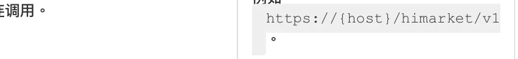

**通用检查**

- 使用 HTTPS 访问正式环境。

- 按接口页定义设置  `/himarket/v1`  路径前缀。

- 确保客户端时间与标准时间同步，避免签名因时间偏差失效。

- 妥善保管密码、Token、AccessKeySecret 和 SecurityToken，不得写入日志、截图、工单或文档。

- 上传和下载接口需要预先配置对象存储服务。

<a id="section-2-2-2"></a>

### 2.2.2. 认证与签名

本文介绍AI开放平台（HiMarket）API 的认证方式，包括开发者 JWT、管理类 OpenAPI Token、自定义AK/SK 签名及 POP 网关签名。

**开发者 JWT**

未接入 UniManager 时，开发者接口使用以下 Header：

```text
Authorization: Bearer <accessToken>
```

**管理类 OpenAPI Token**

未接入 UniManager 时，管理类接口可使用 OpenAPI Token：

```text
X-HIMARKET-OPENAPI: HIMARKET_OPENAPI
X-HIMARKET-TOKEN: <admin-openapi-token>
```

**管理类 OpenAPI 自定义 AK/SK**

未接入 UniManager 时，管理类接口也可使用自定义 AK/SK 签名。签名原文格式如下：

```text
METHOD
REQUEST_URI
CANONICAL_QUERY
TIMESTAMP
ACCESS_KEY
BODY_SHA256_HEX
```

请求包含  `X-HIMARKET-OPENAPI` 、 `X-HIMARKET-ACCESS-KEY` 、 `X-HIMARKET-TIMESTAMP`  和  `X-HIMARKET-SIGNATURE`  Header。

**POP 网关签名**

接入 UniManager 后，接口通过 POP 网关调用，使用 POP V2 AK/SK 或 STS 临时凭据签名。配置方法参见通过 POP 网关快速调用。

<a id="section-2-2-3"></a>

### 2.2.3. 错误处理与安全规范

本文介绍AI开放平台（HiMarket）API 常见错误的排查方向及敏感信息安全规范。

| 现象/错误 | 排查方向 |
| --- | --- |
| <code>InvalidVersion</code> | 检查 POP Version 是否为 <code> 2026-07-03 </code>。 |
| <code> InvalidAction </code> / <code> InvalidAction.Mismatch </code> | 检查 Action、HTTP Method 和请求路径是否与接口定义一致。 |
| <code>... is mandatory for this action</code> | 检查 Path/Query 参数名及大小写，特别是<code> FilePath </code>、<code> Version </code>。 |
| <code>UNAUTHORIZED</code> | 区分开发者 JWT、直连管理类 OpenAPI、POP AK/STS三种认证。 |
| <code> FORBIDDEN </code> / 访问被拒绝 | 确认当前 AK 或 STS 临时凭据已获得对应 Action 的访问权限。 |
| HTTP/POP 请求成功但业务失败 | 检查 HiMarket <code> code </code>、<code> message </code> 和<code> requestId </code>。 |

SecretKey、SecurityToken、开发者密码和临时下载地址属于敏感信息，不得记录或公开。写请求发生超时时，应先查询资源状态，再决定是否重试。

<a id="section-2-3"></a>

## 2.3. API参考

<a id="section-2-3-1"></a>

### 2.3.1. AI Resource Catalog 分类管理接口

<a id="section-2-3-1-1"></a>

#### 2.3.1.1. bindListings

**接口信息**

- **接口路径**： `POST /himarket/v1/open-api/v1/catalog/categories/{categoryId}/listings`

- **接口说明**：批量关联 Listing 到分类。

- **认证方式**：该接口属于管理面 OpenAPI。调用前请完成 OpenAPI 凭证配置，并按 Token 模式或 AK/SK签名模式携带认证 Header。

- **Header 示例**：Token 模式使用  `X-HIMARKET-OPENAPI: HIMARKET_OPENAPI`  与  `X-HIMARKET-TOKEN` ；AK/SK 模式使用  `X-HIMARKET-ACCESS-KEY` 、 `X-HIMARKET-TIMESTAMP`  和  `X-HIMARKET-SIGNATURE` 。

**请求参数**

| 参数名称 | 位置 | 类型 | 是否必选 | 示例 | 说明 |
| --- | --- | --- | --- | --- | --- |
| categoryId | path | <code>string</code> | 是 | <code>"category-</code><br><code>001"</code> | 分类 ID。 |
| listingIds | body | <code>array</code> | 是 | <code>["sample-</code><br><code>value"]</code> | Listing ID 列表。 |
| force | body | <code>boolean</code> | 否 | <code>false</code> | 是否强制执行。 |

**返回数据**

| 参数名称 | 类型 | 示例 | 说明 |
| --- | --- | --- | --- |
| code | <code>string</code> | <code>SUCCESS</code> | 响应码，取值为<code> SUCCESS </code> 时表示请求成功。 |
| message | <code>string</code> | <code>null</code> | 响应消息。请求成功时通常为空。 |
| data | <code>object</code> | <code>{"updated":</code><br><code>["sample-</code><br><code>value"],"skipped":</code><br><code>[{}]}</code> | 响应数据。具体结构以接口语义为准。 |
| accessDeniedDetail | <code>object</code> | <code>null</code> | 鉴权失败详情。请求成功时通常为空。 |
| requestId | <code>string</code> | <code>req-001</code> | 请求 ID，可用于问题排查和日志检索。 |
| data.updated | <code>array</code> | <code>["sample-value"]</code> | 本次成功更新的对象列表。 |
| data.skipped | <code>array</code> | <code>[{"listingId":"list</code><br><code>ing-</code><br><code>001","reason":"sampl</code><br><code>e-value"}]</code> | 本次跳过处理的对象列表。 |
| data.skipped\[\].listingId | <code>string</code> | <code>"listing-001"</code> | Listing ID。 |
| data.skipped\[\].reason | <code>string</code> | <code>"sample-value"</code> | 原因说明。 |

**示例**

**请求示例**

```http
POST /himarket/v1/open-api/v1/catalog/categories/{categoryId}/listings HTTP/1.1
Host: localhost:8080
X-HIMARKET-OPENAPI: HIMARKET_OPENAPI
X-HIMARKET-TOKEN: <admin-openapi-token>
Content-Type: application/json

{
  "listingIds": [
    "sample-value"
  ],
  "force": false
}
```

**响应示例**

```json
{
  "code": "SUCCESS",
  "message": null,
  "data": {
    "updated": [
      "sample-value"
    ],
    "skipped": [
      {}
    ]
  },
  "accessDeniedDetail": null,
  "requestId": "req-001"
}
```

<a id="section-2-3-1-2"></a>

#### 2.3.1.2. deleteCategory

**接口信息**

- **接口路径**： `DELETE /himarket/v1/open-api/v1/catalog/categories/{categoryId}`

- **接口说明**：删除市场分类。

- **认证方式**：该接口属于管理面 OpenAPI。调用前请完成 OpenAPI 凭证配置，并按 Token 模式或 AK/SK签名模式携带认证 Header。

- **Header 示例**：Token 模式使用  `X-HIMARKET-OPENAPI: HIMARKET_OPENAPI`  与  `X-HIMARKET-TOKEN` ；AK/SK 模式使用  `X-HIMARKET-ACCESS-KEY` 、 `X-HIMARKET-TIMESTAMP`  和  `X-HIMARKET-SIGNATURE` 。

**请求参数**

| 参数名称 | 位置 | 类型 | 是否必选 | 示例 | 说明 |
| --- | --- | --- | --- | --- | --- |
| categoryId | path | <code>string</code> | 是 | <code>"category</code><br><code>-001"</code> | 分类 ID。 |
| cascade | query | <code>boolean</code> | 否 | <code>false</code> | 是否级联删除分类关联。取值为 true 时，先解除该分类与Listing 的关联后再删除分类；取值为 false 时，如仍有关联 Listing 将拒绝删除。 |

**返回数据**

| 参数名称 | 类型 | 示例 | 说明 |
| --- | --- | --- | --- |
| code | <code>string</code> | <code>SUCCESS</code> | 响应码，取值为<code> SUCCESS </code> 时表示请求成功。 |
| message | <code>string</code> | <code>null</code> | 响应消息。请求成功时通常为空。 |
| data | <code>object</code> | <code>null</code> | 响应数据。无返回内容时为 <code> null </code>。 |
| accessDeniedDetail | <code>object</code> | <code>null</code> | 鉴权失败详情。请求成功时通常为空。 |
| requestId | <code>string</code> | <code>req-001</code> | 请求 ID，可用于问题排查和日志检索。 |

**示例**

**请求示例**

```http
DELETE /himarket/v1/open-api/v1/catalog/categories/{categoryId}?cascade=false HTTP/1.1
Host: localhost:8080
X-HIMARKET-OPENAPI: HIMARKET_OPENAPI
X-HIMARKET-TOKEN: <admin-openapi-token>
```

**响应示例**

```json
{
  "code": "SUCCESS",
  "message": null,
  "data": null,
  "accessDeniedDetail": null,
  "requestId": "req-001"
}
```

<a id="section-2-3-1-3"></a>

#### 2.3.1.3. getCategory

**接口信息**

- **接口路径**： `GET /himarket/v1/open-api/v1/catalog/categories/{categoryId}`

- **接口说明**：查询市场分类详情。

- **认证方式**：该接口属于管理面 OpenAPI。调用前请完成 OpenAPI 凭证配置，并按 Token 模式或 AK/SK签名模式携带认证 Header。

- **Header 示例**：Token 模式使用  `X-HIMARKET-OPENAPI: HIMARKET_OPENAPI`  与  `X-HIMARKET-TOKEN` ；AK/SK 模式使用  `X-HIMARKET-ACCESS-KEY` 、 `X-HIMARKET-TIMESTAMP`  和  `X-HIMARKET-SIGNATURE` 。

**请求参数**

| 参数名称 | 位置 | 类型 | 是否必选 | 示例 | 说明 |
| --- | --- | --- | --- | --- | --- |
| categoryId | path | <code>string</code> | 是 | <code>"category-</code><br><code>001"</code> | 分类 ID。 |

**返回数据**

| 参数名称 | 类型 | 示例 | 说明 |
| --- | --- | --- | --- |
| code | <code>string</code> | <code>SUCCESS</code> | 响应码，取值为<code> SUCCESS </code> 时表示请求成功。 |
| message | <code>string</code> | <code>null</code> | 响应消息。请求成功时通常为空。 |
| data | <code>object</code> | <code>{"categoryId":"cate</code><br><code>gory-</code><br><code>001","tenantId":"ten</code><br><code>ant-</code><br><code>001","kind":"MODEL_A</code><br><code>PI","code":"model-</code><br><code>api","name":"sample-</code><br><code>name","description":</code> <code>"</code>用于演示的资源描述<code>"} </code> | 响应数据。具体结构以接口语义为准。 |
| accessDeniedDetail | <code>object</code> | <code>null</code> | 鉴权失败详情。请求成功时通常为空。 |
| requestId | <code>string</code> | <code>req-001</code> | 请求 ID，可用于问题排查和日志检索。 |
| data.categoryId | <code>string</code> | <code>"category-001"</code> | 分类 ID。 |
| data.tenantId | <code>string</code> | <code>"tenant-001"</code> | 租户ID。 |
| data.kind | <code>string</code> | <code>"MODEL_API"</code> | 资源类型。 |
| data.code | <code>string</code> | <code>"model-api"</code> | 业务编码。 |
| data.name | <code>string</code> | <code>"sample-name"</code> | 名称。 |
| data.description | <code>string</code> | <code> "</code>用于演示的资源描述<code>" </code> | 描述信息。 |
| data.icon | <code>string</code> | <code>"sample-value"</code> | 图标地址。 |
| data.sortOrder | <code>integer&lt;int32&gt;</code> | <code>100</code> | 排序值。 |
| data.status | <code>string</code> | <code>"sample-value"</code> | 状态。 |
| data.createdBy | <code>string</code> | <code>"sample-value"</code> | 创建人。 |
| data.updatedBy | <code>string</code> | <code>"sample-value"</code> | 更新人。 |
| data.createdAt | <code>string&lt;date-</code><br><code>time&gt;</code> | <code>"2026-06-</code><br><code>22T12:00:00Z"</code> | 创建时间。 |
| data.updatedAt | <code>string&lt;date-</code><br><code>time&gt;</code> | <code>"2026-06-</code><br><code>22T12:00:00Z"</code> | 更新时间。 |
| data.listingCount | <code>integer&lt;int64&gt;</code> | <code>1</code> | Listing 数量。 |

**示例**

**请求示例**

```http
GET /himarket/v1/open-api/v1/catalog/categories/{categoryId} HTTP/1.1
Host: localhost:8080
X-HIMARKET-OPENAPI: HIMARKET_OPENAPI
X-HIMARKET-TOKEN: <admin-openapi-token>
```

**响应示例**

```json
{
  "code": "SUCCESS",
  "message": null,
  "data": {
    "categoryId": "category-001",
    "tenantId": "tenant-001",
    "kind": "MODEL_API",
    "code": "model-api",
    "name": "sample-name",
    "description": "⽤于演示的资源描述"
  },
  "accessDeniedDetail": null,
  "requestId": "req-001"
}
```

<a id="section-2-3-1-4"></a>

#### 2.3.1.4. listAssociatedListings

**接口信息**

- **接口路径**： `GET /himarket/v1/open-api/v1/catalog/categories/{categoryId}/listings`

- **接口说明**：查询分类下已关联的 Listing。

- **认证方式**：该接口属于管理面 OpenAPI。调用前请完成 OpenAPI 凭证配置，并按 Token 模式或 AK/SK签名模式携带认证 Header。

- **Header 示例**：Token 模式使用  `X-HIMARKET-OPENAPI: HIMARKET_OPENAPI`  与  `X-HIMARKET-TOKEN` ；AK/SK 模式使用  `X-HIMARKET-ACCESS-KEY` 、 `X-HIMARKET-TIMESTAMP`  和  `X-HIMARKET-SIGNATURE` 。

**请求参数**

| 参数名称 | 位置 | 类型 | 是否必选 | 示例 | 说明 |
| --- | --- | --- | --- | --- | --- |
| categoryId | path | <code>string</code> | 是 | <code>"category-</code><br><code>001"</code> | 分类 ID。 |
| tenantId | query | <code>string</code> | 否 | <code>"tenant-</code><br><code>001"</code> | 租户ID。 |
| resourceId | query | <code>string</code> | 否 | <code>"resource-</code><br><code>001"</code> | AI Resource ID。 |
| kind | query | <code>string</code> | 否 | <code>"MODEL_API"</code> | 资源类型。 |
| categoryId | query | <code>string</code> | 否 | <code>"category-</code><br><code>001"</code> | 分类 ID。当路径中未携带categoryId时，可通过此参数指定。 |
| portalId | query | <code>string</code> | 否 | <code>"portal-</code><br><code>001"</code> | 门户ID。 |
| visibility | query | <code>string</code> | 否 | <code>"PRIVATE"</code> | 可见性。可选值：<code> PRIVATE</code><code> </code>、<code> PUBLIC</code><code> </code>。 |
| publicationSta tus | query | <code>string</code> | 否 | <code>"DRAFT"</code> | 发布状态。可选值：<code> DRAFT </code>、<code> IN_REVIEW</code><code> </code>、<code> PUBLISH</code> <code>ED </code>、<code> UNPUB</code> <code>LISHED </code>、<code> R</code> <code>EJECTED </code>。 |
| keyword | query | <code>string</code> | 否 | <code>"sample-</code><br><code>value"</code> | 搜索关键词。 |
| page | query | <code>integer&lt;int</code><br><code>32&gt;</code> | 否 | <code>1</code> | 页码。 |


<table>
  <tr>
    <td>size</td>
    <td>query</td>
    <td><code>integer&lt;int</code><br><code>32&gt;</code></td>
    <td>否</td>
    <td><code>10</code></td>
    <td>每页记录数。</td>
  </tr>
  <tr>
    <td>sort</td>
    <td>query</td>
    <td><code>array</code></td>
    <td>否</td>
    <td><code>["sample-</code><br><code>value"]</code></td>
    <td>排序条件。</td>
  </tr>
</table>

**返回数据**

| 参数名称 | 类型 | 示例 | 说明 |
| --- | --- | --- | --- |
| code | <code>string</code> | <code>SUCCESS</code> | 响应码，取值为<code> SUCCESS </code> 时表示请求成功。 |
| message | <code>string</code> | <code>null</code> | 响应消息。请求成功时通常为空。 |
| data | <code>object</code> | <code>{"content":</code><br><code>[{}],"pageNumber":1,</code><br><code>"pageSize":10,"total</code><br><code>Count":1}</code> | 响应数据。具体结构以接口语义为准。 |
| accessDeniedDetail | <code>object</code> | <code>null</code> | 鉴权失败详情。请求成功时通常为空。 |
| requestId | <code>string</code> | <code>req-001</code> | 请求 ID，可用于问题排查和日志检索。 |
| data.content | <code>array</code> | <code>[{"listingId":"list</code><br><code>ing-</code><br><code>001","tenantId":"ten</code><br><code>ant-</code><br><code>001","resourceId":"r</code><br><code>esource-</code><br><code>001","defaultVersion</code><br><code>Id":"defaultVersion-</code><br><code>001","portalId":"por</code><br><code>tal-</code><br><code>001","visibility":"P</code><br><code>RIVATE"}]</code> | 分页结果列表。 |
| data.content\[\].listingId | <code>string</code> | <code>"listing-001"</code> | Listing ID。 |
| data.content\[\].tenantId | <code>string</code> | <code>"tenant-001"</code> | 租户ID。 |
| data.content\[\].resource Id | <code>string</code> | <code>"resource-001"</code> | AI Resource ID。 |
| data.content\[\].defaultV ersionId | <code>string</code> | <code>"defaultVersion-</code><br><code>001"</code> | 默认版本ID。 |
| data.content\[\].portalId | <code>string</code> | <code>"portal-001"</code> | 门户ID。 |
| data.content\[\].visibility | <code>string</code> | <code>"PRIVATE"</code> | 可见性。可选值：<code> PRIVATE </code>、<code> PUB</code> <code>LIC </code>。 |
| data.content\[\].title | <code>string</code> | <code> "</code>示例资源标题<code>" </code> | 标题。 |
| data.content\[\].summar y | <code>string</code> | <code> "</code>示例摘要<code>" </code> | 摘要信息。 |
| data.content\[\].descripti on | <code>string</code> | <code> "</code>用于演示的资源描述<code>" </code> | 描述信息。 |
| data.content\[\].icon | <code>string</code> | <code>"sample-value"</code> | 图标地址。 |
| data.content\[\].banner | <code>string</code> | <code>"sample-value"</code> | 横幅图片地址。 |
| data.content\[\].category Id | <code>string</code> | <code>"category-001"</code> | 分类 ID。 |
| data.content\[\].category | <code>object</code> | <code>{"categoryId":"cate</code><br><code>gory-</code><br><code>001","tenantId":"ten</code><br><code>ant-</code><br><code>001","kind":"MODEL_A</code><br><code>PI","code":"model-</code><br><code>api","name":"sample-</code><br><code>name","description":</code> <code>"</code>用于演示的资源描述<code>"} </code> | 分类信息。 |
| data.content\[\].category.categoryId | <code>string</code> | <code>"category-001"</code> | 分类 ID。 |
| data.content\[\].category.tenantId | <code>string</code> | <code>"tenant-001"</code> | 租户ID。 |
| data.content\[\].category.kind | <code>string</code> | <code>"MODEL_API"</code> | 资源类型。 |
| data.content\[\].category.code | <code>string</code> | <code>"model-api"</code> | 业务编码。 |
| data.content\[\].category.name | <code>string</code> | <code>"sample-name"</code> | 名称。 |
| data.content\[\].category.description | <code>string</code> | <code> "</code>用于演示的资源描述<code>" </code> | 描述信息。 |
| data.content\[\].category.icon | <code>string</code> | <code>"sample-value"</code> | 图标地址。 |
| data.content\[\].category.sortOrder | <code>integer&lt;int32&gt;</code> | <code>100</code> | 排序值。 |
| data.content\[\].category.status | <code>string</code> | <code>"sample-value"</code> | 状态。 |
| data.content\[\].category.createdBy | <code>string</code> | <code>"sample-value"</code> | 创建人。 |
| data.content\[\].category.updatedBy | <code>string</code> | <code>"sample-value"</code> | 更新人。 |
| data.content\[\].category.createdAt | <code>string&lt;date-</code><br><code>time&gt;</code> | <code>"2026-06-</code><br><code>22T12:00:00Z"</code> | 创建时间。 |
| data.content\[\].category.updatedAt | <code>string&lt;date-</code><br><code>time&gt;</code> | <code>"2026-06-</code><br><code>22T12:00:00Z"</code> | 更新时间。 |
| data.content\[\].category.listingCount | <code>integer&lt;int64&gt;</code> | <code>1</code> | Listing 数量。 |
| data.content\[\].tags | <code>array</code> | <code>["sample-value"]</code> | 标签列表。 |
| data.content\[\].pricingM ode | <code>string</code> | <code>"sample-value"</code> | 计费模式。 |
| data.content\[\].listingSt atus | <code>string</code> | <code>"sample-value"</code> | 市场条目状态。 |
| data.content\[\].publicati onStatus | <code>string</code> | <code>"DRAFT"</code> | 发布状态。可选值：<code> DRAFT </code>、<code> IN_RE</code> <code>VIEW </code>、<code> PUBLISHED </code>、<code> UNPUBLISHED </code>、<code> </code><code>REJECTED </code>。 |
| data.content\[\].created By | <code>string</code> | <code>"sample-value"</code> | 创建人。 |
| data.content\[\].publishe dBy | <code>string</code> | <code>"sample-value"</code> | 发布人 ID。 |
| data.content\[\].publishe dAt | <code>string&lt;date-</code><br><code>time&gt;</code> | <code>"2026-06-</code><br><code>22T12:00:00Z"</code> | 发布时间。 |
| data.content\[\].created At | <code>string&lt;date-</code><br><code>time&gt;</code> | <code>"2026-06-</code><br><code>22T12:00:00Z"</code> | 创建时间。 |
| data.content\[\].updated At | <code>string&lt;date-</code><br><code>time&gt;</code> | <code>"2026-06-</code><br><code>22T12:00:00Z"</code> | 更新时间。 |
| data.pageNumber | <code>integer&lt;int32&gt;</code> | <code>1</code> | 当前页码。 |
| data.pageSize | <code>integer&lt;int32&gt;</code> | <code>10</code> | 每页大小。 |
| data.totalCount | <code>integer&lt;int64&gt;</code> | <code>1</code> | 总记录数。 |


**示例**

**请求示例**

```text
GET /himarket/v1/open-api/v1/catalog/categories/{categoryId}/listings?tenantId=tenant-001&resourceId=resource-001&kind=MODEL_API&categoryId=category-001&portalId=portal-
001&visibility=PRIVATE&publicationStatus=DRAFT&keyword=sample-value HTTP/1.1
Host: localhost:8080
X-HIMARKET-OPENAPI: HIMARKET_OPENAPI
X-HIMARKET-TOKEN: <admin-openapi-token>
```

**响应示例**

```json
{
  "code": "SUCCESS",
  "message": null,
  "data": {
    "content": [
      {}
    ],
    "pageNumber": 1,
    "pageSize": 10,
    "totalCount": 1
  },
  "accessDeniedDetail": null,
  "requestId": "req-001"
}
```

<a id="section-2-3-1-5"></a>

#### 2.3.1.5. listCategories

**接口信息**

- **接口路径**： `GET /himarket/v1/open-api/v1/catalog/categories`

- **接口说明**：分页查询市场分类。

- **认证方式**：该接口属于管理面 OpenAPI。调用前请完成 OpenAPI 凭证配置，并按 Token 模式或 AK/SK签名模式携带认证 Header。

- **Header 示例**：Token 模式使用  `X-HIMARKET-OPENAPI: HIMARKET_OPENAPI`  与  `X-HIMARKET-TOKEN` ；AK/SK 模式使用  `X-HIMARKET-ACCESS-KEY` 、 `X-HIMARKET-TIMESTAMP`  和  `X-HIMARKET-SIGNATURE` 。

**请求参数**

| 参数名称 | 位置 | 类型 | 是否必选 | 示例 | 说明 |
| --- | --- | --- | --- | --- | --- |
| tenantId | query | <code>string</code> | 否 | <code>"tenant-</code><br><code>001"</code> | 租户ID。 |
| kind | query | <code>string</code> | 否 | <code>"MODEL_API"</code> | 资源类型。 |
| keyword | query | <code>string</code> | 否 | <code>"sample-</code><br><code>value"</code> | 搜索关键词。 |
| status | query | <code>string</code> | 否 | <code>"sample-</code><br><code>value"</code> | 状态。 |
| page | query | <code>integer&lt;int</code><br><code>32&gt;</code> | 否 | <code>1</code> | 页码。 |

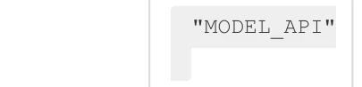

<table>
  <tr>
    <td>size</td>
    <td>query</td>
    <td><code>integer&lt;int</code><br><code>32&gt;</code></td>
    <td>否</td>
    <td><code>10</code></td>
    <td>每页记录数。</td>
  </tr>
  <tr>
    <td>sort</td>
    <td>query</td>
    <td><code>array</code></td>
    <td>否</td>
    <td><code>["sample-</code><br><code>value"]</code></td>
    <td>排序条件。</td>
  </tr>
</table>

**返回数据**

| 参数名称 | 类型 | 示例 | 说明 |
| --- | --- | --- | --- |
| code | <code>string</code> | <code>SUCCESS</code> | 响应码，取值为<code> SUCCESS </code> 时表示请求成功。 |
| message | <code>string</code> | <code>null</code> | 响应消息。请求成功时通常为空。 |
| data | <code>object</code> | <code>{"content":</code><br><code>[{"categoryId":"cate</code><br><code>gory-</code><br><code>001","tenantId":"ten</code><br><code>ant-</code><br><code>001","kind":"MODEL_A</code><br><code>PI","code":"model-</code><br><code>api","name":"sample-</code><br><code>name","description":</code> <code>"</code>用于演示的资源描述<code>","icon":"sample-</code><code>value","sortOrder":1</code><br><code>00,"status":"sample-</code><br><code>value","createdBy":"</code><br><code>sample-</code><br><code>value","updatedBy":"</code><br><code>sample-</code><br><code>value","createdAt":"</code><br><code>2026-06-</code><br><code>22T12:00:00Z","updat</code><br><code>edAt":"2026-06-</code><br><code>22T12:00:00Z","listi</code><br><code>ngCount":1}],"pageNu</code><br><code>mber":1,"pageSize":1</code><br><code>0,"totalCount":1}</code> | 响应数据。具体结构以接口语义为准。 |
| accessDeniedDetail | <code>object</code> | <code>null</code> | 鉴权失败详情。请求成功时通常为空。 |
| requestId | <code>string</code> | <code>req-001</code> | 请求 ID，可用于问题排查和日志检索。 |
| data.content | <code>array</code> | <code>[{"categoryId":"cat</code><br><code>egory-</code><br><code>001","tenantId":"ten</code><br><code>ant-</code><br><code>001","kind":"MODEL_A</code><br><code>PI","code":"model-</code><br><code>api","name":"sample-</code><br><code>name","description":</code> <code>"</code>用于演示的资源描述<code>"}] </code> | 分页结果列表。 |
| data.content\[\].category Id | <code>string</code> | <code>"category-001"</code> | 分类 ID。 |
| data.content\[\].tenantId | <code>string</code> | <code>"tenant-001"</code> | 租户ID。 |
| data.content\[\].kind | <code>string</code> | <code>"MODEL_API"</code> | 资源类型。 |
| data.content\[\].code | <code>string</code> | <code>"model-api"</code> | 业务编码。 |
| data.content\[\].name | <code>string</code> | <code>"sample-name"</code> | 名称。 |
| data.content\[\].descripti on | <code>string</code> | <code> "</code>用于演示的资源描述<code>" </code> | 描述信息。 |
| data.content\[\].icon | <code>string</code> | <code>"sample-value"</code> | 图标地址。 |
| data.content\[\].sortOrde r | <code>integer&lt;int32&gt;</code> | <code>100</code> | 排序值。 |
| data.content\[\].status | <code>string</code> | <code>"sample-value"</code> | 状态。 |
| data.content\[\].created By | <code>string</code> | <code>"sample-value"</code> | 创建人。 |
| data.content\[\].updated By | <code>string</code> | <code>"sample-value"</code> | 更新人。 |
| data.content\[\].created At | <code>string&lt;date-</code><br><code>time&gt;</code> | <code>"2026-06-</code><br><code>22T12:00:00Z"</code> | 创建时间。 |
| data.content\[\].updated At | <code>string&lt;date-</code><br><code>time&gt;</code> | <code>"2026-06-</code><br><code>22T12:00:00Z"</code> | 更新时间。 |
| data.content\[\].listingCo unt | <code>integer&lt;int64&gt;</code> | <code>1</code> | Listing 数量。 |
| data.pageNumber | <code>integer&lt;int32&gt;</code> | <code>1</code> | 当前页码。 |
| data.pageSize | <code>integer&lt;int32&gt;</code> | <code>10</code> | 每页大小。 |
| data.totalCount | <code>integer&lt;int64&gt;</code> | <code>1</code> | 总记录数。 |

**示例**

**请求示例**

```text
GET /himarket/v1/open-api/v1/catalog/categories?tenantId=tenant-
001&kind=MODEL_API&keyword=sample-value&status=sample-value&page=1&size=10&sort=sample-value HTTP/1.1
Host: localhost:8080
X-HIMARKET-OPENAPI: HIMARKET_OPENAPI
X-HIMARKET-TOKEN: <admin-openapi-token>
```

**响应示例**

```json
{
  "code": "SUCCESS",
  "message": null,
  "data": {
    "content": [
      {
        "categoryId": "category-001",
        "tenantId": "tenant-001",
        "kind": "MODEL_API",
        "code": "model-api",
        "name": "sample-name",
        "description": "⽤于演示的资源描述",
        "icon": "sample-value",
        "sortOrder": 100,
        "status": "sample-value",
        "createdBy": "sample-value",
        "updatedBy": "sample-value",
        "createdAt": "2026-06-22T12:00:00Z",
        "updatedAt": "2026-06-22T12:00:00Z",
        "listingCount": 1
      }
    ],
    "pageNumber": 1,
    "pageSize": 10,
    "totalCount": 1
  },
  "accessDeniedDetail": null,
  "requestId": "req-001"
}
```

<a id="section-2-3-1-6"></a>

#### 2.3.1.6. saveCategory

**接口信息**

- **接口路径**： `POST /himarket/v1/open-api/v1/catalog/categories`

- **接口说明**：创建或更新市场分类。

- **认证方式**：该接口属于管理面 OpenAPI。调用前请完成 OpenAPI 凭证配置，并按 Token 模式或 AK/SK签名模式携带认证 Header。

- **Header 示例**：Token 模式使用  `X-HIMARKET-OPENAPI: HIMARKET_OPENAPI`  与  `X-HIMARKET-TOKEN` ；AK/SK 模式使用  `X-HIMARKET-ACCESS-KEY` 、 `X-HIMARKET-TIMESTAMP`  和  `X-HIMARKET-SIGNATURE` 。

**请求参数**

| 参数名称 | 位置 | 类型 | 是否必选 | 示例 | 说明 |
| --- | --- | --- | --- | --- | --- |
| categoryId | body | <code>string</code> | 否 | <code>"category-</code><br><code>001"</code> | 分类 ID。 |
| kind | body | <code>string</code> | 是 | <code>"MODEL_API"</code> | 资源类型。 |
| code | body | <code>string</code> | 是 | <code>"model-</code><br><code>api"</code> | 业务编码。 |
| name | body | <code>string</code> | 是 | <code>"sample-</code><br><code>name"</code> | 名称。 |
| description | body | <code>string</code> | 否 | <code> "</code>用于演示的资源描述<code>" </code> | 描述信息。 |
| icon | body | <code>string</code> | 否 | <code>"sample-</code><br><code>value"</code> | 图标地址。 |
| sortOrder | body | <code>integer&lt;int</code><br><code>32&gt;</code> | 否 | <code>100</code> | 排序值。 |
| status | body | <code>string</code> | 否 | <code>"sample-</code><br><code>value"</code> | 状态。 |


**返回数据**

| 参数名称 | 类型 | 示例 | 说明 |
| --- | --- | --- | --- |
| code | <code>string</code> | <code>SUCCESS</code> | 响应码，取值为<code> SUCCESS </code> 时表示请求成功。 |
| message | <code>string</code> | <code>null</code> | 响应消息。请求成功时通常为空。 |

<table>
  <tr>
    <td>data</td>
    <td><code>object</code></td>
    <td><code>{"categoryId":"cate</code><br><code>gory-</code><br><code>001","tenantId":"ten</code><br><code>ant-</code><br><code>001","kind":"MODEL_A</code><br><code>PI","code":"model-</code><br><code>api","name":"sample-</code><br><code>name","description":</code> <code>"</code>用于演示的资源描述<code>"} </code></td>
    <td>响应数据。具体结构以接口语义为准。</td>
  </tr>
  <tr>
    <td>accessDeniedDetail</td>
    <td><code>object</code></td>
    <td><code>null</code></td>
    <td>鉴权失败详情。请求成功时通常为空。</td>
  </tr>
  <tr>
    <td>requestId</td>
    <td><code>string</code></td>
    <td><code>req-001</code></td>
    <td>请求 ID，可用于问题排查和日志检索。</td>
  </tr>
  <tr>
    <td>data.categoryId</td>
    <td><code>string</code></td>
    <td><code>"category-001"</code></td>
    <td>分类 ID。</td>
  </tr>
  <tr>
    <td>data.tenantId</td>
    <td><code>string</code></td>
    <td><code>"tenant-001"</code></td>
    <td>租户ID。</td>
  </tr>
  <tr>
    <td>data.kind</td>
    <td><code>string</code></td>
    <td><code>"MODEL_API"</code></td>
    <td>资源类型。</td>
  </tr>
  <tr>
    <td>data.code</td>
    <td><code>string</code></td>
    <td><code>"model-api"</code></td>
    <td>业务编码。</td>
  </tr>
  <tr>
    <td>data.name</td>
    <td><code>string</code></td>
    <td><code>"sample-name"</code></td>
    <td>名称。</td>
  </tr>
  <tr>
    <td>data.description</td>
    <td><code>string</code></td>
    <td><code> "</code>用于演示的资源描述<code>" </code></td>
    <td>描述信息。</td>
  </tr>
  <tr>
    <td>data.icon</td>
    <td><code>string</code></td>
    <td><code>"sample-value"</code></td>
    <td>图标地址。</td>
  </tr>
  <tr>
    <td>data.sortOrder</td>
    <td><code>integer&lt;int32&gt;</code></td>
    <td><code>100</code></td>
    <td>排序值。</td>
  </tr>
  <tr>
    <td>data.status</td>
    <td><code>string</code></td>
    <td><code>"sample-value"</code></td>
    <td>状态。</td>
  </tr>
  <tr>
    <td>data.createdBy</td>
    <td><code>string</code></td>
    <td><code>"sample-value"</code></td>
    <td>创建人。</td>
  </tr>
  <tr>
    <td>data.updatedBy</td>
    <td><code>string</code></td>
    <td><code>"sample-value"</code></td>
    <td>更新人。</td>
  </tr>
  <tr>
    <td>data.createdAt</td>
    <td><code>string&lt;date-</code><br><code>time&gt;</code></td>
    <td><code>"2026-06-</code><br><code>22T12:00:00Z"</code></td>
    <td>创建时间。</td>
  </tr>
  <tr>
    <td>data.updatedAt</td>
    <td><code>string&lt;date-</code><br><code>time&gt;</code></td>
    <td><code>"2026-06-</code><br><code>22T12:00:00Z"</code></td>
    <td>更新时间。</td>
  </tr>
  <tr>
    <td>data.listingCount</td>
    <td><code>integer&lt;int64&gt;</code></td>
    <td><code>1</code></td>
    <td>Listing 数量。</td>
  </tr>
</table>

**示例**

**请求示例**

```http
POST /himarket/v1/open-api/v1/catalog/categories HTTP/1.1
Host: localhost:8080
X-HIMARKET-OPENAPI: HIMARKET_OPENAPI
X-HIMARKET-TOKEN: <admin-openapi-token>
Content-Type: application/json

{
  "categoryId": "category-001",
  "kind": "MODEL_API",
  "code": "model-api",
  "name": "sample-name",
  "description": "⽤于演示的资源描述",
  "icon": "sample-value"
}
```

**响应示例**

```json
{
  "code": "SUCCESS",
  "message": null,
  "data": {
    "categoryId": "category-001",
    "tenantId": "tenant-001",
    "kind": "MODEL_API",
    "code": "model-api",
    "name": "sample-name",
    "description": "⽤于演示的资源描述"
  },
  "accessDeniedDetail": null,
  "requestId": "req-001"
}
```

<a id="section-2-3-1-7"></a>

#### 2.3.1.7. unbindListings

**接口信息**

- **接口路径**： `DELETE /himarket/v1/open-api/v1/catalog/categories/{categoryId}/listings`

- **接口说明**：批量解除分类与 Listing 的关联。

- **认证方式**：该接口属于管理面 OpenAPI。调用前请完成 OpenAPI 凭证配置，并按 Token 模式或 AK/SK签名模式携带认证 Header。

- **Header 示例**：Token 模式使用  `X-HIMARKET-OPENAPI: HIMARKET_OPENAPI`  与  `X-HIMARKET-TOKEN` ；AK/SK 模式使用  `X-HIMARKET-ACCESS-KEY` 、 `X-HIMARKET-TIMESTAMP`  和  `X-HIMARKET-SIGNATURE` 。

**请求参数**

| 参数名称 | 位置 | 类型 | 是否必选 | 示例 | 说明 |
| --- | --- | --- | --- | --- | --- |
| categoryId | path | <code>string</code> | 是 | <code>"category-</code><br><code>001"</code> | 分类 ID。 |
| listingIds | body | <code>array</code> | 是 | <code>["sample-</code><br><code>value"]</code> | Listing ID 列表。 |
| force | body | <code>boolean</code> | 否 | <code>false</code> | 是否强制执行。 |

**返回数据**

| 参数名称 | 类型 | 示例 | 说明 |
| --- | --- | --- | --- |
| code | <code>string</code> | <code>SUCCESS</code> | 响应码，取值为<code> SUCCESS </code> 时表示请求成功。 |
| message | <code>string</code> | <code>null</code> | 响应消息。请求成功时通常为空。 |
| data | <code>object</code> | <code>null</code> | 响应数据。无返回内容时为 <code> null </code>。 |
| accessDeniedDetail | <code>object</code> | <code>null</code> | 鉴权失败详情。请求成功时通常为空。 |
| requestId | <code>string</code> | <code>req-001</code> | 请求 ID，可用于问题排查和日志检索。 |

**示例**

**请求示例**

```http
DELETE /himarket/v1/open-api/v1/catalog/categories/{categoryId}/listings HTTP/1.1
Host: localhost:8080
X-HIMARKET-OPENAPI: HIMARKET_OPENAPI
X-HIMARKET-TOKEN: <admin-openapi-token>
Content-Type: application/json

{
  "listingIds": [
    "sample-value"
  ],
  "force": false
}
```

**响应示例**

```json
{
  "code": "SUCCESS",
  "message": null,
  "data": null,
  "accessDeniedDetail": null,
  "requestId": "req-001"
}
```

<a id="section-2-3-2"></a>

### 2.3.2. AI Resource Catalog 搜索接口（Public）

<a id="section-2-3-2-1"></a>

#### 2.3.2.1. getItem

**接口信息**

- **接口路径**： `GET /himarket/v1/open-api/v1/catalog/items/{listingId}`

- **接口说明**：查询已发布市场资源详情。

- **认证方式**：该接口属于开发者门户开放能力。是否需要登录态以接口实际返回为准；需要登录态时，请在请求 Header 中携带  `Authorization: Bearer <accessToken>` 。

- **Header 示例**：需要登录态的接口使用  `Authorization: Bearer <accessToken>` 。

**请求参数**

| 参数名称 | 位置 | 类型 | 是否必选 | 示例 | 说明 |
| --- | --- | --- | --- | --- | --- |
| listingId | path | <code>string</code> | 是 | <code>"listing-</code><br><code>001"</code> | Listing ID。 |
| version | query | <code>string</code> | 否 | <code>"sample-</code><br><code>value"</code> | 版本号。 |

**返回数据**

| 参数名称 | 类型 | 示例 | 说明 |
| --- | --- | --- | --- |
| code | <code>string</code> | <code>SUCCESS</code> | 响应码，取值为<code> SUCCESS </code> 时表示请求成功。 |
| message | <code>string</code> | <code>null</code> | 响应消息。请求成功时通常为空。 |
| data | <code>object</code> | <code>{"listingId":"listi</code><br><code>ng-</code><br><code>001","tenantId":"ten</code><br><code>ant-</code><br><code>001","resourceId":"r</code><br><code>esource-</code><br><code>001","defaultVersion</code><br><code>Id":"defaultVersion-</code><br><code>001","portalId":"por</code><br><code>tal-</code><br><code>001","visibility":"P</code><br><code>RIVATE"}</code> | 响应数据。具体结构以接口语义为准。 |
| accessDeniedDetail | <code>object</code> | <code>null</code> | 鉴权失败详情。请求成功时通常为空。 |
| requestId | <code>string</code> | <code>req-001</code> | 请求 ID，可用于问题排查和日志检索。 |
| data.listingId | <code>string</code> | <code>"listing-001"</code> | Listing ID。 |
| data.tenantId | <code>string</code> | <code>"tenant-001"</code> | 租户ID。 |
| data.resourceId | <code>string</code> | <code>"resource-001"</code> | AI Resource ID。 |
| data.defaultVersionId | <code>string</code> | <code>"defaultVersion-</code><br><code>001"</code> | 默认版本ID。 |
| data.portalId | <code>string</code> | <code>"portal-001"</code> | 门户ID。 |
| data.visibility | <code>string</code> | <code>"PRIVATE"</code> | 可见性。可选值：<code> PRIVATE </code>、<code> PUB</code> <code>LIC </code>。 |
| data.title | <code>string</code> | <code> "</code>示例资源标题<code>" </code> | 标题。 |
| data.summary | <code>string</code> | <code> "</code>示例摘要<code>" </code> | 摘要信息。 |
| data.description | <code>string</code> | <code> "</code>用于演示的资源描述<code>" </code> | 描述信息。 |
| data.icon | <code>string</code> | <code>"sample-value"</code> | 图标地址。 |
| data.banner | <code>string</code> | <code>"sample-value"</code> | 横幅图片地址。 |
| data.categoryId | <code>string</code> | <code>"category-001"</code> | 分类 ID。 |
| data.category | <code>object</code> | <code>{"categoryId":"cate</code><br><code>gory-</code><br><code>001","tenantId":"ten</code><br><code>ant-</code><br><code>001","kind":"MODEL_A</code><br><code>PI","code":"model-</code><br><code>api","name":"sample-</code><br><code>name","description":</code> <code>"</code>用于演示的资源描述<code>"} </code> | 分类信息。 |
| data.category.category Id | <code>string</code> | <code>"category-001"</code> | 分类 ID。 |
| data.category.tenantId | <code>string</code> | <code>"tenant-001"</code> | 租户ID。 |
| data.category.kind | <code>string</code> | <code>"MODEL_API"</code> | 资源类型。 |
| data.category.code | <code>string</code> | <code>"model-api"</code> | 业务编码。 |
| data.category.name | <code>string</code> | <code>"sample-name"</code> | 名称。 |
| data.category.descripti on | <code>string</code> | <code> "</code>用于演示的资源描述<code>" </code> | 描述信息。 |
| data.category.icon | <code>string</code> | <code>"sample-value"</code> | 图标地址。 |
| data.category.sortOrde r | <code>integer&lt;int32&gt;</code> | <code>100</code> | 排序值。 |
| data.category.status | <code>string</code> | <code>"sample-value"</code> | 状态。 |
| data.category.createdB y | <code>string</code> | <code>"sample-value"</code> | 创建人。 |
| data.category.updated By | <code>string</code> | <code>"sample-value"</code> | 更新人。 |
| data.category.createdA t | <code>string&lt;date-</code><br><code>time&gt;</code> | <code>"2026-06-</code><br><code>22T12:00:00Z"</code> | 创建时间。 |
| data.category.updated At | <code>string&lt;date-</code><br><code>time&gt;</code> | <code>"2026-06-</code><br><code>22T12:00:00Z"</code> | 更新时间。 |
| data.category.listingCo unt | <code>integer&lt;int64&gt;</code> | <code>1</code> | Listing 数量。 |
| data.tags | <code>array</code> | <code>["sample-value"]</code> | 标签列表。 |
| data.pricingMode | <code>string</code> | <code>"sample-value"</code> | 计费模式。 |
| data.sourceType | <code>string</code> | <code>"sample-value"</code> | 来源类型。 |
| data.listingStatus | <code>string</code> | <code>"sample-value"</code> | 市场条目状态。 |
| data.publicationStatus | <code>string</code> | <code>"DRAFT"</code> | 发布状态。可选值：<code> DRAFT </code>、<code> IN_RE</code> <code>VIEW </code>、<code> PUBLISHED </code>、<code> UNPUBLISHED </code>、<code> </code><code>REJECTED </code>。 |
| data.publishedAt | <code>string&lt;date-</code><br><code>time&gt;</code> | <code>"2026-06-</code><br><code>22T12:00:00Z"</code> | 发布时间。 |


<table>
  <tr>
    <td>data.resource</td>
    <td><code>object</code></td>
    <td><code>{"resourceId":"reso</code><br><code>urce-</code><br><code>001","tenantId":"ten</code><br><code>ant-</code><br><code>001","kind":"MODEL_A</code><br><code>PI","name":"sample-</code><br><code>name","displayName":</code> <code>"</code>示例资源<code>","summary":"</code>示例摘要<code>"} </code></td>
    <td>AI Resource 基础信息。</td>
  </tr>
  <tr>
    <td>data.resource.resourceI d</td>
    <td><code>string</code></td>
    <td><code>"resource-001"</code></td>
    <td>AI Resource ID。</td>
  </tr>
  <tr>
    <td>data.resource.tenantId</td>
    <td><code>string</code></td>
    <td><code>"tenant-001"</code></td>
    <td>租户ID。</td>
  </tr>
  <tr>
    <td>data.resource.kind</td>
    <td><code>string</code></td>
    <td><code>"MODEL_API"</code></td>
    <td>资源类型。</td>
  </tr>
  <tr>
    <td>data.resource.name</td>
    <td><code>string</code></td>
    <td><code>"sample-name"</code></td>
    <td>名称。</td>
  </tr>
  <tr>
    <td>data.resource.displayN ame</td>
    <td><code>string</code></td>
    <td><code> "</code>示例资源<code>" </code></td>
    <td>展示名称。</td>
  </tr>
  <tr>
    <td>data.resource.summar y</td>
    <td><code>string</code></td>
    <td><code> "</code>示例摘要<code>" </code></td>
    <td>摘要信息。</td>
  </tr>
  <tr>
    <td>data.resource.descripti on</td>
    <td><code>string</code></td>
    <td><code> "</code>用于演示的资源描述<code>" </code></td>
    <td>描述信息。</td>
  </tr>
  <tr>
    <td>data.resource.ownerTy pe</td>
    <td><code>string</code></td>
    <td><code>"USER"</code></td>
    <td>归属主体类型。可选值：<code> USER </code>、<code> APP </code>、<code> SYSTEM </code>。</td>
  </tr>
  <tr>
    <td>data.resource.ownerId</td>
    <td><code>string</code></td>
    <td><code>"owner-001"</code></td>
    <td>归属主体ID。</td>
  </tr>
  <tr>
    <td>data.resource.createdB y</td>
    <td><code>string</code></td>
    <td><code>"sample-value"</code></td>
    <td>创建人。</td>
  </tr>
  <tr>
    <td>data.resource.createdB yName</td>
    <td><code>string</code></td>
    <td><code>"demo-createdby"</code></td>
    <td>创建人名称。</td>
  </tr>
  <tr>
    <td>data.resource.icon</td>
    <td><code>string</code></td>
    <td><code>"sample-value"</code></td>
    <td>图标地址。</td>
  </tr>
  <tr>
    <td>data.resource.tags</td>
    <td><code>array</code></td>
    <td><code>["sample-value"]</code></td>
    <td>标签列表。</td>
  </tr>
  <tr>
    <td>data.resource.lifecycle Status</td>
    <td><code>string</code></td>
    <td><code>"DRAFT"</code></td>
    <td>生命周期状态。可选值：<code> DRAFT </code>、<code> ACTIV</code> <code>E </code>、<code> DEPRECATED </code>、<code> ARCHIVED </code>。</td>
  </tr>
  <tr>
    <td>data.resource.latestVer sionId</td>
    <td><code>string</code></td>
    <td><code>"latestVersion-</code><br><code>001"</code></td>
    <td>最新版本ID。</td>
  </tr>
  <tr>
    <td>data.resource.autoAppr oveSubscription</td>
    <td><code>boolean</code></td>
    <td><code>true</code></td>
    <td>是否自动批准订阅。</td>
  </tr>
  <tr>
    <td>data.resource.extras</td>
    <td><code>object</code></td>
    <td><code>{}</code></td>
    <td>扩展配置。</td>
  </tr>
  <tr>
    <td>data.resource.createdA t</td>
    <td><code>string&lt;date-</code><br><code>time&gt;</code></td>
    <td><code>"2026-06-</code><br><code>22T12:00:00Z"</code></td>
    <td>创建时间。</td>
  </tr>
  <tr>
    <td>data.resource.updated At</td>
    <td><code>string&lt;date-</code><br><code>time&gt;</code></td>
    <td><code>"2026-06-</code><br><code>22T12:00:00Z"</code></td>
    <td>更新时间。</td>
  </tr>
  <tr>
    <td>data.version</td>
    <td><code>object</code></td>
    <td><code>{"versionId":"versi</code><br><code>on-</code><br><code>001","resourceId":"r</code><br><code>esource-</code><br><code>001","version":"samp</code><br><code>le-</code><br><code>value","versionSchem</code><br><code>e":"SEMVER","status"</code><br><code>:"DRAFT","manifestId</code><br><code>":"manifest-001"}</code></td>
    <td>版本号。</td>
  </tr>
  <tr>
    <td>data.version.versionId</td>
    <td><code>string</code></td>
    <td><code>"version-001"</code></td>
    <td>版本 ID。</td>
  </tr>
  <tr>
    <td>data.version.resourceId</td>
    <td><code>string</code></td>
    <td><code>"resource-001"</code></td>
    <td>AI Resource ID。</td>
  </tr>
  <tr>
    <td>data.version.version</td>
    <td><code>string</code></td>
    <td><code>"sample-value"</code></td>
    <td>版本号。</td>
  </tr>
  <tr>
    <td>data.version.versionSc heme</td>
    <td><code>string</code></td>
    <td><code>"SEMVER"</code></td>
    <td>版本号方案。可选值：<code> SEMVER </code>、<code> TIME</code> <code>STAMP </code>、<code> REVISION </code>、<code> EXTERNAL </code>。</td>
  </tr>
  <tr>
    <td>data.version.status</td>
    <td><code>string</code></td>
    <td><code>"DRAFT"</code></td>
    <td>状态。</td>
  </tr>
  <tr>
    <td>data.version.manifestId</td>
    <td><code>string</code></td>
    <td><code>"manifest-001"</code></td>
    <td>Manifest ID。</td>
  </tr>
  <tr>
    <td>data.version.sourceBin dingId</td>
    <td><code>string</code></td>
    <td><code>"sourceBinding-</code><br><code>001"</code></td>
    <td>来源绑定ID。</td>
  </tr>
  <tr>
    <td>data.version.artifactDig est</td>
    <td><code>string</code></td>
    <td><code>"sample-value"</code></td>
    <td>制品摘要。</td>
  </tr>
  <tr>
    <td>data.version.releaseNot e</td>
    <td><code>string</code></td>
    <td><code>"sample-value"</code></td>
    <td>版本说明。</td>
  </tr>
  <tr>
    <td>data.version.createdBy</td>
    <td><code>string</code></td>
    <td><code>"sample-value"</code></td>
    <td>创建人。</td>
  </tr>
  <tr>
    <td>data.version.published At</td>
    <td><code>string&lt;date-</code><br><code>time&gt;</code></td>
    <td><code>"2026-06-</code><br><code>22T12:00:00Z"</code></td>
    <td>发布时间。</td>
  </tr>
  <tr>
    <td>data.version.createdAt</td>
    <td><code>string&lt;date-</code><br><code>time&gt;</code></td>
    <td><code>"2026-06-</code><br><code>22T12:00:00Z"</code></td>
    <td>创建时间。</td>
  </tr>
  <tr>
    <td>data.version.updatedAt</td>
    <td><code>string&lt;date-</code><br><code>time&gt;</code></td>
    <td><code>"2026-06-</code><br><code>22T12:00:00Z"</code></td>
    <td>更新时间。</td>
  </tr>
  <tr>
    <td>data.version.download Count</td>
    <td><code>integer&lt;int64&gt;</code></td>
    <td><code>1</code></td>
    <td>下载次数。</td>
  </tr>
  <tr>
    <td>data.version.isLatest</td>
    <td><code>boolean</code></td>
    <td><code>true</code></td>
    <td>是否为最新版本。</td>
  </tr>
  <tr>
    <td>data.manifest</td>
    <td><code>object</code></td>
    <td><code>{}</code></td>
    <td>资源 Manifest 内容。</td>
  </tr>
  <tr>
    <td>data.extras</td>
    <td><code>object</code></td>
    <td><code>{}</code></td>
    <td>扩展配置。</td>
  </tr>
  <tr>
    <td>data.metrics</td>
    <td><code>object</code></td>
    <td><code>{"toolCount":1,"sub</code><br><code>scriptionCount":1}</code></td>
    <td>指标信息。</td>
  </tr>
  <tr>
    <td>data.metrics.toolCount</td>
    <td><code>integer&lt;int64&gt;</code></td>
    <td><code>1</code></td>
    <td>工具数量。</td>
  </tr>
  <tr>
    <td>data.metrics.subscripti onCount</td>
    <td><code>integer&lt;int64&gt;</code></td>
    <td><code>1</code></td>
    <td>订阅数量。</td>
  </tr>
</table>

**示例**

**请求示例**

```http
GET /himarket/v1/open-api/v1/catalog/items/{listingId}?version=sample-value HTTP/1.1
Host: localhost:8080
Authorization: Bearer <accessToken>
```

**响应示例**

```json
{
  "code": "SUCCESS",
  "message": null,
  "data": {
    "listingId": "listing-001",
    "tenantId": "tenant-001",
    "resourceId": "resource-001",
    "defaultVersionId": "defaultVersion-001",
    "portalId": "portal-001",
    "visibility": "PRIVATE"
  },
  "accessDeniedDetail": null,
  "requestId": "req-001"
}
```

<a id="section-2-3-2-2"></a>

#### 2.3.2.2. search

**接口信息**

- **接口路径**： `GET /himarket/v1/open-api/v1/catalog/search`

- **接口说明**：搜索已发布市场资源。

- **认证方式**：该接口属于开发者门户开放能力。是否需要登录态以接口实际返回为准；需要登录态时，请在请求 Header 中携带  `Authorization: Bearer <accessToken>` 。

- **Header 示例**：需要登录态的接口使用  `Authorization: Bearer <accessToken>` 。

**请求参数**

| 参数名称 | 位置 | 类型 | 是否必选 | 示例 | 说明 |
| --- | --- | --- | --- | --- | --- |
| tenantId | query | <code>string</code> | 否 | <code>"tenant-</code><br><code>001"</code> | 租户ID。 |
| portalId | query | <code>string</code> | 否 | <code>"portal-</code><br><code>001"</code> | 门户ID。 |
| kind | query | <code>string</code> | 否 | <code>"MODEL_API"</code> | 资源类型。 |


<table>
  <tr>
    <td>keyword</td>
    <td>query</td>
    <td><code>string</code></td>
    <td>否</td>
    <td><code>"sample-</code><br><code>value"</code></td>
    <td>搜索关键词。</td>
  </tr>
  <tr>
    <td>categoryId</td>
    <td>query</td>
    <td><code>string</code></td>
    <td>否</td>
    <td><code>"category-</code><br><code>001"</code></td>
    <td>分类 ID。</td>
  </tr>
  <tr>
    <td>tag</td>
    <td>query</td>
    <td><code>string</code></td>
    <td>否</td>
    <td><code>"sample-</code><br><code>value"</code></td>
    <td>标签。</td>
  </tr>
  <tr>
    <td>pricingMode</td>
    <td>query</td>
    <td><code>string</code></td>
    <td>否</td>
    <td><code>"sample-</code><br><code>value"</code></td>
    <td>计费模式。</td>
  </tr>
  <tr>
    <td>sourceType</td>
    <td>query</td>
    <td><code>string</code></td>
    <td>否</td>
    <td><code>"sample-</code><br><code>value"</code></td>
    <td>来源类型。</td>
  </tr>
  <tr>
    <td>origin</td>
    <td>query</td>
    <td><code>string</code></td>
    <td>否</td>
    <td><code>"sample-</code><br><code>value"</code></td>
    <td>来源标识。</td>
  </tr>
  <tr>
    <td>excludeOrigin</td>
    <td>query</td>
    <td><code>string</code></td>
    <td>否</td>
    <td><code>"sample-</code><br><code>value"</code></td>
    <td>排除的来源标识。</td>
  </tr>
  <tr>
    <td>sortBy</td>
    <td>query</td>
    <td><code>string</code></td>
    <td>否</td>
    <td><code>"sample-</code><br><code>value"</code></td>
    <td>排序字段。</td>
  </tr>
  <tr>
    <td>page</td>
    <td>query</td>
    <td><code>integer&lt;int</code><br><code>32&gt;</code></td>
    <td>否</td>
    <td><code>1</code></td>
    <td>页码。</td>
  </tr>
  <tr>
    <td>size</td>
    <td>query</td>
    <td><code>integer&lt;int</code><br><code>32&gt;</code></td>
    <td>否</td>
    <td><code>10</code></td>
    <td>每页记录数。</td>
  </tr>
  <tr>
    <td>sort</td>
    <td>query</td>
    <td><code>array</code></td>
    <td>否</td>
    <td><code>["sample-</code><br><code>value"]</code></td>
    <td>排序条件。</td>
  </tr>
</table>

**返回数据**

| 参数名称 | 类型 | 示例 | 说明 |
| --- | --- | --- | --- |
| code | <code>string</code> | <code>SUCCESS</code> | 响应码，取值为<code> SUCCESS </code> 时表示请求成功。 |
| message | <code>string</code> | <code>null</code> | 响应消息。请求成功时通常为空。 |
| data | <code>object</code> | <code>{"content":</code><br><code>[{}],"pageNumber":1,</code><br><code>"pageSize":10,"total</code><br><code>Count":1}</code> | 响应数据。具体结构以接口语义为准。 |
| accessDeniedDetail | <code>object</code> | <code>null</code> | 鉴权失败详情。请求成功时通常为空。 |
| requestId | <code>string</code> | <code>req-001</code> | 请求 ID，可用于问题排查和日志检索。 |
| data.content | <code>array</code> | <code>[{"listingId":"list</code><br><code>ing-</code><br><code>001","tenantId":"ten</code><br><code>ant-</code><br><code>001","resourceId":"r</code><br><code>esource-</code><br><code>001","defaultVersion</code><br><code>Id":"defaultVersion-</code><br><code>001","portalId":"por</code><br><code>tal-</code><br><code>001","visibility":"P</code><br><code>RIVATE"}]</code> | 分页结果列表。 |
| data.content\[\].listingId | <code>string</code> | <code>"listing-001"</code> | Listing ID。 |
| data.content\[\].tenantId | <code>string</code> | <code>"tenant-001"</code> | 租户ID。 |
| data.content\[\].resource Id | <code>string</code> | <code>"resource-001"</code> | AI Resource ID。 |
| data.content\[\].defaultV ersionId | <code>string</code> | <code>"defaultVersion-</code><br><code>001"</code> | 默认版本ID。 |
| data.content\[\].portalId | <code>string</code> | <code>"portal-001"</code> | 门户ID。 |
| data.content\[\].visibility | <code>string</code> | <code>"PRIVATE"</code> | 可见性。可选值：<code> PRIVATE </code>、<code> PUB</code> <code>LIC </code>。 |
| data.content\[\].title | <code>string</code> | <code> "</code>示例资源标题<code>" </code> | 标题。 |
| data.content\[\].summar y | <code>string</code> | <code> "</code>示例摘要<code>" </code> | 摘要信息。 |
| data.content\[\].descripti on | <code>string</code> | <code> "</code>用于演示的资源描述<code>" </code> | 描述信息。 |
| data.content\[\].icon | <code>string</code> | <code>"sample-value"</code> | 图标地址。 |
| data.content\[\].banner | <code>string</code> | <code>"sample-value"</code> | 横幅图片地址。 |
| data.content\[\].category Id | <code>string</code> | <code>"category-001"</code> | 分类 ID。 |
| data.content\[\].category | <code>object</code> | <code>{"categoryId":"cate</code><br><code>gory-</code><br><code>001","tenantId":"ten</code><br><code>ant-</code><br><code>001","kind":"MODEL_A</code><br><code>PI","code":"model-</code><br><code>api","name":"sample-</code><br><code>name","description":</code> <code>"</code>用于演示的资源描述<code>"} </code> | 分类信息。 |
| data.content\[\].category.categoryId | <code>string</code> | <code>"category-001"</code> | 分类 ID。 |
| data.content\[\].category.tenantId | <code>string</code> | <code>"tenant-001"</code> | 租户ID。 |
| data.content\[\].category.kind | <code>string</code> | <code>"MODEL_API"</code> | 资源类型。 |
| data.content\[\].category.code | <code>string</code> | <code>"model-api"</code> | 业务编码。 |
| data.content\[\].category.name | <code>string</code> | <code>"sample-name"</code> | 名称。 |
| data.content\[\].category.description | <code>string</code> | <code> "</code>用于演示的资源描述<code>" </code> | 描述信息。 |
| data.content\[\].category.icon | <code>string</code> | <code>"sample-value"</code> | 图标地址。 |
| data.content\[\].category.sortOrder | <code>integer&lt;int32&gt;</code> | <code>100</code> | 排序值。 |
| data.content\[\].category.status | <code>string</code> | <code>"sample-value"</code> | 状态。 |
| data.content\[\].category.createdBy | <code>string</code> | <code>"sample-value"</code> | 创建人。 |
| data.content\[\].category.updatedBy | <code>string</code> | <code>"sample-value"</code> | 更新人。 |
| data.content\[\].category.createdAt | <code>string&lt;date-</code><br><code>time&gt;</code> | <code>"2026-06-</code><br><code>22T12:00:00Z"</code> | 创建时间。 |
| data.content\[\].category.updatedAt | <code>string&lt;date-</code><br><code>time&gt;</code> | <code>"2026-06-</code><br><code>22T12:00:00Z"</code> | 更新时间。 |
| data.content\[\].category.listingCount | <code>integer&lt;int64&gt;</code> | <code>1</code> | Listing 数量。 |
| data.content\[\].tags | <code>array</code> | <code>["sample-value"]</code> | 标签列表。 |
| data.content\[\].pricingM ode | <code>string</code> | <code>"sample-value"</code> | 计费模式。 |
| data.content\[\].sourceT ype | <code>string</code> | <code>"sample-value"</code> | 来源类型。 |
| data.content\[\].origin | <code>string</code> | <code>"sample-value"</code> | 来源标识。 |
| data.content\[\].listingSt atus | <code>string</code> | <code>"sample-value"</code> | 市场条目状态。 |
| data.content\[\].publicati onStatus | <code>string</code> | <code>"DRAFT"</code> | 发布状态。可选值：<code> DRAFT </code>、<code> IN_RE</code> <code>VIEW </code>、<code> PUBLISHED </code>、<code> UNPUBLISHED </code>、<code> </code><code>REJECTED </code>。 |

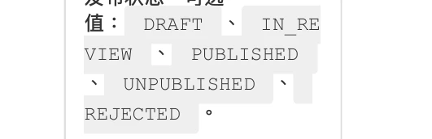

<table>
  <tr>
    <td>data.content[].publishe dAt</td>
    <td><code>string&lt;date-</code><br><code>time&gt;</code></td>
    <td><code>"2026-06-</code><br><code>22T12:00:00Z"</code></td>
    <td>发布时间。</td>
  </tr>
  <tr>
    <td>data.content[].resource</td>
    <td><code>object</code></td>
    <td><code>{"resourceId":"reso</code><br><code>urce-</code><br><code>001","tenantId":"ten</code><br><code>ant-</code><br><code>001","kind":"MODEL_A</code><br><code>PI","name":"sample-</code><br><code>name","displayName":</code> <code>"</code>示例资源<code>","summary":"</code>示例摘要<code>"} </code></td>
    <td>AI Resource 基础信息。</td>
  </tr>
  <tr>
    <td>data.content[].resource.resourceId</td>
    <td><code>string</code></td>
    <td><code>"resource-001"</code></td>
    <td>AI Resource ID。</td>
  </tr>
  <tr>
    <td>data.content[].resource.tenantId</td>
    <td><code>string</code></td>
    <td><code>"tenant-001"</code></td>
    <td>租户ID。</td>
  </tr>
  <tr>
    <td>data.content[].resource.kind</td>
    <td><code>string</code></td>
    <td><code>"MODEL_API"</code></td>
    <td>资源类型。</td>
  </tr>
  <tr>
    <td>data.content[].resource.name</td>
    <td><code>string</code></td>
    <td><code>"sample-name"</code></td>
    <td>名称。</td>
  </tr>
  <tr>
    <td>data.content[].resource.displayName</td>
    <td><code>string</code></td>
    <td><code> "</code>示例资源<code>" </code></td>
    <td>展示名称。</td>
  </tr>
  <tr>
    <td>data.content[].resource.summary</td>
    <td><code>string</code></td>
    <td><code> "</code>示例摘要<code>" </code></td>
    <td>摘要信息。</td>
  </tr>
  <tr>
    <td>data.content[].resource.description</td>
    <td><code>string</code></td>
    <td><code> "</code>用于演示的资源描述<code>" </code></td>
    <td>描述信息。</td>
  </tr>
  <tr>
    <td>data.content[].resource.ownerType</td>
    <td><code>string</code></td>
    <td><code>"USER"</code></td>
    <td>归属主体类型。可选值：<code> USER </code>、<code> APP </code>、<code> SYSTEM </code>。</td>
  </tr>
  <tr>
    <td>data.content[].resource.ownerId</td>
    <td><code>string</code></td>
    <td><code>"owner-001"</code></td>
    <td>归属主体ID。</td>
  </tr>
  <tr>
    <td>data.content[].resource.createdBy</td>
    <td><code>string</code></td>
    <td><code>"sample-value"</code></td>
    <td>创建人。</td>
  </tr>
  <tr>
    <td>data.content[].resource.createdByName</td>
    <td><code>string</code></td>
    <td><code>"demo-createdby"</code></td>
    <td>创建人名称。</td>
  </tr>
  <tr>
    <td>data.content[].resource.icon</td>
    <td><code>string</code></td>
    <td><code>"sample-value"</code></td>
    <td>图标地址。</td>
  </tr>
  <tr>
    <td>data.content[].resource.tags</td>
    <td><code>array</code></td>
    <td><code>["sample-value"]</code></td>
    <td>标签列表。</td>
  </tr>
  <tr>
    <td>data.content[].resource.lifecycleStatus</td>
    <td><code>string</code></td>
    <td><code>"DRAFT"</code></td>
    <td>生命周期状态。可选值：<code> DRAFT </code>、<code> ACTIV</code> <code>E </code>、<code> DEPRECATED </code>、<code> ARCHIVED </code>。</td>
  </tr>
  <tr>
    <td>data.content[].resource.latestVersionId</td>
    <td><code>string</code></td>
    <td><code>"latestVersion-</code><br><code>001"</code></td>
    <td>最新版本ID。</td>
  </tr>
  <tr>
    <td>data.content[].resource.autoApproveSubscripti on</td>
    <td><code>boolean</code></td>
    <td><code>true</code></td>
    <td>是否自动批准订阅。</td>
  </tr>
  <tr>
    <td>data.content[].resource.extras</td>
    <td><code>object</code></td>
    <td><code>{}</code></td>
    <td>扩展配置。</td>
  </tr>
  <tr>
    <td>data.content[].resource.createdAt</td>
    <td><code>string&lt;date-</code><br><code>time&gt;</code></td>
    <td><code>"2026-06-</code><br><code>22T12:00:00Z"</code></td>
    <td>创建时间。</td>
  </tr>
  <tr>
    <td>data.content[].resource.updatedAt</td>
    <td><code>string&lt;date-</code><br><code>time&gt;</code></td>
    <td><code>"2026-06-</code><br><code>22T12:00:00Z"</code></td>
    <td>更新时间。</td>
  </tr>
  <tr>
    <td>data.content[].version</td>
    <td><code>object</code></td>
    <td><code>{"versionId":"versi</code><br><code>on-</code><br><code>001","resourceId":"r</code><br><code>esource-</code><br><code>001","version":"samp</code><br><code>le-</code><br><code>value","versionSchem</code><br><code>e":"SEMVER","status"</code><br><code>:"DRAFT","manifestId</code><br><code>":"manifest-001"}</code></td>
    <td>版本号。</td>
  </tr>
  <tr>
    <td>data.content[].version.versionId</td>
    <td><code>string</code></td>
    <td><code>"version-001"</code></td>
    <td>版本 ID。</td>
  </tr>
  <tr>
    <td>data.content[].version.r esourceId</td>
    <td><code>string</code></td>
    <td><code>"resource-001"</code></td>
    <td>AI Resource ID。</td>
  </tr>
  <tr>
    <td>data.content[].version.version</td>
    <td><code>string</code></td>
    <td><code>"sample-value"</code></td>
    <td>版本号。</td>
  </tr>
  <tr>
    <td>data.content[].version.versionScheme</td>
    <td><code>string</code></td>
    <td><code>"SEMVER"</code></td>
    <td>版本号方案。可选值：<code> SEMVER </code>、<code> TIME</code> <code>STAMP </code>、<code> REVISION </code>、<code> EXTERNAL </code>。</td>
  </tr>
  <tr>
    <td>data.content[].version.s tatus</td>
    <td><code>string</code></td>
    <td><code>"DRAFT"</code></td>
    <td>状态。</td>
  </tr>
  <tr>
    <td>data.content[].version.manifestId</td>
    <td><code>string</code></td>
    <td><code>"manifest-001"</code></td>
    <td>Manifest ID。</td>
  </tr>
  <tr>
    <td>data.content[].version.s ourceBindingId</td>
    <td><code>string</code></td>
    <td><code>"sourceBinding-</code><br><code>001"</code></td>
    <td>来源绑定ID。</td>
  </tr>
  <tr>
    <td>data.content[].version.artifactDigest</td>
    <td><code>string</code></td>
    <td><code>"sample-value"</code></td>
    <td>制品摘要。</td>
  </tr>
  <tr>
    <td>data.content[].version.r eleaseNote</td>
    <td><code>string</code></td>
    <td><code>"sample-value"</code></td>
    <td>版本说明。</td>
  </tr>
  <tr>
    <td>data.content[].version.createdBy</td>
    <td><code>string</code></td>
    <td><code>"sample-value"</code></td>
    <td>创建人。</td>
  </tr>
  <tr>
    <td>data.content[].version.publishedAt</td>
    <td><code>string&lt;date-</code><br><code>time&gt;</code></td>
    <td><code>"2026-06-</code><br><code>22T12:00:00Z"</code></td>
    <td>发布时间。</td>
  </tr>
  <tr>
    <td>data.content[].version.createdAt</td>
    <td><code>string&lt;date-</code><br><code>time&gt;</code></td>
    <td><code>"2026-06-</code><br><code>22T12:00:00Z"</code></td>
    <td>创建时间。</td>
  </tr>
  <tr>
    <td>data.content[].version.updatedAt</td>
    <td><code>string&lt;date-</code><br><code>time&gt;</code></td>
    <td><code>"2026-06-</code><br><code>22T12:00:00Z"</code></td>
    <td>更新时间。</td>
  </tr>
  <tr>
    <td>data.content[].version.downloadCount</td>
    <td><code>integer&lt;int64&gt;</code></td>
    <td><code>1</code></td>
    <td>下载次数。</td>
  </tr>
  <tr>
    <td>data.content[].version.i sLatest</td>
    <td><code>boolean</code></td>
    <td><code>true</code></td>
    <td>是否为最新版本。</td>
  </tr>
  <tr>
    <td>data.content[].manifest</td>
    <td><code>object</code></td>
    <td><code>{}</code></td>
    <td>资源 Manifest 内容。</td>
  </tr>
  <tr>
    <td>data.content[].extras</td>
    <td><code>object</code></td>
    <td><code>{}</code></td>
    <td>扩展配置。</td>
  </tr>
  <tr>
    <td>data.content[].metrics</td>
    <td><code>object</code></td>
    <td><code>{"toolCount":1,"sub</code><br><code>scriptionCount":1}</code></td>
    <td>指标信息。</td>
  </tr>
  <tr>
    <td>data.content[].metrics.t oolCount</td>
    <td><code>integer&lt;int64&gt;</code></td>
    <td><code>1</code></td>
    <td>工具数量。</td>
  </tr>
  <tr>
    <td>data.content[].metrics.subscriptionCount</td>
    <td><code>integer&lt;int64&gt;</code></td>
    <td><code>1</code></td>
    <td>订阅数量。</td>
  </tr>
  <tr>
    <td>data.pageNumber</td>
    <td><code>integer&lt;int32&gt;</code></td>
    <td><code>1</code></td>
    <td>当前页码。</td>
  </tr>
  <tr>
    <td>data.pageSize</td>
    <td><code>integer&lt;int32&gt;</code></td>
    <td><code>10</code></td>
    <td>每页大小。</td>
  </tr>
  <tr>
    <td>data.totalCount</td>
    <td><code>integer&lt;int64&gt;</code></td>
    <td><code>1</code></td>
    <td>总记录数。</td>
  </tr>
</table>

**示例**

**请求示例**

```text
GET /himarket/v1/open-api/v1/catalog/search?tenantId=tenant-001&portalId=portal-
001&kind=MODEL_API&keyword=sample-value&categoryId=category-001&tag=sample-
value&pricingMode=sample-value&sourceType=sample-value HTTP/1.1
Host: localhost:8080
Authorization: Bearer <accessToken>
```

**响应示例**

```json
{
  "code": "SUCCESS",
  "message": null,
  "data": {
    "content": [
      {}
    ],
    "pageNumber": 1,
    "pageSize": 10,
    "totalCount": 1
  },
  "accessDeniedDetail": null,
  "requestId": "req-001"
}
```

<a id="section-2-3-3"></a>

### 2.3.3. AI Resource Catalog 管理接口（Admin）

<a id="section-2-3-3-1"></a>

#### 2.3.3.1. decideReview

**接口信息**

- **接口路径**： `POST /himarket/v1/open-api/v1/catalog/reviews/{submissionId}/decision`

- **接口说明**：审批 Listing 审核单。

- **认证方式**：该接口属于管理面 OpenAPI。调用前请完成 OpenAPI 凭证配置，并按 Token 模式或 AK/SK签名模式携带认证 Header。

- **Header 示例**：Token 模式使用  `X-HIMARKET-OPENAPI: HIMARKET_OPENAPI`  与  `X-HIMARKET-TOKEN` ；AK/SK 模式使用  `X-HIMARKET-ACCESS-KEY` 、 `X-HIMARKET-TIMESTAMP`  和  `X-HIMARKET-SIGNATURE` 。

**请求参数**

| 参数名称 | 位置 | 类型 | 是否必选 | 示例 | 说明 |
| --- | --- | --- | --- | --- | --- |
| submissionId | path | <code>string</code> | 是 | <code>"submission</code><br><code>-001"</code> | 评审提交ID。 |
| status | body | <code>string</code> | 是 | <code>"PENDING"</code> | 状态。 |
| comment | body | <code>string</code> | 否 | <code>"sample-</code><br><code>value"</code> | 审批意见或备注信息。 |

**返回数据**

| 参数名称 | 类型 | 示例 | 说明 |
| --- | --- | --- | --- |
| code | <code>string</code> | <code>SUCCESS</code> | 响应码，取值为<code> SUCCESS </code> 时表示请求成功。 |
| message | <code>string</code> | <code>null</code> | 响应消息。请求成功时通常为空。 |

<table>
  <tr>
    <td>data</td>
    <td><code>object</code></td>
    <td><code>{"submissionId":"su</code><br><code>bmission-</code><br><code>001","targetType":"s</code><br><code>ample-</code><br><code>value","targetId":"t</code><br><code>arget-</code><br><code>001","submitterId":"</code><br><code>submitter-</code><br><code>001","reviewType":"s</code><br><code>ample-</code><br><code>value","status":"PEN</code><br><code>DING"}</code></td>
    <td>响应数据。具体结构以接口语义为准。</td>
  </tr>
  <tr>
    <td>accessDeniedDetail</td>
    <td><code>object</code></td>
    <td><code>null</code></td>
    <td>鉴权失败详情。请求成功时通常为空。</td>
  </tr>
  <tr>
    <td>requestId</td>
    <td><code>string</code></td>
    <td><code>req-001</code></td>
    <td>请求 ID，可用于问题排查和日志检索。</td>
  </tr>
  <tr>
    <td>data.submissionId</td>
    <td><code>string</code></td>
    <td><code>"submission-001"</code></td>
    <td>评审提交ID。</td>
  </tr>
  <tr>
    <td>data.targetType</td>
    <td><code>string</code></td>
    <td><code>"sample-value"</code></td>
    <td>订阅目标类型。</td>
  </tr>
  <tr>
    <td>data.targetId</td>
    <td><code>string</code></td>
    <td><code>"target-001"</code></td>
    <td>目标对象 ID。</td>
  </tr>
  <tr>
    <td>data.submitterId</td>
    <td><code>string</code></td>
    <td><code>"submitter-001"</code></td>
    <td>提交人 ID。</td>
  </tr>
  <tr>
    <td>data.reviewType</td>
    <td><code>string</code></td>
    <td><code>"sample-value"</code></td>
    <td>审核类型。</td>
  </tr>
  <tr>
    <td>data.status</td>
    <td><code>string</code></td>
    <td><code>"PENDING"</code></td>
    <td>状态。</td>
  </tr>
  <tr>
    <td>data.checks</td>
    <td><code>object</code></td>
    <td><code>{}</code></td>
    <td>审核检查项列表。</td>
  </tr>
  <tr>
    <td>data.decision</td>
    <td><code>object</code></td>
    <td><code>{}</code></td>
    <td>审核决策。</td>
  </tr>
  <tr>
    <td>data.reviewerId</td>
    <td><code>string</code></td>
    <td><code>"reviewer-001"</code></td>
    <td>审核人 ID。</td>
  </tr>
  <tr>
    <td>data.submittedAt</td>
    <td><code>string&lt;date-</code><br><code>time&gt;</code></td>
    <td><code>"2026-06-</code><br><code>22T12:00:00Z"</code></td>
    <td>提交时间。</td>
  </tr>
  <tr>
    <td>data.decidedAt</td>
    <td><code>string&lt;date-</code><br><code>time&gt;</code></td>
    <td><code>"2026-06-</code><br><code>22T12:00:00Z"</code></td>
    <td>审批时间。</td>
  </tr>
</table>

**示例**

**请求示例**

```http
POST /himarket/v1/open-api/v1/catalog/reviews/{submissionId}/decision HTTP/1.1
Host: localhost:8080
X-HIMARKET-OPENAPI: HIMARKET_OPENAPI
X-HIMARKET-TOKEN: <admin-openapi-token>
Content-Type: application/json

{
  "status": "PENDING",
  "comment": "sample-value"
}
```

**响应示例**

```json
{
  "code": "SUCCESS",
  "message": null,
  "data": {
    "submissionId": "submission-001",
    "targetType": "sample-value",
    "targetId": "target-001",
    "submitterId": "submitter-001",
    "reviewType": "sample-value",
    "status": "PENDING"
  },
  "accessDeniedDetail": null,
  "requestId": "req-001"
}
```

<a id="section-2-3-3-2"></a>

#### 2.3.3.2. getCatalogReview

**接口信息**

- **接口路径**： `GET /himarket/v1/open-api/v1/catalog/reviews/{submissionId}`

- **接口说明**：查询审核单详情。

- **认证方式**：该接口属于管理面 OpenAPI。调用前请完成 OpenAPI 凭证配置，并按 Token 模式或 AK/SK签名模式携带认证 Header。

- **Header 示例**：Token 模式使用  `X-HIMARKET-OPENAPI: HIMARKET_OPENAPI`  与  `X-HIMARKET-TOKEN` ；AK/SK 模式使用  `X-HIMARKET-ACCESS-KEY` 、 `X-HIMARKET-TIMESTAMP`  和  `X-HIMARKET-SIGNATURE` 。

**请求参数**

| 参数名称 | 位置 | 类型 | 是否必选 | 示例 | 说明 |
| --- | --- | --- | --- | --- | --- |
| submissionId | path | <code>string</code> | 是 | <code>"submission</code><br><code>-001"</code> | 评审提交ID。 |

**返回数据**

| 参数名称 | 类型 | 示例 | 说明 |
| --- | --- | --- | --- |
| code | <code>string</code> | <code>SUCCESS</code> | 响应码，取值为<code> SUCCESS </code> 时表示请求成功。 |
| message | <code>string</code> | <code>null</code> | 响应消息。请求成功时通常为空。 |
| data | <code>object</code> | <code>{"review":</code><br><code>{"submissionId":"sub</code><br><code>mission-</code><br><code>001","targetType":"s</code><br><code>ample-</code><br><code>value","targetId":"t</code><br><code>arget-</code><br><code>001","submitterId":"</code><br><code>submitter-</code><br><code>001","reviewType":"s</code><br><code>ample-</code><br><code>value","status":"PEN</code><br><code>DING"},"listing":</code><br><code>{"listingId":"listin</code><br><code>g-</code><br><code>001","tenantId":"ten</code><br><code>ant-</code><br><code>001","resourceId":"r</code><br><code>esource-</code><br><code>001","defaultVersion</code><br><code>Id":"defaultVersion-</code><br><code>001","portalId":"por</code><br><code>tal-</code><br><code>001","visibility":"P</code><br><code>RIVATE"},"resource":</code><br><code>{"resourceId":"resou</code><br><code>rce-</code><br><code>001","tenantId":"ten</code><br><code>ant-</code><br><code>001","kind":"MODEL_A</code><br><code>PI","name":"sample-</code><br><code>name","displayName":</code> <code>"</code>示例资源<code>","summary":"</code>示例摘要<code>"},"defaultVersion"</code><code>:</code><br><code>{"versionId":"versio</code><br><code>n-</code><br><code>001","resourceId":"r</code><br><code>esource-</code><br><code>001","version":"samp</code><br><code>le-</code><br><code>value","versionSchem</code><br><code>e":"SEMVER","status"</code><br><code>:"DRAFT","manifestId</code><br><code>":"manifest-001"}}</code> | 响应数据。具体结构以接口语义为准。 |
| accessDeniedDetail | <code>object</code> | <code>null</code> | 鉴权失败详情。请求成功时通常为空。 |
| requestId | <code>string</code> | <code>req-001</code> | 请求 ID，可用于问题排查和日志检索。 |
| data.review | <code>object</code> | <code>{"submissionId":"su</code><br><code>bmission-</code><br><code>001","targetType":"s</code><br><code>ample-</code><br><code>value","targetId":"t</code><br><code>arget-</code><br><code>001","submitterId":"</code><br><code>submitter-</code><br><code>001","reviewType":"s</code><br><code>ample-</code><br><code>value","status":"PEN</code><br><code>DING"}</code> | 审核单信息。 |
| data.review.submission Id | <code>string</code> | <code>"submission-001"</code> | 评审提交ID。 |
| data.review.targetType | <code>string</code> | <code>"sample-value"</code> | 订阅目标类型。 |
| data.review.targetId | <code>string</code> | <code>"target-001"</code> | 目标对象 ID。 |
| data.review.submitterI d | <code>string</code> | <code>"submitter-001"</code> | 提交人 ID。 |
| data.review.reviewTyp e | <code>string</code> | <code>"sample-value"</code> | 审核类型。 |
| data.review.status | <code>string</code> | <code>"PENDING"</code> | 状态。 |
| data.review.checks | <code>object</code> | <code>{"metadata":</code><br><code>{"status":"PASSED","</code> <code>message":"</code>元数据校验通过<code>"},"security":</code> <code>{"status":"PASSED","</code> <code>message":"</code>安全校验通过<code>"}} </code> | 审核检查项列表。 |
| data.review.decision | <code>object</code> | <code>{"result":"APPROVED</code><br><code>","operator":"admin-</code><code>001","comment":"</code>审核通过<code>"} </code> | 审核决策。 |
| data.review.reviewerId | <code>string</code> | <code>"reviewer-001"</code> | 审核人 ID。 |
| data.review.submittedA t | <code>string&lt;date-</code><br><code>time&gt;</code> | <code>"2026-06-</code><br><code>22T12:00:00Z"</code> | 提交时间。 |
| data.review.decidedAt | <code>string&lt;date-</code><br><code>time&gt;</code> | <code>"2026-06-</code><br><code>22T12:00:00Z"</code> | 审批时间。 |
| data.listing | <code>object</code> | <code>{"listingId":"listi</code><br><code>ng-</code><br><code>001","tenantId":"ten</code><br><code>ant-</code><br><code>001","resourceId":"r</code><br><code>esource-</code><br><code>001","defaultVersion</code><br><code>Id":"defaultVersion-</code><br><code>001","portalId":"por</code><br><code>tal-</code><br><code>001","visibility":"P</code><br><code>RIVATE"}</code> | Listing 信息。 |
| data.listing.listingId | <code>string</code> | <code>"listing-001"</code> | Listing ID。 |
| data.listing.tenantId | <code>string</code> | <code>"tenant-001"</code> | 租户ID。 |
| data.listing.resourceId | <code>string</code> | <code>"resource-001"</code> | AI Resource ID。 |
| data.listing.defaultVersi onId | <code>string</code> | <code>"defaultVersion-</code><br><code>001"</code> | 默认版本ID。 |
| data.listing.portalId | <code>string</code> | <code>"portal-001"</code> | 门户ID。 |
| data.listing.visibility | <code>string</code> | <code>"PRIVATE"</code> | 可见性。可选值：<code> PRIVATE </code>、<code> PUB</code> <code>LIC </code>。 |
| data.listing.title | <code>string</code> | <code> "</code>示例资源标题<code>" </code> | 标题。 |
| data.listing.summary | <code>string</code> | <code> "</code>示例摘要<code>" </code> | 摘要信息。 |
| data.listing.description | <code>string</code> | <code> "</code>用于演示的资源描述<code>" </code> | 描述信息。 |
| data.listing.icon | <code>string</code> | <code>"sample-value"</code> | 图标地址。 |
| data.listing.banner | <code>string</code> | <code>"sample-value"</code> | 横幅图片地址。 |
| data.listing.categoryId | <code>string</code> | <code>"category-001"</code> | 分类 ID。 |
| data.listing.category | <code>object</code> | <code>{"categoryId":"cate</code><br><code>gory-</code><br><code>001","tenantId":"ten</code><br><code>ant-</code><br><code>001","kind":"MODEL_A</code><br><code>PI","code":"model-</code><br><code>api","name":"sample-</code><br><code>name","description":</code> <code>"</code>用于演示的资源描述<code>"} </code> | 分类信息。 |
| data.listing.category.ca tegoryId | <code>string</code> | <code>"category-001"</code> | 分类 ID。 |
| data.listing.category.te nantId | <code>string</code> | <code>"tenant-001"</code> | 租户ID。 |
| data.listing.category.ki nd | <code>string</code> | <code>"MODEL_API"</code> | 资源类型。 |
| data.listing.category.co de | <code>string</code> | <code>"model-api"</code> | 业务编码。 |
| data.listing.category.na me | <code>string</code> | <code>"sample-name"</code> | 名称。 |
| data.listing.category.de scription | <code>string</code> | <code> "</code>用于演示的资源描述<code>" </code> | 描述信息。 |
| data.listing.category.ic on | <code>string</code> | <code>"sample-value"</code> | 图标地址。 |
| data.listing.category.so rtOrder | <code>integer&lt;int32&gt;</code> | <code>100</code> | 排序值。 |
| data.listing.category.st atus | <code>string</code> | <code>"sample-value"</code> | 状态。 |
| data.listing.category.cr eatedBy | <code>string</code> | <code>"sample-value"</code> | 创建人。 |
| data.listing.category.up datedBy | <code>string</code> | <code>"sample-value"</code> | 更新人。 |
| data.listing.category.cr eatedAt | <code>string&lt;date-</code><br><code>time&gt;</code> | <code>"2026-06-</code><br><code>22T12:00:00Z"</code> | 创建时间。 |
| data.listing.category.up datedAt | <code>string&lt;date-</code><br><code>time&gt;</code> | <code>"2026-06-</code><br><code>22T12:00:00Z"</code> | 更新时间。 |
| data.listing.category.lis tingCount | <code>integer&lt;int64&gt;</code> | <code>1</code> | Listing 数量。 |
| data.listing.tags | <code>array</code> | <code>["sample-value"]</code> | 标签列表。 |
| data.listing.pricingMod e | <code>string</code> | <code>"sample-value"</code> | 计费模式。 |
| data.listing.listingStatu s | <code>string</code> | <code>"sample-value"</code> | 市场条目状态。 |
| data.listing.publication Status | <code>string</code> | <code>"DRAFT"</code> | 发布状态。可选值：<code> DRAFT </code>、<code> IN_RE</code> <code>VIEW </code>、<code> PUBLISHED </code>、<code> UNPUBLISHED </code>、<code> </code><code>REJECTED </code>。 |
| data.listing.createdBy | <code>string</code> | <code>"sample-value"</code> | 创建人。 |
| data.listing.publishedB y | <code>string</code> | <code>"sample-value"</code> | 发布人 ID。 |
| data.listing.publishedAt | <code>string&lt;date-</code><br><code>time&gt;</code> | <code>"2026-06-</code><br><code>22T12:00:00Z"</code> | 发布时间。 |
| data.listing.createdAt | <code>string&lt;date-</code><br><code>time&gt;</code> | <code>"2026-06-</code><br><code>22T12:00:00Z"</code> | 创建时间。 |
| data.listing.updatedAt | <code>string&lt;date-</code><br><code>time&gt;</code> | <code>"2026-06-</code><br><code>22T12:00:00Z"</code> | 更新时间。 |


<table>
  <tr>
    <td>data.resource</td>
    <td><code>object</code></td>
    <td><code>{"resourceId":"reso</code><br><code>urce-</code><br><code>001","tenantId":"ten</code><br><code>ant-</code><br><code>001","kind":"MODEL_A</code><br><code>PI","name":"sample-</code><br><code>name","displayName":</code> <code>"</code>示例资源<code>","summary":"</code>示例摘要<code>"} </code></td>
    <td>AI Resource 基础信息。</td>
  </tr>
  <tr>
    <td>data.resource.resourceI d</td>
    <td><code>string</code></td>
    <td><code>"resource-001"</code></td>
    <td>AI Resource ID。</td>
  </tr>
  <tr>
    <td>data.resource.tenantId</td>
    <td><code>string</code></td>
    <td><code>"tenant-001"</code></td>
    <td>租户ID。</td>
  </tr>
  <tr>
    <td>data.resource.kind</td>
    <td><code>string</code></td>
    <td><code>"MODEL_API"</code></td>
    <td>资源类型。</td>
  </tr>
  <tr>
    <td>data.resource.name</td>
    <td><code>string</code></td>
    <td><code>"sample-name"</code></td>
    <td>名称。</td>
  </tr>
  <tr>
    <td>data.resource.displayN ame</td>
    <td><code>string</code></td>
    <td><code> "</code>示例资源<code>" </code></td>
    <td>展示名称。</td>
  </tr>
  <tr>
    <td>data.resource.summar y</td>
    <td><code>string</code></td>
    <td><code> "</code>示例摘要<code>" </code></td>
    <td>摘要信息。</td>
  </tr>
  <tr>
    <td>data.resource.descripti on</td>
    <td><code>string</code></td>
    <td><code> "</code>用于演示的资源描述<code>" </code></td>
    <td>描述信息。</td>
  </tr>
  <tr>
    <td>data.resource.ownerTy pe</td>
    <td><code>string</code></td>
    <td><code>"USER"</code></td>
    <td>归属主体类型。可选值：<code> USER </code>、<code> APP </code>、<code> SYSTEM </code>。</td>
  </tr>
  <tr>
    <td>data.resource.ownerId</td>
    <td><code>string</code></td>
    <td><code>"owner-001"</code></td>
    <td>归属主体ID。</td>
  </tr>
  <tr>
    <td>data.resource.createdB y</td>
    <td><code>string</code></td>
    <td><code>"sample-value"</code></td>
    <td>创建人。</td>
  </tr>
  <tr>
    <td>data.resource.createdB yName</td>
    <td><code>string</code></td>
    <td><code>"demo-createdby"</code></td>
    <td>创建人名称。</td>
  </tr>
  <tr>
    <td>data.resource.icon</td>
    <td><code>string</code></td>
    <td><code>"sample-value"</code></td>
    <td>图标地址。</td>
  </tr>
  <tr>
    <td>data.resource.tags</td>
    <td><code>array</code></td>
    <td><code>["sample-value"]</code></td>
    <td>标签列表。</td>
  </tr>
  <tr>
    <td>data.resource.lifecycle Status</td>
    <td><code>string</code></td>
    <td><code>"DRAFT"</code></td>
    <td>生命周期状态。可选值：<code> DRAFT </code>、<code> ACTIV</code> <code>E </code>、<code> DEPRECATED </code>、<code> ARCHIVED </code>。</td>
  </tr>
  <tr>
    <td>data.resource.latestVer sionId</td>
    <td><code>string</code></td>
    <td><code>"latestVersion-</code><br><code>001"</code></td>
    <td>最新版本ID。</td>
  </tr>
  <tr>
    <td>data.resource.autoAppr oveSubscription</td>
    <td><code>boolean</code></td>
    <td><code>true</code></td>
    <td>是否自动批准订阅。</td>
  </tr>
  <tr>
    <td>data.resource.extras</td>
    <td><code>object</code></td>
    <td><code>{"displayOrder":100</code><br><code>}</code></td>
    <td>扩展配置。</td>
  </tr>
  <tr>
    <td>data.resource.createdA t</td>
    <td><code>string&lt;date-</code><br><code>time&gt;</code></td>
    <td><code>"2026-06-</code><br><code>22T12:00:00Z"</code></td>
    <td>创建时间。</td>
  </tr>
  <tr>
    <td>data.resource.updated At</td>
    <td><code>string&lt;date-</code><br><code>time&gt;</code></td>
    <td><code>"2026-06-</code><br><code>22T12:00:00Z"</code></td>
    <td>更新时间。</td>
  </tr>
  <tr>
    <td>data.defaultVersion</td>
    <td><code>object</code></td>
    <td><code>{"versionId":"versi</code><br><code>on-</code><br><code>001","resourceId":"r</code><br><code>esource-</code><br><code>001","version":"samp</code><br><code>le-</code><br><code>value","versionSchem</code><br><code>e":"SEMVER","status"</code><br><code>:"DRAFT","manifestId</code><br><code>":"manifest-001"}</code></td>
    <td>默认版本信息。</td>
  </tr>
  <tr>
    <td>data.defaultVersion.ver sionId</td>
    <td><code>string</code></td>
    <td><code>"version-001"</code></td>
    <td>版本 ID。</td>
  </tr>
  <tr>
    <td>data.defaultVersion.res ourceId</td>
    <td><code>string</code></td>
    <td><code>"resource-001"</code></td>
    <td>AI Resource ID。</td>
  </tr>
  <tr>
    <td>data.defaultVersion.ver sion</td>
    <td><code>string</code></td>
    <td><code>"sample-value"</code></td>
    <td>版本号。</td>
  </tr>
  <tr>
    <td>data.defaultVersion.ver sionScheme</td>
    <td><code>string</code></td>
    <td><code>"SEMVER"</code></td>
    <td>版本号方案。可选值：<code> SEMVER </code>、<code> TIME</code> <code>STAMP </code>、<code> REVISION </code>、<code> EXTERNAL </code>。</td>
  </tr>
  <tr>
    <td>data.defaultVersion.sta tus</td>
    <td><code>string</code></td>
    <td><code>"DRAFT"</code></td>
    <td>状态。</td>
  </tr>
  <tr>
    <td>data.defaultVersion.ma nifestId</td>
    <td><code>string</code></td>
    <td><code>"manifest-001"</code></td>
    <td>Manifest ID。</td>
  </tr>
  <tr>
    <td>data.defaultVersion.sou rceBindingId</td>
    <td><code>string</code></td>
    <td><code>"sourceBinding-</code><br><code>001"</code></td>
    <td>来源绑定ID。</td>
  </tr>
  <tr>
    <td>data.defaultVersion.arti factDigest</td>
    <td><code>string</code></td>
    <td><code>"sample-value"</code></td>
    <td>制品摘要。</td>
  </tr>
  <tr>
    <td>data.defaultVersion.rel easeNote</td>
    <td><code>string</code></td>
    <td><code>"sample-value"</code></td>
    <td>版本说明。</td>
  </tr>
  <tr>
    <td>data.defaultVersion.cre atedBy</td>
    <td><code>string</code></td>
    <td><code>"sample-value"</code></td>
    <td>创建人。</td>
  </tr>
</table>

**示例**

**请求示例**

```http
GET /himarket/v1/open-api/v1/catalog/reviews/{submissionId} HTTP/1.1
Host: localhost:8080
X-HIMARKET-OPENAPI: HIMARKET_OPENAPI
X-HIMARKET-TOKEN: <admin-openapi-token>
```

**响应示例**

```json
{
  "code": "SUCCESS",
  "message": null,
  "data": {
    "review": {
      "submissionId": "submission-001",
      "targetType": "sample-value",
      "targetId": "target-001",
      "submitterId": "submitter-001",
      "reviewType": "sample-value",
      "status": "PENDING",
      "checks": {
        "metadata": {
          "status": "PASSED",
          "message": "元数据校验通过"
        },
        "security": {
          "status": "PASSED",
          "message": "安全校验通过"
        }
      },
      "decision": {
        "result": "APPROVED",
        "operator": "admin-001",
        "comment": "审核通过"
      },
      "reviewerId": "reviewer-001",
      "submittedAt": "2026-06-22T12:00:00Z",
      "decidedAt": "2026-06-22T12:00:00Z"
    },
    "listing": {
      "listingId": "listing-001",
      "tenantId": "tenant-001",
      "resourceId": "resource-001",
      "defaultVersionId": "defaultVersion-001",
      "portalId": "portal-001",
      "visibility": "PRIVATE"
    },
    "resource": {
      "resourceId": "resource-001",
      "tenantId": "tenant-001",
      "kind": "MODEL_API",
      "name": "sample-name",
      "displayName": "示例资源",
      "summary": "示例摘要"
    },
    "defaultVersion": {
      "versionId": "version-001",
      "resourceId": "resource-001",
      "version": "sample-value",
      "versionScheme": "SEMVER",
      "status": "DRAFT",
      "manifestId": "manifest-001"
    }
  },
  "accessDeniedDetail": null,
  "requestId": "req-001"
}
```

<a id="section-2-3-3-3"></a>

#### 2.3.3.3. getListing

**接口信息**

- **接口路径**： `GET /himarket/v1/open-api/v1/catalog/listings/{listingId}`

- **接口说明**：查询市场 Listing 详情。

- **认证方式**：该接口属于管理面 OpenAPI。调用前请完成 OpenAPI 凭证配置，并按 Token 模式或 AK/SK签名模式携带认证 Header。

- **Header 示例**：Token 模式使用  `X-HIMARKET-OPENAPI: HIMARKET_OPENAPI`  与  `X-HIMARKET-TOKEN` ；AK/SK 模式使用  `X-HIMARKET-ACCESS-KEY` 、 `X-HIMARKET-TIMESTAMP`  和  `X-HIMARKET-SIGNATURE` 。

**请求参数**

| 参数名称 | 位置 | 类型 | 是否必选 | 示例 | 说明 |
| --- | --- | --- | --- | --- | --- |
| listingId | path | <code>string</code> | 是 | <code>"listing-</code><br><code>001"</code> | Listing ID。 |

**返回数据**

| 参数名称 | 类型 | 示例 | 说明 |
| --- | --- | --- | --- |
| code | <code>string</code> | <code>SUCCESS</code> | 响应码，取值为<code> SUCCESS </code> 时表示请求成功。 |
| message | <code>string</code> | <code>null</code> | 响应消息。请求成功时通常为空。 |
| data | <code>object</code> | <code>{"listingId":"listi</code><br><code>ng-</code><br><code>001","tenantId":"ten</code><br><code>ant-</code><br><code>001","resourceId":"r</code><br><code>esource-</code><br><code>001","defaultVersion</code><br><code>Id":"defaultVersion-</code><br><code>001","portalId":"por</code><br><code>tal-</code><br><code>001","visibility":"P</code><br><code>RIVATE"}</code> | 响应数据。具体结构以接口语义为准。 |
| accessDeniedDetail | <code>object</code> | <code>null</code> | 鉴权失败详情。请求成功时通常为空。 |
| requestId | <code>string</code> | <code>req-001</code> | 请求 ID，可用于问题排查和日志检索。 |
| data.listingId | <code>string</code> | <code>"listing-001"</code> | Listing ID。 |
| data.tenantId | <code>string</code> | <code>"tenant-001"</code> | 租户ID。 |
| data.resourceId | <code>string</code> | <code>"resource-001"</code> | AI Resource ID。 |
| data.defaultVersionId | <code>string</code> | <code>"defaultVersion-</code><br><code>001"</code> | 默认版本ID。 |
| data.portalId | <code>string</code> | <code>"portal-001"</code> | 门户ID。 |
| data.visibility | <code>string</code> | <code>"PRIVATE"</code> | 可见性。可选值：<code> PRIVATE </code>、<code> PUB</code> <code>LIC </code>。 |
| data.title | <code>string</code> | <code> "</code>示例资源标题<code>" </code> | 标题。 |
| data.summary | <code>string</code> | <code> "</code>示例摘要<code>" </code> | 摘要信息。 |
| data.description | <code>string</code> | <code> "</code>用于演示的资源描述<code>" </code> | 描述信息。 |
| data.icon | <code>string</code> | <code>"sample-value"</code> | 图标地址。 |
| data.banner | <code>string</code> | <code>"sample-value"</code> | 横幅图片地址。 |
| data.categoryId | <code>string</code> | <code>"category-001"</code> | 分类 ID。 |

<table>
  <tr>
    <td>data.category</td>
    <td><code>object</code></td>
    <td><code>{"categoryId":"cate</code><br><code>gory-</code><br><code>001","tenantId":"ten</code><br><code>ant-</code><br><code>001","kind":"MODEL_A</code><br><code>PI","code":"model-</code><br><code>api","name":"sample-</code><br><code>name","description":</code> <code>"</code>用于演示的资源描述<code>"} </code></td>
    <td>分类信息。</td>
  </tr>
  <tr>
    <td>data.category.category Id</td>
    <td><code>string</code></td>
    <td><code>"category-001"</code></td>
    <td>分类 ID。</td>
  </tr>
  <tr>
    <td>data.category.tenantId</td>
    <td><code>string</code></td>
    <td><code>"tenant-001"</code></td>
    <td>租户ID。</td>
  </tr>
  <tr>
    <td>data.category.kind</td>
    <td><code>string</code></td>
    <td><code>"MODEL_API"</code></td>
    <td>资源类型。</td>
  </tr>
  <tr>
    <td>data.category.code</td>
    <td><code>string</code></td>
    <td><code>"model-api"</code></td>
    <td>业务编码。</td>
  </tr>
  <tr>
    <td>data.category.name</td>
    <td><code>string</code></td>
    <td><code>"sample-name"</code></td>
    <td>名称。</td>
  </tr>
  <tr>
    <td>data.category.descripti on</td>
    <td><code>string</code></td>
    <td><code> "</code>用于演示的资源描述<code>" </code></td>
    <td>描述信息。</td>
  </tr>
  <tr>
    <td>data.category.icon</td>
    <td><code>string</code></td>
    <td><code>"sample-value"</code></td>
    <td>图标地址。</td>
  </tr>
  <tr>
    <td>data.category.sortOrde r</td>
    <td><code>integer&lt;int32&gt;</code></td>
    <td><code>100</code></td>
    <td>排序值。</td>
  </tr>
  <tr>
    <td>data.category.status</td>
    <td><code>string</code></td>
    <td><code>"sample-value"</code></td>
    <td>状态。</td>
  </tr>
  <tr>
    <td>data.category.createdB y</td>
    <td><code>string</code></td>
    <td><code>"sample-value"</code></td>
    <td>创建人。</td>
  </tr>
  <tr>
    <td>data.category.updated By</td>
    <td><code>string</code></td>
    <td><code>"sample-value"</code></td>
    <td>更新人。</td>
  </tr>
  <tr>
    <td>data.category.createdA t</td>
    <td><code>string&lt;date-</code><br><code>time&gt;</code></td>
    <td><code>"2026-06-</code><br><code>22T12:00:00Z"</code></td>
    <td>创建时间。</td>
  </tr>
  <tr>
    <td>data.category.updated At</td>
    <td><code>string&lt;date-</code><br><code>time&gt;</code></td>
    <td><code>"2026-06-</code><br><code>22T12:00:00Z"</code></td>
    <td>更新时间。</td>
  </tr>
  <tr>
    <td>data.category.listingCo unt</td>
    <td><code>integer&lt;int64&gt;</code></td>
    <td><code>1</code></td>
    <td>Listing 数量。</td>
  </tr>
  <tr>
    <td>data.tags</td>
    <td><code>array</code></td>
    <td><code>["sample-value"]</code></td>
    <td>标签列表。</td>
  </tr>
  <tr>
    <td>data.pricingMode</td>
    <td><code>string</code></td>
    <td><code>"sample-value"</code></td>
    <td>计费模式。</td>
  </tr>
  <tr>
    <td>data.listingStatus</td>
    <td><code>string</code></td>
    <td><code>"sample-value"</code></td>
    <td>市场条目状态。</td>
  </tr>
  <tr>
    <td>data.publicationStatus</td>
    <td><code>string</code></td>
    <td><code>"DRAFT"</code></td>
    <td>发布状态。可选值：<code> DRAFT </code>、<code> IN_RE</code> <code>VIEW </code>、<code> PUBLISHED </code>、<code> UNPUBLISHED </code>、<code> </code><code>REJECTED </code>。</td>
  </tr>
  <tr>
    <td>data.createdBy</td>
    <td><code>string</code></td>
    <td><code>"sample-value"</code></td>
    <td>创建人。</td>
  </tr>
  <tr>
    <td>data.publishedBy</td>
    <td><code>string</code></td>
    <td><code>"sample-value"</code></td>
    <td>发布人 ID。</td>
  </tr>
  <tr>
    <td>data.publishedAt</td>
    <td><code>string&lt;date-</code><br><code>time&gt;</code></td>
    <td><code>"2026-06-</code><br><code>22T12:00:00Z"</code></td>
    <td>发布时间。</td>
  </tr>
  <tr>
    <td>data.createdAt</td>
    <td><code>string&lt;date-</code><br><code>time&gt;</code></td>
    <td><code>"2026-06-</code><br><code>22T12:00:00Z"</code></td>
    <td>创建时间。</td>
  </tr>
  <tr>
    <td>data.updatedAt</td>
    <td><code>string&lt;date-</code><br><code>time&gt;</code></td>
    <td><code>"2026-06-</code><br><code>22T12:00:00Z"</code></td>
    <td>更新时间。</td>
  </tr>
</table>


**示例**

**请求示例**

```http
GET /himarket/v1/open-api/v1/catalog/listings/{listingId} HTTP/1.1
Host: localhost:8080
X-HIMARKET-OPENAPI: HIMARKET_OPENAPI
X-HIMARKET-TOKEN: <admin-openapi-token>
```

**响应示例**

```json
{
  "code": "SUCCESS",
  "message": null,
  "data": {
    "listingId": "listing-001",
    "tenantId": "tenant-001",
    "resourceId": "resource-001",
    "defaultVersionId": "defaultVersion-001",
    "portalId": "portal-001",
    "visibility": "PRIVATE"
  },
  "accessDeniedDetail": null,
  "requestId": "req-001"
}
```

<a id="section-2-3-3-4"></a>

#### 2.3.3.4. getReviewCheck

**接口信息**

- **接口路径**： `GET /himarket/v1/open-api/v1/catalog/reviews/{submissionId}/checks/{checkId}`

- **接口说明**：查询审核单单项检查详情。

- **认证方式**：该接口属于管理面 OpenAPI。调用前请完成 OpenAPI 凭证配置，并按 Token 模式或 AK/SK签名模式携带认证 Header。

- **Header 示例**：Token 模式使用  `X-HIMARKET-OPENAPI: HIMARKET_OPENAPI`  与  `X-HIMARKET-TOKEN` ；AK/SK 模式使用  `X-HIMARKET-ACCESS-KEY` 、 `X-HIMARKET-TIMESTAMP`  和  `X-HIMARKET-SIGNATURE` 。

**请求参数**

| 参数名称 | 位置 | 类型 | 是否必选 | 示例 | 说明 |
| --- | --- | --- | --- | --- | --- |
| submissionId | path | <code>string</code> | 是 | <code>"submission</code><br><code>-001"</code> | 评审提交ID。 |
| checkId | path | <code>string</code> | 是 | <code>"check-</code><br><code>001"</code> | 检查项ID。 |

**返回数据**

| 参数名称 | 类型 | 示例 | 说明 |
| --- | --- | --- | --- |
| code | <code>string</code> | <code>SUCCESS</code> | 响应码，取值为<code> SUCCESS </code> 时表示请求成功。 |
| message | <code>string</code> | <code>null</code> | 响应消息。请求成功时通常为空。 |
| data | <code>object</code> | <code>{}</code> | 响应数据。具体结构以接口语义为准。 |
| accessDeniedDetail | <code>object</code> | <code>null</code> | 鉴权失败详情。请求成功时通常为空。 |
| requestId | <code>string</code> | <code>req-001</code> | 请求 ID，可用于问题排查和日志检索。 |

**示例**

**请求示例**

```http
GET /himarket/v1/open-api/v1/catalog/reviews/{submissionId}/checks/{checkId} HTTP/1.1
Host: localhost:8080
X-HIMARKET-OPENAPI: HIMARKET_OPENAPI
X-HIMARKET-TOKEN: <admin-openapi-token>
```

**响应示例**

```json
{
  "code": "SUCCESS",
  "message": null,
  "data": {},
  "accessDeniedDetail": null,
  "requestId": "req-001"
}
```

<a id="section-2-3-3-5"></a>

#### 2.3.3.5. getReviewChecks

**接口信息**

- **接口路径**： `GET /himarket/v1/open-api/v1/catalog/reviews/{submissionId}/checks`

- **接口说明**：查询审核单检查结果。

- **认证方式**：该接口属于管理面 OpenAPI。调用前请完成 OpenAPI 凭证配置，并按 Token 模式或 AK/SK签名模式携带认证 Header。

- **Header 示例**：Token 模式使用  `X-HIMARKET-OPENAPI: HIMARKET_OPENAPI`  与  `X-HIMARKET-TOKEN` ；AK/SK 模式使用  `X-HIMARKET-ACCESS-KEY` 、 `X-HIMARKET-TIMESTAMP`  和  `X-HIMARKET-SIGNATURE` 。

**请求参数**

| 参数名称 | 位置 | 类型 | 是否必选 | 示例 | 说明 |
| --- | --- | --- | --- | --- | --- |
| submissionId | path | <code>string</code> | 是 | <code>"submission</code><br><code>-001"</code> | 评审提交ID。 |

**返回数据**

| 参数名称 | 类型 | 示例 | 说明 |
| --- | --- | --- | --- |
| code | <code>string</code> | <code>SUCCESS</code> | 响应码，取值为<code> SUCCESS </code> 时表示请求成功。 |
| message | <code>string</code> | <code>null</code> | 响应消息。请求成功时通常为空。 |
| data | <code>object</code> | <code>{}</code> | 响应数据。具体结构以接口语义为准。 |
| accessDeniedDetail | <code>object</code> | <code>null</code> | 鉴权失败详情。请求成功时通常为空。 |
| requestId | <code>string</code> | <code>req-001</code> | 请求 ID，可用于问题排查和日志检索。 |

**示例**

**请求示例**

```http
GET /himarket/v1/open-api/v1/catalog/reviews/{submissionId}/checks HTTP/1.1
Host: localhost:8080
X-HIMARKET-OPENAPI: HIMARKET_OPENAPI
X-HIMARKET-TOKEN: <admin-openapi-token>
```

**响应示例**

```json
{
  "code": "SUCCESS",
  "message": null,
  "data": {},
  "accessDeniedDetail": null,
  "requestId": "req-001"
}
```

<a id="section-2-3-3-6"></a>

#### 2.3.3.6. listCatalogReviews

**接口信息**

- **接口路径**： `GET /himarket/v1/open-api/v1/catalog/reviews`

- **接口说明**：分页查询审核工作台。

- **认证方式**：该接口属于管理面 OpenAPI。调用前请完成 OpenAPI 凭证配置，并按 Token 模式或 AK/SK签名模式携带认证 Header。

- **Header 示例**：Token 模式使用  `X-HIMARKET-OPENAPI: HIMARKET_OPENAPI`  与  `X-HIMARKET-TOKEN` ；AK/SK 模式使用  `X-HIMARKET-ACCESS-KEY` 、 `X-HIMARKET-TIMESTAMP`  和  `X-HIMARKET-SIGNATURE` 。

**请求参数**

| 参数名称 | 位置 | 类型 | 是否必选 | 示例 | 说明 |
| --- | --- | --- | --- | --- | --- |
| tenantId | query | <code>string</code> | 否 | <code>"tenant-</code><br><code>001"</code> | 租户ID。 |
| resourceId | query | <code>string</code> | 否 | <code>"resource-</code><br><code>001"</code> | AI Resource ID。 |
| listingId | query | <code>string</code> | 否 | <code>"listing-</code><br><code>001"</code> | Listing ID。 |
| targetType | query | <code>string</code> | 否 | <code>"sample-</code><br><code>value"</code> | 订阅目标类型。 |
| targetId | query | <code>string</code> | 否 | <code>"target-</code><br><code>001"</code> | 目标对象 ID。 |
| reviewType | query | <code>string</code> | 否 | <code>"sample-</code><br><code>value"</code> | 审核类型。 |
| status | query | <code>string</code> | 否 | <code>"PENDING"</code> | 状态。 |
| pendingOnly | query | <code>boolean</code> | 否 | <code>false</code> | pendingOnly字段。 |
| submitterId | query | <code>string</code> | 否 | <code>"submitter-</code><br><code>001"</code> | 提交人 ID。 |
| reviewerId | query | <code>string</code> | 否 | <code>"reviewer-</code><br><code>001"</code> | 审核人 ID。 |
| page | query | <code>integer&lt;int</code><br><code>32&gt;</code> | 否 | <code>1</code> | 页码。 |
| size | query | <code>integer&lt;int</code><br><code>32&gt;</code> | 否 | <code>10</code> | 每页记录数。 |
| sort | query | <code>array</code> | 否 | <code>["sample-</code><br><code>value"]</code> | 排序条件。 |

**返回数据**

| 参数名称 | 类型 | 示例 | 说明 |
| --- | --- | --- | --- |
| code | <code>string</code> | <code>SUCCESS</code> | 响应码，取值为<code> SUCCESS </code> 时表示请求成功。 |
| message | <code>string</code> | <code>null</code> | 响应消息。请求成功时通常为空。 |
| data | <code>object</code> | <code>{"content":</code><br><code>[{}],"pageNumber":1,</code><br><code>"pageSize":10,"total</code><br><code>Count":1}</code> | 响应数据。具体结构以接口语义为准。 |
| accessDeniedDetail | <code>object</code> | <code>null</code> | 鉴权失败详情。请求成功时通常为空。 |
| requestId | <code>string</code> | <code>req-001</code> | 请求 ID，可用于问题排查和日志检索。 |
| data.content | <code>array</code> | <code>[{"review":</code><br><code>{},"listing":</code><br><code>{},"resource":</code><br><code>{},"defaultVersion":</code><br><code>{}}]</code> | 分页结果列表。 |

<table>
  <tr>
    <td>data.content[].review</td>
    <td><code>object</code></td>
    <td><code>{"submissionId":"su</code><br><code>bmission-</code><br><code>001","targetType":"s</code><br><code>ample-</code><br><code>value","targetId":"t</code><br><code>arget-</code><br><code>001","submitterId":"</code><br><code>submitter-</code><br><code>001","reviewType":"s</code><br><code>ample-</code><br><code>value","status":"PEN</code><br><code>DING"}</code></td>
    <td>审核单信息。</td>
  </tr>
  <tr>
    <td>data.content[].review.s ubmissionId</td>
    <td><code>string</code></td>
    <td><code>"submission-001"</code></td>
    <td>评审提交ID。</td>
  </tr>
  <tr>
    <td>data.content[].review.t argetType</td>
    <td><code>string</code></td>
    <td><code>"sample-value"</code></td>
    <td>订阅目标类型。</td>
  </tr>
  <tr>
    <td>data.content[].review.t argetId</td>
    <td><code>string</code></td>
    <td><code>"target-001"</code></td>
    <td>目标对象 ID。</td>
  </tr>
  <tr>
    <td>data.content[].review.s ubmitterId</td>
    <td><code>string</code></td>
    <td><code>"submitter-001"</code></td>
    <td>提交人 ID。</td>
  </tr>
  <tr>
    <td>data.content[].review.r eviewType</td>
    <td><code>string</code></td>
    <td><code>"sample-value"</code></td>
    <td>审核类型。</td>
  </tr>
  <tr>
    <td>data.content[].review.st atus</td>
    <td><code>string</code></td>
    <td><code>"PENDING"</code></td>
    <td>状态。</td>
  </tr>
  <tr>
    <td>data.content[].review.c hecks</td>
    <td><code>object</code></td>
    <td><code>{}</code></td>
    <td>审核检查项列表。</td>
  </tr>
  <tr>
    <td>data.content[].review.d ecision</td>
    <td><code>object</code></td>
    <td><code>{}</code></td>
    <td>审核决策。</td>
  </tr>
  <tr>
    <td>data.content[].review.r eviewerId</td>
    <td><code>string</code></td>
    <td><code>"reviewer-001"</code></td>
    <td>审核人 ID。</td>
  </tr>
  <tr>
    <td>data.content[].review.s ubmittedAt</td>
    <td><code>string&lt;date-</code><br><code>time&gt;</code></td>
    <td><code>"2026-06-</code><br><code>22T12:00:00Z"</code></td>
    <td>提交时间。</td>
  </tr>
  <tr>
    <td>data.content[].review.d ecidedAt</td>
    <td><code>string&lt;date-</code><br><code>time&gt;</code></td>
    <td><code>"2026-06-</code><br><code>22T12:00:00Z"</code></td>
    <td>审批时间。</td>
  </tr>
  <tr>
    <td>data.content[].listing</td>
    <td><code>object</code></td>
    <td><code>{"listingId":"listi</code><br><code>ng-</code><br><code>001","tenantId":"ten</code><br><code>ant-</code><br><code>001","resourceId":"r</code><br><code>esource-</code><br><code>001","defaultVersion</code><br><code>Id":"defaultVersion-</code><br><code>001","portalId":"por</code><br><code>tal-</code><br><code>001","visibility":"P</code><br><code>RIVATE"}</code></td>
    <td>Listing 信息。</td>
  </tr>
  <tr>
    <td>data.content[].listing.lis tingId</td>
    <td><code>string</code></td>
    <td><code>"listing-001"</code></td>
    <td>Listing ID。</td>
  </tr>
  <tr>
    <td>data.content[].listing.te nantId</td>
    <td><code>string</code></td>
    <td><code>"tenant-001"</code></td>
    <td>租户ID。</td>
  </tr>
  <tr>
    <td>data.content[].listing.re sourceId</td>
    <td><code>string</code></td>
    <td><code>"resource-001"</code></td>
    <td>AI Resource ID。</td>
  </tr>
  <tr>
    <td>data.content[].listing.d efaultVersionId</td>
    <td><code>string</code></td>
    <td><code>"defaultVersion-</code><br><code>001"</code></td>
    <td>默认版本ID。</td>
  </tr>
  <tr>
    <td>data.content[].listing.p ortalId</td>
    <td><code>string</code></td>
    <td><code>"portal-001"</code></td>
    <td>门户ID。</td>
  </tr>
  <tr>
    <td>data.content[].listing.vi sibility</td>
    <td><code>string</code></td>
    <td><code>"PRIVATE"</code></td>
    <td>可见性。可选值：<code> PRIVATE </code>、<code> PUB</code> <code>LIC </code>。</td>
  </tr>
  <tr>
    <td>data.content[].listing.tit le</td>
    <td><code>string</code></td>
    <td><code> "</code>示例资源标题<code>" </code></td>
    <td>标题。</td>
  </tr>
  <tr>
    <td>data.content[].listing.su mmary</td>
    <td><code>string</code></td>
    <td><code> "</code>示例摘要<code>" </code></td>
    <td>摘要信息。</td>
  </tr>
  <tr>
    <td>data.content[].listing.d escription</td>
    <td><code>string</code></td>
    <td><code> "</code>用于演示的资源描述<code>" </code></td>
    <td>描述信息。</td>
  </tr>
  <tr>
    <td>data.content[].listing.ic on</td>
    <td><code>string</code></td>
    <td><code>"sample-value"</code></td>
    <td>图标地址。</td>
  </tr>
  <tr>
    <td>data.content[].listing.b anner</td>
    <td><code>string</code></td>
    <td><code>"sample-value"</code></td>
    <td>横幅图片地址。</td>
  </tr>
  <tr>
    <td>data.content[].listing.ca tegoryId</td>
    <td><code>string</code></td>
    <td><code>"category-001"</code></td>
    <td>分类 ID。</td>
  </tr>
  <tr>
    <td>data.content[].listing.ca tegory</td>
    <td><code>object</code></td>
    <td><code>{"categoryId":"cate</code><br><code>gory-</code><br><code>001","tenantId":"ten</code><br><code>ant-</code><br><code>001","kind":"MODEL_A</code><br><code>PI","code":"model-</code><br><code>api","name":"sample-</code><br><code>name","description":</code> <code>"</code>用于演示的资源描述<code>"} </code></td>
    <td>分类信息。</td>
  </tr>
  <tr>
    <td>data.content[].listing.ca tegory.categoryId</td>
    <td><code>string</code></td>
    <td><code>"category-001"</code></td>
    <td>分类 ID。</td>
  </tr>
  <tr>
    <td>data.content[].listing.ca tegory.tenantId</td>
    <td><code>string</code></td>
    <td><code>"tenant-001"</code></td>
    <td>租户ID。</td>
  </tr>
  <tr>
    <td>data.content[].listing.ca tegory.kind</td>
    <td><code>string</code></td>
    <td><code>"MODEL_API"</code></td>
    <td>资源类型。</td>
  </tr>
  <tr>
    <td>data.content[].listing.ca tegory.code</td>
    <td><code>string</code></td>
    <td><code>"model-api"</code></td>
    <td>业务编码。</td>
  </tr>
  <tr>
    <td>data.content[].listing.ca tegory.name</td>
    <td><code>string</code></td>
    <td><code>"sample-name"</code></td>
    <td>名称。</td>
  </tr>
  <tr>
    <td>data.content[].listing.ca tegory.description</td>
    <td><code>string</code></td>
    <td><code> "</code>用于演示的资源描述<code>" </code></td>
    <td>描述信息。</td>
  </tr>
  <tr>
    <td>data.content[].listing.ca tegory.icon</td>
    <td><code>string</code></td>
    <td><code>"sample-value"</code></td>
    <td>图标地址。</td>
  </tr>
  <tr>
    <td>data.content[].listing.ca tegory.sortOrder</td>
    <td><code>integer&lt;int32&gt;</code></td>
    <td><code>100</code></td>
    <td>排序值。</td>
  </tr>
  <tr>
    <td>data.content[].listing.ca tegory.status</td>
    <td><code>string</code></td>
    <td><code>"sample-value"</code></td>
    <td>状态。</td>
  </tr>
  <tr>
    <td>data.content[].listing.ca tegory.createdBy</td>
    <td><code>string</code></td>
    <td><code>"sample-value"</code></td>
    <td>创建人。</td>
  </tr>
  <tr>
    <td>data.content[].listing.ca tegory.updatedBy</td>
    <td><code>string</code></td>
    <td><code>"sample-value"</code></td>
    <td>更新人。</td>
  </tr>
  <tr>
    <td>data.content[].listing.ca tegory.createdAt</td>
    <td><code>string&lt;date-</code><br><code>time&gt;</code></td>
    <td><code>"2026-06-</code><br><code>22T12:00:00Z"</code></td>
    <td>创建时间。</td>
  </tr>
  <tr>
    <td>data.content[].listing.ca tegory.updatedAt</td>
    <td><code>string&lt;date-</code><br><code>time&gt;</code></td>
    <td><code>"2026-06-</code><br><code>22T12:00:00Z"</code></td>
    <td>更新时间。</td>
  </tr>
  <tr>
    <td>data.content[].listing.ca tegory.listingCount</td>
    <td><code>integer&lt;int64&gt;</code></td>
    <td><code>1</code></td>
    <td>Listing 数量。</td>
  </tr>
  <tr>
    <td>data.content[].listing.ta gs</td>
    <td><code>array</code></td>
    <td><code>["sample-value"]</code></td>
    <td>标签列表。</td>
  </tr>
  <tr>
    <td>data.content[].listing.pr icingMode</td>
    <td><code>string</code></td>
    <td><code>"sample-value"</code></td>
    <td>计费模式。</td>
  </tr>
  <tr>
    <td>data.content[].listing.lis tingStatus</td>
    <td><code>string</code></td>
    <td><code>"sample-value"</code></td>
    <td>市场条目状态。</td>
  </tr>
  <tr>
    <td>data.content[].listing.p ublicationStatus</td>
    <td><code>string</code></td>
    <td><code>"DRAFT"</code></td>
    <td>发布状态。可选值：<code> DRAFT </code>、<code> IN_RE</code> <code>VIEW </code>、<code> PUBLISHED </code>、<code> UNPUBLISHED </code>、<code> </code><code>REJECTED </code>。</td>
  </tr>
  <tr>
    <td>data.content[].listing.cr eatedBy</td>
    <td><code>string</code></td>
    <td><code>"sample-value"</code></td>
    <td>创建人。</td>
  </tr>
  <tr>
    <td>data.content[].listing.p ublishedBy</td>
    <td><code>string</code></td>
    <td><code>"sample-value"</code></td>
    <td>发布人 ID。</td>
  </tr>
  <tr>
    <td>data.content[].listing.p ublishedAt</td>
    <td><code>string&lt;date-</code><br><code>time&gt;</code></td>
    <td><code>"2026-06-</code><br><code>22T12:00:00Z"</code></td>
    <td>发布时间。</td>
  </tr>
</table>


<table>
  <tr>
    <td>data.content[].listing.cr eatedAt</td>
    <td><code>string&lt;date-</code><br><code>time&gt;</code></td>
    <td><code>"2026-06-</code><br><code>22T12:00:00Z"</code></td>
    <td>创建时间。</td>
  </tr>
  <tr>
    <td>data.content[].listing.u pdatedAt</td>
    <td><code>string&lt;date-</code><br><code>time&gt;</code></td>
    <td><code>"2026-06-</code><br><code>22T12:00:00Z"</code></td>
    <td>更新时间。</td>
  </tr>
  <tr>
    <td>data.content[].resource</td>
    <td><code>object</code></td>
    <td><code>{"resourceId":"reso</code><br><code>urce-</code><br><code>001","tenantId":"ten</code><br><code>ant-</code><br><code>001","kind":"MODEL_A</code><br><code>PI","name":"sample-</code><br><code>name","displayName":</code> <code>"</code>示例资源<code>","summary":"</code>示例摘要<code>"} </code></td>
    <td>AI Resource 基础信息。</td>
  </tr>
  <tr>
    <td>data.content[].resource.resourceId</td>
    <td><code>string</code></td>
    <td><code>"resource-001"</code></td>
    <td>AI Resource ID。</td>
  </tr>
  <tr>
    <td>data.content[].resource.tenantId</td>
    <td><code>string</code></td>
    <td><code>"tenant-001"</code></td>
    <td>租户ID。</td>
  </tr>
  <tr>
    <td>data.content[].resource.kind</td>
    <td><code>string</code></td>
    <td><code>"MODEL_API"</code></td>
    <td>资源类型。</td>
  </tr>
  <tr>
    <td>data.content[].resource.name</td>
    <td><code>string</code></td>
    <td><code>"sample-name"</code></td>
    <td>名称。</td>
  </tr>
  <tr>
    <td>data.content[].resource.displayName</td>
    <td><code>string</code></td>
    <td><code> "</code>示例资源<code>" </code></td>
    <td>展示名称。</td>
  </tr>
  <tr>
    <td>data.content[].resource.summary</td>
    <td><code>string</code></td>
    <td><code> "</code>示例摘要<code>" </code></td>
    <td>摘要信息。</td>
  </tr>
  <tr>
    <td>data.content[].resource.description</td>
    <td><code>string</code></td>
    <td><code> "</code>用于演示的资源描述<code>" </code></td>
    <td>描述信息。</td>
  </tr>
  <tr>
    <td>data.content[].resource.ownerType</td>
    <td><code>string</code></td>
    <td><code>"USER"</code></td>
    <td>归属主体类型。可选值：<code> USER </code>、<code> APP </code>、<code> SYSTEM </code>。</td>
  </tr>
  <tr>
    <td>data.content[].resource.ownerId</td>
    <td><code>string</code></td>
    <td><code>"owner-001"</code></td>
    <td>归属主体ID。</td>
  </tr>
  <tr>
    <td>data.content[].resource.createdBy</td>
    <td><code>string</code></td>
    <td><code>"sample-value"</code></td>
    <td>创建人。</td>
  </tr>
  <tr>
    <td>data.content[].resource.createdByName</td>
    <td><code>string</code></td>
    <td><code>"demo-createdby"</code></td>
    <td>创建人名称。</td>
  </tr>
  <tr>
    <td>data.content[].resource.icon</td>
    <td><code>string</code></td>
    <td><code>"sample-value"</code></td>
    <td>图标地址。</td>
  </tr>
  <tr>
    <td>data.content[].resource.tags</td>
    <td><code>array</code></td>
    <td><code>["sample-value"]</code></td>
    <td>标签列表。</td>
  </tr>
  <tr>
    <td>data.content[].resource.lifecycleStatus</td>
    <td><code>string</code></td>
    <td><code>"DRAFT"</code></td>
    <td>生命周期状态。可选值：<code> DRAFT </code>、<code> ACTIV</code> <code>E </code>、<code> DEPRECATED </code>、<code> ARCHIVED </code>。</td>
  </tr>
  <tr>
    <td>data.content[].resource.latestVersionId</td>
    <td><code>string</code></td>
    <td><code>"latestVersion-</code><br><code>001"</code></td>
    <td>最新版本ID。</td>
  </tr>
  <tr>
    <td>data.content[].resource.autoApproveSubscripti on</td>
    <td><code>boolean</code></td>
    <td><code>true</code></td>
    <td>是否自动批准订阅。</td>
  </tr>
  <tr>
    <td>data.content[].resource.extras</td>
    <td><code>object</code></td>
    <td><code>{}</code></td>
    <td>扩展配置。</td>
  </tr>
  <tr>
    <td>data.content[].resource.createdAt</td>
    <td><code>string&lt;date-</code><br><code>time&gt;</code></td>
    <td><code>"2026-06-</code><br><code>22T12:00:00Z"</code></td>
    <td>创建时间。</td>
  </tr>
  <tr>
    <td>data.content[].resource.updatedAt</td>
    <td><code>string&lt;date-</code><br><code>time&gt;</code></td>
    <td><code>"2026-06-</code><br><code>22T12:00:00Z"</code></td>
    <td>更新时间。</td>
  </tr>
  <tr>
    <td>data.content[].defaultV ersion</td>
    <td><code>object</code></td>
    <td><code>{"versionId":"versi</code><br><code>on-</code><br><code>001","resourceId":"r</code><br><code>esource-</code><br><code>001","version":"samp</code><br><code>le-</code><br><code>value","versionSchem</code><br><code>e":"SEMVER","status"</code><br><code>:"DRAFT","manifestId</code><br><code>":"manifest-001"}</code></td>
    <td>默认版本信息。</td>
  </tr>
  <tr>
    <td>data.content[].defaultV ersion.versionId</td>
    <td><code>string</code></td>
    <td><code>"version-001"</code></td>
    <td>版本 ID。</td>
  </tr>
  <tr>
    <td>data.content[].defaultV ersion.resourceId</td>
    <td><code>string</code></td>
    <td><code>"resource-001"</code></td>
    <td>AI Resource ID。</td>
  </tr>
  <tr>
    <td>data.content[].defaultV ersion.version</td>
    <td><code>string</code></td>
    <td><code>"sample-value"</code></td>
    <td>版本号。</td>
  </tr>
  <tr>
    <td>data.content[].defaultV ersion.versionScheme</td>
    <td><code>string</code></td>
    <td><code>"SEMVER"</code></td>
    <td>版本号方案。可选值：<code> SEMVER </code>、<code> TIME</code> <code>STAMP </code>、<code> REVISION </code>、<code> EXTERNAL </code>。</td>
  </tr>
  <tr>
    <td>data.content[].defaultV ersion.status</td>
    <td><code>string</code></td>
    <td><code>"DRAFT"</code></td>
    <td>状态。</td>
  </tr>
  <tr>
    <td>data.content[].defaultV ersion.manifestId</td>
    <td><code>string</code></td>
    <td><code>"manifest-001"</code></td>
    <td>Manifest ID。</td>
  </tr>
  <tr>
    <td>data.content[].defaultV ersion.sourceBindingId</td>
    <td><code>string</code></td>
    <td><code>"sourceBinding-</code><br><code>001"</code></td>
    <td>来源绑定ID。</td>
  </tr>
  <tr>
    <td>data.content[].defaultV ersion.artifactDigest</td>
    <td><code>string</code></td>
    <td><code>"sample-value"</code></td>
    <td>制品摘要。</td>
  </tr>
  <tr>
    <td>data.content[].defaultV ersion.releaseNote</td>
    <td><code>string</code></td>
    <td><code>"sample-value"</code></td>
    <td>版本说明。</td>
  </tr>
</table>

**示例**

**请求示例**

```http
GET /himarket/v1/open-api/v1/catalog/reviews?tenantId=tenant-001&resourceId=resource-001&listingId=listing-001&targetType=sample-value&targetId=target-001&reviewType=sample-value&status=PENDING&pendingOnly=false HTTP/1.1
Host: localhost:8080
X-HIMARKET-OPENAPI: HIMARKET_OPENAPI
X-HIMARKET-TOKEN: <admin-openapi-token>
```

**响应示例**

```json
{
  "code": "SUCCESS",
  "message": null,
  "data": {
    "content": [
      {}
    ],
    "pageNumber": 1,
    "pageSize": 10,
    "totalCount": 1
  },
  "accessDeniedDetail": null,
  "requestId": "req-001"
}
```

<a id="section-2-3-3-7"></a>

#### 2.3.3.7. listListings

**接口信息**

- **接口路径**： `GET /himarket/v1/open-api/v1/catalog/listings`

- **接口说明**：分页查询市场 Listing。

- **认证方式**：该接口属于管理面 OpenAPI。调用前请完成 OpenAPI 凭证配置，并按 Token 模式或 AK/SK签名模式携带认证 Header。

- **Header 示例**：Token 模式使用  `X-HIMARKET-OPENAPI: HIMARKET_OPENAPI`  与  `X-HIMARKET-TOKEN` ；AK/SK 模式使用  `X-HIMARKET-ACCESS-KEY` 、 `X-HIMARKET-TIMESTAMP`  和  `X-HIMARKET-SIGNATURE` 。

**请求参数**

| 参数名称 | 位置 | 类型 | 是否必选 | 示例 | 说明 |
| --- | --- | --- | --- | --- | --- |
| tenantId | query | <code>string</code> | 否 | <code>"tenant-</code><br><code>001"</code> | 租户ID。 |
| resourceId | query | <code>string</code> | 否 | <code>"resource-</code><br><code>001"</code> | AI Resource ID。 |
| kind | query | <code>string</code> | 否 | <code>"MODEL_API"</code> | 资源类型。 |
| categoryId | query | <code>string</code> | 否 | <code>"category-</code><br><code>001"</code> | 分类 ID。 |
| portalId | query | <code>string</code> | 否 | <code>"portal-</code><br><code>001"</code> | 门户ID。 |
| visibility | query | <code>string</code> | 否 | <code>"PRIVATE"</code> | 可见性。可选值：<code> PRIVATE</code><code> </code>、<code> PUBLIC</code><code> </code>。 |
| publicationSta tus | query | <code>string</code> | 否 | <code>"DRAFT"</code> | 发布状态。可选值：<code> DRAFT </code>、<code> IN_REVIEW</code><code> </code>、<code> PUBLISH</code> <code>ED </code>、<code> UNPUB</code> <code>LISHED </code>、<code> R</code> <code>EJECTED </code>。 |
| keyword | query | <code>string</code> | 否 | <code>"sample-</code><br><code>value"</code> | 搜索关键词。 |
| page | query | <code>integer&lt;int</code><br><code>32&gt;</code> | 否 | <code>1</code> | 页码。 |
| size | query | <code>integer&lt;int</code><br><code>32&gt;</code> | 否 | <code>10</code> | 每页记录数。 |
| sort | query | <code>array</code> | 否 | <code>["sample-</code><br><code>value"]</code> | 排序条件。 |


**返回数据**

| 参数名称 | 类型 | 示例 | 说明 |
| --- | --- | --- | --- |
| code | <code>string</code> | <code>SUCCESS</code> | 响应码，取值为<code> SUCCESS </code> 时表示请求成功。 |
| message | <code>string</code> | <code>null</code> | 响应消息。请求成功时通常为空。 |
| data | <code>object</code> | <code>{"content":</code><br><code>[{"listingId":"listi</code><br><code>ng-</code><br><code>001","tenantId":"ten</code><br><code>ant-</code><br><code>001","resourceId":"r</code><br><code>esource-</code><br><code>001","defaultVersion</code><br><code>Id":"defaultVersion-</code><br><code>001","portalId":"por</code><br><code>tal-</code><br><code>001","visibility":"P</code> <code>RIVATE","title":"</code>示例资源标题<code>","summary":"</code>示例摘要<code>","description":"</code>用于演示的资源描述<code>","icon":"sample-</code><code>value","banner":"sam</code><br><code>ple-</code><br><code>value","categoryId":</code><br><code>"category-</code><br><code>001","category":</code><br><code>{"categoryId":"categ</code><br><code>ory-</code><br><code>001","tenantId":"ten</code><br><code>ant-</code><br><code>001","kind":"MODEL_A</code><br><code>PI","code":"model-</code><br><code>api","name":"sample-</code><br><code>name","description":</code> <code>"</code>用于演示的资源描述<code>","icon":"sample-</code><code>value","sortOrder":1</code><br><code>00,"status":"sample-</code><br><code>value","createdBy":"</code><br><code>sample-</code><br><code>value","updatedBy":"</code><br><code>sample-</code><br><code>value","createdAt":"</code><br><code>2026-06-</code><br><code>22T12:00:00Z","updat</code><br><code>edAt":"2026-06-</code><br><code>22T12:00:00Z","listi</code><br><code>ngCount":1},"tags":</code><br><code>["sample-</code><br><code>value"],"pricingMode</code><br><code>":"FREE","listingSta</code><br><code>tus":"ACTIVE","publi</code><br><code>cationStatus":"DRAFT</code> <code>","createdBy":"sampl</code><br><code>e-</code><br><code>value","publishedBy"</code><br><code>:"sample-</code><br><code>value","publishedAt"</code><br><code>:"2026-06-</code><br><code>22T12:00:00Z","creat</code><br><code>edAt":"2026-06-</code><br><code>22T12:00:00Z","updat</code><br><code>edAt":"2026-06-</code><br><code>22T12:00:00Z"}],"pag</code><br><code>eNumber":1,"pageSize</code><br><code>":10,"totalCount":1}</code> | 响应数据。具体结构以接口语义为准。 |
| accessDeniedDetail | <code>object</code> | <code>null</code> | 鉴权失败详情。请求成功时通常为空。 |
| requestId | <code>string</code> | <code>req-001</code> | 请求 ID，可用于问题排查和日志检索。 |
| data.content | <code>array</code> | <code>[{"listingId":"list</code><br><code>ing-</code><br><code>001","tenantId":"ten</code><br><code>ant-</code><br><code>001","resourceId":"r</code><br><code>esource-</code><br><code>001","defaultVersion</code><br><code>Id":"defaultVersion-</code><br><code>001","portalId":"por</code><br><code>tal-</code><br><code>001","visibility":"P</code><br><code>RIVATE"}]</code> | 分页结果列表。 |
| data.content\[\].listingId | <code>string</code> | <code>"listing-001"</code> | Listing ID。 |
| data.content\[\].tenantId | <code>string</code> | <code>"tenant-001"</code> | 租户ID。 |
| data.content\[\].resource Id | <code>string</code> | <code>"resource-001"</code> | AI Resource ID。 |
| data.content\[\].defaultV ersionId | <code>string</code> | <code>"defaultVersion-</code><br><code>001"</code> | 默认版本ID。 |
| data.content\[\].portalId | <code>string</code> | <code>"portal-001"</code> | 门户ID。 |
| data.content\[\].visibility | <code>string</code> | <code>"PRIVATE"</code> | 可见性。可选值：<code> PRIVATE </code>、<code> PUB</code> <code>LIC </code>。 |
| data.content\[\].title | <code>string</code> | <code> "</code>示例资源标题<code>" </code> | 标题。 |
| data.content\[\].summar y | <code>string</code> | <code> "</code>示例摘要<code>" </code> | 摘要信息。 |
| data.content\[\].descripti on | <code>string</code> | <code> "</code>用于演示的资源描述<code>" </code> | 描述信息。 |
| data.content\[\].icon | <code>string</code> | <code>"sample-value"</code> | 图标地址。 |
| data.content\[\].banner | <code>string</code> | <code>"sample-value"</code> | 横幅图片地址。 |
| data.content\[\].category Id | <code>string</code> | <code>"category-001"</code> | 分类 ID。 |
| data.content\[\].category | <code>object</code> | <code>{"categoryId":"cate</code><br><code>gory-</code><br><code>001","tenantId":"ten</code><br><code>ant-</code><br><code>001","kind":"MODEL_A</code><br><code>PI","code":"model-</code><br><code>api","name":"sample-</code><br><code>name","description":</code> <code>"</code>用于演示的资源描述<code>"} </code> | 分类信息。 |
| data.content\[\].category.categoryId | <code>string</code> | <code>"category-001"</code> | 分类 ID。 |
| data.content\[\].category.tenantId | <code>string</code> | <code>"tenant-001"</code> | 租户ID。 |
| data.content\[\].category.kind | <code>string</code> | <code>"MODEL_API"</code> | 资源类型。 |
| data.content\[\].category.code | <code>string</code> | <code>"model-api"</code> | 业务编码。 |
| data.content\[\].category.name | <code>string</code> | <code>"sample-name"</code> | 名称。 |
| data.content\[\].category.description | <code>string</code> | <code> "</code>用于演示的资源描述<code>" </code> | 描述信息。 |
| data.content\[\].category.icon | <code>string</code> | <code>"sample-value"</code> | 图标地址。 |
| data.content\[\].category.sortOrder | <code>integer&lt;int32&gt;</code> | <code>100</code> | 排序值。 |
| data.content\[\].category.status | <code>string</code> | <code>"sample-value"</code> | 状态。 |
| data.content\[\].category.createdBy | <code>string</code> | <code>"sample-value"</code> | 创建人。 |
| data.content\[\].category.updatedBy | <code>string</code> | <code>"sample-value"</code> | 更新人。 |
| data.content\[\].category.createdAt | <code>string&lt;date-</code><br><code>time&gt;</code> | <code>"2026-06-</code><br><code>22T12:00:00Z"</code> | 创建时间。 |
| data.content\[\].category.updatedAt | <code>string&lt;date-</code><br><code>time&gt;</code> | <code>"2026-06-</code><br><code>22T12:00:00Z"</code> | 更新时间。 |
| data.content\[\].category.listingCount | <code>integer&lt;int64&gt;</code> | <code>1</code> | Listing 数量。 |
| data.content\[\].tags | <code>array</code> | <code>["sample-value"]</code> | 标签列表。 |
| data.content\[\].pricingM ode | <code>string</code> | <code>"sample-value"</code> | 计费模式。 |
| data.content\[\].listingSt atus | <code>string</code> | <code>"sample-value"</code> | 市场条目状态。 |
| data.content\[\].publicati onStatus | <code>string</code> | <code>"DRAFT"</code> | 发布状态。可选值：<code> DRAFT </code>、<code> IN_RE</code> <code>VIEW </code>、<code> PUBLISHED </code>、<code> UNPUBLISHED </code>、<code> </code><code>REJECTED </code>。 |


<table>
  <tr>
    <td>data.content[].created By</td>
    <td><code>string</code></td>
    <td><code>"sample-value"</code></td>
    <td>创建人。</td>
  </tr>
  <tr>
    <td>data.content[].publishe dBy</td>
    <td><code>string</code></td>
    <td><code>"sample-value"</code></td>
    <td>发布人 ID。</td>
  </tr>
  <tr>
    <td>data.content[].publishe dAt</td>
    <td><code>string&lt;date-</code><br><code>time&gt;</code></td>
    <td><code>"2026-06-</code><br><code>22T12:00:00Z"</code></td>
    <td>发布时间。</td>
  </tr>
  <tr>
    <td>data.content[].created At</td>
    <td><code>string&lt;date-</code><br><code>time&gt;</code></td>
    <td><code>"2026-06-</code><br><code>22T12:00:00Z"</code></td>
    <td>创建时间。</td>
  </tr>
  <tr>
    <td>data.content[].updated At</td>
    <td><code>string&lt;date-</code><br><code>time&gt;</code></td>
    <td><code>"2026-06-</code><br><code>22T12:00:00Z"</code></td>
    <td>更新时间。</td>
  </tr>
  <tr>
    <td>data.pageNumber</td>
    <td><code>integer&lt;int32&gt;</code></td>
    <td><code>1</code></td>
    <td>当前页码。</td>
  </tr>
  <tr>
    <td>data.pageSize</td>
    <td><code>integer&lt;int32&gt;</code></td>
    <td><code>10</code></td>
    <td>每页大小。</td>
  </tr>
  <tr>
    <td>data.totalCount</td>
    <td><code>integer&lt;int64&gt;</code></td>
    <td><code>1</code></td>
    <td>总记录数。</td>
  </tr>
</table>

**示例**

**请求示例**

```text
GET /himarket/v1/open-api/v1/catalog/listings?tenantId=tenant-001&resourceId=resource-001&kind=MODEL_API&categoryId=category-001&portalId=portal-
001&visibility=PRIVATE&publicationStatus=DRAFT&keyword=sample-value HTTP/1.1
Host: localhost:8080
X-HIMARKET-OPENAPI: HIMARKET_OPENAPI
X-HIMARKET-TOKEN: <admin-openapi-token>
```

**响应示例**

```json
{
  "code": "SUCCESS",
  "message": null,
  "data": {
    "content": [
      {
        "listingId": "listing-001",
        "tenantId": "tenant-001",
        "resourceId": "resource-001",
        "defaultVersionId": "defaultVersion-001",
        "portalId": "portal-001",
        "visibility": "PRIVATE",
        "title": "示例资源标题",
        "summary": "示例摘要",
        "description": "⽤于演示的资源描述",
        "icon": "sample-value",
        "banner": "sample-value",
        "categoryId": "category-001",
        "category": {
          "categoryId": "category-001",
          "tenantId": "tenant-001",
          "kind": "MODEL_API",
          "code": "model-api",
          "name": "sample-name",
          "description": "⽤于演示的资源描述",
          "icon": "sample-value",
          "sortOrder": 100,
          "status": "sample-value",
          "createdBy": "sample-value",
          "updatedBy": "sample-value",
          "createdAt": "2026-06-22T12:00:00Z",
          "updatedAt": "2026-06-22T12:00:00Z",
          "listingCount": 1
        },
        "tags": [
          "sample-value"
        ],
        "pricingMode": "FREE",
        "listingStatus": "ACTIVE",
        "publicationStatus": "DRAFT",
        "createdBy": "sample-value",
        "publishedBy": "sample-value",
        "publishedAt": "2026-06-22T12:00:00Z",
        "createdAt": "2026-06-22T12:00:00Z",
        "updatedAt": "2026-06-22T12:00:00Z"
      }
    ],
    "pageNumber": 1,
    "pageSize": 10,
    "totalCount": 1
  },
  "accessDeniedDetail": null,
  "requestId": "req-001"
}
```

<a id="section-2-3-3-8"></a>

#### 2.3.3.8. publishListing

**接口信息**

- **接口路径**： `POST /himarket/v1/open-api/v1/catalog/listings/{listingId}/publish`

- **接口说明**：管理员直接发布 Listing。

- **认证方式**：该接口属于管理面 OpenAPI。调用前请完成 OpenAPI 凭证配置，并按 Token 模式或 AK/SK签名模式携带认证 Header。

- **Header 示例**：Token 模式使用  `X-HIMARKET-OPENAPI: HIMARKET_OPENAPI`  与  `X-HIMARKET-TOKEN` ；AK/SK 模式使用  `X-HIMARKET-ACCESS-KEY` 、 `X-HIMARKET-TIMESTAMP`  和  `X-HIMARKET-SIGNATURE` 。

**请求参数**

| 参数名称 | 位置 | 类型 | 是否必选 | 示例 | 说明 |
| --- | --- | --- | --- | --- | --- |
| listingId | path | <code>string</code> | 是 | <code>"listing-</code><br><code>001"</code> | Listing ID。 |

**返回数据**

| 参数名称 | 类型 | 示例 | 说明 |
| --- | --- | --- | --- |
| code | <code>string</code> | <code>SUCCESS</code> | 响应码，取值为<code> SUCCESS </code> 时表示请求成功。 |
| message | <code>string</code> | <code>null</code> | 响应消息。请求成功时通常为空。 |

<table>
  <tr>
    <td>data</td>
    <td><code>object</code></td>
    <td><code>{"listingId":"listi</code><br><code>ng-</code><br><code>001","tenantId":"ten</code><br><code>ant-</code><br><code>001","resourceId":"r</code><br><code>esource-</code><br><code>001","defaultVersion</code><br><code>Id":"defaultVersion-</code><br><code>001","portalId":"por</code><br><code>tal-</code><br><code>001","visibility":"P</code><br><code>RIVATE"}</code></td>
    <td>响应数据。具体结构以接口语义为准。</td>
  </tr>
  <tr>
    <td>accessDeniedDetail</td>
    <td><code>object</code></td>
    <td><code>null</code></td>
    <td>鉴权失败详情。请求成功时通常为空。</td>
  </tr>
  <tr>
    <td>requestId</td>
    <td><code>string</code></td>
    <td><code>req-001</code></td>
    <td>请求 ID，可用于问题排查和日志检索。</td>
  </tr>
  <tr>
    <td>data.listingId</td>
    <td><code>string</code></td>
    <td><code>"listing-001"</code></td>
    <td>Listing ID。</td>
  </tr>
  <tr>
    <td>data.tenantId</td>
    <td><code>string</code></td>
    <td><code>"tenant-001"</code></td>
    <td>租户ID。</td>
  </tr>
  <tr>
    <td>data.resourceId</td>
    <td><code>string</code></td>
    <td><code>"resource-001"</code></td>
    <td>AI Resource ID。</td>
  </tr>
  <tr>
    <td>data.defaultVersionId</td>
    <td><code>string</code></td>
    <td><code>"defaultVersion-</code><br><code>001"</code></td>
    <td>默认版本ID。</td>
  </tr>
  <tr>
    <td>data.portalId</td>
    <td><code>string</code></td>
    <td><code>"portal-001"</code></td>
    <td>门户ID。</td>
  </tr>
  <tr>
    <td>data.visibility</td>
    <td><code>string</code></td>
    <td><code>"PRIVATE"</code></td>
    <td>可见性。可选值：<code> PRIVATE </code>、<code> PUB</code> <code>LIC </code>。</td>
  </tr>
  <tr>
    <td>data.title</td>
    <td><code>string</code></td>
    <td><code> "</code>示例资源标题<code>" </code></td>
    <td>标题。</td>
  </tr>
  <tr>
    <td>data.summary</td>
    <td><code>string</code></td>
    <td><code> "</code>示例摘要<code>" </code></td>
    <td>摘要信息。</td>
  </tr>
  <tr>
    <td>data.description</td>
    <td><code>string</code></td>
    <td><code> "</code>用于演示的资源描述<code>" </code></td>
    <td>描述信息。</td>
  </tr>
  <tr>
    <td>data.icon</td>
    <td><code>string</code></td>
    <td><code>"sample-value"</code></td>
    <td>图标地址。</td>
  </tr>
  <tr>
    <td>data.banner</td>
    <td><code>string</code></td>
    <td><code>"sample-value"</code></td>
    <td>横幅图片地址。</td>
  </tr>
  <tr>
    <td>data.categoryId</td>
    <td><code>string</code></td>
    <td><code>"category-001"</code></td>
    <td>分类 ID。</td>
  </tr>
  <tr>
    <td>data.category</td>
    <td><code>object</code></td>
    <td><code>{"categoryId":"cate</code><br><code>gory-</code><br><code>001","tenantId":"ten</code><br><code>ant-</code><br><code>001","kind":"MODEL_A</code><br><code>PI","code":"model-</code><br><code>api","name":"sample-</code><br><code>name","description":</code> <code>"</code>用于演示的资源描述<code>"} </code></td>
    <td>分类信息。</td>
  </tr>
  <tr>
    <td>data.category.category Id</td>
    <td><code>string</code></td>
    <td><code>"category-001"</code></td>
    <td>分类 ID。</td>
  </tr>
  <tr>
    <td>data.category.tenantId</td>
    <td><code>string</code></td>
    <td><code>"tenant-001"</code></td>
    <td>租户ID。</td>
  </tr>
  <tr>
    <td>data.category.kind</td>
    <td><code>string</code></td>
    <td><code>"MODEL_API"</code></td>
    <td>资源类型。</td>
  </tr>
  <tr>
    <td>data.category.code</td>
    <td><code>string</code></td>
    <td><code>"model-api"</code></td>
    <td>业务编码。</td>
  </tr>
  <tr>
    <td>data.category.name</td>
    <td><code>string</code></td>
    <td><code>"sample-name"</code></td>
    <td>名称。</td>
  </tr>
  <tr>
    <td>data.category.descripti on</td>
    <td><code>string</code></td>
    <td><code> "</code>用于演示的资源描述<code>" </code></td>
    <td>描述信息。</td>
  </tr>
  <tr>
    <td>data.category.icon</td>
    <td><code>string</code></td>
    <td><code>"sample-value"</code></td>
    <td>图标地址。</td>
  </tr>
  <tr>
    <td>data.category.sortOrde r</td>
    <td><code>integer&lt;int32&gt;</code></td>
    <td><code>100</code></td>
    <td>排序值。</td>
  </tr>
  <tr>
    <td>data.category.status</td>
    <td><code>string</code></td>
    <td><code>"sample-value"</code></td>
    <td>状态。</td>
  </tr>
  <tr>
    <td>data.category.createdB y</td>
    <td><code>string</code></td>
    <td><code>"sample-value"</code></td>
    <td>创建人。</td>
  </tr>
  <tr>
    <td>data.category.updated By</td>
    <td><code>string</code></td>
    <td><code>"sample-value"</code></td>
    <td>更新人。</td>
  </tr>
  <tr>
    <td>data.category.createdA t</td>
    <td><code>string&lt;date-</code><br><code>time&gt;</code></td>
    <td><code>"2026-06-</code><br><code>22T12:00:00Z"</code></td>
    <td>创建时间。</td>
  </tr>
  <tr>
    <td>data.category.updated At</td>
    <td><code>string&lt;date-</code><br><code>time&gt;</code></td>
    <td><code>"2026-06-</code><br><code>22T12:00:00Z"</code></td>
    <td>更新时间。</td>
  </tr>
  <tr>
    <td>data.category.listingCo unt</td>
    <td><code>integer&lt;int64&gt;</code></td>
    <td><code>1</code></td>
    <td>Listing 数量。</td>
  </tr>
  <tr>
    <td>data.tags</td>
    <td><code>array</code></td>
    <td><code>["sample-value"]</code></td>
    <td>标签列表。</td>
  </tr>
  <tr>
    <td>data.pricingMode</td>
    <td><code>string</code></td>
    <td><code>"sample-value"</code></td>
    <td>计费模式。</td>
  </tr>
  <tr>
    <td>data.listingStatus</td>
    <td><code>string</code></td>
    <td><code>"sample-value"</code></td>
    <td>市场条目状态。</td>
  </tr>
  <tr>
    <td>data.publicationStatus</td>
    <td><code>string</code></td>
    <td><code>"DRAFT"</code></td>
    <td>发布状态。可选值：<code> DRAFT </code>、<code> IN_RE</code> <code>VIEW </code>、<code> PUBLISHED </code>、<code> UNPUBLISHED </code>、<code> </code><code>REJECTED </code>。</td>
  </tr>
  <tr>
    <td>data.createdBy</td>
    <td><code>string</code></td>
    <td><code>"sample-value"</code></td>
    <td>创建人。</td>
  </tr>
  <tr>
    <td>data.publishedBy</td>
    <td><code>string</code></td>
    <td><code>"sample-value"</code></td>
    <td>发布人 ID。</td>
  </tr>
  <tr>
    <td>data.publishedAt</td>
    <td><code>string&lt;date-</code><br><code>time&gt;</code></td>
    <td><code>"2026-06-</code><br><code>22T12:00:00Z"</code></td>
    <td>发布时间。</td>
  </tr>
</table>


<table>
  <tr>
    <td>data.createdAt</td>
    <td><code>string&lt;date-</code><br><code>time&gt;</code></td>
    <td><code>"2026-06-</code><br><code>22T12:00:00Z"</code></td>
    <td>创建时间。</td>
  </tr>
  <tr>
    <td>data.updatedAt</td>
    <td><code>string&lt;date-</code><br><code>time&gt;</code></td>
    <td><code>"2026-06-</code><br><code>22T12:00:00Z"</code></td>
    <td>更新时间。</td>
  </tr>
</table>

**示例**

**请求示例**

```http
POST /himarket/v1/open-api/v1/catalog/listings/{listingId}/publish HTTP/1.1
Host: localhost:8080
X-HIMARKET-OPENAPI: HIMARKET_OPENAPI
X-HIMARKET-TOKEN: <admin-openapi-token>
```

**响应示例**

```json
{
  "code": "SUCCESS",
  "message": null,
  "data": {
    "listingId": "listing-001",
    "tenantId": "tenant-001",
    "resourceId": "resource-001",
    "defaultVersionId": "defaultVersion-001",
    "portalId": "portal-001",
    "visibility": "PRIVATE"
  },
  "accessDeniedDetail": null,
  "requestId": "req-001"
}
```

<a id="section-2-3-3-9"></a>

#### 2.3.3.9. rerunReviewChecks

**接口信息**

- **接口路径**： `POST /himarket/v1/open-api/v1/catalog/reviews/{submissionId}/checks/rerun`

- **接口说明**：重新运行审核单检查。

- **认证方式**：该接口属于管理面 OpenAPI。调用前请完成 OpenAPI 凭证配置，并按 Token 模式或 AK/SK签名模式携带认证 Header。

- **Header 示例**：Token 模式使用  `X-HIMARKET-OPENAPI: HIMARKET_OPENAPI`  与  `X-HIMARKET-TOKEN` ；AK/SK 模式使用  `X-HIMARKET-ACCESS-KEY` 、 `X-HIMARKET-TIMESTAMP`  和  `X-HIMARKET-SIGNATURE` 。

**请求参数**

| 参数名称 | 位置 | 类型 | 是否必选 | 示例 | 说明 |
| --- | --- | --- | --- | --- | --- |
| submissionId | path | <code>string</code> | 是 | <code>"submission</code><br><code>-001"</code> | 评审提交ID。 |

**返回数据**

| 参数名称 | 类型 | 示例 | 说明 |
| --- | --- | --- | --- |
| code | <code>string</code> | <code>SUCCESS</code> | 响应码，取值为<code> SUCCESS </code> 时表示请求成功。 |
| message | <code>string</code> | <code>null</code> | 响应消息。请求成功时通常为空。 |
| data | <code>object</code> | <code>{"submissionId":"su</code><br><code>bmission-</code><br><code>001","targetType":"s</code><br><code>ample-</code><br><code>value","targetId":"t</code><br><code>arget-</code><br><code>001","submitterId":"</code><br><code>submitter-</code><br><code>001","reviewType":"s</code><br><code>ample-</code><br><code>value","status":"PEN</code><br><code>DING"}</code> | 响应数据。具体结构以接口语义为准。 |
| accessDeniedDetail | <code>object</code> | <code>null</code> | 鉴权失败详情。请求成功时通常为空。 |
| requestId | <code>string</code> | <code>req-001</code> | 请求 ID，可用于问题排查和日志检索。 |
| data.submissionId | <code>string</code> | <code>"submission-001"</code> | 评审提交ID。 |
| data.targetType | <code>string</code> | <code>"sample-value"</code> | 订阅目标类型。 |
| data.targetId | <code>string</code> | <code>"target-001"</code> | 目标对象 ID。 |
| data.submitterId | <code>string</code> | <code>"submitter-001"</code> | 提交人 ID。 |
| data.reviewType | <code>string</code> | <code>"sample-value"</code> | 审核类型。 |
| data.status | <code>string</code> | <code>"PENDING"</code> | 状态。 |
| data.checks | <code>object</code> | <code>{}</code> | 审核检查项列表。 |
| data.decision | <code>object</code> | <code>{}</code> | 审核决策。 |
| data.reviewerId | <code>string</code> | <code>"reviewer-001"</code> | 审核人 ID。 |
| data.submittedAt | <code>string&lt;date-</code><br><code>time&gt;</code> | <code>"2026-06-</code><br><code>22T12:00:00Z"</code> | 提交时间。 |
| data.decidedAt | <code>string&lt;date-</code><br><code>time&gt;</code> | <code>"2026-06-</code><br><code>22T12:00:00Z"</code> | 审批时间。 |

**示例**

**请求示例**

```http
POST /himarket/v1/open-api/v1/catalog/reviews/{submissionId}/checks/rerun HTTP/1.1
Host: localhost:8080
X-HIMARKET-OPENAPI: HIMARKET_OPENAPI
X-HIMARKET-TOKEN: <admin-openapi-token>
```

**响应示例**

```json
{
  "code": "SUCCESS",
  "message": null,
  "data": {
    "submissionId": "submission-001",
    "targetType": "sample-value",
    "targetId": "target-001",
    "submitterId": "submitter-001",
    "reviewType": "sample-value",
    "status": "PENDING"
  },
  "accessDeniedDetail": null,
  "requestId": "req-001"
}
```

<a id="section-2-3-3-10"></a>

#### 2.3.3.10. saveCatalogListing

**接口信息**

- **接口路径**： `POST /himarket/v1/open-api/v1/catalog/listings`

- **接口说明**：创建或更新市场 Listing 草稿。

- **认证方式**：该接口属于管理面 OpenAPI。调用前请完成 OpenAPI 凭证配置，并按 Token 模式或 AK/SK签名模式携带认证 Header。

- **Header 示例**：Token 模式使用  `X-HIMARKET-OPENAPI: HIMARKET_OPENAPI`  与  `X-HIMARKET-TOKEN` ；AK/SK 模式使用  `X-HIMARKET-ACCESS-KEY` 、 `X-HIMARKET-TIMESTAMP`  和  `X-HIMARKET-SIGNATURE` 。

**请求参数**

| 参数名称 | 位置 | 类型 | 是否必选 | 示例 | 说明 |
| --- | --- | --- | --- | --- | --- |
| resourceId | body | <code>string</code> | 是 | <code>"resource-</code><br><code>001"</code> | AI Resource ID。 |
| defaultVersion Id | body | <code>string</code> | 否 | <code>"defaultVer</code><br><code>sion-001"</code> | 默认版本ID。 |
| portalId | body | <code>string</code> | 否 | <code>"portal-</code><br><code>001"</code> | 门户ID。 |
| visibility | body | <code>string</code> | 否 | <code>"PRIVATE"</code> | 可见性。可选值：<code> PRIVATE</code><code> </code>、<code> PUBLIC</code><code> </code>。 |
| title | body | <code>string</code> | 是 | <code> "</code>示例资源标题<code>" </code> | 标题。 |
| summary | body | <code>string</code> | 否 | <code> "</code>示例摘要<code>" </code> | 摘要信息。 |
| description | body | <code>string</code> | 否 | <code> "</code>用于演示的资源描述<code>" </code> | 描述信息。 |
| banner | body | <code>string</code> | 否 | <code>"sample-</code><br><code>value"</code> | 横幅图片地址。 |
| pricingMode | body | <code>string</code> | 否 | <code>"sample-</code><br><code>value"</code> | 计费模式。 |
| categoryId | body | <code>string</code> | 否 | <code>"category-</code><br><code>001"</code> | 分类 ID。 |


**返回数据**

| 参数名称 | 类型 | 示例 | 说明 |
| --- | --- | --- | --- |
| code | <code>string</code> | <code>SUCCESS</code> | 响应码，取值为<code> SUCCESS </code> 时表示请求成功。 |
| message | <code>string</code> | <code>null</code> | 响应消息。请求成功时通常为空。 |
| data | <code>object</code> | <code>{"listingId":"listi</code><br><code>ng-</code><br><code>001","tenantId":"ten</code><br><code>ant-</code><br><code>001","resourceId":"r</code><br><code>esource-</code><br><code>001","defaultVersion</code><br><code>Id":"defaultVersion-</code><br><code>001","portalId":"por</code><br><code>tal-</code><br><code>001","visibility":"P</code><br><code>RIVATE"}</code> | 响应数据。具体结构以接口语义为准。 |
| accessDeniedDetail | <code>object</code> | <code>null</code> | 鉴权失败详情。请求成功时通常为空。 |
| requestId | <code>string</code> | <code>req-001</code> | 请求 ID，可用于问题排查和日志检索。 |
| data.listingId | <code>string</code> | <code>"listing-001"</code> | Listing ID。 |
| data.tenantId | <code>string</code> | <code>"tenant-001"</code> | 租户ID。 |
| data.resourceId | <code>string</code> | <code>"resource-001"</code> | AI Resource ID。 |
| data.defaultVersionId | <code>string</code> | <code>"defaultVersion-</code><br><code>001"</code> | 默认版本ID。 |
| data.portalId | <code>string</code> | <code>"portal-001"</code> | 门户ID。 |
| data.visibility | <code>string</code> | <code>"PRIVATE"</code> | 可见性。可选值：<code> PRIVATE </code>、<code> PUB</code> <code>LIC </code>。 |
| data.title | <code>string</code> | <code> "</code>示例资源标题<code>" </code> | 标题。 |
| data.summary | <code>string</code> | <code> "</code>示例摘要<code>" </code> | 摘要信息。 |
| data.description | <code>string</code> | <code> "</code>用于演示的资源描述<code>" </code> | 描述信息。 |
| data.icon | <code>string</code> | <code>"sample-value"</code> | 图标地址。 |
| data.banner | <code>string</code> | <code>"sample-value"</code> | 横幅图片地址。 |
| data.categoryId | <code>string</code> | <code>"category-001"</code> | 分类 ID。 |
| data.category | <code>object</code> | <code>{"categoryId":"cate</code><br><code>gory-</code><br><code>001","tenantId":"ten</code><br><code>ant-</code><br><code>001","kind":"MODEL_A</code><br><code>PI","code":"model-</code><br><code>api","name":"sample-</code><br><code>name","description":</code> <code>"</code>用于演示的资源描述<code>"} </code> | 分类信息。 |
| data.category.category Id | <code>string</code> | <code>"category-001"</code> | 分类 ID。 |
| data.category.tenantId | <code>string</code> | <code>"tenant-001"</code> | 租户ID。 |
| data.category.kind | <code>string</code> | <code>"MODEL_API"</code> | 资源类型。 |
| data.category.code | <code>string</code> | <code>"model-api"</code> | 业务编码。 |
| data.category.name | <code>string</code> | <code>"sample-name"</code> | 名称。 |
| data.category.descripti on | <code>string</code> | <code> "</code>用于演示的资源描述<code>" </code> | 描述信息。 |
| data.category.icon | <code>string</code> | <code>"sample-value"</code> | 图标地址。 |
| data.category.sortOrde r | <code>integer&lt;int32&gt;</code> | <code>100</code> | 排序值。 |
| data.category.status | <code>string</code> | <code>"sample-value"</code> | 状态。 |
| data.category.createdB y | <code>string</code> | <code>"sample-value"</code> | 创建人。 |
| data.category.updated By | <code>string</code> | <code>"sample-value"</code> | 更新人。 |
| data.category.createdA t | <code>string&lt;date-</code><br><code>time&gt;</code> | <code>"2026-06-</code><br><code>22T12:00:00Z"</code> | 创建时间。 |
| data.category.updated At | <code>string&lt;date-</code><br><code>time&gt;</code> | <code>"2026-06-</code><br><code>22T12:00:00Z"</code> | 更新时间。 |
| data.category.listingCo unt | <code>integer&lt;int64&gt;</code> | <code>1</code> | Listing 数量。 |
| data.tags | <code>array</code> | <code>["sample-value"]</code> | 标签列表。 |
| data.pricingMode | <code>string</code> | <code>"sample-value"</code> | 计费模式。 |
| data.listingStatus | <code>string</code> | <code>"sample-value"</code> | 市场条目状态。 |
| data.publicationStatus | <code>string</code> | <code>"DRAFT"</code> | 发布状态。可选值：<code> DRAFT </code>、<code> IN_RE</code> <code>VIEW </code>、<code> PUBLISHED </code>、<code> UNPUBLISHED </code>、<code> </code><code>REJECTED </code>。 |
| data.createdBy | <code>string</code> | <code>"sample-value"</code> | 创建人。 |
| data.publishedBy | <code>string</code> | <code>"sample-value"</code> | 发布人 ID。 |
| data.publishedAt | <code>string&lt;date-</code><br><code>time&gt;</code> | <code>"2026-06-</code><br><code>22T12:00:00Z"</code> | 发布时间。 |
| data.createdAt | <code>string&lt;date-</code><br><code>time&gt;</code> | <code>"2026-06-</code><br><code>22T12:00:00Z"</code> | 创建时间。 |

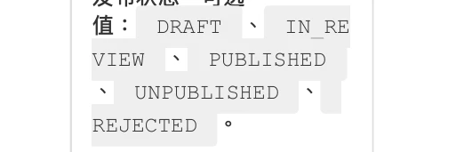

<table>
  <tr>
    <td>data.updatedAt</td>
    <td><code>string&lt;date-</code><br><code>time&gt;</code></td>
    <td><code>"2026-06-</code><br><code>22T12:00:00Z"</code></td>
    <td>更新时间。</td>
  </tr>
</table>

**示例**

**请求示例**

```http
POST /himarket/v1/open-api/v1/catalog/listings HTTP/1.1
Host: localhost:8080
X-HIMARKET-OPENAPI: HIMARKET_OPENAPI
X-HIMARKET-TOKEN: <admin-openapi-token>
Content-Type: application/json

{
  "resourceId": "resource-001",
  "defaultVersionId": "defaultVersion-001",
  "portalId": "portal-001",
  "visibility": "PRIVATE",
  "title": "示例资源标题",
  "summary": "示例摘要"
}
```

**响应示例**

```json
{
  "code": "SUCCESS",
  "message": null,
  "data": {
    "listingId": "listing-001",
    "tenantId": "tenant-001",
    "resourceId": "resource-001",
    "defaultVersionId": "defaultVersion-001",
    "portalId": "portal-001",
    "visibility": "PRIVATE"
  },
  "accessDeniedDetail": null,
  "requestId": "req-001"
}
```

<a id="section-2-3-3-11"></a>

#### 2.3.3.11. submitCatalogReview

**接口信息**

- **接口路径**： `POST /himarket/v1/open-api/v1/catalog/listings/{listingId}/submit-review`

- **接口说明**：提交 Listing 审核。

- **认证方式**：该接口属于管理面 OpenAPI。调用前请完成 OpenAPI 凭证配置，并按 Token 模式或 AK/SK签名模式携带认证 Header。

- **Header 示例**：Token 模式使用  `X-HIMARKET-OPENAPI: HIMARKET_OPENAPI`  与  `X-HIMARKET-TOKEN` ；AK/SK 模式使用  `X-HIMARKET-ACCESS-KEY` 、 `X-HIMARKET-TIMESTAMP`  和  `X-HIMARKET-SIGNATURE` 。

**请求参数**

| 参数名称 | 位置 | 类型 | 是否必选 | 示例 | 说明 |
| --- | --- | --- | --- | --- | --- |
| listingId | path | <code>string</code> | 是 | <code>"listing-</code><br><code>001"</code> | Listing ID。 |
| checks | body | <code>object</code> | 否 | <code>{}</code> | 审核检查项列表。 |

**返回数据**

| 参数名称 | 类型 | 示例 | 说明 |
| --- | --- | --- | --- |
| code | <code>string</code> | <code>SUCCESS</code> | 响应码，取值为<code> SUCCESS </code> 时表示请求成功。 |
| message | <code>string</code> | <code>null</code> | 响应消息。请求成功时通常为空。 |
| data | <code>object</code> | <code>{"submissionId":"su</code><br><code>bmission-</code><br><code>001","targetType":"s</code><br><code>ample-</code><br><code>value","targetId":"t</code><br><code>arget-</code><br><code>001","submitterId":"</code><br><code>submitter-</code><br><code>001","reviewType":"s</code><br><code>ample-</code><br><code>value","status":"PEN</code><br><code>DING"}</code> | 响应数据。具体结构以接口语义为准。 |
| accessDeniedDetail | <code>object</code> | <code>null</code> | 鉴权失败详情。请求成功时通常为空。 |
| requestId | <code>string</code> | <code>req-001</code> | 请求 ID，可用于问题排查和日志检索。 |
| data.submissionId | <code>string</code> | <code>"submission-001"</code> | 评审提交ID。 |
| data.targetType | <code>string</code> | <code>"sample-value"</code> | 订阅目标类型。 |
| data.targetId | <code>string</code> | <code>"target-001"</code> | 目标对象 ID。 |
| data.submitterId | <code>string</code> | <code>"submitter-001"</code> | 提交人 ID。 |
| data.reviewType | <code>string</code> | <code>"sample-value"</code> | 审核类型。 |
| data.status | <code>string</code> | <code>"PENDING"</code> | 状态。 |
| data.checks | <code>object</code> | <code>{}</code> | 审核检查项列表。 |
| data.decision | <code>object</code> | <code>{}</code> | 审核决策。 |
| data.reviewerId | <code>string</code> | <code>"reviewer-001"</code> | 审核人 ID。 |
| data.submittedAt | <code>string&lt;date-</code><br><code>time&gt;</code> | <code>"2026-06-</code><br><code>22T12:00:00Z"</code> | 提交时间。 |
| data.decidedAt | <code>string&lt;date-</code><br><code>time&gt;</code> | <code>"2026-06-</code><br><code>22T12:00:00Z"</code> | 审批时间。 |

**示例**

**请求示例**

```http
POST /himarket/v1/open-api/v1/catalog/listings/{listingId}/submit-review HTTP/1.1
Host: localhost:8080
X-HIMARKET-OPENAPI: HIMARKET_OPENAPI
X-HIMARKET-TOKEN: <admin-openapi-token>
Content-Type: application/json

{
  "checks": {}
}
```

**响应示例**

```json
{
  "code": "SUCCESS",
  "message": null,
  "data": {
    "submissionId": "submission-001",
    "targetType": "sample-value",
    "targetId": "target-001",
    "submitterId": "submitter-001",
    "reviewType": "sample-value",
    "status": "PENDING"
  },
  "accessDeniedDetail": null,
  "requestId": "req-001"
}
```

<a id="section-2-3-3-12"></a>

#### 2.3.3.12. unpublishListing

**接口信息**

- **接口路径**： `POST /himarket/v1/open-api/v1/catalog/listings/{listingId}/unpublish`

- **接口说明**：下架 Listing。

- **认证方式**：该接口属于管理面 OpenAPI。调用前请完成 OpenAPI 凭证配置，并按 Token 模式或 AK/SK签名模式携带认证 Header。

- **Header 示例**：Token 模式使用  `X-HIMARKET-OPENAPI: HIMARKET_OPENAPI`  与  `X-HIMARKET-TOKEN` ；AK/SK 模式使用  `X-HIMARKET-ACCESS-KEY` 、 `X-HIMARKET-TIMESTAMP`  和  `X-HIMARKET-SIGNATURE` 。

**请求参数**

| 参数名称 | 位置 | 类型 | 是否必选 | 示例 | 说明 |
| --- | --- | --- | --- | --- | --- |
| listingId | path | <code>string</code> | 是 | <code>"listing-</code><br><code>001"</code> | Listing ID。 |

**返回数据**

| 参数名称 | 类型 | 示例 | 说明 |
| --- | --- | --- | --- |
| code | <code>string</code> | <code>SUCCESS</code> | 响应码，取值为<code> SUCCESS </code> 时表示请求成功。 |
| message | <code>string</code> | <code>null</code> | 响应消息。请求成功时通常为空。 |
| data | <code>object</code> | <code>{"listingId":"listi</code><br><code>ng-</code><br><code>001","tenantId":"ten</code><br><code>ant-</code><br><code>001","resourceId":"r</code><br><code>esource-</code><br><code>001","defaultVersion</code><br><code>Id":"defaultVersion-</code><br><code>001","portalId":"por</code><br><code>tal-</code><br><code>001","visibility":"P</code><br><code>RIVATE"}</code> | 响应数据。具体结构以接口语义为准。 |
| accessDeniedDetail | <code>object</code> | <code>null</code> | 鉴权失败详情。请求成功时通常为空。 |
| requestId | <code>string</code> | <code>req-001</code> | 请求 ID，可用于问题排查和日志检索。 |
| data.listingId | <code>string</code> | <code>"listing-001"</code> | Listing ID。 |
| data.tenantId | <code>string</code> | <code>"tenant-001"</code> | 租户ID。 |
| data.resourceId | <code>string</code> | <code>"resource-001"</code> | AI Resource ID。 |
| data.defaultVersionId | <code>string</code> | <code>"defaultVersion-</code><br><code>001"</code> | 默认版本ID。 |
| data.portalId | <code>string</code> | <code>"portal-001"</code> | 门户ID。 |
| data.visibility | <code>string</code> | <code>"PRIVATE"</code> | 可见性。可选值：<code> PRIVATE </code>、<code> PUB</code> <code>LIC </code>。 |
| data.title | <code>string</code> | <code> "</code>示例资源标题<code>" </code> | 标题。 |
| data.summary | <code>string</code> | <code> "</code>示例摘要<code>" </code> | 摘要信息。 |
| data.description | <code>string</code> | <code> "</code>用于演示的资源描述<code>" </code> | 描述信息。 |
| data.icon | <code>string</code> | <code>"sample-value"</code> | 图标地址。 |
| data.banner | <code>string</code> | <code>"sample-value"</code> | 横幅图片地址。 |
| data.categoryId | <code>string</code> | <code>"category-001"</code> | 分类 ID。 |
| data.category | <code>object</code> | <code>{"categoryId":"cate</code><br><code>gory-</code><br><code>001","tenantId":"ten</code><br><code>ant-</code><br><code>001","kind":"MODEL_A</code><br><code>PI","code":"model-</code><br><code>api","name":"sample-</code><br><code>name","description":</code> <code>"</code>用于演示的资源描述<code>"} </code> | 分类信息。 |
| data.category.category Id | <code>string</code> | <code>"category-001"</code> | 分类 ID。 |
| data.category.tenantId | <code>string</code> | <code>"tenant-001"</code> | 租户ID。 |
| data.category.kind | <code>string</code> | <code>"MODEL_API"</code> | 资源类型。 |
| data.category.code | <code>string</code> | <code>"model-api"</code> | 业务编码。 |
| data.category.name | <code>string</code> | <code>"sample-name"</code> | 名称。 |
| data.category.descripti on | <code>string</code> | <code> "</code>用于演示的资源描述<code>" </code> | 描述信息。 |
| data.category.icon | <code>string</code> | <code>"sample-value"</code> | 图标地址。 |
| data.category.sortOrde r | <code>integer&lt;int32&gt;</code> | <code>100</code> | 排序值。 |
| data.category.status | <code>string</code> | <code>"sample-value"</code> | 状态。 |
| data.category.createdB y | <code>string</code> | <code>"sample-value"</code> | 创建人。 |
| data.category.updated By | <code>string</code> | <code>"sample-value"</code> | 更新人。 |
| data.category.createdA t | <code>string&lt;date-</code><br><code>time&gt;</code> | <code>"2026-06-</code><br><code>22T12:00:00Z"</code> | 创建时间。 |
| data.category.updated At | <code>string&lt;date-</code><br><code>time&gt;</code> | <code>"2026-06-</code><br><code>22T12:00:00Z"</code> | 更新时间。 |
| data.category.listingCo unt | <code>integer&lt;int64&gt;</code> | <code>1</code> | Listing 数量。 |
| data.tags | <code>array</code> | <code>["sample-value"]</code> | 标签列表。 |
| data.pricingMode | <code>string</code> | <code>"sample-value"</code> | 计费模式。 |
| data.listingStatus | <code>string</code> | <code>"sample-value"</code> | 市场条目状态。 |
| data.publicationStatus | <code>string</code> | <code>"DRAFT"</code> | 发布状态。可选值：<code> DRAFT </code>、<code> IN_RE</code> <code>VIEW </code>、<code> PUBLISHED </code>、<code> UNPUBLISHED </code>、<code> </code><code>REJECTED </code>。 |
| data.createdBy | <code>string</code> | <code>"sample-value"</code> | 创建人。 |
| data.publishedBy | <code>string</code> | <code>"sample-value"</code> | 发布人 ID。 |
| data.publishedAt | <code>string&lt;date-</code><br><code>time&gt;</code> | <code>"2026-06-</code><br><code>22T12:00:00Z"</code> | 发布时间。 |
| data.createdAt | <code>string&lt;date-</code><br><code>time&gt;</code> | <code>"2026-06-</code><br><code>22T12:00:00Z"</code> | 创建时间。 |
| data.updatedAt | <code>string&lt;date-</code><br><code>time&gt;</code> | <code>"2026-06-</code><br><code>22T12:00:00Z"</code> | 更新时间。 |


**示例**

**请求示例**

```http
POST /himarket/v1/open-api/v1/catalog/listings/{listingId}/unpublish HTTP/1.1
Host: localhost:8080
X-HIMARKET-OPENAPI: HIMARKET_OPENAPI
X-HIMARKET-TOKEN: <admin-openapi-token>
```

**响应示例**

```json
{
  "code": "SUCCESS",
  "message": null,
  "data": {
    "listingId": "listing-001",
    "tenantId": "tenant-001",
    "resourceId": "resource-001",
    "defaultVersionId": "defaultVersion-001",
    "portalId": "portal-001",
    "visibility": "PRIVATE"
  },
  "accessDeniedDetail": null,
  "requestId": "req-001"
}
```

<a id="section-2-3-4"></a>

### 2.3.4. AI Resource Manifest 开放接口

<a id="section-2-3-4-1"></a>

#### 2.3.4.1. applyManifest

**接口信息**

- **接口路径**： `POST /himarket/v1/open-api/v1/manifests/apply`

- **接口说明**：声明式创建或更新 AI Resource。

- **认证方式**：该接口属于管理面 OpenAPI。调用前请完成 OpenAPI 凭证配置，并按 Token 模式或 AK/SK签名模式携带认证 Header。

- **Header 示例**：Token 模式使用  `X-HIMARKET-OPENAPI: HIMARKET_OPENAPI`  与  `X-HIMARKET-TOKEN` ；AK/SK 模式使用  `X-HIMARKET-ACCESS-KEY` 、 `X-HIMARKET-TIMESTAMP`  和  `X-HIMARKET-SIGNATURE` 。

**请求参数**

| 参数名称 | 位置 | 类型 | 是否必选 | 示例 | 说明 |
| --- | --- | --- | --- | --- | --- |
| manifest | body | <code>object</code> | 是 | <code>{}</code> | 资源 Manifest内容。 |
| dryRun | body | <code>boolean</code> | 否 | <code>false</code> | 是否只执行预校验。取值为<code> true </code> 时不会写入数据。 |

**返回数据**

| 参数名称 | 类型 | 示例 | 说明 |
| --- | --- | --- | --- |
| code | <code>string</code> | <code>SUCCESS</code> | 响应码，取值为<code> SUCCESS </code> 时表示请求成功。 |
| message | <code>string</code> | <code>null</code> | 响应消息。请求成功时通常为空。 |
| data | <code>object</code> | <code>{"dryRun":false,"ac</code><br><code>tion":"sample-</code><br><code>value","kind":"MODEL</code><br><code>_API","resourceId":"</code><br><code>resource-</code><br><code>001","versionId":"ve</code><br><code>rsion-</code><br><code>001","manifestId":"m</code><br><code>anifest-001"}</code> | 响应数据。具体结构以接口语义为准。 |
| accessDeniedDetail | <code>object</code> | <code>null</code> | 鉴权失败详情。请求成功时通常为空。 |
| requestId | <code>string</code> | <code>req-001</code> | 请求 ID，可用于问题排查和日志检索。 |
| data.dryRun | <code>boolean</code> | <code>false</code> | 是否只执行预校验。取值为 <code> true </code> 时不会写入数据。 |
| data.action | <code>string</code> | <code>"sample-value"</code> | 本次操作类型。 |
| data.kind | <code>string</code> | <code>"MODEL_API"</code> | 资源类型。 |
| data.resourceId | <code>string</code> | <code>"resource-001"</code> | AI Resource ID。 |
| data.versionId | <code>string</code> | <code>"version-001"</code> | 版本 ID。 |
| data.manifestId | <code>string</code> | <code>"manifest-001"</code> | Manifest ID。 |
| data.sourceBindingId | <code>string</code> | <code>"sourceBinding-</code><br><code>001"</code> | 来源绑定ID。 |
| data.name | <code>string</code> | <code>"sample-name"</code> | 名称。 |
| data.version | <code>string</code> | <code>"sample-value"</code> | 版本号。 |
| data.endpointCount | <code>integer&lt;int32&gt;</code> | <code>1</code> | Endpoint 数量。 |
| data.capabilityCount | <code>integer&lt;int32&gt;</code> | <code>1</code> | 能力数量。 |
| data.artifactCount | <code>integer&lt;int32&gt;</code> | <code>1</code> | 制品数量。 |
| data.warnings | <code>array</code> | <code>["sample-value"]</code> | 告警信息列表。 |

**示例**

**请求示例**

```http
POST /himarket/v1/open-api/v1/manifests/apply HTTP/1.1
Host: localhost:8080
X-HIMARKET-OPENAPI: HIMARKET_OPENAPI
X-HIMARKET-TOKEN: <admin-openapi-token>
Content-Type: application/json

{
  "manifest": {},
  "dryRun": false
}
```

**响应示例**

```json
{
  "code": "SUCCESS",
  "message": null,
  "data": {
    "dryRun": false,
    "action": "sample-value",
    "kind": "MODEL_API",
    "resourceId": "resource-001",
    "versionId": "version-001",
    "manifestId": "manifest-001"
  },
  "accessDeniedDetail": null,
  "requestId": "req-001"
}
```

<a id="section-2-3-5"></a>

### 2.3.5. AI Resource Resolver 开放接口

<a id="section-2-3-5-1"></a>

#### 2.3.5.1. resolve

**接口信息**

- **接口路径**： `POST /himarket/v1/open-api/v1/resolver/resolve`

- **接口说明**：解析 AI Resource 为运行时消费配置。

- **认证方式**：该接口属于管理面 OpenAPI。调用前请完成 OpenAPI 凭证配置，并按 Token 模式或 AK/SK签名模式携带认证 Header。

- **Header 示例**：Token 模式使用  `X-HIMARKET-OPENAPI: HIMARKET_OPENAPI`  与  `X-HIMARKET-TOKEN` ；AK/SK 模式使用  `X-HIMARKET-ACCESS-KEY` 、 `X-HIMARKET-TIMESTAMP`  和  `X-HIMARKET-SIGNATURE` 。

**请求参数**

| 参数名称 | 位置 | 类型 | 是否必选 | 示例 | 说明 |
| --- | --- | --- | --- | --- | --- |
| actor | body | <code>object</code> | 否 | <code>{"type":"US</code><br><code>ER","id":"id</code><br><code>-001"}</code> | 操作主体。 |
| actor.type | body | <code>string</code> | 否 | <code>"USER"</code> | 类型。 |
| actor.id | body | <code>string</code> | 否 | <code>"id-001"</code> | 资源唯一标识。 |
| selection | body | <code>object</code> | 是 | <code>{"kind":"MO</code><br><code>DEL_API","li</code><br><code>stingId":"li</code><br><code>sting-</code><br><code>001","resour</code><br><code>ceId":"resou</code><br><code>rce-</code><br><code>001","versio</code><br><code>nId":"versio</code><br><code>n-</code><br><code>001","versio</code><br><code>n":"sample-</code><br><code>value","endp</code><br><code>ointId":"end</code><br><code>point-</code><br><code>001"}</code> | 资源选择条件，用于指定待解析的资源、版本、端点和授权要求。 |
| selection.kind | body | <code>string</code> | 是 | <code>"MODEL_API"</code> | 资源类型。 |
| selection.listin gId | body | <code>string</code> | 否 | <code>"listing-</code><br><code>001"</code> | Listing ID。 |


<table>
  <tr>
    <td>selection.reso urceId</td>
    <td>body</td>
    <td><code>string</code></td>
    <td>否</td>
    <td><code>"resource-</code><br><code>001"</code></td>
    <td>AI Resource ID。</td>
  </tr>
  <tr>
    <td>selection.versi onId</td>
    <td>body</td>
    <td><code>string</code></td>
    <td>否</td>
    <td><code>"version-</code><br><code>001"</code></td>
    <td>版本 ID。</td>
  </tr>
  <tr>
    <td>selection.versi on</td>
    <td>body</td>
    <td><code>string</code></td>
    <td>否</td>
    <td><code>"sample-</code><br><code>value"</code></td>
    <td>版本号。</td>
  </tr>
  <tr>
    <td>selection.end pointId</td>
    <td>body</td>
    <td><code>string</code></td>
    <td>否</td>
    <td><code>"endpoint-</code><br><code>001"</code></td>
    <td>Endpoint ID。</td>
  </tr>
  <tr>
    <td>selection.prot ocol</td>
    <td>body</td>
    <td><code>string</code></td>
    <td>否</td>
    <td><code>"HTTP"</code></td>
    <td>协议类型。可选值：<code> HTTP </code>、<code> HTTPS </code>、<code> </code><code>SSE </code>、<code> STRE</code> <code>AMABLE_HTTP</code><code> </code>、<code> STDIO </code>、<code> NACOS_DES</code> <code>CRIPTOR </code>。</td>
  </tr>
  <tr>
    <td>selection.task Type</td>
    <td>body</td>
    <td><code>string</code></td>
    <td>否</td>
    <td><code>"TEXT_CHAT"</code></td>
    <td>taskType。可选值：<code> TEXT_CH</code> <code>AT </code>、<code> TEXT_</code><code>GENERATION</code>、<code> IMAGE_GEN</code> <code>ERATION </code>、<code> </code><code>IMAGE_EDIT</code>、<code> IMAGE_VAR</code> <code>IATION </code>、<code> V</code> <code>IDEO_GENERAT</code> <code>ION </code>、<code> VIDE</code> <code>O_QUERY </code>、<code> </code><code>TASK_QUERY</code>。</td>
  </tr>
  <tr>
    <td>selection.netw orkScope</td>
    <td>body</td>
    <td><code>string</code></td>
    <td>否</td>
    <td><code>"sample-</code><br><code>value"</code></td>
    <td>网络访问范围。</td>
  </tr>
  <tr>
    <td>selection.requ ireGrant</td>
    <td>body</td>
    <td><code>boolean</code></td>
    <td>否</td>
    <td><code>false</code></td>
    <td>是否需要授权Grant。</td>
  </tr>
  <tr>
    <td>purpose</td>
    <td>body</td>
    <td><code>string</code></td>
    <td>否</td>
    <td><code>"sample-</code><br><code>value"</code></td>
    <td>purpose 字段。</td>
  </tr>
</table>


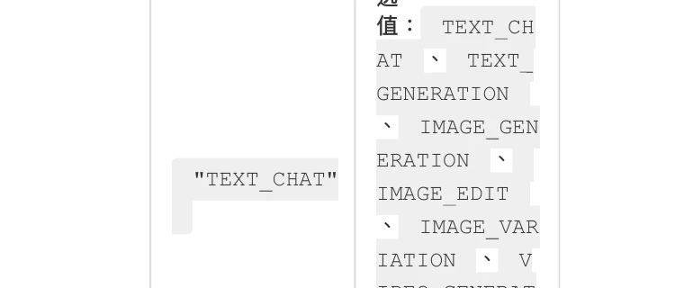


**返回数据**

| 参数名称 | 类型 | 示例 | 说明 |
| --- | --- | --- | --- |
| code | <code>string</code> | <code>SUCCESS</code> | 响应码，取值为<code> SUCCESS </code> 时表示请求成功。 |
| message | <code>string</code> | <code>null</code> | 响应消息。请求成功时通常为空。 |
| data | <code>object</code> | <code>{"kind":"MODEL_API"</code><br><code>,"resolutionMode":"E</code><br><code>NDPOINT","resourceId</code><br><code>":"resource-</code><br><code>001","versionId":"ve</code><br><code>rsion-</code><br><code>001","version":"samp</code><br><code>le-</code><br><code>value","tenantId":"t</code><br><code>enant-001"}</code> | 响应数据。具体结构以接口语义为准。 |
| accessDeniedDetail | <code>object</code> | <code>null</code> | 鉴权失败详情。请求成功时通常为空。 |
| requestId | <code>string</code> | <code>req-001</code> | 请求 ID，可用于问题排查和日志检索。 |
| data.kind | <code>string</code> | <code>"MODEL_API"</code> | 资源类型。 |
| data.resolutionMode | <code>string</code> | <code>"ENDPOINT"</code> | resolutionMode。可选值：<code> ENDPOINT </code>、<code> SO</code> <code>URCE_DESCRIPTOR </code>。 |
| data.resourceId | <code>string</code> | <code>"resource-001"</code> | AI Resource ID。 |
| data.versionId | <code>string</code> | <code>"version-001"</code> | 版本 ID。 |
| data.version | <code>string</code> | <code>"sample-value"</code> | 版本号。 |
| data.tenantId | <code>string</code> | <code>"tenant-001"</code> | 租户ID。 |
| data.name | <code>string</code> | <code>"sample-name"</code> | 名称。 |
| data.displayName | <code>string</code> | <code> "</code>示例资源<code>" </code> | 展示名称。 |
| data.actor | <code>object</code> | <code>{"type":"USER","id"</code><br><code>:"id-001"}</code> | 操作主体。 |
| data.actor.type | <code>string</code> | <code>"USER"</code> | 类型。 |
| data.actor.id | <code>string</code> | <code>"id-001"</code> | 资源唯一标识。 |
| data.access | <code>object</code> | <code>{"mode":"sample-</code><br><code>value","subscription</code><br><code>Id":"subscription-</code><br><code>001","grantId":"gran</code><br><code>t-</code><br><code>001","credentialBind</code><br><code>ingId":"credentialBi</code><br><code>nding-001"}</code> | 访问配置。 |
| data.access.mode | <code>string</code> | <code>"sample-value"</code> | 模式。 |
| data.access.subscriptio nId | <code>string</code> | <code>"subscription-</code><br><code>001"</code> | 订阅申请 ID。 |
| data.access.grantId | <code>string</code> | <code>"grant-001"</code> | 授权 Grant ID。 |
| data.access.credentialB indingId | <code>string</code> | <code>"credentialBinding-</code><br><code>001"</code> | 凭据绑定 ID。 |
| data.source | <code>object</code> | <code>{"sourceBindingId":</code><br><code>"sourceBinding-</code><br><code>001","sourceType":"G</code><br><code>ATEWAY","sourceRef":</code><br><code>"sample-</code><br><code>value","syncStatus":</code><br><code>"sample-</code><br><code>value","credentialRe</code><br><code>f":"sample-</code><br><code>value","config":</code><br><code>{"key":"value"}}</code> | 来源。 |
| data.source.sourceBind ingId | <code>string</code> | <code>"sourceBinding-</code><br><code>001"</code> | 来源绑定ID。 |
| data.source.sourceTyp e | <code>string</code> | <code>"GATEWAY"</code> | 来源类型。可选值：<code> GATEWAY </code>、<code> NAC</code> <code>OS </code>、<code> REMOTE_ENDPOI</code> <code>NT </code>、<code> SANDBOX </code>、<code> R</code> <code>EGISTRY </code>、<code> CUSTOM </code>。 |
| data.source.sourceRef | <code>string</code> | <code>"sample-value"</code> | 来源引用。 |
| data.source.syncStatus | <code>string</code> | <code>"sample-value"</code> | 同步状态。 |
| data.source.credentialR ef | <code>string</code> | <code>"sample-value"</code> | 凭据引用。 |
| data.source.config | <code>object</code> | <code>{"key":"value"}</code> | 配置信息。 |
| data.endpoints | <code>array</code> | <code>[{"endpointId":"end</code><br><code>point-</code><br><code>001","name":"sample-</code><br><code>name","endpointType"</code><br><code>:"MODEL_INFERENCE","</code><br><code>providerType":"SANDB</code><br><code>OX","protocol":"HTTP</code><br><code>","url":"https://api</code><br><code>.example.com"}]</code> | 访问端点列表。 |
| data.endpoints\[\].endpo intId | <code>string</code> | <code>"endpoint-001"</code> | Endpoint ID。 |
| data.endpoints\[\].name | <code>string</code> | <code>"sample-name"</code> | 名称。 |
| data.endpoints\[\].endpo intType | <code>string</code> | <code>"MODEL_INFERENCE"</code> | Endpoint 类型。 |
| data.endpoints\[\].provid erType | <code>string</code> | <code>"SANDBOX"</code> | 提供方类型。 |
| data.endpoints\[\].protoc ol | <code>string</code> | <code>"HTTP"</code> | 协议类型。可选值：<code> HTTP </code>、<code> HTTPS</code><code> </code>、<code> SSE </code>、<code> STREAMA</code> <code>BLE_HTTP </code>、<code> STDIO </code>、<code> NACOS_DESCRIPTOR</code><code> </code>。 |


<table>
  <tr>
    <td>data.endpoints[].url</td>
    <td><code>string</code></td>
    <td><code>"https://api.exampl</code><br><code>e.com"</code></td>
    <td>访问地址。</td>
  </tr>
  <tr>
    <td>data.endpoints[].baseU rl</td>
    <td><code>string</code></td>
    <td><code>"https://api.exampl</code><br><code>e.com"</code></td>
    <td>服务基础地址。</td>
  </tr>
  <tr>
    <td>data.endpoints[].authM ode</td>
    <td><code>string</code></td>
    <td><code>"sample-value"</code></td>
    <td>认证模式。</td>
  </tr>
  <tr>
    <td>data.endpoints[].netwo rkScope</td>
    <td><code>string</code></td>
    <td><code>"sample-value"</code></td>
    <td>网络访问范围。</td>
  </tr>
  <tr>
    <td>data.endpoints[].defaul tInvocation</td>
    <td><code>boolean</code></td>
    <td><code>false</code></td>
    <td>默认调用配置。</td>
  </tr>
  <tr>
    <td>data.endpoints[].health Status</td>
    <td><code>string</code></td>
    <td><code>"sample-value"</code></td>
    <td>健康检查状态。</td>
  </tr>
  <tr>
    <td>data.endpoints[].provid erConfig</td>
    <td><code>object</code></td>
    <td><code>{"provider":"sandbo</code><br><code>x","sandboxId":"sand</code><br><code>box-001"}</code></td>
    <td>Provider 配置。</td>
  </tr>
  <tr>
    <td>data.endpoints[].metad ata</td>
    <td><code>object</code></td>
    <td><code>{"source":"himarket</code><br><code>"}</code></td>
    <td>扩展元数据。</td>
  </tr>
  <tr>
    <td>data.capabilities</td>
    <td><code>array</code></td>
    <td><code>[{"capabilityId":"c</code><br><code>apability-</code><br><code>001","capabilityType</code><br><code>":"MODEL","name":"sa</code><br><code>mple-</code><br><code>name","displayName":</code> <code>"</code>示例资源<code>","description":"</code>用于演示的资源描述<code>","inputSchema":</code> <code>{"type":"object","pr</code><br><code>operties":{"input":</code><br><code>{"type":"string"}}}}</code><br><code>]</code></td>
    <td>资源能力列表。</td>
  </tr>
  <tr>
    <td>data.capabilities[].capa bilityId</td>
    <td><code>string</code></td>
    <td><code>"capability-001"</code></td>
    <td>能力 ID。</td>
  </tr>
  <tr>
    <td>data.capabilities[].capa bilityType</td>
    <td><code>string</code></td>
    <td><code>"MODEL"</code></td>
    <td>capabilityType。可选值：<code> MODEL </code>、<code> MCP_T</code> <code>OOL </code>、<code> MCP_RESOURCE</code><code> </code>、<code> MCP_PROMPT </code>、<code> </code><code>SKILL </code>、<code> WORKER </code>、<code> API </code>。</td>
  </tr>
  <tr>
    <td>data.capabilities[].nam e</td>
    <td><code>string</code></td>
    <td><code>"sample-name"</code></td>
    <td>名称。</td>
  </tr>
  <tr>
    <td>data.capabilities[].displ ayName</td>
    <td><code>string</code></td>
    <td><code> "</code>示例资源<code>" </code></td>
    <td>展示名称。</td>
  </tr>
  <tr>
    <td>data.capabilities[].desc ription</td>
    <td><code>string</code></td>
    <td><code> "</code>用于演示的资源描述<code>" </code></td>
    <td>描述信息。</td>
  </tr>
  <tr>
    <td>data.capabilities[].input Schema</td>
    <td><code>object</code></td>
    <td><code>{"type":"object","p</code><br><code>roperties":</code><br><code>{"input":</code><br><code>{"type":"string"}}}</code></td>
    <td>输入参数 Schema。</td>
  </tr>
  <tr>
    <td>data.capabilities[].outp utSchema</td>
    <td><code>object</code></td>
    <td><code>{"type":"object","p</code><br><code>roperties":</code><br><code>{"result":</code><br><code>{"type":"string"}}}</code></td>
    <td>输出结果 Schema。</td>
  </tr>
  <tr>
    <td>data.capabilities[].tags</td>
    <td><code>array</code></td>
    <td><code>["sample-value"]</code></td>
    <td>标签列表。</td>
  </tr>
  <tr>
    <td>data.capabilities[].riskL evel</td>
    <td><code>string</code></td>
    <td><code>"sample-value"</code></td>
    <td>风险等级。</td>
  </tr>
  <tr>
    <td>data.capabilities[].per missionScope</td>
    <td><code>string</code></td>
    <td><code>"sample-value"</code></td>
    <td>权限范围。</td>
  </tr>
</table>


<table>
  <tr>
    <td>data.modelInvocation</td>
    <td><code>object</code></td>
    <td><code>{"protocol":"sample</code><br><code>-</code><br><code>value","baseUrl":"ht</code><br><code>tps://api.example.co</code><br><code>m","selectedTarget":</code><br><code>{"baseUrl":"https://</code><br><code>api.example.com","ba</code><br><code>sePath":"sample-</code><br><code>value","source":"sam</code><br><code>ple-</code><br><code>value","accessModeTy</code><br><code>pe":"sample-</code><br><code>value","networkType"</code><br><code>:"sample-</code><br><code>value"},"selectedOpe</code><br><code>ration":</code><br><code>{"code":"CHAT_COMPLE</code><br><code>TIONS","taskType":"T</code><br><code>EXT_CHAT","operation</code><br><code>Role":"sample-</code><br><code>value","method":"sam</code><br><code>ple-</code><br><code>value","path":"sampl</code><br><code>e-</code><br><code>value","gatewayPath"</code><br><code>:"sample-</code><br><code>value"},"targets":</code><br><code>[{"baseUrl":"https:/</code><br><code>/api.example.com","b</code><br><code>asePath":"/v1","sour</code><br><code>ce":"GATEWAY","acces</code><br><code>sModeType":"PUBLIC",</code><br><code>"networkType":"INTER</code><br><code>NET"}],"operations":</code><br><code>[{"code":"CHAT_COMPL</code><br><code>ETIONS","taskType":"</code><br><code>TEXT_CHAT","operatio</code><br><code>nRole":"INVOKE","met</code><br><code>hod":"POST","path":"</code><br><code>/chat/completions","</code><br><code>gatewayPath":"/v1/ch</code><br><code>at/completions"}]}</code></td>
    <td>模型调用配置。</td>
  </tr>
  <tr>
    <td>data.modelInvocation.p rotocol</td>
    <td><code>string</code></td>
    <td><code>"sample-value"</code></td>
    <td>协议类型。</td>
  </tr>
  <tr>
    <td>data.modelInvocation.b aseUrl</td>
    <td><code>string</code></td>
    <td><code>"https://api.exampl</code><br><code>e.com"</code></td>
    <td>服务基础地址。</td>
  </tr>
  <tr>
    <td>data.modelInvocation.s electedTarget</td>
    <td><code>object</code></td>
    <td><code>{"baseUrl":"https:/</code><br><code>/api.example.com","b</code><br><code>asePath":"sample-</code><br><code>value","source":"sam</code><br><code>ple-</code><br><code>value","accessModeTy</code><br><code>pe":"sample-</code><br><code>value","networkType"</code><br><code>:"sample-value"}</code></td>
    <td>选中的目标对象。</td>
  </tr>
  <tr>
    <td>data.modelInvocation.s electedTarget.baseUrl</td>
    <td><code>string</code></td>
    <td><code>"https://api.exampl</code><br><code>e.com"</code></td>
    <td>服务基础地址。</td>
  </tr>
  <tr>
    <td>data.modelInvocation.s electedTarget.basePath</td>
    <td><code>string</code></td>
    <td><code>"sample-value"</code></td>
    <td>基础路径。</td>
  </tr>
  <tr>
    <td>data.modelInvocation.s electedTarget.source</td>
    <td><code>string</code></td>
    <td><code>"sample-value"</code></td>
    <td>来源。</td>
  </tr>
  <tr>
    <td>data.modelInvocation.s electedTarget.accessM odeType</td>
    <td><code>string</code></td>
    <td><code>"sample-value"</code></td>
    <td>访问模式类型。</td>
  </tr>
  <tr>
    <td>data.modelInvocation.s electedTarget.networkT ype</td>
    <td><code>string</code></td>
    <td><code>"sample-value"</code></td>
    <td>网络类型。</td>
  </tr>
  <tr>
    <td>data.modelInvocation.s electedOperation</td>
    <td><code>object</code></td>
    <td><code>{"code":"CHAT_COMPL</code><br><code>ETIONS","taskType":"</code><br><code>TEXT_CHAT","operatio</code><br><code>nRole":"sample-</code><br><code>value","method":"sam</code><br><code>ple-</code><br><code>value","path":"sampl</code><br><code>e-</code><br><code>value","gatewayPath"</code><br><code>:"sample-value"}</code></td>
    <td>选中的操作。</td>
  </tr>
  <tr>
    <td>data.modelInvocation.s electedOperation.code</td>
    <td><code>string</code></td>
    <td><code>"CHAT_COMPLETIONS"</code></td>
    <td>业务编码。</td>
  </tr>
</table>

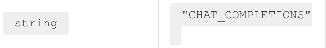

<table>
  <tr>
    <td>data.modelInvocation.s electedOperation.taskT ype</td>
    <td><code>string</code></td>
    <td><code>"TEXT_CHAT"</code></td>
    <td>taskType。可选值：<code> TEXT_CHAT </code>、<code> T</code> <code>EXT_GENERATION </code>、<code> I</code> <code>MAGE_GENERATION </code>、<code> </code><code>IMAGE_EDIT </code>、<code> IMAGE</code> <code>_VARIATION </code>、<code> VIDEO</code> <code>_GENERATION </code>、<code> VIDE</code> <code>O_QUERY </code>、<code> TASK_QUE</code> <code>RY </code>。</td>
  </tr>
  <tr>
    <td>data.modelInvocation.s electedOperation.opera tionRole</td>
    <td><code>string</code></td>
    <td><code>"sample-value"</code></td>
    <td>操作角色。</td>
  </tr>
  <tr>
    <td>data.modelInvocation.s electedOperation.meth od</td>
    <td><code>string</code></td>
    <td><code>"sample-value"</code></td>
    <td>HTTP方法。</td>
  </tr>
  <tr>
    <td>data.modelInvocation.s electedOperation.path</td>
    <td><code>string</code></td>
    <td><code>"sample-value"</code></td>
    <td>路径。</td>
  </tr>
  <tr>
    <td>data.modelInvocation.s electedOperation.gate wayPath</td>
    <td><code>string</code></td>
    <td><code>"sample-value"</code></td>
    <td>Gateway 路径。</td>
  </tr>
  <tr>
    <td>data.modelInvocation.s electedOperation.route Path</td>
    <td><code>string</code></td>
    <td><code>"sample-value"</code></td>
    <td>路由路径。</td>
  </tr>
  <tr>
    <td>data.modelInvocation.s electedOperation.enabl ed</td>
    <td><code>boolean</code></td>
    <td><code>true</code></td>
    <td>是否启用。</td>
  </tr>
  <tr>
    <td>data.modelInvocation.s electedOperation.meta data</td>
    <td><code>object</code></td>
    <td><code>{"source":"himarket</code><br><code>"}</code></td>
    <td>扩展元数据。</td>
  </tr>
  <tr>
    <td>data.modelInvocation.t argets</td>
    <td><code>array</code></td>
    <td><code>[{"baseUrl":"https:</code><br><code>//api.example.com","</code><br><code>basePath":"sample-</code><br><code>value","source":"sam</code><br><code>ple-</code><br><code>value","accessModeTy</code><br><code>pe":"sample-</code><br><code>value","networkType"</code><br><code>:"sample-value"}]</code></td>
    <td>目标列表。</td>
  </tr>
</table>

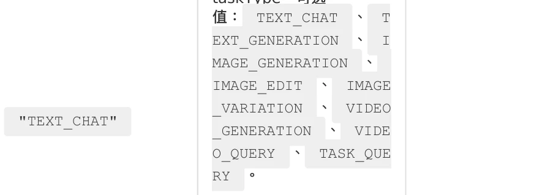

<table>
  <tr>
    <td>data.modelInvocation.t argets[].baseUrl</td>
    <td><code>string</code></td>
    <td><code>"https://api.exampl</code><br><code>e.com"</code></td>
    <td>服务基础地址。</td>
  </tr>
  <tr>
    <td>data.modelInvocation.t argets[].basePath</td>
    <td><code>string</code></td>
    <td><code>"sample-value"</code></td>
    <td>基础路径。</td>
  </tr>
  <tr>
    <td>data.modelInvocation.t argets[].source</td>
    <td><code>string</code></td>
    <td><code>"sample-value"</code></td>
    <td>来源。</td>
  </tr>
  <tr>
    <td>data.modelInvocation.t argets[].accessModeTy pe</td>
    <td><code>string</code></td>
    <td><code>"sample-value"</code></td>
    <td>访问模式类型。</td>
  </tr>
  <tr>
    <td>data.modelInvocation.t argets[].networkType</td>
    <td><code>string</code></td>
    <td><code>"sample-value"</code></td>
    <td>网络类型。</td>
  </tr>
  <tr>
    <td>data.modelInvocation.o perations</td>
    <td><code>array</code></td>
    <td><code>[{"code":"CHAT_COMP</code><br><code>LETIONS","taskType":</code><br><code>"TEXT_CHAT","operati</code><br><code>onRole":"sample-</code><br><code>value","method":"sam</code><br><code>ple-</code><br><code>value","path":"sampl</code><br><code>e-</code><br><code>value","gatewayPath"</code><br><code>:"sample-value"}]</code></td>
    <td>操作列表。</td>
  </tr>
  <tr>
    <td>data.modelInvocation.o perations[].code</td>
    <td><code>string</code></td>
    <td><code>"CHAT_COMPLETIONS"</code></td>
    <td>业务编码。</td>
  </tr>
  <tr>
    <td>data.modelInvocation.o perations[].taskType</td>
    <td><code>string</code></td>
    <td><code>"TEXT_CHAT"</code></td>
    <td>taskType。可选值：<code> TEXT_CHAT </code>、<code> T</code> <code>EXT_GENERATION </code>、<code> I</code> <code>MAGE_GENERATION </code>、<code> </code><code>IMAGE_EDIT </code>、<code> IMAGE</code> <code>_VARIATION </code>、<code> VIDEO</code> <code>_GENERATION </code>、<code> VIDE</code> <code>O_QUERY </code>、<code> TASK_QUE</code> <code>RY </code>。</td>
  </tr>
  <tr>
    <td>data.modelInvocation.o perations[].operationRo le</td>
    <td><code>string</code></td>
    <td><code>"sample-value"</code></td>
    <td>操作角色。</td>
  </tr>
  <tr>
    <td>data.modelInvocation.o perations[].method</td>
    <td><code>string</code></td>
    <td><code>"sample-value"</code></td>
    <td>HTTP方法。</td>
  </tr>
</table>

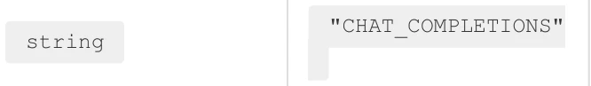


<table>
  <tr>
    <td>data.modelInvocation.o perations[].path</td>
    <td><code>string</code></td>
    <td><code>"sample-value"</code></td>
    <td>路径。</td>
  </tr>
  <tr>
    <td>data.modelInvocation.o perations[].gatewayPat h</td>
    <td><code>string</code></td>
    <td><code>"sample-value"</code></td>
    <td>Gateway 路径。</td>
  </tr>
</table>

**示例**

**请求示例**

```http
POST /himarket/v1/open-api/v1/resolver/resolve HTTP/1.1
Host: localhost:8080
X-HIMARKET-OPENAPI: HIMARKET_OPENAPI
X-HIMARKET-TOKEN: <admin-openapi-token>
Content-Type: application/json

{
  "actor": {
    "type": "USER",
    "id": "id-001"
  },
  "selection": {
    "kind": "MODEL_API",
    "listingId": "listing-001",
    "resourceId": "resource-001",
    "versionId": "version-001",
    "version": "sample-value",
    "endpointId": "endpoint-001"
  },
  "purpose": "sample-value"
}
```

**响应示例**

```json
{
  "code": "SUCCESS",
  "message": null,
  "data": {
    "kind": "MODEL_API",
    "resolutionMode": "ENDPOINT",
    "resourceId": "resource-001",
    "versionId": "version-001",
    "version": "sample-value",
    "tenantId": "tenant-001"
  },
  "accessDeniedDetail": null,
  "requestId": "req-001"
}
```

<a id="section-2-3-6"></a>

### 2.3.6. AI Resource Runtime 托管开放接口

<a id="section-2-3-6-1"></a>

#### 2.3.6.1. syncHosting

**接口信息**

- **接口路径**： `POST /himarket/v1/open-api/v1/runtime/hosting/sync`

- **接口说明**：同步 Runtime 托管状态并回写 endpoint/source binding。

- **认证方式**：该接口属于管理面 OpenAPI。调用前请完成 OpenAPI 凭证配置，并按 Token 模式或 AK/SK签名模式携带认证 Header。

- **Header 示例**：Token 模式使用  `X-HIMARKET-OPENAPI: HIMARKET_OPENAPI`  与  `X-HIMARKET-TOKEN` ；AK/SK 模式使用  `X-HIMARKET-ACCESS-KEY` 、 `X-HIMARKET-TIMESTAMP`  和  `X-HIMARKET-SIGNATURE` 。

**请求参数**

| 参数名称 | 位置 | 类型 | 是否必选 | 示例 | 说明 |
| --- | --- | --- | --- | --- | --- |
| resourceId | body | <code>string</code> | 是 | <code>"resource-</code><br><code>001"</code> | AI Resource ID。 |
| versionId | body | <code>string</code> | 是 | <code>"version-</code><br><code>001"</code> | 版本 ID。 |
| providerType | body | <code>string</code> | 是 | <code>"SANDBOX"</code> | 提供方类型。 |
| runtimeProvid erId | body | <code>string</code> | 否 | <code>"runtime-</code><br><code>provider-</code><br><code>001"</code> | 运行时Provider ID。 |
| deploymentId | body | <code>string</code> | 否 | <code>"deployment</code><br><code>-001"</code> | 部署ID。 |
| providerConfi g | body | <code>object</code> | 否 | <code>{"provider"</code><br><code>:"sandbox","</code><br><code>sandboxId":"</code><br><code>sandbox-</code><br><code>001"}</code> | Provider 配置。 |

<table>
  <tr>
    <td>endpoint</td>
    <td>body</td>
    <td><code>object</code></td>
    <td>否</td>
    <td><code>{"name":"sa</code><br><code>mple-</code><br><code>name","endpo</code><br><code>intType":"MO</code><br><code>DEL_INFERENC</code><br><code>E","protocol</code><br><code>":"HTTP","ur</code><br><code>l":"https://</code><br><code>api.example.</code><br><code>com","gatewa</code><br><code>yId":"gatewa</code><br><code>y-</code><br><code>001","routeI</code><br><code>d":"route-</code><br><code>001"}</code></td>
    <td>访问端点。</td>
  </tr>
  <tr>
    <td>endpoint.nam e</td>
    <td>body</td>
    <td><code>string</code></td>
    <td>否</td>
    <td><code>"sample-</code><br><code>name"</code></td>
    <td>名称。</td>
  </tr>
  <tr>
    <td>endpoint.endp ointType</td>
    <td>body</td>
    <td><code>string</code></td>
    <td>否</td>
    <td><code>"MODEL_INFE</code><br><code>RENCE"</code></td>
    <td>Endpoint 类型。</td>
  </tr>
  <tr>
    <td>endpoint.prot ocol</td>
    <td>body</td>
    <td><code>string</code></td>
    <td>否</td>
    <td><code>"HTTP"</code></td>
    <td>协议类型。可选值：<code> HTTP </code>、<code> HTTPS </code>、<code> </code><code>SSE </code>、<code> STRE</code> <code>AMABLE_HTTP</code><code> </code>、<code> STDIO </code>、<code> NACOS_DES</code> <code>CRIPTOR </code>。</td>
  </tr>
  <tr>
    <td>endpoint.url</td>
    <td>body</td>
    <td><code>string</code></td>
    <td>否</td>
    <td><code>"https://ap</code><br><code>i.example.co</code><br><code>m"</code></td>
    <td>访问地址。</td>
  </tr>
  <tr>
    <td>endpoint.gate wayId</td>
    <td>body</td>
    <td><code>string</code></td>
    <td>否</td>
    <td><code>"gateway-</code><br><code>001"</code></td>
    <td>Gateway ID。</td>
  </tr>
</table>


<table>
  <tr>
    <td>endpoint.rout eId</td>
    <td>body</td>
    <td><code>string</code></td>
    <td>否</td>
    <td><code>"route-</code><br><code>001"</code></td>
    <td>路由 ID。</td>
  </tr>
  <tr>
    <td>endpoint.auth Mode</td>
    <td>body</td>
    <td><code>string</code></td>
    <td>否</td>
    <td><code>"sample-</code><br><code>value"</code></td>
    <td>认证模式。</td>
  </tr>
  <tr>
    <td>endpoint.cred entialPolicy</td>
    <td>body</td>
    <td><code>object</code></td>
    <td>否</td>
    <td><code>{"mode":"IN</code><br><code>HERIT"}</code></td>
    <td>凭据策略。</td>
  </tr>
  <tr>
    <td>endpoint.netw orkScope</td>
    <td>body</td>
    <td><code>string</code></td>
    <td>否</td>
    <td><code>"sample-</code><br><code>value"</code></td>
    <td>网络访问范围。</td>
  </tr>
  <tr>
    <td>endpoint.healt hStatus</td>
    <td>body</td>
    <td><code>string</code></td>
    <td>否</td>
    <td><code>"sample-</code><br><code>value"</code></td>
    <td>健康检查状态。</td>
  </tr>
  <tr>
    <td>endpoint.statu s</td>
    <td>body</td>
    <td><code>string</code></td>
    <td>否</td>
    <td><code>"ACTIVE"</code></td>
    <td>状态。</td>
  </tr>
  <tr>
    <td>endpoint.met adata</td>
    <td>body</td>
    <td><code>object</code></td>
    <td>否</td>
    <td><code>{"source":"</code><br><code>himarket"}</code></td>
    <td>扩展元数据。</td>
  </tr>
  <tr>
    <td>source</td>
    <td>body</td>
    <td><code>object</code></td>
    <td>否</td>
    <td><code>{"sourceRef</code><br><code>":"sample-</code><br><code>value","prim</code><br><code>aryBinding":</code><br><code>false,"prior</code><br><code>ity":100,"sy</code><br><code>ncMode":"sam</code><br><code>ple-</code><br><code>value","sync</code><br><code>Status":"sam</code><br><code>ple-</code><br><code>value","cred</code><br><code>entialRef":"</code><br><code>sample-</code><br><code>value"}</code></td>
    <td>来源。</td>
  </tr>
  <tr>
    <td>source.source Ref</td>
    <td>body</td>
    <td><code>string</code></td>
    <td>否</td>
    <td><code>"sample-</code><br><code>value"</code></td>
    <td>来源引用。</td>
  </tr>
  <tr>
    <td>source.primar yBinding</td>
    <td>body</td>
    <td><code>boolean</code></td>
    <td>否</td>
    <td><code>false</code></td>
    <td>是否为主绑定关系。</td>
  </tr>
  <tr>
    <td>source.priority</td>
    <td>body</td>
    <td><code>integer&lt;int</code><br><code>32&gt;</code></td>
    <td>否</td>
    <td><code>100</code></td>
    <td>优先级。</td>
  </tr>
  <tr>
    <td>source.syncM ode</td>
    <td>body</td>
    <td><code>string</code></td>
    <td>否</td>
    <td><code>"sample-</code><br><code>value"</code></td>
    <td>同步模式。</td>
  </tr>
  <tr>
    <td>source.syncSt atus</td>
    <td>body</td>
    <td><code>string</code></td>
    <td>否</td>
    <td><code>"sample-</code><br><code>value"</code></td>
    <td>同步状态。</td>
  </tr>
  <tr>
    <td>source.creden tialRef</td>
    <td>body</td>
    <td><code>string</code></td>
    <td>否</td>
    <td><code>"sample-</code><br><code>value"</code></td>
    <td>凭据引用。</td>
  </tr>
  <tr>
    <td>source.config</td>
    <td>body</td>
    <td><code>object</code></td>
    <td>否</td>
    <td><code>{"key":"val</code><br><code>ue"}</code></td>
    <td>配置信息。</td>
  </tr>
</table>

**返回数据**

| 参数名称 | 类型 | 示例 | 说明 |
| --- | --- | --- | --- |
| code | <code>string</code> | <code>SUCCESS</code> | 响应码，取值为<code> SUCCESS </code> 时表示请求成功。 |
| message | <code>string</code> | <code>null</code> | 响应消息。请求成功时通常为空。 |

<table>
  <tr>
    <td>data</td>
    <td><code>object</code></td>
    <td><code>{"resourceId":"reso</code><br><code>urce-</code><br><code>001","versionId":"ve</code><br><code>rsion-</code><br><code>001","resourceKind":</code><br><code>"MODEL_API","provide</code><br><code>rType":"SANDBOX","ac</code><br><code>tion":"sample-</code><br><code>value","sourceBindin</code><br><code>g":</code><br><code>{"sourceBindingId":"</code><br><code>sourceBinding-</code><br><code>001","resourceId":"r</code><br><code>esource-</code><br><code>001","sourceType":"G</code><br><code>ATEWAY","sourceRef":</code><br><code>"sample-</code><br><code>value","primaryBindi</code><br><code>ng":false,"priority"</code><br><code>:100}}</code></td>
    <td>响应数据。具体结构以接口语义为准。</td>
  </tr>
  <tr>
    <td>accessDeniedDetail</td>
    <td><code>object</code></td>
    <td><code>null</code></td>
    <td>鉴权失败详情。请求成功时通常为空。</td>
  </tr>
  <tr>
    <td>requestId</td>
    <td><code>string</code></td>
    <td><code>req-001</code></td>
    <td>请求 ID，可用于问题排查和日志检索。</td>
  </tr>
  <tr>
    <td>data.resourceId</td>
    <td><code>string</code></td>
    <td><code>"resource-001"</code></td>
    <td>AI Resource ID。</td>
  </tr>
  <tr>
    <td>data.versionId</td>
    <td><code>string</code></td>
    <td><code>"version-001"</code></td>
    <td>版本 ID。</td>
  </tr>
  <tr>
    <td>data.resourceKind</td>
    <td><code>string</code></td>
    <td><code>"MODEL_API"</code></td>
    <td>resourceKind。可选值：<code> MODEL_API </code>、<code> M</code> <code>CP_SERVER </code>、<code> SKILL</code><code> </code>、<code> AGENT </code>、<code> WORKE</code> <code>R </code>、<code> REST_API </code>、<code> H</code> <code>TTP_API </code>、<code> PROMPT_T</code> <code>EMPLATE </code>、<code> DATASET</code><code> </code>、<code> EVAL </code>、<code> WORKFL</code> <code>OW </code>。</td>
  </tr>
  <tr>
    <td>data.providerType</td>
    <td><code>string</code></td>
    <td><code>"SANDBOX"</code></td>
    <td>提供方类型。</td>
  </tr>
  <tr>
    <td>data.action</td>
    <td><code>string</code></td>
    <td><code>"sample-value"</code></td>
    <td>本次操作类型。</td>
  </tr>
</table>


<table>
  <tr>
    <td>data.sourceBinding</td>
    <td><code>object</code></td>
    <td><code>{"sourceBindingId":</code><br><code>"sourceBinding-</code><br><code>001","resourceId":"r</code><br><code>esource-</code><br><code>001","sourceType":"G</code><br><code>ATEWAY","sourceRef":</code><br><code>"sample-</code><br><code>value","primaryBindi</code><br><code>ng":false,"priority"</code><br><code>:100}</code></td>
    <td>来源绑定信息。</td>
  </tr>
  <tr>
    <td>data.sourceBinding.sou rceBindingId</td>
    <td><code>string</code></td>
    <td><code>"sourceBinding-</code><br><code>001"</code></td>
    <td>来源绑定ID。</td>
  </tr>
  <tr>
    <td>data.sourceBinding.res ourceId</td>
    <td><code>string</code></td>
    <td><code>"resource-001"</code></td>
    <td>AI Resource ID。</td>
  </tr>
  <tr>
    <td>data.sourceBinding.sou rceType</td>
    <td><code>string</code></td>
    <td><code>"GATEWAY"</code></td>
    <td>来源类型。可选值：<code> GATEWAY </code>、<code> NAC</code> <code>OS </code>、<code> REMOTE_ENDPOI</code> <code>NT </code>、<code> SANDBOX </code>、<code> R</code> <code>EGISTRY </code>、<code> CUSTOM </code>。</td>
  </tr>
  <tr>
    <td>data.sourceBinding.sou rceRef</td>
    <td><code>string</code></td>
    <td><code>"sample-value"</code></td>
    <td>来源引用。</td>
  </tr>
  <tr>
    <td>data.sourceBinding.pri maryBinding</td>
    <td><code>boolean</code></td>
    <td><code>false</code></td>
    <td>是否为主绑定关系。</td>
  </tr>
  <tr>
    <td>data.sourceBinding.prio rity</td>
    <td><code>integer&lt;int32&gt;</code></td>
    <td><code>100</code></td>
    <td>优先级。</td>
  </tr>
  <tr>
    <td>data.sourceBinding.syn cMode</td>
    <td><code>string</code></td>
    <td><code>"sample-value"</code></td>
    <td>同步模式。</td>
  </tr>
  <tr>
    <td>data.sourceBinding.syn cStatus</td>
    <td><code>string</code></td>
    <td><code>"sample-value"</code></td>
    <td>同步状态。</td>
  </tr>
  <tr>
    <td>data.sourceBinding.cre dentialRef</td>
    <td><code>string</code></td>
    <td><code>"sample-value"</code></td>
    <td>凭据引用。</td>
  </tr>
  <tr>
    <td>data.sourceBinding.con fig</td>
    <td><code>object</code></td>
    <td><code>{"key":"value"}</code></td>
    <td>配置信息。</td>
  </tr>
  <tr>
    <td>data.sourceBinding.last SyncedAt</td>
    <td><code>string&lt;date-</code><br><code>time&gt;</code></td>
    <td><code>"2026-06-</code><br><code>22T12:00:00Z"</code></td>
    <td>最近一次同步时间。</td>
  </tr>
  <tr>
    <td>data.endpoints</td>
    <td><code>array</code></td>
    <td><code>[{"endpointId":"end</code><br><code>point-</code><br><code>001","versionId":"ve</code><br><code>rsion-</code><br><code>001","deploymentId":</code><br><code>"deployment-</code><br><code>001","runtimeProvide</code><br><code>rId":"runtime-</code><br><code>provider-</code><br><code>001","providerType":</code><br><code>"SANDBOX","providerC</code><br><code>onfig":</code><br><code>{"provider":"sandbox</code><br><code>","sandboxId":"sandb</code><br><code>ox-001"}}]</code></td>
    <td>访问端点列表。</td>
  </tr>
  <tr>
    <td>data.endpoints[].endpo intId</td>
    <td><code>string</code></td>
    <td><code>"endpoint-001"</code></td>
    <td>Endpoint ID。</td>
  </tr>
  <tr>
    <td>data.endpoints[].versio nId</td>
    <td><code>string</code></td>
    <td><code>"version-001"</code></td>
    <td>版本 ID。</td>
  </tr>
  <tr>
    <td>data.endpoints[].deplo ymentId</td>
    <td><code>string</code></td>
    <td><code>"deployment-001"</code></td>
    <td>部署ID。</td>
  </tr>
  <tr>
    <td>data.endpoints[].runtim eProviderId</td>
    <td><code>string</code></td>
    <td><code>"runtime-provider-</code><br><code>001"</code></td>
    <td>运行时 Provider ID。</td>
  </tr>
  <tr>
    <td>data.endpoints[].provid erType</td>
    <td><code>string</code></td>
    <td><code>"SANDBOX"</code></td>
    <td>提供方类型。</td>
  </tr>
  <tr>
    <td>data.endpoints[].provid erConfig</td>
    <td><code>object</code></td>
    <td><code>{"provider":"sandbo</code><br><code>x","sandboxId":"sand</code><br><code>box-001"}</code></td>
    <td>Provider 配置。</td>
  </tr>
  <tr>
    <td>data.endpoints[].name</td>
    <td><code>string</code></td>
    <td><code>"sample-name"</code></td>
    <td>名称。</td>
  </tr>
  <tr>
    <td>data.endpoints[].endpo intType</td>
    <td><code>string</code></td>
    <td><code>"MODEL_INFERENCE"</code></td>
    <td>Endpoint 类型。</td>
  </tr>
</table>


<table>
  <tr>
    <td>data.endpoints[].protoc ol</td>
    <td><code>string</code></td>
    <td><code>"HTTP"</code></td>
    <td>协议类型。可选值：<code> HTTP </code>、<code> HTTPS</code><code> </code>、<code> SSE </code>、<code> STREAMA</code> <code>BLE_HTTP </code>、<code> STDIO </code>、<code> NACOS_DESCRIPTOR</code><code> </code>。</td>
  </tr>
  <tr>
    <td>data.endpoints[].url</td>
    <td><code>string</code></td>
    <td><code>"https://api.exampl</code><br><code>e.com"</code></td>
    <td>访问地址。</td>
  </tr>
  <tr>
    <td>data.endpoints[].gatew ayId</td>
    <td><code>string</code></td>
    <td><code>"gateway-001"</code></td>
    <td>Gateway ID。</td>
  </tr>
  <tr>
    <td>data.endpoints[].routeI d</td>
    <td><code>string</code></td>
    <td><code>"route-001"</code></td>
    <td>路由 ID。</td>
  </tr>
  <tr>
    <td>data.endpoints[].authM ode</td>
    <td><code>string</code></td>
    <td><code>"sample-value"</code></td>
    <td>认证模式。</td>
  </tr>
  <tr>
    <td>data.endpoints[].crede ntialPolicy</td>
    <td><code>object</code></td>
    <td><code>{"mode":"INHERIT"}</code></td>
    <td>凭据策略。</td>
  </tr>
  <tr>
    <td>data.endpoints[].netwo rkScope</td>
    <td><code>string</code></td>
    <td><code>"sample-value"</code></td>
    <td>网络访问范围。</td>
  </tr>
  <tr>
    <td>data.endpoints[].defaul tInvocation</td>
    <td><code>boolean</code></td>
    <td><code>false</code></td>
    <td>默认调用配置。</td>
  </tr>
  <tr>
    <td>data.endpoints[].health Status</td>
    <td><code>string</code></td>
    <td><code>"sample-value"</code></td>
    <td>健康检查状态。</td>
  </tr>
  <tr>
    <td>data.endpoints[].status</td>
    <td><code>string</code></td>
    <td><code>"ACTIVE"</code></td>
    <td>状态。</td>
  </tr>
  <tr>
    <td>data.endpoints[].metad ata</td>
    <td><code>object</code></td>
    <td><code>{"source":"himarket</code><br><code>"}</code></td>
    <td>扩展元数据。</td>
  </tr>
  <tr>
    <td>data.endpoints[].create dAt</td>
    <td><code>string&lt;date-</code><br><code>time&gt;</code></td>
    <td><code>"2026-06-</code><br><code>22T12:00:00Z"</code></td>
    <td>创建时间。</td>
  </tr>
</table>


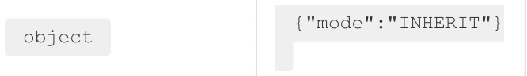

<table>
  <tr>
    <td>data.endpoints[].updat edAt</td>
    <td><code>string&lt;date-</code><br><code>time&gt;</code></td>
    <td><code>"2026-06-</code><br><code>22T12:00:00Z"</code></td>
    <td>更新时间。</td>
  </tr>
  <tr>
    <td>data.syncedAt</td>
    <td><code>string&lt;date-</code><br><code>time&gt;</code></td>
    <td><code>"2026-06-</code><br><code>22T12:00:00Z"</code></td>
    <td>同步时间。</td>
  </tr>
</table>

**示例**

**请求示例**

```http
POST /himarket/v1/open-api/v1/runtime/hosting/sync HTTP/1.1
Host: localhost:8080
X-HIMARKET-OPENAPI: HIMARKET_OPENAPI
X-HIMARKET-TOKEN: <admin-openapi-token>
Content-Type: application/json

{
  "resourceId": "resource-001",
  "versionId": "version-001",
  "providerType": "SANDBOX",
  "runtimeProviderId": "runtime-provider-001",
  "deploymentId": "deployment-001",
  "providerConfig": {}
}
```

**响应示例**

```json
{
  "code": "SUCCESS",
  "message": null,
  "data": {
    "resourceId": "resource-001",
    "versionId": "version-001",
    "resourceKind": "MODEL_API",
    "providerType": "SANDBOX",
    "action": "sample-value",
    "sourceBinding": {
      "sourceBindingId": "sourceBinding-001",
      "resourceId": "resource-001",
      "sourceType": "GATEWAY",
      "sourceRef": "sample-value",
      "primaryBinding": false,
      "priority": 100,
      "syncMode": "AUTO",
      "syncStatus": "SYNCED",
      "credentialRef": "credential-001",
      "config": {
        "key": "value"
      },
      "lastSyncedAt": "2026-06-22T12:00:00Z"
    },
    "endpoints": [
      {
        "endpointId": "endpoint-001",
        "versionId": "version-001",
        "deploymentId": "deployment-001",
        "runtimeProviderId": "runtime-provider-001",
        "providerType": "SANDBOX",
        "providerConfig": {
          "provider": "sandbox",
          "sandboxId": "sandbox-001"
        },
        "name": "sample-name",
        "endpointType": "MODEL_INFERENCE",
        "protocol": "HTTP",
        "url": "https://api.example.com",
        "gatewayId": "gateway-001",
        "routeId": "route-001",
        "authMode": "BEARER",
        "credentialPolicy": {
          "mode": "INHERIT"
        },
        "networkScope": "PUBLIC",
        "defaultInvocation": false,
        "healthStatus": "HEALTHY",
        "status": "ACTIVE",
        "metadata": {
          "source": "himarket"
        },
        "createdAt": "2026-06-22T12:00:00Z",
        "updatedAt": "2026-06-22T12:00:00Z"
      }
    ],
    "syncedAt": "2026-06-22T12:00:00Z"
  },
  "accessDeniedDetail": null,
  "requestId": "req-001"
}
```

<a id="section-2-3-7"></a>

### 2.3.7. AI Resource Subscription 开放接口

<a id="section-2-3-7-1"></a>

#### 2.3.7.1. approveSubscription

**接口信息**

- **接口路径**： `POST /himarket/v1/open-api/v1/subscriptions/{subscriptionId}/approve`

- **接口说明**：审批通过资源订阅并生成 Grant。

- **认证方式**：该接口属于开发者门户 API。调用前请完成开发者登录，并在请求 Header 中携带  `Authorization: Bearer <accessToken>` 。

- **Header 示例**：需要登录态的接口使用  `Authorization: Bearer <accessToken>` 。

**请求参数**

| 参数名称 | 位置 | 类型 | 是否必选 | 示例 | 说明 |
| --- | --- | --- | --- | --- | --- |
| subscriptionId | path | <code>string</code> | 是 | <code>"subscripti</code><br><code>on-001"</code> | 订阅申请 ID。 |
| scope | body | <code>string</code> | 否 | <code>"sample-</code><br><code>value"</code> | 作用域。 |
| credentialBind ingId | body | <code>string</code> | 否 | <code>"credential</code><br><code>Binding-</code><br><code>001"</code> | 凭据绑定 ID。 |
| policy | body | <code>object</code> | 否 | <code>{}</code> | policy 字段。 |
| expiresAt | body | <code>string&lt;date</code><br><code>-time&gt;</code> | 否 | <code>"2026-06-</code><br><code>22T12:00:00Z</code><br><code>"</code> | 过期时间。 |

**返回数据**

| 参数名称 | 类型 | 示例 | 说明 |
| --- | --- | --- | --- |
| code | <code>string</code> | <code>SUCCESS</code> | 响应码，取值为<code> SUCCESS </code> 时表示请求成功。 |
| message | <code>string</code> | <code>null</code> | 响应消息。请求成功时通常为空。 |
| data | <code>object</code> | <code>{"subscriptionId":"</code><br><code>subscription-</code><br><code>001","subjectType":"</code><br><code>USER","subjectId":"s</code><br><code>ubject-</code><br><code>001","targetType":"s</code><br><code>ample-</code><br><code>value","targetId":"t</code><br><code>arget-</code><br><code>001","status":"PENDI</code><br><code>NG"}</code> | 响应数据。具体结构以接口语义为准。 |
| accessDeniedDetail | <code>object</code> | <code>null</code> | 鉴权失败详情。请求成功时通常为空。 |
| requestId | <code>string</code> | <code>req-001</code> | 请求 ID，可用于问题排查和日志检索。 |
| data.subscriptionId | <code>string</code> | <code>"subscription-</code><br><code>001"</code> | 订阅申请 ID。 |
| data.subjectType | <code>string</code> | <code>"USER"</code> | subjectType。可选值：<code> USER </code>、<code> APP </code>。 |
| data.subjectId | <code>string</code> | <code>"subject-001"</code> | 主体 ID。 |
| data.targetType | <code>string</code> | <code>"sample-value"</code> | 订阅目标类型。 |
| data.targetId | <code>string</code> | <code>"target-001"</code> | 目标对象 ID。 |
| data.status | <code>string</code> | <code>"PENDING"</code> | 状态。 |
| data.quotaPolicyId | <code>string</code> | <code>"quotaPolicy-</code><br><code>001"</code> | 配额策略 ID。 |
| data.expiresAt | <code>string&lt;date-</code><br><code>time&gt;</code> | <code>"2026-06-</code><br><code>22T12:00:00Z"</code> | 过期时间。 |
| data.createdAt | <code>string&lt;date-</code><br><code>time&gt;</code> | <code>"2026-06-</code><br><code>22T12:00:00Z"</code> | 创建时间。 |
| data.updatedAt | <code>string&lt;date-</code><br><code>time&gt;</code> | <code>"2026-06-</code><br><code>22T12:00:00Z"</code> | 更新时间。 |
| data.grants | <code>array</code> | <code>[{"grantId":"grant-</code><br><code>001","subscriptionId</code><br><code>":"subscription-</code><br><code>001","scope":"sample</code><br><code>-</code><br><code>value","credentialBi</code><br><code>ndingId":"credential</code><br><code>Binding-</code><br><code>001","policySnapshot</code><br><code>":</code><br><code>{},"status":"ACTIVE"</code><br><code>}]</code> | 授权 Grant 列表。 |
| data.grants\[\].grantId | <code>string</code> | <code>"grant-001"</code> | 授权 Grant ID。 |
| data.grants\[\].subscripti onId | <code>string</code> | <code>"subscription-</code><br><code>001"</code> | 订阅申请 ID。 |
| data.grants\[\].scope | <code>string</code> | <code>"sample-value"</code> | 作用域。 |
| data.grants\[\].credential BindingId | <code>string</code> | <code>"credentialBinding-</code><br><code>001"</code> | 凭据绑定 ID。 |
| data.grants\[\].policySna pshot | <code>object</code> | <code>{}</code> | 策略快照。 |
| data.grants\[\].status | <code>string</code> | <code>"ACTIVE"</code> | 状态。 |
| data.consumerName | <code>string</code> | <code>"sample-</code><br><code>consumer"</code> | Consumer 名称。 |
| data.portalId | <code>string</code> | <code>"portal-001"</code> | 门户ID。 |
| data.portalName | <code>string</code> | <code>"demo-portal"</code> | 门户名称。 |
| data.developerId | <code>string</code> | <code>"developer-001"</code> | 开发者ID。 |
| data.developerUserna me | <code>string</code> | <code>"demo-</code><br><code>developeruser"</code> | 开发者用户名。 |

**示例**

**请求示例**

```http
POST /himarket/v1/open-api/v1/subscriptions/{subscriptionId}/approve HTTP/1.1
Host: localhost:8080
Authorization: Bearer <accessToken>
Content-Type: application/json

{
  "scope": "sample-value",
  "credentialBindingId": "credentialBinding-001",
  "policy": {},
  "expiresAt": "2026-06-22T12:00:00Z"
}
```

**响应示例**

```json
{
  "code": "SUCCESS",
  "message": null,
  "data": {
    "subscriptionId": "subscription-001",
    "subjectType": "USER",
    "subjectId": "subject-001",
    "targetType": "sample-value",
    "targetId": "target-001",
    "status": "PENDING"
  },
  "accessDeniedDetail": null,
  "requestId": "req-001"
}
```

<a id="section-2-3-7-2"></a>

#### 2.3.7.2. createSubscription

**接口信息**

- **接口路径**： `POST /himarket/v1/open-api/v1/subscriptions`

- **接口说明**：创建资源订阅申请。

- **认证方式**：该接口属于开发者门户 API。调用前请完成开发者登录，并在请求 Header 中携带  `Authorization: Bearer <accessToken>` 。

- **Header 示例**：需要登录态的接口使用  `Authorization: Bearer <accessToken>` 。

**请求参数**

| 参数名称 | 位置 | 类型 | 是否必选 | 示例 | 说明 |
| --- | --- | --- | --- | --- | --- |
| subjectType | body | <code>string</code> | 是 | <code>"USER"</code> | subjectType。可选值：<code> USER </code>、<code> APP </code>。 |
| subjectId | body | <code>string</code> | 是 | <code>"subject-</code><br><code>001"</code> | 主体 ID。 |
| targetType | body | <code>string</code> | 是 | <code>"sample-</code><br><code>value"</code> | 订阅目标类型。 |
| targetId | body | <code>string</code> | 是 | <code>"target-</code><br><code>001"</code> | 目标对象 ID。 |
| quotaPolicyId | body | <code>string</code> | 否 | <code>"quotaPolic</code><br><code>y-001"</code> | 配额策略 ID。 |
| expiresAt | body | <code>string&lt;date</code><br><code>-time&gt;</code> | 否 | <code>"2026-06-</code><br><code>22T12:00:00Z</code><br><code>"</code> | 过期时间。 |

**返回数据**

| 参数名称 | 类型 | 示例 | 说明 |
| --- | --- | --- | --- |
| code | <code>string</code> | <code>SUCCESS</code> | 响应码，取值为<code> SUCCESS </code> 时表示请求成功。 |
| message | <code>string</code> | <code>null</code> | 响应消息。请求成功时通常为空。 |
| data | <code>object</code> | <code>{"subscriptionId":"</code><br><code>subscription-</code><br><code>001","subjectType":"</code><br><code>USER","subjectId":"s</code><br><code>ubject-</code><br><code>001","targetType":"s</code><br><code>ample-</code><br><code>value","targetId":"t</code><br><code>arget-</code><br><code>001","status":"PENDI</code><br><code>NG"}</code> | 响应数据。具体结构以接口语义为准。 |
| accessDeniedDetail | <code>object</code> | <code>null</code> | 鉴权失败详情。请求成功时通常为空。 |
| requestId | <code>string</code> | <code>req-001</code> | 请求 ID，可用于问题排查和日志检索。 |
| data.subscriptionId | <code>string</code> | <code>"subscription-</code><br><code>001"</code> | 订阅申请 ID。 |
| data.subjectType | <code>string</code> | <code>"USER"</code> | subjectType。可选值：<code> USER </code>、<code> APP </code>。 |
| data.subjectId | <code>string</code> | <code>"subject-001"</code> | 主体 ID。 |
| data.targetType | <code>string</code> | <code>"sample-value"</code> | 订阅目标类型。 |
| data.targetId | <code>string</code> | <code>"target-001"</code> | 目标对象 ID。 |
| data.status | <code>string</code> | <code>"PENDING"</code> | 状态。 |
| data.quotaPolicyId | <code>string</code> | <code>"quotaPolicy-</code><br><code>001"</code> | 配额策略 ID。 |
| data.expiresAt | <code>string&lt;date-</code><br><code>time&gt;</code> | <code>"2026-06-</code><br><code>22T12:00:00Z"</code> | 过期时间。 |
| data.createdAt | <code>string&lt;date-</code><br><code>time&gt;</code> | <code>"2026-06-</code><br><code>22T12:00:00Z"</code> | 创建时间。 |
| data.updatedAt | <code>string&lt;date-</code><br><code>time&gt;</code> | <code>"2026-06-</code><br><code>22T12:00:00Z"</code> | 更新时间。 |
| data.grants | <code>array</code> | <code>[{"grantId":"grant-</code><br><code>001","subscriptionId</code><br><code>":"subscription-</code><br><code>001","scope":"sample</code><br><code>-</code><br><code>value","credentialBi</code><br><code>ndingId":"credential</code><br><code>Binding-</code><br><code>001","policySnapshot</code><br><code>":</code><br><code>{},"status":"ACTIVE"</code><br><code>}]</code> | 授权 Grant 列表。 |
| data.grants\[\].grantId | <code>string</code> | <code>"grant-001"</code> | 授权 Grant ID。 |
| data.grants\[\].subscripti onId | <code>string</code> | <code>"subscription-</code><br><code>001"</code> | 订阅申请 ID。 |
| data.grants\[\].scope | <code>string</code> | <code>"sample-value"</code> | 作用域。 |
| data.grants\[\].credential BindingId | <code>string</code> | <code>"credentialBinding-</code><br><code>001"</code> | 凭据绑定 ID。 |
| data.grants\[\].policySna pshot | <code>object</code> | <code>{}</code> | 策略快照。 |
| data.grants\[\].status | <code>string</code> | <code>"ACTIVE"</code> | 状态。 |
| data.consumerName | <code>string</code> | <code>"sample-</code><br><code>consumer"</code> | Consumer 名称。 |
| data.portalId | <code>string</code> | <code>"portal-001"</code> | 门户ID。 |
| data.portalName | <code>string</code> | <code>"demo-portal"</code> | 门户名称。 |
| data.developerId | <code>string</code> | <code>"developer-001"</code> | 开发者ID。 |
| data.developerUserna me | <code>string</code> | <code>"demo-</code><br><code>developeruser"</code> | 开发者用户名。 |

**示例**

**请求示例**

```http
POST /himarket/v1/open-api/v1/subscriptions HTTP/1.1
Host: localhost:8080
Authorization: Bearer <accessToken>
Content-Type: application/json

{
  "subjectType": "USER",
  "subjectId": "subject-001",
  "targetType": "sample-value",
  "targetId": "target-001",
  "quotaPolicyId": "quotaPolicy-001",
  "expiresAt": "2026-06-22T12:00:00Z"
}
```

**响应示例**

```json
{
  "code": "SUCCESS",
  "message": null,
  "data": {
    "subscriptionId": "subscription-001",
    "subjectType": "USER",
    "subjectId": "subject-001",
    "targetType": "sample-value",
    "targetId": "target-001",
    "status": "PENDING"
  },
  "accessDeniedDetail": null,
  "requestId": "req-001"
}
```

<a id="section-2-3-7-3"></a>

#### 2.3.7.3. getSubscription

**接口信息**

- **接口路径**： `GET /himarket/v1/open-api/v1/subscriptions/{subscriptionId}`

- **接口说明**：查询资源订阅详情。

- **认证方式**：该接口属于开发者门户 API。调用前请完成开发者登录，并在请求 Header 中携带  `Authorization: Bearer <accessToken>` 。

- **Header 示例**：需要登录态的接口使用  `Authorization: Bearer <accessToken>` 。

**请求参数**

| 参数名称 | 位置 | 类型 | 是否必选 | 示例 | 说明 |
| --- | --- | --- | --- | --- | --- |
| subscriptionId | path | <code>string</code> | 是 | <code>"subscripti</code><br><code>on-001"</code> | 订阅申请 ID。 |

**返回数据**

| 参数名称 | 类型 | 示例 | 说明 |
| --- | --- | --- | --- |
| code | <code>string</code> | <code>SUCCESS</code> | 响应码，取值为<code> SUCCESS </code> 时表示请求成功。 |
| message | <code>string</code> | <code>null</code> | 响应消息。请求成功时通常为空。 |
| data | <code>object</code> | <code>{"subscriptionId":"</code><br><code>subscription-</code><br><code>001","subjectType":"</code><br><code>USER","subjectId":"s</code><br><code>ubject-</code><br><code>001","targetType":"s</code><br><code>ample-</code><br><code>value","targetId":"t</code><br><code>arget-</code><br><code>001","status":"PENDI</code><br><code>NG"}</code> | 响应数据。具体结构以接口语义为准。 |
| accessDeniedDetail | <code>object</code> | <code>null</code> | 鉴权失败详情。请求成功时通常为空。 |
| requestId | <code>string</code> | <code>req-001</code> | 请求 ID，可用于问题排查和日志检索。 |
| data.subscriptionId | <code>string</code> | <code>"subscription-</code><br><code>001"</code> | 订阅申请 ID。 |
| data.subjectType | <code>string</code> | <code>"USER"</code> | subjectType。可选值：<code> USER </code>、<code> APP </code>。 |
| data.subjectId | <code>string</code> | <code>"subject-001"</code> | 主体 ID。 |
| data.targetType | <code>string</code> | <code>"sample-value"</code> | 订阅目标类型。 |
| data.targetId | <code>string</code> | <code>"target-001"</code> | 目标对象 ID。 |
| data.status | <code>string</code> | <code>"PENDING"</code> | 状态。 |
| data.quotaPolicyId | <code>string</code> | <code>"quotaPolicy-</code><br><code>001"</code> | 配额策略 ID。 |
| data.expiresAt | <code>string&lt;date-</code><br><code>time&gt;</code> | <code>"2026-06-</code><br><code>22T12:00:00Z"</code> | 过期时间。 |
| data.createdAt | <code>string&lt;date-</code><br><code>time&gt;</code> | <code>"2026-06-</code><br><code>22T12:00:00Z"</code> | 创建时间。 |
| data.updatedAt | <code>string&lt;date-</code><br><code>time&gt;</code> | <code>"2026-06-</code><br><code>22T12:00:00Z"</code> | 更新时间。 |
| data.grants | <code>array</code> | <code>[{"grantId":"grant-</code><br><code>001","subscriptionId</code><br><code>":"subscription-</code><br><code>001","scope":"sample</code><br><code>-</code><br><code>value","credentialBi</code><br><code>ndingId":"credential</code><br><code>Binding-</code><br><code>001","policySnapshot</code><br><code>":</code><br><code>{},"status":"ACTIVE"</code><br><code>}]</code> | 授权 Grant 列表。 |
| data.grants\[\].grantId | <code>string</code> | <code>"grant-001"</code> | 授权 Grant ID。 |
| data.grants\[\].subscripti onId | <code>string</code> | <code>"subscription-</code><br><code>001"</code> | 订阅申请 ID。 |
| data.grants\[\].scope | <code>string</code> | <code>"sample-value"</code> | 作用域。 |
| data.grants\[\].credential BindingId | <code>string</code> | <code>"credentialBinding-</code><br><code>001"</code> | 凭据绑定 ID。 |
| data.grants\[\].policySna pshot | <code>object</code> | <code>{}</code> | 策略快照。 |
| data.grants\[\].status | <code>string</code> | <code>"ACTIVE"</code> | 状态。 |
| data.consumerName | <code>string</code> | <code>"sample-</code><br><code>consumer"</code> | Consumer 名称。 |
| data.portalId | <code>string</code> | <code>"portal-001"</code> | 门户ID。 |
| data.portalName | <code>string</code> | <code>"demo-portal"</code> | 门户名称。 |
| data.developerId | <code>string</code> | <code>"developer-001"</code> | 开发者ID。 |
| data.developerUserna me | <code>string</code> | <code>"demo-</code><br><code>developeruser"</code> | 开发者用户名。 |

**示例**

**请求示例**

```http
GET /himarket/v1/open-api/v1/subscriptions/{subscriptionId} HTTP/1.1
Host: localhost:8080
Authorization: Bearer <accessToken>
```

**响应示例**

```json
{
  "code": "SUCCESS",
  "message": null,
  "data": {
    "subscriptionId": "subscription-001",
    "subjectType": "USER",
    "subjectId": "subject-001",
    "targetType": "sample-value",
    "targetId": "target-001",
    "status": "PENDING"
  },
  "accessDeniedDetail": null,
  "requestId": "req-001"
}
```

<a id="section-2-3-7-4"></a>

#### 2.3.7.4. listResourceSubscriptions

**接口信息**

- **接口路径**： `GET /himarket/v1/open-api/v1/subscriptions`

- **接口说明**：分页查询资源订阅。

- **认证方式**：该接口属于开发者门户 API。调用前请完成开发者登录，并在请求 Header 中携带  `Authorization: Bearer <accessToken>` 。

- **Header 示例**：需要登录态的接口使用  `Authorization: Bearer <accessToken>` 。

**请求参数**

| 参数名称 | 位置 | 类型 | 是否必选 | 示例 | 说明 |
| --- | --- | --- | --- | --- | --- |
| subjectType | query | <code>string</code> | 否 | <code>"USER"</code> | subjectType。可选值：<code> USER </code>、<code> APP </code>。 |
| subjectId | query | <code>string</code> | 否 | <code>"subject-</code><br><code>001"</code> | 主体 ID。 |
| targetType | query | <code>string</code> | 否 | <code>"sample-</code><br><code>value"</code> | 订阅目标类型。 |
| targetId | query | <code>string</code> | 否 | <code>"target-</code><br><code>001"</code> | 目标对象 ID。 |
| status | query | <code>string</code> | 否 | <code>"PENDING"</code> | 状态。 |
| excludeStatus es | query | <code>array</code> | 否 | <code>["PENDING"]</code> | 查询时需要排除的订阅状态列表。 |
| page | query | <code>integer&lt;int</code><br><code>32&gt;</code> | 否 | <code>1</code> | 页码。 |
| size | query | <code>integer&lt;int</code><br><code>32&gt;</code> | 否 | <code>10</code> | 每页记录数。 |
| sort | query | <code>array</code> | 否 | <code>["sample-</code><br><code>value"]</code> | 排序条件。 |


**返回数据**

| 参数名称 | 类型 | 示例 | 说明 |
| --- | --- | --- | --- |
| code | <code>string</code> | <code>SUCCESS</code> | 响应码，取值为<code> SUCCESS </code> 时表示请求成功。 |
| message | <code>string</code> | <code>null</code> | 响应消息。请求成功时通常为空。 |
| data | <code>object</code> | <code>{"content":</code><br><code>[{}],"pageNumber":1,</code><br><code>"pageSize":10,"total</code><br><code>Count":1}</code> | 响应数据。具体结构以接口语义为准。 |
| accessDeniedDetail | <code>object</code> | <code>null</code> | 鉴权失败详情。请求成功时通常为空。 |
| requestId | <code>string</code> | <code>req-001</code> | 请求 ID，可用于问题排查和日志检索。 |
| data.content | <code>array</code> | <code>[{"subscriptionId":</code><br><code>"subscription-</code><br><code>001","subjectType":"</code><br><code>USER","subjectId":"s</code><br><code>ubject-</code><br><code>001","targetType":"s</code><br><code>ample-</code><br><code>value","targetId":"t</code><br><code>arget-</code><br><code>001","status":"PENDI</code><br><code>NG"}]</code> | 分页结果列表。 |
| data.content\[\].subscrip tionId | <code>string</code> | <code>"subscription-</code><br><code>001"</code> | 订阅申请 ID。 |
| data.content\[\].subjectT ype | <code>string</code> | <code>"USER"</code> | subjectType。可选值：<code> USER </code>、<code> APP </code>。 |
| data.content\[\].subjectI d | <code>string</code> | <code>"subject-001"</code> | 主体 ID。 |
| data.content\[\].targetTy pe | <code>string</code> | <code>"sample-value"</code> | 订阅目标类型。 |
| data.content\[\].targetId | <code>string</code> | <code>"target-001"</code> | 目标对象 ID。 |
| data.content\[\].status | <code>string</code> | <code>"PENDING"</code> | 状态。 |
| data.content\[\].quotaPol icyId | <code>string</code> | <code>"quotaPolicy-</code><br><code>001"</code> | 配额策略 ID。 |
| data.content\[\].expiresA t | <code>string&lt;date-</code><br><code>time&gt;</code> | <code>"2026-06-</code><br><code>22T12:00:00Z"</code> | 过期时间。 |
| data.content\[\].created At | <code>string&lt;date-</code><br><code>time&gt;</code> | <code>"2026-06-</code><br><code>22T12:00:00Z"</code> | 创建时间。 |
| data.content\[\].updated At | <code>string&lt;date-</code><br><code>time&gt;</code> | <code>"2026-06-</code><br><code>22T12:00:00Z"</code> | 更新时间。 |
| data.content\[\].grants | <code>array</code> | <code>[{"grantId":"grant-</code><br><code>001","subscriptionId</code><br><code>":"subscription-</code><br><code>001","scope":"sample</code><br><code>-</code><br><code>value","credentialBi</code><br><code>ndingId":"credential</code><br><code>Binding-</code><br><code>001","policySnapshot</code><br><code>":</code><br><code>{},"status":"ACTIVE"</code><br><code>}]</code> | 授权 Grant 列表。 |
| data.content\[\].grants\[\].grantId | <code>string</code> | <code>"grant-001"</code> | 授权 Grant ID。 |
| data.content\[\].grants\[\].subscriptionId | <code>string</code> | <code>"subscription-</code><br><code>001"</code> | 订阅申请 ID。 |
| data.content\[\].grants\[\].scope | <code>string</code> | <code>"sample-value"</code> | 作用域。 |
| data.content\[\].grants\[\].credentialBindingId | <code>string</code> | <code>"credentialBinding-</code><br><code>001"</code> | 凭据绑定 ID。 |
| data.content\[\].grants\[\].policySnapshot | <code>object</code> | <code>{}</code> | 策略快照。 |
| data.content\[\].grants\[\].status | <code>string</code> | <code>"ACTIVE"</code> | 状态。 |
| data.content\[\].consum erName | <code>string</code> | <code>"sample-</code><br><code>consumer"</code> | Consumer 名称。 |
| data.content\[\].portalId | <code>string</code> | <code>"portal-001"</code> | 门户ID。 |
| data.content\[\].portalNa me | <code>string</code> | <code>"demo-portal"</code> | 门户名称。 |
| data.content\[\].develop erId | <code>string</code> | <code>"developer-001"</code> | 开发者ID。 |
| data.content\[\].develop erUsername | <code>string</code> | <code>"demo-</code><br><code>developeruser"</code> | 开发者用户名。 |
| data.pageNumber | <code>integer&lt;int32&gt;</code> | <code>1</code> | 当前页码。 |
| data.pageSize | <code>integer&lt;int32&gt;</code> | <code>10</code> | 每页大小。 |
| data.totalCount | <code>integer&lt;int64&gt;</code> | <code>1</code> | 总记录数。 |

**示例**

**请求示例**

```text
GET /himarket/v1/open-api/v1/subscriptions?subjectType=USER&subjectId=subject-
001&targetType=sample-value&targetId=target-
001&status=PENDING&excludeStatuses=PENDING&page=1&size=10 HTTP/1.1
Host: localhost:8080
Authorization: Bearer <accessToken>
```

**响应示例**

```json
{
  "code": "SUCCESS",
  "message": null,
  "data": {
    "content": [
      {}
    ],
    "pageNumber": 1,
    "pageSize": 10,
    "totalCount": 1
  },
  "accessDeniedDetail": null,
  "requestId": "req-001"
}
```

<a id="section-2-3-7-5"></a>

#### 2.3.7.5. rejectSubscription

**接口信息**

- **接口路径**： `POST /himarket/v1/open-api/v1/subscriptions/{subscriptionId}/reject`

- **接口说明**：拒绝资源订阅。

- **认证方式**：该接口属于开发者门户 API。调用前请完成开发者登录，并在请求 Header 中携带  `Authorization: Bearer <accessToken>` 。

- **Header 示例**：需要登录态的接口使用  `Authorization: Bearer <accessToken>` 。

**请求参数**

| 参数名称 | 位置 | 类型 | 是否必选 | 示例 | 说明 |
| --- | --- | --- | --- | --- | --- |
| subscriptionId | path | <code>string</code> | 是 | <code>"subscripti</code><br><code>on-001"</code> | 订阅申请 ID。 |
| reason | body | <code>string</code> | 否 | <code>"sample-</code><br><code>value"</code> | 原因说明。 |

**返回数据**

| 参数名称 | 类型 | 示例 | 说明 |
| --- | --- | --- | --- |
| code | <code>string</code> | <code>SUCCESS</code> | 响应码，取值为<code> SUCCESS </code> 时表示请求成功。 |
| message | <code>string</code> | <code>null</code> | 响应消息。请求成功时通常为空。 |
| data | <code>object</code> | <code>{"subscriptionId":"</code><br><code>subscription-</code><br><code>001","subjectType":"</code><br><code>USER","subjectId":"s</code><br><code>ubject-</code><br><code>001","targetType":"s</code><br><code>ample-</code><br><code>value","targetId":"t</code><br><code>arget-</code><br><code>001","status":"PENDI</code><br><code>NG"}</code> | 响应数据。具体结构以接口语义为准。 |
| accessDeniedDetail | <code>object</code> | <code>null</code> | 鉴权失败详情。请求成功时通常为空。 |
| requestId | <code>string</code> | <code>req-001</code> | 请求 ID，可用于问题排查和日志检索。 |
| data.subscriptionId | <code>string</code> | <code>"subscription-</code><br><code>001"</code> | 订阅申请 ID。 |
| data.subjectType | <code>string</code> | <code>"USER"</code> | subjectType。可选值：<code> USER </code>、<code> APP </code>。 |
| data.subjectId | <code>string</code> | <code>"subject-001"</code> | 主体 ID。 |
| data.targetType | <code>string</code> | <code>"sample-value"</code> | 订阅目标类型。 |
| data.targetId | <code>string</code> | <code>"target-001"</code> | 目标对象 ID。 |
| data.status | <code>string</code> | <code>"PENDING"</code> | 状态。 |
| data.quotaPolicyId | <code>string</code> | <code>"quotaPolicy-</code><br><code>001"</code> | 配额策略 ID。 |
| data.expiresAt | <code>string&lt;date-</code><br><code>time&gt;</code> | <code>"2026-06-</code><br><code>22T12:00:00Z"</code> | 过期时间。 |
| data.createdAt | <code>string&lt;date-</code><br><code>time&gt;</code> | <code>"2026-06-</code><br><code>22T12:00:00Z"</code> | 创建时间。 |
| data.updatedAt | <code>string&lt;date-</code><br><code>time&gt;</code> | <code>"2026-06-</code><br><code>22T12:00:00Z"</code> | 更新时间。 |
| data.grants | <code>array</code> | <code>[{"grantId":"grant-</code><br><code>001","subscriptionId</code><br><code>":"subscription-</code><br><code>001","scope":"sample</code><br><code>-</code><br><code>value","credentialBi</code><br><code>ndingId":"credential</code><br><code>Binding-</code><br><code>001","policySnapshot</code><br><code>":</code><br><code>{},"status":"ACTIVE"</code><br><code>}]</code> | 授权 Grant 列表。 |
| data.grants\[\].grantId | <code>string</code> | <code>"grant-001"</code> | 授权 Grant ID。 |
| data.grants\[\].subscripti onId | <code>string</code> | <code>"subscription-</code><br><code>001"</code> | 订阅申请 ID。 |
| data.grants\[\].scope | <code>string</code> | <code>"sample-value"</code> | 作用域。 |
| data.grants\[\].credential BindingId | <code>string</code> | <code>"credentialBinding-</code><br><code>001"</code> | 凭据绑定 ID。 |
| data.grants\[\].policySna pshot | <code>object</code> | <code>{}</code> | 策略快照。 |
| data.grants\[\].status | <code>string</code> | <code>"ACTIVE"</code> | 状态。 |
| data.consumerName | <code>string</code> | <code>"sample-</code><br><code>consumer"</code> | Consumer 名称。 |
| data.portalId | <code>string</code> | <code>"portal-001"</code> | 门户ID。 |
| data.portalName | <code>string</code> | <code>"demo-portal"</code> | 门户名称。 |
| data.developerId | <code>string</code> | <code>"developer-001"</code> | 开发者ID。 |
| data.developerUserna me | <code>string</code> | <code>"demo-</code><br><code>developeruser"</code> | 开发者用户名。 |

**示例**

**请求示例**

```http
POST /himarket/v1/open-api/v1/subscriptions/{subscriptionId}/reject HTTP/1.1
Host: localhost:8080
Authorization: Bearer <accessToken>
Content-Type: application/json

{
  "reason": "sample-value"
}
```

**响应示例**

```json
{
  "code": "SUCCESS",
  "message": null,
  "data": {
    "subscriptionId": "subscription-001",
    "subjectType": "USER",
    "subjectId": "subject-001",
    "targetType": "sample-value",
    "targetId": "target-001",
    "status": "PENDING"
  },
  "accessDeniedDetail": null,
  "requestId": "req-001"
}
```

<a id="section-2-3-7-6"></a>

#### 2.3.7.6. revokeSubscription

**接口信息**

- **接口路径**： `POST /himarket/v1/open-api/v1/subscriptions/{subscriptionId}/revoke`

- **接口说明**：撤销资源订阅和关联 Grant。

- **认证方式**：该接口属于开发者门户 API。调用前请完成开发者登录，并在请求 Header 中携带  `Authorization: Bearer <accessToken>` 。

- **Header 示例**：需要登录态的接口使用  `Authorization: Bearer <accessToken>` 。

**请求参数**

| 参数名称 | 位置 | 类型 | 是否必选 | 示例 | 说明 |
| --- | --- | --- | --- | --- | --- |
| subscriptionId | path | <code>string</code> | 是 | <code>"subscripti</code><br><code>on-001"</code> | 订阅申请 ID。 |

**返回数据**

| 参数名称 | 类型 | 示例 | 说明 |
| --- | --- | --- | --- |
| code | <code>string</code> | <code>SUCCESS</code> | 响应码，取值为<code> SUCCESS </code> 时表示请求成功。 |
| message | <code>string</code> | <code>null</code> | 响应消息。请求成功时通常为空。 |
| data | <code>object</code> | <code>{"subscriptionId":"</code><br><code>subscription-</code><br><code>001","subjectType":"</code><br><code>USER","subjectId":"s</code><br><code>ubject-</code><br><code>001","targetType":"s</code><br><code>ample-</code><br><code>value","targetId":"t</code><br><code>arget-</code><br><code>001","status":"PENDI</code><br><code>NG"}</code> | 响应数据。具体结构以接口语义为准。 |
| accessDeniedDetail | <code>object</code> | <code>null</code> | 鉴权失败详情。请求成功时通常为空。 |
| requestId | <code>string</code> | <code>req-001</code> | 请求 ID，可用于问题排查和日志检索。 |
| data.subscriptionId | <code>string</code> | <code>"subscription-</code><br><code>001"</code> | 订阅申请 ID。 |
| data.subjectType | <code>string</code> | <code>"USER"</code> | subjectType。可选值：<code> USER </code>、<code> APP </code>。 |
| data.subjectId | <code>string</code> | <code>"subject-001"</code> | 主体 ID。 |
| data.targetType | <code>string</code> | <code>"sample-value"</code> | 订阅目标类型。 |
| data.targetId | <code>string</code> | <code>"target-001"</code> | 目标对象 ID。 |
| data.status | <code>string</code> | <code>"PENDING"</code> | 状态。 |
| data.quotaPolicyId | <code>string</code> | <code>"quotaPolicy-</code><br><code>001"</code> | 配额策略 ID。 |
| data.expiresAt | <code>string&lt;date-</code><br><code>time&gt;</code> | <code>"2026-06-</code><br><code>22T12:00:00Z"</code> | 过期时间。 |
| data.createdAt | <code>string&lt;date-</code><br><code>time&gt;</code> | <code>"2026-06-</code><br><code>22T12:00:00Z"</code> | 创建时间。 |
| data.updatedAt | <code>string&lt;date-</code><br><code>time&gt;</code> | <code>"2026-06-</code><br><code>22T12:00:00Z"</code> | 更新时间。 |
| data.grants | <code>array</code> | <code>[{"grantId":"grant-</code><br><code>001","subscriptionId</code><br><code>":"subscription-</code><br><code>001","scope":"sample</code><br><code>-</code><br><code>value","credentialBi</code><br><code>ndingId":"credential</code><br><code>Binding-</code><br><code>001","policySnapshot</code><br><code>":</code><br><code>{},"status":"ACTIVE"</code><br><code>}]</code> | 授权 Grant 列表。 |
| data.grants\[\].grantId | <code>string</code> | <code>"grant-001"</code> | 授权 Grant ID。 |
| data.grants\[\].subscripti onId | <code>string</code> | <code>"subscription-</code><br><code>001"</code> | 订阅申请 ID。 |
| data.grants\[\].scope | <code>string</code> | <code>"sample-value"</code> | 作用域。 |
| data.grants\[\].credential BindingId | <code>string</code> | <code>"credentialBinding-</code><br><code>001"</code> | 凭据绑定 ID。 |
| data.grants\[\].policySna pshot | <code>object</code> | <code>{}</code> | 策略快照。 |
| data.grants\[\].status | <code>string</code> | <code>"ACTIVE"</code> | 状态。 |
| data.consumerName | <code>string</code> | <code>"sample-</code><br><code>consumer"</code> | Consumer 名称。 |
| data.portalId | <code>string</code> | <code>"portal-001"</code> | 门户ID。 |
| data.portalName | <code>string</code> | <code>"demo-portal"</code> | 门户名称。 |
| data.developerId | <code>string</code> | <code>"developer-001"</code> | 开发者ID。 |
| data.developerUserna me | <code>string</code> | <code>"demo-</code><br><code>developeruser"</code> | 开发者用户名。 |

**示例**

**请求示例**

```http
POST /himarket/v1/open-api/v1/subscriptions/{subscriptionId}/revoke HTTP/1.1
Host: localhost:8080
Authorization: Bearer <accessToken>
```

**响应示例**

```json
{
  "code": "SUCCESS",
  "message": null,
  "data": {
    "subscriptionId": "subscription-001",
    "subjectType": "USER",
    "subjectId": "subject-001",
    "targetType": "sample-value",
    "targetId": "target-001",
    "status": "PENDING"
  },
  "accessDeniedDetail": null,
  "requestId": "req-001"
}
```

<a id="section-2-3-8"></a>

### 2.3.8. AI Resource 个人中心开放接口

<a id="section-2-3-8-1"></a>

#### 2.3.8.1. cancelDraftListing

**接口信息**

- **接口路径**： `DELETE /himarket/v1/open-api/v1/me/listings/{listingId}`

- **接口说明**：取消我的 Listing 草稿。

- **认证方式**：该接口属于开发者门户 API。调用前请完成开发者登录，并在请求 Header 中携带  `Authorization: Bearer <accessToken>` 。

- **Header 示例**：需要登录态的接口使用  `Authorization: Bearer <accessToken>` 。

**请求参数**

| 参数名称 | 位置 | 类型 | 是否必选 | 示例 | 说明 |
| --- | --- | --- | --- | --- | --- |
| listingId | path | <code>string</code> | 是 | <code>"listing-</code><br><code>001"</code> | Listing ID。 |

**返回数据**

| 参数名称 | 类型 | 示例 | 说明 |
| --- | --- | --- | --- |
| code | <code>string</code> | <code>SUCCESS</code> | 响应码，取值为<code> SUCCESS </code> 时表示请求成功。 |
| message | <code>string</code> | <code>null</code> | 响应消息。请求成功时通常为空。 |
| data | <code>object</code> | <code>{"listingId":"listi</code><br><code>ng-</code><br><code>001","tenantId":"ten</code><br><code>ant-</code><br><code>001","resourceId":"r</code><br><code>esource-</code><br><code>001","defaultVersion</code><br><code>Id":"defaultVersion-</code><br><code>001","portalId":"por</code><br><code>tal-</code><br><code>001","visibility":"P</code><br><code>RIVATE"}</code> | 响应数据。具体结构以接口语义为准。 |
| accessDeniedDetail | <code>object</code> | <code>null</code> | 鉴权失败详情。请求成功时通常为空。 |
| requestId | <code>string</code> | <code>req-001</code> | 请求 ID，可用于问题排查和日志检索。 |
| data.listingId | <code>string</code> | <code>"listing-001"</code> | Listing ID。 |
| data.tenantId | <code>string</code> | <code>"tenant-001"</code> | 租户ID。 |
| data.resourceId | <code>string</code> | <code>"resource-001"</code> | AI Resource ID。 |
| data.defaultVersionId | <code>string</code> | <code>"defaultVersion-</code><br><code>001"</code> | 默认版本ID。 |
| data.portalId | <code>string</code> | <code>"portal-001"</code> | 门户ID。 |
| data.visibility | <code>string</code> | <code>"PRIVATE"</code> | 可见性。可选值：<code> PRIVATE </code>、<code> PUB</code> <code>LIC </code>。 |
| data.title | <code>string</code> | <code> "</code>示例资源标题<code>" </code> | 标题。 |
| data.summary | <code>string</code> | <code> "</code>示例摘要<code>" </code> | 摘要信息。 |
| data.description | <code>string</code> | <code> "</code>用于演示的资源描述<code>" </code> | 描述信息。 |
| data.icon | <code>string</code> | <code>"sample-value"</code> | 图标地址。 |
| data.banner | <code>string</code> | <code>"sample-value"</code> | 横幅图片地址。 |
| data.categoryId | <code>string</code> | <code>"category-001"</code> | 分类 ID。 |
| data.category | <code>object</code> | <code>{"categoryId":"cate</code><br><code>gory-</code><br><code>001","tenantId":"ten</code><br><code>ant-</code><br><code>001","kind":"MODEL_A</code><br><code>PI","code":"model-</code><br><code>api","name":"sample-</code><br><code>name","description":</code> <code>"</code>用于演示的资源描述<code>"} </code> | 分类信息。 |
| data.category.category Id | <code>string</code> | <code>"category-001"</code> | 分类 ID。 |
| data.category.tenantId | <code>string</code> | <code>"tenant-001"</code> | 租户ID。 |
| data.category.kind | <code>string</code> | <code>"MODEL_API"</code> | 资源类型。 |
| data.category.code | <code>string</code> | <code>"model-api"</code> | 业务编码。 |
| data.category.name | <code>string</code> | <code>"sample-name"</code> | 名称。 |
| data.category.descripti on | <code>string</code> | <code> "</code>用于演示的资源描述<code>" </code> | 描述信息。 |
| data.category.icon | <code>string</code> | <code>"sample-value"</code> | 图标地址。 |
| data.category.sortOrde r | <code>integer&lt;int32&gt;</code> | <code>100</code> | 排序值。 |
| data.category.status | <code>string</code> | <code>"sample-value"</code> | 状态。 |
| data.category.createdB y | <code>string</code> | <code>"sample-value"</code> | 创建人。 |
| data.category.updated By | <code>string</code> | <code>"sample-value"</code> | 更新人。 |
| data.category.createdA t | <code>string&lt;date-</code><br><code>time&gt;</code> | <code>"2026-06-</code><br><code>22T12:00:00Z"</code> | 创建时间。 |
| data.category.updated At | <code>string&lt;date-</code><br><code>time&gt;</code> | <code>"2026-06-</code><br><code>22T12:00:00Z"</code> | 更新时间。 |
| data.category.listingCo unt | <code>integer&lt;int64&gt;</code> | <code>1</code> | Listing 数量。 |
| data.tags | <code>array</code> | <code>["sample-value"]</code> | 标签列表。 |
| data.pricingMode | <code>string</code> | <code>"sample-value"</code> | 计费模式。 |
| data.listingStatus | <code>string</code> | <code>"sample-value"</code> | 市场条目状态。 |
| data.publicationStatus | <code>string</code> | <code>"DRAFT"</code> | 发布状态。可选值：<code> DRAFT </code>、<code> IN_RE</code> <code>VIEW </code>、<code> PUBLISHED </code>、<code> UNPUBLISHED </code>、<code> </code><code>REJECTED </code>。 |
| data.createdBy | <code>string</code> | <code>"sample-value"</code> | 创建人。 |
| data.publishedBy | <code>string</code> | <code>"sample-value"</code> | 发布人 ID。 |
| data.publishedAt | <code>string&lt;date-</code><br><code>time&gt;</code> | <code>"2026-06-</code><br><code>22T12:00:00Z"</code> | 发布时间。 |
| data.createdAt | <code>string&lt;date-</code><br><code>time&gt;</code> | <code>"2026-06-</code><br><code>22T12:00:00Z"</code> | 创建时间。 |
| data.updatedAt | <code>string&lt;date-</code><br><code>time&gt;</code> | <code>"2026-06-</code><br><code>22T12:00:00Z"</code> | 更新时间。 |


**示例**

**请求示例**

```http
DELETE /himarket/v1/open-api/v1/me/listings/{listingId} HTTP/1.1
Host: localhost:8080
Authorization: Bearer <accessToken>
```

**响应示例**

```json
{
  "code": "SUCCESS",
  "message": null,
  "data": {
    "listingId": "listing-001",
    "tenantId": "tenant-001",
    "resourceId": "resource-001",
    "defaultVersionId": "defaultVersion-001",
    "portalId": "portal-001",
    "visibility": "PRIVATE"
  },
  "accessDeniedDetail": null,
  "requestId": "req-001"
}
```

<a id="section-2-3-8-2"></a>

#### 2.3.8.2. createMyResource

**接口信息**

- **接口路径**： `POST /himarket/v1/open-api/v1/me/resources`

- **接口说明**：创建我的 AI Resource。

- **认证方式**：该接口属于开发者门户 API。调用前请完成开发者登录，并在请求 Header 中携带  `Authorization: Bearer <accessToken>` 。

- **Header 示例**：需要登录态的接口使用  `Authorization: Bearer <accessToken>` 。

**请求参数**

| 参数名称 | 位置 | 类型 | 是否必选 | 示例 | 说明 |
| --- | --- | --- | --- | --- | --- |
| apiVersion | body | <code>string</code> | 否 | <code>"sample-</code><br><code>value"</code> | API 版本。 |
| kind | body | <code>string</code> | 是 | <code>"MODEL_API"</code> | 资源类型。 |
| tenantId | body | <code>string</code> | 否 | <code>"tenant-</code><br><code>001"</code> | 租户ID。 |
| name | body | <code>string</code> | 否 | <code>"sample-</code><br><code>name"</code> | 名称。 |


<table>
  <tr>
    <td>displayName</td>
    <td>body</td>
    <td><code>string</code></td>
    <td>否</td>
    <td><code> "</code>示例资源<code>" </code></td>
    <td>展示名称。</td>
  </tr>
  <tr>
    <td>summary</td>
    <td>body</td>
    <td><code>string</code></td>
    <td>否</td>
    <td><code> "</code>示例摘要<code>" </code></td>
    <td>摘要信息。</td>
  </tr>
  <tr>
    <td>description</td>
    <td>body</td>
    <td><code>string</code></td>
    <td>否</td>
    <td><code> "</code>用于演示的资源描述<code>" </code></td>
    <td>描述信息。</td>
  </tr>
  <tr>
    <td>icon</td>
    <td>body</td>
    <td><code>string</code></td>
    <td>否</td>
    <td><code>"sample-</code><br><code>value"</code></td>
    <td>图标地址。</td>
  </tr>
  <tr>
    <td>version</td>
    <td>body</td>
    <td><code>string</code></td>
    <td>否</td>
    <td><code>"sample-</code><br><code>value"</code></td>
    <td>版本号。</td>
  </tr>
  <tr>
    <td>ownerType</td>
    <td>body</td>
    <td><code>string</code></td>
    <td>否</td>
    <td><code>"USER"</code></td>
    <td>归属主体类型。可选值：<code> USER </code>、<code> APP </code>、<code> SYS</code> <code>TEM </code>。</td>
  </tr>
  <tr>
    <td>ownerId</td>
    <td>body</td>
    <td><code>string</code></td>
    <td>否</td>
    <td><code>"owner-</code><br><code>001"</code></td>
    <td>归属主体ID。</td>
  </tr>
  <tr>
    <td>spec</td>
    <td>body</td>
    <td><code>object</code></td>
    <td>是</td>
    <td><code>{}</code></td>
    <td>资源规格定义，结构随资源类型不同而不同。</td>
  </tr>
  <tr>
    <td>dryRun</td>
    <td>body</td>
    <td><code>boolean</code></td>
    <td>否</td>
    <td><code>false</code></td>
    <td>是否只执行预校验。取值为<code> true </code> 时不会写入数据。</td>
  </tr>
  <tr>
    <td>autoApproveS ubscription</td>
    <td>body</td>
    <td><code>boolean</code></td>
    <td>否</td>
    <td><code>true</code></td>
    <td>是否自动批准订阅。</td>
  </tr>
  <tr>
    <td>tags</td>
    <td>body</td>
    <td><code>array</code></td>
    <td>否</td>
    <td><code>["sample-</code><br><code>value"]</code></td>
    <td>标签列表。</td>
  </tr>
</table>

**返回数据**

| 参数名称 | 类型 | 示例 | 说明 |
| --- | --- | --- | --- |
| code | <code>string</code> | <code>SUCCESS</code> | 响应码，取值为<code> SUCCESS </code> 时表示请求成功。 |
| message | <code>string</code> | <code>null</code> | 响应消息。请求成功时通常为空。 |
| data | <code>object</code> | <code>{"dryRun":false,"ac</code><br><code>tion":"sample-</code><br><code>value","kind":"MODEL</code><br><code>_API","resourceId":"</code><br><code>resource-</code><br><code>001","versionId":"ve</code><br><code>rsion-</code><br><code>001","manifestId":"m</code><br><code>anifest-001"}</code> | 响应数据。具体结构以接口语义为准。 |
| accessDeniedDetail | <code>object</code> | <code>null</code> | 鉴权失败详情。请求成功时通常为空。 |
| requestId | <code>string</code> | <code>req-001</code> | 请求 ID，可用于问题排查和日志检索。 |
| data.dryRun | <code>boolean</code> | <code>false</code> | 是否只执行预校验。取值为 <code> true </code> 时不会写入数据。 |
| data.action | <code>string</code> | <code>"sample-value"</code> | 本次操作类型。 |
| data.kind | <code>string</code> | <code>"MODEL_API"</code> | 资源类型。 |
| data.resourceId | <code>string</code> | <code>"resource-001"</code> | AI Resource ID。 |
| data.versionId | <code>string</code> | <code>"version-001"</code> | 版本 ID。 |
| data.manifestId | <code>string</code> | <code>"manifest-001"</code> | Manifest ID。 |
| data.sourceBindingId | <code>string</code> | <code>"sourceBinding-</code><br><code>001"</code> | 来源绑定ID。 |
| data.name | <code>string</code> | <code>"sample-name"</code> | 名称。 |
| data.version | <code>string</code> | <code>"sample-value"</code> | 版本号。 |
| data.endpointCount | <code>integer&lt;int32&gt;</code> | <code>1</code> | Endpoint 数量。 |
| data.capabilityCount | <code>integer&lt;int32&gt;</code> | <code>1</code> | 能力数量。 |
| data.artifactCount | <code>integer&lt;int32&gt;</code> | <code>1</code> | 制品数量。 |
| data.warnings | <code>array</code> | <code>["sample-value"]</code> | 告警信息列表。 |

**示例**

**请求示例**

```http
POST /himarket/v1/open-api/v1/me/resources HTTP/1.1
Host: localhost:8080
Authorization: Bearer <accessToken>
Content-Type: application/json

{
  "apiVersion": "sample-value",
  "kind": "MODEL_API",
  "tenantId": "tenant-001",
  "name": "sample-name",
  "displayName": "示例资源",
  "summary": "示例摘要"
}
```

**响应示例**

```json
{
  "code": "SUCCESS",
  "message": null,
  "data": {
    "dryRun": false,
    "action": "sample-value",
    "kind": "MODEL_API",
    "resourceId": "resource-001",
    "versionId": "version-001",
    "manifestId": "manifest-001"
  },
  "accessDeniedDetail": null,
  "requestId": "req-001"
}
```

<a id="section-2-3-8-3"></a>

#### 2.3.8.3. deleteMyResource

**接口信息**

- **接口路径**： `DELETE /himarket/v1/open-api/v1/me/resources/{resourceId}`

- **接口说明**：删除我的 AI Resource。

- **认证方式**：该接口属于开发者门户 API。调用前请完成开发者登录，并在请求 Header 中携带  `Authorization: Bearer <accessToken>` 。

- **Header 示例**：需要登录态的接口使用  `Authorization: Bearer <accessToken>` 。

**请求参数**

| 参数名称 | 位置 | 类型 | 是否必选 | 示例 | 说明 |
| --- | --- | --- | --- | --- | --- |
| resourceId | path | <code>string</code> | 是 | <code>"resource-</code><br><code>001"</code> | AI Resource ID。 |

**返回数据**

| 参数名称 | 类型 | 示例 | 说明 |
| --- | --- | --- | --- |
| code | <code>string</code> | <code>SUCCESS</code> | 响应码，取值为<code> SUCCESS </code> 时表示请求成功。 |
| message | <code>string</code> | <code>null</code> | 响应消息。请求成功时通常为空。 |
| data | <code>object</code> | <code>{"resourceId":"reso</code><br><code>urce-</code><br><code>001","resourceName":</code><br><code>"sample-mcp-</code><br><code>server","kind":"MODE</code><br><code>L_API","deletedVersi</code><br><code>onCount":1,"deletedL</code><br><code>istingCount":1,"dele</code><br><code>tedReviewCount":1}</code> | 响应数据。具体结构以接口语义为准。 |
| accessDeniedDetail | <code>object</code> | <code>null</code> | 鉴权失败详情。请求成功时通常为空。 |
| requestId | <code>string</code> | <code>req-001</code> | 请求 ID，可用于问题排查和日志检索。 |
| data.resourceId | <code>string</code> | <code>"resource-001"</code> | AI Resource ID。 |
| data.resourceName | <code>string</code> | <code>"sample-mcp-</code><br><code>server"</code> | AI Resource 名称。 |
| data.kind | <code>string</code> | <code>"MODEL_API"</code> | 资源类型。 |
| data.deletedVersionCo unt | <code>integer&lt;int32&gt;</code> | <code>1</code> | 已删除的版本数量。 |
| data.deletedListingCou nt | <code>integer&lt;int32&gt;</code> | <code>1</code> | 已删除的 Listing 数量。 |
| data.deletedReviewCou nt | <code>integer&lt;int32&gt;</code> | <code>1</code> | 已删除的审核单数量。 |
| data.deletedSubscriptio nCount | <code>integer&lt;int32&gt;</code> | <code>1</code> | 已删除的订阅数量。 |
| data.deletedGrantCoun t | <code>integer&lt;int32&gt;</code> | <code>1</code> | 已删除的授权 Grant 数量。 |
| data.deletedEndpointC ount | <code>integer&lt;int32&gt;</code> | <code>1</code> | 已删除的 Endpoint 数量。 |
| data.deletedCapability Count | <code>integer&lt;int32&gt;</code> | <code>1</code> | 已删除的能力数量。 |
| data.deletedArtifactCou nt | <code>integer&lt;int32&gt;</code> | <code>1</code> | 已删除的制品数量。 |
| data.deletedSourceBin dingCount | <code>integer&lt;int32&gt;</code> | <code>1</code> | 已删除的来源绑定数量。 |
| data.deletedManifestCo unt | <code>integer&lt;int32&gt;</code> | <code>1</code> | 已删除的 Manifest 数量。 |

**示例**

**请求示例**

```http
DELETE /himarket/v1/open-api/v1/me/resources/{resourceId} HTTP/1.1
Host: localhost:8080
Authorization: Bearer <accessToken>
```

**响应示例**

```json
{
  "code": "SUCCESS",
  "message": null,
  "data": {
    "resourceId": "resource-001",
    "resourceName": "sample-mcp-server",
    "kind": "MODEL_API",
    "deletedVersionCount": 1,
    "deletedListingCount": 1,
    "deletedReviewCount": 1
  },
  "accessDeniedDetail": null,
  "requestId": "req-001"
}
```

<a id="section-2-3-8-4"></a>

#### 2.3.8.4. forcePublishResourcePackageVersion

**接口信息**

- **接口路径**： `POST /himarket/v1/open-`

  ```text
  api/v1/me/resources/{resourceId}/package/versions/{marketVersion}/force-publish 
  ```

- **接口说明**：强制发布我的 Skill / Worker 包版本。

- **认证方式**：该接口属于开发者门户 API。调用前请完成开发者登录，并在请求 Header 中携带  `Authorization: Bearer <accessToken>` 。

- **Header 示例**：需要登录态的接口使用  `Authorization: Bearer <accessToken>` 。

**请求参数**

| 参数名称 | 位置 | 类型 | 是否必选 | 示例 | 说明 |
| --- | --- | --- | --- | --- | --- |
| resourceId | path | <code>string</code> | 是 | <code>"resource-</code><br><code>001"</code> | AI Resource ID。 |
| marketVersio n | path | <code>string</code> | 是 | <code>"sample-</code><br><code>value"</code> | 市场版本号。 |
| updateLatestL abel | query | <code>boolean</code> | 否 | <code>true</code> | updateLatestL abel 字段。 |

**返回数据**

| 参数名称 | 类型 | 示例 | 说明 |
| --- | --- | --- | --- |
| code | <code>string</code> | <code>SUCCESS</code> | 响应码，取值为<code> SUCCESS </code> 时表示请求成功。 |
| message | <code>string</code> | <code>null</code> | 响应消息。请求成功时通常为空。 |
| data | <code>object</code> | <code>{"versions":</code><br><code>[{}],"orphanSourceVe</code><br><code>rsions":["sample-</code><br><code>value"]}</code> | 响应数据。具体结构以接口语义为准。 |
| accessDeniedDetail | <code>object</code> | <code>null</code> | 鉴权失败详情。请求成功时通常为空。 |
| requestId | <code>string</code> | <code>req-001</code> | 请求 ID，可用于问题排查和日志检索。 |
| data.versions | <code>array</code> | <code>[{"versionId":"vers</code><br><code>ion-</code><br><code>001","version":"samp</code><br><code>le-</code><br><code>value","updateTime":</code><br><code>1,"status":"sample-</code><br><code>value","downloadCoun</code><br><code>t":1,"publishPipelin</code><br><code>eInfo":"sample-</code><br><code>value"}]</code> | 版本列表。 |
| data.versions\[\].versionI d | <code>string</code> | <code>"version-001"</code> | 版本 ID。 |
| data.versions\[\].version | <code>string</code> | <code>"sample-value"</code> | 版本号。 |
| data.versions\[\].update Time | <code>integer&lt;int64&gt;</code> | <code>1</code> | 更新时间。 |
| data.versions\[\].status | <code>string</code> | <code>"sample-value"</code> | 状态。 |
| data.versions\[\].downlo adCount | <code>integer&lt;int64&gt;</code> | <code>1</code> | 下载次数。 |
| data.versions\[\].publish PipelineInfo | <code>string</code> | <code>"sample-value"</code> | 发布流水线信息。 |
| data.versions\[\].isLatest | <code>boolean</code> | <code>true</code> | 是否为最新版本。 |
| data.versions\[\].mappin gState | <code>string</code> | <code>"OK"</code> | mappingState。可选值：<code> OK </code>、<code> NACOS_MI</code> <code>SSING </code>。 |
| data.orphanSourceVers ions | <code>array</code> | <code>["sample-value"]</code> | 未关联到当前资源版本的来源版本列表。 |

**示例**

**请求示例**

```text
POST /himarket/v1/open-
api/v1/me/resources/{resourceId}/package/versions/{marketVersion}/force-publish?
updateLatestLabel=true HTTP/1.1
Host: localhost:8080
Authorization: Bearer <accessToken>
```

**响应示例**

```json
{
  "code": "SUCCESS",
  "message": null,
  "data": {
    "versions": [
      {}
    ],
    "orphanSourceVersions": [
      "sample-value"
    ]
  },
  "accessDeniedDetail": null,
  "requestId": "req-001"
}
```

<a id="section-2-3-8-5"></a>

#### 2.3.8.5. getMyManifestTemplate

**接口信息**

- **接口路径**： `GET /himarket/v1/open-api/v1/me/resources/manifest-template`

- **接口说明**：获取我的 AI Resource 最小 Manifest 模板。

- **认证方式**：该接口属于开发者门户 API。调用前请完成开发者登录，并在请求 Header 中携带  `Authorization: Bearer <accessToken>` 。

- **Header 示例**：需要登录态的接口使用  `Authorization: Bearer <accessToken>` 。

**请求参数**

| 参数名称 | 位置 | 类型 | 是否必选 | 示例 | 说明 |
| --- | --- | --- | --- | --- | --- |
| kind | query | <code>string</code> | 是 | <code>"MODEL_API"</code> | 资源类型。 |


**返回数据**

| 参数名称 | 类型 | 示例 | 说明 |
| --- | --- | --- | --- |
| code | <code>string</code> | <code>SUCCESS</code> | 响应码，取值为<code> SUCCESS </code> 时表示请求成功。 |
| message | <code>string</code> | <code>null</code> | 响应消息。请求成功时通常为空。 |
| data | <code>object</code> | <code>{"kind":"MODEL_API"</code><br><code>,"manifest":</code><br><code>{},"specSchema":</code><br><code>{}}</code> | 响应数据。具体结构以接口语义为准。 |
| accessDeniedDetail | <code>object</code> | <code>null</code> | 鉴权失败详情。请求成功时通常为空。 |
| requestId | <code>string</code> | <code>req-001</code> | 请求 ID，可用于问题排查和日志检索。 |
| data.kind | <code>string</code> | <code>"MODEL_API"</code> | 资源类型。 |
| data.manifest | <code>object</code> | <code>{}</code> | 资源 Manifest 内容。 |
| data.specSchema | <code>object</code> | <code>{}</code> | 规格 Schema。 |

**示例**

**请求示例**

```http
GET /himarket/v1/open-api/v1/me/resources/manifest-template?kind=MODEL_API HTTP/1.1
Host: localhost:8080
Authorization: Bearer <accessToken>
```

**响应示例**

```json
{
  "code": "SUCCESS",
  "message": null,
  "data": {
    "kind": "MODEL_API",
    "manifest": {},
    "specSchema": {}
  },
  "accessDeniedDetail": null,
  "requestId": "req-001"
}
```

<a id="section-2-3-8-6"></a>

#### 2.3.8.6. getMyResource

**接口信息**

- **接口路径**： `GET /himarket/v1/open-api/v1/me/resources/{resourceId}`

- **接口说明**：查询我的 AI Resource 详情。

- **认证方式**：该接口属于开发者门户 API。调用前请完成开发者登录，并在请求 Header 中携带  `Authorization: Bearer <accessToken>` 。

- **Header 示例**：需要登录态的接口使用  `Authorization: Bearer <accessToken>` 。

**请求参数**

| 参数名称 | 位置 | 类型 | 是否必选 | 示例 | 说明 |
| --- | --- | --- | --- | --- | --- |
| resourceId | path | <code>string</code> | 是 | <code>"resource-</code><br><code>001"</code> | AI Resource ID。 |

**返回数据**

| 参数名称 | 类型 | 示例 | 说明 |
| --- | --- | --- | --- |
| code | <code>string</code> | <code>SUCCESS</code> | 响应码，取值为<code> SUCCESS </code> 时表示请求成功。 |
| message | <code>string</code> | <code>null</code> | 响应消息。请求成功时通常为空。 |
| data | <code>object</code> | <code>{"resource":</code><br><code>{"resourceId":"resou</code><br><code>rce-</code><br><code>001","tenantId":"ten</code><br><code>ant-</code><br><code>001","kind":"MODEL_A</code><br><code>PI","name":"sample-</code><br><code>name","displayName":</code> <code>"</code>示例资源<code>","summary":"</code>示例摘要<code>"},"latestVersion":</code> <code>{"versionId":"versio</code><br><code>n-</code><br><code>001","resourceId":"r</code><br><code>esource-</code><br><code>001","version":"samp</code><br><code>le-</code><br><code>value","versionSchem</code><br><code>e":"SEMVER","status"</code><br><code>:"DRAFT","manifestId</code><br><code>":"manifest-</code><br><code>001"},"sourceBinding</code><br><code>s":[{}]}</code> | 响应数据。具体结构以接口语义为准。 |
| accessDeniedDetail | <code>object</code> | <code>null</code> | 鉴权失败详情。请求成功时通常为空。 |
| requestId | <code>string</code> | <code>req-001</code> | 请求 ID，可用于问题排查和日志检索。 |
| data.resource | <code>object</code> | <code>{"resourceId":"reso</code><br><code>urce-</code><br><code>001","tenantId":"ten</code><br><code>ant-</code><br><code>001","kind":"MODEL_A</code><br><code>PI","name":"sample-</code><br><code>name","displayName":</code> <code>"</code>示例资源<code>","summary":"</code>示例摘要<code>"} </code> | AI Resource 基础信息。 |
| data.resource.resourceI d | <code>string</code> | <code>"resource-001"</code> | AI Resource ID。 |
| data.resource.tenantId | <code>string</code> | <code>"tenant-001"</code> | 租户ID。 |
| data.resource.kind | <code>string</code> | <code>"MODEL_API"</code> | 资源类型。 |
| data.resource.name | <code>string</code> | <code>"sample-name"</code> | 名称。 |
| data.resource.displayN ame | <code>string</code> | <code> "</code>示例资源<code>" </code> | 展示名称。 |
| data.resource.summar y | <code>string</code> | <code> "</code>示例摘要<code>" </code> | 摘要信息。 |
| data.resource.descripti on | <code>string</code> | <code> "</code>用于演示的资源描述<code>" </code> | 描述信息。 |
| data.resource.ownerTy pe | <code>string</code> | <code>"USER"</code> | 归属主体类型。可选值：<code> USER </code>、<code> APP </code>、<code> SYSTEM </code>。 |
| data.resource.ownerId | <code>string</code> | <code>"owner-001"</code> | 归属主体ID。 |
| data.resource.createdB y | <code>string</code> | <code>"sample-value"</code> | 创建人。 |
| data.resource.createdB yName | <code>string</code> | <code>"demo-createdby"</code> | 创建人名称。 |
| data.resource.icon | <code>string</code> | <code>"sample-value"</code> | 图标地址。 |
| data.resource.tags | <code>array</code> | <code>["sample-value"]</code> | 标签列表。 |
| data.resource.lifecycle Status | <code>string</code> | <code>"DRAFT"</code> | 生命周期状态。可选值：<code> DRAFT </code>、<code> ACTIV</code> <code>E </code>、<code> DEPRECATED </code>、<code> ARCHIVED </code>。 |
| data.resource.latestVer sionId | <code>string</code> | <code>"latestVersion-</code><br><code>001"</code> | 最新版本ID。 |
| data.resource.autoAppr oveSubscription | <code>boolean</code> | <code>true</code> | 是否自动批准订阅。 |
| data.resource.extras | <code>object</code> | <code>{}</code> | 扩展配置。 |
| data.resource.createdA t | <code>string&lt;date-</code><br><code>time&gt;</code> | <code>"2026-06-</code><br><code>22T12:00:00Z"</code> | 创建时间。 |
| data.resource.updated At | <code>string&lt;date-</code><br><code>time&gt;</code> | <code>"2026-06-</code><br><code>22T12:00:00Z"</code> | 更新时间。 |
| data.latestVersion | <code>object</code> | <code>{"versionId":"versi</code><br><code>on-</code><br><code>001","resourceId":"r</code><br><code>esource-</code><br><code>001","version":"samp</code><br><code>le-</code><br><code>value","versionSchem</code><br><code>e":"SEMVER","status"</code><br><code>:"DRAFT","manifestId</code><br><code>":"manifest-001"}</code> | 最新版本信息。 |
| data.latestVersion.versi onId | <code>string</code> | <code>"version-001"</code> | 版本 ID。 |
| data.latestVersion.reso urceId | <code>string</code> | <code>"resource-001"</code> | AI Resource ID。 |
| data.latestVersion.versi on | <code>string</code> | <code>"sample-value"</code> | 版本号。 |
| data.latestVersion.versi onScheme | <code>string</code> | <code>"SEMVER"</code> | 版本号方案。可选值：<code> SEMVER </code>、<code> TIME</code> <code>STAMP </code>、<code> REVISION </code>、<code> EXTERNAL </code>。 |
| data.latestVersion.stat us | <code>string</code> | <code>"DRAFT"</code> | 状态。 |
| data.latestVersion.mani festId | <code>string</code> | <code>"manifest-001"</code> | Manifest ID。 |
| data.latestVersion.sour ceBindingId | <code>string</code> | <code>"sourceBinding-</code><br><code>001"</code> | 来源绑定ID。 |
| data.latestVersion.artif actDigest | <code>string</code> | <code>"sample-value"</code> | 制品摘要。 |
| data.latestVersion.rele aseNote | <code>string</code> | <code>"sample-value"</code> | 版本说明。 |
| data.latestVersion.crea tedBy | <code>string</code> | <code>"sample-value"</code> | 创建人。 |
| data.latestVersion.publi shedAt | <code>string&lt;date-</code><br><code>time&gt;</code> | <code>"2026-06-</code><br><code>22T12:00:00Z"</code> | 发布时间。 |
| data.latestVersion.crea tedAt | <code>string&lt;date-</code><br><code>time&gt;</code> | <code>"2026-06-</code><br><code>22T12:00:00Z"</code> | 创建时间。 |
| data.latestVersion.upda tedAt | <code>string&lt;date-</code><br><code>time&gt;</code> | <code>"2026-06-</code><br><code>22T12:00:00Z"</code> | 更新时间。 |
| data.latestVersion.dow nloadCount | <code>integer&lt;int64&gt;</code> | <code>1</code> | 下载次数。 |
| data.latestVersion.isLat est | <code>boolean</code> | <code>true</code> | 是否为最新版本。 |
| data.sourceBindings | <code>array</code> | <code>[{"sourceBindingId"</code><br><code>:"sourceBinding-</code><br><code>001","resourceId":"r</code><br><code>esource-</code><br><code>001","sourceType":"G</code><br><code>ATEWAY","sourceRef":</code><br><code>"sample-</code><br><code>value","primaryBindi</code><br><code>ng":false,"priority"</code><br><code>:100}]</code> | 来源绑定列表。 |
| data.sourceBindings\[\].s ourceBindingId | <code>string</code> | <code>"sourceBinding-</code><br><code>001"</code> | 来源绑定ID。 |
| data.sourceBindings\[\].r esourceId | <code>string</code> | <code>"resource-001"</code> | AI Resource ID。 |
| data.sourceBindings\[\].s ourceType | <code>string</code> | <code>"GATEWAY"</code> | 来源类型。可选值：<code> GATEWAY </code>、<code> NAC</code> <code>OS </code>、<code> REMOTE_ENDPOI</code> <code>NT </code>、<code> SANDBOX </code>、<code> R</code> <code>EGISTRY </code>、<code> CUSTOM </code>。 |
| data.sourceBindings\[\].s ourceRef | <code>string</code> | <code>"sample-value"</code> | 来源引用。 |
| data.sourceBindings\[\].p rimaryBinding | <code>boolean</code> | <code>false</code> | 是否为主绑定关系。 |
| data.sourceBindings\[\].p riority | <code>integer&lt;int32&gt;</code> | <code>100</code> | 优先级。 |
| data.sourceBindings\[\].s yncMode | <code>string</code> | <code>"sample-value"</code> | 同步模式。 |
| data.sourceBindings\[\].s yncStatus | <code>string</code> | <code>"sample-value"</code> | 同步状态。 |
| data.sourceBindings\[\].c redentialRef | <code>string</code> | <code>"sample-value"</code> | 凭据引用。 |
| data.sourceBindings\[\].c onfig | <code>object</code> | <code>{}</code> | 配置信息。 |
| data.sourceBindings\[\].l astSyncedAt | <code>string&lt;date-</code><br><code>time&gt;</code> | <code>"2026-06-</code><br><code>22T12:00:00Z"</code> | 最近一次同步时间。 |

**示例**

**请求示例**

```http
GET /himarket/v1/open-api/v1/me/resources/{resourceId} HTTP/1.1
Host: localhost:8080
Authorization: Bearer <accessToken>
```

**响应示例**

```json
{
  "code": "SUCCESS",
  "message": null,
  "data": {
    "resource": {
      "resourceId": "resource-001",
      "tenantId": "tenant-001",
      "kind": "MODEL_API",
      "name": "sample-name",
      "displayName": "示例资源",
      "summary": "示例摘要"
    },
    "latestVersion": {
      "versionId": "version-001",
      "resourceId": "resource-001",
      "version": "sample-value",
      "versionScheme": "SEMVER",
      "status": "DRAFT",
      "manifestId": "manifest-001"
    },
    "sourceBindings": [
      {}
    ]
  },
  "accessDeniedDetail": null,
  "requestId": "req-001"
}
```

<a id="section-2-3-8-7"></a>

#### 2.3.8.7. getMyResourceManifest

**接口信息**

- **接口路径**： `GET /himarket/v1/open-`

  ```text
  api/v1/me/resources/{resourceId}/versions/{versionId}/manifest 
  ```

- **接口说明**：查询我的 AI Resource 版本 Manifest。

- **认证方式**：该接口属于开发者门户 API。调用前请完成开发者登录，并在请求 Header 中携带  `Authorization: Bearer <accessToken>` 。

- **Header 示例**：需要登录态的接口使用  `Authorization: Bearer <accessToken>` 。

**请求参数**

| 参数名称 | 位置 | 类型 | 是否必选 | 示例 | 说明 |
| --- | --- | --- | --- | --- | --- |
| resourceId | path | <code>string</code> | 是 | <code>"resource-</code><br><code>001"</code> | AI Resource ID。 |
| versionId | path | <code>string</code> | 是 | <code>"version-</code><br><code>001"</code> | 版本 ID。 |

**返回数据**

| 参数名称 | 类型 | 示例 | 说明 |
| --- | --- | --- | --- |
| code | <code>string</code> | <code>SUCCESS</code> | 响应码，取值为<code> SUCCESS </code> 时表示请求成功。 |
| message | <code>string</code> | <code>null</code> | 响应消息。请求成功时通常为空。 |
| data | <code>object</code> | <code>{"manifestId":"mani</code><br><code>fest-</code><br><code>001","resourceId":"r</code><br><code>esource-</code><br><code>001","versionId":"ve</code><br><code>rsion-</code><br><code>001","apiVersion":"s</code><br><code>ample-</code><br><code>value","kind":"MODEL</code><br><code>_API","schemaVersion</code><br><code>":"sample-value"}</code> | 响应数据。具体结构以接口语义为准。 |
| accessDeniedDetail | <code>object</code> | <code>null</code> | 鉴权失败详情。请求成功时通常为空。 |
| requestId | <code>string</code> | <code>req-001</code> | 请求 ID，可用于问题排查和日志检索。 |
| data.manifestId | <code>string</code> | <code>"manifest-001"</code> | Manifest ID。 |
| data.resourceId | <code>string</code> | <code>"resource-001"</code> | AI Resource ID。 |
| data.versionId | <code>string</code> | <code>"version-001"</code> | 版本 ID。 |
| data.apiVersion | <code>string</code> | <code>"sample-value"</code> | API 版本。 |
| data.kind | <code>string</code> | <code>"MODEL_API"</code> | 资源类型。 |
| data.schemaVersion | <code>string</code> | <code>"sample-value"</code> | Schema 版本。 |
| data.contentHash | <code>string</code> | <code>"sample-value"</code> | 内容哈希。 |
| data.content | <code>object</code> | <code>{}</code> | 分页结果列表。 |
| data.validationStatus | <code>string</code> | <code>"sample-value"</code> | 校验状态。 |
| data.validationReport | <code>object</code> | <code>{}</code> | 校验报告。 |
| data.createdAt | <code>string&lt;date-</code><br><code>time&gt;</code> | <code>"2026-06-</code><br><code>22T12:00:00Z"</code> | 创建时间。 |
| data.updatedAt | <code>string&lt;date-</code><br><code>time&gt;</code> | <code>"2026-06-</code><br><code>22T12:00:00Z"</code> | 更新时间。 |

**示例**

**请求示例**

```http
GET /himarket/v1/open-api/v1/me/resources/{resourceId}/versions/{versionId}/manifest HTTP/1.1
Host: localhost:8080
Authorization: Bearer <accessToken>
```

**响应示例**

```json
{
  "code": "SUCCESS",
  "message": null,
  "data": {
    "manifestId": "manifest-001",
    "resourceId": "resource-001",
    "versionId": "version-001",
    "apiVersion": "sample-value",
    "kind": "MODEL_API",
    "schemaVersion": "sample-value"
  },
  "accessDeniedDetail": null,
  "requestId": "req-001"
}
```

<a id="section-2-3-8-8"></a>

#### 2.3.8.8. getMyResourceVersion

**接口信息**

- **接口路径**： `GET /himarket/v1/open-api/v1/me/resources/{resourceId}/versions/{versionId}`

- **接口说明**：查询我的 AI Resource 版本详情。

- **认证方式**：该接口属于开发者门户 API。调用前请完成开发者登录，并在请求 Header 中携带  `Authorization: Bearer <accessToken>` 。

- **Header 示例**：需要登录态的接口使用  `Authorization: Bearer <accessToken>` 。

**请求参数**

| 参数名称 | 位置 | 类型 | 是否必选 | 示例 | 说明 |
| --- | --- | --- | --- | --- | --- |
| resourceId | path | <code>string</code> | 是 | <code>"resource-</code><br><code>001"</code> | AI Resource ID。 |
| versionId | path | <code>string</code> | 是 | <code>"version-</code><br><code>001"</code> | 版本 ID。 |

**返回数据**

| 参数名称 | 类型 | 示例 | 说明 |
| --- | --- | --- | --- |
| code | <code>string</code> | <code>SUCCESS</code> | 响应码，取值为<code> SUCCESS </code> 时表示请求成功。 |
| message | <code>string</code> | <code>null</code> | 响应消息。请求成功时通常为空。 |
| data | <code>object</code> | <code>{"resource":</code><br><code>{"resourceId":"resou</code><br><code>rce-</code><br><code>001","tenantId":"ten</code><br><code>ant-</code><br><code>001","kind":"MODEL_A</code><br><code>PI","name":"sample-</code><br><code>name","displayName":</code> <code>"</code>示例资源<code>","summary":"</code>示例摘要<code>"},"version":</code> <code>{"versionId":"versio</code><br><code>n-</code><br><code>001","resourceId":"r</code><br><code>esource-</code><br><code>001","version":"samp</code><br><code>le-</code><br><code>value","versionSchem</code><br><code>e":"SEMVER","status"</code><br><code>:"DRAFT","manifestId</code><br><code>":"manifest-</code><br><code>001"},"sourceBinding</code><br><code>":</code><br><code>{"sourceBindingId":"</code><br><code>sourceBinding-</code><br><code>001","resourceId":"r</code><br><code>esource-</code><br><code>001","sourceType":"G</code><br><code>ATEWAY","sourceRef":</code><br><code>"sample-</code><br><code>value","primaryBindi</code><br><code>ng":false,"priority"</code><br><code>:100},"endpoints":</code><br><code>[{}],"capabilities":</code> | 响应数据。具体结构以接口语义为准。 |
| accessDeniedDetail | <code>object</code> | <code>[{}],"artifacts":</code><br><code>null</code><br><code>[{}]}</code> | 鉴权失败详情。请求成功时通常为空。 |
| requestId | <code>string</code> | <code>req-001</code> | 请求 ID，可用于问题排查和日志检索。 |
| data.resource | <code>object</code> | <code>{"resourceId":"reso</code><br><code>urce-</code><br><code>001","tenantId":"ten</code><br><code>ant-</code><br><code>001","kind":"MODEL_A</code><br><code>PI","name":"sample-</code><br><code>name","displayName":</code> <code>"</code>示例资源<code>","summary":"</code>示例摘要<code>"} </code> | AI Resource 基础信息。 |
| data.resource.resourceI d | <code>string</code> | <code>"resource-001"</code> | AI Resource ID。 |
| data.resource.tenantId | <code>string</code> | <code>"tenant-001"</code> | 租户ID。 |
| data.resource.kind | <code>string</code> | <code>"MODEL_API"</code> | 资源类型。 |
| data.resource.name | <code>string</code> | <code>"sample-name"</code> | 名称。 |
| data.resource.displayN ame | <code>string</code> | <code> "</code>示例资源<code>" </code> | 展示名称。 |
| data.resource.summar y | <code>string</code> | <code> "</code>示例摘要<code>" </code> | 摘要信息。 |
| data.resource.descripti on | <code>string</code> | <code> "</code>用于演示的资源描述<code>" </code> | 描述信息。 |
| data.resource.ownerTy pe | <code>string</code> | <code>"USER"</code> | 归属主体类型。可选值：<code> USER </code>、<code> APP </code>、<code> SYSTEM </code>。 |
| data.resource.ownerId | <code>string</code> | <code>"owner-001"</code> | 归属主体ID。 |
| data.resource.createdB y | <code>string</code> | <code>"sample-value"</code> | 创建人。 |
| data.resource.createdB yName | <code>string</code> | <code>"demo-createdby"</code> | 创建人名称。 |
| data.resource.icon | <code>string</code> | <code>"sample-value"</code> | 图标地址。 |
| data.resource.tags | <code>array</code> | <code>["sample-value"]</code> | 标签列表。 |
| data.resource.lifecycle Status | <code>string</code> | <code>"DRAFT"</code> | 生命周期状态。可选值：<code> DRAFT </code>、<code> ACTIV</code> <code>E </code>、<code> DEPRECATED </code>、<code> ARCHIVED </code>。 |
| data.resource.latestVer sionId | <code>string</code> | <code>"latestVersion-</code><br><code>001"</code> | 最新版本ID。 |
| data.resource.autoAppr oveSubscription | <code>boolean</code> | <code>true</code> | 是否自动批准订阅。 |
| data.resource.extras | <code>object</code> | <code>{}</code> | 扩展配置。 |
| data.resource.createdA t | <code>string&lt;date-</code><br><code>time&gt;</code> | <code>"2026-06-</code><br><code>22T12:00:00Z"</code> | 创建时间。 |
| data.resource.updated At | <code>string&lt;date-</code><br><code>time&gt;</code> | <code>"2026-06-</code><br><code>22T12:00:00Z"</code> | 更新时间。 |
| data.version | <code>object</code> | <code>{"versionId":"versi</code><br><code>on-</code><br><code>001","resourceId":"r</code><br><code>esource-</code><br><code>001","version":"samp</code><br><code>le-</code><br><code>value","versionSchem</code><br><code>e":"SEMVER","status"</code><br><code>:"DRAFT","manifestId</code><br><code>":"manifest-001"}</code> | 版本号。 |
| data.version.versionId | <code>string</code> | <code>"version-001"</code> | 版本 ID。 |
| data.version.resourceId | <code>string</code> | <code>"resource-001"</code> | AI Resource ID。 |
| data.version.version | <code>string</code> | <code>"sample-value"</code> | 版本号。 |
| data.version.versionSc heme | <code>string</code> | <code>"SEMVER"</code> | 版本号方案。可选值：<code> SEMVER </code>、<code> TIME</code> <code>STAMP </code>、<code> REVISION </code>、<code> EXTERNAL </code>。 |
| data.version.status | <code>string</code> | <code>"DRAFT"</code> | 状态。 |
| data.version.manifestId | <code>string</code> | <code>"manifest-001"</code> | Manifest ID。 |
| data.version.sourceBin dingId | <code>string</code> | <code>"sourceBinding-</code><br><code>001"</code> | 来源绑定ID。 |
| data.version.artifactDig est | <code>string</code> | <code>"sample-value"</code> | 制品摘要。 |
| data.version.releaseNot e | <code>string</code> | <code>"sample-value"</code> | 版本说明。 |
| data.version.createdBy | <code>string</code> | <code>"sample-value"</code> | 创建人。 |
| data.version.published At | <code>string&lt;date-</code><br><code>time&gt;</code> | <code>"2026-06-</code><br><code>22T12:00:00Z"</code> | 发布时间。 |
| data.version.createdAt | <code>string&lt;date-</code><br><code>time&gt;</code> | <code>"2026-06-</code><br><code>22T12:00:00Z"</code> | 创建时间。 |
| data.version.updatedAt | <code>string&lt;date-</code><br><code>time&gt;</code> | <code>"2026-06-</code><br><code>22T12:00:00Z"</code> | 更新时间。 |
| data.version.download Count | <code>integer&lt;int64&gt;</code> | <code>1</code> | 下载次数。 |
| data.version.isLatest | <code>boolean</code> | <code>true</code> | 是否为最新版本。 |
| data.sourceBinding | <code>object</code> | <code>{"sourceBindingId":</code><br><code>"sourceBinding-</code><br><code>001","resourceId":"r</code><br><code>esource-</code><br><code>001","sourceType":"G</code><br><code>ATEWAY","sourceRef":</code><br><code>"sample-</code><br><code>value","primaryBindi</code><br><code>ng":false,"priority"</code><br><code>:100}</code> | 来源绑定信息。 |
| data.sourceBinding.sou rceBindingId | <code>string</code> | <code>"sourceBinding-</code><br><code>001"</code> | 来源绑定ID。 |
| data.sourceBinding.res ourceId | <code>string</code> | <code>"resource-001"</code> | AI Resource ID。 |
| data.sourceBinding.sou rceType | <code>string</code> | <code>"GATEWAY"</code> | 来源类型。可选值：<code> GATEWAY </code>、<code> NAC</code> <code>OS </code>、<code> REMOTE_ENDPOI</code> <code>NT </code>、<code> SANDBOX </code>、<code> R</code> <code>EGISTRY </code>、<code> CUSTOM </code>。 |
| data.sourceBinding.sou rceRef | <code>string</code> | <code>"sample-value"</code> | 来源引用。 |
| data.sourceBinding.pri maryBinding | <code>boolean</code> | <code>false</code> | 是否为主绑定关系。 |
| data.sourceBinding.prio rity | <code>integer&lt;int32&gt;</code> | <code>100</code> | 优先级。 |
| data.sourceBinding.syn cMode | <code>string</code> | <code>"sample-value"</code> | 同步模式。 |
| data.sourceBinding.syn cStatus | <code>string</code> | <code>"sample-value"</code> | 同步状态。 |
| data.sourceBinding.cre dentialRef | <code>string</code> | <code>"sample-value"</code> | 凭据引用。 |
| data.sourceBinding.con fig | <code>object</code> | <code>{}</code> | 配置信息。 |
| data.sourceBinding.last SyncedAt | <code>string&lt;date-</code><br><code>time&gt;</code> | <code>"2026-06-</code><br><code>22T12:00:00Z"</code> | 最近一次同步时间。 |

<table>
  <tr>
    <td>data.endpoints</td>
    <td><code>array</code></td>
    <td><code>[{"endpointId":"end</code><br><code>point-</code><br><code>001","versionId":"ve</code><br><code>rsion-</code><br><code>001","deploymentId":</code><br><code>"deployment-</code><br><code>001","runtimeProvide</code><br><code>rId":"runtime-</code><br><code>provider-</code><br><code>001","providerType":</code><br><code>"SANDBOX","providerC</code><br><code>onfig":{}}]</code></td>
    <td>访问端点列表。</td>
  </tr>
  <tr>
    <td>data.endpoints[].endpo intId</td>
    <td><code>string</code></td>
    <td><code>"endpoint-001"</code></td>
    <td>Endpoint ID。</td>
  </tr>
  <tr>
    <td>data.endpoints[].versio nId</td>
    <td><code>string</code></td>
    <td><code>"version-001"</code></td>
    <td>版本 ID。</td>
  </tr>
  <tr>
    <td>data.endpoints[].deplo ymentId</td>
    <td><code>string</code></td>
    <td><code>"deployment-001"</code></td>
    <td>部署ID。</td>
  </tr>
  <tr>
    <td>data.endpoints[].runtim eProviderId</td>
    <td><code>string</code></td>
    <td><code>"runtime-provider-</code><br><code>001"</code></td>
    <td>运行时 Provider ID。</td>
  </tr>
  <tr>
    <td>data.endpoints[].provid erType</td>
    <td><code>string</code></td>
    <td><code>"SANDBOX"</code></td>
    <td>提供方类型。</td>
  </tr>
  <tr>
    <td>data.endpoints[].provid erConfig</td>
    <td><code>object</code></td>
    <td><code>{}</code></td>
    <td>Provider 配置。</td>
  </tr>
  <tr>
    <td>data.endpoints[].name</td>
    <td><code>string</code></td>
    <td><code>"sample-name"</code></td>
    <td>名称。</td>
  </tr>
  <tr>
    <td>data.endpoints[].endpo intType</td>
    <td><code>string</code></td>
    <td><code>"MODEL_INFERENCE"</code></td>
    <td>Endpoint 类型。</td>
  </tr>
</table>


<table>
  <tr>
    <td>data.endpoints[].protoc ol</td>
    <td><code>string</code></td>
    <td><code>"HTTP"</code></td>
    <td>协议类型。可选值：<code> HTTP </code>、<code> HTTPS</code><code> </code>、<code> SSE </code>、<code> STREAMA</code> <code>BLE_HTTP </code>、<code> STDIO </code>、<code> NACOS_DESCRIPTOR</code><code> </code>。</td>
  </tr>
  <tr>
    <td>data.endpoints[].url</td>
    <td><code>string</code></td>
    <td><code>"https://api.exampl</code><br><code>e.com"</code></td>
    <td>访问地址。</td>
  </tr>
  <tr>
    <td>data.endpoints[].gatew ayId</td>
    <td><code>string</code></td>
    <td><code>"gateway-001"</code></td>
    <td>Gateway ID。</td>
  </tr>
  <tr>
    <td>data.endpoints[].routeI d</td>
    <td><code>string</code></td>
    <td><code>"route-001"</code></td>
    <td>路由 ID。</td>
  </tr>
  <tr>
    <td>data.endpoints[].authM ode</td>
    <td><code>string</code></td>
    <td><code>"sample-value"</code></td>
    <td>认证模式。</td>
  </tr>
  <tr>
    <td>data.endpoints[].crede ntialPolicy</td>
    <td><code>object</code></td>
    <td><code>{}</code></td>
    <td>凭据策略。</td>
  </tr>
  <tr>
    <td>data.endpoints[].netwo rkScope</td>
    <td><code>string</code></td>
    <td><code>"sample-value"</code></td>
    <td>网络访问范围。</td>
  </tr>
  <tr>
    <td>data.endpoints[].defaul tInvocation</td>
    <td><code>boolean</code></td>
    <td><code>false</code></td>
    <td>默认调用配置。</td>
  </tr>
  <tr>
    <td>data.endpoints[].health Status</td>
    <td><code>string</code></td>
    <td><code>"sample-value"</code></td>
    <td>健康检查状态。</td>
  </tr>
  <tr>
    <td>data.endpoints[].status</td>
    <td><code>string</code></td>
    <td><code>"ACTIVE"</code></td>
    <td>状态。</td>
  </tr>
  <tr>
    <td>data.endpoints[].metad ata</td>
    <td><code>object</code></td>
    <td><code>{}</code></td>
    <td>扩展元数据。</td>
  </tr>
  <tr>
    <td>data.endpoints[].create dAt</td>
    <td><code>string&lt;date-</code><br><code>time&gt;</code></td>
    <td><code>"2026-06-</code><br><code>22T12:00:00Z"</code></td>
    <td>创建时间。</td>
  </tr>
  <tr>
    <td>data.endpoints[].updat edAt</td>
    <td><code>string&lt;date-</code><br><code>time&gt;</code></td>
    <td><code>"2026-06-</code><br><code>22T12:00:00Z"</code></td>
    <td>更新时间。</td>
  </tr>
</table>


<table>
  <tr>
    <td>data.capabilities</td>
    <td><code>array</code></td>
    <td><code>[{"capabilityId":"c</code><br><code>apability-</code><br><code>001","versionId":"ve</code><br><code>rsion-</code><br><code>001","capabilityType</code><br><code>":"MODEL","name":"sa</code><br><code>mple-</code><br><code>name","displayName":</code> <code>"</code>示例资源<code>","description":"</code>用于演示的资源描述<code>"}] </code></td>
    <td>资源能力列表。</td>
  </tr>
  <tr>
    <td>data.capabilities[].capa bilityId</td>
    <td><code>string</code></td>
    <td><code>"capability-001"</code></td>
    <td>能力 ID。</td>
  </tr>
  <tr>
    <td>data.capabilities[].versi onId</td>
    <td><code>string</code></td>
    <td><code>"version-001"</code></td>
    <td>版本 ID。</td>
  </tr>
  <tr>
    <td>data.capabilities[].capa bilityType</td>
    <td><code>string</code></td>
    <td><code>"MODEL"</code></td>
    <td>capabilityType。可选值：<code> MODEL </code>、<code> MCP_T</code> <code>OOL </code>、<code> MCP_RESOURCE</code><code> </code>、<code> MCP_PROMPT </code>、<code> </code><code>SKILL </code>、<code> WORKER </code>、<code> API </code>。</td>
  </tr>
  <tr>
    <td>data.capabilities[].nam e</td>
    <td><code>string</code></td>
    <td><code>"sample-name"</code></td>
    <td>名称。</td>
  </tr>
  <tr>
    <td>data.capabilities[].displ ayName</td>
    <td><code>string</code></td>
    <td><code> "</code>示例资源<code>" </code></td>
    <td>展示名称。</td>
  </tr>
  <tr>
    <td>data.capabilities[].desc ription</td>
    <td><code>string</code></td>
    <td><code> "</code>用于演示的资源描述<code>" </code></td>
    <td>描述信息。</td>
  </tr>
  <tr>
    <td>data.capabilities[].input Schema</td>
    <td><code>object</code></td>
    <td><code>{}</code></td>
    <td>输入参数 Schema。</td>
  </tr>
  <tr>
    <td>data.capabilities[].outp utSchema</td>
    <td><code>object</code></td>
    <td><code>{}</code></td>
    <td>输出结果 Schema。</td>
  </tr>
  <tr>
    <td>data.capabilities[].tags</td>
    <td><code>array</code></td>
    <td><code>["sample-value"]</code></td>
    <td>标签列表。</td>
  </tr>
</table>


**示例**

**请求示例**

```http
GET /himarket/v1/open-api/v1/me/resources/{resourceId}/versions/{versionId} HTTP/1.1
Host: localhost:8080
Authorization: Bearer <accessToken>
```

**响应示例**

```json
{
  "code": "SUCCESS",
  "message": null,
  "data": {
    "resource": {
      "resourceId": "resource-001",
      "tenantId": "tenant-001",
      "kind": "MODEL_API",
      "name": "sample-name",
      "displayName": "示例资源",
      "summary": "示例摘要"
    },
    "version": {
      "versionId": "version-001",
      "resourceId": "resource-001",
      "version": "sample-value",
      "versionScheme": "SEMVER",
      "status": "DRAFT",
      "manifestId": "manifest-001"
    },
    "sourceBinding": {
      "sourceBindingId": "sourceBinding-001",
      "resourceId": "resource-001",
      "sourceType": "GATEWAY",
      "sourceRef": "sample-value",
      "primaryBinding": false,
      "priority": 100
    },
    "endpoints": [
      {}
    ],
    "capabilities": [
      {}
    ],
    "artifacts": [
      {}
    ]
  },
  "accessDeniedDetail": null,
  "requestId": "req-001"
}
```

<a id="section-2-3-8-9"></a>

#### 2.3.8.9. getOverview

**接口信息**

- **接口路径**： `GET /himarket/v1/open-api/v1/me/overview`

- **接口说明**：查询我的个人中心总览。

- **认证方式**：该接口属于开发者门户 API。调用前请完成开发者登录，并在请求 Header 中携带  `Authorization: Bearer <accessToken>` 。

- **Header 示例**：需要登录态的接口使用  `Authorization: Bearer <accessToken>` 。

**请求参数**

无请求参数。

**返回数据**

| 参数名称 | 类型 | 示例 | 说明 |
| --- | --- | --- | --- |
| code | <code>string</code> | <code>SUCCESS</code> | 响应码，取值为<code> SUCCESS </code> 时表示请求成功。 |
| message | <code>string</code> | <code>null</code> | 响应消息。请求成功时通常为空。 |
| data | <code>object</code> | <code>{"profile":</code><br><code>{"developerId":"deve</code><br><code>loper-</code><br><code>001","portalId":"por</code><br><code>tal-</code><br><code>001","username":"adm</code><br><code>in","email":"user@ex</code><br><code>ample.com","avatarUr</code><br><code>l":"https://api.exam</code><br><code>ple.com","status":"A</code><br><code>PPROVED"},"consumerC</code><br><code>ount":1,"credentialC</code><br><code>onfiguredConsumerCou</code><br><code>nt":1,"subscriptionS</code><br><code>ummary":</code><br><code>{"totalCount":1,"app</code><br><code>rovedCount":1,"pendi</code><br><code>ngCount":1,"rejected</code><br><code>Count":1,"cancelledC</code><br><code>ount":1,"expiredCoun</code><br><code>t":1},"recentSubscri</code><br><code>ptions":[{}]}</code> | 响应数据。具体结构以接口语义为准。 |
| accessDeniedDetail | <code>object</code> | <code>null</code> | 鉴权失败详情。请求成功时通常为空。 |
| requestId | <code>string</code> | <code>req-001</code> | 请求 ID，可用于问题排查和日志检索。 |
| data.profile | <code>object</code> | <code>{"developerId":"dev</code><br><code>eloper-</code><br><code>001","portalId":"por</code><br><code>tal-</code><br><code>001","username":"adm</code><br><code>in","email":"user@ex</code><br><code>ample.com","avatarUr</code><br><code>l":"https://api.exam</code><br><code>ple.com","status":"A</code><br><code>PPROVED"}</code> | 开发者资料。 |
| data.profile.developerI d | <code>string</code> | <code>"developer-001"</code> | 开发者ID。 |
| data.profile.portalId | <code>string</code> | <code>"portal-001"</code> | 门户ID。 |
| data.profile.username | <code>string</code> | <code>"admin"</code> | 用户名。 |
| data.profile.email | <code>string</code> | <code>"user@example.com"</code> | 邮箱。 |
| data.profile.avatarUrl | <code>string</code> | <code>"https://api.exampl</code><br><code>e.com"</code> | 头像地址。 |
| data.profile.status | <code>string</code> | <code>"APPROVED"</code> | 状态。 |
| data.profile.authType | <code>string</code> | <code>"LOCAL"</code> | authType。可选值：<code> LOCAL </code>、<code> BUILT</code> <code>IN </code>、<code> EXTERNAL </code>、<code> </code><code>OIDC </code>、<code> OAUTH2 </code>。 |
| data.profile.createdAt | <code>string&lt;date-</code><br><code>time&gt;</code> | <code>"2026-06-</code><br><code>22T12:00:00Z"</code> | 创建时间。 |
| data.profile.updatedAt | <code>string&lt;date-</code><br><code>time&gt;</code> | <code>"2026-06-</code><br><code>22T12:00:00Z"</code> | 更新时间。 |

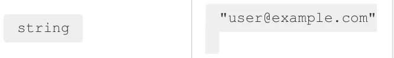

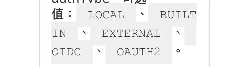

<table>
  <tr>
    <td>data.profile.identities</td>
    <td><code>array</code></td>
    <td><code>[{"provider":"sampl</code><br><code>e-</code><br><code>value","subject":"sa</code><br><code>mple-</code><br><code>value","displayName"</code><code>:"</code>示例资源<code>","authType":"LOCAL</code> <code>","createdAt":"2026-</code><br><code>06-</code><br><code>22T12:00:00Z","updat</code><br><code>edAt":"2026-06-</code><br><code>22T12:00:00Z"}]</code></td>
    <td>身份信息列表。</td>
  </tr>
  <tr>
    <td>data.profile.identities[].provider</td>
    <td><code>string</code></td>
    <td><code>"sample-value"</code></td>
    <td>OIDC Provider 标识。</td>
  </tr>
  <tr>
    <td>data.profile.identities[].subject</td>
    <td><code>string</code></td>
    <td><code>"sample-value"</code></td>
    <td>主体信息。</td>
  </tr>
  <tr>
    <td>data.profile.identities[].displayName</td>
    <td><code>string</code></td>
    <td><code> "</code>示例资源<code>" </code></td>
    <td>展示名称。</td>
  </tr>
  <tr>
    <td>data.profile.identities[].authType</td>
    <td><code>string</code></td>
    <td><code>"LOCAL"</code></td>
    <td>authType。可选值：<code> LOCAL </code>、<code> BUILT</code> <code>IN </code>、<code> EXTERNAL </code>、<code> </code><code>OIDC </code>、<code> OAUTH2 </code>。</td>
  </tr>
  <tr>
    <td>data.profile.identities[].createdAt</td>
    <td><code>string&lt;date-</code><br><code>time&gt;</code></td>
    <td><code>"2026-06-</code><br><code>22T12:00:00Z"</code></td>
    <td>创建时间。</td>
  </tr>
  <tr>
    <td>data.profile.identities[].updatedAt</td>
    <td><code>string&lt;date-</code><br><code>time&gt;</code></td>
    <td><code>"2026-06-</code><br><code>22T12:00:00Z"</code></td>
    <td>更新时间。</td>
  </tr>
  <tr>
    <td>data.consumerCount</td>
    <td><code>integer&lt;int32&gt;</code></td>
    <td><code>1</code></td>
    <td>Consumer 数量。</td>
  </tr>
  <tr>
    <td>data.credentialConfigur edConsumerCount</td>
    <td><code>integer&lt;int32&gt;</code></td>
    <td><code>1</code></td>
    <td>已配置凭据的 Consumer数量。</td>
  </tr>
  <tr>
    <td>data.subscriptionSumm ary</td>
    <td><code>object</code></td>
    <td><code>{"totalCount":1,"ap</code><br><code>provedCount":1,"pend</code><br><code>ingCount":1,"rejecte</code><br><code>dCount":1,"cancelled</code><br><code>Count":1,"expiredCou</code><br><code>nt":1}</code></td>
    <td>订阅汇总信息。</td>
  </tr>
</table>


<table>
  <tr>
    <td>data.subscriptionSumm ary.totalCount</td>
    <td><code>integer&lt;int32&gt;</code></td>
    <td><code>1</code></td>
    <td>总记录数。</td>
  </tr>
  <tr>
    <td>data.subscriptionSumm ary.approvedCount</td>
    <td><code>integer&lt;int32&gt;</code></td>
    <td><code>1</code></td>
    <td>已通过数量。</td>
  </tr>
  <tr>
    <td>data.subscriptionSumm ary.pendingCount</td>
    <td><code>integer&lt;int32&gt;</code></td>
    <td><code>1</code></td>
    <td>待处理数量。</td>
  </tr>
  <tr>
    <td>data.subscriptionSumm ary.rejectedCount</td>
    <td><code>integer&lt;int32&gt;</code></td>
    <td><code>1</code></td>
    <td>已拒绝数量。</td>
  </tr>
  <tr>
    <td>data.subscriptionSumm ary.cancelledCount</td>
    <td><code>integer&lt;int32&gt;</code></td>
    <td><code>1</code></td>
    <td>已取消数量。</td>
  </tr>
  <tr>
    <td>data.subscriptionSumm ary.expiredCount</td>
    <td><code>integer&lt;int32&gt;</code></td>
    <td><code>1</code></td>
    <td>已过期数量。</td>
  </tr>
  <tr>
    <td>data.subscriptionSumm ary.activeGrantCount</td>
    <td><code>integer&lt;int32&gt;</code></td>
    <td><code>1</code></td>
    <td>生效中的授权 Grant 数量。</td>
  </tr>
  <tr>
    <td>data.recentSubscriptio ns</td>
    <td><code>array</code></td>
    <td><code>[{"subscriptionId":</code><br><code>"subscription-</code><br><code>001","consumerId":"c</code><br><code>onsumer-</code><br><code>001","consumerName":</code><br><code>"sample-</code><br><code>consumer","status":"</code><br><code>PENDING","targetType</code><br><code>":"sample-</code><br><code>value","targetId":"t</code><br><code>arget-001"}]</code></td>
    <td>最近的订阅记录。</td>
  </tr>
  <tr>
    <td>data.recentSubscriptio ns[].subscriptionId</td>
    <td><code>string</code></td>
    <td><code>"subscription-</code><br><code>001"</code></td>
    <td>订阅申请 ID。</td>
  </tr>
  <tr>
    <td>data.recentSubscriptio ns[].consumerId</td>
    <td><code>string</code></td>
    <td><code>"consumer-001"</code></td>
    <td>Consumer ID。</td>
  </tr>
  <tr>
    <td>data.recentSubscriptio ns[].consumerName</td>
    <td><code>string</code></td>
    <td><code>"sample-</code><br><code>consumer"</code></td>
    <td>Consumer 名称。</td>
  </tr>
  <tr>
    <td>data.recentSubscriptio ns[].status</td>
    <td><code>string</code></td>
    <td><code>"PENDING"</code></td>
    <td>状态。</td>
  </tr>
  <tr>
    <td>data.recentSubscriptio ns[].targetType</td>
    <td><code>string</code></td>
    <td><code>"sample-value"</code></td>
    <td>订阅目标类型。</td>
  </tr>
  <tr>
    <td>data.recentSubscriptio ns[].targetId</td>
    <td><code>string</code></td>
    <td><code>"target-001"</code></td>
    <td>目标对象 ID。</td>
  </tr>
  <tr>
    <td>data.recentSubscriptio ns[].resourceId</td>
    <td><code>string</code></td>
    <td><code>"resource-001"</code></td>
    <td>AI Resource ID。</td>
  </tr>
  <tr>
    <td>data.recentSubscriptio ns[].versionId</td>
    <td><code>string</code></td>
    <td><code>"version-001"</code></td>
    <td>版本 ID。</td>
  </tr>
  <tr>
    <td>data.recentSubscriptio ns[].resourceKind</td>
    <td><code>string</code></td>
    <td><code>"MODEL_API"</code></td>
    <td>resourceKind。可选值：<code> MODEL_API </code>、<code> M</code> <code>CP_SERVER </code>、<code> SKILL</code><code> </code>、<code> AGENT </code>、<code> WORKE</code> <code>R </code>、<code> REST_API </code>、<code> H</code> <code>TTP_API </code>、<code> PROMPT_T</code> <code>EMPLATE </code>、<code> DATASET</code><code> </code>、<code> EVAL </code>、<code> WORKFL</code> <code>OW </code>。</td>
  </tr>
  <tr>
    <td>data.recentSubscriptio ns[].resourceName</td>
    <td><code>string</code></td>
    <td><code>"sample-mcp-</code><br><code>server"</code></td>
    <td>AI Resource 名称。</td>
  </tr>
  <tr>
    <td>data.recentSubscriptio ns[].activeGrant</td>
    <td><code>boolean</code></td>
    <td><code>true</code></td>
    <td>当前生效的授权 Grant。</td>
  </tr>
  <tr>
    <td>data.recentSubscriptio ns[].expiresAt</td>
    <td><code>string&lt;date-</code><br><code>time&gt;</code></td>
    <td><code>"2026-06-</code><br><code>22T12:00:00Z"</code></td>
    <td>过期时间。</td>
  </tr>
  <tr>
    <td>data.recentSubscriptio ns[].createdAt</td>
    <td><code>string&lt;date-</code><br><code>time&gt;</code></td>
    <td><code>"2026-06-</code><br><code>22T12:00:00Z"</code></td>
    <td>创建时间。</td>
  </tr>
  <tr>
    <td>data.recentSubscriptio ns[].updatedAt</td>
    <td><code>string&lt;date-</code><br><code>time&gt;</code></td>
    <td><code>"2026-06-</code><br><code>22T12:00:00Z"</code></td>
    <td>更新时间。</td>
  </tr>
</table>

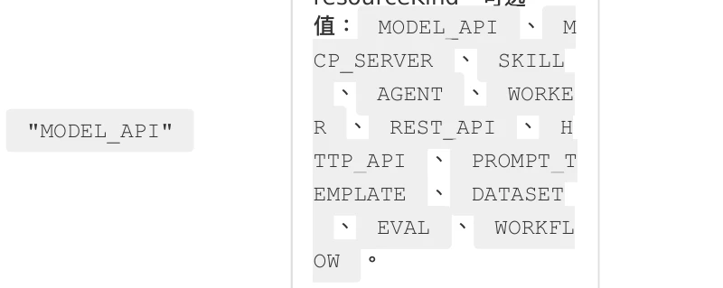

**示例**

**请求示例**

```http
GET /himarket/v1/open-api/v1/me/overview HTTP/1.1
Host: localhost:8080
Authorization: Bearer <accessToken>
```

**响应示例**

```json
{
  "code": "SUCCESS",
  "message": null,
  "data": {
    "profile": {
      "developerId": "developer-001",
      "portalId": "portal-001",
      "username": "admin",
      "email": "user@example.com",
      "avatarUrl": "https://api.example.com",
      "status": "APPROVED"
    },
    "consumerCount": 1,
    "credentialConfiguredConsumerCount": 1,
    "subscriptionSummary": {
      "totalCount": 1,
      "approvedCount": 1,
      "pendingCount": 1,
      "rejectedCount": 1,
      "cancelledCount": 1,
      "expiredCount": 1
    },
    "recentSubscriptions": [
      {}
    ]
  },
  "accessDeniedDetail": null,
  "requestId": "req-001"
}
```

<a id="section-2-3-8-10"></a>

#### 2.3.8.10. getProfile

**接口信息**

- **接口路径**： `GET /himarket/v1/open-api/v1/me/profile`

- **接口说明**：查询我的账号资料。

- **认证方式**：该接口属于开发者门户 API。调用前请完成开发者登录，并在请求 Header 中携带  `Authorization: Bearer <accessToken>` 。

- **Header 示例**：需要登录态的接口使用  `Authorization: Bearer <accessToken>` 。

**请求参数**

无请求参数。

**返回数据**

| 参数名称 | 类型 | 示例 | 说明 |
| --- | --- | --- | --- |
| code | <code>string</code> | <code>SUCCESS</code> | 响应码，取值为<code> SUCCESS </code> 时表示请求成功。 |
| message | <code>string</code> | <code>null</code> | 响应消息。请求成功时通常为空。 |
| data | <code>object</code> | <code>{"developerId":"dev</code><br><code>eloper-</code><br><code>001","portalId":"por</code><br><code>tal-</code><br><code>001","username":"adm</code><br><code>in","email":"user@ex</code><br><code>ample.com","avatarUr</code><br><code>l":"https://api.exam</code><br><code>ple.com","status":"A</code><br><code>PPROVED"}</code> | 响应数据。具体结构以接口语义为准。 |
| accessDeniedDetail | <code>object</code> | <code>null</code> | 鉴权失败详情。请求成功时通常为空。 |
| requestId | <code>string</code> | <code>req-001</code> | 请求 ID，可用于问题排查和日志检索。 |
| data.developerId | <code>string</code> | <code>"developer-001"</code> | 开发者ID。 |
| data.portalId | <code>string</code> | <code>"portal-001"</code> | 门户ID。 |
| data.username | <code>string</code> | <code>"admin"</code> | 用户名。 |
| data.email | <code>string</code> | <code>"user@example.com"</code> | 邮箱。 |
| data.avatarUrl | <code>string</code> | <code>"https://api.exampl</code><br><code>e.com"</code> | 头像地址。 |
| data.status | <code>string</code> | <code>"APPROVED"</code> | 状态。 |
| data.authType | <code>string</code> | <code>"LOCAL"</code> | authType。可选值：<code> LOCAL </code>、<code> BUILT</code> <code>IN </code>、<code> EXTERNAL </code>、<code> </code><code>OIDC </code>、<code> OAUTH2 </code>。 |
| data.createdAt | <code>string&lt;date-</code><br><code>time&gt;</code> | <code>"2026-06-</code><br><code>22T12:00:00Z"</code> | 创建时间。 |


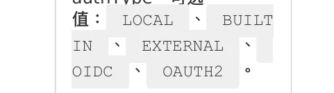

<table>
  <tr>
    <td>data.updatedAt</td>
    <td><code>string&lt;date-</code><br><code>time&gt;</code></td>
    <td><code>"2026-06-</code><br><code>22T12:00:00Z"</code></td>
    <td>更新时间。</td>
  </tr>
  <tr>
    <td>data.identities</td>
    <td><code>array</code></td>
    <td><code>[{"provider":"sampl</code><br><code>e-</code><br><code>value","subject":"sa</code><br><code>mple-</code><br><code>value","displayName"</code><code>:"</code>示例资源<code>","authType":"LOCAL</code> <code>","createdAt":"2026-</code><br><code>06-</code><br><code>22T12:00:00Z","updat</code><br><code>edAt":"2026-06-</code><br><code>22T12:00:00Z"}]</code></td>
    <td>身份信息列表。</td>
  </tr>
  <tr>
    <td>data.identities[].provid er</td>
    <td><code>string</code></td>
    <td><code>"sample-value"</code></td>
    <td>OIDC Provider 标识。</td>
  </tr>
  <tr>
    <td>data.identities[].subject</td>
    <td><code>string</code></td>
    <td><code>"sample-value"</code></td>
    <td>主体信息。</td>
  </tr>
  <tr>
    <td>data.identities[].display Name</td>
    <td><code>string</code></td>
    <td><code> "</code>示例资源<code>" </code></td>
    <td>展示名称。</td>
  </tr>
  <tr>
    <td>data.identities[].authTy pe</td>
    <td><code>string</code></td>
    <td><code>"LOCAL"</code></td>
    <td>authType。可选值：<code> LOCAL </code>、<code> BUILT</code> <code>IN </code>、<code> EXTERNAL </code>、<code> </code><code>OIDC </code>、<code> OAUTH2 </code>。</td>
  </tr>
  <tr>
    <td>data.identities[].create dAt</td>
    <td><code>string&lt;date-</code><br><code>time&gt;</code></td>
    <td><code>"2026-06-</code><br><code>22T12:00:00Z"</code></td>
    <td>创建时间。</td>
  </tr>
  <tr>
    <td>data.identities[].update dAt</td>
    <td><code>string&lt;date-</code><br><code>time&gt;</code></td>
    <td><code>"2026-06-</code><br><code>22T12:00:00Z"</code></td>
    <td>更新时间。</td>
  </tr>
</table>

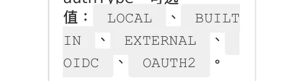

**示例**

**请求示例**

```http
GET /himarket/v1/open-api/v1/me/profile HTTP/1.1
Host: localhost:8080
Authorization: Bearer <accessToken>
```

**响应示例**

```json
{
  "code": "SUCCESS",
  "message": null,
  "data": {
    "developerId": "developer-001",
    "portalId": "portal-001",
    "username": "admin",
    "email": "user@example.com",
    "avatarUrl": "https://api.example.com",
    "status": "APPROVED"
  },
  "accessDeniedDetail": null,
  "requestId": "req-001"
}
```

<a id="section-2-3-8-11"></a>

#### 2.3.8.11. getReview

**接口信息**

- **接口路径**： `GET /himarket/v1/open-api/v1/me/reviews/{submissionId}`

- **接口说明**：查询我的审核单详情。

- **认证方式**：该接口属于开发者门户 API。调用前请完成开发者登录，并在请求 Header 中携带  `Authorization: Bearer <accessToken>` 。

- **Header 示例**：需要登录态的接口使用  `Authorization: Bearer <accessToken>` 。

**请求参数**

| 参数名称 | 位置 | 类型 | 是否必选 | 示例 | 说明 |
| --- | --- | --- | --- | --- | --- |
| submissionId | path | <code>string</code> | 是 | <code>"submission</code><br><code>-001"</code> | 评审提交ID。 |

**返回数据**

| 参数名称 | 类型 | 示例 | 说明 |
| --- | --- | --- | --- |
| code | <code>string</code> | <code>SUCCESS</code> | 响应码，取值为<code> SUCCESS </code> 时表示请求成功。 |
| message | <code>string</code> | <code>null</code> | 响应消息。请求成功时通常为空。 |
| data | <code>object</code> | <code>{"review":</code><br><code>{"submissionId":"sub</code><br><code>mission-</code><br><code>001","targetType":"s</code><br><code>ample-</code><br><code>value","targetId":"t</code><br><code>arget-</code><br><code>001","submitterId":"</code><br><code>submitter-</code><br><code>001","reviewType":"s</code><br><code>ample-</code><br><code>value","status":"PEN</code><br><code>DING"},"listing":</code><br><code>{"listingId":"listin</code><br><code>g-</code><br><code>001","tenantId":"ten</code><br><code>ant-</code><br><code>001","resourceId":"r</code><br><code>esource-</code><br><code>001","defaultVersion</code><br><code>Id":"defaultVersion-</code><br><code>001","portalId":"por</code><br><code>tal-</code><br><code>001","visibility":"P</code><br><code>RIVATE"},"resource":</code><br><code>{"resourceId":"resou</code><br><code>rce-</code><br><code>001","tenantId":"ten</code><br><code>ant-</code><br><code>001","kind":"MODEL_A</code><br><code>PI","name":"sample-</code><br><code>name","displayName":</code> <code>"</code>示例资源<code>","summary":"</code>示例摘要<code>"},"defaultVersion"</code><code>:</code><br><code>{"versionId":"versio</code><br><code>n-</code><br><code>001","resourceId":"r</code><br><code>esource-</code><br><code>001","version":"samp</code><br><code>le-</code><br><code>value","versionSchem</code><br><code>e":"SEMVER","status"</code><br><code>:"DRAFT","manifestId</code><br><code>":"manifest-001"}}</code> | 响应数据。具体结构以接口语义为准。 |
|  |  |  |  |
| accessDeniedDetail | <code>object</code> | <code>null</code> | 鉴权失败详情。请求成功时通常为空。 |
| requestId | <code>string</code> | <code>req-001</code> | 请求 ID，可用于问题排查和日志检索。 |
| data.review | <code>object</code> | <code>{"submissionId":"su</code><br><code>bmission-</code><br><code>001","targetType":"s</code><br><code>ample-</code><br><code>value","targetId":"t</code><br><code>arget-</code><br><code>001","submitterId":"</code><br><code>submitter-</code><br><code>001","reviewType":"s</code><br><code>ample-</code><br><code>value","status":"PEN</code><br><code>DING"}</code> | 审核单信息。 |
| data.review.submission Id | <code>string</code> | <code>"submission-001"</code> | 评审提交ID。 |
| data.review.targetType | <code>string</code> | <code>"sample-value"</code> | 订阅目标类型。 |
| data.review.targetId | <code>string</code> | <code>"target-001"</code> | 目标对象 ID。 |
| data.review.submitterI d | <code>string</code> | <code>"submitter-001"</code> | 提交人 ID。 |
| data.review.reviewTyp e | <code>string</code> | <code>"sample-value"</code> | 审核类型。 |
| data.review.status | <code>string</code> | <code>"PENDING"</code> | 状态。 |
| data.review.checks | <code>object</code> | <code>{}</code> | 审核检查项列表。 |
| data.review.decision | <code>object</code> | <code>{}</code> | 审核决策。 |
| data.review.reviewerId | <code>string</code> | <code>"reviewer-001"</code> | 审核人 ID。 |
| data.review.submittedA t | <code>string&lt;date-</code><br><code>time&gt;</code> | <code>"2026-06-</code><br><code>22T12:00:00Z"</code> | 提交时间。 |
| data.review.decidedAt | <code>string&lt;date-</code><br><code>time&gt;</code> | <code>"2026-06-</code><br><code>22T12:00:00Z"</code> | 审批时间。 |
| data.listing | <code>object</code> | <code>{"listingId":"listi</code><br><code>ng-</code><br><code>001","tenantId":"ten</code><br><code>ant-</code><br><code>001","resourceId":"r</code><br><code>esource-</code><br><code>001","defaultVersion</code><br><code>Id":"defaultVersion-</code><br><code>001","portalId":"por</code><br><code>tal-</code><br><code>001","visibility":"P</code><br><code>RIVATE"}</code> | Listing 信息。 |
| data.listing.listingId | <code>string</code> | <code>"listing-001"</code> | Listing ID。 |
| data.listing.tenantId | <code>string</code> | <code>"tenant-001"</code> | 租户ID。 |
| data.listing.resourceId | <code>string</code> | <code>"resource-001"</code> | AI Resource ID。 |
| data.listing.defaultVersi onId | <code>string</code> | <code>"defaultVersion-</code><br><code>001"</code> | 默认版本ID。 |
| data.listing.portalId | <code>string</code> | <code>"portal-001"</code> | 门户ID。 |
| data.listing.visibility | <code>string</code> | <code>"PRIVATE"</code> | 可见性。可选值：<code> PRIVATE </code>、<code> PUB</code> <code>LIC </code>。 |
| data.listing.title | <code>string</code> | <code> "</code>示例资源标题<code>" </code> | 标题。 |
| data.listing.summary | <code>string</code> | <code> "</code>示例摘要<code>" </code> | 摘要信息。 |
| data.listing.description | <code>string</code> | <code> "</code>用于演示的资源描述<code>" </code> | 描述信息。 |
| data.listing.icon | <code>string</code> | <code>"sample-value"</code> | 图标地址。 |
| data.listing.banner | <code>string</code> | <code>"sample-value"</code> | 横幅图片地址。 |
| data.listing.categoryId | <code>string</code> | <code>"category-001"</code> | 分类 ID。 |
| data.listing.category | <code>object</code> | <code>{"categoryId":"cate</code><br><code>gory-</code><br><code>001","tenantId":"ten</code><br><code>ant-</code><br><code>001","kind":"MODEL_A</code><br><code>PI","code":"model-</code><br><code>api","name":"sample-</code><br><code>name","description":</code> <code>"</code>用于演示的资源描述<code>"} </code> | 分类信息。 |
| data.listing.category.ca tegoryId | <code>string</code> | <code>"category-001"</code> | 分类 ID。 |
| data.listing.category.te nantId | <code>string</code> | <code>"tenant-001"</code> | 租户ID。 |
| data.listing.category.ki nd | <code>string</code> | <code>"MODEL_API"</code> | 资源类型。 |
| data.listing.category.co de | <code>string</code> | <code>"model-api"</code> | 业务编码。 |
| data.listing.category.na me | <code>string</code> | <code>"sample-name"</code> | 名称。 |
| data.listing.category.de scription | <code>string</code> | <code> "</code>用于演示的资源描述<code>" </code> | 描述信息。 |
| data.listing.category.ic on | <code>string</code> | <code>"sample-value"</code> | 图标地址。 |
| data.listing.category.so rtOrder | <code>integer&lt;int32&gt;</code> | <code>100</code> | 排序值。 |
| data.listing.category.st atus | <code>string</code> | <code>"sample-value"</code> | 状态。 |
| data.listing.category.cr eatedBy | <code>string</code> | <code>"sample-value"</code> | 创建人。 |
| data.listing.category.up datedBy | <code>string</code> | <code>"sample-value"</code> | 更新人。 |
| data.listing.category.cr eatedAt | <code>string&lt;date-</code><br><code>time&gt;</code> | <code>"2026-06-</code><br><code>22T12:00:00Z"</code> | 创建时间。 |
| data.listing.category.up datedAt | <code>string&lt;date-</code><br><code>time&gt;</code> | <code>"2026-06-</code><br><code>22T12:00:00Z"</code> | 更新时间。 |
| data.listing.category.lis tingCount | <code>integer&lt;int64&gt;</code> | <code>1</code> | Listing 数量。 |
| data.listing.tags | <code>array</code> | <code>["sample-value"]</code> | 标签列表。 |
| data.listing.pricingMod e | <code>string</code> | <code>"sample-value"</code> | 计费模式。 |
| data.listing.listingStatu s | <code>string</code> | <code>"sample-value"</code> | 市场条目状态。 |
| data.listing.publication Status | <code>string</code> | <code>"DRAFT"</code> | 发布状态。可选值：<code> DRAFT </code>、<code> IN_RE</code> <code>VIEW </code>、<code> PUBLISHED </code>、<code> UNPUBLISHED </code>、<code> </code><code>REJECTED </code>。 |
| data.listing.createdBy | <code>string</code> | <code>"sample-value"</code> | 创建人。 |
| data.listing.publishedB y | <code>string</code> | <code>"sample-value"</code> | 发布人 ID。 |
| data.listing.publishedAt | <code>string&lt;date-</code><br><code>time&gt;</code> | <code>"2026-06-</code><br><code>22T12:00:00Z"</code> | 发布时间。 |

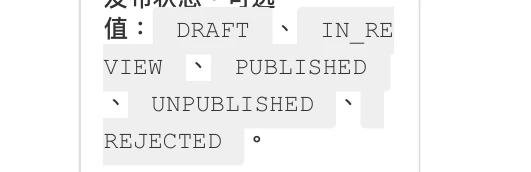

<table>
  <tr>
    <td>data.listing.createdAt</td>
    <td><code>string&lt;date-</code><br><code>time&gt;</code></td>
    <td><code>"2026-06-</code><br><code>22T12:00:00Z"</code></td>
    <td>创建时间。</td>
  </tr>
  <tr>
    <td>data.listing.updatedAt</td>
    <td><code>string&lt;date-</code><br><code>time&gt;</code></td>
    <td><code>"2026-06-</code><br><code>22T12:00:00Z"</code></td>
    <td>更新时间。</td>
  </tr>
  <tr>
    <td>data.resource</td>
    <td><code>object</code></td>
    <td><code>{"resourceId":"reso</code><br><code>urce-</code><br><code>001","tenantId":"ten</code><br><code>ant-</code><br><code>001","kind":"MODEL_A</code><br><code>PI","name":"sample-</code><br><code>name","displayName":</code> <code>"</code>示例资源<code>","summary":"</code>示例摘要<code>"} </code></td>
    <td>AI Resource 基础信息。</td>
  </tr>
  <tr>
    <td>data.resource.resourceI d</td>
    <td><code>string</code></td>
    <td><code>"resource-001"</code></td>
    <td>AI Resource ID。</td>
  </tr>
  <tr>
    <td>data.resource.tenantId</td>
    <td><code>string</code></td>
    <td><code>"tenant-001"</code></td>
    <td>租户ID。</td>
  </tr>
  <tr>
    <td>data.resource.kind</td>
    <td><code>string</code></td>
    <td><code>"MODEL_API"</code></td>
    <td>资源类型。</td>
  </tr>
  <tr>
    <td>data.resource.name</td>
    <td><code>string</code></td>
    <td><code>"sample-name"</code></td>
    <td>名称。</td>
  </tr>
  <tr>
    <td>data.resource.displayN ame</td>
    <td><code>string</code></td>
    <td><code> "</code>示例资源<code>" </code></td>
    <td>展示名称。</td>
  </tr>
  <tr>
    <td>data.resource.summar y</td>
    <td><code>string</code></td>
    <td><code> "</code>示例摘要<code>" </code></td>
    <td>摘要信息。</td>
  </tr>
  <tr>
    <td>data.resource.descripti on</td>
    <td><code>string</code></td>
    <td><code> "</code>用于演示的资源描述<code>" </code></td>
    <td>描述信息。</td>
  </tr>
  <tr>
    <td>data.resource.ownerTy pe</td>
    <td><code>string</code></td>
    <td><code>"USER"</code></td>
    <td>归属主体类型。可选值：<code> USER </code>、<code> APP </code>、<code> SYSTEM </code>。</td>
  </tr>
  <tr>
    <td>data.resource.ownerId</td>
    <td><code>string</code></td>
    <td><code>"owner-001"</code></td>
    <td>归属主体ID。</td>
  </tr>
  <tr>
    <td>data.resource.createdB y</td>
    <td><code>string</code></td>
    <td><code>"sample-value"</code></td>
    <td>创建人。</td>
  </tr>
  <tr>
    <td>data.resource.createdB yName</td>
    <td><code>string</code></td>
    <td><code>"demo-createdby"</code></td>
    <td>创建人名称。</td>
  </tr>
  <tr>
    <td>data.resource.icon</td>
    <td><code>string</code></td>
    <td><code>"sample-value"</code></td>
    <td>图标地址。</td>
  </tr>
  <tr>
    <td>data.resource.tags</td>
    <td><code>array</code></td>
    <td><code>["sample-value"]</code></td>
    <td>标签列表。</td>
  </tr>
  <tr>
    <td>data.resource.lifecycle Status</td>
    <td><code>string</code></td>
    <td><code>"DRAFT"</code></td>
    <td>生命周期状态。可选值：<code> DRAFT </code>、<code> ACTIV</code> <code>E </code>、<code> DEPRECATED </code>、<code> ARCHIVED </code>。</td>
  </tr>
  <tr>
    <td>data.resource.latestVer sionId</td>
    <td><code>string</code></td>
    <td><code>"latestVersion-</code><br><code>001"</code></td>
    <td>最新版本ID。</td>
  </tr>
  <tr>
    <td>data.resource.autoAppr oveSubscription</td>
    <td><code>boolean</code></td>
    <td><code>true</code></td>
    <td>是否自动批准订阅。</td>
  </tr>
  <tr>
    <td>data.resource.extras</td>
    <td><code>object</code></td>
    <td><code>{}</code></td>
    <td>扩展配置。</td>
  </tr>
  <tr>
    <td>data.resource.createdA t</td>
    <td><code>string&lt;date-</code><br><code>time&gt;</code></td>
    <td><code>"2026-06-</code><br><code>22T12:00:00Z"</code></td>
    <td>创建时间。</td>
  </tr>
  <tr>
    <td>data.resource.updated At</td>
    <td><code>string&lt;date-</code><br><code>time&gt;</code></td>
    <td><code>"2026-06-</code><br><code>22T12:00:00Z"</code></td>
    <td>更新时间。</td>
  </tr>
  <tr>
    <td>data.defaultVersion</td>
    <td><code>object</code></td>
    <td><code>{"versionId":"versi</code><br><code>on-</code><br><code>001","resourceId":"r</code><br><code>esource-</code><br><code>001","version":"samp</code><br><code>le-</code><br><code>value","versionSchem</code><br><code>e":"SEMVER","status"</code><br><code>:"DRAFT","manifestId</code><br><code>":"manifest-001"}</code></td>
    <td>默认版本信息。</td>
  </tr>
  <tr>
    <td>data.defaultVersion.ver sionId</td>
    <td><code>string</code></td>
    <td><code>"version-001"</code></td>
    <td>版本 ID。</td>
  </tr>
  <tr>
    <td>data.defaultVersion.res ourceId</td>
    <td><code>string</code></td>
    <td><code>"resource-001"</code></td>
    <td>AI Resource ID。</td>
  </tr>
  <tr>
    <td>data.defaultVersion.ver sion</td>
    <td><code>string</code></td>
    <td><code>"sample-value"</code></td>
    <td>版本号。</td>
  </tr>
  <tr>
    <td>data.defaultVersion.ver sionScheme</td>
    <td><code>string</code></td>
    <td><code>"SEMVER"</code></td>
    <td>版本号方案。可选值：<code> SEMVER </code>、<code> TIME</code> <code>STAMP </code>、<code> REVISION </code>、<code> EXTERNAL </code>。</td>
  </tr>
  <tr>
    <td>data.defaultVersion.sta tus</td>
    <td><code>string</code></td>
    <td><code>"DRAFT"</code></td>
    <td>状态。</td>
  </tr>
  <tr>
    <td>data.defaultVersion.ma nifestId</td>
    <td><code>string</code></td>
    <td><code>"manifest-001"</code></td>
    <td>Manifest ID。</td>
  </tr>
  <tr>
    <td>data.defaultVersion.sou rceBindingId</td>
    <td><code>string</code></td>
    <td><code>"sourceBinding-</code><br><code>001"</code></td>
    <td>来源绑定ID。</td>
  </tr>
  <tr>
    <td>data.defaultVersion.arti factDigest</td>
    <td><code>string</code></td>
    <td><code>"sample-value"</code></td>
    <td>制品摘要。</td>
  </tr>
  <tr>
    <td>data.defaultVersion.rel easeNote</td>
    <td><code>string</code></td>
    <td><code>"sample-value"</code></td>
    <td>版本说明。</td>
  </tr>
  <tr>
    <td>data.defaultVersion.cre atedBy</td>
    <td><code>string</code></td>
    <td><code>"sample-value"</code></td>
    <td>创建人。</td>
  </tr>
</table>

**示例**

**请求示例**

```http
GET /himarket/v1/open-api/v1/me/reviews/{submissionId} HTTP/1.1
Host: localhost:8080
Authorization: Bearer <accessToken>
```

**响应示例**

```json
{
  "code": "SUCCESS",
  "message": null,
  "data": {
    "review": {
      "submissionId": "submission-001",
      "targetType": "sample-value",
      "targetId": "target-001",
      "submitterId": "submitter-001",
      "reviewType": "sample-value",
      "status": "PENDING"
    },
    "listing": {
      "listingId": "listing-001",
      "tenantId": "tenant-001",
      "resourceId": "resource-001",
      "defaultVersionId": "defaultVersion-001",
      "portalId": "portal-001",
      "visibility": "PRIVATE"
    },
    "resource": {
      "resourceId": "resource-001",
      "tenantId": "tenant-001",
      "kind": "MODEL_API",
      "name": "sample-name",
      "displayName": "示例资源",
      "summary": "示例摘要"
    },
    "defaultVersion": {
      "versionId": "version-001",
      "resourceId": "resource-001",
      "version": "sample-value",
      "versionScheme": "SEMVER",
      "status": "DRAFT",
      "manifestId": "manifest-001"
    }
  },
  "accessDeniedDetail": null,
  "requestId": "req-001"
}
```

<a id="section-2-3-8-12"></a>

#### 2.3.8.12. importResourcePackage

**接口信息**

- **接口路径**： `POST /himarket/v1/open-api/v1/me/resource-packages/import`

- **接口说明**：导入我的 Skill / Worker 包。

- **认证方式**：该接口属于开发者门户 API。调用前请完成开发者登录，并在请求 Header 中携带  `Authorization: Bearer <accessToken>` 。

- **Header 示例**：需要登录态的接口使用  `Authorization: Bearer <accessToken>` 。

**请求参数**

| 参数名称 | 位置 | 类型 | 是否必选 | 示例 | 说明 |
| --- | --- | --- | --- | --- | --- |
| kind | query | <code>string</code> | 是 | <code>"MODEL_API"</code> | 资源类型。 |
| file | body | <code>string&lt;bina</code><br><code>ry&gt;</code> | 是 | <code>"sample-</code><br><code>value"</code> | file 字段。 |


**返回数据**

| 参数名称 | 类型 | 示例 | 说明 |
| --- | --- | --- | --- |
| code | <code>string</code> | <code>SUCCESS</code> | 响应码，取值为<code> SUCCESS </code> 时表示请求成功。 |
| message | <code>string</code> | <code>null</code> | 响应消息。请求成功时通常为空。 |
| data | <code>object</code> | <code>{"nacosId":"nacos-</code><br><code>001","namespace":"pu</code><br><code>blic","resourceName"</code><br><code>:"sample-mcp-</code><br><code>server","description</code> <code>":"</code>用于演示的资源描述<code>","latestVersion":"</code> <code>sample-</code><br><code>value","sourceRef":"</code><br><code>sample-value"}</code> | 响应数据。具体结构以接口语义为准。 |
| accessDeniedDetail | <code>object</code> | <code>null</code> | 鉴权失败详情。请求成功时通常为空。 |
| requestId | <code>string</code> | <code>req-001</code> | 请求 ID，可用于问题排查和日志检索。 |
| data.nacosId | <code>string</code> | <code>"nacos-001"</code> | Nacos 实例 ID。 |
| data.namespace | <code>string</code> | <code>"public"</code> | 命名空间。 |
| data.resourceName | <code>string</code> | <code>"sample-mcp-</code><br><code>server"</code> | AI Resource 名称。 |
| data.description | <code>string</code> | <code> "</code>用于演示的资源描述<code>" </code> | 描述信息。 |
| data.latestVersion | <code>string</code> | <code>"sample-value"</code> | 最新版本信息。 |
| data.sourceRef | <code>string</code> | <code>"sample-value"</code> | 来源引用。 |
| data.fileCount | <code>integer&lt;int32&gt;</code> | <code>1</code> | 文件数量。 |
| data.fileTree | <code>array</code> | <code>[{"name":"sample-</code><br><code>name","path":"sample</code><br><code>-</code><br><code>value","type":"sampl</code><br><code>e-</code><br><code>value","encoding":"s</code><br><code>ample-</code><br><code>value","size":10}]</code> | 文件树。 |
| data.fileTree\[\].name | <code>string</code> | <code>"sample-name"</code> | 名称。 |
| data.fileTree\[\].path | <code>string</code> | <code>"sample-value"</code> | 路径。 |
| data.fileTree\[\].type | <code>string</code> | <code>"sample-value"</code> | 类型。 |
| data.fileTree\[\].encodin g | <code>string</code> | <code>"sample-value"</code> | 编码格式。 |
| data.fileTree\[\].size | <code>integer&lt;int32&gt;</code> | <code>10</code> | 每页记录数。 |
| data.fileContents | <code>object</code> | <code>{}</code> | 文件内容。 |

**示例**

**请求示例**

```http
POST /himarket/v1/open-api/v1/me/resource-packages/import?kind=MODEL_API HTTP/1.1
Host: localhost:8080
Authorization: Bearer <accessToken>
Content-Type: application/json

{
  "file": "sample-value"
}
```

**响应示例**

```json
{
  "code": "SUCCESS",
  "message": null,
  "data": {
    "nacosId": "nacos-001",
    "namespace": "public",
    "resourceName": "sample-mcp-server",
    "description": "⽤于演示的资源描述",
    "latestVersion": "sample-value",
    "sourceRef": "sample-value"
  },
  "accessDeniedDetail": null,
  "requestId": "req-001"
}
```

<a id="section-2-3-8-13"></a>

#### 2.3.8.13. listDraftListings

**接口信息**

- **接口路径**： `GET /himarket/v1/open-api/v1/me/listings/drafts`

- **接口说明**：分页查询我的 Listing 草稿。

- **认证方式**：该接口属于开发者门户 API。调用前请完成开发者登录，并在请求 Header 中携带  `Authorization: Bearer <accessToken>` 。

- **Header 示例**：需要登录态的接口使用  `Authorization: Bearer <accessToken>` 。

**请求参数**

| 参数名称 | 位置 | 类型 | 是否必选 | 示例 | 说明 |
| --- | --- | --- | --- | --- | --- |
| tenantId | query | <code>string</code> | 否 | <code>"tenant-</code><br><code>001"</code> | 租户ID。 |
| resourceId | query | <code>string</code> | 否 | <code>"resource-</code><br><code>001"</code> | AI Resource ID。 |
| kind | query | <code>string</code> | 否 | <code>"MODEL_API"</code> | 资源类型。 |
| categoryId | query | <code>string</code> | 否 | <code>"category-</code><br><code>001"</code> | 分类 ID。 |
| portalId | query | <code>string</code> | 否 | <code>"portal-</code><br><code>001"</code> | 门户ID。 |


<table>
  <tr>
    <td>visibility</td>
    <td>query</td>
    <td><code>string</code></td>
    <td>否</td>
    <td><code>"PRIVATE"</code></td>
    <td>可见性。可选值：<code> PRIVATE</code><code> </code>、<code> PUBLIC</code><code> </code>。</td>
  </tr>
  <tr>
    <td>publicationSta tus</td>
    <td>query</td>
    <td><code>string</code></td>
    <td>否</td>
    <td><code>"DRAFT"</code></td>
    <td>发布状态。可选值：<code> DRAFT </code>、<code> IN_REVIEW</code><code> </code>、<code> PUBLISH</code> <code>ED </code>、<code> UNPUB</code> <code>LISHED </code>、<code> R</code> <code>EJECTED </code>。</td>
  </tr>
  <tr>
    <td>keyword</td>
    <td>query</td>
    <td><code>string</code></td>
    <td>否</td>
    <td><code>"sample-</code><br><code>value"</code></td>
    <td>搜索关键词。</td>
  </tr>
  <tr>
    <td>page</td>
    <td>query</td>
    <td><code>integer&lt;int</code><br><code>32&gt;</code></td>
    <td>否</td>
    <td><code>1</code></td>
    <td>页码。</td>
  </tr>
  <tr>
    <td>size</td>
    <td>query</td>
    <td><code>integer&lt;int</code><br><code>32&gt;</code></td>
    <td>否</td>
    <td><code>10</code></td>
    <td>每页记录数。</td>
  </tr>
  <tr>
    <td>sort</td>
    <td>query</td>
    <td><code>array</code></td>
    <td>否</td>
    <td><code>["sample-</code><br><code>value"]</code></td>
    <td>排序条件。</td>
  </tr>
</table>


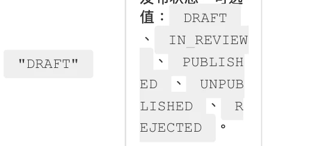

**返回数据**

| 参数名称 | 类型 | 示例 | 说明 |
| --- | --- | --- | --- |
| code | <code>string</code> | <code>SUCCESS</code> | 响应码，取值为<code> SUCCESS </code> 时表示请求成功。 |
| message | <code>string</code> | <code>null</code> | 响应消息。请求成功时通常为空。 |
| data | <code>object</code> | <code>{"content":</code><br><code>[{}],"pageNumber":1,</code><br><code>"pageSize":10,"total</code><br><code>Count":1}</code> | 响应数据。具体结构以接口语义为准。 |
| accessDeniedDetail | <code>object</code> | <code>null</code> | 鉴权失败详情。请求成功时通常为空。 |
| requestId | <code>string</code> | <code>req-001</code> | 请求 ID，可用于问题排查和日志检索。 |
| data.content | <code>array</code> | <code>[{"listingId":"list</code><br><code>ing-</code><br><code>001","tenantId":"ten</code><br><code>ant-</code><br><code>001","resourceId":"r</code><br><code>esource-</code><br><code>001","defaultVersion</code><br><code>Id":"defaultVersion-</code><br><code>001","portalId":"por</code><br><code>tal-</code><br><code>001","visibility":"P</code><br><code>RIVATE"}]</code> | 分页结果列表。 |
| data.content\[\].listingId | <code>string</code> | <code>"listing-001"</code> | Listing ID。 |
| data.content\[\].tenantId | <code>string</code> | <code>"tenant-001"</code> | 租户ID。 |
| data.content\[\].resource Id | <code>string</code> | <code>"resource-001"</code> | AI Resource ID。 |
| data.content\[\].defaultV ersionId | <code>string</code> | <code>"defaultVersion-</code><br><code>001"</code> | 默认版本ID。 |
| data.content\[\].portalId | <code>string</code> | <code>"portal-001"</code> | 门户ID。 |
| data.content\[\].visibility | <code>string</code> | <code>"PRIVATE"</code> | 可见性。可选值：<code> PRIVATE </code>、<code> PUB</code> <code>LIC </code>。 |
| data.content\[\].title | <code>string</code> | <code> "</code>示例资源标题<code>" </code> | 标题。 |
| data.content\[\].summar y | <code>string</code> | <code> "</code>示例摘要<code>" </code> | 摘要信息。 |
| data.content\[\].descripti on | <code>string</code> | <code> "</code>用于演示的资源描述<code>" </code> | 描述信息。 |
| data.content\[\].icon | <code>string</code> | <code>"sample-value"</code> | 图标地址。 |
| data.content\[\].banner | <code>string</code> | <code>"sample-value"</code> | 横幅图片地址。 |
| data.content\[\].category Id | <code>string</code> | <code>"category-001"</code> | 分类 ID。 |
| data.content\[\].category | <code>object</code> | <code>{"categoryId":"cate</code><br><code>gory-</code><br><code>001","tenantId":"ten</code><br><code>ant-</code><br><code>001","kind":"MODEL_A</code><br><code>PI","code":"model-</code><br><code>api","name":"sample-</code><br><code>name","description":</code> <code>"</code>用于演示的资源描述<code>"} </code> | 分类信息。 |
| data.content\[\].category.categoryId | <code>string</code> | <code>"category-001"</code> | 分类 ID。 |
| data.content\[\].category.tenantId | <code>string</code> | <code>"tenant-001"</code> | 租户ID。 |
| data.content\[\].category.kind | <code>string</code> | <code>"MODEL_API"</code> | 资源类型。 |
| data.content\[\].category.code | <code>string</code> | <code>"model-api"</code> | 业务编码。 |
| data.content\[\].category.name | <code>string</code> | <code>"sample-name"</code> | 名称。 |
| data.content\[\].category.description | <code>string</code> | <code> "</code>用于演示的资源描述<code>" </code> | 描述信息。 |
| data.content\[\].category.icon | <code>string</code> | <code>"sample-value"</code> | 图标地址。 |
| data.content\[\].category.sortOrder | <code>integer&lt;int32&gt;</code> | <code>100</code> | 排序值。 |
| data.content\[\].category.status | <code>string</code> | <code>"sample-value"</code> | 状态。 |
| data.content\[\].category.createdBy | <code>string</code> | <code>"sample-value"</code> | 创建人。 |
| data.content\[\].category.updatedBy | <code>string</code> | <code>"sample-value"</code> | 更新人。 |
| data.content\[\].category.createdAt | <code>string&lt;date-</code><br><code>time&gt;</code> | <code>"2026-06-</code><br><code>22T12:00:00Z"</code> | 创建时间。 |
| data.content\[\].category.updatedAt | <code>string&lt;date-</code><br><code>time&gt;</code> | <code>"2026-06-</code><br><code>22T12:00:00Z"</code> | 更新时间。 |
| data.content\[\].category.listingCount | <code>integer&lt;int64&gt;</code> | <code>1</code> | Listing 数量。 |
| data.content\[\].tags | <code>array</code> | <code>["sample-value"]</code> | 标签列表。 |
| data.content\[\].pricingM ode | <code>string</code> | <code>"sample-value"</code> | 计费模式。 |
| data.content\[\].listingSt atus | <code>string</code> | <code>"sample-value"</code> | 市场条目状态。 |
| data.content\[\].publicati onStatus | <code>string</code> | <code>"DRAFT"</code> | 发布状态。可选值：<code> DRAFT </code>、<code> IN_RE</code> <code>VIEW </code>、<code> PUBLISHED </code>、<code> UNPUBLISHED </code>、<code> </code><code>REJECTED </code>。 |
| data.content\[\].created By | <code>string</code> | <code>"sample-value"</code> | 创建人。 |
| data.content\[\].publishe dBy | <code>string</code> | <code>"sample-value"</code> | 发布人 ID。 |
| data.content\[\].publishe dAt | <code>string&lt;date-</code><br><code>time&gt;</code> | <code>"2026-06-</code><br><code>22T12:00:00Z"</code> | 发布时间。 |
| data.content\[\].created At | <code>string&lt;date-</code><br><code>time&gt;</code> | <code>"2026-06-</code><br><code>22T12:00:00Z"</code> | 创建时间。 |
| data.content\[\].updated At | <code>string&lt;date-</code><br><code>time&gt;</code> | <code>"2026-06-</code><br><code>22T12:00:00Z"</code> | 更新时间。 |
| data.pageNumber | <code>integer&lt;int32&gt;</code> | <code>1</code> | 当前页码。 |


<table>
  <tr>
    <td>data.pageSize</td>
    <td><code>integer&lt;int32&gt;</code></td>
    <td><code>10</code></td>
    <td>每页大小。</td>
  </tr>
  <tr>
    <td>data.totalCount</td>
    <td><code>integer&lt;int64&gt;</code></td>
    <td><code>1</code></td>
    <td>总记录数。</td>
  </tr>
</table>

**示例**

**请求示例**

```text
GET /himarket/v1/open-api/v1/me/listings/drafts?tenantId=tenant-001&resourceId=resource-001&kind=MODEL_API&categoryId=category-001&portalId=portal-
001&visibility=PRIVATE&publicationStatus=DRAFT&keyword=sample-value HTTP/1.1
Host: localhost:8080
Authorization: Bearer <accessToken>
```

**响应示例**

```json
{
  "code": "SUCCESS",
  "message": null,
  "data": {
    "content": [
      {}
    ],
    "pageNumber": 1,
    "pageSize": 10,
    "totalCount": 1
  },
  "accessDeniedDetail": null,
  "requestId": "req-001"
}
```

<a id="section-2-3-8-14"></a>

#### 2.3.8.14. listMyMcpEndpoints

**接口信息**

- **接口路径**： `GET /himarket/v1/open-api/v1/me/mcp-endpoints`

- **接口说明**：查询我已订阅的 MCP Server Endpoint 列表。

- **认证方式**：该接口属于开发者门户 API。调用前请完成开发者登录，并在请求 Header 中携带  `Authorization: Bearer <accessToken>` 。

- **Header 示例**：需要登录态的接口使用  `Authorization: Bearer <accessToken>` 。

**请求参数**

无请求参数。

**返回数据**

| 参数名称 | 类型 | 示例 | 说明 |
| --- | --- | --- | --- |
| code | <code>string</code> | <code>SUCCESS</code> | 响应码，取值为<code> SUCCESS </code> 时表示请求成功。 |
| message | <code>string</code> | <code>null</code> | 响应消息。请求成功时通常为空。 |
| data | <code>array</code> | <code>[{"endpointId":"end</code><br><code>point-</code><br><code>001","mcpServerId":"</code><br><code>mcpServer-</code><br><code>001","endpointUrl":"</code><br><code>https://api.example.</code><br><code>com","hostingType":"</code><br><code>api.example.com","pr</code><br><code>otocol":"sample-</code><br><code>value","hostingInsta</code><br><code>nceId":"api.example.</code><br><code>com"}]</code> | 响应数据。具体结构以接口语义为准。 |
| accessDeniedDetail | <code>object</code> | <code>null</code> | 鉴权失败详情。请求成功时通常为空。 |
| requestId | <code>string</code> | <code>req-001</code> | 请求 ID，可用于问题排查和日志检索。 |
| data\[\].endpointId | <code>string</code> | <code>"endpoint-001"</code> | Endpoint ID。 |
| data\[\].mcpServerId | <code>string</code> | <code>"mcpServer-001"</code> | MCP Server ID。 |
| data\[\].endpointUrl | <code>string</code> | <code>"https://api.exampl</code><br><code>e.com"</code> | Endpoint 访问地址。 |
| data\[\].hostingType | <code>string</code> | <code>"api.example.com"</code> | 托管类型。 |
| data\[\].protocol | <code>string</code> | <code>"sample-value"</code> | 协议类型。 |
| data\[\].hostingInstanceI d | <code>string</code> | <code>"api.example.com"</code> | 托管实例 ID。 |
| data\[\].subscribeParams | <code>string</code> | <code>"sample-value"</code> | 订阅参数。 |


<table>
  <tr>
    <td>data[].status</td>
    <td><code>string</code></td>
    <td><code>"sample-value"</code></td>
    <td>状态。</td>
  </tr>
  <tr>
    <td>data[].endpointCreated At</td>
    <td><code>string&lt;date-</code><br><code>time&gt;</code></td>
    <td><code>"2026-06-</code><br><code>22T12:00:00Z"</code></td>
    <td>Endpoint 创建时间。</td>
  </tr>
  <tr>
    <td>data[].resourceId</td>
    <td><code>string</code></td>
    <td><code>"resource-001"</code></td>
    <td>AI Resource ID。</td>
  </tr>
  <tr>
    <td>data[].displayName</td>
    <td><code>string</code></td>
    <td><code> "</code>示例资源<code>" </code></td>
    <td>展示名称。</td>
  </tr>
  <tr>
    <td>data[].mcpName</td>
    <td><code>string</code></td>
    <td><code>"sample-mcp"</code></td>
    <td>MCP Server 名称。</td>
  </tr>
  <tr>
    <td>data[].description</td>
    <td><code>string</code></td>
    <td><code> "</code>用于演示的资源描述<code>" </code></td>
    <td>描述信息。</td>
  </tr>
  <tr>
    <td>data[].icon</td>
    <td><code>string</code></td>
    <td><code>"sample-value"</code></td>
    <td>图标地址。</td>
  </tr>
  <tr>
    <td>data[].tags</td>
    <td><code>string</code></td>
    <td><code>"sample-value"</code></td>
    <td>标签列表。</td>
  </tr>
  <tr>
    <td>data[].protocolType</td>
    <td><code>string</code></td>
    <td><code>"sample-value"</code></td>
    <td>协议类型。</td>
  </tr>
  <tr>
    <td>data[].origin</td>
    <td><code>string</code></td>
    <td><code>"sample-value"</code></td>
    <td>来源标识。</td>
  </tr>
  <tr>
    <td>data[].toolsConfig</td>
    <td><code>string</code></td>
    <td><code>"sample-value"</code></td>
    <td>工具配置。</td>
  </tr>
</table>

**示例**

**请求示例**

```http
GET /himarket/v1/open-api/v1/me/mcp-endpoints HTTP/1.1
Host: localhost:8080
Authorization: Bearer <accessToken>
```

**响应示例**

```json
{
  "code": "SUCCESS",
  "message": null,
  "data": [
    {
      "endpointId": "endpoint-001",
      "mcpServerId": "mcpServer-001",
      "endpointUrl": "https://api.example.com",
      "hostingType": "api.example.com",
      "protocol": "sample-value",
      "hostingInstanceId": "api.example.com"
    }
  ],
  "accessDeniedDetail": null,
  "requestId": "req-001"
}
```

<a id="section-2-3-8-15"></a>

#### 2.3.8.15. listMyResourceVersions

**接口信息**

- **接口路径**： `GET /himarket/v1/open-api/v1/me/resources/{resourceId}/versions`

- **接口说明**：分页查询我的 AI Resource 版本。

- **认证方式**：该接口属于开发者门户 API。调用前请完成开发者登录，并在请求 Header 中携带  `Authorization: Bearer <accessToken>` 。

- **Header 示例**：需要登录态的接口使用  `Authorization: Bearer <accessToken>` 。

**请求参数**

| 参数名称 | 位置 | 类型 | 是否必选 | 示例 | 说明 |
| --- | --- | --- | --- | --- | --- |
| resourceId | path | <code>string</code> | 是 | <code>"resource-</code><br><code>001"</code> | AI Resource ID。 |
| page | query | <code>integer&lt;int</code><br><code>32&gt;</code> | 否 | <code>1</code> | 页码。 |
| size | query | <code>integer&lt;int</code><br><code>32&gt;</code> | 否 | <code>10</code> | 每页记录数。 |
| sort | query | <code>array</code> | 否 | <code>["sample-</code><br><code>value"]</code> | 排序条件。 |

**返回数据**

| 参数名称 | 类型 | 示例 | 说明 |
| --- | --- | --- | --- |
| code | <code>string</code> | <code>SUCCESS</code> | 响应码，取值为<code> SUCCESS </code> 时表示请求成功。 |
| message | <code>string</code> | <code>null</code> | 响应消息。请求成功时通常为空。 |
| data | <code>object</code> | <code>{"content":</code><br><code>[{}],"pageNumber":1,</code><br><code>"pageSize":10,"total</code><br><code>Count":1}</code> | 响应数据。具体结构以接口语义为准。 |
| accessDeniedDetail | <code>object</code> | <code>null</code> | 鉴权失败详情。请求成功时通常为空。 |
| requestId | <code>string</code> | <code>req-001</code> | 请求 ID，可用于问题排查和日志检索。 |
| data.content | <code>array</code> | <code>[{"versionId":"vers</code><br><code>ion-</code><br><code>001","resourceId":"r</code><br><code>esource-</code><br><code>001","version":"samp</code><br><code>le-</code><br><code>value","versionSchem</code><br><code>e":"SEMVER","status"</code><br><code>:"DRAFT","manifestId</code><br><code>":"manifest-001"}]</code> | 分页结果列表。 |
| data.content\[\].versionI d | <code>string</code> | <code>"version-001"</code> | 版本 ID。 |
| data.content\[\].resource Id | <code>string</code> | <code>"resource-001"</code> | AI Resource ID。 |
| data.content\[\].version | <code>string</code> | <code>"sample-value"</code> | 版本号。 |
| data.content\[\].versionS cheme | <code>string</code> | <code>"SEMVER"</code> | 版本号方案。可选值：<code> SEMVER </code>、<code> TIME</code> <code>STAMP </code>、<code> REVISION </code>、<code> EXTERNAL </code>。 |
| data.content\[\].status | <code>string</code> | <code>"DRAFT"</code> | 状态。 |
| data.content\[\].manifest Id | <code>string</code> | <code>"manifest-001"</code> | Manifest ID。 |
| data.content\[\].sourceBi ndingId | <code>string</code> | <code>"sourceBinding-</code><br><code>001"</code> | 来源绑定ID。 |
| data.content\[\].artifactD igest | <code>string</code> | <code>"sample-value"</code> | 制品摘要。 |
| data.content\[\].releaseN ote | <code>string</code> | <code>"sample-value"</code> | 版本说明。 |
| data.content\[\].created By | <code>string</code> | <code>"sample-value"</code> | 创建人。 |
| data.content\[\].publishe dAt | <code>string&lt;date-</code><br><code>time&gt;</code> | <code>"2026-06-</code><br><code>22T12:00:00Z"</code> | 发布时间。 |
| data.content\[\].created At | <code>string&lt;date-</code><br><code>time&gt;</code> | <code>"2026-06-</code><br><code>22T12:00:00Z"</code> | 创建时间。 |
| data.content\[\].updated At | <code>string&lt;date-</code><br><code>time&gt;</code> | <code>"2026-06-</code><br><code>22T12:00:00Z"</code> | 更新时间。 |
| data.content\[\].downloa dCount | <code>integer&lt;int64&gt;</code> | <code>1</code> | 下载次数。 |
| data.content\[\].isLatest | <code>boolean</code> | <code>true</code> | 是否为最新版本。 |
| data.pageNumber | <code>integer&lt;int32&gt;</code> | <code>1</code> | 当前页码。 |
| data.pageSize | <code>integer&lt;int32&gt;</code> | <code>10</code> | 每页大小。 |
| data.totalCount | <code>integer&lt;int64&gt;</code> | <code>1</code> | 总记录数。 |

**示例**

**请求示例**

```text
GET /himarket/v1/open-api/v1/me/resources/{resourceId}/versions?
page=1&size=10&sort=sample-value HTTP/1.1
Host: localhost:8080
Authorization: Bearer <accessToken>
```

**响应示例**

```json
{
  "code": "SUCCESS",
  "message": null,
  "data": {
    "content": [
      {}
    ],
    "pageNumber": 1,
    "pageSize": 10,
    "totalCount": 1
  },
  "accessDeniedDetail": null,
  "requestId": "req-001"
}
```

<a id="section-2-3-8-16"></a>

#### 2.3.8.16. listMyResources

**接口信息**

- **接口路径**： `GET /himarket/v1/open-api/v1/me/resources`

- **接口说明**：分页查询我的 AI Resource。

- **认证方式**：该接口属于开发者门户 API。调用前请完成开发者登录，并在请求 Header 中携带  `Authorization: Bearer <accessToken>` 。

- **Header 示例**：需要登录态的接口使用  `Authorization: Bearer <accessToken>` 。

**请求参数**

| 参数名称 | 位置 | 类型 | 是否必选 | 示例 | 说明 |
| --- | --- | --- | --- | --- | --- |
| tenantId | query | <code>string</code> | 否 | <code>"tenant-</code><br><code>001"</code> | 租户ID。 |
| kind | query | <code>string</code> | 否 | <code>"MODEL_API"</code> | 资源类型。 |

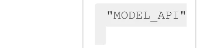

<table>
  <tr>
    <td>lifecycleStatus</td>
    <td>query</td>
    <td><code>string</code></td>
    <td>否</td>
    <td><code>"DRAFT"</code></td>
    <td>生命周期状态。可选值：<code> DRAFT </code>、<code> ACTIVE </code>、<code> DEPRECATE</code> <code>D </code>、<code> ARCHIV</code> <code>ED </code>。</td>
  </tr>
  <tr>
    <td>ownerType</td>
    <td>query</td>
    <td><code>string</code></td>
    <td>否</td>
    <td><code>"USER"</code></td>
    <td>归属主体类型。可选值：<code> USER </code>、<code> APP </code>、<code> SYS</code> <code>TEM </code>。</td>
  </tr>
  <tr>
    <td>ownerId</td>
    <td>query</td>
    <td><code>string</code></td>
    <td>否</td>
    <td><code>"owner-</code><br><code>001"</code></td>
    <td>归属主体ID。</td>
  </tr>
  <tr>
    <td>keyword</td>
    <td>query</td>
    <td><code>string</code></td>
    <td>否</td>
    <td><code>"sample-</code><br><code>value"</code></td>
    <td>搜索关键词。</td>
  </tr>
  <tr>
    <td>page</td>
    <td>query</td>
    <td><code>integer&lt;int</code><br><code>32&gt;</code></td>
    <td>否</td>
    <td><code>1</code></td>
    <td>页码。</td>
  </tr>
  <tr>
    <td>size</td>
    <td>query</td>
    <td><code>integer&lt;int</code><br><code>32&gt;</code></td>
    <td>否</td>
    <td><code>10</code></td>
    <td>每页记录数。</td>
  </tr>
  <tr>
    <td>sort</td>
    <td>query</td>
    <td><code>array</code></td>
    <td>否</td>
    <td><code>["sample-</code><br><code>value"]</code></td>
    <td>排序条件。</td>
  </tr>
</table>

**返回数据**

| 参数名称 | 类型 | 示例 | 说明 |
| --- | --- | --- | --- |
| code | <code>string</code> | <code>SUCCESS</code> | 响应码，取值为<code> SUCCESS </code> 时表示请求成功。 |
| message | <code>string</code> | <code>null</code> | 响应消息。请求成功时通常为空。 |
| data | <code>object</code> | <code>{"content":</code><br><code>[{"resourceId":"reso</code><br><code>urce-</code><br><code>001","tenantId":"ten</code><br><code>ant-</code><br><code>001","kind":"MODEL_A</code><br><code>PI","name":"sample-</code><br><code>name","displayName":</code> <code>"</code>示例资源<code>","summary":"</code>示例摘要<code>","description":"</code>用于演示的资源描述<code>","ownerType":"USER</code> <code>","ownerId":"owner-</code><br><code>001","createdBy":"sa</code><br><code>mple-</code><br><code>value","createdByNam</code><br><code>e":"demo-</code><br><code>createdby","icon":"s</code><br><code>ample-</code><br><code>value","tags":</code><br><code>["sample-</code><br><code>value"],"lifecycleSt</code><br><code>atus":"DRAFT","lates</code><br><code>tVersionId":"latestV</code><br><code>ersion-</code><br><code>001","autoApproveSub</code><br><code>scription":true,"ext</code><br><code>ras":</code><br><code>{"displayOrder":100}</code><br><code>,"createdAt":"2026-</code><br><code>06-</code><br><code>22T12:00:00Z","updat</code><br><code>edAt":"2026-06-</code><br><code>22T12:00:00Z"}],"pag</code><br><code>eNumber":1,"pageSize</code><br><code>":10,"totalCount":1}</code> | 响应数据。具体结构以接口语义为准。 |
| accessDeniedDetail | <code>object</code> | <code>null</code> | 鉴权失败详情。请求成功时通常为空。 |
| requestId | <code>string</code> | <code>req-001</code> | 请求 ID，可用于问题排查和日志检索。 |
| data.content | <code>array</code> | <code>[{"resourceId":"res</code><br><code>ource-</code><br><code>001","tenantId":"ten</code><br><code>ant-</code><br><code>001","kind":"MODEL_A</code><br><code>PI","name":"sample-</code><br><code>name","displayName":</code> <code>"</code>示例资源<code>","summary":"</code>示例摘要<code>"}] </code> | 分页结果列表。 |
| data.content\[\].resource Id | <code>string</code> | <code>"resource-001"</code> | AI Resource ID。 |
| data.content\[\].tenantId | <code>string</code> | <code>"tenant-001"</code> | 租户ID。 |
| data.content\[\].kind | <code>string</code> | <code>"MODEL_API"</code> | 资源类型。 |
| data.content\[\].name | <code>string</code> | <code>"sample-name"</code> | 名称。 |
| data.content\[\].displayN ame | <code>string</code> | <code> "</code>示例资源<code>" </code> | 展示名称。 |
| data.content\[\].summar y | <code>string</code> | <code> "</code>示例摘要<code>" </code> | 摘要信息。 |
| data.content\[\].descripti on | <code>string</code> | <code> "</code>用于演示的资源描述<code>" </code> | 描述信息。 |
| data.content\[\].ownerTy pe | <code>string</code> | <code>"USER"</code> | 归属主体类型。可选值：<code> USER </code>、<code> APP </code>、<code> SYSTEM </code>。 |
| data.content\[\].ownerId | <code>string</code> | <code>"owner-001"</code> | 归属主体ID。 |
| data.content\[\].created By | <code>string</code> | <code>"sample-value"</code> | 创建人。 |
| data.content\[\].created ByName | <code>string</code> | <code>"demo-createdby"</code> | 创建人名称。 |
| data.content\[\].icon | <code>string</code> | <code>"sample-value"</code> | 图标地址。 |
| data.content\[\].tags | <code>array</code> | <code>["sample-value"]</code> | 标签列表。 |
| data.content\[\].lifecycle Status | <code>string</code> | <code>"DRAFT"</code> | 生命周期状态。可选值：<code> DRAFT </code>、<code> ACTIV</code> <code>E </code>、<code> DEPRECATED </code>、<code> ARCHIVED </code>。 |
| data.content\[\].latestVe rsionId | <code>string</code> | <code>"latestVersion-</code><br><code>001"</code> | 最新版本ID。 |
| data.content\[\].autoApp roveSubscription | <code>boolean</code> | <code>true</code> | 是否自动批准订阅。 |
| data.content\[\].extras | <code>object</code> | <code>{"displayOrder":100</code><br><code>}</code> | 扩展配置。 |
| data.content\[\].created At | <code>string&lt;date-</code><br><code>time&gt;</code> | <code>"2026-06-</code><br><code>22T12:00:00Z"</code> | 创建时间。 |
| data.content\[\].updated At | <code>string&lt;date-</code><br><code>time&gt;</code> | <code>"2026-06-</code><br><code>22T12:00:00Z"</code> | 更新时间。 |
| data.pageNumber | <code>integer&lt;int32&gt;</code> | <code>1</code> | 当前页码。 |
| data.pageSize | <code>integer&lt;int32&gt;</code> | <code>10</code> | 每页大小。 |
| data.totalCount | <code>integer&lt;int64&gt;</code> | <code>1</code> | 总记录数。 |

**示例**

**请求示例**

```text
GET /himarket/v1/open-api/v1/me/resources?tenantId=tenant-
001&kind=MODEL_API&lifecycleStatus=DRAFT&ownerType=USER&ownerId=owner-001&keyword=sample-value&page=1&size=10 HTTP/1.1
Host: localhost:8080
Authorization: Bearer <accessToken>
```

**响应示例**

```json
{
  "code": "SUCCESS",
  "message": null,
  "data": {
    "content": [
      {
        "resourceId": "resource-001",
        "tenantId": "tenant-001",
        "kind": "MODEL_API",
        "name": "sample-name",
        "displayName": "示例资源",
        "summary": "示例摘要",
        "description": "⽤于演示的资源描述",
        "ownerType": "USER",
        "ownerId": "owner-001",
        "createdBy": "sample-value",
        "createdByName": "demo-createdby",
        "icon": "sample-value",
        "tags": [
          "sample-value"
        ],
        "lifecycleStatus": "DRAFT",
        "latestVersionId": "latestVersion-001",
        "autoApproveSubscription": true,
        "extras": {
          "displayOrder": 100
        },
        "createdAt": "2026-06-22T12:00:00Z",
        "updatedAt": "2026-06-22T12:00:00Z"
      }
    ],
    "pageNumber": 1,
    "pageSize": 10,
    "totalCount": 1
  },
  "accessDeniedDetail": null,
  "requestId": "req-001"
}
```

<a id="section-2-3-8-17"></a>

#### 2.3.8.17. listMySubscriptions

**接口信息**

- **接口路径**： `GET /himarket/v1/open-api/v1/me/subscriptions`

- **接口说明**：查询我的订阅。

- **认证方式**：该接口属于开发者门户 API。调用前请完成开发者登录，并在请求 Header 中携带  `Authorization: Bearer <accessToken>` 。

- **Header 示例**：需要登录态的接口使用  `Authorization: Bearer <accessToken>` 。

**请求参数**

无请求参数。

**返回数据**

| 参数名称 | 类型 | 示例 | 说明 |
| --- | --- | --- | --- |
| code | <code>string</code> | <code>SUCCESS</code> | 响应码，取值为<code> SUCCESS </code> 时表示请求成功。 |
| message | <code>string</code> | <code>null</code> | 响应消息。请求成功时通常为空。 |
| data | <code>array</code> | <code>[{"subscriptionId":</code><br><code>"subscription-</code><br><code>001","consumerId":"c</code><br><code>onsumer-</code><br><code>001","consumerName":</code><br><code>"sample-</code><br><code>consumer","status":"</code><br><code>PENDING","targetType</code><br><code>":"sample-</code><br><code>value","targetId":"t</code><br><code>arget-001"}]</code> | 响应数据。具体结构以接口语义为准。 |
| accessDeniedDetail | <code>object</code> | <code>null</code> | 鉴权失败详情。请求成功时通常为空。 |
| requestId | <code>string</code> | <code>req-001</code> | 请求 ID，可用于问题排查和日志检索。 |
| data\[\].subscriptionId | <code>string</code> | <code>"subscription-</code><br><code>001"</code> | 订阅申请 ID。 |
| data\[\].consumerId | <code>string</code> | <code>"consumer-001"</code> | Consumer ID。 |
| data\[\].consumerName | <code>string</code> | <code>"sample-</code><br><code>consumer"</code> | Consumer 名称。 |
| data\[\].status | <code>string</code> | <code>"PENDING"</code> | 状态。 |
| data\[\].targetType | <code>string</code> | <code>"sample-value"</code> | 订阅目标类型。 |
| data\[\].targetId | <code>string</code> | <code>"target-001"</code> | 目标对象 ID。 |
| data\[\].resourceId | <code>string</code> | <code>"resource-001"</code> | AI Resource ID。 |
| data\[\].versionId | <code>string</code> | <code>"version-001"</code> | 版本 ID。 |
| data\[\].resourceKind | <code>string</code> | <code>"MODEL_API"</code> | resourceKind。可选值：<code> MODEL_API </code>、<code> M</code> <code>CP_SERVER </code>、<code> SKILL</code><code> </code>、<code> AGENT </code>、<code> WORKE</code> <code>R </code>、<code> REST_API </code>、<code> H</code> <code>TTP_API </code>、<code> PROMPT_T</code> <code>EMPLATE </code>、<code> DATASET</code><code> </code>、<code> EVAL </code>、<code> WORKFL</code> <code>OW </code>。 |
| data\[\].resourceName | <code>string</code> | <code>"sample-mcp-</code><br><code>server"</code> | AI Resource 名称。 |
| data\[\].activeGrant | <code>boolean</code> | <code>true</code> | 当前生效的授权 Grant。 |
| data\[\].expiresAt | <code>string&lt;date-</code><br><code>time&gt;</code> | <code>"2026-06-</code><br><code>22T12:00:00Z"</code> | 过期时间。 |
| data\[\].createdAt | <code>string&lt;date-</code><br><code>time&gt;</code> | <code>"2026-06-</code><br><code>22T12:00:00Z"</code> | 创建时间。 |
| data\[\].updatedAt | <code>string&lt;date-</code><br><code>time&gt;</code> | <code>"2026-06-</code><br><code>22T12:00:00Z"</code> | 更新时间。 |


**示例**

**请求示例**

```http
GET /himarket/v1/open-api/v1/me/subscriptions HTTP/1.1
Host: localhost:8080
Authorization: Bearer <accessToken>
```

**响应示例**

```json
{
  "code": "SUCCESS",
  "message": null,
  "data": [
    {
      "subscriptionId": "subscription-001",
      "consumerId": "consumer-001",
      "consumerName": "sample-consumer",
      "status": "PENDING",
      "targetType": "sample-value",
      "targetId": "target-001"
    }
  ],
  "accessDeniedDetail": null,
  "requestId": "req-001"
}
```

<a id="section-2-3-8-18"></a>

#### 2.3.8.18. listReviews

**接口信息**

- **接口路径**： `GET /himarket/v1/open-api/v1/me/reviews`

- **接口说明**：分页查询我的审核状态。

- **认证方式**：该接口属于开发者门户 API。调用前请完成开发者登录，并在请求 Header 中携带  `Authorization: Bearer <accessToken>` 。

- **Header 示例**：需要登录态的接口使用  `Authorization: Bearer <accessToken>` 。

**请求参数**

| 参数名称 | 位置 | 类型 | 是否必选 | 示例 | 说明 |
| --- | --- | --- | --- | --- | --- |
| tenantId | query | <code>string</code> | 否 | <code>"tenant-</code><br><code>001"</code> | 租户ID。 |
| resourceId | query | <code>string</code> | 否 | <code>"resource-</code><br><code>001"</code> | AI Resource ID。 |
| listingId | query | <code>string</code> | 否 | <code>"listing-</code><br><code>001"</code> | Listing ID。 |
| targetType | query | <code>string</code> | 否 | <code>"sample-</code><br><code>value"</code> | 订阅目标类型。 |
| targetId | query | <code>string</code> | 否 | <code>"target-</code><br><code>001"</code> | 目标对象 ID。 |
| reviewType | query | <code>string</code> | 否 | <code>"sample-</code><br><code>value"</code> | 审核类型。 |
| status | query | <code>string</code> | 否 | <code>"PENDING"</code> | 状态。 |
| pendingOnly | query | <code>boolean</code> | 否 | <code>false</code> | pendingOnly字段。 |
| submitterId | query | <code>string</code> | 否 | <code>"submitter-</code><br><code>001"</code> | 提交人 ID。 |
| reviewerId | query | <code>string</code> | 否 | <code>"reviewer-</code><br><code>001"</code> | 审核人 ID。 |
| page | query | <code>integer&lt;int</code><br><code>32&gt;</code> | 否 | <code>1</code> | 页码。 |
| size | query | <code>integer&lt;int</code><br><code>32&gt;</code> | 否 | <code>10</code> | 每页记录数。 |
| sort | query | <code>array</code> | 否 | <code>["sample-</code><br><code>value"]</code> | 排序条件。 |

**返回数据**

| 参数名称 | 类型 | 示例 | 说明 |
| --- | --- | --- | --- |
| code | <code>string</code> | <code>SUCCESS</code> | 响应码，取值为<code> SUCCESS </code> 时表示请求成功。 |
| message | <code>string</code> | <code>null</code> | 响应消息。请求成功时通常为空。 |
| data | <code>object</code> | <code>{"content":</code><br><code>[{}],"pageNumber":1,</code><br><code>"pageSize":10,"total</code><br><code>Count":1}</code> | 响应数据。具体结构以接口语义为准。 |
| accessDeniedDetail | <code>object</code> | <code>null</code> | 鉴权失败详情。请求成功时通常为空。 |
| requestId | <code>string</code> | <code>req-001</code> | 请求 ID，可用于问题排查和日志检索。 |
| data.content | <code>array</code> | <code>[{"review":</code><br><code>{},"listing":</code><br><code>{},"resource":</code><br><code>{},"defaultVersion":</code><br><code>{}}]</code> | 分页结果列表。 |
| data.content\[\].review | <code>object</code> | <code>{"submissionId":"su</code><br><code>bmission-</code><br><code>001","targetType":"s</code><br><code>ample-</code><br><code>value","targetId":"t</code><br><code>arget-</code><br><code>001","submitterId":"</code><br><code>submitter-</code><br><code>001","reviewType":"s</code><br><code>ample-</code><br><code>value","status":"PEN</code><br><code>DING"}</code> | 审核单信息。 |
| data.content\[\].review.s ubmissionId | <code>string</code> | <code>"submission-001"</code> | 评审提交ID。 |
| data.content\[\].review.t argetType | <code>string</code> | <code>"sample-value"</code> | 订阅目标类型。 |
| data.content\[\].review.t argetId | <code>string</code> | <code>"target-001"</code> | 目标对象 ID。 |
| data.content\[\].review.s ubmitterId | <code>string</code> | <code>"submitter-001"</code> | 提交人 ID。 |
| data.content\[\].review.r eviewType | <code>string</code> | <code>"sample-value"</code> | 审核类型。 |
| data.content\[\].review.st atus | <code>string</code> | <code>"PENDING"</code> | 状态。 |
| data.content\[\].review.c hecks | <code>object</code> | <code>{}</code> | 审核检查项列表。 |
| data.content\[\].review.d ecision | <code>object</code> | <code>{}</code> | 审核决策。 |
| data.content\[\].review.r eviewerId | <code>string</code> | <code>"reviewer-001"</code> | 审核人 ID。 |
| data.content\[\].review.s ubmittedAt | <code>string&lt;date-</code><br><code>time&gt;</code> | <code>"2026-06-</code><br><code>22T12:00:00Z"</code> | 提交时间。 |
| data.content\[\].review.d ecidedAt | <code>string&lt;date-</code><br><code>time&gt;</code> | <code>"2026-06-</code><br><code>22T12:00:00Z"</code> | 审批时间。 |
| data.content\[\].listing | <code>object</code> | <code>{"listingId":"listi</code><br><code>ng-</code><br><code>001","tenantId":"ten</code><br><code>ant-</code><br><code>001","resourceId":"r</code><br><code>esource-</code><br><code>001","defaultVersion</code><br><code>Id":"defaultVersion-</code><br><code>001","portalId":"por</code><br><code>tal-</code><br><code>001","visibility":"P</code><br><code>RIVATE"}</code> | Listing 信息。 |
| data.content\[\].listing.lis tingId | <code>string</code> | <code>"listing-001"</code> | Listing ID。 |
| data.content\[\].listing.te nantId | <code>string</code> | <code>"tenant-001"</code> | 租户ID。 |
| data.content\[\].listing.re sourceId | <code>string</code> | <code>"resource-001"</code> | AI Resource ID。 |
| data.content\[\].listing.d efaultVersionId | <code>string</code> | <code>"defaultVersion-</code><br><code>001"</code> | 默认版本ID。 |
| data.content\[\].listing.p ortalId | <code>string</code> | <code>"portal-001"</code> | 门户ID。 |
| data.content\[\].listing.vi sibility | <code>string</code> | <code>"PRIVATE"</code> | 可见性。可选值：<code> PRIVATE </code>、<code> PUB</code> <code>LIC </code>。 |
| data.content\[\].listing.tit le | <code>string</code> | <code> "</code>示例资源标题<code>" </code> | 标题。 |
| data.content\[\].listing.su mmary | <code>string</code> | <code> "</code>示例摘要<code>" </code> | 摘要信息。 |
| data.content\[\].listing.d escription | <code>string</code> | <code> "</code>用于演示的资源描述<code>" </code> | 描述信息。 |
| data.content\[\].listing.ic on | <code>string</code> | <code>"sample-value"</code> | 图标地址。 |
| data.content\[\].listing.b anner | <code>string</code> | <code>"sample-value"</code> | 横幅图片地址。 |
| data.content\[\].listing.ca tegoryId | <code>string</code> | <code>"category-001"</code> | 分类 ID。 |
| data.content\[\].listing.ca tegory | <code>object</code> | <code>{"categoryId":"cate</code><br><code>gory-</code><br><code>001","tenantId":"ten</code><br><code>ant-</code><br><code>001","kind":"MODEL_A</code><br><code>PI","code":"model-</code><br><code>api","name":"sample-</code><br><code>name","description":</code> <code>"</code>用于演示的资源描述<code>"} </code> | 分类信息。 |
| data.content\[\].listing.ca tegory.categoryId | <code>string</code> | <code>"category-001"</code> | 分类 ID。 |
| data.content\[\].listing.ca tegory.tenantId | <code>string</code> | <code>"tenant-001"</code> | 租户ID。 |
| data.content\[\].listing.ca tegory.kind | <code>string</code> | <code>"MODEL_API"</code> | 资源类型。 |
| data.content\[\].listing.ca tegory.code | <code>string</code> | <code>"model-api"</code> | 业务编码。 |
| data.content\[\].listing.ca tegory.name | <code>string</code> | <code>"sample-name"</code> | 名称。 |
| data.content\[\].listing.ca tegory.description | <code>string</code> | <code> "</code>用于演示的资源描述<code>" </code> | 描述信息。 |
| data.content\[\].listing.ca tegory.icon | <code>string</code> | <code>"sample-value"</code> | 图标地址。 |
| data.content\[\].listing.ca tegory.sortOrder | <code>integer&lt;int32&gt;</code> | <code>100</code> | 排序值。 |
| data.content\[\].listing.ca tegory.status | <code>string</code> | <code>"sample-value"</code> | 状态。 |
| data.content\[\].listing.ca tegory.createdBy | <code>string</code> | <code>"sample-value"</code> | 创建人。 |
| data.content\[\].listing.ca tegory.updatedBy | <code>string</code> | <code>"sample-value"</code> | 更新人。 |
| data.content\[\].listing.ca tegory.createdAt | <code>string&lt;date-</code><br><code>time&gt;</code> | <code>"2026-06-</code><br><code>22T12:00:00Z"</code> | 创建时间。 |
| data.content\[\].listing.ca tegory.updatedAt | <code>string&lt;date-</code><br><code>time&gt;</code> | <code>"2026-06-</code><br><code>22T12:00:00Z"</code> | 更新时间。 |
| data.content\[\].listing.ca tegory.listingCount | <code>integer&lt;int64&gt;</code> | <code>1</code> | Listing 数量。 |
| data.content\[\].listing.ta gs | <code>array</code> | <code>["sample-value"]</code> | 标签列表。 |
| data.content\[\].listing.pr icingMode | <code>string</code> | <code>"sample-value"</code> | 计费模式。 |
| data.content\[\].listing.lis tingStatus | <code>string</code> | <code>"sample-value"</code> | 市场条目状态。 |
| data.content\[\].listing.p ublicationStatus | <code>string</code> | <code>"DRAFT"</code> | 发布状态。可选值：<code> DRAFT </code>、<code> IN_RE</code> <code>VIEW </code>、<code> PUBLISHED </code>、<code> UNPUBLISHED </code>、<code> </code><code>REJECTED </code>。 |
| data.content\[\].listing.cr eatedBy | <code>string</code> | <code>"sample-value"</code> | 创建人。 |
| data.content\[\].listing.p ublishedBy | <code>string</code> | <code>"sample-value"</code> | 发布人 ID。 |
| data.content\[\].listing.p ublishedAt | <code>string&lt;date-</code><br><code>time&gt;</code> | <code>"2026-06-</code><br><code>22T12:00:00Z"</code> | 发布时间。 |


<table>
  <tr>
    <td>data.content[].listing.cr eatedAt</td>
    <td><code>string&lt;date-</code><br><code>time&gt;</code></td>
    <td><code>"2026-06-</code><br><code>22T12:00:00Z"</code></td>
    <td>创建时间。</td>
  </tr>
  <tr>
    <td>data.content[].listing.u pdatedAt</td>
    <td><code>string&lt;date-</code><br><code>time&gt;</code></td>
    <td><code>"2026-06-</code><br><code>22T12:00:00Z"</code></td>
    <td>更新时间。</td>
  </tr>
  <tr>
    <td>data.content[].resource</td>
    <td><code>object</code></td>
    <td><code>{"resourceId":"reso</code><br><code>urce-</code><br><code>001","tenantId":"ten</code><br><code>ant-</code><br><code>001","kind":"MODEL_A</code><br><code>PI","name":"sample-</code><br><code>name","displayName":</code> <code>"</code>示例资源<code>","summary":"</code>示例摘要<code>"} </code></td>
    <td>AI Resource 基础信息。</td>
  </tr>
  <tr>
    <td>data.content[].resource.resourceId</td>
    <td><code>string</code></td>
    <td><code>"resource-001"</code></td>
    <td>AI Resource ID。</td>
  </tr>
  <tr>
    <td>data.content[].resource.tenantId</td>
    <td><code>string</code></td>
    <td><code>"tenant-001"</code></td>
    <td>租户ID。</td>
  </tr>
  <tr>
    <td>data.content[].resource.kind</td>
    <td><code>string</code></td>
    <td><code>"MODEL_API"</code></td>
    <td>资源类型。</td>
  </tr>
  <tr>
    <td>data.content[].resource.name</td>
    <td><code>string</code></td>
    <td><code>"sample-name"</code></td>
    <td>名称。</td>
  </tr>
  <tr>
    <td>data.content[].resource.displayName</td>
    <td><code>string</code></td>
    <td><code> "</code>示例资源<code>" </code></td>
    <td>展示名称。</td>
  </tr>
  <tr>
    <td>data.content[].resource.summary</td>
    <td><code>string</code></td>
    <td><code> "</code>示例摘要<code>" </code></td>
    <td>摘要信息。</td>
  </tr>
  <tr>
    <td>data.content[].resource.description</td>
    <td><code>string</code></td>
    <td><code> "</code>用于演示的资源描述<code>" </code></td>
    <td>描述信息。</td>
  </tr>
  <tr>
    <td>data.content[].resource.ownerType</td>
    <td><code>string</code></td>
    <td><code>"USER"</code></td>
    <td>归属主体类型。可选值：<code> USER </code>、<code> APP </code>、<code> SYSTEM </code>。</td>
  </tr>
  <tr>
    <td>data.content[].resource.ownerId</td>
    <td><code>string</code></td>
    <td><code>"owner-001"</code></td>
    <td>归属主体ID。</td>
  </tr>
  <tr>
    <td>data.content[].resource.createdBy</td>
    <td><code>string</code></td>
    <td><code>"sample-value"</code></td>
    <td>创建人。</td>
  </tr>
  <tr>
    <td>data.content[].resource.createdByName</td>
    <td><code>string</code></td>
    <td><code>"demo-createdby"</code></td>
    <td>创建人名称。</td>
  </tr>
  <tr>
    <td>data.content[].resource.icon</td>
    <td><code>string</code></td>
    <td><code>"sample-value"</code></td>
    <td>图标地址。</td>
  </tr>
  <tr>
    <td>data.content[].resource.tags</td>
    <td><code>array</code></td>
    <td><code>["sample-value"]</code></td>
    <td>标签列表。</td>
  </tr>
  <tr>
    <td>data.content[].resource.lifecycleStatus</td>
    <td><code>string</code></td>
    <td><code>"DRAFT"</code></td>
    <td>生命周期状态。可选值：<code> DRAFT </code>、<code> ACTIV</code> <code>E </code>、<code> DEPRECATED </code>、<code> ARCHIVED </code>。</td>
  </tr>
  <tr>
    <td>data.content[].resource.latestVersionId</td>
    <td><code>string</code></td>
    <td><code>"latestVersion-</code><br><code>001"</code></td>
    <td>最新版本ID。</td>
  </tr>
  <tr>
    <td>data.content[].resource.autoApproveSubscripti on</td>
    <td><code>boolean</code></td>
    <td><code>true</code></td>
    <td>是否自动批准订阅。</td>
  </tr>
  <tr>
    <td>data.content[].resource.extras</td>
    <td><code>object</code></td>
    <td><code>{}</code></td>
    <td>扩展配置。</td>
  </tr>
  <tr>
    <td>data.content[].resource.createdAt</td>
    <td><code>string&lt;date-</code><br><code>time&gt;</code></td>
    <td><code>"2026-06-</code><br><code>22T12:00:00Z"</code></td>
    <td>创建时间。</td>
  </tr>
  <tr>
    <td>data.content[].resource.updatedAt</td>
    <td><code>string&lt;date-</code><br><code>time&gt;</code></td>
    <td><code>"2026-06-</code><br><code>22T12:00:00Z"</code></td>
    <td>更新时间。</td>
  </tr>
</table>

<table>
  <tr>
    <td>data.content[].defaultV ersion</td>
    <td><code>object</code></td>
    <td><code>{"versionId":"versi</code><br><code>on-</code><br><code>001","resourceId":"r</code><br><code>esource-</code><br><code>001","version":"samp</code><br><code>le-</code><br><code>value","versionSchem</code><br><code>e":"SEMVER","status"</code><br><code>:"DRAFT","manifestId</code><br><code>":"manifest-001"}</code></td>
    <td>默认版本信息。</td>
  </tr>
  <tr>
    <td>data.content[].defaultV ersion.versionId</td>
    <td><code>string</code></td>
    <td><code>"version-001"</code></td>
    <td>版本 ID。</td>
  </tr>
  <tr>
    <td>data.content[].defaultV ersion.resourceId</td>
    <td><code>string</code></td>
    <td><code>"resource-001"</code></td>
    <td>AI Resource ID。</td>
  </tr>
  <tr>
    <td>data.content[].defaultV ersion.version</td>
    <td><code>string</code></td>
    <td><code>"sample-value"</code></td>
    <td>版本号。</td>
  </tr>
  <tr>
    <td>data.content[].defaultV ersion.versionScheme</td>
    <td><code>string</code></td>
    <td><code>"SEMVER"</code></td>
    <td>版本号方案。可选值：<code> SEMVER </code>、<code> TIME</code> <code>STAMP </code>、<code> REVISION </code>、<code> EXTERNAL </code>。</td>
  </tr>
  <tr>
    <td>data.content[].defaultV ersion.status</td>
    <td><code>string</code></td>
    <td><code>"DRAFT"</code></td>
    <td>状态。</td>
  </tr>
  <tr>
    <td>data.content[].defaultV ersion.manifestId</td>
    <td><code>string</code></td>
    <td><code>"manifest-001"</code></td>
    <td>Manifest ID。</td>
  </tr>
  <tr>
    <td>data.content[].defaultV ersion.sourceBindingId</td>
    <td><code>string</code></td>
    <td><code>"sourceBinding-</code><br><code>001"</code></td>
    <td>来源绑定ID。</td>
  </tr>
  <tr>
    <td>data.content[].defaultV ersion.artifactDigest</td>
    <td><code>string</code></td>
    <td><code>"sample-value"</code></td>
    <td>制品摘要。</td>
  </tr>
  <tr>
    <td>data.content[].defaultV ersion.releaseNote</td>
    <td><code>string</code></td>
    <td><code>"sample-value"</code></td>
    <td>版本说明。</td>
  </tr>
</table>

**示例请求示例**

```text
GET /himarket/v1/open-api/v1/me/reviews?tenantId=tenant-001&resourceId=resource-
001&listingId=listing-001&targetType=sample-value&targetId=target-001&reviewType=sample-value&status=PENDING&pendingOnly=false HTTP/1.1
Host: localhost:8080
Authorization: Bearer <accessToken>
```

**响应示例**

```json
{
  "code": "SUCCESS",
  "message": null,
  "data": {
    "content": [
      {}
    ],
    "pageNumber": 1,
    "pageSize": 10,
    "totalCount": 1
  },
  "accessDeniedDetail": null,
  "requestId": "req-001"
}
```

<a id="section-2-3-8-19"></a>

#### 2.3.8.19. saveListing

**接口信息**

- **接口路径**： `POST /himarket/v1/open-api/v1/me/listings`

- **接口说明**：创建或更新我的 Listing 草稿。

- **认证方式**：该接口属于开发者门户 API。调用前请完成开发者登录，并在请求 Header 中携带  `Authorization: Bearer <accessToken>` 。

- **Header 示例**：需要登录态的接口使用  `Authorization: Bearer <accessToken>` 。

**请求参数**

| 参数名称 | 位置 | 类型 | 是否必选 | 示例 | 说明 |
| --- | --- | --- | --- | --- | --- |
| resourceId | body | <code>string</code> | 是 | <code>"resource-</code><br><code>001"</code> | AI Resource ID。 |
| defaultVersion Id | body | <code>string</code> | 否 | <code>"defaultVer</code><br><code>sion-001"</code> | 默认版本ID。 |
| portalId | body | <code>string</code> | 否 | <code>"portal-</code><br><code>001"</code> | 门户ID。 |
| visibility | body | <code>string</code> | 否 | <code>"PRIVATE"</code> | 可见性。可选值：<code> PRIVATE</code><code> </code>、<code> PUBLIC</code><code> </code>。 |
| title | body | <code>string</code> | 是 | <code> "</code>示例资源标题<code>" </code> | 标题。 |
| summary | body | <code>string</code> | 否 | <code> "</code>示例摘要<code>" </code> | 摘要信息。 |
| description | body | <code>string</code> | 否 | <code> "</code>用于演示的资源描述<code>" </code> | 描述信息。 |
| banner | body | <code>string</code> | 否 | <code>"sample-</code><br><code>value"</code> | 横幅图片地址。 |
| pricingMode | body | <code>string</code> | 否 | <code>"sample-</code><br><code>value"</code> | 计费模式。 |
| categoryId | body | <code>string</code> | 否 | <code>"category-</code><br><code>001"</code> | 分类 ID。 |


**返回数据**

| 参数名称 | 类型 | 示例 | 说明 |
| --- | --- | --- | --- |
| code | <code>string</code> | <code>SUCCESS</code> | 响应码，取值为<code> SUCCESS </code> 时表示请求成功。 |
| message | <code>string</code> | <code>null</code> | 响应消息。请求成功时通常为空。 |

<table>
  <tr>
    <td>data</td>
    <td><code>object</code></td>
    <td><code>{"listingId":"listi</code><br><code>ng-</code><br><code>001","tenantId":"ten</code><br><code>ant-</code><br><code>001","resourceId":"r</code><br><code>esource-</code><br><code>001","defaultVersion</code><br><code>Id":"defaultVersion-</code><br><code>001","portalId":"por</code><br><code>tal-</code><br><code>001","visibility":"P</code><br><code>RIVATE"}</code></td>
    <td>响应数据。具体结构以接口语义为准。</td>
  </tr>
  <tr>
    <td>accessDeniedDetail</td>
    <td><code>object</code></td>
    <td><code>null</code></td>
    <td>鉴权失败详情。请求成功时通常为空。</td>
  </tr>
  <tr>
    <td>requestId</td>
    <td><code>string</code></td>
    <td><code>req-001</code></td>
    <td>请求 ID，可用于问题排查和日志检索。</td>
  </tr>
  <tr>
    <td>data.listingId</td>
    <td><code>string</code></td>
    <td><code>"listing-001"</code></td>
    <td>Listing ID。</td>
  </tr>
  <tr>
    <td>data.tenantId</td>
    <td><code>string</code></td>
    <td><code>"tenant-001"</code></td>
    <td>租户ID。</td>
  </tr>
  <tr>
    <td>data.resourceId</td>
    <td><code>string</code></td>
    <td><code>"resource-001"</code></td>
    <td>AI Resource ID。</td>
  </tr>
  <tr>
    <td>data.defaultVersionId</td>
    <td><code>string</code></td>
    <td><code>"defaultVersion-</code><br><code>001"</code></td>
    <td>默认版本ID。</td>
  </tr>
  <tr>
    <td>data.portalId</td>
    <td><code>string</code></td>
    <td><code>"portal-001"</code></td>
    <td>门户ID。</td>
  </tr>
  <tr>
    <td>data.visibility</td>
    <td><code>string</code></td>
    <td><code>"PRIVATE"</code></td>
    <td>可见性。可选值：<code> PRIVATE </code>、<code> PUB</code> <code>LIC </code>。</td>
  </tr>
  <tr>
    <td>data.title</td>
    <td><code>string</code></td>
    <td><code> "</code>示例资源标题<code>" </code></td>
    <td>标题。</td>
  </tr>
  <tr>
    <td>data.summary</td>
    <td><code>string</code></td>
    <td><code> "</code>示例摘要<code>" </code></td>
    <td>摘要信息。</td>
  </tr>
  <tr>
    <td>data.description</td>
    <td><code>string</code></td>
    <td><code> "</code>用于演示的资源描述<code>" </code></td>
    <td>描述信息。</td>
  </tr>
  <tr>
    <td>data.icon</td>
    <td><code>string</code></td>
    <td><code>"sample-value"</code></td>
    <td>图标地址。</td>
  </tr>
  <tr>
    <td>data.banner</td>
    <td><code>string</code></td>
    <td><code>"sample-value"</code></td>
    <td>横幅图片地址。</td>
  </tr>
  <tr>
    <td>data.categoryId</td>
    <td><code>string</code></td>
    <td><code>"category-001"</code></td>
    <td>分类 ID。</td>
  </tr>
  <tr>
    <td>data.category</td>
    <td><code>object</code></td>
    <td><code>{"categoryId":"cate</code><br><code>gory-</code><br><code>001","tenantId":"ten</code><br><code>ant-</code><br><code>001","kind":"MODEL_A</code><br><code>PI","code":"model-</code><br><code>api","name":"sample-</code><br><code>name","description":</code> <code>"</code>用于演示的资源描述<code>"} </code></td>
    <td>分类信息。</td>
  </tr>
  <tr>
    <td>data.category.category Id</td>
    <td><code>string</code></td>
    <td><code>"category-001"</code></td>
    <td>分类 ID。</td>
  </tr>
  <tr>
    <td>data.category.tenantId</td>
    <td><code>string</code></td>
    <td><code>"tenant-001"</code></td>
    <td>租户ID。</td>
  </tr>
  <tr>
    <td>data.category.kind</td>
    <td><code>string</code></td>
    <td><code>"MODEL_API"</code></td>
    <td>资源类型。</td>
  </tr>
  <tr>
    <td>data.category.code</td>
    <td><code>string</code></td>
    <td><code>"model-api"</code></td>
    <td>业务编码。</td>
  </tr>
  <tr>
    <td>data.category.name</td>
    <td><code>string</code></td>
    <td><code>"sample-name"</code></td>
    <td>名称。</td>
  </tr>
  <tr>
    <td>data.category.descripti on</td>
    <td><code>string</code></td>
    <td><code> "</code>用于演示的资源描述<code>" </code></td>
    <td>描述信息。</td>
  </tr>
  <tr>
    <td>data.category.icon</td>
    <td><code>string</code></td>
    <td><code>"sample-value"</code></td>
    <td>图标地址。</td>
  </tr>
  <tr>
    <td>data.category.sortOrde r</td>
    <td><code>integer&lt;int32&gt;</code></td>
    <td><code>100</code></td>
    <td>排序值。</td>
  </tr>
  <tr>
    <td>data.category.status</td>
    <td><code>string</code></td>
    <td><code>"sample-value"</code></td>
    <td>状态。</td>
  </tr>
  <tr>
    <td>data.category.createdB y</td>
    <td><code>string</code></td>
    <td><code>"sample-value"</code></td>
    <td>创建人。</td>
  </tr>
  <tr>
    <td>data.category.updated By</td>
    <td><code>string</code></td>
    <td><code>"sample-value"</code></td>
    <td>更新人。</td>
  </tr>
  <tr>
    <td>data.category.createdA t</td>
    <td><code>string&lt;date-</code><br><code>time&gt;</code></td>
    <td><code>"2026-06-</code><br><code>22T12:00:00Z"</code></td>
    <td>创建时间。</td>
  </tr>
  <tr>
    <td>data.category.updated At</td>
    <td><code>string&lt;date-</code><br><code>time&gt;</code></td>
    <td><code>"2026-06-</code><br><code>22T12:00:00Z"</code></td>
    <td>更新时间。</td>
  </tr>
  <tr>
    <td>data.category.listingCo unt</td>
    <td><code>integer&lt;int64&gt;</code></td>
    <td><code>1</code></td>
    <td>Listing 数量。</td>
  </tr>
  <tr>
    <td>data.tags</td>
    <td><code>array</code></td>
    <td><code>["sample-value"]</code></td>
    <td>标签列表。</td>
  </tr>
  <tr>
    <td>data.pricingMode</td>
    <td><code>string</code></td>
    <td><code>"sample-value"</code></td>
    <td>计费模式。</td>
  </tr>
  <tr>
    <td>data.listingStatus</td>
    <td><code>string</code></td>
    <td><code>"sample-value"</code></td>
    <td>市场条目状态。</td>
  </tr>
  <tr>
    <td>data.publicationStatus</td>
    <td><code>string</code></td>
    <td><code>"DRAFT"</code></td>
    <td>发布状态。可选值：<code> DRAFT </code>、<code> IN_RE</code> <code>VIEW </code>、<code> PUBLISHED </code>、<code> UNPUBLISHED </code>、<code> </code><code>REJECTED </code>。</td>
  </tr>
  <tr>
    <td>data.createdBy</td>
    <td><code>string</code></td>
    <td><code>"sample-value"</code></td>
    <td>创建人。</td>
  </tr>
  <tr>
    <td>data.publishedBy</td>
    <td><code>string</code></td>
    <td><code>"sample-value"</code></td>
    <td>发布人 ID。</td>
  </tr>
  <tr>
    <td>data.publishedAt</td>
    <td><code>string&lt;date-</code><br><code>time&gt;</code></td>
    <td><code>"2026-06-</code><br><code>22T12:00:00Z"</code></td>
    <td>发布时间。</td>
  </tr>
  <tr>
    <td>data.createdAt</td>
    <td><code>string&lt;date-</code><br><code>time&gt;</code></td>
    <td><code>"2026-06-</code><br><code>22T12:00:00Z"</code></td>
    <td>创建时间。</td>
  </tr>
  <tr>
    <td>data.updatedAt</td>
    <td><code>string&lt;date-</code><br><code>time&gt;</code></td>
    <td><code>"2026-06-</code><br><code>22T12:00:00Z"</code></td>
    <td>更新时间。</td>
  </tr>
</table>


**示例请求示例**

```http
POST /himarket/v1/open-api/v1/me/listings HTTP/1.1
Host: localhost:8080
Authorization: Bearer <accessToken>
Content-Type: application/json

{
  "resourceId": "resource-001",
  "defaultVersionId": "defaultVersion-001",
  "portalId": "portal-001",
  "visibility": "PRIVATE",
  "title": "示例资源标题",
  "summary": "示例摘要"
}
```

**响应示例**

```json
{
  "code": "SUCCESS",
  "message": null,
  "data": {
    "listingId": "listing-001",
    "tenantId": "tenant-001",
    "resourceId": "resource-001",
    "defaultVersionId": "defaultVersion-001",
    "portalId": "portal-001",
    "visibility": "PRIVATE"
  },
  "accessDeniedDetail": null,
  "requestId": "req-001"
}
```

<a id="section-2-3-8-20"></a>

#### 2.3.8.20. submitReview

**接口信息**

- **接口路径**： `POST /himarket/v1/open-api/v1/me/listings/{listingId}/submit-review`

- **接口说明**：提交我的 Listing 审核。

- **认证方式**：该接口属于开发者门户 API。调用前请完成开发者登录，并在请求 Header 中携带  `Authorization: Bearer <accessToken>` 。

- **Header 示例**：需要登录态的接口使用  `Authorization: Bearer <accessToken>` 。

**请求参数**

| 参数名称 | 位置 | 类型 | 是否必选 | 示例 | 说明 |
| --- | --- | --- | --- | --- | --- |
| listingId | path | <code>string</code> | 是 | <code>"listing-</code><br><code>001"</code> | Listing ID。 |
| checks | body | <code>object</code> | 否 | <code>{}</code> | 审核检查项列表。 |

**返回数据**

| 参数名称 | 类型 | 示例 | 说明 |
| --- | --- | --- | --- |
| code | <code>string</code> | <code>SUCCESS</code> | 响应码，取值为<code> SUCCESS </code> 时表示请求成功。 |
| message | <code>string</code> | <code>null</code> | 响应消息。请求成功时通常为空。 |
| data | <code>object</code> | <code>{"submissionId":"su</code><br><code>bmission-</code><br><code>001","targetType":"s</code><br><code>ample-</code><br><code>value","targetId":"t</code><br><code>arget-</code><br><code>001","submitterId":"</code><br><code>submitter-</code><br><code>001","reviewType":"s</code><br><code>ample-</code><br><code>value","status":"PEN</code><br><code>DING"}</code> | 响应数据。具体结构以接口语义为准。 |
| accessDeniedDetail | <code>object</code> | <code>null</code> | 鉴权失败详情。请求成功时通常为空。 |
| requestId | <code>string</code> | <code>req-001</code> | 请求 ID，可用于问题排查和日志检索。 |
| data.submissionId | <code>string</code> | <code>"submission-001"</code> | 评审提交ID。 |
| data.targetType | <code>string</code> | <code>"sample-value"</code> | 订阅目标类型。 |
| data.targetId | <code>string</code> | <code>"target-001"</code> | 目标对象 ID。 |
| data.submitterId | <code>string</code> | <code>"submitter-001"</code> | 提交人 ID。 |
| data.reviewType | <code>string</code> | <code>"sample-value"</code> | 审核类型。 |
| data.status | <code>string</code> | <code>"PENDING"</code> | 状态。 |
| data.checks | <code>object</code> | <code>{}</code> | 审核检查项列表。 |
| data.decision | <code>object</code> | <code>{}</code> | 审核决策。 |
| data.reviewerId | <code>string</code> | <code>"reviewer-001"</code> | 审核人 ID。 |
| data.submittedAt | <code>string&lt;date-</code><br><code>time&gt;</code> | <code>"2026-06-</code><br><code>22T12:00:00Z"</code> | 提交时间。 |
| data.decidedAt | <code>string&lt;date-</code><br><code>time&gt;</code> | <code>"2026-06-</code><br><code>22T12:00:00Z"</code> | 审批时间。 |

**示例**

**请求示例**

```http
POST /himarket/v1/open-api/v1/me/listings/{listingId}/submit-review HTTP/1.1
Host: localhost:8080
Authorization: Bearer <accessToken>
Content-Type: application/json

{
  "checks": {}
}
```

**响应示例**

```json
{
  "code": "SUCCESS",
  "message": null,
  "data": {
    "submissionId": "submission-001",
    "targetType": "sample-value",
    "targetId": "target-001",
    "submitterId": "submitter-001",
    "reviewType": "sample-value",
    "status": "PENDING"
  },
  "accessDeniedDetail": null,
  "requestId": "req-001"
}
```

<a id="section-2-3-8-21"></a>

#### 2.3.8.21. updateMyProfile

**接口信息**

- **接口路径**： `PUT /himarket/v1/open-api/v1/me/profile`

- **接口说明**：更新我的账号资料。

- **认证方式**：该接口属于开发者门户 API。调用前请完成开发者登录，并在请求 Header 中携带  `Authorization: Bearer <accessToken>` 。

- **Header 示例**：需要登录态的接口使用  `Authorization: Bearer <accessToken>` 。

**请求参数**

| 参数名称 | 位置 | 类型 | 是否必选 | 示例 | 说明 |
| --- | --- | --- | --- | --- | --- |
| username | body | <code>string</code> | 否 | <code>"admin"</code> | 用户名。 |
| email | body | <code>string</code> | 否 | <code>"user@examp</code><br><code>le.com"</code> | 邮箱。 |
| avatarUrl | body | <code>string</code> | 否 | <code>"https://ap</code><br><code>i.example.co</code><br><code>m"</code> | 头像地址。 |

**返回数据**

| 参数名称 | 类型 | 示例 | 说明 |
| --- | --- | --- | --- |
| code | <code>string</code> | <code>SUCCESS</code> | 响应码，取值为<code> SUCCESS </code> 时表示请求成功。 |
| message | <code>string</code> | <code>null</code> | 响应消息。请求成功时通常为空。 |

<table>
  <tr>
    <td>data</td>
    <td><code>object</code></td>
    <td><code>{"developerId":"dev</code><br><code>eloper-</code><br><code>001","portalId":"por</code><br><code>tal-</code><br><code>001","username":"adm</code><br><code>in","email":"user@ex</code><br><code>ample.com","avatarUr</code><br><code>l":"https://api.exam</code><br><code>ple.com","status":"A</code><br><code>PPROVED"}</code></td>
    <td>响应数据。具体结构以接口语义为准。</td>
  </tr>
  <tr>
    <td>accessDeniedDetail</td>
    <td><code>object</code></td>
    <td><code>null</code></td>
    <td>鉴权失败详情。请求成功时通常为空。</td>
  </tr>
  <tr>
    <td>requestId</td>
    <td><code>string</code></td>
    <td><code>req-001</code></td>
    <td>请求 ID，可用于问题排查和日志检索。</td>
  </tr>
  <tr>
    <td>data.developerId</td>
    <td><code>string</code></td>
    <td><code>"developer-001"</code></td>
    <td>开发者ID。</td>
  </tr>
  <tr>
    <td>data.portalId</td>
    <td><code>string</code></td>
    <td><code>"portal-001"</code></td>
    <td>门户ID。</td>
  </tr>
  <tr>
    <td>data.username</td>
    <td><code>string</code></td>
    <td><code>"admin"</code></td>
    <td>用户名。</td>
  </tr>
  <tr>
    <td>data.email</td>
    <td><code>string</code></td>
    <td><code>"user@example.com"</code></td>
    <td>邮箱。</td>
  </tr>
  <tr>
    <td>data.avatarUrl</td>
    <td><code>string</code></td>
    <td><code>"https://api.exampl</code><br><code>e.com"</code></td>
    <td>头像地址。</td>
  </tr>
  <tr>
    <td>data.status</td>
    <td><code>string</code></td>
    <td><code>"APPROVED"</code></td>
    <td>状态。</td>
  </tr>
  <tr>
    <td>data.authType</td>
    <td><code>string</code></td>
    <td><code>"LOCAL"</code></td>
    <td>authType。可选值：<code> LOCAL </code>、<code> BUILT</code> <code>IN </code>、<code> EXTERNAL </code>、<code> </code><code>OIDC </code>、<code> OAUTH2 </code>。</td>
  </tr>
</table>


<table>
  <tr>
    <td>data.createdAt</td>
    <td><code>string&lt;date-</code><br><code>time&gt;</code></td>
    <td><code>"2026-06-</code><br><code>22T12:00:00Z"</code></td>
    <td>创建时间。</td>
  </tr>
  <tr>
    <td>data.updatedAt</td>
    <td><code>string&lt;date-</code><br><code>time&gt;</code></td>
    <td><code>"2026-06-</code><br><code>22T12:00:00Z"</code></td>
    <td>更新时间。</td>
  </tr>
  <tr>
    <td>data.identities</td>
    <td><code>array</code></td>
    <td><code>[{"provider":"sampl</code><br><code>e-</code><br><code>value","subject":"sa</code><br><code>mple-</code><br><code>value","displayName"</code><code>:"</code>示例资源<code>","authType":"LOCAL</code> <code>","createdAt":"2026-</code><br><code>06-</code><br><code>22T12:00:00Z","updat</code><br><code>edAt":"2026-06-</code><br><code>22T12:00:00Z"}]</code></td>
    <td>身份信息列表。</td>
  </tr>
  <tr>
    <td>data.identities[].provid er</td>
    <td><code>string</code></td>
    <td><code>"sample-value"</code></td>
    <td>OIDC Provider 标识。</td>
  </tr>
  <tr>
    <td>data.identities[].subject</td>
    <td><code>string</code></td>
    <td><code>"sample-value"</code></td>
    <td>主体信息。</td>
  </tr>
  <tr>
    <td>data.identities[].display Name</td>
    <td><code>string</code></td>
    <td><code> "</code>示例资源<code>" </code></td>
    <td>展示名称。</td>
  </tr>
  <tr>
    <td>data.identities[].authTy pe</td>
    <td><code>string</code></td>
    <td><code>"LOCAL"</code></td>
    <td>authType。可选值：<code> LOCAL </code>、<code> BUILT</code> <code>IN </code>、<code> EXTERNAL </code>、<code> </code><code>OIDC </code>、<code> OAUTH2 </code>。</td>
  </tr>
  <tr>
    <td>data.identities[].create dAt</td>
    <td><code>string&lt;date-</code><br><code>time&gt;</code></td>
    <td><code>"2026-06-</code><br><code>22T12:00:00Z"</code></td>
    <td>创建时间。</td>
  </tr>
  <tr>
    <td>data.identities[].update dAt</td>
    <td><code>string&lt;date-</code><br><code>time&gt;</code></td>
    <td><code>"2026-06-</code><br><code>22T12:00:00Z"</code></td>
    <td>更新时间。</td>
  </tr>
</table>

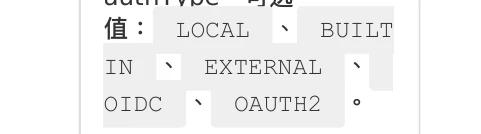

**示例请求示例**

```http
PUT /himarket/v1/open-api/v1/me/profile HTTP/1.1
Host: localhost:8080
Authorization: Bearer <accessToken>
Content-Type: application/json

{
  "username": "admin",
  "email": "user@example.com",
  "avatarUrl": "https://api.example.com"
}
```

**响应示例**

```json
{
  "code": "SUCCESS",
  "message": null,
  "data": {
    "developerId": "developer-001",
    "portalId": "portal-001",
    "username": "admin",
    "email": "user@example.com",
    "avatarUrl": "https://api.example.com",
    "status": "APPROVED"
  },
  "accessDeniedDetail": null,
  "requestId": "req-001"
}
```

<a id="section-2-3-8-22"></a>

#### 2.3.8.22. updateMyResourceBasicInfo

**接口信息**

- **接口路径**： `PUT /himarket/v1/open-api/v1/me/resources/{resourceId}/basic-info`

- **接口说明**：更新我的 AI Resource 基础信息。

- **认证方式**：该接口属于开发者门户 API。调用前请完成开发者登录，并在请求 Header 中携带  `Authorization: Bearer <accessToken>` 。

- **Header 示例**：需要登录态的接口使用  `Authorization: Bearer <accessToken>` 。

**请求参数**

| 参数名称 | 位置 | 类型 | 是否必选 | 示例 | 说明 |
| --- | --- | --- | --- | --- | --- |
| resourceId | path | <code>string</code> | 是 | <code>"resource-</code><br><code>001"</code> | AI Resource ID。 |
| displayName | body | <code>string</code> | 否 | <code> "</code>示例资源<code>" </code> | 展示名称。 |
| summary | body | <code>string</code> | 否 | <code> "</code>示例摘要<code>" </code> | 摘要信息。 |
| autoApproveS ubscription | body | <code>boolean</code> | 否 | <code>true</code> | 是否自动批准订阅。 |
| icon | body | <code>string</code> | 否 | <code>"sample-</code><br><code>value"</code> | 图标地址。 |
| tags | body | <code>array</code> | 否 | <code>["sample-</code><br><code>value"]</code> | 标签列表。 |

**返回数据**

| 参数名称 | 类型 | 示例 | 说明 |
| --- | --- | --- | --- |
| code | <code>string</code> | <code>SUCCESS</code> | 响应码，取值为<code> SUCCESS </code> 时表示请求成功。 |
| message | <code>string</code> | <code>null</code> | 响应消息。请求成功时通常为空。 |

<table>
  <tr>
    <td>data</td>
    <td><code>object</code></td>
    <td><code>{"resource":</code><br><code>{"resourceId":"resou</code><br><code>rce-</code><br><code>001","tenantId":"ten</code><br><code>ant-</code><br><code>001","kind":"MODEL_A</code><br><code>PI","name":"sample-</code><br><code>name","displayName":</code> <code>"</code>示例资源<code>","summary":"</code>示例摘要<code>"},"latestVersion":</code> <code>{"versionId":"versio</code><br><code>n-</code><br><code>001","resourceId":"r</code><br><code>esource-</code><br><code>001","version":"samp</code><br><code>le-</code><br><code>value","versionSchem</code><br><code>e":"SEMVER","status"</code><br><code>:"DRAFT","manifestId</code><br><code>":"manifest-</code><br><code>001"},"sourceBinding</code><br><code>s":[{}]}</code></td>
    <td>响应数据。具体结构以接口语义为准。</td>
  </tr>
  <tr>
    <td>accessDeniedDetail</td>
    <td><code>object</code></td>
    <td><code>null</code></td>
    <td>鉴权失败详情。请求成功时通常为空。</td>
  </tr>
  <tr>
    <td>requestId</td>
    <td><code>string</code></td>
    <td><code>req-001</code></td>
    <td>请求 ID，可用于问题排查和日志检索。</td>
  </tr>
  <tr>
    <td>data.resource</td>
    <td><code>object</code></td>
    <td><code>{"resourceId":"reso</code><br><code>urce-</code><br><code>001","tenantId":"ten</code><br><code>ant-</code><br><code>001","kind":"MODEL_A</code><br><code>PI","name":"sample-</code><br><code>name","displayName":</code> <code>"</code>示例资源<code>","summary":"</code>示例摘要<code>"} </code></td>
    <td>AI Resource 基础信息。</td>
  </tr>
  <tr>
    <td>data.resource.resourceI d</td>
    <td><code>string</code></td>
    <td><code>"resource-001"</code></td>
    <td>AI Resource ID。</td>
  </tr>
  <tr>
    <td>data.resource.tenantId</td>
    <td><code>string</code></td>
    <td><code>"tenant-001"</code></td>
    <td>租户ID。</td>
  </tr>
  <tr>
    <td>data.resource.kind</td>
    <td><code>string</code></td>
    <td><code>"MODEL_API"</code></td>
    <td>资源类型。</td>
  </tr>
  <tr>
    <td>data.resource.name</td>
    <td><code>string</code></td>
    <td><code>"sample-name"</code></td>
    <td>名称。</td>
  </tr>
  <tr>
    <td>data.resource.displayN ame</td>
    <td><code>string</code></td>
    <td><code> "</code>示例资源<code>" </code></td>
    <td>展示名称。</td>
  </tr>
  <tr>
    <td>data.resource.summar y</td>
    <td><code>string</code></td>
    <td><code> "</code>示例摘要<code>" </code></td>
    <td>摘要信息。</td>
  </tr>
  <tr>
    <td>data.resource.descripti on</td>
    <td><code>string</code></td>
    <td><code> "</code>用于演示的资源描述<code>" </code></td>
    <td>描述信息。</td>
  </tr>
  <tr>
    <td>data.resource.ownerTy pe</td>
    <td><code>string</code></td>
    <td><code>"USER"</code></td>
    <td>归属主体类型。可选值：<code> USER </code>、<code> APP </code>、<code> SYSTEM </code>。</td>
  </tr>
  <tr>
    <td>data.resource.ownerId</td>
    <td><code>string</code></td>
    <td><code>"owner-001"</code></td>
    <td>归属主体ID。</td>
  </tr>
  <tr>
    <td>data.resource.createdB y</td>
    <td><code>string</code></td>
    <td><code>"sample-value"</code></td>
    <td>创建人。</td>
  </tr>
  <tr>
    <td>data.resource.createdB yName</td>
    <td><code>string</code></td>
    <td><code>"demo-createdby"</code></td>
    <td>创建人名称。</td>
  </tr>
  <tr>
    <td>data.resource.icon</td>
    <td><code>string</code></td>
    <td><code>"sample-value"</code></td>
    <td>图标地址。</td>
  </tr>
  <tr>
    <td>data.resource.tags</td>
    <td><code>array</code></td>
    <td><code>["sample-value"]</code></td>
    <td>标签列表。</td>
  </tr>
  <tr>
    <td>data.resource.lifecycle Status</td>
    <td><code>string</code></td>
    <td><code>"DRAFT"</code></td>
    <td>生命周期状态。可选值：<code> DRAFT </code>、<code> ACTIV</code> <code>E </code>、<code> DEPRECATED </code>、<code> ARCHIVED </code>。</td>
  </tr>
  <tr>
    <td>data.resource.latestVer sionId</td>
    <td><code>string</code></td>
    <td><code>"latestVersion-</code><br><code>001"</code></td>
    <td>最新版本ID。</td>
  </tr>
  <tr>
    <td>data.resource.autoAppr oveSubscription</td>
    <td><code>boolean</code></td>
    <td><code>true</code></td>
    <td>是否自动批准订阅。</td>
  </tr>
  <tr>
    <td>data.resource.extras</td>
    <td><code>object</code></td>
    <td><code>{}</code></td>
    <td>扩展配置。</td>
  </tr>
  <tr>
    <td>data.resource.createdA t</td>
    <td><code>string&lt;date-</code><br><code>time&gt;</code></td>
    <td><code>"2026-06-</code><br><code>22T12:00:00Z"</code></td>
    <td>创建时间。</td>
  </tr>
  <tr>
    <td>data.resource.updated At</td>
    <td><code>string&lt;date-</code><br><code>time&gt;</code></td>
    <td><code>"2026-06-</code><br><code>22T12:00:00Z"</code></td>
    <td>更新时间。</td>
  </tr>
  <tr>
    <td>data.latestVersion</td>
    <td><code>object</code></td>
    <td><code>{"versionId":"versi</code><br><code>on-</code><br><code>001","resourceId":"r</code><br><code>esource-</code><br><code>001","version":"samp</code><br><code>le-</code><br><code>value","versionSchem</code><br><code>e":"SEMVER","status"</code><br><code>:"DRAFT","manifestId</code><br><code>":"manifest-001"}</code></td>
    <td>最新版本信息。</td>
  </tr>
  <tr>
    <td>data.latestVersion.versi onId</td>
    <td><code>string</code></td>
    <td><code>"version-001"</code></td>
    <td>版本 ID。</td>
  </tr>
  <tr>
    <td>data.latestVersion.reso urceId</td>
    <td><code>string</code></td>
    <td><code>"resource-001"</code></td>
    <td>AI Resource ID。</td>
  </tr>
  <tr>
    <td>data.latestVersion.versi on</td>
    <td><code>string</code></td>
    <td><code>"sample-value"</code></td>
    <td>版本号。</td>
  </tr>
  <tr>
    <td>data.latestVersion.versi onScheme</td>
    <td><code>string</code></td>
    <td><code>"SEMVER"</code></td>
    <td>版本号方案。可选值：<code> SEMVER </code>、<code> TIME</code> <code>STAMP </code>、<code> REVISION </code>、<code> EXTERNAL </code>。</td>
  </tr>
  <tr>
    <td>data.latestVersion.stat us</td>
    <td><code>string</code></td>
    <td><code>"DRAFT"</code></td>
    <td>状态。</td>
  </tr>
  <tr>
    <td>data.latestVersion.mani festId</td>
    <td><code>string</code></td>
    <td><code>"manifest-001"</code></td>
    <td>Manifest ID。</td>
  </tr>
  <tr>
    <td>data.latestVersion.sour ceBindingId</td>
    <td><code>string</code></td>
    <td><code>"sourceBinding-</code><br><code>001"</code></td>
    <td>来源绑定ID。</td>
  </tr>
  <tr>
    <td>data.latestVersion.artif actDigest</td>
    <td><code>string</code></td>
    <td><code>"sample-value"</code></td>
    <td>制品摘要。</td>
  </tr>
  <tr>
    <td>data.latestVersion.rele aseNote</td>
    <td><code>string</code></td>
    <td><code>"sample-value"</code></td>
    <td>版本说明。</td>
  </tr>
  <tr>
    <td>data.latestVersion.crea tedBy</td>
    <td><code>string</code></td>
    <td><code>"sample-value"</code></td>
    <td>创建人。</td>
  </tr>
  <tr>
    <td>data.latestVersion.publi shedAt</td>
    <td><code>string&lt;date-</code><br><code>time&gt;</code></td>
    <td><code>"2026-06-</code><br><code>22T12:00:00Z"</code></td>
    <td>发布时间。</td>
  </tr>
  <tr>
    <td>data.latestVersion.crea tedAt</td>
    <td><code>string&lt;date-</code><br><code>time&gt;</code></td>
    <td><code>"2026-06-</code><br><code>22T12:00:00Z"</code></td>
    <td>创建时间。</td>
  </tr>
  <tr>
    <td>data.latestVersion.upda tedAt</td>
    <td><code>string&lt;date-</code><br><code>time&gt;</code></td>
    <td><code>"2026-06-</code><br><code>22T12:00:00Z"</code></td>
    <td>更新时间。</td>
  </tr>
  <tr>
    <td>data.latestVersion.dow nloadCount</td>
    <td><code>integer&lt;int64&gt;</code></td>
    <td><code>1</code></td>
    <td>下载次数。</td>
  </tr>
  <tr>
    <td>data.latestVersion.isLat est</td>
    <td><code>boolean</code></td>
    <td><code>true</code></td>
    <td>是否为最新版本。</td>
  </tr>
  <tr>
    <td>data.sourceBindings</td>
    <td><code>array</code></td>
    <td><code>[{"sourceBindingId"</code><br><code>:"sourceBinding-</code><br><code>001","resourceId":"r</code><br><code>esource-</code><br><code>001","sourceType":"G</code><br><code>ATEWAY","sourceRef":</code><br><code>"sample-</code><br><code>value","primaryBindi</code><br><code>ng":false,"priority"</code><br><code>:100}]</code></td>
    <td>来源绑定列表。</td>
  </tr>
  <tr>
    <td>data.sourceBindings[].s ourceBindingId</td>
    <td><code>string</code></td>
    <td><code>"sourceBinding-</code><br><code>001"</code></td>
    <td>来源绑定ID。</td>
  </tr>
  <tr>
    <td>data.sourceBindings[].r esourceId</td>
    <td><code>string</code></td>
    <td><code>"resource-001"</code></td>
    <td>AI Resource ID。</td>
  </tr>
  <tr>
    <td>data.sourceBindings[].s ourceType</td>
    <td><code>string</code></td>
    <td><code>"GATEWAY"</code></td>
    <td>来源类型。可选值：<code> GATEWAY </code>、<code> NAC</code> <code>OS </code>、<code> REMOTE_ENDPOI</code> <code>NT </code>、<code> SANDBOX </code>、<code> R</code> <code>EGISTRY </code>、<code> CUSTOM </code>。</td>
  </tr>
  <tr>
    <td>data.sourceBindings[].s ourceRef</td>
    <td><code>string</code></td>
    <td><code>"sample-value"</code></td>
    <td>来源引用。</td>
  </tr>
  <tr>
    <td>data.sourceBindings[].p rimaryBinding</td>
    <td><code>boolean</code></td>
    <td><code>false</code></td>
    <td>是否为主绑定关系。</td>
  </tr>
  <tr>
    <td>data.sourceBindings[].p riority</td>
    <td><code>integer&lt;int32&gt;</code></td>
    <td><code>100</code></td>
    <td>优先级。</td>
  </tr>
  <tr>
    <td>data.sourceBindings[].s yncMode</td>
    <td><code>string</code></td>
    <td><code>"sample-value"</code></td>
    <td>同步模式。</td>
  </tr>
  <tr>
    <td>data.sourceBindings[].s yncStatus</td>
    <td><code>string</code></td>
    <td><code>"sample-value"</code></td>
    <td>同步状态。</td>
  </tr>
  <tr>
    <td>data.sourceBindings[].c redentialRef</td>
    <td><code>string</code></td>
    <td><code>"sample-value"</code></td>
    <td>凭据引用。</td>
  </tr>
  <tr>
    <td>data.sourceBindings[].c onfig</td>
    <td><code>object</code></td>
    <td><code>{}</code></td>
    <td>配置信息。</td>
  </tr>
  <tr>
    <td>data.sourceBindings[].l astSyncedAt</td>
    <td><code>string&lt;date-</code><br><code>time&gt;</code></td>
    <td><code>"2026-06-</code><br><code>22T12:00:00Z"</code></td>
    <td>最近一次同步时间。</td>
  </tr>
</table>

**示例**

**请求示例**

```http
PUT /himarket/v1/open-api/v1/me/resources/{resourceId}/basic-info HTTP/1.1
Host: localhost:8080
Authorization: Bearer <accessToken>
Content-Type: application/json

{
  "displayName": "示例资源",
  "summary": "示例摘要",
  "autoApproveSubscription": true,
  "icon": "sample-value",
  "tags": [
    "sample-value"
  ]
}
```

**响应示例**

```json
{
  "code": "SUCCESS",
  "message": null,
  "data": {
    "resource": {
      "resourceId": "resource-001",
      "tenantId": "tenant-001",
      "kind": "MODEL_API",
      "name": "sample-name",
      "displayName": "示例资源",
      "summary": "示例摘要"
    },
    "latestVersion": {
      "versionId": "version-001",
      "resourceId": "resource-001",
      "version": "sample-value",
      "versionScheme": "SEMVER",
      "status": "DRAFT",
      "manifestId": "manifest-001"
    },
    "sourceBindings": [
      {}
    ]
  },
  "accessDeniedDetail": null,
  "requestId": "req-001"
}
```

<a id="section-2-3-8-23"></a>

#### 2.3.8.23. updateMyResourceDescription

**接口信息**

- **接口路径**： `PUT /himarket/v1/open-api/v1/me/resources/{resourceId}/description`

- **接口说明**：更新我的 AI Resource Markdown 说明。

- **认证方式**：该接口属于开发者门户 API。调用前请完成开发者登录，并在请求 Header 中携带  `Authorization: Bearer <accessToken>` 。

- **Header 示例**：需要登录态的接口使用  `Authorization: Bearer <accessToken>` 。

**请求参数**

| 参数名称 | 位置 | 类型 | 是否必选 | 示例 | 说明 |
| --- | --- | --- | --- | --- | --- |
| resourceId | path | <code>string</code> | 是 | <code>"resource-</code><br><code>001"</code> | AI Resource ID。 |
| description | body | <code>string</code> | 否 | <code> "</code>用于演示的资源描述<code>" </code> | 描述信息。 |

**返回数据**

| 参数名称 | 类型 | 示例 | 说明 |
| --- | --- | --- | --- |
| code | <code>string</code> | <code>SUCCESS</code> | 响应码，取值为<code> SUCCESS </code> 时表示请求成功。 |
| message | <code>string</code> | <code>null</code> | 响应消息。请求成功时通常为空。 |
| data | <code>object</code> | <code>{"resource":</code><br><code>{"resourceId":"resou</code><br><code>rce-</code><br><code>001","tenantId":"ten</code><br><code>ant-</code><br><code>001","kind":"MODEL_A</code><br><code>PI","name":"sample-</code><br><code>name","displayName":</code> <code>"</code>示例资源<code>","summary":"</code>示例摘要<code>"},"latestVersion":</code> <code>{"versionId":"versio</code><br><code>n-</code><br><code>001","resourceId":"r</code><br><code>esource-</code><br><code>001","version":"samp</code><br><code>le-</code><br><code>value","versionSchem</code><br><code>e":"SEMVER","status"</code><br><code>:"DRAFT","manifestId</code><br><code>":"manifest-</code><br><code>001"},"sourceBinding</code><br><code>s":[{}]}</code> | 响应数据。具体结构以接口语义为准。 |
| accessDeniedDetail | <code>object</code> | <code>null</code> | 鉴权失败详情。请求成功时通常为空。 |
| requestId | <code>string</code> | <code>req-001</code> | 请求 ID，可用于问题排查和日志检索。 |
| data.resource | <code>object</code> | <code>{"resourceId":"reso</code><br><code>urce-</code><br><code>001","tenantId":"ten</code><br><code>ant-</code><br><code>001","kind":"MODEL_A</code><br><code>PI","name":"sample-</code><br><code>name","displayName":</code> <code>"</code>示例资源<code>","summary":"</code>示例摘要<code>"} </code> | AI Resource 基础信息。 |
| data.resource.resourceI d | <code>string</code> | <code>"resource-001"</code> | AI Resource ID。 |
| data.resource.tenantId | <code>string</code> | <code>"tenant-001"</code> | 租户ID。 |
| data.resource.kind | <code>string</code> | <code>"MODEL_API"</code> | 资源类型。 |
| data.resource.name | <code>string</code> | <code>"sample-name"</code> | 名称。 |
| data.resource.displayN ame | <code>string</code> | <code> "</code>示例资源<code>" </code> | 展示名称。 |
| data.resource.summar y | <code>string</code> | <code> "</code>示例摘要<code>" </code> | 摘要信息。 |
| data.resource.descripti on | <code>string</code> | <code> "</code>用于演示的资源描述<code>" </code> | 描述信息。 |
| data.resource.ownerTy pe | <code>string</code> | <code>"USER"</code> | 归属主体类型。可选值：<code> USER </code>、<code> APP </code>、<code> SYSTEM </code>。 |
| data.resource.ownerId | <code>string</code> | <code>"owner-001"</code> | 归属主体ID。 |
| data.resource.createdB y | <code>string</code> | <code>"sample-value"</code> | 创建人。 |
| data.resource.createdB yName | <code>string</code> | <code>"demo-createdby"</code> | 创建人名称。 |
| data.resource.icon | <code>string</code> | <code>"sample-value"</code> | 图标地址。 |
| data.resource.tags | <code>array</code> | <code>["sample-value"]</code> | 标签列表。 |
| data.resource.lifecycle Status | <code>string</code> | <code>"DRAFT"</code> | 生命周期状态。可选值：<code> DRAFT </code>、<code> ACTIV</code> <code>E </code>、<code> DEPRECATED </code>、<code> ARCHIVED </code>。 |
| data.resource.latestVer sionId | <code>string</code> | <code>"latestVersion-</code><br><code>001"</code> | 最新版本ID。 |
| data.resource.autoAppr oveSubscription | <code>boolean</code> | <code>true</code> | 是否自动批准订阅。 |
| data.resource.extras | <code>object</code> | <code>{}</code> | 扩展配置。 |
| data.resource.createdA t | <code>string&lt;date-</code><br><code>time&gt;</code> | <code>"2026-06-</code><br><code>22T12:00:00Z"</code> | 创建时间。 |
| data.resource.updated At | <code>string&lt;date-</code><br><code>time&gt;</code> | <code>"2026-06-</code><br><code>22T12:00:00Z"</code> | 更新时间。 |
| data.latestVersion | <code>object</code> | <code>{"versionId":"versi</code><br><code>on-</code><br><code>001","resourceId":"r</code><br><code>esource-</code><br><code>001","version":"samp</code><br><code>le-</code><br><code>value","versionSchem</code><br><code>e":"SEMVER","status"</code><br><code>:"DRAFT","manifestId</code><br><code>":"manifest-001"}</code> | 最新版本信息。 |
| data.latestVersion.versi onId | <code>string</code> | <code>"version-001"</code> | 版本 ID。 |
| data.latestVersion.reso urceId | <code>string</code> | <code>"resource-001"</code> | AI Resource ID。 |
| data.latestVersion.versi on | <code>string</code> | <code>"sample-value"</code> | 版本号。 |
| data.latestVersion.versi onScheme | <code>string</code> | <code>"SEMVER"</code> | 版本号方案。可选值：<code> SEMVER </code>、<code> TIME</code> <code>STAMP </code>、<code> REVISION </code>、<code> EXTERNAL </code>。 |
| data.latestVersion.stat us | <code>string</code> | <code>"DRAFT"</code> | 状态。 |
| data.latestVersion.mani festId | <code>string</code> | <code>"manifest-001"</code> | Manifest ID。 |
| data.latestVersion.sour ceBindingId | <code>string</code> | <code>"sourceBinding-</code><br><code>001"</code> | 来源绑定ID。 |
| data.latestVersion.artif actDigest | <code>string</code> | <code>"sample-value"</code> | 制品摘要。 |
| data.latestVersion.rele aseNote | <code>string</code> | <code>"sample-value"</code> | 版本说明。 |
| data.latestVersion.crea tedBy | <code>string</code> | <code>"sample-value"</code> | 创建人。 |
| data.latestVersion.publi shedAt | <code>string&lt;date-</code><br><code>time&gt;</code> | <code>"2026-06-</code><br><code>22T12:00:00Z"</code> | 发布时间。 |
| data.latestVersion.crea tedAt | <code>string&lt;date-</code><br><code>time&gt;</code> | <code>"2026-06-</code><br><code>22T12:00:00Z"</code> | 创建时间。 |
| data.latestVersion.upda tedAt | <code>string&lt;date-</code><br><code>time&gt;</code> | <code>"2026-06-</code><br><code>22T12:00:00Z"</code> | 更新时间。 |
| data.latestVersion.dow nloadCount | <code>integer&lt;int64&gt;</code> | <code>1</code> | 下载次数。 |
| data.latestVersion.isLat est | <code>boolean</code> | <code>true</code> | 是否为最新版本。 |
| data.sourceBindings | <code>array</code> | <code>[{"sourceBindingId"</code><br><code>:"sourceBinding-</code><br><code>001","resourceId":"r</code><br><code>esource-</code><br><code>001","sourceType":"G</code><br><code>ATEWAY","sourceRef":</code><br><code>"sample-</code><br><code>value","primaryBindi</code><br><code>ng":false,"priority"</code><br><code>:100}]</code> | 来源绑定列表。 |
| data.sourceBindings\[\].s ourceBindingId | <code>string</code> | <code>"sourceBinding-</code><br><code>001"</code> | 来源绑定ID。 |
| data.sourceBindings\[\].r esourceId | <code>string</code> | <code>"resource-001"</code> | AI Resource ID。 |
| data.sourceBindings\[\].s ourceType | <code>string</code> | <code>"GATEWAY"</code> | 来源类型。可选值：<code> GATEWAY </code>、<code> NAC</code> <code>OS </code>、<code> REMOTE_ENDPOI</code> <code>NT </code>、<code> SANDBOX </code>、<code> R</code> <code>EGISTRY </code>、<code> CUSTOM </code>。 |
| data.sourceBindings\[\].s ourceRef | <code>string</code> | <code>"sample-value"</code> | 来源引用。 |
| data.sourceBindings\[\].p rimaryBinding | <code>boolean</code> | <code>false</code> | 是否为主绑定关系。 |
| data.sourceBindings\[\].p riority | <code>integer&lt;int32&gt;</code> | <code>100</code> | 优先级。 |
| data.sourceBindings\[\].s yncMode | <code>string</code> | <code>"sample-value"</code> | 同步模式。 |
| data.sourceBindings\[\].s yncStatus | <code>string</code> | <code>"sample-value"</code> | 同步状态。 |
| data.sourceBindings\[\].c redentialRef | <code>string</code> | <code>"sample-value"</code> | 凭据引用。 |
| data.sourceBindings\[\].c onfig | <code>object</code> | <code>{}</code> | 配置信息。 |
| data.sourceBindings\[\].l astSyncedAt | <code>string&lt;date-</code><br><code>time&gt;</code> | <code>"2026-06-</code><br><code>22T12:00:00Z"</code> | 最近一次同步时间。 |

**示例**

**请求示例**

```http
PUT /himarket/v1/open-api/v1/me/resources/{resourceId}/description HTTP/1.1
Host: localhost:8080
Authorization: Bearer <accessToken>
Content-Type: application/json

{
  "description": "⽤于演示的资源描述"
}
```

**响应示例**

```json
{
  "code": "SUCCESS",
  "message": null,
  "data": {
    "resource": {
      "resourceId": "resource-001",
      "tenantId": "tenant-001",
      "kind": "MODEL_API",
      "name": "sample-name",
      "displayName": "示例资源",
      "summary": "示例摘要"
    },
    "latestVersion": {
      "versionId": "version-001",
      "resourceId": "resource-001",
      "version": "sample-value",
      "versionScheme": "SEMVER",
      "status": "DRAFT",
      "manifestId": "manifest-001"
    },
    "sourceBindings": [
      {}
    ]
  },
  "accessDeniedDetail": null,
  "requestId": "req-001"
}
```

<a id="section-2-3-8-24"></a>

#### 2.3.8.24. uploadResourcePackage

**接口信息**

- **接口路径**： `POST /himarket/v1/open-api/v1/me/resources/{resourceId}/package`

- **接口说明**：上传我的 Skill / Worker 包版本。

- **认证方式**：该接口属于开发者门户 API。调用前请完成开发者登录，并在请求 Header 中携带  `Authorization: Bearer <accessToken>` 。

- **Header 示例**：需要登录态的接口使用  `Authorization: Bearer <accessToken>` 。

**请求参数**

| 参数名称 | 位置 | 类型 | 是否必选 | 示例 | 说明 |
| --- | --- | --- | --- | --- | --- |
| resourceId | path | <code>string</code> | 是 | <code>"resource-</code><br><code>001"</code> | AI Resource ID。 |
| marketVersio n | query | <code>string</code> | 是 | <code>"sample-</code><br><code>value"</code> | 市场版本号。 |
| file | body | <code>string&lt;bina</code><br><code>ry&gt;</code> | 是 | <code>"sample-</code><br><code>value"</code> | file 字段。 |

**返回数据**

| 参数名称 | 类型 | 示例 | 说明 |
| --- | --- | --- | --- |
| code | <code>string</code> | <code>SUCCESS</code> | 响应码，取值为<code> SUCCESS </code> 时表示请求成功。 |
| message | <code>string</code> | <code>null</code> | 响应消息。请求成功时通常为空。 |
| data | <code>object</code> | <code>{"versionId":"versi</code><br><code>on-</code><br><code>001","version":"samp</code><br><code>le-</code><br><code>value","updateTime":</code><br><code>1,"status":"sample-</code><br><code>value","downloadCoun</code><br><code>t":1,"publishPipelin</code><br><code>eInfo":"sample-</code><br><code>value"}</code> | 响应数据。具体结构以接口语义为准。 |
| accessDeniedDetail | <code>object</code> | <code>null</code> | 鉴权失败详情。请求成功时通常为空。 |
| requestId | <code>string</code> | <code>req-001</code> | 请求 ID，可用于问题排查和日志检索。 |
| data.versionId | <code>string</code> | <code>"version-001"</code> | 版本 ID。 |
| data.version | <code>string</code> | <code>"sample-value"</code> | 版本号。 |
| data.updateTime | <code>integer&lt;int64&gt;</code> | <code>1</code> | 更新时间。 |
| data.status | <code>string</code> | <code>"sample-value"</code> | 状态。 |
| data.downloadCount | <code>integer&lt;int64&gt;</code> | <code>1</code> | 下载次数。 |
| data.publishPipelineInf o | <code>string</code> | <code>"sample-value"</code> | 发布流水线信息。 |
| data.isLatest | <code>boolean</code> | <code>true</code> | 是否为最新版本。 |
| data.mappingState | <code>string</code> | <code>"OK"</code> | mappingState。可选值：<code> OK </code>、<code> NACOS_MI</code> <code>SSING </code>。 |

**示例**

**请求示例**

```http
POST /himarket/v1/open-api/v1/me/resources/{resourceId}/package?marketVersion=sample-value HTTP/1.1
Host: localhost:8080
Authorization: Bearer <accessToken>
Content-Type: application/json

{
  "file": "sample-value"
}
```

**响应示例**

```json
{
  "code": "SUCCESS",
  "message": null,
  "data": {
    "versionId": "version-001",
    "version": "sample-value",
    "updateTime": 1,
    "status": "sample-value",
    "downloadCount": 1,
    "publishPipelineInfo": "sample-value"
  },
  "accessDeniedDetail": null,
  "requestId": "req-001"
}
```

<a id="section-2-3-8-25"></a>

#### 2.3.8.25. withdrawReview

**接口信息**

- **接口路径**： `POST /himarket/v1/open-api/v1/me/listings/{listingId}/withdraw-review`

- **接口说明**：撤回我的 Listing 审核。

- **认证方式**：该接口属于开发者门户 API。调用前请完成开发者登录，并在请求 Header 中携带  `Authorization: Bearer <accessToken>` 。

- **Header 示例**：需要登录态的接口使用  `Authorization: Bearer <accessToken>` 。

**请求参数**

| 参数名称 | 位置 | 类型 | 是否必选 | 示例 | 说明 |
| --- | --- | --- | --- | --- | --- |
| listingId | path | <code>string</code> | 是 | <code>"listing-</code><br><code>001"</code> | Listing ID。 |

**返回数据**

| 参数名称 | 类型 | 示例 | 说明 |
| --- | --- | --- | --- |
| code | <code>string</code> | <code>SUCCESS</code> | 响应码，取值为<code> SUCCESS </code> 时表示请求成功。 |
| message | <code>string</code> | <code>null</code> | 响应消息。请求成功时通常为空。 |
| data | <code>object</code> | <code>{"submissionId":"su</code><br><code>bmission-</code><br><code>001","targetType":"s</code><br><code>ample-</code><br><code>value","targetId":"t</code><br><code>arget-</code><br><code>001","submitterId":"</code><br><code>submitter-</code><br><code>001","reviewType":"s</code><br><code>ample-</code><br><code>value","status":"PEN</code><br><code>DING"}</code> | 响应数据。具体结构以接口语义为准。 |
| accessDeniedDetail | <code>object</code> | <code>null</code> | 鉴权失败详情。请求成功时通常为空。 |
| requestId | <code>string</code> | <code>req-001</code> | 请求 ID，可用于问题排查和日志检索。 |
| data.submissionId | <code>string</code> | <code>"submission-001"</code> | 评审提交ID。 |
| data.targetType | <code>string</code> | <code>"sample-value"</code> | 订阅目标类型。 |
| data.targetId | <code>string</code> | <code>"target-001"</code> | 目标对象 ID。 |
| data.submitterId | <code>string</code> | <code>"submitter-001"</code> | 提交人 ID。 |
| data.reviewType | <code>string</code> | <code>"sample-value"</code> | 审核类型。 |
| data.status | <code>string</code> | <code>"PENDING"</code> | 状态。 |
| data.checks | <code>object</code> | <code>{}</code> | 审核检查项列表。 |
| data.decision | <code>object</code> | <code>{}</code> | 审核决策。 |
| data.reviewerId | <code>string</code> | <code>"reviewer-001"</code> | 审核人 ID。 |
| data.submittedAt | <code>string&lt;date-</code><br><code>time&gt;</code> | <code>"2026-06-</code><br><code>22T12:00:00Z"</code> | 提交时间。 |
| data.decidedAt | <code>string&lt;date-</code><br><code>time&gt;</code> | <code>"2026-06-</code><br><code>22T12:00:00Z"</code> | 审批时间。 |

**示例**

**请求示例**

```http
POST /himarket/v1/open-api/v1/me/listings/{listingId}/withdraw-review HTTP/1.1
Host: localhost:8080
Authorization: Bearer <accessToken>
```

**响应示例**

```json
{
  "code": "SUCCESS",
  "message": null,
  "data": {
    "submissionId": "submission-001",
    "targetType": "sample-value",
    "targetId": "target-001",
    "submitterId": "submitter-001",
    "reviewType": "sample-value",
    "status": "PENDING"
  },
  "accessDeniedDetail": null,
  "requestId": "req-001"
}
```

<a id="section-2-3-9"></a>

### 2.3.9. AI Resource 包导入接口

<a id="section-2-3-9-1"></a>

#### 2.3.9.1. importPackage

**接口信息**

- **接口路径**： `POST /himarket/v1/open-api/v1/resource-packages/import`

- **接口说明**：导入 Skill / Worker 包（从 Nacos）。

- **认证方式**：该接口属于管理面 OpenAPI。调用前请完成 OpenAPI 凭证配置，并按 Token 模式或 AK/SK签名模式携带认证 Header。

- **Header 示例**：Token 模式使用  `X-HIMARKET-OPENAPI: HIMARKET_OPENAPI`  与  `X-HIMARKET-TOKEN` ；AK/SK 模式使用  `X-HIMARKET-ACCESS-KEY` 、 `X-HIMARKET-TIMESTAMP`  和  `X-HIMARKET-SIGNATURE` 。

**请求参数**

| 参数名称 | 位置 | 类型 | 是否必选 | 示例 | 说明 |
| --- | --- | --- | --- | --- | --- |
| kind | query | <code>string</code> | 是 | <code>"MODEL_API"</code> | 资源类型。 |
| nacosId | query | <code>string</code> | 是 | <code>"nacos-</code><br><code>001"</code> | Nacos 实例ID。 |
| namespace | query | <code>string</code> | 否 | <code>"public"</code> | 命名空间。 |
| file | body | <code>string&lt;bina</code><br><code>ry&gt;</code> | 是 | <code>"sample-</code><br><code>value"</code> | file 字段。 |


**返回数据**

| 参数名称 | 类型 | 示例 | 说明 |
| --- | --- | --- | --- |
| code | <code>string</code> | <code>SUCCESS</code> | 响应码，取值为<code> SUCCESS </code> 时表示请求成功。 |
| message | <code>string</code> | <code>null</code> | 响应消息。请求成功时通常为空。 |
| data | <code>object</code> | <code>{"nacosId":"nacos-</code><br><code>001","namespace":"pu</code><br><code>blic","resourceName"</code><br><code>:"sample-mcp-</code><br><code>server","description</code> <code>":"</code>用于演示的资源描述<code>","latestVersion":"</code> <code>sample-</code><br><code>value","sourceRef":"</code><br><code>sample-value"}</code> | 响应数据。具体结构以接口语义为准。 |
| accessDeniedDetail | <code>object</code> | <code>null</code> | 鉴权失败详情。请求成功时通常为空。 |
| requestId | <code>string</code> | <code>req-001</code> | 请求 ID，可用于问题排查和日志检索。 |
| data.nacosId | <code>string</code> | <code>"nacos-001"</code> | Nacos 实例 ID。 |
| data.namespace | <code>string</code> | <code>"public"</code> | 命名空间。 |
| data.resourceName | <code>string</code> | <code>"sample-mcp-</code><br><code>server"</code> | AI Resource 名称。 |
| data.description | <code>string</code> | <code> "</code>用于演示的资源描述<code>" </code> | 描述信息。 |
| data.latestVersion | <code>string</code> | <code>"sample-value"</code> | 最新版本信息。 |
| data.sourceRef | <code>string</code> | <code>"sample-value"</code> | 来源引用。 |
| data.fileCount | <code>integer&lt;int32&gt;</code> | <code>1</code> | 文件数量。 |
| data.fileTree | <code>array</code> | <code>[{"name":"sample-</code><br><code>name","path":"sample</code><br><code>-</code><br><code>value","type":"sampl</code><br><code>e-</code><br><code>value","encoding":"s</code><br><code>ample-</code><br><code>value","size":10}]</code> | 文件树。 |
| data.fileTree\[\].name | <code>string</code> | <code>"sample-name"</code> | 名称。 |
| data.fileTree\[\].path | <code>string</code> | <code>"sample-value"</code> | 路径。 |
| data.fileTree\[\].type | <code>string</code> | <code>"sample-value"</code> | 类型。 |
| data.fileTree\[\].encodin g | <code>string</code> | <code>"sample-value"</code> | 编码格式。 |
| data.fileTree\[\].size | <code>integer&lt;int32&gt;</code> | <code>10</code> | 每页记录数。 |
| data.fileContents | <code>object</code> | <code>{}</code> | 文件内容。 |

**示例**

**请求示例**

```http
POST /himarket/v1/open-api/v1/resource-packages/import?kind=MODEL_API&nacosId=nacos-001&namespace=public HTTP/1.1
Host: localhost:8080
X-HIMARKET-OPENAPI: HIMARKET_OPENAPI
X-HIMARKET-TOKEN: <admin-openapi-token>
Content-Type: application/json

{
  "file": "sample-value"
}
```

**响应示例**

```json
{
  "code": "SUCCESS",
  "message": null,
  "data": {
    "nacosId": "nacos-001",
    "namespace": "public",
    "resourceName": "sample-mcp-server",
    "description": "⽤于演示的资源描述",
    "latestVersion": "sample-value",
    "sourceRef": "sample-value"
  },
  "accessDeniedDetail": null,
  "requestId": "req-001"
}
```

<a id="section-2-3-10"></a>

### 2.3.10. AI Resource 包版本管理接口

<a id="section-2-3-10-1"></a>

#### 2.3.10.1. deleteResourcePackageDraft

**接口信息**

- **接口路径**： `DELETE /himarket/v1/open-api/v1/resources/{resourceId}/package/draft`

- **接口说明**：删除Draft。

- **认证方式**：该接口属于管理面 OpenAPI。调用前请完成 OpenAPI 凭证配置，并按 Token 模式或 AK/SK签名模式携带认证 Header。

- **Header 示例**：Token 模式使用  `X-HIMARKET-OPENAPI: HIMARKET_OPENAPI`  与  `X-HIMARKET-TOKEN` ；AK/SK 模式使用  `X-HIMARKET-ACCESS-KEY` 、 `X-HIMARKET-TIMESTAMP`  和  `X-HIMARKET-SIGNATURE` 。

**请求参数**

| 参数名称 | 位置 | 类型 | 是否必选 | 示例 | 说明 |
| --- | --- | --- | --- | --- | --- |
| resourceId | path | <code>string</code> | 是 | <code>"resource-</code><br><code>001"</code> | AI Resource ID。 |

**返回数据**

| 参数名称 | 类型 | 示例 | 说明 |
| --- | --- | --- | --- |
| code | <code>string</code> | <code>SUCCESS</code> | 响应码，取值为<code> SUCCESS </code> 时表示请求成功。 |
| message | <code>string</code> | <code>null</code> | 响应消息。请求成功时通常为空。 |
| data | <code>object</code> | <code>{"versions":</code><br><code>[{}],"orphanSourceVe</code><br><code>rsions":["sample-</code><br><code>value"]}</code> | 响应数据。具体结构以接口语义为准。 |
| accessDeniedDetail | <code>object</code> | <code>null</code> | 鉴权失败详情。请求成功时通常为空。 |
| requestId | <code>string</code> | <code>req-001</code> | 请求 ID，可用于问题排查和日志检索。 |
| data.versions | <code>array</code> | <code>[{"versionId":"vers</code><br><code>ion-</code><br><code>001","version":"samp</code><br><code>le-</code><br><code>value","updateTime":</code><br><code>1,"status":"sample-</code><br><code>value","downloadCoun</code><br><code>t":1,"publishPipelin</code><br><code>eInfo":"sample-</code><br><code>value"}]</code> | 版本列表。 |
| data.versions\[\].versionI d | <code>string</code> | <code>"version-001"</code> | 版本 ID。 |
| data.versions\[\].version | <code>string</code> | <code>"sample-value"</code> | 版本号。 |
| data.versions\[\].update Time | <code>integer&lt;int64&gt;</code> | <code>1</code> | 更新时间。 |
| data.versions\[\].status | <code>string</code> | <code>"sample-value"</code> | 状态。 |
| data.versions\[\].downlo adCount | <code>integer&lt;int64&gt;</code> | <code>1</code> | 下载次数。 |
| data.versions\[\].publish PipelineInfo | <code>string</code> | <code>"sample-value"</code> | 发布流水线信息。 |
| data.versions\[\].isLatest | <code>boolean</code> | <code>true</code> | 是否为最新版本。 |
| data.versions\[\].mappin gState | <code>string</code> | <code>"OK"</code> | mappingState。可选值：<code> OK </code>、<code> NACOS_MI</code> <code>SSING </code>。 |
| data.orphanSourceVers ions | <code>array</code> | <code>["sample-value"]</code> | 未关联到当前资源版本的来源版本列表。 |

**示例**

**请求示例**

```http
DELETE /himarket/v1/open-api/v1/resources/{resourceId}/package/draft HTTP/1.1
Host: localhost:8080
X-HIMARKET-OPENAPI: HIMARKET_OPENAPI
X-HIMARKET-TOKEN: <admin-openapi-token>
```

**响应示例**

```json
{
  "code": "SUCCESS",
  "message": null,
  "data": {
    "versions": [
      {}
    ],
    "orphanSourceVersions": [
      "sample-value"
    ]
  },
  "accessDeniedDetail": null,
  "requestId": "req-001"
}
```

<a id="section-2-3-10-2"></a>

#### 2.3.10.2. downloadResourcePackage

**接口信息**

- **接口路径**： `GET /himarket/v1/open-api/v1/resources/{resourceId}/package/download`

- **接口说明**：下载资源包。

- **认证方式**：该接口属于管理面 OpenAPI。调用前请完成 OpenAPI 凭证配置，并按 Token 模式或 AK/SK签名模式携带认证 Header。

- **Header 示例**：Token 模式使用  `X-HIMARKET-OPENAPI: HIMARKET_OPENAPI`  与  `X-HIMARKET-TOKEN` ；AK/SK 模式使用  `X-HIMARKET-ACCESS-KEY` 、 `X-HIMARKET-TIMESTAMP`  和  `X-HIMARKET-SIGNATURE` 。

**请求参数**

| 参数名称 | 位置 | 类型 | 是否必选 | 示例 | 说明 |
| --- | --- | --- | --- | --- | --- |
| resourceId | path | <code>string</code> | 是 | <code>"resource-</code><br><code>001"</code> | AI Resource ID。 |
| version | query | <code>string</code> | 否 | <code>"sample-</code><br><code>value"</code> | 版本号。 |

**返回数据**

该接口返回资源包文件流。客户端应按 HTTP 响应头中的  `Content-Type` 、 `Content-Disposition`  等信息处理文件名和内容，不应按统一 JSON 响应格式解析。

**示例**

**请求示例**

```text
GET /himarket/v1/open-api/v1/resources/{resourceId}/package/download?version=sample-value
HTTP/1.1
Host: localhost:8080
X-HIMARKET-OPENAPI: HIMARKET_OPENAPI
X-HIMARKET-TOKEN: <admin-openapi-token>
```

**响应示例**

```xml
HTTP/1.1 200 OK
Content-Type: application/octet-stream
Content-Disposition: attachment; filename="package.zip"

<binary>
```

<a id="section-2-3-10-3"></a>

#### 2.3.10.3. forcePublishPackageVersion

**接口信息**

- **接口路径**： `POST /himarket/v1/open-`

  ```text
  api/v1/resources/{resourceId}/package/versions/{marketVersion}/force-publish 
  ```

- **接口说明**：强制Publish 版本。

- **认证方式**：该接口属于管理面 OpenAPI。调用前请完成 OpenAPI 凭证配置，并按 Token 模式或 AK/SK签名模式携带认证 Header。

- **Header 示例**：Token 模式使用  `X-HIMARKET-OPENAPI: HIMARKET_OPENAPI`  与  `X-HIMARKET-TOKEN` ；AK/SK 模式使用  `X-HIMARKET-ACCESS-KEY` 、 `X-HIMARKET-TIMESTAMP`  和  `X-HIMARKET-SIGNATURE` 。

**请求参数**

| 参数名称 | 位置 | 类型 | 是否必选 | 示例 | 说明 |
| --- | --- | --- | --- | --- | --- |
| resourceId | path | <code>string</code> | 是 | <code>"resource-</code><br><code>001"</code> | AI Resource ID。 |
| marketVersio n | path | <code>string</code> | 是 | <code>"sample-</code><br><code>value"</code> | 市场版本号。 |
| updateLatestL abel | query | <code>boolean</code> | 否 | <code>true</code> | updateLatestL abel 字段。 |

**返回数据**

| 参数名称 | 类型 | 示例 | 说明 |
| --- | --- | --- | --- |
| code | <code>string</code> | <code>SUCCESS</code> | 响应码，取值为<code> SUCCESS </code> 时表示请求成功。 |
| message | <code>string</code> | <code>null</code> | 响应消息。请求成功时通常为空。 |
| data | <code>object</code> | <code>{"versions":</code><br><code>[{}],"orphanSourceVe</code><br><code>rsions":["sample-</code><br><code>value"]}</code> | 响应数据。具体结构以接口语义为准。 |
| accessDeniedDetail | <code>object</code> | <code>null</code> | 鉴权失败详情。请求成功时通常为空。 |
| requestId | <code>string</code> | <code>req-001</code> | 请求 ID，可用于问题排查和日志检索。 |
| data.versions | <code>array</code> | <code>[{"versionId":"vers</code><br><code>ion-</code><br><code>001","version":"samp</code><br><code>le-</code><br><code>value","updateTime":</code><br><code>1,"status":"sample-</code><br><code>value","downloadCoun</code><br><code>t":1,"publishPipelin</code><br><code>eInfo":"sample-</code><br><code>value"}]</code> | 版本列表。 |
| data.versions\[\].versionI d | <code>string</code> | <code>"version-001"</code> | 版本 ID。 |
| data.versions\[\].version | <code>string</code> | <code>"sample-value"</code> | 版本号。 |
| data.versions\[\].update Time | <code>integer&lt;int64&gt;</code> | <code>1</code> | 更新时间。 |
| data.versions\[\].status | <code>string</code> | <code>"sample-value"</code> | 状态。 |
| data.versions\[\].downlo adCount | <code>integer&lt;int64&gt;</code> | <code>1</code> | 下载次数。 |
| data.versions\[\].publish PipelineInfo | <code>string</code> | <code>"sample-value"</code> | 发布流水线信息。 |
| data.versions\[\].isLatest | <code>boolean</code> | <code>true</code> | 是否为最新版本。 |
| data.versions\[\].mappin gState | <code>string</code> | <code>"OK"</code> | mappingState。可选值：<code> OK </code>、<code> NACOS_MI</code> <code>SSING </code>。 |
| data.orphanSourceVers ions | <code>array</code> | <code>["sample-value"]</code> | 未关联到当前资源版本的来源版本列表。 |

**示例**

**请求示例**

```text
POST /himarket/v1/open-
api/v1/resources/{resourceId}/package/versions/{marketVersion}/force-publish?
updateLatestLabel=true HTTP/1.1
Host: localhost:8080
X-HIMARKET-OPENAPI: HIMARKET_OPENAPI
X-HIMARKET-TOKEN: <admin-openapi-token>
```

**响应示例**

```json
{
  "code": "SUCCESS",
  "message": null,
  "data": {
    "versions": [
      {}
    ],
    "orphanSourceVersions": [
      "sample-value"
    ]
  },
  "accessDeniedDetail": null,
  "requestId": "req-001"
}
```

<a id="section-2-3-10-4"></a>

#### 2.3.10.4. getResourcePackageFileContent

**接口信息**

- **接口路径**： `GET /himarket/v1/open-api/v1/resources/{resourceId}/package/files/{*filePath}`

- **接口说明**：获取包文件内容。

- **认证方式**：该接口属于管理面 OpenAPI。调用前请完成 OpenAPI 凭证配置，并按 Token 模式或 AK/SK签名模式携带认证 Header。

- **Header 示例**：Token 模式使用  `X-HIMARKET-OPENAPI: HIMARKET_OPENAPI`  与  `X-HIMARKET-TOKEN` ；AK/SK 模式使用  `X-HIMARKET-ACCESS-KEY` 、 `X-HIMARKET-TIMESTAMP`  和  `X-HIMARKET-SIGNATURE` 。

**请求参数**

| 参数名称 | 位置 | 类型 | 是否必选 | 示例 | 说明 |
| --- | --- | --- | --- | --- | --- |
| resourceId | path | <code>string</code> | 是 | <code>"resource-</code><br><code>001"</code> | AI Resource ID。 |
| filePath | path | <code>string</code> | 是 | <code>"sample-</code><br><code>value"</code> | 包内文件路径。 |
| version | query | <code>string</code> | 否 | <code>"sample-</code><br><code>value"</code> | 版本号。 |

**返回数据**

| 参数名称 | 类型 | 示例 | 说明 |
| --- | --- | --- | --- |
| code | <code>string</code> | <code>SUCCESS</code> | 响应码，取值为<code> SUCCESS </code> 时表示请求成功。 |
| message | <code>string</code> | <code>null</code> | 响应消息。请求成功时通常为空。 |
| data | <code>object</code> | <code>{"path":"sample-</code><br><code>value","content":"sa</code><br><code>mple-</code><br><code>value","encoding":"s</code><br><code>ample-</code><br><code>value","size":10}</code> | 响应数据。具体结构以接口语义为准。 |
| accessDeniedDetail | <code>object</code> | <code>null</code> | 鉴权失败详情。请求成功时通常为空。 |
| requestId | <code>string</code> | <code>req-001</code> | 请求 ID，可用于问题排查和日志检索。 |
| data.path | <code>string</code> | <code>"sample-value"</code> | 路径。 |
| data.content | <code>string</code> | <code>"sample-value"</code> | 文件内容。 |
| data.encoding | <code>string</code> | <code>"sample-value"</code> | 编码格式。 |
| data.size | <code>integer&lt;int32&gt;</code> | <code>10</code> | 文件大小（字节）。 |

**示例**

**请求示例**

```text
GET /himarket/v1/open-api/v1/resources/{resourceId}/package/files/{*filePath}?
version=sample-value HTTP/1.1
Host: localhost:8080
X-HIMARKET-OPENAPI: HIMARKET_OPENAPI
X-HIMARKET-TOKEN: <admin-openapi-token>
```

**响应示例**

```json
{
  "code": "SUCCESS",
  "message": null,
  "data": {
    "path": "sample-value",
    "content": "sample-value",
    "encoding": "sample-value",
    "size": 10
  },
  "accessDeniedDetail": null,
  "requestId": "req-001"
}
```

<a id="section-2-3-10-5"></a>

#### 2.3.10.5. getResourcePackageFileTree

**接口信息**

- **接口路径**： `GET /himarket/v1/open-api/v1/resources/{resourceId}/package/files`

- **接口说明**：获取包文件树。

- **认证方式**：该接口属于管理面 OpenAPI。调用前请完成 OpenAPI 凭证配置，并按 Token 模式或 AK/SK签名模式携带认证 Header。

- **Header 示例**：Token 模式使用  `X-HIMARKET-OPENAPI: HIMARKET_OPENAPI`  与  `X-HIMARKET-TOKEN` ；AK/SK 模式使用  `X-HIMARKET-ACCESS-KEY` 、 `X-HIMARKET-TIMESTAMP`  和  `X-HIMARKET-SIGNATURE` 。

**请求参数**

| 参数名称 | 位置 | 类型 | 是否必选 | 示例 | 说明 |
| --- | --- | --- | --- | --- | --- |
| resourceId | path | <code>string</code> | 是 | <code>"resource-</code><br><code>001"</code> | AI Resource ID。 |
| version | query | <code>string</code> | 否 | <code>"sample-</code><br><code>value"</code> | 版本号。 |

**返回数据**

| 参数名称 | 类型 | 示例 | 说明 |
| --- | --- | --- | --- |
| code | <code>string</code> | <code>SUCCESS</code> | 响应码，取值为<code> SUCCESS </code> 时表示请求成功。 |
| message | <code>string</code> | <code>null</code> | 响应消息。请求成功时通常为空。 |
| data | <code>array</code> | <code>[{"name":"sample-</code><br><code>name","path":"sample</code><br><code>-</code><br><code>value","type":"sampl</code><br><code>e-</code><br><code>value","encoding":"s</code><br><code>ample-</code><br><code>value","size":10}]</code> | 响应数据。具体结构以接口语义为准。 |
| accessDeniedDetail | <code>object</code> | <code>null</code> | 鉴权失败详情。请求成功时通常为空。 |
| requestId | <code>string</code> | <code>req-001</code> | 请求 ID，可用于问题排查和日志检索。 |
| data\[\].name | <code>string</code> | <code>"sample-name"</code> | 名称。 |
| data\[\].path | <code>string</code> | <code>"sample-value"</code> | 路径。 |
| data\[\].type | <code>string</code> | <code>"sample-value"</code> | 类型。 |
| data\[\].encoding | <code>string</code> | <code>"sample-value"</code> | 编码格式。 |
| data\[\].size | <code>integer&lt;int32&gt;</code> | <code>10</code> | 每页记录数。 |

**示例**

**请求示例**

```text
GET /himarket/v1/open-api/v1/resources/{resourceId}/package/files?version=sample-value HT
TP/1.1
Host: localhost:8080
X-HIMARKET-OPENAPI: HIMARKET_OPENAPI
X-HIMARKET-TOKEN: <admin-openapi-token>
```

**响应示例**

```json
{
  "code": "SUCCESS",
  "message": null,
  "data": [
    {
      "name": "sample-name",
      "path": "sample-value",
      "type": "sample-value",
      "encoding": "sample-value",
      "size": 10
    }
  ],
  "accessDeniedDetail": null,
  "requestId": "req-001"
}
```

<a id="section-2-3-10-6"></a>

#### 2.3.10.6. getResourcePackageSource

**接口信息**

- **接口路径**： `GET /himarket/v1/open-api/v1/resources/{resourceId}/package/source`

- **接口说明**：查询包来源信息。

- **认证方式**：该接口属于管理面 OpenAPI。调用前请完成 OpenAPI 凭证配置，并按 Token 模式或 AK/SK签名模式携带认证 Header。

- **Header 示例**：Token 模式使用  `X-HIMARKET-OPENAPI: HIMARKET_OPENAPI`  与  `X-HIMARKET-TOKEN` ；AK/SK 模式使用  `X-HIMARKET-ACCESS-KEY` 、 `X-HIMARKET-TIMESTAMP`  和  `X-HIMARKET-SIGNATURE` 。

**请求参数**

| 参数名称 | 位置 | 类型 | 是否必选 | 示例 | 说明 |
| --- | --- | --- | --- | --- | --- |
| resourceId | path | <code>string</code> | 是 | <code>"resource-</code><br><code>001"</code> | AI Resource ID。 |

**返回数据**

| 参数名称 | 类型 | 示例 | 说明 |
| --- | --- | --- | --- |
| code | <code>string</code> | <code>SUCCESS</code> | 响应码，取值为<code> SUCCESS </code> 时表示请求成功。 |
| message | <code>string</code> | <code>null</code> | 响应消息。请求成功时通常为空。 |
| data | <code>object</code> | <code>{"nacosName":"sampl</code><br><code>e-</code><br><code>nacos","namespaceNam</code><br><code>e":"public"}</code> | 响应数据。具体结构以接口语义为准。 |
| accessDeniedDetail | <code>object</code> | <code>null</code> | 鉴权失败详情。请求成功时通常为空。 |
| requestId | <code>string</code> | <code>req-001</code> | 请求 ID，可用于问题排查和日志检索。 |
| data.nacosName | <code>string</code> | <code>"sample-nacos"</code> | Nacos 实例名称。 |
| data.namespaceName | <code>string</code> | <code>"public"</code> | 命名空间名称。 |

**示例**

**请求示例**

```http
GET /himarket/v1/open-api/v1/resources/{resourceId}/package/source HTTP/1.1
Host: localhost:8080
X-HIMARKET-OPENAPI: HIMARKET_OPENAPI
X-HIMARKET-TOKEN: <admin-openapi-token>
```

**响应示例**

```json
{
  "code": "SUCCESS",
  "message": null,
  "data": {
    "nacosName": "sample-nacos",
    "namespaceName": "public"
  },
  "accessDeniedDetail": null,
  "requestId": "req-001"
}
```

<a id="section-2-3-10-7"></a>

#### 2.3.10.7. listResourcePackageVersions

**接口信息**

- **接口路径**： `GET /himarket/v1/open-api/v1/resources/{resourceId}/package/versions`

- **接口说明**：查询包版本列表。

- **认证方式**：该接口属于管理面 OpenAPI。调用前请完成 OpenAPI 凭证配置，并按 Token 模式或 AK/SK签名模式携带认证 Header。

  模式使用

- **Header 示例**：Token 模式使用  `X-HIMARKET-OPENAPI: HIMARKET_OPENAPI`  与  `X-HIMARKET-TOKEN` ；AK/SK 模式使用  `X-HIMARKET-ACCESS-KEY` 、 `X-HIMARKET-TIMESTAMP`  和  `X-HIMARKET-SIGNATURE` 。

**请求参数**

| 参数名称 | 位置 | 类型 | 是否必选 | 示例 | 说明 |
| --- | --- | --- | --- | --- | --- |
| resourceId | path | <code>string</code> | 是 | <code>"resource-</code><br><code>001"</code> | AI Resource ID。 |

**返回数据**

| 参数名称 | 类型 | 示例 | 说明 |
| --- | --- | --- | --- |
| code | <code>string</code> | <code>SUCCESS</code> | 响应码，取值为<code> SUCCESS </code> 时表示请求成功。 |
| message | <code>string</code> | <code>null</code> | 响应消息。请求成功时通常为空。 |
| data | <code>object</code> | <code>{"versions":</code><br><code>[{"versionId":"versi</code><br><code>on-</code><br><code>001","version":"samp</code><br><code>le-</code><br><code>value","updateTime":</code><br><code>1,"status":"sample-</code><br><code>value","downloadCoun</code><br><code>t":1,"publishPipelin</code><br><code>eInfo":"sample-</code><br><code>value","isLatest":tr</code><br><code>ue,"mappingState":"O</code><br><code>K"}],"orphanSourceVe</code><br><code>rsions":["sample-</code><br><code>value"]}</code> | 响应数据。具体结构以接口语义为准。 |
| accessDeniedDetail | <code>object</code> | <code>null</code> | 鉴权失败详情。请求成功时通常为空。 |
| requestId | <code>string</code> | <code>req-001</code> | 请求 ID，可用于问题排查和日志检索。 |
| data.versions | <code>array</code> | <code>[{"versionId":"vers</code><br><code>ion-</code><br><code>001","version":"samp</code><br><code>le-</code><br><code>value","updateTime":</code><br><code>1,"status":"sample-</code><br><code>value","downloadCoun</code><br><code>t":1,"publishPipelin</code><br><code>eInfo":"sample-</code><br><code>value"}]</code> | 版本列表。 |
| data.versions\[\].versionI d | <code>string</code> | <code>"version-001"</code> | 版本 ID。 |
| data.versions\[\].version | <code>string</code> | <code>"sample-value"</code> | 版本号。 |
| data.versions\[\].update Time | <code>integer&lt;int64&gt;</code> | <code>1</code> | 更新时间。 |
| data.versions\[\].status | <code>string</code> | <code>"sample-value"</code> | 状态。 |
| data.versions\[\].downlo adCount | <code>integer&lt;int64&gt;</code> | <code>1</code> | 下载次数。 |
| data.versions\[\].publish PipelineInfo | <code>string</code> | <code>"sample-value"</code> | 发布流水线信息。 |
| data.versions\[\].isLatest | <code>boolean</code> | <code>true</code> | 是否为最新版本。 |
| data.versions\[\].mappin gState | <code>string</code> | <code>"OK"</code> | mappingState。可选值：<code> OK </code>、<code> NACOS_MI</code> <code>SSING </code>。 |
| data.orphanSourceVers ions | <code>array</code> | <code>["sample-value"]</code> | 未关联到当前资源版本的来源版本列表。 |

**示例**

**请求示例**

```http
GET /himarket/v1/open-api/v1/resources/{resourceId}/package/versions HTTP/1.1
Host: localhost:8080
X-HIMARKET-OPENAPI: HIMARKET_OPENAPI
X-HIMARKET-TOKEN: <admin-openapi-token>
```

**响应示例**

```json
{
  "code": "SUCCESS",
  "message": null,
  "data": {
    "versions": [
      {
        "versionId": "version-001",
        "version": "sample-value",
        "updateTime": 1,
        "status": "sample-value",
        "downloadCount": 1,
        "publishPipelineInfo": "sample-value",
        "isLatest": true,
        "mappingState": "OK"
      }
    ],
    "orphanSourceVersions": [
      "sample-value"
    ]
  },
  "accessDeniedDetail": null,
  "requestId": "req-001"
}
```

<a id="section-2-3-10-8"></a>

#### 2.3.10.8. previewResourcePackage

**接口信息**

- **接口路径**： `POST /himarket/v1/open-api/v1/resources/{resourceId}/package/preview`

- **接口说明**：预览资源包。

- **认证方式**：该接口属于管理面 OpenAPI。调用前请完成 OpenAPI 凭证配置，并按 Token 模式或 AK/SK签名模式携带认证 Header。

- **Header 示例**：Token 模式使用  `X-HIMARKET-OPENAPI: HIMARKET_OPENAPI`  与  `X-HIMARKET-TOKEN` ；AK/SK 模式使用  `X-HIMARKET-ACCESS-KEY` 、 `X-HIMARKET-TIMESTAMP`  和  `X-HIMARKET-SIGNATURE` 。

**请求参数**

| 参数名称 | 位置 | 类型 | 是否必选 | 示例 | 说明 |
| --- | --- | --- | --- | --- | --- |
| resourceId | path | <code>string</code> | 是 | <code>"resource-</code><br><code>001"</code> | AI Resource ID。 |
| file | body | <code>string&lt;bina</code><br><code>ry&gt;</code> | 是 | <code>"sample-</code><br><code>value"</code> | file 字段。 |

**返回数据**

| 参数名称 | 类型 | 示例 | 说明 |
| --- | --- | --- | --- |
| code | <code>string</code> | <code>SUCCESS</code> | 响应码，取值为<code> SUCCESS </code> 时表示请求成功。 |
| message | <code>string</code> | <code>null</code> | 响应消息。请求成功时通常为空。 |
| data | <code>object</code> | <code>{"nacosId":"nacos-</code><br><code>001","namespace":"pu</code><br><code>blic","resourceName"</code><br><code>:"sample-mcp-</code><br><code>server","description</code> <code>":"</code>用于演示的资源描述<code>","latestVersion":"</code> <code>sample-</code><br><code>value","sourceRef":"</code><br><code>sample-value"}</code> | 响应数据。具体结构以接口语义为准。 |
| accessDeniedDetail | <code>object</code> | <code>null</code> | 鉴权失败详情。请求成功时通常为空。 |
| requestId | <code>string</code> | <code>req-001</code> | 请求 ID，可用于问题排查和日志检索。 |
| data.nacosId | <code>string</code> | <code>"nacos-001"</code> | Nacos 实例 ID。 |
| data.namespace | <code>string</code> | <code>"public"</code> | 命名空间。 |
| data.resourceName | <code>string</code> | <code>"sample-mcp-</code><br><code>server"</code> | AI Resource 名称。 |
| data.description | <code>string</code> | <code> "</code>用于演示的资源描述<code>" </code> | 描述信息。 |
| data.latestVersion | <code>string</code> | <code>"sample-value"</code> | 最新版本信息。 |
| data.sourceRef | <code>string</code> | <code>"sample-value"</code> | 来源引用。 |
| data.fileCount | <code>integer&lt;int32&gt;</code> | <code>1</code> | 文件数量。 |
| data.fileTree | <code>array</code> | <code>[{"name":"sample-</code><br><code>name","path":"sample</code><br><code>-</code><br><code>value","type":"sampl</code><br><code>e-</code><br><code>value","encoding":"s</code><br><code>ample-</code><br><code>value","size":10}]</code> | 文件树。 |
| data.fileTree\[\].name | <code>string</code> | <code>"sample-name"</code> | 名称。 |
| data.fileTree\[\].path | <code>string</code> | <code>"sample-value"</code> | 路径。 |
| data.fileTree\[\].type | <code>string</code> | <code>"sample-value"</code> | 类型。 |
| data.fileTree\[\].encodin g | <code>string</code> | <code>"sample-value"</code> | 编码格式。 |
| data.fileTree\[\].size | <code>integer&lt;int32&gt;</code> | <code>10</code> | 每页记录数。 |
| data.fileContents | <code>object</code> | <code>{}</code> | 文件内容。 |

**示例**

**请求示例**

```http
POST /himarket/v1/open-api/v1/resources/{resourceId}/package/preview HTTP/1.1
Host: localhost:8080
X-HIMARKET-OPENAPI: HIMARKET_OPENAPI
X-HIMARKET-TOKEN: <admin-openapi-token>
Content-Type: application/json

{
  "file": "sample-value"
}
```

**响应示例**

```json
{
  "code": "SUCCESS",
  "message": null,
  "data": {
    "nacosId": "nacos-001",
    "namespace": "public",
    "resourceName": "sample-mcp-server",
    "description": "⽤于演示的资源描述",
    "latestVersion": "sample-value",
    "sourceRef": "sample-value"
  },
  "accessDeniedDetail": null,
  "requestId": "req-001"
}
```

<a id="section-2-3-10-9"></a>

#### 2.3.10.9. publishResourcePackageVersion

**接口信息**

- **接口路径**： `POST /himarket/v1/open-api/v1/resources/{resourceId}/package/versions`

- **接口说明**：发布包版本。

- **认证方式**：该接口属于管理面 OpenAPI。调用前请完成 OpenAPI 凭证配置，并按 Token 模式或 AK/SK签名模式携带认证 Header。

- **Header 示例**：Token 模式使用  `X-HIMARKET-OPENAPI: HIMARKET_OPENAPI`  与  `X-HIMARKET-TOKEN` ；AK/SK 模式使用  `X-HIMARKET-ACCESS-KEY` 、 `X-HIMARKET-TIMESTAMP`  和  `X-HIMARKET-SIGNATURE` 。

**请求参数**

| 参数名称 | 位置 | 类型 | 是否必选 | 示例 | 说明 |
| --- | --- | --- | --- | --- | --- |
| resourceId | path | <code>string</code> | 是 | <code>"resource-</code><br><code>001"</code> | AI Resource ID。 |
| version | body | <code>string</code> | 是 | <code>"sample-</code><br><code>value"</code> | 版本号。 |

**返回数据**

| 参数名称 | 类型 | 示例 | 说明 |
| --- | --- | --- | --- |
| code | <code>string</code> | <code>SUCCESS</code> | 响应码，取值为<code> SUCCESS </code> 时表示请求成功。 |
| message | <code>string</code> | <code>null</code> | 响应消息。请求成功时通常为空。 |
| data | <code>object</code> | <code>{"versions":</code><br><code>[{}],"orphanSourceVe</code><br><code>rsions":["sample-</code><br><code>value"]}</code> | 响应数据。具体结构以接口语义为准。 |
| accessDeniedDetail | <code>object</code> | <code>null</code> | 鉴权失败详情。请求成功时通常为空。 |
| requestId | <code>string</code> | <code>req-001</code> | 请求 ID，可用于问题排查和日志检索。 |
| data.versions | <code>array</code> | <code>[{"versionId":"vers</code><br><code>ion-</code><br><code>001","version":"samp</code><br><code>le-</code><br><code>value","updateTime":</code><br><code>1,"status":"sample-</code><br><code>value","downloadCoun</code><br><code>t":1,"publishPipelin</code><br><code>eInfo":"sample-</code><br><code>value"}]</code> | 版本列表。 |
| data.versions\[\].versionI d | <code>string</code> | <code>"version-001"</code> | 版本 ID。 |
| data.versions\[\].version | <code>string</code> | <code>"sample-value"</code> | 版本号。 |
| data.versions\[\].update Time | <code>integer&lt;int64&gt;</code> | <code>1</code> | 更新时间。 |
| data.versions\[\].status | <code>string</code> | <code>"sample-value"</code> | 状态。 |
| data.versions\[\].downlo adCount | <code>integer&lt;int64&gt;</code> | <code>1</code> | 下载次数。 |
| data.versions\[\].publish PipelineInfo | <code>string</code> | <code>"sample-value"</code> | 发布流水线信息。 |
| data.versions\[\].isLatest | <code>boolean</code> | <code>true</code> | 是否为最新版本。 |
| data.versions\[\].mappin gState | <code>string</code> | <code>"OK"</code> | mappingState。可选值：<code> OK </code>、<code> NACOS_MI</code> <code>SSING </code>。 |
| data.orphanSourceVers ions | <code>array</code> | <code>["sample-value"]</code> | 未关联到当前资源版本的来源版本列表。 |

**示例**

**请求示例**

```http
POST /himarket/v1/open-api/v1/resources/{resourceId}/package/versions HTTP/1.1
Host: localhost:8080
X-HIMARKET-OPENAPI: HIMARKET_OPENAPI
X-HIMARKET-TOKEN: <admin-openapi-token>
Content-Type: application/json

{
  "version": "sample-value"
}
```

**响应示例**

```json
{
  "code": "SUCCESS",
  "message": null,
  "data": {
    "versions": [
      {}
    ],
    "orphanSourceVersions": [
      "sample-value"
    ]
  },
  "accessDeniedDetail": null,
  "requestId": "req-001"
}
```

<a id="section-2-3-10-10"></a>

#### 2.3.10.10. setLatestResourcePackageVersion

**接口信息**

- **接口路径**： `PUT /himarket/v1/open-api/v1/resources/{resourceId}/package/versions/latest`

- **接口说明**：设置最新包版本。

- **认证方式**：该接口属于管理面 OpenAPI。调用前请完成 OpenAPI 凭证配置，并按 Token 模式或 AK/SK签名模式携带认证 Header。

- **Header 示例**：Token 模式使用  `X-HIMARKET-OPENAPI: HIMARKET_OPENAPI`  与  `X-HIMARKET-TOKEN` ；AK/SK 模式使用  `X-HIMARKET-ACCESS-KEY` 、 `X-HIMARKET-TIMESTAMP`  和  `X-HIMARKET-SIGNATURE` 。

**请求参数**

| 参数名称 | 位置 | 类型 | 是否必选 | 示例 | 说明 |
| --- | --- | --- | --- | --- | --- |
| resourceId | path | <code>string</code> | 是 | <code>"resource-</code><br><code>001"</code> | AI Resource ID。 |
| version | body | <code>string</code> | 是 | <code>"sample-</code><br><code>value"</code> | 版本号。 |

**返回数据**

| 参数名称 | 类型 | 示例 | 说明 |
| --- | --- | --- | --- |
| code | <code>string</code> | <code>SUCCESS</code> | 响应码，取值为<code> SUCCESS </code> 时表示请求成功。 |
| message | <code>string</code> | <code>null</code> | 响应消息。请求成功时通常为空。 |
| data | <code>object</code> | <code>{"versions":</code><br><code>[{}],"orphanSourceVe</code><br><code>rsions":["sample-</code><br><code>value"]}</code> | 响应数据。具体结构以接口语义为准。 |
| accessDeniedDetail | <code>object</code> | <code>null</code> | 鉴权失败详情。请求成功时通常为空。 |
| requestId | <code>string</code> | <code>req-001</code> | 请求 ID，可用于问题排查和日志检索。 |
| data.versions | <code>array</code> | <code>[{"versionId":"vers</code><br><code>ion-</code><br><code>001","version":"samp</code><br><code>le-</code><br><code>value","updateTime":</code><br><code>1,"status":"sample-</code><br><code>value","downloadCoun</code><br><code>t":1,"publishPipelin</code><br><code>eInfo":"sample-</code><br><code>value"}]</code> | 版本列表。 |
| data.versions\[\].versionI d | <code>string</code> | <code>"version-001"</code> | 版本 ID。 |
| data.versions\[\].version | <code>string</code> | <code>"sample-value"</code> | 版本号。 |
| data.versions\[\].update Time | <code>integer&lt;int64&gt;</code> | <code>1</code> | 更新时间。 |
| data.versions\[\].status | <code>string</code> | <code>"sample-value"</code> | 状态。 |
| data.versions\[\].downlo adCount | <code>integer&lt;int64&gt;</code> | <code>1</code> | 下载次数。 |
| data.versions\[\].publish PipelineInfo | <code>string</code> | <code>"sample-value"</code> | 发布流水线信息。 |
| data.versions\[\].isLatest | <code>boolean</code> | <code>true</code> | 是否为最新版本。 |
| data.versions\[\].mappin gState | <code>string</code> | <code>"OK"</code> | mappingState。可选值：<code> OK </code>、<code> NACOS_MI</code> <code>SSING </code>。 |
| data.orphanSourceVers ions | <code>array</code> | <code>["sample-value"]</code> | 未关联到当前资源版本的来源版本列表。 |

**示例**

**请求示例**

```http
PUT /himarket/v1/open-api/v1/resources/{resourceId}/package/versions/latest HTTP/1.1
Host: localhost:8080
X-HIMARKET-OPENAPI: HIMARKET_OPENAPI
X-HIMARKET-TOKEN: <admin-openapi-token>
Content-Type: application/json

{
  "version": "sample-value"
}
```

**响应示例**

```json
{
  "code": "SUCCESS",
  "message": null,
  "data": {
    "versions": [
      {}
    ],
    "orphanSourceVersions": [
      "sample-value"
    ]
  },
  "accessDeniedDetail": null,
  "requestId": "req-001"
}
```

<a id="section-2-3-10-11"></a>

#### 2.3.10.11. updateResourcePackageVersionStatus

**接口信息**

- **接口路径**： `PATCH /himarket/v1/open-`

  ```text
  api/v1/resources/{resourceId}/package/versions/{marketVersion} 
  ```

- **接口说明**：更新包版本状态。

- **认证方式**：该接口属于管理面 OpenAPI。调用前请完成 OpenAPI 凭证配置，并按 Token 模式或 AK/SK签名模式携带认证 Header。

- **Header 示例**：Token 模式使用  `X-HIMARKET-OPENAPI: HIMARKET_OPENAPI`  与  `X-HIMARKET-TOKEN` ；AK/SK 模式使用  `X-HIMARKET-ACCESS-KEY` 、 `X-HIMARKET-TIMESTAMP`  和  `X-HIMARKET-SIGNATURE` 。

**请求参数**

| 参数名称 | 位置 | 类型 | 是否必选 | 示例 | 说明 |
| --- | --- | --- | --- | --- | --- |
| resourceId | path | <code>string</code> | 是 | <code>"resource-</code><br><code>001"</code> | AI Resource ID。 |
| marketVersio n | path | <code>string</code> | 是 | <code>"sample-</code><br><code>value"</code> | 市场版本号。 |
| status | body | <code>string</code> | 是 | <code>"sample-</code><br><code>value"</code> | 状态。 |

**返回数据**

| 参数名称 | 类型 | 示例 | 说明 |
| --- | --- | --- | --- |
| code | <code>string</code> | <code>SUCCESS</code> | 响应码，取值为<code> SUCCESS </code> 时表示请求成功。 |
| message | <code>string</code> | <code>null</code> | 响应消息。请求成功时通常为空。 |
| data | <code>object</code> | <code>{"versions":</code><br><code>[{}],"orphanSourceVe</code><br><code>rsions":["sample-</code><br><code>value"]}</code> | 响应数据。具体结构以接口语义为准。 |
| accessDeniedDetail | <code>object</code> | <code>null</code> | 鉴权失败详情。请求成功时通常为空。 |
| requestId | <code>string</code> | <code>req-001</code> | 请求 ID，可用于问题排查和日志检索。 |
| data.versions | <code>array</code> | <code>[{"versionId":"vers</code><br><code>ion-</code><br><code>001","version":"samp</code><br><code>le-</code><br><code>value","updateTime":</code><br><code>1,"status":"sample-</code><br><code>value","downloadCoun</code><br><code>t":1,"publishPipelin</code><br><code>eInfo":"sample-</code><br><code>value"}]</code> | 版本列表。 |
| data.versions\[\].versionI d | <code>string</code> | <code>"version-001"</code> | 版本 ID。 |
| data.versions\[\].version | <code>string</code> | <code>"sample-value"</code> | 版本号。 |
| data.versions\[\].update Time | <code>integer&lt;int64&gt;</code> | <code>1</code> | 更新时间。 |
| data.versions\[\].status | <code>string</code> | <code>"sample-value"</code> | 状态。 |
| data.versions\[\].downlo adCount | <code>integer&lt;int64&gt;</code> | <code>1</code> | 下载次数。 |
| data.versions\[\].publish PipelineInfo | <code>string</code> | <code>"sample-value"</code> | 发布流水线信息。 |
| data.versions\[\].isLatest | <code>boolean</code> | <code>true</code> | 是否为最新版本。 |
| data.versions\[\].mappin gState | <code>string</code> | <code>"OK"</code> | mappingState。可选值：<code> OK </code>、<code> NACOS_MI</code> <code>SSING </code>。 |
| data.orphanSourceVers ions | <code>array</code> | <code>["sample-value"]</code> | 未关联到当前资源版本的来源版本列表。 |

**示例**

**请求示例**

```text
PATCH /himarket/v1/open-api/v1/resources/{resourceId}/package/versions/{marketVersion} HT
TP/1.1
Host: localhost:8080
X-HIMARKET-OPENAPI: HIMARKET_OPENAPI
X-HIMARKET-TOKEN: <admin-openapi-token>
Content-Type: application/json

{
  "status": "sample-value"
}
```

**响应示例**

```json
{
  "code": "SUCCESS",
  "message": null,
  "data": {
    "versions": [
      {}
    ],
    "orphanSourceVersions": [
      "sample-value"
    ]
  },
  "accessDeniedDetail": null,
  "requestId": "req-001"
}
```

<a id="section-2-3-10-12"></a>

#### 2.3.10.12. uploadResourcePackageVersion

**接口信息**

- **接口路径**： `POST /himarket/v1/open-api/v1/resources/{resourceId}/package`

- **接口说明**：上传资源包并创建市场版本。

- **认证方式**：该接口属于管理面 OpenAPI。调用前请完成 OpenAPI 凭证配置，并按 Token 模式或 AK/SK签名模式携带认证 Header。

- **Header 示例**：Token 模式使用  `X-HIMARKET-OPENAPI: HIMARKET_OPENAPI`  与  `X-HIMARKET-TOKEN` ；AK/SK 模式使用  `X-HIMARKET-ACCESS-KEY` 、 `X-HIMARKET-TIMESTAMP`  和  `X-HIMARKET-SIGNATURE` 。

**请求参数**

| 参数名称 | 位置 | 类型 | 是否必选 | 示例 | 说明 |
| --- | --- | --- | --- | --- | --- |
| resourceId | path | <code>string</code> | 是 | <code>"resource-</code><br><code>001"</code> | AI Resource ID。 |
| version | query | <code>string</code> | 是 | <code>"sample-</code><br><code>value"</code> | 版本号。 |
| file | body | <code>string&lt;bina</code><br><code>ry&gt;</code> | 是 | <code>"sample-</code><br><code>value"</code> | file 字段。 |

**返回数据**

| 参数名称 | 类型 | 示例 | 说明 |
| --- | --- | --- | --- |
| code | <code>string</code> | <code>SUCCESS</code> | 响应码，取值为<code> SUCCESS </code> 时表示请求成功。 |
| message | <code>string</code> | <code>null</code> | 响应消息。请求成功时通常为空。 |
| data | <code>object</code> | <code>{"versionId":"versi</code><br><code>on-</code><br><code>001","version":"samp</code><br><code>le-</code><br><code>value","updateTime":</code><br><code>1,"status":"sample-</code><br><code>value","downloadCoun</code><br><code>t":1,"publishPipelin</code><br><code>eInfo":"sample-</code><br><code>value"}</code> | 响应数据。具体结构以接口语义为准。 |
| accessDeniedDetail | <code>object</code> | <code>null</code> | 鉴权失败详情。请求成功时通常为空。 |
| requestId | <code>string</code> | <code>req-001</code> | 请求 ID，可用于问题排查和日志检索。 |
| data.versionId | <code>string</code> | <code>"version-001"</code> | 版本 ID。 |
| data.version | <code>string</code> | <code>"sample-value"</code> | 版本号。 |
| data.updateTime | <code>integer&lt;int64&gt;</code> | <code>1</code> | 更新时间。 |
| data.status | <code>string</code> | <code>"sample-value"</code> | 状态。 |
| data.downloadCount | <code>integer&lt;int64&gt;</code> | <code>1</code> | 下载次数。 |
| data.publishPipelineInf o | <code>string</code> | <code>"sample-value"</code> | 发布流水线信息。 |
| data.isLatest | <code>boolean</code> | <code>true</code> | 是否为最新版本。 |
| data.mappingState | <code>string</code> | <code>"OK"</code> | mappingState。可选值：<code> OK </code>、<code> NACOS_MI</code> <code>SSING </code>。 |

**示例**

**请求示例**

```http
POST /himarket/v1/open-api/v1/resources/{resourceId}/package?version=sample-value HTTP/1.1
Host: localhost:8080
X-HIMARKET-OPENAPI: HIMARKET_OPENAPI
X-HIMARKET-TOKEN: <admin-openapi-token>
Content-Type: application/json

{
  "file": "sample-value"
}
```

**响应示例**

```json
{
  "code": "SUCCESS",
  "message": null,
  "data": {
    "versionId": "version-001",
    "version": "sample-value",
    "updateTime": 1,
    "status": "sample-value",
    "downloadCount": 1,
    "publishPipelineInfo": "sample-value"
  },
  "accessDeniedDetail": null,
  "requestId": "req-001"
}
```

<a id="section-2-3-11"></a>

### 2.3.11. AI Resource 命令式开放接口

<a id="section-2-3-11-1"></a>

#### 2.3.11.1. createResource

**接口信息**

- **接口路径**： `POST /himarket/v1/open-api/v1/resources`

- **接口说明**：命令式创建或更新 AI Resource。

- **认证方式**：该接口属于管理面 OpenAPI。调用前请完成 OpenAPI 凭证配置，并按 Token 模式或 AK/SK签名模式携带认证 Header。

- **Header 示例**：Token 模式使用  `X-HIMARKET-OPENAPI: HIMARKET_OPENAPI`  与  `X-HIMARKET-TOKEN` ；AK/SK 模式使用  `X-HIMARKET-ACCESS-KEY` 、 `X-HIMARKET-TIMESTAMP`  和  `X-HIMARKET-SIGNATURE` 。

**请求参数**

| 参数名称 | 位置 | 类型 | 是否必选 | 示例 | 说明 |
| --- | --- | --- | --- | --- | --- |
| apiVersion | body | <code>string</code> | 否 | <code>"sample-</code><br><code>value"</code> | API 版本。 |
| kind | body | <code>string</code> | 是 | <code>"MODEL_API"</code> | 资源类型。 |
| tenantId | body | <code>string</code> | 否 | <code>"tenant-</code><br><code>001"</code> | 租户ID。 |
| name | body | <code>string</code> | 否 | <code>"sample-</code><br><code>name"</code> | 名称。 |


<table>
  <tr>
    <td>displayName</td>
    <td>body</td>
    <td><code>string</code></td>
    <td>否</td>
    <td><code> "</code>示例资源<code>" </code></td>
    <td>展示名称。</td>
  </tr>
  <tr>
    <td>summary</td>
    <td>body</td>
    <td><code>string</code></td>
    <td>否</td>
    <td><code> "</code>示例摘要<code>" </code></td>
    <td>摘要信息。</td>
  </tr>
  <tr>
    <td>description</td>
    <td>body</td>
    <td><code>string</code></td>
    <td>否</td>
    <td><code> "</code>用于演示的资源描述<code>" </code></td>
    <td>描述信息。</td>
  </tr>
  <tr>
    <td>icon</td>
    <td>body</td>
    <td><code>string</code></td>
    <td>否</td>
    <td><code>"sample-</code><br><code>value"</code></td>
    <td>图标地址。</td>
  </tr>
  <tr>
    <td>version</td>
    <td>body</td>
    <td><code>string</code></td>
    <td>否</td>
    <td><code>"sample-</code><br><code>value"</code></td>
    <td>版本号。</td>
  </tr>
  <tr>
    <td>ownerType</td>
    <td>body</td>
    <td><code>string</code></td>
    <td>否</td>
    <td><code>"USER"</code></td>
    <td>归属主体类型。可选值：<code> USER </code>、<code> APP </code>、<code> SYS</code> <code>TEM </code>。</td>
  </tr>
  <tr>
    <td>ownerId</td>
    <td>body</td>
    <td><code>string</code></td>
    <td>否</td>
    <td><code>"owner-</code><br><code>001"</code></td>
    <td>归属主体ID。</td>
  </tr>
  <tr>
    <td>spec</td>
    <td>body</td>
    <td><code>object</code></td>
    <td>是</td>
    <td><code>{}</code></td>
    <td>资源规格定义，结构随资源类型不同而不同。</td>
  </tr>
  <tr>
    <td>dryRun</td>
    <td>body</td>
    <td><code>boolean</code></td>
    <td>否</td>
    <td><code>false</code></td>
    <td>是否只执行预校验。取值为<code> true </code> 时不会写入数据。</td>
  </tr>
  <tr>
    <td>autoApproveS ubscription</td>
    <td>body</td>
    <td><code>boolean</code></td>
    <td>否</td>
    <td><code>true</code></td>
    <td>是否自动批准订阅。</td>
  </tr>
  <tr>
    <td>tags</td>
    <td>body</td>
    <td><code>array</code></td>
    <td>否</td>
    <td><code>["sample-</code><br><code>value"]</code></td>
    <td>标签列表。</td>
  </tr>
</table>

**返回数据**

| 参数名称 | 类型 | 示例 | 说明 |
| --- | --- | --- | --- |
| code | <code>string</code> | <code>SUCCESS</code> | 响应码，取值为<code> SUCCESS </code> 时表示请求成功。 |
| message | <code>string</code> | <code>null</code> | 响应消息。请求成功时通常为空。 |
| data | <code>object</code> | <code>{"dryRun":false,"ac</code><br><code>tion":"sample-</code><br><code>value","kind":"MODEL</code><br><code>_API","resourceId":"</code><br><code>resource-</code><br><code>001","versionId":"ve</code><br><code>rsion-</code><br><code>001","manifestId":"m</code><br><code>anifest-001"}</code> | 响应数据。具体结构以接口语义为准。 |
| accessDeniedDetail | <code>object</code> | <code>null</code> | 鉴权失败详情。请求成功时通常为空。 |
| requestId | <code>string</code> | <code>req-001</code> | 请求 ID，可用于问题排查和日志检索。 |
| data.dryRun | <code>boolean</code> | <code>false</code> | 是否只执行预校验。取值为 <code> true </code> 时不会写入数据。 |
| data.action | <code>string</code> | <code>"sample-value"</code> | 本次操作类型。 |
| data.kind | <code>string</code> | <code>"MODEL_API"</code> | 资源类型。 |
| data.resourceId | <code>string</code> | <code>"resource-001"</code> | AI Resource ID。 |
| data.versionId | <code>string</code> | <code>"version-001"</code> | 版本 ID。 |
| data.manifestId | <code>string</code> | <code>"manifest-001"</code> | Manifest ID。 |
| data.sourceBindingId | <code>string</code> | <code>"sourceBinding-</code><br><code>001"</code> | 来源绑定ID。 |
| data.name | <code>string</code> | <code>"sample-name"</code> | 名称。 |
| data.version | <code>string</code> | <code>"sample-value"</code> | 版本号。 |
| data.endpointCount | <code>integer&lt;int32&gt;</code> | <code>1</code> | Endpoint 数量。 |
| data.capabilityCount | <code>integer&lt;int32&gt;</code> | <code>1</code> | 能力数量。 |
| data.artifactCount | <code>integer&lt;int32&gt;</code> | <code>1</code> | 制品数量。 |
| data.warnings | <code>array</code> | <code>["sample-value"]</code> | 告警信息列表。 |

**示例**

**请求示例**

```http
POST /himarket/v1/open-api/v1/resources HTTP/1.1
Host: localhost:8080
X-HIMARKET-OPENAPI: HIMARKET_OPENAPI
X-HIMARKET-TOKEN: <admin-openapi-token>
Content-Type: application/json

{
  "apiVersion": "sample-value",
  "kind": "MODEL_API",
  "tenantId": "tenant-001",
  "name": "sample-name",
  "displayName": "示例资源",
  "summary": "示例摘要"
}
```

**响应示例**

```json
{
  "code": "SUCCESS",
  "message": null,
  "data": {
    "dryRun": false,
    "action": "sample-value",
    "kind": "MODEL_API",
    "resourceId": "resource-001",
    "versionId": "version-001",
    "manifestId": "manifest-001"
  },
  "accessDeniedDetail": null,
  "requestId": "req-001"
}
```

<a id="section-2-3-11-2"></a>

#### 2.3.11.2. deleteResource

**接口信息**

- **接口路径**： `DELETE /himarket/v1/open-api/v1/resources/{resourceId}`

- **接口说明**：删除 AI Resource。

- **认证方式**：该接口属于管理面 OpenAPI。调用前请完成 OpenAPI 凭证配置，并按 Token 模式或 AK/SK签名模式携带认证 Header。

- **Header 示例**：Token 模式使用  `X-HIMARKET-OPENAPI: HIMARKET_OPENAPI`  与  `X-HIMARKET-TOKEN` ；AK/SK 模式使用  `X-HIMARKET-ACCESS-KEY` 、 `X-HIMARKET-TIMESTAMP`  和  `X-HIMARKET-SIGNATURE` 。

**请求参数**

| 参数名称 | 位置 | 类型 | 是否必选 | 示例 | 说明 |
| --- | --- | --- | --- | --- | --- |
| resourceId | path | <code>string</code> | 是 | <code>"resource-</code><br><code>001"</code> | AI Resource ID。 |

**返回数据**

| 参数名称 | 类型 | 示例 | 说明 |
| --- | --- | --- | --- |
| code | <code>string</code> | <code>SUCCESS</code> | 响应码，取值为<code> SUCCESS </code> 时表示请求成功。 |
| message | <code>string</code> | <code>null</code> | 响应消息。请求成功时通常为空。 |
| data | <code>object</code> | <code>{"resourceId":"reso</code><br><code>urce-</code><br><code>001","resourceName":</code><br><code>"sample-mcp-</code><br><code>server","kind":"MODE</code><br><code>L_API","deletedVersi</code><br><code>onCount":1,"deletedL</code><br><code>istingCount":1,"dele</code><br><code>tedReviewCount":1}</code> | 响应数据。具体结构以接口语义为准。 |
| accessDeniedDetail | <code>object</code> | <code>null</code> | 鉴权失败详情。请求成功时通常为空。 |
| requestId | <code>string</code> | <code>req-001</code> | 请求 ID，可用于问题排查和日志检索。 |
| data.resourceId | <code>string</code> | <code>"resource-001"</code> | AI Resource ID。 |
| data.resourceName | <code>string</code> | <code>"sample-mcp-</code><br><code>server"</code> | AI Resource 名称。 |
| data.kind | <code>string</code> | <code>"MODEL_API"</code> | 资源类型。 |
| data.deletedVersionCo unt | <code>integer&lt;int32&gt;</code> | <code>1</code> | 已删除的版本数量。 |
| data.deletedListingCou nt | <code>integer&lt;int32&gt;</code> | <code>1</code> | 已删除的 Listing 数量。 |
| data.deletedReviewCou nt | <code>integer&lt;int32&gt;</code> | <code>1</code> | 已删除的审核单数量。 |
| data.deletedSubscriptio nCount | <code>integer&lt;int32&gt;</code> | <code>1</code> | 已删除的订阅数量。 |
| data.deletedGrantCoun t | <code>integer&lt;int32&gt;</code> | <code>1</code> | 已删除的授权 Grant 数量。 |
| data.deletedEndpointC ount | <code>integer&lt;int32&gt;</code> | <code>1</code> | 已删除的 Endpoint 数量。 |
| data.deletedCapability Count | <code>integer&lt;int32&gt;</code> | <code>1</code> | 已删除的能力数量。 |
| data.deletedArtifactCou nt | <code>integer&lt;int32&gt;</code> | <code>1</code> | 已删除的制品数量。 |
| data.deletedSourceBin dingCount | <code>integer&lt;int32&gt;</code> | <code>1</code> | 已删除的来源绑定数量。 |
| data.deletedManifestCo unt | <code>integer&lt;int32&gt;</code> | <code>1</code> | 已删除的 Manifest 数量。 |

**示例**

**请求示例**

```http
DELETE /himarket/v1/open-api/v1/resources/{resourceId} HTTP/1.1
Host: localhost:8080
X-HIMARKET-OPENAPI: HIMARKET_OPENAPI
X-HIMARKET-TOKEN: <admin-openapi-token>
```

**响应示例**

```json
{
  "code": "SUCCESS",
  "message": null,
  "data": {
    "resourceId": "resource-001",
    "resourceName": "sample-mcp-server",
    "kind": "MODEL_API",
    "deletedVersionCount": 1,
    "deletedListingCount": 1,
    "deletedReviewCount": 1
  },
  "accessDeniedDetail": null,
  "requestId": "req-001"
}
```

<a id="section-2-3-11-3"></a>

#### 2.3.11.3. getManifest

**接口信息**

- **接口路径**： `GET /himarket/v1/open-`

  ```text
  api/v1/resources/{resourceId}/versions/{versionId}/manifest 
  ```

- **接口说明**：查询 AI Resource 版本 Manifest。

- **认证方式**：该接口属于管理面 OpenAPI。调用前请完成 OpenAPI 凭证配置，并按 Token 模式或 AK/SK签名模式携带认证 Header。

- **Header 示例**：Token 模式使用  `X-HIMARKET-OPENAPI: HIMARKET_OPENAPI`  与  `X-HIMARKET-TOKEN` ；AK/SK 模式使用  `X-HIMARKET-ACCESS-KEY` 、 `X-HIMARKET-TIMESTAMP`  和  `X-HIMARKET-SIGNATURE` 。

**请求参数**

| 参数名称 | 位置 | 类型 | 是否必选 | 示例 | 说明 |
| --- | --- | --- | --- | --- | --- |
| resourceId | path | <code>string</code> | 是 | <code>"resource-</code><br><code>001"</code> | AI Resource ID。 |
| versionId | path | <code>string</code> | 是 | <code>"version-</code><br><code>001"</code> | 版本 ID。 |

**返回数据**

| 参数名称 | 类型 | 示例 | 说明 |
| --- | --- | --- | --- |
| code | <code>string</code> | <code>SUCCESS</code> | 响应码，取值为<code> SUCCESS </code> 时表示请求成功。 |
| message | <code>string</code> | <code>null</code> | 响应消息。请求成功时通常为空。 |
| data | <code>object</code> | <code>{"manifestId":"mani</code><br><code>fest-</code><br><code>001","resourceId":"r</code><br><code>esource-</code><br><code>001","versionId":"ve</code><br><code>rsion-</code><br><code>001","apiVersion":"s</code><br><code>ample-</code><br><code>value","kind":"MODEL</code><br><code>_API","schemaVersion</code><br><code>":"sample-value"}</code> | 响应数据。具体结构以接口语义为准。 |
| accessDeniedDetail | <code>object</code> | <code>null</code> | 鉴权失败详情。请求成功时通常为空。 |
| requestId | <code>string</code> | <code>req-001</code> | 请求 ID，可用于问题排查和日志检索。 |
| data.manifestId | <code>string</code> | <code>"manifest-001"</code> | Manifest ID。 |
| data.resourceId | <code>string</code> | <code>"resource-001"</code> | AI Resource ID。 |
| data.versionId | <code>string</code> | <code>"version-001"</code> | 版本 ID。 |
| data.apiVersion | <code>string</code> | <code>"sample-value"</code> | API 版本。 |
| data.kind | <code>string</code> | <code>"MODEL_API"</code> | 资源类型。 |
| data.schemaVersion | <code>string</code> | <code>"sample-value"</code> | Schema 版本。 |
| data.contentHash | <code>string</code> | <code>"sample-value"</code> | 内容哈希。 |
| data.content | <code>object</code> | <code>{}</code> | 分页结果列表。 |
| data.validationStatus | <code>string</code> | <code>"sample-value"</code> | 校验状态。 |
| data.validationReport | <code>object</code> | <code>{}</code> | 校验报告。 |
| data.createdAt | <code>string&lt;date-</code><br><code>time&gt;</code> | <code>"2026-06-</code><br><code>22T12:00:00Z"</code> | 创建时间。 |
| data.updatedAt | <code>string&lt;date-</code><br><code>time&gt;</code> | <code>"2026-06-</code><br><code>22T12:00:00Z"</code> | 更新时间。 |

**示例**

**请求示例**

```text
GET /himarket/v1/open-api/v1/resources/{resourceId}/versions/{versionId}/manifest 
HTTP/1.1
Host: localhost:8080
X-HIMARKET-OPENAPI: HIMARKET_OPENAPI
X-HIMARKET-TOKEN: <admin-openapi-token>
```

**响应示例**

```json
{
  "code": "SUCCESS",
  "message": null,
  "data": {
    "manifestId": "manifest-001",
    "resourceId": "resource-001",
    "versionId": "version-001",
    "apiVersion": "sample-value",
    "kind": "MODEL_API",
    "schemaVersion": "sample-value"
  },
  "accessDeniedDetail": null,
  "requestId": "req-001"
}
```

<a id="section-2-3-11-4"></a>

#### 2.3.11.4. getManifestTemplate

**接口信息**

- **接口路径**： `GET /himarket/v1/open-api/v1/resources/manifest-template`

- **接口说明**：获取 AI Resource 最小 Manifest 模板。

- **认证方式**：该接口属于管理面 OpenAPI。调用前请完成 OpenAPI 凭证配置，并按 Token 模式或 AK/SK签名模式携带认证 Header。

- **Header 示例**：Token 模式使用  `X-HIMARKET-OPENAPI: HIMARKET_OPENAPI`  与  `X-HIMARKET-TOKEN` ；AK/SK 模式使用  `X-HIMARKET-ACCESS-KEY` 、 `X-HIMARKET-TIMESTAMP`  和  `X-HIMARKET-SIGNATURE` 。

**请求参数**

| 参数名称 | 位置 | 类型 | 是否必选 | 示例 | 说明 |
| --- | --- | --- | --- | --- | --- |
| kind | query | <code>string</code> | 是 | <code>"MODEL_API"</code> | 资源类型。 |


**返回数据**

| 参数名称 | 类型 | 示例 | 说明 |
| --- | --- | --- | --- |
| code | <code>string</code> | <code>SUCCESS</code> | 响应码，取值为<code> SUCCESS </code> 时表示请求成功。 |
| message | <code>string</code> | <code>null</code> | 响应消息。请求成功时通常为空。 |
| data | <code>object</code> | <code>{"kind":"MODEL_API"</code><br><code>,"manifest":</code><br><code>{},"specSchema":</code><br><code>{}}</code> | 响应数据。具体结构以接口语义为准。 |
| accessDeniedDetail | <code>object</code> | <code>null</code> | 鉴权失败详情。请求成功时通常为空。 |
| requestId | <code>string</code> | <code>req-001</code> | 请求 ID，可用于问题排查和日志检索。 |
| data.kind | <code>string</code> | <code>"MODEL_API"</code> | 资源类型。 |
| data.manifest | <code>object</code> | <code>{}</code> | 资源 Manifest 内容。 |
| data.specSchema | <code>object</code> | <code>{}</code> | 规格 Schema。 |

**示例**

**请求示例**

```http
GET /himarket/v1/open-api/v1/resources/manifest-template?kind=MODEL_API HTTP/1.1
Host: localhost:8080
X-HIMARKET-OPENAPI: HIMARKET_OPENAPI
X-HIMARKET-TOKEN: <admin-openapi-token>
```

**响应示例**

```json
{
  "code": "SUCCESS",
  "message": null,
  "data": {
    "kind": "MODEL_API",
    "manifest": {},
    "specSchema": {}
  },
  "accessDeniedDetail": null,
  "requestId": "req-001"
}
```

<a id="section-2-3-11-5"></a>

#### 2.3.11.5. getResource

**接口信息**

- **接口路径**： `GET /himarket/v1/open-api/v1/resources/{resourceId}`

- **接口说明**：查询 AI Resource 详情。

- **认证方式**：该接口属于管理面 OpenAPI。调用前请完成 OpenAPI 凭证配置，并按 Token 模式或 AK/SK签名模式携带认证 Header。

- **Header 示例**：Token 模式使用  `X-HIMARKET-OPENAPI: HIMARKET_OPENAPI`  与  `X-HIMARKET-TOKEN` ；AK/SK 模式使用  `X-HIMARKET-ACCESS-KEY` 、 `X-HIMARKET-TIMESTAMP`  和  `X-HIMARKET-SIGNATURE` 。

**请求参数**

| 参数名称 | 位置 | 类型 | 是否必选 | 示例 | 说明 |
| --- | --- | --- | --- | --- | --- |
| resourceId | path | <code>string</code> | 是 | <code>"resource-</code><br><code>001"</code> | AI Resource ID。 |

**返回数据**

| 参数名称 | 类型 | 示例 | 说明 |
| --- | --- | --- | --- |
| code | <code>string</code> | <code>SUCCESS</code> | 响应码，取值为<code> SUCCESS </code> 时表示请求成功。 |
| message | <code>string</code> | <code>null</code> | 响应消息。请求成功时通常为空。 |
| data | <code>object</code> | <code>{"resource":</code><br><code>{"resourceId":"resou</code><br><code>rce-</code><br><code>001","tenantId":"ten</code><br><code>ant-</code><br><code>001","kind":"MODEL_A</code><br><code>PI","name":"sample-</code><br><code>name","displayName":</code> <code>"</code>示例资源<code>","summary":"</code>示例摘要<code>"},"latestVersion":</code> <code>{"versionId":"versio</code><br><code>n-</code><br><code>001","resourceId":"r</code><br><code>esource-</code><br><code>001","version":"samp</code><br><code>le-</code><br><code>value","versionSchem</code><br><code>e":"SEMVER","status"</code><br><code>:"DRAFT","manifestId</code><br><code>":"manifest-</code><br><code>001"},"sourceBinding</code><br><code>s":[{}]}</code> | 响应数据。具体结构以接口语义为准。 |
| accessDeniedDetail | <code>object</code> | <code>null</code> | 鉴权失败详情。请求成功时通常为空。 |
| requestId | <code>string</code> | <code>req-001</code> | 请求 ID，可用于问题排查和日志检索。 |
| data.resource | <code>object</code> | <code>{"resourceId":"reso</code><br><code>urce-</code><br><code>001","tenantId":"ten</code><br><code>ant-</code><br><code>001","kind":"MODEL_A</code><br><code>PI","name":"sample-</code><br><code>name","displayName":</code> <code>"</code>示例资源<code>","summary":"</code>示例摘要<code>"} </code> | AI Resource 基础信息。 |
| data.resource.resourceI d | <code>string</code> | <code>"resource-001"</code> | AI Resource ID。 |
| data.resource.tenantId | <code>string</code> | <code>"tenant-001"</code> | 租户ID。 |
| data.resource.kind | <code>string</code> | <code>"MODEL_API"</code> | 资源类型。 |
| data.resource.name | <code>string</code> | <code>"sample-name"</code> | 名称。 |
| data.resource.displayN ame | <code>string</code> | <code> "</code>示例资源<code>" </code> | 展示名称。 |
| data.resource.summar y | <code>string</code> | <code> "</code>示例摘要<code>" </code> | 摘要信息。 |
| data.resource.descripti on | <code>string</code> | <code> "</code>用于演示的资源描述<code>" </code> | 描述信息。 |
| data.resource.ownerTy pe | <code>string</code> | <code>"USER"</code> | 归属主体类型。可选值：<code> USER </code>、<code> APP </code>、<code> SYSTEM </code>。 |
| data.resource.ownerId | <code>string</code> | <code>"owner-001"</code> | 归属主体ID。 |
| data.resource.createdB y | <code>string</code> | <code>"sample-value"</code> | 创建人。 |
| data.resource.createdB yName | <code>string</code> | <code>"demo-createdby"</code> | 创建人名称。 |
| data.resource.icon | <code>string</code> | <code>"sample-value"</code> | 图标地址。 |
| data.resource.tags | <code>array</code> | <code>["sample-value"]</code> | 标签列表。 |
| data.resource.lifecycle Status | <code>string</code> | <code>"DRAFT"</code> | 生命周期状态。可选值：<code> DRAFT </code>、<code> ACTIV</code> <code>E </code>、<code> DEPRECATED </code>、<code> ARCHIVED </code>。 |
| data.resource.latestVer sionId | <code>string</code> | <code>"latestVersion-</code><br><code>001"</code> | 最新版本ID。 |
| data.resource.autoAppr oveSubscription | <code>boolean</code> | <code>true</code> | 是否自动批准订阅。 |
| data.resource.extras | <code>object</code> | <code>{}</code> | 扩展配置。 |
| data.resource.createdA t | <code>string&lt;date-</code><br><code>time&gt;</code> | <code>"2026-06-</code><br><code>22T12:00:00Z"</code> | 创建时间。 |
| data.resource.updated At | <code>string&lt;date-</code><br><code>time&gt;</code> | <code>"2026-06-</code><br><code>22T12:00:00Z"</code> | 更新时间。 |
| data.latestVersion | <code>object</code> | <code>{"versionId":"versi</code><br><code>on-</code><br><code>001","resourceId":"r</code><br><code>esource-</code><br><code>001","version":"samp</code><br><code>le-</code><br><code>value","versionSchem</code><br><code>e":"SEMVER","status"</code><br><code>:"DRAFT","manifestId</code><br><code>":"manifest-001"}</code> | 最新版本信息。 |
| data.latestVersion.versi onId | <code>string</code> | <code>"version-001"</code> | 版本 ID。 |
| data.latestVersion.reso urceId | <code>string</code> | <code>"resource-001"</code> | AI Resource ID。 |
| data.latestVersion.versi on | <code>string</code> | <code>"sample-value"</code> | 版本号。 |
| data.latestVersion.versi onScheme | <code>string</code> | <code>"SEMVER"</code> | 版本号方案。可选值：<code> SEMVER </code>、<code> TIME</code> <code>STAMP </code>、<code> REVISION </code>、<code> EXTERNAL </code>。 |
| data.latestVersion.stat us | <code>string</code> | <code>"DRAFT"</code> | 状态。 |
| data.latestVersion.mani festId | <code>string</code> | <code>"manifest-001"</code> | Manifest ID。 |
| data.latestVersion.sour ceBindingId | <code>string</code> | <code>"sourceBinding-</code><br><code>001"</code> | 来源绑定ID。 |
| data.latestVersion.artif actDigest | <code>string</code> | <code>"sample-value"</code> | 制品摘要。 |
| data.latestVersion.rele aseNote | <code>string</code> | <code>"sample-value"</code> | 版本说明。 |
| data.latestVersion.crea tedBy | <code>string</code> | <code>"sample-value"</code> | 创建人。 |
| data.latestVersion.publi shedAt | <code>string&lt;date-</code><br><code>time&gt;</code> | <code>"2026-06-</code><br><code>22T12:00:00Z"</code> | 发布时间。 |
| data.latestVersion.crea tedAt | <code>string&lt;date-</code><br><code>time&gt;</code> | <code>"2026-06-</code><br><code>22T12:00:00Z"</code> | 创建时间。 |
| data.latestVersion.upda tedAt | <code>string&lt;date-</code><br><code>time&gt;</code> | <code>"2026-06-</code><br><code>22T12:00:00Z"</code> | 更新时间。 |
| data.latestVersion.dow nloadCount | <code>integer&lt;int64&gt;</code> | <code>1</code> | 下载次数。 |
| data.latestVersion.isLat est | <code>boolean</code> | <code>true</code> | 是否为最新版本。 |
| data.sourceBindings | <code>array</code> | <code>[{"sourceBindingId"</code><br><code>:"sourceBinding-</code><br><code>001","resourceId":"r</code><br><code>esource-</code><br><code>001","sourceType":"G</code><br><code>ATEWAY","sourceRef":</code><br><code>"sample-</code><br><code>value","primaryBindi</code><br><code>ng":false,"priority"</code><br><code>:100}]</code> | 来源绑定列表。 |
| data.sourceBindings\[\].s ourceBindingId | <code>string</code> | <code>"sourceBinding-</code><br><code>001"</code> | 来源绑定ID。 |
| data.sourceBindings\[\].r esourceId | <code>string</code> | <code>"resource-001"</code> | AI Resource ID。 |
| data.sourceBindings\[\].s ourceType | <code>string</code> | <code>"GATEWAY"</code> | 来源类型。可选值：<code> GATEWAY </code>、<code> NAC</code> <code>OS </code>、<code> REMOTE_ENDPOI</code> <code>NT </code>、<code> SANDBOX </code>、<code> R</code> <code>EGISTRY </code>、<code> CUSTOM </code>。 |
| data.sourceBindings\[\].s ourceRef | <code>string</code> | <code>"sample-value"</code> | 来源引用。 |
| data.sourceBindings\[\].p rimaryBinding | <code>boolean</code> | <code>false</code> | 是否为主绑定关系。 |
| data.sourceBindings\[\].p riority | <code>integer&lt;int32&gt;</code> | <code>100</code> | 优先级。 |
| data.sourceBindings\[\].s yncMode | <code>string</code> | <code>"sample-value"</code> | 同步模式。 |
| data.sourceBindings\[\].s yncStatus | <code>string</code> | <code>"sample-value"</code> | 同步状态。 |
| data.sourceBindings\[\].c redentialRef | <code>string</code> | <code>"sample-value"</code> | 凭据引用。 |
| data.sourceBindings\[\].c onfig | <code>object</code> | <code>{}</code> | 配置信息。 |
| data.sourceBindings\[\].l astSyncedAt | <code>string&lt;date-</code><br><code>time&gt;</code> | <code>"2026-06-</code><br><code>22T12:00:00Z"</code> | 最近一次同步时间。 |

**示例**

**请求示例**

```http
GET /himarket/v1/open-api/v1/resources/{resourceId} HTTP/1.1
Host: localhost:8080
X-HIMARKET-OPENAPI: HIMARKET_OPENAPI
X-HIMARKET-TOKEN: <admin-openapi-token>
```

**响应示例**

```json
{
  "code": "SUCCESS",
  "message": null,
  "data": {
    "resource": {
      "resourceId": "resource-001",
      "tenantId": "tenant-001",
      "kind": "MODEL_API",
      "name": "sample-name",
      "displayName": "示例资源",
      "summary": "示例摘要"
    },
    "latestVersion": {
      "versionId": "version-001",
      "resourceId": "resource-001",
      "version": "sample-value",
      "versionScheme": "SEMVER",
      "status": "DRAFT",
      "manifestId": "manifest-001"
    },
    "sourceBindings": [
      {}
    ]
  },
  "accessDeniedDetail": null,
  "requestId": "req-001"
}
```

<a id="section-2-3-11-6"></a>

#### 2.3.11.6. getVersion

**接口信息**

- **接口路径**： `GET /himarket/v1/open-api/v1/resources/{resourceId}/versions/{versionId}`

- **接口说明**：查询 AI Resource 版本详情。

- **认证方式**：该接口属于管理面 OpenAPI。调用前请完成 OpenAPI 凭证配置，并按 Token 模式或 AK/SK签名模式携带认证 Header。

- **Header 示例**：Token 模式使用  `X-HIMARKET-OPENAPI: HIMARKET_OPENAPI`  与  `X-HIMARKET-TOKEN` ；AK/SK 模式使用  `X-HIMARKET-ACCESS-KEY` 、 `X-HIMARKET-TIMESTAMP`  和  `X-HIMARKET-SIGNATURE` 。

**请求参数**

| 参数名称 | 位置 | 类型 | 是否必选 | 示例 | 说明 |
| --- | --- | --- | --- | --- | --- |
| resourceId | path | <code>string</code> | 是 | <code>"resource-</code><br><code>001"</code> | AI Resource ID。 |
| versionId | path | <code>string</code> | 是 | <code>"version-</code><br><code>001"</code> | 版本 ID。 |

**返回数据**

| 参数名称 | 类型 | 示例 | 说明 |
| --- | --- | --- | --- |
| code | <code>string</code> | <code>SUCCESS</code> | 响应码，取值为<code> SUCCESS </code> 时表示请求成功。 |
| message | <code>string</code> | <code>null</code> | 响应消息。请求成功时通常为空。 |

<table>
  <tr>
    <td>data</td>
    <td><code>object</code></td>
    <td><code>{"resource":</code><br><code>{"resourceId":"resou</code><br><code>rce-</code><br><code>001","tenantId":"ten</code><br><code>ant-</code><br><code>001","kind":"MODEL_A</code><br><code>PI","name":"sample-</code><br><code>name","displayName":</code> <code>"</code>示例资源<code>","summary":"</code>示例摘要<code>"},"version":</code> <code>{"versionId":"versio</code><br><code>n-</code><br><code>001","resourceId":"r</code><br><code>esource-</code><br><code>001","version":"samp</code><br><code>le-</code><br><code>value","versionSchem</code><br><code>e":"SEMVER","status"</code><br><code>:"DRAFT","manifestId</code><br><code>":"manifest-</code><br><code>001"},"sourceBinding</code><br><code>":</code><br><code>{"sourceBindingId":"</code><br><code>sourceBinding-</code><br><code>001","resourceId":"r</code><br><code>esource-</code><br><code>001","sourceType":"G</code><br><code>ATEWAY","sourceRef":</code><br><code>"sample-</code><br><code>value","primaryBindi</code><br><code>ng":false,"priority"</code><br><code>:100},"endpoints":</code><br><code>[{}],"capabilities":</code><br><code>[{}],"artifacts":</code><br><code>[{}]}</code></td>
    <td>响应数据。具体结构以接口语义为准。</td>
  </tr>
  <tr>
    <td>accessDeniedDetail</td>
    <td><code>object</code></td>
    <td><code>null</code></td>
    <td>鉴权失败详情。请求成功时通常为空。</td>
  </tr>
  <tr>
    <td>requestId</td>
    <td><code>string</code></td>
    <td><code>req-001</code></td>
    <td>请求 ID，可用于问题排查和日志检索。</td>
  </tr>
  <tr>
    <td>data.resource</td>
    <td><code>object</code></td>
    <td><code>{"resourceId":"reso</code><br><code>urce-</code><br><code>001","tenantId":"ten</code><br><code>ant-</code><br><code>001","kind":"MODEL_A</code><br><code>PI","name":"sample-</code><br><code>name","displayName":</code> <code>"</code>示例资源<code>","summary":"</code>示例摘要<code>"} </code></td>
    <td>AI Resource 基础信息。</td>
  </tr>
  <tr>
    <td>data.resource.resourceI d</td>
    <td><code>string</code></td>
    <td><code>"resource-001"</code></td>
    <td>AI Resource ID。</td>
  </tr>
  <tr>
    <td>data.resource.tenantId</td>
    <td><code>string</code></td>
    <td><code>"tenant-001"</code></td>
    <td>租户ID。</td>
  </tr>
  <tr>
    <td>data.resource.kind</td>
    <td><code>string</code></td>
    <td><code>"MODEL_API"</code></td>
    <td>资源类型。</td>
  </tr>
  <tr>
    <td>data.resource.name</td>
    <td><code>string</code></td>
    <td><code>"sample-name"</code></td>
    <td>名称。</td>
  </tr>
  <tr>
    <td>data.resource.displayN ame</td>
    <td><code>string</code></td>
    <td><code> "</code>示例资源<code>" </code></td>
    <td>展示名称。</td>
  </tr>
  <tr>
    <td>data.resource.summar y</td>
    <td><code>string</code></td>
    <td><code> "</code>示例摘要<code>" </code></td>
    <td>摘要信息。</td>
  </tr>
  <tr>
    <td>data.resource.descripti on</td>
    <td><code>string</code></td>
    <td><code> "</code>用于演示的资源描述<code>" </code></td>
    <td>描述信息。</td>
  </tr>
  <tr>
    <td>data.resource.ownerTy pe</td>
    <td><code>string</code></td>
    <td><code>"USER"</code></td>
    <td>归属主体类型。可选值：<code> USER </code>、<code> APP </code>、<code> SYSTEM </code>。</td>
  </tr>
  <tr>
    <td>data.resource.ownerId</td>
    <td><code>string</code></td>
    <td><code>"owner-001"</code></td>
    <td>归属主体ID。</td>
  </tr>
  <tr>
    <td>data.resource.createdB y</td>
    <td><code>string</code></td>
    <td><code>"sample-value"</code></td>
    <td>创建人。</td>
  </tr>
  <tr>
    <td>data.resource.createdB yName</td>
    <td><code>string</code></td>
    <td><code>"demo-createdby"</code></td>
    <td>创建人名称。</td>
  </tr>
  <tr>
    <td>data.resource.icon</td>
    <td><code>string</code></td>
    <td><code>"sample-value"</code></td>
    <td>图标地址。</td>
  </tr>
  <tr>
    <td>data.resource.tags</td>
    <td><code>array</code></td>
    <td><code>["sample-value"]</code></td>
    <td>标签列表。</td>
  </tr>
  <tr>
    <td>data.resource.lifecycle Status</td>
    <td><code>string</code></td>
    <td><code>"DRAFT"</code></td>
    <td>生命周期状态。可选值：<code> DRAFT </code>、<code> ACTIV</code> <code>E </code>、<code> DEPRECATED </code>、<code> ARCHIVED </code>。</td>
  </tr>
  <tr>
    <td>data.resource.latestVer sionId</td>
    <td><code>string</code></td>
    <td><code>"latestVersion-</code><br><code>001"</code></td>
    <td>最新版本ID。</td>
  </tr>
  <tr>
    <td>data.resource.autoAppr oveSubscription</td>
    <td><code>boolean</code></td>
    <td><code>true</code></td>
    <td>是否自动批准订阅。</td>
  </tr>
  <tr>
    <td>data.resource.extras</td>
    <td><code>object</code></td>
    <td><code>{}</code></td>
    <td>扩展配置。</td>
  </tr>
  <tr>
    <td>data.resource.createdA t</td>
    <td><code>string&lt;date-</code><br><code>time&gt;</code></td>
    <td><code>"2026-06-</code><br><code>22T12:00:00Z"</code></td>
    <td>创建时间。</td>
  </tr>
  <tr>
    <td>data.resource.updated At</td>
    <td><code>string&lt;date-</code><br><code>time&gt;</code></td>
    <td><code>"2026-06-</code><br><code>22T12:00:00Z"</code></td>
    <td>更新时间。</td>
  </tr>
  <tr>
    <td>data.version</td>
    <td><code>object</code></td>
    <td><code>{"versionId":"versi</code><br><code>on-</code><br><code>001","resourceId":"r</code><br><code>esource-</code><br><code>001","version":"samp</code><br><code>le-</code><br><code>value","versionSchem</code><br><code>e":"SEMVER","status"</code><br><code>:"DRAFT","manifestId</code><br><code>":"manifest-001"}</code></td>
    <td>版本号。</td>
  </tr>
  <tr>
    <td>data.version.versionId</td>
    <td><code>string</code></td>
    <td><code>"version-001"</code></td>
    <td>版本 ID。</td>
  </tr>
  <tr>
    <td>data.version.resourceId</td>
    <td><code>string</code></td>
    <td><code>"resource-001"</code></td>
    <td>AI Resource ID。</td>
  </tr>
  <tr>
    <td>data.version.version</td>
    <td><code>string</code></td>
    <td><code>"sample-value"</code></td>
    <td>版本号。</td>
  </tr>
  <tr>
    <td>data.version.versionSc heme</td>
    <td><code>string</code></td>
    <td><code>"SEMVER"</code></td>
    <td>版本号方案。可选值：<code> SEMVER </code>、<code> TIME</code> <code>STAMP </code>、<code> REVISION </code>、<code> EXTERNAL </code>。</td>
  </tr>
  <tr>
    <td>data.version.status</td>
    <td><code>string</code></td>
    <td><code>"DRAFT"</code></td>
    <td>状态。</td>
  </tr>
  <tr>
    <td>data.version.manifestId</td>
    <td><code>string</code></td>
    <td><code>"manifest-001"</code></td>
    <td>Manifest ID。</td>
  </tr>
  <tr>
    <td>data.version.sourceBin dingId</td>
    <td><code>string</code></td>
    <td><code>"sourceBinding-</code><br><code>001"</code></td>
    <td>来源绑定ID。</td>
  </tr>
  <tr>
    <td>data.version.artifactDig est</td>
    <td><code>string</code></td>
    <td><code>"sample-value"</code></td>
    <td>制品摘要。</td>
  </tr>
  <tr>
    <td>data.version.releaseNot e</td>
    <td><code>string</code></td>
    <td><code>"sample-value"</code></td>
    <td>版本说明。</td>
  </tr>
  <tr>
    <td>data.version.createdBy</td>
    <td><code>string</code></td>
    <td><code>"sample-value"</code></td>
    <td>创建人。</td>
  </tr>
  <tr>
    <td>data.version.published At</td>
    <td><code>string&lt;date-</code><br><code>time&gt;</code></td>
    <td><code>"2026-06-</code><br><code>22T12:00:00Z"</code></td>
    <td>发布时间。</td>
  </tr>
  <tr>
    <td>data.version.createdAt</td>
    <td><code>string&lt;date-</code><br><code>time&gt;</code></td>
    <td><code>"2026-06-</code><br><code>22T12:00:00Z"</code></td>
    <td>创建时间。</td>
  </tr>
  <tr>
    <td>data.version.updatedAt</td>
    <td><code>string&lt;date-</code><br><code>time&gt;</code></td>
    <td><code>"2026-06-</code><br><code>22T12:00:00Z"</code></td>
    <td>更新时间。</td>
  </tr>
  <tr>
    <td>data.version.download Count</td>
    <td><code>integer&lt;int64&gt;</code></td>
    <td><code>1</code></td>
    <td>下载次数。</td>
  </tr>
  <tr>
    <td>data.version.isLatest</td>
    <td><code>boolean</code></td>
    <td><code>true</code></td>
    <td>是否为最新版本。</td>
  </tr>
</table>

<table>
  <tr>
    <td>data.sourceBinding</td>
    <td><code>object</code></td>
    <td><code>{"sourceBindingId":</code><br><code>"sourceBinding-</code><br><code>001","resourceId":"r</code><br><code>esource-</code><br><code>001","sourceType":"G</code><br><code>ATEWAY","sourceRef":</code><br><code>"sample-</code><br><code>value","primaryBindi</code><br><code>ng":false,"priority"</code><br><code>:100}</code></td>
    <td>来源绑定信息。</td>
  </tr>
  <tr>
    <td>data.sourceBinding.sou rceBindingId</td>
    <td><code>string</code></td>
    <td><code>"sourceBinding-</code><br><code>001"</code></td>
    <td>来源绑定ID。</td>
  </tr>
  <tr>
    <td>data.sourceBinding.res ourceId</td>
    <td><code>string</code></td>
    <td><code>"resource-001"</code></td>
    <td>AI Resource ID。</td>
  </tr>
  <tr>
    <td>data.sourceBinding.sou rceType</td>
    <td><code>string</code></td>
    <td><code>"GATEWAY"</code></td>
    <td>来源类型。可选值：<code> GATEWAY </code>、<code> NAC</code> <code>OS </code>、<code> REMOTE_ENDPOI</code> <code>NT </code>、<code> SANDBOX </code>、<code> R</code> <code>EGISTRY </code>、<code> CUSTOM </code>。</td>
  </tr>
  <tr>
    <td>data.sourceBinding.sou rceRef</td>
    <td><code>string</code></td>
    <td><code>"sample-value"</code></td>
    <td>来源引用。</td>
  </tr>
  <tr>
    <td>data.sourceBinding.pri maryBinding</td>
    <td><code>boolean</code></td>
    <td><code>false</code></td>
    <td>是否为主绑定关系。</td>
  </tr>
  <tr>
    <td>data.sourceBinding.prio rity</td>
    <td><code>integer&lt;int32&gt;</code></td>
    <td><code>100</code></td>
    <td>优先级。</td>
  </tr>
  <tr>
    <td>data.sourceBinding.syn cMode</td>
    <td><code>string</code></td>
    <td><code>"sample-value"</code></td>
    <td>同步模式。</td>
  </tr>
  <tr>
    <td>data.sourceBinding.syn cStatus</td>
    <td><code>string</code></td>
    <td><code>"sample-value"</code></td>
    <td>同步状态。</td>
  </tr>
  <tr>
    <td>data.sourceBinding.cre dentialRef</td>
    <td><code>string</code></td>
    <td><code>"sample-value"</code></td>
    <td>凭据引用。</td>
  </tr>
  <tr>
    <td>data.sourceBinding.con fig</td>
    <td><code>object</code></td>
    <td><code>{}</code></td>
    <td>配置信息。</td>
  </tr>
  <tr>
    <td>data.sourceBinding.last SyncedAt</td>
    <td><code>string&lt;date-</code><br><code>time&gt;</code></td>
    <td><code>"2026-06-</code><br><code>22T12:00:00Z"</code></td>
    <td>最近一次同步时间。</td>
  </tr>
  <tr>
    <td>data.endpoints</td>
    <td><code>array</code></td>
    <td><code>[{"endpointId":"end</code><br><code>point-</code><br><code>001","versionId":"ve</code><br><code>rsion-</code><br><code>001","deploymentId":</code><br><code>"deployment-</code><br><code>001","runtimeProvide</code><br><code>rId":"runtime-</code><br><code>provider-</code><br><code>001","providerType":</code><br><code>"SANDBOX","providerC</code><br><code>onfig":{}}]</code></td>
    <td>访问端点列表。</td>
  </tr>
  <tr>
    <td>data.endpoints[].endpo intId</td>
    <td><code>string</code></td>
    <td><code>"endpoint-001"</code></td>
    <td>Endpoint ID。</td>
  </tr>
  <tr>
    <td>data.endpoints[].versio nId</td>
    <td><code>string</code></td>
    <td><code>"version-001"</code></td>
    <td>版本 ID。</td>
  </tr>
  <tr>
    <td>data.endpoints[].deplo ymentId</td>
    <td><code>string</code></td>
    <td><code>"deployment-001"</code></td>
    <td>部署ID。</td>
  </tr>
  <tr>
    <td>data.endpoints[].runtim eProviderId</td>
    <td><code>string</code></td>
    <td><code>"runtime-provider-</code><br><code>001"</code></td>
    <td>运行时 Provider ID。</td>
  </tr>
  <tr>
    <td>data.endpoints[].provid erType</td>
    <td><code>string</code></td>
    <td><code>"SANDBOX"</code></td>
    <td>提供方类型。</td>
  </tr>
  <tr>
    <td>data.endpoints[].provid erConfig</td>
    <td><code>object</code></td>
    <td><code>{}</code></td>
    <td>Provider 配置。</td>
  </tr>
  <tr>
    <td>data.endpoints[].name</td>
    <td><code>string</code></td>
    <td><code>"sample-name"</code></td>
    <td>名称。</td>
  </tr>
  <tr>
    <td>data.endpoints[].endpo intType</td>
    <td><code>string</code></td>
    <td><code>"MODEL_INFERENCE"</code></td>
    <td>Endpoint 类型。</td>
  </tr>
  <tr>
    <td>data.endpoints[].protoc ol</td>
    <td><code>string</code></td>
    <td><code>"HTTP"</code></td>
    <td>协议类型。可选值：<code> HTTP </code>、<code> HTTPS</code><code> </code>、<code> SSE </code>、<code> STREAMA</code> <code>BLE_HTTP </code>、<code> STDIO </code>、<code> NACOS_DESCRIPTOR</code><code> </code>。</td>
  </tr>
  <tr>
    <td>data.endpoints[].url</td>
    <td><code>string</code></td>
    <td><code>"https://api.exampl</code><br><code>e.com"</code></td>
    <td>访问地址。</td>
  </tr>
  <tr>
    <td>data.endpoints[].gatew ayId</td>
    <td><code>string</code></td>
    <td><code>"gateway-001"</code></td>
    <td>Gateway ID。</td>
  </tr>
  <tr>
    <td>data.endpoints[].routeI d</td>
    <td><code>string</code></td>
    <td><code>"route-001"</code></td>
    <td>路由 ID。</td>
  </tr>
  <tr>
    <td>data.endpoints[].authM ode</td>
    <td><code>string</code></td>
    <td><code>"sample-value"</code></td>
    <td>认证模式。</td>
  </tr>
  <tr>
    <td>data.endpoints[].crede ntialPolicy</td>
    <td><code>object</code></td>
    <td><code>{}</code></td>
    <td>凭据策略。</td>
  </tr>
  <tr>
    <td>data.endpoints[].netwo rkScope</td>
    <td><code>string</code></td>
    <td><code>"sample-value"</code></td>
    <td>网络访问范围。</td>
  </tr>
  <tr>
    <td>data.endpoints[].defaul tInvocation</td>
    <td><code>boolean</code></td>
    <td><code>false</code></td>
    <td>默认调用配置。</td>
  </tr>
  <tr>
    <td>data.endpoints[].health Status</td>
    <td><code>string</code></td>
    <td><code>"sample-value"</code></td>
    <td>健康检查状态。</td>
  </tr>
  <tr>
    <td>data.endpoints[].status</td>
    <td><code>string</code></td>
    <td><code>"ACTIVE"</code></td>
    <td>状态。</td>
  </tr>
  <tr>
    <td>data.endpoints[].metad ata</td>
    <td><code>object</code></td>
    <td><code>{}</code></td>
    <td>扩展元数据。</td>
  </tr>
  <tr>
    <td>data.endpoints[].create dAt</td>
    <td><code>string&lt;date-</code><br><code>time&gt;</code></td>
    <td><code>"2026-06-</code><br><code>22T12:00:00Z"</code></td>
    <td>创建时间。</td>
  </tr>
</table>


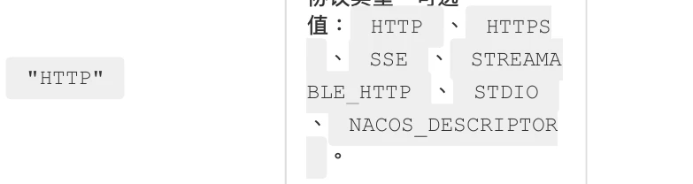

<table>
  <tr>
    <td>data.endpoints[].updat edAt</td>
    <td><code>string&lt;date-</code><br><code>time&gt;</code></td>
    <td><code>"2026-06-</code><br><code>22T12:00:00Z"</code></td>
    <td>更新时间。</td>
  </tr>
  <tr>
    <td>data.capabilities</td>
    <td><code>array</code></td>
    <td><code>[{"capabilityId":"c</code><br><code>apability-</code><br><code>001","versionId":"ve</code><br><code>rsion-</code><br><code>001","capabilityType</code><br><code>":"MODEL","name":"sa</code><br><code>mple-</code><br><code>name","displayName":</code> <code>"</code>示例资源<code>","description":"</code>用于演示的资源描述<code>"}] </code></td>
    <td>资源能力列表。</td>
  </tr>
  <tr>
    <td>data.capabilities[].capa bilityId</td>
    <td><code>string</code></td>
    <td><code>"capability-001"</code></td>
    <td>能力 ID。</td>
  </tr>
  <tr>
    <td>data.capabilities[].versi onId</td>
    <td><code>string</code></td>
    <td><code>"version-001"</code></td>
    <td>版本 ID。</td>
  </tr>
  <tr>
    <td>data.capabilities[].capa bilityType</td>
    <td><code>string</code></td>
    <td><code>"MODEL"</code></td>
    <td>capabilityType。可选值：<code> MODEL </code>、<code> MCP_T</code> <code>OOL </code>、<code> MCP_RESOURCE</code><code> </code>、<code> MCP_PROMPT </code>、<code> </code><code>SKILL </code>、<code> WORKER </code>、<code> API </code>。</td>
  </tr>
  <tr>
    <td>data.capabilities[].nam e</td>
    <td><code>string</code></td>
    <td><code>"sample-name"</code></td>
    <td>名称。</td>
  </tr>
  <tr>
    <td>data.capabilities[].displ ayName</td>
    <td><code>string</code></td>
    <td><code> "</code>示例资源<code>" </code></td>
    <td>展示名称。</td>
  </tr>
  <tr>
    <td>data.capabilities[].desc ription</td>
    <td><code>string</code></td>
    <td><code> "</code>用于演示的资源描述<code>" </code></td>
    <td>描述信息。</td>
  </tr>
  <tr>
    <td>data.capabilities[].input Schema</td>
    <td><code>object</code></td>
    <td><code>{}</code></td>
    <td>输入参数 Schema。</td>
  </tr>
  <tr>
    <td>data.capabilities[].outp utSchema</td>
    <td><code>object</code></td>
    <td><code>{}</code></td>
    <td>输出结果 Schema。</td>
  </tr>
  <tr>
    <td>data.capabilities[].tags</td>
    <td><code>array</code></td>
    <td><code>["sample-value"]</code></td>
    <td>标签列表。</td>
  </tr>
</table>

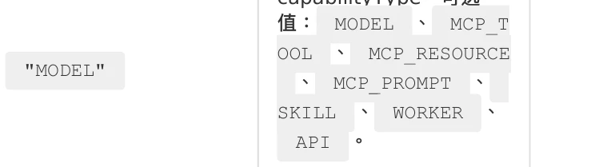

**示例请求示例**

```http
GET /himarket/v1/open-api/v1/resources/{resourceId}/versions/{versionId} HTTP/1.1
Host: localhost:8080
X-HIMARKET-OPENAPI: HIMARKET_OPENAPI
X-HIMARKET-TOKEN: <admin-openapi-token>
```

**响应示例**

```json
{
  "code": "SUCCESS",
  "message": null,
  "data": {
    "resource": {
      "resourceId": "resource-001",
      "tenantId": "tenant-001",
      "kind": "MODEL_API",
      "name": "sample-name",
      "displayName": "示例资源",
      "summary": "示例摘要"
    },
    "version": {
      "versionId": "version-001",
      "resourceId": "resource-001",
      "version": "sample-value",
      "versionScheme": "SEMVER",
      "status": "DRAFT",
      "manifestId": "manifest-001"
    },
    "sourceBinding": {
      "sourceBindingId": "sourceBinding-001",
      "resourceId": "resource-001",
      "sourceType": "GATEWAY",
      "sourceRef": "sample-value",
      "primaryBinding": false,
      "priority": 100
    },
    "endpoints": [
      {}
    ],
    "capabilities": [
      {}
    ],
    "artifacts": [
      {}
    ]
  },
  "accessDeniedDetail": null,
  "requestId": "req-001"
}
```

<a id="section-2-3-11-7"></a>

#### 2.3.11.7. listResources

**接口信息**

- **接口路径**： `GET /himarket/v1/open-api/v1/resources`

- **接口说明**：分页查询 AI Resource。

- **认证方式**：该接口属于管理面 OpenAPI。调用前请完成 OpenAPI 凭证配置，并按 Token 模式或 AK/SK签名模式携带认证 Header。

- **Header 示例**：Token 模式使用  `X-HIMARKET-OPENAPI: HIMARKET_OPENAPI`  与  `X-HIMARKET-TOKEN` ；AK/SK 模式使用  `X-HIMARKET-ACCESS-KEY` 、 `X-HIMARKET-TIMESTAMP`  和  `X-HIMARKET-SIGNATURE` 。

**请求参数**

| 参数名称 | 位置 | 类型 | 是否必选 | 示例 | 说明 |
| --- | --- | --- | --- | --- | --- |
| tenantId | query | <code>string</code> | 否 | <code>"tenant-</code><br><code>001"</code> | 租户ID。 |
| kind | query | <code>string</code> | 否 | <code>"MODEL_API"</code> | 资源类型。 |
| lifecycleStatus | query | <code>string</code> | 否 | <code>"DRAFT"</code> | 生命周期状态。可选值：<code> DRAFT </code>、<code> ACTIVE </code>、<code> DEPRECATE</code> <code>D </code>、<code> ARCHIV</code> <code>ED </code>。 |
| ownerType | query | <code>string</code> | 否 | <code>"USER"</code> | 归属主体类型。可选值：<code> USER </code>、<code> APP </code>、<code> SYS</code> <code>TEM </code>。 |
| ownerId | query | <code>string</code> | 否 | <code>"owner-</code><br><code>001"</code> | 归属主体ID。 |
| keyword | query | <code>string</code> | 否 | <code>"sample-</code><br><code>value"</code> | 搜索关键词。 |
| page | query | <code>integer&lt;int</code><br><code>32&gt;</code> | 否 | <code>1</code> | 页码。 |
| size | query | <code>integer&lt;int</code><br><code>32&gt;</code> | 否 | <code>10</code> | 每页记录数。 |

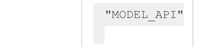

<table>
  <tr>
    <td>sort</td>
    <td>query</td>
    <td><code>array</code></td>
    <td>否</td>
    <td><code>["sample-</code><br><code>value"]</code></td>
    <td>排序条件。</td>
  </tr>
</table>

**返回数据**

| 参数名称 | 类型 | 示例 | 说明 |
| --- | --- | --- | --- |
| code | <code>string</code> | <code>SUCCESS</code> | 响应码，取值为<code> SUCCESS </code> 时表示请求成功。 |
| message | <code>string</code> | <code>null</code> | 响应消息。请求成功时通常为空。 |
| data | <code>object</code> | <code>{"content":</code><br><code>[{}],"pageNumber":1,</code><br><code>"pageSize":10,"total</code><br><code>Count":1}</code> | 响应数据。具体结构以接口语义为准。 |
| accessDeniedDetail | <code>object</code> | <code>null</code> | 鉴权失败详情。请求成功时通常为空。 |
| requestId | <code>string</code> | <code>req-001</code> | 请求 ID，可用于问题排查和日志检索。 |
| data.content | <code>array</code> | <code>[{"resourceId":"res</code><br><code>ource-</code><br><code>001","tenantId":"ten</code><br><code>ant-</code><br><code>001","kind":"MODEL_A</code><br><code>PI","name":"sample-</code><br><code>name","displayName":</code> <code>"</code>示例资源<code>","summary":"</code>示例摘要<code>"}] </code> | 分页结果列表。 |
| data.content\[\].resource Id | <code>string</code> | <code>"resource-001"</code> | AI Resource ID。 |
| data.content\[\].tenantId | <code>string</code> | <code>"tenant-001"</code> | 租户ID。 |
| data.content\[\].kind | <code>string</code> | <code>"MODEL_API"</code> | 资源类型。 |
| data.content\[\].name | <code>string</code> | <code>"sample-name"</code> | 名称。 |
| data.content\[\].displayN ame | <code>string</code> | <code> "</code>示例资源<code>" </code> | 展示名称。 |
| data.content\[\].summar y | <code>string</code> | <code> "</code>示例摘要<code>" </code> | 摘要信息。 |
| data.content\[\].descripti on | <code>string</code> | <code> "</code>用于演示的资源描述<code>" </code> | 描述信息。 |
| data.content\[\].ownerTy pe | <code>string</code> | <code>"USER"</code> | 归属主体类型。可选值：<code> USER </code>、<code> APP </code>、<code> SYSTEM </code>。 |
| data.content\[\].ownerId | <code>string</code> | <code>"owner-001"</code> | 归属主体ID。 |
| data.content\[\].created By | <code>string</code> | <code>"sample-value"</code> | 创建人。 |
| data.content\[\].created ByName | <code>string</code> | <code>"demo-createdby"</code> | 创建人名称。 |
| data.content\[\].icon | <code>string</code> | <code>"sample-value"</code> | 图标地址。 |
| data.content\[\].tags | <code>array</code> | <code>["sample-value"]</code> | 标签列表。 |
| data.content\[\].lifecycle Status | <code>string</code> | <code>"DRAFT"</code> | 生命周期状态。可选值：<code> DRAFT </code>、<code> ACTIV</code> <code>E </code>、<code> DEPRECATED </code>、<code> ARCHIVED </code>。 |
| data.content\[\].latestVe rsionId | <code>string</code> | <code>"latestVersion-</code><br><code>001"</code> | 最新版本ID。 |
| data.content\[\].autoApp roveSubscription | <code>boolean</code> | <code>true</code> | 是否自动批准订阅。 |
| data.content\[\].extras | <code>object</code> | <code>{}</code> | 扩展配置。 |
| data.content\[\].created At | <code>string&lt;date-</code><br><code>time&gt;</code> | <code>"2026-06-</code><br><code>22T12:00:00Z"</code> | 创建时间。 |
| data.content\[\].updated At | <code>string&lt;date-</code><br><code>time&gt;</code> | <code>"2026-06-</code><br><code>22T12:00:00Z"</code> | 更新时间。 |
| data.pageNumber | <code>integer&lt;int32&gt;</code> | <code>1</code> | 当前页码。 |
| data.pageSize | <code>integer&lt;int32&gt;</code> | <code>10</code> | 每页大小。 |
| data.totalCount | <code>integer&lt;int64&gt;</code> | <code>1</code> | 总记录数。 |

**示例**

**请求示例**

```text
GET /himarket/v1/open-api/v1/resources?tenantId=tenant-
001&kind=MODEL_API&lifecycleStatus=DRAFT&ownerType=USER&ownerId=owner-001&keyword=sample-value&page=1&size=10 HTTP/1.1
Host: localhost:8080
X-HIMARKET-OPENAPI: HIMARKET_OPENAPI
X-HIMARKET-TOKEN: <admin-openapi-token>
```

**响应示例**

```json
{
  "code": "SUCCESS",
  "message": null,
  "data": {
    "content": [
      {}
    ],
    "pageNumber": 1,
    "pageSize": 10,
    "totalCount": 1
  },
  "accessDeniedDetail": null,
  "requestId": "req-001"
}
```

<a id="section-2-3-11-8"></a>

#### 2.3.11.8. listVersions

**接口信息**

- **接口路径**： `GET /himarket/v1/open-api/v1/resources/{resourceId}/versions`

- **接口说明**：分页查询 AI Resource 版本。

- **认证方式**：该接口属于管理面 OpenAPI。调用前请完成 OpenAPI 凭证配置，并按 Token 模式或 AK/SK签名模式携带认证 Header。

- **Header 示例**：Token 模式使用  `X-HIMARKET-OPENAPI: HIMARKET_OPENAPI`  与  `X-HIMARKET-TOKEN` ；AK/SK 模式使用  `X-HIMARKET-ACCESS-KEY` 、 `X-HIMARKET-TIMESTAMP`  和  `X-HIMARKET-SIGNATURE` 。

**请求参数**

| 参数名称 | 位置 | 类型 | 是否必选 | 示例 | 说明 |
| --- | --- | --- | --- | --- | --- |
| resourceId | path | <code>string</code> | 是 | <code>"resource-</code><br><code>001"</code> | AI Resource ID。 |
| page | query | <code>integer&lt;int</code><br><code>32&gt;</code> | 否 | <code>1</code> | 页码。 |
| size | query | <code>integer&lt;int</code><br><code>32&gt;</code> | 否 | <code>10</code> | 每页记录数。 |
| sort | query | <code>array</code> | 否 | <code>["sample-</code><br><code>value"]</code> | 排序条件。 |

**返回数据**

| 参数名称 | 类型 | 示例 | 说明 |
| --- | --- | --- | --- |
| code | <code>string</code> | <code>SUCCESS</code> | 响应码，取值为<code> SUCCESS </code> 时表示请求成功。 |
| message | <code>string</code> | <code>null</code> | 响应消息。请求成功时通常为空。 |
| data | <code>object</code> | <code>{"content":</code><br><code>[{}],"pageNumber":1,</code><br><code>"pageSize":10,"total</code><br><code>Count":1}</code> | 响应数据。具体结构以接口语义为准。 |
| accessDeniedDetail | <code>object</code> | <code>null</code> | 鉴权失败详情。请求成功时通常为空。 |
| requestId | <code>string</code> | <code>req-001</code> | 请求 ID，可用于问题排查和日志检索。 |
| data.content | <code>array</code> | <code>[{"versionId":"vers</code><br><code>ion-</code><br><code>001","resourceId":"r</code><br><code>esource-</code><br><code>001","version":"samp</code><br><code>le-</code><br><code>value","versionSchem</code><br><code>e":"SEMVER","status"</code><br><code>:"DRAFT","manifestId</code><br><code>":"manifest-001"}]</code> | 分页结果列表。 |
| data.content\[\].versionI d | <code>string</code> | <code>"version-001"</code> | 版本 ID。 |
| data.content\[\].resource Id | <code>string</code> | <code>"resource-001"</code> | AI Resource ID。 |
| data.content\[\].version | <code>string</code> | <code>"sample-value"</code> | 版本号。 |
| data.content\[\].versionS cheme | <code>string</code> | <code>"SEMVER"</code> | 版本号方案。可选值：<code> SEMVER </code>、<code> TIME</code> <code>STAMP </code>、<code> REVISION </code>、<code> EXTERNAL </code>。 |
| data.content\[\].status | <code>string</code> | <code>"DRAFT"</code> | 状态。 |
| data.content\[\].manifest Id | <code>string</code> | <code>"manifest-001"</code> | Manifest ID。 |
| data.content\[\].sourceBi ndingId | <code>string</code> | <code>"sourceBinding-</code><br><code>001"</code> | 来源绑定ID。 |
| data.content\[\].artifactD igest | <code>string</code> | <code>"sample-value"</code> | 制品摘要。 |
| data.content\[\].releaseN ote | <code>string</code> | <code>"sample-value"</code> | 版本说明。 |
| data.content\[\].created By | <code>string</code> | <code>"sample-value"</code> | 创建人。 |
| data.content\[\].publishe dAt | <code>string&lt;date-</code><br><code>time&gt;</code> | <code>"2026-06-</code><br><code>22T12:00:00Z"</code> | 发布时间。 |
| data.content\[\].created At | <code>string&lt;date-</code><br><code>time&gt;</code> | <code>"2026-06-</code><br><code>22T12:00:00Z"</code> | 创建时间。 |
| data.content\[\].updated At | <code>string&lt;date-</code><br><code>time&gt;</code> | <code>"2026-06-</code><br><code>22T12:00:00Z"</code> | 更新时间。 |
| data.content\[\].downloa dCount | <code>integer&lt;int64&gt;</code> | <code>1</code> | 下载次数。 |
| data.content\[\].isLatest | <code>boolean</code> | <code>true</code> | 是否为最新版本。 |
| data.pageNumber | <code>integer&lt;int32&gt;</code> | <code>1</code> | 当前页码。 |
| data.pageSize | <code>integer&lt;int32&gt;</code> | <code>10</code> | 每页大小。 |
| data.totalCount | <code>integer&lt;int64&gt;</code> | <code>1</code> | 总记录数。 |

**示例**

**请求示例**

```http
GET /himarket/v1/open-api/v1/resources/{resourceId}/versions?page=1&size=10&sort=sample-value HTTP/1.1
Host: localhost:8080
X-HIMARKET-OPENAPI: HIMARKET_OPENAPI
X-HIMARKET-TOKEN: <admin-openapi-token>
```

**响应示例**

```json
{
  "code": "SUCCESS",
  "message": null,
  "data": {
    "content": [
      {}
    ],
    "pageNumber": 1,
    "pageSize": 10,
    "totalCount": 1
  },
  "accessDeniedDetail": null,
  "requestId": "req-001"
}
```

<a id="section-2-3-11-9"></a>

#### 2.3.11.9. syncGatewayBinding

**接口信息**

- **接口路径**： `POST /himarket/v1/open-api/v1/resources/{resourceId}/gateway/sync`

- **接口说明**：同步网关绑定的资源配置。

- **认证方式**：该接口属于管理面 OpenAPI。调用前请完成 OpenAPI 凭证配置，并按 Token 模式或 AK/SK签名模式携带认证 Header。

- **Header 示例**：Token 模式使用  `X-HIMARKET-OPENAPI: HIMARKET_OPENAPI`  与  `X-HIMARKET-TOKEN` ；AK/SK 模式使用  `X-HIMARKET-ACCESS-KEY` 、 `X-HIMARKET-TIMESTAMP`  和  `X-HIMARKET-SIGNATURE` 。

**请求参数**

| 参数名称 | 位置 | 类型 | 是否必选 | 示例 | 说明 |
| --- | --- | --- | --- | --- | --- |
| resourceId | path | <code>string</code> | 是 | <code>"resource-</code><br><code>001"</code> | AI Resource ID。 |

**返回数据**

| 参数名称 | 类型 | 示例 | 说明 |
| --- | --- | --- | --- |
| code | <code>string</code> | <code>SUCCESS</code> | 响应码，取值为<code> SUCCESS </code> 时表示请求成功。 |
| message | <code>string</code> | <code>null</code> | 响应消息。请求成功时通常为空。 |
| data | <code>object</code> | <code>{"resourceId":"reso</code><br><code>urce-</code><br><code>001","sourceBindingI</code><br><code>d":"sourceBinding-</code><br><code>001","gatewayId":"ga</code><br><code>teway-</code><br><code>001","gatewayName":"</code><br><code>sample-</code><br><code>gateway","gatewayTyp</code><br><code>e":"sample-</code><br><code>value","sourceName":</code><br><code>"demo-source"}</code> | 响应数据。具体结构以接口语义为准。 |
| accessDeniedDetail | <code>object</code> | <code>null</code> | 鉴权失败详情。请求成功时通常为空。 |
| requestId | <code>string</code> | <code>req-001</code> | 请求 ID，可用于问题排查和日志检索。 |
| data.resourceId | <code>string</code> | <code>"resource-001"</code> | AI Resource ID。 |
| data.sourceBindingId | <code>string</code> | <code>"sourceBinding-</code><br><code>001"</code> | 来源绑定ID。 |
| data.gatewayId | <code>string</code> | <code>"gateway-001"</code> | Gateway ID。 |
| data.gatewayName | <code>string</code> | <code>"sample-gateway"</code> | Gateway 名称。 |
| data.gatewayType | <code>string</code> | <code>"sample-value"</code> | Gateway 类型。 |
| data.sourceName | <code>string</code> | <code>"demo-source"</code> | 来源名称。 |
| data.syncStatus | <code>string</code> | <code>"sample-value"</code> | 同步状态。 |
| data.lastSyncedAt | <code>string&lt;date-</code><br><code>time&gt;</code> | <code>"2026-06-</code><br><code>22T12:00:00Z"</code> | 最近一次同步时间。 |

**示例**

**请求示例**

```http
POST /himarket/v1/open-api/v1/resources/{resourceId}/gateway/sync HTTP/1.1
Host: localhost:8080
X-HIMARKET-OPENAPI: HIMARKET_OPENAPI
X-HIMARKET-TOKEN: <admin-openapi-token>
```

**响应示例**

```json
{
  "code": "SUCCESS",
  "message": null,
  "data": {
    "resourceId": "resource-001",
    "sourceBindingId": "sourceBinding-001",
    "gatewayId": "gateway-001",
    "gatewayName": "sample-gateway",
    "gatewayType": "sample-value",
    "sourceName": "demo-source"
  },
  "accessDeniedDetail": null,
  "requestId": "req-001"
}
```

<a id="section-2-3-11-10"></a>

#### 2.3.11.10. syncNacosSkill

**接口信息**

- **接口路径**： `POST /himarket/v1/open-`

  ```text
  api/v1/resources/{resourceId}/versions/{versionId}/skill/nacos/sync 
  ```

- **接口说明**：刷新 Nacos-backed Skill 的版本快照和同步状态。

- **认证方式**：该接口属于管理面 OpenAPI。调用前请完成 OpenAPI 凭证配置，并按 Token 模式或 AK/SK签名模式携带认证 Header。

- **Header 示例**：Token 模式使用  `X-HIMARKET-OPENAPI: HIMARKET_OPENAPI`  与  `X-HIMARKET-TOKEN` ；AK/SK 模式使用  `X-HIMARKET-ACCESS-KEY` 、 `X-HIMARKET-TIMESTAMP`  和  `X-HIMARKET-SIGNATURE` 。

**请求参数**

| 参数名称 | 位置 | 类型 | 是否必选 | 示例 | 说明 |
| --- | --- | --- | --- | --- | --- |
| resourceId | path | <code>string</code> | 是 | <code>"resource-</code><br><code>001"</code> | AI Resource ID。 |
| versionId | path | <code>string</code> | 是 | <code>"version-</code><br><code>001"</code> | 版本 ID。 |
| nacosId | body | <code>string</code> | 否 | <code>"nacos-</code><br><code>001"</code> | Nacos 实例ID。 |
| namespace | body | <code>string</code> | 否 | <code>"public"</code> | 命名空间。 |
| skillName | body | <code>string</code> | 否 | <code>"demo-</code><br><code>skill"</code> | Skill 名称。 |
| skillVersion | body | <code>string</code> | 否 | <code>"sample-</code><br><code>value"</code> | Skill 版本。 |

**返回数据**

| 参数名称 | 类型 | 示例 | 说明 |
| --- | --- | --- | --- |
| code | <code>string</code> | <code>SUCCESS</code> | 响应码，取值为<code> SUCCESS </code> 时表示请求成功。 |
| message | <code>string</code> | <code>null</code> | 响应消息。请求成功时通常为空。 |
| data | <code>object</code> | <code>{"resourceId":"reso</code><br><code>urce-</code><br><code>001","versionId":"ve</code><br><code>rsion-</code><br><code>001","sourceBindingI</code><br><code>d":"sourceBinding-</code><br><code>001","nacosId":"naco</code><br><code>s-</code><br><code>001","namespace":"pu</code><br><code>blic","skillName":"d</code><br><code>emo-skill"}</code> | 响应数据。具体结构以接口语义为准。 |
| accessDeniedDetail | <code>object</code> | <code>null</code> | 鉴权失败详情。请求成功时通常为空。 |
| requestId | <code>string</code> | <code>req-001</code> | 请求 ID，可用于问题排查和日志检索。 |
| data.resourceId | <code>string</code> | <code>"resource-001"</code> | AI Resource ID。 |
| data.versionId | <code>string</code> | <code>"version-001"</code> | 版本 ID。 |
| data.sourceBindingId | <code>string</code> | <code>"sourceBinding-</code><br><code>001"</code> | 来源绑定ID。 |
| data.nacosId | <code>string</code> | <code>"nacos-001"</code> | Nacos 实例 ID。 |
| data.namespace | <code>string</code> | <code>"public"</code> | 命名空间。 |
| data.skillName | <code>string</code> | <code>"demo-skill"</code> | Skill 名称。 |
| data.skillVersion | <code>string</code> | <code>"sample-value"</code> | Skill 版本。 |
| data.syncStatus | <code>string</code> | <code>"sample-value"</code> | 同步状态。 |
| data.snapshotHash | <code>string</code> | <code>"sample-value"</code> | 快照哈希。 |
| data.snapshot | <code>object</code> | <code>{}</code> | 快照内容。 |
| data.lastSyncedAt | <code>string&lt;date-</code><br><code>time&gt;</code> | <code>"2026-06-</code><br><code>22T12:00:00Z"</code> | 最近一次同步时间。 |

**示例**

**请求示例**

```text
POST /himarket/v1/open-
api/v1/resources/{resourceId}/versions/{versionId}/skill/nacos/sync HTTP/1.1
Host: localhost:8080
X-HIMARKET-OPENAPI: HIMARKET_OPENAPI
X-HIMARKET-TOKEN: <admin-openapi-token>
Content-Type: application/json

{
  "nacosId": "nacos-001",
  "namespace": "public",
  "skillName": "demo-skill",
  "skillVersion": "sample-value"
}
```

**响应示例**

```json
{
  "code": "SUCCESS",
  "message": null,
  "data": {
    "resourceId": "resource-001",
    "versionId": "version-001",
    "sourceBindingId": "sourceBinding-001",
    "nacosId": "nacos-001",
    "namespace": "public",
    "skillName": "demo-skill"
  },
  "accessDeniedDetail": null,
  "requestId": "req-001"
}
```

<a id="section-2-3-11-11"></a>

#### 2.3.11.11. updateBinding

**接口信息**

- **接口路径**： `PUT /himarket/v1/open-api/v1/resources/{resourceId}/binding`

- **接口说明**：更新网关绑定（重新选择网关和 Model API）。

- **认证方式**：该接口属于管理面 OpenAPI。调用前请完成 OpenAPI 凭证配置，并按 Token 模式或 AK/SK签名模式携带认证 Header。

- **Header 示例**：Token 模式使用  `X-HIMARKET-OPENAPI: HIMARKET_OPENAPI`  与  `X-HIMARKET-TOKEN` ；AK/SK 模式使用  `X-HIMARKET-ACCESS-KEY` 、 `X-HIMARKET-TIMESTAMP`  和  `X-HIMARKET-SIGNATURE` 。

**请求参数**

| 参数名称 | 位置 | 类型 | 是否必选 | 示例 | 说明 |
| --- | --- | --- | --- | --- | --- |
| resourceId | path | <code>string</code> | 是 | <code>"resource-</code><br><code>001"</code> | AI Resource ID。 |
| gatewayId | body | <code>string</code> | 是 | <code>"gateway-</code><br><code>001"</code> | Gateway ID。 |
| sourceRef | body | <code>string</code> | 是 | <code>"sample-</code><br><code>value"</code> | 来源引用。 |

**返回数据**

| 参数名称 | 类型 | 示例 | 说明 |
| --- | --- | --- | --- |
| code | <code>string</code> | <code>SUCCESS</code> | 响应码，取值为<code> SUCCESS </code> 时表示请求成功。 |
| message | <code>string</code> | <code>null</code> | 响应消息。请求成功时通常为空。 |
| data | <code>object</code> | <code>{"resourceId":"reso</code><br><code>urce-</code><br><code>001","gatewayId":"ga</code><br><code>teway-</code><br><code>001","gatewayName":"</code><br><code>sample-</code><br><code>gateway","gatewayTyp</code><br><code>e":"sample-</code><br><code>value","sourceName":</code><br><code>"demo-</code><br><code>source","sourceRef":</code><br><code>"sample-value"}</code> | 响应数据。具体结构以接口语义为准。 |
| accessDeniedDetail | <code>object</code> | <code>null</code> | 鉴权失败详情。请求成功时通常为空。 |
| requestId | <code>string</code> | <code>req-001</code> | 请求 ID，可用于问题排查和日志检索。 |
| data.resourceId | <code>string</code> | <code>"resource-001"</code> | AI Resource ID。 |
| data.gatewayId | <code>string</code> | <code>"gateway-001"</code> | Gateway ID。 |
| data.gatewayName | <code>string</code> | <code>"sample-gateway"</code> | Gateway 名称。 |
| data.gatewayType | <code>string</code> | <code>"sample-value"</code> | Gateway 类型。 |
| data.sourceName | <code>string</code> | <code>"demo-source"</code> | 来源名称。 |
| data.sourceRef | <code>string</code> | <code>"sample-value"</code> | 来源引用。 |
| data.endpointUrls | <code>array</code> | <code>["https://api.examp</code><br><code>le.com"]</code> | Endpoint 地址列表。 |

**示例**

**请求示例**

```http
PUT /himarket/v1/open-api/v1/resources/{resourceId}/binding HTTP/1.1
Host: localhost:8080
X-HIMARKET-OPENAPI: HIMARKET_OPENAPI
X-HIMARKET-TOKEN: <admin-openapi-token>
Content-Type: application/json

{
  "gatewayId": "gateway-001",
  "sourceRef": "sample-value"
}
```

**响应示例**

```json
{
  "code": "SUCCESS",
  "message": null,
  "data": {
    "resourceId": "resource-001",
    "gatewayId": "gateway-001",
    "gatewayName": "sample-gateway",
    "gatewayType": "sample-value",
    "sourceName": "demo-source",
    "sourceRef": "sample-value"
  },
  "accessDeniedDetail": null,
  "requestId": "req-001"
}
```

<a id="section-2-3-11-12"></a>

#### 2.3.11.12. updateResourceBasicInfo

**接口信息**

- **接口路径**： `PUT /himarket/v1/open-api/v1/resources/{resourceId}/basic-info`

- **接口说明**：更新 AI Resource 基础信息。

- **认证方式**：该接口属于管理面 OpenAPI。调用前请完成 OpenAPI 凭证配置，并按 Token 模式或 AK/SK签名模式携带认证 Header。

- **Header 示例**：Token 模式使用  `X-HIMARKET-OPENAPI: HIMARKET_OPENAPI`  与  `X-HIMARKET-TOKEN` ；AK/SK 模式使用  `X-HIMARKET-ACCESS-KEY` 、 `X-HIMARKET-TIMESTAMP`  和  `X-HIMARKET-SIGNATURE` 。

**请求参数**

| 参数名称 | 位置 | 类型 | 是否必选 | 示例 | 说明 |
| --- | --- | --- | --- | --- | --- |
| resourceId | path | <code>string</code> | 是 | <code>"resource-</code><br><code>001"</code> | AI Resource ID。 |
| displayName | body | <code>string</code> | 否 | <code> "</code>示例资源<code>" </code> | 展示名称。 |
| summary | body | <code>string</code> | 否 | <code> "</code>示例摘要<code>" </code> | 摘要信息。 |
| autoApproveS ubscription | body | <code>boolean</code> | 否 | <code>true</code> | 是否自动批准订阅。 |
| icon | body | <code>string</code> | 否 | <code>"sample-</code><br><code>value"</code> | 图标地址。 |
| tags | body | <code>array</code> | 否 | <code>["sample-</code><br><code>value"]</code> | 标签列表。 |

**返回数据**

| 参数名称 | 类型 | 示例 | 说明 |
| --- | --- | --- | --- |
| code | <code>string</code> | <code>SUCCESS</code> | 响应码，取值为<code> SUCCESS </code> 时表示请求成功。 |
| message | <code>string</code> | <code>null</code> | 响应消息。请求成功时通常为空。 |
| data | <code>object</code> | <code>{"resource":</code><br><code>{"resourceId":"resou</code><br><code>rce-</code><br><code>001","tenantId":"ten</code><br><code>ant-</code><br><code>001","kind":"MODEL_A</code><br><code>PI","name":"sample-</code><br><code>name","displayName":</code> <code>"</code>示例资源<code>","summary":"</code>示例摘要<code>"},"latestVersion":</code> <code>{"versionId":"versio</code><br><code>n-</code><br><code>001","resourceId":"r</code><br><code>esource-</code><br><code>001","version":"samp</code><br><code>le-</code><br><code>value","versionSchem</code><br><code>e":"SEMVER","status"</code><br><code>:"DRAFT","manifestId</code><br><code>":"manifest-</code><br><code>001"},"sourceBinding</code><br><code>s":[{}]}</code> | 响应数据。具体结构以接口语义为准。 |
| accessDeniedDetail | <code>object</code> | <code>null</code> | 鉴权失败详情。请求成功时通常为空。 |
| requestId | <code>string</code> | <code>req-001</code> | 请求 ID，可用于问题排查和日志检索。 |
| data.resource | <code>object</code> | <code>{"resourceId":"reso</code><br><code>urce-</code><br><code>001","tenantId":"ten</code><br><code>ant-</code><br><code>001","kind":"MODEL_A</code><br><code>PI","name":"sample-</code><br><code>name","displayName":</code> <code>"</code>示例资源<code>","summary":"</code>示例摘要<code>"} </code> | AI Resource 基础信息。 |
| data.resource.resourceI d | <code>string</code> | <code>"resource-001"</code> | AI Resource ID。 |
| data.resource.tenantId | <code>string</code> | <code>"tenant-001"</code> | 租户ID。 |
| data.resource.kind | <code>string</code> | <code>"MODEL_API"</code> | 资源类型。 |
| data.resource.name | <code>string</code> | <code>"sample-name"</code> | 名称。 |
| data.resource.displayN ame | <code>string</code> | <code> "</code>示例资源<code>" </code> | 展示名称。 |
| data.resource.summar y | <code>string</code> | <code> "</code>示例摘要<code>" </code> | 摘要信息。 |
| data.resource.descripti on | <code>string</code> | <code> "</code>用于演示的资源描述<code>" </code> | 描述信息。 |
| data.resource.ownerTy pe | <code>string</code> | <code>"USER"</code> | 归属主体类型。可选值：<code> USER </code>、<code> APP </code>、<code> SYSTEM </code>。 |
| data.resource.ownerId | <code>string</code> | <code>"owner-001"</code> | 归属主体ID。 |
| data.resource.createdB y | <code>string</code> | <code>"sample-value"</code> | 创建人。 |
| data.resource.createdB yName | <code>string</code> | <code>"demo-createdby"</code> | 创建人名称。 |
| data.resource.icon | <code>string</code> | <code>"sample-value"</code> | 图标地址。 |
| data.resource.tags | <code>array</code> | <code>["sample-value"]</code> | 标签列表。 |
| data.resource.lifecycle Status | <code>string</code> | <code>"DRAFT"</code> | 生命周期状态。可选值：<code> DRAFT </code>、<code> ACTIV</code> <code>E </code>、<code> DEPRECATED </code>、<code> ARCHIVED </code>。 |
| data.resource.latestVer sionId | <code>string</code> | <code>"latestVersion-</code><br><code>001"</code> | 最新版本ID。 |
| data.resource.autoAppr oveSubscription | <code>boolean</code> | <code>true</code> | 是否自动批准订阅。 |
| data.resource.extras | <code>object</code> | <code>{}</code> | 扩展配置。 |
| data.resource.createdA t | <code>string&lt;date-</code><br><code>time&gt;</code> | <code>"2026-06-</code><br><code>22T12:00:00Z"</code> | 创建时间。 |
| data.resource.updated At | <code>string&lt;date-</code><br><code>time&gt;</code> | <code>"2026-06-</code><br><code>22T12:00:00Z"</code> | 更新时间。 |
| data.latestVersion | <code>object</code> | <code>{"versionId":"versi</code><br><code>on-</code><br><code>001","resourceId":"r</code><br><code>esource-</code><br><code>001","version":"samp</code><br><code>le-</code><br><code>value","versionSchem</code><br><code>e":"SEMVER","status"</code><br><code>:"DRAFT","manifestId</code><br><code>":"manifest-001"}</code> | 最新版本信息。 |
| data.latestVersion.versi onId | <code>string</code> | <code>"version-001"</code> | 版本 ID。 |
| data.latestVersion.reso urceId | <code>string</code> | <code>"resource-001"</code> | AI Resource ID。 |
| data.latestVersion.versi on | <code>string</code> | <code>"sample-value"</code> | 版本号。 |
| data.latestVersion.versi onScheme | <code>string</code> | <code>"SEMVER"</code> | 版本号方案。可选值：<code> SEMVER </code>、<code> TIME</code> <code>STAMP </code>、<code> REVISION </code>、<code> EXTERNAL </code>。 |
| data.latestVersion.stat us | <code>string</code> | <code>"DRAFT"</code> | 状态。 |
| data.latestVersion.mani festId | <code>string</code> | <code>"manifest-001"</code> | Manifest ID。 |
| data.latestVersion.sour ceBindingId | <code>string</code> | <code>"sourceBinding-</code><br><code>001"</code> | 来源绑定ID。 |
| data.latestVersion.artif actDigest | <code>string</code> | <code>"sample-value"</code> | 制品摘要。 |
| data.latestVersion.rele aseNote | <code>string</code> | <code>"sample-value"</code> | 版本说明。 |
| data.latestVersion.crea tedBy | <code>string</code> | <code>"sample-value"</code> | 创建人。 |
| data.latestVersion.publi shedAt | <code>string&lt;date-</code><br><code>time&gt;</code> | <code>"2026-06-</code><br><code>22T12:00:00Z"</code> | 发布时间。 |
| data.latestVersion.crea tedAt | <code>string&lt;date-</code><br><code>time&gt;</code> | <code>"2026-06-</code><br><code>22T12:00:00Z"</code> | 创建时间。 |
| data.latestVersion.upda tedAt | <code>string&lt;date-</code><br><code>time&gt;</code> | <code>"2026-06-</code><br><code>22T12:00:00Z"</code> | 更新时间。 |
| data.latestVersion.dow nloadCount | <code>integer&lt;int64&gt;</code> | <code>1</code> | 下载次数。 |
| data.latestVersion.isLat est | <code>boolean</code> | <code>true</code> | 是否为最新版本。 |
| data.sourceBindings | <code>array</code> | <code>[{"sourceBindingId"</code><br><code>:"sourceBinding-</code><br><code>001","resourceId":"r</code><br><code>esource-</code><br><code>001","sourceType":"G</code><br><code>ATEWAY","sourceRef":</code><br><code>"sample-</code><br><code>value","primaryBindi</code><br><code>ng":false,"priority"</code><br><code>:100}]</code> | 来源绑定列表。 |
| data.sourceBindings\[\].s ourceBindingId | <code>string</code> | <code>"sourceBinding-</code><br><code>001"</code> | 来源绑定ID。 |
| data.sourceBindings\[\].r esourceId | <code>string</code> | <code>"resource-001"</code> | AI Resource ID。 |
| data.sourceBindings\[\].s ourceType | <code>string</code> | <code>"GATEWAY"</code> | 来源类型。可选值：<code> GATEWAY </code>、<code> NAC</code> <code>OS </code>、<code> REMOTE_ENDPOI</code> <code>NT </code>、<code> SANDBOX </code>、<code> R</code> <code>EGISTRY </code>、<code> CUSTOM </code>。 |
| data.sourceBindings\[\].s ourceRef | <code>string</code> | <code>"sample-value"</code> | 来源引用。 |
| data.sourceBindings\[\].p rimaryBinding | <code>boolean</code> | <code>false</code> | 是否为主绑定关系。 |
| data.sourceBindings\[\].p riority | <code>integer&lt;int32&gt;</code> | <code>100</code> | 优先级。 |
| data.sourceBindings\[\].s yncMode | <code>string</code> | <code>"sample-value"</code> | 同步模式。 |
| data.sourceBindings\[\].s yncStatus | <code>string</code> | <code>"sample-value"</code> | 同步状态。 |
| data.sourceBindings\[\].c redentialRef | <code>string</code> | <code>"sample-value"</code> | 凭据引用。 |
| data.sourceBindings\[\].c onfig | <code>object</code> | <code>{}</code> | 配置信息。 |
| data.sourceBindings\[\].l astSyncedAt | <code>string&lt;date-</code><br><code>time&gt;</code> | <code>"2026-06-</code><br><code>22T12:00:00Z"</code> | 最近一次同步时间。 |

**示例**

**请求示例**

```http
PUT /himarket/v1/open-api/v1/resources/{resourceId}/basic-info HTTP/1.1
Host: localhost:8080
X-HIMARKET-OPENAPI: HIMARKET_OPENAPI
X-HIMARKET-TOKEN: <admin-openapi-token>
Content-Type: application/json

{
  "displayName": "示例资源",
  "summary": "示例摘要",
  "autoApproveSubscription": true,
  "icon": "sample-value",
  "tags": [
    "sample-value"
  ]
}
```

**响应示例**

```json
{
  "code": "SUCCESS",
  "message": null,
  "data": {
    "resource": {
      "resourceId": "resource-001",
      "tenantId": "tenant-001",
      "kind": "MODEL_API",
      "name": "sample-name",
      "displayName": "示例资源",
      "summary": "示例摘要"
    },
    "latestVersion": {
      "versionId": "version-001",
      "resourceId": "resource-001",
      "version": "sample-value",
      "versionScheme": "SEMVER",
      "status": "DRAFT",
      "manifestId": "manifest-001"
    },
    "sourceBindings": [
      {}
    ]
  },
  "accessDeniedDetail": null,
  "requestId": "req-001"
}
```

<a id="section-2-3-11-13"></a>

#### 2.3.11.13. updateResourceDescription

**接口信息**

- **接口路径**： `PUT /himarket/v1/open-api/v1/resources/{resourceId}/description`

- **接口说明**：更新 AI Resource Markdown 说明。

- **认证方式**：该接口属于管理面 OpenAPI。调用前请完成 OpenAPI 凭证配置，并按 Token 模式或 AK/SK签名模式携带认证 Header。

- **Header 示例**：Token 模式使用  `X-HIMARKET-OPENAPI: HIMARKET_OPENAPI`  与  `X-HIMARKET-TOKEN` ；AK/SK 模式使用  `X-HIMARKET-ACCESS-KEY` 、 `X-HIMARKET-TIMESTAMP`  和  `X-HIMARKET-SIGNATURE` 。

**请求参数**

| 参数名称 | 位置 | 类型 | 是否必选 | 示例 | 说明 |
| --- | --- | --- | --- | --- | --- |
| resourceId | path | <code>string</code> | 是 | <code>"resource-</code><br><code>001"</code> | AI Resource ID。 |
| description | body | <code>string</code> | 否 | <code> "</code>用于演示的资源描述<code>" </code> | 描述信息。 |

**返回数据**

| 参数名称 | 类型 | 示例 | 说明 |
| --- | --- | --- | --- |
| code | <code>string</code> | <code>SUCCESS</code> | 响应码，取值为<code> SUCCESS </code> 时表示请求成功。 |
| message | <code>string</code> | <code>null</code> | 响应消息。请求成功时通常为空。 |

<table>
  <tr>
    <td>data</td>
    <td><code>object</code></td>
    <td><code>{"resource":</code><br><code>{"resourceId":"resou</code><br><code>rce-</code><br><code>001","tenantId":"ten</code><br><code>ant-</code><br><code>001","kind":"MODEL_A</code><br><code>PI","name":"sample-</code><br><code>name","displayName":</code> <code>"</code>示例资源<code>","summary":"</code>示例摘要<code>"},"latestVersion":</code> <code>{"versionId":"versio</code><br><code>n-</code><br><code>001","resourceId":"r</code><br><code>esource-</code><br><code>001","version":"samp</code><br><code>le-</code><br><code>value","versionSchem</code><br><code>e":"SEMVER","status"</code><br><code>:"DRAFT","manifestId</code><br><code>":"manifest-</code><br><code>001"},"sourceBinding</code><br><code>s":[{}]}</code></td>
    <td>响应数据。具体结构以接口语义为准。</td>
  </tr>
  <tr>
    <td>accessDeniedDetail</td>
    <td><code>object</code></td>
    <td><code>null</code></td>
    <td>鉴权失败详情。请求成功时通常为空。</td>
  </tr>
  <tr>
    <td>requestId</td>
    <td><code>string</code></td>
    <td><code>req-001</code></td>
    <td>请求 ID，可用于问题排查和日志检索。</td>
  </tr>
  <tr>
    <td>data.resource</td>
    <td><code>object</code></td>
    <td><code>{"resourceId":"reso</code><br><code>urce-</code><br><code>001","tenantId":"ten</code><br><code>ant-</code><br><code>001","kind":"MODEL_A</code><br><code>PI","name":"sample-</code><br><code>name","displayName":</code> <code>"</code>示例资源<code>","summary":"</code>示例摘要<code>"} </code></td>
    <td>AI Resource 基础信息。</td>
  </tr>
  <tr>
    <td>data.resource.resourceI d</td>
    <td><code>string</code></td>
    <td><code>"resource-001"</code></td>
    <td>AI Resource ID。</td>
  </tr>
  <tr>
    <td>data.resource.tenantId</td>
    <td><code>string</code></td>
    <td><code>"tenant-001"</code></td>
    <td>租户ID。</td>
  </tr>
  <tr>
    <td>data.resource.kind</td>
    <td><code>string</code></td>
    <td><code>"MODEL_API"</code></td>
    <td>资源类型。</td>
  </tr>
  <tr>
    <td>data.resource.name</td>
    <td><code>string</code></td>
    <td><code>"sample-name"</code></td>
    <td>名称。</td>
  </tr>
  <tr>
    <td>data.resource.displayN ame</td>
    <td><code>string</code></td>
    <td><code> "</code>示例资源<code>" </code></td>
    <td>展示名称。</td>
  </tr>
  <tr>
    <td>data.resource.summar y</td>
    <td><code>string</code></td>
    <td><code> "</code>示例摘要<code>" </code></td>
    <td>摘要信息。</td>
  </tr>
  <tr>
    <td>data.resource.descripti on</td>
    <td><code>string</code></td>
    <td><code> "</code>用于演示的资源描述<code>" </code></td>
    <td>描述信息。</td>
  </tr>
  <tr>
    <td>data.resource.ownerTy pe</td>
    <td><code>string</code></td>
    <td><code>"USER"</code></td>
    <td>归属主体类型。可选值：<code> USER </code>、<code> APP </code>、<code> SYSTEM </code>。</td>
  </tr>
  <tr>
    <td>data.resource.ownerId</td>
    <td><code>string</code></td>
    <td><code>"owner-001"</code></td>
    <td>归属主体ID。</td>
  </tr>
  <tr>
    <td>data.resource.createdB y</td>
    <td><code>string</code></td>
    <td><code>"sample-value"</code></td>
    <td>创建人。</td>
  </tr>
  <tr>
    <td>data.resource.createdB yName</td>
    <td><code>string</code></td>
    <td><code>"demo-createdby"</code></td>
    <td>创建人名称。</td>
  </tr>
  <tr>
    <td>data.resource.icon</td>
    <td><code>string</code></td>
    <td><code>"sample-value"</code></td>
    <td>图标地址。</td>
  </tr>
  <tr>
    <td>data.resource.tags</td>
    <td><code>array</code></td>
    <td><code>["sample-value"]</code></td>
    <td>标签列表。</td>
  </tr>
  <tr>
    <td>data.resource.lifecycle Status</td>
    <td><code>string</code></td>
    <td><code>"DRAFT"</code></td>
    <td>生命周期状态。可选值：<code> DRAFT </code>、<code> ACTIV</code> <code>E </code>、<code> DEPRECATED </code>、<code> ARCHIVED </code>。</td>
  </tr>
  <tr>
    <td>data.resource.latestVer sionId</td>
    <td><code>string</code></td>
    <td><code>"latestVersion-</code><br><code>001"</code></td>
    <td>最新版本ID。</td>
  </tr>
  <tr>
    <td>data.resource.autoAppr oveSubscription</td>
    <td><code>boolean</code></td>
    <td><code>true</code></td>
    <td>是否自动批准订阅。</td>
  </tr>
  <tr>
    <td>data.resource.extras</td>
    <td><code>object</code></td>
    <td><code>{}</code></td>
    <td>扩展配置。</td>
  </tr>
  <tr>
    <td>data.resource.createdA t</td>
    <td><code>string&lt;date-</code><br><code>time&gt;</code></td>
    <td><code>"2026-06-</code><br><code>22T12:00:00Z"</code></td>
    <td>创建时间。</td>
  </tr>
  <tr>
    <td>data.resource.updated At</td>
    <td><code>string&lt;date-</code><br><code>time&gt;</code></td>
    <td><code>"2026-06-</code><br><code>22T12:00:00Z"</code></td>
    <td>更新时间。</td>
  </tr>
  <tr>
    <td>data.latestVersion</td>
    <td><code>object</code></td>
    <td><code>{"versionId":"versi</code><br><code>on-</code><br><code>001","resourceId":"r</code><br><code>esource-</code><br><code>001","version":"samp</code><br><code>le-</code><br><code>value","versionSchem</code><br><code>e":"SEMVER","status"</code><br><code>:"DRAFT","manifestId</code><br><code>":"manifest-001"}</code></td>
    <td>最新版本信息。</td>
  </tr>
  <tr>
    <td>data.latestVersion.versi onId</td>
    <td><code>string</code></td>
    <td><code>"version-001"</code></td>
    <td>版本 ID。</td>
  </tr>
  <tr>
    <td>data.latestVersion.reso urceId</td>
    <td><code>string</code></td>
    <td><code>"resource-001"</code></td>
    <td>AI Resource ID。</td>
  </tr>
  <tr>
    <td>data.latestVersion.versi on</td>
    <td><code>string</code></td>
    <td><code>"sample-value"</code></td>
    <td>版本号。</td>
  </tr>
  <tr>
    <td>data.latestVersion.versi onScheme</td>
    <td><code>string</code></td>
    <td><code>"SEMVER"</code></td>
    <td>版本号方案。可选值：<code> SEMVER </code>、<code> TIME</code> <code>STAMP </code>、<code> REVISION </code>、<code> EXTERNAL </code>。</td>
  </tr>
  <tr>
    <td>data.latestVersion.stat us</td>
    <td><code>string</code></td>
    <td><code>"DRAFT"</code></td>
    <td>状态。</td>
  </tr>
  <tr>
    <td>data.latestVersion.mani festId</td>
    <td><code>string</code></td>
    <td><code>"manifest-001"</code></td>
    <td>Manifest ID。</td>
  </tr>
  <tr>
    <td>data.latestVersion.sour ceBindingId</td>
    <td><code>string</code></td>
    <td><code>"sourceBinding-</code><br><code>001"</code></td>
    <td>来源绑定ID。</td>
  </tr>
  <tr>
    <td>data.latestVersion.artif actDigest</td>
    <td><code>string</code></td>
    <td><code>"sample-value"</code></td>
    <td>制品摘要。</td>
  </tr>
  <tr>
    <td>data.latestVersion.rele aseNote</td>
    <td><code>string</code></td>
    <td><code>"sample-value"</code></td>
    <td>版本说明。</td>
  </tr>
  <tr>
    <td>data.latestVersion.crea tedBy</td>
    <td><code>string</code></td>
    <td><code>"sample-value"</code></td>
    <td>创建人。</td>
  </tr>
  <tr>
    <td>data.latestVersion.publi shedAt</td>
    <td><code>string&lt;date-</code><br><code>time&gt;</code></td>
    <td><code>"2026-06-</code><br><code>22T12:00:00Z"</code></td>
    <td>发布时间。</td>
  </tr>
  <tr>
    <td>data.latestVersion.crea tedAt</td>
    <td><code>string&lt;date-</code><br><code>time&gt;</code></td>
    <td><code>"2026-06-</code><br><code>22T12:00:00Z"</code></td>
    <td>创建时间。</td>
  </tr>
  <tr>
    <td>data.latestVersion.upda tedAt</td>
    <td><code>string&lt;date-</code><br><code>time&gt;</code></td>
    <td><code>"2026-06-</code><br><code>22T12:00:00Z"</code></td>
    <td>更新时间。</td>
  </tr>
  <tr>
    <td>data.latestVersion.dow nloadCount</td>
    <td><code>integer&lt;int64&gt;</code></td>
    <td><code>1</code></td>
    <td>下载次数。</td>
  </tr>
  <tr>
    <td>data.latestVersion.isLat est</td>
    <td><code>boolean</code></td>
    <td><code>true</code></td>
    <td>是否为最新版本。</td>
  </tr>
  <tr>
    <td>data.sourceBindings</td>
    <td><code>array</code></td>
    <td><code>[{"sourceBindingId"</code><br><code>:"sourceBinding-</code><br><code>001","resourceId":"r</code><br><code>esource-</code><br><code>001","sourceType":"G</code><br><code>ATEWAY","sourceRef":</code><br><code>"sample-</code><br><code>value","primaryBindi</code><br><code>ng":false,"priority"</code><br><code>:100}]</code></td>
    <td>来源绑定列表。</td>
  </tr>
  <tr>
    <td>data.sourceBindings[].s ourceBindingId</td>
    <td><code>string</code></td>
    <td><code>"sourceBinding-</code><br><code>001"</code></td>
    <td>来源绑定ID。</td>
  </tr>
  <tr>
    <td>data.sourceBindings[].r esourceId</td>
    <td><code>string</code></td>
    <td><code>"resource-001"</code></td>
    <td>AI Resource ID。</td>
  </tr>
  <tr>
    <td>data.sourceBindings[].s ourceType</td>
    <td><code>string</code></td>
    <td><code>"GATEWAY"</code></td>
    <td>来源类型。可选值：<code> GATEWAY </code>、<code> NAC</code> <code>OS </code>、<code> REMOTE_ENDPOI</code> <code>NT </code>、<code> SANDBOX </code>、<code> R</code> <code>EGISTRY </code>、<code> CUSTOM </code>。</td>
  </tr>
  <tr>
    <td>data.sourceBindings[].s ourceRef</td>
    <td><code>string</code></td>
    <td><code>"sample-value"</code></td>
    <td>来源引用。</td>
  </tr>
  <tr>
    <td>data.sourceBindings[].p rimaryBinding</td>
    <td><code>boolean</code></td>
    <td><code>false</code></td>
    <td>是否为主绑定关系。</td>
  </tr>
  <tr>
    <td>data.sourceBindings[].p riority</td>
    <td><code>integer&lt;int32&gt;</code></td>
    <td><code>100</code></td>
    <td>优先级。</td>
  </tr>
  <tr>
    <td>data.sourceBindings[].s yncMode</td>
    <td><code>string</code></td>
    <td><code>"sample-value"</code></td>
    <td>同步模式。</td>
  </tr>
  <tr>
    <td>data.sourceBindings[].s yncStatus</td>
    <td><code>string</code></td>
    <td><code>"sample-value"</code></td>
    <td>同步状态。</td>
  </tr>
  <tr>
    <td>data.sourceBindings[].c redentialRef</td>
    <td><code>string</code></td>
    <td><code>"sample-value"</code></td>
    <td>凭据引用。</td>
  </tr>
  <tr>
    <td>data.sourceBindings[].c onfig</td>
    <td><code>object</code></td>
    <td><code>{}</code></td>
    <td>配置信息。</td>
  </tr>
  <tr>
    <td>data.sourceBindings[].l astSyncedAt</td>
    <td><code>string&lt;date-</code><br><code>time&gt;</code></td>
    <td><code>"2026-06-</code><br><code>22T12:00:00Z"</code></td>
    <td>最近一次同步时间。</td>
  </tr>
</table>

**示例**

**请求示例**

```http
PUT /himarket/v1/open-api/v1/resources/{resourceId}/description HTTP/1.1
Host: localhost:8080
X-HIMARKET-OPENAPI: HIMARKET_OPENAPI
X-HIMARKET-TOKEN: <admin-openapi-token>
Content-Type: application/json

{
  "description": "⽤于演示的资源描述"
}
```

**响应示例**

```json
{
  "code": "SUCCESS",
  "message": null,
  "data": {
    "resource": {
      "resourceId": "resource-001",
      "tenantId": "tenant-001",
      "kind": "MODEL_API",
      "name": "sample-name",
      "displayName": "示例资源",
      "summary": "示例摘要"
    },
    "latestVersion": {
      "versionId": "version-001",
      "resourceId": "resource-001",
      "version": "sample-value",
      "versionScheme": "SEMVER",
      "status": "DRAFT",
      "manifestId": "manifest-001"
    },
    "sourceBindings": [
      {}
    ]
  },
  "accessDeniedDetail": null,
  "requestId": "req-001"
}
```

<a id="section-2-3-11-14"></a>

#### 2.3.11.14. updateSubscriptionPolicy

**接口信息**

- **接口路径**： `PUT /himarket/v1/open-api/v1/resources/{resourceId}/subscription-policy`

- **接口说明**：更新资源订阅审批策略。

- **认证方式**：该接口属于管理面 OpenAPI。调用前请完成 OpenAPI 凭证配置，并按 Token 模式或 AK/SK签名模式携带认证 Header。

- **Header 示例**：Token 模式使用  `X-HIMARKET-OPENAPI: HIMARKET_OPENAPI`  与  `X-HIMARKET-TOKEN` ；AK/SK 模式使用  `X-HIMARKET-ACCESS-KEY` 、 `X-HIMARKET-TIMESTAMP`  和  `X-HIMARKET-SIGNATURE` 。

**请求参数**

| 参数名称 | 位置 | 类型 | 是否必选 | 示例 | 说明 |
| --- | --- | --- | --- | --- | --- |
| resourceId | path | <code>string</code> | 是 | <code>"resource-</code><br><code>001"</code> | AI Resource ID。 |
| autoApproveS ubscription | body | <code>boolean</code> | 是 | <code>true</code> | 是否自动批准订阅。 |

**返回数据**

| 参数名称 | 类型 | 示例 | 说明 |
| --- | --- | --- | --- |
| code | <code>string</code> | <code>SUCCESS</code> | 响应码，取值为<code> SUCCESS </code> 时表示请求成功。 |
| message | <code>string</code> | <code>null</code> | 响应消息。请求成功时通常为空。 |
| data | <code>object</code> | <code>{"resourceId":"reso</code><br><code>urce-</code><br><code>001","autoApproveSub</code><br><code>scription":true}</code> | 响应数据。具体结构以接口语义为准。 |
| accessDeniedDetail | <code>object</code> | <code>null</code> | 鉴权失败详情。请求成功时通常为空。 |
| requestId | <code>string</code> | <code>req-001</code> | 请求 ID，可用于问题排查和日志检索。 |
| data.resourceId | <code>string</code> | <code>"resource-001"</code> | AI Resource ID。 |
| data.autoApproveSubs cription | <code>boolean</code> | <code>true</code> | 是否自动批准订阅。 |

**示例**

**请求示例**

```http
PUT /himarket/v1/open-api/v1/resources/{resourceId}/subscription-policy HTTP/1.1
Host: localhost:8080
X-HIMARKET-OPENAPI: HIMARKET_OPENAPI
X-HIMARKET-TOKEN: <admin-openapi-token>
Content-Type: application/json

{
  "autoApproveSubscription": true
}
```

**响应示例**

```json
{
  "code": "SUCCESS",
  "message": null,
  "data": {
    "resourceId": "resource-001",
    "autoApproveSubscription": true
  },
  "accessDeniedDetail": null,
  "requestId": "req-001"
}
```

<a id="section-2-3-12"></a>

### 2.3.12. AI Resource 应用消费组合开放接口

<a id="section-2-3-12-1"></a>

#### 2.3.12.1. getCatalogItem

**接口信息**

- **接口路径**： `GET /himarket/v1/open-api/v1/application/catalog/items/{listingId}`

- **接口说明**：应用侧查询市场资源详情并返回订阅/授权状态。

- **认证方式**：该接口属于开发者门户 API。调用前请完成开发者登录，并在请求 Header 中携带  `Authorization: Bearer <accessToken>` 。

- **Header 示例**：需要登录态的接口使用  `Authorization: Bearer <accessToken>` 。

**请求参数**

| 参数名称 | 位置 | 类型 | 是否必选 | 示例 | 说明 |
| --- | --- | --- | --- | --- | --- |
| listingId | path | <code>string</code> | 是 | <code>"listing-</code><br><code>001"</code> | Listing ID。 |
| subjectType | query | <code>string</code> | 否 | <code>"USER"</code> | subjectType。可选值：<code> USER </code>、<code> APP </code>。 |
| subjectId | query | <code>string</code> | 否 | <code>"subject-</code><br><code>001"</code> | 主体 ID。 |
| version | query | <code>string</code> | 否 | <code>"sample-</code><br><code>value"</code> | 版本号。 |
| includeResolv ed | query | <code>boolean</code> | 否 | <code>false</code> | includeResolv ed 字段。 |
| requireGrant | query | <code>boolean</code> | 否 | <code>false</code> | 是否需要授权Grant。 |

**返回数据**

| 参数名称 | 类型 | 示例 | 说明 |
| --- | --- | --- | --- |
| code | <code>string</code> | <code>SUCCESS</code> | 响应码，取值为<code> SUCCESS </code> 时表示请求成功。 |
| message | <code>string</code> | <code>null</code> | 响应消息。请求成功时通常为空。 |
| data | <code>object</code> | <code>{"catalog":</code><br><code>{"listingId":"listin</code><br><code>g-</code><br><code>001","tenantId":"ten</code><br><code>ant-</code><br><code>001","resourceId":"r</code><br><code>esource-</code><br><code>001","defaultVersion</code><br><code>Id":"defaultVersion-</code><br><code>001","portalId":"por</code><br><code>tal-</code><br><code>001","visibility":"P</code><br><code>RIVATE"},"subscripti</code><br><code>on":</code><br><code>{"subscriptionId":"s</code><br><code>ubscription-</code><br><code>001","status":"PENDI</code><br><code>NG","targetType":"sa</code><br><code>mple-</code><br><code>value","targetId":"t</code><br><code>arget-</code><br><code>001","activeGrant":t</code><br><code>rue,"detail":</code><br><code>{}},"consumerSubscri</code><br><code>ptions":</code><br><code>[{}],"authorization"</code><br><code>:</code><br><code>{"resolvable":false,</code><br><code>"requireGrant":false</code><br><code>,"accessMode":"sampl</code><br><code>e-</code><br><code>value","reason":"sam</code><br><code>ple-</code><br><code>value"},"resolved":</code><br><code>{"kind":"MODEL_API",</code><br><code>"resolutionMode":"EN</code><br><code>DPOINT","resourceId"</code><br><code>:"resource-</code><br><code>001","versionId":"ve</code><br><code>rsion-</code><br><code>001","version":"samp</code><br><code>le-</code><br><code>value","tenantId":"t</code><br><code>enant-001"}}</code> | 响应数据。具体结构以接口语义为准。 |
| accessDeniedDetail | <code>object</code> | <code>null</code> | 鉴权失败详情。请求成功时通常为空。 |
| requestId | <code>string</code> | <code>req-001</code> | 请求 ID，可用于问题排查和日志检索。 |
| data.catalog | <code>object</code> | <code>{"listingId":"listi</code><br><code>ng-</code><br><code>001","tenantId":"ten</code><br><code>ant-</code><br><code>001","resourceId":"r</code><br><code>esource-</code><br><code>001","defaultVersion</code><br><code>Id":"defaultVersion-</code><br><code>001","portalId":"por</code><br><code>tal-</code><br><code>001","visibility":"P</code><br><code>RIVATE"}</code> | 市场资源信息。 |
| data.catalog.listingId | <code>string</code> | <code>"listing-001"</code> | Listing ID。 |
| data.catalog.tenantId | <code>string</code> | <code>"tenant-001"</code> | 租户ID。 |
| data.catalog.resourceId | <code>string</code> | <code>"resource-001"</code> | AI Resource ID。 |
| data.catalog.defaultVer sionId | <code>string</code> | <code>"defaultVersion-</code><br><code>001"</code> | 默认版本ID。 |
| data.catalog.portalId | <code>string</code> | <code>"portal-001"</code> | 门户ID。 |
| data.catalog.visibility | <code>string</code> | <code>"PRIVATE"</code> | 可见性。可选值：<code> PRIVATE </code>、<code> PUB</code> <code>LIC </code>。 |
| data.catalog.title | <code>string</code> | <code> "</code>示例资源标题<code>" </code> | 标题。 |
| data.catalog.summary | <code>string</code> | <code> "</code>示例摘要<code>" </code> | 摘要信息。 |
| data.catalog.descriptio n | <code>string</code> | <code> "</code>用于演示的资源描述<code>" </code> | 描述信息。 |
| data.catalog.icon | <code>string</code> | <code>"sample-value"</code> | 图标地址。 |
| data.catalog.banner | <code>string</code> | <code>"sample-value"</code> | 横幅图片地址。 |
| data.catalog.categoryId | <code>string</code> | <code>"category-001"</code> | 分类 ID。 |
| data.catalog.category | <code>object</code> | <code>{"categoryId":"cate</code><br><code>gory-</code><br><code>001","tenantId":"ten</code><br><code>ant-</code><br><code>001","kind":"MODEL_A</code><br><code>PI","code":"model-</code><br><code>api","name":"sample-</code><br><code>name","description":</code> <code>"</code>用于演示的资源描述<code>"} </code> | 分类信息。 |
| data.catalog.category.c ategoryId | <code>string</code> | <code>"category-001"</code> | 分类 ID。 |
| data.catalog.category.t enantId | <code>string</code> | <code>"tenant-001"</code> | 租户ID。 |
| data.catalog.category.k ind | <code>string</code> | <code>"MODEL_API"</code> | 资源类型。 |
| data.catalog.category.c ode | <code>string</code> | <code>"model-api"</code> | 业务编码。 |
| data.catalog.category.n ame | <code>string</code> | <code>"sample-name"</code> | 名称。 |
| data.catalog.category.d escription | <code>string</code> | <code> "</code>用于演示的资源描述<code>" </code> | 描述信息。 |
| data.catalog.category.i con | <code>string</code> | <code>"sample-value"</code> | 图标地址。 |
| data.catalog.category.s ortOrder | <code>integer&lt;int32&gt;</code> | <code>100</code> | 排序值。 |
| data.catalog.category.s tatus | <code>string</code> | <code>"sample-value"</code> | 状态。 |
| data.catalog.category.c reatedBy | <code>string</code> | <code>"sample-value"</code> | 创建人。 |
| data.catalog.category.u pdatedBy | <code>string</code> | <code>"sample-value"</code> | 更新人。 |
| data.catalog.category.c reatedAt | <code>string&lt;date-</code><br><code>time&gt;</code> | <code>"2026-06-</code><br><code>22T12:00:00Z"</code> | 创建时间。 |
| data.catalog.category.u pdatedAt | <code>string&lt;date-</code><br><code>time&gt;</code> | <code>"2026-06-</code><br><code>22T12:00:00Z"</code> | 更新时间。 |
| data.catalog.category.li stingCount | <code>integer&lt;int64&gt;</code> | <code>1</code> | Listing 数量。 |
| data.catalog.tags | <code>array</code> | <code>["sample-value"]</code> | 标签列表。 |
| data.catalog.pricingMo de | <code>string</code> | <code>"sample-value"</code> | 计费模式。 |
| data.catalog.sourceTyp e | <code>string</code> | <code>"sample-value"</code> | 来源类型。 |
| data.catalog.origin | <code>string</code> | <code>"sample-value"</code> | 来源标识。 |
| data.catalog.listingStat us | <code>string</code> | <code>"sample-value"</code> | 市场条目状态。 |
| data.catalog.publicatio nStatus | <code>string</code> | <code>"DRAFT"</code> | 发布状态。可选值：<code> DRAFT </code>、<code> IN_RE</code> <code>VIEW </code>、<code> PUBLISHED </code>、<code> UNPUBLISHED </code>、<code> </code><code>REJECTED </code>。 |
| data.catalog.published At | <code>string&lt;date-</code><br><code>time&gt;</code> | <code>"2026-06-</code><br><code>22T12:00:00Z"</code> | 发布时间。 |
| data.catalog.resource | <code>object</code> | <code>{"resourceId":"reso</code><br><code>urce-</code><br><code>001","tenantId":"ten</code><br><code>ant-</code><br><code>001","kind":"MODEL_A</code><br><code>PI","name":"sample-</code><br><code>name","displayName":</code> <code>"</code>示例资源<code>","summary":"</code>示例摘要<code>"} </code> | AI Resource 基础信息。 |
| data.catalog.resource.r esourceId | <code>string</code> | <code>"resource-001"</code> | AI Resource ID。 |


<table>
  <tr>
    <td>data.catalog.resource.t enantId</td>
    <td><code>string</code></td>
    <td><code>"tenant-001"</code></td>
    <td>租户ID。</td>
  </tr>
  <tr>
    <td>data.catalog.resource.k ind</td>
    <td><code>string</code></td>
    <td><code>"MODEL_API"</code></td>
    <td>资源类型。</td>
  </tr>
  <tr>
    <td>data.catalog.resource.n ame</td>
    <td><code>string</code></td>
    <td><code>"sample-name"</code></td>
    <td>名称。</td>
  </tr>
  <tr>
    <td>data.catalog.resource.d isplayName</td>
    <td><code>string</code></td>
    <td><code> "</code>示例资源<code>" </code></td>
    <td>展示名称。</td>
  </tr>
  <tr>
    <td>data.catalog.resource.s ummary</td>
    <td><code>string</code></td>
    <td><code> "</code>示例摘要<code>" </code></td>
    <td>摘要信息。</td>
  </tr>
  <tr>
    <td>data.catalog.resource.d escription</td>
    <td><code>string</code></td>
    <td><code> "</code>用于演示的资源描述<code>" </code></td>
    <td>描述信息。</td>
  </tr>
  <tr>
    <td>data.catalog.resource.o wnerType</td>
    <td><code>string</code></td>
    <td><code>"USER"</code></td>
    <td>归属主体类型。可选值：<code> USER </code>、<code> APP </code>、<code> SYSTEM </code>。</td>
  </tr>
  <tr>
    <td>data.catalog.resource.o wnerId</td>
    <td><code>string</code></td>
    <td><code>"owner-001"</code></td>
    <td>归属主体ID。</td>
  </tr>
  <tr>
    <td>data.catalog.resource.c reatedBy</td>
    <td><code>string</code></td>
    <td><code>"sample-value"</code></td>
    <td>创建人。</td>
  </tr>
  <tr>
    <td>data.catalog.resource.c reatedByName</td>
    <td><code>string</code></td>
    <td><code>"demo-createdby"</code></td>
    <td>创建人名称。</td>
  </tr>
  <tr>
    <td>data.catalog.resource.i con</td>
    <td><code>string</code></td>
    <td><code>"sample-value"</code></td>
    <td>图标地址。</td>
  </tr>
  <tr>
    <td>data.catalog.resource.t ags</td>
    <td><code>array</code></td>
    <td><code>["sample-value"]</code></td>
    <td>标签列表。</td>
  </tr>
  <tr>
    <td>data.catalog.resource.li fecycleStatus</td>
    <td><code>string</code></td>
    <td><code>"DRAFT"</code></td>
    <td>生命周期状态。可选值：<code> DRAFT </code>、<code> ACTIV</code> <code>E </code>、<code> DEPRECATED </code>、<code> ARCHIVED </code>。</td>
  </tr>
  <tr>
    <td>data.catalog.resource.l atestVersionId</td>
    <td><code>string</code></td>
    <td><code>"latestVersion-</code><br><code>001"</code></td>
    <td>最新版本ID。</td>
  </tr>
  <tr>
    <td>data.catalog.resource.a utoApproveSubscriptio n</td>
    <td><code>boolean</code></td>
    <td><code>true</code></td>
    <td>是否自动批准订阅。</td>
  </tr>
  <tr>
    <td>data.catalog.resource.e xtras</td>
    <td><code>object</code></td>
    <td><code>{}</code></td>
    <td>扩展配置。</td>
  </tr>
  <tr>
    <td>data.catalog.resource.c reatedAt</td>
    <td><code>string&lt;date-</code><br><code>time&gt;</code></td>
    <td><code>"2026-06-</code><br><code>22T12:00:00Z"</code></td>
    <td>创建时间。</td>
  </tr>
  <tr>
    <td>data.catalog.resource.u pdatedAt</td>
    <td><code>string&lt;date-</code><br><code>time&gt;</code></td>
    <td><code>"2026-06-</code><br><code>22T12:00:00Z"</code></td>
    <td>更新时间。</td>
  </tr>
  <tr>
    <td>data.catalog.version</td>
    <td><code>object</code></td>
    <td><code>{"versionId":"versi</code><br><code>on-</code><br><code>001","resourceId":"r</code><br><code>esource-</code><br><code>001","version":"samp</code><br><code>le-</code><br><code>value","versionSchem</code><br><code>e":"SEMVER","status"</code><br><code>:"DRAFT","manifestId</code><br><code>":"manifest-001"}</code></td>
    <td>版本号。</td>
  </tr>
  <tr>
    <td>data.catalog.version.ve rsionId</td>
    <td><code>string</code></td>
    <td><code>"version-001"</code></td>
    <td>版本 ID。</td>
  </tr>
  <tr>
    <td>data.catalog.version.re sourceId</td>
    <td><code>string</code></td>
    <td><code>"resource-001"</code></td>
    <td>AI Resource ID。</td>
  </tr>
  <tr>
    <td>data.catalog.version.ve rsion</td>
    <td><code>string</code></td>
    <td><code>"sample-value"</code></td>
    <td>版本号。</td>
  </tr>
  <tr>
    <td>data.catalog.version.ve rsionScheme</td>
    <td><code>string</code></td>
    <td><code>"SEMVER"</code></td>
    <td>版本号方案。可选值：<code> SEMVER </code>、<code> TIME</code> <code>STAMP </code>、<code> REVISION </code>、<code> EXTERNAL </code>。</td>
  </tr>
  <tr>
    <td>data.catalog.version.st atus</td>
    <td><code>string</code></td>
    <td><code>"DRAFT"</code></td>
    <td>状态。</td>
  </tr>
  <tr>
    <td>data.catalog.version.m anifestId</td>
    <td><code>string</code></td>
    <td><code>"manifest-001"</code></td>
    <td>Manifest ID。</td>
  </tr>
  <tr>
    <td>data.catalog.version.so urceBindingId</td>
    <td><code>string</code></td>
    <td><code>"sourceBinding-</code><br><code>001"</code></td>
    <td>来源绑定ID。</td>
  </tr>
  <tr>
    <td>data.catalog.version.ar tifactDigest</td>
    <td><code>string</code></td>
    <td><code>"sample-value"</code></td>
    <td>制品摘要。</td>
  </tr>
  <tr>
    <td>data.catalog.version.rel easeNote</td>
    <td><code>string</code></td>
    <td><code>"sample-value"</code></td>
    <td>版本说明。</td>
  </tr>
  <tr>
    <td>data.catalog.version.cr eatedBy</td>
    <td><code>string</code></td>
    <td><code>"sample-value"</code></td>
    <td>创建人。</td>
  </tr>
  <tr>
    <td>data.catalog.version.pu blishedAt</td>
    <td><code>string&lt;date-</code><br><code>time&gt;</code></td>
    <td><code>"2026-06-</code><br><code>22T12:00:00Z"</code></td>
    <td>发布时间。</td>
  </tr>
  <tr>
    <td>data.catalog.version.cr eatedAt</td>
    <td><code>string&lt;date-</code><br><code>time&gt;</code></td>
    <td><code>"2026-06-</code><br><code>22T12:00:00Z"</code></td>
    <td>创建时间。</td>
  </tr>
  <tr>
    <td>data.catalog.version.up datedAt</td>
    <td><code>string&lt;date-</code><br><code>time&gt;</code></td>
    <td><code>"2026-06-</code><br><code>22T12:00:00Z"</code></td>
    <td>更新时间。</td>
  </tr>
  <tr>
    <td>data.catalog.version.do wnloadCount</td>
    <td><code>integer&lt;int64&gt;</code></td>
    <td><code>1</code></td>
    <td>下载次数。</td>
  </tr>
  <tr>
    <td>data.catalog.version.isL atest</td>
    <td><code>boolean</code></td>
    <td><code>true</code></td>
    <td>是否为最新版本。</td>
  </tr>
  <tr>
    <td>data.catalog.manifest</td>
    <td><code>object</code></td>
    <td><code>{}</code></td>
    <td>资源 Manifest 内容。</td>
  </tr>
  <tr>
    <td>data.catalog.extras</td>
    <td><code>object</code></td>
    <td><code>{}</code></td>
    <td>扩展配置。</td>
  </tr>
  <tr>
    <td>data.catalog.metrics</td>
    <td><code>object</code></td>
    <td><code>{"toolCount":1,"sub</code><br><code>scriptionCount":1}</code></td>
    <td>指标信息。</td>
  </tr>
  <tr>
    <td>data.catalog.metrics.to olCount</td>
    <td><code>integer&lt;int64&gt;</code></td>
    <td><code>1</code></td>
    <td>工具数量。</td>
  </tr>
  <tr>
    <td>data.catalog.metrics.su bscriptionCount</td>
    <td><code>integer&lt;int64&gt;</code></td>
    <td><code>1</code></td>
    <td>订阅数量。</td>
  </tr>
  <tr>
    <td>data.subscription</td>
    <td><code>object</code></td>
    <td><code>{"subscriptionId":"</code><br><code>subscription-</code><br><code>001","status":"PENDI</code><br><code>NG","targetType":"sa</code><br><code>mple-</code><br><code>value","targetId":"t</code><br><code>arget-</code><br><code>001","activeGrant":t</code><br><code>rue,"detail":</code><br><code>{"subscriptionId":"s</code><br><code>ubscription-</code><br><code>001","subjectType":"</code><br><code>USER","subjectId":"s</code><br><code>ubject-</code><br><code>001","targetType":"s</code><br><code>ample-</code><br><code>value","targetId":"t</code><br><code>arget-</code><br><code>001","status":"PENDI</code><br><code>NG"}}</code></td>
    <td>订阅信息。</td>
  </tr>
  <tr>
    <td>data.subscription.subsc riptionId</td>
    <td><code>string</code></td>
    <td><code>"subscription-</code><br><code>001"</code></td>
    <td>订阅申请 ID。</td>
  </tr>
  <tr>
    <td>data.subscription.statu s</td>
    <td><code>string</code></td>
    <td><code>"PENDING"</code></td>
    <td>状态。</td>
  </tr>
  <tr>
    <td>data.subscription.targe tType</td>
    <td><code>string</code></td>
    <td><code>"sample-value"</code></td>
    <td>订阅目标类型。</td>
  </tr>
</table>

**示例**

**请求示例**

```text
GET /himarket/v1/open-api/v1/application/catalog/items/{listingId}?
subjectType=USER&subjectId=subject-001&version=sample-
value&includeResolved=false&requireGrant=false HTTP/1.1
Host: localhost:8080
Authorization: Bearer <accessToken>
```

**响应示例**

```json
{
  "code": "SUCCESS",
  "message": null,
  "data": {
    "catalog": {
      "listingId": "listing-001",
      "tenantId": "tenant-001",
      "resourceId": "resource-001",
      "defaultVersionId": "defaultVersion-001",
      "portalId": "portal-001",
      "visibility": "PRIVATE"
    },
    "subscription": {
      "subscriptionId": "subscription-001",
      "status": "PENDING",
      "targetType": "sample-value",
      "targetId": "target-001",
      "activeGrant": true,
      "detail": {}
    },
    "consumerSubscriptions": [
      {}
    ],
    "authorization": {
      "resolvable": false,
      "requireGrant": false,
      "accessMode": "sample-value",
      "reason": "sample-value"
    },
    "resolved": {
      "kind": "MODEL_API",
      "resolutionMode": "ENDPOINT",
      "resourceId": "resource-001",
      "versionId": "version-001",
      "version": "sample-value",
      "tenantId": "tenant-001"
    }
  },
  "accessDeniedDetail": null,
  "requestId": "req-001"
}
```

<a id="section-2-3-12-2"></a>

#### 2.3.12.2. resolveApplicationResource

**接口信息**

- **接口路径**： `POST /himarket/v1/open-api/v1/application/resolve`

- **接口说明**：应用侧解析单个资源。

- **认证方式**：该接口属于开发者门户 API。调用前请完成开发者登录，并在请求 Header 中携带  `Authorization: Bearer <accessToken>` 。

- **Header 示例**：需要登录态的接口使用  `Authorization: Bearer <accessToken>` 。

**请求参数**

| 参数名称 | 位置 | 类型 | 是否必选 | 示例 | 说明 |
| --- | --- | --- | --- | --- | --- |
| subjectType | body | <code>string</code> | 否 | <code>"USER"</code> | subjectType。可选值：<code> USER </code>、<code> APP </code>。 |
| subjectId | body | <code>string</code> | 否 | <code>"subject-</code><br><code>001"</code> | 主体 ID。 |
| listingId | body | <code>string</code> | 否 | <code>"listing-</code><br><code>001"</code> | Listing ID。 |
| kind | body | <code>string</code> | 否 | <code>"MODEL_API"</code> | 资源类型。 |
| resourceId | body | <code>string</code> | 否 | <code>"resource-</code><br><code>001"</code> | AI Resource ID。 |
| versionId | body | <code>string</code> | 否 | <code>"version-</code><br><code>001"</code> | 版本 ID。 |
| endpointId | body | <code>string</code> | 否 | <code>"endpoint-</code><br><code>001"</code> | Endpoint ID。 |
| protocol | body | <code>string</code> | 否 | <code>"HTTP"</code> | 协议类型。可选值：<code> HTTP </code>、<code> HTTPS </code>、<code> </code><code>SSE </code>、<code> STRE</code> <code>AMABLE_HTTP</code><code> </code>、<code> STDIO </code>、<code> NACOS_DES</code> <code>CRIPTOR </code>。 |


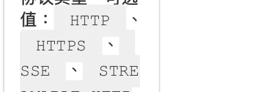

<table>
  <tr>
    <td>taskType</td>
    <td>body</td>
    <td><code>string</code></td>
    <td>否</td>
    <td><code>"TEXT_CHAT"</code></td>
    <td>taskType。可选值：<code> TEXT_CH</code> <code>AT </code>、<code> TEXT_</code><code>GENERATION</code>、<code> IMAGE_GEN</code> <code>ERATION </code>、<code> </code><code>IMAGE_EDIT</code>、<code> IMAGE_VAR</code> <code>IATION </code>、<code> V</code> <code>IDEO_GENERAT</code> <code>ION </code>、<code> VIDE</code> <code>O_QUERY </code>、<code> </code><code>TASK_QUERY</code>。</td>
  </tr>
  <tr>
    <td>networkScope</td>
    <td>body</td>
    <td><code>string</code></td>
    <td>否</td>
    <td><code>"sample-</code><br><code>value"</code></td>
    <td>网络访问范围。</td>
  </tr>
  <tr>
    <td>requireGrant</td>
    <td>body</td>
    <td><code>boolean</code></td>
    <td>否</td>
    <td><code>false</code></td>
    <td>是否需要授权Grant。</td>
  </tr>
</table>


**返回数据**

| 参数名称 | 类型 | 示例 | 说明 |
| --- | --- | --- | --- |
| code | <code>string</code> | <code>SUCCESS</code> | 响应码，取值为<code> SUCCESS </code> 时表示请求成功。 |
| message | <code>string</code> | <code>null</code> | 响应消息。请求成功时通常为空。 |
| data | <code>object</code> | <code>{"kind":"MODEL_API"</code><br><code>,"resolutionMode":"E</code><br><code>NDPOINT","resourceId</code><br><code>":"resource-</code><br><code>001","versionId":"ve</code><br><code>rsion-</code><br><code>001","version":"samp</code><br><code>le-</code><br><code>value","tenantId":"t</code><br><code>enant-001"}</code> | 响应数据。具体结构以接口语义为准。 |
| accessDeniedDetail | <code>object</code> | <code>null</code> | 鉴权失败详情。请求成功时通常为空。 |
| requestId | <code>string</code> | <code>req-001</code> | 请求 ID，可用于问题排查和日志检索。 |
| data.kind | <code>string</code> | <code>"MODEL_API"</code> | 资源类型。 |
| data.resolutionMode | <code>string</code> | <code>"ENDPOINT"</code> | resolutionMode。可选值：<code> ENDPOINT </code>、<code> SO</code> <code>URCE_DESCRIPTOR </code>。 |
| data.resourceId | <code>string</code> | <code>"resource-001"</code> | AI Resource ID。 |
| data.versionId | <code>string</code> | <code>"version-001"</code> | 版本 ID。 |
| data.version | <code>string</code> | <code>"sample-value"</code> | 版本号。 |
| data.tenantId | <code>string</code> | <code>"tenant-001"</code> | 租户ID。 |
| data.name | <code>string</code> | <code>"sample-name"</code> | 名称。 |
| data.displayName | <code>string</code> | <code> "</code>示例资源<code>" </code> | 展示名称。 |
| data.actor | <code>object</code> | <code>{"type":"USER","id"</code><br><code>:"id-001"}</code> | 操作主体。 |
| data.actor.type | <code>string</code> | <code>"USER"</code> | 类型。 |
| data.actor.id | <code>string</code> | <code>"id-001"</code> | 资源唯一标识。 |

<table>
  <tr>
    <td>data.access</td>
    <td><code>object</code></td>
    <td><code>{"mode":"sample-</code><br><code>value","subscription</code><br><code>Id":"subscription-</code><br><code>001","grantId":"gran</code><br><code>t-</code><br><code>001","credentialBind</code><br><code>ingId":"credentialBi</code><br><code>nding-001"}</code></td>
    <td>访问配置。</td>
  </tr>
  <tr>
    <td>data.access.mode</td>
    <td><code>string</code></td>
    <td><code>"sample-value"</code></td>
    <td>模式。</td>
  </tr>
  <tr>
    <td>data.access.subscriptio nId</td>
    <td><code>string</code></td>
    <td><code>"subscription-</code><br><code>001"</code></td>
    <td>订阅申请 ID。</td>
  </tr>
  <tr>
    <td>data.access.grantId</td>
    <td><code>string</code></td>
    <td><code>"grant-001"</code></td>
    <td>授权 Grant ID。</td>
  </tr>
  <tr>
    <td>data.access.credentialB indingId</td>
    <td><code>string</code></td>
    <td><code>"credentialBinding-</code><br><code>001"</code></td>
    <td>凭据绑定 ID。</td>
  </tr>
  <tr>
    <td>data.source</td>
    <td><code>object</code></td>
    <td><code>{"sourceBindingId":</code><br><code>"sourceBinding-</code><br><code>001","sourceType":"G</code><br><code>ATEWAY","sourceRef":</code><br><code>"sample-</code><br><code>value","syncStatus":</code><br><code>"sample-</code><br><code>value","credentialRe</code><br><code>f":"sample-</code><br><code>value","config":</code><br><code>{}}</code></td>
    <td>来源。</td>
  </tr>
  <tr>
    <td>data.source.sourceBind ingId</td>
    <td><code>string</code></td>
    <td><code>"sourceBinding-</code><br><code>001"</code></td>
    <td>来源绑定ID。</td>
  </tr>
  <tr>
    <td>data.source.sourceTyp e</td>
    <td><code>string</code></td>
    <td><code>"GATEWAY"</code></td>
    <td>来源类型。可选值：<code> GATEWAY </code>、<code> NAC</code> <code>OS </code>、<code> REMOTE_ENDPOI</code> <code>NT </code>、<code> SANDBOX </code>、<code> R</code> <code>EGISTRY </code>、<code> CUSTOM </code>。</td>
  </tr>
  <tr>
    <td>data.source.sourceRef</td>
    <td><code>string</code></td>
    <td><code>"sample-value"</code></td>
    <td>来源引用。</td>
  </tr>
  <tr>
    <td>data.source.syncStatus</td>
    <td><code>string</code></td>
    <td><code>"sample-value"</code></td>
    <td>同步状态。</td>
  </tr>
  <tr>
    <td>data.source.credentialR ef</td>
    <td><code>string</code></td>
    <td><code>"sample-value"</code></td>
    <td>凭据引用。</td>
  </tr>
  <tr>
    <td>data.source.config</td>
    <td><code>object</code></td>
    <td><code>{}</code></td>
    <td>配置信息。</td>
  </tr>
  <tr>
    <td>data.endpoints</td>
    <td><code>array</code></td>
    <td><code>[{"endpointId":"end</code><br><code>point-</code><br><code>001","name":"sample-</code><br><code>name","endpointType"</code><br><code>:"MODEL_INFERENCE","</code><br><code>providerType":"SANDB</code><br><code>OX","protocol":"HTTP</code><br><code>","url":"https://api</code><br><code>.example.com"}]</code></td>
    <td>访问端点列表。</td>
  </tr>
  <tr>
    <td>data.endpoints[].endpo intId</td>
    <td><code>string</code></td>
    <td><code>"endpoint-001"</code></td>
    <td>Endpoint ID。</td>
  </tr>
  <tr>
    <td>data.endpoints[].name</td>
    <td><code>string</code></td>
    <td><code>"sample-name"</code></td>
    <td>名称。</td>
  </tr>
  <tr>
    <td>data.endpoints[].endpo intType</td>
    <td><code>string</code></td>
    <td><code>"MODEL_INFERENCE"</code></td>
    <td>Endpoint 类型。</td>
  </tr>
  <tr>
    <td>data.endpoints[].provid erType</td>
    <td><code>string</code></td>
    <td><code>"SANDBOX"</code></td>
    <td>提供方类型。</td>
  </tr>
  <tr>
    <td>data.endpoints[].protoc ol</td>
    <td><code>string</code></td>
    <td><code>"HTTP"</code></td>
    <td>协议类型。可选值：<code> HTTP </code>、<code> HTTPS</code><code> </code>、<code> SSE </code>、<code> STREAMA</code> <code>BLE_HTTP </code>、<code> STDIO </code>、<code> NACOS_DESCRIPTOR</code><code> </code>。</td>
  </tr>
  <tr>
    <td>data.endpoints[].url</td>
    <td><code>string</code></td>
    <td><code>"https://api.exampl</code><br><code>e.com"</code></td>
    <td>访问地址。</td>
  </tr>
  <tr>
    <td>data.endpoints[].baseU rl</td>
    <td><code>string</code></td>
    <td><code>"https://api.exampl</code><br><code>e.com"</code></td>
    <td>服务基础地址。</td>
  </tr>
</table>


<table>
  <tr>
    <td>data.endpoints[].authM ode</td>
    <td><code>string</code></td>
    <td><code>"sample-value"</code></td>
    <td>认证模式。</td>
  </tr>
  <tr>
    <td>data.endpoints[].netwo rkScope</td>
    <td><code>string</code></td>
    <td><code>"sample-value"</code></td>
    <td>网络访问范围。</td>
  </tr>
  <tr>
    <td>data.endpoints[].defaul tInvocation</td>
    <td><code>boolean</code></td>
    <td><code>false</code></td>
    <td>默认调用配置。</td>
  </tr>
  <tr>
    <td>data.endpoints[].health Status</td>
    <td><code>string</code></td>
    <td><code>"sample-value"</code></td>
    <td>健康检查状态。</td>
  </tr>
  <tr>
    <td>data.endpoints[].provid erConfig</td>
    <td><code>object</code></td>
    <td><code>{}</code></td>
    <td>Provider 配置。</td>
  </tr>
  <tr>
    <td>data.endpoints[].metad ata</td>
    <td><code>object</code></td>
    <td><code>{}</code></td>
    <td>扩展元数据。</td>
  </tr>
  <tr>
    <td>data.capabilities</td>
    <td><code>array</code></td>
    <td><code>[{"capabilityId":"c</code><br><code>apability-</code><br><code>001","capabilityType</code><br><code>":"MODEL","name":"sa</code><br><code>mple-</code><br><code>name","displayName":</code> <code>"</code>示例资源<code>","description":"</code>用于演示的资源描述<code>","inputSchema":</code> <code>{}}]</code></td>
    <td>资源能力列表。</td>
  </tr>
  <tr>
    <td>data.capabilities[].capa bilityId</td>
    <td><code>string</code></td>
    <td><code>"capability-001"</code></td>
    <td>能力 ID。</td>
  </tr>
  <tr>
    <td>data.capabilities[].capa bilityType</td>
    <td><code>string</code></td>
    <td><code>"MODEL"</code></td>
    <td>capabilityType。可选值：<code> MODEL </code>、<code> MCP_T</code> <code>OOL </code>、<code> MCP_RESOURCE</code><code> </code>、<code> MCP_PROMPT </code>、<code> </code><code>SKILL </code>、<code> WORKER </code>、<code> API </code>。</td>
  </tr>
  <tr>
    <td>data.capabilities[].nam e</td>
    <td><code>string</code></td>
    <td><code>"sample-name"</code></td>
    <td>名称。</td>
  </tr>
  <tr>
    <td>data.capabilities[].displ ayName</td>
    <td><code>string</code></td>
    <td><code> "</code>示例资源<code>" </code></td>
    <td>展示名称。</td>
  </tr>
</table>

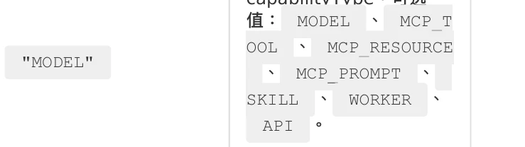

<table>
  <tr>
    <td>data.capabilities[].desc ription</td>
    <td><code>string</code></td>
    <td><code> "</code>用于演示的资源描述<code>" </code></td>
    <td>描述信息。</td>
  </tr>
  <tr>
    <td>data.capabilities[].input Schema</td>
    <td><code>object</code></td>
    <td><code>{}</code></td>
    <td>输入参数 Schema。</td>
  </tr>
  <tr>
    <td>data.capabilities[].outp utSchema</td>
    <td><code>object</code></td>
    <td><code>{}</code></td>
    <td>输出结果 Schema。</td>
  </tr>
  <tr>
    <td>data.capabilities[].tags</td>
    <td><code>array</code></td>
    <td><code>["sample-value"]</code></td>
    <td>标签列表。</td>
  </tr>
  <tr>
    <td>data.capabilities[].riskL evel</td>
    <td><code>string</code></td>
    <td><code>"sample-value"</code></td>
    <td>风险等级。</td>
  </tr>
  <tr>
    <td>data.capabilities[].per missionScope</td>
    <td><code>string</code></td>
    <td><code>"sample-value"</code></td>
    <td>权限范围。</td>
  </tr>
</table>

<table>
  <tr>
    <td>data.modelInvocation</td>
    <td><code>object</code></td>
    <td><code>{"protocol":"sample</code><br><code>-</code><br><code>value","baseUrl":"ht</code><br><code>tps://api.example.co</code><br><code>m","selectedTarget":</code><br><code>{"baseUrl":"https://</code><br><code>api.example.com","ba</code><br><code>sePath":"sample-</code><br><code>value","source":"sam</code><br><code>ple-</code><br><code>value","accessModeTy</code><br><code>pe":"sample-</code><br><code>value","networkType"</code><br><code>:"sample-</code><br><code>value"},"selectedOpe</code><br><code>ration":</code><br><code>{"code":"CHAT_COMPLE</code><br><code>TIONS","taskType":"T</code><br><code>EXT_CHAT","operation</code><br><code>Role":"sample-</code><br><code>value","method":"sam</code><br><code>ple-</code><br><code>value","path":"sampl</code><br><code>e-</code><br><code>value","gatewayPath"</code><br><code>:"sample-</code><br><code>value"},"targets":</code><br><code>[{}],"operations":</code><br><code>[{}]}</code></td>
    <td>模型调用配置。</td>
  </tr>
  <tr>
    <td>data.modelInvocation.p rotocol</td>
    <td><code>string</code></td>
    <td><code>"sample-value"</code></td>
    <td>协议类型。</td>
  </tr>
  <tr>
    <td>data.modelInvocation.b aseUrl</td>
    <td><code>string</code></td>
    <td><code>"https://api.exampl</code><br><code>e.com"</code></td>
    <td>服务基础地址。</td>
  </tr>
  <tr>
    <td>data.modelInvocation.s electedTarget</td>
    <td><code>object</code></td>
    <td><code>{"baseUrl":"https:/</code><br><code>/api.example.com","b</code><br><code>asePath":"sample-</code><br><code>value","source":"sam</code><br><code>ple-</code><br><code>value","accessModeTy</code><br><code>pe":"sample-</code><br><code>value","networkType"</code><br><code>:"sample-value"}</code></td>
    <td>选中的目标对象。</td>
  </tr>
  <tr>
    <td>data.modelInvocation.s electedTarget.baseUrl</td>
    <td><code>string</code></td>
    <td><code>"https://api.exampl</code><br><code>e.com"</code></td>
    <td>服务基础地址。</td>
  </tr>
  <tr>
    <td>data.modelInvocation.s electedTarget.basePath</td>
    <td><code>string</code></td>
    <td><code>"sample-value"</code></td>
    <td>基础路径。</td>
  </tr>
  <tr>
    <td>data.modelInvocation.s electedTarget.source</td>
    <td><code>string</code></td>
    <td><code>"sample-value"</code></td>
    <td>来源。</td>
  </tr>
  <tr>
    <td>data.modelInvocation.s electedTarget.accessM odeType</td>
    <td><code>string</code></td>
    <td><code>"sample-value"</code></td>
    <td>访问模式类型。</td>
  </tr>
  <tr>
    <td>data.modelInvocation.s electedTarget.networkT ype</td>
    <td><code>string</code></td>
    <td><code>"sample-value"</code></td>
    <td>网络类型。</td>
  </tr>
  <tr>
    <td>data.modelInvocation.s electedOperation</td>
    <td><code>object</code></td>
    <td><code>{"code":"CHAT_COMPL</code><br><code>ETIONS","taskType":"</code><br><code>TEXT_CHAT","operatio</code><br><code>nRole":"sample-</code><br><code>value","method":"sam</code><br><code>ple-</code><br><code>value","path":"sampl</code><br><code>e-</code><br><code>value","gatewayPath"</code><br><code>:"sample-value"}</code></td>
    <td>选中的操作。</td>
  </tr>
  <tr>
    <td>data.modelInvocation.s electedOperation.code</td>
    <td><code>string</code></td>
    <td><code>"CHAT_COMPLETIONS"</code></td>
    <td>业务编码。</td>
  </tr>
</table>

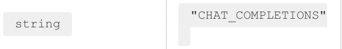

<table>
  <tr>
    <td>data.modelInvocation.s electedOperation.taskT ype</td>
    <td><code>string</code></td>
    <td><code>"TEXT_CHAT"</code></td>
    <td>taskType。可选值：<code> TEXT_CHAT </code>、<code> T</code> <code>EXT_GENERATION </code>、<code> I</code> <code>MAGE_GENERATION </code>、<code> </code><code>IMAGE_EDIT </code>、<code> IMAGE</code> <code>_VARIATION </code>、<code> VIDEO</code> <code>_GENERATION </code>、<code> VIDE</code> <code>O_QUERY </code>、<code> TASK_QUE</code> <code>RY </code>。</td>
  </tr>
  <tr>
    <td>data.modelInvocation.s electedOperation.opera tionRole</td>
    <td><code>string</code></td>
    <td><code>"sample-value"</code></td>
    <td>操作角色。</td>
  </tr>
  <tr>
    <td>data.modelInvocation.s electedOperation.meth od</td>
    <td><code>string</code></td>
    <td><code>"sample-value"</code></td>
    <td>HTTP方法。</td>
  </tr>
  <tr>
    <td>data.modelInvocation.s electedOperation.path</td>
    <td><code>string</code></td>
    <td><code>"sample-value"</code></td>
    <td>路径。</td>
  </tr>
  <tr>
    <td>data.modelInvocation.s electedOperation.gate wayPath</td>
    <td><code>string</code></td>
    <td><code>"sample-value"</code></td>
    <td>Gateway 路径。</td>
  </tr>
  <tr>
    <td>data.modelInvocation.s electedOperation.route Path</td>
    <td><code>string</code></td>
    <td><code>"sample-value"</code></td>
    <td>路由路径。</td>
  </tr>
  <tr>
    <td>data.modelInvocation.s electedOperation.enabl ed</td>
    <td><code>boolean</code></td>
    <td><code>true</code></td>
    <td>是否启用。</td>
  </tr>
  <tr>
    <td>data.modelInvocation.s electedOperation.meta data</td>
    <td><code>object</code></td>
    <td><code>{}</code></td>
    <td>扩展元数据。</td>
  </tr>
  <tr>
    <td>data.modelInvocation.t argets</td>
    <td><code>array</code></td>
    <td><code>[{"baseUrl":"https:</code><br><code>//api.example.com","</code><br><code>basePath":"sample-</code><br><code>value","source":"sam</code><br><code>ple-</code><br><code>value","accessModeTy</code><br><code>pe":"sample-</code><br><code>value","networkType"</code><br><code>:"sample-value"}]</code></td>
    <td>目标列表。</td>
  </tr>
</table>


<table>
  <tr>
    <td>data.modelInvocation.t argets[].baseUrl</td>
    <td><code>string</code></td>
    <td><code>"https://api.exampl</code><br><code>e.com"</code></td>
    <td>服务基础地址。</td>
  </tr>
  <tr>
    <td>data.modelInvocation.t argets[].basePath</td>
    <td><code>string</code></td>
    <td><code>"sample-value"</code></td>
    <td>基础路径。</td>
  </tr>
  <tr>
    <td>data.modelInvocation.t argets[].source</td>
    <td><code>string</code></td>
    <td><code>"sample-value"</code></td>
    <td>来源。</td>
  </tr>
  <tr>
    <td>data.modelInvocation.t argets[].accessModeTy pe</td>
    <td><code>string</code></td>
    <td><code>"sample-value"</code></td>
    <td>访问模式类型。</td>
  </tr>
  <tr>
    <td>data.modelInvocation.t argets[].networkType</td>
    <td><code>string</code></td>
    <td><code>"sample-value"</code></td>
    <td>网络类型。</td>
  </tr>
  <tr>
    <td>data.modelInvocation.o perations</td>
    <td><code>array</code></td>
    <td><code>[{"code":"CHAT_COMP</code><br><code>LETIONS","taskType":</code><br><code>"TEXT_CHAT","operati</code><br><code>onRole":"sample-</code><br><code>value","method":"sam</code><br><code>ple-</code><br><code>value","path":"sampl</code><br><code>e-</code><br><code>value","gatewayPath"</code><br><code>:"sample-value"}]</code></td>
    <td>操作列表。</td>
  </tr>
  <tr>
    <td>data.modelInvocation.o perations[].code</td>
    <td><code>string</code></td>
    <td><code>"CHAT_COMPLETIONS"</code></td>
    <td>业务编码。</td>
  </tr>
  <tr>
    <td>data.modelInvocation.o perations[].taskType</td>
    <td><code>string</code></td>
    <td><code>"TEXT_CHAT"</code></td>
    <td>taskType。可选值：<code> TEXT_CHAT </code>、<code> T</code> <code>EXT_GENERATION </code>、<code> I</code> <code>MAGE_GENERATION </code>、<code> </code><code>IMAGE_EDIT </code>、<code> IMAGE</code> <code>_VARIATION </code>、<code> VIDEO</code> <code>_GENERATION </code>、<code> VIDE</code> <code>O_QUERY </code>、<code> TASK_QUE</code> <code>RY </code>。</td>
  </tr>
  <tr>
    <td>data.modelInvocation.o perations[].operationRo le</td>
    <td><code>string</code></td>
    <td><code>"sample-value"</code></td>
    <td>操作角色。</td>
  </tr>
  <tr>
    <td>data.modelInvocation.o perations[].method</td>
    <td><code>string</code></td>
    <td><code>"sample-value"</code></td>
    <td>HTTP方法。</td>
  </tr>
</table>

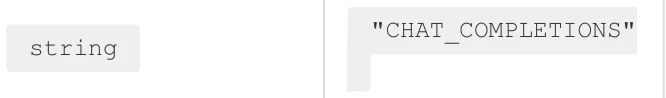

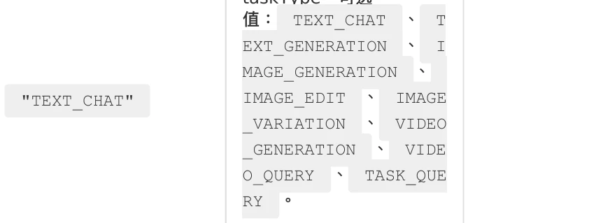

<table>
  <tr>
    <td>data.modelInvocation.o perations[].path</td>
    <td><code>string</code></td>
    <td><code>"sample-value"</code></td>
    <td>路径。</td>
  </tr>
  <tr>
    <td>data.modelInvocation.o perations[].gatewayPat h</td>
    <td><code>string</code></td>
    <td><code>"sample-value"</code></td>
    <td>Gateway 路径。</td>
  </tr>
</table>

**示例**

**请求示例**

```http
POST /himarket/v1/open-api/v1/application/resolve HTTP/1.1
Host: localhost:8080
Authorization: Bearer <accessToken>
Content-Type: application/json

{
  "subjectType": "USER",
  "subjectId": "subject-001",
  "listingId": "listing-001",
  "kind": "MODEL_API",
  "resourceId": "resource-001",
  "versionId": "version-001"
}
```

**响应示例**

```json
{
  "code": "SUCCESS",
  "message": null,
  "data": {
    "kind": "MODEL_API",
    "resolutionMode": "ENDPOINT",
    "resourceId": "resource-001",
    "versionId": "version-001",
    "version": "sample-value",
    "tenantId": "tenant-001"
  },
  "accessDeniedDetail": null,
  "requestId": "req-001"
}
```

<a id="section-2-3-12-3"></a>

#### 2.3.12.3. resolveBatch

**接口信息**

- **接口路径**： `POST /himarket/v1/open-api/v1/application/resolve-batch`

- **接口说明**：应用侧批量解析资源。

- **认证方式**：该接口属于开发者门户 API。调用前请完成开发者登录，并在请求 Header 中携带  `Authorization: Bearer <accessToken>` 。

- **Header 示例**：需要登录态的接口使用  `Authorization: Bearer <accessToken>` 。

**请求参数**

| 参数名称 | 位置 | 类型 | 是否必选 | 示例 | 说明 |
| --- | --- | --- | --- | --- | --- |
| subjectType | body | <code>string</code> | 否 | <code>"USER"</code> | subjectType。可选值：<code> USER </code>、<code> APP </code>。 |
| subjectId | body | <code>string</code> | 否 | <code>"subject-</code><br><code>001"</code> | 主体 ID。 |
| items | body | <code>array</code> | 是 | <code>[{"listingI</code><br><code>d":"listing-</code><br><code>001","kind":</code><br><code>"MODEL_API",</code><br><code>"resourceId"</code><br><code>:"resource-</code><br><code>001","versio</code><br><code>nId":"versio</code><br><code>n-</code><br><code>001","endpoi</code><br><code>ntId":"endpo</code><br><code>int-</code><br><code>001","protoc</code><br><code>ol":"HTTP"}]</code> | 数据项列表。 |
| items\[\].listingI d | body | <code>string</code> | 否 | <code>"listing-</code><br><code>001"</code> | Listing ID。 |
| items\[\].kind | body | <code>string</code> | 否 | <code>"MODEL_API"</code> | 资源类型。 |
| items\[\].resour ceId | body | <code>string</code> | 否 | <code>"resource-</code><br><code>001"</code> | AI Resource ID。 |
| items\[\].versio nId | body | <code>string</code> | 否 | <code>"version-</code><br><code>001"</code> | 版本 ID。 |
| items\[\].endpoi ntId | body | <code>string</code> | 否 | <code>"endpoint-</code><br><code>001"</code> | Endpoint ID。 |


<table>
  <tr>
    <td>items[].protoc ol</td>
    <td>body</td>
    <td><code>string</code></td>
    <td>否</td>
    <td><code>"HTTP"</code></td>
    <td>协议类型。可选值：<code> HTTP </code>、<code> HTTPS </code>、<code> </code><code>SSE </code>、<code> STRE</code> <code>AMABLE_HTTP</code><code> </code>、<code> STDIO </code>、<code> NACOS_DES</code> <code>CRIPTOR </code>。</td>
  </tr>
  <tr>
    <td>items[].networ kScope</td>
    <td>body</td>
    <td><code>string</code></td>
    <td>否</td>
    <td><code>"sample-</code><br><code>value"</code></td>
    <td>网络访问范围。</td>
  </tr>
  <tr>
    <td>items[].requir eGrant</td>
    <td>body</td>
    <td><code>boolean</code></td>
    <td>否</td>
    <td><code>false</code></td>
    <td>是否需要授权Grant。</td>
  </tr>
</table>

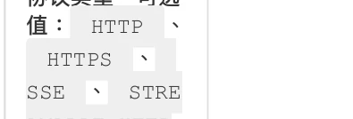

**返回数据**

| 参数名称 | 类型 | 示例 | 说明 |
| --- | --- | --- | --- |
| code | <code>string</code> | <code>SUCCESS</code> | 响应码，取值为<code> SUCCESS </code> 时表示请求成功。 |
| message | <code>string</code> | <code>null</code> | 响应消息。请求成功时通常为空。 |
| data | <code>object</code> | <code>{"items":[{}]}</code> | 响应数据。具体结构以接口语义为准。 |
| accessDeniedDetail | <code>object</code> | <code>null</code> | 鉴权失败详情。请求成功时通常为空。 |
| requestId | <code>string</code> | <code>req-001</code> | 请求 ID，可用于问题排查和日志检索。 |

<table>
  <tr>
    <td>data.items</td>
    <td><code>array</code></td>
    <td><code>[{"listingId":"list</code><br><code>ing-</code><br><code>001","kind":"MODEL_A</code><br><code>PI","resourceId":"re</code><br><code>source-</code><br><code>001","versionId":"ve</code><br><code>rsion-</code><br><code>001","endpointId":"e</code><br><code>ndpoint-</code><br><code>001","protocol":"HTT</code><br><code>P"}]</code></td>
    <td>数据项列表。</td>
  </tr>
  <tr>
    <td>data.items[].listingId</td>
    <td><code>string</code></td>
    <td><code>"listing-001"</code></td>
    <td>Listing ID。</td>
  </tr>
  <tr>
    <td>data.items[].kind</td>
    <td><code>string</code></td>
    <td><code>"MODEL_API"</code></td>
    <td>资源类型。</td>
  </tr>
  <tr>
    <td>data.items[].resourceId</td>
    <td><code>string</code></td>
    <td><code>"resource-001"</code></td>
    <td>AI Resource ID。</td>
  </tr>
  <tr>
    <td>data.items[].versionId</td>
    <td><code>string</code></td>
    <td><code>"version-001"</code></td>
    <td>版本 ID。</td>
  </tr>
  <tr>
    <td>data.items[].endpointId</td>
    <td><code>string</code></td>
    <td><code>"endpoint-001"</code></td>
    <td>Endpoint ID。</td>
  </tr>
  <tr>
    <td>data.items[].protocol</td>
    <td><code>string</code></td>
    <td><code>"HTTP"</code></td>
    <td>协议类型。可选值：<code> HTTP </code>、<code> HTTPS</code><code> </code>、<code> SSE </code>、<code> STREAMA</code> <code>BLE_HTTP </code>、<code> STDIO </code>、<code> NACOS_DESCRIPTOR</code><code> </code>。</td>
  </tr>
  <tr>
    <td>data.items[].networkSc ope</td>
    <td><code>string</code></td>
    <td><code>"sample-value"</code></td>
    <td>网络访问范围。</td>
  </tr>
  <tr>
    <td>data.items[].requireGra nt</td>
    <td><code>boolean</code></td>
    <td><code>false</code></td>
    <td>是否需要授权 Grant。</td>
  </tr>
</table>


**示例**

**请求示例**

```http
POST /himarket/v1/open-api/v1/application/resolve-batch HTTP/1.1
Host: localhost:8080
Authorization: Bearer <accessToken>
Content-Type: application/json

{
  "subjectType": "USER",
  "subjectId": "subject-001",
  "items": [
    {}
  ]
}
```

**响应示例**

```json
{
  "code": "SUCCESS",
  "message": null,
  "data": {
    "items": [
      {}
    ]
  },
  "accessDeniedDetail": null,
  "requestId": "req-001"
}
```

<a id="section-2-3-12-4"></a>

#### 2.3.12.4. searchCatalog

**接口信息**

- **接口路径**： `GET /himarket/v1/open-api/v1/application/catalog/search`

- **接口说明**：应用侧搜索市场资源并返回订阅/授权状态。

- **认证方式**：该接口属于开发者门户 API。调用前请完成开发者登录，并在请求 Header 中携带  `Authorization: Bearer <accessToken>` 。

- **Header 示例**：需要登录态的接口使用  `Authorization: Bearer <accessToken>` 。

**请求参数**

| 参数名称 | 位置 | 类型 | 是否必选 | 示例 | 说明 |
| --- | --- | --- | --- | --- | --- |
| tenantId | query | <code>string</code> | 否 | <code>"tenant-</code><br><code>001"</code> | 租户ID。 |
| portalId | query | <code>string</code> | 否 | <code>"portal-</code><br><code>001"</code> | 门户ID。 |
| kind | query | <code>string</code> | 否 | <code>"MODEL_API"</code> | 资源类型。 |
| keyword | query | <code>string</code> | 否 | <code>"sample-</code><br><code>value"</code> | 搜索关键词。 |
| categoryId | query | <code>string</code> | 否 | <code>"category-</code><br><code>001"</code> | 分类 ID。 |
| tag | query | <code>string</code> | 否 | <code>"sample-</code><br><code>value"</code> | 标签。 |
| pricingMode | query | <code>string</code> | 否 | <code>"sample-</code><br><code>value"</code> | 计费模式。 |
| sortBy | query | <code>string</code> | 否 | <code>"sample-</code><br><code>value"</code> | 排序字段。 |
| subjectType | query | <code>string</code> | 否 | <code>"USER"</code> | subjectType。可选值：<code> USER </code>、<code> APP </code>。 |
| subjectId | query | <code>string</code> | 否 | <code>"subject-</code><br><code>001"</code> | 主体 ID。 |
| page | query | <code>integer&lt;int</code><br><code>32&gt;</code> | 否 | <code>1</code> | 页码。 |
| size | query | <code>integer&lt;int</code><br><code>32&gt;</code> | 否 | <code>10</code> | 每页记录数。 |
| sort | query | <code>array</code> | 否 | <code>["sample-</code><br><code>value"]</code> | 排序条件。 |


**返回数据**

| 参数名称 | 类型 | 示例 | 说明 |
| --- | --- | --- | --- |
| code | <code>string</code> | <code>SUCCESS</code> | 响应码，取值为<code> SUCCESS </code> 时表示请求成功。 |
| message | <code>string</code> | <code>null</code> | 响应消息。请求成功时通常为空。 |
| data | <code>object</code> | <code>{"content":</code><br><code>[{}],"pageNumber":1,</code><br><code>"pageSize":10,"total</code><br><code>Count":1}</code> | 响应数据。具体结构以接口语义为准。 |
| accessDeniedDetail | <code>object</code> | <code>null</code> | 鉴权失败详情。请求成功时通常为空。 |
| requestId | <code>string</code> | <code>req-001</code> | 请求 ID，可用于问题排查和日志检索。 |
| data.content | <code>array</code> | <code>[{"catalog":</code><br><code>{},"subscription":</code><br><code>{},"consumerSubscrip</code><br><code>tions":</code><br><code>[{}],"authorization"</code><br><code>:{},"resolved":</code><br><code>{}}]</code> | 分页结果列表。 |
| data.content\[\].catalog | <code>object</code> | <code>{"listingId":"listi</code><br><code>ng-</code><br><code>001","tenantId":"ten</code><br><code>ant-</code><br><code>001","resourceId":"r</code><br><code>esource-</code><br><code>001","defaultVersion</code><br><code>Id":"defaultVersion-</code><br><code>001","portalId":"por</code><br><code>tal-</code><br><code>001","visibility":"P</code><br><code>RIVATE"}</code> | 市场资源信息。 |
| data.content\[\].catalog.l istingId | <code>string</code> | <code>"listing-001"</code> | Listing ID。 |
| data.content\[\].catalog.t enantId | <code>string</code> | <code>"tenant-001"</code> | 租户ID。 |
| data.content\[\].catalog.r esourceId | <code>string</code> | <code>"resource-001"</code> | AI Resource ID。 |
| data.content\[\].catalog.defaultVersionId | <code>string</code> | <code>"defaultVersion-</code><br><code>001"</code> | 默认版本ID。 |
| data.content\[\].catalog.portalId | <code>string</code> | <code>"portal-001"</code> | 门户ID。 |
| data.content\[\].catalog.visibility | <code>string</code> | <code>"PRIVATE"</code> | 可见性。可选值：<code> PRIVATE </code>、<code> PUB</code> <code>LIC </code>。 |
| data.content\[\].catalog.t itle | <code>string</code> | <code> "</code>示例资源标题<code>" </code> | 标题。 |
| data.content\[\].catalog.summary | <code>string</code> | <code> "</code>示例摘要<code>" </code> | 摘要信息。 |
| data.content\[\].catalog.description | <code>string</code> | <code> "</code>用于演示的资源描述<code>" </code> | 描述信息。 |
| data.content\[\].catalog.i con | <code>string</code> | <code>"sample-value"</code> | 图标地址。 |
| data.content\[\].catalog.banner | <code>string</code> | <code>"sample-value"</code> | 横幅图片地址。 |
| data.content\[\].catalog.categoryId | <code>string</code> | <code>"category-001"</code> | 分类 ID。 |
| data.content\[\].catalog.category | <code>object</code> | <code>{"categoryId":"cate</code><br><code>gory-</code><br><code>001","tenantId":"ten</code><br><code>ant-</code><br><code>001","kind":"MODEL_A</code><br><code>PI","code":"model-</code><br><code>api","name":"sample-</code><br><code>name","description":</code> <code>"</code>用于演示的资源描述<code>"} </code> | 分类信息。 |
| data.content\[\].catalog.category.categoryId | <code>string</code> | <code>"category-001"</code> | 分类 ID。 |
| data.content\[\].catalog.category.tenantId | <code>string</code> | <code>"tenant-001"</code> | 租户ID。 |
| data.content\[\].catalog.category.kind | <code>string</code> | <code>"MODEL_API"</code> | 资源类型。 |
| data.content\[\].catalog.category.code | <code>string</code> | <code>"model-api"</code> | 业务编码。 |
| data.content\[\].catalog.category.name | <code>string</code> | <code>"sample-name"</code> | 名称。 |
| data.content\[\].catalog.category.description | <code>string</code> | <code> "</code>用于演示的资源描述<code>" </code> | 描述信息。 |
| data.content\[\].catalog.category.icon | <code>string</code> | <code>"sample-value"</code> | 图标地址。 |
| data.content\[\].catalog.category.sortOrder | <code>integer&lt;int32&gt;</code> | <code>100</code> | 排序值。 |
| data.content\[\].catalog.category.status | <code>string</code> | <code>"sample-value"</code> | 状态。 |
| data.content\[\].catalog.category.createdBy | <code>string</code> | <code>"sample-value"</code> | 创建人。 |
| data.content\[\].catalog.category.updatedBy | <code>string</code> | <code>"sample-value"</code> | 更新人。 |
| data.content\[\].catalog.category.createdAt | <code>string&lt;date-</code><br><code>time&gt;</code> | <code>"2026-06-</code><br><code>22T12:00:00Z"</code> | 创建时间。 |
| data.content\[\].catalog.category.updatedAt | <code>string&lt;date-</code><br><code>time&gt;</code> | <code>"2026-06-</code><br><code>22T12:00:00Z"</code> | 更新时间。 |
| data.content\[\].catalog.category.listingCount | <code>integer&lt;int64&gt;</code> | <code>1</code> | Listing 数量。 |
| data.content\[\].catalog.t ags | <code>array</code> | <code>["sample-value"]</code> | 标签列表。 |
| data.content\[\].catalog.pricingMode | <code>string</code> | <code>"sample-value"</code> | 计费模式。 |
| data.content\[\].catalog.sourceType | <code>string</code> | <code>"sample-value"</code> | 来源类型。 |
| data.content\[\].catalog.origin | <code>string</code> | <code>"sample-value"</code> | 来源标识。 |
| data.content\[\].catalog.l istingStatus | <code>string</code> | <code>"sample-value"</code> | 市场条目状态。 |
| data.content\[\].catalog.publicationStatus | <code>string</code> | <code>"DRAFT"</code> | 发布状态。可选值：<code> DRAFT </code>、<code> IN_RE</code> <code>VIEW </code>、<code> PUBLISHED </code>、<code> UNPUBLISHED </code>、<code> </code><code>REJECTED </code>。 |
| data.content\[\].catalog.publishedAt | <code>string&lt;date-</code><br><code>time&gt;</code> | <code>"2026-06-</code><br><code>22T12:00:00Z"</code> | 发布时间。 |
| data.content\[\].catalog.r esource | <code>object</code> | <code>{"resourceId":"reso</code><br><code>urce-</code><br><code>001","tenantId":"ten</code><br><code>ant-</code><br><code>001","kind":"MODEL_A</code><br><code>PI","name":"sample-</code><br><code>name","displayName":</code> <code>"</code>示例资源<code>","summary":"</code>示例摘要<code>"} </code> | AI Resource 基础信息。 |
| data.content\[\].catalog.r esource.resourceId | <code>string</code> | <code>"resource-001"</code> | AI Resource ID。 |
| data.content\[\].catalog.r esource.tenantId | <code>string</code> | <code>"tenant-001"</code> | 租户ID。 |
| data.content\[\].catalog.r esource.kind | <code>string</code> | <code>"MODEL_API"</code> | 资源类型。 |
| data.content\[\].catalog.r esource.name | <code>string</code> | <code>"sample-name"</code> | 名称。 |
| data.content\[\].catalog.r esource.displayName | <code>string</code> | <code> "</code>示例资源<code>" </code> | 展示名称。 |


<table>
  <tr>
    <td>data.content[].catalog.r esource.summary</td>
    <td><code>string</code></td>
    <td><code> "</code>示例摘要<code>" </code></td>
    <td>摘要信息。</td>
  </tr>
  <tr>
    <td>data.content[].catalog.r esource.description</td>
    <td><code>string</code></td>
    <td><code> "</code>用于演示的资源描述<code>" </code></td>
    <td>描述信息。</td>
  </tr>
  <tr>
    <td>data.content[].catalog.r esource.ownerType</td>
    <td><code>string</code></td>
    <td><code>"USER"</code></td>
    <td>归属主体类型。可选值：<code> USER </code>、<code> APP </code>、<code> SYSTEM </code>。</td>
  </tr>
  <tr>
    <td>data.content[].catalog.r esource.ownerId</td>
    <td><code>string</code></td>
    <td><code>"owner-001"</code></td>
    <td>归属主体ID。</td>
  </tr>
  <tr>
    <td>data.content[].catalog.r esource.createdBy</td>
    <td><code>string</code></td>
    <td><code>"sample-value"</code></td>
    <td>创建人。</td>
  </tr>
  <tr>
    <td>data.content[].catalog.r esource.createdByNam e</td>
    <td><code>string</code></td>
    <td><code>"demo-createdby"</code></td>
    <td>创建人名称。</td>
  </tr>
  <tr>
    <td>data.content[].catalog.r esource.icon</td>
    <td><code>string</code></td>
    <td><code>"sample-value"</code></td>
    <td>图标地址。</td>
  </tr>
  <tr>
    <td>data.content[].catalog.r esource.tags</td>
    <td><code>array</code></td>
    <td><code>["sample-value"]</code></td>
    <td>标签列表。</td>
  </tr>
  <tr>
    <td>data.content[].catalog.r esource.lifecycleStatus</td>
    <td><code>string</code></td>
    <td><code>"DRAFT"</code></td>
    <td>生命周期状态。可选值：<code> DRAFT </code>、<code> ACTIV</code> <code>E </code>、<code> DEPRECATED </code>、<code> ARCHIVED </code>。</td>
  </tr>
  <tr>
    <td>data.content[].catalog.r esource.latestVersionId</td>
    <td><code>string</code></td>
    <td><code>"latestVersion-</code><br><code>001"</code></td>
    <td>最新版本ID。</td>
  </tr>
  <tr>
    <td>data.content[].catalog.r esource.autoApproveS ubscription</td>
    <td><code>boolean</code></td>
    <td><code>true</code></td>
    <td>是否自动批准订阅。</td>
  </tr>
  <tr>
    <td>data.content[].catalog.r esource.extras</td>
    <td><code>object</code></td>
    <td><code>{}</code></td>
    <td>扩展配置。</td>
  </tr>
  <tr>
    <td>data.content[].catalog.r esource.createdAt</td>
    <td><code>string&lt;date-</code><br><code>time&gt;</code></td>
    <td><code>"2026-06-</code><br><code>22T12:00:00Z"</code></td>
    <td>创建时间。</td>
  </tr>
  <tr>
    <td>data.content[].catalog.r esource.updatedAt</td>
    <td><code>string&lt;date-</code><br><code>time&gt;</code></td>
    <td><code>"2026-06-</code><br><code>22T12:00:00Z"</code></td>
    <td>更新时间。</td>
  </tr>
  <tr>
    <td>data.content[].catalog.version</td>
    <td><code>object</code></td>
    <td><code>{"versionId":"versi</code><br><code>on-</code><br><code>001","resourceId":"r</code><br><code>esource-</code><br><code>001","version":"samp</code><br><code>le-</code><br><code>value","versionSchem</code><br><code>e":"SEMVER","status"</code><br><code>:"DRAFT","manifestId</code><br><code>":"manifest-001"}</code></td>
    <td>版本号。</td>
  </tr>
  <tr>
    <td>data.content[].catalog.version.versionId</td>
    <td><code>string</code></td>
    <td><code>"version-001"</code></td>
    <td>版本 ID。</td>
  </tr>
  <tr>
    <td>data.content[].catalog.version.resourceId</td>
    <td><code>string</code></td>
    <td><code>"resource-001"</code></td>
    <td>AI Resource ID。</td>
  </tr>
  <tr>
    <td>data.content[].catalog.version.version</td>
    <td><code>string</code></td>
    <td><code>"sample-value"</code></td>
    <td>版本号。</td>
  </tr>
  <tr>
    <td>data.content[].catalog.version.versionScheme</td>
    <td><code>string</code></td>
    <td><code>"SEMVER"</code></td>
    <td>版本号方案。可选值：<code> SEMVER </code>、<code> TIME</code> <code>STAMP </code>、<code> REVISION </code>、<code> EXTERNAL </code>。</td>
  </tr>
  <tr>
    <td>data.content[].catalog.version.status</td>
    <td><code>string</code></td>
    <td><code>"DRAFT"</code></td>
    <td>状态。</td>
  </tr>
  <tr>
    <td>data.content[].catalog.version.manifestId</td>
    <td><code>string</code></td>
    <td><code>"manifest-001"</code></td>
    <td>Manifest ID。</td>
  </tr>
  <tr>
    <td>data.content[].catalog.version.sourceBindingI d</td>
    <td><code>string</code></td>
    <td><code>"sourceBinding-</code><br><code>001"</code></td>
    <td>来源绑定ID。</td>
  </tr>
  <tr>
    <td>data.content[].catalog.version.artifactDigest</td>
    <td><code>string</code></td>
    <td><code>"sample-value"</code></td>
    <td>制品摘要。</td>
  </tr>
  <tr>
    <td>data.content[].catalog.version.releaseNote</td>
    <td><code>string</code></td>
    <td><code>"sample-value"</code></td>
    <td>版本说明。</td>
  </tr>
  <tr>
    <td>data.content[].catalog.version.createdBy</td>
    <td><code>string</code></td>
    <td><code>"sample-value"</code></td>
    <td>创建人。</td>
  </tr>
  <tr>
    <td>data.content[].catalog.version.publishedAt</td>
    <td><code>string&lt;date-</code><br><code>time&gt;</code></td>
    <td><code>"2026-06-</code><br><code>22T12:00:00Z"</code></td>
    <td>发布时间。</td>
  </tr>
  <tr>
    <td>data.content[].catalog.version.createdAt</td>
    <td><code>string&lt;date-</code><br><code>time&gt;</code></td>
    <td><code>"2026-06-</code><br><code>22T12:00:00Z"</code></td>
    <td>创建时间。</td>
  </tr>
  <tr>
    <td>data.content[].catalog.version.updatedAt</td>
    <td><code>string&lt;date-</code><br><code>time&gt;</code></td>
    <td><code>"2026-06-</code><br><code>22T12:00:00Z"</code></td>
    <td>更新时间。</td>
  </tr>
  <tr>
    <td>data.content[].catalog.version.downloadCount</td>
    <td><code>integer&lt;int64&gt;</code></td>
    <td><code>1</code></td>
    <td>下载次数。</td>
  </tr>
  <tr>
    <td>data.content[].catalog.version.isLatest</td>
    <td><code>boolean</code></td>
    <td><code>true</code></td>
    <td>是否为最新版本。</td>
  </tr>
  <tr>
    <td>data.content[].catalog.manifest</td>
    <td><code>object</code></td>
    <td><code>{}</code></td>
    <td>资源 Manifest 内容。</td>
  </tr>
  <tr>
    <td>data.content[].catalog.extras</td>
    <td><code>object</code></td>
    <td><code>{}</code></td>
    <td>扩展配置。</td>
  </tr>
  <tr>
    <td>data.content[].catalog.metrics</td>
    <td><code>object</code></td>
    <td><code>{"toolCount":1,"sub</code><br><code>scriptionCount":1}</code></td>
    <td>指标信息。</td>
  </tr>
  <tr>
    <td>data.content[].catalog.metrics.toolCount</td>
    <td><code>integer&lt;int64&gt;</code></td>
    <td><code>1</code></td>
    <td>工具数量。</td>
  </tr>
  <tr>
    <td>data.content[].catalog.metrics.subscriptionCo unt</td>
    <td><code>integer&lt;int64&gt;</code></td>
    <td><code>1</code></td>
    <td>订阅数量。</td>
  </tr>
</table>

<table>
  <tr>
    <td>data.content[].subscrip tion</td>
    <td><code>object</code></td>
    <td><code>{"subscriptionId":"</code><br><code>subscription-</code><br><code>001","status":"PENDI</code><br><code>NG","targetType":"sa</code><br><code>mple-</code><br><code>value","targetId":"t</code><br><code>arget-</code><br><code>001","activeGrant":t</code><br><code>rue,"detail":</code><br><code>{"subscriptionId":"s</code><br><code>ubscription-</code><br><code>001","subjectType":"</code><br><code>USER","subjectId":"s</code><br><code>ubject-</code><br><code>001","targetType":"s</code><br><code>ample-</code><br><code>value","targetId":"t</code><br><code>arget-</code><br><code>001","status":"PENDI</code><br><code>NG"}}</code></td>
    <td>订阅信息。</td>
  </tr>
  <tr>
    <td>data.content[].subscrip tion.subscriptionId</td>
    <td><code>string</code></td>
    <td><code>"subscription-</code><br><code>001"</code></td>
    <td>订阅申请 ID。</td>
  </tr>
  <tr>
    <td>data.content[].subscrip tion.status</td>
    <td><code>string</code></td>
    <td><code>"PENDING"</code></td>
    <td>状态。</td>
  </tr>
</table>

**示例**

**请求示例**

```text
GET /himarket/v1/open-api/v1/application/catalog/search?tenantId=tenant-
001&portalId=portal-001&kind=MODEL_API&keyword=sample-value&categoryId=category-
001&tag=sample-value&pricingMode=sample-value&sortBy=sample-value HTTP/1.1
Host: localhost:8080
Authorization: Bearer <accessToken>
```

**响应示例**

```json
{
  "code": "SUCCESS",
  "message": null,
  "data": {
    "content": [
      {}
    ],
    "pageNumber": 1,
    "pageSize": 10,
    "totalCount": 1
  },
  "accessDeniedDetail": null,
  "requestId": "req-001"
}
```

<a id="section-2-3-12-5"></a>

#### 2.3.12.5. subscribe

**接口信息**

- **接口路径**： `POST /himarket/v1/open-`

  ```text
  api/v1/application/catalog/items/{listingId}/subscriptions 
  ```

- **接口说明**：应用侧提交资源订阅申请。

- **认证方式**：该接口属于开发者门户 API。调用前请完成开发者登录，并在请求 Header 中携带  `Authorization: Bearer <accessToken>` 。

- **Header 示例**：需要登录态的接口使用  `Authorization: Bearer <accessToken>` 。

**请求参数**

| 参数名称 | 位置 | 类型 | 是否必选 | 示例 | 说明 |
| --- | --- | --- | --- | --- | --- |
| listingId | path | <code>string</code> | 是 | <code>"listing-</code><br><code>001"</code> | Listing ID。 |
| subjectType | body | <code>string</code> | 否 | <code>"USER"</code> | subjectType。可选值：<code> USER </code>、<code> APP </code>。 |
| subjectId | body | <code>string</code> | 否 | <code>"subject-</code><br><code>001"</code> | 主体 ID。 |
| targetType | body | <code>string</code> | 否 | <code>"sample-</code><br><code>value"</code> | 订阅目标类型。 |
| targetId | body | <code>string</code> | 否 | <code>"target-</code><br><code>001"</code> | 目标对象 ID。 |
| quotaPolicyId | body | <code>string</code> | 否 | <code>"quotaPolic</code><br><code>y-001"</code> | 配额策略 ID。 |
| expiresAt | body | <code>string&lt;date</code><br><code>-time&gt;</code> | 否 | <code>"2026-06-</code><br><code>22T12:00:00Z</code><br><code>"</code> | 过期时间。 |

**返回数据**

| 参数名称 | 类型 | 示例 | 说明 |
| --- | --- | --- | --- |
| code | <code>string</code> | <code>SUCCESS</code> | 响应码，取值为<code> SUCCESS </code> 时表示请求成功。 |
| message | <code>string</code> | <code>null</code> | 响应消息。请求成功时通常为空。 |
| data | <code>object</code> | <code>{"subscriptionId":"</code><br><code>subscription-</code><br><code>001","subjectType":"</code><br><code>USER","subjectId":"s</code><br><code>ubject-</code><br><code>001","targetType":"s</code><br><code>ample-</code><br><code>value","targetId":"t</code><br><code>arget-</code><br><code>001","status":"PENDI</code><br><code>NG"}</code> | 响应数据。具体结构以接口语义为准。 |
| accessDeniedDetail | <code>object</code> | <code>null</code> | 鉴权失败详情。请求成功时通常为空。 |
| requestId | <code>string</code> | <code>req-001</code> | 请求 ID，可用于问题排查和日志检索。 |
| data.subscriptionId | <code>string</code> | <code>"subscription-</code><br><code>001"</code> | 订阅申请 ID。 |
| data.subjectType | <code>string</code> | <code>"USER"</code> | subjectType。可选值：<code> USER </code>、<code> APP </code>。 |
| data.subjectId | <code>string</code> | <code>"subject-001"</code> | 主体 ID。 |
| data.targetType | <code>string</code> | <code>"sample-value"</code> | 订阅目标类型。 |
| data.targetId | <code>string</code> | <code>"target-001"</code> | 目标对象 ID。 |
| data.status | <code>string</code> | <code>"PENDING"</code> | 状态。 |
| data.quotaPolicyId | <code>string</code> | <code>"quotaPolicy-</code><br><code>001"</code> | 配额策略 ID。 |
| data.expiresAt | <code>string&lt;date-</code><br><code>time&gt;</code> | <code>"2026-06-</code><br><code>22T12:00:00Z"</code> | 过期时间。 |
| data.createdAt | <code>string&lt;date-</code><br><code>time&gt;</code> | <code>"2026-06-</code><br><code>22T12:00:00Z"</code> | 创建时间。 |
| data.updatedAt | <code>string&lt;date-</code><br><code>time&gt;</code> | <code>"2026-06-</code><br><code>22T12:00:00Z"</code> | 更新时间。 |
| data.grants | <code>array</code> | <code>[{"grantId":"grant-</code><br><code>001","subscriptionId</code><br><code>":"subscription-</code><br><code>001","scope":"sample</code><br><code>-</code><br><code>value","credentialBi</code><br><code>ndingId":"credential</code><br><code>Binding-</code><br><code>001","policySnapshot</code><br><code>":</code><br><code>{},"status":"ACTIVE"</code><br><code>}]</code> | 授权 Grant 列表。 |
| data.grants\[\].grantId | <code>string</code> | <code>"grant-001"</code> | 授权 Grant ID。 |
| data.grants\[\].subscripti onId | <code>string</code> | <code>"subscription-</code><br><code>001"</code> | 订阅申请 ID。 |
| data.grants\[\].scope | <code>string</code> | <code>"sample-value"</code> | 作用域。 |
| data.grants\[\].credential BindingId | <code>string</code> | <code>"credentialBinding-</code><br><code>001"</code> | 凭据绑定 ID。 |
| data.grants\[\].policySna pshot | <code>object</code> | <code>{}</code> | 策略快照。 |
| data.grants\[\].status | <code>string</code> | <code>"ACTIVE"</code> | 状态。 |
| data.consumerName | <code>string</code> | <code>"sample-</code><br><code>consumer"</code> | Consumer 名称。 |
| data.portalId | <code>string</code> | <code>"portal-001"</code> | 门户ID。 |
| data.portalName | <code>string</code> | <code>"demo-portal"</code> | 门户名称。 |
| data.developerId | <code>string</code> | <code>"developer-001"</code> | 开发者ID。 |
| data.developerUserna me | <code>string</code> | <code>"demo-</code><br><code>developeruser"</code> | 开发者用户名。 |

**示例**

**请求示例**

```http
POST /himarket/v1/open-api/v1/application/catalog/items/{listingId}/subscriptions HTTP/1.1
Host: localhost:8080
Authorization: Bearer <accessToken>
Content-Type: application/json

{
  "subjectType": "USER",
  "subjectId": "subject-001",
  "targetType": "sample-value",
  "targetId": "target-001",
  "quotaPolicyId": "quotaPolicy-001",
  "expiresAt": "2026-06-22T12:00:00Z"
}
```

**响应示例**

```json
{
  "code": "SUCCESS",
  "message": null,
  "data": {
    "subscriptionId": "subscription-001",
    "subjectType": "USER",
    "subjectId": "subject-001",
    "targetType": "sample-value",
    "targetId": "target-001",
    "status": "PENDING"
  },
  "accessDeniedDetail": null,
  "requestId": "req-001"
}
```

<a id="section-2-3-13"></a>

### 2.3.13. CLI Provider 开放接口

<a id="section-2-3-13-1"></a>

#### 2.3.13.1. listMarketSkills

**接口信息**

- **接口路径**： `GET /himarket/v1/open-api/v1/cli-providers/market-skills`

- **接口说明**：查询市场 Skill 列表。

- **认证方式**：该接口属于开发者门户 API。调用前请完成开发者登录，并在请求 Header 中携带  `Authorization: Bearer <accessToken>` 。

- **Header 示例**：需要登录态的接口使用  `Authorization: Bearer <accessToken>` 。

**请求参数**

无请求参数。

**返回数据**

| 参数名称 | 类型 | 示例 | 说明 |
| --- | --- | --- | --- |
| code | <code>string</code> | <code>SUCCESS</code> | 响应码，取值为<code> SUCCESS </code> 时表示请求成功。 |
| message | <code>string</code> | <code>null</code> | 响应消息。请求成功时通常为空。 |
| data | <code>array</code> | <code>[{"listingId":"list</code><br><code>ing-</code><br><code>001","name":"sample-</code><br><code>name","description":</code> <code>"</code>用于演示的资源描述<code>","tags":["sample-</code><code>value"]}]</code> | 响应数据。具体结构以接口语义为准。 |
| accessDeniedDetail | <code>object</code> | <code>null</code> | 鉴权失败详情。请求成功时通常为空。 |
| requestId | <code>string</code> | <code>req-001</code> | 请求 ID，可用于问题排查和日志检索。 |
| data\[\].listingId | <code>string</code> | <code>"listing-001"</code> | Listing ID。 |
| data\[\].name | <code>string</code> | <code>"sample-name"</code> | 名称。 |
| data\[\].description | <code>string</code> | <code> "</code>用于演示的资源描述<code>" </code> | 描述信息。 |
| data\[\].tags | <code>array</code> | <code>["sample-value"]</code> | 标签列表。 |

**示例**

**请求示例**

```http
GET /himarket/v1/open-api/v1/cli-providers/market-skills HTTP/1.1
Host: localhost:8080
Authorization: Bearer <accessToken>
```

**响应示例**

```json
{
  "code": "SUCCESS",
  "message": null,
  "data": [
    {
      "listingId": "listing-001",
      "name": "sample-name",
      "description": "⽤于演示的资源描述",
      "tags": [
        "sample-value"
      ]
    }
  ],
  "accessDeniedDetail": null,
  "requestId": "req-001"
}
```

<a id="section-2-3-13-2"></a>

#### 2.3.13.2. listMarketWorkers

**接口信息**

- **接口路径**： `GET /himarket/v1/open-api/v1/cli-providers/market-workers`

- **接口说明**：查询市场 Worker 列表。

- **认证方式**：该接口属于开发者门户 API。调用前请完成开发者登录，并在请求 Header 中携带  `Authorization: Bearer <accessToken>` 。

- **Header 示例**：需要登录态的接口使用  `Authorization: Bearer <accessToken>` 。

**请求参数**

无请求参数。

**返回数据**

| 参数名称 | 类型 | 示例 | 说明 |
| --- | --- | --- | --- |
| code | <code>string</code> | <code>SUCCESS</code> | 响应码，取值为<code> SUCCESS </code> 时表示请求成功。 |
| message | <code>string</code> | <code>null</code> | 响应消息。请求成功时通常为空。 |
| data | <code>array</code> | <code>[{"listingId":"list</code><br><code>ing-</code><br><code>001","name":"sample-</code><br><code>name","description":</code> <code>"</code>用于演示的资源描述<code>","tags":["sample-</code><code>value"]}]</code> | 响应数据。具体结构以接口语义为准。 |
| accessDeniedDetail | <code>object</code> | <code>null</code> | 鉴权失败详情。请求成功时通常为空。 |
| requestId | <code>string</code> | <code>req-001</code> | 请求 ID，可用于问题排查和日志检索。 |
| data\[\].listingId | <code>string</code> | <code>"listing-001"</code> | Listing ID。 |
| data\[\].name | <code>string</code> | <code>"sample-name"</code> | 名称。 |
| data\[\].description | <code>string</code> | <code> "</code>用于演示的资源描述<code>" </code> | 描述信息。 |
| data\[\].tags | <code>array</code> | <code>["sample-value"]</code> | 标签列表。 |

**示例**

**请求示例**

```http
GET /himarket/v1/open-api/v1/cli-providers/market-workers HTTP/1.1
Host: localhost:8080
Authorization: Bearer <accessToken>
```

**响应示例**

```json
{
  "code": "SUCCESS",
  "message": null,
  "data": [
    {
      "listingId": "listing-001",
      "name": "sample-name",
      "description": "⽤于演示的资源描述",
      "tags": [
        "sample-value"
      ]
    }
  ],
  "accessDeniedDetail": null,
  "requestId": "req-001"
}
```

<a id="section-2-3-14"></a>

### 2.3.14. Consumer管理

<a id="section-2-3-14-1"></a>

#### 2.3.14.1. approveConsumerSubscription

**接口信息**

- **接口路径**： `PATCH /himarket/v1/consumers/{consumerId}/subscriptions/{subscriptionId}`

- **接口说明**：审批订阅申请。

- **认证方式**：该接口属于开发者门户 API。调用前请完成开发者登录，并在请求 Header 中携带  `Authorization: Bearer <accessToken>` 。

- **Header 示例**：需要登录态的接口使用  `Authorization: Bearer <accessToken>` 。

**请求参数**

| 参数名称 | 位置 | 类型 | 是否必选 | 示例 | 说明 |
| --- | --- | --- | --- | --- | --- |
| consumerId | path | <code>string</code> | 是 | <code>"consumer-</code><br><code>001"</code> | Consumer ID。 |
| subscriptionId | path | <code>string</code> | 是 | <code>"subscripti</code><br><code>on-001"</code> | 订阅申请 ID。 |

**返回数据**

| 参数名称 | 类型 | 示例 | 说明 |
| --- | --- | --- | --- |
| code | <code>string</code> | <code>SUCCESS</code> | 响应码，取值为<code> SUCCESS </code> 时表示请求成功。 |
| message | <code>string</code> | <code>null</code> | 响应消息。请求成功时通常为空。 |
| data | <code>object</code> | <code>{"subscriptionId":"</code><br><code>subscription-</code><br><code>001","consumerId":"c</code><br><code>onsumer-</code><br><code>001","consumerName":</code><br><code>"sample-</code><br><code>consumer","status":"</code><br><code>sample-</code><br><code>value","listingId":"</code><br><code>listing-</code><br><code>001","targetType":"s</code><br><code>ample-value"}</code> | 响应数据。具体结构以接口语义为准。 |
| accessDeniedDetail | <code>object</code> | <code>null</code> | 鉴权失败详情。请求成功时通常为空。 |
| requestId | <code>string</code> | <code>req-001</code> | 请求 ID，可用于问题排查和日志检索。 |
| data.subscriptionId | <code>string</code> | <code>"subscription-</code><br><code>001"</code> | 订阅申请 ID。 |
| data.consumerId | <code>string</code> | <code>"consumer-001"</code> | Consumer ID。 |
| data.consumerName | <code>string</code> | <code>"sample-</code><br><code>consumer"</code> | Consumer 名称。 |
| data.status | <code>string</code> | <code>"sample-value"</code> | 状态。 |
| data.listingId | <code>string</code> | <code>"listing-001"</code> | Listing ID。 |
| data.targetType | <code>string</code> | <code>"sample-value"</code> | 订阅目标类型。 |
| data.targetId | <code>string</code> | <code>"target-001"</code> | 目标对象 ID。 |
| data.resourceId | <code>string</code> | <code>"resource-001"</code> | AI Resource ID。 |
| data.versionId | <code>string</code> | <code>"version-001"</code> | 版本 ID。 |
| data.resourceKind | <code>string</code> | <code>"MODEL_API"</code> | resourceKind。可选值：<code> MODEL_API </code>、<code> M</code> <code>CP_SERVER </code>、<code> SKILL</code><code> </code>、<code> AGENT </code>、<code> WORKE</code> <code>R </code>、<code> REST_API </code>、<code> H</code> <code>TTP_API </code>、<code> PROMPT_T</code> <code>EMPLATE </code>、<code> DATASET</code><code> </code>、<code> EVAL </code>、<code> WORKFL</code> <code>OW </code>。 |
| data.resourceName | <code>string</code> | <code>"sample-mcp-</code><br><code>server"</code> | AI Resource 名称。 |
| data.activeGrant | <code>boolean</code> | <code>true</code> | 当前生效的授权 Grant。 |
| data.createdAt | <code>string&lt;date-</code><br><code>time&gt;</code> | <code>"2026-06-</code><br><code>22T12:00:00Z"</code> | 创建时间。 |


<table>
  <tr>
    <td>data.updatedAt</td>
    <td><code>string&lt;date-</code><br><code>time&gt;</code></td>
    <td><code>"2026-06-</code><br><code>22T12:00:00Z"</code></td>
    <td>更新时间。</td>
  </tr>
</table>

**示例**

**请求示例**

```http
PATCH /himarket/v1/consumers/{consumerId}/subscriptions/{subscriptionId} HTTP/1.1
Host: localhost:8080
Authorization: Bearer <accessToken>
```

**响应示例**

```json
{
  "code": "SUCCESS",
  "message": null,
  "data": {
    "subscriptionId": "subscription-001",
    "consumerId": "consumer-001",
    "consumerName": "sample-consumer",
    "status": "sample-value",
    "listingId": "listing-001",
    "targetType": "sample-value"
  },
  "accessDeniedDetail": null,
  "requestId": "req-001"
}
```

<a id="section-2-3-14-2"></a>

#### 2.3.14.2. createConsumer

**接口信息**

- **接口路径**： `POST /himarket/v1/consumers`

- **接口说明**：注册 Consumer。

- **认证方式**：该接口属于开发者门户 API。调用前请完成开发者登录，并在请求 Header 中携带  `Authorization: Bearer <accessToken>` 。

- **Header 示例**：需要登录态的接口使用  `Authorization: Bearer <accessToken>` 。

**请求参数**

| 参数名称 | 位置 | 类型 | 是否必选 | 示例 | 说明 |
| --- | --- | --- | --- | --- | --- |
| name | body | <code>string</code> | 是 | <code>"sample-</code><br><code>name"</code> | 名称。 |
| description | body | <code>string</code> | 否 | <code> "</code>用于演示的资源描述<code>" </code> | 描述信息。 |

**返回数据**

| 参数名称 | 类型 | 示例 | 说明 |
| --- | --- | --- | --- |
| code | <code>string</code> | <code>SUCCESS</code> | 响应码，取值为<code> SUCCESS </code> 时表示请求成功。 |
| message | <code>string</code> | <code>null</code> | 响应消息。请求成功时通常为空。 |
| data | <code>object</code> | <code>{"consumerId":"cons</code><br><code>umer-</code><br><code>001","name":"sample-</code><br><code>name","description":</code> <code>"</code>用于演示的资源描述<code>","isPrimary":false</code><code>,"createdAt":"2026-</code><br><code>06-22T12:00:00Z"}</code> | 响应数据。具体结构以接口语义为准。 |
| accessDeniedDetail | <code>object</code> | <code>null</code> | 鉴权失败详情。请求成功时通常为空。 |
| requestId | <code>string</code> | <code>req-001</code> | 请求 ID，可用于问题排查和日志检索。 |
| data.consumerId | <code>string</code> | <code>"consumer-001"</code> | Consumer ID。 |
| data.name | <code>string</code> | <code>"sample-name"</code> | 名称。 |
| data.description | <code>string</code> | <code> "</code>用于演示的资源描述<code>" </code> | 描述信息。 |
| data.isPrimary | <code>boolean</code> | <code>false</code> | 是否为主 Consumer。 |
| data.createdAt | <code>string&lt;date-</code><br><code>time&gt;</code> | <code>"2026-06-</code><br><code>22T12:00:00Z"</code> | 创建时间。 |

**示例**

**请求示例**

```http
POST /himarket/v1/consumers HTTP/1.1
Host: localhost:8080
Authorization: Bearer <accessToken>
Content-Type: application/json

{
  "name": "sample-name",
  "description": "⽤于演示的资源描述"
}
```

**响应示例**

```json
{
  "code": "SUCCESS",
  "message": null,
  "data": {
    "consumerId": "consumer-001",
    "name": "sample-name",
    "description": "⽤于演示的资源描述",
    "isPrimary": false,
    "createdAt": "2026-06-22T12:00:00Z"
  },
  "accessDeniedDetail": null,
  "requestId": "req-001"
}
```

<a id="section-2-3-14-3"></a>

#### 2.3.14.3. createCredential

**接口信息**

- **接口路径**： `POST /himarket/v1/consumers/{consumerId}/credentials`

- **接口说明**：生成 Consumer 凭证。

- **认证方式**：该接口属于开发者门户 API。调用前请完成开发者登录，并在请求 Header 中携带  `Authorization: Bearer <accessToken>` 。

- **Header 示例**：需要登录态的接口使用  `Authorization: Bearer <accessToken>` 。

**请求参数**

| 参数名称 | 位置 | 类型 | 是否必选 | 示例 | 说明 |
| --- | --- | --- | --- | --- | --- |
| consumerId | path | <code>string</code> | 是 | <code>"consumer-</code><br><code>001"</code> | Consumer ID。 |
| apiKeyConfig | body | <code>object</code> | 否 | <code>{"credentia</code><br><code>ls":</code><br><code>[{}],"source</code><br><code>":"sample-</code><br><code>value","key"</code><br><code>:"sample-</code><br><code>value"}</code> | API Key 配置。 |
| apiKeyConfig.credentials | body | <code>array</code> | 否 | <code>[{"apiKey":</code><br><code>"sample-</code><br><code>value","mode</code><br><code>":"SYSTEM"}]</code> | 凭据列表。 |
| apiKeyConfig.credentials\[\].a piKey | body | <code>string</code> | 否 | <code>"sample-</code><br><code>value"</code> | API Key。 |
| apiKeyConfig.credentials\[\].mode | body | <code>string</code> | 否 | <code>"SYSTEM"</code> | mode。可选值：<code> SYSTEM</code><code> </code>、<code> CUSTOM</code><code> </code>。 |
| apiKeyConfig.source | body | <code>string</code> | 否 | <code>"sample-</code><br><code>value"</code> | 来源。 |
| apiKeyConfig.key | body | <code>string</code> | 否 | <code>"sample-</code><br><code>value"</code> | 配置键。 |
| hmacConfig | body | <code>object</code> | 否 | <code>{"credentia</code><br><code>ls":[{}]}</code> | HMAC 认证配置。 |
| hmacConfig.cr edentials | body | <code>array</code> | 否 | <code>[{"ak":"sam</code><br><code>ple-</code><br><code>value","sk":</code><br><code>"sample-</code><br><code>value","mode</code><br><code>":"SYSTEM"}]</code> | 凭据列表。 |


<table>
  <tr>
    <td>hmacConfig.cr edentials[].ak</td>
    <td>body</td>
    <td><code>string</code></td>
    <td>否</td>
    <td><code>"sample-</code><br><code>value"</code></td>
    <td>AccessKey。</td>
  </tr>
  <tr>
    <td>hmacConfig.cr edentials[].sk</td>
    <td>body</td>
    <td><code>string</code></td>
    <td>否</td>
    <td><code>"sample-</code><br><code>value"</code></td>
    <td>SecretKey。</td>
  </tr>
  <tr>
    <td>hmacConfig.cr edentials[].mo de</td>
    <td>body</td>
    <td><code>string</code></td>
    <td>否</td>
    <td><code>"SYSTEM"</code></td>
    <td>mode。可选值：<code> SYSTEM</code><code> </code>、<code> CUSTOM</code><code> </code>。</td>
  </tr>
  <tr>
    <td>jwtConfig</td>
    <td>body</td>
    <td><code>object</code></td>
    <td>否</td>
    <td><code>{}</code></td>
    <td>JWT 认证配置。</td>
  </tr>
</table>


**返回数据**

| 参数名称 | 类型 | 示例 | 说明 |
| --- | --- | --- | --- |
| code | <code>string</code> | <code>SUCCESS</code> | 响应码，取值为<code> SUCCESS </code> 时表示请求成功。 |
| message | <code>string</code> | <code>null</code> | 响应消息。请求成功时通常为空。 |
| data | <code>object</code> | <code>null</code> | 响应数据。无返回内容时为 <code> null </code>。 |
| accessDeniedDetail | <code>object</code> | <code>null</code> | 鉴权失败详情。请求成功时通常为空。 |
| requestId | <code>string</code> | <code>req-001</code> | 请求 ID，可用于问题排查和日志检索。 |

**示例**

**请求示例**

```http
POST /himarket/v1/consumers/{consumerId}/credentials HTTP/1.1
Host: localhost:8080
Authorization: Bearer <accessToken>
Content-Type: application/json

{
  "apiKeyConfig": {
    "credentials": [
      {}
    ],
    "source": "sample-value",
    "key": "sample-value"
  },
  "hmacConfig": {
    "credentials": [
      {}
    ]
  },
  "jwtConfig": {}
}
```

**响应示例**

```json
{
  "code": "SUCCESS",
  "message": null,
  "data": null,
  "accessDeniedDetail": null,
  "requestId": "req-001"
}
```

<a id="section-2-3-14-4"></a>

#### 2.3.14.4. deleteCredential

**接口信息**

- **接口路径**： `DELETE /himarket/v1/consumers/{consumerId}/credentials`

- **接口说明**：删除 Consumer 凭证。

- **认证方式**：该接口属于开发者门户 API。调用前请完成开发者登录，并在请求 Header 中携带  `Authorization: Bearer <accessToken>` 。

- **Header 示例**：需要登录态的接口使用  `Authorization: Bearer <accessToken>` 。

**请求参数**

| 参数名称 | 位置 | 类型 | 是否必选 | 示例 | 说明 |
| --- | --- | --- | --- | --- | --- |
| consumerId | path | <code>string</code> | 是 | <code>"consumer-</code><br><code>001"</code> | Consumer ID。 |

**返回数据**

| 参数名称 | 类型 | 示例 | 说明 |
| --- | --- | --- | --- |
| code | <code>string</code> | <code>SUCCESS</code> | 响应码，取值为<code> SUCCESS </code> 时表示请求成功。 |
| message | <code>string</code> | <code>null</code> | 响应消息。请求成功时通常为空。 |
| data | <code>object</code> | <code>null</code> | 响应数据。无返回内容时为 <code> null </code>。 |
| accessDeniedDetail | <code>object</code> | <code>null</code> | 鉴权失败详情。请求成功时通常为空。 |
| requestId | <code>string</code> | <code>req-001</code> | 请求 ID，可用于问题排查和日志检索。 |

**示例**

**请求示例**

```http
DELETE /himarket/v1/consumers/{consumerId}/credentials HTTP/1.1
Host: localhost:8080
Authorization: Bearer <accessToken>
```

**响应示例**

```json
{
  "code": "SUCCESS",
  "message": null,
  "data": null,
  "accessDeniedDetail": null,
  "requestId": "req-001"
}
```

<a id="section-2-3-14-5"></a>

#### 2.3.14.5. deleteDevConsumer

**接口信息**

- **接口路径**： `DELETE /himarket/v1/consumers/{consumerId}`

- **接口说明**：删除 Consumer。

- **认证方式**：该接口属于开发者门户 API。调用前请完成开发者登录，并在请求 Header 中携带  `Authorization: Bearer <accessToken>` 。

- **Header 示例**：需要登录态的接口使用  `Authorization: Bearer <accessToken>` 。

**请求参数**

| 参数名称 | 位置 | 类型 | 是否必选 | 示例 | 说明 |
| --- | --- | --- | --- | --- | --- |
| consumerId | path | <code>string</code> | 是 | <code>"consumer-</code><br><code>001"</code> | Consumer ID。 |

**返回数据**

| 参数名称 | 类型 | 示例 | 说明 |
| --- | --- | --- | --- |
| code | <code>string</code> | <code>SUCCESS</code> | 响应码，取值为<code> SUCCESS </code> 时表示请求成功。 |
| message | <code>string</code> | <code>null</code> | 响应消息。请求成功时通常为空。 |
| data | <code>object</code> | <code>null</code> | 响应数据。无返回内容时为 <code> null </code>。 |
| accessDeniedDetail | <code>object</code> | <code>null</code> | 鉴权失败详情。请求成功时通常为空。 |
| requestId | <code>string</code> | <code>req-001</code> | 请求 ID，可用于问题排查和日志检索。 |

**示例**

**请求示例**

```http
DELETE /himarket/v1/consumers/{consumerId} HTTP/1.1
Host: localhost:8080
Authorization: Bearer <accessToken>
```

**响应示例**

```json
{
  "code": "SUCCESS",
  "message": null,
  "data": null,
  "accessDeniedDetail": null,
  "requestId": "req-001"
}
```

<a id="section-2-3-14-6"></a>

#### 2.3.14.6. deleteSubscription

**接口信息**

- **接口路径**： `DELETE /himarket/v1/consumers/{consumerId}/subscriptions/{subscriptionId}`

- **接口说明**：取消订阅。

- **认证方式**：该接口属于开发者门户 API。调用前请完成开发者登录，并在请求 Header 中携带  `Authorization: Bearer <accessToken>` 。

- **Header 示例**：需要登录态的接口使用  `Authorization: Bearer <accessToken>` 。

**请求参数**

| 参数名称 | 位置 | 类型 | 是否必选 | 示例 | 说明 |
| --- | --- | --- | --- | --- | --- |
| consumerId | path | <code>string</code> | 是 | <code>"consumer-</code><br><code>001"</code> | Consumer ID。 |
| subscriptionId | path | <code>string</code> | 是 | <code>"subscripti</code><br><code>on-001"</code> | 订阅申请 ID。 |

**返回数据**

| 参数名称 | 类型 | 示例 | 说明 |
| --- | --- | --- | --- |
| code | <code>string</code> | <code>SUCCESS</code> | 响应码，取值为<code> SUCCESS </code> 时表示请求成功。 |
| message | <code>string</code> | <code>null</code> | 响应消息。请求成功时通常为空。 |
| data | <code>object</code> | <code>null</code> | 响应数据。无返回内容时为 <code> null </code>。 |
| accessDeniedDetail | <code>object</code> | <code>null</code> | 鉴权失败详情。请求成功时通常为空。 |
| requestId | <code>string</code> | <code>req-001</code> | 请求 ID，可用于问题排查和日志检索。 |

**示例**

**请求示例**

```http
DELETE /himarket/v1/consumers/{consumerId}/subscriptions/{subscriptionId} HTTP/1.1
Host: localhost:8080
Authorization: Bearer <accessToken>
```

**响应示例**

```json
{
  "code": "SUCCESS",
  "message": null,
  "data": null,
  "accessDeniedDetail": null,
  "requestId": "req-001"
}
```

<a id="section-2-3-14-7"></a>

#### 2.3.14.7. getConsumer

**接口信息**

- **接口路径**： `GET /himarket/v1/consumers/{consumerId}`

- **接口说明**：获取 Consumer。

- **认证方式**：该接口属于开发者门户 API。调用前请完成开发者登录，并在请求 Header 中携带  `Authorization: Bearer <accessToken>` 。

- **Header 示例**：需要登录态的接口使用  `Authorization: Bearer <accessToken>` 。

**请求参数**

| 参数名称 | 位置 | 类型 | 是否必选 | 示例 | 说明 |
| --- | --- | --- | --- | --- | --- |
| consumerId | path | <code>string</code> | 是 | <code>"consumer-</code><br><code>001"</code> | Consumer ID。 |

**返回数据**

| 参数名称 | 类型 | 示例 | 说明 |
| --- | --- | --- | --- |
| code | <code>string</code> | <code>SUCCESS</code> | 响应码，取值为<code> SUCCESS </code> 时表示请求成功。 |
| message | <code>string</code> | <code>null</code> | 响应消息。请求成功时通常为空。 |
| data | <code>object</code> | <code>{"consumerId":"cons</code><br><code>umer-</code><br><code>001","name":"sample-</code><br><code>name","description":</code> <code>"</code>用于演示的资源描述<code>","isPrimary":false</code><code>,"createdAt":"2026-</code><br><code>06-22T12:00:00Z"}</code> | 响应数据。具体结构以接口语义为准。 |
| accessDeniedDetail | <code>object</code> | <code>null</code> | 鉴权失败详情。请求成功时通常为空。 |
| requestId | <code>string</code> | <code>req-001</code> | 请求 ID，可用于问题排查和日志检索。 |
| data.consumerId | <code>string</code> | <code>"consumer-001"</code> | Consumer ID。 |
| data.name | <code>string</code> | <code>"sample-name"</code> | 名称。 |
| data.description | <code>string</code> | <code> "</code>用于演示的资源描述<code>" </code> | 描述信息。 |
| data.isPrimary | <code>boolean</code> | <code>false</code> | 是否为主 Consumer。 |
| data.createdAt | <code>string&lt;date-</code><br><code>time&gt;</code> | <code>"2026-06-</code><br><code>22T12:00:00Z"</code> | 创建时间。 |

**示例**

**请求示例**

```http
GET /himarket/v1/consumers/{consumerId} HTTP/1.1
Host: localhost:8080
Authorization: Bearer <accessToken>
```

**响应示例**

```json
{
  "code": "SUCCESS",
  "message": null,
  "data": {
    "consumerId": "consumer-001",
    "name": "sample-name",
    "description": "⽤于演示的资源描述",
    "isPrimary": false,
    "createdAt": "2026-06-22T12:00:00Z"
  },
  "accessDeniedDetail": null,
  "requestId": "req-001"
}
```

<a id="section-2-3-14-8"></a>

#### 2.3.14.8. getCredential

**接口信息**

- **接口路径**： `GET /himarket/v1/consumers/{consumerId}/credentials`

- **接口说明**：获取 Consumer 凭证信息。

- **认证方式**：该接口属于开发者门户 API。调用前请完成开发者登录，并在请求 Header 中携带  `Authorization: Bearer <accessToken>` 。

- **Header 示例**：需要登录态的接口使用  `Authorization: Bearer <accessToken>` 。

**请求参数**

| 参数名称 | 位置 | 类型 | 是否必选 | 示例 | 说明 |
| --- | --- | --- | --- | --- | --- |
| consumerId | path | <code>string</code> | 是 | <code>"consumer-</code><br><code>001"</code> | Consumer ID。 |

**返回数据**

| 参数名称 | 类型 | 示例 | 说明 |
| --- | --- | --- | --- |
| code | <code>string</code> | <code>SUCCESS</code> | 响应码，取值为<code> SUCCESS </code> 时表示请求成功。 |
| message | <code>string</code> | <code>null</code> | 响应消息。请求成功时通常为空。 |
| data | <code>object</code> | <code>{"jwtConfig":</code><br><code>{},"hmacConfig":</code><br><code>{"credentials":</code><br><code>[{}]},"apiKeyConfig"</code><br><code>:{"credentials":</code><br><code>[{}],"source":"sampl</code><br><code>e-</code><br><code>value","key":"sample</code><br><code>-value"}}</code> | 响应数据。具体结构以接口语义为准。 |
| accessDeniedDetail | <code>object</code> | <code>null</code> | 鉴权失败详情。请求成功时通常为空。 |
| requestId | <code>string</code> | <code>req-001</code> | 请求 ID，可用于问题排查和日志检索。 |
| data.jwtConfig | <code>object</code> | <code>{}</code> | JWT 认证配置。 |
| data.hmacConfig | <code>object</code> | <code>{"credentials":</code><br><code>[{}]}</code> | HMAC 认证配置。 |
| data.hmacConfig.crede ntials | <code>array</code> | <code>[{"ak":"sample-</code><br><code>value","sk":"sample-</code><br><code>value","mode":"SYSTE</code><br><code>M"}]</code> | 凭据列表。 |
| data.hmacConfig.crede ntials\[\].ak | <code>string</code> | <code>"sample-value"</code> | AccessKey。 |
| data.hmacConfig.crede ntials\[\].sk | <code>string</code> | <code>"sample-value"</code> | SecretKey。 |
| data.hmacConfig.crede ntials\[\].mode | <code>string</code> | <code>"SYSTEM"</code> | mode。可选值：<code> SYSTEM </code>、<code> CUST</code> <code>OM </code>。 |
| data.apiKeyConfig | <code>object</code> | <code>{"credentials":</code><br><code>[{}],"source":"sampl</code><br><code>e-</code><br><code>value","key":"sample</code><br><code>-value"}</code> | API Key 配置。 |
| data.apiKeyConfig.cred entials | <code>array</code> | <code>[{"apiKey":"sample-</code><br><code>value","mode":"SYSTE</code><br><code>M"}]</code> | 凭据列表。 |
| data.apiKeyConfig.cred entials\[\].apiKey | <code>string</code> | <code>"sample-value"</code> | API Key。 |
| data.apiKeyConfig.cred entials\[\].mode | <code>string</code> | <code>"SYSTEM"</code> | mode。可选值：<code> SYSTEM </code>、<code> CUST</code> <code>OM </code>。 |
| data.apiKeyConfig.sour ce | <code>string</code> | <code>"sample-value"</code> | 来源。 |
| data.apiKeyConfig.key | <code>string</code> | <code>"sample-value"</code> | 配置键。 |

**示例**

**请求示例**

```http
GET /himarket/v1/consumers/{consumerId}/credentials HTTP/1.1
Host: localhost:8080
Authorization: Bearer <accessToken>
```

**响应示例**

```json
{
  "code": "SUCCESS",
  "message": null,
  "data": {
    "jwtConfig": {},
    "hmacConfig": {
      "credentials": [
        {}
      ]
    },
    "apiKeyConfig": {
      "credentials": [
        {}
      ],
      "source": "sample-value",
      "key": "sample-value"
    }
  },
  "accessDeniedDetail": null,
  "requestId": "req-001"
}
```

<a id="section-2-3-14-9"></a>

#### 2.3.14.9. listConsumerSubscriptions

**接口信息**

- **接口路径**： `GET /himarket/v1/consumers/{consumerId}/subscriptions`

- **接口说明**：获取 Consumer 的订阅列表。

- **认证方式**：该接口属于开发者门户 API。调用前请完成开发者登录，并在请求 Header 中携带  `Authorization: Bearer <accessToken>` 。

- **Header 示例**：需要登录态的接口使用  `Authorization: Bearer <accessToken>` 。

**请求参数**

| 参数名称 | 位置 | 类型 | 是否必选 | 示例 | 说明 |
| --- | --- | --- | --- | --- | --- |
| consumerId | path | <code>string</code> | 是 | <code>"consumer-</code><br><code>001"</code> | Consumer ID。 |
| status | query | <code>string</code> | 否 | <code>"PENDING"</code> | 状态。 |
| resourceName | query | <code>string</code> | 否 | <code>"sample-</code><br><code>mcp-</code><br><code>server"</code> | AI Resource 名称。 |
| page | query | <code>integer&lt;int</code><br><code>32&gt;</code> | 否 | <code>1</code> | 页码。 |
| size | query | <code>integer&lt;int</code><br><code>32&gt;</code> | 否 | <code>10</code> | 每页记录数。 |
| sort | query | <code>array</code> | 否 | <code>["sample-</code><br><code>value"]</code> | 排序条件。 |

**返回数据**

| 参数名称 | 类型 | 示例 | 说明 |
| --- | --- | --- | --- |
| code | <code>string</code> | <code>SUCCESS</code> | 响应码，取值为<code> SUCCESS </code> 时表示请求成功。 |
| message | <code>string</code> | <code>null</code> | 响应消息。请求成功时通常为空。 |
| data | <code>object</code> | <code>{"content":</code><br><code>[{}],"pageNumber":1,</code><br><code>"pageSize":10,"total</code><br><code>Count":1}</code> | 响应数据。具体结构以接口语义为准。 |
| accessDeniedDetail | <code>object</code> | <code>null</code> | 鉴权失败详情。请求成功时通常为空。 |
| requestId | <code>string</code> | <code>req-001</code> | 请求 ID，可用于问题排查和日志检索。 |
| data.content | <code>array</code> | <code>[{"subscriptionId":</code><br><code>"subscription-</code><br><code>001","consumerId":"c</code><br><code>onsumer-</code><br><code>001","consumerName":</code><br><code>"sample-</code><br><code>consumer","status":"</code><br><code>sample-</code><br><code>value","listingId":"</code><br><code>listing-</code><br><code>001","targetType":"s</code><br><code>ample-value"}]</code> | 分页结果列表。 |
| data.content\[\].subscrip tionId | <code>string</code> | <code>"subscription-</code><br><code>001"</code> | 订阅申请 ID。 |
| data.content\[\].consum erId | <code>string</code> | <code>"consumer-001"</code> | Consumer ID。 |
| data.content\[\].consum erName | <code>string</code> | <code>"sample-</code><br><code>consumer"</code> | Consumer 名称。 |
| data.content\[\].status | <code>string</code> | <code>"sample-value"</code> | 状态。 |
| data.content\[\].listingId | <code>string</code> | <code>"listing-001"</code> | Listing ID。 |
| data.content\[\].targetTy pe | <code>string</code> | <code>"sample-value"</code> | 订阅目标类型。 |
| data.content\[\].targetId | <code>string</code> | <code>"target-001"</code> | 目标对象 ID。 |
| data.content\[\].resource Id | <code>string</code> | <code>"resource-001"</code> | AI Resource ID。 |
| data.content\[\].versionI d | <code>string</code> | <code>"version-001"</code> | 版本 ID。 |
| data.content\[\].resource Kind | <code>string</code> | <code>"MODEL_API"</code> | resourceKind。可选值：<code> MODEL_API </code>、<code> M</code> <code>CP_SERVER </code>、<code> SKILL</code><code> </code>、<code> AGENT </code>、<code> WORKE</code> <code>R </code>、<code> REST_API </code>、<code> H</code> <code>TTP_API </code>、<code> PROMPT_T</code> <code>EMPLATE </code>、<code> DATASET</code><code> </code>、<code> EVAL </code>、<code> WORKFL</code> <code>OW </code>。 |
| data.content\[\].resource Name | <code>string</code> | <code>"sample-mcp-</code><br><code>server"</code> | AI Resource 名称。 |
| data.content\[\].activeGr ant | <code>boolean</code> | <code>true</code> | 当前生效的授权 Grant。 |


<table>
  <tr>
    <td>data.content[].created At</td>
    <td><code>string&lt;date-</code><br><code>time&gt;</code></td>
    <td><code>"2026-06-</code><br><code>22T12:00:00Z"</code></td>
    <td>创建时间。</td>
  </tr>
  <tr>
    <td>data.content[].updated At</td>
    <td><code>string&lt;date-</code><br><code>time&gt;</code></td>
    <td><code>"2026-06-</code><br><code>22T12:00:00Z"</code></td>
    <td>更新时间。</td>
  </tr>
  <tr>
    <td>data.pageNumber</td>
    <td><code>integer&lt;int32&gt;</code></td>
    <td><code>1</code></td>
    <td>当前页码。</td>
  </tr>
  <tr>
    <td>data.pageSize</td>
    <td><code>integer&lt;int32&gt;</code></td>
    <td><code>10</code></td>
    <td>每页大小。</td>
  </tr>
  <tr>
    <td>data.totalCount</td>
    <td><code>integer&lt;int64&gt;</code></td>
    <td><code>1</code></td>
    <td>总记录数。</td>
  </tr>
</table>

**示例**

**请求示例**

```http
GET /himarket/v1/consumers/{consumerId}/subscriptions?status=PENDING&resourceName=sample-mcp-server&page=1&size=10&sort=sample-value HTTP/1.1
Host: localhost:8080
Authorization: Bearer <accessToken>
```

**响应示例**

```json
{
  "code": "SUCCESS",
  "message": null,
  "data": {
    "content": [
      {}
    ],
    "pageNumber": 1,
    "pageSize": 10,
    "totalCount": 1
  },
  "accessDeniedDetail": null,
  "requestId": "req-001"
}
```

<a id="section-2-3-14-10"></a>

#### 2.3.14.10. listConsumers

**接口信息**

- **接口路径**： `GET /himarket/v1/consumers`

- **接口说明**：获取 Consumer 列表。

- **认证方式**：该接口属于开发者门户 API。调用前请完成开发者登录，并在请求 Header 中携带  `Authorization: Bearer <accessToken>` 。

- **Header 示例**：需要登录态的接口使用  `Authorization: Bearer <accessToken>` 。

**请求参数**

| 参数名称 | 位置 | 类型 | 是否必选 | 示例 | 说明 |
| --- | --- | --- | --- | --- | --- |
| portalId | query | <code>string</code> | 否 | <code>"portal-</code><br><code>001"</code> | 门户ID。 |
| developerId | query | <code>string</code> | 否 | <code>"developer-</code><br><code>001"</code> | 开发者ID。 |
| name | query | <code>string</code> | 否 | <code>"sample-</code><br><code>name"</code> | 名称。 |
| primary | query | <code>boolean</code> | 否 | <code>false</code> | primary 字段。 |
| page | query | <code>integer&lt;int</code><br><code>32&gt;</code> | 否 | <code>1</code> | 页码。 |
| size | query | <code>integer&lt;int</code><br><code>32&gt;</code> | 否 | <code>10</code> | 每页记录数。 |
| sort | query | <code>array</code> | 否 | <code>["sample-</code><br><code>value"]</code> | 排序条件。 |

**返回数据**

| 参数名称 | 类型 | 示例 | 说明 |
| --- | --- | --- | --- |
| code | <code>string</code> | <code>SUCCESS</code> | 响应码，取值为<code> SUCCESS </code> 时表示请求成功。 |
| message | <code>string</code> | <code>null</code> | 响应消息。请求成功时通常为空。 |
| data | <code>object</code> | <code>{"content":</code><br><code>[{"consumerId":"cons</code><br><code>umer-</code><br><code>001","name":"sample-</code><br><code>name","description":</code> <code>"</code>用于演示的资源描述<code>","isPrimary":false</code><code>,"createdAt":"2026-</code><br><code>06-</code><br><code>22T12:00:00Z"}],"pag</code><br><code>eNumber":1,"pageSize</code><br><code>":10,"totalCount":1}</code> | 响应数据。具体结构以接口语义为准。 |
| accessDeniedDetail | <code>object</code> | <code>null</code> | 鉴权失败详情。请求成功时通常为空。 |
| requestId | <code>string</code> | <code>req-001</code> | 请求 ID，可用于问题排查和日志检索。 |
| data.content | <code>array</code> | <code>[{"consumerId":"con</code><br><code>sumer-</code><br><code>001","name":"sample-</code><br><code>name","description":</code> <code>"</code>用于演示的资源描述<code>","isPrimary":false</code><code>,"createdAt":"2026-</code><br><code>06-22T12:00:00Z"}]</code> | 分页结果列表。 |
| data.content\[\].consum erId | <code>string</code> | <code>"consumer-001"</code> | Consumer ID。 |
| data.content\[\].name | <code>string</code> | <code>"sample-name"</code> | 名称。 |
| data.content\[\].descripti on | <code>string</code> | <code> "</code>用于演示的资源描述<code>" </code> | 描述信息。 |
| data.content\[\].isPrimar y | <code>boolean</code> | <code>false</code> | 是否为主 Consumer。 |
| data.content\[\].created At | <code>string&lt;date-</code><br><code>time&gt;</code> | <code>"2026-06-</code><br><code>22T12:00:00Z"</code> | 创建时间。 |
| data.pageNumber | <code>integer&lt;int32&gt;</code> | <code>1</code> | 当前页码。 |
| data.pageSize | <code>integer&lt;int32&gt;</code> | <code>10</code> | 每页大小。 |
| data.totalCount | <code>integer&lt;int64&gt;</code> | <code>1</code> | 总记录数。 |

**示例**

**请求示例**

```text
GET /himarket/v1/consumers?portalId=portal-001&developerId=developer-001&name=demo-
&primary=false&page=1&size=10&sort=sample-value HTTP/1.1
Host: localhost:8080
Authorization: Bearer <accessToken>
```

**响应示例**

```json
{
  "code": "SUCCESS",
  "message": null,
  "data": {
    "content": [
      {
        "consumerId": "consumer-001",
        "name": "sample-name",
        "description": "⽤于演示的资源描述",
        "isPrimary": false,
        "createdAt": "2026-06-22T12:00:00Z"
      }
    ],
    "pageNumber": 1,
    "pageSize": 10,
    "totalCount": 1
  },
  "accessDeniedDetail": null,
  "requestId": "req-001"
}
```

<a id="section-2-3-14-11"></a>

#### 2.3.14.11. subscribeResource

**接口信息**

- **接口路径**： `POST /himarket/v1/consumers/{consumerId}/subscriptions`

- **接口说明**：订阅资源。

- **认证方式**：该接口属于开发者门户 API。调用前请完成开发者登录，并在请求 Header 中携带  `Authorization: Bearer <accessToken>` 。

- **Header 示例**：需要登录态的接口使用  `Authorization: Bearer <accessToken>` 。

**请求参数**

| 参数名称 | 位置 | 类型 | 是否必选 | 示例 | 说明 |
| --- | --- | --- | --- | --- | --- |
| consumerId | path | <code>string</code> | 是 | <code>"consumer-</code><br><code>001"</code> | Consumer ID。 |
| listingId | body | <code>string</code> | 否 | <code>"listing-</code><br><code>001"</code> | Listing ID。 |
| resourceId | body | <code>string</code> | 否 | <code>"resource-</code><br><code>001"</code> | AI Resource ID。 |
| versionId | body | <code>string</code> | 否 | <code>"version-</code><br><code>001"</code> | 版本 ID。 |
| targetType | body | <code>string</code> | 否 | <code>"sample-</code><br><code>value"</code> | 订阅目标类型。 |
| targetId | body | <code>string</code> | 否 | <code>"target-</code><br><code>001"</code> | 目标对象 ID。 |
| quotaPolicyId | body | <code>string</code> | 否 | <code>"quotaPolic</code><br><code>y-001"</code> | 配额策略 ID。 |
| expiresAt | body | <code>string&lt;date</code><br><code>-time&gt;</code> | 否 | <code>"2026-06-</code><br><code>22T12:00:00Z</code><br><code>"</code> | 过期时间。 |

**返回数据**

| 参数名称 | 类型 | 示例 | 说明 |
| --- | --- | --- | --- |
| code | <code>string</code> | <code>SUCCESS</code> | 响应码，取值为<code> SUCCESS </code> 时表示请求成功。 |
| message | <code>string</code> | <code>null</code> | 响应消息。请求成功时通常为空。 |
| data | <code>object</code> | <code>{"subscriptionId":"</code><br><code>subscription-</code><br><code>001","consumerId":"c</code><br><code>onsumer-</code><br><code>001","consumerName":</code><br><code>"sample-</code><br><code>consumer","status":"</code><br><code>sample-</code><br><code>value","listingId":"</code><br><code>listing-</code><br><code>001","targetType":"s</code><br><code>ample-value"}</code> | 响应数据。具体结构以接口语义为准。 |
| accessDeniedDetail | <code>object</code> | <code>null</code> | 鉴权失败详情。请求成功时通常为空。 |
| requestId | <code>string</code> | <code>req-001</code> | 请求 ID，可用于问题排查和日志检索。 |
| data.subscriptionId | <code>string</code> | <code>"subscription-</code><br><code>001"</code> | 订阅申请 ID。 |
| data.consumerId | <code>string</code> | <code>"consumer-001"</code> | Consumer ID。 |
| data.consumerName | <code>string</code> | <code>"sample-</code><br><code>consumer"</code> | Consumer 名称。 |
| data.status | <code>string</code> | <code>"sample-value"</code> | 状态。 |
| data.listingId | <code>string</code> | <code>"listing-001"</code> | Listing ID。 |
| data.targetType | <code>string</code> | <code>"sample-value"</code> | 订阅目标类型。 |
| data.targetId | <code>string</code> | <code>"target-001"</code> | 目标对象 ID。 |
| data.resourceId | <code>string</code> | <code>"resource-001"</code> | AI Resource ID。 |
| data.versionId | <code>string</code> | <code>"version-001"</code> | 版本 ID。 |
| data.resourceKind | <code>string</code> | <code>"MODEL_API"</code> | resourceKind。可选值：<code> MODEL_API </code>、<code> M</code> <code>CP_SERVER </code>、<code> SKILL</code><code> </code>、<code> AGENT </code>、<code> WORKE</code> <code>R </code>、<code> REST_API </code>、<code> H</code> <code>TTP_API </code>、<code> PROMPT_T</code> <code>EMPLATE </code>、<code> DATASET</code><code> </code>、<code> EVAL </code>、<code> WORKFL</code> <code>OW </code>。 |
| data.resourceName | <code>string</code> | <code>"sample-mcp-</code><br><code>server"</code> | AI Resource 名称。 |
| data.activeGrant | <code>boolean</code> | <code>true</code> | 当前生效的授权 Grant。 |
| data.createdAt | <code>string&lt;date-</code><br><code>time&gt;</code> | <code>"2026-06-</code><br><code>22T12:00:00Z"</code> | 创建时间。 |
| data.updatedAt | <code>string&lt;date-</code><br><code>time&gt;</code> | <code>"2026-06-</code><br><code>22T12:00:00Z"</code> | 更新时间。 |


**示例**

**请求示例**

```http
POST /himarket/v1/consumers/{consumerId}/subscriptions HTTP/1.1
Host: localhost:8080
Authorization: Bearer <accessToken>
Content-Type: application/json

{
  "listingId": "listing-001",
  "resourceId": "resource-001",
  "versionId": "version-001",
  "targetType": "sample-value",
  "targetId": "target-001",
  "quotaPolicyId": "quotaPolicy-001"
}
```

**响应示例**

```json
{
  "code": "SUCCESS",
  "message": null,
  "data": {
    "subscriptionId": "subscription-001",
    "consumerId": "consumer-001",
    "consumerName": "sample-consumer",
    "status": "sample-value",
    "listingId": "listing-001",
    "targetType": "sample-value"
  },
  "accessDeniedDetail": null,
  "requestId": "req-001"
}
```

<a id="section-2-3-14-12"></a>

#### 2.3.14.12. updateConsumer

**接口信息**

- **接口路径**： `PUT /himarket/v1/consumers/{consumerId}`

- **接口说明**：更新 Consumer。

- **认证方式**：该接口属于开发者门户 API。调用前请完成开发者登录，并在请求 Header 中携带  `Authorization: Bearer <accessToken>` 。

- **Header 示例**：需要登录态的接口使用  `Authorization: Bearer <accessToken>` 。

**请求参数**

| 参数名称 | 位置 | 类型 | 是否必选 | 示例 | 说明 |
| --- | --- | --- | --- | --- | --- |
| consumerId | path | <code>string</code> | 是 | <code>"consumer-</code><br><code>001"</code> | Consumer ID。 |
| description | body | <code>string</code> | 否 | <code> "</code>用于演示的资源描述<code>" </code> | 描述信息。 |
| isPrimary | body | <code>boolean</code> | 否 | <code>false</code> | 是否为主Consumer。 |

**返回数据**

| 参数名称 | 类型 | 示例 | 说明 |
| --- | --- | --- | --- |
| code | <code>string</code> | <code>SUCCESS</code> | 响应码，取值为<code> SUCCESS </code> 时表示请求成功。 |
| message | <code>string</code> | <code>null</code> | 响应消息。请求成功时通常为空。 |
| data | <code>object</code> | <code>null</code> | 响应数据。无返回内容时为 <code> null </code>。 |
| accessDeniedDetail | <code>object</code> | <code>null</code> | 鉴权失败详情。请求成功时通常为空。 |
| requestId | <code>string</code> | <code>req-001</code> | 请求 ID，可用于问题排查和日志检索。 |

**示例**

**请求示例**

```http
PUT /himarket/v1/consumers/{consumerId} HTTP/1.1
Host: localhost:8080
Authorization: Bearer <accessToken>
Content-Type: application/json

{
  "description": "⽤于演示的资源描述",
  "isPrimary": false
}
```

**响应示例**

```json
{
  "code": "SUCCESS",
  "message": null,
  "data": null,
  "accessDeniedDetail": null,
  "requestId": "req-001"
}
```

<a id="section-2-3-14-13"></a>

#### 2.3.14.13. updateCredential

**接口信息**

- **接口路径**： `PUT /himarket/v1/consumers/{consumerId}/credentials`

- **接口说明**：更新 Consumer 凭证。

- **认证方式**：该接口属于开发者门户 API。调用前请完成开发者登录，并在请求 Header 中携带  `Authorization: Bearer <accessToken>` 。

- **Header 示例**：需要登录态的接口使用  `Authorization: Bearer <accessToken>` 。

**请求参数**

| 参数名称 | 位置 | 类型 | 是否必选 | 示例 | 说明 |
| --- | --- | --- | --- | --- | --- |
| consumerId | path | <code>string</code> | 是 | <code>"consumer-</code><br><code>001"</code> | Consumer ID。 |
| apiKeyConfig | body | <code>object</code> | 否 | <code>{"credentia</code><br><code>ls":</code><br><code>[{}],"source</code><br><code>":"sample-</code><br><code>value","key"</code><br><code>:"sample-</code><br><code>value"}</code> | API Key 配置。 |
| apiKeyConfig.credentials | body | <code>array</code> | 否 | <code>[{"apiKey":</code><br><code>"sample-</code><br><code>value","mode</code><br><code>":"SYSTEM"}]</code> | 凭据列表。 |
| apiKeyConfig.credentials\[\].a piKey | body | <code>string</code> | 否 | <code>"sample-</code><br><code>value"</code> | API Key。 |
| apiKeyConfig.credentials\[\].mode | body | <code>string</code> | 否 | <code>"SYSTEM"</code> | mode。可选值：<code> SYSTEM</code><code> </code>、<code> CUSTOM</code><code> </code>。 |
| apiKeyConfig.source | body | <code>string</code> | 否 | <code>"sample-</code><br><code>value"</code> | 来源。 |
| apiKeyConfig.key | body | <code>string</code> | 否 | <code>"sample-</code><br><code>value"</code> | 配置键。 |
| hmacConfig | body | <code>object</code> | 否 | <code>{"credentia</code><br><code>ls":[{}]}</code> | HMAC 认证配置。 |


<table>
  <tr>
    <td>hmacConfig.cr edentials</td>
    <td>body</td>
    <td><code>array</code></td>
    <td>否</td>
    <td><code>[{"ak":"sam</code><br><code>ple-</code><br><code>value","sk":</code><br><code>"sample-</code><br><code>value","mode</code><br><code>":"SYSTEM"}]</code></td>
    <td>凭据列表。</td>
  </tr>
  <tr>
    <td>hmacConfig.cr edentials[].ak</td>
    <td>body</td>
    <td><code>string</code></td>
    <td>否</td>
    <td><code>"sample-</code><br><code>value"</code></td>
    <td>AccessKey。</td>
  </tr>
  <tr>
    <td>hmacConfig.cr edentials[].sk</td>
    <td>body</td>
    <td><code>string</code></td>
    <td>否</td>
    <td><code>"sample-</code><br><code>value"</code></td>
    <td>SecretKey。</td>
  </tr>
  <tr>
    <td>hmacConfig.cr edentials[].mo de</td>
    <td>body</td>
    <td><code>string</code></td>
    <td>否</td>
    <td><code>"SYSTEM"</code></td>
    <td>mode。可选值：<code> SYSTEM</code><code> </code>、<code> CUSTOM</code><code> </code>。</td>
  </tr>
  <tr>
    <td>jwtConfig</td>
    <td>body</td>
    <td><code>object</code></td>
    <td>否</td>
    <td><code>{}</code></td>
    <td>JWT 认证配置。</td>
  </tr>
</table>


**返回数据**

| 参数名称 | 类型 | 示例 | 说明 |
| --- | --- | --- | --- |
| code | <code>string</code> | <code>SUCCESS</code> | 响应码，取值为<code> SUCCESS </code> 时表示请求成功。 |
| message | <code>string</code> | <code>null</code> | 响应消息。请求成功时通常为空。 |
| data | <code>object</code> | <code>null</code> | 响应数据。无返回内容时为 <code> null </code>。 |
| accessDeniedDetail | <code>object</code> | <code>null</code> | 鉴权失败详情。请求成功时通常为空。 |
| requestId | <code>string</code> | <code>req-001</code> | 请求 ID，可用于问题排查和日志检索。 |

**示例**

**请求示例**

```http
PUT /himarket/v1/consumers/{consumerId}/credentials HTTP/1.1
Host: localhost:8080
Authorization: Bearer <accessToken>
Content-Type: application/json

{
  "apiKeyConfig": {
    "credentials": [
      {}
    ],
    "source": "sample-value",
    "key": "sample-value"
  },
  "hmacConfig": {
    "credentials": [
      {}
    ]
  },
  "jwtConfig": {}
}
```

**响应示例**

```json
{
  "code": "SUCCESS",
  "message": null,
  "data": null,
  "accessDeniedDetail": null,
  "requestId": "req-001"
}
```

<a id="section-2-3-15"></a>

### 2.3.15. MCP Resource 聚合开放接口

<a id="section-2-3-15-1"></a>

#### 2.3.15.1. checkHealth

**接口信息**

- **接口路径**： `POST /himarket/v1/open-api/v1/resources/{resourceId}/mcp/health/check`

- **接口说明**：检测 MCP 健康状态。

- **认证方式**：该接口属于开发者门户 API。调用前请完成开发者登录，并在请求 Header 中携带  `Authorization: Bearer <accessToken>` 。

- **Header 示例**：需要登录态的接口使用  `Authorization: Bearer <accessToken>` 。

**请求参数**

| 参数名称 | 位置 | 类型 | 是否必选 | 示例 | 说明 |
| --- | --- | --- | --- | --- | --- |
| resourceId | path | <code>string</code> | 是 | <code>"resource-</code><br><code>001"</code> | AI Resource ID。 |

**返回数据**

| 参数名称 | 类型 | 示例 | 说明 |
| --- | --- | --- | --- |
| code | <code>string</code> | <code>SUCCESS</code> | 响应码，取值为<code> SUCCESS </code> 时表示请求成功。 |
| message | <code>string</code> | <code>null</code> | 响应消息。请求成功时通常为空。 |
| data | <code>object</code> | <code>{"resource":</code><br><code>{"resourceId":"resou</code><br><code>rce-</code><br><code>001","tenantId":"ten</code><br><code>ant-</code><br><code>001","kind":"MODEL_A</code><br><code>PI","name":"sample-</code><br><code>name","displayName":</code> <code>"</code>示例资源<code>","summary":"</code>示例摘要<code>"},"latestVersion":</code> <code>{"versionId":"versio</code><br><code>n-</code><br><code>001","resourceId":"r</code><br><code>esource-</code><br><code>001","version":"samp</code><br><code>le-</code><br><code>value","versionSchem</code><br><code>e":"SEMVER","status"</code><br><code>:"DRAFT","manifestId</code><br><code>":"manifest-</code><br><code>001"},"sourceBinding</code><br><code>s":</code><br><code>[{"sourceBindingId":</code><br><code>"sourceBinding-</code><br><code>001","resourceId":"r</code><br><code>esource-</code><br><code>001","sourceType":"G</code><br><code>ATEWAY","sourceRef":</code><br><code>"sample-</code><code>value","primaryBindi</code><br><code>ng":false,"priority"</code><br><code>:100,"syncMode":"AUT</code><br><code>O","syncStatus":"SYN</code><br><code>CED","credentialRef"</code><br><code>:"credential-</code><br><code>001","config":</code><br><code>{"key":"value"},"las</code><br><code>tSyncedAt":"2026-</code><br><code>06-</code><br><code>22T12:00:00Z"}],"sum</code><br><code>mary":</code><br><code>{"mcpName":"sample-</code><br><code>mcp","sourceType":"s</code><br><code>ample-</code><br><code>value","runtimeMode"</code><br><code>:"HOSTED","origin":"</code><br><code>GATEWAY","protocols"</code><br><code>:["sample-</code><br><code>value"],"sandboxRequ</code><br><code>ired":true,"hasUsabl</code><br><code>eEndpoint":false,"to</code><br><code>olCount":1,"endpoint</code><br><code>Count":1,"lastSynced</code><br><code>At":"2026-06-</code><br><code>22T12:00:00Z"},"endp</code><br><code>oints":</code><br><code>[{"endpointId":"endp</code><br><code>oint-</code><br><code>001","protocol":"sam</code><br><code>ple-</code><br><code>value","providerType</code><br><code>":"sample-</code><br><code>value","url":"https:</code><br><code>//api.example.com","</code><br><code>status":"sample-</code><br><code>value","healthStatus</code><br><code>":"HEALTHY","authMod</code><br><code>e":"BEARER","network</code><br><code>Scope":"PUBLIC","def</code><br><code>aultInvocation":fals</code><br><code>e,"metadata":</code><br><code>{"source":"himarket"</code><br><code>}}],"connectionConfi</code><br><code>gs":</code><br><code>[{"key":"Authorizati</code><br><code>on","label":"sample-</code><br><code>value","transport":"</code><br><code>sample-</code><br><code>value","endpointId":</code><br><code>"endpoint-</code><br><code>001","providerType":</code><br><code>"sample-</code><br><code>value","url":"https:</code><br><code>//api.example.com","</code> <code>status":"sample-</code><br><code>value","healthStatus</code><br><code>":"HEALTHY","default</code><br><code>Invocation":false}]}</code> | 响应数据。具体结构以接口语义为准。 |
| accessDeniedDetail | <code>object</code> | <code>null</code> | 鉴权失败详情。请求成功时通常为空。 |
| requestId | <code>string</code> | <code>req-001</code> | 请求 ID，可用于问题排查和日志检索。 |
| data.resource | <code>object</code> | <code>{"resourceId":"reso</code><br><code>urce-</code><br><code>001","tenantId":"ten</code><br><code>ant-</code><br><code>001","kind":"MODEL_A</code><br><code>PI","name":"sample-</code><br><code>name","displayName":</code> <code>"</code>示例资源<code>","summary":"</code>示例摘要<code>"} </code> | AI Resource 基础信息。 |
| data.resource.resourceI d | <code>string</code> | <code>"resource-001"</code> | AI Resource ID。 |
| data.resource.tenantId | <code>string</code> | <code>"tenant-001"</code> | 租户ID。 |
| data.resource.kind | <code>string</code> | <code>"MODEL_API"</code> | 资源类型。 |
| data.resource.name | <code>string</code> | <code>"sample-name"</code> | 名称。 |
| data.resource.displayN ame | <code>string</code> | <code> "</code>示例资源<code>" </code> | 展示名称。 |
| data.resource.summar y | <code>string</code> | <code> "</code>示例摘要<code>" </code> | 摘要信息。 |
| data.resource.descripti on | <code>string</code> | <code> "</code>用于演示的资源描述<code>" </code> | 描述信息。 |
| data.resource.ownerTy pe | <code>string</code> | <code>"USER"</code> | 归属主体类型。可选值：<code> USER </code>、<code> APP </code>、<code> SYSTEM </code>。 |
| data.resource.ownerId | <code>string</code> | <code>"owner-001"</code> | 归属主体ID。 |
| data.resource.createdB y | <code>string</code> | <code>"sample-value"</code> | 创建人。 |
| data.resource.createdB yName | <code>string</code> | <code>"demo-createdby"</code> | 创建人名称。 |
| data.resource.icon | <code>string</code> | <code>"sample-value"</code> | 图标地址。 |
| data.resource.tags | <code>array</code> | <code>["sample-value"]</code> | 标签列表。 |
| data.resource.lifecycle Status | <code>string</code> | <code>"DRAFT"</code> | 生命周期状态。可选值：<code> DRAFT </code>、<code> ACTIV</code> <code>E </code>、<code> DEPRECATED </code>、<code> ARCHIVED </code>。 |
| data.resource.latestVer sionId | <code>string</code> | <code>"latestVersion-</code><br><code>001"</code> | 最新版本ID。 |
| data.resource.autoAppr oveSubscription | <code>boolean</code> | <code>true</code> | 是否自动批准订阅。 |
| data.resource.extras | <code>object</code> | <code>{"displayOrder":100</code><br><code>}</code> | 扩展配置。 |
| data.resource.createdA t | <code>string&lt;date-</code><br><code>time&gt;</code> | <code>"2026-06-</code><br><code>22T12:00:00Z"</code> | 创建时间。 |
| data.resource.updated At | <code>string&lt;date-</code><br><code>time&gt;</code> | <code>"2026-06-</code><br><code>22T12:00:00Z"</code> | 更新时间。 |
| data.latestVersion | <code>object</code> | <code>{"versionId":"versi</code><br><code>on-</code><br><code>001","resourceId":"r</code><br><code>esource-</code><br><code>001","version":"samp</code><br><code>le-</code><br><code>value","versionSchem</code><br><code>e":"SEMVER","status"</code><br><code>:"DRAFT","manifestId</code><br><code>":"manifest-001"}</code> | 最新版本信息。 |
| data.latestVersion.versi onId | <code>string</code> | <code>"version-001"</code> | 版本 ID。 |
| data.latestVersion.reso urceId | <code>string</code> | <code>"resource-001"</code> | AI Resource ID。 |
| data.latestVersion.versi on | <code>string</code> | <code>"sample-value"</code> | 版本号。 |
| data.latestVersion.versi onScheme | <code>string</code> | <code>"SEMVER"</code> | 版本号方案。可选值：<code> SEMVER </code>、<code> TIME</code> <code>STAMP </code>、<code> REVISION </code>、<code> EXTERNAL </code>。 |
| data.latestVersion.stat us | <code>string</code> | <code>"DRAFT"</code> | 状态。 |
| data.latestVersion.mani festId | <code>string</code> | <code>"manifest-001"</code> | Manifest ID。 |
| data.latestVersion.sour ceBindingId | <code>string</code> | <code>"sourceBinding-</code><br><code>001"</code> | 来源绑定ID。 |
| data.latestVersion.artif actDigest | <code>string</code> | <code>"sample-value"</code> | 制品摘要。 |
| data.latestVersion.rele aseNote | <code>string</code> | <code>"sample-value"</code> | 版本说明。 |
| data.latestVersion.crea tedBy | <code>string</code> | <code>"sample-value"</code> | 创建人。 |
| data.latestVersion.publi shedAt | <code>string&lt;date-</code><br><code>time&gt;</code> | <code>"2026-06-</code><br><code>22T12:00:00Z"</code> | 发布时间。 |
| data.latestVersion.crea tedAt | <code>string&lt;date-</code><br><code>time&gt;</code> | <code>"2026-06-</code><br><code>22T12:00:00Z"</code> | 创建时间。 |
| data.latestVersion.upda tedAt | <code>string&lt;date-</code><br><code>time&gt;</code> | <code>"2026-06-</code><br><code>22T12:00:00Z"</code> | 更新时间。 |
| data.latestVersion.dow nloadCount | <code>integer&lt;int64&gt;</code> | <code>1</code> | 下载次数。 |
| data.latestVersion.isLat est | <code>boolean</code> | <code>true</code> | 是否为最新版本。 |
| data.sourceBindings | <code>array</code> | <code>[{"sourceBindingId"</code><br><code>:"sourceBinding-</code><br><code>001","resourceId":"r</code><br><code>esource-</code><br><code>001","sourceType":"G</code><br><code>ATEWAY","sourceRef":</code><br><code>"sample-</code><br><code>value","primaryBindi</code><br><code>ng":false,"priority"</code><br><code>:100}]</code> | 来源绑定列表。 |
| data.sourceBindings\[\].s ourceBindingId | <code>string</code> | <code>"sourceBinding-</code><br><code>001"</code> | 来源绑定ID。 |
| data.sourceBindings\[\].r esourceId | <code>string</code> | <code>"resource-001"</code> | AI Resource ID。 |
| data.sourceBindings\[\].s ourceType | <code>string</code> | <code>"GATEWAY"</code> | 来源类型。可选值：<code> GATEWAY </code>、<code> NAC</code> <code>OS </code>、<code> REMOTE_ENDPOI</code> <code>NT </code>、<code> SANDBOX </code>、<code> R</code> <code>EGISTRY </code>、<code> CUSTOM </code>。 |
| data.sourceBindings\[\].s ourceRef | <code>string</code> | <code>"sample-value"</code> | 来源引用。 |
| data.sourceBindings\[\].p rimaryBinding | <code>boolean</code> | <code>false</code> | 是否为主绑定关系。 |
| data.sourceBindings\[\].p riority | <code>integer&lt;int32&gt;</code> | <code>100</code> | 优先级。 |
| data.sourceBindings\[\].s yncMode | <code>string</code> | <code>"sample-value"</code> | 同步模式。 |
| data.sourceBindings\[\].s yncStatus | <code>string</code> | <code>"sample-value"</code> | 同步状态。 |
| data.sourceBindings\[\].c redentialRef | <code>string</code> | <code>"sample-value"</code> | 凭据引用。 |
| data.sourceBindings\[\].c onfig | <code>object</code> | <code>{"key":"value"}</code> | 配置信息。 |
| data.sourceBindings\[\].l astSyncedAt | <code>string&lt;date-</code><br><code>time&gt;</code> | <code>"2026-06-</code><br><code>22T12:00:00Z"</code> | 最近一次同步时间。 |
| data.summary | <code>object</code> | <code>{"mcpName":"sample-</code><br><code>mcp","sourceType":"s</code><br><code>ample-</code><br><code>value","runtimeMode"</code><br><code>:"HOSTED","origin":"</code><br><code>sample-</code><br><code>value","protocols":</code><br><code>["sample-</code><br><code>value"],"sandboxRequ</code><br><code>ired":true}</code> | 摘要信息。 |
| data.summary.mcpNa me | <code>string</code> | <code>"sample-mcp"</code> | MCP Server 名称。 |
| data.summary.sourceT ype | <code>string</code> | <code>"sample-value"</code> | 来源类型。 |
| data.summary.runtime Mode | <code>string</code> | <code>"HOSTED"</code> | 运行时模式。 |
| data.summary.origin | <code>string</code> | <code>"sample-value"</code> | 来源标识。 |
| data.summary.protocol s | <code>array</code> | <code>["sample-value"]</code> | 支持的协议列表。 |
| data.summary.sandbox Required | <code>boolean</code> | <code>true</code> | 是否要求沙箱托管。 |
| data.summary.hasUsab leEndpoint | <code>boolean</code> | <code>false</code> | 是否存在可用 Endpoint。 |
| data.summary.toolCou nt | <code>integer&lt;int32&gt;</code> | <code>1</code> | 工具数量。 |
| data.summary.endpoin tCount | <code>integer&lt;int32&gt;</code> | <code>1</code> | Endpoint 数量。 |
| data.summary.lastSync edAt | <code>string&lt;date-</code><br><code>time&gt;</code> | <code>"2026-06-</code><br><code>22T12:00:00Z"</code> | 最近一次同步时间。 |
| data.endpoints | <code>array</code> | <code>[{"endpointId":"end</code><br><code>point-</code><br><code>001","protocol":"sam</code><br><code>ple-</code><br><code>value","providerType</code><br><code>":"sample-</code><br><code>value","url":"https:</code><br><code>//api.example.com","</code><br><code>status":"sample-</code><br><code>value","healthStatus</code><br><code>":"sample-value"}]</code> | 访问端点列表。 |
| data.endpoints\[\].endpo intId | <code>string</code> | <code>"endpoint-001"</code> | Endpoint ID。 |
| data.endpoints\[\].protoc ol | <code>string</code> | <code>"sample-value"</code> | 协议类型。 |
| data.endpoints\[\].provid erType | <code>string</code> | <code>"sample-value"</code> | 提供方类型。 |
| data.endpoints\[\].url | <code>string</code> | <code>"https://api.exampl</code><br><code>e.com"</code> | 访问地址。 |
| data.endpoints\[\].status | <code>string</code> | <code>"sample-value"</code> | 状态。 |
| data.endpoints\[\].health Status | <code>string</code> | <code>"sample-value"</code> | 健康检查状态。 |
| data.endpoints\[\].authM ode | <code>string</code> | <code>"sample-value"</code> | 认证模式。 |
| data.endpoints\[\].netwo rkScope | <code>string</code> | <code>"sample-value"</code> | 网络访问范围。 |
| data.endpoints\[\].defaul tInvocation | <code>boolean</code> | <code>false</code> | 默认调用配置。 |
| data.endpoints\[\].metad ata | <code>object</code> | <code>{"source":"himarket</code><br><code>"}</code> | 扩展元数据。 |
| data.connectionConfigs | <code>array</code> | <code>[{"key":"sample-</code><br><code>value","label":"samp</code><br><code>le-</code><br><code>value","transport":"</code><br><code>sample-</code><br><code>value","endpointId":</code><br><code>"endpoint-</code><br><code>001","providerType":</code><br><code>"sample-</code><br><code>value","url":"https:</code><br><code>//api.example.com"}]</code> | 连接配置列表。 |
| data.connectionConfigs \[\].key | <code>string</code> | <code>"sample-value"</code> | 配置键。 |
| data.connectionConfigs \[\].label | <code>string</code> | <code>"sample-value"</code> | 展示标签。 |
| data.connectionConfigs \[\].transport | <code>string</code> | <code>"sample-value"</code> | 传输协议。 |
| data.connectionConfigs \[\].endpointId | <code>string</code> | <code>"endpoint-001"</code> | Endpoint ID。 |
| data.connectionConfigs \[\].providerType | <code>string</code> | <code>"sample-value"</code> | 提供方类型。 |
| data.connectionConfigs \[\].url | <code>string</code> | <code>"https://api.exampl</code><br><code>e.com"</code> | 访问地址。 |
| data.connectionConfigs \[\].status | <code>string</code> | <code>"sample-value"</code> | 状态。 |
| data.connectionConfigs \[\].healthStatus | <code>string</code> | <code>"sample-value"</code> | 健康检查状态。 |
| data.connectionConfigs \[\].defaultInvocation | <code>boolean</code> | <code>false</code> | 默认调用配置。 |

**示例**

**请求示例**

```http
POST /himarket/v1/open-api/v1/resources/{resourceId}/mcp/health/check HTTP/1.1
Host: localhost:8080
Authorization: Bearer <accessToken>
```

**响应示例**

```json
{
  "code": "SUCCESS",
  "message": null,
  "data": {
    "resource": {
      "resourceId": "resource-001",
      "tenantId": "tenant-001",
      "kind": "MODEL_API",
      "name": "sample-name",
      "displayName": "示例资源",
      "summary": "示例摘要"
    },
    "latestVersion": {
      "versionId": "version-001",
      "resourceId": "resource-001",
      "version": "sample-value",
      "versionScheme": "SEMVER",
      "status": "DRAFT",
      "manifestId": "manifest-001"
    },
    "sourceBindings": [
      {
        "sourceBindingId": "sourceBinding-001",
        "resourceId": "resource-001",
        "sourceType": "GATEWAY",
        "sourceRef": "sample-value",
        "primaryBinding": false,
        "priority": 100,
        "syncMode": "AUTO",
        "syncStatus": "SYNCED",
        "credentialRef": "credential-001",
        "config": {
          "key": "value"
        },
        "lastSyncedAt": "2026-06-22T12:00:00Z"
      }
    ],
    "summary": {
      "mcpName": "sample-mcp",
      "sourceType": "sample-value",
      "runtimeMode": "HOSTED",
      "origin": "GATEWAY",
      "protocols": [
        "sample-value"
      ],
      "sandboxRequired": true,
      "hasUsableEndpoint": false,
      "toolCount": 1,
      "endpointCount": 1,
      "lastSyncedAt": "2026-06-22T12:00:00Z"
    },
    "endpoints": [
      {
        "endpointId": "endpoint-001",
        "protocol": "sample-value",
        "providerType": "sample-value",
        "url": "https://api.example.com",
        "status": "sample-value",
        "healthStatus": "HEALTHY",
        "authMode": "BEARER",
        "networkScope": "PUBLIC",
        "defaultInvocation": false,
        "metadata": {
          "source": "himarket"
        }
      }
    ],
    "connectionConfigs": [
      {
        "key": "Authorization",
        "label": "sample-value",
        "transport": "sample-value",
        "endpointId": "endpoint-001",
        "providerType": "sample-value",
        "url": "https://api.example.com",
        "status": "sample-value",
        "healthStatus": "HEALTHY",
        "defaultInvocation": false
      }
    ]
  },
  "accessDeniedDetail": null,
  "requestId": "req-001"
}
```

<a id="section-2-3-15-2"></a>

#### 2.3.15.2. deploySandbox

**接口信息**

- **接口路径**： `POST /himarket/v1/open-api/v1/resources/{resourceId}/mcp/sandbox/deploy`

- **接口说明**：部署 MCP 沙箱托管。

- **认证方式**：该接口属于开发者门户 API。调用前请完成开发者登录，并在请求 Header 中携带  `Authorization: Bearer <accessToken>` 。

- **Header 示例**：需要登录态的接口使用  `Authorization: Bearer <accessToken>` 。

**请求参数**

| 参数名称 | 位置 | 类型 | 是否必选 | 示例 | 说明 |
| --- | --- | --- | --- | --- | --- |
| resourceId | path | <code>string</code> | 是 | <code>"resource-</code><br><code>001"</code> | AI Resource ID。 |
| sandboxId | body | <code>string</code> | 是 | <code>"sandbox-</code><br><code>001"</code> | 沙箱实例ID。 |
| authType | body | <code>string</code> | 否 | <code>"sample-</code><br><code>value"</code> | 认证方式。可选值：none（不启用鉴权）、bearer（Beare r Token）、apikey（API Key）。 |
| paramValues | body | <code>string</code> | 否 | <code>"sample-</code><br><code>value"</code> | paramValues字段。 |
| namespace | body | <code>string</code> | 否 | <code>"public"</code> | 命名空间。 |
| resourceSpec | body | <code>string</code> | 否 | <code>"sample-</code><br><code>value"</code> | resourceSpec字段。 |

**返回数据**

| 参数名称 | 类型 | 示例 | 说明 |
| --- | --- | --- | --- |
| code | <code>string</code> | <code>SUCCESS</code> | 响应码，取值为<code> SUCCESS </code> 时表示请求成功。 |
| message | <code>string</code> | <code>null</code> | 响应消息。请求成功时通常为空。 |
| data | <code>object</code> | <code>{"resource":</code><br><code>{"resourceId":"resou</code><br><code>rce-</code><br><code>001","tenantId":"ten</code><br><code>ant-</code><br><code>001","kind":"MODEL_A</code><br><code>PI","name":"sample-</code><br><code>name","displayName":</code> <code>"</code>示例资源<code>","summary":"</code>示例摘要<code>"},"latestVersion":</code> <code>{"versionId":"versio</code><br><code>n-</code><br><code>001","resourceId":"r</code><br><code>esource-</code><br><code>001","version":"samp</code> <code>le-</code><br><code>value","versionSchem</code><br><code>e":"SEMVER","status"</code><br><code>:"DRAFT","manifestId</code><br><code>":"manifest-</code><br><code>001"},"sourceBinding</code><br><code>s":</code><br><code>[{"sourceBindingId":</code><br><code>"sourceBinding-</code><br><code>001","resourceId":"r</code><br><code>esource-</code><br><code>001","sourceType":"G</code><br><code>ATEWAY","sourceRef":</code><br><code>"sample-</code><br><code>value","primaryBindi</code><br><code>ng":false,"priority"</code><br><code>:100,"syncMode":"AUT</code><br><code>O","syncStatus":"SYN</code><br><code>CED","credentialRef"</code><br><code>:"credential-</code><br><code>001","config":</code><br><code>{"key":"value"},"las</code><br><code>tSyncedAt":"2026-</code><br><code>06-</code><br><code>22T12:00:00Z"}],"sum</code><br><code>mary":</code><br><code>{"mcpName":"sample-</code><br><code>mcp","sourceType":"s</code><br><code>ample-</code><br><code>value","runtimeMode"</code><br><code>:"HOSTED","origin":"</code><br><code>GATEWAY","protocols"</code><br><code>:["sample-</code><br><code>value"],"sandboxRequ</code><br><code>ired":true,"hasUsabl</code><br><code>eEndpoint":false,"to</code><br><code>olCount":1,"endpoint</code><br><code>Count":1,"lastSynced</code><br><code>At":"2026-06-</code><br><code>22T12:00:00Z"},"endp</code><br><code>oints":</code><br><code>[{"endpointId":"endp</code><br><code>oint-</code><br><code>001","protocol":"sam</code><br><code>ple-</code><br><code>value","providerType</code><br><code>":"sample-</code><br><code>value","url":"https:</code><br><code>//api.example.com","</code><br><code>status":"sample-</code><br><code>value","healthStatus</code><br><code>":"HEALTHY","authMod</code><br><code>e":"BEARER","network</code><br><code>Scope":"PUBLIC","def</code><br><code>aultInvocation":fals</code> <code>e,"metadata":</code><br><code>{"source":"himarket"</code><br><code>}}],"connectionConfi</code><br><code>gs":</code><br><code>[{"key":"Authorizati</code><br><code>on","label":"sample-</code><br><code>value","transport":"</code><br><code>sample-</code><br><code>value","endpointId":</code><br><code>"endpoint-</code><br><code>001","providerType":</code><br><code>"sample-</code><br><code>value","url":"https:</code><br><code>//api.example.com","</code><br><code>status":"sample-</code><br><code>value","healthStatus</code><br><code>":"HEALTHY","default</code><br><code>Invocation":false}]}</code> | 响应数据。具体结构以接口语义为准。 |
| accessDeniedDetail | <code>object</code> | <code>null</code> | 鉴权失败详情。请求成功时通常为空。 |
| requestId | <code>string</code> | <code>req-001</code> | 请求 ID，可用于问题排查和日志检索。 |
| data.resource | <code>object</code> | <code>{"resourceId":"reso</code><br><code>urce-</code><br><code>001","tenantId":"ten</code><br><code>ant-</code><br><code>001","kind":"MODEL_A</code><br><code>PI","name":"sample-</code><br><code>name","displayName":</code> <code>"</code>示例资源<code>","summary":"</code>示例摘要<code>"} </code> | AI Resource 基础信息。 |
| data.resource.resourceI d | <code>string</code> | <code>"resource-001"</code> | AI Resource ID。 |
| data.resource.tenantId | <code>string</code> | <code>"tenant-001"</code> | 租户ID。 |
| data.resource.kind | <code>string</code> | <code>"MODEL_API"</code> | 资源类型。 |
| data.resource.name | <code>string</code> | <code>"sample-name"</code> | 名称。 |
| data.resource.displayN ame | <code>string</code> | <code> "</code>示例资源<code>" </code> | 展示名称。 |
| data.resource.summar y | <code>string</code> | <code> "</code>示例摘要<code>" </code> | 摘要信息。 |
| data.resource.descripti on | <code>string</code> | <code> "</code>用于演示的资源描述<code>" </code> | 描述信息。 |
| data.resource.ownerTy pe | <code>string</code> | <code>"USER"</code> | 归属主体类型。可选值：<code> USER </code>、<code> APP </code>、<code> SYSTEM </code>。 |
| data.resource.ownerId | <code>string</code> | <code>"owner-001"</code> | 归属主体ID。 |
| data.resource.createdB y | <code>string</code> | <code>"sample-value"</code> | 创建人。 |
| data.resource.createdB yName | <code>string</code> | <code>"demo-createdby"</code> | 创建人名称。 |
| data.resource.icon | <code>string</code> | <code>"sample-value"</code> | 图标地址。 |
| data.resource.tags | <code>array</code> | <code>["sample-value"]</code> | 标签列表。 |
| data.resource.lifecycle Status | <code>string</code> | <code>"DRAFT"</code> | 生命周期状态。可选值：<code> DRAFT </code>、<code> ACTIV</code> <code>E </code>、<code> DEPRECATED </code>、<code> ARCHIVED </code>。 |
| data.resource.latestVer sionId | <code>string</code> | <code>"latestVersion-</code><br><code>001"</code> | 最新版本ID。 |
| data.resource.autoAppr oveSubscription | <code>boolean</code> | <code>true</code> | 是否自动批准订阅。 |
| data.resource.extras | <code>object</code> | <code>{"displayOrder":100</code><br><code>}</code> | 扩展配置。 |
| data.resource.createdA t | <code>string&lt;date-</code><br><code>time&gt;</code> | <code>"2026-06-</code><br><code>22T12:00:00Z"</code> | 创建时间。 |
| data.resource.updated At | <code>string&lt;date-</code><br><code>time&gt;</code> | <code>"2026-06-</code><br><code>22T12:00:00Z"</code> | 更新时间。 |
| data.latestVersion | <code>object</code> | <code>{"versionId":"versi</code><br><code>on-</code><br><code>001","resourceId":"r</code><br><code>esource-</code><br><code>001","version":"samp</code><br><code>le-</code><br><code>value","versionSchem</code><br><code>e":"SEMVER","status"</code><br><code>:"DRAFT","manifestId</code><br><code>":"manifest-001"}</code> | 最新版本信息。 |
| data.latestVersion.versi onId | <code>string</code> | <code>"version-001"</code> | 版本 ID。 |
| data.latestVersion.reso urceId | <code>string</code> | <code>"resource-001"</code> | AI Resource ID。 |
| data.latestVersion.versi on | <code>string</code> | <code>"sample-value"</code> | 版本号。 |
| data.latestVersion.versi onScheme | <code>string</code> | <code>"SEMVER"</code> | 版本号方案。可选值：<code> SEMVER </code>、<code> TIME</code> <code>STAMP </code>、<code> REVISION </code>、<code> EXTERNAL </code>。 |
| data.latestVersion.stat us | <code>string</code> | <code>"DRAFT"</code> | 状态。 |
| data.latestVersion.mani festId | <code>string</code> | <code>"manifest-001"</code> | Manifest ID。 |
| data.latestVersion.sour ceBindingId | <code>string</code> | <code>"sourceBinding-</code><br><code>001"</code> | 来源绑定ID。 |
| data.latestVersion.artif actDigest | <code>string</code> | <code>"sample-value"</code> | 制品摘要。 |
| data.latestVersion.rele aseNote | <code>string</code> | <code>"sample-value"</code> | 版本说明。 |
| data.latestVersion.crea tedBy | <code>string</code> | <code>"sample-value"</code> | 创建人。 |
| data.latestVersion.publi shedAt | <code>string&lt;date-</code><br><code>time&gt;</code> | <code>"2026-06-</code><br><code>22T12:00:00Z"</code> | 发布时间。 |
| data.latestVersion.crea tedAt | <code>string&lt;date-</code><br><code>time&gt;</code> | <code>"2026-06-</code><br><code>22T12:00:00Z"</code> | 创建时间。 |
| data.latestVersion.upda tedAt | <code>string&lt;date-</code><br><code>time&gt;</code> | <code>"2026-06-</code><br><code>22T12:00:00Z"</code> | 更新时间。 |
| data.latestVersion.dow nloadCount | <code>integer&lt;int64&gt;</code> | <code>1</code> | 下载次数。 |
| data.latestVersion.isLat est | <code>boolean</code> | <code>true</code> | 是否为最新版本。 |
| data.sourceBindings | <code>array</code> | <code>[{"sourceBindingId"</code><br><code>:"sourceBinding-</code><br><code>001","resourceId":"r</code><br><code>esource-</code><br><code>001","sourceType":"G</code><br><code>ATEWAY","sourceRef":</code><br><code>"sample-</code><br><code>value","primaryBindi</code><br><code>ng":false,"priority"</code><br><code>:100}]</code> | 来源绑定列表。 |
| data.sourceBindings\[\].s ourceBindingId | <code>string</code> | <code>"sourceBinding-</code><br><code>001"</code> | 来源绑定ID。 |
| data.sourceBindings\[\].r esourceId | <code>string</code> | <code>"resource-001"</code> | AI Resource ID。 |
| data.sourceBindings\[\].s ourceType | <code>string</code> | <code>"GATEWAY"</code> | 来源类型。可选值：<code> GATEWAY </code>、<code> NAC</code> <code>OS </code>、<code> REMOTE_ENDPOI</code> <code>NT </code>、<code> SANDBOX </code>、<code> R</code> <code>EGISTRY </code>、<code> CUSTOM </code>。 |
| data.sourceBindings\[\].s ourceRef | <code>string</code> | <code>"sample-value"</code> | 来源引用。 |
| data.sourceBindings\[\].p rimaryBinding | <code>boolean</code> | <code>false</code> | 是否为主绑定关系。 |
| data.sourceBindings\[\].p riority | <code>integer&lt;int32&gt;</code> | <code>100</code> | 优先级。 |
| data.sourceBindings\[\].s yncMode | <code>string</code> | <code>"sample-value"</code> | 同步模式。 |
| data.sourceBindings\[\].s yncStatus | <code>string</code> | <code>"sample-value"</code> | 同步状态。 |
| data.sourceBindings\[\].c redentialRef | <code>string</code> | <code>"sample-value"</code> | 凭据引用。 |
| data.sourceBindings\[\].c onfig | <code>object</code> | <code>{"key":"value"}</code> | 配置信息。 |
| data.sourceBindings\[\].l astSyncedAt | <code>string&lt;date-</code><br><code>time&gt;</code> | <code>"2026-06-</code><br><code>22T12:00:00Z"</code> | 最近一次同步时间。 |
| data.summary | <code>object</code> | <code>{"mcpName":"sample-</code><br><code>mcp","sourceType":"s</code><br><code>ample-</code><br><code>value","runtimeMode"</code><br><code>:"HOSTED","origin":"</code><br><code>sample-</code><br><code>value","protocols":</code><br><code>["sample-</code><br><code>value"],"sandboxRequ</code><br><code>ired":true}</code> | 摘要信息。 |
| data.summary.mcpNa me | <code>string</code> | <code>"sample-mcp"</code> | MCP Server 名称。 |
| data.summary.sourceT ype | <code>string</code> | <code>"sample-value"</code> | 来源类型。 |
| data.summary.runtime Mode | <code>string</code> | <code>"HOSTED"</code> | 运行时模式。 |
| data.summary.origin | <code>string</code> | <code>"sample-value"</code> | 来源标识。 |
| data.summary.protocol s | <code>array</code> | <code>["sample-value"]</code> | 支持的协议列表。 |
| data.summary.sandbox Required | <code>boolean</code> | <code>true</code> | 是否要求沙箱托管。 |
| data.summary.hasUsab leEndpoint | <code>boolean</code> | <code>false</code> | 是否存在可用 Endpoint。 |
| data.summary.toolCou nt | <code>integer&lt;int32&gt;</code> | <code>1</code> | 工具数量。 |
| data.summary.endpoin tCount | <code>integer&lt;int32&gt;</code> | <code>1</code> | Endpoint 数量。 |
| data.summary.lastSync edAt | <code>string&lt;date-</code><br><code>time&gt;</code> | <code>"2026-06-</code><br><code>22T12:00:00Z"</code> | 最近一次同步时间。 |
| data.endpoints | <code>array</code> | <code>[{"endpointId":"end</code><br><code>point-</code><br><code>001","protocol":"sam</code><br><code>ple-</code><br><code>value","providerType</code><br><code>":"sample-</code><br><code>value","url":"https:</code><br><code>//api.example.com","</code><br><code>status":"sample-</code><br><code>value","healthStatus</code><br><code>":"sample-value"}]</code> | 访问端点列表。 |
| data.endpoints\[\].endpo intId | <code>string</code> | <code>"endpoint-001"</code> | Endpoint ID。 |
| data.endpoints\[\].protoc ol | <code>string</code> | <code>"sample-value"</code> | 协议类型。 |
| data.endpoints\[\].provid erType | <code>string</code> | <code>"sample-value"</code> | 提供方类型。 |
| data.endpoints\[\].url | <code>string</code> | <code>"https://api.exampl</code><br><code>e.com"</code> | 访问地址。 |
| data.endpoints\[\].status | <code>string</code> | <code>"sample-value"</code> | 状态。 |
| data.endpoints\[\].health Status | <code>string</code> | <code>"sample-value"</code> | 健康检查状态。 |
| data.endpoints\[\].authM ode | <code>string</code> | <code>"sample-value"</code> | 认证模式。 |
| data.endpoints\[\].netwo rkScope | <code>string</code> | <code>"sample-value"</code> | 网络访问范围。 |
| data.endpoints\[\].defaul tInvocation | <code>boolean</code> | <code>false</code> | 默认调用配置。 |
| data.endpoints\[\].metad ata | <code>object</code> | <code>{"source":"himarket</code><br><code>"}</code> | 扩展元数据。 |
| data.connectionConfigs | <code>array</code> | <code>[{"key":"sample-</code><br><code>value","label":"samp</code><br><code>le-</code><br><code>value","transport":"</code><br><code>sample-</code><br><code>value","endpointId":</code><br><code>"endpoint-</code><br><code>001","providerType":</code><br><code>"sample-</code><br><code>value","url":"https:</code><br><code>//api.example.com"}]</code> | 连接配置列表。 |
| data.connectionConfigs \[\].key | <code>string</code> | <code>"sample-value"</code> | 配置键。 |
| data.connectionConfigs \[\].label | <code>string</code> | <code>"sample-value"</code> | 展示标签。 |
| data.connectionConfigs \[\].transport | <code>string</code> | <code>"sample-value"</code> | 传输协议。 |
| data.connectionConfigs \[\].endpointId | <code>string</code> | <code>"endpoint-001"</code> | Endpoint ID。 |
| data.connectionConfigs \[\].providerType | <code>string</code> | <code>"sample-value"</code> | 提供方类型。 |
| data.connectionConfigs \[\].url | <code>string</code> | <code>"https://api.exampl</code><br><code>e.com"</code> | 访问地址。 |
| data.connectionConfigs \[\].status | <code>string</code> | <code>"sample-value"</code> | 状态。 |
| data.connectionConfigs \[\].healthStatus | <code>string</code> | <code>"sample-value"</code> | 健康检查状态。 |
| data.connectionConfigs \[\].defaultInvocation | <code>boolean</code> | <code>false</code> | 默认调用配置。 |

**示例**

**请求示例**

```http
POST /himarket/v1/open-api/v1/resources/{resourceId}/mcp/sandbox/deploy HTTP/1.1
Host: localhost:8080
Authorization: Bearer <accessToken>
Content-Type: application/json

{
  "sandboxId": "sandbox-001",
  "authType": "sample-value",
  "paramValues": "sample-value",
  "namespace": "public",
  "resourceSpec": "sample-value"
}
```

**响应示例**

```json
{
  "code": "SUCCESS",
  "message": null,
  "data": {
    "resource": {
      "resourceId": "resource-001",
      "tenantId": "tenant-001",
      "kind": "MODEL_API",
      "name": "sample-name",
      "displayName": "示例资源",
      "summary": "示例摘要"
    },
    "latestVersion": {
      "versionId": "version-001",
      "resourceId": "resource-001",
      "version": "sample-value",
      "versionScheme": "SEMVER",
      "status": "DRAFT",
      "manifestId": "manifest-001"
    },
    "sourceBindings": [
      {
        "sourceBindingId": "sourceBinding-001",
        "resourceId": "resource-001",
        "sourceType": "GATEWAY",
        "sourceRef": "sample-value",
        "primaryBinding": false,
        "priority": 100,
        "syncMode": "AUTO",
        "syncStatus": "SYNCED",
        "credentialRef": "credential-001",
        "config": {
          "key": "value"
        },
        "lastSyncedAt": "2026-06-22T12:00:00Z"
      }
    ],
    "summary": {
      "mcpName": "sample-mcp",
      "sourceType": "sample-value",
      "runtimeMode": "HOSTED",
      "origin": "GATEWAY",
      "protocols": [
        "sample-value"
      ],
      "sandboxRequired": true,
      "hasUsableEndpoint": false,
      "toolCount": 1,
      "endpointCount": 1,
      "lastSyncedAt": "2026-06-22T12:00:00Z"
    },
    "endpoints": [
      {
        "endpointId": "endpoint-001",
        "protocol": "sample-value",
        "providerType": "sample-value",
        "url": "https://api.example.com",
        "status": "sample-value",
        "healthStatus": "HEALTHY",
        "authMode": "BEARER",
        "networkScope": "PUBLIC",
        "defaultInvocation": false,
        "metadata": {
          "source": "himarket"
        }
      }
    ],
    "connectionConfigs": [
      {
        "key": "Authorization",
        "label": "sample-value",
        "transport": "sample-value",
        "endpointId": "endpoint-001",
        "providerType": "sample-value",
        "url": "https://api.example.com",
        "status": "sample-value",
        "healthStatus": "HEALTHY",
        "defaultInvocation": false
      }
    ]
  },
  "accessDeniedDetail": null,
  "requestId": "req-001"
}
```

<a id="section-2-3-15-3"></a>

#### 2.3.15.3. getDeployStatus

**接口信息**

- **接口路径**： `GET /himarket/v1/open-api/v1/resources/{resourceId}/mcp/sandbox/deploy-status`

- **接口说明**：查询 MCP 沙箱托管状态。

- **认证方式**：该接口属于开发者门户 API。调用前请完成开发者登录，并在请求 Header 中携带  `Authorization: Bearer <accessToken>` 。

- **Header 示例**：需要登录态的接口使用  `Authorization: Bearer <accessToken>` 。

**请求参数**

| 参数名称 | 位置 | 类型 | 是否必选 | 示例 | 说明 |
| --- | --- | --- | --- | --- | --- |
| resourceId | path | <code>string</code> | 是 | <code>"resource-</code><br><code>001"</code> | AI Resource ID。 |

**返回数据**

| 参数名称 | 类型 | 示例 | 说明 |
| --- | --- | --- | --- |
| code | <code>string</code> | <code>SUCCESS</code> | 响应码，取值为<code> SUCCESS </code> 时表示请求成功。 |
| message | <code>string</code> | <code>null</code> | 响应消息。请求成功时通常为空。 |

<table>
  <tr>
    <td>data</td>
    <td><code>object</code></td>
    <td><code>{"status":"sample-</code><br><code>value","endpointUrl"</code><br><code>:"https://api.exampl</code><br><code>e.com","message":"sa</code><br><code>mple-</code><br><code>value","deployedAt":</code><br><code>"2026-06-</code><br><code>22T12:00:00Z","hosti</code><br><code>ngType":"SANDBOX","s</code><br><code>andboxName":"demo-</code><br><code>sandbox"}</code></td>
    <td>响应数据。具体结构以接口语义为准。</td>
  </tr>
  <tr>
    <td>accessDeniedDetail</td>
    <td><code>object</code></td>
    <td><code>null</code></td>
    <td>鉴权失败详情。请求成功时通常为空。</td>
  </tr>
  <tr>
    <td>requestId</td>
    <td><code>string</code></td>
    <td><code>req-001</code></td>
    <td>请求 ID，可用于问题排查和日志检索。</td>
  </tr>
  <tr>
    <td>data.status</td>
    <td><code>string</code></td>
    <td><code>"sample-value"</code></td>
    <td>状态。</td>
  </tr>
  <tr>
    <td>data.endpointUrl</td>
    <td><code>string</code></td>
    <td><code>"https://api.exampl</code><br><code>e.com"</code></td>
    <td>Endpoint 访问地址。</td>
  </tr>
  <tr>
    <td>data.message</td>
    <td><code>string</code></td>
    <td><code>"sample-value"</code></td>
    <td>响应消息。请求成功时通常为空。</td>
  </tr>
  <tr>
    <td>data.deployedAt</td>
    <td><code>string&lt;date-</code><br><code>time&gt;</code></td>
    <td><code>"2026-06-</code><br><code>22T12:00:00Z"</code></td>
    <td>部署时间。</td>
  </tr>
  <tr>
    <td>data.hostingType</td>
    <td><code>string</code></td>
    <td><code>"SANDBOX"</code></td>
    <td>托管类型。</td>
  </tr>
  <tr>
    <td>data.sandboxName</td>
    <td><code>string</code></td>
    <td><code>"demo-sandbox"</code></td>
    <td>沙箱名称。</td>
  </tr>
  <tr>
    <td>data.deployStatus</td>
    <td><code>string</code></td>
    <td><code>"sample-value"</code></td>
    <td>部署状态。</td>
  </tr>
  <tr>
    <td>data.failureReason</td>
    <td><code>string</code></td>
    <td><code>"sample-value"</code></td>
    <td>失败原因。</td>
  </tr>
  <tr>
    <td>data.failureMessage</td>
    <td><code>string</code></td>
    <td><code>"sample-value"</code></td>
    <td>失败信息。</td>
  </tr>
  <tr>
    <td>data.startedAt</td>
    <td><code>string&lt;date-</code><br><code>time&gt;</code></td>
    <td><code>"2026-06-</code><br><code>22T12:00:00Z"</code></td>
    <td>开始时间。</td>
  </tr>
  <tr>
    <td>data.finishedAt</td>
    <td><code>string&lt;date-</code><br><code>time&gt;</code></td>
    <td><code>"2026-06-</code><br><code>22T12:00:00Z"</code></td>
    <td>结束时间。</td>
  </tr>
</table>

**示例**

**请求示例**

```http
GET /himarket/v1/open-api/v1/resources/{resourceId}/mcp/sandbox/deploy-status HTTP/1.1
Host: localhost:8080
Authorization: Bearer <accessToken>
```

**响应示例**

```json
{
  "code": "SUCCESS",
  "message": null,
  "data": {
    "status": "sample-value",
    "endpointUrl": "https://api.example.com",
    "message": "sample-value",
    "deployedAt": "2026-06-22T12:00:00Z",
    "hostingType": "SANDBOX",
    "sandboxName": "demo-sandbox"
  },
  "accessDeniedDetail": null,
  "requestId": "req-001"
}
```

<a id="section-2-3-15-4"></a>

#### 2.3.15.4. getDetail

**接口信息**

- **接口路径**： `GET /himarket/v1/open-api/v1/resources/{resourceId}/mcp-detail`

- **接口说明**：查询 MCP Resource 聚合详情。

- **认证方式**：该接口属于开发者门户 API。调用前请完成开发者登录，并在请求 Header 中携带  `Authorization: Bearer <accessToken>` 。

- **Header 示例**：需要登录态的接口使用  `Authorization: Bearer <accessToken>` 。

**请求参数**

| 参数名称 | 位置 | 类型 | 是否必选 | 示例 | 说明 |
| --- | --- | --- | --- | --- | --- |
| resourceId | path | <code>string</code> | 是 | <code>"resource-</code><br><code>001"</code> | AI Resource ID。 |

**返回数据**

| 参数名称 | 类型 | 示例 | 说明 |
| --- | --- | --- | --- |
| code | <code>string</code> | <code>SUCCESS</code> | 响应码，取值为<code> SUCCESS </code> 时表示请求成功。 |
| message | <code>string</code> | <code>null</code> | 响应消息。请求成功时通常为空。 |

<table>
  <tr>
    <td>data</td>
    <td><code>object</code></td>
    <td><code>{"resource":</code><br><code>{"resourceId":"resou</code><br><code>rce-</code><br><code>001","tenantId":"ten</code><br><code>ant-</code><br><code>001","kind":"MODEL_A</code><br><code>PI","name":"sample-</code><br><code>name","displayName":</code> <code>"</code>示例资源<code>","summary":"</code>示例摘要<code>"},"latestVersion":</code> <code>{"versionId":"versio</code><br><code>n-</code><br><code>001","resourceId":"r</code><br><code>esource-</code><br><code>001","version":"samp</code><br><code>le-</code><br><code>value","versionSchem</code><br><code>e":"SEMVER","status"</code><br><code>:"DRAFT","manifestId</code><br><code>":"manifest-</code><br><code>001"},"sourceBinding</code><br><code>s":[{}],"summary":</code><br><code>{"mcpName":"sample-</code><br><code>mcp","sourceType":"s</code><br><code>ample-</code><br><code>value","runtimeMode"</code><br><code>:"HOSTED","origin":"</code><br><code>sample-</code><br><code>value","protocols":</code><br><code>["sample-</code><br><code>value"],"sandboxRequ</code><br><code>ired":true},"endpoin</code><br><code>ts":</code><br><code>[{}],"connectionConf</code><br><code>igs":[{}]}</code></td>
    <td>响应数据。具体结构以接口语义为准。</td>
  </tr>
  <tr>
    <td>accessDeniedDetail</td>
    <td><code>object</code></td>
    <td><code>null</code></td>
    <td>鉴权失败详情。请求成功时通常为空。</td>
  </tr>
  <tr>
    <td>requestId</td>
    <td><code>string</code></td>
    <td><code>req-001</code></td>
    <td>请求 ID，可用于问题排查和日志检索。</td>
  </tr>
  <tr>
    <td>data.resource</td>
    <td><code>object</code></td>
    <td><code>{"resourceId":"reso</code><br><code>urce-</code><br><code>001","tenantId":"ten</code><br><code>ant-</code><br><code>001","kind":"MODEL_A</code><br><code>PI","name":"sample-</code><br><code>name","displayName":</code> <code>"</code>示例资源<code>","summary":"</code>示例摘要<code>"} </code></td>
    <td>AI Resource 基础信息。</td>
  </tr>
  <tr>
    <td>data.resource.resourceI d</td>
    <td><code>string</code></td>
    <td><code>"resource-001"</code></td>
    <td>AI Resource ID。</td>
  </tr>
  <tr>
    <td>data.resource.tenantId</td>
    <td><code>string</code></td>
    <td><code>"tenant-001"</code></td>
    <td>租户ID。</td>
  </tr>
  <tr>
    <td>data.resource.kind</td>
    <td><code>string</code></td>
    <td><code>"MODEL_API"</code></td>
    <td>资源类型。</td>
  </tr>
  <tr>
    <td>data.resource.name</td>
    <td><code>string</code></td>
    <td><code>"sample-name"</code></td>
    <td>名称。</td>
  </tr>
  <tr>
    <td>data.resource.displayN ame</td>
    <td><code>string</code></td>
    <td><code> "</code>示例资源<code>" </code></td>
    <td>展示名称。</td>
  </tr>
  <tr>
    <td>data.resource.summar y</td>
    <td><code>string</code></td>
    <td><code> "</code>示例摘要<code>" </code></td>
    <td>摘要信息。</td>
  </tr>
  <tr>
    <td>data.resource.descripti on</td>
    <td><code>string</code></td>
    <td><code> "</code>用于演示的资源描述<code>" </code></td>
    <td>描述信息。</td>
  </tr>
  <tr>
    <td>data.resource.ownerTy pe</td>
    <td><code>string</code></td>
    <td><code>"USER"</code></td>
    <td>归属主体类型。可选值：<code> USER </code>、<code> APP </code>、<code> SYSTEM </code>。</td>
  </tr>
  <tr>
    <td>data.resource.ownerId</td>
    <td><code>string</code></td>
    <td><code>"owner-001"</code></td>
    <td>归属主体ID。</td>
  </tr>
  <tr>
    <td>data.resource.createdB y</td>
    <td><code>string</code></td>
    <td><code>"sample-value"</code></td>
    <td>创建人。</td>
  </tr>
  <tr>
    <td>data.resource.createdB yName</td>
    <td><code>string</code></td>
    <td><code>"demo-createdby"</code></td>
    <td>创建人名称。</td>
  </tr>
  <tr>
    <td>data.resource.icon</td>
    <td><code>string</code></td>
    <td><code>"sample-value"</code></td>
    <td>图标地址。</td>
  </tr>
  <tr>
    <td>data.resource.tags</td>
    <td><code>array</code></td>
    <td><code>["sample-value"]</code></td>
    <td>标签列表。</td>
  </tr>
  <tr>
    <td>data.resource.lifecycle Status</td>
    <td><code>string</code></td>
    <td><code>"DRAFT"</code></td>
    <td>生命周期状态。可选值：<code> DRAFT </code>、<code> ACTIV</code> <code>E </code>、<code> DEPRECATED </code>、<code> ARCHIVED </code>。</td>
  </tr>
  <tr>
    <td>data.resource.latestVer sionId</td>
    <td><code>string</code></td>
    <td><code>"latestVersion-</code><br><code>001"</code></td>
    <td>最新版本ID。</td>
  </tr>
  <tr>
    <td>data.resource.autoAppr oveSubscription</td>
    <td><code>boolean</code></td>
    <td><code>true</code></td>
    <td>是否自动批准订阅。</td>
  </tr>
  <tr>
    <td>data.resource.extras</td>
    <td><code>object</code></td>
    <td><code>{}</code></td>
    <td>扩展配置。</td>
  </tr>
  <tr>
    <td>data.resource.createdA t</td>
    <td><code>string&lt;date-</code><br><code>time&gt;</code></td>
    <td><code>"2026-06-</code><br><code>22T12:00:00Z"</code></td>
    <td>创建时间。</td>
  </tr>
  <tr>
    <td>data.resource.updated At</td>
    <td><code>string&lt;date-</code><br><code>time&gt;</code></td>
    <td><code>"2026-06-</code><br><code>22T12:00:00Z"</code></td>
    <td>更新时间。</td>
  </tr>
  <tr>
    <td>data.latestVersion</td>
    <td><code>object</code></td>
    <td><code>{"versionId":"versi</code><br><code>on-</code><br><code>001","resourceId":"r</code><br><code>esource-</code><br><code>001","version":"samp</code><br><code>le-</code><br><code>value","versionSchem</code><br><code>e":"SEMVER","status"</code><br><code>:"DRAFT","manifestId</code><br><code>":"manifest-001"}</code></td>
    <td>最新版本信息。</td>
  </tr>
  <tr>
    <td>data.latestVersion.versi onId</td>
    <td><code>string</code></td>
    <td><code>"version-001"</code></td>
    <td>版本 ID。</td>
  </tr>
  <tr>
    <td>data.latestVersion.reso urceId</td>
    <td><code>string</code></td>
    <td><code>"resource-001"</code></td>
    <td>AI Resource ID。</td>
  </tr>
  <tr>
    <td>data.latestVersion.versi on</td>
    <td><code>string</code></td>
    <td><code>"sample-value"</code></td>
    <td>版本号。</td>
  </tr>
  <tr>
    <td>data.latestVersion.versi onScheme</td>
    <td><code>string</code></td>
    <td><code>"SEMVER"</code></td>
    <td>版本号方案。可选值：<code> SEMVER </code>、<code> TIME</code> <code>STAMP </code>、<code> REVISION </code>、<code> EXTERNAL </code>。</td>
  </tr>
  <tr>
    <td>data.latestVersion.stat us</td>
    <td><code>string</code></td>
    <td><code>"DRAFT"</code></td>
    <td>状态。</td>
  </tr>
  <tr>
    <td>data.latestVersion.mani festId</td>
    <td><code>string</code></td>
    <td><code>"manifest-001"</code></td>
    <td>Manifest ID。</td>
  </tr>
  <tr>
    <td>data.latestVersion.sour ceBindingId</td>
    <td><code>string</code></td>
    <td><code>"sourceBinding-</code><br><code>001"</code></td>
    <td>来源绑定ID。</td>
  </tr>
  <tr>
    <td>data.latestVersion.artif actDigest</td>
    <td><code>string</code></td>
    <td><code>"sample-value"</code></td>
    <td>制品摘要。</td>
  </tr>
  <tr>
    <td>data.latestVersion.rele aseNote</td>
    <td><code>string</code></td>
    <td><code>"sample-value"</code></td>
    <td>版本说明。</td>
  </tr>
  <tr>
    <td>data.latestVersion.crea tedBy</td>
    <td><code>string</code></td>
    <td><code>"sample-value"</code></td>
    <td>创建人。</td>
  </tr>
  <tr>
    <td>data.latestVersion.publi shedAt</td>
    <td><code>string&lt;date-</code><br><code>time&gt;</code></td>
    <td><code>"2026-06-</code><br><code>22T12:00:00Z"</code></td>
    <td>发布时间。</td>
  </tr>
  <tr>
    <td>data.latestVersion.crea tedAt</td>
    <td><code>string&lt;date-</code><br><code>time&gt;</code></td>
    <td><code>"2026-06-</code><br><code>22T12:00:00Z"</code></td>
    <td>创建时间。</td>
  </tr>
  <tr>
    <td>data.latestVersion.upda tedAt</td>
    <td><code>string&lt;date-</code><br><code>time&gt;</code></td>
    <td><code>"2026-06-</code><br><code>22T12:00:00Z"</code></td>
    <td>更新时间。</td>
  </tr>
  <tr>
    <td>data.latestVersion.dow nloadCount</td>
    <td><code>integer&lt;int64&gt;</code></td>
    <td><code>1</code></td>
    <td>下载次数。</td>
  </tr>
  <tr>
    <td>data.latestVersion.isLat est</td>
    <td><code>boolean</code></td>
    <td><code>true</code></td>
    <td>是否为最新版本。</td>
  </tr>
  <tr>
    <td>data.sourceBindings</td>
    <td><code>array</code></td>
    <td><code>[{"sourceBindingId"</code><br><code>:"sourceBinding-</code><br><code>001","resourceId":"r</code><br><code>esource-</code><br><code>001","sourceType":"G</code><br><code>ATEWAY","sourceRef":</code><br><code>"sample-</code><br><code>value","primaryBindi</code><br><code>ng":false,"priority"</code><br><code>:100}]</code></td>
    <td>来源绑定列表。</td>
  </tr>
  <tr>
    <td>data.sourceBindings[].s ourceBindingId</td>
    <td><code>string</code></td>
    <td><code>"sourceBinding-</code><br><code>001"</code></td>
    <td>来源绑定ID。</td>
  </tr>
  <tr>
    <td>data.sourceBindings[].r esourceId</td>
    <td><code>string</code></td>
    <td><code>"resource-001"</code></td>
    <td>AI Resource ID。</td>
  </tr>
  <tr>
    <td>data.sourceBindings[].s ourceType</td>
    <td><code>string</code></td>
    <td><code>"GATEWAY"</code></td>
    <td>来源类型。可选值：<code> GATEWAY </code>、<code> NAC</code> <code>OS </code>、<code> REMOTE_ENDPOI</code> <code>NT </code>、<code> SANDBOX </code>、<code> R</code> <code>EGISTRY </code>、<code> CUSTOM </code>。</td>
  </tr>
  <tr>
    <td>data.sourceBindings[].s ourceRef</td>
    <td><code>string</code></td>
    <td><code>"sample-value"</code></td>
    <td>来源引用。</td>
  </tr>
  <tr>
    <td>data.sourceBindings[].p rimaryBinding</td>
    <td><code>boolean</code></td>
    <td><code>false</code></td>
    <td>是否为主绑定关系。</td>
  </tr>
  <tr>
    <td>data.sourceBindings[].p riority</td>
    <td><code>integer&lt;int32&gt;</code></td>
    <td><code>100</code></td>
    <td>优先级。</td>
  </tr>
  <tr>
    <td>data.sourceBindings[].s yncMode</td>
    <td><code>string</code></td>
    <td><code>"sample-value"</code></td>
    <td>同步模式。</td>
  </tr>
  <tr>
    <td>data.sourceBindings[].s yncStatus</td>
    <td><code>string</code></td>
    <td><code>"sample-value"</code></td>
    <td>同步状态。</td>
  </tr>
  <tr>
    <td>data.sourceBindings[].c redentialRef</td>
    <td><code>string</code></td>
    <td><code>"sample-value"</code></td>
    <td>凭据引用。</td>
  </tr>
  <tr>
    <td>data.sourceBindings[].c onfig</td>
    <td><code>object</code></td>
    <td><code>{}</code></td>
    <td>配置信息。</td>
  </tr>
  <tr>
    <td>data.sourceBindings[].l astSyncedAt</td>
    <td><code>string&lt;date-</code><br><code>time&gt;</code></td>
    <td><code>"2026-06-</code><br><code>22T12:00:00Z"</code></td>
    <td>最近一次同步时间。</td>
  </tr>
  <tr>
    <td>data.summary</td>
    <td><code>object</code></td>
    <td><code>{"mcpName":"sample-</code><br><code>mcp","sourceType":"s</code><br><code>ample-</code><br><code>value","runtimeMode"</code><br><code>:"HOSTED","origin":"</code><br><code>sample-</code><br><code>value","protocols":</code><br><code>["sample-</code><br><code>value"],"sandboxRequ</code><br><code>ired":true}</code></td>
    <td>摘要信息。</td>
  </tr>
  <tr>
    <td>data.summary.mcpNa me</td>
    <td><code>string</code></td>
    <td><code>"sample-mcp"</code></td>
    <td>MCP Server 名称。</td>
  </tr>
  <tr>
    <td>data.summary.sourceT ype</td>
    <td><code>string</code></td>
    <td><code>"sample-value"</code></td>
    <td>来源类型。</td>
  </tr>
  <tr>
    <td>data.summary.runtime Mode</td>
    <td><code>string</code></td>
    <td><code>"HOSTED"</code></td>
    <td>运行时模式。</td>
  </tr>
  <tr>
    <td>data.summary.origin</td>
    <td><code>string</code></td>
    <td><code>"sample-value"</code></td>
    <td>来源标识。</td>
  </tr>
  <tr>
    <td>data.summary.protocol s</td>
    <td><code>array</code></td>
    <td><code>["sample-value"]</code></td>
    <td>支持的协议列表。</td>
  </tr>
  <tr>
    <td>data.summary.sandbox Required</td>
    <td><code>boolean</code></td>
    <td><code>true</code></td>
    <td>是否要求沙箱托管。</td>
  </tr>
  <tr>
    <td>data.summary.hasUsab leEndpoint</td>
    <td><code>boolean</code></td>
    <td><code>false</code></td>
    <td>是否存在可用 Endpoint。</td>
  </tr>
  <tr>
    <td>data.summary.toolCou nt</td>
    <td><code>integer&lt;int32&gt;</code></td>
    <td><code>1</code></td>
    <td>工具数量。</td>
  </tr>
  <tr>
    <td>data.summary.endpoin tCount</td>
    <td><code>integer&lt;int32&gt;</code></td>
    <td><code>1</code></td>
    <td>Endpoint 数量。</td>
  </tr>
  <tr>
    <td>data.summary.lastSync edAt</td>
    <td><code>string&lt;date-</code><br><code>time&gt;</code></td>
    <td><code>"2026-06-</code><br><code>22T12:00:00Z"</code></td>
    <td>最近一次同步时间。</td>
  </tr>
  <tr>
    <td>data.endpoints</td>
    <td><code>array</code></td>
    <td><code>[{"endpointId":"end</code><br><code>point-</code><br><code>001","protocol":"sam</code><br><code>ple-</code><br><code>value","providerType</code><br><code>":"sample-</code><br><code>value","url":"https:</code><br><code>//api.example.com","</code><br><code>status":"sample-</code><br><code>value","healthStatus</code><br><code>":"sample-value"}]</code></td>
    <td>访问端点列表。</td>
  </tr>
  <tr>
    <td>data.endpoints[].endpo intId</td>
    <td><code>string</code></td>
    <td><code>"endpoint-001"</code></td>
    <td>Endpoint ID。</td>
  </tr>
  <tr>
    <td>data.endpoints[].protoc ol</td>
    <td><code>string</code></td>
    <td><code>"sample-value"</code></td>
    <td>协议类型。</td>
  </tr>
  <tr>
    <td>data.endpoints[].provid erType</td>
    <td><code>string</code></td>
    <td><code>"sample-value"</code></td>
    <td>提供方类型。</td>
  </tr>
  <tr>
    <td>data.endpoints[].url</td>
    <td><code>string</code></td>
    <td><code>"https://api.exampl</code><br><code>e.com"</code></td>
    <td>访问地址。</td>
  </tr>
  <tr>
    <td>data.endpoints[].status</td>
    <td><code>string</code></td>
    <td><code>"sample-value"</code></td>
    <td>状态。</td>
  </tr>
  <tr>
    <td>data.endpoints[].health Status</td>
    <td><code>string</code></td>
    <td><code>"sample-value"</code></td>
    <td>健康检查状态。</td>
  </tr>
  <tr>
    <td>data.endpoints[].authM ode</td>
    <td><code>string</code></td>
    <td><code>"sample-value"</code></td>
    <td>认证模式。</td>
  </tr>
  <tr>
    <td>data.endpoints[].netwo rkScope</td>
    <td><code>string</code></td>
    <td><code>"sample-value"</code></td>
    <td>网络访问范围。</td>
  </tr>
  <tr>
    <td>data.endpoints[].defaul tInvocation</td>
    <td><code>boolean</code></td>
    <td><code>false</code></td>
    <td>默认调用配置。</td>
  </tr>
  <tr>
    <td>data.endpoints[].metad ata</td>
    <td><code>object</code></td>
    <td><code>{}</code></td>
    <td>扩展元数据。</td>
  </tr>
  <tr>
    <td>data.connectionConfigs</td>
    <td><code>array</code></td>
    <td><code>[{"key":"sample-</code><br><code>value","label":"samp</code><br><code>le-</code><br><code>value","transport":"</code><br><code>sample-</code><br><code>value","endpointId":</code><br><code>"endpoint-</code><br><code>001","providerType":</code><br><code>"sample-</code><br><code>value","url":"https:</code><br><code>//api.example.com"}]</code></td>
    <td>连接配置列表。</td>
  </tr>
  <tr>
    <td>data.connectionConfigs [].key</td>
    <td><code>string</code></td>
    <td><code>"sample-value"</code></td>
    <td>配置键。</td>
  </tr>
  <tr>
    <td>data.connectionConfigs [].label</td>
    <td><code>string</code></td>
    <td><code>"sample-value"</code></td>
    <td>展示标签。</td>
  </tr>
  <tr>
    <td>data.connectionConfigs [].transport</td>
    <td><code>string</code></td>
    <td><code>"sample-value"</code></td>
    <td>传输协议。</td>
  </tr>
  <tr>
    <td>data.connectionConfigs [].endpointId</td>
    <td><code>string</code></td>
    <td><code>"endpoint-001"</code></td>
    <td>Endpoint ID。</td>
  </tr>
  <tr>
    <td>data.connectionConfigs [].providerType</td>
    <td><code>string</code></td>
    <td><code>"sample-value"</code></td>
    <td>提供方类型。</td>
  </tr>
  <tr>
    <td>data.connectionConfigs [].url</td>
    <td><code>string</code></td>
    <td><code>"https://api.exampl</code><br><code>e.com"</code></td>
    <td>访问地址。</td>
  </tr>
  <tr>
    <td>data.connectionConfigs [].status</td>
    <td><code>string</code></td>
    <td><code>"sample-value"</code></td>
    <td>状态。</td>
  </tr>
  <tr>
    <td>data.connectionConfigs [].healthStatus</td>
    <td><code>string</code></td>
    <td><code>"sample-value"</code></td>
    <td>健康检查状态。</td>
  </tr>
  <tr>
    <td>data.connectionConfigs [].defaultInvocation</td>
    <td><code>boolean</code></td>
    <td><code>false</code></td>
    <td>默认调用配置。</td>
  </tr>
</table>

**示例**

**请求示例**

```http
GET /himarket/v1/open-api/v1/resources/{resourceId}/mcp-detail HTTP/1.1
Host: localhost:8080
Authorization: Bearer <accessToken>
```

**响应示例**

```json
{
  "code": "SUCCESS",
  "message": null,
  "data": {
    "resource": {
      "resourceId": "resource-001",
      "tenantId": "tenant-001",
      "kind": "MODEL_API",
      "name": "sample-name",
      "displayName": "示例资源",
      "summary": "示例摘要"
    },
    "latestVersion": {
      "versionId": "version-001",
      "resourceId": "resource-001",
      "version": "sample-value",
      "versionScheme": "SEMVER",
      "status": "DRAFT",
      "manifestId": "manifest-001"
    },
    "sourceBindings": [
      {}
    ],
    "summary": {
      "mcpName": "sample-mcp",
      "sourceType": "sample-value",
      "runtimeMode": "HOSTED",
      "origin": "sample-value",
      "protocols": [
        "sample-value"
      ],
      "sandboxRequired": true
    },
    "endpoints": [
      {}
    ],
    "connectionConfigs": [
      {}
    ]
  },
  "accessDeniedDetail": null,
  "requestId": "req-001"
}
```

<a id="section-2-3-15-5"></a>

#### 2.3.15.5. refreshTools

**接口信息**

- **接口路径**： `POST /himarket/v1/open-api/v1/resources/{resourceId}/mcp/tools/refresh`

- **接口说明**：刷新 MCP 工具。

- **认证方式**：该接口属于开发者门户 API。调用前请完成开发者登录，并在请求 Header 中携带  `Authorization: Bearer <accessToken>` 。

- **Header 示例**：需要登录态的接口使用  `Authorization: Bearer <accessToken>` 。

**请求参数**

| 参数名称 | 位置 | 类型 | 是否必选 | 示例 | 说明 |
| --- | --- | --- | --- | --- | --- |
| resourceId | path | <code>string</code> | 是 | <code>"resource-</code><br><code>001"</code> | AI Resource ID。 |

**返回数据**

| 参数名称 | 类型 | 示例 | 说明 |
| --- | --- | --- | --- |
| code | <code>string</code> | <code>SUCCESS</code> | 响应码，取值为<code> SUCCESS </code> 时表示请求成功。 |
| message | <code>string</code> | <code>null</code> | 响应消息。请求成功时通常为空。 |

<table>
  <tr>
    <td>data</td>
    <td><code>object</code></td>
    <td><code>{"resource":</code><br><code>{"resourceId":"resou</code><br><code>rce-</code><br><code>001","tenantId":"ten</code><br><code>ant-</code><br><code>001","kind":"MODEL_A</code><br><code>PI","name":"sample-</code><br><code>name","displayName":</code> <code>"</code>示例资源<code>","summary":"</code>示例摘要<code>"},"latestVersion":</code> <code>{"versionId":"versio</code><br><code>n-</code><br><code>001","resourceId":"r</code><br><code>esource-</code><br><code>001","version":"samp</code><br><code>le-</code><br><code>value","versionSchem</code><br><code>e":"SEMVER","status"</code><br><code>:"DRAFT","manifestId</code><br><code>":"manifest-</code><br><code>001"},"sourceBinding</code><br><code>s":[{}],"summary":</code><br><code>{"mcpName":"sample-</code><br><code>mcp","sourceType":"s</code><br><code>ample-</code><br><code>value","runtimeMode"</code><br><code>:"HOSTED","origin":"</code><br><code>sample-</code><br><code>value","protocols":</code><br><code>["sample-</code><br><code>value"],"sandboxRequ</code><br><code>ired":true},"endpoin</code><br><code>ts":</code><br><code>[{}],"connectionConf</code><br><code>igs":[{}]}</code></td>
    <td>响应数据。具体结构以接口语义为准。</td>
  </tr>
  <tr>
    <td>accessDeniedDetail</td>
    <td><code>object</code></td>
    <td><code>null</code></td>
    <td>鉴权失败详情。请求成功时通常为空。</td>
  </tr>
  <tr>
    <td>requestId</td>
    <td><code>string</code></td>
    <td><code>req-001</code></td>
    <td>请求 ID，可用于问题排查和日志检索。</td>
  </tr>
</table>

<table>
  <tr>
    <td>data.resource</td>
    <td><code>object</code></td>
    <td><code>{"resourceId":"reso</code><br><code>urce-</code><br><code>001","tenantId":"ten</code><br><code>ant-</code><br><code>001","kind":"MODEL_A</code><br><code>PI","name":"sample-</code><br><code>name","displayName":</code> <code>"</code>示例资源<code>","summary":"</code>示例摘要<code>"} </code></td>
    <td>AI Resource 基础信息。</td>
  </tr>
  <tr>
    <td>data.resource.resourceI d</td>
    <td><code>string</code></td>
    <td><code>"resource-001"</code></td>
    <td>AI Resource ID。</td>
  </tr>
  <tr>
    <td>data.resource.tenantId</td>
    <td><code>string</code></td>
    <td><code>"tenant-001"</code></td>
    <td>租户ID。</td>
  </tr>
  <tr>
    <td>data.resource.kind</td>
    <td><code>string</code></td>
    <td><code>"MODEL_API"</code></td>
    <td>资源类型。</td>
  </tr>
  <tr>
    <td>data.resource.name</td>
    <td><code>string</code></td>
    <td><code>"sample-name"</code></td>
    <td>名称。</td>
  </tr>
  <tr>
    <td>data.resource.displayN ame</td>
    <td><code>string</code></td>
    <td><code> "</code>示例资源<code>" </code></td>
    <td>展示名称。</td>
  </tr>
  <tr>
    <td>data.resource.summar y</td>
    <td><code>string</code></td>
    <td><code> "</code>示例摘要<code>" </code></td>
    <td>摘要信息。</td>
  </tr>
  <tr>
    <td>data.resource.descripti on</td>
    <td><code>string</code></td>
    <td><code> "</code>用于演示的资源描述<code>" </code></td>
    <td>描述信息。</td>
  </tr>
  <tr>
    <td>data.resource.ownerTy pe</td>
    <td><code>string</code></td>
    <td><code>"USER"</code></td>
    <td>归属主体类型。可选值：<code> USER </code>、<code> APP </code>、<code> SYSTEM </code>。</td>
  </tr>
  <tr>
    <td>data.resource.ownerId</td>
    <td><code>string</code></td>
    <td><code>"owner-001"</code></td>
    <td>归属主体ID。</td>
  </tr>
  <tr>
    <td>data.resource.createdB y</td>
    <td><code>string</code></td>
    <td><code>"sample-value"</code></td>
    <td>创建人。</td>
  </tr>
  <tr>
    <td>data.resource.createdB yName</td>
    <td><code>string</code></td>
    <td><code>"demo-createdby"</code></td>
    <td>创建人名称。</td>
  </tr>
  <tr>
    <td>data.resource.icon</td>
    <td><code>string</code></td>
    <td><code>"sample-value"</code></td>
    <td>图标地址。</td>
  </tr>
  <tr>
    <td>data.resource.tags</td>
    <td><code>array</code></td>
    <td><code>["sample-value"]</code></td>
    <td>标签列表。</td>
  </tr>
  <tr>
    <td>data.resource.lifecycle Status</td>
    <td><code>string</code></td>
    <td><code>"DRAFT"</code></td>
    <td>生命周期状态。可选值：<code> DRAFT </code>、<code> ACTIV</code> <code>E </code>、<code> DEPRECATED </code>、<code> ARCHIVED </code>。</td>
  </tr>
  <tr>
    <td>data.resource.latestVer sionId</td>
    <td><code>string</code></td>
    <td><code>"latestVersion-</code><br><code>001"</code></td>
    <td>最新版本ID。</td>
  </tr>
  <tr>
    <td>data.resource.autoAppr oveSubscription</td>
    <td><code>boolean</code></td>
    <td><code>true</code></td>
    <td>是否自动批准订阅。</td>
  </tr>
  <tr>
    <td>data.resource.extras</td>
    <td><code>object</code></td>
    <td><code>{}</code></td>
    <td>扩展配置。</td>
  </tr>
  <tr>
    <td>data.resource.createdA t</td>
    <td><code>string&lt;date-</code><br><code>time&gt;</code></td>
    <td><code>"2026-06-</code><br><code>22T12:00:00Z"</code></td>
    <td>创建时间。</td>
  </tr>
  <tr>
    <td>data.resource.updated At</td>
    <td><code>string&lt;date-</code><br><code>time&gt;</code></td>
    <td><code>"2026-06-</code><br><code>22T12:00:00Z"</code></td>
    <td>更新时间。</td>
  </tr>
  <tr>
    <td>data.latestVersion</td>
    <td><code>object</code></td>
    <td><code>{"versionId":"versi</code><br><code>on-</code><br><code>001","resourceId":"r</code><br><code>esource-</code><br><code>001","version":"samp</code><br><code>le-</code><br><code>value","versionSchem</code><br><code>e":"SEMVER","status"</code><br><code>:"DRAFT","manifestId</code><br><code>":"manifest-001"}</code></td>
    <td>最新版本信息。</td>
  </tr>
  <tr>
    <td>data.latestVersion.versi onId</td>
    <td><code>string</code></td>
    <td><code>"version-001"</code></td>
    <td>版本 ID。</td>
  </tr>
  <tr>
    <td>data.latestVersion.reso urceId</td>
    <td><code>string</code></td>
    <td><code>"resource-001"</code></td>
    <td>AI Resource ID。</td>
  </tr>
  <tr>
    <td>data.latestVersion.versi on</td>
    <td><code>string</code></td>
    <td><code>"sample-value"</code></td>
    <td>版本号。</td>
  </tr>
  <tr>
    <td>data.latestVersion.versi onScheme</td>
    <td><code>string</code></td>
    <td><code>"SEMVER"</code></td>
    <td>版本号方案。可选值：<code> SEMVER </code>、<code> TIME</code> <code>STAMP </code>、<code> REVISION </code>、<code> EXTERNAL </code>。</td>
  </tr>
  <tr>
    <td>data.latestVersion.stat us</td>
    <td><code>string</code></td>
    <td><code>"DRAFT"</code></td>
    <td>状态。</td>
  </tr>
  <tr>
    <td>data.latestVersion.mani festId</td>
    <td><code>string</code></td>
    <td><code>"manifest-001"</code></td>
    <td>Manifest ID。</td>
  </tr>
  <tr>
    <td>data.latestVersion.sour ceBindingId</td>
    <td><code>string</code></td>
    <td><code>"sourceBinding-</code><br><code>001"</code></td>
    <td>来源绑定ID。</td>
  </tr>
  <tr>
    <td>data.latestVersion.artif actDigest</td>
    <td><code>string</code></td>
    <td><code>"sample-value"</code></td>
    <td>制品摘要。</td>
  </tr>
  <tr>
    <td>data.latestVersion.rele aseNote</td>
    <td><code>string</code></td>
    <td><code>"sample-value"</code></td>
    <td>版本说明。</td>
  </tr>
  <tr>
    <td>data.latestVersion.crea tedBy</td>
    <td><code>string</code></td>
    <td><code>"sample-value"</code></td>
    <td>创建人。</td>
  </tr>
  <tr>
    <td>data.latestVersion.publi shedAt</td>
    <td><code>string&lt;date-</code><br><code>time&gt;</code></td>
    <td><code>"2026-06-</code><br><code>22T12:00:00Z"</code></td>
    <td>发布时间。</td>
  </tr>
  <tr>
    <td>data.latestVersion.crea tedAt</td>
    <td><code>string&lt;date-</code><br><code>time&gt;</code></td>
    <td><code>"2026-06-</code><br><code>22T12:00:00Z"</code></td>
    <td>创建时间。</td>
  </tr>
  <tr>
    <td>data.latestVersion.upda tedAt</td>
    <td><code>string&lt;date-</code><br><code>time&gt;</code></td>
    <td><code>"2026-06-</code><br><code>22T12:00:00Z"</code></td>
    <td>更新时间。</td>
  </tr>
  <tr>
    <td>data.latestVersion.dow nloadCount</td>
    <td><code>integer&lt;int64&gt;</code></td>
    <td><code>1</code></td>
    <td>下载次数。</td>
  </tr>
  <tr>
    <td>data.latestVersion.isLat est</td>
    <td><code>boolean</code></td>
    <td><code>true</code></td>
    <td>是否为最新版本。</td>
  </tr>
  <tr>
    <td>data.sourceBindings</td>
    <td><code>array</code></td>
    <td><code>[{"sourceBindingId"</code><br><code>:"sourceBinding-</code><br><code>001","resourceId":"r</code><br><code>esource-</code><br><code>001","sourceType":"G</code><br><code>ATEWAY","sourceRef":</code><br><code>"sample-</code><br><code>value","primaryBindi</code><br><code>ng":false,"priority"</code><br><code>:100}]</code></td>
    <td>来源绑定列表。</td>
  </tr>
  <tr>
    <td>data.sourceBindings[].s ourceBindingId</td>
    <td><code>string</code></td>
    <td><code>"sourceBinding-</code><br><code>001"</code></td>
    <td>来源绑定ID。</td>
  </tr>
  <tr>
    <td>data.sourceBindings[].r esourceId</td>
    <td><code>string</code></td>
    <td><code>"resource-001"</code></td>
    <td>AI Resource ID。</td>
  </tr>
  <tr>
    <td>data.sourceBindings[].s ourceType</td>
    <td><code>string</code></td>
    <td><code>"GATEWAY"</code></td>
    <td>来源类型。可选值：<code> GATEWAY </code>、<code> NAC</code> <code>OS </code>、<code> REMOTE_ENDPOI</code> <code>NT </code>、<code> SANDBOX </code>、<code> R</code> <code>EGISTRY </code>、<code> CUSTOM </code>。</td>
  </tr>
  <tr>
    <td>data.sourceBindings[].s ourceRef</td>
    <td><code>string</code></td>
    <td><code>"sample-value"</code></td>
    <td>来源引用。</td>
  </tr>
  <tr>
    <td>data.sourceBindings[].p rimaryBinding</td>
    <td><code>boolean</code></td>
    <td><code>false</code></td>
    <td>是否为主绑定关系。</td>
  </tr>
  <tr>
    <td>data.sourceBindings[].p riority</td>
    <td><code>integer&lt;int32&gt;</code></td>
    <td><code>100</code></td>
    <td>优先级。</td>
  </tr>
  <tr>
    <td>data.sourceBindings[].s yncMode</td>
    <td><code>string</code></td>
    <td><code>"sample-value"</code></td>
    <td>同步模式。</td>
  </tr>
  <tr>
    <td>data.sourceBindings[].s yncStatus</td>
    <td><code>string</code></td>
    <td><code>"sample-value"</code></td>
    <td>同步状态。</td>
  </tr>
  <tr>
    <td>data.sourceBindings[].c redentialRef</td>
    <td><code>string</code></td>
    <td><code>"sample-value"</code></td>
    <td>凭据引用。</td>
  </tr>
  <tr>
    <td>data.sourceBindings[].c onfig</td>
    <td><code>object</code></td>
    <td><code>{}</code></td>
    <td>配置信息。</td>
  </tr>
  <tr>
    <td>data.sourceBindings[].l astSyncedAt</td>
    <td><code>string&lt;date-</code><br><code>time&gt;</code></td>
    <td><code>"2026-06-</code><br><code>22T12:00:00Z"</code></td>
    <td>最近一次同步时间。</td>
  </tr>
  <tr>
    <td>data.summary</td>
    <td><code>object</code></td>
    <td><code>{"mcpName":"sample-</code><br><code>mcp","sourceType":"s</code><br><code>ample-</code><br><code>value","runtimeMode"</code><br><code>:"HOSTED","origin":"</code><br><code>sample-</code><br><code>value","protocols":</code><br><code>["sample-</code><br><code>value"],"sandboxRequ</code><br><code>ired":true}</code></td>
    <td>摘要信息。</td>
  </tr>
  <tr>
    <td>data.summary.mcpNa me</td>
    <td><code>string</code></td>
    <td><code>"sample-mcp"</code></td>
    <td>MCP Server 名称。</td>
  </tr>
  <tr>
    <td>data.summary.sourceT ype</td>
    <td><code>string</code></td>
    <td><code>"sample-value"</code></td>
    <td>来源类型。</td>
  </tr>
  <tr>
    <td>data.summary.runtime Mode</td>
    <td><code>string</code></td>
    <td><code>"HOSTED"</code></td>
    <td>运行时模式。</td>
  </tr>
  <tr>
    <td>data.summary.origin</td>
    <td><code>string</code></td>
    <td><code>"sample-value"</code></td>
    <td>来源标识。</td>
  </tr>
  <tr>
    <td>data.summary.protocol s</td>
    <td><code>array</code></td>
    <td><code>["sample-value"]</code></td>
    <td>支持的协议列表。</td>
  </tr>
  <tr>
    <td>data.summary.sandbox Required</td>
    <td><code>boolean</code></td>
    <td><code>true</code></td>
    <td>是否要求沙箱托管。</td>
  </tr>
  <tr>
    <td>data.summary.hasUsab leEndpoint</td>
    <td><code>boolean</code></td>
    <td><code>false</code></td>
    <td>是否存在可用 Endpoint。</td>
  </tr>
  <tr>
    <td>data.summary.toolCou nt</td>
    <td><code>integer&lt;int32&gt;</code></td>
    <td><code>1</code></td>
    <td>工具数量。</td>
  </tr>
  <tr>
    <td>data.summary.endpoin tCount</td>
    <td><code>integer&lt;int32&gt;</code></td>
    <td><code>1</code></td>
    <td>Endpoint 数量。</td>
  </tr>
  <tr>
    <td>data.summary.lastSync edAt</td>
    <td><code>string&lt;date-</code><br><code>time&gt;</code></td>
    <td><code>"2026-06-</code><br><code>22T12:00:00Z"</code></td>
    <td>最近一次同步时间。</td>
  </tr>
  <tr>
    <td>data.endpoints</td>
    <td><code>array</code></td>
    <td><code>[{"endpointId":"end</code><br><code>point-</code><br><code>001","protocol":"sam</code><br><code>ple-</code><br><code>value","providerType</code><br><code>":"sample-</code><br><code>value","url":"https:</code><br><code>//api.example.com","</code><br><code>status":"sample-</code><br><code>value","healthStatus</code><br><code>":"sample-value"}]</code></td>
    <td>访问端点列表。</td>
  </tr>
  <tr>
    <td>data.endpoints[].endpo intId</td>
    <td><code>string</code></td>
    <td><code>"endpoint-001"</code></td>
    <td>Endpoint ID。</td>
  </tr>
  <tr>
    <td>data.endpoints[].protoc ol</td>
    <td><code>string</code></td>
    <td><code>"sample-value"</code></td>
    <td>协议类型。</td>
  </tr>
  <tr>
    <td>data.endpoints[].provid erType</td>
    <td><code>string</code></td>
    <td><code>"sample-value"</code></td>
    <td>提供方类型。</td>
  </tr>
  <tr>
    <td>data.endpoints[].url</td>
    <td><code>string</code></td>
    <td><code>"https://api.exampl</code><br><code>e.com"</code></td>
    <td>访问地址。</td>
  </tr>
  <tr>
    <td>data.endpoints[].status</td>
    <td><code>string</code></td>
    <td><code>"sample-value"</code></td>
    <td>状态。</td>
  </tr>
  <tr>
    <td>data.endpoints[].health Status</td>
    <td><code>string</code></td>
    <td><code>"sample-value"</code></td>
    <td>健康检查状态。</td>
  </tr>
  <tr>
    <td>data.endpoints[].authM ode</td>
    <td><code>string</code></td>
    <td><code>"sample-value"</code></td>
    <td>认证模式。</td>
  </tr>
  <tr>
    <td>data.endpoints[].netwo rkScope</td>
    <td><code>string</code></td>
    <td><code>"sample-value"</code></td>
    <td>网络访问范围。</td>
  </tr>
  <tr>
    <td>data.endpoints[].defaul tInvocation</td>
    <td><code>boolean</code></td>
    <td><code>false</code></td>
    <td>默认调用配置。</td>
  </tr>
  <tr>
    <td>data.endpoints[].metad ata</td>
    <td><code>object</code></td>
    <td><code>{}</code></td>
    <td>扩展元数据。</td>
  </tr>
  <tr>
    <td>data.connectionConfigs</td>
    <td><code>array</code></td>
    <td><code>[{"key":"sample-</code><br><code>value","label":"samp</code><br><code>le-</code><br><code>value","transport":"</code><br><code>sample-</code><br><code>value","endpointId":</code><br><code>"endpoint-</code><br><code>001","providerType":</code><br><code>"sample-</code><br><code>value","url":"https:</code><br><code>//api.example.com"}]</code></td>
    <td>连接配置列表。</td>
  </tr>
  <tr>
    <td>data.connectionConfigs [].key</td>
    <td><code>string</code></td>
    <td><code>"sample-value"</code></td>
    <td>配置键。</td>
  </tr>
  <tr>
    <td>data.connectionConfigs [].label</td>
    <td><code>string</code></td>
    <td><code>"sample-value"</code></td>
    <td>展示标签。</td>
  </tr>
  <tr>
    <td>data.connectionConfigs [].transport</td>
    <td><code>string</code></td>
    <td><code>"sample-value"</code></td>
    <td>传输协议。</td>
  </tr>
  <tr>
    <td>data.connectionConfigs [].endpointId</td>
    <td><code>string</code></td>
    <td><code>"endpoint-001"</code></td>
    <td>Endpoint ID。</td>
  </tr>
  <tr>
    <td>data.connectionConfigs [].providerType</td>
    <td><code>string</code></td>
    <td><code>"sample-value"</code></td>
    <td>提供方类型。</td>
  </tr>
  <tr>
    <td>data.connectionConfigs [].url</td>
    <td><code>string</code></td>
    <td><code>"https://api.exampl</code><br><code>e.com"</code></td>
    <td>访问地址。</td>
  </tr>
  <tr>
    <td>data.connectionConfigs [].status</td>
    <td><code>string</code></td>
    <td><code>"sample-value"</code></td>
    <td>状态。</td>
  </tr>
  <tr>
    <td>data.connectionConfigs [].healthStatus</td>
    <td><code>string</code></td>
    <td><code>"sample-value"</code></td>
    <td>健康检查状态。</td>
  </tr>
  <tr>
    <td>data.connectionConfigs [].defaultInvocation</td>
    <td><code>boolean</code></td>
    <td><code>false</code></td>
    <td>默认调用配置。</td>
  </tr>
</table>

**示例**

**请求示例**

```http
POST /himarket/v1/open-api/v1/resources/{resourceId}/mcp/tools/refresh HTTP/1.1
Host: localhost:8080
Authorization: Bearer <accessToken>
```

**响应示例**

```json
{
  "code": "SUCCESS",
  "message": null,
  "data": {
    "resource": {
      "resourceId": "resource-001",
      "tenantId": "tenant-001",
      "kind": "MODEL_API",
      "name": "sample-name",
      "displayName": "示例资源",
      "summary": "示例摘要"
    },
    "latestVersion": {
      "versionId": "version-001",
      "resourceId": "resource-001",
      "version": "sample-value",
      "versionScheme": "SEMVER",
      "status": "DRAFT",
      "manifestId": "manifest-001"
    },
    "sourceBindings": [
      {}
    ],
    "summary": {
      "mcpName": "sample-mcp",
      "sourceType": "sample-value",
      "runtimeMode": "HOSTED",
      "origin": "sample-value",
      "protocols": [
        "sample-value"
      ],
      "sandboxRequired": true
    },
    "endpoints": [
      {}
    ],
    "connectionConfigs": [
      {}
    ]
  },
  "accessDeniedDetail": null,
  "requestId": "req-001"
}
```

<a id="section-2-3-15-6"></a>

#### 2.3.15.6. setDefaultEndpoint

**接口信息**

- **接口路径**： `PUT /himarket/v1/open-api/v1/resources/{resourceId}/mcp/endpoints/default`

- **接口说明**：设置 MCP 默认内部调用连接点。

- **认证方式**：该接口属于开发者门户 API。调用前请完成开发者登录，并在请求 Header 中携带  `Authorization: Bearer <accessToken>` 。

- **Header 示例**：需要登录态的接口使用  `Authorization: Bearer <accessToken>` 。

**请求参数**

| 参数名称 | 位置 | 类型 | 是否必选 | 示例 | 说明 |
| --- | --- | --- | --- | --- | --- |
| resourceId | path | <code>string</code> | 是 | <code>"resource-</code><br><code>001"</code> | AI Resource ID。 |
| endpointId | body | <code>string</code> | 是 | <code>"endpoint-</code><br><code>001"</code> | Endpoint ID。 |

**返回数据**

| 参数名称 | 类型 | 示例 | 说明 |
| --- | --- | --- | --- |
| code | <code>string</code> | <code>SUCCESS</code> | 响应码，取值为<code> SUCCESS </code> 时表示请求成功。 |
| message | <code>string</code> | <code>null</code> | 响应消息。请求成功时通常为空。 |

<table>
  <tr>
    <td>data</td>
    <td><code>object</code></td>
    <td><code>{"resource":</code><br><code>{"resourceId":"resou</code><br><code>rce-</code><br><code>001","tenantId":"ten</code><br><code>ant-</code><br><code>001","kind":"MODEL_A</code><br><code>PI","name":"sample-</code><br><code>name","displayName":</code> <code>"</code>示例资源<code>","summary":"</code>示例摘要<code>"},"latestVersion":</code> <code>{"versionId":"versio</code><br><code>n-</code><br><code>001","resourceId":"r</code><br><code>esource-</code><br><code>001","version":"samp</code><br><code>le-</code><br><code>value","versionSchem</code><br><code>e":"SEMVER","status"</code><br><code>:"DRAFT","manifestId</code><br><code>":"manifest-</code><br><code>001"},"sourceBinding</code><br><code>s":[{}],"summary":</code><br><code>{"mcpName":"sample-</code><br><code>mcp","sourceType":"s</code><br><code>ample-</code><br><code>value","runtimeMode"</code><br><code>:"HOSTED","origin":"</code><br><code>sample-</code><br><code>value","protocols":</code><br><code>["sample-</code><br><code>value"],"sandboxRequ</code><br><code>ired":true},"endpoin</code><br><code>ts":</code><br><code>[{}],"connectionConf</code><br><code>igs":[{}]}</code></td>
    <td>响应数据。具体结构以接口语义为准。</td>
  </tr>
  <tr>
    <td>accessDeniedDetail</td>
    <td><code>object</code></td>
    <td><code>null</code></td>
    <td>鉴权失败详情。请求成功时通常为空。</td>
  </tr>
  <tr>
    <td>requestId</td>
    <td><code>string</code></td>
    <td><code>req-001</code></td>
    <td>请求 ID，可用于问题排查和日志检索。</td>
  </tr>
  <tr>
    <td>data.resource</td>
    <td><code>object</code></td>
    <td><code>{"resourceId":"reso</code><br><code>urce-</code><br><code>001","tenantId":"ten</code><br><code>ant-</code><br><code>001","kind":"MODEL_A</code><br><code>PI","name":"sample-</code><br><code>name","displayName":</code> <code>"</code>示例资源<code>","summary":"</code>示例摘要<code>"} </code></td>
    <td>AI Resource 基础信息。</td>
  </tr>
  <tr>
    <td>data.resource.resourceI d</td>
    <td><code>string</code></td>
    <td><code>"resource-001"</code></td>
    <td>AI Resource ID。</td>
  </tr>
  <tr>
    <td>data.resource.tenantId</td>
    <td><code>string</code></td>
    <td><code>"tenant-001"</code></td>
    <td>租户ID。</td>
  </tr>
  <tr>
    <td>data.resource.kind</td>
    <td><code>string</code></td>
    <td><code>"MODEL_API"</code></td>
    <td>资源类型。</td>
  </tr>
  <tr>
    <td>data.resource.name</td>
    <td><code>string</code></td>
    <td><code>"sample-name"</code></td>
    <td>名称。</td>
  </tr>
  <tr>
    <td>data.resource.displayN ame</td>
    <td><code>string</code></td>
    <td><code> "</code>示例资源<code>" </code></td>
    <td>展示名称。</td>
  </tr>
  <tr>
    <td>data.resource.summar y</td>
    <td><code>string</code></td>
    <td><code> "</code>示例摘要<code>" </code></td>
    <td>摘要信息。</td>
  </tr>
  <tr>
    <td>data.resource.descripti on</td>
    <td><code>string</code></td>
    <td><code> "</code>用于演示的资源描述<code>" </code></td>
    <td>描述信息。</td>
  </tr>
  <tr>
    <td>data.resource.ownerTy pe</td>
    <td><code>string</code></td>
    <td><code>"USER"</code></td>
    <td>归属主体类型。可选值：<code> USER </code>、<code> APP </code>、<code> SYSTEM </code>。</td>
  </tr>
  <tr>
    <td>data.resource.ownerId</td>
    <td><code>string</code></td>
    <td><code>"owner-001"</code></td>
    <td>归属主体ID。</td>
  </tr>
  <tr>
    <td>data.resource.createdB y</td>
    <td><code>string</code></td>
    <td><code>"sample-value"</code></td>
    <td>创建人。</td>
  </tr>
  <tr>
    <td>data.resource.createdB yName</td>
    <td><code>string</code></td>
    <td><code>"demo-createdby"</code></td>
    <td>创建人名称。</td>
  </tr>
  <tr>
    <td>data.resource.icon</td>
    <td><code>string</code></td>
    <td><code>"sample-value"</code></td>
    <td>图标地址。</td>
  </tr>
  <tr>
    <td>data.resource.tags</td>
    <td><code>array</code></td>
    <td><code>["sample-value"]</code></td>
    <td>标签列表。</td>
  </tr>
  <tr>
    <td>data.resource.lifecycle Status</td>
    <td><code>string</code></td>
    <td><code>"DRAFT"</code></td>
    <td>生命周期状态。可选值：<code> DRAFT </code>、<code> ACTIV</code> <code>E </code>、<code> DEPRECATED </code>、<code> ARCHIVED </code>。</td>
  </tr>
  <tr>
    <td>data.resource.latestVer sionId</td>
    <td><code>string</code></td>
    <td><code>"latestVersion-</code><br><code>001"</code></td>
    <td>最新版本ID。</td>
  </tr>
  <tr>
    <td>data.resource.autoAppr oveSubscription</td>
    <td><code>boolean</code></td>
    <td><code>true</code></td>
    <td>是否自动批准订阅。</td>
  </tr>
  <tr>
    <td>data.resource.extras</td>
    <td><code>object</code></td>
    <td><code>{}</code></td>
    <td>扩展配置。</td>
  </tr>
  <tr>
    <td>data.resource.createdA t</td>
    <td><code>string&lt;date-</code><br><code>time&gt;</code></td>
    <td><code>"2026-06-</code><br><code>22T12:00:00Z"</code></td>
    <td>创建时间。</td>
  </tr>
  <tr>
    <td>data.resource.updated At</td>
    <td><code>string&lt;date-</code><br><code>time&gt;</code></td>
    <td><code>"2026-06-</code><br><code>22T12:00:00Z"</code></td>
    <td>更新时间。</td>
  </tr>
  <tr>
    <td>data.latestVersion</td>
    <td><code>object</code></td>
    <td><code>{"versionId":"versi</code><br><code>on-</code><br><code>001","resourceId":"r</code><br><code>esource-</code><br><code>001","version":"samp</code><br><code>le-</code><br><code>value","versionSchem</code><br><code>e":"SEMVER","status"</code><br><code>:"DRAFT","manifestId</code><br><code>":"manifest-001"}</code></td>
    <td>最新版本信息。</td>
  </tr>
  <tr>
    <td>data.latestVersion.versi onId</td>
    <td><code>string</code></td>
    <td><code>"version-001"</code></td>
    <td>版本 ID。</td>
  </tr>
  <tr>
    <td>data.latestVersion.reso urceId</td>
    <td><code>string</code></td>
    <td><code>"resource-001"</code></td>
    <td>AI Resource ID。</td>
  </tr>
  <tr>
    <td>data.latestVersion.versi on</td>
    <td><code>string</code></td>
    <td><code>"sample-value"</code></td>
    <td>版本号。</td>
  </tr>
  <tr>
    <td>data.latestVersion.versi onScheme</td>
    <td><code>string</code></td>
    <td><code>"SEMVER"</code></td>
    <td>版本号方案。可选值：<code> SEMVER </code>、<code> TIME</code> <code>STAMP </code>、<code> REVISION </code>、<code> EXTERNAL </code>。</td>
  </tr>
  <tr>
    <td>data.latestVersion.stat us</td>
    <td><code>string</code></td>
    <td><code>"DRAFT"</code></td>
    <td>状态。</td>
  </tr>
  <tr>
    <td>data.latestVersion.mani festId</td>
    <td><code>string</code></td>
    <td><code>"manifest-001"</code></td>
    <td>Manifest ID。</td>
  </tr>
  <tr>
    <td>data.latestVersion.sour ceBindingId</td>
    <td><code>string</code></td>
    <td><code>"sourceBinding-</code><br><code>001"</code></td>
    <td>来源绑定ID。</td>
  </tr>
  <tr>
    <td>data.latestVersion.artif actDigest</td>
    <td><code>string</code></td>
    <td><code>"sample-value"</code></td>
    <td>制品摘要。</td>
  </tr>
  <tr>
    <td>data.latestVersion.rele aseNote</td>
    <td><code>string</code></td>
    <td><code>"sample-value"</code></td>
    <td>版本说明。</td>
  </tr>
  <tr>
    <td>data.latestVersion.crea tedBy</td>
    <td><code>string</code></td>
    <td><code>"sample-value"</code></td>
    <td>创建人。</td>
  </tr>
  <tr>
    <td>data.latestVersion.publi shedAt</td>
    <td><code>string&lt;date-</code><br><code>time&gt;</code></td>
    <td><code>"2026-06-</code><br><code>22T12:00:00Z"</code></td>
    <td>发布时间。</td>
  </tr>
  <tr>
    <td>data.latestVersion.crea tedAt</td>
    <td><code>string&lt;date-</code><br><code>time&gt;</code></td>
    <td><code>"2026-06-</code><br><code>22T12:00:00Z"</code></td>
    <td>创建时间。</td>
  </tr>
  <tr>
    <td>data.latestVersion.upda tedAt</td>
    <td><code>string&lt;date-</code><br><code>time&gt;</code></td>
    <td><code>"2026-06-</code><br><code>22T12:00:00Z"</code></td>
    <td>更新时间。</td>
  </tr>
  <tr>
    <td>data.latestVersion.dow nloadCount</td>
    <td><code>integer&lt;int64&gt;</code></td>
    <td><code>1</code></td>
    <td>下载次数。</td>
  </tr>
  <tr>
    <td>data.latestVersion.isLat est</td>
    <td><code>boolean</code></td>
    <td><code>true</code></td>
    <td>是否为最新版本。</td>
  </tr>
  <tr>
    <td>data.sourceBindings</td>
    <td><code>array</code></td>
    <td><code>[{"sourceBindingId"</code><br><code>:"sourceBinding-</code><br><code>001","resourceId":"r</code><br><code>esource-</code><br><code>001","sourceType":"G</code><br><code>ATEWAY","sourceRef":</code><br><code>"sample-</code><br><code>value","primaryBindi</code><br><code>ng":false,"priority"</code><br><code>:100}]</code></td>
    <td>来源绑定列表。</td>
  </tr>
  <tr>
    <td>data.sourceBindings[].s ourceBindingId</td>
    <td><code>string</code></td>
    <td><code>"sourceBinding-</code><br><code>001"</code></td>
    <td>来源绑定ID。</td>
  </tr>
  <tr>
    <td>data.sourceBindings[].r esourceId</td>
    <td><code>string</code></td>
    <td><code>"resource-001"</code></td>
    <td>AI Resource ID。</td>
  </tr>
  <tr>
    <td>data.sourceBindings[].s ourceType</td>
    <td><code>string</code></td>
    <td><code>"GATEWAY"</code></td>
    <td>来源类型。可选值：<code> GATEWAY </code>、<code> NAC</code> <code>OS </code>、<code> REMOTE_ENDPOI</code> <code>NT </code>、<code> SANDBOX </code>、<code> R</code> <code>EGISTRY </code>、<code> CUSTOM </code>。</td>
  </tr>
  <tr>
    <td>data.sourceBindings[].s ourceRef</td>
    <td><code>string</code></td>
    <td><code>"sample-value"</code></td>
    <td>来源引用。</td>
  </tr>
  <tr>
    <td>data.sourceBindings[].p rimaryBinding</td>
    <td><code>boolean</code></td>
    <td><code>false</code></td>
    <td>是否为主绑定关系。</td>
  </tr>
  <tr>
    <td>data.sourceBindings[].p riority</td>
    <td><code>integer&lt;int32&gt;</code></td>
    <td><code>100</code></td>
    <td>优先级。</td>
  </tr>
  <tr>
    <td>data.sourceBindings[].s yncMode</td>
    <td><code>string</code></td>
    <td><code>"sample-value"</code></td>
    <td>同步模式。</td>
  </tr>
  <tr>
    <td>data.sourceBindings[].s yncStatus</td>
    <td><code>string</code></td>
    <td><code>"sample-value"</code></td>
    <td>同步状态。</td>
  </tr>
  <tr>
    <td>data.sourceBindings[].c redentialRef</td>
    <td><code>string</code></td>
    <td><code>"sample-value"</code></td>
    <td>凭据引用。</td>
  </tr>
  <tr>
    <td>data.sourceBindings[].c onfig</td>
    <td><code>object</code></td>
    <td><code>{}</code></td>
    <td>配置信息。</td>
  </tr>
  <tr>
    <td>data.sourceBindings[].l astSyncedAt</td>
    <td><code>string&lt;date-</code><br><code>time&gt;</code></td>
    <td><code>"2026-06-</code><br><code>22T12:00:00Z"</code></td>
    <td>最近一次同步时间。</td>
  </tr>
  <tr>
    <td>data.summary</td>
    <td><code>object</code></td>
    <td><code>{"mcpName":"sample-</code><br><code>mcp","sourceType":"s</code><br><code>ample-</code><br><code>value","runtimeMode"</code><br><code>:"HOSTED","origin":"</code><br><code>sample-</code><br><code>value","protocols":</code><br><code>["sample-</code><br><code>value"],"sandboxRequ</code><br><code>ired":true}</code></td>
    <td>摘要信息。</td>
  </tr>
  <tr>
    <td>data.summary.mcpNa me</td>
    <td><code>string</code></td>
    <td><code>"sample-mcp"</code></td>
    <td>MCP Server 名称。</td>
  </tr>
  <tr>
    <td>data.summary.sourceT ype</td>
    <td><code>string</code></td>
    <td><code>"sample-value"</code></td>
    <td>来源类型。</td>
  </tr>
  <tr>
    <td>data.summary.runtime Mode</td>
    <td><code>string</code></td>
    <td><code>"HOSTED"</code></td>
    <td>运行时模式。</td>
  </tr>
  <tr>
    <td>data.summary.origin</td>
    <td><code>string</code></td>
    <td><code>"sample-value"</code></td>
    <td>来源标识。</td>
  </tr>
  <tr>
    <td>data.summary.protocol s</td>
    <td><code>array</code></td>
    <td><code>["sample-value"]</code></td>
    <td>支持的协议列表。</td>
  </tr>
  <tr>
    <td>data.summary.sandbox Required</td>
    <td><code>boolean</code></td>
    <td><code>true</code></td>
    <td>是否要求沙箱托管。</td>
  </tr>
  <tr>
    <td>data.summary.hasUsab leEndpoint</td>
    <td><code>boolean</code></td>
    <td><code>false</code></td>
    <td>是否存在可用 Endpoint。</td>
  </tr>
  <tr>
    <td>data.summary.toolCou nt</td>
    <td><code>integer&lt;int32&gt;</code></td>
    <td><code>1</code></td>
    <td>工具数量。</td>
  </tr>
  <tr>
    <td>data.summary.endpoin tCount</td>
    <td><code>integer&lt;int32&gt;</code></td>
    <td><code>1</code></td>
    <td>Endpoint 数量。</td>
  </tr>
  <tr>
    <td>data.summary.lastSync edAt</td>
    <td><code>string&lt;date-</code><br><code>time&gt;</code></td>
    <td><code>"2026-06-</code><br><code>22T12:00:00Z"</code></td>
    <td>最近一次同步时间。</td>
  </tr>
  <tr>
    <td>data.endpoints</td>
    <td><code>array</code></td>
    <td><code>[{"endpointId":"end</code><br><code>point-</code><br><code>001","protocol":"sam</code><br><code>ple-</code><br><code>value","providerType</code><br><code>":"sample-</code><br><code>value","url":"https:</code><br><code>//api.example.com","</code><br><code>status":"sample-</code><br><code>value","healthStatus</code><br><code>":"sample-value"}]</code></td>
    <td>访问端点列表。</td>
  </tr>
  <tr>
    <td>data.endpoints[].endpo intId</td>
    <td><code>string</code></td>
    <td><code>"endpoint-001"</code></td>
    <td>Endpoint ID。</td>
  </tr>
  <tr>
    <td>data.endpoints[].protoc ol</td>
    <td><code>string</code></td>
    <td><code>"sample-value"</code></td>
    <td>协议类型。</td>
  </tr>
  <tr>
    <td>data.endpoints[].provid erType</td>
    <td><code>string</code></td>
    <td><code>"sample-value"</code></td>
    <td>提供方类型。</td>
  </tr>
  <tr>
    <td>data.endpoints[].url</td>
    <td><code>string</code></td>
    <td><code>"https://api.exampl</code><br><code>e.com"</code></td>
    <td>访问地址。</td>
  </tr>
  <tr>
    <td>data.endpoints[].status</td>
    <td><code>string</code></td>
    <td><code>"sample-value"</code></td>
    <td>状态。</td>
  </tr>
  <tr>
    <td>data.endpoints[].health Status</td>
    <td><code>string</code></td>
    <td><code>"sample-value"</code></td>
    <td>健康检查状态。</td>
  </tr>
  <tr>
    <td>data.endpoints[].authM ode</td>
    <td><code>string</code></td>
    <td><code>"sample-value"</code></td>
    <td>认证模式。</td>
  </tr>
  <tr>
    <td>data.endpoints[].netwo rkScope</td>
    <td><code>string</code></td>
    <td><code>"sample-value"</code></td>
    <td>网络访问范围。</td>
  </tr>
  <tr>
    <td>data.endpoints[].defaul tInvocation</td>
    <td><code>boolean</code></td>
    <td><code>false</code></td>
    <td>默认调用配置。</td>
  </tr>
  <tr>
    <td>data.endpoints[].metad ata</td>
    <td><code>object</code></td>
    <td><code>{}</code></td>
    <td>扩展元数据。</td>
  </tr>
  <tr>
    <td>data.connectionConfigs</td>
    <td><code>array</code></td>
    <td><code>[{"key":"sample-</code><br><code>value","label":"samp</code><br><code>le-</code><br><code>value","transport":"</code><br><code>sample-</code><br><code>value","endpointId":</code><br><code>"endpoint-</code><br><code>001","providerType":</code><br><code>"sample-</code><br><code>value","url":"https:</code><br><code>//api.example.com"}]</code></td>
    <td>连接配置列表。</td>
  </tr>
  <tr>
    <td>data.connectionConfigs [].key</td>
    <td><code>string</code></td>
    <td><code>"sample-value"</code></td>
    <td>配置键。</td>
  </tr>
  <tr>
    <td>data.connectionConfigs [].label</td>
    <td><code>string</code></td>
    <td><code>"sample-value"</code></td>
    <td>展示标签。</td>
  </tr>
  <tr>
    <td>data.connectionConfigs [].transport</td>
    <td><code>string</code></td>
    <td><code>"sample-value"</code></td>
    <td>传输协议。</td>
  </tr>
  <tr>
    <td>data.connectionConfigs [].endpointId</td>
    <td><code>string</code></td>
    <td><code>"endpoint-001"</code></td>
    <td>Endpoint ID。</td>
  </tr>
  <tr>
    <td>data.connectionConfigs [].providerType</td>
    <td><code>string</code></td>
    <td><code>"sample-value"</code></td>
    <td>提供方类型。</td>
  </tr>
  <tr>
    <td>data.connectionConfigs [].url</td>
    <td><code>string</code></td>
    <td><code>"https://api.exampl</code><br><code>e.com"</code></td>
    <td>访问地址。</td>
  </tr>
  <tr>
    <td>data.connectionConfigs [].status</td>
    <td><code>string</code></td>
    <td><code>"sample-value"</code></td>
    <td>状态。</td>
  </tr>
  <tr>
    <td>data.connectionConfigs [].healthStatus</td>
    <td><code>string</code></td>
    <td><code>"sample-value"</code></td>
    <td>健康检查状态。</td>
  </tr>
  <tr>
    <td>data.connectionConfigs [].defaultInvocation</td>
    <td><code>boolean</code></td>
    <td><code>false</code></td>
    <td>默认调用配置。</td>
  </tr>
</table>

**示例请求示例**

```http
PUT /himarket/v1/open-api/v1/resources/{resourceId}/mcp/endpoints/default HTTP/1.1
Host: localhost:8080
Authorization: Bearer <accessToken>
Content-Type: application/json

{
  "endpointId": "endpoint-001"
}
```

**响应示例**

```json
{
  "code": "SUCCESS",
  "message": null,
  "data": {
    "resource": {
      "resourceId": "resource-001",
      "tenantId": "tenant-001",
      "kind": "MODEL_API",
      "name": "sample-name",
      "displayName": "示例资源",
      "summary": "示例摘要"
    },
    "latestVersion": {
      "versionId": "version-001",
      "resourceId": "resource-001",
      "version": "sample-value",
      "versionScheme": "SEMVER",
      "status": "DRAFT",
      "manifestId": "manifest-001"
    },
    "sourceBindings": [
      {}
    ],
    "summary": {
      "mcpName": "sample-mcp",
      "sourceType": "sample-value",
      "runtimeMode": "HOSTED",
      "origin": "sample-value",
      "protocols": [
        "sample-value"
      ],
      "sandboxRequired": true
    },
    "endpoints": [
      {}
    ],
    "connectionConfigs": [
      {}
    ]
  },
  "accessDeniedDetail": null,
  "requestId": "req-001"
}
```

<a id="section-2-3-15-7"></a>

#### 2.3.15.7. undeploySandbox

**接口信息**

- **接口路径**： `DELETE /himarket/v1/open-api/v1/resources/{resourceId}/mcp/sandbox/deploy`

- **接口说明**：取消 MCP 沙箱托管。

- **认证方式**：该接口属于开发者门户 API。调用前请完成开发者登录，并在请求 Header 中携带  `Authorization: Bearer <accessToken>` 。

- **Header 示例**：需要登录态的接口使用  `Authorization: Bearer <accessToken>` 。

**请求参数**

| 参数名称 | 位置 | 类型 | 是否必选 | 示例 | 说明 |
| --- | --- | --- | --- | --- | --- |
| resourceId | path | <code>string</code> | 是 | <code>"resource-</code><br><code>001"</code> | AI Resource ID。 |

**返回数据**

| 参数名称 | 类型 | 示例 | 说明 |
| --- | --- | --- | --- |
| code | <code>string</code> | <code>SUCCESS</code> | 响应码，取值为<code> SUCCESS </code> 时表示请求成功。 |
| message | <code>string</code> | <code>null</code> | 响应消息。请求成功时通常为空。 |

<table>
  <tr>
    <td>data</td>
    <td><code>object</code></td>
    <td><code>{"resource":</code><br><code>{"resourceId":"resou</code><br><code>rce-</code><br><code>001","tenantId":"ten</code><br><code>ant-</code><br><code>001","kind":"MODEL_A</code><br><code>PI","name":"sample-</code><br><code>name","displayName":</code> <code>"</code>示例资源<code>","summary":"</code>示例摘要<code>"},"latestVersion":</code> <code>{"versionId":"versio</code><br><code>n-</code><br><code>001","resourceId":"r</code><br><code>esource-</code><br><code>001","version":"samp</code><br><code>le-</code><br><code>value","versionSchem</code><br><code>e":"SEMVER","status"</code><br><code>:"DRAFT","manifestId</code><br><code>":"manifest-</code><br><code>001"},"sourceBinding</code><br><code>s":[{}],"summary":</code><br><code>{"mcpName":"sample-</code><br><code>mcp","sourceType":"s</code><br><code>ample-</code><br><code>value","runtimeMode"</code><br><code>:"HOSTED","origin":"</code><br><code>sample-</code><br><code>value","protocols":</code><br><code>["sample-</code><br><code>value"],"sandboxRequ</code><br><code>ired":true},"endpoin</code><br><code>ts":</code><br><code>[{}],"connectionConf</code><br><code>igs":[{}]}</code></td>
    <td>响应数据。具体结构以接口语义为准。</td>
  </tr>
  <tr>
    <td>accessDeniedDetail</td>
    <td><code>object</code></td>
    <td><code>null</code></td>
    <td>鉴权失败详情。请求成功时通常为空。</td>
  </tr>
  <tr>
    <td>requestId</td>
    <td><code>string</code></td>
    <td><code>req-001</code></td>
    <td>请求 ID，可用于问题排查和日志检索。</td>
  </tr>
  <tr>
    <td>data.resource</td>
    <td><code>object</code></td>
    <td><code>{"resourceId":"reso</code><br><code>urce-</code><br><code>001","tenantId":"ten</code><br><code>ant-</code><br><code>001","kind":"MODEL_A</code><br><code>PI","name":"sample-</code><br><code>name","displayName":</code> <code>"</code>示例资源<code>","summary":"</code>示例摘要<code>"} </code></td>
    <td>AI Resource 基础信息。</td>
  </tr>
  <tr>
    <td>data.resource.resourceI d</td>
    <td><code>string</code></td>
    <td><code>"resource-001"</code></td>
    <td>AI Resource ID。</td>
  </tr>
  <tr>
    <td>data.resource.tenantId</td>
    <td><code>string</code></td>
    <td><code>"tenant-001"</code></td>
    <td>租户ID。</td>
  </tr>
  <tr>
    <td>data.resource.kind</td>
    <td><code>string</code></td>
    <td><code>"MODEL_API"</code></td>
    <td>资源类型。</td>
  </tr>
  <tr>
    <td>data.resource.name</td>
    <td><code>string</code></td>
    <td><code>"sample-name"</code></td>
    <td>名称。</td>
  </tr>
  <tr>
    <td>data.resource.displayN ame</td>
    <td><code>string</code></td>
    <td><code> "</code>示例资源<code>" </code></td>
    <td>展示名称。</td>
  </tr>
  <tr>
    <td>data.resource.summar y</td>
    <td><code>string</code></td>
    <td><code> "</code>示例摘要<code>" </code></td>
    <td>摘要信息。</td>
  </tr>
  <tr>
    <td>data.resource.descripti on</td>
    <td><code>string</code></td>
    <td><code> "</code>用于演示的资源描述<code>" </code></td>
    <td>描述信息。</td>
  </tr>
  <tr>
    <td>data.resource.ownerTy pe</td>
    <td><code>string</code></td>
    <td><code>"USER"</code></td>
    <td>归属主体类型。可选值：<code> USER </code>、<code> APP </code>、<code> SYSTEM </code>。</td>
  </tr>
  <tr>
    <td>data.resource.ownerId</td>
    <td><code>string</code></td>
    <td><code>"owner-001"</code></td>
    <td>归属主体ID。</td>
  </tr>
  <tr>
    <td>data.resource.createdB y</td>
    <td><code>string</code></td>
    <td><code>"sample-value"</code></td>
    <td>创建人。</td>
  </tr>
  <tr>
    <td>data.resource.createdB yName</td>
    <td><code>string</code></td>
    <td><code>"demo-createdby"</code></td>
    <td>创建人名称。</td>
  </tr>
  <tr>
    <td>data.resource.icon</td>
    <td><code>string</code></td>
    <td><code>"sample-value"</code></td>
    <td>图标地址。</td>
  </tr>
  <tr>
    <td>data.resource.tags</td>
    <td><code>array</code></td>
    <td><code>["sample-value"]</code></td>
    <td>标签列表。</td>
  </tr>
  <tr>
    <td>data.resource.lifecycle Status</td>
    <td><code>string</code></td>
    <td><code>"DRAFT"</code></td>
    <td>生命周期状态。可选值：<code> DRAFT </code>、<code> ACTIV</code> <code>E </code>、<code> DEPRECATED </code>、<code> ARCHIVED </code>。</td>
  </tr>
  <tr>
    <td>data.resource.latestVer sionId</td>
    <td><code>string</code></td>
    <td><code>"latestVersion-</code><br><code>001"</code></td>
    <td>最新版本ID。</td>
  </tr>
  <tr>
    <td>data.resource.autoAppr oveSubscription</td>
    <td><code>boolean</code></td>
    <td><code>true</code></td>
    <td>是否自动批准订阅。</td>
  </tr>
  <tr>
    <td>data.resource.extras</td>
    <td><code>object</code></td>
    <td><code>{}</code></td>
    <td>扩展配置。</td>
  </tr>
  <tr>
    <td>data.resource.createdA t</td>
    <td><code>string&lt;date-</code><br><code>time&gt;</code></td>
    <td><code>"2026-06-</code><br><code>22T12:00:00Z"</code></td>
    <td>创建时间。</td>
  </tr>
  <tr>
    <td>data.resource.updated At</td>
    <td><code>string&lt;date-</code><br><code>time&gt;</code></td>
    <td><code>"2026-06-</code><br><code>22T12:00:00Z"</code></td>
    <td>更新时间。</td>
  </tr>
  <tr>
    <td>data.latestVersion</td>
    <td><code>object</code></td>
    <td><code>{"versionId":"versi</code><br><code>on-</code><br><code>001","resourceId":"r</code><br><code>esource-</code><br><code>001","version":"samp</code><br><code>le-</code><br><code>value","versionSchem</code><br><code>e":"SEMVER","status"</code><br><code>:"DRAFT","manifestId</code><br><code>":"manifest-001"}</code></td>
    <td>最新版本信息。</td>
  </tr>
  <tr>
    <td>data.latestVersion.versi onId</td>
    <td><code>string</code></td>
    <td><code>"version-001"</code></td>
    <td>版本 ID。</td>
  </tr>
  <tr>
    <td>data.latestVersion.reso urceId</td>
    <td><code>string</code></td>
    <td><code>"resource-001"</code></td>
    <td>AI Resource ID。</td>
  </tr>
  <tr>
    <td>data.latestVersion.versi on</td>
    <td><code>string</code></td>
    <td><code>"sample-value"</code></td>
    <td>版本号。</td>
  </tr>
  <tr>
    <td>data.latestVersion.versi onScheme</td>
    <td><code>string</code></td>
    <td><code>"SEMVER"</code></td>
    <td>版本号方案。可选值：<code> SEMVER </code>、<code> TIME</code> <code>STAMP </code>、<code> REVISION </code>、<code> EXTERNAL </code>。</td>
  </tr>
  <tr>
    <td>data.latestVersion.stat us</td>
    <td><code>string</code></td>
    <td><code>"DRAFT"</code></td>
    <td>状态。</td>
  </tr>
  <tr>
    <td>data.latestVersion.mani festId</td>
    <td><code>string</code></td>
    <td><code>"manifest-001"</code></td>
    <td>Manifest ID。</td>
  </tr>
  <tr>
    <td>data.latestVersion.sour ceBindingId</td>
    <td><code>string</code></td>
    <td><code>"sourceBinding-</code><br><code>001"</code></td>
    <td>来源绑定ID。</td>
  </tr>
  <tr>
    <td>data.latestVersion.artif actDigest</td>
    <td><code>string</code></td>
    <td><code>"sample-value"</code></td>
    <td>制品摘要。</td>
  </tr>
  <tr>
    <td>data.latestVersion.rele aseNote</td>
    <td><code>string</code></td>
    <td><code>"sample-value"</code></td>
    <td>版本说明。</td>
  </tr>
  <tr>
    <td>data.latestVersion.crea tedBy</td>
    <td><code>string</code></td>
    <td><code>"sample-value"</code></td>
    <td>创建人。</td>
  </tr>
  <tr>
    <td>data.latestVersion.publi shedAt</td>
    <td><code>string&lt;date-</code><br><code>time&gt;</code></td>
    <td><code>"2026-06-</code><br><code>22T12:00:00Z"</code></td>
    <td>发布时间。</td>
  </tr>
  <tr>
    <td>data.latestVersion.crea tedAt</td>
    <td><code>string&lt;date-</code><br><code>time&gt;</code></td>
    <td><code>"2026-06-</code><br><code>22T12:00:00Z"</code></td>
    <td>创建时间。</td>
  </tr>
  <tr>
    <td>data.latestVersion.upda tedAt</td>
    <td><code>string&lt;date-</code><br><code>time&gt;</code></td>
    <td><code>"2026-06-</code><br><code>22T12:00:00Z"</code></td>
    <td>更新时间。</td>
  </tr>
  <tr>
    <td>data.latestVersion.dow nloadCount</td>
    <td><code>integer&lt;int64&gt;</code></td>
    <td><code>1</code></td>
    <td>下载次数。</td>
  </tr>
  <tr>
    <td>data.latestVersion.isLat est</td>
    <td><code>boolean</code></td>
    <td><code>true</code></td>
    <td>是否为最新版本。</td>
  </tr>
  <tr>
    <td>data.sourceBindings</td>
    <td><code>array</code></td>
    <td><code>[{"sourceBindingId"</code><br><code>:"sourceBinding-</code><br><code>001","resourceId":"r</code><br><code>esource-</code><br><code>001","sourceType":"G</code><br><code>ATEWAY","sourceRef":</code><br><code>"sample-</code><br><code>value","primaryBindi</code><br><code>ng":false,"priority"</code><br><code>:100}]</code></td>
    <td>来源绑定列表。</td>
  </tr>
  <tr>
    <td>data.sourceBindings[].s ourceBindingId</td>
    <td><code>string</code></td>
    <td><code>"sourceBinding-</code><br><code>001"</code></td>
    <td>来源绑定ID。</td>
  </tr>
  <tr>
    <td>data.sourceBindings[].r esourceId</td>
    <td><code>string</code></td>
    <td><code>"resource-001"</code></td>
    <td>AI Resource ID。</td>
  </tr>
  <tr>
    <td>data.sourceBindings[].s ourceType</td>
    <td><code>string</code></td>
    <td><code>"GATEWAY"</code></td>
    <td>来源类型。可选值：<code> GATEWAY </code>、<code> NAC</code> <code>OS </code>、<code> REMOTE_ENDPOI</code> <code>NT </code>、<code> SANDBOX </code>、<code> R</code> <code>EGISTRY </code>、<code> CUSTOM </code>。</td>
  </tr>
  <tr>
    <td>data.sourceBindings[].s ourceRef</td>
    <td><code>string</code></td>
    <td><code>"sample-value"</code></td>
    <td>来源引用。</td>
  </tr>
  <tr>
    <td>data.sourceBindings[].p rimaryBinding</td>
    <td><code>boolean</code></td>
    <td><code>false</code></td>
    <td>是否为主绑定关系。</td>
  </tr>
  <tr>
    <td>data.sourceBindings[].p riority</td>
    <td><code>integer&lt;int32&gt;</code></td>
    <td><code>100</code></td>
    <td>优先级。</td>
  </tr>
  <tr>
    <td>data.sourceBindings[].s yncMode</td>
    <td><code>string</code></td>
    <td><code>"sample-value"</code></td>
    <td>同步模式。</td>
  </tr>
  <tr>
    <td>data.sourceBindings[].s yncStatus</td>
    <td><code>string</code></td>
    <td><code>"sample-value"</code></td>
    <td>同步状态。</td>
  </tr>
  <tr>
    <td>data.sourceBindings[].c redentialRef</td>
    <td><code>string</code></td>
    <td><code>"sample-value"</code></td>
    <td>凭据引用。</td>
  </tr>
  <tr>
    <td>data.sourceBindings[].c onfig</td>
    <td><code>object</code></td>
    <td><code>{}</code></td>
    <td>配置信息。</td>
  </tr>
  <tr>
    <td>data.sourceBindings[].l astSyncedAt</td>
    <td><code>string&lt;date-</code><br><code>time&gt;</code></td>
    <td><code>"2026-06-</code><br><code>22T12:00:00Z"</code></td>
    <td>最近一次同步时间。</td>
  </tr>
  <tr>
    <td>data.summary</td>
    <td><code>object</code></td>
    <td><code>{"mcpName":"sample-</code><br><code>mcp","sourceType":"s</code><br><code>ample-</code><br><code>value","runtimeMode"</code><br><code>:"HOSTED","origin":"</code><br><code>sample-</code><br><code>value","protocols":</code><br><code>["sample-</code><br><code>value"],"sandboxRequ</code><br><code>ired":true}</code></td>
    <td>摘要信息。</td>
  </tr>
  <tr>
    <td>data.summary.mcpNa me</td>
    <td><code>string</code></td>
    <td><code>"sample-mcp"</code></td>
    <td>MCP Server 名称。</td>
  </tr>
  <tr>
    <td>data.summary.sourceT ype</td>
    <td><code>string</code></td>
    <td><code>"sample-value"</code></td>
    <td>来源类型。</td>
  </tr>
  <tr>
    <td>data.summary.runtime Mode</td>
    <td><code>string</code></td>
    <td><code>"HOSTED"</code></td>
    <td>运行时模式。</td>
  </tr>
  <tr>
    <td>data.summary.origin</td>
    <td><code>string</code></td>
    <td><code>"sample-value"</code></td>
    <td>来源标识。</td>
  </tr>
  <tr>
    <td>data.summary.protocol s</td>
    <td><code>array</code></td>
    <td><code>["sample-value"]</code></td>
    <td>支持的协议列表。</td>
  </tr>
  <tr>
    <td>data.summary.sandbox Required</td>
    <td><code>boolean</code></td>
    <td><code>true</code></td>
    <td>是否要求沙箱托管。</td>
  </tr>
  <tr>
    <td>data.summary.hasUsab leEndpoint</td>
    <td><code>boolean</code></td>
    <td><code>false</code></td>
    <td>是否存在可用 Endpoint。</td>
  </tr>
  <tr>
    <td>data.summary.toolCou nt</td>
    <td><code>integer&lt;int32&gt;</code></td>
    <td><code>1</code></td>
    <td>工具数量。</td>
  </tr>
  <tr>
    <td>data.summary.endpoin tCount</td>
    <td><code>integer&lt;int32&gt;</code></td>
    <td><code>1</code></td>
    <td>Endpoint 数量。</td>
  </tr>
  <tr>
    <td>data.summary.lastSync edAt</td>
    <td><code>string&lt;date-</code><br><code>time&gt;</code></td>
    <td><code>"2026-06-</code><br><code>22T12:00:00Z"</code></td>
    <td>最近一次同步时间。</td>
  </tr>
  <tr>
    <td>data.endpoints</td>
    <td><code>array</code></td>
    <td><code>[{"endpointId":"end</code><br><code>point-</code><br><code>001","protocol":"sam</code><br><code>ple-</code><br><code>value","providerType</code><br><code>":"sample-</code><br><code>value","url":"https:</code><br><code>//api.example.com","</code><br><code>status":"sample-</code><br><code>value","healthStatus</code><br><code>":"sample-value"}]</code></td>
    <td>访问端点列表。</td>
  </tr>
  <tr>
    <td>data.endpoints[].endpo intId</td>
    <td><code>string</code></td>
    <td><code>"endpoint-001"</code></td>
    <td>Endpoint ID。</td>
  </tr>
  <tr>
    <td>data.endpoints[].protoc ol</td>
    <td><code>string</code></td>
    <td><code>"sample-value"</code></td>
    <td>协议类型。</td>
  </tr>
  <tr>
    <td>data.endpoints[].provid erType</td>
    <td><code>string</code></td>
    <td><code>"sample-value"</code></td>
    <td>提供方类型。</td>
  </tr>
  <tr>
    <td>data.endpoints[].url</td>
    <td><code>string</code></td>
    <td><code>"https://api.exampl</code><br><code>e.com"</code></td>
    <td>访问地址。</td>
  </tr>
  <tr>
    <td>data.endpoints[].status</td>
    <td><code>string</code></td>
    <td><code>"sample-value"</code></td>
    <td>状态。</td>
  </tr>
  <tr>
    <td>data.endpoints[].health Status</td>
    <td><code>string</code></td>
    <td><code>"sample-value"</code></td>
    <td>健康检查状态。</td>
  </tr>
  <tr>
    <td>data.endpoints[].authM ode</td>
    <td><code>string</code></td>
    <td><code>"sample-value"</code></td>
    <td>认证模式。</td>
  </tr>
  <tr>
    <td>data.endpoints[].netwo rkScope</td>
    <td><code>string</code></td>
    <td><code>"sample-value"</code></td>
    <td>网络访问范围。</td>
  </tr>
  <tr>
    <td>data.endpoints[].defaul tInvocation</td>
    <td><code>boolean</code></td>
    <td><code>false</code></td>
    <td>默认调用配置。</td>
  </tr>
  <tr>
    <td>data.endpoints[].metad ata</td>
    <td><code>object</code></td>
    <td><code>{}</code></td>
    <td>扩展元数据。</td>
  </tr>
  <tr>
    <td>data.connectionConfigs</td>
    <td><code>array</code></td>
    <td><code>[{"key":"sample-</code><br><code>value","label":"samp</code><br><code>le-</code><br><code>value","transport":"</code><br><code>sample-</code><br><code>value","endpointId":</code><br><code>"endpoint-</code><br><code>001","providerType":</code><br><code>"sample-</code><br><code>value","url":"https:</code><br><code>//api.example.com"}]</code></td>
    <td>连接配置列表。</td>
  </tr>
  <tr>
    <td>data.connectionConfigs [].key</td>
    <td><code>string</code></td>
    <td><code>"sample-value"</code></td>
    <td>配置键。</td>
  </tr>
  <tr>
    <td>data.connectionConfigs [].label</td>
    <td><code>string</code></td>
    <td><code>"sample-value"</code></td>
    <td>展示标签。</td>
  </tr>
  <tr>
    <td>data.connectionConfigs [].transport</td>
    <td><code>string</code></td>
    <td><code>"sample-value"</code></td>
    <td>传输协议。</td>
  </tr>
  <tr>
    <td>data.connectionConfigs [].endpointId</td>
    <td><code>string</code></td>
    <td><code>"endpoint-001"</code></td>
    <td>Endpoint ID。</td>
  </tr>
  <tr>
    <td>data.connectionConfigs [].providerType</td>
    <td><code>string</code></td>
    <td><code>"sample-value"</code></td>
    <td>提供方类型。</td>
  </tr>
  <tr>
    <td>data.connectionConfigs [].url</td>
    <td><code>string</code></td>
    <td><code>"https://api.exampl</code><br><code>e.com"</code></td>
    <td>访问地址。</td>
  </tr>
  <tr>
    <td>data.connectionConfigs [].status</td>
    <td><code>string</code></td>
    <td><code>"sample-value"</code></td>
    <td>状态。</td>
  </tr>
  <tr>
    <td>data.connectionConfigs [].healthStatus</td>
    <td><code>string</code></td>
    <td><code>"sample-value"</code></td>
    <td>健康检查状态。</td>
  </tr>
  <tr>
    <td>data.connectionConfigs [].defaultInvocation</td>
    <td><code>boolean</code></td>
    <td><code>false</code></td>
    <td>默认调用配置。</td>
  </tr>
</table>

**示例**

**请求示例**

```http
DELETE /himarket/v1/open-api/v1/resources/{resourceId}/mcp/sandbox/deploy HTTP/1.1
Host: localhost:8080
Authorization: Bearer <accessToken>
```

**响应示例**

```json
{
  "code": "SUCCESS",
  "message": null,
  "data": {
    "resource": {
      "resourceId": "resource-001",
      "tenantId": "tenant-001",
      "kind": "MODEL_API",
      "name": "sample-name",
      "displayName": "示例资源",
      "summary": "示例摘要"
    },
    "latestVersion": {
      "versionId": "version-001",
      "resourceId": "resource-001",
      "version": "sample-value",
      "versionScheme": "SEMVER",
      "status": "DRAFT",
      "manifestId": "manifest-001"
    },
    "sourceBindings": [
      {}
    ],
    "summary": {
      "mcpName": "sample-mcp",
      "sourceType": "sample-value",
      "runtimeMode": "HOSTED",
      "origin": "sample-value",
      "protocols": [
        "sample-value"
      ],
      "sandboxRequired": true
    },
    "endpoints": [
      {}
    ],
    "connectionConfigs": [
      {}
    ]
  },
  "accessDeniedDetail": null,
  "requestId": "req-001"
}
```

<a id="section-2-3-15-8"></a>

#### 2.3.15.8. updateExtraParams

**接口信息**

- **接口路径**： `PUT /himarket/v1/open-api/v1/resources/{resourceId}/mcp/extra-params`

- **接口说明**：更新 MCP 参数定义 (extraParams)。

- **认证方式**：该接口属于开发者门户 API。调用前请完成开发者登录，并在请求 Header 中携带  `Authorization: Bearer <accessToken>` 。

- **Header 示例**：需要登录态的接口使用  `Authorization: Bearer <accessToken>` 。

**请求参数**

| 参数名称 | 位置 | 类型 | 是否必选 | 示例 | 说明 |
| --- | --- | --- | --- | --- | --- |
| resourceId | path | <code>string</code> | 是 | <code>"resource-</code><br><code>001"</code> | AI Resource ID。 |
| extraParams | body | <code>string</code> | 否 | <code>"sample-</code><br><code>value"</code> | 扩展参数定义。 |

**返回数据**

| 参数名称 | 类型 | 示例 | 说明 |
| --- | --- | --- | --- |
| code | <code>string</code> | <code>SUCCESS</code> | 响应码，取值为<code> SUCCESS </code> 时表示请求成功。 |
| message | <code>string</code> | <code>null</code> | 响应消息。请求成功时通常为空。 |

<table>
  <tr>
    <td>data</td>
    <td><code>object</code></td>
    <td><code>{"resource":</code><br><code>{"resourceId":"resou</code><br><code>rce-</code><br><code>001","tenantId":"ten</code><br><code>ant-</code><br><code>001","kind":"MODEL_A</code><br><code>PI","name":"sample-</code><br><code>name","displayName":</code> <code>"</code>示例资源<code>","summary":"</code>示例摘要<code>"},"latestVersion":</code> <code>{"versionId":"versio</code><br><code>n-</code><br><code>001","resourceId":"r</code><br><code>esource-</code><br><code>001","version":"samp</code><br><code>le-</code><br><code>value","versionSchem</code><br><code>e":"SEMVER","status"</code><br><code>:"DRAFT","manifestId</code><br><code>":"manifest-</code><br><code>001"},"sourceBinding</code><br><code>s":[{}],"summary":</code><br><code>{"mcpName":"sample-</code><br><code>mcp","sourceType":"s</code><br><code>ample-</code><br><code>value","runtimeMode"</code><br><code>:"HOSTED","origin":"</code><br><code>sample-</code><br><code>value","protocols":</code><br><code>["sample-</code><br><code>value"],"sandboxRequ</code><br><code>ired":true},"endpoin</code><br><code>ts":</code><br><code>[{}],"connectionConf</code><br><code>igs":[{}]}</code></td>
    <td>响应数据。具体结构以接口语义为准。</td>
  </tr>
  <tr>
    <td>accessDeniedDetail</td>
    <td><code>object</code></td>
    <td><code>null</code></td>
    <td>鉴权失败详情。请求成功时通常为空。</td>
  </tr>
  <tr>
    <td>requestId</td>
    <td><code>string</code></td>
    <td><code>req-001</code></td>
    <td>请求 ID，可用于问题排查和日志检索。</td>
  </tr>
  <tr>
    <td>data.resource</td>
    <td><code>object</code></td>
    <td><code>{"resourceId":"reso</code><br><code>urce-</code><br><code>001","tenantId":"ten</code><br><code>ant-</code><br><code>001","kind":"MODEL_A</code><br><code>PI","name":"sample-</code><br><code>name","displayName":</code> <code>"</code>示例资源<code>","summary":"</code>示例摘要<code>"} </code></td>
    <td>AI Resource 基础信息。</td>
  </tr>
  <tr>
    <td>data.resource.resourceI d</td>
    <td><code>string</code></td>
    <td><code>"resource-001"</code></td>
    <td>AI Resource ID。</td>
  </tr>
  <tr>
    <td>data.resource.tenantId</td>
    <td><code>string</code></td>
    <td><code>"tenant-001"</code></td>
    <td>租户ID。</td>
  </tr>
  <tr>
    <td>data.resource.kind</td>
    <td><code>string</code></td>
    <td><code>"MODEL_API"</code></td>
    <td>资源类型。</td>
  </tr>
  <tr>
    <td>data.resource.name</td>
    <td><code>string</code></td>
    <td><code>"sample-name"</code></td>
    <td>名称。</td>
  </tr>
  <tr>
    <td>data.resource.displayN ame</td>
    <td><code>string</code></td>
    <td><code> "</code>示例资源<code>" </code></td>
    <td>展示名称。</td>
  </tr>
  <tr>
    <td>data.resource.summar y</td>
    <td><code>string</code></td>
    <td><code> "</code>示例摘要<code>" </code></td>
    <td>摘要信息。</td>
  </tr>
  <tr>
    <td>data.resource.descripti on</td>
    <td><code>string</code></td>
    <td><code> "</code>用于演示的资源描述<code>" </code></td>
    <td>描述信息。</td>
  </tr>
  <tr>
    <td>data.resource.ownerTy pe</td>
    <td><code>string</code></td>
    <td><code>"USER"</code></td>
    <td>归属主体类型。可选值：<code> USER </code>、<code> APP </code>、<code> SYSTEM </code>。</td>
  </tr>
  <tr>
    <td>data.resource.ownerId</td>
    <td><code>string</code></td>
    <td><code>"owner-001"</code></td>
    <td>归属主体ID。</td>
  </tr>
  <tr>
    <td>data.resource.createdB y</td>
    <td><code>string</code></td>
    <td><code>"sample-value"</code></td>
    <td>创建人。</td>
  </tr>
  <tr>
    <td>data.resource.createdB yName</td>
    <td><code>string</code></td>
    <td><code>"demo-createdby"</code></td>
    <td>创建人名称。</td>
  </tr>
  <tr>
    <td>data.resource.icon</td>
    <td><code>string</code></td>
    <td><code>"sample-value"</code></td>
    <td>图标地址。</td>
  </tr>
  <tr>
    <td>data.resource.tags</td>
    <td><code>array</code></td>
    <td><code>["sample-value"]</code></td>
    <td>标签列表。</td>
  </tr>
  <tr>
    <td>data.resource.lifecycle Status</td>
    <td><code>string</code></td>
    <td><code>"DRAFT"</code></td>
    <td>生命周期状态。可选值：<code> DRAFT </code>、<code> ACTIV</code> <code>E </code>、<code> DEPRECATED </code>、<code> ARCHIVED </code>。</td>
  </tr>
  <tr>
    <td>data.resource.latestVer sionId</td>
    <td><code>string</code></td>
    <td><code>"latestVersion-</code><br><code>001"</code></td>
    <td>最新版本ID。</td>
  </tr>
  <tr>
    <td>data.resource.autoAppr oveSubscription</td>
    <td><code>boolean</code></td>
    <td><code>true</code></td>
    <td>是否自动批准订阅。</td>
  </tr>
  <tr>
    <td>data.resource.extras</td>
    <td><code>object</code></td>
    <td><code>{}</code></td>
    <td>扩展配置。</td>
  </tr>
  <tr>
    <td>data.resource.createdA t</td>
    <td><code>string&lt;date-</code><br><code>time&gt;</code></td>
    <td><code>"2026-06-</code><br><code>22T12:00:00Z"</code></td>
    <td>创建时间。</td>
  </tr>
  <tr>
    <td>data.resource.updated At</td>
    <td><code>string&lt;date-</code><br><code>time&gt;</code></td>
    <td><code>"2026-06-</code><br><code>22T12:00:00Z"</code></td>
    <td>更新时间。</td>
  </tr>
  <tr>
    <td>data.latestVersion</td>
    <td><code>object</code></td>
    <td><code>{"versionId":"versi</code><br><code>on-</code><br><code>001","resourceId":"r</code><br><code>esource-</code><br><code>001","version":"samp</code><br><code>le-</code><br><code>value","versionSchem</code><br><code>e":"SEMVER","status"</code><br><code>:"DRAFT","manifestId</code><br><code>":"manifest-001"}</code></td>
    <td>最新版本信息。</td>
  </tr>
  <tr>
    <td>data.latestVersion.versi onId</td>
    <td><code>string</code></td>
    <td><code>"version-001"</code></td>
    <td>版本 ID。</td>
  </tr>
  <tr>
    <td>data.latestVersion.reso urceId</td>
    <td><code>string</code></td>
    <td><code>"resource-001"</code></td>
    <td>AI Resource ID。</td>
  </tr>
  <tr>
    <td>data.latestVersion.versi on</td>
    <td><code>string</code></td>
    <td><code>"sample-value"</code></td>
    <td>版本号。</td>
  </tr>
  <tr>
    <td>data.latestVersion.versi onScheme</td>
    <td><code>string</code></td>
    <td><code>"SEMVER"</code></td>
    <td>版本号方案。可选值：<code> SEMVER </code>、<code> TIME</code> <code>STAMP </code>、<code> REVISION </code>、<code> EXTERNAL </code>。</td>
  </tr>
  <tr>
    <td>data.latestVersion.stat us</td>
    <td><code>string</code></td>
    <td><code>"DRAFT"</code></td>
    <td>状态。</td>
  </tr>
  <tr>
    <td>data.latestVersion.mani festId</td>
    <td><code>string</code></td>
    <td><code>"manifest-001"</code></td>
    <td>Manifest ID。</td>
  </tr>
  <tr>
    <td>data.latestVersion.sour ceBindingId</td>
    <td><code>string</code></td>
    <td><code>"sourceBinding-</code><br><code>001"</code></td>
    <td>来源绑定ID。</td>
  </tr>
  <tr>
    <td>data.latestVersion.artif actDigest</td>
    <td><code>string</code></td>
    <td><code>"sample-value"</code></td>
    <td>制品摘要。</td>
  </tr>
  <tr>
    <td>data.latestVersion.rele aseNote</td>
    <td><code>string</code></td>
    <td><code>"sample-value"</code></td>
    <td>版本说明。</td>
  </tr>
  <tr>
    <td>data.latestVersion.crea tedBy</td>
    <td><code>string</code></td>
    <td><code>"sample-value"</code></td>
    <td>创建人。</td>
  </tr>
  <tr>
    <td>data.latestVersion.publi shedAt</td>
    <td><code>string&lt;date-</code><br><code>time&gt;</code></td>
    <td><code>"2026-06-</code><br><code>22T12:00:00Z"</code></td>
    <td>发布时间。</td>
  </tr>
  <tr>
    <td>data.latestVersion.crea tedAt</td>
    <td><code>string&lt;date-</code><br><code>time&gt;</code></td>
    <td><code>"2026-06-</code><br><code>22T12:00:00Z"</code></td>
    <td>创建时间。</td>
  </tr>
  <tr>
    <td>data.latestVersion.upda tedAt</td>
    <td><code>string&lt;date-</code><br><code>time&gt;</code></td>
    <td><code>"2026-06-</code><br><code>22T12:00:00Z"</code></td>
    <td>更新时间。</td>
  </tr>
  <tr>
    <td>data.latestVersion.dow nloadCount</td>
    <td><code>integer&lt;int64&gt;</code></td>
    <td><code>1</code></td>
    <td>下载次数。</td>
  </tr>
  <tr>
    <td>data.latestVersion.isLat est</td>
    <td><code>boolean</code></td>
    <td><code>true</code></td>
    <td>是否为最新版本。</td>
  </tr>
  <tr>
    <td>data.sourceBindings</td>
    <td><code>array</code></td>
    <td><code>[{"sourceBindingId"</code><br><code>:"sourceBinding-</code><br><code>001","resourceId":"r</code><br><code>esource-</code><br><code>001","sourceType":"G</code><br><code>ATEWAY","sourceRef":</code><br><code>"sample-</code><br><code>value","primaryBindi</code><br><code>ng":false,"priority"</code><br><code>:100}]</code></td>
    <td>来源绑定列表。</td>
  </tr>
  <tr>
    <td>data.sourceBindings[].s ourceBindingId</td>
    <td><code>string</code></td>
    <td><code>"sourceBinding-</code><br><code>001"</code></td>
    <td>来源绑定ID。</td>
  </tr>
  <tr>
    <td>data.sourceBindings[].r esourceId</td>
    <td><code>string</code></td>
    <td><code>"resource-001"</code></td>
    <td>AI Resource ID。</td>
  </tr>
  <tr>
    <td>data.sourceBindings[].s ourceType</td>
    <td><code>string</code></td>
    <td><code>"GATEWAY"</code></td>
    <td>来源类型。可选值：<code> GATEWAY </code>、<code> NAC</code> <code>OS </code>、<code> REMOTE_ENDPOI</code> <code>NT </code>、<code> SANDBOX </code>、<code> R</code> <code>EGISTRY </code>、<code> CUSTOM </code>。</td>
  </tr>
  <tr>
    <td>data.sourceBindings[].s ourceRef</td>
    <td><code>string</code></td>
    <td><code>"sample-value"</code></td>
    <td>来源引用。</td>
  </tr>
  <tr>
    <td>data.sourceBindings[].p rimaryBinding</td>
    <td><code>boolean</code></td>
    <td><code>false</code></td>
    <td>是否为主绑定关系。</td>
  </tr>
  <tr>
    <td>data.sourceBindings[].p riority</td>
    <td><code>integer&lt;int32&gt;</code></td>
    <td><code>100</code></td>
    <td>优先级。</td>
  </tr>
  <tr>
    <td>data.sourceBindings[].s yncMode</td>
    <td><code>string</code></td>
    <td><code>"sample-value"</code></td>
    <td>同步模式。</td>
  </tr>
  <tr>
    <td>data.sourceBindings[].s yncStatus</td>
    <td><code>string</code></td>
    <td><code>"sample-value"</code></td>
    <td>同步状态。</td>
  </tr>
  <tr>
    <td>data.sourceBindings[].c redentialRef</td>
    <td><code>string</code></td>
    <td><code>"sample-value"</code></td>
    <td>凭据引用。</td>
  </tr>
  <tr>
    <td>data.sourceBindings[].c onfig</td>
    <td><code>object</code></td>
    <td><code>{}</code></td>
    <td>配置信息。</td>
  </tr>
  <tr>
    <td>data.sourceBindings[].l astSyncedAt</td>
    <td><code>string&lt;date-</code><br><code>time&gt;</code></td>
    <td><code>"2026-06-</code><br><code>22T12:00:00Z"</code></td>
    <td>最近一次同步时间。</td>
  </tr>
  <tr>
    <td>data.summary</td>
    <td><code>object</code></td>
    <td><code>{"mcpName":"sample-</code><br><code>mcp","sourceType":"s</code><br><code>ample-</code><br><code>value","runtimeMode"</code><br><code>:"HOSTED","origin":"</code><br><code>sample-</code><br><code>value","protocols":</code><br><code>["sample-</code><br><code>value"],"sandboxRequ</code><br><code>ired":true}</code></td>
    <td>摘要信息。</td>
  </tr>
  <tr>
    <td>data.summary.mcpNa me</td>
    <td><code>string</code></td>
    <td><code>"sample-mcp"</code></td>
    <td>MCP Server 名称。</td>
  </tr>
  <tr>
    <td>data.summary.sourceT ype</td>
    <td><code>string</code></td>
    <td><code>"sample-value"</code></td>
    <td>来源类型。</td>
  </tr>
  <tr>
    <td>data.summary.runtime Mode</td>
    <td><code>string</code></td>
    <td><code>"HOSTED"</code></td>
    <td>运行时模式。</td>
  </tr>
  <tr>
    <td>data.summary.origin</td>
    <td><code>string</code></td>
    <td><code>"sample-value"</code></td>
    <td>来源标识。</td>
  </tr>
  <tr>
    <td>data.summary.protocol s</td>
    <td><code>array</code></td>
    <td><code>["sample-value"]</code></td>
    <td>支持的协议列表。</td>
  </tr>
  <tr>
    <td>data.summary.sandbox Required</td>
    <td><code>boolean</code></td>
    <td><code>true</code></td>
    <td>是否要求沙箱托管。</td>
  </tr>
  <tr>
    <td>data.summary.hasUsab leEndpoint</td>
    <td><code>boolean</code></td>
    <td><code>false</code></td>
    <td>是否存在可用 Endpoint。</td>
  </tr>
  <tr>
    <td>data.summary.toolCou nt</td>
    <td><code>integer&lt;int32&gt;</code></td>
    <td><code>1</code></td>
    <td>工具数量。</td>
  </tr>
  <tr>
    <td>data.summary.endpoin tCount</td>
    <td><code>integer&lt;int32&gt;</code></td>
    <td><code>1</code></td>
    <td>Endpoint 数量。</td>
  </tr>
  <tr>
    <td>data.summary.lastSync edAt</td>
    <td><code>string&lt;date-</code><br><code>time&gt;</code></td>
    <td><code>"2026-06-</code><br><code>22T12:00:00Z"</code></td>
    <td>最近一次同步时间。</td>
  </tr>
  <tr>
    <td>data.endpoints</td>
    <td><code>array</code></td>
    <td><code>[{"endpointId":"end</code><br><code>point-</code><br><code>001","protocol":"sam</code><br><code>ple-</code><br><code>value","providerType</code><br><code>":"sample-</code><br><code>value","url":"https:</code><br><code>//api.example.com","</code><br><code>status":"sample-</code><br><code>value","healthStatus</code><br><code>":"sample-value"}]</code></td>
    <td>访问端点列表。</td>
  </tr>
  <tr>
    <td>data.endpoints[].endpo intId</td>
    <td><code>string</code></td>
    <td><code>"endpoint-001"</code></td>
    <td>Endpoint ID。</td>
  </tr>
  <tr>
    <td>data.endpoints[].protoc ol</td>
    <td><code>string</code></td>
    <td><code>"sample-value"</code></td>
    <td>协议类型。</td>
  </tr>
  <tr>
    <td>data.endpoints[].provid erType</td>
    <td><code>string</code></td>
    <td><code>"sample-value"</code></td>
    <td>提供方类型。</td>
  </tr>
  <tr>
    <td>data.endpoints[].url</td>
    <td><code>string</code></td>
    <td><code>"https://api.exampl</code><br><code>e.com"</code></td>
    <td>访问地址。</td>
  </tr>
  <tr>
    <td>data.endpoints[].status</td>
    <td><code>string</code></td>
    <td><code>"sample-value"</code></td>
    <td>状态。</td>
  </tr>
  <tr>
    <td>data.endpoints[].health Status</td>
    <td><code>string</code></td>
    <td><code>"sample-value"</code></td>
    <td>健康检查状态。</td>
  </tr>
  <tr>
    <td>data.endpoints[].authM ode</td>
    <td><code>string</code></td>
    <td><code>"sample-value"</code></td>
    <td>认证模式。</td>
  </tr>
  <tr>
    <td>data.endpoints[].netwo rkScope</td>
    <td><code>string</code></td>
    <td><code>"sample-value"</code></td>
    <td>网络访问范围。</td>
  </tr>
  <tr>
    <td>data.endpoints[].defaul tInvocation</td>
    <td><code>boolean</code></td>
    <td><code>false</code></td>
    <td>默认调用配置。</td>
  </tr>
  <tr>
    <td>data.endpoints[].metad ata</td>
    <td><code>object</code></td>
    <td><code>{}</code></td>
    <td>扩展元数据。</td>
  </tr>
  <tr>
    <td>data.connectionConfigs</td>
    <td><code>array</code></td>
    <td><code>[{"key":"sample-</code><br><code>value","label":"samp</code><br><code>le-</code><br><code>value","transport":"</code><br><code>sample-</code><br><code>value","endpointId":</code><br><code>"endpoint-</code><br><code>001","providerType":</code><br><code>"sample-</code><br><code>value","url":"https:</code><br><code>//api.example.com"}]</code></td>
    <td>连接配置列表。</td>
  </tr>
  <tr>
    <td>data.connectionConfigs [].key</td>
    <td><code>string</code></td>
    <td><code>"sample-value"</code></td>
    <td>配置键。</td>
  </tr>
  <tr>
    <td>data.connectionConfigs [].label</td>
    <td><code>string</code></td>
    <td><code>"sample-value"</code></td>
    <td>展示标签。</td>
  </tr>
  <tr>
    <td>data.connectionConfigs [].transport</td>
    <td><code>string</code></td>
    <td><code>"sample-value"</code></td>
    <td>传输协议。</td>
  </tr>
  <tr>
    <td>data.connectionConfigs [].endpointId</td>
    <td><code>string</code></td>
    <td><code>"endpoint-001"</code></td>
    <td>Endpoint ID。</td>
  </tr>
  <tr>
    <td>data.connectionConfigs [].providerType</td>
    <td><code>string</code></td>
    <td><code>"sample-value"</code></td>
    <td>提供方类型。</td>
  </tr>
  <tr>
    <td>data.connectionConfigs [].url</td>
    <td><code>string</code></td>
    <td><code>"https://api.exampl</code><br><code>e.com"</code></td>
    <td>访问地址。</td>
  </tr>
  <tr>
    <td>data.connectionConfigs [].status</td>
    <td><code>string</code></td>
    <td><code>"sample-value"</code></td>
    <td>状态。</td>
  </tr>
  <tr>
    <td>data.connectionConfigs [].healthStatus</td>
    <td><code>string</code></td>
    <td><code>"sample-value"</code></td>
    <td>健康检查状态。</td>
  </tr>
  <tr>
    <td>data.connectionConfigs [].defaultInvocation</td>
    <td><code>boolean</code></td>
    <td><code>false</code></td>
    <td>默认调用配置。</td>
  </tr>
</table>

**示例**

**请求示例**

```http
PUT /himarket/v1/open-api/v1/resources/{resourceId}/mcp/extra-params HTTP/1.1
Host: localhost:8080
Authorization: Bearer <accessToken>
Content-Type: application/json

{
  "extraParams": "sample-value"
}
```

**响应示例**

```json
{
  "code": "SUCCESS",
  "message": null,
  "data": {
    "resource": {
      "resourceId": "resource-001",
      "tenantId": "tenant-001",
      "kind": "MODEL_API",
      "name": "sample-name",
      "displayName": "示例资源",
      "summary": "示例摘要"
    },
    "latestVersion": {
      "versionId": "version-001",
      "resourceId": "resource-001",
      "version": "sample-value",
      "versionScheme": "SEMVER",
      "status": "DRAFT",
      "manifestId": "manifest-001"
    },
    "sourceBindings": [
      {}
    ],
    "summary": {
      "mcpName": "sample-mcp",
      "sourceType": "sample-value",
      "runtimeMode": "HOSTED",
      "origin": "sample-value",
      "protocols": [
        "sample-value"
      ],
      "sandboxRequired": true
    },
    "endpoints": [
      {}
    ],
    "connectionConfigs": [
      {}
    ]
  },
  "accessDeniedDetail": null,
  "requestId": "req-001"
}
```

<a id="section-2-3-15-9"></a>

#### 2.3.15.9. updateServiceIntro

**接口信息**

- **接口路径**： `PUT /himarket/v1/open-api/v1/resources/{resourceId}/mcp/service-intro`

- **接口说明**：更新 MCP 服务说明。

- **认证方式**：该接口属于开发者门户 API。调用前请完成开发者登录，并在请求 Header 中携带  `Authorization: Bearer <accessToken>` 。

- **Header 示例**：需要登录态的接口使用  `Authorization: Bearer <accessToken>` 。

**请求参数**

| 参数名称 | 位置 | 类型 | 是否必选 | 示例 | 说明 |
| --- | --- | --- | --- | --- | --- |
| resourceId | path | <code>string</code> | 是 | <code>"resource-</code><br><code>001"</code> | AI Resource ID。 |
| serviceIntro | body | <code>string</code> | 是 | <code>"sample-</code><br><code>value"</code> | serviceIntro 字段。 |

**返回数据**

| 参数名称 | 类型 | 示例 | 说明 |
| --- | --- | --- | --- |
| code | <code>string</code> | <code>SUCCESS</code> | 响应码，取值为<code> SUCCESS </code> 时表示请求成功。 |
| message | <code>string</code> | <code>null</code> | 响应消息。请求成功时通常为空。 |

<table>
  <tr>
    <td>data</td>
    <td><code>object</code></td>
    <td><code>{"resource":</code><br><code>{"resourceId":"resou</code><br><code>rce-</code><br><code>001","tenantId":"ten</code><br><code>ant-</code><br><code>001","kind":"MODEL_A</code><br><code>PI","name":"sample-</code><br><code>name","displayName":</code> <code>"</code>示例资源<code>","summary":"</code>示例摘要<code>"},"latestVersion":</code> <code>{"versionId":"versio</code><br><code>n-</code><br><code>001","resourceId":"r</code><br><code>esource-</code><br><code>001","version":"samp</code><br><code>le-</code><br><code>value","versionSchem</code><br><code>e":"SEMVER","status"</code><br><code>:"DRAFT","manifestId</code><br><code>":"manifest-</code><br><code>001"},"sourceBinding</code><br><code>s":[{}],"summary":</code><br><code>{"mcpName":"sample-</code><br><code>mcp","sourceType":"s</code><br><code>ample-</code><br><code>value","runtimeMode"</code><br><code>:"HOSTED","origin":"</code><br><code>sample-</code><br><code>value","protocols":</code><br><code>["sample-</code><br><code>value"],"sandboxRequ</code><br><code>ired":true},"endpoin</code><br><code>ts":</code><br><code>[{}],"connectionConf</code><br><code>igs":[{}]}</code></td>
    <td>响应数据。具体结构以接口语义为准。</td>
  </tr>
  <tr>
    <td>accessDeniedDetail</td>
    <td><code>object</code></td>
    <td><code>null</code></td>
    <td>鉴权失败详情。请求成功时通常为空。</td>
  </tr>
  <tr>
    <td>requestId</td>
    <td><code>string</code></td>
    <td><code>req-001</code></td>
    <td>请求 ID，可用于问题排查和日志检索。</td>
  </tr>
  <tr>
    <td>data.resource</td>
    <td><code>object</code></td>
    <td><code>{"resourceId":"reso</code><br><code>urce-</code><br><code>001","tenantId":"ten</code><br><code>ant-</code><br><code>001","kind":"MODEL_A</code><br><code>PI","name":"sample-</code><br><code>name","displayName":</code> <code>"</code>示例资源<code>","summary":"</code>示例摘要<code>"} </code></td>
    <td>AI Resource 基础信息。</td>
  </tr>
  <tr>
    <td>data.resource.resourceI d</td>
    <td><code>string</code></td>
    <td><code>"resource-001"</code></td>
    <td>AI Resource ID。</td>
  </tr>
  <tr>
    <td>data.resource.tenantId</td>
    <td><code>string</code></td>
    <td><code>"tenant-001"</code></td>
    <td>租户ID。</td>
  </tr>
  <tr>
    <td>data.resource.kind</td>
    <td><code>string</code></td>
    <td><code>"MODEL_API"</code></td>
    <td>资源类型。</td>
  </tr>
  <tr>
    <td>data.resource.name</td>
    <td><code>string</code></td>
    <td><code>"sample-name"</code></td>
    <td>名称。</td>
  </tr>
  <tr>
    <td>data.resource.displayN ame</td>
    <td><code>string</code></td>
    <td><code> "</code>示例资源<code>" </code></td>
    <td>展示名称。</td>
  </tr>
  <tr>
    <td>data.resource.summar y</td>
    <td><code>string</code></td>
    <td><code> "</code>示例摘要<code>" </code></td>
    <td>摘要信息。</td>
  </tr>
  <tr>
    <td>data.resource.descripti on</td>
    <td><code>string</code></td>
    <td><code> "</code>用于演示的资源描述<code>" </code></td>
    <td>描述信息。</td>
  </tr>
  <tr>
    <td>data.resource.ownerTy pe</td>
    <td><code>string</code></td>
    <td><code>"USER"</code></td>
    <td>归属主体类型。可选值：<code> USER </code>、<code> APP </code>、<code> SYSTEM </code>。</td>
  </tr>
  <tr>
    <td>data.resource.ownerId</td>
    <td><code>string</code></td>
    <td><code>"owner-001"</code></td>
    <td>归属主体ID。</td>
  </tr>
  <tr>
    <td>data.resource.createdB y</td>
    <td><code>string</code></td>
    <td><code>"sample-value"</code></td>
    <td>创建人。</td>
  </tr>
  <tr>
    <td>data.resource.createdB yName</td>
    <td><code>string</code></td>
    <td><code>"demo-createdby"</code></td>
    <td>创建人名称。</td>
  </tr>
  <tr>
    <td>data.resource.icon</td>
    <td><code>string</code></td>
    <td><code>"sample-value"</code></td>
    <td>图标地址。</td>
  </tr>
  <tr>
    <td>data.resource.tags</td>
    <td><code>array</code></td>
    <td><code>["sample-value"]</code></td>
    <td>标签列表。</td>
  </tr>
  <tr>
    <td>data.resource.lifecycle Status</td>
    <td><code>string</code></td>
    <td><code>"DRAFT"</code></td>
    <td>生命周期状态。可选值：<code> DRAFT </code>、<code> ACTIV</code> <code>E </code>、<code> DEPRECATED </code>、<code> ARCHIVED </code>。</td>
  </tr>
  <tr>
    <td>data.resource.latestVer sionId</td>
    <td><code>string</code></td>
    <td><code>"latestVersion-</code><br><code>001"</code></td>
    <td>最新版本ID。</td>
  </tr>
  <tr>
    <td>data.resource.autoAppr oveSubscription</td>
    <td><code>boolean</code></td>
    <td><code>true</code></td>
    <td>是否自动批准订阅。</td>
  </tr>
  <tr>
    <td>data.resource.extras</td>
    <td><code>object</code></td>
    <td><code>{}</code></td>
    <td>扩展配置。</td>
  </tr>
  <tr>
    <td>data.resource.createdA t</td>
    <td><code>string&lt;date-</code><br><code>time&gt;</code></td>
    <td><code>"2026-06-</code><br><code>22T12:00:00Z"</code></td>
    <td>创建时间。</td>
  </tr>
  <tr>
    <td>data.resource.updated At</td>
    <td><code>string&lt;date-</code><br><code>time&gt;</code></td>
    <td><code>"2026-06-</code><br><code>22T12:00:00Z"</code></td>
    <td>更新时间。</td>
  </tr>
  <tr>
    <td>data.latestVersion</td>
    <td><code>object</code></td>
    <td><code>{"versionId":"versi</code><br><code>on-</code><br><code>001","resourceId":"r</code><br><code>esource-</code><br><code>001","version":"samp</code><br><code>le-</code><br><code>value","versionSchem</code><br><code>e":"SEMVER","status"</code><br><code>:"DRAFT","manifestId</code><br><code>":"manifest-001"}</code></td>
    <td>最新版本信息。</td>
  </tr>
  <tr>
    <td>data.latestVersion.versi onId</td>
    <td><code>string</code></td>
    <td><code>"version-001"</code></td>
    <td>版本 ID。</td>
  </tr>
  <tr>
    <td>data.latestVersion.reso urceId</td>
    <td><code>string</code></td>
    <td><code>"resource-001"</code></td>
    <td>AI Resource ID。</td>
  </tr>
  <tr>
    <td>data.latestVersion.versi on</td>
    <td><code>string</code></td>
    <td><code>"sample-value"</code></td>
    <td>版本号。</td>
  </tr>
  <tr>
    <td>data.latestVersion.versi onScheme</td>
    <td><code>string</code></td>
    <td><code>"SEMVER"</code></td>
    <td>版本号方案。可选值：<code> SEMVER </code>、<code> TIME</code> <code>STAMP </code>、<code> REVISION </code>、<code> EXTERNAL </code>。</td>
  </tr>
  <tr>
    <td>data.latestVersion.stat us</td>
    <td><code>string</code></td>
    <td><code>"DRAFT"</code></td>
    <td>状态。</td>
  </tr>
  <tr>
    <td>data.latestVersion.mani festId</td>
    <td><code>string</code></td>
    <td><code>"manifest-001"</code></td>
    <td>Manifest ID。</td>
  </tr>
  <tr>
    <td>data.latestVersion.sour ceBindingId</td>
    <td><code>string</code></td>
    <td><code>"sourceBinding-</code><br><code>001"</code></td>
    <td>来源绑定ID。</td>
  </tr>
  <tr>
    <td>data.latestVersion.artif actDigest</td>
    <td><code>string</code></td>
    <td><code>"sample-value"</code></td>
    <td>制品摘要。</td>
  </tr>
  <tr>
    <td>data.latestVersion.rele aseNote</td>
    <td><code>string</code></td>
    <td><code>"sample-value"</code></td>
    <td>版本说明。</td>
  </tr>
  <tr>
    <td>data.latestVersion.crea tedBy</td>
    <td><code>string</code></td>
    <td><code>"sample-value"</code></td>
    <td>创建人。</td>
  </tr>
  <tr>
    <td>data.latestVersion.publi shedAt</td>
    <td><code>string&lt;date-</code><br><code>time&gt;</code></td>
    <td><code>"2026-06-</code><br><code>22T12:00:00Z"</code></td>
    <td>发布时间。</td>
  </tr>
  <tr>
    <td>data.latestVersion.crea tedAt</td>
    <td><code>string&lt;date-</code><br><code>time&gt;</code></td>
    <td><code>"2026-06-</code><br><code>22T12:00:00Z"</code></td>
    <td>创建时间。</td>
  </tr>
  <tr>
    <td>data.latestVersion.upda tedAt</td>
    <td><code>string&lt;date-</code><br><code>time&gt;</code></td>
    <td><code>"2026-06-</code><br><code>22T12:00:00Z"</code></td>
    <td>更新时间。</td>
  </tr>
  <tr>
    <td>data.latestVersion.dow nloadCount</td>
    <td><code>integer&lt;int64&gt;</code></td>
    <td><code>1</code></td>
    <td>下载次数。</td>
  </tr>
  <tr>
    <td>data.latestVersion.isLat est</td>
    <td><code>boolean</code></td>
    <td><code>true</code></td>
    <td>是否为最新版本。</td>
  </tr>
  <tr>
    <td>data.sourceBindings</td>
    <td><code>array</code></td>
    <td><code>[{"sourceBindingId"</code><br><code>:"sourceBinding-</code><br><code>001","resourceId":"r</code><br><code>esource-</code><br><code>001","sourceType":"G</code><br><code>ATEWAY","sourceRef":</code><br><code>"sample-</code><br><code>value","primaryBindi</code><br><code>ng":false,"priority"</code><br><code>:100}]</code></td>
    <td>来源绑定列表。</td>
  </tr>
  <tr>
    <td>data.sourceBindings[].s ourceBindingId</td>
    <td><code>string</code></td>
    <td><code>"sourceBinding-</code><br><code>001"</code></td>
    <td>来源绑定ID。</td>
  </tr>
  <tr>
    <td>data.sourceBindings[].r esourceId</td>
    <td><code>string</code></td>
    <td><code>"resource-001"</code></td>
    <td>AI Resource ID。</td>
  </tr>
  <tr>
    <td>data.sourceBindings[].s ourceType</td>
    <td><code>string</code></td>
    <td><code>"GATEWAY"</code></td>
    <td>来源类型。可选值：<code> GATEWAY </code>、<code> NAC</code> <code>OS </code>、<code> REMOTE_ENDPOI</code> <code>NT </code>、<code> SANDBOX </code>、<code> R</code> <code>EGISTRY </code>、<code> CUSTOM </code>。</td>
  </tr>
  <tr>
    <td>data.sourceBindings[].s ourceRef</td>
    <td><code>string</code></td>
    <td><code>"sample-value"</code></td>
    <td>来源引用。</td>
  </tr>
  <tr>
    <td>data.sourceBindings[].p rimaryBinding</td>
    <td><code>boolean</code></td>
    <td><code>false</code></td>
    <td>是否为主绑定关系。</td>
  </tr>
  <tr>
    <td>data.sourceBindings[].p riority</td>
    <td><code>integer&lt;int32&gt;</code></td>
    <td><code>100</code></td>
    <td>优先级。</td>
  </tr>
  <tr>
    <td>data.sourceBindings[].s yncMode</td>
    <td><code>string</code></td>
    <td><code>"sample-value"</code></td>
    <td>同步模式。</td>
  </tr>
  <tr>
    <td>data.sourceBindings[].s yncStatus</td>
    <td><code>string</code></td>
    <td><code>"sample-value"</code></td>
    <td>同步状态。</td>
  </tr>
  <tr>
    <td>data.sourceBindings[].c redentialRef</td>
    <td><code>string</code></td>
    <td><code>"sample-value"</code></td>
    <td>凭据引用。</td>
  </tr>
  <tr>
    <td>data.sourceBindings[].c onfig</td>
    <td><code>object</code></td>
    <td><code>{}</code></td>
    <td>配置信息。</td>
  </tr>
  <tr>
    <td>data.sourceBindings[].l astSyncedAt</td>
    <td><code>string&lt;date-</code><br><code>time&gt;</code></td>
    <td><code>"2026-06-</code><br><code>22T12:00:00Z"</code></td>
    <td>最近一次同步时间。</td>
  </tr>
  <tr>
    <td>data.summary</td>
    <td><code>object</code></td>
    <td><code>{"mcpName":"sample-</code><br><code>mcp","sourceType":"s</code><br><code>ample-</code><br><code>value","runtimeMode"</code><br><code>:"HOSTED","origin":"</code><br><code>sample-</code><br><code>value","protocols":</code><br><code>["sample-</code><br><code>value"],"sandboxRequ</code><br><code>ired":true}</code></td>
    <td>摘要信息。</td>
  </tr>
  <tr>
    <td>data.summary.mcpNa me</td>
    <td><code>string</code></td>
    <td><code>"sample-mcp"</code></td>
    <td>MCP Server 名称。</td>
  </tr>
  <tr>
    <td>data.summary.sourceT ype</td>
    <td><code>string</code></td>
    <td><code>"sample-value"</code></td>
    <td>来源类型。</td>
  </tr>
  <tr>
    <td>data.summary.runtime Mode</td>
    <td><code>string</code></td>
    <td><code>"HOSTED"</code></td>
    <td>运行时模式。</td>
  </tr>
  <tr>
    <td>data.summary.origin</td>
    <td><code>string</code></td>
    <td><code>"sample-value"</code></td>
    <td>来源标识。</td>
  </tr>
  <tr>
    <td>data.summary.protocol s</td>
    <td><code>array</code></td>
    <td><code>["sample-value"]</code></td>
    <td>支持的协议列表。</td>
  </tr>
  <tr>
    <td>data.summary.sandbox Required</td>
    <td><code>boolean</code></td>
    <td><code>true</code></td>
    <td>是否要求沙箱托管。</td>
  </tr>
  <tr>
    <td>data.summary.hasUsab leEndpoint</td>
    <td><code>boolean</code></td>
    <td><code>false</code></td>
    <td>是否存在可用 Endpoint。</td>
  </tr>
  <tr>
    <td>data.summary.toolCou nt</td>
    <td><code>integer&lt;int32&gt;</code></td>
    <td><code>1</code></td>
    <td>工具数量。</td>
  </tr>
  <tr>
    <td>data.summary.endpoin tCount</td>
    <td><code>integer&lt;int32&gt;</code></td>
    <td><code>1</code></td>
    <td>Endpoint 数量。</td>
  </tr>
  <tr>
    <td>data.summary.lastSync edAt</td>
    <td><code>string&lt;date-</code><br><code>time&gt;</code></td>
    <td><code>"2026-06-</code><br><code>22T12:00:00Z"</code></td>
    <td>最近一次同步时间。</td>
  </tr>
  <tr>
    <td>data.endpoints</td>
    <td><code>array</code></td>
    <td><code>[{"endpointId":"end</code><br><code>point-</code><br><code>001","protocol":"sam</code><br><code>ple-</code><br><code>value","providerType</code><br><code>":"sample-</code><br><code>value","url":"https:</code><br><code>//api.example.com","</code><br><code>status":"sample-</code><br><code>value","healthStatus</code><br><code>":"sample-value"}]</code></td>
    <td>访问端点列表。</td>
  </tr>
  <tr>
    <td>data.endpoints[].endpo intId</td>
    <td><code>string</code></td>
    <td><code>"endpoint-001"</code></td>
    <td>Endpoint ID。</td>
  </tr>
  <tr>
    <td>data.endpoints[].protoc ol</td>
    <td><code>string</code></td>
    <td><code>"sample-value"</code></td>
    <td>协议类型。</td>
  </tr>
  <tr>
    <td>data.endpoints[].provid erType</td>
    <td><code>string</code></td>
    <td><code>"sample-value"</code></td>
    <td>提供方类型。</td>
  </tr>
  <tr>
    <td>data.endpoints[].url</td>
    <td><code>string</code></td>
    <td><code>"https://api.exampl</code><br><code>e.com"</code></td>
    <td>访问地址。</td>
  </tr>
  <tr>
    <td>data.endpoints[].status</td>
    <td><code>string</code></td>
    <td><code>"sample-value"</code></td>
    <td>状态。</td>
  </tr>
  <tr>
    <td>data.endpoints[].health Status</td>
    <td><code>string</code></td>
    <td><code>"sample-value"</code></td>
    <td>健康检查状态。</td>
  </tr>
  <tr>
    <td>data.endpoints[].authM ode</td>
    <td><code>string</code></td>
    <td><code>"sample-value"</code></td>
    <td>认证模式。</td>
  </tr>
  <tr>
    <td>data.endpoints[].netwo rkScope</td>
    <td><code>string</code></td>
    <td><code>"sample-value"</code></td>
    <td>网络访问范围。</td>
  </tr>
  <tr>
    <td>data.endpoints[].defaul tInvocation</td>
    <td><code>boolean</code></td>
    <td><code>false</code></td>
    <td>默认调用配置。</td>
  </tr>
  <tr>
    <td>data.endpoints[].metad ata</td>
    <td><code>object</code></td>
    <td><code>{}</code></td>
    <td>扩展元数据。</td>
  </tr>
  <tr>
    <td>data.connectionConfigs</td>
    <td><code>array</code></td>
    <td><code>[{"key":"sample-</code><br><code>value","label":"samp</code><br><code>le-</code><br><code>value","transport":"</code><br><code>sample-</code><br><code>value","endpointId":</code><br><code>"endpoint-</code><br><code>001","providerType":</code><br><code>"sample-</code><br><code>value","url":"https:</code><br><code>//api.example.com"}]</code></td>
    <td>连接配置列表。</td>
  </tr>
  <tr>
    <td>data.connectionConfigs [].key</td>
    <td><code>string</code></td>
    <td><code>"sample-value"</code></td>
    <td>配置键。</td>
  </tr>
  <tr>
    <td>data.connectionConfigs [].label</td>
    <td><code>string</code></td>
    <td><code>"sample-value"</code></td>
    <td>展示标签。</td>
  </tr>
  <tr>
    <td>data.connectionConfigs [].transport</td>
    <td><code>string</code></td>
    <td><code>"sample-value"</code></td>
    <td>传输协议。</td>
  </tr>
  <tr>
    <td>data.connectionConfigs [].endpointId</td>
    <td><code>string</code></td>
    <td><code>"endpoint-001"</code></td>
    <td>Endpoint ID。</td>
  </tr>
  <tr>
    <td>data.connectionConfigs [].providerType</td>
    <td><code>string</code></td>
    <td><code>"sample-value"</code></td>
    <td>提供方类型。</td>
  </tr>
  <tr>
    <td>data.connectionConfigs [].url</td>
    <td><code>string</code></td>
    <td><code>"https://api.exampl</code><br><code>e.com"</code></td>
    <td>访问地址。</td>
  </tr>
  <tr>
    <td>data.connectionConfigs [].status</td>
    <td><code>string</code></td>
    <td><code>"sample-value"</code></td>
    <td>状态。</td>
  </tr>
  <tr>
    <td>data.connectionConfigs [].healthStatus</td>
    <td><code>string</code></td>
    <td><code>"sample-value"</code></td>
    <td>健康检查状态。</td>
  </tr>
  <tr>
    <td>data.connectionConfigs [].defaultInvocation</td>
    <td><code>boolean</code></td>
    <td><code>false</code></td>
    <td>默认调用配置。</td>
  </tr>
</table>

**示例**

**请求示例**

```http
PUT /himarket/v1/open-api/v1/resources/{resourceId}/mcp/service-intro HTTP/1.1
Host: localhost:8080
Authorization: Bearer <accessToken>
Content-Type: application/json

{
  "serviceIntro": "sample-value"
}
```

**响应示例**

```json
{
  "code": "SUCCESS",
  "message": null,
  "data": {
    "resource": {
      "resourceId": "resource-001",
      "tenantId": "tenant-001",
      "kind": "MODEL_API",
      "name": "sample-name",
      "displayName": "示例资源",
      "summary": "示例摘要"
    },
    "latestVersion": {
      "versionId": "version-001",
      "resourceId": "resource-001",
      "version": "sample-value",
      "versionScheme": "SEMVER",
      "status": "DRAFT",
      "manifestId": "manifest-001"
    },
    "sourceBindings": [
      {}
    ],
    "summary": {
      "mcpName": "sample-mcp",
      "sourceType": "sample-value",
      "runtimeMode": "HOSTED",
      "origin": "sample-value",
      "protocols": [
        "sample-value"
      ],
      "sandboxRequired": true
    },
    "endpoints": [
      {}
    ],
    "connectionConfigs": [
      {}
    ]
  },
  "accessDeniedDetail": null,
  "requestId": "req-001"
}
```

<a id="section-2-3-15-10"></a>

#### 2.3.15.10. updateToolsConfig

**接口信息**

- **接口路径**： `PUT /himarket/v1/open-api/v1/resources/{resourceId}/mcp/tools-config`

- **接口说明**：更新 MCP 工具配置。

- **认证方式**：该接口属于开发者门户 API。调用前请完成开发者登录，并在请求 Header 中携带  `Authorization: Bearer <accessToken>` 。

- **Header 示例**：需要登录态的接口使用  `Authorization: Bearer <accessToken>` 。

**请求参数**

| 参数名称 | 位置 | 类型 | 是否必选 | 示例 | 说明 |
| --- | --- | --- | --- | --- | --- |
| resourceId | path | <code>string</code> | 是 | <code>"resource-</code><br><code>001"</code> | AI Resource ID。 |
| body | body | <code>object</code> | 是 | <code>{}</code> | 请求体。 |

**返回数据**

| 参数名称 | 类型 | 示例 | 说明 |
| --- | --- | --- | --- |
| code | <code>string</code> | <code>SUCCESS</code> | 响应码，取值为<code> SUCCESS </code> 时表示请求成功。 |
| message | <code>string</code> | <code>null</code> | 响应消息。请求成功时通常为空。 |

<table>
  <tr>
    <td>data</td>
    <td><code>object</code></td>
    <td><code>{"resource":</code><br><code>{"resourceId":"resou</code><br><code>rce-</code><br><code>001","tenantId":"ten</code><br><code>ant-</code><br><code>001","kind":"MODEL_A</code><br><code>PI","name":"sample-</code><br><code>name","displayName":</code> <code>"</code>示例资源<code>","summary":"</code>示例摘要<code>"},"latestVersion":</code> <code>{"versionId":"versio</code><br><code>n-</code><br><code>001","resourceId":"r</code><br><code>esource-</code><br><code>001","version":"samp</code><br><code>le-</code><br><code>value","versionSchem</code><br><code>e":"SEMVER","status"</code><br><code>:"DRAFT","manifestId</code><br><code>":"manifest-</code><br><code>001"},"sourceBinding</code><br><code>s":[{}],"summary":</code><br><code>{"mcpName":"sample-</code><br><code>mcp","sourceType":"s</code><br><code>ample-</code><br><code>value","runtimeMode"</code><br><code>:"HOSTED","origin":"</code><br><code>sample-</code><br><code>value","protocols":</code><br><code>["sample-</code><br><code>value"],"sandboxRequ</code><br><code>ired":true},"endpoin</code><br><code>ts":</code><br><code>[{}],"connectionConf</code><br><code>igs":[{}]}</code></td>
    <td>响应数据。具体结构以接口语义为准。</td>
  </tr>
  <tr>
    <td>accessDeniedDetail</td>
    <td><code>object</code></td>
    <td><code>null</code></td>
    <td>鉴权失败详情。请求成功时通常为空。</td>
  </tr>
  <tr>
    <td>requestId</td>
    <td><code>string</code></td>
    <td><code>req-001</code></td>
    <td>请求 ID，可用于问题排查和日志检索。</td>
  </tr>
  <tr>
    <td>data.resource</td>
    <td><code>object</code></td>
    <td><code>{"resourceId":"reso</code><br><code>urce-</code><br><code>001","tenantId":"ten</code><br><code>ant-</code><br><code>001","kind":"MODEL_A</code><br><code>PI","name":"sample-</code><br><code>name","displayName":</code> <code>"</code>示例资源<code>","summary":"</code>示例摘要<code>"} </code></td>
    <td>AI Resource 基础信息。</td>
  </tr>
  <tr>
    <td>data.resource.resourceI d</td>
    <td><code>string</code></td>
    <td><code>"resource-001"</code></td>
    <td>AI Resource ID。</td>
  </tr>
  <tr>
    <td>data.resource.tenantId</td>
    <td><code>string</code></td>
    <td><code>"tenant-001"</code></td>
    <td>租户ID。</td>
  </tr>
  <tr>
    <td>data.resource.kind</td>
    <td><code>string</code></td>
    <td><code>"MODEL_API"</code></td>
    <td>资源类型。</td>
  </tr>
  <tr>
    <td>data.resource.name</td>
    <td><code>string</code></td>
    <td><code>"sample-name"</code></td>
    <td>名称。</td>
  </tr>
  <tr>
    <td>data.resource.displayN ame</td>
    <td><code>string</code></td>
    <td><code> "</code>示例资源<code>" </code></td>
    <td>展示名称。</td>
  </tr>
  <tr>
    <td>data.resource.summar y</td>
    <td><code>string</code></td>
    <td><code> "</code>示例摘要<code>" </code></td>
    <td>摘要信息。</td>
  </tr>
  <tr>
    <td>data.resource.descripti on</td>
    <td><code>string</code></td>
    <td><code> "</code>用于演示的资源描述<code>" </code></td>
    <td>描述信息。</td>
  </tr>
  <tr>
    <td>data.resource.ownerTy pe</td>
    <td><code>string</code></td>
    <td><code>"USER"</code></td>
    <td>归属主体类型。可选值：<code> USER </code>、<code> APP </code>、<code> SYSTEM </code>。</td>
  </tr>
  <tr>
    <td>data.resource.ownerId</td>
    <td><code>string</code></td>
    <td><code>"owner-001"</code></td>
    <td>归属主体ID。</td>
  </tr>
  <tr>
    <td>data.resource.createdB y</td>
    <td><code>string</code></td>
    <td><code>"sample-value"</code></td>
    <td>创建人。</td>
  </tr>
  <tr>
    <td>data.resource.createdB yName</td>
    <td><code>string</code></td>
    <td><code>"demo-createdby"</code></td>
    <td>创建人名称。</td>
  </tr>
  <tr>
    <td>data.resource.icon</td>
    <td><code>string</code></td>
    <td><code>"sample-value"</code></td>
    <td>图标地址。</td>
  </tr>
  <tr>
    <td>data.resource.tags</td>
    <td><code>array</code></td>
    <td><code>["sample-value"]</code></td>
    <td>标签列表。</td>
  </tr>
  <tr>
    <td>data.resource.lifecycle Status</td>
    <td><code>string</code></td>
    <td><code>"DRAFT"</code></td>
    <td>生命周期状态。可选值：<code> DRAFT </code>、<code> ACTIV</code> <code>E </code>、<code> DEPRECATED </code>、<code> ARCHIVED </code>。</td>
  </tr>
  <tr>
    <td>data.resource.latestVer sionId</td>
    <td><code>string</code></td>
    <td><code>"latestVersion-</code><br><code>001"</code></td>
    <td>最新版本ID。</td>
  </tr>
  <tr>
    <td>data.resource.autoAppr oveSubscription</td>
    <td><code>boolean</code></td>
    <td><code>true</code></td>
    <td>是否自动批准订阅。</td>
  </tr>
  <tr>
    <td>data.resource.extras</td>
    <td><code>object</code></td>
    <td><code>{}</code></td>
    <td>扩展配置。</td>
  </tr>
  <tr>
    <td>data.resource.createdA t</td>
    <td><code>string&lt;date-</code><br><code>time&gt;</code></td>
    <td><code>"2026-06-</code><br><code>22T12:00:00Z"</code></td>
    <td>创建时间。</td>
  </tr>
  <tr>
    <td>data.resource.updated At</td>
    <td><code>string&lt;date-</code><br><code>time&gt;</code></td>
    <td><code>"2026-06-</code><br><code>22T12:00:00Z"</code></td>
    <td>更新时间。</td>
  </tr>
  <tr>
    <td>data.latestVersion</td>
    <td><code>object</code></td>
    <td><code>{"versionId":"versi</code><br><code>on-</code><br><code>001","resourceId":"r</code><br><code>esource-</code><br><code>001","version":"samp</code><br><code>le-</code><br><code>value","versionSchem</code><br><code>e":"SEMVER","status"</code><br><code>:"DRAFT","manifestId</code><br><code>":"manifest-001"}</code></td>
    <td>最新版本信息。</td>
  </tr>
  <tr>
    <td>data.latestVersion.versi onId</td>
    <td><code>string</code></td>
    <td><code>"version-001"</code></td>
    <td>版本 ID。</td>
  </tr>
  <tr>
    <td>data.latestVersion.reso urceId</td>
    <td><code>string</code></td>
    <td><code>"resource-001"</code></td>
    <td>AI Resource ID。</td>
  </tr>
  <tr>
    <td>data.latestVersion.versi on</td>
    <td><code>string</code></td>
    <td><code>"sample-value"</code></td>
    <td>版本号。</td>
  </tr>
  <tr>
    <td>data.latestVersion.versi onScheme</td>
    <td><code>string</code></td>
    <td><code>"SEMVER"</code></td>
    <td>版本号方案。可选值：<code> SEMVER </code>、<code> TIME</code> <code>STAMP </code>、<code> REVISION </code>、<code> EXTERNAL </code>。</td>
  </tr>
  <tr>
    <td>data.latestVersion.stat us</td>
    <td><code>string</code></td>
    <td><code>"DRAFT"</code></td>
    <td>状态。</td>
  </tr>
  <tr>
    <td>data.latestVersion.mani festId</td>
    <td><code>string</code></td>
    <td><code>"manifest-001"</code></td>
    <td>Manifest ID。</td>
  </tr>
  <tr>
    <td>data.latestVersion.sour ceBindingId</td>
    <td><code>string</code></td>
    <td><code>"sourceBinding-</code><br><code>001"</code></td>
    <td>来源绑定ID。</td>
  </tr>
  <tr>
    <td>data.latestVersion.artif actDigest</td>
    <td><code>string</code></td>
    <td><code>"sample-value"</code></td>
    <td>制品摘要。</td>
  </tr>
  <tr>
    <td>data.latestVersion.rele aseNote</td>
    <td><code>string</code></td>
    <td><code>"sample-value"</code></td>
    <td>版本说明。</td>
  </tr>
  <tr>
    <td>data.latestVersion.crea tedBy</td>
    <td><code>string</code></td>
    <td><code>"sample-value"</code></td>
    <td>创建人。</td>
  </tr>
  <tr>
    <td>data.latestVersion.publi shedAt</td>
    <td><code>string&lt;date-</code><br><code>time&gt;</code></td>
    <td><code>"2026-06-</code><br><code>22T12:00:00Z"</code></td>
    <td>发布时间。</td>
  </tr>
  <tr>
    <td>data.latestVersion.crea tedAt</td>
    <td><code>string&lt;date-</code><br><code>time&gt;</code></td>
    <td><code>"2026-06-</code><br><code>22T12:00:00Z"</code></td>
    <td>创建时间。</td>
  </tr>
  <tr>
    <td>data.latestVersion.upda tedAt</td>
    <td><code>string&lt;date-</code><br><code>time&gt;</code></td>
    <td><code>"2026-06-</code><br><code>22T12:00:00Z"</code></td>
    <td>更新时间。</td>
  </tr>
  <tr>
    <td>data.latestVersion.dow nloadCount</td>
    <td><code>integer&lt;int64&gt;</code></td>
    <td><code>1</code></td>
    <td>下载次数。</td>
  </tr>
  <tr>
    <td>data.latestVersion.isLat est</td>
    <td><code>boolean</code></td>
    <td><code>true</code></td>
    <td>是否为最新版本。</td>
  </tr>
  <tr>
    <td>data.sourceBindings</td>
    <td><code>array</code></td>
    <td><code>[{"sourceBindingId"</code><br><code>:"sourceBinding-</code><br><code>001","resourceId":"r</code><br><code>esource-</code><br><code>001","sourceType":"G</code><br><code>ATEWAY","sourceRef":</code><br><code>"sample-</code><br><code>value","primaryBindi</code><br><code>ng":false,"priority"</code><br><code>:100}]</code></td>
    <td>来源绑定列表。</td>
  </tr>
  <tr>
    <td>data.sourceBindings[].s ourceBindingId</td>
    <td><code>string</code></td>
    <td><code>"sourceBinding-</code><br><code>001"</code></td>
    <td>来源绑定ID。</td>
  </tr>
  <tr>
    <td>data.sourceBindings[].r esourceId</td>
    <td><code>string</code></td>
    <td><code>"resource-001"</code></td>
    <td>AI Resource ID。</td>
  </tr>
  <tr>
    <td>data.sourceBindings[].s ourceType</td>
    <td><code>string</code></td>
    <td><code>"GATEWAY"</code></td>
    <td>来源类型。可选值：<code> GATEWAY </code>、<code> NAC</code> <code>OS </code>、<code> REMOTE_ENDPOI</code> <code>NT </code>、<code> SANDBOX </code>、<code> R</code> <code>EGISTRY </code>、<code> CUSTOM </code>。</td>
  </tr>
  <tr>
    <td>data.sourceBindings[].s ourceRef</td>
    <td><code>string</code></td>
    <td><code>"sample-value"</code></td>
    <td>来源引用。</td>
  </tr>
  <tr>
    <td>data.sourceBindings[].p rimaryBinding</td>
    <td><code>boolean</code></td>
    <td><code>false</code></td>
    <td>是否为主绑定关系。</td>
  </tr>
  <tr>
    <td>data.sourceBindings[].p riority</td>
    <td><code>integer&lt;int32&gt;</code></td>
    <td><code>100</code></td>
    <td>优先级。</td>
  </tr>
  <tr>
    <td>data.sourceBindings[].s yncMode</td>
    <td><code>string</code></td>
    <td><code>"sample-value"</code></td>
    <td>同步模式。</td>
  </tr>
  <tr>
    <td>data.sourceBindings[].s yncStatus</td>
    <td><code>string</code></td>
    <td><code>"sample-value"</code></td>
    <td>同步状态。</td>
  </tr>
  <tr>
    <td>data.sourceBindings[].c redentialRef</td>
    <td><code>string</code></td>
    <td><code>"sample-value"</code></td>
    <td>凭据引用。</td>
  </tr>
  <tr>
    <td>data.sourceBindings[].c onfig</td>
    <td><code>object</code></td>
    <td><code>{}</code></td>
    <td>配置信息。</td>
  </tr>
  <tr>
    <td>data.sourceBindings[].l astSyncedAt</td>
    <td><code>string&lt;date-</code><br><code>time&gt;</code></td>
    <td><code>"2026-06-</code><br><code>22T12:00:00Z"</code></td>
    <td>最近一次同步时间。</td>
  </tr>
  <tr>
    <td>data.summary</td>
    <td><code>object</code></td>
    <td><code>{"mcpName":"sample-</code><br><code>mcp","sourceType":"s</code><br><code>ample-</code><br><code>value","runtimeMode"</code><br><code>:"HOSTED","origin":"</code><br><code>sample-</code><br><code>value","protocols":</code><br><code>["sample-</code><br><code>value"],"sandboxRequ</code><br><code>ired":true}</code></td>
    <td>摘要信息。</td>
  </tr>
  <tr>
    <td>data.summary.mcpNa me</td>
    <td><code>string</code></td>
    <td><code>"sample-mcp"</code></td>
    <td>MCP Server 名称。</td>
  </tr>
  <tr>
    <td>data.summary.sourceT ype</td>
    <td><code>string</code></td>
    <td><code>"sample-value"</code></td>
    <td>来源类型。</td>
  </tr>
  <tr>
    <td>data.summary.runtime Mode</td>
    <td><code>string</code></td>
    <td><code>"HOSTED"</code></td>
    <td>运行时模式。</td>
  </tr>
  <tr>
    <td>data.summary.origin</td>
    <td><code>string</code></td>
    <td><code>"sample-value"</code></td>
    <td>来源标识。</td>
  </tr>
  <tr>
    <td>data.summary.protocol s</td>
    <td><code>array</code></td>
    <td><code>["sample-value"]</code></td>
    <td>支持的协议列表。</td>
  </tr>
  <tr>
    <td>data.summary.sandbox Required</td>
    <td><code>boolean</code></td>
    <td><code>true</code></td>
    <td>是否要求沙箱托管。</td>
  </tr>
  <tr>
    <td>data.summary.hasUsab leEndpoint</td>
    <td><code>boolean</code></td>
    <td><code>false</code></td>
    <td>是否存在可用 Endpoint。</td>
  </tr>
  <tr>
    <td>data.summary.toolCou nt</td>
    <td><code>integer&lt;int32&gt;</code></td>
    <td><code>1</code></td>
    <td>工具数量。</td>
  </tr>
  <tr>
    <td>data.summary.endpoin tCount</td>
    <td><code>integer&lt;int32&gt;</code></td>
    <td><code>1</code></td>
    <td>Endpoint 数量。</td>
  </tr>
  <tr>
    <td>data.summary.lastSync edAt</td>
    <td><code>string&lt;date-</code><br><code>time&gt;</code></td>
    <td><code>"2026-06-</code><br><code>22T12:00:00Z"</code></td>
    <td>最近一次同步时间。</td>
  </tr>
  <tr>
    <td>data.endpoints</td>
    <td><code>array</code></td>
    <td><code>[{"endpointId":"end</code><br><code>point-</code><br><code>001","protocol":"sam</code><br><code>ple-</code><br><code>value","providerType</code><br><code>":"sample-</code><br><code>value","url":"https:</code><br><code>//api.example.com","</code><br><code>status":"sample-</code><br><code>value","healthStatus</code><br><code>":"sample-value"}]</code></td>
    <td>访问端点列表。</td>
  </tr>
  <tr>
    <td>data.endpoints[].endpo intId</td>
    <td><code>string</code></td>
    <td><code>"endpoint-001"</code></td>
    <td>Endpoint ID。</td>
  </tr>
  <tr>
    <td>data.endpoints[].protoc ol</td>
    <td><code>string</code></td>
    <td><code>"sample-value"</code></td>
    <td>协议类型。</td>
  </tr>
  <tr>
    <td>data.endpoints[].provid erType</td>
    <td><code>string</code></td>
    <td><code>"sample-value"</code></td>
    <td>提供方类型。</td>
  </tr>
  <tr>
    <td>data.endpoints[].url</td>
    <td><code>string</code></td>
    <td><code>"https://api.exampl</code><br><code>e.com"</code></td>
    <td>访问地址。</td>
  </tr>
  <tr>
    <td>data.endpoints[].status</td>
    <td><code>string</code></td>
    <td><code>"sample-value"</code></td>
    <td>状态。</td>
  </tr>
  <tr>
    <td>data.endpoints[].health Status</td>
    <td><code>string</code></td>
    <td><code>"sample-value"</code></td>
    <td>健康检查状态。</td>
  </tr>
  <tr>
    <td>data.endpoints[].authM ode</td>
    <td><code>string</code></td>
    <td><code>"sample-value"</code></td>
    <td>认证模式。</td>
  </tr>
  <tr>
    <td>data.endpoints[].netwo rkScope</td>
    <td><code>string</code></td>
    <td><code>"sample-value"</code></td>
    <td>网络访问范围。</td>
  </tr>
  <tr>
    <td>data.endpoints[].defaul tInvocation</td>
    <td><code>boolean</code></td>
    <td><code>false</code></td>
    <td>默认调用配置。</td>
  </tr>
  <tr>
    <td>data.endpoints[].metad ata</td>
    <td><code>object</code></td>
    <td><code>{}</code></td>
    <td>扩展元数据。</td>
  </tr>
  <tr>
    <td>data.connectionConfigs</td>
    <td><code>array</code></td>
    <td><code>[{"key":"sample-</code><br><code>value","label":"samp</code><br><code>le-</code><br><code>value","transport":"</code><br><code>sample-</code><br><code>value","endpointId":</code><br><code>"endpoint-</code><br><code>001","providerType":</code><br><code>"sample-</code><br><code>value","url":"https:</code><br><code>//api.example.com"}]</code></td>
    <td>连接配置列表。</td>
  </tr>
  <tr>
    <td>data.connectionConfigs [].key</td>
    <td><code>string</code></td>
    <td><code>"sample-value"</code></td>
    <td>配置键。</td>
  </tr>
  <tr>
    <td>data.connectionConfigs [].label</td>
    <td><code>string</code></td>
    <td><code>"sample-value"</code></td>
    <td>展示标签。</td>
  </tr>
  <tr>
    <td>data.connectionConfigs [].transport</td>
    <td><code>string</code></td>
    <td><code>"sample-value"</code></td>
    <td>传输协议。</td>
  </tr>
  <tr>
    <td>data.connectionConfigs [].endpointId</td>
    <td><code>string</code></td>
    <td><code>"endpoint-001"</code></td>
    <td>Endpoint ID。</td>
  </tr>
  <tr>
    <td>data.connectionConfigs [].providerType</td>
    <td><code>string</code></td>
    <td><code>"sample-value"</code></td>
    <td>提供方类型。</td>
  </tr>
  <tr>
    <td>data.connectionConfigs [].url</td>
    <td><code>string</code></td>
    <td><code>"https://api.exampl</code><br><code>e.com"</code></td>
    <td>访问地址。</td>
  </tr>
  <tr>
    <td>data.connectionConfigs [].status</td>
    <td><code>string</code></td>
    <td><code>"sample-value"</code></td>
    <td>状态。</td>
  </tr>
  <tr>
    <td>data.connectionConfigs [].healthStatus</td>
    <td><code>string</code></td>
    <td><code>"sample-value"</code></td>
    <td>健康检查状态。</td>
  </tr>
  <tr>
    <td>data.connectionConfigs [].defaultInvocation</td>
    <td><code>boolean</code></td>
    <td><code>false</code></td>
    <td>默认调用配置。</td>
  </tr>
</table>

**示例**

**请求示例**

```http
PUT /himarket/v1/open-api/v1/resources/{resourceId}/mcp/tools-config HTTP/1.1
Host: localhost:8080
Authorization: Bearer <accessToken>
Content-Type: application/json

{}
```

**响应示例**

```json
{
  "code": "SUCCESS",
  "message": null,
  "data": {
    "resource": {
      "resourceId": "resource-001",
      "tenantId": "tenant-001",
      "kind": "MODEL_API",
      "name": "sample-name",
      "displayName": "示例资源",
      "summary": "示例摘要"
    },
    "latestVersion": {
      "versionId": "version-001",
      "resourceId": "resource-001",
      "version": "sample-value",
      "versionScheme": "SEMVER",
      "status": "DRAFT",
      "manifestId": "manifest-001"
    },
    "sourceBindings": [
      {}
    ],
    "summary": {
      "mcpName": "sample-mcp",
      "sourceType": "sample-value",
      "runtimeMode": "HOSTED",
      "origin": "sample-value",
      "protocols": [
        "sample-value"
      ],
      "sandboxRequired": true
    },
    "endpoints": [
      {}
    ],
    "connectionConfigs": [
      {}
    ]
  },
  "accessDeniedDetail": null,
  "requestId": "req-001"
}
```

<a id="section-2-3-16"></a>

### 2.3.16. MCP 供应商导入

<a id="section-2-3-16-1"></a>

#### 2.3.16.1. batchImport

**接口信息**

- **接口路径**： `POST /himarket/v1/admin/mcp-vendor/import`

- **接口说明**：批量导入选中的 MCP Server。

- **认证方式**：该接口属于管理面 OpenAPI。调用前请完成 OpenAPI 凭证配置，并按 Token 模式或 AK/SK签名模式携带认证 Header。

- **Header 示例**：Token 模式使用  `X-HIMARKET-OPENAPI: HIMARKET_OPENAPI`  与  `X-HIMARKET-TOKEN` ；AK/SK 模式使用  `X-HIMARKET-ACCESS-KEY` 、 `X-HIMARKET-TIMESTAMP`  和  `X-HIMARKET-SIGNATURE` 。

**请求参数**

| 参数名称 | 位置 | 类型 | 是否必选 | 示例 | 说明 |
| --- | --- | --- | --- | --- | --- |
| vendorType | body | <code>string</code> | 是 | <code>"MODELSCOPE</code><br><code>"</code> | vendorType。可选值：<code> MODELSC</code> <code>OPE </code>、<code> MCP_</code><code>REGISTRY </code>、<code> LOBEHUB </code>。 |
| items | body | <code>array</code> | 是 | <code>[{"remoteId</code><br><code>":"remote-</code><br><code>001","versio</code><br><code>n":"sample-</code><br><code>value"}]</code> | 数据项列表。 |
| items\[\].remot eId | body | <code>string</code> | 否 | <code>"remote-</code><br><code>001"</code> | 供应商侧资源ID。 |
| items\[\].versio n | body | <code>string</code> | 否 | <code>"sample-</code><br><code>value"</code> | 版本号。 |

**返回数据**

| 参数名称 | 类型 | 示例 | 说明 |
| --- | --- | --- | --- |
| code | <code>string</code> | <code>SUCCESS</code> | 响应码，取值为<code> SUCCESS </code> 时表示请求成功。 |
| message | <code>string</code> | <code>null</code> | 响应消息。请求成功时通常为空。 |
| data | <code>object</code> | <code>{"successCount":1,"</code><br><code>skippedCount":1,"fai</code><br><code>ledCount":1,"details</code><br><code>":[{}]}</code> | 响应数据。具体结构以接口语义为准。 |
| accessDeniedDetail | <code>object</code> | <code>null</code> | 鉴权失败详情。请求成功时通常为空。 |
| requestId | <code>string</code> | <code>req-001</code> | 请求 ID，可用于问题排查和日志检索。 |
| data.successCount | <code>integer&lt;int32&gt;</code> | <code>1</code> | 成功数量。 |
| data.skippedCount | <code>integer&lt;int32&gt;</code> | <code>1</code> | 跳过数量。 |
| data.failedCount | <code>integer&lt;int32&gt;</code> | <code>1</code> | 失败数量。 |
| data.details | <code>array</code> | <code>[{"remoteId":"remot</code><br><code>e-</code><br><code>001","version":"samp</code><br><code>le-</code><br><code>value","mcpName":"sa</code><br><code>mple-</code><br><code>mcp","status":"sampl</code><br><code>e-</code><br><code>value","message":"sa</code><br><code>mple-value"}]</code> | 处理结果明细。 |
| data.details\[\].remoteId | <code>string</code> | <code>"remote-001"</code> | 供应商侧资源 ID。 |
| data.details\[\].version | <code>string</code> | <code>"sample-value"</code> | 版本号。 |
| data.details\[\].mcpNam e | <code>string</code> | <code>"sample-mcp"</code> | MCP Server 名称。 |
| data.details\[\].status | <code>string</code> | <code>"sample-value"</code> | 状态。 |
| data.details\[\].message | <code>string</code> | <code>"sample-value"</code> | 响应消息。请求成功时通常为空。 |

**示例**

**请求示例**

```http
POST /himarket/v1/admin/mcp-vendor/import HTTP/1.1
Host: localhost:8080
X-HIMARKET-OPENAPI: HIMARKET_OPENAPI
X-HIMARKET-TOKEN: <admin-openapi-token>
Content-Type: application/json

{
  "vendorType": "MODELSCOPE",
  "items": [
    {}
  ]
}
```

**响应示例**

```json
{
  "code": "SUCCESS",
  "message": null,
  "data": {
    "successCount": 1,
    "skippedCount": 1,
    "failedCount": 1,
    "details": [
      {}
    ]
  },
  "accessDeniedDetail": null,
  "requestId": "req-001"
}
```

<a id="section-2-3-16-2"></a>

#### 2.3.16.2. listRemoteMcpItems

**接口信息**

- **接口路径**： `GET /himarket/v1/admin/mcp-vendor/mcp-list`

- **接口说明**：查询供应商 MCP 列表。

- **认证方式**：该接口属于管理面 OpenAPI。调用前请完成 OpenAPI 凭证配置，并按 Token 模式或 AK/SK签名模式携带认证 Header。

- **Header 示例**：Token 模式使用  `X-HIMARKET-OPENAPI: HIMARKET_OPENAPI`  与  `X-HIMARKET-TOKEN` ；AK/SK 模式使用  `X-HIMARKET-ACCESS-KEY` 、 `X-HIMARKET-TIMESTAMP`  和  `X-HIMARKET-SIGNATURE` 。

**请求参数**

| 参数名称 | 位置 | 类型 | 是否必选 | 示例 | 说明 |
| --- | --- | --- | --- | --- | --- |
| vendorType | query | <code>string</code> | 是 | <code>"MODELSCOPE</code><br><code>"</code> | vendorType。可选值：<code> MODELSC</code> <code>OPE </code>、<code> MCP_</code><code>REGISTRY </code>、<code> LOBEHUB </code>。 |
| keyword | query | <code>string</code> | 否 | <code>"sample-</code><br><code>value"</code> | 搜索关键词。 |
| page | query | <code>integer&lt;int</code><br><code>32&gt;</code> | 否 | <code>1</code> | 页码。 |
| size | query | <code>integer&lt;int</code><br><code>32&gt;</code> | 否 | <code>20</code> | 每页记录数。 |

**返回数据**

| 参数名称 | 类型 | 示例 | 说明 |
| --- | --- | --- | --- |
| code | <code>string</code> | <code>SUCCESS</code> | 响应码，取值为<code> SUCCESS </code> 时表示请求成功。 |
| message | <code>string</code> | <code>null</code> | 响应消息。请求成功时通常为空。 |
| data | <code>object</code> | <code>{"content":</code><br><code>[{}],"pageNumber":1,</code><br><code>"pageSize":20,"total</code><br><code>Count":1}</code> | 响应数据。具体结构以接口语义为准。 |
| accessDeniedDetail | <code>object</code> | <code>null</code> | 鉴权失败详情。请求成功时通常为空。 |
| requestId | <code>string</code> | <code>req-001</code> | 请求 ID，可用于问题排查和日志检索。 |
| data.content | <code>array</code> | <code>[{"remoteId":"remot</code><br><code>e-</code><br><code>001","version":"samp</code><br><code>le-</code><br><code>value","mcpName":"sa</code><br><code>mple-</code><br><code>mcp","displayName":"</code>示例资源<code>","description":"</code>用于演示的资源描述<code>","protocolType":"s</code> <code>ample-value"}]</code> | 分页结果列表。 |
| data.content\[\].remoteI d | <code>string</code> | <code>"remote-001"</code> | 供应商侧资源 ID。 |
| data.content\[\].version | <code>string</code> | <code>"sample-value"</code> | 版本号。 |
| data.content\[\].mcpNa me | <code>string</code> | <code>"sample-mcp"</code> | MCP Server 名称。 |
| data.content\[\].displayN ame | <code>string</code> | <code> "</code>示例资源<code>" </code> | 展示名称。 |
| data.content\[\].descripti on | <code>string</code> | <code> "</code>用于演示的资源描述<code>" </code> | 描述信息。 |
| data.content\[\].protocol Type | <code>string</code> | <code>"sample-value"</code> | 协议类型。 |
| data.content\[\].connecti onConfig | <code>string</code> | <code>"sample-value"</code> | 连接配置。 |
| data.content\[\].tags | <code>string</code> | <code>"sample-value"</code> | 标签列表。 |
| data.content\[\].icon | <code>string</code> | <code>"sample-value"</code> | 图标地址。 |
| data.content\[\].repoUrl | <code>string</code> | <code>"https://api.exampl</code><br><code>e.com"</code> | 代码仓库地址。 |
| data.content\[\].extraPar ams | <code>string</code> | <code>"sample-value"</code> | 扩展参数定义。 |
| data.content\[\].existsInP latform | <code>boolean</code> | <code>false</code> | 平台侧是否已存在。 |
| data.pageNumber | <code>integer&lt;int32&gt;</code> | <code>1</code> | 当前页码。 |
| data.pageSize | <code>integer&lt;int32&gt;</code> | <code>20</code> | 每页大小。 |
| data.totalCount | <code>integer&lt;int64&gt;</code> | <code>1</code> | 总记录数。 |

**示例**

**请求示例**

```text
GET /himarket/v1/admin/mcp-vendor/mcp-list?vendorType=MODELSCOPE&keyword=sample-
value&page=1&size=20 HTTP/1.1
Host: localhost:8080
X-HIMARKET-OPENAPI: HIMARKET_OPENAPI
X-HIMARKET-TOKEN: <admin-openapi-token>
```

**响应示例**

```json
{
  "code": "SUCCESS",
  "message": null,
  "data": {
    "content": [
      {}
    ],
    "pageNumber": 1,
    "pageSize": 20,
    "totalCount": 1
  },
  "accessDeniedDetail": null,
  "requestId": "req-001"
}
```

<a id="section-2-3-17"></a>

### 2.3.17. Nacos资源管理

<a id="section-2-3-17-1"></a>

#### 2.3.17.1. createNacosInstance

**接口信息**

- **接口路径**： `POST /himarket/v1/nacos`

- **接口说明**：创建 Nacos 实例。

- **认证方式**：该接口属于管理面 OpenAPI。调用前请完成 OpenAPI 凭证配置，并按 Token 模式或 AK/SK签名模式携带认证 Header。

- **Header 示例**：Token 模式使用  `X-HIMARKET-OPENAPI: HIMARKET_OPENAPI`  与  `X-HIMARKET-TOKEN` ；AK/SK 模式使用  `X-HIMARKET-ACCESS-KEY` 、 `X-HIMARKET-TIMESTAMP`  和  `X-HIMARKET-SIGNATURE` 。

**请求参数**

| 参数名称 | 位置 | 类型 | 是否必选 | 示例 | 说明 |
| --- | --- | --- | --- | --- | --- |
| nacosName | body | <code>string</code> | 是 | <code>"sample-</code><br><code>nacos"</code> | Nacos 实例名称。 |
| serverUrl | body | <code>string</code> | 是 | <code>"https://ap</code><br><code>i.example.co</code><br><code>m"</code> | 服务地址。 |
| nacosId | body | <code>string</code> | 否 | <code>"nacos-</code><br><code>001"</code> | Nacos 实例ID。 |
| sourceType | body | <code>string</code> | 否 | <code>"OPEN_SOURC</code><br><code>E"</code> | 来源类型。可选值：<code> OPEN_SO</code> <code>URCE </code>、<code> MSE</code><code> </code>。 |
| username | body | <code>string</code> | 否 | <code>"admin"</code> | 用户名。 |
| password | body | <code>string</code> | 否 | <code>"</code><br><code>&lt;password&gt;"</code> | 密码。 |
| accessKey | body | <code>string</code> | 否 | <code>"sample-</code><br><code>value"</code> | 访问凭据的AccessKey。 |
| secretKey | body | <code>string</code> | 否 | <code>"sample-</code><br><code>value"</code> | 访问凭据的SecretKey。仅在创建或重置时返回，请妥善保存。 |
| description | body | <code>string</code> | 否 | <code> "</code>用于演示的资源描述<code>" </code> | 描述信息。 |
| displayServer Url | body | <code>string</code> | 否 | <code>"https://ap</code><br><code>i.example.co</code><br><code>m"</code> | 对外展示的服务地址。 |


**返回数据**

| 参数名称 | 类型 | 示例 | 说明 |
| --- | --- | --- | --- |
| code | <code>string</code> | <code>SUCCESS</code> | 响应码，取值为<code> SUCCESS </code> 时表示请求成功。 |
| message | <code>string</code> | <code>null</code> | 响应消息。请求成功时通常为空。 |
| data | <code>object</code> | <code>null</code> | 响应数据。无返回内容时为 <code> null </code>。 |
| accessDeniedDetail | <code>object</code> | <code>null</code> | 鉴权失败详情。请求成功时通常为空。 |
| requestId | <code>string</code> | <code>req-001</code> | 请求 ID，可用于问题排查和日志检索。 |

**示例**

**请求示例**

```http
POST /himarket/v1/nacos HTTP/1.1
Host: localhost:8080
X-HIMARKET-OPENAPI: HIMARKET_OPENAPI
X-HIMARKET-TOKEN: <admin-openapi-token>
Content-Type: application/json

{
  "nacosName": "sample-nacos",
  "serverUrl": "https://api.example.com",
  "nacosId": "nacos-001",
  "sourceType": "OPEN_SOURCE",
  "username": "admin",
  "password": "<password>"
}
```

**响应示例**

```json
{
  "code": "SUCCESS",
  "message": null,
  "data": null,
  "accessDeniedDetail": null,
  "requestId": "req-001"
}
```

<a id="section-2-3-17-2"></a>

#### 2.3.17.2. deleteNacosInstance

**接口信息**

- **接口路径**： `DELETE /himarket/v1/nacos/{nacosId}`

- **接口说明**：删除 Nacos 实例。

- **认证方式**：该接口属于管理面 OpenAPI。调用前请完成 OpenAPI 凭证配置，并按 Token 模式或 AK/SK签名模式携带认证 Header。

- **Header 示例**：Token 模式使用  `X-HIMARKET-OPENAPI: HIMARKET_OPENAPI`  与  `X-HIMARKET-TOKEN` ；AK/SK 模式使用  `X-HIMARKET-ACCESS-KEY` 、 `X-HIMARKET-TIMESTAMP`  和  `X-HIMARKET-SIGNATURE` 。

**请求参数**

| 参数名称 | 位置 | 类型 | 是否必选 | 示例 | 说明 |
| --- | --- | --- | --- | --- | --- |
| nacosId | path | <code>string</code> | 是 | <code>"nacos-</code><br><code>001"</code> | Nacos 实例ID。 |

**返回数据**

| 参数名称 | 类型 | 示例 | 说明 |
| --- | --- | --- | --- |
| code | <code>string</code> | <code>SUCCESS</code> | 响应码，取值为<code> SUCCESS </code> 时表示请求成功。 |
| message | <code>string</code> | <code>null</code> | 响应消息。请求成功时通常为空。 |
| data | <code>object</code> | <code>null</code> | 响应数据。无返回内容时为 <code> null </code>。 |
| accessDeniedDetail | <code>object</code> | <code>null</code> | 鉴权失败详情。请求成功时通常为空。 |
| requestId | <code>string</code> | <code>req-001</code> | 请求 ID，可用于问题排查和日志检索。 |

**示例**

**请求示例**

```http
DELETE /himarket/v1/nacos/{nacosId} HTTP/1.1
Host: localhost:8080
X-HIMARKET-OPENAPI: HIMARKET_OPENAPI
X-HIMARKET-TOKEN: <admin-openapi-token>
```

**响应示例**

```json
{
  "code": "SUCCESS",
  "message": null,
  "data": null,
  "accessDeniedDetail": null,
  "requestId": "req-001"
}
```

<a id="section-2-3-17-3"></a>

#### 2.3.17.3. fetchAgents

**接口信息**

- **接口路径**： `GET /himarket/v1/nacos/{nacosId}/agents`

- **接口说明**：获取 Nacos 中的 Agent 列表。

- **认证方式**：该接口属于管理面 OpenAPI。调用前请完成 OpenAPI 凭证配置，并按 Token 模式或 AK/SK签名模式携带认证 Header。

- **Header 示例**：Token 模式使用  `X-HIMARKET-OPENAPI: HIMARKET_OPENAPI`  与  `X-HIMARKET-TOKEN` ；AK/SK 模式使用  `X-HIMARKET-ACCESS-KEY` 、 `X-HIMARKET-TIMESTAMP`  和  `X-HIMARKET-SIGNATURE` 。

**请求参数**

| 参数名称 | 位置 | 类型 | 是否必选 | 示例 | 说明 |
| --- | --- | --- | --- | --- | --- |
| nacosId | path | <code>string</code> | 是 | <code>"nacos-</code><br><code>001"</code> | Nacos 实例ID。 |
| namespaceId | query | <code>string</code> | 否 | <code>"namespace-</code><br><code>001"</code> | 命名空间ID（可选，默认public）。 |
| page | query | <code>integer&lt;int</code><br><code>32&gt;</code> | 否 | <code>1</code> | 页码。 |
| size | query | <code>integer&lt;int</code><br><code>32&gt;</code> | 否 | <code>10</code> | 每页记录数。 |
| sort | query | <code>array</code> | 否 | <code>["sample-</code><br><code>value"]</code> | 排序条件。 |

**返回数据**

| 参数名称 | 类型 | 示例 | 说明 |
| --- | --- | --- | --- |
| code | <code>string</code> | <code>SUCCESS</code> | 响应码，取值为<code> SUCCESS </code> 时表示请求成功。 |
| message | <code>string</code> | <code>null</code> | 响应消息。请求成功时通常为空。 |
| data | <code>object</code> | <code>{"content":</code><br><code>[{"agentName":"demo-</code><br><code>agent","description"</code><code>:"</code>用于演示的资源描述<code>","namespaceId":"na</code> <code>mespace-</code><br><code>001"}],"pageNumber":</code><br><code>1,"pageSize":10,"tot</code><br><code>alCount":1}</code> | 响应数据。具体结构以接口语义为准。 |
| accessDeniedDetail | <code>object</code> | <code>null</code> | 鉴权失败详情。请求成功时通常为空。 |
| requestId | <code>string</code> | <code>req-001</code> | 请求 ID，可用于问题排查和日志检索。 |
| data.content | <code>array</code> | <code>[{"agentName":"demo</code><br><code>-</code><br><code>agent","description"</code><code>:"</code>用于演示的资源描述<code>","namespaceId":"na</code> <code>mespace-001"}]</code> | 分页结果列表。 |
| data.content\[\].agentNa me | <code>string</code> | <code>"demo-agent"</code> | Agent 名称。 |
| data.content\[\].descripti on | <code>string</code> | <code> "</code>用于演示的资源描述<code>" </code> | 描述信息。 |
| data.content\[\].namesp aceId | <code>string</code> | <code>"namespace-001"</code> | 命名空间ID。 |
| data.pageNumber | <code>integer&lt;int32&gt;</code> | <code>1</code> | 当前页码。 |
| data.pageSize | <code>integer&lt;int32&gt;</code> | <code>10</code> | 每页大小。 |
| data.totalCount | <code>integer&lt;int64&gt;</code> | <code>1</code> | 总记录数。 |

**示例**

**请求示例**

```text
GET /himarket/v1/nacos/{nacosId}/agents?namespaceId=namespace-
001&page=1&size=10&sort=sample-value HTTP/1.1
Host: localhost:8080
X-HIMARKET-OPENAPI: HIMARKET_OPENAPI
X-HIMARKET-TOKEN: <admin-openapi-token>
```

**响应示例**

```json
{
  "code": "SUCCESS",
  "message": null,
  "data": {
    "content": [
      {
        "agentName": "demo-agent",
        "description": "⽤于演示的资源描述",
        "namespaceId": "namespace-001"
      }
    ],
    "pageNumber": 1,
    "pageSize": 10,
    "totalCount": 1
  },
  "accessDeniedDetail": null,
  "requestId": "req-001"
}
```

<a id="section-2-3-17-4"></a>

#### 2.3.17.4. fetchMcpServers

**接口信息**

- **接口路径**： `GET /himarket/v1/nacos/{nacosId}/mcp-servers`

- **接口说明**：获取 Nacos 中的 MCP Server列表。

- **认证方式**：该接口属于管理面 OpenAPI。调用前请完成 OpenAPI 凭证配置，并按 Token 模式或 AK/SK签名模式携带认证 Header。

- **Header 示例**：Token 模式使用  `X-HIMARKET-OPENAPI: HIMARKET_OPENAPI`  与  `X-HIMARKET-TOKEN` ；AK/SK 模式使用  `X-HIMARKET-ACCESS-KEY` 、 `X-HIMARKET-TIMESTAMP`  和  `X-HIMARKET-SIGNATURE` 。

**请求参数**

| 参数名称 | 位置 | 类型 | 是否必选 | 示例 | 说明 |
| --- | --- | --- | --- | --- | --- |
| nacosId | path | <code>string</code> | 是 | <code>"nacos-</code><br><code>001"</code> | Nacos 实例ID。 |
| namespaceId | query | <code>string</code> | 否 | <code>"namespace-</code><br><code>001"</code> | 命名空间ID。 |
| page | query | <code>integer&lt;int</code><br><code>32&gt;</code> | 否 | <code>1</code> | 页码。 |
| size | query | <code>integer&lt;int</code><br><code>32&gt;</code> | 否 | <code>10</code> | 每页记录数。 |
| sort | query | <code>array</code> | 否 | <code>["sample-</code><br><code>value"]</code> | 排序条件。 |

**返回数据**

| 参数名称 | 类型 | 示例 | 说明 |
| --- | --- | --- | --- |
| code | <code>string</code> | <code>SUCCESS</code> | 响应码，取值为<code> SUCCESS </code> 时表示请求成功。 |
| message | <code>string</code> | <code>null</code> | 响应消息。请求成功时通常为空。 |
| data | <code>object</code> | <code>{"content":</code><br><code>[{}],"pageNumber":1,</code><br><code>"pageSize":10,"total</code><br><code>Count":1}</code> | 响应数据。具体结构以接口语义为准。 |
| accessDeniedDetail | <code>object</code> | <code>null</code> | 鉴权失败详情。请求成功时通常为空。 |
| requestId | <code>string</code> | <code>req-001</code> | 请求 ID，可用于问题排查和日志检索。 |
| data.content | <code>array</code> | <code>[{"mcpServerName":"</code><br><code>sample-</code><br><code>mcpserver","protocol</code><br><code>":"sample-</code><br><code>value","frontProtoco</code><br><code>l":"sample-</code><br><code>value","version":"sa</code><br><code>mple-</code><br><code>value","description"</code><code>:"</code>用于演示的资源描述<code>","enabled":true}]</code> | 分页结果列表。 |
| data.content\[\].mcpServ erName | <code>string</code> | <code>"sample-</code><br><code>mcpserver"</code> | MCP Server 名称。 |
| data.content\[\].protocol | <code>string</code> | <code>"sample-value"</code> | 协议类型。 |
| data.content\[\].frontProt ocol | <code>string</code> | <code>"sample-value"</code> | 前端访问协议。 |
| data.content\[\].version | <code>string</code> | <code>"sample-value"</code> | 版本号。 |
| data.content\[\].descripti on | <code>string</code> | <code> "</code>用于演示的资源描述<code>" </code> | 描述信息。 |
| data.content\[\].enabled | <code>boolean</code> | <code>true</code> | 是否启用。 |
| data.content\[\].status | <code>string</code> | <code>"sample-value"</code> | 状态。 |
| data.content\[\].capabilit ies | <code>array</code> | <code>["sample-value"]</code> | 资源能力列表。 |
| data.content\[\].iconUrl | <code>string</code> | <code>"https://api.exampl</code><br><code>e.com"</code> | 图标地址。 |
| data.content\[\].endpoint s | <code>array</code> | <code>[{"protocol":"sampl</code><br><code>e-</code><br><code>value","url":"https:</code><br><code>//api.example.com"}]</code> | 访问端点列表。 |
| data.content\[\].endpoint s\[\].protocol | <code>string</code> | <code>"sample-value"</code> | 协议类型。 |
| data.content\[\].endpoint s\[\].url | <code>string</code> | <code>"https://api.exampl</code><br><code>e.com"</code> | 访问地址。 |
| data.pageNumber | <code>integer&lt;int32&gt;</code> | <code>1</code> | 当前页码。 |
| data.pageSize | <code>integer&lt;int32&gt;</code> | <code>10</code> | 每页大小。 |
| data.totalCount | <code>integer&lt;int64&gt;</code> | <code>1</code> | 总记录数。 |

**示例**

**请求示例**

```text
GET /himarket/v1/nacos/{nacosId}/mcp-servers?namespaceId=namespace-
001&page=1&size=10&sort=sample-value HTTP/1.1
Host: localhost:8080
X-HIMARKET-OPENAPI: HIMARKET_OPENAPI
X-HIMARKET-TOKEN: <admin-openapi-token>
```

**响应示例**

```json
{
  "code": "SUCCESS",
  "message": null,
  "data": {
    "content": [
      {}
    ],
    "pageNumber": 1,
    "pageSize": 10,
    "totalCount": 1
  },
  "accessDeniedDetail": null,
  "requestId": "req-001"
}
```

<a id="section-2-3-17-5"></a>

#### 2.3.17.5. fetchNacos

**接口信息**

- **接口路径**： `GET /himarket/v1/nacos/mse`

- **接口说明**：从阿里云MSE获取 Nacos 集群列表。

- **认证方式**：该接口属于管理面 OpenAPI。调用前请完成 OpenAPI 凭证配置，并按 Token 模式或 AK/SK签名模式携带认证 Header。

- **Header 示例**：Token 模式使用  `X-HIMARKET-OPENAPI: HIMARKET_OPENAPI`  与  `X-HIMARKET-TOKEN` ；AK/SK 模式使用  `X-HIMARKET-ACCESS-KEY` 、 `X-HIMARKET-TIMESTAMP`  和  `X-HIMARKET-SIGNATURE` 。

**请求参数**

| 参数名称 | 位置 | 类型 | 是否必选 | 示例 | 说明 |
| --- | --- | --- | --- | --- | --- |
| regionId | query | <code>string</code> | 是 | <code>"region-</code><br><code>001"</code> | 地域 ID。 |
| accessKey | query | <code>string</code> | 是 | <code>"sample-</code><br><code>value"</code> | 访问凭据的AccessKey。 |
| secretKey | query | <code>string</code> | 是 | <code>"sample-</code><br><code>value"</code> | 访问凭据的SecretKey。仅在创建或重置时返回，请妥善保存。 |
| page | query | <code>integer&lt;int</code><br><code>32&gt;</code> | 否 | <code>1</code> | 页码。 |
| size | query | <code>integer&lt;int</code><br><code>32&gt;</code> | 否 | <code>10</code> | 每页记录数。 |
| sort | query | <code>array</code> | 否 | <code>["sample-</code><br><code>value"]</code> | 排序条件。 |

**返回数据**

| 参数名称 | 类型 | 示例 | 说明 |
| --- | --- | --- | --- |
| code | <code>string</code> | <code>SUCCESS</code> | 响应码，取值为<code> SUCCESS </code> 时表示请求成功。 |
| message | <code>string</code> | <code>null</code> | 响应消息。请求成功时通常为空。 |
| data | <code>object</code> | <code>{"content":</code><br><code>[{}],"pageNumber":1,</code><br><code>"pageSize":10,"total</code><br><code>Count":1}</code> | 响应数据。具体结构以接口语义为准。 |
| accessDeniedDetail | <code>object</code> | <code>null</code> | 鉴权失败详情。请求成功时通常为空。 |
| requestId | <code>string</code> | <code>req-001</code> | 请求 ID，可用于问题排查和日志检索。 |
| data.content | <code>array</code> | <code>[{"instanceId":"ins</code><br><code>tance-</code><br><code>001","name":"sample-</code><br><code>name","serverIntrane</code><br><code>tEndpoint":"sample-</code><br><code>value","serverIntern</code><br><code>etEndpoint":"sample-</code><br><code>value","version":"sa</code><br><code>mple-value"}]</code> | 分页结果列表。 |
| data.content\[\].instance Id | <code>string</code> | <code>"instance-001"</code> | 实例 ID。 |
| data.content\[\].name | <code>string</code> | <code>"sample-name"</code> | 名称。 |
| data.content\[\].serverInt ranetEndpoint | <code>string</code> | <code>"sample-value"</code> | 服务内网 Endpoint。 |
| data.content\[\].serverInt ernetEndpoint | <code>string</code> | <code>"sample-value"</code> | 服务公网 Endpoint。 |
| data.content\[\].version | <code>string</code> | <code>"sample-value"</code> | 版本号。 |
| data.pageNumber | <code>integer&lt;int32&gt;</code> | <code>1</code> | 当前页码。 |
| data.pageSize | <code>integer&lt;int32&gt;</code> | <code>10</code> | 每页大小。 |
| data.totalCount | <code>integer&lt;int64&gt;</code> | <code>1</code> | 总记录数。 |

**示例**

**请求示例**

```http
GET /himarket/v1/nacos/mse?regionId=region-001&accessKey=sample-value&secretKey=sample-value&page=1&size=10&sort=sample-value HTTP/1.1
Host: localhost:8080
X-HIMARKET-OPENAPI: HIMARKET_OPENAPI
X-HIMARKET-TOKEN: <admin-openapi-token>
```

**响应示例**

```json
{
  "code": "SUCCESS",
  "message": null,
  "data": {
    "content": [
      {}
    ],
    "pageNumber": 1,
    "pageSize": 10,
    "totalCount": 1
  },
  "accessDeniedDetail": null,
  "requestId": "req-001"
}
```

<a id="section-2-3-17-6"></a>

#### 2.3.17.6. fetchNamespaces

**接口信息**

- **接口路径**： `GET /himarket/v1/nacos/{nacosId}/namespaces`

- **接口说明**：获取指定 Nacos 实例的命名空间列表。

- **认证方式**：该接口属于管理面 OpenAPI。调用前请完成 OpenAPI 凭证配置，并按 Token 模式或 AK/SK签名模式携带认证 Header。

- **Header 示例**：Token 模式使用  `X-HIMARKET-OPENAPI: HIMARKET_OPENAPI`  与  `X-HIMARKET-TOKEN` ；AK/SK 模式使用  `X-HIMARKET-ACCESS-KEY` 、 `X-HIMARKET-TIMESTAMP`  和  `X-HIMARKET-SIGNATURE` 。

**请求参数**

| 参数名称 | 位置 | 类型 | 是否必选 | 示例 | 说明 |
| --- | --- | --- | --- | --- | --- |
| nacosId | path | <code>string</code> | 是 | <code>"nacos-</code><br><code>001"</code> | Nacos 实例ID。 |
| page | query | <code>integer&lt;int</code><br><code>32&gt;</code> | 否 | <code>1</code> | 页码。 |
| size | query | <code>integer&lt;int</code><br><code>32&gt;</code> | 否 | <code>10</code> | 每页记录数。 |
| sort | query | <code>array</code> | 否 | <code>["sample-</code><br><code>value"]</code> | 排序条件。 |

**返回数据**

| 参数名称 | 类型 | 示例 | 说明 |
| --- | --- | --- | --- |
| code | <code>string</code> | <code>SUCCESS</code> | 响应码，取值为<code> SUCCESS </code> 时表示请求成功。 |
| message | <code>string</code> | <code>null</code> | 响应消息。请求成功时通常为空。 |
| data | <code>object</code> | <code>{"content":</code><br><code>[{}],"pageNumber":1,</code><br><code>"pageSize":10,"total</code><br><code>Count":1}</code> | 响应数据。具体结构以接口语义为准。 |
| accessDeniedDetail | <code>object</code> | <code>null</code> | 鉴权失败详情。请求成功时通常为空。 |
| requestId | <code>string</code> | <code>req-001</code> | 请求 ID，可用于问题排查和日志检索。 |
| data.content | <code>array</code> | <code>[{"namespaceId":"na</code><br><code>mespace-</code><br><code>001","namespaceName"</code><br><code>:"public","namespace</code><br><code>Desc":"publicdesc"}]</code> | 分页结果列表。 |
| data.content\[\].namesp aceId | <code>string</code> | <code>"namespace-001"</code> | 命名空间ID。 |
| data.content\[\].namesp aceName | <code>string</code> | <code>"public"</code> | 命名空间名称。 |
| data.content\[\].namesp aceDesc | <code>string</code> | <code>"publicdesc"</code> | 命名空间描述。 |
| data.pageNumber | <code>integer&lt;int32&gt;</code> | <code>1</code> | 当前页码。 |
| data.pageSize | <code>integer&lt;int32&gt;</code> | <code>10</code> | 每页大小。 |
| data.totalCount | <code>integer&lt;int64&gt;</code> | <code>1</code> | 总记录数。 |

**示例请求示例**

```http
GET /himarket/v1/nacos/{nacosId}/namespaces?page=1&size=10&sort=sample-value HTTP/1.1
Host: localhost:8080
X-HIMARKET-OPENAPI: HIMARKET_OPENAPI
X-HIMARKET-TOKEN: <admin-openapi-token>
```

**响应示例**

```json
{
  "code": "SUCCESS",
  "message": null,
  "data": {
    "content": [
      {}
    ],
    "pageNumber": 1,
    "pageSize": 10,
    "totalCount": 1
  },
  "accessDeniedDetail": null,
  "requestId": "req-001"
}
```

<a id="section-2-3-17-7"></a>

#### 2.3.17.7. getDefaultNacosInstance

**接口信息**

- **接口路径**： `GET /himarket/v1/nacos/default`

- **接口说明**：获取默认 Nacos 实例。

- **认证方式**：该接口属于管理面 OpenAPI。调用前请完成 OpenAPI 凭证配置，并按 Token 模式或 AK/SK签名模式携带认证 Header。

- **Header 示例**：Token 模式使用  `X-HIMARKET-OPENAPI: HIMARKET_OPENAPI`  与  `X-HIMARKET-TOKEN` ；AK/SK 模式使用  `X-HIMARKET-ACCESS-KEY` 、 `X-HIMARKET-TIMESTAMP`  和  `X-HIMARKET-SIGNATURE` 。

**请求参数**

无请求参数。

**返回数据**

| 参数名称 | 类型 | 示例 | 说明 |
| --- | --- | --- | --- |
| code | <code>string</code> | <code>SUCCESS</code> | 响应码，取值为<code> SUCCESS </code> 时表示请求成功。 |
| message | <code>string</code> | <code>null</code> | 响应消息。请求成功时通常为空。 |
| data | <code>object</code> | <code>{"nacosId":"nacos-</code><br><code>001","nacosName":"sa</code><br><code>mple-</code><br><code>nacos","sourceType":</code><br><code>"OPEN_SOURCE","serve</code><br><code>rUrl":"https://api.e</code><br><code>xample.com","display</code><br><code>ServerUrl":"https://</code><br><code>api.example.com","is</code><br><code>Default":false}</code> | 响应数据。具体结构以接口语义为准。 |
| accessDeniedDetail | <code>object</code> | <code>null</code> | 鉴权失败详情。请求成功时通常为空。 |
| requestId | <code>string</code> | <code>req-001</code> | 请求 ID，可用于问题排查和日志检索。 |
| data.nacosId | <code>string</code> | <code>"nacos-001"</code> | Nacos 实例 ID。 |
| data.nacosName | <code>string</code> | <code>"sample-nacos"</code> | Nacos 实例名称。 |
| data.sourceType | <code>string</code> | <code>"OPEN_SOURCE"</code> | 来源类型。可选值：<code> OPEN_SOURCE </code>、<code> MSE </code>。 |
| data.serverUrl | <code>string</code> | <code>"https://api.exampl</code><br><code>e.com"</code> | 服务地址。 |
| data.displayServerUrl | <code>string</code> | <code>"https://api.exampl</code><br><code>e.com"</code> | 对外展示的服务地址。 |
| data.isDefault | <code>boolean</code> | <code>false</code> | 是否为默认项。 |
| data.defaultNamespace | <code>string</code> | <code>"demo-</code><br><code>defaultnamespace"</code> | 默认命名空间。 |
| data.username | <code>string</code> | <code>"admin"</code> | 用户名。 |
| data.accessKey | <code>string</code> | <code>"sample-value"</code> | 访问凭据的 AccessKey。 |
| data.description | <code>string</code> | <code> "</code>用于演示的资源描述<code>" </code> | 描述信息。 |
| data.adminId | <code>string</code> | <code>"admin-001"</code> | 管理员 ID。 |
| data.createdAt | <code>string&lt;date-</code><br><code>time&gt;</code> | <code>"2026-06-</code><br><code>22T12:00:00Z"</code> | 创建时间。 |

**示例**

**请求示例**

```http
GET /himarket/v1/nacos/default HTTP/1.1
Host: localhost:8080
X-HIMARKET-OPENAPI: HIMARKET_OPENAPI
X-HIMARKET-TOKEN: <admin-openapi-token>
```

**响应示例**

```json
{
  "code": "SUCCESS",
  "message": null,
  "data": {
    "nacosId": "nacos-001",
    "nacosName": "sample-nacos",
    "sourceType": "OPEN_SOURCE",
    "serverUrl": "https://api.example.com",
    "displayServerUrl": "https://api.example.com",
    "isDefault": false
  },
  "accessDeniedDetail": null,
  "requestId": "req-001"
}
```

<a id="section-2-3-17-8"></a>

#### 2.3.17.8. getNacosInstance

**接口信息**

- **接口路径**： `GET /himarket/v1/nacos/{nacosId}`

- **接口说明**：获取 Nacos 实例详情。

- **认证方式**：该接口属于管理面 OpenAPI。调用前请完成 OpenAPI 凭证配置，并按 Token 模式或 AK/SK签名模式携带认证 Header。

- **Header 示例**：Token 模式使用  `X-HIMARKET-OPENAPI: HIMARKET_OPENAPI`  与  `X-HIMARKET-TOKEN` ；AK/SK 模式使用  `X-HIMARKET-ACCESS-KEY` 、 `X-HIMARKET-TIMESTAMP`  和  `X-HIMARKET-SIGNATURE` 。

**请求参数**

| 参数名称 | 位置 | 类型 | 是否必选 | 示例 | 说明 |
| --- | --- | --- | --- | --- | --- |
| nacosId | path | <code>string</code> | 是 | <code>"nacos-</code><br><code>001"</code> | Nacos 实例ID。 |

**返回数据**

| 参数名称 | 类型 | 示例 | 说明 |
| --- | --- | --- | --- |
| code | <code>string</code> | <code>SUCCESS</code> | 响应码，取值为<code> SUCCESS </code> 时表示请求成功。 |
| message | <code>string</code> | <code>null</code> | 响应消息。请求成功时通常为空。 |
| data | <code>object</code> | <code>{"nacosId":"nacos-</code><br><code>001","nacosName":"sa</code><br><code>mple-</code><br><code>nacos","sourceType":</code><br><code>"OPEN_SOURCE","serve</code><br><code>rUrl":"https://api.e</code><br><code>xample.com","display</code><br><code>ServerUrl":"https://</code><br><code>api.example.com","is</code><br><code>Default":false}</code> | 响应数据。具体结构以接口语义为准。 |
| accessDeniedDetail | <code>object</code> | <code>null</code> | 鉴权失败详情。请求成功时通常为空。 |
| requestId | <code>string</code> | <code>req-001</code> | 请求 ID，可用于问题排查和日志检索。 |
| data.nacosId | <code>string</code> | <code>"nacos-001"</code> | Nacos 实例 ID。 |
| data.nacosName | <code>string</code> | <code>"sample-nacos"</code> | Nacos 实例名称。 |
| data.sourceType | <code>string</code> | <code>"OPEN_SOURCE"</code> | 来源类型。可选值：<code> OPEN_SOURCE </code>、<code> MSE </code>。 |
| data.serverUrl | <code>string</code> | <code>"https://api.exampl</code><br><code>e.com"</code> | 服务地址。 |
| data.displayServerUrl | <code>string</code> | <code>"https://api.exampl</code><br><code>e.com"</code> | 对外展示的服务地址。 |
| data.isDefault | <code>boolean</code> | <code>false</code> | 是否为默认项。 |
| data.defaultNamespace | <code>string</code> | <code>"demo-</code><br><code>defaultnamespace"</code> | 默认命名空间。 |
| data.username | <code>string</code> | <code>"admin"</code> | 用户名。 |
| data.accessKey | <code>string</code> | <code>"sample-value"</code> | 访问凭据的 AccessKey。 |
| data.description | <code>string</code> | <code> "</code>用于演示的资源描述<code>" </code> | 描述信息。 |
| data.adminId | <code>string</code> | <code>"admin-001"</code> | 管理员 ID。 |
| data.createdAt | <code>string&lt;date-</code><br><code>time&gt;</code> | <code>"2026-06-</code><br><code>22T12:00:00Z"</code> | 创建时间。 |

**示例**

**请求示例**

```http
GET /himarket/v1/nacos/{nacosId} HTTP/1.1
Host: localhost:8080
X-HIMARKET-OPENAPI: HIMARKET_OPENAPI
X-HIMARKET-TOKEN: <admin-openapi-token>
```

**响应示例**

```json
{
  "code": "SUCCESS",
  "message": null,
  "data": {
    "nacosId": "nacos-001",
    "nacosName": "sample-nacos",
    "sourceType": "OPEN_SOURCE",
    "serverUrl": "https://api.example.com",
    "displayServerUrl": "https://api.example.com",
    "isDefault": false
  },
  "accessDeniedDetail": null,
  "requestId": "req-001"
}
```

<a id="section-2-3-17-9"></a>

#### 2.3.17.9. listNacosInstances

**接口信息**

- **接口路径**： `GET /himarket/v1/nacos`

- **接口说明**：获取 Nacos 实例列表。

- **认证方式**：该接口属于管理面 OpenAPI。调用前请完成 OpenAPI 凭证配置，并按 Token 模式或 AK/SK签名模式携带认证 Header。

- **Header 示例**：Token 模式使用  `X-HIMARKET-OPENAPI: HIMARKET_OPENAPI`  与  `X-HIMARKET-TOKEN` ；AK/SK 模式使用  `X-HIMARKET-ACCESS-KEY` 、 `X-HIMARKET-TIMESTAMP`  和  `X-HIMARKET-SIGNATURE` 。

**请求参数**

| 参数名称 | 位置 | 类型 | 是否必选 | 示例 | 说明 |
| --- | --- | --- | --- | --- | --- |
| page | query | <code>integer&lt;int</code><br><code>32&gt;</code> | 否 | <code>1</code> | 页码。 |
| size | query | <code>integer&lt;int</code><br><code>32&gt;</code> | 否 | <code>10</code> | 每页记录数。 |
| sort | query | <code>array</code> | 否 | <code>["sample-</code><br><code>value"]</code> | 排序条件。 |

**返回数据**

| 参数名称 | 类型 | 示例 | 说明 |
| --- | --- | --- | --- |
| code | <code>string</code> | <code>SUCCESS</code> | 响应码，取值为<code> SUCCESS </code> 时表示请求成功。 |
| message | <code>string</code> | <code>null</code> | 响应消息。请求成功时通常为空。 |
| data | <code>object</code> | <code>{"content":</code><br><code>[{}],"pageNumber":1,</code><br><code>"pageSize":10,"total</code><br><code>Count":1}</code> | 响应数据。具体结构以接口语义为准。 |
| accessDeniedDetail | <code>object</code> | <code>null</code> | 鉴权失败详情。请求成功时通常为空。 |
| requestId | <code>string</code> | <code>req-001</code> | 请求 ID，可用于问题排查和日志检索。 |
| data.content | <code>array</code> | <code>[{"nacosId":"nacos-</code><br><code>001","nacosName":"sa</code><br><code>mple-</code><br><code>nacos","sourceType":</code><br><code>"OPEN_SOURCE","serve</code><br><code>rUrl":"https://api.e</code><br><code>xample.com","display</code><br><code>ServerUrl":"https://</code><br><code>api.example.com","is</code><br><code>Default":false}]</code> | 分页结果列表。 |
| data.content\[\].nacosId | <code>string</code> | <code>"nacos-001"</code> | Nacos 实例 ID。 |
| data.content\[\].nacosNa me | <code>string</code> | <code>"sample-nacos"</code> | Nacos 实例名称。 |
| data.content\[\].sourceT ype | <code>string</code> | <code>"OPEN_SOURCE"</code> | 来源类型。可选值：<code> OPEN_SOURCE </code>、<code> MSE </code>。 |
| data.content\[\].serverUr l | <code>string</code> | <code>"https://api.exampl</code><br><code>e.com"</code> | 服务地址。 |
| data.content\[\].displayS erverUrl | <code>string</code> | <code>"https://api.exampl</code><br><code>e.com"</code> | 对外展示的服务地址。 |
| data.content\[\].isDefault | <code>boolean</code> | <code>false</code> | 是否为默认项。 |
| data.content\[\].defaultN amespace | <code>string</code> | <code>"demo-</code><br><code>defaultnamespace"</code> | 默认命名空间。 |
| data.content\[\].usernam e | <code>string</code> | <code>"admin"</code> | 用户名。 |
| data.content\[\].accessK ey | <code>string</code> | <code>"sample-value"</code> | 访问凭据的 AccessKey。 |
| data.content\[\].descripti on | <code>string</code> | <code> "</code>用于演示的资源描述<code>" </code> | 描述信息。 |
| data.content\[\].adminId | <code>string</code> | <code>"admin-001"</code> | 管理员 ID。 |
| data.content\[\].created At | <code>string&lt;date-</code><br><code>time&gt;</code> | <code>"2026-06-</code><br><code>22T12:00:00Z"</code> | 创建时间。 |
| data.pageNumber | <code>integer&lt;int32&gt;</code> | <code>1</code> | 当前页码。 |
| data.pageSize | <code>integer&lt;int32&gt;</code> | <code>10</code> | 每页大小。 |
| data.totalCount | <code>integer&lt;int64&gt;</code> | <code>1</code> | 总记录数。 |

**示例**

**请求示例**

```http
GET /himarket/v1/nacos?page=1&size=10&sort=sample-value HTTP/1.1
Host: localhost:8080
X-HIMARKET-OPENAPI: HIMARKET_OPENAPI
X-HIMARKET-TOKEN: <admin-openapi-token>
```

**响应示例**

```json
{
  "code": "SUCCESS",
  "message": null,
  "data": {
    "content": [
      {}
    ],
    "pageNumber": 1,
    "pageSize": 10,
    "totalCount": 1
  },
  "accessDeniedDetail": null,
  "requestId": "req-001"
}
```

<a id="section-2-3-17-10"></a>

#### 2.3.17.10. setDefaultNacosInstance

**接口信息**

- **接口路径**： `PUT /himarket/v1/nacos/{nacosId}/default`

- **接口说明**：设置默认 Nacos 实例。

- **认证方式**：该接口属于管理面 OpenAPI。调用前请完成 OpenAPI 凭证配置，并按 Token 模式或 AK/SK签名模式携带认证 Header。

- **Header 示例**：Token 模式使用  `X-HIMARKET-OPENAPI: HIMARKET_OPENAPI`  与  `X-HIMARKET-TOKEN` ；AK/SK 模式使用  `X-HIMARKET-ACCESS-KEY` 、 `X-HIMARKET-TIMESTAMP`  和  `X-HIMARKET-SIGNATURE` 。

**请求参数**

| 参数名称 | 位置 | 类型 | 是否必选 | 示例 | 说明 |
| --- | --- | --- | --- | --- | --- |
| nacosId | path | <code>string</code> | 是 | <code>"nacos-</code><br><code>001"</code> | Nacos 实例ID。 |
| namespaceId | query | <code>string</code> | 否 | <code>"namespace-</code><br><code>001"</code> | 命名空间ID。 |

**返回数据**

| 参数名称 | 类型 | 示例 | 说明 |
| --- | --- | --- | --- |
| code | <code>string</code> | <code>SUCCESS</code> | 响应码，取值为<code> SUCCESS </code> 时表示请求成功。 |
| message | <code>string</code> | <code>null</code> | 响应消息。请求成功时通常为空。 |
| data | <code>object</code> | <code>null</code> | 响应数据。无返回内容时为 <code> null </code>。 |
| accessDeniedDetail | <code>object</code> | <code>null</code> | 鉴权失败详情。请求成功时通常为空。 |
| requestId | <code>string</code> | <code>req-001</code> | 请求 ID，可用于问题排查和日志检索。 |

**示例**

**请求示例**

```http
PUT /himarket/v1/nacos/{nacosId}/default?namespaceId=namespace-001 HTTP/1.1
Host: localhost:8080
X-HIMARKET-OPENAPI: HIMARKET_OPENAPI
X-HIMARKET-TOKEN: <admin-openapi-token>
```

**响应示例**

```json
{
  "code": "SUCCESS",
  "message": null,
  "data": null,
  "accessDeniedDetail": null,
  "requestId": "req-001"
}
```

<a id="section-2-3-17-11"></a>

#### 2.3.17.11. updateNacosInstance

**接口信息**

- **接口路径**： `PUT /himarket/v1/nacos/{nacosId}`

- **接口说明**：更新 Nacos 实例。

- **认证方式**：该接口属于管理面 OpenAPI。调用前请完成 OpenAPI 凭证配置，并按 Token 模式或 AK/SK签名模式携带认证 Header。

- **Header 示例**：Token 模式使用  `X-HIMARKET-OPENAPI: HIMARKET_OPENAPI`  与  `X-HIMARKET-TOKEN` ；AK/SK 模式使用  `X-HIMARKET-ACCESS-KEY` 、 `X-HIMARKET-TIMESTAMP`  和  `X-HIMARKET-SIGNATURE` 。

**请求参数**

| 参数名称 | 位置 | 类型 | 是否必选 | 示例 | 说明 |
| --- | --- | --- | --- | --- | --- |
| nacosId | path | <code>string</code> | 是 | <code>"nacos-</code><br><code>001"</code> | Nacos 实例ID。 |
| nacosName | body | <code>string</code> | 是 | <code>"sample-</code><br><code>nacos"</code> | Nacos 实例名称。更新时必填。 |
| serverUrl | body | <code>string</code> | 是 | <code>"https://ap</code><br><code>i.example.co</code><br><code>m"</code> | 服务地址。更新时必填。 |
| username | body | <code>string</code> | 否 | <code>"admin"</code> | 用户名。 |
| password | body | <code>string</code> | 否 | <code>"</code><br><code>&lt;password&gt;"</code> | 密码。 |
| accessKey | body | <code>string</code> | 否 | <code>"sample-</code><br><code>value"</code> | 访问凭据的AccessKey。 |


<table>
  <tr>
    <td>secretKey</td>
    <td>body</td>
    <td><code>string</code></td>
    <td>否</td>
    <td><code>"sample-</code><br><code>value"</code></td>
    <td>访问凭据的SecretKey。仅在创建或重置时返回，请妥善保存。</td>
  </tr>
  <tr>
    <td>description</td>
    <td>body</td>
    <td><code>string</code></td>
    <td>否</td>
    <td><code> "</code>用于演示的资源描述<code>" </code></td>
    <td>描述信息。</td>
  </tr>
  <tr>
    <td>displayServer Url</td>
    <td>body</td>
    <td><code>string</code></td>
    <td>否</td>
    <td><code>"https://ap</code><br><code>i.example.co</code><br><code>m"</code></td>
    <td>对外展示的服务地址。</td>
  </tr>
</table>

**返回数据**

| 参数名称 | 类型 | 示例 | 说明 |
| --- | --- | --- | --- |
| code | <code>string</code> | <code>SUCCESS</code> | 响应码，取值为<code> SUCCESS </code> 时表示请求成功。 |
| message | <code>string</code> | <code>null</code> | 响应消息。请求成功时通常为空。 |
| data | <code>object</code> | <code>null</code> | 响应数据。无返回内容时为 <code> null </code>。 |
| accessDeniedDetail | <code>object</code> | <code>null</code> | 鉴权失败详情。请求成功时通常为空。 |
| requestId | <code>string</code> | <code>req-001</code> | 请求 ID，可用于问题排查和日志检索。 |

**示例**

**请求示例**

```http
PUT /himarket/v1/nacos/{nacosId} HTTP/1.1
Host: localhost:8080
X-HIMARKET-OPENAPI: HIMARKET_OPENAPI
X-HIMARKET-TOKEN: <admin-openapi-token>
Content-Type: application/json

{
  "nacosName": "sample-nacos",
  "serverUrl": "https://api.example.com",
  "username": "admin",
  "password": "<password>",
  "accessKey": "sample-value",
  "secretKey": "sample-value"
}
```

**响应示例**

```json
{
  "code": "SUCCESS",
  "message": null,
  "data": null,
  "accessDeniedDetail": null,
  "requestId": "req-001"
}
```

<a id="section-2-3-18"></a>

### 2.3.18. Skill Catalog 包接口

<a id="section-2-3-18-1"></a>

#### 2.3.18.1. downloadSkillPackage

**接口信息**

- **接口路径**： `GET /himarket/v1/open-api/v1/catalog/skills/{listingId}/download`

- **接口说明**：下载已发布 Skill 包。

- **认证方式**：该接口属于开发者门户 API。调用前请完成开发者登录，并在请求 Header 中携带  `Authorization: Bearer <accessToken>` 。

- **Header 示例**：需要登录态的接口使用  `Authorization: Bearer <accessToken>` 。

**请求参数**

| 参数名称 | 位置 | 类型 | 是否必选 | 示例 | 说明 |
| --- | --- | --- | --- | --- | --- |
| listingId | path | <code>string</code> | 是 | <code>"listing-</code><br><code>001"</code> | Listing ID。 |
| version | query | <code>string</code> | 否 | <code>"sample-</code><br><code>value"</code> | 版本号。 |

**返回数据**

该接口返回资源包文件流。客户端应按 HTTP 响应头中的  `Content-Type` 、 `Content-Disposition`  等信息处理文件名和内容，不应按统一 JSON 响应格式解析。

**示例**

**请求示例**

```text
GET /himarket/v1/open-api/v1/catalog/skills/{listingId}/download?version=sample-value HTT
P/1.1
Host: localhost:8080
Authorization: Bearer <accessToken>
```

**响应示例**

```xml
HTTP/1.1 200 OK
Content-Type: application/octet-stream
Content-Disposition: attachment; filename="package.zip"

<binary>
```

<a id="section-2-3-18-2"></a>

#### 2.3.18.2. getSkillCliDownloadInfo

**接口信息**

- **接口路径**： `GET /himarket/v1/open-api/v1/catalog/skills/{listingId}/cli-info`

- **接口说明**：获取已发布 Skill 的 CLI 下载信息。

- **认证方式**：该接口属于开发者门户 API。调用前请完成开发者登录，并在请求 Header 中携带  `Authorization: Bearer <accessToken>` 。

- **Header 示例**：需要登录态的接口使用  `Authorization: Bearer <accessToken>` 。

**请求参数**

| 参数名称 | 位置 | 类型 | 是否必选 | 示例 | 说明 |
| --- | --- | --- | --- | --- | --- |
| listingId | path | <code>string</code> | 是 | <code>"listing-</code><br><code>001"</code> | Listing ID。 |

**返回数据**

| 参数名称 | 类型 | 示例 | 说明 |
| --- | --- | --- | --- |
| code | <code>string</code> | <code>SUCCESS</code> | 响应码，取值为<code> SUCCESS </code> 时表示请求成功。 |
| message | <code>string</code> | <code>null</code> | 响应消息。请求成功时通常为空。 |
| data | <code>object</code> | <code>{"nacosHost":"api.e</code><br><code>xample.com","nacosPo</code><br><code>rt":8080,"namespace"</code><br><code>:"public","resourceN</code><br><code>ame":"sample-mcp-</code><br><code>server","resourceTyp</code><br><code>e":"sample-value"}</code> | 响应数据。具体结构以接口语义为准。 |
| accessDeniedDetail | <code>object</code> | <code>null</code> | 鉴权失败详情。请求成功时通常为空。 |
| requestId | <code>string</code> | <code>req-001</code> | 请求 ID，可用于问题排查和日志检索。 |
| data.nacosHost | <code>string</code> | <code>"api.example.com"</code> | Nacos 服务地址。 |
| data.nacosPort | <code>integer&lt;int32&gt;</code> | <code>8080</code> | Nacos 服务端口。 |
| data.namespace | <code>string</code> | <code>"public"</code> | 命名空间。 |
| data.resourceName | <code>string</code> | <code>"sample-mcp-</code><br><code>server"</code> | AI Resource 名称。 |
| data.resourceType | <code>string</code> | <code>"sample-value"</code> | AI Resource 类型。 |


**示例**

**请求示例**

```http
GET /himarket/v1/open-api/v1/catalog/skills/{listingId}/cli-info HTTP/1.1
Host: localhost:8080
Authorization: Bearer <accessToken>
```

**响应示例**

```json
{
  "code": "SUCCESS",
  "message": null,
  "data": {
    "nacosHost": "api.example.com",
    "nacosPort": 8080,
    "namespace": "public",
    "resourceName": "sample-mcp-server",
    "resourceType": "sample-value"
  },
  "accessDeniedDetail": null,
  "requestId": "req-001"
}
```

<a id="section-2-3-18-3"></a>

#### 2.3.18.3. getSkillPackageFileContent

**接口信息**

- **接口路径**： `GET /himarket/v1/open-api/v1/catalog/skills/{listingId}/files/{*filePath}`

- **接口说明**：获取已发布 Skill 文件内容。

- **认证方式**：该接口属于开发者门户 API。调用前请完成开发者登录，并在请求 Header 中携带  `Authorization: Bearer <accessToken>` 。

- **Header 示例**：需要登录态的接口使用  `Authorization: Bearer <accessToken>` 。

**请求参数**

| 参数名称 | 位置 | 类型 | 是否必选 | 示例 | 说明 |
| --- | --- | --- | --- | --- | --- |
| listingId | path | <code>string</code> | 是 | <code>"listing-</code><br><code>001"</code> | Listing ID。 |
| filePath | path | <code>string</code> | 是 | <code>"sample-</code><br><code>value"</code> | 包内文件路径。 |
| version | query | <code>string</code> | 否 | <code>"sample-</code><br><code>value"</code> | 版本号。 |

**返回数据**

| 参数名称 | 类型 | 示例 | 说明 |
| --- | --- | --- | --- |
| code | <code>string</code> | <code>SUCCESS</code> | 响应码，取值为<code> SUCCESS </code> 时表示请求成功。 |
| message | <code>string</code> | <code>null</code> | 响应消息。请求成功时通常为空。 |
| data | <code>object</code> | <code>{"path":"sample-</code><br><code>value","content":"sa</code><br><code>mple-</code><br><code>value","encoding":"s</code><br><code>ample-</code><br><code>value","size":10}</code> | 响应数据。具体结构以接口语义为准。 |
| accessDeniedDetail | <code>object</code> | <code>null</code> | 鉴权失败详情。请求成功时通常为空。 |
| requestId | <code>string</code> | <code>req-001</code> | 请求 ID，可用于问题排查和日志检索。 |
| data.path | <code>string</code> | <code>"sample-value"</code> | 路径。 |
| data.content | <code>string</code> | <code>"sample-value"</code> | 文件内容。 |
| data.encoding | <code>string</code> | <code>"sample-value"</code> | 编码格式。 |
| data.size | <code>integer&lt;int32&gt;</code> | <code>10</code> | 文件大小（字节）。 |

**示例**

**请求示例**

```http
GET /himarket/v1/open-api/v1/catalog/skills/{listingId}/files/{*filePath}?version=sample-value HTTP/1.1
Host: localhost:8080
Authorization: Bearer <accessToken>
```

**响应示例**

```json
{
  "code": "SUCCESS",
  "message": null,
  "data": {
    "path": "sample-value",
    "content": "sample-value",
    "encoding": "sample-value",
    "size": 10
  },
  "accessDeniedDetail": null,
  "requestId": "req-001"
}
```

<a id="section-2-3-18-4"></a>

#### 2.3.18.4. getSkillPackageFileTree

**接口信息**

- **接口路径**： `GET /himarket/v1/open-api/v1/catalog/skills/{listingId}/files`

- **接口说明**：获取已发布 Skill 文件树。

- **认证方式**：该接口属于开发者门户 API。调用前请完成开发者登录，并在请求 Header 中携带  `Authorization: Bearer <accessToken>` 。

- **Header 示例**：需要登录态的接口使用  `Authorization: Bearer <accessToken>` 。

**请求参数**

| 参数名称 | 位置 | 类型 | 是否必选 | 示例 | 说明 |
| --- | --- | --- | --- | --- | --- |
| listingId | path | <code>string</code> | 是 | <code>"listing-</code><br><code>001"</code> | Listing ID。 |
| version | query | <code>string</code> | 否 | <code>"sample-</code><br><code>value"</code> | 版本号。 |

**返回数据**

| 参数名称 | 类型 | 示例 | 说明 |
| --- | --- | --- | --- |
| code | <code>string</code> | <code>SUCCESS</code> | 响应码，取值为<code> SUCCESS </code> 时表示请求成功。 |
| message | <code>string</code> | <code>null</code> | 响应消息。请求成功时通常为空。 |
| data | <code>array</code> | <code>[{"name":"sample-</code><br><code>name","path":"sample</code><br><code>-</code><br><code>value","type":"sampl</code><br><code>e-</code><br><code>value","encoding":"s</code><br><code>ample-</code><br><code>value","size":10}]</code> | 响应数据。具体结构以接口语义为准。 |
| accessDeniedDetail | <code>object</code> | <code>null</code> | 鉴权失败详情。请求成功时通常为空。 |
| requestId | <code>string</code> | <code>req-001</code> | 请求 ID，可用于问题排查和日志检索。 |
| data\[\].name | <code>string</code> | <code>"sample-name"</code> | 名称。 |
| data\[\].path | <code>string</code> | <code>"sample-value"</code> | 路径。 |
| data\[\].type | <code>string</code> | <code>"sample-value"</code> | 类型。 |
| data\[\].encoding | <code>string</code> | <code>"sample-value"</code> | 编码格式。 |
| data\[\].size | <code>integer&lt;int32&gt;</code> | <code>10</code> | 文件大小（字节）。 |

**示例**

**请求示例**

```http
GET /himarket/v1/open-api/v1/catalog/skills/{listingId}/files?version=sample-value HTTP/1.1
Host: localhost:8080
Authorization: Bearer <accessToken>
```

**响应示例**

```json
{
  "code": "SUCCESS",
  "message": null,
  "data": [
    {
      "name": "sample-name",
      "path": "sample-value",
      "type": "sample-value",
      "encoding": "sample-value",
      "size": 10
    }
  ],
  "accessDeniedDetail": null,
  "requestId": "req-001"
}
```

<a id="section-2-3-18-5"></a>

#### 2.3.18.5. listSkillPackageVersions

**接口信息**

- **接口路径**： `GET /himarket/v1/open-api/v1/catalog/skills/{listingId}/versions`

- **接口说明**：查询已发布 Skill 包版本。

- **认证方式**：该接口属于开发者门户 API。调用前请完成开发者登录，并在请求 Header 中携带  `Authorization: Bearer <accessToken>` 。

- **Header 示例**：需要登录态的接口使用  `Authorization: Bearer <accessToken>` 。

**请求参数**

| 参数名称 | 位置 | 类型 | 是否必选 | 示例 | 说明 |
| --- | --- | --- | --- | --- | --- |
| listingId | path | <code>string</code> | 是 | <code>"listing-</code><br><code>001"</code> | Listing ID。 |

**返回数据**

| 参数名称 | 类型 | 示例 | 说明 |
| --- | --- | --- | --- |
| code | <code>string</code> | <code>SUCCESS</code> | 响应码，取值为<code> SUCCESS </code> 时表示请求成功。 |
| message | <code>string</code> | <code>null</code> | 响应消息。请求成功时通常为空。 |
| data | <code>array</code> | <code>[{"versionId":"vers</code><br><code>ion-</code><br><code>001","version":"samp</code><br><code>le-</code><br><code>value","status":"sam</code><br><code>ple-</code><br><code>value","updateTime":</code><br><code>1,"downloadCount":1,</code><br><code>"isLatest":true}]</code> | 响应数据。具体结构以接口语义为准。 |
| accessDeniedDetail | <code>object</code> | <code>null</code> | 鉴权失败详情。请求成功时通常为空。 |
| requestId | <code>string</code> | <code>req-001</code> | 请求 ID，可用于问题排查和日志检索。 |
| data\[\].versionId | <code>string</code> | <code>"version-001"</code> | 版本 ID。 |
| data\[\].version | <code>string</code> | <code>"sample-value"</code> | 版本号。 |
| data\[\].status | <code>string</code> | <code>"sample-value"</code> | 状态。 |
| data\[\].updateTime | <code>integer&lt;int64&gt;</code> | <code>1</code> | 更新时间。 |
| data\[\].downloadCount | <code>integer&lt;int64&gt;</code> | <code>1</code> | 下载次数。 |
| data\[\].isLatest | <code>boolean</code> | <code>true</code> | 是否为最新版本。 |

**示例**

**请求示例**

```http
GET /himarket/v1/open-api/v1/catalog/skills/{listingId}/versions HTTP/1.1
Host: localhost:8080
Authorization: Bearer <accessToken>
```

**响应示例**

```json
{
  "code": "SUCCESS",
  "message": null,
  "data": [
    {
      "versionId": "version-001",
      "version": "sample-value",
      "status": "sample-value",
      "updateTime": 1,
      "downloadCount": 1,
      "isLatest": true
    }
  ],
  "accessDeniedDetail": null,
  "requestId": "req-001"
}
```

<a id="section-2-3-19"></a>

### 2.3.19. Worker Catalog 包接口

<a id="section-2-3-19-1"></a>

#### 2.3.19.1. downloadWorkerPackage

**接口信息**

- **接口路径**： `GET /himarket/v1/open-api/v1/catalog/workers/{listingId}/download`

- **接口说明**：下载已发布 Worker 包。

- **认证方式**：该接口属于开发者门户 API。调用前请完成开发者登录，并在请求 Header 中携带  `Authorization: Bearer <accessToken>` 。

- **Header 示例**：需要登录态的接口使用  `Authorization: Bearer <accessToken>` 。

**请求参数**

| 参数名称 | 位置 | 类型 | 是否必选 | 示例 | 说明 |
| --- | --- | --- | --- | --- | --- |
| listingId | path | <code>string</code> | 是 | <code>"listing-</code><br><code>001"</code> | Listing ID。 |
| version | query | <code>string</code> | 否 | <code>"sample-</code><br><code>value"</code> | 版本号。 |

**返回数据**

该接口返回资源包文件流。客户端应按 HTTP 响应头中的  `Content-Type` 、 `Content-Disposition`  等信息处理文件名和内容，不应按统一 JSON 响应格式解析。

**示例**

**请求示例**

```text
GET /himarket/v1/open-api/v1/catalog/workers/{listingId}/download?version=sample-value HT
TP/1.1
Host: localhost:8080
Authorization: Bearer <accessToken>
```

**响应示例**

```xml
HTTP/1.1 200 OK
Content-Type: application/octet-stream
Content-Disposition: attachment; filename="package.zip"

<binary>
```

<a id="section-2-3-19-2"></a>

#### 2.3.19.2. getWorkerCliDownloadInfo

**接口信息**

- **接口路径**： `GET /himarket/v1/open-api/v1/catalog/workers/{listingId}/cli-info`

- **接口说明**：获取已发布 Worker 的 CLI 下载信息。

- **认证方式**：该接口属于开发者门户 API。调用前请完成开发者登录，并在请求 Header 中携带  `Authorization: Bearer <accessToken>` 。

- **Header 示例**：需要登录态的接口使用  `Authorization: Bearer <accessToken>` 。

**请求参数**

| 参数名称 | 位置 | 类型 | 是否必选 | 示例 | 说明 |
| --- | --- | --- | --- | --- | --- |
| listingId | path | <code>string</code> | 是 | <code>"listing-</code><br><code>001"</code> | Listing ID。 |

**返回数据**

| 参数名称 | 类型 | 示例 | 说明 |
| --- | --- | --- | --- |
| code | <code>string</code> | <code>SUCCESS</code> | 响应码，取值为<code> SUCCESS </code> 时表示请求成功。 |
| message | <code>string</code> | <code>null</code> | 响应消息。请求成功时通常为空。 |
| data | <code>object</code> | <code>{"nacosHost":"api.e</code><br><code>xample.com","nacosPo</code><br><code>rt":8080,"namespace"</code><br><code>:"public","resourceN</code><br><code>ame":"sample-mcp-</code><br><code>server","resourceTyp</code><br><code>e":"sample-value"}</code> | 响应数据。具体结构以接口语义为准。 |
| accessDeniedDetail | <code>object</code> | <code>null</code> | 鉴权失败详情。请求成功时通常为空。 |
| requestId | <code>string</code> | <code>req-001</code> | 请求 ID，可用于问题排查和日志检索。 |
| data.nacosHost | <code>string</code> | <code>"api.example.com"</code> | Nacos 服务地址。 |
| data.nacosPort | <code>integer&lt;int32&gt;</code> | <code>8080</code> | Nacos 服务端口。 |
| data.namespace | <code>string</code> | <code>"public"</code> | 命名空间。 |
| data.resourceName | <code>string</code> | <code>"sample-mcp-</code><br><code>server"</code> | AI Resource 名称。 |
| data.resourceType | <code>string</code> | <code>"sample-value"</code> | AI Resource 类型。 |


**示例**

**请求示例**

```http
GET /himarket/v1/open-api/v1/catalog/workers/{listingId}/cli-info HTTP/1.1
Host: localhost:8080
Authorization: Bearer <accessToken>
```

**响应示例**

```json
{
  "code": "SUCCESS",
  "message": null,
  "data": {
    "nacosHost": "api.example.com",
    "nacosPort": 8080,
    "namespace": "public",
    "resourceName": "sample-mcp-server",
    "resourceType": "sample-value"
  },
  "accessDeniedDetail": null,
  "requestId": "req-001"
}
```

<a id="section-2-3-19-3"></a>

#### 2.3.19.3. getWorkerPackageFileContent

**接口信息**

- **接口路径**： `GET /himarket/v1/open-api/v1/catalog/workers/{listingId}/files/{*filePath}`

- **接口说明**：获取已发布 Worker 文件内容。

- **认证方式**：该接口属于开发者门户 API。调用前请完成开发者登录，并在请求 Header 中携带  `Authorization: Bearer <accessToken>` 。

- **Header 示例**：需要登录态的接口使用  `Authorization: Bearer <accessToken>` 。

**请求参数**

| 参数名称 | 位置 | 类型 | 是否必选 | 示例 | 说明 |
| --- | --- | --- | --- | --- | --- |
| listingId | path | <code>string</code> | 是 | <code>"listing-</code><br><code>001"</code> | Listing ID。 |
| filePath | path | <code>string</code> | 是 | <code>"sample-</code><br><code>value"</code> | 包内文件路径。 |
| version | query | <code>string</code> | 否 | <code>"sample-</code><br><code>value"</code> | 版本号。 |

**返回数据**

| 参数名称 | 类型 | 示例 | 说明 |
| --- | --- | --- | --- |
| code | <code>string</code> | <code>SUCCESS</code> | 响应码，取值为<code> SUCCESS </code> 时表示请求成功。 |
| message | <code>string</code> | <code>null</code> | 响应消息。请求成功时通常为空。 |
| data | <code>object</code> | <code>{"path":"sample-</code><br><code>value","content":"sa</code><br><code>mple-</code><br><code>value","encoding":"s</code><br><code>ample-</code><br><code>value","size":10}</code> | 响应数据。具体结构以接口语义为准。 |
| accessDeniedDetail | <code>object</code> | <code>null</code> | 鉴权失败详情。请求成功时通常为空。 |
| requestId | <code>string</code> | <code>req-001</code> | 请求 ID，可用于问题排查和日志检索。 |
| data.path | <code>string</code> | <code>"sample-value"</code> | 路径。 |
| data.content | <code>string</code> | <code>"sample-value"</code> | 文件内容。 |
| data.encoding | <code>string</code> | <code>"sample-value"</code> | 编码格式。 |
| data.size | <code>integer&lt;int32&gt;</code> | <code>10</code> | 文件大小（字节）。 |

**示例**

**请求示例**

```text
GET /himarket/v1/open-api/v1/catalog/workers/{listingId}/files/{*filePath}?
version=sample-value HTTP/1.1
Host: localhost:8080
Authorization: Bearer <accessToken>
```

**响应示例**

```json
{
  "code": "SUCCESS",
  "message": null,
  "data": {
    "path": "sample-value",
    "content": "sample-value",
    "encoding": "sample-value",
    "size": 10
  },
  "accessDeniedDetail": null,
  "requestId": "req-001"
}
```

<a id="section-2-3-19-4"></a>

#### 2.3.19.4. getWorkerPackageFileTree

**接口信息**

- **接口路径**： `GET /himarket/v1/open-api/v1/catalog/workers/{listingId}/files`

- **接口说明**：获取已发布 Worker 文件树。

- **认证方式**：该接口属于开发者门户 API。调用前请完成开发者登录，并在请求 Header 中携带  `Authorization: Bearer <accessToken>` 。

- **Header 示例**：需要登录态的接口使用  `Authorization: Bearer <accessToken>` 。

**请求参数**

| 参数名称 | 位置 | 类型 | 是否必选 | 示例 | 说明 |
| --- | --- | --- | --- | --- | --- |
| listingId | path | <code>string</code> | 是 | <code>"listing-</code><br><code>001"</code> | Listing ID。 |
| version | query | <code>string</code> | 否 | <code>"sample-</code><br><code>value"</code> | 版本号。 |

**返回数据**

| 参数名称 | 类型 | 示例 | 说明 |
| --- | --- | --- | --- |
| code | <code>string</code> | <code>SUCCESS</code> | 响应码，取值为<code> SUCCESS </code> 时表示请求成功。 |
| message | <code>string</code> | <code>null</code> | 响应消息。请求成功时通常为空。 |
| data | <code>object</code> | <code>{"files":</code><br><code>[{"path":"sample-</code><br><code>value","size":10}]}</code> | 响应数据。具体结构以接口语义为准。 |
| accessDeniedDetail | <code>object</code> | <code>null</code> | 鉴权失败详情。请求成功时通常为空。 |
| requestId | <code>string</code> | <code>req-001</code> | 请求 ID，可用于问题排查和日志检索。 |


<table>
  <tr>
    <td>data.files</td>
    <td><code>array</code></td>
    <td><code>[{"path":"sample-</code><br><code>value","size":10}]</code></td>
    <td>文件列表。</td>
  </tr>
  <tr>
    <td>data.files[].path</td>
    <td><code>string</code></td>
    <td><code>"sample-value"</code></td>
    <td>文件路径。</td>
  </tr>
  <tr>
    <td>data.files[].size</td>
    <td><code>integer&lt;int32&gt;</code></td>
    <td><code>10</code></td>
    <td>文件大小（字节）。</td>
  </tr>
</table>

**示例**

**请求示例**

```http
GET /himarket/v1/open-api/v1/catalog/workers/{listingId}/files?version=sample-value HTTP/1.1
Host: localhost:8080
Authorization: Bearer <accessToken>
```

**响应示例**

```json
{
  "code": "SUCCESS",
  "message": null,
  "data": {
    "files": [
      {
        "path": "sample-value",
        "size": 10
      }
    ]
  },
  "accessDeniedDetail": null,
  "requestId": "req-001"
}
```

<a id="section-2-3-19-5"></a>

#### 2.3.19.5. listWorkerPackageVersions

**接口信息**

- **接口路径**： `GET /himarket/v1/open-api/v1/catalog/workers/{listingId}/versions`

- **接口说明**：查询已发布 Worker 包版本。

- **认证方式**：该接口属于开发者门户 API。调用前请完成开发者登录，并在请求 Header 中携带  `Authorization: Bearer <accessToken>` 。

- **Header 示例**：需要登录态的接口使用  `Authorization: Bearer <accessToken>` 。

**请求参数**

| 参数名称 | 位置 | 类型 | 是否必选 | 示例 | 说明 |
| --- | --- | --- | --- | --- | --- |
| listingId | path | <code>string</code> | 是 | <code>"listing-</code><br><code>001"</code> | Listing ID。 |

**返回数据**

| 参数名称 | 类型 | 示例 | 说明 |
| --- | --- | --- | --- |
| code | <code>string</code> | <code>SUCCESS</code> | 响应码，取值为<code> SUCCESS </code> 时表示请求成功。 |
| message | <code>string</code> | <code>null</code> | 响应消息。请求成功时通常为空。 |
| data | <code>array</code> | <code>[{"versionId":"vers</code><br><code>ion-</code><br><code>001","version":"samp</code><br><code>le-</code><br><code>value","status":"sam</code><br><code>ple-</code><br><code>value","updateTime":</code><br><code>1,"downloadCount":1,</code><br><code>"isLatest":true}]</code> | 响应数据。具体结构以接口语义为准。 |
| accessDeniedDetail | <code>object</code> | <code>null</code> | 鉴权失败详情。请求成功时通常为空。 |
| requestId | <code>string</code> | <code>req-001</code> | 请求 ID，可用于问题排查和日志检索。 |
| data\[\].versionId | <code>string</code> | <code>"version-001"</code> | 版本 ID。 |
| data\[\].version | <code>string</code> | <code>"sample-value"</code> | 版本号。 |
| data\[\].status | <code>string</code> | <code>"sample-value"</code> | 状态。 |
| data\[\].updateTime | <code>integer&lt;int64&gt;</code> | <code>1</code> | 更新时间。 |
| data\[\].downloadCount | <code>integer&lt;int64&gt;</code> | <code>1</code> | 下载次数。 |
| data\[\].isLatest | <code>boolean</code> | <code>true</code> | 是否为最新版本。 |

**示例请求示例**

```http
GET /himarket/v1/open-api/v1/catalog/workers/{listingId}/versions HTTP/1.1
Host: localhost:8080
Authorization: Bearer <accessToken>
```

**响应示例**

```json
{
  "code": "SUCCESS",
  "message": null,
  "data": [
    {
      "versionId": "version-001",
      "version": "sample-value",
      "status": "sample-value",
      "updateTime": 1,
      "downloadCount": 1,
      "isLatest": true
    }
  ],
  "accessDeniedDetail": null,
  "requestId": "req-001"
}
```

<a id="section-2-3-20"></a>

### 2.3.20. oidc-controller

<a id="section-2-3-20-1"></a>

#### 2.3.20.1. authorize

**接口信息**

- **接口路径**： `GET /himarket/v1/oidc/authorize`

- **接口说明**：发起授权authorize。

- **认证方式**：该接口属于开发者门户开放能力。是否需要登录态以接口实际返回为准；需要登录态时，请在请求 Header 中携带  `Authorization: Bearer <accessToken>` 。

- **Header 示例**：需要登录态的接口使用  `Authorization: Bearer <accessToken>` 。

**请求参数**

| 参数名称 | 位置 | 类型 | 是否必选 | 示例 | 说明 |
| --- | --- | --- | --- | --- | --- |
| provider | query | <code>string</code> | 是 | <code>"sample-</code><br><code>value"</code> | OIDC Provider标识。 |
| apiPrefix | query | <code>string</code> | 否 | <code>"/api/v1"</code> | apiPrefix 字段。 |
| origin | query | <code>string</code> | 否 | <code>"sample-</code><br><code>value"</code> | 来源标识。 |

**返回数据**

| 参数名称 | 类型 | 示例 | 说明 |
| --- | --- | --- | --- |
| code | <code>string</code> | <code>SUCCESS</code> | 响应码，取值为<code> SUCCESS </code> 时表示请求成功。 |
| message | <code>string</code> | <code>null</code> | 响应消息。请求成功时通常为空。 |
| data | <code>object</code> | <code>{"redirectUrl":"htt</code><br><code>ps://api.example.com</code><br><code>"}</code> | 响应数据。具体结构以接口语义为准。 |
| accessDeniedDetail | <code>object</code> | <code>null</code> | 鉴权失败详情。请求成功时通常为空。 |
| requestId | <code>string</code> | <code>req-001</code> | 请求 ID，可用于问题排查和日志检索。 |
| data.redirectUrl | <code>string</code> | <code>"https://api.exampl</code><br><code>e.com"</code> | 重定向地址。 |

**示例**

**请求示例**

```text
GET /himarket/v1/oidc/authorize?provider=sample-
value&apiPrefix=%2Fapi%2Fv1&origin=sample-value HTTP/1.1
Host: localhost:8080
Authorization: Bearer <accessToken>
```

**响应示例**

```json
{
  "code": "SUCCESS",
  "message": null,
  "data": {
    "redirectUrl": "https://api.example.com"
  },
  "accessDeniedDetail": null,
  "requestId": "req-001"
}
```

<a id="section-2-3-20-2"></a>

#### 2.3.20.2. callback

**接口信息**

- **接口路径**： `GET /himarket/v1/oidc/callback`

- **接口说明**：处理回调callback。

- **认证方式**：该接口属于开发者门户开放能力。是否需要登录态以接口实际返回为准；需要登录态时，请在请求 Header 中携带  `Authorization: Bearer <accessToken>` 。

- **Header 示例**：需要登录态的接口使用  `Authorization: Bearer <accessToken>` 。

**请求参数**

| 参数名称 | 位置 | 类型 | 是否必选 | 示例 | 说明 |
| --- | --- | --- | --- | --- | --- |
| code | query | <code>string</code> | 是 | <code>"auth-</code><br><code>code-001"</code> | OIDC 授权码。 |
| state | query | <code>string</code> | 是 | <code>"sample-</code><br><code>value"</code> | OAuth/OIDC 状态参数。 |
| origin | query | <code>string</code> | 否 | <code>"sample-</code><br><code>value"</code> | 来源标识。 |

**返回数据**

| 参数名称 | 类型 | 示例 | 说明 |
| --- | --- | --- | --- |
| code | <code>string</code> | <code>SUCCESS</code> | 响应码，取值为<code> SUCCESS </code> 时表示请求成功。 |
| message | <code>string</code> | <code>null</code> | 响应消息。请求成功时通常为空。 |
| data | <code>object</code> | <code>{"accessToken":"</code><br><code>&lt;token&gt;","tokenType"</code><br><code>:"</code><br><code>&lt;token&gt;","expiresIn"</code><br><code>:1}</code> | 响应数据。具体结构以接口语义为准。 |
| accessDeniedDetail | <code>object</code> | <code>null</code> | 鉴权失败详情。请求成功时通常为空。 |
| requestId | <code>string</code> | <code>req-001</code> | 请求 ID，可用于问题排查和日志检索。 |
| data.accessToken | <code>string</code> | <code>"&lt;token&gt;"</code> | 访问令牌。 |
| data.tokenType | <code>string</code> | <code>"&lt;token&gt;"</code> | Token 类型。 |
| data.expiresIn | <code>integer&lt;int64&gt;</code> | <code>1</code> | Token 有效期，单位为秒。 |

**示例**

**请求示例**

```text
GET /himarket/v1/oidc/callback?code=auth-code-001&state=sample-value&origin=sample-value 
HTTP/1.1
Host: localhost:8080
Authorization: Bearer <accessToken>
```

**响应示例**

```json
{
  "code": "SUCCESS",
  "message": null,
  "data": {
    "accessToken": "<token>",
    "tokenType": "<token>",
    "expiresIn": 1
  },
  "accessDeniedDetail": null,
  "requestId": "req-001"
}
```

<a id="section-2-3-20-3"></a>

#### 2.3.20.3. getProviders

**接口信息**

- **接口路径**： `GET /himarket/v1/oidc/providers`

- **接口说明**：查询Provider。

- **认证方式**：该接口属于开发者门户开放能力。是否需要登录态以接口实际返回为准；需要登录态时，请在请求 Header 中携带  `Authorization: Bearer <accessToken>` 。

- **Header 示例**：需要登录态的接口使用  `Authorization: Bearer <accessToken>` 。

**请求参数**

无请求参数。

**返回数据**

| 参数名称 | 类型 | 示例 | 说明 |
| --- | --- | --- | --- |
| code | <code>string</code> | <code>SUCCESS</code> | 响应码，取值为<code> SUCCESS </code> 时表示请求成功。 |
| message | <code>string</code> | <code>null</code> | 响应消息。请求成功时通常为空。 |
| data | <code>array</code> | <code>[{"provider":"sampl</code><br><code>e-</code><br><code>value","displayName"</code><code>:"</code>示例资源<code>"}] </code> | 响应数据。具体结构以接口语义为准。 |
| accessDeniedDetail | <code>object</code> | <code>null</code> | 鉴权失败详情。请求成功时通常为空。 |
| requestId | <code>string</code> | <code>req-001</code> | 请求 ID，可用于问题排查和日志检索。 |
| data\[\].provider | <code>string</code> | <code>"sample-value"</code> | OIDC Provider 标识。 |
| data\[\].displayName | <code>string</code> | <code> "</code>示例资源<code>" </code> | 展示名称。 |

**示例**

**请求示例**

```http
GET /himarket/v1/oidc/providers HTTP/1.1
Host: localhost:8080
Authorization: Bearer <accessToken>
```

**响应示例**

```json
{
  "code": "SUCCESS",
  "message": null,
  "data": [
    {
      "provider": "sample-value",
      "displayName": "示例资源"
    }
  ],
  "accessDeniedDetail": null,
  "requestId": "req-001"
}
```

<a id="section-2-3-21"></a>

### 2.3.21. 开发者管理

<a id="section-2-3-21-1"></a>

#### 2.3.21.1. changeDeveloperPassword

**接口信息**

- **接口路径**： `PATCH /himarket/v1/developers/password`

- **接口说明**：开发者修改密码。

- **认证方式**：该接口属于开发者门户 API。调用前请完成开发者登录，并在请求 Header 中携带  `Authorization: Bearer <accessToken>` 。

- **Header 示例**：需要登录态的接口使用  `Authorization: Bearer <accessToken>` 。

**请求参数**

| 参数名称 | 位置 | 类型 | 是否必选 | 示例 | 说明 |
| --- | --- | --- | --- | --- | --- |
| oldPassword | body | <code>string</code> | 是 | <code>"</code><br><code>&lt;password&gt;"</code> | 旧密码。 |
| newPassword | body | <code>string</code> | 是 | <code>"</code><br><code>&lt;password&gt;"</code> | 新密码。 |


**返回数据**

| 参数名称 | 类型 | 示例 | 说明 |
| --- | --- | --- | --- |
| code | <code>string</code> | <code>SUCCESS</code> | 响应码，取值为<code> SUCCESS </code> 时表示请求成功。 |
| message | <code>string</code> | <code>null</code> | 响应消息。请求成功时通常为空。 |
| data | <code>object</code> | <code>null</code> | 响应数据。无返回内容时为 <code> null </code>。 |
| accessDeniedDetail | <code>object</code> | <code>null</code> | 鉴权失败详情。请求成功时通常为空。 |
| requestId | <code>string</code> | <code>req-001</code> | 请求 ID，可用于问题排查和日志检索。 |

**示例**

**请求示例**

```http
PATCH /himarket/v1/developers/password HTTP/1.1
Host: localhost:8080
Authorization: Bearer <accessToken>
Content-Type: application/json

{
  "oldPassword": "<password>",
  "newPassword": "<password>"
}
```

**响应示例**

```json
{
  "code": "SUCCESS",
  "message": null,
  "data": null,
  "accessDeniedDetail": null,
  "requestId": "req-001"
}
```

<a id="section-2-3-21-2"></a>

#### 2.3.21.2. deleteDeveloper

**接口信息**

- **接口路径**： `DELETE /himarket/v1/developers/{developerId}`

- **接口说明**：删除 Developer 账号。

- **认证方式**：该接口属于开发者门户 API。调用前请完成开发者登录，并在请求 Header 中携带  `Authorization: Bearer <accessToken>` 。

- **Header 示例**：需要登录态的接口使用  `Authorization: Bearer <accessToken>` 。

**请求参数**

| 参数名称 | 位置 | 类型 | 是否必选 | 示例 | 说明 |
| --- | --- | --- | --- | --- | --- |
| developerId | path | <code>string</code> | 是 | <code>"developer-</code><br><code>001"</code> | 开发者ID。 |

**返回数据**

| 参数名称 | 类型 | 示例 | 说明 |
| --- | --- | --- | --- |
| code | <code>string</code> | <code>SUCCESS</code> | 响应码，取值为<code> SUCCESS </code> 时表示请求成功。 |
| message | <code>string</code> | <code>null</code> | 响应消息。请求成功时通常为空。 |
| data | <code>object</code> | <code>null</code> | 响应数据。无返回内容时为 <code> null </code>。 |
| accessDeniedDetail | <code>object</code> | <code>null</code> | 鉴权失败详情。请求成功时通常为空。 |
| requestId | <code>string</code> | <code>req-001</code> | 请求 ID，可用于问题排查和日志检索。 |

**示例**

**请求示例**

```http
DELETE /himarket/v1/developers/{developerId} HTTP/1.1
Host: localhost:8080
Authorization: Bearer <accessToken>
```

**响应示例**

```json
{
  "code": "SUCCESS",
  "message": null,
  "data": null,
  "accessDeniedDetail": null,
  "requestId": "req-001"
}
```

<a id="section-2-3-21-3"></a>

#### 2.3.21.3. developerLogin

**接口信息**

- **接口路径**： `POST /himarket/v1/developers/login`

- **接口说明**：开发者登录。

- **认证方式**：该接口用于获取开发者访问令牌，调用时无需携带  `Authorization`  Header。

**请求参数**

| 参数名称 | 位置 | 类型 | 是否必选 | 示例 | 说明 |
| --- | --- | --- | --- | --- | --- |
| username | body | <code>string</code> | 是 | <code>"admin"</code> | 用户名。 |
| password | body | <code>string</code> | 是 | <code>"</code><br><code>&lt;password&gt;"</code> | 密码。 |


**返回数据**

| 参数名称 | 类型 | 示例 | 说明 |
| --- | --- | --- | --- |
| code | <code>string</code> | <code>SUCCESS</code> | 响应码，取值为<code> SUCCESS </code> 时表示请求成功。 |
| message | <code>string</code> | <code>null</code> | 响应消息。请求成功时通常为空。 |
| data | <code>object</code> | <code>{"accessToken":"</code><br><code>&lt;token&gt;","tokenType"</code><br><code>:"</code><br><code>&lt;token&gt;","expiresIn"</code><br><code>:1}</code> | 响应数据。具体结构以接口语义为准。 |
| accessDeniedDetail | <code>object</code> | <code>null</code> | 鉴权失败详情。请求成功时通常为空。 |
| requestId | <code>string</code> | <code>req-001</code> | 请求 ID，可用于问题排查和日志检索。 |
| data.accessToken | <code>string</code> | <code>"&lt;token&gt;"</code> | 访问令牌。 |
| data.tokenType | <code>string</code> | <code>"&lt;token&gt;"</code> | Token 类型。 |
| data.expiresIn | <code>integer&lt;int64&gt;</code> | <code>1</code> | Token 有效期，单位为秒。 |

**示例**

**请求示例**

```http
POST /himarket/v1/developers/login HTTP/1.1
Host: localhost:8080
Content-Type: application/json

{
  "username": "admin",
  "password": "<password>"
}
```

**响应示例**

```json
{
  "code": "SUCCESS",
  "message": null,
  "data": {
    "accessToken": "<token>",
    "tokenType": "<token>",
    "expiresIn": 1
  },
  "accessDeniedDetail": null,
  "requestId": "req-001"
}
```

<a id="section-2-3-21-4"></a>

#### 2.3.21.4. developerLogout

**接口信息**

- **接口路径**： `POST /himarket/v1/developers/logout`

- **接口说明**：开发者登出。

- **认证方式**：该接口属于开发者门户 API。调用前请完成开发者登录，并在请求 Header 中携带  `Authorization: Bearer <accessToken>` 。

- **Header 示例**：需要登录态的接口使用  `Authorization: Bearer <accessToken>` 。

**请求参数**

无请求参数。

**返回数据**

| 参数名称 | 类型 | 示例 | 说明 |
| --- | --- | --- | --- |
| code | <code>string</code> | <code>SUCCESS</code> | 响应码，取值为<code> SUCCESS </code> 时表示请求成功。 |
| message | <code>string</code> | <code>null</code> | 响应消息。请求成功时通常为空。 |
| data | <code>object</code> | <code>null</code> | 响应数据。无返回内容时为 <code> null </code>。 |
| accessDeniedDetail | <code>object</code> | <code>null</code> | 鉴权失败详情。请求成功时通常为空。 |
| requestId | <code>string</code> | <code>req-001</code> | 请求 ID，可用于问题排查和日志检索。 |

**示例**

**请求示例**

```http
POST /himarket/v1/developers/logout HTTP/1.1
Host: localhost:8080
Authorization: Bearer <accessToken>
```

**响应示例**

```json
{
  "code": "SUCCESS",
  "message": null,
  "data": null,
  "accessDeniedDetail": null,
  "requestId": "req-001"
}
```

<a id="section-2-3-21-5"></a>

#### 2.3.21.5. getCurrentDeveloperInfo

**接口信息**

- **接口路径**： `GET /himarket/v1/developers/profile`

- **接口说明**：获取当前开发者信息。

- **认证方式**：该接口属于开发者门户 API。调用前请完成开发者登录，并在请求 Header 中携带  `Authorization: Bearer <accessToken>` 。

- **Header 示例**：需要登录态的接口使用  `Authorization: Bearer <accessToken>` 。

**请求参数**

无请求参数。

**返回数据**

| 参数名称 | 类型 | 示例 | 说明 |
| --- | --- | --- | --- |
| code | <code>string</code> | <code>SUCCESS</code> | 响应码，取值为<code> SUCCESS </code> 时表示请求成功。 |
| message | <code>string</code> | <code>null</code> | 响应消息。请求成功时通常为空。 |
| data | <code>object</code> | <code>{"developerId":"dev</code><br><code>eloper-</code><br><code>001","portalId":"por</code><br><code>tal-</code><br><code>001","username":"adm</code><br><code>in","status":"sample</code><br><code>-</code><br><code>value","avatarUrl":"</code><br><code>https://api.example.</code><br><code>com","createdAt":"20</code><br><code>26-06-</code><br><code>22T12:00:00Z"}</code> | 响应数据。具体结构以接口语义为准。 |
| accessDeniedDetail | <code>object</code> | <code>null</code> | 鉴权失败详情。请求成功时通常为空。 |
| requestId | <code>string</code> | <code>req-001</code> | 请求 ID，可用于问题排查和日志检索。 |
| data.developerId | <code>string</code> | <code>"developer-001"</code> | 开发者ID。 |
| data.portalId | <code>string</code> | <code>"portal-001"</code> | 门户ID。 |
| data.username | <code>string</code> | <code>"admin"</code> | 用户名。 |
| data.status | <code>string</code> | <code>"sample-value"</code> | 状态。 |
| data.avatarUrl | <code>string</code> | <code>"https://api.exampl</code><br><code>e.com"</code> | 头像地址。 |
| data.createdAt | <code>string&lt;date-</code><br><code>time&gt;</code> | <code>"2026-06-</code><br><code>22T12:00:00Z"</code> | 创建时间。 |

**示例**

**请求示例**

```http
GET /himarket/v1/developers/profile HTTP/1.1
Host: localhost:8080
Authorization: Bearer <accessToken>
```

**响应示例**

```json
{
  "code": "SUCCESS",
  "message": null,
  "data": {
    "developerId": "developer-001",
    "portalId": "portal-001",
    "username": "admin",
    "status": "sample-value",
    "avatarUrl": "https://api.example.com",
    "createdAt": "2026-06-22T12:00:00Z"
  },
  "accessDeniedDetail": null,
  "requestId": "req-001"
}
```

<a id="section-2-3-21-6"></a>

#### 2.3.21.6. listDevelopers

**接口信息**

- **接口路径**： `GET /himarket/v1/developers`

- **接口说明**：获取门户的开发者列表。

- **认证方式**：该接口属于开发者门户 API。调用前请完成开发者登录，并在请求 Header 中携带  `Authorization: Bearer <accessToken>` 。

- **Header 示例**：需要登录态的接口使用  `Authorization: Bearer <accessToken>` 。

**请求参数**

| 参数名称 | 位置 | 类型 | 是否必选 | 示例 | 说明 |
| --- | --- | --- | --- | --- | --- |
| portalId | query | <code>string</code> | 否 | <code>"portal-</code><br><code>001"</code> | 门户ID。 |
| username | query | <code>string</code> | 否 | <code>"admin"</code> | 用户名。 |
| status | query | <code>string</code> | 否 | <code>"APPROVED"</code> | 状态。 |
| page | query | <code>integer&lt;int</code><br><code>32&gt;</code> | 否 | <code>1</code> | 页码。 |
| size | query | <code>integer&lt;int</code><br><code>32&gt;</code> | 否 | <code>10</code> | 每页记录数。 |
| sort | query | <code>array</code> | 否 | <code>["sample-</code><br><code>value"]</code> | 排序条件。 |


**返回数据**

| 参数名称 | 类型 | 示例 | 说明 |
| --- | --- | --- | --- |
| code | <code>string</code> | <code>SUCCESS</code> | 响应码，取值为<code> SUCCESS </code> 时表示请求成功。 |
| message | <code>string</code> | <code>null</code> | 响应消息。请求成功时通常为空。 |
| data | <code>object</code> | <code>{"content":</code><br><code>[{}],"pageNumber":1,</code><br><code>"pageSize":10,"total</code><br><code>Count":1}</code> | 响应数据。具体结构以接口语义为准。 |
| accessDeniedDetail | <code>object</code> | <code>null</code> | 鉴权失败详情。请求成功时通常为空。 |
| requestId | <code>string</code> | <code>req-001</code> | 请求 ID，可用于问题排查和日志检索。 |

<table>
  <tr>
    <td>data.content</td>
    <td><code>array</code></td>
    <td><code>[{"developerId":"de</code><br><code>veloper-</code><br><code>001","portalId":"por</code><br><code>tal-</code><br><code>001","username":"adm</code><br><code>in","status":"sample</code><br><code>-</code><br><code>value","avatarUrl":"</code><br><code>https://api.example.</code><br><code>com","createdAt":"20</code><br><code>26-06-</code><br><code>22T12:00:00Z"}]</code></td>
    <td>分页结果列表。</td>
  </tr>
  <tr>
    <td>data.content[].develop erId</td>
    <td><code>string</code></td>
    <td><code>"developer-001"</code></td>
    <td>开发者ID。</td>
  </tr>
  <tr>
    <td>data.content[].portalId</td>
    <td><code>string</code></td>
    <td><code>"portal-001"</code></td>
    <td>门户ID。</td>
  </tr>
  <tr>
    <td>data.content[].usernam e</td>
    <td><code>string</code></td>
    <td><code>"admin"</code></td>
    <td>用户名。</td>
  </tr>
  <tr>
    <td>data.content[].status</td>
    <td><code>string</code></td>
    <td><code>"sample-value"</code></td>
    <td>状态。</td>
  </tr>
  <tr>
    <td>data.content[].avatarUr l</td>
    <td><code>string</code></td>
    <td><code>"https://api.exampl</code><br><code>e.com"</code></td>
    <td>头像地址。</td>
  </tr>
  <tr>
    <td>data.content[].created At</td>
    <td><code>string&lt;date-</code><br><code>time&gt;</code></td>
    <td><code>"2026-06-</code><br><code>22T12:00:00Z"</code></td>
    <td>创建时间。</td>
  </tr>
  <tr>
    <td>data.pageNumber</td>
    <td><code>integer&lt;int32&gt;</code></td>
    <td><code>1</code></td>
    <td>当前页码。</td>
  </tr>
  <tr>
    <td>data.pageSize</td>
    <td><code>integer&lt;int32&gt;</code></td>
    <td><code>10</code></td>
    <td>每页大小。</td>
  </tr>
  <tr>
    <td>data.totalCount</td>
    <td><code>integer&lt;int64&gt;</code></td>
    <td><code>1</code></td>
    <td>总记录数。</td>
  </tr>
</table>

**示例**

**请求示例**

```text
GET /himarket/v1/developers?portalId=portal-
001&username=admin&status=APPROVED&page=1&size=10&sort=sample-value HTTP/1.1
Host: localhost:8080
Authorization: Bearer <accessToken>
```

**响应示例**

```json
{
  "code": "SUCCESS",
  "message": null,
  "data": {
    "content": [
      {}
    ],
    "pageNumber": 1,
    "pageSize": 10,
    "totalCount": 1
  },
  "accessDeniedDetail": null,
  "requestId": "req-001"
}
```

<a id="section-2-3-21-7"></a>

#### 2.3.21.7. register

**接口信息**

- **接口路径**： `POST /himarket/v1/developers`

- **接口说明**：开发者注册。

- **认证方式**：该接口用于注册开发者账号，调用时无需携带  `Authorization`  Header。

**请求参数**

| 参数名称 | 位置 | 类型 | 是否必选 | 示例 | 说明 |
| --- | --- | --- | --- | --- | --- |
| username | body | <code>string</code> | 是 | <code>"admin"</code> | 用户名。 |
| password | body | <code>string</code> | 是 | <code>"</code><br><code>&lt;password&gt;"</code> | 密码。 |


<table>
  <tr>
    <td>avatarUrl</td>
    <td>body</td>
    <td><code>string</code></td>
    <td>否</td>
    <td><code>"https://ap</code><br><code>i.example.co</code><br><code>m"</code></td>
    <td>头像地址。</td>
  </tr>
</table>

**返回数据**

| 参数名称 | 类型 | 示例 | 说明 |
| --- | --- | --- | --- |
| code | <code>string</code> | <code>SUCCESS</code> | 响应码，取值为<code> SUCCESS </code> 时表示请求成功。 |
| message | <code>string</code> | <code>null</code> | 响应消息。请求成功时通常为空。 |
| data | <code>object</code> | <code>{"developerId":"dev</code><br><code>eloper-</code><br><code>001","portalId":"por</code><br><code>tal-</code><br><code>001","username":"adm</code><br><code>in","status":"sample</code><br><code>-</code><br><code>value","avatarUrl":"</code><br><code>https://api.example.</code><br><code>com","createdAt":"20</code><br><code>26-06-</code><br><code>22T12:00:00Z"}</code> | 响应数据。具体结构以接口语义为准。 |
| accessDeniedDetail | <code>object</code> | <code>null</code> | 鉴权失败详情。请求成功时通常为空。 |
| requestId | <code>string</code> | <code>req-001</code> | 请求 ID，可用于问题排查和日志检索。 |
| data.developerId | <code>string</code> | <code>"developer-001"</code> | 开发者ID。 |
| data.portalId | <code>string</code> | <code>"portal-001"</code> | 门户ID。 |
| data.username | <code>string</code> | <code>"admin"</code> | 用户名。 |
| data.status | <code>string</code> | <code>"sample-value"</code> | 状态。 |
| data.avatarUrl | <code>string</code> | <code>"https://api.exampl</code><br><code>e.com"</code> | 头像地址。 |
| data.createdAt | <code>string&lt;date-</code><br><code>time&gt;</code> | <code>"2026-06-</code><br><code>22T12:00:00Z"</code> | 创建时间。 |

**示例**

**请求示例**

```http
POST /himarket/v1/developers HTTP/1.1
Host: localhost:8080
Content-Type: application/json

{
  "username": "admin",
  "password": "<password>",
  "avatarUrl": "https://api.example.com"
}
```

**响应示例**

```json
{
  "code": "SUCCESS",
  "message": null,
  "data": {
    "developerId": "developer-001",
    "portalId": "portal-001",
    "username": "admin",
    "status": "sample-value",
    "avatarUrl": "https://api.example.com",
    "createdAt": "2026-06-22T12:00:00Z"
  },
  "accessDeniedDetail": null,
  "requestId": "req-001"
}
```

<a id="section-2-3-21-8"></a>

#### 2.3.21.8. setDeveloperStatus

**接口信息**

- **接口路径**： `PATCH /himarket/v1/developers/{developerId}/status`

- **接口说明**：设置开发者状态。

- **认证方式**：该接口属于开发者门户 API。调用前请完成开发者登录，并在请求 Header 中携带  `Authorization: Bearer <accessToken>` 。

- **Header 示例**：需要登录态的接口使用  `Authorization: Bearer <accessToken>` 。

**请求参数**

| 参数名称 | 位置 | 类型 | 是否必选 | 示例 | 说明 |
| --- | --- | --- | --- | --- | --- |
| developerId | path | <code>string</code> | 是 | <code>"developer-</code><br><code>001"</code> | 开发者ID。 |
| portalId | body | <code>string</code> | 否 | <code>"portal-</code><br><code>001"</code> | 门户ID。 |
| status | body | <code>string</code> | 是 | <code>"APPROVED"</code> | 状态。 |


**返回数据**

| 参数名称 | 类型 | 示例 | 说明 |
| --- | --- | --- | --- |
| code | <code>string</code> | <code>SUCCESS</code> | 响应码，取值为<code> SUCCESS </code> 时表示请求成功。 |
| message | <code>string</code> | <code>null</code> | 响应消息。请求成功时通常为空。 |
| data | <code>object</code> | <code>null</code> | 响应数据。无返回内容时为 <code> null </code>。 |
| accessDeniedDetail | <code>object</code> | <code>null</code> | 鉴权失败详情。请求成功时通常为空。 |
| requestId | <code>string</code> | <code>req-001</code> | 请求 ID，可用于问题排查和日志检索。 |

**示例**

**请求示例**

```http
PATCH /himarket/v1/developers/{developerId}/status HTTP/1.1
Host: localhost:8080
Authorization: Bearer <accessToken>
Content-Type: application/json

{
  "portalId": "portal-001",
  "status": "APPROVED"
}
```

**响应示例**

```json
{
  "code": "SUCCESS",
  "message": null,
  "data": null,
  "accessDeniedDetail": null,
  "requestId": "req-001"
}
```

<a id="section-2-3-21-9"></a>

#### 2.3.21.9. updateDeveloperProfile

**接口信息**

- **接口路径**： `PUT /himarket/v1/developers/profile`

- **接口说明**：开发者更新个人信息。

- **认证方式**：该接口属于开发者门户 API。调用前请完成开发者登录，并在请求 Header 中携带  `Authorization: Bearer <accessToken>` 。

- **Header 示例**：需要登录态的接口使用  `Authorization: Bearer <accessToken>` 。

**请求参数**

| 参数名称 | 位置 | 类型 | 是否必选 | 示例 | 说明 |
| --- | --- | --- | --- | --- | --- |
| username | body | <code>string</code> | 否 | <code>"admin"</code> | 用户名。 |
| email | body | <code>string</code> | 否 | <code>"user@examp</code><br><code>le.com"</code> | 邮箱。 |
| avatarUrl | body | <code>string</code> | 否 | <code>"https://ap</code><br><code>i.example.co</code><br><code>m"</code> | 头像地址。 |

**返回数据**

| 参数名称 | 类型 | 示例 | 说明 |
| --- | --- | --- | --- |
| code | <code>string</code> | <code>SUCCESS</code> | 响应码，取值为<code> SUCCESS </code> 时表示请求成功。 |
| message | <code>string</code> | <code>null</code> | 响应消息。请求成功时通常为空。 |
| data | <code>object</code> | <code>null</code> | 响应数据。无返回内容时为 <code> null </code>。 |
| accessDeniedDetail | <code>object</code> | <code>null</code> | 鉴权失败详情。请求成功时通常为空。 |
| requestId | <code>string</code> | <code>req-001</code> | 请求 ID，可用于问题排查和日志检索。 |

**示例**

**请求示例**

```http
PUT /himarket/v1/developers/profile HTTP/1.1
Host: localhost:8080
Authorization: Bearer <accessToken>
Content-Type: application/json

{
  "username": "admin",
  "email": "user@example.com",
  "avatarUrl": "https://api.example.com"
}
```

**响应示例**

```json
{
  "code": "SUCCESS",
  "message": null,
  "data": null,
  "accessDeniedDetail": null,
  "requestId": "req-001"
}
```

<a id="section-2-3-22"></a>

### 2.3.22. 网关资源管理

<a id="section-2-3-22-1"></a>

#### 2.3.22.1. deleteGateway

**接口信息**

- **接口路径**： `DELETE /himarket/v1/gateways/{gatewayId}`

- **接口说明**：删除 Gateway。

- **认证方式**：该接口属于管理面 OpenAPI。调用前请完成 OpenAPI 凭证配置，并按 Token 模式或 AK/SK签名模式携带认证 Header。

- **Header 示例**：Token 模式使用  `X-HIMARKET-OPENAPI: HIMARKET_OPENAPI`  与  `X-HIMARKET-TOKEN` ；AK/SK 模式使用  `X-HIMARKET-ACCESS-KEY` 、 `X-HIMARKET-TIMESTAMP`  和  `X-HIMARKET-SIGNATURE` 。

**请求参数**

| 参数名称 | 位置 | 类型 | 是否必选 | 示例 | 说明 |
| --- | --- | --- | --- | --- | --- |
| gatewayId | path | <code>string</code> | 是 | <code>"gateway-</code><br><code>001"</code> | Gateway ID。 |

**返回数据**

| 参数名称 | 类型 | 示例 | 说明 |
| --- | --- | --- | --- |
| code | <code>string</code> | <code>SUCCESS</code> | 响应码，取值为<code> SUCCESS </code> 时表示请求成功。 |
| message | <code>string</code> | <code>null</code> | 响应消息。请求成功时通常为空。 |
| data | <code>object</code> | <code>null</code> | 响应数据。无返回内容时为 <code> null </code>。 |
| accessDeniedDetail | <code>object</code> | <code>null</code> | 鉴权失败详情。请求成功时通常为空。 |
| requestId | <code>string</code> | <code>req-001</code> | 请求 ID，可用于问题排查和日志检索。 |

**示例**

**请求示例**

```http
DELETE /himarket/v1/gateways/{gatewayId} HTTP/1.1
Host: localhost:8080
X-HIMARKET-OPENAPI: HIMARKET_OPENAPI
X-HIMARKET-TOKEN: <admin-openapi-token>
```

**响应示例**

```json
{
  "code": "SUCCESS",
  "message": null,
  "data": null,
  "accessDeniedDetail": null,
  "requestId": "req-001"
}
```

<a id="section-2-3-22-2"></a>

#### 2.3.22.2. fetchAdpGateways

**接口信息**

- **接口路径**： `POST /himarket/v1/gateways/adp`

- **接口说明**：获取ADP AI Gateway 列表。

- **认证方式**：该接口属于管理面 OpenAPI。调用前请完成 OpenAPI 凭证配置，并按 Token 模式或 AK/SK签名模式携带认证 Header。

- **Header 示例**：Token 模式使用  `X-HIMARKET-OPENAPI: HIMARKET_OPENAPI`  与  `X-HIMARKET-TOKEN` ；AK/SK 模式使用  `X-HIMARKET-ACCESS-KEY` 、 `X-HIMARKET-TIMESTAMP`  和  `X-HIMARKET-SIGNATURE` 。

**请求参数**

| 参数名称 | 位置 | 类型 | 是否必选 | 示例 | 说明 |
| --- | --- | --- | --- | --- | --- |
| page | query | <code>integer&lt;int</code><br><code>32&gt;</code> | 否 | <code>1</code> | 页码。 |
| size | query | <code>integer&lt;int</code><br><code>32&gt;</code> | 否 | <code>500</code> | 每页记录数。 |
| baseUrl | body | <code>string</code> | 是 | <code>"https://ap</code><br><code>i.example.co</code><br><code>m"</code> | 服务基础地址。 |
| port | body | <code>integer&lt;int</code><br><code>32&gt;</code> | 是 | <code>8080</code> | 端口号。 |
| authSeed | body | <code>string</code> | 否 | <code>"sample-</code><br><code>value"</code> | 认证种子配置。 |
| authType | body | <code>string</code> | 否 | <code>"sample-</code><br><code>value"</code> | authType 字段。 |
| authHeaders | body | <code>array</code> | 否 | <code>[{"key":"sa</code><br><code>mple-</code><br><code>value","valu</code><br><code>e":"sample-</code><br><code>value"}]</code> | authHeaders字段。 |
| authHeaders\[\].key | body | <code>string</code> | 否 | <code>"sample-</code><br><code>value"</code> | 配置键。 |
| authHeaders\[\].value | body | <code>string</code> | 否 | <code>"sample-</code><br><code>value"</code> | value 字段。 |

**返回数据**

| 参数名称 | 类型 | 示例 | 说明 |
| --- | --- | --- | --- |
| code | <code>string</code> | <code>SUCCESS</code> | 响应码，取值为<code> SUCCESS </code> 时表示请求成功。 |
| message | <code>string</code> | <code>null</code> | 响应消息。请求成功时通常为空。 |
| data | <code>object</code> | <code>{"content":</code><br><code>[{}],"pageNumber":1,</code><br><code>"pageSize":10,"total</code><br><code>Count":1}</code> | 响应数据。具体结构以接口语义为准。 |
| accessDeniedDetail | <code>object</code> | <code>null</code> | 鉴权失败详情。请求成功时通常为空。 |
| requestId | <code>string</code> | <code>req-001</code> | 请求 ID，可用于问题排查和日志检索。 |
| data.content | <code>array</code> | <code>[{"gatewayId":"gate</code><br><code>way-</code><br><code>001","gatewayType":"</code><br><code>APIG_API","gatewayNa</code><br><code>me":"sample-</code><br><code>gateway","apigConfig</code><br><code>":</code><br><code>{},"adpAIGatewayConf</code><br><code>ig":</code><br><code>{},"apsaraGatewayCon</code><br><code>fig":{}}]</code> | 分页结果列表。 |
| data.content\[\].gateway Id | <code>string</code> | <code>"gateway-001"</code> | Gateway ID。 |
| data.content\[\].gateway Type | <code>string</code> | <code>"APIG_API"</code> | Gateway 类型。 |
| data.content\[\].gateway Name | <code>string</code> | <code>"sample-gateway"</code> | Gateway 名称。 |
| data.content\[\].apigConf ig | <code>object</code> | <code>{"region":"sample-</code><br><code>value"}</code> | APIG 配置。 |
| data.content\[\].apigConf ig.region | <code>string</code> | <code>"sample-value"</code> | 地域。 |
| data.content\[\].adpAIGa tewayConfig | <code>object</code> | <code>{"baseUrl":"https:/</code><br><code>/api.example.com","p</code><br><code>ort":8080,"authSeed"</code><br><code>:"sample-value"}</code> | ADP AI Gateway 配置。 |
| data.content\[\].adpAIGa tewayConfig.baseUrl | <code>string</code> | <code>"https://api.exampl</code><br><code>e.com"</code> | 服务基础地址。 |
| data.content\[\].adpAIGa tewayConfig.port | <code>integer&lt;int32&gt;</code> | <code>8080</code> | 端口号。 |
| data.content\[\].adpAIGa tewayConfig.authSeed | <code>string</code> | <code>"sample-value"</code> | 认证种子配置。 |
| data.content\[\].apsaraG atewayConfig | <code>object</code> | <code>{"regionId":"region</code><br><code>-</code><br><code>001","domain":"api.e</code><br><code>xample.com","product</code><br><code>":"sample-</code><br><code>value","version":"sa</code><br><code>mple-</code><br><code>value","xacsRoleId":</code><br><code>"xacsRole-</code><br><code>001","xacsOrganizati</code><br><code>onId":"xacsOrganizat</code><br><code>ion-001"}</code> | Apsara Gateway 配置。 |
| data.content\[\].apsaraG atewayConfig.regionId | <code>string</code> | <code>"region-001"</code> | 地域 ID。 |
| data.content\[\].apsaraG atewayConfig.domain | <code>string</code> | <code>"api.example.com"</code> | 域名。 |
| data.content\[\].apsaraG atewayConfig.product | <code>string</code> | <code>"sample-value"</code> | 云产品名称。 |


<table>
  <tr>
    <td>data.content[].apsaraG atewayConfig.version</td>
    <td><code>string</code></td>
    <td><code>"sample-value"</code></td>
    <td>版本号。</td>
  </tr>
  <tr>
    <td>data.content[].apsaraG atewayConfig.xacsRoleI d</td>
    <td><code>string</code></td>
    <td><code>"xacsRole-001"</code></td>
    <td>X-ACS-RoleId 请求头取值。</td>
  </tr>
  <tr>
    <td>data.content[].apsaraG atewayConfig.xacsOrga nizationId</td>
    <td><code>string</code></td>
    <td><code>"xacsOrganization-</code><br><code>001"</code></td>
    <td>X-ACS-OrganizationId请求头取值。</td>
  </tr>
  <tr>
    <td>data.content[].apsaraG atewayConfig.xacsCalle rSdkSource</td>
    <td><code>string</code></td>
    <td><code>"sample-value"</code></td>
    <td>X-ACS-Caller-Sdk-Source 请求头取值。</td>
  </tr>
  <tr>
    <td>data.content[].apsaraG atewayConfig.xacsReso urceGroupId</td>
    <td><code>string</code></td>
    <td><code>"xacsResourceGroup-</code><br><code>001"</code></td>
    <td>X-ACS-ResourceGroupId 请求头取值。</td>
  </tr>
  <tr>
    <td>data.content[].apsaraG atewayConfig.xacsCalle rType</td>
    <td><code>string</code></td>
    <td><code>"sample-value"</code></td>
    <td>X-ACS-Caller-Type 请求头取值。</td>
  </tr>
  <tr>
    <td>data.content[].higressC onfig</td>
    <td><code>object</code></td>
    <td><code>{"address":"sample-</code><br><code>value","username":"a</code><br><code>dmin","gatewayAddres</code><br><code>s":"sample-value"}</code></td>
    <td>Higress 配置。</td>
  </tr>
  <tr>
    <td>data.content[].higressC onfig.address</td>
    <td><code>string</code></td>
    <td><code>"sample-value"</code></td>
    <td>访问地址。</td>
  </tr>
  <tr>
    <td>data.content[].higressC onfig.username</td>
    <td><code>string</code></td>
    <td><code>"admin"</code></td>
    <td>用户名。</td>
  </tr>
  <tr>
    <td>data.content[].higressC onfig.gatewayAddress</td>
    <td><code>string</code></td>
    <td><code>"sample-value"</code></td>
    <td>Gateway 访问地址。</td>
  </tr>
  <tr>
    <td>data.content[].created At</td>
    <td><code>string&lt;date-</code><br><code>time&gt;</code></td>
    <td><code>"2026-06-</code><br><code>22T12:00:00Z"</code></td>
    <td>创建时间。</td>
  </tr>
  <tr>
    <td>data.pageNumber</td>
    <td><code>integer&lt;int32&gt;</code></td>
    <td><code>1</code></td>
    <td>当前页码。</td>
  </tr>
  <tr>
    <td>data.pageSize</td>
    <td><code>integer&lt;int32&gt;</code></td>
    <td><code>10</code></td>
    <td>每页大小。</td>
  </tr>
  <tr>
    <td>data.totalCount</td>
    <td><code>integer&lt;int64&gt;</code></td>
    <td><code>1</code></td>
    <td>总记录数。</td>
  </tr>
</table>

**示例**

**请求示例**

```http
POST /himarket/v1/gateways/adp?page=1&size=500 HTTP/1.1
Host: localhost:8080
X-HIMARKET-OPENAPI: HIMARKET_OPENAPI
X-HIMARKET-TOKEN: <admin-openapi-token>
Content-Type: application/json

{
  "baseUrl": "https://api.example.com",
  "port": 8080,
  "authSeed": "sample-value",
  "authType": "sample-value",
  "authHeaders": [
    {}
  ]
}
```

**响应示例**

```json
{
  "code": "SUCCESS",
  "message": null,
  "data": {
    "content": [
      {}
    ],
    "pageNumber": 1,
    "pageSize": 10,
    "totalCount": 1
  },
  "accessDeniedDetail": null,
  "requestId": "req-001"
}
```

<a id="section-2-3-22-3"></a>

#### 2.3.22.3. fetchAgentAPIs

**接口信息**

- **接口路径**： `GET /himarket/v1/gateways/{gatewayId}/agent-apis`

- **接口说明**：获取Agent API 列表。

- **认证方式**：该接口属于管理面 OpenAPI。调用前请完成 OpenAPI 凭证配置，并按 Token 模式或 AK/SK签名模式携带认证 Header。

- **Header 示例**：Token 模式使用  `X-HIMARKET-OPENAPI: HIMARKET_OPENAPI`  与  `X-HIMARKET-TOKEN` ；AK/SK 模式使用  `X-HIMARKET-ACCESS-KEY` 、 `X-HIMARKET-TIMESTAMP`  和  `X-HIMARKET-SIGNATURE` 。

**请求参数**

| 参数名称 | 位置 | 类型 | 是否必选 | 示例 | 说明 |
| --- | --- | --- | --- | --- | --- |
| gatewayId | path | <code>string</code> | 是 | <code>"gateway-</code><br><code>001"</code> | Gateway ID。 |
| page | query | <code>integer&lt;int</code><br><code>32&gt;</code> | 否 | <code>1</code> | 页码。 |
| size | query | <code>integer&lt;int</code><br><code>32&gt;</code> | 否 | <code>500</code> | 每页记录数。 |

**返回数据**

| 参数名称 | 类型 | 示例 | 说明 |
| --- | --- | --- | --- |
| code | <code>string</code> | <code>SUCCESS</code> | 响应码，取值为<code> SUCCESS </code> 时表示请求成功。 |
| message | <code>string</code> | <code>null</code> | 响应消息。请求成功时通常为空。 |
| data | <code>object</code> | <code>{"content":</code><br><code>[{}],"pageNumber":1,</code><br><code>"pageSize":10,"total</code><br><code>Count":1}</code> | 响应数据。具体结构以接口语义为准。 |
| accessDeniedDetail | <code>object</code> | <code>null</code> | 鉴权失败详情。请求成功时通常为空。 |
| requestId | <code>string</code> | <code>req-001</code> | 请求 ID，可用于问题排查和日志检索。 |
| data.content | <code>array</code> | <code>[{"agentApiId":"age</code><br><code>ntApi-</code><br><code>001","agentApiName":</code><br><code>"demo-agentapi"}]</code> | 分页结果列表。 |
| data.content\[\].agentAp iId | <code>string</code> | <code>"agentApi-001"</code> | Agent API ID。 |
| data.content\[\].agentAp iName | <code>string</code> | <code>"demo-agentapi"</code> | Agent API 名称。 |
| data.pageNumber | <code>integer&lt;int32&gt;</code> | <code>1</code> | 当前页码。 |
| data.pageSize | <code>integer&lt;int32&gt;</code> | <code>10</code> | 每页大小。 |
| data.totalCount | <code>integer&lt;int64&gt;</code> | <code>1</code> | 总记录数。 |

**示例**

**请求示例**

```http
GET /himarket/v1/gateways/{gatewayId}/agent-apis?page=1&size=500 HTTP/1.1
Host: localhost:8080
X-HIMARKET-OPENAPI: HIMARKET_OPENAPI
X-HIMARKET-TOKEN: <admin-openapi-token>
```

**响应示例**

```json
{
  "code": "SUCCESS",
  "message": null,
  "data": {
    "content": [
      {}
    ],
    "pageNumber": 1,
    "pageSize": 10,
    "totalCount": 1
  },
  "accessDeniedDetail": null,
  "requestId": "req-001"
}
```

<a id="section-2-3-22-4"></a>

#### 2.3.22.4. fetchApsaraGateways

**接口信息**

- **接口路径**： `POST /himarket/v1/gateways/apsara`

- **接口说明**：获取Apsara Gateway 列表。

- **认证方式**：该接口属于管理面 OpenAPI。调用前请完成 OpenAPI 凭证配置，并按 Token 模式或 AK/SK签名模式携带认证 Header。

- **Header 示例**：Token 模式使用  `X-HIMARKET-OPENAPI: HIMARKET_OPENAPI`  与  `X-HIMARKET-TOKEN` ；AK/SK 模式使用  `X-HIMARKET-ACCESS-KEY` 、 `X-HIMARKET-TIMESTAMP`  和  `X-HIMARKET-SIGNATURE` 。

**请求参数**

| 参数名称 | 位置 | 类型 | 是否必选 | 示例 | 说明 |
| --- | --- | --- | --- | --- | --- |
| page | query | <code>integer&lt;int</code><br><code>32&gt;</code> | 否 | <code>1</code> | 页码。 |
| size | query | <code>integer&lt;int</code><br><code>32&gt;</code> | 否 | <code>500</code> | 每页记录数。 |
| regionId | body | <code>string</code> | 是 | <code>"region-</code><br><code>001"</code> | 地域 ID。 |
| accessKeyId | body | <code>string</code> | 是 | <code>"accessKey-</code><br><code>001"</code> | AccessKey ID。 |
| accessKeySec ret | body | <code>string</code> | 是 | <code>"sample-</code><br><code>value"</code> | accessKeySec ret 字段。 |
| securityToken | body | <code>string</code> | 否 | <code>"&lt;token&gt;"</code> | securityToken字段。 |
| domain | body | <code>string</code> | 是 | <code>"api.exampl</code><br><code>e.com"</code> | 域名。 |
| product | body | <code>string</code> | 是 | <code>"sample-</code><br><code>value"</code> | 云产品名称。 |
| version | body | <code>string</code> | 是 | <code>"sample-</code><br><code>value"</code> | 版本号。 |
| xAcsOrganizat ionId | body | <code>string</code> | 是 | <code>"xAcsOrgani</code><br><code>zation-</code><br><code>001"</code> | xAcsOrganizat ionId 字段。 |
| xAcsCallerSdk Source | body | <code>string</code> | 否 | <code>"sample-</code><br><code>value"</code> | xAcsCallerSdk Source 字段。 |
| xAcsResource GroupId | body | <code>string</code> | 否 | <code>"xAcsResour</code><br><code>ceGroup-</code><br><code>001"</code> | xAcsResource GroupId 字段。 |
| xAcsCallerTyp e | body | <code>string</code> | 否 | <code>"sample-</code><br><code>value"</code> | xAcsCallerTyp e 字段。 |
| brokerEngineT ype | body | <code>string</code> | 否 | <code>"sample-</code><br><code>value"</code> | brokerEngineT ype 字段。 |

**返回数据**

| 参数名称 | 类型 | 示例 | 说明 |
| --- | --- | --- | --- |
| code | <code>string</code> | <code>SUCCESS</code> | 响应码，取值为<code> SUCCESS </code> 时表示请求成功。 |
| message | <code>string</code> | <code>null</code> | 响应消息。请求成功时通常为空。 |
| data | <code>object</code> | <code>{"content":</code><br><code>[{}],"pageNumber":1,</code><br><code>"pageSize":10,"total</code><br><code>Count":1}</code> | 响应数据。具体结构以接口语义为准。 |
| accessDeniedDetail | <code>object</code> | <code>null</code> | 鉴权失败详情。请求成功时通常为空。 |
| requestId | <code>string</code> | <code>req-001</code> | 请求 ID，可用于问题排查和日志检索。 |
| data.content | <code>array</code> | <code>[{"gatewayId":"gate</code><br><code>way-</code><br><code>001","gatewayType":"</code><br><code>APIG_API","gatewayNa</code><br><code>me":"sample-</code><br><code>gateway","apigConfig</code><br><code>":</code><br><code>{},"adpAIGatewayConf</code><br><code>ig":</code><br><code>{},"apsaraGatewayCon</code><br><code>fig":{}}]</code> | 分页结果列表。 |
| data.content\[\].gateway Id | <code>string</code> | <code>"gateway-001"</code> | Gateway ID。 |
| data.content\[\].gateway Type | <code>string</code> | <code>"APIG_API"</code> | Gateway 类型。 |
| data.content\[\].gateway Name | <code>string</code> | <code>"sample-gateway"</code> | Gateway 名称。 |
| data.content\[\].apigConf ig | <code>object</code> | <code>{"region":"sample-</code><br><code>value"}</code> | APIG 配置。 |
| data.content\[\].apigConf ig.region | <code>string</code> | <code>"sample-value"</code> | 地域。 |
| data.content\[\].adpAIGa tewayConfig | <code>object</code> | <code>{"baseUrl":"https:/</code><br><code>/api.example.com","p</code><br><code>ort":8080,"authSeed"</code><br><code>:"sample-value"}</code> | ADP AI Gateway 配置。 |
| data.content\[\].adpAIGa tewayConfig.baseUrl | <code>string</code> | <code>"https://api.exampl</code><br><code>e.com"</code> | 服务基础地址。 |
| data.content\[\].adpAIGa tewayConfig.port | <code>integer&lt;int32&gt;</code> | <code>8080</code> | 端口号。 |
| data.content\[\].adpAIGa tewayConfig.authSeed | <code>string</code> | <code>"sample-value"</code> | 认证种子配置。 |
| data.content\[\].apsaraG atewayConfig | <code>object</code> | <code>{"regionId":"region</code><br><code>-</code><br><code>001","domain":"api.e</code><br><code>xample.com","product</code><br><code>":"sample-</code><br><code>value","version":"sa</code><br><code>mple-</code><br><code>value","xacsRoleId":</code><br><code>"xacsRole-</code><br><code>001","xacsOrganizati</code><br><code>onId":"xacsOrganizat</code><br><code>ion-001"}</code> | Apsara Gateway 配置。 |
| data.content\[\].apsaraG atewayConfig.regionId | <code>string</code> | <code>"region-001"</code> | 地域 ID。 |
| data.content\[\].apsaraG atewayConfig.domain | <code>string</code> | <code>"api.example.com"</code> | 域名。 |
| data.content\[\].apsaraG atewayConfig.product | <code>string</code> | <code>"sample-value"</code> | 云产品名称。 |
| data.content\[\].apsaraG atewayConfig.version | <code>string</code> | <code>"sample-value"</code> | 版本号。 |


<table>
  <tr>
    <td>data.content[].apsaraG atewayConfig.xacsRoleI d</td>
    <td><code>string</code></td>
    <td><code>"xacsRole-001"</code></td>
    <td>X-ACS-RoleId 请求头取值。</td>
  </tr>
  <tr>
    <td>data.content[].apsaraG atewayConfig.xacsOrga nizationId</td>
    <td><code>string</code></td>
    <td><code>"xacsOrganization-</code><br><code>001"</code></td>
    <td>X-ACS-OrganizationId请求头取值。</td>
  </tr>
  <tr>
    <td>data.content[].apsaraG atewayConfig.xacsCalle rSdkSource</td>
    <td><code>string</code></td>
    <td><code>"sample-value"</code></td>
    <td>X-ACS-Caller-Sdk-Source 请求头取值。</td>
  </tr>
  <tr>
    <td>data.content[].apsaraG atewayConfig.xacsReso urceGroupId</td>
    <td><code>string</code></td>
    <td><code>"xacsResourceGroup-</code><br><code>001"</code></td>
    <td>X-ACS-ResourceGroupId 请求头取值。</td>
  </tr>
  <tr>
    <td>data.content[].apsaraG atewayConfig.xacsCalle rType</td>
    <td><code>string</code></td>
    <td><code>"sample-value"</code></td>
    <td>X-ACS-Caller-Type 请求头取值。</td>
  </tr>
  <tr>
    <td>data.content[].higressC onfig</td>
    <td><code>object</code></td>
    <td><code>{"address":"sample-</code><br><code>value","username":"a</code><br><code>dmin","gatewayAddres</code><br><code>s":"sample-value"}</code></td>
    <td>Higress 配置。</td>
  </tr>
  <tr>
    <td>data.content[].higressC onfig.address</td>
    <td><code>string</code></td>
    <td><code>"sample-value"</code></td>
    <td>访问地址。</td>
  </tr>
  <tr>
    <td>data.content[].higressC onfig.username</td>
    <td><code>string</code></td>
    <td><code>"admin"</code></td>
    <td>用户名。</td>
  </tr>
  <tr>
    <td>data.content[].higressC onfig.gatewayAddress</td>
    <td><code>string</code></td>
    <td><code>"sample-value"</code></td>
    <td>Gateway 访问地址。</td>
  </tr>
  <tr>
    <td>data.content[].created At</td>
    <td><code>string&lt;date-</code><br><code>time&gt;</code></td>
    <td><code>"2026-06-</code><br><code>22T12:00:00Z"</code></td>
    <td>创建时间。</td>
  </tr>
  <tr>
    <td>data.pageNumber</td>
    <td><code>integer&lt;int32&gt;</code></td>
    <td><code>1</code></td>
    <td>当前页码。</td>
  </tr>
  <tr>
    <td>data.pageSize</td>
    <td><code>integer&lt;int32&gt;</code></td>
    <td><code>10</code></td>
    <td>每页大小。</td>
  </tr>
  <tr>
    <td>data.totalCount</td>
    <td><code>integer&lt;int64&gt;</code></td>
    <td><code>1</code></td>
    <td>总记录数。</td>
  </tr>
</table>

**示例请求示例**

```http
POST /himarket/v1/gateways/apsara?page=1&size=500 HTTP/1.1
Host: localhost:8080
X-HIMARKET-OPENAPI: HIMARKET_OPENAPI
X-HIMARKET-TOKEN: <admin-openapi-token>
Content-Type: application/json

{
  "regionId": "region-001",
  "accessKeyId": "accessKey-001",
  "accessKeySecret": "sample-value",
  "securityToken": "<token>",
  "domain": "api.example.com",
  "product": "sample-value",
  "version": "sample-value",
  "xAcsOrganizationId": "xAcsOrganization-001"
}
```

**响应示例**

```json
{
  "code": "SUCCESS",
  "message": null,
  "data": {
    "content": [
      {}
    ],
    "pageNumber": 1,
    "pageSize": 10,
    "totalCount": 1
  },
  "accessDeniedDetail": null,
  "requestId": "req-001"
}
```

<a id="section-2-3-22-5"></a>

#### 2.3.22.5. fetchGatewayMcpServers

**接口信息**

- **接口路径**： `GET /himarket/v1/gateways/{gatewayId}/mcp-servers`

- **接口说明**：获取 MCP Server列表。

- **认证方式**：该接口属于管理面 OpenAPI。调用前请完成 OpenAPI 凭证配置，并按 Token 模式或 AK/SK签名模式携带认证 Header。

- **Header 示例**：Token 模式使用  `X-HIMARKET-OPENAPI: HIMARKET_OPENAPI`  与  `X-HIMARKET-TOKEN` ；AK/SK 模式使用  `X-HIMARKET-ACCESS-KEY` 、 `X-HIMARKET-TIMESTAMP`  和  `X-HIMARKET-SIGNATURE` 。

**请求参数**

| 参数名称 | 位置 | 类型 | 是否必选 | 示例 | 说明 |
| --- | --- | --- | --- | --- | --- |
| gatewayId | path | <code>string</code> | 是 | <code>"gateway-</code><br><code>001"</code> | Gateway ID。 |
| page | query | <code>integer&lt;int</code><br><code>32&gt;</code> | 否 | <code>1</code> | 页码。 |
| size | query | <code>integer&lt;int</code><br><code>32&gt;</code> | 否 | <code>500</code> | 每页记录数。 |

**返回数据**

| 参数名称 | 类型 | 示例 | 说明 |
| --- | --- | --- | --- |
| code | <code>string</code> | <code>SUCCESS</code> | 响应码，取值为<code> SUCCESS </code> 时表示请求成功。 |
| message | <code>string</code> | <code>null</code> | 响应消息。请求成功时通常为空。 |
| data | <code>object</code> | <code>{"content":</code><br><code>[{}],"pageNumber":1,</code><br><code>"pageSize":10,"total</code><br><code>Count":1}</code> | 响应数据。具体结构以接口语义为准。 |
| accessDeniedDetail | <code>object</code> | <code>null</code> | 鉴权失败详情。请求成功时通常为空。 |
| requestId | <code>string</code> | <code>req-001</code> | 请求 ID，可用于问题排查和日志检索。 |
| data.content | <code>array</code> | <code>[{"mcpServerName":"</code><br><code>sample-</code><br><code>mcpserver","mcpServe</code><br><code>rId":"mcpServer-</code><br><code>001","type":"sample-</code><br><code>value","protocol":"s</code><br><code>ample-</code><br><code>value","transportPro</code><br><code>tocols":["sample-</code><br><code>value"],"endpoints":</code><br><code>[{}]}]</code> | 分页结果列表。 |
| data.content\[\].mcpServ erName | <code>string</code> | <code>"sample-</code><br><code>mcpserver"</code> | MCP Server 名称。 |
| data.content\[\].mcpServ erId | <code>string</code> | <code>"mcpServer-001"</code> | MCP Server ID。 |
| data.content\[\].type | <code>string</code> | <code>"sample-value"</code> | 类型。 |
| data.content\[\].protocol | <code>string</code> | <code>"sample-value"</code> | 协议类型。 |
| data.content\[\].transpor tProtocols | <code>array</code> | <code>["sample-value"]</code> | 传输协议列表。 |
| data.content\[\].endpoint s | <code>array</code> | <code>[{"protocol":"sampl</code><br><code>e-</code><br><code>value","url":"https:</code><br><code>//api.example.com"}]</code> | 访问端点列表。 |
| data.content\[\].endpoint s\[\].protocol | <code>string</code> | <code>"sample-value"</code> | 协议类型。 |
| data.content\[\].endpoint s\[\].url | <code>string</code> | <code>"https://api.exampl</code><br><code>e.com"</code> | 访问地址。 |
| data.content\[\].domains | <code>array</code> | <code>["api.example.com"]</code> | 域名列表。 |
| data.content\[\].descripti on | <code>string</code> | <code> "</code>用于演示的资源描述<code>" </code> | 描述信息。 |
| data.content\[\].apiId | <code>string</code> | <code>"api-001"</code> | API ID。 |
| data.content\[\].mcpRou teId | <code>string</code> | <code>"mcpRoute-001"</code> | MCP 路由 ID。 |
| data.pageNumber | <code>integer&lt;int32&gt;</code> | <code>1</code> | 当前页码。 |
| data.pageSize | <code>integer&lt;int32&gt;</code> | <code>10</code> | 每页大小。 |
| data.totalCount | <code>integer&lt;int64&gt;</code> | <code>1</code> | 总记录数。 |


**示例**

**请求示例**

```http
GET /himarket/v1/gateways/{gatewayId}/mcp-servers?page=1&size=500 HTTP/1.1
Host: localhost:8080
X-HIMARKET-OPENAPI: HIMARKET_OPENAPI
X-HIMARKET-TOKEN: <admin-openapi-token>
```

**响应示例**

```json
{
  "code": "SUCCESS",
  "message": null,
  "data": {
    "content": [
      {}
    ],
    "pageNumber": 1,
    "pageSize": 10,
    "totalCount": 1
  },
  "accessDeniedDetail": null,
  "requestId": "req-001"
}
```

<a id="section-2-3-22-6"></a>

#### 2.3.22.6. fetchGateways

**接口信息**

- **接口路径**： `GET /himarket/v1/gateways/apig`

- **接口说明**：获取 APIG Gateway 列表。

- **认证方式**：该接口属于管理面 OpenAPI。调用前请完成 OpenAPI 凭证配置，并按 Token 模式或 AK/SK签名模式携带认证 Header。

- **Header 示例**：Token 模式使用  `X-HIMARKET-OPENAPI: HIMARKET_OPENAPI`  与  `X-HIMARKET-TOKEN` ；AK/SK 模式使用  `X-HIMARKET-ACCESS-KEY` 、 `X-HIMARKET-TIMESTAMP`  和  `X-HIMARKET-SIGNATURE` 。

**请求参数**

| 参数名称 | 位置 | 类型 | 是否必选 | 示例 | 说明 |
| --- | --- | --- | --- | --- | --- |
| region | query | <code>string</code> | 是 | <code>"sample-</code><br><code>value"</code> | 地域。 |
| gatewayType | query | <code>string</code> | 是 | <code>"APIG_API"</code> | Gateway 类型。 |


<table>
  <tr>
    <td>accessKey</td>
    <td>query</td>
    <td><code>string</code></td>
    <td>是</td>
    <td><code>"sample-</code><br><code>value"</code></td>
    <td>访问凭据的AccessKey。</td>
  </tr>
  <tr>
    <td>secretKey</td>
    <td>query</td>
    <td><code>string</code></td>
    <td>是</td>
    <td><code>"sample-</code><br><code>value"</code></td>
    <td>访问凭据的SecretKey。仅在创建或重置时返回，请妥善保存。</td>
  </tr>
  <tr>
    <td>page</td>
    <td>query</td>
    <td><code>integer&lt;int</code><br><code>32&gt;</code></td>
    <td>否</td>
    <td><code>1</code></td>
    <td>页码。</td>
  </tr>
  <tr>
    <td>size</td>
    <td>query</td>
    <td><code>integer&lt;int</code><br><code>32&gt;</code></td>
    <td>否</td>
    <td><code>500</code></td>
    <td>每页大小。</td>
  </tr>
</table>

**返回数据**

| 参数名称 | 类型 | 示例 | 说明 |
| --- | --- | --- | --- |
| code | <code>string</code> | <code>SUCCESS</code> | 响应码，取值为<code> SUCCESS </code> 时表示请求成功。 |
| message | <code>string</code> | <code>null</code> | 响应消息。请求成功时通常为空。 |
| data | <code>object</code> | <code>{"content":</code><br><code>[{"gatewayId":"gatew</code><br><code>ay-</code><br><code>001","gatewayType":"</code><br><code>APIG_API","gatewayNa</code><br><code>me":"sample-</code><br><code>gateway","apigConfig</code><br><code>":</code><br><code>{"region":"sample-</code><br><code>value"},"adpAIGatewa</code><br><code>yConfig":</code><br><code>{"baseUrl":"https://</code><br><code>api.example.com","po</code><br><code>rt":8080,"authSeed":</code><br><code>"sample-</code><br><code>value"},"apsaraGatew</code><br><code>ayConfig":</code><br><code>{"regionId":"region-</code><br><code>001","domain":"api.e</code><br><code>xample.com","product</code><br><code>":"sample-</code><br><code>value","version":"sa</code><br><code>mple-</code><br><code>value","xacsRoleId":</code><br><code>"xacsRole-</code><br><code>001","xacsOrganizati</code><br><code>onId":"xacsOrganizat</code><br><code>ion-</code><br><code>001","xacsCallerSdkS</code><br><code>ource":"sample-</code><br><code>value","xacsResource</code><br><code>GroupId":"xacsResour</code><br><code>ceGroup-</code><br><code>001","xacsCallerType</code><br><code>":"sample-</code><br><code>value"},"higressConf</code><br><code>ig":</code><br><code>{"address":"sample-</code><br><code>value","username":"a</code><br><code>dmin","gatewayAddres</code><br><code>s":"sample-</code><br><code>value"},"createdAt":</code><br><code>"2026-06-</code><br><code>22T12:00:00Z"}],"pag</code><br><code>eNumber":1,"pageSize</code><br><code>":10,"totalCount":1}</code> | 响应数据。具体结构以接口语义为准。 |
| accessDeniedDetail | <code>object</code> | <code>null</code> | 鉴权失败详情。请求成功时通常为空。 |
| requestId | <code>string</code> | <code>req-001</code> | 请求 ID，可用于问题排查和日志检索。 |
| data.content | <code>array</code> | <code>[{"gatewayId":"gate</code><br><code>way-</code><br><code>001","gatewayType":"</code><br><code>APIG_API","gatewayNa</code><br><code>me":"sample-</code><br><code>gateway","apigConfig</code><br><code>":{"region":"cn-</code><br><code>hangzhou"},"adpAIGat</code><br><code>ewayConfig":</code><br><code>{"baseUrl":"https://</code><br><code>adp-</code><br><code>gateway.example.com"</code><br><code>,"port":443,"authSee</code><br><code>d":"&lt;auth-</code><br><code>seed&gt;"},"apsaraGatew</code><br><code>ayConfig":</code><br><code>{"regionId":"cn-</code><br><code>hangzhou","domain":"</code><br><code>apig-share.cn-</code><br><code>hangzhou.aliyuncs.co</code><br><code>m","product":"apig",</code><br><code>"version":"2023-01-</code><br><code>01","xacsOrganizatio</code><br><code>nId":"organization-</code><br><code>001"}}]</code> | 分页结果列表。 |
| data.content\[\].gateway Id | <code>string</code> | <code>"gateway-001"</code> | Gateway ID。 |
| data.content\[\].gateway Type | <code>string</code> | <code>"APIG_API"</code> | Gateway 类型。 |
| data.content\[\].gateway Name | <code>string</code> | <code>"sample-gateway"</code> | Gateway 名称。 |
| data.content\[\].apigConf ig | <code>object</code> | <code>{"region":"sample-</code><br><code>value"}</code> | APIG 配置。 |
| data.content\[\].apigConf ig.region | <code>string</code> | <code>"sample-value"</code> | 地域。 |
| data.content\[\].adpAIGa tewayConfig | <code>object</code> | <code>{"baseUrl":"https:/</code><br><code>/api.example.com","p</code><br><code>ort":8080,"authSeed"</code><br><code>:"sample-value"}</code> | ADP AI Gateway 配置。 |
| data.content\[\].adpAIGa tewayConfig.baseUrl | <code>string</code> | <code>"https://api.exampl</code><br><code>e.com"</code> | 服务基础地址。 |
| data.content\[\].adpAIGa tewayConfig.port | <code>integer&lt;int32&gt;</code> | <code>8080</code> | 端口号。 |
| data.content\[\].adpAIGa tewayConfig.authSeed | <code>string</code> | <code>"sample-value"</code> | 认证种子配置。 |
| data.content\[\].apsaraG atewayConfig | <code>object</code> | <code>{"regionId":"region</code><br><code>-</code><br><code>001","domain":"api.e</code><br><code>xample.com","product</code><br><code>":"sample-</code><br><code>value","version":"sa</code><br><code>mple-</code><br><code>value","xacsRoleId":</code><br><code>"xacsRole-</code><br><code>001","xacsOrganizati</code><br><code>onId":"xacsOrganizat</code><br><code>ion-001"}</code> | Apsara Gateway 配置。 |
| data.content\[\].apsaraG atewayConfig.regionId | <code>string</code> | <code>"region-001"</code> | 地域 ID。 |
| data.content\[\].apsaraG atewayConfig.domain | <code>string</code> | <code>"api.example.com"</code> | 域名。 |
| data.content\[\].apsaraG atewayConfig.product | <code>string</code> | <code>"sample-value"</code> | 云产品名称。 |
| data.content\[\].apsaraG atewayConfig.version | <code>string</code> | <code>"sample-value"</code> | 版本号。 |
| data.content\[\].apsaraG atewayConfig.xacsRoleI d | <code>string</code> | <code>"xacsRole-001"</code> | X-ACS-RoleId 请求头取值。 |
| data.content\[\].apsaraG atewayConfig.xacsOrga nizationId | <code>string</code> | <code>"xacsOrganization-</code><br><code>001"</code> | X-ACS-OrganizationId请求头取值。 |
| data.content\[\].apsaraG atewayConfig.xacsCalle rSdkSource | <code>string</code> | <code>"sample-value"</code> | X-ACS-Caller-Sdk-Source 请求头取值。 |
| data.content\[\].apsaraG atewayConfig.xacsReso urceGroupId | <code>string</code> | <code>"xacsResourceGroup-</code><br><code>001"</code> | X-ACS-ResourceGroupId 请求头取值。 |


<table>
  <tr>
    <td>data.content[].apsaraG atewayConfig.xacsCalle rType</td>
    <td><code>string</code></td>
    <td><code>"sample-value"</code></td>
    <td>X-ACS-Caller-Type 请求头取值。</td>
  </tr>
  <tr>
    <td>data.content[].higressC onfig</td>
    <td><code>object</code></td>
    <td><code>{"address":"sample-</code><br><code>value","username":"a</code><br><code>dmin","gatewayAddres</code><br><code>s":"sample-value"}</code></td>
    <td>Higress 配置。</td>
  </tr>
  <tr>
    <td>data.content[].higressC onfig.address</td>
    <td><code>string</code></td>
    <td><code>"sample-value"</code></td>
    <td>访问地址。</td>
  </tr>
  <tr>
    <td>data.content[].higressC onfig.username</td>
    <td><code>string</code></td>
    <td><code>"admin"</code></td>
    <td>用户名。</td>
  </tr>
  <tr>
    <td>data.content[].higressC onfig.gatewayAddress</td>
    <td><code>string</code></td>
    <td><code>"sample-value"</code></td>
    <td>Gateway 访问地址。</td>
  </tr>
  <tr>
    <td>data.content[].created At</td>
    <td><code>string&lt;date-</code><br><code>time&gt;</code></td>
    <td><code>"2026-06-</code><br><code>22T12:00:00Z"</code></td>
    <td>创建时间。</td>
  </tr>
  <tr>
    <td>data.pageNumber</td>
    <td><code>integer&lt;int32&gt;</code></td>
    <td><code>1</code></td>
    <td>当前页码。</td>
  </tr>
  <tr>
    <td>data.pageSize</td>
    <td><code>integer&lt;int32&gt;</code></td>
    <td><code>10</code></td>
    <td>每页大小。</td>
  </tr>
  <tr>
    <td>data.totalCount</td>
    <td><code>integer&lt;int64&gt;</code></td>
    <td><code>1</code></td>
    <td>总记录数。</td>
  </tr>
</table>

**示例**

**请求示例**

```http
GET /himarket/v1/gateways/apig?region=sample-value&gatewayType=APIG_API&accessKey=sample-value&secretKey=sample-value&page=1&size=500 HTTP/1.1
Host: localhost:8080
X-HIMARKET-OPENAPI: HIMARKET_OPENAPI
X-HIMARKET-TOKEN: <admin-openapi-token>
```

**响应示例**

```json
{
  "code": "SUCCESS",
  "message": null,
  "data": {
    "content": [
      {
        "gatewayId": "gateway-001",
        "gatewayType": "APIG_API",
        "gatewayName": "sample-gateway",
        "apigConfig": {
          "region": "sample-value"
        },
        "adpAIGatewayConfig": {
          "baseUrl": "https://api.example.com",
          "port": 8080,
          "authSeed": "sample-value"
        },
        "apsaraGatewayConfig": {
          "regionId": "region-001",
          "domain": "api.example.com",
          "product": "sample-value",
          "version": "sample-value",
          "xacsRoleId": "xacsRole-001",
          "xacsOrganizationId": "xacsOrganization-001",
          "xacsCallerSdkSource": "sample-value",
          "xacsResourceGroupId": "xacsResourceGroup-001",
          "xacsCallerType": "sample-value"
        },
        "higressConfig": {
          "address": "sample-value",
          "username": "admin",
          "gatewayAddress": "sample-value"
        },
        "createdAt": "2026-06-22T12:00:00Z"
      }
    ],
    "pageNumber": 1,
    "pageSize": 10,
    "totalCount": 1
  },
  "accessDeniedDetail": null,
  "requestId": "req-001"
}
```

<a id="section-2-3-22-7"></a>

#### 2.3.22.7. fetchModelAPIs

**接口信息**

- **接口路径**： `GET /himarket/v1/gateways/{gatewayId}/model-apis`

- **接口说明**：获取Model API 列表。

- **认证方式**：该接口属于管理面 OpenAPI。调用前请完成 OpenAPI 凭证配置，并按 Token 模式或 AK/SK签名模式携带认证 Header。

- **Header 示例**：Token 模式使用  `X-HIMARKET-OPENAPI: HIMARKET_OPENAPI`  与  `X-HIMARKET-TOKEN` ；AK/SK 模式使用  `X-HIMARKET-ACCESS-KEY` 、 `X-HIMARKET-TIMESTAMP`  和  `X-HIMARKET-SIGNATURE` 。

**请求参数**

| 参数名称 | 位置 | 类型 | 是否必选 | 示例 | 说明 |
| --- | --- | --- | --- | --- | --- |
| gatewayId | path | <code>string</code> | 是 | <code>"gateway-</code><br><code>001"</code> | Gateway ID。 |
| page | query | <code>integer&lt;int</code><br><code>32&gt;</code> | 否 | <code>1</code> | 页码。 |
| size | query | <code>integer&lt;int</code><br><code>32&gt;</code> | 否 | <code>500</code> | 每页记录数。 |

**返回数据**

| 参数名称 | 类型 | 示例 | 说明 |
| --- | --- | --- | --- |
| code | <code>string</code> | <code>SUCCESS</code> | 响应码，取值为<code> SUCCESS </code> 时表示请求成功。 |
| message | <code>string</code> | <code>null</code> | 响应消息。请求成功时通常为空。 |
| data | <code>object</code> | <code>{"content":</code><br><code>[{}],"pageNumber":1,</code><br><code>"pageSize":10,"total</code><br><code>Count":1}</code> | 响应数据。具体结构以接口语义为准。 |
| accessDeniedDetail | <code>object</code> | <code>null</code> | 鉴权失败详情。请求成功时通常为空。 |
| requestId | <code>string</code> | <code>req-001</code> | 请求 ID，可用于问题排查和日志检索。 |
| data.content | <code>array</code> | <code> [{"description":"</code>用于演示的资源描述<code>","protocol":"sampl</code> <code>e-value","domains":</code><br><code>["api.example.com"],</code><br><code>"addresses":</code><br><code>["sample-</code><br><code>value"],"modelRouteN</code><br><code>ame":"demo-</code><br><code>modelroute","version</code><br><code>":"sample-value"}]</code> | 分页结果列表。 |
| data.content\[\].descripti on | <code>string</code> | <code> "</code>用于演示的资源描述<code>" </code> | 描述信息。 |
| data.content\[\].protocol | <code>string</code> | <code>"sample-value"</code> | 协议类型。 |
| data.content\[\].domains | <code>array</code> | <code>["api.example.com"]</code> | 域名列表。 |
| data.content\[\].address es | <code>array</code> | <code>["sample-value"]</code> | 地址列表。 |
| data.content\[\].modelRo uteName | <code>string</code> | <code>"demo-</code><br><code>modelroute"</code> | 模型路由名称。 |
| data.content\[\].version | <code>string</code> | <code>"sample-value"</code> | 版本号。 |
| data.content\[\].aiProtoc ols | <code>array</code> | <code>["sample-value"]</code> | AI 协议列表。 |
| data.content\[\].basePat h | <code>string</code> | <code>"sample-value"</code> | 基础路径。 |
| data.content\[\].upstrea ms | <code>object</code> | <code>{}</code> | 上游服务列表。 |
| data.content\[\].authCon fig | <code>object</code> | <code>{}</code> | 认证配置。 |
| data.content\[\].authMod e | <code>string</code> | <code>"sample-value"</code> | 认证模式。 |


<table>
  <tr>
    <td>data.pageNumber</td>
    <td><code>integer&lt;int32&gt;</code></td>
    <td><code>1</code></td>
    <td>当前页码。</td>
  </tr>
  <tr>
    <td>data.pageSize</td>
    <td><code>integer&lt;int32&gt;</code></td>
    <td><code>10</code></td>
    <td>每页大小。</td>
  </tr>
  <tr>
    <td>data.totalCount</td>
    <td><code>integer&lt;int64&gt;</code></td>
    <td><code>1</code></td>
    <td>总记录数。</td>
  </tr>
</table>

**示例**

**请求示例**

```http
GET /himarket/v1/gateways/{gatewayId}/model-apis?page=1&size=500 HTTP/1.1
Host: localhost:8080
X-HIMARKET-OPENAPI: HIMARKET_OPENAPI
X-HIMARKET-TOKEN: <admin-openapi-token>
```

**响应示例**

```json
{
  "code": "SUCCESS",
  "message": null,
  "data": {
    "content": [
      {}
    ],
    "pageNumber": 1,
    "pageSize": 10,
    "totalCount": 1
  },
  "accessDeniedDetail": null,
  "requestId": "req-001"
}
```

<a id="section-2-3-22-8"></a>

#### 2.3.22.8. fetchRESTAPIs

**接口信息**

- **接口路径**： `GET /himarket/v1/gateways/{gatewayId}/rest-apis`

- **接口说明**：获取REST API 列表。

- **认证方式**：该接口属于管理面 OpenAPI。调用前请完成 OpenAPI 凭证配置，并按 Token 模式或 AK/SK签名模式携带认证 Header。

- **Header 示例**：Token 模式使用  `X-HIMARKET-OPENAPI: HIMARKET_OPENAPI`  与  `X-HIMARKET-TOKEN` ；AK/SK 模式使用  `X-HIMARKET-ACCESS-KEY` 、 `X-HIMARKET-TIMESTAMP`  和  `X-HIMARKET-SIGNATURE` 。

**请求参数**

| 参数名称 | 位置 | 类型 | 是否必选 | 示例 | 说明 |
| --- | --- | --- | --- | --- | --- |
| gatewayId | path | <code>string</code> | 是 | <code>"gateway-</code><br><code>001"</code> | Gateway ID。 |
| page | query | <code>integer&lt;int</code><br><code>32&gt;</code> | 否 | <code>1</code> | 页码。 |
| size | query | <code>integer&lt;int</code><br><code>32&gt;</code> | 否 | <code>500</code> | 每页记录数。 |

**返回数据**

| 参数名称 | 类型 | 示例 | 说明 |
| --- | --- | --- | --- |
| code | <code>string</code> | <code>SUCCESS</code> | 响应码，取值为<code> SUCCESS </code> 时表示请求成功。 |
| message | <code>string</code> | <code>null</code> | 响应消息。请求成功时通常为空。 |
| data | <code>object</code> | <code>{"content":</code><br><code>[{}],"pageNumber":1,</code><br><code>"pageSize":10,"total</code><br><code>Count":1}</code> | 响应数据。具体结构以接口语义为准。 |
| accessDeniedDetail | <code>object</code> | <code>null</code> | 鉴权失败详情。请求成功时通常为空。 |
| requestId | <code>string</code> | <code>req-001</code> | 请求 ID，可用于问题排查和日志检索。 |
| data.content | <code>array</code> | <code>[{"apiId":"api-</code><br><code>001","apiName":"samp</code><br><code>le-api"}]</code> | 分页结果列表。 |
| data.content\[\].apiId | <code>string</code> | <code>"api-001"</code> | API ID。 |
| data.content\[\].apiName | <code>string</code> | <code>"sample-api"</code> | API 名称。 |
| data.pageNumber | <code>integer&lt;int32&gt;</code> | <code>1</code> | 当前页码。 |
| data.pageSize | <code>integer&lt;int32&gt;</code> | <code>10</code> | 每页大小。 |
| data.totalCount | <code>integer&lt;int64&gt;</code> | <code>1</code> | 总记录数。 |

**示例**

**请求示例**

```http
GET /himarket/v1/gateways/{gatewayId}/rest-apis?page=1&size=500 HTTP/1.1
Host: localhost:8080
X-HIMARKET-OPENAPI: HIMARKET_OPENAPI
X-HIMARKET-TOKEN: <admin-openapi-token>
```

**响应示例**

```json
{
  "code": "SUCCESS",
  "message": null,
  "data": {
    "content": [
      {}
    ],
    "pageNumber": 1,
    "pageSize": 10,
    "totalCount": 1
  },
  "accessDeniedDetail": null,
  "requestId": "req-001"
}
```

<a id="section-2-3-22-9"></a>

#### 2.3.22.9. importGateway

**接口信息**

- **接口路径**： `POST /himarket/v1/gateways`

- **接口说明**：导入 Gateway。

- **认证方式**：该接口属于管理面 OpenAPI。调用前请完成 OpenAPI 凭证配置，并按 Token 模式或 AK/SK签名模式携带认证 Header。

- **Header 示例**：Token 模式使用  `X-HIMARKET-OPENAPI: HIMARKET_OPENAPI`  与  `X-HIMARKET-TOKEN` ；AK/SK 模式使用  `X-HIMARKET-ACCESS-KEY` 、 `X-HIMARKET-TIMESTAMP`  和  `X-HIMARKET-SIGNATURE` 。

**请求参数**

| 参数名称 | 位置 | 类型 | 是否必选 | 示例 | 说明 |
| --- | --- | --- | --- | --- | --- |
| gatewayName | body | <code>string</code> | 是 | <code>"sample-</code><br><code>gateway"</code> | Gateway 名称。 |
| gatewayType | body | <code>string</code> | 是 | <code>"APIG_API"</code> | Gateway 类型。 |
| gatewayId | body | <code>string</code> | 否 | <code>"gateway-</code><br><code>001"</code> | Gateway ID。 |
| apigConfig | body | <code>object</code> | 否 | <code>{"accessKey</code><br><code>":"sample-</code><br><code>value","secr</code><br><code>etKey":"samp</code><br><code>le-</code><br><code>value","secu</code><br><code>rityToken":"</code><br><code>&lt;token&gt;","re</code><br><code>gion":"sampl</code><br><code>e-value"}</code> | APIG 配置。 |
| apigConfig.ac cessKey | body | <code>string</code> | 否 | <code>"sample-</code><br><code>value"</code> | 访问凭据的AccessKey。 |
| apigConfig.se cretKey | body | <code>string</code> | 否 | <code>"sample-</code><br><code>value"</code> | 访问凭据的SecretKey。仅在创建或重置时返回，请妥善保存。 |
| apigConfig.se curityToken | body | <code>string</code> | 否 | <code>"&lt;token&gt;"</code> | securityToken字段。 |
| apigConfig.re gion | body | <code>string</code> | 否 | <code>"sample-</code><br><code>value"</code> | 地域。 |
| adpAIGateway Config | body | <code>object</code> | 否 | <code>{"baseUrl":</code><br><code>"https://api</code><br><code>.example.com</code><br><code>","port":808</code><br><code>0,"authSeed"</code><br><code>:"sample-</code><br><code>value","auth</code><br><code>Headers":</code><br><code>[{}]}</code> | ADP AI Gateway 配置。 |
| adpAIGateway Config.baseUr l | body | <code>string</code> | 否 | <code>"https://ap</code><br><code>i.example.co</code><br><code>m"</code> | 服务基础地址。 |


<table>
  <tr>
    <td>adpAIGateway Config.port</td>
    <td>body</td>
    <td><code>integer&lt;int</code><br><code>32&gt;</code></td>
    <td>否</td>
    <td><code>8080</code></td>
    <td>端口号。</td>
  </tr>
  <tr>
    <td>adpAIGateway Config.authSe ed</td>
    <td>body</td>
    <td><code>string</code></td>
    <td>否</td>
    <td><code>"sample-</code><br><code>value"</code></td>
    <td>认证种子配置。</td>
  </tr>
  <tr>
    <td>adpAIGateway Config.authHe aders</td>
    <td>body</td>
    <td><code>array</code></td>
    <td>否</td>
    <td><code>[{"key":"sa</code><br><code>mple-</code><br><code>value","valu</code><br><code>e":"sample-</code><br><code>value"}]</code></td>
    <td>authHeaders字段。</td>
  </tr>
  <tr>
    <td>adpAIGateway Config.authHe aders[].key</td>
    <td>body</td>
    <td><code>string</code></td>
    <td>否</td>
    <td><code>"sample-</code><br><code>value"</code></td>
    <td>配置键。</td>
  </tr>
  <tr>
    <td>adpAIGateway Config.authHe aders[].value</td>
    <td>body</td>
    <td><code>string</code></td>
    <td>否</td>
    <td><code>"sample-</code><br><code>value"</code></td>
    <td>value 字段。</td>
  </tr>
  <tr>
    <td>apsaraGatewa yConfig</td>
    <td>body</td>
    <td><code>object</code></td>
    <td>否</td>
    <td><code>{"regionId"</code><br><code>:"region-</code><br><code>001","access</code><br><code>KeyId":"acce</code><br><code>ssKey-</code><br><code>001","access</code><br><code>KeySecret":"</code><br><code>sample-</code><br><code>value","secu</code><br><code>rityToken":"</code><br><code>&lt;token&gt;","do</code><br><code>main":"api.e</code><br><code>xample.com",</code><br><code>"product":"s</code><br><code>ample-</code><br><code>value"}</code></td>
    <td>Apsara Gateway 配置。</td>
  </tr>
  <tr>
    <td>apsaraGatewa yConfig.region Id</td>
    <td>body</td>
    <td><code>string</code></td>
    <td>否</td>
    <td><code>"region-</code><br><code>001"</code></td>
    <td>地域 ID。</td>
  </tr>
  <tr>
    <td>apsaraGatewa yConfig.acces sKeyId</td>
    <td>body</td>
    <td><code>string</code></td>
    <td>否</td>
    <td><code>"accessKey-</code><br><code>001"</code></td>
    <td>accessKeyId字段。</td>
  </tr>
  <tr>
    <td>apsaraGatewa yConfig.acces sKeySecret</td>
    <td>body</td>
    <td><code>string</code></td>
    <td>否</td>
    <td><code>"sample-</code><br><code>value"</code></td>
    <td>accessKeySec ret 字段。</td>
  </tr>
  <tr>
    <td>apsaraGatewa yConfig.securi tyToken</td>
    <td>body</td>
    <td><code>string</code></td>
    <td>否</td>
    <td><code>"&lt;token&gt;"</code></td>
    <td>securityToken字段。</td>
  </tr>
  <tr>
    <td>apsaraGatewa yConfig.domai n</td>
    <td>body</td>
    <td><code>string</code></td>
    <td>否</td>
    <td><code>"api.exampl</code><br><code>e.com"</code></td>
    <td>域名。</td>
  </tr>
  <tr>
    <td>apsaraGatewa yConfig.produ ct</td>
    <td>body</td>
    <td><code>string</code></td>
    <td>否</td>
    <td><code>"sample-</code><br><code>value"</code></td>
    <td>云产品名称。</td>
  </tr>
  <tr>
    <td>apsaraGatewa yConfig.versio n</td>
    <td>body</td>
    <td><code>string</code></td>
    <td>否</td>
    <td><code>"sample-</code><br><code>value"</code></td>
    <td>版本号。</td>
  </tr>
  <tr>
    <td>apsaraGatewa yConfig.xAcsO rganizationId</td>
    <td>body</td>
    <td><code>string</code></td>
    <td>否</td>
    <td><code>"xAcsOrgani</code><br><code>zation-</code><br><code>001"</code></td>
    <td>xAcsOrganizat ionId 字段。</td>
  </tr>
  <tr>
    <td>apsaraGatewa yConfig.xAcsC allerSdkSourc e</td>
    <td>body</td>
    <td><code>string</code></td>
    <td>否</td>
    <td><code>"sample-</code><br><code>value"</code></td>
    <td>xAcsCallerSdk Source 字段。</td>
  </tr>
  <tr>
    <td>apsaraGatewa yConfig.xAcsR esourceGroupI d</td>
    <td>body</td>
    <td><code>string</code></td>
    <td>否</td>
    <td><code>"xAcsResour</code><br><code>ceGroup-</code><br><code>001"</code></td>
    <td>xAcsResource GroupId 字段。</td>
  </tr>
  <tr>
    <td>apsaraGatewa yConfig.xAcsC allerType</td>
    <td>body</td>
    <td><code>string</code></td>
    <td>否</td>
    <td><code>"sample-</code><br><code>value"</code></td>
    <td>xAcsCallerTyp e 字段。</td>
  </tr>
  <tr>
    <td>apsaraGatewa yConfig.xAcsR oleId</td>
    <td>body</td>
    <td><code>string</code></td>
    <td>否</td>
    <td><code>"xAcsRole-</code><br><code>001"</code></td>
    <td>xAcsRoleId 字段。</td>
  </tr>
  <tr>
    <td>higressConfig</td>
    <td>body</td>
    <td><code>object</code></td>
    <td>否</td>
    <td><code>{"address":</code><br><code>"sample-</code><br><code>value","user</code><br><code>name":"admin</code><br><code>","password"</code><br><code>:"</code><br><code>&lt;password&gt;",</code><br><code>"gatewayAddr</code><br><code>ess":"sample</code><br><code>-value"}</code></td>
    <td>Higress 配置。</td>
  </tr>
  <tr>
    <td>higressConfig.address</td>
    <td>body</td>
    <td><code>string</code></td>
    <td>否</td>
    <td><code>"sample-</code><br><code>value"</code></td>
    <td>访问地址。</td>
  </tr>
  <tr>
    <td>higressConfig.username</td>
    <td>body</td>
    <td><code>string</code></td>
    <td>否</td>
    <td><code>"admin"</code></td>
    <td>用户名。</td>
  </tr>
  <tr>
    <td>higressConfig.password</td>
    <td>body</td>
    <td><code>string</code></td>
    <td>否</td>
    <td><code>"</code><br><code>&lt;password&gt;"</code></td>
    <td>密码。</td>
  </tr>
  <tr>
    <td>higressConfig.gatewayAddre ss</td>
    <td>body</td>
    <td><code>string</code></td>
    <td>否</td>
    <td><code>"sample-</code><br><code>value"</code></td>
    <td>Gateway 访问地址。</td>
  </tr>
</table>


**返回数据**

| 参数名称 | 类型 | 示例 | 说明 |
| --- | --- | --- | --- |
| code | <code>string</code> | <code>SUCCESS</code> | 响应码，取值为<code> SUCCESS </code> 时表示请求成功。 |
| message | <code>string</code> | <code>null</code> | 响应消息。请求成功时通常为空。 |
| data | <code>object</code> | <code>null</code> | 响应数据。无返回内容时为 <code> null </code>。 |
| accessDeniedDetail | <code>object</code> | <code>null</code> | 鉴权失败详情。请求成功时通常为空。 |
| requestId | <code>string</code> | <code>req-001</code> | 请求 ID，可用于问题排查和日志检索。 |

**示例**

**请求示例**

```http
POST /himarket/v1/gateways HTTP/1.1
Host: localhost:8080
X-HIMARKET-OPENAPI: HIMARKET_OPENAPI
X-HIMARKET-TOKEN: <admin-openapi-token>
Content-Type: application/json

{
  "gatewayName": "sample-gateway",
  "gatewayType": "APIG_API",
  "gatewayId": "gateway-001",
  "apigConfig": {
    "accessKey": "sample-value",
    "secretKey": "sample-value",
    "securityToken": "<token>",
    "region": "sample-value"
  },
  "adpAIGatewayConfig": {
    "baseUrl": "https://api.example.com",
    "port": 8080,
    "authSeed": "sample-value",
    "authHeaders": [
      {}
    ]
  },
  "apsaraGatewayConfig": {
    "regionId": "region-001",
    "accessKeyId": "accessKey-001",
    "accessKeySecret": "sample-value",
    "securityToken": "<token>",
    "domain": "api.example.com",
    "product": "sample-value"
  }
}
```

**响应示例**

```json
{
  "code": "SUCCESS",
  "message": null,
  "data": null,
  "accessDeniedDetail": null,
  "requestId": "req-001"
}
```

<a id="section-2-3-22-10"></a>

#### 2.3.22.10. listGateways

**接口信息**

- **接口路径**： `GET /himarket/v1/gateways`

- **接口说明**：获取导入的 Gateway 列表。

- **认证方式**：该接口属于管理面 OpenAPI。调用前请完成 OpenAPI 凭证配置，并按 Token 模式或 AK/SK签名模式携带认证 Header。

- **Header 示例**：Token 模式使用  `X-HIMARKET-OPENAPI: HIMARKET_OPENAPI`  与  `X-HIMARKET-TOKEN` ；AK/SK 模式使用  `X-HIMARKET-ACCESS-KEY` 、 `X-HIMARKET-TIMESTAMP`  和  `X-HIMARKET-SIGNATURE` 。

**请求参数**

| 参数名称 | 位置 | 类型 | 是否必选 | 示例 | 说明 |
| --- | --- | --- | --- | --- | --- |
| gatewayType | query | <code>string</code> | 否 | <code>"APIG_API"</code> | Gateway 类型。 |
| page | query | <code>integer&lt;int</code><br><code>32&gt;</code> | 否 | <code>1</code> | 页码。 |
| size | query | <code>integer&lt;int</code><br><code>32&gt;</code> | 否 | <code>10</code> | 每页记录数。 |
| sort | query | <code>array</code> | 否 | <code>["sample-</code><br><code>value"]</code> | 排序条件。 |


**返回数据**

| 参数名称 | 类型 | 示例 | 说明 |
| --- | --- | --- | --- |
| code | <code>string</code> | <code>SUCCESS</code> | 响应码，取值为<code> SUCCESS </code> 时表示请求成功。 |
| message | <code>string</code> | <code>null</code> | 响应消息。请求成功时通常为空。 |
| data | <code>object</code> | <code>{"content":</code><br><code>[{}],"pageNumber":1,</code><br><code>"pageSize":10,"total</code><br><code>Count":1}</code> | 响应数据。具体结构以接口语义为准。 |
| accessDeniedDetail | <code>object</code> | <code>null</code> | 鉴权失败详情。请求成功时通常为空。 |
| requestId | <code>string</code> | <code>req-001</code> | 请求 ID，可用于问题排查和日志检索。 |
| data.content | <code>array</code> | <code>[{"gatewayId":"gate</code><br><code>way-</code><br><code>001","gatewayType":"</code><br><code>APIG_API","gatewayNa</code><br><code>me":"sample-</code><br><code>gateway","apigConfig</code><br><code>":</code><br><code>{},"adpAIGatewayConf</code><br><code>ig":</code><br><code>{},"apsaraGatewayCon</code><br><code>fig":{}}]</code> | 分页结果列表。 |
| data.content\[\].gateway Id | <code>string</code> | <code>"gateway-001"</code> | Gateway ID。 |
| data.content\[\].gateway Type | <code>string</code> | <code>"APIG_API"</code> | Gateway 类型。 |
| data.content\[\].gateway Name | <code>string</code> | <code>"sample-gateway"</code> | Gateway 名称。 |
| data.content\[\].apigConf ig | <code>object</code> | <code>{"region":"sample-</code><br><code>value"}</code> | APIG 配置。 |
| data.content\[\].apigConf ig.region | <code>string</code> | <code>"sample-value"</code> | 地域。 |
| data.content\[\].adpAIGa tewayConfig | <code>object</code> | <code>{"baseUrl":"https:/</code><br><code>/api.example.com","p</code><br><code>ort":8080,"authSeed"</code><br><code>:"sample-value"}</code> | ADP AI Gateway 配置。 |
| data.content\[\].adpAIGa tewayConfig.baseUrl | <code>string</code> | <code>"https://api.exampl</code><br><code>e.com"</code> | 服务基础地址。 |
| data.content\[\].adpAIGa tewayConfig.port | <code>integer&lt;int32&gt;</code> | <code>8080</code> | 端口号。 |
| data.content\[\].adpAIGa tewayConfig.authSeed | <code>string</code> | <code>"sample-value"</code> | 认证种子配置。 |
| data.content\[\].apsaraG atewayConfig | <code>object</code> | <code>{"regionId":"region</code><br><code>-</code><br><code>001","domain":"api.e</code><br><code>xample.com","product</code><br><code>":"sample-</code><br><code>value","version":"sa</code><br><code>mple-</code><br><code>value","xacsRoleId":</code><br><code>"xacsRole-</code><br><code>001","xacsOrganizati</code><br><code>onId":"xacsOrganizat</code><br><code>ion-001"}</code> | Apsara Gateway 配置。 |
| data.content\[\].apsaraG atewayConfig.regionId | <code>string</code> | <code>"region-001"</code> | 地域 ID。 |
| data.content\[\].apsaraG atewayConfig.domain | <code>string</code> | <code>"api.example.com"</code> | 域名。 |
| data.content\[\].apsaraG atewayConfig.product | <code>string</code> | <code>"sample-value"</code> | 云产品名称。 |
| data.content\[\].apsaraG atewayConfig.version | <code>string</code> | <code>"sample-value"</code> | 版本号。 |
| data.content\[\].apsaraG atewayConfig.xacsRoleI d | <code>string</code> | <code>"xacsRole-001"</code> | X-ACS-RoleId 请求头取值。 |
| data.content\[\].apsaraG atewayConfig.xacsOrga nizationId | <code>string</code> | <code>"xacsOrganization-</code><br><code>001"</code> | X-ACS-OrganizationId请求头取值。 |
| data.content\[\].apsaraG atewayConfig.xacsCalle rSdkSource | <code>string</code> | <code>"sample-value"</code> | X-ACS-Caller-Sdk-Source 请求头取值。 |
| data.content\[\].apsaraG atewayConfig.xacsReso urceGroupId | <code>string</code> | <code>"xacsResourceGroup-</code><br><code>001"</code> | X-ACS-ResourceGroupId 请求头取值。 |
| data.content\[\].apsaraG atewayConfig.xacsCalle rType | <code>string</code> | <code>"sample-value"</code> | X-ACS-Caller-Type 请求头取值。 |


<table>
  <tr>
    <td>data.content[].higressC onfig</td>
    <td><code>object</code></td>
    <td><code>{"address":"sample-</code><br><code>value","username":"a</code><br><code>dmin","gatewayAddres</code><br><code>s":"sample-value"}</code></td>
    <td>Higress 配置。</td>
  </tr>
  <tr>
    <td>data.content[].higressC onfig.address</td>
    <td><code>string</code></td>
    <td><code>"sample-value"</code></td>
    <td>访问地址。</td>
  </tr>
  <tr>
    <td>data.content[].higressC onfig.username</td>
    <td><code>string</code></td>
    <td><code>"admin"</code></td>
    <td>用户名。</td>
  </tr>
  <tr>
    <td>data.content[].higressC onfig.gatewayAddress</td>
    <td><code>string</code></td>
    <td><code>"sample-value"</code></td>
    <td>Gateway 访问地址。</td>
  </tr>
  <tr>
    <td>data.content[].created At</td>
    <td><code>string&lt;date-</code><br><code>time&gt;</code></td>
    <td><code>"2026-06-</code><br><code>22T12:00:00Z"</code></td>
    <td>创建时间。</td>
  </tr>
  <tr>
    <td>data.pageNumber</td>
    <td><code>integer&lt;int32&gt;</code></td>
    <td><code>1</code></td>
    <td>当前页码。</td>
  </tr>
  <tr>
    <td>data.pageSize</td>
    <td><code>integer&lt;int32&gt;</code></td>
    <td><code>10</code></td>
    <td>每页大小。</td>
  </tr>
  <tr>
    <td>data.totalCount</td>
    <td><code>integer&lt;int64&gt;</code></td>
    <td><code>1</code></td>
    <td>总记录数。</td>
  </tr>
</table>

**示例**

**请求示例**

```http
GET /himarket/v1/gateways?gatewayType=APIG_API&page=1&size=10&sort=sample-value HTTP/1.1
Host: localhost:8080
X-HIMARKET-OPENAPI: HIMARKET_OPENAPI
X-HIMARKET-TOKEN: <admin-openapi-token>
```

**响应示例**

```json
{
  "code": "SUCCESS",
  "message": null,
  "data": {
    "content": [
      {}
    ],
    "pageNumber": 1,
    "pageSize": 10,
    "totalCount": 1
  },
  "accessDeniedDetail": null,
  "requestId": "req-001"
}
```

<a id="section-2-3-22-11"></a>

#### 2.3.22.11. updateGateway

**接口信息**

- **接口路径**： `PUT /himarket/v1/gateways/{gatewayId}`

- **接口说明**：更新 Gateway。

- **认证方式**：该接口属于管理面 OpenAPI。调用前请完成 OpenAPI 凭证配置，并按 Token 模式或 AK/SK签名模式携带认证 Header。

- **Header 示例**：Token 模式使用  `X-HIMARKET-OPENAPI: HIMARKET_OPENAPI`  与  `X-HIMARKET-TOKEN` ；AK/SK 模式使用  `X-HIMARKET-ACCESS-KEY` 、 `X-HIMARKET-TIMESTAMP`  和  `X-HIMARKET-SIGNATURE` 。

**请求参数**

| 参数名称 | 位置 | 类型 | 是否必选 | 示例 | 说明 |
| --- | --- | --- | --- | --- | --- |
| gatewayId | path | <code>string</code> | 是 | <code>"gateway-</code><br><code>001"</code> | Gateway ID。 |
| gatewayType | body | <code>string</code> | 是 | <code>"APIG_API"</code> | Gateway 类型。 |
| gatewayName | body | <code>string</code> | 否 | <code>"sample-</code><br><code>gateway"</code> | Gateway 名称。 |
| description | body | <code>string</code> | 否 | <code> "</code>用于演示的资源描述<code>" </code> | 描述信息。 |


<table>
  <tr>
    <td>apigConfig</td>
    <td>body</td>
    <td><code>object</code></td>
    <td>否</td>
    <td><code>{"accessKey</code><br><code>":"sample-</code><br><code>value","secr</code><br><code>etKey":"samp</code><br><code>le-</code><br><code>value","secu</code><br><code>rityToken":"</code><br><code>&lt;token&gt;","re</code><br><code>gion":"sampl</code><br><code>e-value"}</code></td>
    <td>APIG 配置。</td>
  </tr>
  <tr>
    <td>apigConfig.ac cessKey</td>
    <td>body</td>
    <td><code>string</code></td>
    <td>否</td>
    <td><code>"sample-</code><br><code>value"</code></td>
    <td>访问凭据的AccessKey。</td>
  </tr>
  <tr>
    <td>apigConfig.se cretKey</td>
    <td>body</td>
    <td><code>string</code></td>
    <td>否</td>
    <td><code>"sample-</code><br><code>value"</code></td>
    <td>访问凭据的SecretKey。仅在创建或重置时返回，请妥善保存。</td>
  </tr>
  <tr>
    <td>apigConfig.se curityToken</td>
    <td>body</td>
    <td><code>string</code></td>
    <td>否</td>
    <td><code>"&lt;token&gt;"</code></td>
    <td>securityToken字段。</td>
  </tr>
  <tr>
    <td>apigConfig.re gion</td>
    <td>body</td>
    <td><code>string</code></td>
    <td>否</td>
    <td><code>"sample-</code><br><code>value"</code></td>
    <td>地域。</td>
  </tr>
  <tr>
    <td>adpAIGateway Config</td>
    <td>body</td>
    <td><code>object</code></td>
    <td>否</td>
    <td><code>{"baseUrl":</code><br><code>"https://api</code><br><code>.example.com</code><br><code>","port":808</code><br><code>0,"authSeed"</code><br><code>:"sample-</code><br><code>value","auth</code><br><code>Headers":</code><br><code>[{}]}</code></td>
    <td>ADP AI Gateway 配置。</td>
  </tr>
  <tr>
    <td>adpAIGateway Config.baseUr l</td>
    <td>body</td>
    <td><code>string</code></td>
    <td>否</td>
    <td><code>"https://ap</code><br><code>i.example.co</code><br><code>m"</code></td>
    <td>服务基础地址。</td>
  </tr>
  <tr>
    <td>adpAIGateway Config.port</td>
    <td>body</td>
    <td><code>integer&lt;int</code><br><code>32&gt;</code></td>
    <td>否</td>
    <td><code>8080</code></td>
    <td>端口号。</td>
  </tr>
  <tr>
    <td>adpAIGateway Config.authSe ed</td>
    <td>body</td>
    <td><code>string</code></td>
    <td>否</td>
    <td><code>"sample-</code><br><code>value"</code></td>
    <td>认证种子配置。</td>
  </tr>
  <tr>
    <td>adpAIGateway Config.authHe aders</td>
    <td>body</td>
    <td><code>array</code></td>
    <td>否</td>
    <td><code>[{"key":"sa</code><br><code>mple-</code><br><code>value","valu</code><br><code>e":"sample-</code><br><code>value"}]</code></td>
    <td>authHeaders字段。</td>
  </tr>
  <tr>
    <td>adpAIGateway Config.authHe aders[].key</td>
    <td>body</td>
    <td><code>string</code></td>
    <td>否</td>
    <td><code>"sample-</code><br><code>value"</code></td>
    <td>配置键。</td>
  </tr>
  <tr>
    <td>adpAIGateway Config.authHe aders[].value</td>
    <td>body</td>
    <td><code>string</code></td>
    <td>否</td>
    <td><code>"sample-</code><br><code>value"</code></td>
    <td>value 字段。</td>
  </tr>
  <tr>
    <td>apsaraGatewa yConfig</td>
    <td>body</td>
    <td><code>object</code></td>
    <td>否</td>
    <td><code>{"regionId"</code><br><code>:"region-</code><br><code>001","access</code><br><code>KeyId":"acce</code><br><code>ssKey-</code><br><code>001","access</code><br><code>KeySecret":"</code><br><code>sample-</code><br><code>value","secu</code><br><code>rityToken":"</code><br><code>&lt;token&gt;","do</code><br><code>main":"api.e</code><br><code>xample.com",</code><br><code>"product":"s</code><br><code>ample-</code><br><code>value"}</code></td>
    <td>Apsara Gateway 配置。</td>
  </tr>
  <tr>
    <td>apsaraGatewa yConfig.region Id</td>
    <td>body</td>
    <td><code>string</code></td>
    <td>否</td>
    <td><code>"region-</code><br><code>001"</code></td>
    <td>地域 ID。</td>
  </tr>
  <tr>
    <td>apsaraGatewa yConfig.acces sKeyId</td>
    <td>body</td>
    <td><code>string</code></td>
    <td>否</td>
    <td><code>"accessKey-</code><br><code>001"</code></td>
    <td>accessKeyId字段。</td>
  </tr>
  <tr>
    <td>apsaraGatewa yConfig.acces sKeySecret</td>
    <td>body</td>
    <td><code>string</code></td>
    <td>否</td>
    <td><code>"sample-</code><br><code>value"</code></td>
    <td>accessKeySec ret 字段。</td>
  </tr>
  <tr>
    <td>apsaraGatewa yConfig.securi tyToken</td>
    <td>body</td>
    <td><code>string</code></td>
    <td>否</td>
    <td><code>"&lt;token&gt;"</code></td>
    <td>securityToken字段。</td>
  </tr>
  <tr>
    <td>apsaraGatewa yConfig.domai n</td>
    <td>body</td>
    <td><code>string</code></td>
    <td>否</td>
    <td><code>"api.exampl</code><br><code>e.com"</code></td>
    <td>域名。</td>
  </tr>
  <tr>
    <td>apsaraGatewa yConfig.produ ct</td>
    <td>body</td>
    <td><code>string</code></td>
    <td>否</td>
    <td><code>"sample-</code><br><code>value"</code></td>
    <td>云产品名称。</td>
  </tr>
  <tr>
    <td>apsaraGatewa yConfig.versio n</td>
    <td>body</td>
    <td><code>string</code></td>
    <td>否</td>
    <td><code>"sample-</code><br><code>value"</code></td>
    <td>版本号。</td>
  </tr>
  <tr>
    <td>apsaraGatewa yConfig.xAcsO rganizationId</td>
    <td>body</td>
    <td><code>string</code></td>
    <td>否</td>
    <td><code>"xAcsOrgani</code><br><code>zation-</code><br><code>001"</code></td>
    <td>xAcsOrganizat ionId 字段。</td>
  </tr>
  <tr>
    <td>apsaraGatewa yConfig.xAcsC allerSdkSourc e</td>
    <td>body</td>
    <td><code>string</code></td>
    <td>否</td>
    <td><code>"sample-</code><br><code>value"</code></td>
    <td>xAcsCallerSdk Source 字段。</td>
  </tr>
  <tr>
    <td>apsaraGatewa yConfig.xAcsR esourceGroupI d</td>
    <td>body</td>
    <td><code>string</code></td>
    <td>否</td>
    <td><code>"xAcsResour</code><br><code>ceGroup-</code><br><code>001"</code></td>
    <td>xAcsResource GroupId 字段。</td>
  </tr>
  <tr>
    <td>apsaraGatewa yConfig.xAcsC allerType</td>
    <td>body</td>
    <td><code>string</code></td>
    <td>否</td>
    <td><code>"sample-</code><br><code>value"</code></td>
    <td>xAcsCallerTyp e 字段。</td>
  </tr>
  <tr>
    <td>apsaraGatewa yConfig.xAcsR oleId</td>
    <td>body</td>
    <td><code>string</code></td>
    <td>否</td>
    <td><code>"xAcsRole-</code><br><code>001"</code></td>
    <td>xAcsRoleId 字段。</td>
  </tr>
  <tr>
    <td>higressConfig</td>
    <td>body</td>
    <td><code>object</code></td>
    <td>否</td>
    <td><code>{"address":</code><br><code>"sample-</code><br><code>value","user</code><br><code>name":"admin</code><br><code>","password"</code><br><code>:"</code><br><code>&lt;password&gt;",</code><br><code>"gatewayAddr</code><br><code>ess":"sample</code><br><code>-value"}</code></td>
    <td>Higress 配置。</td>
  </tr>
  <tr>
    <td>higressConfig.address</td>
    <td>body</td>
    <td><code>string</code></td>
    <td>否</td>
    <td><code>"sample-</code><br><code>value"</code></td>
    <td>访问地址。</td>
  </tr>
  <tr>
    <td>higressConfig.username</td>
    <td>body</td>
    <td><code>string</code></td>
    <td>否</td>
    <td><code>"admin"</code></td>
    <td>用户名。</td>
  </tr>
  <tr>
    <td>higressConfig.password</td>
    <td>body</td>
    <td><code>string</code></td>
    <td>否</td>
    <td><code>"</code><br><code>&lt;password&gt;"</code></td>
    <td>密码。</td>
  </tr>
  <tr>
    <td>higressConfig.gatewayAddre ss</td>
    <td>body</td>
    <td><code>string</code></td>
    <td>否</td>
    <td><code>"sample-</code><br><code>value"</code></td>
    <td>Gateway 访问地址。</td>
  </tr>
</table>


**返回数据**

| 参数名称 | 类型 | 示例 | 说明 |
| --- | --- | --- | --- |
| code | <code>string</code> | <code>SUCCESS</code> | 响应码，取值为<code> SUCCESS </code> 时表示请求成功。 |
| message | <code>string</code> | <code>null</code> | 响应消息。请求成功时通常为空。 |
| data | <code>object</code> | <code>null</code> | 响应数据。无返回内容时为 <code> null </code>。 |
| accessDeniedDetail | <code>object</code> | <code>null</code> | 鉴权失败详情。请求成功时通常为空。 |
| requestId | <code>string</code> | <code>req-001</code> | 请求 ID，可用于问题排查和日志检索。 |

**示例**

**请求示例**

```http
PUT /himarket/v1/gateways/{gatewayId} HTTP/1.1
Host: localhost:8080
X-HIMARKET-OPENAPI: HIMARKET_OPENAPI
X-HIMARKET-TOKEN: <admin-openapi-token>
Content-Type: application/json

{
  "gatewayType": "APIG_API",
  "gatewayName": "sample-gateway",
  "description": "⽤于演示的资源描述",
  "apigConfig": {
    "accessKey": "sample-value",
    "secretKey": "sample-value",
    "securityToken": "<token>",
    "region": "sample-value"
  },
  "adpAIGatewayConfig": {
    "baseUrl": "https://api.example.com",
    "port": 8080,
    "authSeed": "sample-value",
    "authHeaders": [
      {}
    ]
  },
  "apsaraGatewayConfig": {
    "regionId": "region-001",
    "accessKeyId": "accessKey-001",
    "accessKeySecret": "sample-value",
    "securityToken": "<token>",
    "domain": "api.example.com",
    "product": "sample-value"
  }
}
```

**响应示例**

```json
{
  "code": "SUCCESS",
  "message": null,
  "data": null,
  "accessDeniedDetail": null,
  "requestId": "req-001"
}
```

<a id="section-2-3-23"></a>

### 2.3.23. 门户入口

<a id="section-2-3-23-1"></a>

#### 2.3.23.1. resolvePortalEntry

**接口信息**

- **接口路径**： `GET /himarket/v1/portal-entry/resolve`

- **接口说明**：解析门户入口。

- **认证方式**：该接口属于开发者门户开放能力。是否需要登录态以接口实际返回为准；需要登录态时，请在请求 Header 中携带  `Authorization: Bearer <accessToken>` 。

- **Header 示例**：需要登录态的接口使用  `Authorization: Bearer <accessToken>` 。

**请求参数**

| 参数名称 | 位置 | 类型 | 是否必选 | 示例 | 说明 |
| --- | --- | --- | --- | --- | --- |
| host | query | <code>string</code> | 否 | <code>"api.exampl</code><br><code>e.com"</code> | 主机地址。 |

**返回数据**

| 参数名称 | 类型 | 示例 | 说明 |
| --- | --- | --- | --- |
| code | <code>string</code> | <code>SUCCESS</code> | 响应码，取值为<code> SUCCESS </code> 时表示请求成功。 |
| message | <code>string</code> | <code>null</code> | 响应消息。请求成功时通常为空。 |
| data | <code>object</code> | <code>{"status":"RESOLVED</code><br><code>","portalId":"portal</code><br><code>-</code><br><code>001","path":"sample-</code><br><code>value","pathPattern"</code><br><code>:"sample-</code><br><code>value","message":"sa</code><br><code>mple-value"}</code> | 响应数据。具体结构以接口语义为准。 |
| accessDeniedDetail | <code>object</code> | <code>null</code> | 鉴权失败详情。请求成功时通常为空。 |
| requestId | <code>string</code> | <code>req-001</code> | 请求 ID，可用于问题排查和日志检索。 |
| data.status | <code>string</code> | <code>"RESOLVED"</code> | 状态。 |
| data.portalId | <code>string</code> | <code>"portal-001"</code> | 门户ID。 |
| data.path | <code>string</code> | <code>"sample-value"</code> | 路径。 |
| data.pathPattern | <code>string</code> | <code>"sample-value"</code> | 路径匹配规则。 |
| data.message | <code>string</code> | <code>"sample-value"</code> | 响应消息。请求成功时通常为空。 |

**示例**

**请求示例**

```http
GET /himarket/v1/portal-entry/resolve?host=api.example.com HTTP/1.1
Host: localhost:8080
Authorization: Bearer <accessToken>
```

**响应示例**

```json
{
  "code": "SUCCESS",
  "message": null,
  "data": {
    "status": "RESOLVED",
    "portalId": "portal-001",
    "path": "sample-value",
    "pathPattern": "sample-value",
    "message": "sample-value"
  },
  "accessDeniedDetail": null,
  "requestId": "req-001"
}
```
