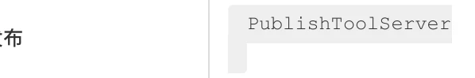
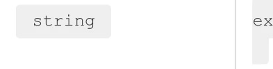
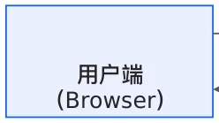
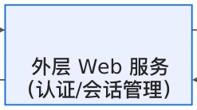
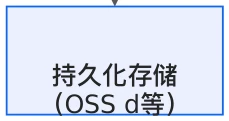
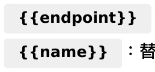

阿里云  
专有云  
智能体工厂 OpenTrek  
AgentRuntime 开发指南  
产品版本：v3.18.6  
文档版本：20261023

**目录**

- [1.快速入门](#section-1)
    - [1.1. 开发文档使用说明](#section-1-1)
    - [1.2. API调用流程说明](#section-1-2)
- [2.准备工作](#section-2)
    - [2.1. 接入准备](#section-2-1)
    - [2.2. 认证与签名](#section-2-2)
    - [2.3. 获取公共Header参数](#section-2-3)
    - [2.4. 错误处理与排查](#section-2-4)
- [3.API参考](#section-3)
    - [3.1. Agent核心生命周期](#section-3-1)
        - [3.1.1. CheckAgentName](#section-3-1-1)
        - [3.1.2. CreateAgent](#section-3-1-2)
        - [3.1.3. ListAgents](#section-3-1-3)
        - [3.1.4. GetAgent](#section-3-1-4)
        - [3.1.5. GetAgentByName](#section-3-1-5)
        - [3.1.6. UpdateAgent](#section-3-1-6)
        - [3.1.7. PublishAgent](#section-3-1-7)
        - [3.1.8. DeleteAgent](#section-3-1-8)
    - [3.2. Agent版本管理](#section-3-2)
        - [3.2.1. ListAgentRevisions](#section-3-2-1)
        - [3.2.2. GetAgentRevision](#section-3-2-2)
        - [3.2.3. GetAgentRevisionLatestRevision](#section-3-2-3)
        - [3.2.4. DeleteAgentRevision](#section-3-2-4)
    - [3.3. Agent端点管理](#section-3-3)
        - [3.3.1. ListAgentEndpoints](#section-3-3-1)
        - [3.3.2. GetAgentEndpoint](#section-3-3-2)
        - [3.3.3. CreateAgentEndpointRevision](#section-3-3-3)
        - [3.3.4. UpdateAgentEndpointPrimary](#section-3-3-4)
        - [3.3.5. DeleteAgentEndpoint](#section-3-3-5)
    - [3.4. Agent配置与辅助](#section-3-4)
        - [3.4.1. UpdateAgentProtocolLabels](#section-3-4-1)
        - [3.4.2. GetAgentGatewayAccess](#section-3-4-2)
        - [3.4.3. UpdateAgentGatewayAccess](#section-3-4-3)
        - [3.4.4. GetAgentCredential](#section-3-4-4)
    - [3.5. ToolServer核心生命周期](#section-3-5)
        - [3.5.1. CheckToolServerName](#section-3-5-1)
        - [3.5.2. CreateToolServer](#section-3-5-2)
        - [3.5.3. ListToolServers](#section-3-5-3)
        - [3.5.4. GetToolServer](#section-3-5-4)
        - [3.5.5. UpdateToolServer](#section-3-5-5)
        - [3.5.6. PublishToolServer](#section-3-5-6)
        - [3.5.7. DeleteToolServer](#section-3-5-7)
    - [3.6. ToolServer版本管理](#section-3-6)
        - [3.6.1. ListToolServerRevisions](#section-3-6-1)
        - [3.6.2. GetToolServerRevision](#section-3-6-2)
        - [3.6.3. GetToolServerRevisionLatestRevision](#section-3-6-3)
        - [3.6.4. DeleteToolServerRevision](#section-3-6-4)
    - [3.7. ToolServer端点管理](#section-3-7)
        - [3.7.1. ListToolEndpoints](#section-3-7-1)
        - [3.7.2. GetToolEndpoint](#section-3-7-2)
        - [3.7.3. CreateToolEndpointRevision](#section-3-7-3)
        - [3.7.4. UpdateToolEndpointPrimary](#section-3-7-4)
        - [3.7.5. DeleteToolEndpoint](#section-3-7-5)
    - [3.8. ToolServer配置与辅助](#section-3-8)
        - [3.8.1. GetToolServerGatewayAccess](#section-3-8-1)
        - [3.8.2. UpdateToolServerGatewayAccess](#section-3-8-2)
        - [3.8.3. GetToolServerCredential](#section-3-8-3)
    - [3.9. 实例核心生命周期](#section-3-9)
        - [3.9.1. ListInstances](#section-3-9-1)
        - [3.9.2. GetInstance](#section-3-9-2)
        - [3.9.3. DeleteInstance](#section-3-9-3)
    - [3.10. 实例运维与诊断](#section-3-10)
        - [3.10.1. GetInstanceContainers](#section-3-10-1)
        - [3.10.2. GetInstanceLogs](#section-3-10-2)
        - [3.10.3. CreateInstanceCheckpoint](#section-3-10-3)
- [4.AgentRuntime 平台集成](#section-4)
    - [4.1. 访问凭证与鉴权](#section-4-1)
    - [4.2. Agent 接入](#section-4-2)
        - [4.2.1. 通过 curl 调用 Agent](#section-4-2-1)
        - [4.2.2. Python 集成 Agent](#section-4-2-2)
        - [4.2.3. 0码 Agent 集成指南](#section-4-2-3)
    - [4.3. ToolServer 接入](#section-4-3)
        - [4.3.1. 代码方式](#section-4-3-1)
            - [4.3.1.1. agentscope-runtime 集成沙箱工具](#section-4-3-1-1)
            - [4.3.1.2. E2B 沙箱集成文档](#section-4-3-1-2)
            - [4.3.1.3. LangGraph 集成 AgentScope 沙箱工具](#section-4-3-1-3)
            - [4.3.1.4. Claw 类 Agent 技能方式集成](#section-4-3-1-4)
        - [4.3.2. MCP 方式](#section-4-3-2)
            - [4.3.2.1. MCP JSON 配置](#section-4-3-2-1)
            - [4.3.2.2. Python MCP 客户端访问 ToolServer](#section-4-3-2-2)
    - [4.4. 打包与发布](#section-4-4)
        - [4.4.1. pack-tools 离线打包工具](#section-4-4-1)

<a id="section-1"></a>

# 1.快速入门

本章介绍开发文档的使用方式与 API 调用的整体流程，帮助开发者快速上手 AgentRuntime 生命周期管理接口。

<a id="section-1-1"></a>

## 1.1. 开发文档使用说明

AgentRuntime提供标准化的 RESTful API 服务，通过统一的响应结构与完善的错误排查机制，支持开发者安全、高效地管理 Agent 与 ToolServer 等核心资源。

**调用前检查清单**

- 已获取平台访问地址（Base URL），详见接入准备。

- 已获取并配置访问凭证，详见认证与签名。

- 已确认请求路径前缀为  `/api/v1` ，且各接口的完整路径与请求方式与文档一致。

- 已按接口「请求参数」表填写参数。

- 创建 Agent 或 ToolServer 前，已确认名称符合命名规范且在租户内唯一，详见接入准备。

**响应与排查**

所有接口返回统一的外层响应结构，便于统一处理与错误排查：成功时  `success`  为  `true` ，业务数据位于  `data` ；失败时  `success`  为  `false` ，可结合  `code` 、 `message`  与  `requestId`  定位问题。

**成功响应示例**

以  `ListAgents` （ `GET /api/v1/agents` ）为例，成功响应如下。 `data.items`  元素字段较多，此处节选，完整字段见 ListAgents 接口文档：

```json
{
  "requestId": "req-001",
  "code": 200,
  "message": "success",
  "success": true,
  "data": {
    "pageNum": 1,
    "pageSize": 10,
    "total": 2,
    "totalPages": 1,
    "items": [
      {
        "id": "agent-001",
        "name": "my-agent",
        "showName": "我的智能体",
        "status": 1,
        "latestVersion": "v1.0.0",
        "createTime": 1758412800000
      }
    ]
  }
}
```

**响应字段说明**

| 字段 | 类型 | 说明 |
| --- | --- | --- |
| requestId | <code>string</code> | 请求 ID，用于问题排查与工单追踪。 |
| code | <code>integer&lt;int32&gt;</code> | 响应码，成功时通常为 200。 |
| message | <code>string</code> | 响应消息，失败时返回错误描述。 |
| success | <code>boolean</code> | 请求是否成功，<code> true </code> 表示成功。 |
| data | <code>object</code> | 业务数据，结构随接口不同而变化；删除类接口无 <code> data </code> 字段。 |

**错误排查步骤**

1. 记录响应中的  `requestId` ，作为问题追踪与工单的关键标识。

2. 判断  `success`  是否为  `true` ：为  `true`  时从  `data`  读取业务数据；为  `false`  时进入错误处理。

3. 失败时结合  `code`  与  `message`  判断错误类型与具体原因。

4. 若  `data`  为  `null`  或预期字段缺失，核对请求参数、资源标识与资源状态是否正确。

5. 仍无法定位时，携带  `requestId`  参考错误处理与排查或联系平台管理员。

<a id="section-1-2"></a>

## 1.2. API调用流程说明

提供API请求、响应解析、异常重试与流程编排的最佳实践，助您快速集成平台接口。本文介绍平台API调用指南。

**调用流程**

不同接口的调用步骤基本一致，核心差异在于是否携带请求体与是否包含路径参数：

| 步骤 | 操作 | 说明 |
| --- | --- | --- |
| 1 | 获取地址 | 确认部署环境的 Base URL，接口统一以 <code> /api/v1 </code> 为前缀。 |
| 2 | 获取凭证 | 获取平台访问凭证并按认证与签名配置到请求 Header。 |
| 3 | 选择接口 | 按业务目标在API参考中定位模块与接口。 |
| 4 | 构造请求 | 按接口的请求方式、路径参数、Query 参数与 Body 参数构造请求。 |
| 5 | 处理响应 | 解析统一外层响应，判断 <code> success </code>，读取 <code> data </code> 或错误信息。 |

**API 调用示例**

以下示例演示从校验名称到创建、发布、查询实例的典型链路（请将  `<accessToken>`  与 Base URL 替换为实际值）。

校验 Agent 名称是否可用：

```bash
curl -X GET "https://agentruntime.example.com/api/v1/agents/checkName?name=my-agent&clusterId=cluster-001" \
  -H "Authorization: Bearer <accessToken>"
```

创建 Agent：

```bash
curl -X POST "https://agentruntime.example.com/api/v1/agents" \
  -H "Content-Type: application/json" \
  -H "Authorization: Bearer <accessToken>" \
  -d '{
    "name": "my-agent",
    "clusterId": "cluster-001",
    "clusterNamespace": "default",
    "showName": "我的智能体",
    "description": "⽤于处理业务咨询的智能体"
  }'
```

发布 Agent 版本：

```bash
curl -X POST "https://agentruntime.example.com/api/v1/agents/publish" \
  -H "Content-Type: application/json" \
  -H "Authorization: Bearer <accessToken>" \
  -d '{
    "agentId": "agent-001",
    "version": "v1.0.0",
    "description": "⾸个正式版本"
  }'
```

查询实例列表：

```bash
curl -X GET "https://agentruntime.example.com/api/v1/instances?
pageNum=1&pageSize=10&clusterId=cluster-001" \
  -H "Authorization: Bearer <accessToken>"
```

**典型业务流程**

<table>
  <tr>
    <th>业务流程</th>
    <th>步骤</th>
    <th>涉及接口</th>
    <th>说明</th>
  </tr>
  <tr>
    <td rowspan="5">上线一个 Agent</td>
    <td>1. 校验名称</td>
    <td><code>CheckAgentName</code></td>
    <td>确认名称可用且租户内唯一。</td>
  </tr>
  <tr>
    <td>2. 创建 Agent</td>
    <td><code>CreateAgent</code></td>
    <td>提交制品、资源、伸缩等配置。</td>
  </tr>
  <tr>
    <td>3. 发布版本</td>
    <td><code>PublishAgent</code></td>
    <td>生成新版本并部署。</td>
  </tr>
  <tr>
    <td>4. 创建端点</td>
    <td><code>CreateAgentEndpoin</code><br><code>tRevision</code></td>
    <td>为版本创建访问端点。</td>
  </tr>
  <tr>
    <td>5. 切换主流量</td>
    <td><code>UpdateAgentEndpoin</code><br><code>tPrimary</code></td>
    <td>将主流量指向目标端点。</td>
  </tr>
  <tr>
    <td rowspan="3">运维 ToolServer</td>
    <td>1. 创建工具服务器</td>
    <td><code>CreateToolServer</code></td>
    <td>提交 MCP/协议与运行配置。</td>
  </tr>
  <tr>
    <td>2. 发布</td>
    <td><code>PublishToolServer</code></td>
    <td>生成版本并部署。</td>
  </tr>
  <tr>
    <td>3. 配置网关访问</td>
    <td><code>UpdateToolServerGa</code><br><code>tewayAccess</code></td>
    <td>设置访问模式与后端鉴权。</td>
  </tr>
  <tr>
    <td rowspan="3">实例诊断</td>
    <td>1. 查询实例</td>
    <td><code> ListInstances </code>、<code> </code><code>GetInstance</code></td>
    <td>定位目标实例。</td>
  </tr>
  <tr>
    <td>2. 查看容器与日志</td>
    <td><code>GetInstanceContain</code> <code>ers </code>、<code> GetInstanceL</code> <code>ogs</code></td>
    <td>排查运行异常。</td>
  </tr>
  <tr>
    <td>3. 创建快照</td>
    <td><code>CreateInstanceChec</code><br><code>kpoint</code></td>
    <td>保存实例状态用于恢复。</td>
  </tr>
</table>




<a id="section-2"></a>

# 2.准备工作

本章说明调用 AgentRuntime 管理面接口前的接入准备、认证与签名方式，以及错误处理与排查方法。

<a id="section-2-1"></a>

## 2.1. 接入准备

AgentRuntime支持开发者通过标准化的路径规则、资源命名校验及集群配置，安全高效地管理 Agent、ToolServer 及运行实例等核心资源，本文介绍接入准备。

**调用地址**

AgentRuntime 管理面接口的调用地址由部署环境决定，所有接口统一以  `/api/v1`  为路径前缀。请根据实际部署场景替换 Base URL：

| 部署场景 | Base URL 示例 | 说明 |
| --- | --- | --- |
| 专有云/私有化环境 | <code>https://&lt;your-domain&gt;</code> | 由运维人员在部署时提供的内网或专属域名。 |

> **说明**
>
> 完整请求地址 = Base URL + 接口路径，例如  `https://<your-domain>/api/v1/agents` 。

**路径规则**

| URL 前缀 | 接口类型 |
| --- | --- |
| <code> /api/v1/agents </code>、<code> /api/v1/agent-</code><code>revisions </code>、<code> /api/v1/agent-endpoints </code> | Agent 相关接口。 |
| <code> /api/v1/tool-servers </code>、<code> /api/v1/tool-</code><code>server-revisions </code>、<code> /api/v1/tool-</code><code>endpoints</code> | ToolServer 相关接口。 |
| <code>/api/v1/instances</code> | 运行实例相关接口。 |

**资源命名规范**

创建 Agent 与 ToolServer 时， `name`  字段需满足平台命名约束：

- 命名需匹配正则  `^[a-z]([-a-z0-9]*[a-z0-9])?$` ，即以小写字母开头、由小写字母/数字/中划线组成、以字母或数字结尾。

- 名称长度不超过 128 个字符。

- 在同一租户范围内，Agent 名称与 ToolServer 名称必须全局唯一，且二者之间也不可重名；违反唯一性约束时返回  `InvalidParameter`  错误。

- 建议创建前先调用  `CheckAgentName`  或  `CheckToolServerName`  校验名称可用性。

**关键前置参数**

- `clusterId` ：创建 Agent 与 ToolServer 时需指定目标集群 ID，可通过集群管理相关接口获取。

- `clusterNamespace` ：资源所在的集群命名空间。

- `credentialName` ：为资源绑定访问凭证时使用的凭证名称。

- `artifact` 、 `resources` 、 `scaling` ：创建类接口的制品、资源与伸缩配置，需按业务实际需要填写。

**访问范围说明**

- 本手册覆盖的接口需通过平台网关鉴权后调用。

- 接口不面向匿名公网访问，调用前必须完成凭证配置与权限授予。

**开发工具**

可使用以下任意 HTTP 客户端调用本手册接口：

- 命令行工具： `curl` 、 `httpie` ，适合快速验证连通性与调试。

- 图形化客户端： `Postman` 、 `Insomnia` ，适合管理请求集合与环境变量。

- HTTP 库：Java（OkHttp、RestTemplate、HttpClient）、Python（requests、httpx）、Node.js（axios、fetch）、Go（net/http），适合集成到业务代码。

**快速测试**

完成地址与凭证配置后，可先用只读接口验证连通性。以下示例调用  `ListAgents`  与  `CheckAgentName` （请将 Base URL 与  `<accessToken>`  替换为实际值）：

```bash
# 查询 Agent 列表，验证地址与凭证
curl -X GET "https://agentruntime.example.com/api/v1/agents?pageNum=1&pageSize=10" \
  -H "Authorization: Bearer <accessToken>"

# 校验 Agent 名称是否可⽤
curl -X GET "https://agentruntime.example.com/api/v1/agents/checkName?name=my-agent&clusterId=cluster-001" \
  -H "Authorization: Bearer <accessToken>"
```

> **说明**
>
> 响应中  `success`  为  `true`  表示地址、凭证与权限均正常；若返回鉴权失败或权限不足，请检查认证与签名中的凭证与权限配置。

**注意事项**

1. 生产环境必须使用 HTTPS 传输，避免凭证与数据明文暴露。

2. 访问令牌与资源  `apiKey`  等敏感信息应妥善保管，不硬编码在代码、日志或版本库中。

3. 注意接口调用频率，避免短时间高频请求触发网关限流。

4. 实现完善的错误处理与重试机制，详见错误处理与排查。

5. 记录每次请求的  `requestId` ，便于问题排查与工单追踪。

<a id="section-2-2"></a>

## 2.2. 认证与签名

AgentRuntime 采用私有化网关鉴权与细粒度权限模型，通过 HTTP Header 携带访问令牌或签名凭证实现安全调用，并严格区分平台身份凭证与资源业务密钥以保障全链路数据安全。

**认证边界**

本手册覆盖的接口均为 AgentRuntime 管理面接口，统一通过平台网关鉴权后转发至后端服务。调用前必须携带有效的访问凭证，匿名请求将被拒绝。

**权限模型**

- 平台对每个管理面接口按操作粒度进行权限控制，权限动作（action）采用  `agentruntime:<Action>` 格式，其中  `<Action>`  与接口语义对应（如创建 Agent 对应  `agentruntime:CreateAgent` ）。

- 调用方所使用的身份凭证必须被授予目标接口对应的权限动作，否则返回鉴权失败或权限不足错误。

- 权限的授予与角色绑定属于平台凭证与身份管理能力，不在本手册接口范围内，请联系平台管理员完成授权。

**凭证携带方式**

管理面接口通过 HTTP Header 携带访问凭证。文档中的请求示例统一采用 Bearer Token 形式：

```text
Authorization: Bearer <accessToken>
```

| Header | 是否必需 | 说明 |
| --- | --- | --- |
| Authorization | 是 | 携带访问令牌，格式为 <code> Bearer </code> <code>&lt;accessToken&gt; </code>。 |
| Content-Type | 视接口而定 | 含请求体的接口需设置为<code> application/json </code>。 |

> **说明**
>
> 具体凭证形态（Bearer Token、AK/SK 签名等）随部署环境与网关配置而定。若所在环境采用阿里云POP/OpenAPI 网关的 AK/SK 签名模式，请按网关签名规范对请求进行签名后调用；签名算法详情，请参考部署环境的网关接入文档或咨询平台管理员。

**资源级凭证**

部分接口涉及资源自身绑定的访问凭证，与调用管理面接口的身份凭证属于不同层面：

- `GetAgentCredential` 、 `GetToolServerCredential` ：获取 Agent 或 ToolServer 绑定的凭证，响应中的  `data.apiKey`  为凭证密钥明文， `data.headerName`  为凭证注入使用的 Header 名称。

- `UpdateAgentGatewayAccess` 、 `UpdateToolServerGatewayAccess` ：配置资源的网关访问模式（ `accessMode` ）与后端鉴权（ `backendAuth` ，含  `header`  与  `value` ）。

- 上述接口返回或配置的密钥用于业务流量访问已部署的 Agent/ToolServer，请妥善保管，避免泄露。

**凭证安全规范**

- 不要在客户端代码、日志或版本库中硬编码访问令牌与 API Key。

- 凭证应通过安全的密钥管理服务或环境变量注入。

- 定期轮换凭证，发现泄露时立即吊销并重新签发。

- 调用示例中的  `<accessToken>`  为占位标识，请替换为真实凭证，切勿在文档或截图中暴露真实密钥。

**凭证注入示例**

推荐通过环境变量注入访问令牌，避免在代码或脚本中硬编码：

```bash
# 推荐：从环境变量读取访问令牌
export AGENT_RUNTIME_TOKEN="<accessToken>"
curl -X GET "https://agentruntime.example.com/api/v1/agents?pageNum=1&pageSize=10" \
  -H "Authorization: Bearer $AGENT_RUNTIME_TOKEN"
```

```python
import os

# 推荐：从环境变量读取，切勿硬编码
access_token = os.environ.get("AGENT_RUNTIME_TOKEN")
headers = {"Authorization": f"Bearer {access_token}"}
```

<a id="section-2-3"></a>

## 2.3. 获取公共Header参数

本文说明调用 AgentRuntime 接口时通用的请求头与请求规范。各接口的专属请求参数请参见对应 API 文档；公共响应结构请参见响应与排查。

**公共请求头**

所有接口使用统一的公共请求头，无接口专属的特殊请求头。

| Header | 是否必需 | 说明 |
| --- | --- | --- |
| Authorization | 是 | 携带访问令牌，格式为 <code> Bearer </code> <code>&lt;accessToken&gt; </code>。 |
| Content-Type | 视接口而定 | 含请求体的接口（POST/PUT）需设置为 <code> application/json </code>；GET/DELETE 无请求体时可不设置。 |
| Host | 是 | 目标服务域名，HTTP/1.1 标准头，通常由 HTTP 客户端自动携带。 |

**凭证获取与携带**

- 管理面接口通过 HTTP Header 携带访问凭证，请求示例统一采用 Bearer Token 形式：

  ```text
  Authorization: Bearer <accessToken>
  ```

- `<accessToken>`  的获取参考认证与签名。

- 凭证安全：访问令牌应通过环境变量或密钥管理服务注入，不在代码、日志或版本库中硬编码。

<a id="section-2-4"></a>

## 2.4. 错误处理与排查

AgentRuntime提供标准化的统一错误响应结构，支持开发者通过 requestId、错误码及多语言代码示例快速定位参数校验、鉴权异常及服务端故障，确保接口调用的可观测性与问题处理效率。

**错误响应格式**

接口调用失败时，仍返回统一的外层响应结构，通过  `success` 、 `code` 、 `message`  表达错误：

```json
{
  "requestId": "req-001",
  "code": 400,
  "message": "InvalidParameter: name 不符合命名规范",
  "success": false
}
```

| 字段 | 说明 |
| --- | --- |
| requestId | 请求唯一标识，排查问题时需提供。 |
| code | 错误码，非成功时返回对应的错误编码。 |
| message | 错误描述，包含具体失败原因。 |
| success | 失败时为 <code> false </code>。 |

**常见错误码**

| 场景 | 错误码 | 处理建议 |
| --- | --- | --- |
| 参数校验失败（命名不规范、长度超限、必填缺失） | <code>InvalidParameter</code> | 按接口「请求参数」表与接入准备命名规范修正参数。 |
| 名称在租户内重复 | <code>InvalidParameter</code> | 更换 Agent/ToolServer 名称，创建前先用<code> CheckAgentName </code>/<code> CheckToo</code> <code>lServerName </code> 校验。 |
| 未携带凭证或凭证失效 | 鉴权失败 | 检查 <code> Authorization </code> Header是否正确、令牌是否过期，详见认证与签名。 |
| 权限不足 | 权限拒绝 | 确认身份已被授予目标接口对应的<code> agentruntime:&lt;Action&gt; </code> 权限。 |
| 资源不存在 | 未找到 | 确认路径参数（如<code> id </code>、<code> revisionId </code>）对应的资源存在且属于当前租户。 |
| 服务端异常 | 5xx | 携带 <code> requestId </code> 进行有限次退避重试，仍失败则联系平台管理员。 |

> **说明**
>
> 具体错误码取值与 HTTP 状态码映射以平台实际返回为准；本表列出的是常见类别与通用处理建议。

**错误处理示例**

以下示例以  `GetAgent` （ `GET /api/v1/agents/detail/[id]` ）为例，演示如何解析统一外层响应、判断  `success`  并按错误类别处理。实际项目中请替换 Base URL 与  `<accessToken>` 。

**Java 示例**

```java
public class AgentRuntimeClient {

    // 外层统⼀响应：requestId / code(Integer) / message / success(Boolean) / data
    public JsonNode getAgent(String agentId) throws Exception {
        HttpRequest request = HttpRequest.newBuilder()
                .uri(URI.create(baseUrl + "/api/v1/agents/detail/" + agentId))
                .header("Authorization", "Bearer <accessToken>")
                .GET()
                .build();
        HttpResponse<String> response =
                httpClient.send(request, HttpResponse.BodyHandlers.ofString());
        JsonNode body = objectMapper.readTree(response.body());
        if (!body.path("success").asBoolean(false)) {
            handleError(response.statusCode(), body);
        }
        return body.path("data");
    }

    private void handleError(int status, JsonNode body) {
        String requestId = body.path("requestId").asText();
        int code = body.path("code").asInt();
        String message = body.path("message").asText();
        if (status == 401 || status == 403) {
            throw new SecurityException("认证或权限失败[" + code + "]: " + message + ", re
questId=" + requestId);
        }
        if (status == 404) {
            throw new IllegalStateException("资源不存在[" + code + "]: " + message + ", requestId=" + requestId);
        }
        if (status >= 500) {
            // 5xx 可携带 requestId 做有限次退避重试
            throw new RuntimeException("服务端异常[" + code + "]: " + message + ", requestId=" + requestId);
        }
        throw new IllegalArgumentException("请求失败[" + code + "]: " + message + ", 
requestId=" + requestId);
    }
}
```

**Python 示例**

```python
import requests

BASE_URL = "https://agentruntime.example.com"
HEADERS = {"Authorization": "Bearer <accessToken>"}


def get_agent(agent_id: str) -> dict:
    """调⽤ GetAgent 获取 Agent 详情"""
    url = f"{BASE_URL}/api/v1/agents/detail/{agent_id}"
    resp = requests.get(url, headers=HEADERS, timeout=10)
    body = resp.json()
    # 外层统⼀响应：requestId / code(Integer) / message / success(Boolean) / data
    if not body.get("success"):
        handle_error(resp.status_code, body)
    return body.get("data")


def handle_error(status: int, body: dict):
    request_id = body.get("requestId")
    code = body.get("code")
    message = body.get("message")
    if status in (401, 403):
        raise PermissionError(f"认证或权限失败[{code}]: {message}, requestId={request_id}"
)
    if status == 404:
        raise LookupError(f"资源不存在[{code}]: {message}, requestId={request_id}")
    if 500 <= status < 600:
        # 5xx 可携带 requestId 做有限次退避重试
        raise RuntimeError(f"服务端异常[{code}]: {message}, requestId={request_id}")
    raise ValueError(f"请求失败[{code}]: {message}, requestId={request_id}")
```

**排查信息清单**

排查问题时，请准备并提供以下信息：

- `requestId` ：每次请求的唯一标识，是定位问题的关键。

- 请求的完整路径、请求方式与关键参数。

- 响应中的  `code`  与  `message` 。

- 调用时间与所用身份（凭证对应的账号/角色）。

- 涉及资源的标识（如  `agentId` 、 `toolServerId` 、 `instanceId` 、 `revisionId` ）。

**排查步骤**

1. 记录  `requestId` ：从响应中获取  `requestId` ，作为后续排查与工单的关键标识。

2. 判断  `success` ：为  `true`  时从  `data`  读取业务数据；为  `false`  时进入错误处理。

3. 查看  `code`  与  `message` ：结合响应码与错误描述判断错误类别与具体原因。

4. 核对请求参数：确认请求路径、请求方式、路径参数与 Body 参数是否正确。

5. 检查认证与权限：确认凭证有效且已被授予目标接口的  `agentruntime:<Action>`  权限。

6. 联系平台管理员：仍无法定位时，提供  `requestId` 、请求路径与响应内容（脱敏后）寻求支持。

**常见问题排查**

- 实例异常：使用  `GetInstance`  查看实例  `status` 、 `phase`  与  `errorMessage` ，再用  `GetInstanceContainers` 、 `GetInstanceLogs`  查看容器状态与日志。

- 发布未生效：确认  `PublishAgent` / `PublishToolServer`  是否成功返回版本号，并通过  `GetAgentRevisionLatestRevision`  核对最新版本。

- 流量未切换：确认已通过  `UpdateAgentEndpointPrimary` / `UpdateToolEndpointPrimary`  将主流量指向目标端点。

- 网关访问异常：通过  `GetAgentGatewayAccess` / `GetToolServerGatewayAccess`  核对访问模式与后端鉴权配置。

**凭证安全规范**

- 排查涉及凭证的问题时，不要直接粘贴  `apiKey`  等明文密钥，应做脱敏处理。

- 日志与截图中避免暴露  `Authorization`  Header 与访问令牌。

- 发现凭证泄露应立即吊销并轮换。

**外部发布检查清单**

- 文档与示例中不含真实域名、内网 IP、账号与密钥，示例统一使用  `example.com`  与占位标识。

- 对外发布前确认接口的访问范围与权限说明与实际部署一致。

- 确认错误码与响应结构描述与平台网关实际返回保持一致。

<a id="section-3"></a>

# 3.API参考

本章收录 AgentRuntime 生命周期管理相关的全部 API 接口，按资源类型与功能划分为若干模块，覆盖Agent、ToolServer、Instance 三类核心资源。

<a id="section-3-1"></a>

## 3.1. Agent核心生命周期

本章节收录Agent管理相关的接口文档。

<a id="section-3-1-1"></a>

### 3.1.1. CheckAgentName

调用CheckAgentName接口，用于检查Agent名称是否可用。

**请求头**

该接口使用公共请求头，无特殊请求头。请参见获取公共Header参数。

**请求语法**

```http
GET /api/v1/agents/checkName HTTP/1.1
```

**请求参数**

| 参数名称 | 位置 | 类型 | 是否必选 | 示例 | 说明 |
| --- | --- | --- | --- | --- | --- |
| name | query | <code>string</code> | 否 | <code>"my-</code><br><code>agent"</code> | 名称。 |
| clusterId | query | <code>string</code> | 否 | <code>"cluster-</code><br><code>001"</code> | 集群 ID。 |

**返回数据**

| 参数名称 | 类型 | 示例 | 说明 |
| --- | --- | --- | --- |
| requestId | <code>string</code> | <code>"req-001"</code> | 请求 ID，用于问题排查。 |
| code | <code>integer&lt;int32&gt;</code> | <code>200</code> | 响应码。 |
| message | <code>string</code> | <code>"success"</code> | 响应消息。 |
| success | <code>boolean</code> | <code>true</code> | 请求是否成功。 |
| data | <code>object</code> | <code>{}</code> | 业务数据。 |

**示例**

**请求示例**

```http
GET /api/v1/agents/checkName?name=my-agent&clusterId=cluster-001 HTTP/1.1
Host: agentruntime.example.com
Content-Type: application/json
Authorization: Bearer <accessToken>
```

**响应示例**

```json
{
  "requestId": "req-001",
  "code": 200,
  "message": "success",
  "success": true,
  "data": {}
}
```

<a id="section-3-1-2"></a>

### 3.1.2. CreateAgent

调用CreateAgent接口，用于创建Agent。

**请求头**

该接口使用公共请求头，无特殊请求头。请参见获取公共Header参数。

**请求语法**

```http
POST /api/v1/agents HTTP/1.1
```

**请求参数**

| 参数名称 | 位置 | 类型 | 是否必选 | 示例 | 说明 |
| --- | --- | --- | --- | --- | --- |
| name | body | <code>string</code> | 否 | <code>"my-</code><br><code>agent"</code> | 名称。 |
| clusterId | body | <code>string</code> | 否 | <code>"cluster-</code><br><code>001"</code> | 集群 ID。 |
| clusterNames pace | body | <code>string</code> | 否 | <code>"default"</code> | 集群命名空间。 |


<table>
  <tr>
    <td>description</td>
    <td>body</td>
    <td><code>string</code></td>
    <td>否</td>
    <td><code> "</code>用于处理业务咨询的智能体<code>" </code></td>
    <td>描述信息。</td>
  </tr>
  <tr>
    <td>showName</td>
    <td>body</td>
    <td><code>string</code></td>
    <td>否</td>
    <td><code> "</code>我的智能体<code>" </code></td>
    <td>显示名称。</td>
  </tr>
  <tr>
    <td>type</td>
    <td>body</td>
    <td><code>integer&lt;in</code><br><code>t32&gt;</code></td>
    <td>否</td>
    <td><code>1</code></td>
    <td>类型。</td>
  </tr>
  <tr>
    <td>tags</td>
    <td>body</td>
    <td><code>string</code></td>
    <td>否</td>
    <td><code>"prod"</code></td>
    <td>标签列表。</td>
  </tr>
  <tr>
    <td>llm</td>
    <td>body</td>
    <td><code>object</code></td>
    <td>否</td>
    <td><code>{}</code></td>
    <td>大模型（LLM）配置。</td>
  </tr>
  <tr>
    <td>tools</td>
    <td>body</td>
    <td><code>string</code></td>
    <td>否</td>
    <td><code>"web-</code><br><code>search"</code></td>
    <td>工具列表。</td>
  </tr>
  <tr>
    <td>scaling</td>
    <td>body</td>
    <td><code>object</code></td>
    <td>否</td>
    <td><code>{}</code></td>
    <td>弹性伸缩配置。</td>
  </tr>
  <tr>
    <td>createGolden Checkpoint</td>
    <td>body</td>
    <td><code>boolean</code></td>
    <td>否</td>
    <td><code>false</code></td>
    <td>是否创建黄金检查点（Golden Checkpoint）。</td>
  </tr>
  <tr>
    <td>snapshotPolic y</td>
    <td>body</td>
    <td><code>object</code></td>
    <td>否</td>
    <td><code>{}</code></td>
    <td>快照策略配置。</td>
  </tr>
  <tr>
    <td>artifact</td>
    <td>body</td>
    <td><code>object</code></td>
    <td>否</td>
    <td><code>{}</code></td>
    <td>制品（Artifact）配置。</td>
  </tr>
  <tr>
    <td>resources</td>
    <td>body</td>
    <td><code>object</code></td>
    <td>否</td>
    <td><code>{}</code></td>
    <td>资源配置，包含CPU、内存、GPU 等。</td>
  </tr>
  <tr>
    <td>isolation</td>
    <td>body</td>
    <td><code>object</code></td>
    <td>否</td>
    <td><code>{}</code></td>
    <td>隔离配置。</td>
  </tr>
  <tr>
    <td>securityConte xt</td>
    <td>body</td>
    <td><code>object</code></td>
    <td>否</td>
    <td><code>{}</code></td>
    <td>安全上下文配置。</td>
  </tr>
  <tr>
    <td>runtimeClass</td>
    <td>body</td>
    <td><code>string</code></td>
    <td>否</td>
    <td><code>"runc"</code></td>
    <td>运行时类（RuntimeCla ss）。</td>
  </tr>
  <tr>
    <td>env</td>
    <td>body</td>
    <td><code>string</code></td>
    <td>否</td>
    <td><code>"ENV_KEY=e</code><br><code>nv_value"</code></td>
    <td>环境变量列表。</td>
  </tr>
  <tr>
    <td>startupComm and</td>
    <td>body</td>
    <td><code>string</code></td>
    <td>否</td>
    <td><code>"python</code><br><code>app.py"</code></td>
    <td>启动命令。</td>
  </tr>
  <tr>
    <td>ports</td>
    <td>body</td>
    <td><code>string</code></td>
    <td>否</td>
    <td><code>"8080"</code></td>
    <td>端口配置列表。</td>
  </tr>
  <tr>
    <td>concurrency</td>
    <td>body</td>
    <td><code>integer&lt;in</code><br><code>t64&gt;</code></td>
    <td>否</td>
    <td><code>10</code></td>
    <td>单实例并发数。</td>
  </tr>
  <tr>
    <td>livenessProbe</td>
    <td>body</td>
    <td><code>object</code></td>
    <td>否</td>
    <td><code>{}</code></td>
    <td>存活探针配置。</td>
  </tr>
  <tr>
    <td>readinessProb e</td>
    <td>body</td>
    <td><code>object</code></td>
    <td>否</td>
    <td><code>{}</code></td>
    <td>就绪探针配置。</td>
  </tr>
  <tr>
    <td>idleTimeoutS econds</td>
    <td>body</td>
    <td><code>integer&lt;in</code><br><code>t64&gt;</code></td>
    <td>否</td>
    <td><code>300</code></td>
    <td>空闲超时时间（秒）。</td>
  </tr>
  <tr>
    <td>storage</td>
    <td>body</td>
    <td><code>object</code></td>
    <td>否</td>
    <td><code>{}</code></td>
    <td>存储配置。</td>
  </tr>
  <tr>
    <td>observability</td>
    <td>body</td>
    <td><code>object</code></td>
    <td>否</td>
    <td><code>{}</code></td>
    <td>可观测性配置。</td>
  </tr>
  <tr>
    <td>sandBoxTem plate</td>
    <td>body</td>
    <td><code>object</code></td>
    <td>否</td>
    <td><code>{}</code></td>
    <td>沙箱模板配置。</td>
  </tr>
  <tr>
    <td>a2a</td>
    <td>body</td>
    <td><code>object</code></td>
    <td>否</td>
    <td><code>{}</code></td>
    <td>A2A（Agent-to-Agent）协议配置。</td>
  </tr>
  <tr>
    <td>accesses</td>
    <td>body</td>
    <td><code>string</code></td>
    <td>否</td>
    <td><code>"public"</code></td>
    <td>访问入口配置列表。</td>
  </tr>
  <tr>
    <td>credentialNa me</td>
    <td>body</td>
    <td><code>string</code></td>
    <td>否</td>
    <td><code>"my-</code><br><code>credential"</code></td>
    <td>绑定的凭证名称。</td>
  </tr>
</table>


**返回数据**

| 参数名称 | 类型 | 示例 | 说明 |
| --- | --- | --- | --- |
| requestId | <code>string</code> | <code>"req-001"</code> | 请求 ID，用于问题排查。 |
| code | <code>integer&lt;int32&gt;</code> | <code>200</code> | 响应码。 |
| message | <code>string</code> | <code>"success"</code> | 响应消息。 |
| success | <code>boolean</code> | <code>true</code> | 请求是否成功。 |
| data | <code>object</code> | <code>{}</code> | 业务数据。 |
| data.id | <code>string</code> | <code>"agent-001"</code> | 主键 ID。 |
| data.name | <code>string</code> | <code>"my-agent"</code> | 名称。 |
| data.showName | <code>string</code> | <code> "</code>我的智能体<code>" </code> | 显示名称。 |
| data.description | <code>string</code> | <code> "</code>用于处理业务咨询的智能体<code>" </code> | 描述信息。 |
| data.type | <code>integer&lt;int32&gt;</code> | <code>1</code> | 类型。 |
| data.clusterId | <code>string</code> | <code>"cluster-001"</code> | 集群 ID。 |
| data.clusterName | <code>string</code> | <code>"prod-cluster"</code> | 集群名称。 |
| data.clusterNamespac e | <code>string</code> | <code>"default"</code> | 集群命名空间。 |
| data.tags | <code>array</code> | <code>[]</code> | 标签列表，元素类型：string。 |
| data.status | <code>integer&lt;int32&gt;</code> | <code>1</code> | 状态。 |
| data.endpoint | <code>string</code> | <code>"https://my-</code><br><code>agent.example.com"</code> | 访问端点地址。 |
| data.latestVersion | <code>string</code> | <code>"v1.0.0"</code> | 最新版本号。 |
| data.latestRevisionId | <code>string</code> | <code>"revision-001"</code> | 最新版本 ID。 |
| data.llm | <code>object</code> | <code>{}</code> | 大模型（LLM）配置。 |
| data.llm.models | <code>array</code> | <code>[]</code> | 模型配置列表，元素类型：object。 |
| data.llm.parameters | <code>array</code> | <code>[]</code> | 参数列表，元素类型：object。 |
| data.tools | <code>array</code> | <code>[]</code> | 工具列表，元素类型：string。 |
| data.scaling | <code>object</code> | <code>{}</code> | 弹性伸缩配置。 |
| data.scaling.minReplic as | <code>integer&lt;int32&gt;</code> | <code>1</code> | 最小副本数。 |
| data.scaling.maxRepli cas | <code>integer&lt;int32&gt;</code> | <code>5</code> | 最大副本数。 |
| data.scaling.scaleDow nSeconds | <code>integer&lt;int32&gt;</code> | <code>300</code> | 缩容等待时间（秒）。 |
| data.createGoldenChe ckpoint | <code>boolean</code> | <code>false</code> | 是否创建黄金检查点（Golden Checkpoint）。 |
| data.snapshotPolicy | <code>object</code> | <code>{}</code> | 快照策略配置。 |
| data.snapshotPolicy.m axSnapshotsPerRevisi on | <code>integer&lt;int32&gt;</code> | <code>3</code> | 每个版本保留的最大快照数。 |


<table>
  <tr>
    <td>data.snapshotPolicy.st orageType</td>
    <td><code>string</code></td>
    <td><code>"OSS"</code></td>
    <td>存储类型。</td>
  </tr>
  <tr>
    <td>data.artifact</td>
    <td><code>object</code></td>
    <td><code>{}</code></td>
    <td>制品（Artifact）配置。</td>
  </tr>
  <tr>
    <td>data.artifact.type</td>
    <td><code>object</code></td>
    <td><code>{}</code></td>
    <td>类型。</td>
  </tr>
  <tr>
    <td>data.artifact.packageC onfig</td>
    <td><code>object</code></td>
    <td><code>{}</code></td>
    <td>制品包配置。</td>
  </tr>
  <tr>
    <td>data.artifact.oss</td>
    <td><code>object</code></td>
    <td><code>{}</code></td>
    <td>OSS 存储配置列表。</td>
  </tr>
  <tr>
    <td>data.artifact.repository</td>
    <td><code>object</code></td>
    <td><code>{}</code></td>
    <td>镜像仓库配置。</td>
  </tr>
  <tr>
    <td>data.artifact.code</td>
    <td><code>object</code></td>
    <td><code>{}</code></td>
    <td>响应码。</td>
  </tr>
  <tr>
    <td>data.artifact.runtime</td>
    <td><code>object</code></td>
    <td><code>{}</code></td>
    <td>运行时配置。</td>
  </tr>
  <tr>
    <td>data.resources</td>
    <td><code>object</code></td>
    <td><code>{}</code></td>
    <td>资源配置，包含 CPU、内存、GPU 等。</td>
  </tr>
  <tr>
    <td>data.isolation</td>
    <td><code>object</code></td>
    <td><code>{}</code></td>
    <td>隔离配置。</td>
  </tr>
  <tr>
    <td>data.securityContext</td>
    <td><code>object</code></td>
    <td><code>{}</code></td>
    <td>安全上下文配置。</td>
  </tr>
  <tr>
    <td>data.securityContext.r unAsUser</td>
    <td><code>integer&lt;int64&gt;</code></td>
    <td><code>1000</code></td>
    <td>运行用户 ID。</td>
  </tr>
  <tr>
    <td>data.securityContext.r unAsGroup</td>
    <td><code>integer&lt;int64&gt;</code></td>
    <td><code>1000</code></td>
    <td>运行用户组 ID。</td>
  </tr>
  <tr>
    <td>data.securityContext.r unAsNonRoot</td>
    <td><code>boolean</code></td>
    <td><code>true</code></td>
    <td>是否以非 root 用户运行。</td>
  </tr>
  <tr>
    <td>data.securityContext.r eadOnlyRootFilesyste m</td>
    <td><code>boolean</code></td>
    <td><code>false</code></td>
    <td>根文件系统是否只读。</td>
  </tr>
  <tr>
    <td>data.securityContext.p rivileged</td>
    <td><code>boolean</code></td>
    <td><code>false</code></td>
    <td>是否以特权模式运行。</td>
  </tr>
  <tr>
    <td>data.runtimeClass</td>
    <td><code>string</code></td>
    <td><code>"runc"</code></td>
    <td>运行时类（RuntimeClass）。</td>
  </tr>
  <tr>
    <td>data.env</td>
    <td><code>array</code></td>
    <td><code>[]</code></td>
    <td>环境变量列表，元素类型：object。</td>
  </tr>
  <tr>
    <td>data.command</td>
    <td><code>array</code></td>
    <td><code>[]</code></td>
    <td>容器启动命令列表，元素类型：string。</td>
  </tr>
  <tr>
    <td>data.args</td>
    <td><code>array</code></td>
    <td><code>[]</code></td>
    <td>容器启动参数列表，元素类型：string。</td>
  </tr>
  <tr>
    <td>data.startupCommand</td>
    <td><code>string</code></td>
    <td><code>"python app.py"</code></td>
    <td>启动命令。</td>
  </tr>
  <tr>
    <td>data.ports</td>
    <td><code>array</code></td>
    <td><code>[]</code></td>
    <td>端口配置列表，元素类型：object。</td>
  </tr>
  <tr>
    <td>data.concurrency</td>
    <td><code>integer&lt;int64&gt;</code></td>
    <td><code>10</code></td>
    <td>单实例并发数。</td>
  </tr>
  <tr>
    <td>data.livenessProbe</td>
    <td><code>object</code></td>
    <td><code>{}</code></td>
    <td>存活探针配置。</td>
  </tr>
  <tr>
    <td>data.livenessProbe.htt pGet</td>
    <td><code>object</code></td>
    <td><code>{}</code></td>
    <td>HTTP GET 探针配置。</td>
  </tr>
  <tr>
    <td>data.livenessProbe.tcp Socket</td>
    <td><code>object</code></td>
    <td><code>{}</code></td>
    <td>TCP Socket 探针配置。</td>
  </tr>
  <tr>
    <td>data.livenessProbe.ex ec</td>
    <td><code>object</code></td>
    <td><code>{}</code></td>
    <td>命令行探针配置。</td>
  </tr>
  <tr>
    <td>data.livenessProbe.init ialDelaySeconds</td>
    <td><code>integer&lt;int32&gt;</code></td>
    <td><code>10</code></td>
    <td>探针首次检测的延迟时间（秒）。</td>
  </tr>
  <tr>
    <td>data.livenessProbe.per iodSeconds</td>
    <td><code>integer&lt;int32&gt;</code></td>
    <td><code>30</code></td>
    <td>探针检测周期（秒）。</td>
  </tr>
  <tr>
    <td>data.livenessProbe.tim eoutSeconds</td>
    <td><code>integer&lt;int32&gt;</code></td>
    <td><code>5</code></td>
    <td>探针超时时间（秒）。</td>
  </tr>
  <tr>
    <td>data.livenessProbe.suc cessThreshold</td>
    <td><code>integer&lt;int32&gt;</code></td>
    <td><code>1</code></td>
    <td>探针成功阈值。</td>
  </tr>
  <tr>
    <td>data.livenessProbe.fail ureThreshold</td>
    <td><code>integer&lt;int32&gt;</code></td>
    <td><code>3</code></td>
    <td>探针失败阈值。</td>
  </tr>
  <tr>
    <td>data.livenessProbe.pat h</td>
    <td><code>string</code></td>
    <td><code>"/healthz"</code></td>
    <td>探针检测路径。</td>
  </tr>
  <tr>
    <td>data.livenessProbe.por t</td>
    <td><code>integer&lt;int32&gt;</code></td>
    <td><code>8080</code></td>
    <td>端口号。</td>
  </tr>
  <tr>
    <td>data.livenessProbe.sch eme</td>
    <td><code>string</code></td>
    <td><code>"HTTP"</code></td>
    <td>协议类型，取值为 HTTP或 HTTPS。</td>
  </tr>
  <tr>
    <td>data.livenessProbe.co mmand</td>
    <td><code>object</code></td>
    <td><code>{}</code></td>
    <td>容器启动命令列表。</td>
  </tr>
  <tr>
    <td>data.idleTimeoutSecon ds</td>
    <td><code>integer&lt;int64&gt;</code></td>
    <td><code>300</code></td>
    <td>空闲超时时间（秒）。</td>
  </tr>
  <tr>
    <td>data.storage</td>
    <td><code>object</code></td>
    <td><code>{}</code></td>
    <td>存储配置。</td>
  </tr>
  <tr>
    <td>data.storage.oss</td>
    <td><code>array</code></td>
    <td><code>[]</code></td>
    <td>OSS 存储配置列表，元素类型：object。</td>
  </tr>
  <tr>
    <td>data.storage.nas</td>
    <td><code>array</code></td>
    <td><code>[]</code></td>
    <td>NAS 存储配置列表，元素类型：object。</td>
  </tr>
  <tr>
    <td>data.storage.local</td>
    <td><code>array</code></td>
    <td><code>[]</code></td>
    <td>本地存储配置列表，元素类型：object。</td>
  </tr>
  <tr>
    <td>data.storage.ephemer al</td>
    <td><code>object</code></td>
    <td><code>{}</code></td>
    <td>临时存储配置。</td>
  </tr>
  <tr>
    <td>data.observability</td>
    <td><code>object</code></td>
    <td><code>{}</code></td>
    <td>可观测性配置。</td>
  </tr>
  <tr>
    <td>data.observability.logg ing</td>
    <td><code>array</code></td>
    <td><code>[]</code></td>
    <td>日志采集配置列表，元素类型：object。</td>
  </tr>
  <tr>
    <td>data.observability.para meters</td>
    <td><code>array</code></td>
    <td><code>[]</code></td>
    <td>参数列表，元素类型：object。</td>
  </tr>
  <tr>
    <td>data.sandBoxTemplate</td>
    <td><code>object</code></td>
    <td><code>{}</code></td>
    <td>沙箱模板配置。</td>
  </tr>
  <tr>
    <td>data.sandBoxTemplate.name</td>
    <td><code>string</code></td>
    <td><code>"my-agent"</code></td>
    <td>名称。</td>
  </tr>
  <tr>
    <td>data.sandBoxTemplate.namespace</td>
    <td><code>string</code></td>
    <td><code>"default"</code></td>
    <td>命名空间。</td>
  </tr>
  <tr>
    <td>data.sandBoxTemplate.showName</td>
    <td><code>string</code></td>
    <td><code> "</code>我的智能体<code>" </code></td>
    <td>显示名称。</td>
  </tr>
  <tr>
    <td>data.sandBoxTemplate.description</td>
    <td><code>string</code></td>
    <td><code> "</code>用于处理业务咨询的智能体<code>" </code></td>
    <td>描述信息。</td>
  </tr>
  <tr>
    <td>data.sandBoxTemplate.isolation</td>
    <td><code>object</code></td>
    <td><code>{}</code></td>
    <td>隔离配置。</td>
  </tr>
  <tr>
    <td>data.sandBoxTemplate.scaling</td>
    <td><code>object</code></td>
    <td><code>{}</code></td>
    <td>弹性伸缩配置。</td>
  </tr>
  <tr>
    <td>data.sandBoxTemplate.resources</td>
    <td><code>object</code></td>
    <td><code>{}</code></td>
    <td>资源配置，包含 CPU、内存、GPU 等。</td>
  </tr>
  <tr>
    <td>data.sandBoxTemplate.securityContext</td>
    <td><code>object</code></td>
    <td><code>{}</code></td>
    <td>安全上下文配置。</td>
  </tr>
  <tr>
    <td>data.sandBoxTemplate.runtimeClass</td>
    <td><code>string</code></td>
    <td><code>"runc"</code></td>
    <td>运行时类（RuntimeClass）。</td>
  </tr>
  <tr>
    <td>data.sandBoxTemplate.env</td>
    <td><code>array</code></td>
    <td><code>[]</code></td>
    <td>环境变量列表，元素类型：object。</td>
  </tr>
  <tr>
    <td>data.sandBoxTemplate.command</td>
    <td><code>array</code></td>
    <td><code>[]</code></td>
    <td>容器启动命令列表，元素类型：string。</td>
  </tr>
  <tr>
    <td>data.sandBoxTemplate.args</td>
    <td><code>array</code></td>
    <td><code>[]</code></td>
    <td>容器启动参数列表，元素类型：string。</td>
  </tr>
  <tr>
    <td>data.sandBoxTemplate.ports</td>
    <td><code>array</code></td>
    <td><code>[]</code></td>
    <td>端口配置列表，元素类型：object。</td>
  </tr>
  <tr>
    <td>data.sandBoxTemplate.concurrency</td>
    <td><code>integer&lt;int64&gt;</code></td>
    <td><code>10</code></td>
    <td>单实例并发数。</td>
  </tr>
  <tr>
    <td>data.sandBoxTemplate.livenessProbe</td>
    <td><code>object</code></td>
    <td><code>{}</code></td>
    <td>存活探针配置。</td>
  </tr>
  <tr>
    <td>data.sandBoxTemplate.readinessProbe</td>
    <td><code>object</code></td>
    <td><code>{}</code></td>
    <td>就绪探针配置。</td>
  </tr>
  <tr>
    <td>data.sandBoxTemplate.idleTimeoutSeconds</td>
    <td><code>integer&lt;int64&gt;</code></td>
    <td><code>300</code></td>
    <td>空闲超时时间（秒）。</td>
  </tr>
  <tr>
    <td>data.sandBoxTemplate.artifact</td>
    <td><code>object</code></td>
    <td><code>{}</code></td>
    <td>制品（Artifact）配置。</td>
  </tr>
  <tr>
    <td>data.sandBoxTemplate.storage</td>
    <td><code>object</code></td>
    <td><code>{}</code></td>
    <td>存储配置。</td>
  </tr>
  <tr>
    <td>data.sandBoxTemplate.observability</td>
    <td><code>object</code></td>
    <td><code>{}</code></td>
    <td>可观测性配置。</td>
  </tr>
  <tr>
    <td>data.sandBoxTemplate.accesses</td>
    <td><code>array</code></td>
    <td><code>[]</code></td>
    <td>访问入口配置列表，元素类型：object。</td>
  </tr>
  <tr>
    <td>data.a2a</td>
    <td><code>object</code></td>
    <td><code>{}</code></td>
    <td>A2A（Agent-to-Agent）协议配置。</td>
  </tr>
  <tr>
    <td>data.a2a.enable</td>
    <td><code>boolean</code></td>
    <td><code>true</code></td>
    <td>是否启用。</td>
  </tr>
  <tr>
    <td>data.a2a.registry</td>
    <td><code>object</code></td>
    <td><code>{}</code></td>
    <td>A2A 注册中心配置。</td>
  </tr>
  <tr>
    <td>data.a2a.card</td>
    <td><code>object</code></td>
    <td><code>{}</code></td>
    <td>A2A Agent Card 配置。</td>
  </tr>
  <tr>
    <td>data.a2a.cardFrom</td>
    <td><code>object</code></td>
    <td><code>{}</code></td>
    <td>A2A Agent Card 来源配置。</td>
  </tr>
  <tr>
    <td>data.accesses</td>
    <td><code>array</code></td>
    <td><code>[]</code></td>
    <td>访问入口配置列表，元素类型：object。</td>
  </tr>
  <tr>
    <td>data.createTime</td>
    <td><code>integer&lt;int64&gt;</code></td>
    <td><code>1704067200000</code></td>
    <td>创建时间，Unix 时间戳（毫秒）。</td>
  </tr>
  <tr>
    <td>data.updateTime</td>
    <td><code>integer&lt;int64&gt;</code></td>
    <td><code>1704067200000</code></td>
    <td>更新时间，Unix 时间戳（毫秒）。</td>
  </tr>
  <tr>
    <td>data.tenantId</td>
    <td><code>string</code></td>
    <td><code>"tenant-001"</code></td>
    <td>租户 ID。</td>
  </tr>
  <tr>
    <td>data.release</td>
    <td><code>boolean</code></td>
    <td><code>true</code></td>
    <td>是否已发布。</td>
  </tr>
  <tr>
    <td>data.version</td>
    <td><code>string</code></td>
    <td><code>"v1.0.0"</code></td>
    <td>版本号。</td>
  </tr>
  <tr>
    <td>data.revisionDescriptio n</td>
    <td><code>string</code></td>
    <td><code> "</code>首个正式版本<code>" </code></td>
    <td>版本描述。</td>
  </tr>
  <tr>
    <td>data.credentialName</td>
    <td><code>string</code></td>
    <td><code>"my-credential"</code></td>
    <td>绑定的凭证名称。</td>
  </tr>
  <tr>
    <td>data.observabilityId</td>
    <td><code>string</code></td>
    <td><code>"obs-001"</code></td>
    <td>可观测性配置 ID。</td>
  </tr>
  <tr>
    <td>data.regionId</td>
    <td><code>string</code></td>
    <td><code>"cn-hangzhou"</code></td>
    <td>地域 ID。</td>
  </tr>
  <tr>
    <td>data.protocols</td>
    <td><code>array</code></td>
    <td><code>[]</code></td>
    <td>协议标签列表，元素类型：string。</td>
  </tr>
  <tr>
    <td>data.errorMessage</td>
    <td><code>string</code></td>
    <td><code>""</code></td>
    <td>错误信息，资源处于异常状态时返回。</td>
  </tr>
</table>

**示例**

**请求示例**

```http
POST /api/v1/agents HTTP/1.1
Host: agentruntime.example.com
Content-Type: application/json
Authorization: Bearer <accessToken>

{
  "name": "my-agent",
  "clusterId": "cluster-001",
  "clusterNamespace": "default",
  "description": "⽤于处理业务咨询的智能体",
  "showName": "我的智能体",
  "type": 1,
  "tags": "prod",
  "llm": {},
  "tools": "web-search",
  "scaling": {},
  "createGoldenCheckpoint": false,
  "snapshotPolicy": {},
  "artifact": {},
  "resources": {},
  "isolation": {},
  "securityContext": {},
  "runtimeClass": "runc",
  "env": "ENV_KEY=env_value",
  "startupCommand": "python app.py",
  "ports": "8080",
  "concurrency": 10,
  "livenessProbe": {},
  "readinessProbe": {},
  "idleTimeoutSeconds": 300,
  "storage": {},
  "observability": {},
  "sandBoxTemplate": {},
  "a2a": {},
  "accesses": "public",
  "credentialName": "my-credential"
}
```

**响应示例**

```json
{
  "requestId": "req-001",
  "code": 200,
  "message": "success",
  "success": true,
  "data": {
    "id": "agent-001",
    "name": "my-agent",
    "showName": "我的智能体",
    "description": "⽤于处理业务咨询的智能体",
    "type": 1,
    "clusterId": "cluster-001",
    "clusterName": "prod-cluster",
    "clusterNamespace": "default",
    "tags": [
      "prod"
    ],
    "status": 1,
    "endpoint": "https://my-agent.example.com",
    "latestVersion": "v1.0.0",
    "latestRevisionId": "revision-001",
    "llm": {
      "models": [
        {}
      ],
      "parameters": [
        {}
      ]
    },
    "tools": [
      "web-search"
    ],
    "scaling": {
      "minReplicas": 1,
      "maxReplicas": 5,
      "scaleDownSeconds": 300
    },
    "createGoldenCheckpoint": false,
    "snapshotPolicy": {
      "maxSnapshotsPerRevision": 3,
      "storageType": "OSS"
    },
    "artifact": {
      "type": 1,
      "packageConfig": {},
      "oss": {},
      "repository": {},
      "code": 200,
      "runtime": {}
    },
    "resources": {},
    "isolation": {},
    "securityContext": {
      "runAsUser": 1000,
      "runAsGroup": 1000,
      "runAsNonRoot": true,
      "readOnlyRootFilesystem": false,
      "privileged": false
    },
    "runtimeClass": "runc",
    "env": [
      {}
    ],
    "command": [
      "example-value"
    ],
    "args": [
      "example-value"
    ],
    "startupCommand": "python app.py",
    "ports": [
      {}
    ],
    "concurrency": 10,
    "livenessProbe": {
      "httpGet": {},
      "tcpSocket": {},
      "exec": {},
      "initialDelaySeconds": 10,
      "periodSeconds": 30,
      "timeoutSeconds": 5,
      "successThreshold": 1,
      "failureThreshold": 3,
      "path": "/healthz",
      "port": 8080,
      "scheme": "HTTP",
      "command": {}
    },
    "idleTimeoutSeconds": 300,
    "storage": {
      "oss": [
        {}
      ],
      "nas": [
        {}
      ],
      "local": [
        {}
      ],
      "ephemeral": {}
    },
    "observability": {
      "logging": [
        {}
      ],
      "parameters": [
        {}
      ]
    },
    "sandBoxTemplate": {
      "name": "my-agent",
      "namespace": "default",
      "showName": "我的智能体",
      "description": "⽤于处理业务咨询的智能体",
      "isolation": {},
      "scaling": {},
      "resources": {},
      "securityContext": {},
      "runtimeClass": "runc",
      "env": [
        {}
      ],
      "command": [
        "example-value"
      ],
      "args": [
        "example-value"
      ],
      "ports": [
        {}
      ],
      "concurrency": 10,
      "livenessProbe": {},
      "readinessProbe": {},
      "idleTimeoutSeconds": 300,
      "artifact": {},
      "storage": {},
      "observability": {},
      "accesses": [
        {}
      ]
    },
    "a2a": {
      "enable": true,
      "registry": {},
      "card": {},
      "cardFrom": {}
    },
    "accesses": [
      {}
    ],
    "createTime": 1704067200000,
    "updateTime": 1704067200000,
    "tenantId": "tenant-001",
    "release": true,
    "version": "v1.0.0",
    "revisionDescription": "⾸个正式版本",
    "credentialName": "my-credential",
    "observabilityId": "obs-001",
    "regionId": "cn-hangzhou",
    "protocols": [
      "a2a"
    ],
    "errorMessage": ""
  }
}
```

<a id="section-3-1-3"></a>

### 3.1.3. ListAgents

调用ListAgents接口，用于获取Agent列表（含status/version/latestRevisionId）。

**请求头**

该接口使用公共请求头，无特殊请求头。请参见获取公共Header参数。

**请求语法**

```http
GET /api/v1/agents HTTP/1.1
```

**请求参数**

| 参数名称 | 位置 | 类型 | 是否必选 | 示例 | 说明 |
| --- | --- | --- | --- | --- | --- |
| pageNum | query | <code>integer&lt;in</code><br><code>t32&gt;</code> | 否 | <code>1</code> | 页码，从 1 开始。 |
| pageSize | query | <code>integer&lt;in</code><br><code>t32&gt;</code> | 否 | <code>10</code> | 每页记录数。 |
| agentId | query | <code>string</code> | 否 | <code>"agent-</code><br><code>001"</code> | Agent ID。 |
| clusterId | query | <code>string</code> | 否 | <code>"cluster-</code><br><code>001"</code> | 集群 ID。 |
| clusterNames pace | query | <code>string</code> | 否 | <code>"default"</code> | 集群命名空间。 |
| tag | query | <code>string</code> | 否 | <code>"prod"</code> | 标签。 |
| keyword | query | <code>string</code> | 否 | <code>"agent"</code> | 搜索关键字，支持模糊匹配。 |
| name | query | <code>string</code> | 否 | <code>"my-</code><br><code>agent"</code> | 名称。 |
| showName | query | <code>string</code> | 否 | <code> "</code>我的智能体<code>" </code> | 显示名称。 |
| status | query | <code>integer&lt;in</code><br><code>t32&gt;</code> | 否 | <code>1</code> | 状态。 |
| type | query | <code>integer&lt;in</code><br><code>t32&gt;</code> | 否 | <code>1</code> | 类型。 |


<table>
  <tr>
    <td>sorts</td>
    <td>query</td>
    <td><code>string</code></td>
    <td>否</td>
    <td><code>"createTim</code><br><code>e:desc"</code></td>
    <td>排序规则。</td>
  </tr>
</table>

**返回数据**

| 参数名称 | 类型 | 示例 | 说明 |
| --- | --- | --- | --- |
| requestId | <code>string</code> | <code>"req-001"</code> | 请求 ID，用于问题排查。 |
| code | <code>integer&lt;int32&gt;</code> | <code>200</code> | 响应码。 |
| message | <code>string</code> | <code>"success"</code> | 响应消息。 |
| success | <code>boolean</code> | <code>true</code> | 请求是否成功。 |
| data | <code>object</code> | <code>{}</code> | 业务数据。 |
| data.pageNum | <code>integer&lt;int32&gt;</code> | <code>1</code> | 页码，从 1 开始。 |
| data.pageSize | <code>integer&lt;int32&gt;</code> | <code>10</code> | 每页记录数。 |
| data.total | <code>integer&lt;int64&gt;</code> | <code>100</code> | 总记录数。 |
| data.totalPages | <code>integer&lt;int32&gt;</code> | <code>10</code> | 总页数。 |
| data.items | <code>array</code> | <code>[]</code> | 数据列表，元素为对象。 |
| data.items\[\].id | <code>string</code> | <code>"agent-001"</code> | 主键 ID。 |
| data.items\[\].name | <code>string</code> | <code>"my-agent"</code> | 名称。 |
| data.items\[\].showNam e | <code>string</code> | <code> "</code>我的智能体<code>" </code> | 显示名称。 |
| data.items\[\].descriptio n | <code>string</code> | <code> "</code>用于处理业务咨询的智能体<code>" </code> | 描述信息。 |
| data.items\[\].type | <code>integer&lt;int32&gt;</code> | <code>1</code> | 类型。 |
| data.items\[\].clusterId | <code>string</code> | <code>"cluster-001"</code> | 集群 ID。 |
| data.items\[\].clusterNa me | <code>string</code> | <code>"prod-cluster"</code> | 集群名称。 |
| data.items\[\].clusterNa mespace | <code>string</code> | <code>"default"</code> | 集群命名空间。 |
| data.items\[\].tags | <code>array</code> | <code>[]</code> | 标签列表，元素类型：string。 |
| data.items\[\].status | <code>integer&lt;int32&gt;</code> | <code>1</code> | 状态。 |
| data.items\[\].latestVers ion | <code>string</code> | <code>"v1.0.0"</code> | 最新版本号。 |
| data.items\[\].latestRevi sionId | <code>string</code> | <code>"revision-001"</code> | 最新版本 ID。 |
| data.items\[\].createTim e | <code>integer&lt;int64&gt;</code> | <code>1704067200000</code> | 创建时间，Unix 时间戳（毫秒）。 |
| data.items\[\].updateTi me | <code>integer&lt;int64&gt;</code> | <code>1704067200000</code> | 更新时间，Unix 时间戳（毫秒）。 |
| data.items\[\].tenantId | <code>string</code> | <code>"tenant-001"</code> | 租户 ID。 |
| data.items\[\].errorMess age | <code>string</code> | <code>""</code> | 错误信息，资源处于异常状态时返回。 |
| data.items\[\].source | <code>integer&lt;int32&gt;</code> | <code>1</code> | 来源类型。 |

**示例**

**请求示例**

```http
GET /api/v1/agents?pageNum=1&pageSize=10&agentId=agent-001&clusterId=cluster-001&clusterNamespace=default&tag=prod&keyword=agent&name=my-agent&showName=我的智能体&status=1&type=1&sorts=createTime:desc HTTP/1.1
Host: agentruntime.example.com
Content-Type: application/json
Authorization: Bearer <accessToken>
```

**响应示例**

```json
{
  "requestId": "req-001",
  "code": 200,
  "message": "success",
  "success": true,
  "data": {
    "pageNum": 1,
    "pageSize": 10,
    "total": 100,
    "totalPages": 10,
    "items": [
      {
        "id": "agent-001",
        "name": "my-agent",
        "showName": "我的智能体",
        "description": "⽤于处理业务咨询的智能体",
        "type": 1,
        "clusterId": "cluster-001",
        "clusterName": "prod-cluster",
        "clusterNamespace": "default",
        "tags": [
          "prod"
        ],
        "status": 1,
        "latestVersion": "v1.0.0",
        "latestRevisionId": "revision-001",
        "createTime": 1704067200000,
        "updateTime": 1704067200000,
        "tenantId": "tenant-001",
        "errorMessage": "",
        "source": 1
      }
    ]
  }
}
```

<a id="section-3-1-4"></a>

### 3.1.4. GetAgent

调用GetAgent接口，用于获取Agent详情（按ID）。

**请求头**

该接口使用公共请求头，无特殊请求头。请参见获取公共Header参数。

**请求语法**

```http
GET /api/v1/agents/detail/[id] HTTP/1.1
```

**请求参数**

| 参数名称 | 位置 | 类型 | 是否必选 | 示例 | 说明 |
| --- | --- | --- | --- | --- | --- |
| id | path | <code>string</code> | 否 | <code>"agent-</code><br><code>001"</code> | 主键 ID。 |

**返回数据**

| 参数名称 | 类型 | 示例 | 说明 |
| --- | --- | --- | --- |
| requestId | <code>string</code> | <code>"req-001"</code> | 请求 ID，用于问题排查。 |
| code | <code>integer&lt;int32&gt;</code> | <code>200</code> | 响应码。 |
| message | <code>string</code> | <code>"success"</code> | 响应消息。 |
| success | <code>boolean</code> | <code>true</code> | 请求是否成功。 |
| data | <code>object</code> | <code>{}</code> | 业务数据。 |
| data.id | <code>string</code> | <code>"agent-001"</code> | 主键 ID。 |
| data.name | <code>string</code> | <code>"my-agent"</code> | 名称。 |
| data.showName | <code>string</code> | <code> "</code>我的智能体<code>" </code> | 显示名称。 |
| data.description | <code>string</code> | <code> "</code>用于处理业务咨询的智能体<code>" </code> | 描述信息。 |
| data.type | <code>integer&lt;int32&gt;</code> | <code>1</code> | 类型。 |
| data.clusterId | <code>string</code> | <code>"cluster-001"</code> | 集群 ID。 |
| data.clusterName | <code>string</code> | <code>"prod-cluster"</code> | 集群名称。 |
| data.clusterNamespac e | <code>string</code> | <code>"default"</code> | 集群命名空间。 |
| data.tags | <code>array</code> | <code>[]</code> | 标签列表，元素类型：string。 |
| data.status | <code>integer&lt;int32&gt;</code> | <code>1</code> | 状态。 |
| data.endpoint | <code>string</code> | <code>"https://my-</code><br><code>agent.example.com"</code> | 访问端点地址。 |
| data.latestVersion | <code>string</code> | <code>"v1.0.0"</code> | 最新版本号。 |
| data.latestRevisionId | <code>string</code> | <code>"revision-001"</code> | 最新版本 ID。 |
| data.llm | <code>object</code> | <code>{}</code> | 大模型（LLM）配置。 |
| data.llm.models | <code>array</code> | <code>[]</code> | 模型配置列表，元素类型：object。 |
| data.llm.parameters | <code>array</code> | <code>[]</code> | 参数列表，元素类型：object。 |
| data.tools | <code>array</code> | <code>[]</code> | 工具列表，元素类型：string。 |
| data.scaling | <code>object</code> | <code>{}</code> | 弹性伸缩配置。 |
| data.scaling.minReplic as | <code>integer&lt;int32&gt;</code> | <code>1</code> | 最小副本数。 |
| data.scaling.maxRepli cas | <code>integer&lt;int32&gt;</code> | <code>5</code> | 最大副本数。 |
| data.scaling.scaleDow nSeconds | <code>integer&lt;int32&gt;</code> | <code>300</code> | 缩容等待时间（秒）。 |


<table>
  <tr>
    <td>data.createGoldenChe ckpoint</td>
    <td><code>boolean</code></td>
    <td><code>false</code></td>
    <td>是否创建黄金检查点（Golden Checkpoint）。</td>
  </tr>
  <tr>
    <td>data.snapshotPolicy</td>
    <td><code>object</code></td>
    <td><code>{}</code></td>
    <td>快照策略配置。</td>
  </tr>
  <tr>
    <td>data.snapshotPolicy.m axSnapshotsPerRevisi on</td>
    <td><code>integer&lt;int32&gt;</code></td>
    <td><code>3</code></td>
    <td>每个版本保留的最大快照数。</td>
  </tr>
  <tr>
    <td>data.snapshotPolicy.st orageType</td>
    <td><code>string</code></td>
    <td><code>"OSS"</code></td>
    <td>存储类型。</td>
  </tr>
  <tr>
    <td>data.artifact</td>
    <td><code>object</code></td>
    <td><code>{}</code></td>
    <td>制品（Artifact）配置。</td>
  </tr>
  <tr>
    <td>data.artifact.type</td>
    <td><code>object</code></td>
    <td><code>{}</code></td>
    <td>类型。</td>
  </tr>
  <tr>
    <td>data.artifact.packageC onfig</td>
    <td><code>object</code></td>
    <td><code>{}</code></td>
    <td>制品包配置。</td>
  </tr>
  <tr>
    <td>data.artifact.oss</td>
    <td><code>object</code></td>
    <td><code>{}</code></td>
    <td>OSS 存储配置列表。</td>
  </tr>
  <tr>
    <td>data.artifact.repository</td>
    <td><code>object</code></td>
    <td><code>{}</code></td>
    <td>镜像仓库配置。</td>
  </tr>
  <tr>
    <td>data.artifact.code</td>
    <td><code>object</code></td>
    <td><code>{}</code></td>
    <td>响应码。</td>
  </tr>
  <tr>
    <td>data.artifact.runtime</td>
    <td><code>object</code></td>
    <td><code>{}</code></td>
    <td>运行时配置。</td>
  </tr>
  <tr>
    <td>data.resources</td>
    <td><code>object</code></td>
    <td><code>{}</code></td>
    <td>资源配置，包含 CPU、内存、GPU 等。</td>
  </tr>
  <tr>
    <td>data.isolation</td>
    <td><code>object</code></td>
    <td><code>{}</code></td>
    <td>隔离配置。</td>
  </tr>
  <tr>
    <td>data.securityContext</td>
    <td><code>object</code></td>
    <td><code>{}</code></td>
    <td>安全上下文配置。</td>
  </tr>
  <tr>
    <td>data.securityContext.r unAsUser</td>
    <td><code>integer&lt;int64&gt;</code></td>
    <td><code>1000</code></td>
    <td>运行用户 ID。</td>
  </tr>
  <tr>
    <td>data.securityContext.r unAsGroup</td>
    <td><code>integer&lt;int64&gt;</code></td>
    <td><code>1000</code></td>
    <td>运行用户组 ID。</td>
  </tr>
  <tr>
    <td>data.securityContext.r unAsNonRoot</td>
    <td><code>boolean</code></td>
    <td><code>true</code></td>
    <td>是否以非 root 用户运行。</td>
  </tr>
  <tr>
    <td>data.securityContext.r eadOnlyRootFilesyste m</td>
    <td><code>boolean</code></td>
    <td><code>false</code></td>
    <td>根文件系统是否只读。</td>
  </tr>
  <tr>
    <td>data.securityContext.p rivileged</td>
    <td><code>boolean</code></td>
    <td><code>false</code></td>
    <td>是否以特权模式运行。</td>
  </tr>
  <tr>
    <td>data.runtimeClass</td>
    <td><code>string</code></td>
    <td><code>"runc"</code></td>
    <td>运行时类（RuntimeClass）。</td>
  </tr>
  <tr>
    <td>data.env</td>
    <td><code>array</code></td>
    <td><code>[]</code></td>
    <td>环境变量列表，元素类型：object。</td>
  </tr>
  <tr>
    <td>data.command</td>
    <td><code>array</code></td>
    <td><code>[]</code></td>
    <td>容器启动命令列表，元素类型：string。</td>
  </tr>
  <tr>
    <td>data.args</td>
    <td><code>array</code></td>
    <td><code>[]</code></td>
    <td>容器启动参数列表，元素类型：string。</td>
  </tr>
  <tr>
    <td>data.startupCommand</td>
    <td><code>string</code></td>
    <td><code>"python app.py"</code></td>
    <td>启动命令。</td>
  </tr>
  <tr>
    <td>data.ports</td>
    <td><code>array</code></td>
    <td><code>[]</code></td>
    <td>端口配置列表，元素类型：object。</td>
  </tr>
  <tr>
    <td>data.concurrency</td>
    <td><code>integer&lt;int64&gt;</code></td>
    <td><code>10</code></td>
    <td>单实例并发数。</td>
  </tr>
  <tr>
    <td>data.livenessProbe</td>
    <td><code>object</code></td>
    <td><code>{}</code></td>
    <td>存活探针配置。</td>
  </tr>
  <tr>
    <td>data.livenessProbe.htt pGet</td>
    <td><code>object</code></td>
    <td><code>{}</code></td>
    <td>HTTP GET 探针配置。</td>
  </tr>
  <tr>
    <td>data.livenessProbe.tcp Socket</td>
    <td><code>object</code></td>
    <td><code>{}</code></td>
    <td>TCP Socket 探针配置。</td>
  </tr>
  <tr>
    <td>data.livenessProbe.ex ec</td>
    <td><code>object</code></td>
    <td><code>{}</code></td>
    <td>命令行探针配置。</td>
  </tr>
  <tr>
    <td>data.livenessProbe.init ialDelaySeconds</td>
    <td><code>integer&lt;int32&gt;</code></td>
    <td><code>10</code></td>
    <td>探针首次检测的延迟时间（秒）。</td>
  </tr>
  <tr>
    <td>data.livenessProbe.per iodSeconds</td>
    <td><code>integer&lt;int32&gt;</code></td>
    <td><code>30</code></td>
    <td>探针检测周期（秒）。</td>
  </tr>
  <tr>
    <td>data.livenessProbe.tim eoutSeconds</td>
    <td><code>integer&lt;int32&gt;</code></td>
    <td><code>5</code></td>
    <td>探针超时时间（秒）。</td>
  </tr>
  <tr>
    <td>data.livenessProbe.suc cessThreshold</td>
    <td><code>integer&lt;int32&gt;</code></td>
    <td><code>1</code></td>
    <td>探针成功阈值。</td>
  </tr>
  <tr>
    <td>data.livenessProbe.fail ureThreshold</td>
    <td><code>integer&lt;int32&gt;</code></td>
    <td><code>3</code></td>
    <td>探针失败阈值。</td>
  </tr>
  <tr>
    <td>data.livenessProbe.pat h</td>
    <td><code>string</code></td>
    <td><code>"/healthz"</code></td>
    <td>探针检测路径。</td>
  </tr>
  <tr>
    <td>data.livenessProbe.por t</td>
    <td><code>integer&lt;int32&gt;</code></td>
    <td><code>8080</code></td>
    <td>端口号。</td>
  </tr>
  <tr>
    <td>data.livenessProbe.sch eme</td>
    <td><code>string</code></td>
    <td><code>"HTTP"</code></td>
    <td>协议类型，取值为 HTTP或 HTTPS。</td>
  </tr>
  <tr>
    <td>data.livenessProbe.co mmand</td>
    <td><code>object</code></td>
    <td><code>{}</code></td>
    <td>容器启动命令列表。</td>
  </tr>
  <tr>
    <td>data.idleTimeoutSecon ds</td>
    <td><code>integer&lt;int64&gt;</code></td>
    <td><code>300</code></td>
    <td>空闲超时时间（秒）。</td>
  </tr>
  <tr>
    <td>data.storage</td>
    <td><code>object</code></td>
    <td><code>{}</code></td>
    <td>存储配置。</td>
  </tr>
  <tr>
    <td>data.storage.oss</td>
    <td><code>array</code></td>
    <td><code>[]</code></td>
    <td>OSS 存储配置列表，元素类型：object。</td>
  </tr>
  <tr>
    <td>data.storage.nas</td>
    <td><code>array</code></td>
    <td><code>[]</code></td>
    <td>NAS 存储配置列表，元素类型：object。</td>
  </tr>
  <tr>
    <td>data.storage.local</td>
    <td><code>array</code></td>
    <td><code>[]</code></td>
    <td>本地存储配置列表，元素类型：object。</td>
  </tr>
  <tr>
    <td>data.storage.ephemer al</td>
    <td><code>object</code></td>
    <td><code>{}</code></td>
    <td>临时存储配置。</td>
  </tr>
  <tr>
    <td>data.observability</td>
    <td><code>object</code></td>
    <td><code>{}</code></td>
    <td>可观测性配置。</td>
  </tr>
  <tr>
    <td>data.observability.coll ectMode</td>
    <td><code>string</code></td>
    <td><code>"auto"</code></td>
    <td>可观测数据采集模式。</td>
  </tr>
  <tr>
    <td>data.observability.logg ing</td>
    <td><code>array</code></td>
    <td><code>[]</code></td>
    <td>日志采集配置列表，元素类型：object。</td>
  </tr>
  <tr>
    <td>data.observability.para meters</td>
    <td><code>array</code></td>
    <td><code>[]</code></td>
    <td>参数列表，元素类型：object。</td>
  </tr>
  <tr>
    <td>data.sandBoxTemplate</td>
    <td><code>object</code></td>
    <td><code>{}</code></td>
    <td>沙箱模板配置。</td>
  </tr>
  <tr>
    <td>data.sandBoxTemplate.name</td>
    <td><code>string</code></td>
    <td><code>"my-agent"</code></td>
    <td>名称。</td>
  </tr>
  <tr>
    <td>data.sandBoxTemplate.namespace</td>
    <td><code>string</code></td>
    <td><code>"default"</code></td>
    <td>命名空间。</td>
  </tr>
  <tr>
    <td>data.sandBoxTemplate.showName</td>
    <td><code>string</code></td>
    <td><code> "</code>我的智能体<code>" </code></td>
    <td>显示名称。</td>
  </tr>
  <tr>
    <td>data.sandBoxTemplate.description</td>
    <td><code>string</code></td>
    <td><code> "</code>用于处理业务咨询的智能体<code>" </code></td>
    <td>描述信息。</td>
  </tr>
  <tr>
    <td>data.sandBoxTemplate.isolation</td>
    <td><code>object</code></td>
    <td><code>{}</code></td>
    <td>隔离配置。</td>
  </tr>
  <tr>
    <td>data.sandBoxTemplate.scaling</td>
    <td><code>object</code></td>
    <td><code>{}</code></td>
    <td>弹性伸缩配置。</td>
  </tr>
  <tr>
    <td>data.sandBoxTemplate.resources</td>
    <td><code>object</code></td>
    <td><code>{}</code></td>
    <td>资源配置，包含 CPU、内存、GPU 等。</td>
  </tr>
  <tr>
    <td>data.sandBoxTemplate.securityContext</td>
    <td><code>object</code></td>
    <td><code>{}</code></td>
    <td>安全上下文配置。</td>
  </tr>
  <tr>
    <td>data.sandBoxTemplate.runtimeClass</td>
    <td><code>string</code></td>
    <td><code>"runc"</code></td>
    <td>运行时类（RuntimeClass）。</td>
  </tr>
  <tr>
    <td>data.sandBoxTemplate.env</td>
    <td><code>array</code></td>
    <td><code>[]</code></td>
    <td>环境变量列表，元素类型：object。</td>
  </tr>
  <tr>
    <td>data.sandBoxTemplate.command</td>
    <td><code>array</code></td>
    <td><code>[]</code></td>
    <td>容器启动命令列表，元素类型：string。</td>
  </tr>
  <tr>
    <td>data.sandBoxTemplate.args</td>
    <td><code>array</code></td>
    <td><code>[]</code></td>
    <td>容器启动参数列表，元素类型：string。</td>
  </tr>
  <tr>
    <td>data.sandBoxTemplate.ports</td>
    <td><code>array</code></td>
    <td><code>[]</code></td>
    <td>端口配置列表，元素类型：object。</td>
  </tr>
  <tr>
    <td>data.sandBoxTemplate.concurrency</td>
    <td><code>integer&lt;int64&gt;</code></td>
    <td><code>10</code></td>
    <td>单实例并发数。</td>
  </tr>
  <tr>
    <td>data.sandBoxTemplate.livenessProbe</td>
    <td><code>object</code></td>
    <td><code>{}</code></td>
    <td>存活探针配置。</td>
  </tr>
  <tr>
    <td>data.sandBoxTemplate.readinessProbe</td>
    <td><code>object</code></td>
    <td><code>{}</code></td>
    <td>就绪探针配置。</td>
  </tr>
  <tr>
    <td>data.sandBoxTemplate.idleTimeoutSeconds</td>
    <td><code>integer&lt;int64&gt;</code></td>
    <td><code>300</code></td>
    <td>空闲超时时间（秒）。</td>
  </tr>
  <tr>
    <td>data.sandBoxTemplate.artifact</td>
    <td><code>object</code></td>
    <td><code>{}</code></td>
    <td>制品（Artifact）配置。</td>
  </tr>
  <tr>
    <td>data.sandBoxTemplate.storage</td>
    <td><code>object</code></td>
    <td><code>{}</code></td>
    <td>存储配置。</td>
  </tr>
  <tr>
    <td>data.sandBoxTemplate.observability</td>
    <td><code>object</code></td>
    <td><code>{}</code></td>
    <td>可观测性配置。</td>
  </tr>
  <tr>
    <td>data.sandBoxTemplate.accesses</td>
    <td><code>array</code></td>
    <td><code>[]</code></td>
    <td>访问入口配置列表，元素类型：object。</td>
  </tr>
  <tr>
    <td>data.a2a</td>
    <td><code>object</code></td>
    <td><code>{}</code></td>
    <td>A2A（Agent-to-Agent）协议配置。</td>
  </tr>
  <tr>
    <td>data.a2a.enable</td>
    <td><code>boolean</code></td>
    <td><code>true</code></td>
    <td>是否启用。</td>
  </tr>
  <tr>
    <td>data.a2a.registry</td>
    <td><code>object</code></td>
    <td><code>{}</code></td>
    <td>A2A 注册中心配置。</td>
  </tr>
  <tr>
    <td>data.a2a.card</td>
    <td><code>object</code></td>
    <td><code>{}</code></td>
    <td>A2A Agent Card 配置。</td>
  </tr>
  <tr>
    <td>data.a2a.cardFrom</td>
    <td><code>object</code></td>
    <td><code>{}</code></td>
    <td>A2A Agent Card 来源配置。</td>
  </tr>
  <tr>
    <td>data.accesses</td>
    <td><code>array</code></td>
    <td><code>[]</code></td>
    <td>访问入口配置列表，元素类型：object。</td>
  </tr>
  <tr>
    <td>data.createTime</td>
    <td><code>integer&lt;int64&gt;</code></td>
    <td><code>1704067200000</code></td>
    <td>创建时间，Unix 时间戳（毫秒）。</td>
  </tr>
  <tr>
    <td>data.updateTime</td>
    <td><code>integer&lt;int64&gt;</code></td>
    <td><code>1704067200000</code></td>
    <td>更新时间，Unix 时间戳（毫秒）。</td>
  </tr>
  <tr>
    <td>data.tenantId</td>
    <td><code>string</code></td>
    <td><code>"tenant-001"</code></td>
    <td>租户 ID。</td>
  </tr>
  <tr>
    <td>data.release</td>
    <td><code>boolean</code></td>
    <td><code>true</code></td>
    <td>是否已发布。</td>
  </tr>
  <tr>
    <td>data.version</td>
    <td><code>string</code></td>
    <td><code>"v1.0.0"</code></td>
    <td>版本号。</td>
  </tr>
  <tr>
    <td>data.revisionDescriptio n</td>
    <td><code>string</code></td>
    <td><code> "</code>首个正式版本<code>" </code></td>
    <td>版本描述。</td>
  </tr>
  <tr>
    <td>data.credentialName</td>
    <td><code>string</code></td>
    <td><code>"my-credential"</code></td>
    <td>绑定的凭证名称。</td>
  </tr>
  <tr>
    <td>data.observabilityId</td>
    <td><code>string</code></td>
    <td><code>"obs-001"</code></td>
    <td>可观测性配置 ID。</td>
  </tr>
  <tr>
    <td>data.regionId</td>
    <td><code>string</code></td>
    <td><code>"cn-hangzhou"</code></td>
    <td>地域 ID。</td>
  </tr>
  <tr>
    <td>data.protocols</td>
    <td><code>array</code></td>
    <td><code>[]</code></td>
    <td>协议标签列表，元素类型：string。</td>
  </tr>
  <tr>
    <td>data.errorMessage</td>
    <td><code>string</code></td>
    <td><code>""</code></td>
    <td>错误信息，资源处于异常状态时返回。</td>
  </tr>
</table>

**示例**

**请求示例**

```http
GET /api/v1/agents/detail/agent-001 HTTP/1.1
Host: agentruntime.example.com
Content-Type: application/json
Authorization: Bearer <accessToken>
```

**响应示例**

```json
{
  "requestId": "req-001",
  "code": 200,
  "message": "success",
  "success": true,
  "data": {
    "id": "agent-001",
    "name": "my-agent",
    "showName": "我的智能体",
    "description": "⽤于处理业务咨询的智能体",
    "type": 1,
    "clusterId": "cluster-001",
    "clusterName": "prod-cluster",
    "clusterNamespace": "default",
    "tags": [
      "prod"
    ],
    "status": 1,
    "endpoint": "https://my-agent.example.com",
    "latestVersion": "v1.0.0",
    "latestRevisionId": "revision-001",
    "llm": {
      "models": [
        {}
      ],
      "parameters": [
        {}
      ]
    },
    "tools": [
      "web-search"
    ],
    "scaling": {
      "minReplicas": 1,
      "maxReplicas": 5,
      "scaleDownSeconds": 300
    },
    "createGoldenCheckpoint": false,
    "snapshotPolicy": {
      "maxSnapshotsPerRevision": 3,
      "storageType": "OSS"
    },
    "artifact": {
      "type": 1,
      "packageConfig": {},
      "oss": {},
      "repository": {},
      "code": 200,
      "runtime": {}
    },
    "resources": {},
    "isolation": {},
    "securityContext": {
      "runAsUser": 1000,
      "runAsGroup": 1000,
      "runAsNonRoot": true,
      "readOnlyRootFilesystem": false,
      "privileged": false
    },
    "runtimeClass": "runc",
    "env": [
      {}
    ],
    "command": [
      "example-value"
    ],
    "args": [
      "example-value"
    ],
    "startupCommand": "python app.py",
    "ports": [
      {}
    ],
    "concurrency": 10,
    "livenessProbe": {
      "httpGet": {},
      "tcpSocket": {},
      "exec": {},
      "initialDelaySeconds": 10,
      "periodSeconds": 30,
      "timeoutSeconds": 5,
      "successThreshold": 1,
      "failureThreshold": 3,
      "path": "/healthz",
      "port": 8080,
      "scheme": "HTTP",
      "command": {}
    },
    "idleTimeoutSeconds": 300,
    "storage": {
      "oss": [
        {}
      ],
      "nas": [
        {}
      ],
      "local": [
        {}
      ],
      "ephemeral": {}
    },
    "observability": {
      "collectMode": "auto",
      "logging": [
        {}
      ],
      "parameters": [
        {}
      ]
    },
    "sandBoxTemplate": {
      "name": "my-agent",
      "namespace": "default",
      "showName": "我的智能体",
      "description": "⽤于处理业务咨询的智能体",
      "isolation": {},
      "scaling": {},
      "resources": {},
      "securityContext": {},
      "runtimeClass": "runc",
      "env": [
        {}
      ],
      "command": [
        "example-value"
      ],
      "args": [
        "example-value"
      ],
      "ports": [
        {}
      ],
      "concurrency": 10,
      "livenessProbe": {},
      "readinessProbe": {},
      "idleTimeoutSeconds": 300,
      "artifact": {},
      "storage": {},
      "observability": {},
      "accesses": [
        {}
      ]
    },
    "a2a": {
      "enable": true,
      "registry": {},
      "card": {},
      "cardFrom": {}
    },
    "accesses": [
      {}
    ],
    "createTime": 1704067200000,
    "updateTime": 1704067200000,
    tenantId: tenant001,
    "release": true,
    "version": "v1.0.0",
    "revisionDescription": "⾸个正式版本",
    "credentialName": "my-credential",
    "observabilityId": "obs-001",
    "regionId": "cn-hangzhou",
    "protocols": [
      "a2a"
    ],
    "errorMessage": ""
  }
}
```

<a id="section-3-1-5"></a>

### 3.1.5. GetAgentByName

调用GetAgentByName接口，用于获取Agent详情（按名称）。

**请求头**

该接口使用公共请求头，无特殊请求头。请参见获取公共Header参数。

**请求语法**

```http
GET /api/v1/agents/getByName HTTP/1.1
```

**请求参数**

| 参数名称 | 位置 | 类型 | 是否必选 | 示例 | 说明 |
| --- | --- | --- | --- | --- | --- |
| clusterId | query | <code>string</code> | 否 | <code>"cluster-</code><br><code>001"</code> | 集群 ID。 |
| name | query | <code>string</code> | 否 | <code>"my-</code><br><code>agent"</code> | 名称。 |

**返回数据**

| 参数名称 | 类型 | 示例 | 说明 |
| --- | --- | --- | --- |
| requestId | <code>string</code> | <code>"req-001"</code> | 请求 ID，用于问题排查。 |
| code | <code>integer&lt;int32&gt;</code> | <code>200</code> | 响应码。 |
| message | <code>string</code> | <code>"success"</code> | 响应消息。 |
| success | <code>boolean</code> | <code>true</code> | 请求是否成功。 |
| data | <code>object</code> | <code>{}</code> | 业务数据。 |
| data.id | <code>string</code> | <code>"agent-001"</code> | 主键 ID。 |
| data.name | <code>string</code> | <code>"my-agent"</code> | 名称。 |
| data.showName | <code>string</code> | <code> "</code>我的智能体<code>" </code> | 显示名称。 |
| data.description | <code>string</code> | <code> "</code>用于处理业务咨询的智能体<code>" </code> | 描述信息。 |
| data.type | <code>integer&lt;int32&gt;</code> | <code>1</code> | 类型。 |
| data.clusterId | <code>string</code> | <code>"cluster-001"</code> | 集群 ID。 |
| data.clusterName | <code>string</code> | <code>"prod-cluster"</code> | 集群名称。 |
| data.clusterNamespac e | <code>string</code> | <code>"default"</code> | 集群命名空间。 |
| data.tags | <code>array</code> | <code>[]</code> | 标签列表，元素类型：string。 |
| data.status | <code>integer&lt;int32&gt;</code> | <code>1</code> | 状态。 |
| data.endpoint | <code>string</code> | <code>"https://my-</code><br><code>agent.example.com"</code> | 访问端点地址。 |
| data.latestVersion | <code>string</code> | <code>"v1.0.0"</code> | 最新版本号。 |
| data.latestRevisionId | <code>string</code> | <code>"revision-001"</code> | 最新版本 ID。 |
| data.llm | <code>object</code> | <code>{}</code> | 大模型（LLM）配置。 |


<table>
  <tr>
    <td>data.llm.models</td>
    <td><code>array</code></td>
    <td><code>[]</code></td>
    <td>模型配置列表，元素类型：object。</td>
  </tr>
  <tr>
    <td>data.llm.parameters</td>
    <td><code>array</code></td>
    <td><code>[]</code></td>
    <td>参数列表，元素类型：object。</td>
  </tr>
  <tr>
    <td>data.tools</td>
    <td><code>array</code></td>
    <td><code>[]</code></td>
    <td>工具列表，元素类型：string。</td>
  </tr>
  <tr>
    <td>data.scaling</td>
    <td><code>object</code></td>
    <td><code>{}</code></td>
    <td>弹性伸缩配置。</td>
  </tr>
  <tr>
    <td>data.scaling.minReplic as</td>
    <td><code>integer&lt;int32&gt;</code></td>
    <td><code>1</code></td>
    <td>最小副本数。</td>
  </tr>
  <tr>
    <td>data.scaling.maxRepli cas</td>
    <td><code>integer&lt;int32&gt;</code></td>
    <td><code>5</code></td>
    <td>最大副本数。</td>
  </tr>
  <tr>
    <td>data.scaling.scaleDow nSeconds</td>
    <td><code>integer&lt;int32&gt;</code></td>
    <td><code>300</code></td>
    <td>缩容等待时间（秒）。</td>
  </tr>
  <tr>
    <td>data.artifact</td>
    <td><code>object</code></td>
    <td><code>{}</code></td>
    <td>制品（Artifact）配置。</td>
  </tr>
  <tr>
    <td>data.artifact.type</td>
    <td><code>object</code></td>
    <td><code>{}</code></td>
    <td>类型。</td>
  </tr>
  <tr>
    <td>data.artifact.packageC onfig</td>
    <td><code>object</code></td>
    <td><code>{}</code></td>
    <td>制品包配置。</td>
  </tr>
  <tr>
    <td>data.artifact.oss</td>
    <td><code>object</code></td>
    <td><code>{}</code></td>
    <td>OSS 存储配置列表。</td>
  </tr>
  <tr>
    <td>data.artifact.repository</td>
    <td><code>object</code></td>
    <td><code>{}</code></td>
    <td>镜像仓库配置。</td>
  </tr>
  <tr>
    <td>data.artifact.code</td>
    <td><code>object</code></td>
    <td><code>{}</code></td>
    <td>响应码。</td>
  </tr>
  <tr>
    <td>data.artifact.runtime</td>
    <td><code>object</code></td>
    <td><code>{}</code></td>
    <td>运行时配置。</td>
  </tr>
  <tr>
    <td>data.resources</td>
    <td><code>object</code></td>
    <td><code>{}</code></td>
    <td>资源配置，包含 CPU、内存、GPU 等。</td>
  </tr>
  <tr>
    <td>data.isolation</td>
    <td><code>object</code></td>
    <td><code>{}</code></td>
    <td>隔离配置。</td>
  </tr>
  <tr>
    <td>data.securityContext</td>
    <td><code>object</code></td>
    <td><code>{}</code></td>
    <td>安全上下文配置。</td>
  </tr>
  <tr>
    <td>data.securityContext.r unAsUser</td>
    <td><code>integer&lt;int64&gt;</code></td>
    <td><code>1000</code></td>
    <td>运行用户 ID。</td>
  </tr>
  <tr>
    <td>data.securityContext.r unAsGroup</td>
    <td><code>integer&lt;int64&gt;</code></td>
    <td><code>1000</code></td>
    <td>运行用户组 ID。</td>
  </tr>
  <tr>
    <td>data.securityContext.r unAsNonRoot</td>
    <td><code>boolean</code></td>
    <td><code>true</code></td>
    <td>是否以非 root 用户运行。</td>
  </tr>
  <tr>
    <td>data.securityContext.r eadOnlyRootFilesyste m</td>
    <td><code>boolean</code></td>
    <td><code>false</code></td>
    <td>根文件系统是否只读。</td>
  </tr>
  <tr>
    <td>data.securityContext.p rivileged</td>
    <td><code>boolean</code></td>
    <td><code>false</code></td>
    <td>是否以特权模式运行。</td>
  </tr>
  <tr>
    <td>data.runtimeClass</td>
    <td><code>string</code></td>
    <td><code>"runc"</code></td>
    <td>运行时类（RuntimeClass）。</td>
  </tr>
  <tr>
    <td>data.env</td>
    <td><code>array</code></td>
    <td><code>[]</code></td>
    <td>环境变量列表，元素类型：object。</td>
  </tr>
  <tr>
    <td>data.command</td>
    <td><code>array</code></td>
    <td><code>[]</code></td>
    <td>容器启动命令列表，元素类型：string。</td>
  </tr>
  <tr>
    <td>data.args</td>
    <td><code>array</code></td>
    <td><code>[]</code></td>
    <td>容器启动参数列表，元素类型：string。</td>
  </tr>
  <tr>
    <td>data.startupCommand</td>
    <td><code>string</code></td>
    <td><code>"python app.py"</code></td>
    <td>启动命令。</td>
  </tr>
  <tr>
    <td>data.ports</td>
    <td><code>array</code></td>
    <td><code>[]</code></td>
    <td>端口配置列表，元素类型：object。</td>
  </tr>
  <tr>
    <td>data.concurrency</td>
    <td><code>integer&lt;int64&gt;</code></td>
    <td><code>10</code></td>
    <td>单实例并发数。</td>
  </tr>
  <tr>
    <td>data.livenessProbe</td>
    <td><code>object</code></td>
    <td><code>{}</code></td>
    <td>存活探针配置。</td>
  </tr>
  <tr>
    <td>data.livenessProbe.htt pGet</td>
    <td><code>object</code></td>
    <td><code>{}</code></td>
    <td>HTTP GET 探针配置。</td>
  </tr>
  <tr>
    <td>data.livenessProbe.tcp Socket</td>
    <td><code>object</code></td>
    <td><code>{}</code></td>
    <td>TCP Socket 探针配置。</td>
  </tr>
  <tr>
    <td>data.livenessProbe.ex ec</td>
    <td><code>object</code></td>
    <td><code>{}</code></td>
    <td>命令行探针配置。</td>
  </tr>
  <tr>
    <td>data.livenessProbe.init ialDelaySeconds</td>
    <td><code>integer&lt;int32&gt;</code></td>
    <td><code>10</code></td>
    <td>探针首次检测的延迟时间（秒）。</td>
  </tr>
  <tr>
    <td>data.livenessProbe.per iodSeconds</td>
    <td><code>integer&lt;int32&gt;</code></td>
    <td><code>30</code></td>
    <td>探针检测周期（秒）。</td>
  </tr>
  <tr>
    <td>data.livenessProbe.tim eoutSeconds</td>
    <td><code>integer&lt;int32&gt;</code></td>
    <td><code>5</code></td>
    <td>探针超时时间（秒）。</td>
  </tr>
  <tr>
    <td>data.livenessProbe.suc cessThreshold</td>
    <td><code>integer&lt;int32&gt;</code></td>
    <td><code>1</code></td>
    <td>探针成功阈值。</td>
  </tr>
  <tr>
    <td>data.livenessProbe.fail ureThreshold</td>
    <td><code>integer&lt;int32&gt;</code></td>
    <td><code>3</code></td>
    <td>探针失败阈值。</td>
  </tr>
  <tr>
    <td>data.livenessProbe.pat h</td>
    <td><code>string</code></td>
    <td><code>"/healthz"</code></td>
    <td>探针检测路径。</td>
  </tr>
  <tr>
    <td>data.livenessProbe.por t</td>
    <td><code>integer&lt;int32&gt;</code></td>
    <td><code>8080</code></td>
    <td>端口号。</td>
  </tr>
  <tr>
    <td>data.livenessProbe.sch eme</td>
    <td><code>string</code></td>
    <td><code>"HTTP"</code></td>
    <td>协议类型，取值为 HTTP或 HTTPS。</td>
  </tr>
  <tr>
    <td>data.livenessProbe.co mmand</td>
    <td><code>object</code></td>
    <td><code>{}</code></td>
    <td>容器启动命令列表。</td>
  </tr>
  <tr>
    <td>data.idleTimeoutSecon ds</td>
    <td><code>integer&lt;int64&gt;</code></td>
    <td><code>300</code></td>
    <td>空闲超时时间（秒）。</td>
  </tr>
  <tr>
    <td>data.storage</td>
    <td><code>object</code></td>
    <td><code>{}</code></td>
    <td>存储配置。</td>
  </tr>
  <tr>
    <td>data.storage.oss</td>
    <td><code>array</code></td>
    <td><code>[]</code></td>
    <td>OSS 存储配置列表，元素类型：object。</td>
  </tr>
  <tr>
    <td>data.storage.nas</td>
    <td><code>array</code></td>
    <td><code>[]</code></td>
    <td>NAS 存储配置列表，元素类型：object。</td>
  </tr>
  <tr>
    <td>data.storage.local</td>
    <td><code>array</code></td>
    <td><code>[]</code></td>
    <td>本地存储配置列表，元素类型：object。</td>
  </tr>
  <tr>
    <td>data.storage.ephemer al</td>
    <td><code>object</code></td>
    <td><code>{}</code></td>
    <td>临时存储配置。</td>
  </tr>
  <tr>
    <td>data.observability</td>
    <td><code>object</code></td>
    <td><code>{}</code></td>
    <td>可观测性配置。</td>
  </tr>
  <tr>
    <td>data.observability.logg ing</td>
    <td><code>array</code></td>
    <td><code>[]</code></td>
    <td>日志采集配置列表，元素类型：object。</td>
  </tr>
  <tr>
    <td>data.observability.para meters</td>
    <td><code>array</code></td>
    <td><code>[]</code></td>
    <td>参数列表，元素类型：object。</td>
  </tr>
  <tr>
    <td>data.sandBoxTemplate</td>
    <td><code>object</code></td>
    <td><code>{}</code></td>
    <td>沙箱模板配置。</td>
  </tr>
  <tr>
    <td>data.sandBoxTemplate.name</td>
    <td><code>string</code></td>
    <td><code>"my-agent"</code></td>
    <td>名称。</td>
  </tr>
  <tr>
    <td>data.sandBoxTemplate.namespace</td>
    <td><code>string</code></td>
    <td><code>"default"</code></td>
    <td>命名空间。</td>
  </tr>
  <tr>
    <td>data.sandBoxTemplate.showName</td>
    <td><code>string</code></td>
    <td><code> "</code>我的智能体<code>" </code></td>
    <td>显示名称。</td>
  </tr>
  <tr>
    <td>data.sandBoxTemplate.description</td>
    <td><code>string</code></td>
    <td><code> "</code>用于处理业务咨询的智能体<code>" </code></td>
    <td>描述信息。</td>
  </tr>
  <tr>
    <td>data.sandBoxTemplate.isolation</td>
    <td><code>object</code></td>
    <td><code>{}</code></td>
    <td>隔离配置。</td>
  </tr>
  <tr>
    <td>data.sandBoxTemplate.scaling</td>
    <td><code>object</code></td>
    <td><code>{}</code></td>
    <td>弹性伸缩配置。</td>
  </tr>
  <tr>
    <td>data.sandBoxTemplate.resources</td>
    <td><code>object</code></td>
    <td><code>{}</code></td>
    <td>资源配置，包含 CPU、内存、GPU 等。</td>
  </tr>
  <tr>
    <td>data.sandBoxTemplate.securityContext</td>
    <td><code>object</code></td>
    <td><code>{}</code></td>
    <td>安全上下文配置。</td>
  </tr>
  <tr>
    <td>data.sandBoxTemplate.runtimeClass</td>
    <td><code>string</code></td>
    <td><code>"runc"</code></td>
    <td>运行时类（RuntimeClass）。</td>
  </tr>
  <tr>
    <td>data.sandBoxTemplate.env</td>
    <td><code>array</code></td>
    <td><code>[]</code></td>
    <td>环境变量列表，元素类型：object。</td>
  </tr>
  <tr>
    <td>data.sandBoxTemplate.command</td>
    <td><code>array</code></td>
    <td><code>[]</code></td>
    <td>容器启动命令列表，元素类型：string。</td>
  </tr>
  <tr>
    <td>data.sandBoxTemplate.args</td>
    <td><code>array</code></td>
    <td><code>[]</code></td>
    <td>容器启动参数列表，元素类型：string。</td>
  </tr>
  <tr>
    <td>data.sandBoxTemplate.ports</td>
    <td><code>array</code></td>
    <td><code>[]</code></td>
    <td>端口配置列表，元素类型：object。</td>
  </tr>
  <tr>
    <td>data.sandBoxTemplate.concurrency</td>
    <td><code>integer&lt;int64&gt;</code></td>
    <td><code>10</code></td>
    <td>单实例并发数。</td>
  </tr>
  <tr>
    <td>data.sandBoxTemplate.livenessProbe</td>
    <td><code>object</code></td>
    <td><code>{}</code></td>
    <td>存活探针配置。</td>
  </tr>
  <tr>
    <td>data.sandBoxTemplate.readinessProbe</td>
    <td><code>object</code></td>
    <td><code>{}</code></td>
    <td>就绪探针配置。</td>
  </tr>
  <tr>
    <td>data.sandBoxTemplate.idleTimeoutSeconds</td>
    <td><code>integer&lt;int64&gt;</code></td>
    <td><code>300</code></td>
    <td>空闲超时时间（秒）。</td>
  </tr>
  <tr>
    <td>data.sandBoxTemplate.artifact</td>
    <td><code>object</code></td>
    <td><code>{}</code></td>
    <td>制品（Artifact）配置。</td>
  </tr>
  <tr>
    <td>data.sandBoxTemplate.storage</td>
    <td><code>object</code></td>
    <td><code>{}</code></td>
    <td>存储配置。</td>
  </tr>
  <tr>
    <td>data.sandBoxTemplate.observability</td>
    <td><code>object</code></td>
    <td><code>{}</code></td>
    <td>可观测性配置。</td>
  </tr>
  <tr>
    <td>data.sandBoxTemplate.accesses</td>
    <td><code>array</code></td>
    <td><code>[]</code></td>
    <td>访问入口配置列表，元素类型：object。</td>
  </tr>
  <tr>
    <td>data.a2a</td>
    <td><code>object</code></td>
    <td><code>{}</code></td>
    <td>A2A（Agent-to-Agent）协议配置。</td>
  </tr>
  <tr>
    <td>data.a2a.enable</td>
    <td><code>boolean</code></td>
    <td><code>true</code></td>
    <td>是否启用。</td>
  </tr>
  <tr>
    <td>data.a2a.registry</td>
    <td><code>object</code></td>
    <td><code>{}</code></td>
    <td>A2A 注册中心配置。</td>
  </tr>
  <tr>
    <td>data.a2a.card</td>
    <td><code>object</code></td>
    <td><code>{}</code></td>
    <td>A2A Agent Card 配置。</td>
  </tr>
  <tr>
    <td>data.a2a.cardFrom</td>
    <td><code>object</code></td>
    <td><code>{}</code></td>
    <td>A2A Agent Card 来源配置。</td>
  </tr>
  <tr>
    <td>data.accesses</td>
    <td><code>array</code></td>
    <td><code>[]</code></td>
    <td>访问入口配置列表，元素类型：object。</td>
  </tr>
  <tr>
    <td>data.createTime</td>
    <td><code>integer&lt;int64&gt;</code></td>
    <td><code>1704067200000</code></td>
    <td>创建时间，Unix 时间戳（毫秒）。</td>
  </tr>
  <tr>
    <td>data.updateTime</td>
    <td><code>integer&lt;int64&gt;</code></td>
    <td><code>1704067200000</code></td>
    <td>更新时间，Unix 时间戳（毫秒）。</td>
  </tr>
  <tr>
    <td>data.tenantId</td>
    <td><code>string</code></td>
    <td><code>"tenant-001"</code></td>
    <td>租户 ID。</td>
  </tr>
  <tr>
    <td>data.release</td>
    <td><code>boolean</code></td>
    <td><code>true</code></td>
    <td>是否已发布。</td>
  </tr>
  <tr>
    <td>data.version</td>
    <td><code>string</code></td>
    <td><code>"v1.0.0"</code></td>
    <td>版本号。</td>
  </tr>
  <tr>
    <td>data.revisionDescriptio n</td>
    <td><code>string</code></td>
    <td><code> "</code>首个正式版本<code>" </code></td>
    <td>版本描述。</td>
  </tr>
  <tr>
    <td>data.credentialName</td>
    <td><code>string</code></td>
    <td><code>"my-credential"</code></td>
    <td>绑定的凭证名称。</td>
  </tr>
  <tr>
    <td>data.observabilityId</td>
    <td><code>string</code></td>
    <td><code>"obs-001"</code></td>
    <td>可观测性配置 ID。</td>
  </tr>
  <tr>
    <td>data.regionId</td>
    <td><code>string</code></td>
    <td><code>"cn-hangzhou"</code></td>
    <td>地域 ID。</td>
  </tr>
  <tr>
    <td>data.protocols</td>
    <td><code>array</code></td>
    <td><code>[]</code></td>
    <td>协议标签列表，元素类型：string。</td>
  </tr>
  <tr>
    <td>data.errorMessage</td>
    <td><code>string</code></td>
    <td><code>""</code></td>
    <td>错误信息，资源处于异常状态时返回。</td>
  </tr>
</table>

**示例**

**请求示例**

```http
GET /api/v1/agents/getByName?clusterId=cluster-001&name=my-agent HTTP/1.1
Host: agentruntime.example.com
Content-Type: application/json
Authorization: Bearer <accessToken>
```

**响应示例**

```json
{
  "requestId": "req-001",
  "code": 200,
  "message": "success",
  "success": true,
  "data": {
    "id": "agent-001",
    "name": "my-agent",
    "showName": "我的智能体",
    "description": "⽤于处理业务咨询的智能体",
    "type": 1,
    "clusterId": "cluster-001",
    "clusterName": "prod-cluster",
    "clusterNamespace": "default",
    "tags": [
      "prod"
    ],
    "status": 1,
    "endpoint": "https://my-agent.example.com",
    "latestVersion": "v1.0.0",
    "latestRevisionId": "revision-001",
    "llm": {
      "models": [
        {}
      ],
      "parameters": [
        {}
      ]
    },
    "tools": [
      "web-search"
    ],
    "scaling": {
      "minReplicas": 1,
      "maxReplicas": 5,
      "scaleDownSeconds": 300
    },
    "artifact": {
      "type": 1,
      "packageConfig": {},
      "oss": {},
      "repository": {},
      "code": 200,
      "runtime": {}
    },
    "resources": {},
    "isolation": {},
    "securityContext": {
      "runAsUser": 1000,
      "runAsGroup": 1000,
      "runAsNonRoot": true,
      "readOnlyRootFilesystem": false,
      "privileged": false
    },
    "runtimeClass": "runc",
    "env": [
      {}
    ],
    "command": [
      "example-value"
    ],
    "args": [
      "example-value"
    ],
    "startupCommand": "python app.py",
    "ports": [
      {}
    ],
    "concurrency": 10,
    "livenessProbe": {
      "httpGet": {},
      "tcpSocket": {},
      "exec": {},
      "initialDelaySeconds": 10,
      "periodSeconds": 30,
      "timeoutSeconds": 5,
      "successThreshold": 1,
      "failureThreshold": 3,
      "path": "/healthz",
      "port": 8080,
      "scheme": "HTTP",
      "command": {}
    },
    "idleTimeoutSeconds": 300,
    "storage": {
      "oss": [
        {}
      ],
      "nas": [
        {}
      ],
      "local": [
        {}
      ],
      "ephemeral": {}
    },
    "observability": {
      "logging": [
        {}
      ],
      "parameters": [
        {}
      ]
    },
    "sandBoxTemplate": {
      "name": "my-agent",
      "namespace": "default",
      "showName": "我的智能体",
      "description": "⽤于处理业务咨询的智能体",
      "isolation": {},
      "scaling": {},
      "resources": {},
      "securityContext": {},
      "runtimeClass": "runc",
      "env": [
        {}
      ],
      "command": [
        "example-value"
      ],
      "args": [
        "example-value"
      ],
      "ports": [
        {}
      ],
      "concurrency": 10,
      "livenessProbe": {},
      "readinessProbe": {},
      "idleTimeoutSeconds": 300,
      "artifact": {},
      "storage": {},
      "observability": {},
      "accesses": [
        {}
      ]
    },
    "a2a": {
      "enable": true,
      "registry": {},
      "card": {},
      "cardFrom": {}
    },
    "accesses": [
      {}
    ],
    "createTime": 1704067200000,
    "updateTime": 1704067200000,
    "tenantId": "tenant-001",
    "release": true,
    "version": "v1.0.0",
    "revisionDescription": "⾸个正式版本",
    "credentialName": "my-credential",
    "observabilityId": "obs-001",
    regionId: cnhangzhou,
    "protocols": [
      "a2a"
    ],
    "errorMessage": ""
  }
}
```

<a id="section-3-1-6"></a>

### 3.1.6. UpdateAgent

调用UpdateAgent接口，用于更新Agent。

**请求头**

该接口使用公共请求头，无特殊请求头。请参见获取公共Header参数。

**请求语法**

```http
PUT /api/v1/agents HTTP/1.1
```

**请求参数**

| 参数名称 | 位置 | 类型 | 是否必选 | 示例 | 说明 |
| --- | --- | --- | --- | --- | --- |
| id | body | <code>string</code> | 否 | <code>"agent-</code><br><code>001"</code> | 主键 ID。 |
| description | body | <code>string</code> | 否 | <code> "</code>用于处理业务咨询的智能体<code>" </code> | 描述信息。 |
| showName | body | <code>string</code> | 否 | <code> "</code>我的智能体<code>" </code> | 显示名称。 |
| tags | body | <code>string</code> | 否 | <code>"prod"</code> | 标签列表。 |
| llm | body | <code>object</code> | 否 | <code>{}</code> | 大模型（LLM）配置。 |
| tools | body | <code>string</code> | 否 | <code>"web-</code><br><code>search"</code> | 工具列表。 |
| scaling | body | <code>object</code> | 否 | <code>{}</code> | 弹性伸缩配置。 |
| createGolden Checkpoint | body | <code>boolean</code> | 否 | <code>false</code> | 是否创建黄金检查点（Golden Checkpoint）。 |
| snapshotPolic y | body | <code>object</code> | 否 | <code>{}</code> | 快照策略配置。 |
| artifact | body | <code>object</code> | 否 | <code>{}</code> | 制品（Artifact）配置。 |
| resources | body | <code>object</code> | 否 | <code>{}</code> | 资源配置，包含CPU、内存、GPU 等。 |
| isolation | body | <code>object</code> | 否 | <code>{}</code> | 隔离配置。 |
| securityConte xt | body | <code>object</code> | 否 | <code>{}</code> | 安全上下文配置。 |
| runtimeClass | body | <code>string</code> | 否 | <code>"runc"</code> | 运行时类（RuntimeCla ss）。 |
| env | body | <code>string</code> | 否 | <code>"ENV_KEY=e</code><br><code>nv_value"</code> | 环境变量列表。 |
| startupComm and | body | <code>string</code> | 否 | <code>"python</code><br><code>app.py"</code> | 启动命令。 |
| ports | body | <code>string</code> | 否 | <code>"8080"</code> | 端口配置列表。 |
| concurrency | body | <code>integer&lt;in</code><br><code>t64&gt;</code> | 否 | <code>10</code> | 单实例并发数。 |
| livenessProbe | body | <code>object</code> | 否 | <code>{}</code> | 存活探针配置。 |
| readinessProb e | body | <code>object</code> | 否 | <code>{}</code> | 就绪探针配置。 |
| idleTimeoutS econds | body | <code>integer&lt;in</code><br><code>t64&gt;</code> | 否 | <code>300</code> | 空闲超时时间（秒）。 |
| storage | body | <code>object</code> | 否 | <code>{}</code> | 存储配置。 |
| observability | body | <code>object</code> | 否 | <code>{}</code> | 可观测性配置。 |
| sandBoxTem plate | body | <code>object</code> | 否 | <code>{}</code> | 沙箱模板配置。 |
| a2a | body | <code>object</code> | 否 | <code>{}</code> | A2A（Agent-to-Agent）协议配置。 |
| credentialNa me | body | <code>string</code> | 否 | <code>"my-</code><br><code>credential"</code> | 绑定的凭证名称。 |
| accesses | body | <code>string</code> | 否 | <code>"public"</code> | 访问入口配置列表。 |


**返回数据**

| 参数名称 | 类型 | 示例 | 说明 |
| --- | --- | --- | --- |
| requestId | <code>string</code> | <code>"req-001"</code> | 请求 ID，用于问题排查。 |
| code | <code>integer&lt;int32&gt;</code> | <code>200</code> | 响应码。 |
| message | <code>string</code> | <code>"success"</code> | 响应消息。 |
| success | <code>boolean</code> | <code>true</code> | 请求是否成功。 |
| data | <code>object</code> | <code>{}</code> | 业务数据。 |
| data.id | <code>string</code> | <code>"agent-001"</code> | 主键 ID。 |
| data.name | <code>string</code> | <code>"my-agent"</code> | 名称。 |
| data.showName | <code>string</code> | <code> "</code>我的智能体<code>" </code> | 显示名称。 |
| data.description | <code>string</code> | <code> "</code>用于处理业务咨询的智能体<code>" </code> | 描述信息。 |
| data.type | <code>integer&lt;int32&gt;</code> | <code>1</code> | 类型。 |
| data.clusterId | <code>string</code> | <code>"cluster-001"</code> | 集群 ID。 |
| data.clusterName | <code>string</code> | <code>"prod-cluster"</code> | 集群名称。 |
| data.clusterNamespac e | <code>string</code> | <code>"default"</code> | 集群命名空间。 |
| data.tags | <code>array</code> | <code>[]</code> | 标签列表，元素类型：string。 |
| data.status | <code>integer&lt;int32&gt;</code> | <code>1</code> | 状态。 |
| data.endpoint | <code>string</code> | <code>"https://my-</code><br><code>agent.example.com"</code> | 访问端点地址。 |
| data.latestVersion | <code>string</code> | <code>"v1.0.0"</code> | 最新版本号。 |
| data.latestRevisionId | <code>string</code> | <code>"revision-001"</code> | 最新版本 ID。 |
| data.llm | <code>object</code> | <code>{}</code> | 大模型（LLM）配置。 |
| data.llm.models | <code>array</code> | <code>[]</code> | 模型配置列表，元素类型：object。 |
| data.llm.parameters | <code>array</code> | <code>[]</code> | 参数列表，元素类型：object。 |
| data.tools | <code>array</code> | <code>[]</code> | 工具列表，元素类型：string。 |


<table>
  <tr>
    <td>data.scaling</td>
    <td><code>object</code></td>
    <td><code>{}</code></td>
    <td>弹性伸缩配置。</td>
  </tr>
  <tr>
    <td>data.scaling.minReplic as</td>
    <td><code>integer&lt;int32&gt;</code></td>
    <td><code>1</code></td>
    <td>最小副本数。</td>
  </tr>
  <tr>
    <td>data.scaling.maxRepli cas</td>
    <td><code>integer&lt;int32&gt;</code></td>
    <td><code>5</code></td>
    <td>最大副本数。</td>
  </tr>
  <tr>
    <td>data.scaling.scaleDow nSeconds</td>
    <td><code>integer&lt;int32&gt;</code></td>
    <td><code>300</code></td>
    <td>缩容等待时间（秒）。</td>
  </tr>
  <tr>
    <td>data.createGoldenChe ckpoint</td>
    <td><code>boolean</code></td>
    <td><code>false</code></td>
    <td>是否创建黄金检查点（Golden Checkpoint）。</td>
  </tr>
  <tr>
    <td>data.snapshotPolicy</td>
    <td><code>object</code></td>
    <td><code>{}</code></td>
    <td>快照策略配置。</td>
  </tr>
  <tr>
    <td>data.snapshotPolicy.m axSnapshotsPerRevisi on</td>
    <td><code>integer&lt;int32&gt;</code></td>
    <td><code>3</code></td>
    <td>每个版本保留的最大快照数。</td>
  </tr>
  <tr>
    <td>data.snapshotPolicy.st orageType</td>
    <td><code>string</code></td>
    <td><code>"OSS"</code></td>
    <td>存储类型。</td>
  </tr>
  <tr>
    <td>data.artifact</td>
    <td><code>object</code></td>
    <td><code>{}</code></td>
    <td>制品（Artifact）配置。</td>
  </tr>
  <tr>
    <td>data.artifact.type</td>
    <td><code>object</code></td>
    <td><code>{}</code></td>
    <td>类型。</td>
  </tr>
  <tr>
    <td>data.artifact.packageC onfig</td>
    <td><code>object</code></td>
    <td><code>{}</code></td>
    <td>制品包配置。</td>
  </tr>
  <tr>
    <td>data.artifact.oss</td>
    <td><code>object</code></td>
    <td><code>{}</code></td>
    <td>OSS 存储配置列表。</td>
  </tr>
  <tr>
    <td>data.artifact.repository</td>
    <td><code>object</code></td>
    <td><code>{}</code></td>
    <td>镜像仓库配置。</td>
  </tr>
  <tr>
    <td>data.artifact.code</td>
    <td><code>object</code></td>
    <td><code>{}</code></td>
    <td>响应码。</td>
  </tr>
  <tr>
    <td>data.artifact.runtime</td>
    <td><code>object</code></td>
    <td><code>{}</code></td>
    <td>运行时配置。</td>
  </tr>
  <tr>
    <td>data.resources</td>
    <td><code>object</code></td>
    <td><code>{}</code></td>
    <td>资源配置，包含 CPU、内存、GPU 等。</td>
  </tr>
  <tr>
    <td>data.isolation</td>
    <td><code>object</code></td>
    <td><code>{}</code></td>
    <td>隔离配置。</td>
  </tr>
  <tr>
    <td>data.securityContext</td>
    <td><code>object</code></td>
    <td><code>{}</code></td>
    <td>安全上下文配置。</td>
  </tr>
  <tr>
    <td>data.securityContext.r unAsUser</td>
    <td><code>integer&lt;int64&gt;</code></td>
    <td><code>1000</code></td>
    <td>运行用户 ID。</td>
  </tr>
  <tr>
    <td>data.securityContext.r unAsGroup</td>
    <td><code>integer&lt;int64&gt;</code></td>
    <td><code>1000</code></td>
    <td>运行用户组 ID。</td>
  </tr>
  <tr>
    <td>data.securityContext.r unAsNonRoot</td>
    <td><code>boolean</code></td>
    <td><code>true</code></td>
    <td>是否以非 root 用户运行。</td>
  </tr>
  <tr>
    <td>data.securityContext.r eadOnlyRootFilesyste m</td>
    <td><code>boolean</code></td>
    <td><code>false</code></td>
    <td>根文件系统是否只读。</td>
  </tr>
  <tr>
    <td>data.securityContext.p rivileged</td>
    <td><code>boolean</code></td>
    <td><code>false</code></td>
    <td>是否以特权模式运行。</td>
  </tr>
  <tr>
    <td>data.runtimeClass</td>
    <td><code>string</code></td>
    <td><code>"runc"</code></td>
    <td>运行时类（RuntimeClass）。</td>
  </tr>
  <tr>
    <td>data.env</td>
    <td><code>array</code></td>
    <td><code>[]</code></td>
    <td>环境变量列表，元素类型：object。</td>
  </tr>
  <tr>
    <td>data.command</td>
    <td><code>array</code></td>
    <td><code>[]</code></td>
    <td>容器启动命令列表，元素类型：string。</td>
  </tr>
  <tr>
    <td>data.args</td>
    <td><code>array</code></td>
    <td><code>[]</code></td>
    <td>容器启动参数列表，元素类型：string。</td>
  </tr>
  <tr>
    <td>data.startupCommand</td>
    <td><code>string</code></td>
    <td><code>"python app.py"</code></td>
    <td>启动命令。</td>
  </tr>
  <tr>
    <td>data.ports</td>
    <td><code>array</code></td>
    <td><code>[]</code></td>
    <td>端口配置列表，元素类型：object。</td>
  </tr>
  <tr>
    <td>data.concurrency</td>
    <td><code>integer&lt;int64&gt;</code></td>
    <td><code>10</code></td>
    <td>单实例并发数。</td>
  </tr>
  <tr>
    <td>data.livenessProbe</td>
    <td><code>object</code></td>
    <td><code>{}</code></td>
    <td>存活探针配置。</td>
  </tr>
  <tr>
    <td>data.livenessProbe.htt pGet</td>
    <td><code>object</code></td>
    <td><code>{}</code></td>
    <td>HTTP GET 探针配置。</td>
  </tr>
  <tr>
    <td>data.livenessProbe.tcp Socket</td>
    <td><code>object</code></td>
    <td><code>{}</code></td>
    <td>TCP Socket 探针配置。</td>
  </tr>
  <tr>
    <td>data.livenessProbe.ex ec</td>
    <td><code>object</code></td>
    <td><code>{}</code></td>
    <td>命令行探针配置。</td>
  </tr>
  <tr>
    <td>data.livenessProbe.init ialDelaySeconds</td>
    <td><code>integer&lt;int32&gt;</code></td>
    <td><code>10</code></td>
    <td>探针首次检测的延迟时间（秒）。</td>
  </tr>
  <tr>
    <td>data.livenessProbe.per iodSeconds</td>
    <td><code>integer&lt;int32&gt;</code></td>
    <td><code>30</code></td>
    <td>探针检测周期（秒）。</td>
  </tr>
  <tr>
    <td>data.livenessProbe.tim eoutSeconds</td>
    <td><code>integer&lt;int32&gt;</code></td>
    <td><code>5</code></td>
    <td>探针超时时间（秒）。</td>
  </tr>
  <tr>
    <td>data.livenessProbe.suc cessThreshold</td>
    <td><code>integer&lt;int32&gt;</code></td>
    <td><code>1</code></td>
    <td>探针成功阈值。</td>
  </tr>
  <tr>
    <td>data.livenessProbe.fail ureThreshold</td>
    <td><code>integer&lt;int32&gt;</code></td>
    <td><code>3</code></td>
    <td>探针失败阈值。</td>
  </tr>
  <tr>
    <td>data.livenessProbe.pat h</td>
    <td><code>string</code></td>
    <td><code>"/healthz"</code></td>
    <td>探针检测路径。</td>
  </tr>
  <tr>
    <td>data.livenessProbe.por t</td>
    <td><code>integer&lt;int32&gt;</code></td>
    <td><code>8080</code></td>
    <td>端口号。</td>
  </tr>
  <tr>
    <td>data.livenessProbe.sch eme</td>
    <td><code>string</code></td>
    <td><code>"HTTP"</code></td>
    <td>协议类型，取值为 HTTP或 HTTPS。</td>
  </tr>
  <tr>
    <td>data.livenessProbe.co mmand</td>
    <td><code>object</code></td>
    <td><code>{}</code></td>
    <td>容器启动命令列表。</td>
  </tr>
  <tr>
    <td>data.idleTimeoutSecon ds</td>
    <td><code>integer&lt;int64&gt;</code></td>
    <td><code>300</code></td>
    <td>空闲超时时间（秒）。</td>
  </tr>
  <tr>
    <td>data.storage</td>
    <td><code>object</code></td>
    <td><code>{}</code></td>
    <td>存储配置。</td>
  </tr>
  <tr>
    <td>data.storage.oss</td>
    <td><code>array</code></td>
    <td><code>[]</code></td>
    <td>OSS 存储配置列表，元素类型：object。</td>
  </tr>
  <tr>
    <td>data.storage.nas</td>
    <td><code>array</code></td>
    <td><code>[]</code></td>
    <td>NAS 存储配置列表，元素类型：object。</td>
  </tr>
  <tr>
    <td>data.storage.local</td>
    <td><code>array</code></td>
    <td><code>[]</code></td>
    <td>本地存储配置列表，元素类型：object。</td>
  </tr>
  <tr>
    <td>data.storage.ephemer al</td>
    <td><code>object</code></td>
    <td><code>{}</code></td>
    <td>临时存储配置。</td>
  </tr>
  <tr>
    <td>data.observability</td>
    <td><code>object</code></td>
    <td><code>{}</code></td>
    <td>可观测性配置。</td>
  </tr>
  <tr>
    <td>data.observability.logg ing</td>
    <td><code>array</code></td>
    <td><code>[]</code></td>
    <td>日志采集配置列表，元素类型：object。</td>
  </tr>
  <tr>
    <td>data.observability.para meters</td>
    <td><code>array</code></td>
    <td><code>[]</code></td>
    <td>参数列表，元素类型：object。</td>
  </tr>
  <tr>
    <td>data.sandBoxTemplate</td>
    <td><code>object</code></td>
    <td><code>{}</code></td>
    <td>沙箱模板配置。</td>
  </tr>
  <tr>
    <td>data.sandBoxTemplate.name</td>
    <td><code>string</code></td>
    <td><code>"my-agent"</code></td>
    <td>名称。</td>
  </tr>
  <tr>
    <td>data.sandBoxTemplate.namespace</td>
    <td><code>string</code></td>
    <td><code>"default"</code></td>
    <td>命名空间。</td>
  </tr>
  <tr>
    <td>data.sandBoxTemplate.showName</td>
    <td><code>string</code></td>
    <td><code> "</code>我的智能体<code>" </code></td>
    <td>显示名称。</td>
  </tr>
  <tr>
    <td>data.sandBoxTemplate.description</td>
    <td><code>string</code></td>
    <td><code> "</code>用于处理业务咨询的智能体<code>" </code></td>
    <td>描述信息。</td>
  </tr>
  <tr>
    <td>data.sandBoxTemplate.isolation</td>
    <td><code>object</code></td>
    <td><code>{}</code></td>
    <td>隔离配置。</td>
  </tr>
  <tr>
    <td>data.sandBoxTemplate.scaling</td>
    <td><code>object</code></td>
    <td><code>{}</code></td>
    <td>弹性伸缩配置。</td>
  </tr>
  <tr>
    <td>data.sandBoxTemplate.resources</td>
    <td><code>object</code></td>
    <td><code>{}</code></td>
    <td>资源配置，包含 CPU、内存、GPU 等。</td>
  </tr>
  <tr>
    <td>data.sandBoxTemplate.securityContext</td>
    <td><code>object</code></td>
    <td><code>{}</code></td>
    <td>安全上下文配置。</td>
  </tr>
  <tr>
    <td>data.sandBoxTemplate.runtimeClass</td>
    <td><code>string</code></td>
    <td><code>"runc"</code></td>
    <td>运行时类（RuntimeClass）。</td>
  </tr>
  <tr>
    <td>data.sandBoxTemplate.env</td>
    <td><code>array</code></td>
    <td><code>[]</code></td>
    <td>环境变量列表，元素类型：object。</td>
  </tr>
  <tr>
    <td>data.sandBoxTemplate.command</td>
    <td><code>array</code></td>
    <td><code>[]</code></td>
    <td>容器启动命令列表，元素类型：string。</td>
  </tr>
  <tr>
    <td>data.sandBoxTemplate.args</td>
    <td><code>array</code></td>
    <td><code>[]</code></td>
    <td>容器启动参数列表，元素类型：string。</td>
  </tr>
  <tr>
    <td>data.sandBoxTemplate.ports</td>
    <td><code>array</code></td>
    <td><code>[]</code></td>
    <td>端口配置列表，元素类型：object。</td>
  </tr>
  <tr>
    <td>data.sandBoxTemplate.concurrency</td>
    <td><code>integer&lt;int64&gt;</code></td>
    <td><code>10</code></td>
    <td>单实例并发数。</td>
  </tr>
  <tr>
    <td>data.sandBoxTemplate.livenessProbe</td>
    <td><code>object</code></td>
    <td><code>{}</code></td>
    <td>存活探针配置。</td>
  </tr>
  <tr>
    <td>data.sandBoxTemplate.readinessProbe</td>
    <td><code>object</code></td>
    <td><code>{}</code></td>
    <td>就绪探针配置。</td>
  </tr>
  <tr>
    <td>data.sandBoxTemplate.idleTimeoutSeconds</td>
    <td><code>integer&lt;int64&gt;</code></td>
    <td><code>300</code></td>
    <td>空闲超时时间（秒）。</td>
  </tr>
  <tr>
    <td>data.sandBoxTemplate.artifact</td>
    <td><code>object</code></td>
    <td><code>{}</code></td>
    <td>制品（Artifact）配置。</td>
  </tr>
  <tr>
    <td>data.sandBoxTemplate.storage</td>
    <td><code>object</code></td>
    <td><code>{}</code></td>
    <td>存储配置。</td>
  </tr>
  <tr>
    <td>data.sandBoxTemplate.observability</td>
    <td><code>object</code></td>
    <td><code>{}</code></td>
    <td>可观测性配置。</td>
  </tr>
  <tr>
    <td>data.sandBoxTemplate.accesses</td>
    <td><code>array</code></td>
    <td><code>[]</code></td>
    <td>访问入口配置列表，元素类型：object。</td>
  </tr>
  <tr>
    <td>data.a2a</td>
    <td><code>object</code></td>
    <td><code>{}</code></td>
    <td>A2A（Agent-to-Agent）协议配置。</td>
  </tr>
  <tr>
    <td>data.a2a.enable</td>
    <td><code>boolean</code></td>
    <td><code>true</code></td>
    <td>是否启用。</td>
  </tr>
  <tr>
    <td>data.a2a.registry</td>
    <td><code>object</code></td>
    <td><code>{}</code></td>
    <td>A2A 注册中心配置。</td>
  </tr>
  <tr>
    <td>data.a2a.card</td>
    <td><code>object</code></td>
    <td><code>{}</code></td>
    <td>A2A Agent Card 配置。</td>
  </tr>
  <tr>
    <td>data.a2a.cardFrom</td>
    <td><code>object</code></td>
    <td><code>{}</code></td>
    <td>A2A Agent Card 来源配置。</td>
  </tr>
  <tr>
    <td>data.accesses</td>
    <td><code>array</code></td>
    <td><code>[]</code></td>
    <td>访问入口配置列表，元素类型：object。</td>
  </tr>
  <tr>
    <td>data.createTime</td>
    <td><code>integer&lt;int64&gt;</code></td>
    <td><code>1704067200000</code></td>
    <td>创建时间，Unix 时间戳（毫秒）。</td>
  </tr>
  <tr>
    <td>data.updateTime</td>
    <td><code>integer&lt;int64&gt;</code></td>
    <td><code>1704067200000</code></td>
    <td>更新时间，Unix 时间戳（毫秒）。</td>
  </tr>
  <tr>
    <td>data.tenantId</td>
    <td><code>string</code></td>
    <td><code>"tenant-001"</code></td>
    <td>租户 ID。</td>
  </tr>
  <tr>
    <td>data.release</td>
    <td><code>boolean</code></td>
    <td><code>true</code></td>
    <td>是否已发布。</td>
  </tr>
  <tr>
    <td>data.version</td>
    <td><code>string</code></td>
    <td><code>"v1.0.0"</code></td>
    <td>版本号。</td>
  </tr>
  <tr>
    <td>data.revisionDescriptio n</td>
    <td><code>string</code></td>
    <td><code> "</code>首个正式版本<code>" </code></td>
    <td>版本描述。</td>
  </tr>
  <tr>
    <td>data.credentialName</td>
    <td><code>string</code></td>
    <td><code>"my-credential"</code></td>
    <td>绑定的凭证名称。</td>
  </tr>
  <tr>
    <td>data.observabilityId</td>
    <td><code>string</code></td>
    <td><code>"obs-001"</code></td>
    <td>可观测性配置 ID。</td>
  </tr>
  <tr>
    <td>data.regionId</td>
    <td><code>string</code></td>
    <td><code>"cn-hangzhou"</code></td>
    <td>地域 ID。</td>
  </tr>
  <tr>
    <td>data.protocols</td>
    <td><code>array</code></td>
    <td><code>[]</code></td>
    <td>协议标签列表，元素类型：string。</td>
  </tr>
  <tr>
    <td>data.errorMessage</td>
    <td><code>string</code></td>
    <td><code>""</code></td>
    <td>错误信息，资源处于异常状态时返回。</td>
  </tr>
</table>

**示例**

**请求示例**

```http
PUT /api/v1/agents HTTP/1.1
Host: agentruntime.example.com
Content-Type: application/json
Authorization: Bearer <accessToken>

{
  "id": "agent-001",
  "description": "⽤于处理业务咨询的智能体",
  "showName": "我的智能体",
  "tags": "prod",
  "llm": {},
  "tools": "web-search",
  "scaling": {},
  "createGoldenCheckpoint": false,
  "snapshotPolicy": {},
  "artifact": {},
  "resources": {},
  "isolation": {},
  "securityContext": {},
  "runtimeClass": "runc",
  "env": "ENV_KEY=env_value",
  "startupCommand": "python app.py",
  "ports": "8080",
  "concurrency": 10,
  "livenessProbe": {},
  "readinessProbe": {},
  "idleTimeoutSeconds": 300,
  "storage": {},
  "observability": {},
  "sandBoxTemplate": {},
  "a2a": {},
  "credentialName": "my-credential",
  "accesses": "public"
}
```

**响应示例**

```json
{
  "requestId": "req-001",
  "code": 200,
  "message": "success",
  "success": true,
  "data": {
    "id": "agent-001",
    "name": "my-agent",
    "showName": "我的智能体",
    "description": "⽤于处理业务咨询的智能体",
    "type": 1,
    "clusterId": "cluster-001",
    "clusterName": "prod-cluster",
    "clusterNamespace": "default",
    "tags": [
      "prod"
    ],
    "status": 1,
    "endpoint": "https://my-agent.example.com",
    "latestVersion": "v1.0.0",
    "latestRevisionId": "revision-001",
    "llm": {
      "models": [
        {}
      ],
      "parameters": [
        {}
      ]
    },
    "tools": [
      "web-search"
    ],
    "scaling": {
      "minReplicas": 1,
      "maxReplicas": 5,
      "scaleDownSeconds": 300
    },
    "createGoldenCheckpoint": false,
    "snapshotPolicy": {
      "maxSnapshotsPerRevision": 3,
      "storageType": "OSS"
    },
    "artifact": {
      "type": 1,
      "packageConfig": {},
      "oss": {},
      "repository": {},
      "code": 200,
      "runtime": {}
    },
    "resources": {},
    "isolation": {},
    "securityContext": {
      "runAsUser": 1000,
      "runAsGroup": 1000,
      "runAsNonRoot": true,
      "readOnlyRootFilesystem": false,
      "privileged": false
    },
    "runtimeClass": "runc",
    "env": [
      {}
    ],
    "command": [
      "example-value"
    ],
    "args": [
      "example-value"
    ],
    "startupCommand": "python app.py",
    "ports": [
      {}
    ],
    "concurrency": 10,
    "livenessProbe": {
      "httpGet": {},
      "tcpSocket": {},
      "exec": {},
      "initialDelaySeconds": 10,
      "periodSeconds": 30,
      "timeoutSeconds": 5,
      "successThreshold": 1,
      "failureThreshold": 3,
      "path": "/healthz",
      "port": 8080,
      "scheme": "HTTP",
      "command": {}
    },
    "idleTimeoutSeconds": 300,
    "storage": {
      "oss": [
        {}
      ],
      "nas": [
        {}
      ],
      "local": [
        {}
      ],
      "ephemeral": {}
    },
    "observability": {
      "logging": [
        {}
      ],
      "parameters": [
        {}
      ]
    },
    "sandBoxTemplate": {
      "name": "my-agent",
      "namespace": "default",
      "showName": "我的智能体",
      "description": "⽤于处理业务咨询的智能体",
      "isolation": {},
      "scaling": {},
      "resources": {},
      "securityContext": {},
      "runtimeClass": "runc",
      "env": [
        {}
      ],
      "command": [
        "example-value"
      ],
      "args": [
        "example-value"
      ],
      "ports": [
        {}
      ],
      "concurrency": 10,
      "livenessProbe": {},
      "readinessProbe": {},
      "idleTimeoutSeconds": 300,
      "artifact": {},
      "storage": {},
      "observability": {},
      "accesses": [
        {}
      ]
    },
    "a2a": {
      "enable": true,
      "registry": {},
      "card": {},
      "cardFrom": {}
    },
    "accesses": [
      {}
    ],
    "createTime": 1704067200000,
    "updateTime": 1704067200000,
    "tenantId": "tenant-001",
    "release": true,
    "version": "v1.0.0",
    "revisionDescription": "⾸个正式版本",
    "credentialName": "my-credential",
    "observabilityId": "obs-001",
    "regionId": "cn-hangzhou",
    "protocols": [
      "a2a"
    ],
    "errorMessage": ""
  }
}
```

<a id="section-3-1-7"></a>

### 3.1.7. PublishAgent

调用PublishAgent接口，用于发布Agent版本（生成新版本并部署）。

**请求头**

该接口使用公共请求头，无特殊请求头。请参见获取公共Header参数。

**请求语法**

```http
POST /api/v1/agents/publish HTTP/1.1
```

**请求参数**

| 参数名称 | 位置 | 类型 | 是否必选 | 示例 | 说明 |
| --- | --- | --- | --- | --- | --- |
| agentId | body | <code>string</code> | 否 | <code>"agent-</code><br><code>001"</code> | Agent ID。 |
| version | body | <code>string</code> | 否 | <code>"v1.0.0"</code> | 版本号。 |
| description | body | <code>string</code> | 否 | <code> "</code>用于处理业务咨询的智能体<code>" </code> | 描述信息。 |

**返回数据**

| 参数名称 | 类型 | 示例 | 说明 |
| --- | --- | --- | --- |
| requestId | <code>string</code> | <code>"req-001"</code> | 请求 ID，用于问题排查。 |
| code | <code>integer&lt;int32&gt;</code> | <code>200</code> | 响应码。 |
| message | <code>string</code> | <code>"success"</code> | 响应消息。 |
| success | <code>boolean</code> | <code>true</code> | 请求是否成功。 |

**示例**

**请求示例**

```http
POST /api/v1/agents/publish HTTP/1.1
Host: agentruntime.example.com
Content-Type: application/json
Authorization: Bearer <accessToken>

{
  "agentId": "agent-001",
  "version": "v1.0.0",
  "description": "⽤于处理业务咨询的智能体"
}
```

**响应示例**

```json
{
  "requestId": "req-001",
  "code": 200,
  "message": "success",
  "success": true
}
```

<a id="section-3-1-8"></a>

### 3.1.8. DeleteAgent

调用DeleteAgent接口，用于删除Agent。

**请求头**

该接口使用公共请求头，无特殊请求头。请参见获取公共Header参数。

**请求语法**

```http
DELETE /api/v1/agents HTTP/1.1
```

**请求参数**

| 参数名称 | 位置 | 类型 | 是否必选 | 示例 | 说明 |
| --- | --- | --- | --- | --- | --- |
| id | query | <code>string</code> | 否 | <code>"agent-</code><br><code>001"</code> | 主键 ID。 |

**返回数据**

| 参数名称 | 类型 | 示例 | 说明 |
| --- | --- | --- | --- |
| requestId | <code>string</code> | <code>"req-001"</code> | 请求 ID，用于问题排查。 |
| code | <code>integer&lt;int32&gt;</code> | <code>200</code> | 响应码。 |
| message | <code>string</code> | <code>"success"</code> | 响应消息。 |
| success | <code>boolean</code> | <code>true</code> | 请求是否成功。 |

**示例**

**请求示例**

```http
DELETE /api/v1/agents?id=agent-001 HTTP/1.1
Host: agentruntime.example.com
Content-Type: application/json
Authorization: Bearer <accessToken>
```

**响应示例**

```json
{
  "requestId": "req-001",
  "code": 200,
  "message": "success",
  "success": true
}
```

<a id="section-3-2"></a>

## 3.2. Agent版本管理

本章节收录Agent版本管理相关的接口文档。

<a id="section-3-2-1"></a>

### 3.2.1. ListAgentRevisions

调用ListAgentRevisions接口，用于获取Agent版本列表。

**请求头**

该接口使用公共请求头，无特殊请求头。请参见获取公共Header参数。

**请求语法**

```http
GET /api/v1/agent-revisions HTTP/1.1
```

**请求参数**

| 参数名称 | 位置 | 类型 | 是否必选 | 示例 | 说明 |
| --- | --- | --- | --- | --- | --- |
| pageNum | query | <code>integer&lt;in</code><br><code>t32&gt;</code> | 否 | <code>1</code> | 页码，从 1 开始。 |
| pageSize | query | <code>integer&lt;in</code><br><code>t32&gt;</code> | 否 | <code>10</code> | 每页记录数。 |
| agentId | query | <code>string</code> | 否 | <code>"agent-</code><br><code>001"</code> | Agent ID。 |
| released | query | <code>integer&lt;in</code><br><code>t32&gt;</code> | 否 | <code>1</code> | 发布状态。 |
| sorts | query | <code>string</code> | 否 | <code>"createTim</code><br><code>e:desc"</code> | 排序规则。 |

**返回数据**

| 参数名称 | 类型 | 示例 | 说明 |
| --- | --- | --- | --- |
| requestId | <code>string</code> | <code>"req-001"</code> | 请求 ID，用于问题排查。 |
| code | <code>integer&lt;int32&gt;</code> | <code>200</code> | 响应码。 |
| message | <code>string</code> | <code>"success"</code> | 响应消息。 |
| success | <code>boolean</code> | <code>true</code> | 请求是否成功。 |
| data | <code>object</code> | <code>{}</code> | 业务数据。 |
| data.pageNum | <code>integer&lt;int32&gt;</code> | <code>1</code> | 页码，从 1 开始。 |
| data.pageSize | <code>integer&lt;int32&gt;</code> | <code>10</code> | 每页记录数。 |
| data.total | <code>integer&lt;int64&gt;</code> | <code>100</code> | 总记录数。 |
| data.items | <code>array</code> | <code>[]</code> | 数据列表，元素为对象。 |
| data.items\[\].id | <code>string</code> | <code>"agent-001"</code> | 主键 ID。 |
| data.items\[\].name | <code>string</code> | <code>"my-agent"</code> | 名称。 |
| data.items\[\].agentId | <code>string</code> | <code>"agent-001"</code> | Agent ID。 |
| data.items\[\].agentNa me | <code>string</code> | <code>"my-agent"</code> | Agent 名称。 |
| data.items\[\].version | <code>string</code> | <code>"v1.0.0"</code> | 版本号。 |
| data.items\[\].revisionD escription | <code>string</code> | <code> "</code>首个正式版本<code>" </code> | 版本描述。 |
| data.items\[\].status | <code>integer&lt;int32&gt;</code> | <code>1</code> | 状态。 |
| data.items\[\].endpoint | <code>string</code> | <code>"https://my-</code><br><code>agent.example.com"</code> | 访问端点地址。 |
| data.items\[\].createTim e | <code>integer&lt;int64&gt;</code> | <code>1704067200000</code> | 创建时间，Unix 时间戳（毫秒）。 |
| data.items\[\].updateTi me | <code>integer&lt;int64&gt;</code> | <code>1704067200000</code> | 更新时间，Unix 时间戳（毫秒）。 |
| data.items\[\].tenantId | <code>string</code> | <code>"tenant-001"</code> | 租户 ID。 |
| data.items\[\].released | <code>integer&lt;int32&gt;</code> | <code>1</code> | 发布状态。 |
| data.items\[\].errorMess age | <code>string</code> | <code>""</code> | 错误信息，资源处于异常状态时返回。 |


**示例**

**请求示例**

```text
GET /api/v1/agent-revisions?pageNum=1&pageSize=10&agentId=agent-
001&released=1&sorts=createTime:desc HTTP/1.1
Host: agentruntime.example.com
Content-Type: application/json
Authorization: Bearer <accessToken>
```

**响应示例**

```json
{
  "requestId": "req-001",
  "code": 200,
  "message": "success",
  "success": true,
  "data": {
    "pageNum": 1,
    "pageSize": 10,
    "total": 100,
    "items": [
      {
        "id": "agent-001",
        "name": "my-agent",
        "agentId": "agent-001",
        "agentName": "my-agent",
        "version": "v1.0.0",
        "revisionDescription": "⾸个正式版本",
        "status": 1,
        "endpoint": "https://my-agent.example.com",
        "createTime": 1704067200000,
        "updateTime": 1704067200000,
        "tenantId": "tenant-001",
        "released": 1,
        "errorMessage": ""
      }
    ]
  }
}
```

<a id="section-3-2-2"></a>

### 3.2.2. GetAgentRevision

调用GetAgentRevision接口，用于获取Agent版本详情。

**请求头**

该接口使用公共请求头，无特殊请求头。请参见获取公共Header参数。

**请求语法**

```http
GET /api/v1/agent-revisions/detail/[revisionId] HTTP/1.1
```

**请求参数**

| 参数名称 | 位置 | 类型 | 是否必选 | 示例 | 说明 |
| --- | --- | --- | --- | --- | --- |
| revisionId | path | <code>string</code> | 否 | <code>"revision-</code><br><code>001"</code> | 版本 ID。 |

**返回数据**

| 参数名称 | 类型 | 示例 | 说明 |
| --- | --- | --- | --- |
| requestId | <code>string</code> | <code>"req-001"</code> | 请求 ID，用于问题排查。 |
| code | <code>integer&lt;int32&gt;</code> | <code>200</code> | 响应码。 |
| message | <code>string</code> | <code>"success"</code> | 响应消息。 |
| success | <code>boolean</code> | <code>true</code> | 请求是否成功。 |
| data | <code>object</code> | <code>{}</code> | 业务数据。 |
| data.id | <code>string</code> | <code>"agent-001"</code> | 主键 ID。 |
| data.name | <code>string</code> | <code>"my-agent"</code> | 名称。 |
| data.agentId | <code>string</code> | <code>"agent-001"</code> | Agent ID。 |
| data.agentName | <code>string</code> | <code>"my-agent"</code> | Agent 名称。 |
| data.version | <code>string</code> | <code>"v1.0.0"</code> | 版本号。 |
| data.revisionDescriptio n | <code>string</code> | <code> "</code>首个正式版本<code>" </code> | 版本描述。 |
| data.llm | <code>object</code> | <code>{}</code> | 大模型（LLM）配置。 |
| data.llm.models | <code>array</code> | <code>[]</code> | 模型配置列表，元素类型：object。 |
| data.llm.parameters | <code>array</code> | <code>[]</code> | 参数列表，元素类型：object。 |
| data.tools | <code>array</code> | <code>[]</code> | 工具列表，元素类型：string。 |
| data.scaling | <code>object</code> | <code>{}</code> | 弹性伸缩配置。 |
| data.scaling.minReplic as | <code>integer&lt;int32&gt;</code> | <code>1</code> | 最小副本数。 |
| data.scaling.maxRepli cas | <code>integer&lt;int32&gt;</code> | <code>5</code> | 最大副本数。 |
| data.scaling.scaleDow nSeconds | <code>integer&lt;int32&gt;</code> | <code>300</code> | 缩容等待时间（秒）。 |
| data.artifact | <code>object</code> | <code>{}</code> | 制品（Artifact）配置。 |
| data.artifact.type | <code>object</code> | <code>{}</code> | 类型。 |
| data.artifact.packageC onfig | <code>object</code> | <code>{}</code> | 制品包配置。 |
| data.artifact.oss | <code>object</code> | <code>{}</code> | OSS 存储配置列表。 |
| data.artifact.repository | <code>object</code> | <code>{}</code> | 镜像仓库配置。 |
| data.artifact.code | <code>object</code> | <code>{}</code> | 响应码。 |
| data.artifact.runtime | <code>object</code> | <code>{}</code> | 运行时配置。 |
| data.resources | <code>object</code> | <code>{}</code> | 资源配置，包含 CPU、内存、GPU 等。 |
| data.isolation | <code>object</code> | <code>{}</code> | 隔离配置。 |
| data.securityContext | <code>object</code> | <code>{}</code> | 安全上下文配置。 |
| data.securityContext.r unAsUser | <code>integer&lt;int64&gt;</code> | <code>1000</code> | 运行用户 ID。 |
| data.securityContext.r unAsGroup | <code>integer&lt;int64&gt;</code> | <code>1000</code> | 运行用户组 ID。 |
| data.securityContext.r unAsNonRoot | <code>boolean</code> | <code>true</code> | 是否以非 root 用户运行。 |
| data.securityContext.r eadOnlyRootFilesyste m | <code>boolean</code> | <code>false</code> | 根文件系统是否只读。 |
| data.securityContext.p rivileged | <code>boolean</code> | <code>false</code> | 是否以特权模式运行。 |
| data.runtimeClass | <code>string</code> | <code>"runc"</code> | 运行时类（RuntimeClass）。 |
| data.env | <code>array</code> | <code>[]</code> | 环境变量列表，元素类型：object。 |
| data.command | <code>array</code> | <code>[]</code> | 容器启动命令列表，元素类型：string。 |
| data.args | <code>array</code> | <code>[]</code> | 容器启动参数列表，元素类型：string。 |
| data.ports | <code>array</code> | <code>[]</code> | 端口配置列表，元素类型：object。 |
| data.concurrency | <code>integer&lt;int64&gt;</code> | <code>10</code> | 单实例并发数。 |
| data.livenessProbe | <code>object</code> | <code>{}</code> | 存活探针配置。 |
| data.livenessProbe.htt pGet | <code>object</code> | <code>{}</code> | HTTP GET 探针配置。 |
| data.livenessProbe.tcp Socket | <code>object</code> | <code>{}</code> | TCP Socket 探针配置。 |
| data.livenessProbe.ex ec | <code>object</code> | <code>{}</code> | 命令行探针配置。 |
| data.livenessProbe.init ialDelaySeconds | <code>integer&lt;int32&gt;</code> | <code>10</code> | 探针首次检测的延迟时间（秒）。 |
| data.livenessProbe.per iodSeconds | <code>integer&lt;int32&gt;</code> | <code>30</code> | 探针检测周期（秒）。 |
| data.livenessProbe.tim eoutSeconds | <code>integer&lt;int32&gt;</code> | <code>5</code> | 探针超时时间（秒）。 |
| data.livenessProbe.suc cessThreshold | <code>integer&lt;int32&gt;</code> | <code>1</code> | 探针成功阈值。 |
| data.livenessProbe.fail ureThreshold | <code>integer&lt;int32&gt;</code> | <code>3</code> | 探针失败阈值。 |
| data.livenessProbe.pat h | <code>string</code> | <code>"/healthz"</code> | 探针检测路径。 |
| data.livenessProbe.por t | <code>integer&lt;int32&gt;</code> | <code>8080</code> | 端口号。 |
| data.livenessProbe.sch eme | <code>string</code> | <code>"HTTP"</code> | 协议类型，取值为 HTTP或 HTTPS。 |
| data.livenessProbe.co mmand | <code>object</code> | <code>{}</code> | 容器启动命令列表。 |
| data.idleTimeoutSecon ds | <code>integer&lt;int64&gt;</code> | <code>300</code> | 空闲超时时间（秒）。 |
| data.storage | <code>object</code> | <code>{}</code> | 存储配置。 |
| data.storage.oss | <code>array</code> | <code>[]</code> | OSS 存储配置列表，元素类型：object。 |
| data.storage.nas | <code>array</code> | <code>[]</code> | NAS 存储配置列表，元素类型：object。 |
| data.storage.local | <code>array</code> | <code>[]</code> | 本地存储配置列表，元素类型：object。 |
| data.storage.ephemer al | <code>object</code> | <code>{}</code> | 临时存储配置。 |
| data.observability | <code>object</code> | <code>{}</code> | 可观测性配置。 |
| data.observability.logg ing | <code>array</code> | <code>[]</code> | 日志采集配置列表，元素类型：object。 |
| data.observability.para meters | <code>array</code> | <code>[]</code> | 参数列表，元素类型：object。 |
| data.sandBoxTemplate | <code>object</code> | <code>{}</code> | 沙箱模板配置。 |
| data.sandBoxTemplate.name | <code>string</code> | <code>"my-agent"</code> | 名称。 |
| data.sandBoxTemplate.namespace | <code>string</code> | <code>"default"</code> | 命名空间。 |
| data.sandBoxTemplate.showName | <code>string</code> | <code> "</code>我的智能体<code>" </code> | 显示名称。 |
| data.sandBoxTemplate.description | <code>string</code> | <code> "</code>用于处理业务咨询的智能体<code>" </code> | 描述信息。 |
| data.sandBoxTemplate.isolation | <code>object</code> | <code>{}</code> | 隔离配置。 |
| data.sandBoxTemplate.scaling | <code>object</code> | <code>{}</code> | 弹性伸缩配置。 |
| data.sandBoxTemplate.resources | <code>object</code> | <code>{}</code> | 资源配置，包含 CPU、内存、GPU 等。 |
| data.sandBoxTemplate.securityContext | <code>object</code> | <code>{}</code> | 安全上下文配置。 |
| data.sandBoxTemplate.runtimeClass | <code>string</code> | <code>"runc"</code> | 运行时类（RuntimeClass）。 |
| data.sandBoxTemplate.env | <code>array</code> | <code>[]</code> | 环境变量列表，元素类型：object。 |
| data.sandBoxTemplate.command | <code>array</code> | <code>[]</code> | 容器启动命令列表，元素类型：string。 |
| data.sandBoxTemplate.args | <code>array</code> | <code>[]</code> | 容器启动参数列表，元素类型：string。 |
| data.sandBoxTemplate.ports | <code>array</code> | <code>[]</code> | 端口配置列表，元素类型：object。 |
| data.sandBoxTemplate.concurrency | <code>integer&lt;int64&gt;</code> | <code>10</code> | 单实例并发数。 |
| data.sandBoxTemplate.livenessProbe | <code>object</code> | <code>{}</code> | 存活探针配置。 |
| data.sandBoxTemplate.readinessProbe | <code>object</code> | <code>{}</code> | 就绪探针配置。 |
| data.sandBoxTemplate.idleTimeoutSeconds | <code>integer&lt;int64&gt;</code> | <code>300</code> | 空闲超时时间（秒）。 |
| data.sandBoxTemplate.artifact | <code>object</code> | <code>{}</code> | 制品（Artifact）配置。 |
| data.sandBoxTemplate.storage | <code>object</code> | <code>{}</code> | 存储配置。 |
| data.sandBoxTemplate.observability | <code>object</code> | <code>{}</code> | 可观测性配置。 |
| data.sandBoxTemplate.accesses | <code>array</code> | <code>[]</code> | 访问入口配置列表，元素类型：object。 |
| data.a2a | <code>object</code> | <code>{}</code> | A2A（Agent-to-Agent）协议配置。 |
| data.a2a.enable | <code>boolean</code> | <code>true</code> | 是否启用。 |
| data.a2a.registry | <code>object</code> | <code>{}</code> | A2A 注册中心配置。 |
| data.a2a.card | <code>object</code> | <code>{}</code> | A2A Agent Card 配置。 |
| data.a2a.cardFrom | <code>object</code> | <code>{}</code> | A2A Agent Card 来源配置。 |
| data.accesses | <code>array</code> | <code>[]</code> | 访问入口配置列表，元素类型：object。 |
| data.showName | <code>string</code> | <code> "</code>我的智能体<code>" </code> | 显示名称。 |
| data.description | <code>string</code> | <code> "</code>用于处理业务咨询的智能体<code>" </code> | 描述信息。 |
| data.type | <code>integer&lt;int32&gt;</code> | <code>1</code> | 类型。 |
| data.clusterId | <code>string</code> | <code>"cluster-001"</code> | 集群 ID。 |
| data.clusterName | <code>string</code> | <code>"prod-cluster"</code> | 集群名称。 |
| data.clusterNamespac e | <code>string</code> | <code>"default"</code> | 集群命名空间。 |
| data.startupCommand | <code>string</code> | <code>"python app.py"</code> | 启动命令。 |
| data.credentialName | <code>string</code> | <code>"my-credential"</code> | 绑定的凭证名称。 |
| data.observabilityId | <code>string</code> | <code>"obs-001"</code> | 可观测性配置 ID。 |
| data.regionId | <code>string</code> | <code>"cn-hangzhou"</code> | 地域 ID。 |
| data.protocols | <code>array</code> | <code>[]</code> | 协议标签列表，元素类型：string。 |
| data.status | <code>integer&lt;int32&gt;</code> | <code>1</code> | 状态。 |
| data.endpoint | <code>string</code> | <code>"https://my-</code><br><code>agent.example.com"</code> | 访问端点地址。 |
| data.createTime | <code>integer&lt;int64&gt;</code> | <code>1704067200000</code> | 创建时间，Unix 时间戳（毫秒）。 |
| data.updateTime | <code>integer&lt;int64&gt;</code> | <code>1704067200000</code> | 更新时间，Unix 时间戳（毫秒）。 |
| data.tenantId | <code>string</code> | <code>"tenant-001"</code> | 租户 ID。 |
| data.released | <code>integer&lt;int32&gt;</code> | <code>1</code> | 发布状态。 |


<table>
  <tr>
    <td>data.errorMessage</td>
    <td><code>string</code></td>
    <td><code>""</code></td>
    <td>错误信息，资源处于异常状态时返回。</td>
  </tr>
</table>

**示例**

**请求示例**

```http
GET /api/v1/agent-revisions/detail/revision-001 HTTP/1.1
Host: agentruntime.example.com
Content-Type: application/json
Authorization: Bearer <accessToken>
```

**响应示例**

```json
{
  "requestId": "req-001",
  "code": 200,
  "message": "success",
  "success": true,
  "data": {
    "id": "agent-001",
    "name": "my-agent",
    "agentId": "agent-001",
    "agentName": "my-agent",
    "version": "v1.0.0",
    "revisionDescription": "⾸个正式版本",
    "llm": {
      "models": [
        {}
      ],
      "parameters": [
        {}
      ]
    },
    "tools": [
      "web-search"
    ],
    "scaling": {
      "minReplicas": 1,
      "maxReplicas": 5,
      "scaleDownSeconds": 300
    },
    "artifact": {
      "type": 1,
      "packageConfig": {},
      "oss": {},
      "repository": {},
      "code": 200,
      "runtime": {}
    },
    "resources": {},
    "isolation": {},
    "securityContext": {
      "runAsUser": 1000,
      "runAsGroup": 1000,
      "runAsNonRoot": true,
      "readOnlyRootFilesystem": false,
      "privileged": false
    },
    "runtimeClass": "runc",
    "env": [
      {}
    ],
    "command": [
      "example-value"
    ],
    "args": [
      "example-value"
    ],
    "ports": [
      {}
    ],
    "concurrency": 10,
    "livenessProbe": {
      "httpGet": {},
      "tcpSocket": {},
      "exec": {},
      "initialDelaySeconds": 10,
      "periodSeconds": 30,
      "timeoutSeconds": 5,
      "successThreshold": 1,
      "failureThreshold": 3,
      "path": "/healthz",
      "port": 8080,
      "scheme": "HTTP",
      "command": {}
    },
    "idleTimeoutSeconds": 300,
    "storage": {
      "oss": [
        {}
      ],
      "nas": [
        {}
      ],
      "local": [
        {}
      ],
      "ephemeral": {}
    },
    "observability": {
      "logging": [
        {}
      ],
      "parameters": [
        {}
      ]
    },
    "sandBoxTemplate": {
      "name": "my-agent",
      "namespace": "default",
      "showName": "我的智能体",
      "description": "⽤于处理业务咨询的智能体",
      "isolation": {},
      "scaling": {},
      "resources": {},
      "securityContext": {},
      "runtimeClass": "runc",
      "env": [
        {}
      ],
      "command": [
        "example-value"
      ],
      "args": [
        "example-value"
      ],
      "ports": [
        {}
      ],
      "concurrency": 10,
      "livenessProbe": {},
      "readinessProbe": {},
      "idleTimeoutSeconds": 300,
      "artifact": {},
      "storage": {},
      "observability": {},
      "accesses": [
        {}
      ]
    },
    "a2a": {
      "enable": true,
      "registry": {},
      "card": {},
      "cardFrom": {}
    },
    "accesses": [
      {}
    ],
    "showName": "我的智能体",
    "description": "⽤于处理业务咨询的智能体",
    "type": 1,
    "clusterId": "cluster-001",
    "clusterName": "prod-cluster",
    "clusterNamespace": "default",
    "startupCommand": "python app.py",
    "credentialName": "my-credential",
    "observabilityId": "obs-001",
    "regionId": "cn-hangzhou",
    protocols: [
      "a2a"
    ],
    "status": 1,
    "endpoint": "https://my-agent.example.com",
    "createTime": 1704067200000,
    "updateTime": 1704067200000,
    "tenantId": "tenant-001",
    "released": 1,
    "errorMessage": ""
  }
}
```

<a id="section-3-2-3"></a>

### 3.2.3. GetAgentRevisionLatestRevision

调用GetAgentRevisionLatestRevision接口，用于获取最新的Agent版本详情。

**请求头**

该接口使用公共请求头，无特殊请求头。请参见获取公共Header参数。

**请求语法**

```http
GET /api/v1/agent-revisions/latest HTTP/1.1
```

**请求参数**

| 参数名称 | 位置 | 类型 | 是否必选 | 示例 | 说明 |
| --- | --- | --- | --- | --- | --- |
| agentId | query | <code>string</code> | 否 | <code>"agent-</code><br><code>001"</code> | Agent ID。 |

**返回数据**

| 参数名称 | 类型 | 示例 | 说明 |
| --- | --- | --- | --- |
| requestId | <code>string</code> | <code>"req-001"</code> | 请求 ID，用于问题排查。 |
| code | <code>integer&lt;int32&gt;</code> | <code>200</code> | 响应码。 |
| message | <code>string</code> | <code>"success"</code> | 响应消息。 |
| success | <code>boolean</code> | <code>true</code> | 请求是否成功。 |
| data | <code>object</code> | <code>{}</code> | 业务数据。 |
| data.id | <code>string</code> | <code>"agent-001"</code> | 主键 ID。 |
| data.name | <code>string</code> | <code>"my-agent"</code> | 名称。 |
| data.agentId | <code>string</code> | <code>"agent-001"</code> | Agent ID。 |
| data.agentName | <code>string</code> | <code>"my-agent"</code> | Agent 名称。 |
| data.version | <code>string</code> | <code>"v1.0.0"</code> | 版本号。 |
| data.revisionDescriptio n | <code>string</code> | <code> "</code>首个正式版本<code>" </code> | 版本描述。 |
| data.llm | <code>object</code> | <code>{}</code> | 大模型（LLM）配置。 |
| data.llm.models | <code>array</code> | <code>[]</code> | 模型配置列表，元素类型：object。 |
| data.llm.parameters | <code>array</code> | <code>[]</code> | 参数列表，元素类型：object。 |
| data.tools | <code>array</code> | <code>[]</code> | 工具列表，元素类型：string。 |
| data.scaling | <code>object</code> | <code>{}</code> | 弹性伸缩配置。 |
| data.scaling.minReplic as | <code>integer&lt;int32&gt;</code> | <code>1</code> | 最小副本数。 |
| data.scaling.maxRepli cas | <code>integer&lt;int32&gt;</code> | <code>5</code> | 最大副本数。 |
| data.scaling.scaleDow nSeconds | <code>integer&lt;int32&gt;</code> | <code>300</code> | 缩容等待时间（秒）。 |
| data.artifact | <code>object</code> | <code>{}</code> | 制品（Artifact）配置。 |
| data.artifact.type | <code>object</code> | <code>{}</code> | 类型。 |
| data.artifact.packageC onfig | <code>object</code> | <code>{}</code> | 制品包配置。 |
| data.artifact.oss | <code>object</code> | <code>{}</code> | OSS 存储配置列表。 |
| data.artifact.repository | <code>object</code> | <code>{}</code> | 镜像仓库配置。 |
| data.artifact.code | <code>object</code> | <code>{}</code> | 响应码。 |
| data.artifact.runtime | <code>object</code> | <code>{}</code> | 运行时配置。 |
| data.resources | <code>object</code> | <code>{}</code> | 资源配置，包含 CPU、内存、GPU 等。 |
| data.isolation | <code>object</code> | <code>{}</code> | 隔离配置。 |
| data.securityContext | <code>object</code> | <code>{}</code> | 安全上下文配置。 |
| data.securityContext.r unAsUser | <code>integer&lt;int64&gt;</code> | <code>1000</code> | 运行用户 ID。 |
| data.securityContext.r unAsGroup | <code>integer&lt;int64&gt;</code> | <code>1000</code> | 运行用户组 ID。 |
| data.securityContext.r unAsNonRoot | <code>boolean</code> | <code>true</code> | 是否以非 root 用户运行。 |
| data.securityContext.r eadOnlyRootFilesyste m | <code>boolean</code> | <code>false</code> | 根文件系统是否只读。 |
| data.securityContext.p rivileged | <code>boolean</code> | <code>false</code> | 是否以特权模式运行。 |
| data.runtimeClass | <code>string</code> | <code>"runc"</code> | 运行时类（RuntimeClass）。 |
| data.env | <code>array</code> | <code>[]</code> | 环境变量列表，元素类型：object。 |
| data.command | <code>array</code> | <code>[]</code> | 容器启动命令列表，元素类型：string。 |
| data.args | <code>array</code> | <code>[]</code> | 容器启动参数列表，元素类型：string。 |
| data.ports | <code>array</code> | <code>[]</code> | 端口配置列表，元素类型：object。 |
| data.concurrency | <code>integer&lt;int64&gt;</code> | <code>10</code> | 单实例并发数。 |
| data.livenessProbe | <code>object</code> | <code>{}</code> | 存活探针配置。 |
| data.livenessProbe.htt pGet | <code>object</code> | <code>{}</code> | HTTP GET 探针配置。 |
| data.livenessProbe.tcp Socket | <code>object</code> | <code>{}</code> | TCP Socket 探针配置。 |
| data.livenessProbe.ex ec | <code>object</code> | <code>{}</code> | 命令行探针配置。 |
| data.livenessProbe.init ialDelaySeconds | <code>integer&lt;int32&gt;</code> | <code>10</code> | 探针首次检测的延迟时间（秒）。 |
| data.livenessProbe.per iodSeconds | <code>integer&lt;int32&gt;</code> | <code>30</code> | 探针检测周期（秒）。 |
| data.livenessProbe.tim eoutSeconds | <code>integer&lt;int32&gt;</code> | <code>5</code> | 探针超时时间（秒）。 |
| data.livenessProbe.suc cessThreshold | <code>integer&lt;int32&gt;</code> | <code>1</code> | 探针成功阈值。 |
| data.livenessProbe.fail ureThreshold | <code>integer&lt;int32&gt;</code> | <code>3</code> | 探针失败阈值。 |
| data.livenessProbe.pat h | <code>string</code> | <code>"/healthz"</code> | 探针检测路径。 |
| data.livenessProbe.por t | <code>integer&lt;int32&gt;</code> | <code>8080</code> | 端口号。 |
| data.livenessProbe.sch eme | <code>string</code> | <code>"HTTP"</code> | 协议类型，取值为 HTTP或 HTTPS。 |
| data.livenessProbe.co mmand | <code>object</code> | <code>{}</code> | 容器启动命令列表。 |
| data.idleTimeoutSecon ds | <code>integer&lt;int64&gt;</code> | <code>300</code> | 空闲超时时间（秒）。 |
| data.storage | <code>object</code> | <code>{}</code> | 存储配置。 |
| data.storage.oss | <code>array</code> | <code>[]</code> | OSS 存储配置列表，元素类型：object。 |
| data.storage.nas | <code>array</code> | <code>[]</code> | NAS 存储配置列表，元素类型：object。 |
| data.storage.local | <code>array</code> | <code>[]</code> | 本地存储配置列表，元素类型：object。 |
| data.storage.ephemer al | <code>object</code> | <code>{}</code> | 临时存储配置。 |
| data.observability | <code>object</code> | <code>{}</code> | 可观测性配置。 |
| data.observability.logg ing | <code>array</code> | <code>[]</code> | 日志采集配置列表，元素类型：object。 |
| data.observability.para meters | <code>array</code> | <code>[]</code> | 参数列表，元素类型：object。 |
| data.sandBoxTemplate | <code>object</code> | <code>{}</code> | 沙箱模板配置。 |
| data.sandBoxTemplate.name | <code>string</code> | <code>"my-agent"</code> | 名称。 |
| data.sandBoxTemplate.namespace | <code>string</code> | <code>"default"</code> | 命名空间。 |
| data.sandBoxTemplate.showName | <code>string</code> | <code> "</code>我的智能体<code>" </code> | 显示名称。 |
| data.sandBoxTemplate.description | <code>string</code> | <code> "</code>用于处理业务咨询的智能体<code>" </code> | 描述信息。 |
| data.sandBoxTemplate.isolation | <code>object</code> | <code>{}</code> | 隔离配置。 |
| data.sandBoxTemplate.scaling | <code>object</code> | <code>{}</code> | 弹性伸缩配置。 |
| data.sandBoxTemplate.resources | <code>object</code> | <code>{}</code> | 资源配置，包含 CPU、内存、GPU 等。 |
| data.sandBoxTemplate.securityContext | <code>object</code> | <code>{}</code> | 安全上下文配置。 |
| data.sandBoxTemplate.runtimeClass | <code>string</code> | <code>"runc"</code> | 运行时类（RuntimeClass）。 |
| data.sandBoxTemplate.env | <code>array</code> | <code>[]</code> | 环境变量列表，元素类型：object。 |
| data.sandBoxTemplate.command | <code>array</code> | <code>[]</code> | 容器启动命令列表，元素类型：string。 |
| data.sandBoxTemplate.args | <code>array</code> | <code>[]</code> | 容器启动参数列表，元素类型：string。 |
| data.sandBoxTemplate.ports | <code>array</code> | <code>[]</code> | 端口配置列表，元素类型：object。 |
| data.sandBoxTemplate.concurrency | <code>integer&lt;int64&gt;</code> | <code>10</code> | 单实例并发数。 |
| data.sandBoxTemplate.livenessProbe | <code>object</code> | <code>{}</code> | 存活探针配置。 |
| data.sandBoxTemplate.readinessProbe | <code>object</code> | <code>{}</code> | 就绪探针配置。 |
| data.sandBoxTemplate.idleTimeoutSeconds | <code>integer&lt;int64&gt;</code> | <code>300</code> | 空闲超时时间（秒）。 |
| data.sandBoxTemplate.artifact | <code>object</code> | <code>{}</code> | 制品（Artifact）配置。 |
| data.sandBoxTemplate.storage | <code>object</code> | <code>{}</code> | 存储配置。 |
| data.sandBoxTemplate.observability | <code>object</code> | <code>{}</code> | 可观测性配置。 |
| data.sandBoxTemplate.accesses | <code>array</code> | <code>[]</code> | 访问入口配置列表，元素类型：object。 |
| data.a2a | <code>object</code> | <code>{}</code> | A2A（Agent-to-Agent）协议配置。 |
| data.a2a.enable | <code>boolean</code> | <code>true</code> | 是否启用。 |
| data.a2a.registry | <code>object</code> | <code>{}</code> | A2A 注册中心配置。 |
| data.a2a.card | <code>object</code> | <code>{}</code> | A2A Agent Card 配置。 |
| data.a2a.cardFrom | <code>object</code> | <code>{}</code> | A2A Agent Card 来源配置。 |
| data.accesses | <code>array</code> | <code>[]</code> | 访问入口配置列表，元素类型：object。 |
| data.showName | <code>string</code> | <code> "</code>我的智能体<code>" </code> | 显示名称。 |
| data.description | <code>string</code> | <code> "</code>用于处理业务咨询的智能体<code>" </code> | 描述信息。 |
| data.type | <code>integer&lt;int32&gt;</code> | <code>1</code> | 类型。 |
| data.clusterId | <code>string</code> | <code>"cluster-001"</code> | 集群 ID。 |
| data.clusterName | <code>string</code> | <code>"prod-cluster"</code> | 集群名称。 |
| data.clusterNamespac e | <code>string</code> | <code>"default"</code> | 集群命名空间。 |
| data.startupCommand | <code>string</code> | <code>"python app.py"</code> | 启动命令。 |
| data.credentialName | <code>string</code> | <code>"my-credential"</code> | 绑定的凭证名称。 |
| data.observabilityId | <code>string</code> | <code>"obs-001"</code> | 可观测性配置 ID。 |
| data.regionId | <code>string</code> | <code>"cn-hangzhou"</code> | 地域 ID。 |
| data.protocols | <code>array</code> | <code>[]</code> | 协议标签列表，元素类型：string。 |
| data.status | <code>integer&lt;int32&gt;</code> | <code>1</code> | 状态。 |
| data.endpoint | <code>string</code> | <code>"https://my-</code><br><code>agent.example.com"</code> | 访问端点地址。 |
| data.createTime | <code>integer&lt;int64&gt;</code> | <code>1704067200000</code> | 创建时间，Unix 时间戳（毫秒）。 |
| data.updateTime | <code>integer&lt;int64&gt;</code> | <code>1704067200000</code> | 更新时间，Unix 时间戳（毫秒）。 |
| data.tenantId | <code>string</code> | <code>"tenant-001"</code> | 租户 ID。 |
| data.released | <code>integer&lt;int32&gt;</code> | <code>1</code> | 发布状态。 |
| data.errorMessage | <code>string</code> | <code>""</code> | 错误信息，资源处于异常状态时返回。 |


**示例**

**请求示例**

```http
GET /api/v1/agent-revisions/latest?agentId=agent-001 HTTP/1.1
Host: agentruntime.example.com
Content-Type: application/json
Authorization: Bearer <accessToken>
```

**响应示例**

```json
{
  "requestId": "req-001",
  "code": 200,
  "message": "success",
  "success": true,
  "data": {
    "id": "agent-001",
    "name": "my-agent",
    "agentId": "agent-001",
    "agentName": "my-agent",
    "version": "v1.0.0",
    "revisionDescription": "⾸个正式版本",
    "llm": {
      "models": [
        {}
      ],
      "parameters": [
        {}
      ]
    },
    "tools": [
      "web-search"
    ],
    "scaling": {
      "minReplicas": 1,
      "maxReplicas": 5,
      "scaleDownSeconds": 300
    },
    "artifact": {
      "type": 1,
      "packageConfig": {},
      "oss": {},
      "repository": {},
      "code": 200,
      "runtime": {}
    },
    "resources": {},
    "isolation": {},
    "securityContext": {
      "runAsUser": 1000,
      "runAsGroup": 1000,
      "runAsNonRoot": true,
      "readOnlyRootFilesystem": false,
      "privileged": false
    },
    "runtimeClass": "runc",
    "env": [
      {}
    ],
    "command": [
      "example-value"
    ],
    "args": [
      "example-value"
    ],
    "ports": [
      {}
    ],
    "concurrency": 10,
    "livenessProbe": {
      "httpGet": {},
      "tcpSocket": {},
      "exec": {},
      "initialDelaySeconds": 10,
      "periodSeconds": 30,
      "timeoutSeconds": 5,
      "successThreshold": 1,
      "failureThreshold": 3,
      "path": "/healthz",
      "port": 8080,
      "scheme": "HTTP",
      "command": {}
    },
    "idleTimeoutSeconds": 300,
    "storage": {
      "oss": [
        {}
      ],
      "nas": [
        {}
      ],
      "local": [
        {}
      ],
      "ephemeral": {}
    },
    "observability": {
      "logging": [
        {}
      ],
      "parameters": [
        {}
      ]
    },
    "sandBoxTemplate": {
      "name": "my-agent",
      "namespace": "default",
      "showName": "我的智能体",
      "description": "⽤于处理业务咨询的智能体",
      "isolation": {},
      "scaling": {},
      "resources": {},
      "securityContext": {},
      "runtimeClass": "runc",
      "env": [
        {}
      ],
      "command": [
        "example-value"
      ],
      "args": [
        "example-value"
      ],
      "ports": [
        {}
      ],
      "concurrency": 10,
      "livenessProbe": {},
      "readinessProbe": {},
      "idleTimeoutSeconds": 300,
      "artifact": {},
      "storage": {},
      "observability": {},
      "accesses": [
        {}
      ]
    },
    "a2a": {
      "enable": true,
      "registry": {},
      "card": {},
      "cardFrom": {}
    },
    "accesses": [
      {}
    ],
    "showName": "我的智能体",
    "description": "⽤于处理业务咨询的智能体",
    "type": 1,
    "clusterId": "cluster-001",
    "clusterName": "prod-cluster",
    "clusterNamespace": "default",
    "startupCommand": "python app.py",
    "credentialName": "my-credential",
    "observabilityId": "obs-001",
    "regionId": "cn-hangzhou",
    "protocols": [
      "a2a"
    ],
    "status": 1,
    "endpoint": "https://my-agent.example.com",
    "createTime": 1704067200000,
    "updateTime": 1704067200000,
    "tenantId": "tenant-001",
    "released": 1,
    "errorMessage": ""
  }
}
```

<a id="section-3-2-4"></a>

### 3.2.4. DeleteAgentRevision

调用DeleteAgentRevision接口，用于删除Agent版本。

**请求头**

该接口使用公共请求头，无特殊请求头。请参见获取公共Header参数。

**请求语法**

```http
DELETE /api/v1/agent-revisions HTTP/1.1
```

**请求参数**

| 参数名称 | 位置 | 类型 | 是否必选 | 示例 | 说明 |
| --- | --- | --- | --- | --- | --- |
| revisionId | query | <code>string</code> | 否 | <code>"revision-</code><br><code>001"</code> | 版本 ID。 |

**返回数据**

| 参数名称 | 类型 | 示例 | 说明 |
| --- | --- | --- | --- |
| requestId | <code>string</code> | <code>"req-001"</code> | 请求 ID，用于问题排查。 |
| code | <code>integer&lt;int32&gt;</code> | <code>200</code> | 响应码。 |
| message | <code>string</code> | <code>"success"</code> | 响应消息。 |
| success | <code>boolean</code> | <code>true</code> | 请求是否成功。 |

**示例**

**请求示例**

```http
DELETE /api/v1/agent-revisions?revisionId=revision-001 HTTP/1.1
Host: agentruntime.example.com
Content-Type: application/json
Authorization: Bearer <accessToken>
```

**响应示例**

```json
{
  "requestId": "req-001",
  "code": 200,
  "message": "success",
  "success": true
}
```

<a id="section-3-3"></a>

## 3.3. Agent端点管理

本章节收录Agent端点管理相关的接口文档。

<a id="section-3-3-1"></a>

### 3.3.1. ListAgentEndpoints

调用ListAgentEndpoints接口，用于获取Agent下的Endpoint列表。

**请求头**

该接口使用公共请求头，无特殊请求头。请参见获取公共Header参数。

**请求语法**

```http
GET /api/v1/agent-endpoints HTTP/1.1
```

**请求参数**

| 参数名称 | 位置 | 类型 | 是否必选 | 示例 | 说明 |
| --- | --- | --- | --- | --- | --- |
| agentId | query | <code>string</code> | 否 | <code>"agent-</code><br><code>001"</code> | Agent ID。 |

**返回数据**

| 参数名称 | 类型 | 示例 | 说明 |
| --- | --- | --- | --- |
| requestId | <code>string</code> | <code>"req-001"</code> | 请求 ID，用于问题排查。 |
| code | <code>integer&lt;int32&gt;</code> | <code>200</code> | 响应码。 |
| message | <code>string</code> | <code>"success"</code> | 响应消息。 |
| success | <code>boolean</code> | <code>true</code> | 请求是否成功。 |
| data | <code>array</code> | <code>[]</code> | 业务数据，元素为对象。 |
| data\[\].id | <code>string</code> | <code>"agent-001"</code> | 主键 ID。 |
| data\[\].name | <code>string</code> | <code>"my-agent"</code> | 名称。 |
| data\[\].showName | <code>string</code> | <code> "</code>我的智能体<code>" </code> | 显示名称。 |
| data\[\].serverId | <code>string</code> | <code>"agent-001"</code> | 归属服务 ID。 |
| data\[\].description | <code>string</code> | <code> "</code>用于处理业务咨询的智能体<code>" </code> | 描述信息。 |
| data\[\].type | <code>object</code> | <code>{}</code> | 类型。 |
| data\[\].revisionId | <code>string</code> | <code>"revision-001"</code> | 版本 ID。 |
| data\[\].traffics | <code>string</code> | <code>"example-value"</code> | 流量分配列表。 |
| data\[\].url | <code>string</code> | <code>"https://my-</code><br><code>agent.example.com"</code> | 访问地址。 |
| data\[\].status | <code>string</code> | <code>1</code> | 状态。 |
| data\[\].tenantId | <code>string</code> | <code>"tenant-001"</code> | 租户 ID。 |
| data\[\].createTime | <code>integer&lt;int64&gt;</code> | <code>1704067200000</code> | 创建时间，Unix 时间戳（毫秒）。 |
| data\[\].updateTime | <code>integer&lt;int64&gt;</code> | <code>1704067200000</code> | 更新时间，Unix 时间戳（毫秒）。 |
| data\[\].errorMessage | <code>string</code> | <code>""</code> | 错误信息，资源处于异常状态时返回。 |


**示例**

**请求示例**

```http
GET /api/v1/agent-endpoints?agentId=agent-001 HTTP/1.1
Host: agentruntime.example.com
Content-Type: application/json
Authorization: Bearer <accessToken>
```

**响应示例**

```json
{
  "requestId": "req-001",
  "code": 200,
  "message": "success",
  "success": true,
  "data": [
    {
      "id": "agent-001",
      "name": "my-agent",
      "showName": "我的智能体",
      "serverId": "agent-001",
      "description": "⽤于处理业务咨询的智能体",
      "type": 1,
      "revisionId": "revision-001",
      "traffics": "example-value",
      "url": "https://my-agent.example.com",
      "status": 1,
      "tenantId": "tenant-001",
      "createTime": 1704067200000,
      "updateTime": 1704067200000,
      "errorMessage": ""
    }
  ]
}
```

<a id="section-3-3-2"></a>

### 3.3.2. GetAgentEndpoint

调用GetAgentEndpoint接口，用于获取AgentEndpoint详情。

**请求头**

该接口使用公共请求头，无特殊请求头。请参见获取公共Header参数。

**请求语法**

```http
GET /api/v1/agent-endpoints/detail/[name] HTTP/1.1
```

**请求参数**

| 参数名称 | 位置 | 类型 | 是否必选 | 示例 | 说明 |
| --- | --- | --- | --- | --- | --- |
| agentId | query | <code>string</code> | 否 | <code>"agent-</code><br><code>001"</code> | Agent ID。 |
| name | path | <code>string</code> | 否 | <code>"my-</code><br><code>agent"</code> | 名称。 |

**返回数据**

| 参数名称 | 类型 | 示例 | 说明 |
| --- | --- | --- | --- |
| requestId | <code>string</code> | <code>"req-001"</code> | 请求 ID，用于问题排查。 |
| code | <code>integer&lt;int32&gt;</code> | <code>200</code> | 响应码。 |
| message | <code>string</code> | <code>"success"</code> | 响应消息。 |
| success | <code>boolean</code> | <code>true</code> | 请求是否成功。 |
| data | <code>object</code> | <code>{}</code> | 业务数据。 |
| data.id | <code>string</code> | <code>"agent-001"</code> | 主键 ID。 |
| data.name | <code>string</code> | <code>"my-agent"</code> | 名称。 |
| data.showName | <code>string</code> | <code> "</code>我的智能体<code>" </code> | 显示名称。 |
| data.serverId | <code>string</code> | <code>"agent-001"</code> | 归属服务 ID。 |
| data.description | <code>string</code> | <code> "</code>用于处理业务咨询的智能体<code>" </code> | 描述信息。 |
| data.type | <code>object</code> | <code>{}</code> | 类型。 |
| data.revisionId | <code>string</code> | <code>"revision-001"</code> | 版本 ID。 |
| data.traffics | <code>array</code> | <code>[]</code> | 流量分配列表，元素类型：object。 |
| data.url | <code>string</code> | <code>"https://my-</code><br><code>agent.example.com"</code> | 访问地址。 |
| data.status | <code>string</code> | <code>1</code> | 状态。 |
| data.tenantId | <code>string</code> | <code>"tenant-001"</code> | 租户 ID。 |
| data.createTime | <code>integer&lt;int64&gt;</code> | <code>1704067200000</code> | 创建时间，Unix 时间戳（毫秒）。 |
| data.updateTime | <code>integer&lt;int64&gt;</code> | <code>1704067200000</code> | 更新时间，Unix 时间戳（毫秒）。 |
| data.errorMessage | <code>string</code> | <code>""</code> | 错误信息，资源处于异常状态时返回。 |


**示例**

**请求示例**

```http
GET /api/v1/agent-endpoints/detail/my-agent?agentId=agent-001 HTTP/1.1
Host: agentruntime.example.com
Content-Type: application/json
Authorization: Bearer <accessToken>
```

**响应示例**

```json
{
  "requestId": "req-001",
  "code": 200,
  "message": "success",
  "success": true,
  "data": {
    "id": "agent-001",
    "name": "my-agent",
    "showName": "我的智能体",
    "serverId": "agent-001",
    "description": "⽤于处理业务咨询的智能体",
    "type": 1,
    "revisionId": "revision-001",
    "traffics": [
      {}
    ],
    "url": "https://my-agent.example.com",
    "status": 1,
    "tenantId": "tenant-001",
    "createTime": 1704067200000,
    "updateTime": 1704067200000,
    "errorMessage": ""
  }
}
```

<a id="section-3-3-3"></a>

### 3.3.3. CreateAgentEndpointRevision

调用CreateAgentEndpointRevision接口，用于创建版本Endpoint。

**请求头**

该接口使用公共请求头，无特殊请求头。请参见获取公共Header参数。

**请求语法**

```http
POST /api/v1/agent-endpoints/revision HTTP/1.1
```

**请求参数**

| 参数名称 | 位置 | 类型 | 是否必选 | 示例 | 说明 |
| --- | --- | --- | --- | --- | --- |
| agentId | body | <code>string</code> | 否 | <code>"agent-</code><br><code>001"</code> | Agent ID。 |
| showName | body | <code>string</code> | 否 | <code> "</code>我的智能体<code>" </code> | 显示名称。 |
| revisionId | body | <code>string</code> | 否 | <code>"revision-</code><br><code>001"</code> | 版本 ID。 |
| description | body | <code>string</code> | 否 | <code> "</code>用于处理业务咨询的智能体<code>" </code> | 描述信息。 |

**返回数据**

| 参数名称 | 类型 | 示例 | 说明 |
| --- | --- | --- | --- |
| requestId | <code>string</code> | <code>"req-001"</code> | 请求 ID，用于问题排查。 |
| code | <code>integer&lt;int32&gt;</code> | <code>200</code> | 响应码。 |
| message | <code>string</code> | <code>"success"</code> | 响应消息。 |
| success | <code>boolean</code> | <code>true</code> | 请求是否成功。 |
| data | <code>object</code> | <code>{}</code> | 业务数据。 |
| data.id | <code>string</code> | <code>"agent-001"</code> | 主键 ID。 |
| data.name | <code>string</code> | <code>"my-agent"</code> | 名称。 |
| data.showName | <code>string</code> | <code> "</code>我的智能体<code>" </code> | 显示名称。 |
| data.serverId | <code>string</code> | <code>"agent-001"</code> | 归属服务 ID。 |
| data.description | <code>string</code> | <code> "</code>用于处理业务咨询的智能体<code>" </code> | 描述信息。 |
| data.type | <code>object</code> | <code>{}</code> | 类型。 |
| data.revisionId | <code>string</code> | <code>"revision-001"</code> | 版本 ID。 |
| data.traffics | <code>array</code> | <code>[]</code> | 流量分配列表，元素类型：object。 |
| data.url | <code>string</code> | <code>"https://my-</code><br><code>agent.example.com"</code> | 访问地址。 |
| data.status | <code>string</code> | <code>1</code> | 状态。 |
| data.tenantId | <code>string</code> | <code>"tenant-001"</code> | 租户 ID。 |
| data.createTime | <code>integer&lt;int64&gt;</code> | <code>1704067200000</code> | 创建时间，Unix 时间戳（毫秒）。 |
| data.updateTime | <code>integer&lt;int64&gt;</code> | <code>1704067200000</code> | 更新时间，Unix 时间戳（毫秒）。 |
| data.errorMessage | <code>string</code> | <code>""</code> | 错误信息，资源处于异常状态时返回。 |


**示例**

**请求示例**

```http
POST /api/v1/agent-endpoints/revision HTTP/1.1
Host: agentruntime.example.com
Content-Type: application/json
Authorization: Bearer <accessToken>

{
  "agentId": "agent-001",
  "showName": "我的智能体",
  "revisionId": "revision-001",
  "description": "⽤于处理业务咨询的智能体"
}
```

**响应示例**

```json
{
  "requestId": "req-001",
  "code": 200,
  "message": "success",
  "success": true,
  "data": {
    "id": "agent-001",
    "name": "my-agent",
    "showName": "我的智能体",
    "serverId": "agent-001",
    "description": "⽤于处理业务咨询的智能体",
    "type": 1,
    "revisionId": "revision-001",
    "traffics": [
      {}
    ],
    "url": "https://my-agent.example.com",
    "status": 1,
    "tenantId": "tenant-001",
    "createTime": 1704067200000,
    "updateTime": 1704067200000,
    "errorMessage": ""
  }
}
```

<a id="section-3-3-4"></a>

### 3.3.4. UpdateAgentEndpointPrimary

调用UpdateAgentEndpointPrimary接口，用于更新主Endpoint（切换主流量指向）。

**请求头**

该接口使用公共请求头，无特殊请求头。请参见获取公共Header参数。

**请求语法**

```http
PUT /api/v1/agent-endpoints/primary HTTP/1.1
```

**请求参数**

| 参数名称 | 位置 | 类型 | 是否必选 | 示例 | 说明 |
| --- | --- | --- | --- | --- | --- |
| agentId | body | <code>string</code> | 否 | <code>"agent-</code><br><code>001"</code> | Agent ID。 |
| name | body | <code>string</code> | 否 | <code>"my-</code><br><code>agent"</code> | 名称。 |
| showName | body | <code>string</code> | 否 | <code> "</code>我的智能体<code>" </code> | 显示名称。 |
| description | body | <code>string</code> | 否 | <code> "</code>用于处理业务咨询的智能体<code>" </code> | 描述信息。 |
| trafficWeights | body | <code>string</code> | 否 | <code>"revision-</code><br><code>001:100"</code> | 流量权重配置。 |

**返回数据**

| 参数名称 | 类型 | 示例 | 说明 |
| --- | --- | --- | --- |
| requestId | <code>string</code> | <code>"req-001"</code> | 请求 ID，用于问题排查。 |
| code | <code>integer&lt;int32&gt;</code> | <code>200</code> | 响应码。 |
| message | <code>string</code> | <code>"success"</code> | 响应消息。 |
| success | <code>boolean</code> | <code>true</code> | 请求是否成功。 |
| data | <code>object</code> | <code>{}</code> | 业务数据。 |
| data.id | <code>string</code> | <code>"agent-001"</code> | 主键 ID。 |
| data.name | <code>string</code> | <code>"my-agent"</code> | 名称。 |
| data.showName | <code>string</code> | <code> "</code>我的智能体<code>" </code> | 显示名称。 |
| data.serverId | <code>string</code> | <code>"agent-001"</code> | 归属服务 ID。 |
| data.description | <code>string</code> | <code> "</code>用于处理业务咨询的智能体<code>" </code> | 描述信息。 |
| data.type | <code>object</code> | <code>{}</code> | 类型。 |
| data.revisionId | <code>string</code> | <code>"revision-001"</code> | 版本 ID。 |
| data.traffics | <code>array</code> | <code>[]</code> | 流量分配列表，元素类型：object。 |
| data.url | <code>string</code> | <code>"https://my-</code><br><code>agent.example.com"</code> | 访问地址。 |
| data.status | <code>string</code> | <code>1</code> | 状态。 |
| data.tenantId | <code>string</code> | <code>"tenant-001"</code> | 租户 ID。 |
| data.createTime | <code>integer&lt;int64&gt;</code> | <code>1704067200000</code> | 创建时间，Unix 时间戳（毫秒）。 |
| data.updateTime | <code>integer&lt;int64&gt;</code> | <code>1704067200000</code> | 更新时间，Unix 时间戳（毫秒）。 |
| data.errorMessage | <code>string</code> | <code>""</code> | 错误信息，资源处于异常状态时返回。 |


**示例**

**请求示例**

```http
PUT /api/v1/agent-endpoints/primary HTTP/1.1
Host: agentruntime.example.com
Content-Type: application/json
Authorization: Bearer <accessToken>

{
  "agentId": "agent-001",
  "name": "my-agent",
  "showName": "我的智能体",
  "description": "⽤于处理业务咨询的智能体",
  "trafficWeights": "revision-001:100"
}
```

**响应示例**

```json
{
  "requestId": "req-001",
  "code": 200,
  "message": "success",
  "success": true,
  "data": {
    "id": "agent-001",
    "name": "my-agent",
    "showName": "我的智能体",
    "serverId": "agent-001",
    "description": "⽤于处理业务咨询的智能体",
    "type": 1,
    "revisionId": "revision-001",
    "traffics": [
      {}
    ],
    "url": "https://my-agent.example.com",
    "status": 1,
    "tenantId": "tenant-001",
    "createTime": 1704067200000,
    "updateTime": 1704067200000,
    "errorMessage": ""
  }
}
```

<a id="section-3-3-5"></a>

### 3.3.5. DeleteAgentEndpoint

调用DeleteAgentEndpoint接口，用于删除AgentEndpoint。

**请求头**

该接口使用公共请求头，无特殊请求头。请参见获取公共Header参数。

**请求语法**

```http
DELETE /api/v1/agent-endpoints HTTP/1.1
```

**请求参数**

| 参数名称 | 位置 | 类型 | 是否必选 | 示例 | 说明 |
| --- | --- | --- | --- | --- | --- |
| agentId | query | <code>string</code> | 否 | <code>"agent-</code><br><code>001"</code> | Agent ID。 |
| name | query | <code>string</code> | 否 | <code>"my-</code><br><code>agent"</code> | 名称。 |

**返回数据**

| 参数名称 | 类型 | 示例 | 说明 |
| --- | --- | --- | --- |
| requestId | <code>string</code> | <code>"req-001"</code> | 请求 ID，用于问题排查。 |
| code | <code>integer&lt;int32&gt;</code> | <code>200</code> | 响应码。 |
| message | <code>string</code> | <code>"success"</code> | 响应消息。 |
| success | <code>boolean</code> | <code>true</code> | 请求是否成功。 |

**示例**

**请求示例**

```http
DELETE /api/v1/agent-endpoints?agentId=agent-001&name=my-agent HTTP/1.1
Host: agentruntime.example.com
Content-Type: application/json
Authorization: Bearer <accessToken>
```

**响应示例**

```json
{
  "requestId": "req-001",
  "code": 200,
  "message": "success",
  "success": true
}
```

<a id="section-3-4"></a>

## 3.4. Agent配置与辅助

本章节收录Agent配置与辅助相关的接口文档。

<a id="section-3-4-1"></a>

### 3.4.1. UpdateAgentProtocolLabels

调用UpdateAgentProtocolLabels接口，用于更新Agent协议标签。

**请求头**

该接口使用公共请求头，无特殊请求头。请参见获取公共Header参数。

**请求语法**

```http
PUT /api/v1/agents/[id]/protocols HTTP/1.1
```

**请求参数**

| 参数名称 | 位置 | 类型 | 是否必选 | 示例 | 说明 |
| --- | --- | --- | --- | --- | --- |
| id | path | <code>string</code> | 否 | <code>"agent-</code><br><code>001"</code> | 主键 ID。 |
| protocols | body | <code>string</code> | 否 | <code>"a2a"</code> | 协议标签列表。 |

**返回数据**

| 参数名称 | 类型 | 示例 | 说明 |
| --- | --- | --- | --- |
| requestId | <code>string</code> | <code>"req-001"</code> | 请求 ID，用于问题排查。 |
| code | <code>integer&lt;int32&gt;</code> | <code>200</code> | 响应码。 |
| message | <code>string</code> | <code>"success"</code> | 响应消息。 |
| success | <code>boolean</code> | <code>true</code> | 请求是否成功。 |

**示例**

**请求示例**

```http
PUT /api/v1/agents/agent-001/protocols HTTP/1.1
Host: agentruntime.example.com
Content-Type: application/json
Authorization: Bearer <accessToken>

{
  "protocols": "a2a"
}
```

**响应示例**

```json
{
  "requestId": "req-001",
  "code": 200,
  "message": "success",
  "success": true
}
```

<a id="section-3-4-2"></a>

### 3.4.2. GetAgentGatewayAccess

调用GetAgentGatewayAccess接口，用于获取Agent网关访问设置（访问模式+高安全模式鉴权头）。

**请求头**

该接口使用公共请求头，无特殊请求头。请参见获取公共Header参数。

**请求语法**

```http
GET /api/v1/agents/[id]/gateway-access HTTP/1.1
```

**请求参数**

| 参数名称 | 位置 | 类型 | 是否必选 | 示例 | 说明 |
| --- | --- | --- | --- | --- | --- |
| id | path | <code>string</code> | 否 | <code>"agent-</code><br><code>001"</code> | 主键 ID。 |

**返回数据**

| 参数名称 | 类型 | 示例 | 说明 |
| --- | --- | --- | --- |
| requestId | <code>string</code> | <code>"req-001"</code> | 请求 ID，用于问题排查。 |
| code | <code>integer&lt;int32&gt;</code> | <code>200</code> | 响应码。 |
| message | <code>string</code> | <code>"success"</code> | 响应消息。 |
| success | <code>boolean</code> | <code>true</code> | 请求是否成功。 |
| data | <code>object</code> | <code>{}</code> | 业务数据。 |
| data.accessMode | <code>string</code> | <code>"PRIVATE"</code> | 网关访问模式。 |
| data.backendAuth | <code>object</code> | <code>{}</code> | 后端鉴权配置。 |
| data.backendAuth.hea der | <code>string</code> | <code>"Authorization"</code> | 鉴权 Header 名称。 |
| data.backendAuth.valu e | <code>string</code> | <code>"example-auth-</code><br><code>value"</code> | 鉴权 Header 的值。 |
| data.anonymousPaths | <code>string</code> | <code>"/healthz"</code> | 匿名访问路径列表，命中的路径无需鉴权。 |

**示例**

**请求示例**

```http
GET /api/v1/agents/agent-001/gateway-access HTTP/1.1
Host: agentruntime.example.com
Content-Type: application/json
Authorization: Bearer <accessToken>
```

**响应示例**

```json
{
  "requestId": "req-001",
  "code": 200,
  "message": "success",
  "success": true,
  "data": {
    "accessMode": "PRIVATE",
    "backendAuth": {
      "header": "Authorization",
      "value": "example-auth-value"
    },
    "anonymousPaths": "/healthz"
  }
}
```

<a id="section-3-4-3"></a>

### 3.4.3. UpdateAgentGatewayAccess

调用UpdateAgentGatewayAccess接口，用于更新Agent网关访问设置。

**请求头**

该接口使用公共请求头，无特殊请求头。请参见获取公共Header参数。

**请求语法**

```http
PUT /api/v1/agents/[id]/gateway-access HTTP/1.1
```

**请求参数**

| 参数名称 | 位置 | 类型 | 是否必选 | 示例 | 说明 |
| --- | --- | --- | --- | --- | --- |
| id | path | <code>string</code> | 否 | <code>"agent-</code><br><code>001"</code> | 主键 ID。 |
| accessMode | body | <code>string</code> | 否 | <code>"PRIVATE"</code> | 网关访问模式。 |
| backendAuth | body | <code>object</code> | 否 | <code>{}</code> | 后端鉴权配置。 |
| anonymousPa ths | body | <code>string</code> | 否 | <code>"/healthz"</code> | 匿名访问路径列表，命中的路径无需鉴权。 |


**返回数据**

| 参数名称 | 类型 | 示例 | 说明 |
| --- | --- | --- | --- |
| requestId | <code>string</code> | <code>"req-001"</code> | 请求 ID，用于问题排查。 |
| code | <code>integer&lt;int32&gt;</code> | <code>200</code> | 响应码。 |
| message | <code>string</code> | <code>"success"</code> | 响应消息。 |
| success | <code>boolean</code> | <code>true</code> | 请求是否成功。 |

**示例**

**请求示例**

```http
PUT /api/v1/agents/agent-001/gateway-access HTTP/1.1
Host: agentruntime.example.com
Content-Type: application/json
Authorization: Bearer <accessToken>

{
  "accessMode": "PRIVATE",
  "backendAuth": {},
  "anonymousPaths": "/healthz"
}
```

**响应示例**

```json
{
  "requestId": "req-001",
  "code": 200,
  "message": "success",
  "success": true
}
```

<a id="section-3-4-4"></a>

### 3.4.4. GetAgentCredential

调用GetAgentCredential接口，用于获取Agent绑定的凭证（含明文API Key）。

**请求头**

该接口使用公共请求头，无特殊请求头。请参见获取公共Header参数。

**请求语法**

```http
GET /api/v1/agents/[id]/credential HTTP/1.1
```

**请求参数**

| 参数名称 | 位置 | 类型 | 是否必选 | 示例 | 说明 |
| --- | --- | --- | --- | --- | --- |
| id | path | <code>string</code> | 否 | <code>"agent-</code><br><code>001"</code> | 主键 ID。 |

**返回数据**

| 参数名称 | 类型 | 示例 | 说明 |
| --- | --- | --- | --- |
| requestId | <code>string</code> | <code>"req-001"</code> | 请求 ID，用于问题排查。 |
| code | <code>integer&lt;int32&gt;</code> | <code>200</code> | 响应码。 |
| message | <code>string</code> | <code>"success"</code> | 响应消息。 |
| success | <code>boolean</code> | <code>true</code> | 请求是否成功。 |
| data | <code>object</code> | <code>{}</code> | 业务数据。 |
| data.id | <code>string</code> | <code>"agent-001"</code> | 主键 ID。 |
| data.name | <code>string</code> | <code>"my-agent"</code> | 名称。 |
| data.description | <code>string</code> | <code> "</code>用于处理业务咨询的智能体<code>" </code> | 描述信息。 |
| data.type | <code>string</code> | <code>1</code> | 类型。 |
| data.apiKey | <code>string</code> | <code>"sk-</code><br><code>exampleapikey0001"</code> | API Key，凭证密钥明文。 |
| data.headerName | <code>string</code> | <code>"X-API-Key"</code> | 凭证注入使用的 Header名称。 |
| data.enabled | <code>integer&lt;int32&gt;</code> | <code>1</code> | 启用状态。 |
| data.agents | <code>array</code> | <code>[]</code> | 关联的 Agent 列表，元素类型：object。 |
| data.toolServers | <code>array</code> | <code>[]</code> | 关联的 ToolServer 列表，元素类型：object。 |
| data.createTime | <code>integer&lt;int64&gt;</code> | <code>1704067200000</code> | 创建时间，Unix 时间戳（毫秒）。 |
| data.updateTime | <code>integer&lt;int64&gt;</code> | <code>1704067200000</code> | 更新时间，Unix 时间戳（毫秒）。 |



**示例**

**请求示例**

```http
GET /api/v1/agents/agent-001/credential HTTP/1.1
Host: agentruntime.example.com
Content-Type: application/json
Authorization: Bearer <accessToken>
```

**响应示例**

```json
{
  "requestId": "req-001",
  "code": 200,
  "message": "success",
  "success": true,
  "data": {
    "id": "agent-001",
    "name": "my-agent",
    "description": "⽤于处理业务咨询的智能体",
    "type": 1,
    "apiKey": "sk-exampleapikey0001",
    "headerName": "X-API-Key",
    "enabled": 1,
    "agents": [
      {}
    ],
    "toolServers": [
      {}
    ],
    "createTime": 1704067200000,
    "updateTime": 1704067200000
  }
}
```

<a id="section-3-5"></a>

## 3.5. ToolServer核心生命周期

本章节收录ToolServer管理相关的接口文档。

<a id="section-3-5-1"></a>

### 3.5.1. CheckToolServerName

调用CheckToolServerName接口，用于检查ToolServer名称是否可用。

**请求头**

该接口使用公共请求头，无特殊请求头。请参见获取公共Header参数。

**请求语法**

```http
GET /api/v1/tool-servers/checkName HTTP/1.1
```

**请求参数**

| 参数名称 | 位置 | 类型 | 是否必选 | 示例 | 说明 |
| --- | --- | --- | --- | --- | --- |
| name | query | <code>string</code> | 否 | <code>"my-</code><br><code>agent"</code> | 名称。 |
| clusterId | query | <code>string</code> | 否 | <code>"cluster-</code><br><code>001"</code> | 集群 ID。 |

**返回数据**

| 参数名称 | 类型 | 示例 | 说明 |
| --- | --- | --- | --- |
| requestId | <code>string</code> | <code>"req-001"</code> | 请求 ID，用于问题排查。 |
| code | <code>integer&lt;int32&gt;</code> | <code>200</code> | 响应码。 |
| message | <code>string</code> | <code>"success"</code> | 响应消息。 |
| success | <code>boolean</code> | <code>true</code> | 请求是否成功。 |
| data | <code>object</code> | <code>{}</code> | 业务数据。 |

**示例**

**请求示例**

```http
GET /api/v1/tool-servers/checkName?name=my-agent&clusterId=cluster-001 HTTP/1.1
Host: agentruntime.example.com
Content-Type: application/json
Authorization: Bearer <accessToken>
```

**响应示例**

```json
{
  "requestId": "req-001",
  "code": 200,
  "message": "success",
  "success": true,
  "data": {}
}
```

<a id="section-3-5-2"></a>

### 3.5.2. CreateToolServer

调用CreateToolServer接口，用于创建工具服务器。

**请求头**

该接口使用公共请求头，无特殊请求头。请参见获取公共Header参数。

**请求语法**

```http
POST /api/v1/tool-servers HTTP/1.1
```

**请求参数**

| 参数名称 | 位置 | 类型 | 是否必选 | 示例 | 说明 |
| --- | --- | --- | --- | --- | --- |
| clusterId | body | <code>string</code> | 否 | <code>"cluster-</code><br><code>001"</code> | 集群 ID。 |
| clusterNames pace | body | <code>string</code> | 否 | <code>"default"</code> | 集群命名空间。 |
| name | body | <code>string</code> | 否 | <code>"my-</code><br><code>agent"</code> | 名称。 |
| description | body | <code>string</code> | 否 | <code> "</code>用于处理业务咨询的智能体<code>" </code> | 描述信息。 |
| showName | body | <code>string</code> | 否 | <code> "</code>我的智能体<code>" </code> | 显示名称。 |
| type | body | <code>string</code> | 否 | <code>1</code> | 类型。 |
| templateId | body | <code>string</code> | 否 | <code>"template-</code><br><code>001"</code> | 模板 ID。 |
| tags | body | <code>string</code> | 否 | <code>"prod"</code> | 标签列表。 |
| mcpServerCo nfig | body | <code>string</code> | 否 | <code>{}</code> | MCP Server 配置。 |
| protocolType | body | <code>string</code> | 否 | <code>"MCP"</code> | 协议类型。 |
| tools | body | <code>string</code> | 否 | <code>"web-</code><br><code>search"</code> | 工具列表。 |
| proxy | body | <code>object</code> | 否 | <code>{}</code> | 代理配置。 |
| scaling | body | <code>object</code> | 否 | <code>{}</code> | 弹性伸缩配置。 |


<table>
  <tr>
    <td>createGolden Checkpoint</td>
    <td>body</td>
    <td><code>boolean</code></td>
    <td>否</td>
    <td><code>false</code></td>
    <td>是否创建黄金检查点（Golden Checkpoint）。</td>
  </tr>
  <tr>
    <td>snapshotPolic y</td>
    <td>body</td>
    <td><code>object</code></td>
    <td>否</td>
    <td><code>{}</code></td>
    <td>快照策略配置。</td>
  </tr>
  <tr>
    <td>artifact</td>
    <td>body</td>
    <td><code>object</code></td>
    <td>否</td>
    <td><code>{}</code></td>
    <td>制品（Artifact）配置。</td>
  </tr>
  <tr>
    <td>resources</td>
    <td>body</td>
    <td><code>object</code></td>
    <td>否</td>
    <td><code>{}</code></td>
    <td>资源配置，包含CPU、内存、GPU 等。</td>
  </tr>
  <tr>
    <td>isolation</td>
    <td>body</td>
    <td><code>object</code></td>
    <td>否</td>
    <td><code>{}</code></td>
    <td>隔离配置。</td>
  </tr>
  <tr>
    <td>securityConte xt</td>
    <td>body</td>
    <td><code>object</code></td>
    <td>否</td>
    <td><code>{}</code></td>
    <td>安全上下文配置。</td>
  </tr>
  <tr>
    <td>runtimeClass</td>
    <td>body</td>
    <td><code>string</code></td>
    <td>否</td>
    <td><code>"runc"</code></td>
    <td>运行时类（RuntimeCla ss）。</td>
  </tr>
  <tr>
    <td>env</td>
    <td>body</td>
    <td><code>string</code></td>
    <td>否</td>
    <td><code>"ENV_KEY=e</code><br><code>nv_value"</code></td>
    <td>环境变量列表。</td>
  </tr>
  <tr>
    <td>startupComm and</td>
    <td>body</td>
    <td><code>string</code></td>
    <td>否</td>
    <td><code>"python</code><br><code>app.py"</code></td>
    <td>启动命令。</td>
  </tr>
  <tr>
    <td>ports</td>
    <td>body</td>
    <td><code>string</code></td>
    <td>否</td>
    <td><code>"8080"</code></td>
    <td>端口配置列表。</td>
  </tr>
  <tr>
    <td>concurrency</td>
    <td>body</td>
    <td><code>integer&lt;in</code><br><code>t64&gt;</code></td>
    <td>否</td>
    <td><code>10</code></td>
    <td>单实例并发数。</td>
  </tr>
  <tr>
    <td>livenessProbe</td>
    <td>body</td>
    <td><code>object</code></td>
    <td>否</td>
    <td><code>{}</code></td>
    <td>存活探针配置。</td>
  </tr>
  <tr>
    <td>idleTimeoutS econds</td>
    <td>body</td>
    <td><code>integer&lt;in</code><br><code>t64&gt;</code></td>
    <td>否</td>
    <td><code>300</code></td>
    <td>空闲超时时间（秒）。</td>
  </tr>
  <tr>
    <td>storage</td>
    <td>body</td>
    <td><code>object</code></td>
    <td>否</td>
    <td><code>{}</code></td>
    <td>存储配置。</td>
  </tr>
  <tr>
    <td>observability</td>
    <td>body</td>
    <td><code>object</code></td>
    <td>否</td>
    <td><code>{}</code></td>
    <td>可观测性配置。</td>
  </tr>
  <tr>
    <td>sandBoxTem plate</td>
    <td>body</td>
    <td><code>object</code></td>
    <td>否</td>
    <td><code>{}</code></td>
    <td>沙箱模板配置。</td>
  </tr>
  <tr>
    <td>accesses</td>
    <td>body</td>
    <td><code>string</code></td>
    <td>否</td>
    <td><code>"public"</code></td>
    <td>访问入口配置列表。</td>
  </tr>
  <tr>
    <td>source</td>
    <td>body</td>
    <td><code>integer&lt;in</code><br><code>t32&gt;</code></td>
    <td>否</td>
    <td><code>1</code></td>
    <td>来源类型。</td>
  </tr>
</table>

**返回数据**

| 参数名称 | 类型 | 示例 | 说明 |
| --- | --- | --- | --- |
| requestId | <code>string</code> | <code>"req-001"</code> | 请求 ID，用于问题排查。 |
| code | <code>integer&lt;int32&gt;</code> | <code>200</code> | 响应码。 |
| message | <code>string</code> | <code>"success"</code> | 响应消息。 |
| success | <code>boolean</code> | <code>true</code> | 请求是否成功。 |
| data | <code>object</code> | <code>{}</code> | 业务数据。 |
| data.id | <code>string</code> | <code>"toolserver-001"</code> | 主键 ID。 |
| data.clusterId | <code>string</code> | <code>"cluster-001"</code> | 集群 ID。 |
| data.clusterName | <code>string</code> | <code>"prod-cluster"</code> | 集群名称。 |
| data.clusterNamespac e | <code>string</code> | <code>"default"</code> | 集群命名空间。 |
| data.tenantId | <code>string</code> | <code>"tenant-001"</code> | 租户 ID。 |
| data.name | <code>string</code> | <code>"my-agent"</code> | 名称。 |
| data.description | <code>string</code> | <code> "</code>用于处理业务咨询的智能体<code>" </code> | 描述信息。 |
| data.showName | <code>string</code> | <code> "</code>我的智能体<code>" </code> | 显示名称。 |
| data.type | <code>integer&lt;int32&gt;</code> | <code>1</code> | 类型。 |
| data.source | <code>integer&lt;int32&gt;</code> | <code>1</code> | 来源类型。 |
| data.status | <code>integer&lt;int32&gt;</code> | <code>1</code> | 状态。 |
| data.endpoint | <code>string</code> | <code>"https://my-</code><br><code>agent.example.com"</code> | 访问端点地址。 |
| data.latestVersion | <code>string</code> | <code>"v1.0.0"</code> | 最新版本号。 |
| data.latestRevisionId | <code>string</code> | <code>"revision-001"</code> | 最新版本 ID。 |
| data.createTime | <code>integer&lt;int64&gt;</code> | <code>1704067200000</code> | 创建时间，Unix 时间戳（毫秒）。 |
| data.updateTime | <code>integer&lt;int64&gt;</code> | <code>1704067200000</code> | 更新时间，Unix 时间戳（毫秒）。 |
| data.mcpServerConfig | <code>string</code> | <code>{}</code> | MCP Server 配置。 |
| data.protocolType | <code>string</code> | <code>"MCP"</code> | 协议类型。 |
| data.tools | <code>array</code> | <code>[]</code> | 工具列表，元素类型：object。 |
| data.proxy | <code>object</code> | <code>{}</code> | 代理配置。 |
| data.proxy.backendSe rver | <code>string</code> | <code>"https://backend.e</code><br><code>xample.com"</code> | 后端服务地址。 |
| data.proxy.protocol | <code>string</code> | <code>"HTTP"</code> | 协议。 |


<table>
  <tr>
    <td>data.scaling</td>
    <td><code>object</code></td>
    <td><code>{}</code></td>
    <td>弹性伸缩配置。</td>
  </tr>
  <tr>
    <td>data.scaling.minReplic as</td>
    <td><code>integer&lt;int32&gt;</code></td>
    <td><code>1</code></td>
    <td>最小副本数。</td>
  </tr>
  <tr>
    <td>data.scaling.maxRepli cas</td>
    <td><code>integer&lt;int32&gt;</code></td>
    <td><code>5</code></td>
    <td>最大副本数。</td>
  </tr>
  <tr>
    <td>data.scaling.scaleDow nSeconds</td>
    <td><code>integer&lt;int32&gt;</code></td>
    <td><code>300</code></td>
    <td>缩容等待时间（秒）。</td>
  </tr>
  <tr>
    <td>data.createGoldenChe ckpoint</td>
    <td><code>boolean</code></td>
    <td><code>false</code></td>
    <td>是否创建黄金检查点（Golden Checkpoint）。</td>
  </tr>
  <tr>
    <td>data.snapshotPolicy</td>
    <td><code>object</code></td>
    <td><code>{}</code></td>
    <td>快照策略配置。</td>
  </tr>
  <tr>
    <td>data.snapshotPolicy.m axSnapshotsPerRevisi on</td>
    <td><code>integer&lt;int32&gt;</code></td>
    <td><code>3</code></td>
    <td>每个版本保留的最大快照数。</td>
  </tr>
  <tr>
    <td>data.snapshotPolicy.st orageType</td>
    <td><code>string</code></td>
    <td><code>"OSS"</code></td>
    <td>存储类型。</td>
  </tr>
  <tr>
    <td>data.artifact</td>
    <td><code>object</code></td>
    <td><code>{}</code></td>
    <td>制品（Artifact）配置。</td>
  </tr>
  <tr>
    <td>data.artifact.type</td>
    <td><code>object</code></td>
    <td><code>{}</code></td>
    <td>类型。</td>
  </tr>
  <tr>
    <td>data.artifact.packageC onfig</td>
    <td><code>object</code></td>
    <td><code>{}</code></td>
    <td>制品包配置。</td>
  </tr>
  <tr>
    <td>data.artifact.oss</td>
    <td><code>object</code></td>
    <td><code>{}</code></td>
    <td>OSS 存储配置列表。</td>
  </tr>
  <tr>
    <td>data.artifact.repository</td>
    <td><code>object</code></td>
    <td><code>{}</code></td>
    <td>镜像仓库配置。</td>
  </tr>
  <tr>
    <td>data.artifact.code</td>
    <td><code>object</code></td>
    <td><code>{}</code></td>
    <td>响应码。</td>
  </tr>
  <tr>
    <td>data.artifact.runtime</td>
    <td><code>object</code></td>
    <td><code>{}</code></td>
    <td>运行时配置。</td>
  </tr>
  <tr>
    <td>data.resources</td>
    <td><code>object</code></td>
    <td><code>{}</code></td>
    <td>资源配置，包含 CPU、内存、GPU 等。</td>
  </tr>
  <tr>
    <td>data.isolation</td>
    <td><code>object</code></td>
    <td><code>{}</code></td>
    <td>隔离配置。</td>
  </tr>
  <tr>
    <td>data.securityContext</td>
    <td><code>object</code></td>
    <td><code>{}</code></td>
    <td>安全上下文配置。</td>
  </tr>
  <tr>
    <td>data.securityContext.r unAsUser</td>
    <td><code>integer&lt;int64&gt;</code></td>
    <td><code>1000</code></td>
    <td>运行用户 ID。</td>
  </tr>
  <tr>
    <td>data.securityContext.r unAsGroup</td>
    <td><code>integer&lt;int64&gt;</code></td>
    <td><code>1000</code></td>
    <td>运行用户组 ID。</td>
  </tr>
  <tr>
    <td>data.securityContext.r unAsNonRoot</td>
    <td><code>boolean</code></td>
    <td><code>true</code></td>
    <td>是否以非 root 用户运行。</td>
  </tr>
  <tr>
    <td>data.securityContext.r eadOnlyRootFilesyste m</td>
    <td><code>boolean</code></td>
    <td><code>false</code></td>
    <td>根文件系统是否只读。</td>
  </tr>
  <tr>
    <td>data.securityContext.p rivileged</td>
    <td><code>boolean</code></td>
    <td><code>false</code></td>
    <td>是否以特权模式运行。</td>
  </tr>
  <tr>
    <td>data.runtimeClass</td>
    <td><code>string</code></td>
    <td><code>"runc"</code></td>
    <td>运行时类（RuntimeClass）。</td>
  </tr>
  <tr>
    <td>data.env</td>
    <td><code>array</code></td>
    <td><code>[]</code></td>
    <td>环境变量列表，元素类型：object。</td>
  </tr>
  <tr>
    <td>data.command</td>
    <td><code>array</code></td>
    <td><code>[]</code></td>
    <td>容器启动命令列表，元素类型：string。</td>
  </tr>
  <tr>
    <td>data.args</td>
    <td><code>array</code></td>
    <td><code>[]</code></td>
    <td>容器启动参数列表，元素类型：string。</td>
  </tr>
  <tr>
    <td>data.startupCommand</td>
    <td><code>string</code></td>
    <td><code>"python app.py"</code></td>
    <td>启动命令。</td>
  </tr>
  <tr>
    <td>data.ports</td>
    <td><code>array</code></td>
    <td><code>[]</code></td>
    <td>端口配置列表，元素类型：object。</td>
  </tr>
  <tr>
    <td>data.concurrency</td>
    <td><code>integer&lt;int64&gt;</code></td>
    <td><code>10</code></td>
    <td>单实例并发数。</td>
  </tr>
  <tr>
    <td>data.livenessProbe</td>
    <td><code>object</code></td>
    <td><code>{}</code></td>
    <td>存活探针配置。</td>
  </tr>
  <tr>
    <td>data.livenessProbe.htt pGet</td>
    <td><code>object</code></td>
    <td><code>{}</code></td>
    <td>HTTP GET 探针配置。</td>
  </tr>
  <tr>
    <td>data.livenessProbe.tcp Socket</td>
    <td><code>object</code></td>
    <td><code>{}</code></td>
    <td>TCP Socket 探针配置。</td>
  </tr>
  <tr>
    <td>data.livenessProbe.ex ec</td>
    <td><code>object</code></td>
    <td><code>{}</code></td>
    <td>命令行探针配置。</td>
  </tr>
  <tr>
    <td>data.livenessProbe.init ialDelaySeconds</td>
    <td><code>integer&lt;int32&gt;</code></td>
    <td><code>10</code></td>
    <td>探针首次检测的延迟时间（秒）。</td>
  </tr>
  <tr>
    <td>data.livenessProbe.per iodSeconds</td>
    <td><code>integer&lt;int32&gt;</code></td>
    <td><code>30</code></td>
    <td>探针检测周期（秒）。</td>
  </tr>
  <tr>
    <td>data.livenessProbe.tim eoutSeconds</td>
    <td><code>integer&lt;int32&gt;</code></td>
    <td><code>5</code></td>
    <td>探针超时时间（秒）。</td>
  </tr>
  <tr>
    <td>data.livenessProbe.suc cessThreshold</td>
    <td><code>integer&lt;int32&gt;</code></td>
    <td><code>1</code></td>
    <td>探针成功阈值。</td>
  </tr>
  <tr>
    <td>data.livenessProbe.fail ureThreshold</td>
    <td><code>integer&lt;int32&gt;</code></td>
    <td><code>3</code></td>
    <td>探针失败阈值。</td>
  </tr>
  <tr>
    <td>data.livenessProbe.pat h</td>
    <td><code>string</code></td>
    <td><code>"/healthz"</code></td>
    <td>探针检测路径。</td>
  </tr>
  <tr>
    <td>data.livenessProbe.por t</td>
    <td><code>integer&lt;int32&gt;</code></td>
    <td><code>8080</code></td>
    <td>端口号。</td>
  </tr>
  <tr>
    <td>data.livenessProbe.sch eme</td>
    <td><code>string</code></td>
    <td><code>"HTTP"</code></td>
    <td>协议类型，取值为 HTTP或 HTTPS。</td>
  </tr>
  <tr>
    <td>data.livenessProbe.co mmand</td>
    <td><code>object</code></td>
    <td><code>{}</code></td>
    <td>容器启动命令列表。</td>
  </tr>
  <tr>
    <td>data.idleTimeoutSecon ds</td>
    <td><code>integer&lt;int64&gt;</code></td>
    <td><code>300</code></td>
    <td>空闲超时时间（秒）。</td>
  </tr>
  <tr>
    <td>data.storage</td>
    <td><code>object</code></td>
    <td><code>{}</code></td>
    <td>存储配置。</td>
  </tr>
  <tr>
    <td>data.storage.oss</td>
    <td><code>array</code></td>
    <td><code>[]</code></td>
    <td>OSS 存储配置列表，元素类型：object。</td>
  </tr>
  <tr>
    <td>data.storage.nas</td>
    <td><code>array</code></td>
    <td><code>[]</code></td>
    <td>NAS 存储配置列表，元素类型：object。</td>
  </tr>
  <tr>
    <td>data.storage.local</td>
    <td><code>array</code></td>
    <td><code>[]</code></td>
    <td>本地存储配置列表，元素类型：object。</td>
  </tr>
  <tr>
    <td>data.storage.ephemer al</td>
    <td><code>object</code></td>
    <td><code>{}</code></td>
    <td>临时存储配置。</td>
  </tr>
  <tr>
    <td>data.observability</td>
    <td><code>object</code></td>
    <td><code>{}</code></td>
    <td>可观测性配置。</td>
  </tr>
  <tr>
    <td>data.observability.logg ing</td>
    <td><code>array</code></td>
    <td><code>[]</code></td>
    <td>日志采集配置列表，元素类型：object。</td>
  </tr>
  <tr>
    <td>data.observability.para meters</td>
    <td><code>array</code></td>
    <td><code>[]</code></td>
    <td>参数列表，元素类型：object。</td>
  </tr>
  <tr>
    <td>data.sandBoxTemplate</td>
    <td><code>object</code></td>
    <td><code>{}</code></td>
    <td>沙箱模板配置。</td>
  </tr>
  <tr>
    <td>data.sandBoxTemplate.name</td>
    <td><code>string</code></td>
    <td><code>"my-agent"</code></td>
    <td>名称。</td>
  </tr>
  <tr>
    <td>data.sandBoxTemplate.namespace</td>
    <td><code>string</code></td>
    <td><code>"default"</code></td>
    <td>命名空间。</td>
  </tr>
  <tr>
    <td>data.sandBoxTemplate.showName</td>
    <td><code>string</code></td>
    <td><code> "</code>我的智能体<code>" </code></td>
    <td>显示名称。</td>
  </tr>
  <tr>
    <td>data.sandBoxTemplate.description</td>
    <td><code>string</code></td>
    <td><code> "</code>用于处理业务咨询的智能体<code>" </code></td>
    <td>描述信息。</td>
  </tr>
  <tr>
    <td>data.sandBoxTemplate.isolation</td>
    <td><code>object</code></td>
    <td><code>{}</code></td>
    <td>隔离配置。</td>
  </tr>
  <tr>
    <td>data.sandBoxTemplate.scaling</td>
    <td><code>object</code></td>
    <td><code>{}</code></td>
    <td>弹性伸缩配置。</td>
  </tr>
  <tr>
    <td>data.sandBoxTemplate.resources</td>
    <td><code>object</code></td>
    <td><code>{}</code></td>
    <td>资源配置，包含 CPU、内存、GPU 等。</td>
  </tr>
  <tr>
    <td>data.sandBoxTemplate.securityContext</td>
    <td><code>object</code></td>
    <td><code>{}</code></td>
    <td>安全上下文配置。</td>
  </tr>
  <tr>
    <td>data.sandBoxTemplate.runtimeClass</td>
    <td><code>string</code></td>
    <td><code>"runc"</code></td>
    <td>运行时类（RuntimeClass）。</td>
  </tr>
  <tr>
    <td>data.sandBoxTemplate.env</td>
    <td><code>array</code></td>
    <td><code>[]</code></td>
    <td>环境变量列表，元素类型：object。</td>
  </tr>
  <tr>
    <td>data.sandBoxTemplate.command</td>
    <td><code>array</code></td>
    <td><code>[]</code></td>
    <td>容器启动命令列表，元素类型：string。</td>
  </tr>
  <tr>
    <td>data.sandBoxTemplate.args</td>
    <td><code>array</code></td>
    <td><code>[]</code></td>
    <td>容器启动参数列表，元素类型：string。</td>
  </tr>
  <tr>
    <td>data.sandBoxTemplate.ports</td>
    <td><code>array</code></td>
    <td><code>[]</code></td>
    <td>端口配置列表，元素类型：object。</td>
  </tr>
  <tr>
    <td>data.sandBoxTemplate.concurrency</td>
    <td><code>integer&lt;int64&gt;</code></td>
    <td><code>10</code></td>
    <td>单实例并发数。</td>
  </tr>
  <tr>
    <td>data.sandBoxTemplate.livenessProbe</td>
    <td><code>object</code></td>
    <td><code>{}</code></td>
    <td>存活探针配置。</td>
  </tr>
  <tr>
    <td>data.sandBoxTemplate.readinessProbe</td>
    <td><code>object</code></td>
    <td><code>{}</code></td>
    <td>就绪探针配置。</td>
  </tr>
  <tr>
    <td>data.sandBoxTemplate.idleTimeoutSeconds</td>
    <td><code>integer&lt;int64&gt;</code></td>
    <td><code>300</code></td>
    <td>空闲超时时间（秒）。</td>
  </tr>
  <tr>
    <td>data.sandBoxTemplate.artifact</td>
    <td><code>object</code></td>
    <td><code>{}</code></td>
    <td>制品（Artifact）配置。</td>
  </tr>
  <tr>
    <td>data.sandBoxTemplate.storage</td>
    <td><code>object</code></td>
    <td><code>{}</code></td>
    <td>存储配置。</td>
  </tr>
  <tr>
    <td>data.sandBoxTemplate.observability</td>
    <td><code>object</code></td>
    <td><code>{}</code></td>
    <td>可观测性配置。</td>
  </tr>
  <tr>
    <td>data.sandBoxTemplate.accesses</td>
    <td><code>array</code></td>
    <td><code>[]</code></td>
    <td>访问入口配置列表，元素类型：object。</td>
  </tr>
  <tr>
    <td>data.accesses</td>
    <td><code>array</code></td>
    <td><code>[]</code></td>
    <td>访问入口配置列表，元素类型：object。</td>
  </tr>
  <tr>
    <td>data.observabilityId</td>
    <td><code>string</code></td>
    <td><code>"obs-001"</code></td>
    <td>可观测性配置 ID。</td>
  </tr>
  <tr>
    <td>data.regionId</td>
    <td><code>string</code></td>
    <td><code>"cn-hangzhou"</code></td>
    <td>地域 ID。</td>
  </tr>
  <tr>
    <td>data.errorMessage</td>
    <td><code>string</code></td>
    <td><code>""</code></td>
    <td>错误信息，资源处于异常状态时返回。</td>
  </tr>
  <tr>
    <td>data.agents</td>
    <td><code>array</code></td>
    <td><code>[]</code></td>
    <td>关联的 Agent 列表，元素类型：object。</td>
  </tr>
</table>

**示例**

**请求示例**

```http
POST /api/v1/tool-servers HTTP/1.1
Host: agentruntime.example.com
Content-Type: application/json
Authorization: Bearer <accessToken>

{
  "clusterId": "cluster-001",
  "clusterNamespace": "default",
  "name": "my-agent",
  "description": "⽤于处理业务咨询的智能体",
  "showName": "我的智能体",
  "type": 1,
  "templateId": "template-001",
  "tags": "prod",
  "mcpServerConfig": "{}",
  "protocolType": "MCP",
  "tools": "web-search",
  "proxy": {},
  "scaling": {},
  "createGoldenCheckpoint": false,
  "snapshotPolicy": {},
  "artifact": {},
  "resources": {},
  "isolation": {},
  "securityContext": {},
  "runtimeClass": "runc",
  "env": "ENV_KEY=env_value",
  "startupCommand": "python app.py",
  "ports": "8080",
  "concurrency": 10,
  "livenessProbe": {},
  "idleTimeoutSeconds": 300,
  "storage": {},
  "observability": {},
  "sandBoxTemplate": {},
  "accesses": "public",
  "source": 1
}
```

**响应示例**

```json
{
  "requestId": "req-001",
  "code": 200,
  "message": "success",
  "success": true,
  "data": {
    "id": "toolserver-001",
    "clusterId": "cluster-001",
    "clusterName": "prod-cluster",
    "clusterNamespace": "default",
    "tenantId": "tenant-001",
    "name": "my-agent",
    "description": "⽤于处理业务咨询的智能体",
    "showName": "我的智能体",
    "type": 1,
    "source": 1,
    "status": 1,
    "endpoint": "https://my-agent.example.com",
    "latestVersion": "v1.0.0",
    "latestRevisionId": "revision-001",
    "createTime": 1704067200000,
    "updateTime": 1704067200000,
    "mcpServerConfig": "{}",
    "protocolType": "MCP",
    "tools": [
      {}
    ],
    "proxy": {
      "backendServer": "https://backend.example.com",
      "protocol": "HTTP"
    },
    "scaling": {
      "minReplicas": 1,
      "maxReplicas": 5,
      "scaleDownSeconds": 300
    },
    "createGoldenCheckpoint": false,
    "snapshotPolicy": {
      "maxSnapshotsPerRevision": 3,
      "storageType": "OSS"
    },
    "artifact": {
      "type": 1,
      "packageConfig": {},
      "oss": {},
      "repository": {},
      "code": 200,
      "runtime": {}
    },
    "resources": {},
    "isolation": {},
    "securityContext": {
      "runAsUser": 1000,
      "runAsGroup": 1000,
      "runAsNonRoot": true,
      "readOnlyRootFilesystem": false,
      "privileged": false
    },
    "runtimeClass": "runc",
    "env": [
      {}
    ],
    "command": [
      "example-value"
    ],
    "args": [
      "example-value"
    ],
    "startupCommand": "python app.py",
    "ports": [
      {}
    ],
    "concurrency": 10,
    "livenessProbe": {
      "httpGet": {},
      "tcpSocket": {},
      "exec": {},
      "initialDelaySeconds": 10,
      "periodSeconds": 30,
      "timeoutSeconds": 5,
      "successThreshold": 1,
      "failureThreshold": 3,
      "path": "/healthz",
      "port": 8080,
      "scheme": "HTTP",
      "command": {}
    },
    "idleTimeoutSeconds": 300,
    "storage": {
      "oss": [
        {}
      ],
      "nas": [
        {}
      ],
      "local": [
        {}
      ],
      "ephemeral": {}
    },
    "observability": {
      "logging": [
        {}
      ],
      "parameters": [
        {}
      ]
    },
    "sandBoxTemplate": {
      "name": "my-agent",
      "namespace": "default",
      "showName": "我的智能体",
      "description": "⽤于处理业务咨询的智能体",
      "isolation": {},
      "scaling": {},
      "resources": {},
      "securityContext": {},
      "runtimeClass": "runc",
      "env": [
        {}
      ],
      "command": [
        "example-value"
      ],
      "args": [
        "example-value"
      ],
      "ports": [
        {}
      ],
      "concurrency": 10,
      "livenessProbe": {},
      "readinessProbe": {},
      "idleTimeoutSeconds": 300,
      "artifact": {},
      "storage": {},
      "observability": {},
      "accesses": [
        {}
      ]
    },
    "accesses": [
      {}
    ],
    "observabilityId": "obs-001",
    "regionId": "cn-hangzhou",
    "errorMessage": "",
    "agents": [
      {}
    ]
  }
}
```

<a id="section-3-5-3"></a>

### 3.5.3. ListToolServers

调用ListToolServers接口，用于获取工具服务器列表（含status）。

**请求头**

该接口使用公共请求头，无特殊请求头。请参见获取公共Header参数。

**请求语法**

```http
GET /api/v1/tool-servers HTTP/1.1
```

**请求参数**

| 参数名称 | 位置 | 类型 | 是否必选 | 示例 | 说明 |
| --- | --- | --- | --- | --- | --- |
| pageNum | query | <code>integer&lt;in</code><br><code>t32&gt;</code> | 否 | <code>1</code> | 页码，从 1 开始。 |
| pageSize | query | <code>integer&lt;in</code><br><code>t32&gt;</code> | 否 | <code>10</code> | 每页记录数。 |
| toolServerId | query | <code>string</code> | 否 | <code>"toolserve</code><br><code>r-001"</code> | ToolServer ID。 |
| clusterId | query | <code>string</code> | 否 | <code>"cluster-</code><br><code>001"</code> | 集群 ID。 |
| name | query | <code>string</code> | 否 | <code>"my-</code><br><code>agent"</code> | 名称。 |
| showName | query | <code>string</code> | 否 | <code> "</code>我的智能体<code>" </code> | 显示名称。 |
| type | query | <code>integer&lt;in</code><br><code>t32&gt;</code> | 否 | <code>1</code> | 类型。 |
| status | query | <code>integer&lt;in</code><br><code>t32&gt;</code> | 否 | <code>1</code> | 状态。 |
| sorts | query | <code>string</code> | 否 | <code>"createTim</code><br><code>e:desc"</code> | 排序规则。 |

**返回数据**

| 参数名称 | 类型 | 示例 | 说明 |
| --- | --- | --- | --- |
| requestId | <code>string</code> | <code>"req-001"</code> | 请求 ID，用于问题排查。 |
| code | <code>integer&lt;int32&gt;</code> | <code>200</code> | 响应码。 |
| message | <code>string</code> | <code>"success"</code> | 响应消息。 |
| success | <code>boolean</code> | <code>true</code> | 请求是否成功。 |
| data | <code>object</code> | <code>{}</code> | 业务数据。 |
| data.pageNum | <code>integer&lt;int32&gt;</code> | <code>1</code> | 页码，从 1 开始。 |
| data.pageSize | <code>integer&lt;int32&gt;</code> | <code>10</code> | 每页记录数。 |
| data.total | <code>integer&lt;int64&gt;</code> | <code>100</code> | 总记录数。 |
| data.items | <code>array</code> | <code>[]</code> | 数据列表，元素为对象。 |
| data.items\[\].id | <code>string</code> | <code>"toolserver-001"</code> | 主键 ID。 |
| data.items\[\].tenantId | <code>string</code> | <code>"tenant-001"</code> | 租户 ID。 |
| data.items\[\].clusterId | <code>string</code> | <code>"cluster-001"</code> | 集群 ID。 |
| data.items\[\].clusterNa mespace | <code>string</code> | <code>"default"</code> | 集群命名空间。 |
| data.items\[\].clusterNa me | <code>string</code> | <code>"prod-cluster"</code> | 集群名称。 |
| data.items\[\].name | <code>string</code> | <code>"my-agent"</code> | 名称。 |
| data.items\[\].descriptio n | <code>string</code> | <code> "</code>用于处理业务咨询的智能体<code>" </code> | 描述信息。 |
| data.items\[\].showNam e | <code>string</code> | <code> "</code>我的智能体<code>" </code> | 显示名称。 |
| data.items\[\].type | <code>integer&lt;int32&gt;</code> | <code>1</code> | 类型。 |
| data.items\[\].source | <code>integer&lt;int32&gt;</code> | <code>1</code> | 来源类型。 |
| data.items\[\].status | <code>integer&lt;int32&gt;</code> | <code>1</code> | 状态。 |
| data.items\[\].endpoint | <code>string</code> | <code>"https://my-</code><br><code>agent.example.com"</code> | 访问端点地址。 |
| data.items\[\].latestVers ion | <code>string</code> | <code>"v1.0.0"</code> | 最新版本号。 |
| data.items\[\].latestRevi sionId | <code>string</code> | <code>"revision-001"</code> | 最新版本 ID。 |
| data.items\[\].createTim e | <code>integer&lt;int64&gt;</code> | <code>1704067200000</code> | 创建时间，Unix 时间戳（毫秒）。 |
| data.items\[\].updateTi me | <code>integer&lt;int64&gt;</code> | <code>1704067200000</code> | 更新时间，Unix 时间戳（毫秒）。 |
| data.items\[\].errorMess age | <code>string</code> | <code>""</code> | 错误信息，资源处于异常状态时返回。 |
| data.items\[\].agents | <code>string</code> | <code>"example-value"</code> | 关联的 Agent 列表。 |


**示例**

**请求示例**

```text
GET /api/v1/tool-servers?pageNum=1&pageSize=10&toolServerId=toolserver-
001&clusterId=cluster-001&name=my-agent&showName=我的智能体
&type=1&status=1&sorts=createTime:desc HTTP/1.1
Host: agentruntime.example.com
Content-Type: application/json
Authorization: Bearer <accessToken>
```

**响应示例**

```json
{
  "requestId": "req-001",
  "code": 200,
  "message": "success",
  "success": true,
  "data": {
    "pageNum": 1,
    "pageSize": 10,
    "total": 100,
    "items": [
      {
        "id": "toolserver-001",
        "tenantId": "tenant-001",
        "clusterId": "cluster-001",
        "clusterNamespace": "default",
        "clusterName": "prod-cluster",
        "name": "my-agent",
        "description": "⽤于处理业务咨询的智能体",
        "showName": "我的智能体",
        "type": 1,
        "source": 1,
        "status": 1,
        "endpoint": "https://my-agent.example.com",
        "latestVersion": "v1.0.0",
        "latestRevisionId": "revision-001",
        "createTime": 1704067200000,
        "updateTime": 1704067200000,
        "errorMessage": "",
        "agents": "example-value"
      }
    ]
  }
}
```

<a id="section-3-5-4"></a>

### 3.5.4. GetToolServer

调用GetToolServer接口，用于获取工具服务器详情。

**请求头**

该接口使用公共请求头，无特殊请求头。请参见获取公共Header参数。

**请求语法**

```http
GET /api/v1/tool-servers/detail/[id] HTTP/1.1
```

**请求参数**

| 参数名称 | 位置 | 类型 | 是否必选 | 示例 | 说明 |
| --- | --- | --- | --- | --- | --- |
| id | path | <code>string</code> | 否 | <code>"toolserve</code><br><code>r-001"</code> | 主键 ID。 |

**返回数据**

| 参数名称 | 类型 | 示例 | 说明 |
| --- | --- | --- | --- |
| requestId | <code>string</code> | <code>"req-001"</code> | 请求 ID，用于问题排查。 |
| code | <code>integer&lt;int32&gt;</code> | <code>200</code> | 响应码。 |
| message | <code>string</code> | <code>"success"</code> | 响应消息。 |
| success | <code>boolean</code> | <code>true</code> | 请求是否成功。 |
| data | <code>object</code> | <code>{}</code> | 业务数据。 |
| data.id | <code>string</code> | <code>"toolserver-001"</code> | 主键 ID。 |
| data.clusterId | <code>string</code> | <code>"cluster-001"</code> | 集群 ID。 |
| data.clusterName | <code>string</code> | <code>"prod-cluster"</code> | 集群名称。 |
| data.clusterNamespac e | <code>string</code> | <code>"default"</code> | 集群命名空间。 |
| data.tenantId | <code>string</code> | <code>"tenant-001"</code> | 租户 ID。 |
| data.name | <code>string</code> | <code>"my-agent"</code> | 名称。 |
| data.description | <code>string</code> | <code> "</code>用于处理业务咨询的智能体<code>" </code> | 描述信息。 |
| data.showName | <code>string</code> | <code> "</code>我的智能体<code>" </code> | 显示名称。 |
| data.type | <code>integer&lt;int32&gt;</code> | <code>1</code> | 类型。 |
| data.source | <code>integer&lt;int32&gt;</code> | <code>1</code> | 来源类型。 |
| data.status | <code>integer&lt;int32&gt;</code> | <code>1</code> | 状态。 |
| data.endpoint | <code>string</code> | <code>"https://my-</code><br><code>agent.example.com"</code> | 访问端点地址。 |
| data.latestVersion | <code>string</code> | <code>"v1.0.0"</code> | 最新版本号。 |
| data.latestRevisionId | <code>string</code> | <code>"revision-001"</code> | 最新版本 ID。 |
| data.createTime | <code>integer&lt;int64&gt;</code> | <code>1704067200000</code> | 创建时间，Unix 时间戳（毫秒）。 |
| data.updateTime | <code>integer&lt;int64&gt;</code> | <code>1704067200000</code> | 更新时间，Unix 时间戳（毫秒）。 |
| data.mcpServerConfig | <code>string</code> | <code>{}</code> | MCP Server 配置。 |
| data.protocolType | <code>string</code> | <code>"MCP"</code> | 协议类型。 |
| data.tools | <code>array</code> | <code>[]</code> | 工具列表，元素类型：object。 |
| data.proxy | <code>object</code> | <code>{}</code> | 代理配置。 |
| data.proxy.backendSe rver | <code>string</code> | <code>"https://backend.e</code><br><code>xample.com"</code> | 后端服务地址。 |
| data.proxy.protocol | <code>string</code> | <code>"HTTP"</code> | 协议。 |
| data.scaling | <code>object</code> | <code>{}</code> | 弹性伸缩配置。 |
| data.scaling.minReplic as | <code>integer&lt;int32&gt;</code> | <code>1</code> | 最小副本数。 |
| data.scaling.maxRepli cas | <code>integer&lt;int32&gt;</code> | <code>5</code> | 最大副本数。 |


<table>
  <tr>
    <td>data.scaling.scaleDow nSeconds</td>
    <td><code>integer&lt;int32&gt;</code></td>
    <td><code>300</code></td>
    <td>缩容等待时间（秒）。</td>
  </tr>
  <tr>
    <td>data.createGoldenChe ckpoint</td>
    <td><code>boolean</code></td>
    <td><code>false</code></td>
    <td>是否创建黄金检查点（Golden Checkpoint）。</td>
  </tr>
  <tr>
    <td>data.snapshotPolicy</td>
    <td><code>object</code></td>
    <td><code>{}</code></td>
    <td>快照策略配置。</td>
  </tr>
  <tr>
    <td>data.snapshotPolicy.m axSnapshotsPerRevisi on</td>
    <td><code>integer&lt;int32&gt;</code></td>
    <td><code>3</code></td>
    <td>每个版本保留的最大快照数。</td>
  </tr>
  <tr>
    <td>data.snapshotPolicy.st orageType</td>
    <td><code>string</code></td>
    <td><code>"OSS"</code></td>
    <td>存储类型。</td>
  </tr>
  <tr>
    <td>data.artifact</td>
    <td><code>object</code></td>
    <td><code>{}</code></td>
    <td>制品（Artifact）配置。</td>
  </tr>
  <tr>
    <td>data.artifact.type</td>
    <td><code>object</code></td>
    <td><code>{}</code></td>
    <td>类型。</td>
  </tr>
  <tr>
    <td>data.artifact.packageC onfig</td>
    <td><code>object</code></td>
    <td><code>{}</code></td>
    <td>制品包配置。</td>
  </tr>
  <tr>
    <td>data.artifact.oss</td>
    <td><code>object</code></td>
    <td><code>{}</code></td>
    <td>OSS 存储配置列表。</td>
  </tr>
  <tr>
    <td>data.artifact.repository</td>
    <td><code>object</code></td>
    <td><code>{}</code></td>
    <td>镜像仓库配置。</td>
  </tr>
  <tr>
    <td>data.artifact.code</td>
    <td><code>object</code></td>
    <td><code>{}</code></td>
    <td>响应码。</td>
  </tr>
  <tr>
    <td>data.artifact.runtime</td>
    <td><code>object</code></td>
    <td><code>{}</code></td>
    <td>运行时配置。</td>
  </tr>
  <tr>
    <td>data.resources</td>
    <td><code>object</code></td>
    <td><code>{}</code></td>
    <td>资源配置，包含 CPU、内存、GPU 等。</td>
  </tr>
  <tr>
    <td>data.isolation</td>
    <td><code>object</code></td>
    <td><code>{}</code></td>
    <td>隔离配置。</td>
  </tr>
  <tr>
    <td>data.securityContext</td>
    <td><code>object</code></td>
    <td><code>{}</code></td>
    <td>安全上下文配置。</td>
  </tr>
  <tr>
    <td>data.securityContext.r unAsUser</td>
    <td><code>integer&lt;int64&gt;</code></td>
    <td><code>1000</code></td>
    <td>运行用户 ID。</td>
  </tr>
  <tr>
    <td>data.securityContext.r unAsGroup</td>
    <td><code>integer&lt;int64&gt;</code></td>
    <td><code>1000</code></td>
    <td>运行用户组 ID。</td>
  </tr>
  <tr>
    <td>data.securityContext.r unAsNonRoot</td>
    <td><code>boolean</code></td>
    <td><code>true</code></td>
    <td>是否以非 root 用户运行。</td>
  </tr>
  <tr>
    <td>data.securityContext.r eadOnlyRootFilesyste m</td>
    <td><code>boolean</code></td>
    <td><code>false</code></td>
    <td>根文件系统是否只读。</td>
  </tr>
  <tr>
    <td>data.securityContext.p rivileged</td>
    <td><code>boolean</code></td>
    <td><code>false</code></td>
    <td>是否以特权模式运行。</td>
  </tr>
  <tr>
    <td>data.runtimeClass</td>
    <td><code>string</code></td>
    <td><code>"runc"</code></td>
    <td>运行时类（RuntimeClass）。</td>
  </tr>
  <tr>
    <td>data.env</td>
    <td><code>array</code></td>
    <td><code>[]</code></td>
    <td>环境变量列表，元素类型：object。</td>
  </tr>
  <tr>
    <td>data.command</td>
    <td><code>array</code></td>
    <td><code>[]</code></td>
    <td>容器启动命令列表，元素类型：string。</td>
  </tr>
  <tr>
    <td>data.args</td>
    <td><code>array</code></td>
    <td><code>[]</code></td>
    <td>容器启动参数列表，元素类型：string。</td>
  </tr>
  <tr>
    <td>data.startupCommand</td>
    <td><code>string</code></td>
    <td><code>"python app.py"</code></td>
    <td>启动命令。</td>
  </tr>
  <tr>
    <td>data.ports</td>
    <td><code>array</code></td>
    <td><code>[]</code></td>
    <td>端口配置列表，元素类型：object。</td>
  </tr>
  <tr>
    <td>data.concurrency</td>
    <td><code>integer&lt;int64&gt;</code></td>
    <td><code>10</code></td>
    <td>单实例并发数。</td>
  </tr>
  <tr>
    <td>data.livenessProbe</td>
    <td><code>object</code></td>
    <td><code>{}</code></td>
    <td>存活探针配置。</td>
  </tr>
  <tr>
    <td>data.livenessProbe.htt pGet</td>
    <td><code>object</code></td>
    <td><code>{}</code></td>
    <td>HTTP GET 探针配置。</td>
  </tr>
  <tr>
    <td>data.livenessProbe.tcp Socket</td>
    <td><code>object</code></td>
    <td><code>{}</code></td>
    <td>TCP Socket 探针配置。</td>
  </tr>
  <tr>
    <td>data.livenessProbe.ex ec</td>
    <td><code>object</code></td>
    <td><code>{}</code></td>
    <td>命令行探针配置。</td>
  </tr>
  <tr>
    <td>data.livenessProbe.init ialDelaySeconds</td>
    <td><code>integer&lt;int32&gt;</code></td>
    <td><code>10</code></td>
    <td>探针首次检测的延迟时间（秒）。</td>
  </tr>
  <tr>
    <td>data.livenessProbe.per iodSeconds</td>
    <td><code>integer&lt;int32&gt;</code></td>
    <td><code>30</code></td>
    <td>探针检测周期（秒）。</td>
  </tr>
  <tr>
    <td>data.livenessProbe.tim eoutSeconds</td>
    <td><code>integer&lt;int32&gt;</code></td>
    <td><code>5</code></td>
    <td>探针超时时间（秒）。</td>
  </tr>
  <tr>
    <td>data.livenessProbe.suc cessThreshold</td>
    <td><code>integer&lt;int32&gt;</code></td>
    <td><code>1</code></td>
    <td>探针成功阈值。</td>
  </tr>
  <tr>
    <td>data.livenessProbe.fail ureThreshold</td>
    <td><code>integer&lt;int32&gt;</code></td>
    <td><code>3</code></td>
    <td>探针失败阈值。</td>
  </tr>
  <tr>
    <td>data.livenessProbe.pat h</td>
    <td><code>string</code></td>
    <td><code>"/healthz"</code></td>
    <td>探针检测路径。</td>
  </tr>
  <tr>
    <td>data.livenessProbe.por t</td>
    <td><code>integer&lt;int32&gt;</code></td>
    <td><code>8080</code></td>
    <td>端口号。</td>
  </tr>
  <tr>
    <td>data.livenessProbe.sch eme</td>
    <td><code>string</code></td>
    <td><code>"HTTP"</code></td>
    <td>协议类型，取值为 HTTP或 HTTPS。</td>
  </tr>
  <tr>
    <td>data.livenessProbe.co mmand</td>
    <td><code>object</code></td>
    <td><code>{}</code></td>
    <td>容器启动命令列表。</td>
  </tr>
  <tr>
    <td>data.idleTimeoutSecon ds</td>
    <td><code>integer&lt;int64&gt;</code></td>
    <td><code>300</code></td>
    <td>空闲超时时间（秒）。</td>
  </tr>
  <tr>
    <td>data.storage</td>
    <td><code>object</code></td>
    <td><code>{}</code></td>
    <td>存储配置。</td>
  </tr>
  <tr>
    <td>data.storage.oss</td>
    <td><code>array</code></td>
    <td><code>[]</code></td>
    <td>OSS 存储配置列表，元素类型：object。</td>
  </tr>
  <tr>
    <td>data.storage.nas</td>
    <td><code>array</code></td>
    <td><code>[]</code></td>
    <td>NAS 存储配置列表，元素类型：object。</td>
  </tr>
  <tr>
    <td>data.storage.local</td>
    <td><code>array</code></td>
    <td><code>[]</code></td>
    <td>本地存储配置列表，元素类型：object。</td>
  </tr>
  <tr>
    <td>data.storage.ephemer al</td>
    <td><code>object</code></td>
    <td><code>{}</code></td>
    <td>临时存储配置。</td>
  </tr>
  <tr>
    <td>data.observability</td>
    <td><code>object</code></td>
    <td><code>{}</code></td>
    <td>可观测性配置。</td>
  </tr>
  <tr>
    <td>data.observability.coll ectMode</td>
    <td><code>string</code></td>
    <td><code>"auto"</code></td>
    <td>可观测数据采集模式。</td>
  </tr>
  <tr>
    <td>data.observability.logg ing</td>
    <td><code>array</code></td>
    <td><code>[]</code></td>
    <td>日志采集配置列表，元素类型：object。</td>
  </tr>
  <tr>
    <td>data.observability.para meters</td>
    <td><code>array</code></td>
    <td><code>[]</code></td>
    <td>参数列表，元素类型：object。</td>
  </tr>
  <tr>
    <td>data.sandBoxTemplate</td>
    <td><code>object</code></td>
    <td><code>{}</code></td>
    <td>沙箱模板配置。</td>
  </tr>
  <tr>
    <td>data.sandBoxTemplate.name</td>
    <td><code>string</code></td>
    <td><code>"my-agent"</code></td>
    <td>名称。</td>
  </tr>
  <tr>
    <td>data.sandBoxTemplate.namespace</td>
    <td><code>string</code></td>
    <td><code>"default"</code></td>
    <td>命名空间。</td>
  </tr>
  <tr>
    <td>data.sandBoxTemplate.showName</td>
    <td><code>string</code></td>
    <td><code> "</code>我的智能体<code>" </code></td>
    <td>显示名称。</td>
  </tr>
  <tr>
    <td>data.sandBoxTemplate.description</td>
    <td><code>string</code></td>
    <td><code> "</code>用于处理业务咨询的智能体<code>" </code></td>
    <td>描述信息。</td>
  </tr>
  <tr>
    <td>data.sandBoxTemplate.isolation</td>
    <td><code>object</code></td>
    <td><code>{}</code></td>
    <td>隔离配置。</td>
  </tr>
  <tr>
    <td>data.sandBoxTemplate.scaling</td>
    <td><code>object</code></td>
    <td><code>{}</code></td>
    <td>弹性伸缩配置。</td>
  </tr>
  <tr>
    <td>data.sandBoxTemplate.resources</td>
    <td><code>object</code></td>
    <td><code>{}</code></td>
    <td>资源配置，包含 CPU、内存、GPU 等。</td>
  </tr>
  <tr>
    <td>data.sandBoxTemplate.securityContext</td>
    <td><code>object</code></td>
    <td><code>{}</code></td>
    <td>安全上下文配置。</td>
  </tr>
  <tr>
    <td>data.sandBoxTemplate.runtimeClass</td>
    <td><code>string</code></td>
    <td><code>"runc"</code></td>
    <td>运行时类（RuntimeClass）。</td>
  </tr>
  <tr>
    <td>data.sandBoxTemplate.env</td>
    <td><code>array</code></td>
    <td><code>[]</code></td>
    <td>环境变量列表，元素类型：object。</td>
  </tr>
  <tr>
    <td>data.sandBoxTemplate.command</td>
    <td><code>array</code></td>
    <td><code>[]</code></td>
    <td>容器启动命令列表，元素类型：string。</td>
  </tr>
  <tr>
    <td>data.sandBoxTemplate.args</td>
    <td><code>array</code></td>
    <td><code>[]</code></td>
    <td>容器启动参数列表，元素类型：string。</td>
  </tr>
  <tr>
    <td>data.sandBoxTemplate.ports</td>
    <td><code>array</code></td>
    <td><code>[]</code></td>
    <td>端口配置列表，元素类型：object。</td>
  </tr>
  <tr>
    <td>data.sandBoxTemplate.concurrency</td>
    <td><code>integer&lt;int64&gt;</code></td>
    <td><code>10</code></td>
    <td>单实例并发数。</td>
  </tr>
  <tr>
    <td>data.sandBoxTemplate.livenessProbe</td>
    <td><code>object</code></td>
    <td><code>{}</code></td>
    <td>存活探针配置。</td>
  </tr>
  <tr>
    <td>data.sandBoxTemplate.readinessProbe</td>
    <td><code>object</code></td>
    <td><code>{}</code></td>
    <td>就绪探针配置。</td>
  </tr>
  <tr>
    <td>data.sandBoxTemplate.idleTimeoutSeconds</td>
    <td><code>integer&lt;int64&gt;</code></td>
    <td><code>300</code></td>
    <td>空闲超时时间（秒）。</td>
  </tr>
  <tr>
    <td>data.sandBoxTemplate.artifact</td>
    <td><code>object</code></td>
    <td><code>{}</code></td>
    <td>制品（Artifact）配置。</td>
  </tr>
  <tr>
    <td>data.sandBoxTemplate.storage</td>
    <td><code>object</code></td>
    <td><code>{}</code></td>
    <td>存储配置。</td>
  </tr>
  <tr>
    <td>data.sandBoxTemplate.observability</td>
    <td><code>object</code></td>
    <td><code>{}</code></td>
    <td>可观测性配置。</td>
  </tr>
  <tr>
    <td>data.sandBoxTemplate.accesses</td>
    <td><code>array</code></td>
    <td><code>[]</code></td>
    <td>访问入口配置列表，元素类型：object。</td>
  </tr>
  <tr>
    <td>data.accesses</td>
    <td><code>array</code></td>
    <td><code>[]</code></td>
    <td>访问入口配置列表，元素类型：object。</td>
  </tr>
  <tr>
    <td>data.observabilityId</td>
    <td><code>string</code></td>
    <td><code>"obs-001"</code></td>
    <td>可观测性配置 ID。</td>
  </tr>
  <tr>
    <td>data.regionId</td>
    <td><code>string</code></td>
    <td><code>"cn-hangzhou"</code></td>
    <td>地域 ID。</td>
  </tr>
  <tr>
    <td>data.errorMessage</td>
    <td><code>string</code></td>
    <td><code>""</code></td>
    <td>错误信息，资源处于异常状态时返回。</td>
  </tr>
  <tr>
    <td>data.agents</td>
    <td><code>array</code></td>
    <td><code>[]</code></td>
    <td>关联的 Agent 列表，元素类型：object。</td>
  </tr>
</table>

**示例**

**请求示例**

```http
GET /api/v1/tool-servers/detail/toolserver-001 HTTP/1.1
Host: agentruntime.example.com
Content-Type: application/json
Authorization: Bearer <accessToken>
```

**响应示例**

```json
{
  "requestId": "req-001",
  "code": 200,
  "message": "success",
  "success": true,
  "data": {
    "id": "toolserver-001",
    "clusterId": "cluster-001",
    "clusterName": "prod-cluster",
    "clusterNamespace": "default",
    "tenantId": "tenant-001",
    "name": "my-agent",
    "description": "⽤于处理业务咨询的智能体",
    "showName": "我的智能体",
    "type": 1,
    "source": 1,
    "status": 1,
    "endpoint": "https://my-agent.example.com",
    "latestVersion": "v1.0.0",
    "latestRevisionId": "revision-001",
    "createTime": 1704067200000,
    "updateTime": 1704067200000,
    "mcpServerConfig": "{}",
    "protocolType": "MCP",
    "tools": [
      {}
    ],
    "proxy": {
      "backendServer": "https://backend.example.com",
      "protocol": "HTTP"
    },
    "scaling": {
      "minReplicas": 1,
      "maxReplicas": 5,
      "scaleDownSeconds": 300
    },
    "createGoldenCheckpoint": false,
    "snapshotPolicy": {
      "maxSnapshotsPerRevision": 3,
      "storageType": "OSS"
    },
    "artifact": {
      "type": 1,
      "packageConfig": {},
      "oss": {},
      "repository": {},
      "code": 200,
      "runtime": {}
    },
    "resources": {},
    "isolation": {},
    "securityContext": {
      "runAsUser": 1000,
      "runAsGroup": 1000,
      "runAsNonRoot": true,
      "readOnlyRootFilesystem": false,
      "privileged": false
    },
    "runtimeClass": "runc",
    "env": [
      {}
    ],
    "command": [
      "example-value"
    ],
    "args": [
      "example-value"
    ],
    "startupCommand": "python app.py",
    "ports": [
      {}
    ],
    "concurrency": 10,
    "livenessProbe": {
      "httpGet": {},
      "tcpSocket": {},
      "exec": {},
      "initialDelaySeconds": 10,
      "periodSeconds": 30,
      "timeoutSeconds": 5,
      "successThreshold": 1,
      "failureThreshold": 3,
      "path": "/healthz",
      "port": 8080,
      "scheme": "HTTP",
      "command": {}
    },
    "idleTimeoutSeconds": 300,
    "storage": {
      "oss": [
        {}
      ],
      "nas": [
        {}
      ],
      "local": [
        {}
      ],
      "ephemeral": {}
    },
    "observability": {
      "collectMode": "auto",
      "logging": [
        {}
      ],
      "parameters": [
        {}
      ]
    },
    "sandBoxTemplate": {
      "name": "my-agent",
      "namespace": "default",
      "showName": "我的智能体",
      "description": "⽤于处理业务咨询的智能体",
      "isolation": {},
      "scaling": {},
      "resources": {},
      "securityContext": {},
      "runtimeClass": "runc",
      "env": [
        {}
      ],
      "command": [
        "example-value"
      ],
      "args": [
        "example-value"
      ],
      "ports": [
        {}
      ],
      "concurrency": 10,
      "livenessProbe": {},
      "readinessProbe": {},
      "idleTimeoutSeconds": 300,
      "artifact": {},
      "storage": {},
      "observability": {},
      "accesses": [
        {}
      ]
    },
    "accesses": [
      {}
    ],
    "observabilityId": "obs-001",
    regionId: cnhangzhou,
    "errorMessage": "",
    "agents": [
      {}
    ]
  }
}
```

<a id="section-3-5-5"></a>

### 3.5.5. UpdateToolServer

调用UpdateToolServer接口，用于更新工具服务器。

**请求头**

该接口使用公共请求头，无特殊请求头。请参见获取公共Header参数。

**请求语法**

```http
PUT /api/v1/tool-servers HTTP/1.1
```

**请求参数**

| 参数名称 | 位置 | 类型 | 是否必选 | 示例 | 说明 |
| --- | --- | --- | --- | --- | --- |
| id | body | <code>string</code> | 否 | <code>"toolserve</code><br><code>r-001"</code> | 主键 ID。 |
| description | body | <code>string</code> | 否 | <code> "</code>用于处理业务咨询的智能体<code>" </code> | 描述信息。 |
| showName | body | <code>string</code> | 否 | <code> "</code>我的智能体<code>" </code> | 显示名称。 |
| type | body | <code>string</code> | 否 | <code>1</code> | 类型。 |
| mcpServerCo nfig | body | <code>string</code> | 否 | <code>{}</code> | MCP Server 配置。 |
| protocolType | body | <code>string</code> | 否 | <code>"MCP"</code> | 协议类型。 |
| tools | body | <code>object</code> | 否 | <code>{}</code> | 工具列表。 |
| proxy | body | <code>object</code> | 否 | <code>{}</code> | 代理配置。 |
| isolation | body | <code>string</code> | 否 | <code>"example-</code><br><code>value"</code> | 隔离配置。 |
| scaling | body | <code>object</code> | 否 | <code>{}</code> | 弹性伸缩配置。 |
| createGolden Checkpoint | body | <code>boolean</code> | 否 | <code>false</code> | 是否创建黄金检查点（Golden Checkpoint）。 |
| snapshotPolic y | body | <code>object</code> | 否 | <code>{}</code> | 快照策略配置。 |
| resources | body | <code>object</code> | 否 | <code>{}</code> | 资源配置，包含CPU、内存、GPU 等。 |
| securityConte xt | body | <code>object</code> | 否 | <code>{}</code> | 安全上下文配置。 |
| runtimeClass | body | <code>string</code> | 否 | <code>"runc"</code> | 运行时类（RuntimeCla ss）。 |
| env | body | <code>object</code> | 否 | <code>{}</code> | 环境变量列表。 |
| startupComm and | body | <code>string</code> | 否 | <code>"python</code><br><code>app.py"</code> | 启动命令。 |
| ports | body | <code>object</code> | 否 | <code>{}</code> | 端口配置列表。 |
| concurrency | body | <code>integer&lt;in</code><br><code>t64&gt;</code> | 否 | <code>10</code> | 单实例并发数。 |
| livenessProbe | body | <code>object</code> | 否 | <code>{}</code> | 存活探针配置。 |
| idleTimeoutS econds | body | <code>integer&lt;in</code><br><code>t64&gt;</code> | 否 | <code>300</code> | 空闲超时时间（秒）。 |
| artifact | body | <code>object</code> | 否 | <code>{}</code> | 制品（Artifact）配置。 |
| storage | body | <code>object</code> | 否 | <code>{}</code> | 存储配置。 |
| observability | body | <code>object</code> | 否 | <code>{}</code> | 可观测性配置。 |
| accesses | body | <code>string</code> | 否 | <code>"public"</code> | 访问入口配置列表。 |
| enabled | body | <code>integer&lt;in</code><br><code>t32&gt;</code> | 否 | <code>1</code> | 启用状态。 |
| version | body | <code>string</code> | 否 | <code>"v1.0.0"</code> | 版本号。 |

**返回数据**

| 参数名称 | 类型 | 示例 | 说明 |
| --- | --- | --- | --- |
| requestId | <code>string</code> | <code>"req-001"</code> | 请求 ID，用于问题排查。 |
| code | <code>integer&lt;int32&gt;</code> | <code>200</code> | 响应码。 |
| message | <code>string</code> | <code>"success"</code> | 响应消息。 |
| success | <code>boolean</code> | <code>true</code> | 请求是否成功。 |
| data | <code>object</code> | <code>{}</code> | 业务数据。 |
| data.id | <code>string</code> | <code>"toolserver-001"</code> | 主键 ID。 |
| data.clusterId | <code>string</code> | <code>"cluster-001"</code> | 集群 ID。 |
| data.clusterName | <code>string</code> | <code>"prod-cluster"</code> | 集群名称。 |
| data.clusterNamespac e | <code>string</code> | <code>"default"</code> | 集群命名空间。 |
| data.tenantId | <code>string</code> | <code>"tenant-001"</code> | 租户 ID。 |
| data.name | <code>string</code> | <code>"my-agent"</code> | 名称。 |
| data.description | <code>string</code> | <code> "</code>用于处理业务咨询的智能体<code>" </code> | 描述信息。 |
| data.showName | <code>string</code> | <code> "</code>我的智能体<code>" </code> | 显示名称。 |
| data.type | <code>integer&lt;int32&gt;</code> | <code>1</code> | 类型。 |
| data.source | <code>integer&lt;int32&gt;</code> | <code>1</code> | 来源类型。 |
| data.status | <code>integer&lt;int32&gt;</code> | <code>1</code> | 状态。 |
| data.endpoint | <code>string</code> | <code>"https://my-</code><br><code>agent.example.com"</code> | 访问端点地址。 |
| data.latestVersion | <code>string</code> | <code>"v1.0.0"</code> | 最新版本号。 |
| data.latestRevisionId | <code>string</code> | <code>"revision-001"</code> | 最新版本 ID。 |
| data.createTime | <code>integer&lt;int64&gt;</code> | <code>1704067200000</code> | 创建时间，Unix 时间戳（毫秒）。 |
| data.updateTime | <code>integer&lt;int64&gt;</code> | <code>1704067200000</code> | 更新时间，Unix 时间戳（毫秒）。 |
| data.mcpServerConfig | <code>string</code> | <code>{}</code> | MCP Server 配置。 |
| data.protocolType | <code>string</code> | <code>"MCP"</code> | 协议类型。 |
| data.tools | <code>array</code> | <code>[]</code> | 工具列表，元素类型：object。 |
| data.proxy | <code>object</code> | <code>{}</code> | 代理配置。 |


<table>
  <tr>
    <td>data.proxy.backendSe rver</td>
    <td><code>string</code></td>
    <td><code>"https://backend.e</code><br><code>xample.com"</code></td>
    <td>后端服务地址。</td>
  </tr>
  <tr>
    <td>data.proxy.protocol</td>
    <td><code>string</code></td>
    <td><code>"HTTP"</code></td>
    <td>协议。</td>
  </tr>
  <tr>
    <td>data.scaling</td>
    <td><code>object</code></td>
    <td><code>{}</code></td>
    <td>弹性伸缩配置。</td>
  </tr>
  <tr>
    <td>data.scaling.minReplic as</td>
    <td><code>integer&lt;int32&gt;</code></td>
    <td><code>1</code></td>
    <td>最小副本数。</td>
  </tr>
  <tr>
    <td>data.scaling.maxRepli cas</td>
    <td><code>integer&lt;int32&gt;</code></td>
    <td><code>5</code></td>
    <td>最大副本数。</td>
  </tr>
  <tr>
    <td>data.scaling.scaleDow nSeconds</td>
    <td><code>integer&lt;int32&gt;</code></td>
    <td><code>300</code></td>
    <td>缩容等待时间（秒）。</td>
  </tr>
  <tr>
    <td>data.createGoldenChe ckpoint</td>
    <td><code>boolean</code></td>
    <td><code>false</code></td>
    <td>是否创建黄金检查点（Golden Checkpoint）。</td>
  </tr>
  <tr>
    <td>data.snapshotPolicy</td>
    <td><code>object</code></td>
    <td><code>{}</code></td>
    <td>快照策略配置。</td>
  </tr>
  <tr>
    <td>data.snapshotPolicy.m axSnapshotsPerRevisi on</td>
    <td><code>integer&lt;int32&gt;</code></td>
    <td><code>3</code></td>
    <td>每个版本保留的最大快照数。</td>
  </tr>
  <tr>
    <td>data.snapshotPolicy.st orageType</td>
    <td><code>string</code></td>
    <td><code>"OSS"</code></td>
    <td>存储类型。</td>
  </tr>
  <tr>
    <td>data.artifact</td>
    <td><code>object</code></td>
    <td><code>{}</code></td>
    <td>制品（Artifact）配置。</td>
  </tr>
  <tr>
    <td>data.artifact.type</td>
    <td><code>object</code></td>
    <td><code>{}</code></td>
    <td>类型。</td>
  </tr>
  <tr>
    <td>data.artifact.packageC onfig</td>
    <td><code>object</code></td>
    <td><code>{}</code></td>
    <td>制品包配置。</td>
  </tr>
  <tr>
    <td>data.artifact.oss</td>
    <td><code>object</code></td>
    <td><code>{}</code></td>
    <td>OSS 存储配置列表。</td>
  </tr>
  <tr>
    <td>data.artifact.repository</td>
    <td><code>object</code></td>
    <td><code>{}</code></td>
    <td>镜像仓库配置。</td>
  </tr>
  <tr>
    <td>data.artifact.code</td>
    <td><code>object</code></td>
    <td><code>{}</code></td>
    <td>响应码。</td>
  </tr>
  <tr>
    <td>data.artifact.runtime</td>
    <td><code>object</code></td>
    <td><code>{}</code></td>
    <td>运行时配置。</td>
  </tr>
  <tr>
    <td>data.resources</td>
    <td><code>object</code></td>
    <td><code>{}</code></td>
    <td>资源配置，包含 CPU、内存、GPU 等。</td>
  </tr>
  <tr>
    <td>data.isolation</td>
    <td><code>object</code></td>
    <td><code>{}</code></td>
    <td>隔离配置。</td>
  </tr>
  <tr>
    <td>data.securityContext</td>
    <td><code>object</code></td>
    <td><code>{}</code></td>
    <td>安全上下文配置。</td>
  </tr>
  <tr>
    <td>data.securityContext.r unAsUser</td>
    <td><code>integer&lt;int64&gt;</code></td>
    <td><code>1000</code></td>
    <td>运行用户 ID。</td>
  </tr>
  <tr>
    <td>data.securityContext.r unAsGroup</td>
    <td><code>integer&lt;int64&gt;</code></td>
    <td><code>1000</code></td>
    <td>运行用户组 ID。</td>
  </tr>
  <tr>
    <td>data.securityContext.r unAsNonRoot</td>
    <td><code>boolean</code></td>
    <td><code>true</code></td>
    <td>是否以非 root 用户运行。</td>
  </tr>
  <tr>
    <td>data.securityContext.r eadOnlyRootFilesyste m</td>
    <td><code>boolean</code></td>
    <td><code>false</code></td>
    <td>根文件系统是否只读。</td>
  </tr>
  <tr>
    <td>data.securityContext.p rivileged</td>
    <td><code>boolean</code></td>
    <td><code>false</code></td>
    <td>是否以特权模式运行。</td>
  </tr>
  <tr>
    <td>data.runtimeClass</td>
    <td><code>string</code></td>
    <td><code>"runc"</code></td>
    <td>运行时类（RuntimeClass）。</td>
  </tr>
  <tr>
    <td>data.env</td>
    <td><code>array</code></td>
    <td><code>[]</code></td>
    <td>环境变量列表，元素类型：object。</td>
  </tr>
  <tr>
    <td>data.command</td>
    <td><code>array</code></td>
    <td><code>[]</code></td>
    <td>容器启动命令列表，元素类型：string。</td>
  </tr>
  <tr>
    <td>data.args</td>
    <td><code>array</code></td>
    <td><code>[]</code></td>
    <td>容器启动参数列表，元素类型：string。</td>
  </tr>
  <tr>
    <td>data.startupCommand</td>
    <td><code>string</code></td>
    <td><code>"python app.py"</code></td>
    <td>启动命令。</td>
  </tr>
  <tr>
    <td>data.ports</td>
    <td><code>array</code></td>
    <td><code>[]</code></td>
    <td>端口配置列表，元素类型：object。</td>
  </tr>
  <tr>
    <td>data.concurrency</td>
    <td><code>integer&lt;int64&gt;</code></td>
    <td><code>10</code></td>
    <td>单实例并发数。</td>
  </tr>
  <tr>
    <td>data.livenessProbe</td>
    <td><code>object</code></td>
    <td><code>{}</code></td>
    <td>存活探针配置。</td>
  </tr>
  <tr>
    <td>data.livenessProbe.htt pGet</td>
    <td><code>object</code></td>
    <td><code>{}</code></td>
    <td>HTTP GET 探针配置。</td>
  </tr>
  <tr>
    <td>data.livenessProbe.tcp Socket</td>
    <td><code>object</code></td>
    <td><code>{}</code></td>
    <td>TCP Socket 探针配置。</td>
  </tr>
  <tr>
    <td>data.livenessProbe.ex ec</td>
    <td><code>object</code></td>
    <td><code>{}</code></td>
    <td>命令行探针配置。</td>
  </tr>
  <tr>
    <td>data.livenessProbe.init ialDelaySeconds</td>
    <td><code>integer&lt;int32&gt;</code></td>
    <td><code>10</code></td>
    <td>探针首次检测的延迟时间（秒）。</td>
  </tr>
  <tr>
    <td>data.livenessProbe.per iodSeconds</td>
    <td><code>integer&lt;int32&gt;</code></td>
    <td><code>30</code></td>
    <td>探针检测周期（秒）。</td>
  </tr>
  <tr>
    <td>data.livenessProbe.tim eoutSeconds</td>
    <td><code>integer&lt;int32&gt;</code></td>
    <td><code>5</code></td>
    <td>探针超时时间（秒）。</td>
  </tr>
  <tr>
    <td>data.livenessProbe.suc cessThreshold</td>
    <td><code>integer&lt;int32&gt;</code></td>
    <td><code>1</code></td>
    <td>探针成功阈值。</td>
  </tr>
  <tr>
    <td>data.livenessProbe.fail ureThreshold</td>
    <td><code>integer&lt;int32&gt;</code></td>
    <td><code>3</code></td>
    <td>探针失败阈值。</td>
  </tr>
  <tr>
    <td>data.livenessProbe.pat h</td>
    <td><code>string</code></td>
    <td><code>"/healthz"</code></td>
    <td>探针检测路径。</td>
  </tr>
  <tr>
    <td>data.livenessProbe.por t</td>
    <td><code>integer&lt;int32&gt;</code></td>
    <td><code>8080</code></td>
    <td>端口号。</td>
  </tr>
  <tr>
    <td>data.livenessProbe.sch eme</td>
    <td><code>string</code></td>
    <td><code>"HTTP"</code></td>
    <td>协议类型，取值为 HTTP或 HTTPS。</td>
  </tr>
  <tr>
    <td>data.livenessProbe.co mmand</td>
    <td><code>object</code></td>
    <td><code>{}</code></td>
    <td>容器启动命令列表。</td>
  </tr>
  <tr>
    <td>data.idleTimeoutSecon ds</td>
    <td><code>integer&lt;int64&gt;</code></td>
    <td><code>300</code></td>
    <td>空闲超时时间（秒）。</td>
  </tr>
  <tr>
    <td>data.storage</td>
    <td><code>object</code></td>
    <td><code>{}</code></td>
    <td>存储配置。</td>
  </tr>
  <tr>
    <td>data.storage.oss</td>
    <td><code>array</code></td>
    <td><code>[]</code></td>
    <td>OSS 存储配置列表，元素类型：object。</td>
  </tr>
  <tr>
    <td>data.storage.nas</td>
    <td><code>array</code></td>
    <td><code>[]</code></td>
    <td>NAS 存储配置列表，元素类型：object。</td>
  </tr>
  <tr>
    <td>data.storage.local</td>
    <td><code>array</code></td>
    <td><code>[]</code></td>
    <td>本地存储配置列表，元素类型：object。</td>
  </tr>
  <tr>
    <td>data.storage.ephemer al</td>
    <td><code>object</code></td>
    <td><code>{}</code></td>
    <td>临时存储配置。</td>
  </tr>
  <tr>
    <td>data.observability</td>
    <td><code>object</code></td>
    <td><code>{}</code></td>
    <td>可观测性配置。</td>
  </tr>
  <tr>
    <td>data.observability.logg ing</td>
    <td><code>array</code></td>
    <td><code>[]</code></td>
    <td>日志采集配置列表，元素类型：object。</td>
  </tr>
  <tr>
    <td>data.observability.para meters</td>
    <td><code>array</code></td>
    <td><code>[]</code></td>
    <td>参数列表，元素类型：object。</td>
  </tr>
  <tr>
    <td>data.sandBoxTemplate</td>
    <td><code>object</code></td>
    <td><code>{}</code></td>
    <td>沙箱模板配置。</td>
  </tr>
  <tr>
    <td>data.sandBoxTemplate.name</td>
    <td><code>string</code></td>
    <td><code>"my-agent"</code></td>
    <td>名称。</td>
  </tr>
  <tr>
    <td>data.sandBoxTemplate.namespace</td>
    <td><code>string</code></td>
    <td><code>"default"</code></td>
    <td>命名空间。</td>
  </tr>
  <tr>
    <td>data.sandBoxTemplate.showName</td>
    <td><code>string</code></td>
    <td><code> "</code>我的智能体<code>" </code></td>
    <td>显示名称。</td>
  </tr>
  <tr>
    <td>data.sandBoxTemplate.description</td>
    <td><code>string</code></td>
    <td><code> "</code>用于处理业务咨询的智能体<code>" </code></td>
    <td>描述信息。</td>
  </tr>
  <tr>
    <td>data.sandBoxTemplate.isolation</td>
    <td><code>object</code></td>
    <td><code>{}</code></td>
    <td>隔离配置。</td>
  </tr>
  <tr>
    <td>data.sandBoxTemplate.scaling</td>
    <td><code>object</code></td>
    <td><code>{}</code></td>
    <td>弹性伸缩配置。</td>
  </tr>
  <tr>
    <td>data.sandBoxTemplate.resources</td>
    <td><code>object</code></td>
    <td><code>{}</code></td>
    <td>资源配置，包含 CPU、内存、GPU 等。</td>
  </tr>
  <tr>
    <td>data.sandBoxTemplate.securityContext</td>
    <td><code>object</code></td>
    <td><code>{}</code></td>
    <td>安全上下文配置。</td>
  </tr>
  <tr>
    <td>data.sandBoxTemplate.runtimeClass</td>
    <td><code>string</code></td>
    <td><code>"runc"</code></td>
    <td>运行时类（RuntimeClass）。</td>
  </tr>
  <tr>
    <td>data.sandBoxTemplate.env</td>
    <td><code>array</code></td>
    <td><code>[]</code></td>
    <td>环境变量列表，元素类型：object。</td>
  </tr>
  <tr>
    <td>data.sandBoxTemplate.command</td>
    <td><code>array</code></td>
    <td><code>[]</code></td>
    <td>容器启动命令列表，元素类型：string。</td>
  </tr>
  <tr>
    <td>data.sandBoxTemplate.args</td>
    <td><code>array</code></td>
    <td><code>[]</code></td>
    <td>容器启动参数列表，元素类型：string。</td>
  </tr>
  <tr>
    <td>data.sandBoxTemplate.ports</td>
    <td><code>array</code></td>
    <td><code>[]</code></td>
    <td>端口配置列表，元素类型：object。</td>
  </tr>
  <tr>
    <td>data.sandBoxTemplate.concurrency</td>
    <td><code>integer&lt;int64&gt;</code></td>
    <td><code>10</code></td>
    <td>单实例并发数。</td>
  </tr>
  <tr>
    <td>data.sandBoxTemplate.livenessProbe</td>
    <td><code>object</code></td>
    <td><code>{}</code></td>
    <td>存活探针配置。</td>
  </tr>
  <tr>
    <td>data.sandBoxTemplate.readinessProbe</td>
    <td><code>object</code></td>
    <td><code>{}</code></td>
    <td>就绪探针配置。</td>
  </tr>
  <tr>
    <td>data.sandBoxTemplate.idleTimeoutSeconds</td>
    <td><code>integer&lt;int64&gt;</code></td>
    <td><code>300</code></td>
    <td>空闲超时时间（秒）。</td>
  </tr>
  <tr>
    <td>data.sandBoxTemplate.artifact</td>
    <td><code>object</code></td>
    <td><code>{}</code></td>
    <td>制品（Artifact）配置。</td>
  </tr>
  <tr>
    <td>data.sandBoxTemplate.storage</td>
    <td><code>object</code></td>
    <td><code>{}</code></td>
    <td>存储配置。</td>
  </tr>
  <tr>
    <td>data.sandBoxTemplate.observability</td>
    <td><code>object</code></td>
    <td><code>{}</code></td>
    <td>可观测性配置。</td>
  </tr>
  <tr>
    <td>data.sandBoxTemplate.accesses</td>
    <td><code>array</code></td>
    <td><code>[]</code></td>
    <td>访问入口配置列表，元素类型：object。</td>
  </tr>
  <tr>
    <td>data.accesses</td>
    <td><code>array</code></td>
    <td><code>[]</code></td>
    <td>访问入口配置列表，元素类型：object。</td>
  </tr>
  <tr>
    <td>data.observabilityId</td>
    <td><code>string</code></td>
    <td><code>"obs-001"</code></td>
    <td>可观测性配置 ID。</td>
  </tr>
  <tr>
    <td>data.regionId</td>
    <td><code>string</code></td>
    <td><code>"cn-hangzhou"</code></td>
    <td>地域 ID。</td>
  </tr>
  <tr>
    <td>data.errorMessage</td>
    <td><code>string</code></td>
    <td><code>""</code></td>
    <td>错误信息，资源处于异常状态时返回。</td>
  </tr>
  <tr>
    <td>data.agents</td>
    <td><code>array</code></td>
    <td><code>[]</code></td>
    <td>关联的 Agent 列表，元素类型：object。</td>
  </tr>
</table>

**示例**

**请求示例**

```http
PUT /api/v1/tool-servers HTTP/1.1
Host: agentruntime.example.com
Content-Type: application/json
Authorization: Bearer <accessToken>

{
  "id": "toolserver-001",
  "description": "⽤于处理业务咨询的智能体",
  "showName": "我的智能体",
  "type": 1,
  "mcpServerConfig": "{}",
  "protocolType": "MCP",
  "tools": {},
  "proxy": {},
  "isolation": "example-value",
  "scaling": {},
  "createGoldenCheckpoint": false,
  "snapshotPolicy": {},
  "resources": {},
  "securityContext": {},
  "runtimeClass": "runc",
  "env": {},
  "startupCommand": "python app.py",
  "ports": {},
  "concurrency": 10,
  "livenessProbe": {},
  "idleTimeoutSeconds": 300,
  "artifact": {},
  "storage": {},
  "observability": {},
  "accesses": "public",
  "enabled": 1,
  "version": "v1.0.0"
}
```

**响应示例**

```json
{
  "requestId": "req-001",
  "code": 200,
  "message": "success",
  "success": true,
  "data": {
    "id": "toolserver-001",
    "clusterId": "cluster-001",
    "clusterName": "prod-cluster",
    "clusterNamespace": "default",
    "tenantId": "tenant-001",
    "name": "my-agent",
    "description": "⽤于处理业务咨询的智能体",
    "showName": "我的智能体",
    "type": 1,
    "source": 1,
    "status": 1,
    "endpoint": "https://my-agent.example.com",
    "latestVersion": "v1.0.0",
    "latestRevisionId": "revision-001",
    "createTime": 1704067200000,
    "updateTime": 1704067200000,
    "mcpServerConfig": "{}",
    "protocolType": "MCP",
    "tools": [
      {}
    ],
    "proxy": {
      "backendServer": "https://backend.example.com",
      "protocol": "HTTP"
    },
    "scaling": {
      "minReplicas": 1,
      "maxReplicas": 5,
      "scaleDownSeconds": 300
    },
    "createGoldenCheckpoint": false,
    "snapshotPolicy": {
      "maxSnapshotsPerRevision": 3,
      "storageType": "OSS"
    },
    "artifact": {
      "type": 1,
      "packageConfig": {},
      "oss": {},
      "repository": {},
      "code": 200,
      "runtime": {}
    },
    "resources": {},
    "isolation": {},
    "securityContext": {
      "runAsUser": 1000,
      "runAsGroup": 1000,
      "runAsNonRoot": true,
      "readOnlyRootFilesystem": false,
      "privileged": false
    },
    "runtimeClass": "runc",
    "env": [
      {}
    ],
    "command": [
      "example-value"
    ],
    "args": [
      "example-value"
    ],
    "startupCommand": "python app.py",
    "ports": [
      {}
    ],
    "concurrency": 10,
    "livenessProbe": {
      "httpGet": {},
      "tcpSocket": {},
      "exec": {},
      "initialDelaySeconds": 10,
      "periodSeconds": 30,
      "timeoutSeconds": 5,
      "successThreshold": 1,
      "failureThreshold": 3,
      "path": "/healthz",
      "port": 8080,
      "scheme": "HTTP",
      "command": {}
    },
    "idleTimeoutSeconds": 300,
    "storage": {
      "oss": [
        {}
      ],
      "nas": [
        {}
      ],
      "local": [
        {}
      ],
      "ephemeral": {}
    },
    "observability": {
      "logging": [
        {}
      ],
      "parameters": [
        {}
      ]
    },
    "sandBoxTemplate": {
      "name": "my-agent",
      "namespace": "default",
      "showName": "我的智能体",
      "description": "⽤于处理业务咨询的智能体",
      "isolation": {},
      "scaling": {},
      "resources": {},
      "securityContext": {},
      "runtimeClass": "runc",
      "env": [
        {}
      ],
      "command": [
        "example-value"
      ],
      args: [
        "example-value"
      ],
      "ports": [
        {}
      ],
      "concurrency": 10,
      "livenessProbe": {},
      "readinessProbe": {},
      "idleTimeoutSeconds": 300,
      "artifact": {},
      "storage": {},
      "observability": {},
      "accesses": [
        {}
      ]
    },
    "accesses": [
      {}
    ],
    "observabilityId": "obs-001",
    "regionId": "cn-hangzhou",
    "errorMessage": "",
    "agents": [
      {}
    ]
  }
}
```

<a id="section-3-5-6"></a>

### 3.5.6. PublishToolServer

调用PublishToolServer接口，用于发布工具服务器版本（生成新版本并部署）。

**请求头**

该接口使用公共请求头，无特殊请求头。请参见获取公共Header参数。

**请求语法**

```http
POST /api/v1/tool-servers/publish HTTP/1.1
```

**请求参数**

| 参数名称 | 位置 | 类型 | 是否必选 | 示例 | 说明 |
| --- | --- | --- | --- | --- | --- |
| toolServerId | body | <code>string</code> | 否 | <code>"toolserve</code><br><code>r-001"</code> | ToolServer ID。 |
| version | body | <code>string</code> | 否 | <code>"v1.0.0"</code> | 版本号。 |
| description | body | <code>string</code> | 否 | <code> "</code>用于处理业务咨询的智能体<code>" </code> | 描述信息。 |

**返回数据**

| 参数名称 | 类型 | 示例 | 说明 |
| --- | --- | --- | --- |
| requestId | <code>string</code> | <code>"req-001"</code> | 请求 ID，用于问题排查。 |
| code | <code>integer&lt;int32&gt;</code> | <code>200</code> | 响应码。 |
| message | <code>string</code> | <code>"success"</code> | 响应消息。 |
| success | <code>boolean</code> | <code>true</code> | 请求是否成功。 |

**示例**

**请求示例**

```http
POST /api/v1/tool-servers/publish HTTP/1.1
Host: agentruntime.example.com
Content-Type: application/json
Authorization: Bearer <accessToken>

{
  "toolServerId": "toolserver-001",
  "version": "v1.0.0",
  "description": "⽤于处理业务咨询的智能体"
}
```

**响应示例**

```json
{
  "requestId": "req-001",
  "code": 200,
  "message": "success",
  "success": true
}
```

<a id="section-3-5-7"></a>

### 3.5.7. DeleteToolServer

调用DeleteToolServer接口，用于删除工具服务器。

**请求头**

该接口使用公共请求头，无特殊请求头。请参见获取公共Header参数。

**请求语法**

```http
DELETE /api/v1/tool-servers HTTP/1.1
```

**请求参数**

| 参数名称 | 位置 | 类型 | 是否必选 | 示例 | 说明 |
| --- | --- | --- | --- | --- | --- |
| id | query | <code>string</code> | 否 | <code>"toolserve</code><br><code>r-001"</code> | 主键 ID。 |

**返回数据**

| 参数名称 | 类型 | 示例 | 说明 |
| --- | --- | --- | --- |
| requestId | <code>string</code> | <code>"req-001"</code> | 请求 ID，用于问题排查。 |
| code | <code>integer&lt;int32&gt;</code> | <code>200</code> | 响应码。 |
| message | <code>string</code> | <code>"success"</code> | 响应消息。 |
| success | <code>boolean</code> | <code>true</code> | 请求是否成功。 |

**示例**

**请求示例**

```http
DELETE /api/v1/tool-servers?id=toolserver-001 HTTP/1.1
Host: agentruntime.example.com
Content-Type: application/json
Authorization: Bearer <accessToken>
```

**响应示例**

```json
{
  "requestId": "req-001",
  "code": 200,
  "message": "success",
  "success": true
}
```

<a id="section-3-6"></a>

## 3.6. ToolServer版本管理

本章节收录ToolServer版本管理相关的接口文档。

<a id="section-3-6-1"></a>

### 3.6.1. ListToolServerRevisions

调用ListToolServerRevisions接口，用于获取工具服务器版本列表。

**请求头**

该接口使用公共请求头，无特殊请求头。请参见获取公共Header参数。

**请求语法**

```http
GET /api/v1/tool-server-revisions HTTP/1.1
```

**请求参数**

| 参数名称 | 位置 | 类型 | 是否必选 | 示例 | 说明 |
| --- | --- | --- | --- | --- | --- |
| pageNum | query | <code>integer&lt;in</code><br><code>t32&gt;</code> | 否 | <code>1</code> | 页码，从 1 开始。 |
| pageSize | query | <code>integer&lt;in</code><br><code>t32&gt;</code> | 否 | <code>10</code> | 每页记录数。 |
| toolServerId | query | <code>string</code> | 否 | <code>"toolserve</code><br><code>r-001"</code> | ToolServer ID。 |
| released | query | <code>integer&lt;in</code><br><code>t32&gt;</code> | 否 | <code>1</code> | 发布状态。 |
| sorts | query | <code>string</code> | 否 | <code>"createTim</code><br><code>e:desc"</code> | 排序规则。 |

**返回数据**

| 参数名称 | 类型 | 示例 | 说明 |
| --- | --- | --- | --- |
| requestId | <code>string</code> | <code>"req-001"</code> | 请求 ID，用于问题排查。 |
| code | <code>integer&lt;int32&gt;</code> | <code>200</code> | 响应码。 |
| message | <code>string</code> | <code>"success"</code> | 响应消息。 |
| success | <code>boolean</code> | <code>true</code> | 请求是否成功。 |
| data | <code>object</code> | <code>{}</code> | 业务数据。 |
| data.pageNum | <code>integer&lt;int32&gt;</code> | <code>1</code> | 页码，从 1 开始。 |
| data.pageSize | <code>integer&lt;int32&gt;</code> | <code>10</code> | 每页记录数。 |
| data.total | <code>integer&lt;int64&gt;</code> | <code>100</code> | 总记录数。 |
| data.items | <code>array</code> | <code>[]</code> | 数据列表，元素为对象。 |
| data.items\[\].id | <code>string</code> | <code>"toolserver-001"</code> | 主键 ID。 |
| data.items\[\].tenantId | <code>string</code> | <code>"tenant-001"</code> | 租户 ID。 |
| data.items\[\].name | <code>string</code> | <code>"my-agent"</code> | 名称。 |
| data.items\[\].toolServe rId | <code>string</code> | <code>"toolserver-001"</code> | ToolServer ID。 |
| data.items\[\].toolServe rName | <code>string</code> | <code>"my-tool-server"</code> | ToolServer 名称。 |
| data.items\[\].revisionD escription | <code>string</code> | <code> "</code>首个正式版本<code>" </code> | 版本描述。 |
| data.items\[\].version | <code>string</code> | <code>"v1.0.0"</code> | 版本号。 |
| data.items\[\].protocolT ype | <code>string</code> | <code>"MCP"</code> | 协议类型。 |
| data.items\[\].status | <code>integer&lt;int32&gt;</code> | <code>1</code> | 状态。 |
| data.items\[\].released | <code>integer&lt;int32&gt;</code> | <code>1</code> | 发布状态。 |
| data.items\[\].createTim e | <code>integer&lt;int64&gt;</code> | <code>1704067200000</code> | 创建时间，Unix 时间戳（毫秒）。 |
| data.items\[\].updateTi me | <code>integer&lt;int64&gt;</code> | <code>1704067200000</code> | 更新时间，Unix 时间戳（毫秒）。 |
| data.items\[\].errorMess age | <code>string</code> | <code>""</code> | 错误信息，资源处于异常状态时返回。 |

**示例**

**请求示例**

```http
GET /api/v1/tool-server-revisions?pageNum=1&pageSize=10&toolServerId=toolserver-001&released=1&sorts=createTime:desc HTTP/1.1
Host: agentruntime.example.com
Content-Type: application/json
Authorization: Bearer <accessToken>
```

**响应示例**

```json
{
  "requestId": "req-001",
  "code": 200,
  "message": "success",
  "success": true,
  "data": {
    "pageNum": 1,
    "pageSize": 10,
    "total": 100,
    "items": [
      {
        "id": "toolserver-001",
        "tenantId": "tenant-001",
        "name": "my-agent",
        "toolServerId": "toolserver-001",
        "toolServerName": "my-tool-server",
        "revisionDescription": "⾸个正式版本",
        "version": "v1.0.0",
        "protocolType": "MCP",
        "status": 1,
        "released": 1,
        "createTime": 1704067200000,
        "updateTime": 1704067200000,
        "errorMessage": ""
      }
    ]
  }
}
```

<a id="section-3-6-2"></a>

### 3.6.2. GetToolServerRevision

调用GetToolServerRevision接口，用于获取工具服务器版本详情。

**请求头**

该接口使用公共请求头，无特殊请求头。请参见获取公共Header参数。

**请求语法**

```http
GET /api/v1/tool-server-revisions/detail/[revisionId] HTTP/1.1
```

**请求参数**

| 参数名称 | 位置 | 类型 | 是否必选 | 示例 | 说明 |
| --- | --- | --- | --- | --- | --- |
| revisionId | path | <code>string</code> | 否 | <code>"revision-</code><br><code>001"</code> | 版本 ID。 |

**返回数据**

| 参数名称 | 类型 | 示例 | 说明 |
| --- | --- | --- | --- |
| requestId | <code>string</code> | <code>"req-001"</code> | 请求 ID，用于问题排查。 |
| code | <code>integer&lt;int32&gt;</code> | <code>200</code> | 响应码。 |
| message | <code>string</code> | <code>"success"</code> | 响应消息。 |
| success | <code>boolean</code> | <code>true</code> | 请求是否成功。 |
| data | <code>object</code> | <code>{}</code> | 业务数据。 |
| data.id | <code>string</code> | <code>"toolserver-001"</code> | 主键 ID。 |
| data.clusterId | <code>string</code> | <code>"cluster-001"</code> | 集群 ID。 |
| data.clusterName | <code>string</code> | <code>"prod-cluster"</code> | 集群名称。 |
| data.clusterNamespac e | <code>string</code> | <code>"default"</code> | 集群命名空间。 |
| data.tenantId | <code>string</code> | <code>"tenant-001"</code> | 租户 ID。 |
| data.name | <code>string</code> | <code>"my-agent"</code> | 名称。 |
| data.showName | <code>string</code> | <code> "</code>我的智能体<code>" </code> | 显示名称。 |
| data.toolServerId | <code>string</code> | <code>"toolserver-001"</code> | ToolServer ID。 |
| data.toolServerName | <code>string</code> | <code>"my-tool-server"</code> | ToolServer 名称。 |
| data.revisionDescriptio n | <code>string</code> | <code> "</code>首个正式版本<code>" </code> | 版本描述。 |
| data.type | <code>integer&lt;int32&gt;</code> | <code>1</code> | 类型。 |
| data.version | <code>string</code> | <code>"v1.0.0"</code> | 版本号。 |
| data.protocolType | <code>string</code> | <code>"MCP"</code> | 协议类型。 |
| data.mcpServers | <code>string</code> | <code>"example-value"</code> | MCP Server 列表。 |
| data.tools | <code>array</code> | <code>[]</code> | 工具列表，元素类型：object。 |
| data.proxy | <code>object</code> | <code>{}</code> | 代理配置。 |
| data.proxy.backendSe rver | <code>string</code> | <code>"https://backend.e</code><br><code>xample.com"</code> | 后端服务地址。 |
| data.proxy.protocol | <code>string</code> | <code>"HTTP"</code> | 协议。 |
| data.isolation | <code>string</code> | <code>"example-value"</code> | 隔离配置。 |
| data.scaling | <code>object</code> | <code>{}</code> | 弹性伸缩配置。 |
| data.scaling.minReplic as | <code>integer&lt;int32&gt;</code> | <code>1</code> | 最小副本数。 |
| data.scaling.maxRepli cas | <code>integer&lt;int32&gt;</code> | <code>5</code> | 最大副本数。 |
| data.scaling.scaleDow nSeconds | <code>integer&lt;int32&gt;</code> | <code>300</code> | 缩容等待时间（秒）。 |
| data.resources | <code>object</code> | <code>{}</code> | 资源配置，包含 CPU、内存、GPU 等。 |
| data.securityContext | <code>object</code> | <code>{}</code> | 安全上下文配置。 |
| data.securityContext.r unAsUser | <code>integer&lt;int64&gt;</code> | <code>1000</code> | 运行用户 ID。 |
| data.securityContext.r unAsGroup | <code>integer&lt;int64&gt;</code> | <code>1000</code> | 运行用户组 ID。 |
| data.securityContext.r unAsNonRoot | <code>boolean</code> | <code>true</code> | 是否以非 root 用户运行。 |
| data.securityContext.r eadOnlyRootFilesyste m | <code>boolean</code> | <code>false</code> | 根文件系统是否只读。 |
| data.securityContext.p rivileged | <code>boolean</code> | <code>false</code> | 是否以特权模式运行。 |
| data.runtimeClass | <code>string</code> | <code>"runc"</code> | 运行时类（RuntimeClass）。 |
| data.env | <code>array</code> | <code>[]</code> | 环境变量列表，元素类型：object。 |
| data.command | <code>array</code> | <code>[]</code> | 容器启动命令列表，元素类型：string。 |
| data.args | <code>array</code> | <code>[]</code> | 容器启动参数列表，元素类型：string。 |
| data.ports | <code>array</code> | <code>[]</code> | 端口配置列表，元素类型：object。 |
| data.concurrency | <code>integer&lt;int64&gt;</code> | <code>10</code> | 单实例并发数。 |
| data.livenessProbe | <code>object</code> | <code>{}</code> | 存活探针配置。 |
| data.livenessProbe.htt pGet | <code>object</code> | <code>{}</code> | HTTP GET 探针配置。 |
| data.livenessProbe.tcp Socket | <code>object</code> | <code>{}</code> | TCP Socket 探针配置。 |
| data.livenessProbe.ex ec | <code>object</code> | <code>{}</code> | 命令行探针配置。 |
| data.livenessProbe.init ialDelaySeconds | <code>integer&lt;int32&gt;</code> | <code>10</code> | 探针首次检测的延迟时间（秒）。 |
| data.livenessProbe.per iodSeconds | <code>integer&lt;int32&gt;</code> | <code>30</code> | 探针检测周期（秒）。 |
| data.livenessProbe.tim eoutSeconds | <code>integer&lt;int32&gt;</code> | <code>5</code> | 探针超时时间（秒）。 |
| data.livenessProbe.suc cessThreshold | <code>integer&lt;int32&gt;</code> | <code>1</code> | 探针成功阈值。 |
| data.livenessProbe.fail ureThreshold | <code>integer&lt;int32&gt;</code> | <code>3</code> | 探针失败阈值。 |
| data.livenessProbe.pat h | <code>string</code> | <code>"/healthz"</code> | 探针检测路径。 |
| data.livenessProbe.por t | <code>integer&lt;int32&gt;</code> | <code>8080</code> | 端口号。 |
| data.livenessProbe.sch eme | <code>string</code> | <code>"HTTP"</code> | 协议类型，取值为 HTTP或 HTTPS。 |
| data.livenessProbe.co mmand | <code>object</code> | <code>{}</code> | 容器启动命令列表。 |
| data.idleTimeoutSecon ds | <code>integer&lt;int64&gt;</code> | <code>300</code> | 空闲超时时间（秒）。 |
| data.artifact | <code>object</code> | <code>{}</code> | 制品（Artifact）配置。 |
| data.artifact.type | <code>object</code> | <code>{}</code> | 类型。 |
| data.artifact.packageC onfig | <code>object</code> | <code>{}</code> | 制品包配置。 |
| data.artifact.oss | <code>object</code> | <code>{}</code> | OSS 存储配置列表。 |
| data.artifact.repository | <code>object</code> | <code>{}</code> | 镜像仓库配置。 |
| data.artifact.code | <code>object</code> | <code>{}</code> | 响应码。 |
| data.artifact.runtime | <code>object</code> | <code>{}</code> | 运行时配置。 |
| data.storage | <code>object</code> | <code>{}</code> | 存储配置。 |
| data.storage.oss | <code>array</code> | <code>[]</code> | OSS 存储配置列表，元素类型：object。 |
| data.storage.nas | <code>array</code> | <code>[]</code> | NAS 存储配置列表，元素类型：object。 |
| data.storage.local | <code>array</code> | <code>[]</code> | 本地存储配置列表，元素类型：object。 |
| data.storage.ephemer al | <code>object</code> | <code>{}</code> | 临时存储配置。 |
| data.observability | <code>object</code> | <code>{}</code> | 可观测性配置。 |
| data.observability.logg ing | <code>array</code> | <code>[]</code> | 日志采集配置列表，元素类型：object。 |
| data.observability.para meters | <code>array</code> | <code>[]</code> | 参数列表，元素类型：object。 |
| data.sandBoxTemplate | <code>object</code> | <code>{}</code> | 沙箱模板配置。 |
| data.sandBoxTemplate.name | <code>string</code> | <code>"my-agent"</code> | 名称。 |
| data.sandBoxTemplate.namespace | <code>string</code> | <code>"default"</code> | 命名空间。 |
| data.sandBoxTemplate.showName | <code>string</code> | <code> "</code>我的智能体<code>" </code> | 显示名称。 |
| data.sandBoxTemplate.description | <code>string</code> | <code> "</code>用于处理业务咨询的智能体<code>" </code> | 描述信息。 |
| data.sandBoxTemplate.isolation | <code>object</code> | <code>{}</code> | 隔离配置。 |
| data.sandBoxTemplate.scaling | <code>object</code> | <code>{}</code> | 弹性伸缩配置。 |
| data.sandBoxTemplate.resources | <code>object</code> | <code>{}</code> | 资源配置，包含 CPU、内存、GPU 等。 |
| data.sandBoxTemplate.securityContext | <code>object</code> | <code>{}</code> | 安全上下文配置。 |
| data.sandBoxTemplate.runtimeClass | <code>string</code> | <code>"runc"</code> | 运行时类（RuntimeClass）。 |
| data.sandBoxTemplate.env | <code>array</code> | <code>[]</code> | 环境变量列表，元素类型：object。 |
| data.sandBoxTemplate.command | <code>array</code> | <code>[]</code> | 容器启动命令列表，元素类型：string。 |
| data.sandBoxTemplate.args | <code>array</code> | <code>[]</code> | 容器启动参数列表，元素类型：string。 |
| data.sandBoxTemplate.ports | <code>array</code> | <code>[]</code> | 端口配置列表，元素类型：object。 |
| data.sandBoxTemplate.concurrency | <code>integer&lt;int64&gt;</code> | <code>10</code> | 单实例并发数。 |
| data.sandBoxTemplate.livenessProbe | <code>object</code> | <code>{}</code> | 存活探针配置。 |
| data.sandBoxTemplate.readinessProbe | <code>object</code> | <code>{}</code> | 就绪探针配置。 |
| data.sandBoxTemplate.idleTimeoutSeconds | <code>integer&lt;int64&gt;</code> | <code>300</code> | 空闲超时时间（秒）。 |
| data.sandBoxTemplate.artifact | <code>object</code> | <code>{}</code> | 制品（Artifact）配置。 |
| data.sandBoxTemplate.storage | <code>object</code> | <code>{}</code> | 存储配置。 |
| data.sandBoxTemplate.observability | <code>object</code> | <code>{}</code> | 可观测性配置。 |
| data.sandBoxTemplate.accesses | <code>array</code> | <code>[]</code> | 访问入口配置列表，元素类型：object。 |
| data.status | <code>integer&lt;int32&gt;</code> | <code>1</code> | 状态。 |
| data.endpoint | <code>string</code> | <code>"https://my-</code><br><code>agent.example.com"</code> | 访问端点地址。 |
| data.startupCommand | <code>string</code> | <code>"python app.py"</code> | 启动命令。 |
| data.accesses | <code>array</code> | <code>[]</code> | 访问入口配置列表，元素类型：object。 |
| data.observabilityId | <code>string</code> | <code>"obs-001"</code> | 可观测性配置 ID。 |
| data.regionId | <code>string</code> | <code>"cn-hangzhou"</code> | 地域 ID。 |
| data.createTime | <code>integer&lt;int64&gt;</code> | <code>1704067200000</code> | 创建时间，Unix 时间戳（毫秒）。 |
| data.updateTime | <code>integer&lt;int64&gt;</code> | <code>1704067200000</code> | 更新时间，Unix 时间戳（毫秒）。 |
| data.errorMessage | <code>string</code> | <code>""</code> | 错误信息，资源处于异常状态时返回。 |


**示例**

**请求示例**

```http
GET /api/v1/tool-server-revisions/detail/revision-001 HTTP/1.1
Host: agentruntime.example.com
Content-Type: application/json
Authorization: Bearer <accessToken>
```

**响应示例**

```json
{
  "requestId": "req-001",
  "code": 200,
  "message": "success",
  "success": true,
  "data": {
    "id": "toolserver-001",
    "clusterId": "cluster-001",
    "clusterName": "prod-cluster",
    "clusterNamespace": "default",
    "tenantId": "tenant-001",
    "name": "my-agent",
    "showName": "我的智能体",
    "toolServerId": "toolserver-001",
    "toolServerName": "my-tool-server",
    "revisionDescription": "⾸个正式版本",
    "type": 1,
    "version": "v1.0.0",
    "protocolType": "MCP",
    "mcpServers": "example-value",
    "tools": [
      {}
    ],
    "proxy": {
      "backendServer": "https://backend.example.com",
      "protocol": "HTTP"
    },
    "isolation": "example-value",
    "scaling": {
      "minReplicas": 1,
      "maxReplicas": 5,
      "scaleDownSeconds": 300
    },
    "resources": {},
    "securityContext": {
      "runAsUser": 1000,
      "runAsGroup": 1000,
      "runAsNonRoot": true,
      "readOnlyRootFilesystem": false,
      "privileged": false
    },
    "runtimeClass": "runc",
    "env": [
      {}
    ],
    "command": [
      "example-value"
    ],
    "args": [
      "example-value"
    ],
    "ports": [
      {}
    ],
    "concurrency": 10,
    "livenessProbe": {
      "httpGet": {},
      "tcpSocket": {},
      "exec": {},
      "initialDelaySeconds": 10,
      "periodSeconds": 30,
      "timeoutSeconds": 5,
      "successThreshold": 1,
      "failureThreshold": 3,
      "path": "/healthz",
      "port": 8080,
      "scheme": "HTTP",
      "command": {}
    },
    "idleTimeoutSeconds": 300,
    "artifact": {
      "type": 1,
      "packageConfig": {},
      "oss": {},
      "repository": {},
      "code": 200,
      "runtime": {}
    },
    "storage": {
      "oss": [
        {}
      ],
      "nas": [
        {}
      ],
      "local": [
        {}
      ],
      "ephemeral": {}
    },
    "observability": {
      "logging": [
        {}
      ],
      "parameters": [
        {}
      ]
    },
    "sandBoxTemplate": {
      "name": "my-agent",
      "namespace": "default",
      "showName": "我的智能体",
      "description": "⽤于处理业务咨询的智能体",
      "isolation": {},
      "scaling": {},
      "resources": {},
      "securityContext": {},
      "runtimeClass": "runc",
      "env": [
        {}
      ],
      "command": [
        "example-value"
      ],
      "args": [
        "example-value"
      ],
      "ports": [
        {}
      ],
      "concurrency": 10,
      "livenessProbe": {},
      "readinessProbe": {},
      "idleTimeoutSeconds": 300,
      "artifact": {},
      "storage": {},
      "observability": {},
      "accesses": [
        {}
      ]
    },
    "status": 1,
    "endpoint": "https://my-agent.example.com",
    "startupCommand": "python app.py",
    "accesses": [
      {}
    ],
    "observabilityId": "obs-001",
    "regionId": "cn-hangzhou",
    "createTime": 1704067200000,
    "updateTime": 1704067200000,
    "errorMessage": ""
  }
}
```

<a id="section-3-6-3"></a>

### 3.6.3. GetToolServerRevisionLatestRevision

调用GetToolServerRevisionLatestRevision接口，用于获取最新工具服务器版本。

**请求头请求头**

该接口使用公共请求头，无特殊请求头。请参见获取公共Header参数。

**请求语法**

```http
GET /api/v1/tool-server-revisions/latest HTTP/1.1
```

**请求参数**

| 参数名称 | 位置 | 类型 | 是否必选 | 示例 | 说明 |
| --- | --- | --- | --- | --- | --- |
| toolServerId | query | <code>string</code> | 否 | <code>"toolserve</code><br><code>r-001"</code> | ToolServer ID。 |

**返回数据**

| 参数名称 | 类型 | 示例 | 说明 |
| --- | --- | --- | --- |
| requestId | <code>string</code> | <code>"req-001"</code> | 请求 ID，用于问题排查。 |
| code | <code>integer&lt;int32&gt;</code> | <code>200</code> | 响应码。 |
| message | <code>string</code> | <code>"success"</code> | 响应消息。 |
| success | <code>boolean</code> | <code>true</code> | 请求是否成功。 |
| data | <code>object</code> | <code>{}</code> | 业务数据。 |
| data.id | <code>string</code> | <code>"toolserver-001"</code> | 主键 ID。 |
| data.clusterId | <code>string</code> | <code>"cluster-001"</code> | 集群 ID。 |
| data.clusterName | <code>string</code> | <code>"prod-cluster"</code> | 集群名称。 |
| data.clusterNamespac e | <code>string</code> | <code>"default"</code> | 集群命名空间。 |
| data.tenantId | <code>string</code> | <code>"tenant-001"</code> | 租户 ID。 |
| data.name | <code>string</code> | <code>"my-agent"</code> | 名称。 |
| data.showName | <code>string</code> | <code> "</code>我的智能体<code>" </code> | 显示名称。 |
| data.toolServerId | <code>string</code> | <code>"toolserver-001"</code> | ToolServer ID。 |
| data.toolServerName | <code>string</code> | <code>"my-tool-server"</code> | ToolServer 名称。 |
| data.revisionDescriptio n | <code>string</code> | <code> "</code>首个正式版本<code>" </code> | 版本描述。 |
| data.type | <code>integer&lt;int32&gt;</code> | <code>1</code> | 类型。 |
| data.version | <code>string</code> | <code>"v1.0.0"</code> | 版本号。 |
| data.protocolType | <code>string</code> | <code>"MCP"</code> | 协议类型。 |
| data.mcpServers | <code>string</code> | <code>"example-value"</code> | MCP Server 列表。 |
| data.tools | <code>array</code> | <code>[]</code> | 工具列表，元素类型：object。 |
| data.proxy | <code>object</code> | <code>{}</code> | 代理配置。 |
| data.proxy.backendSe rver | <code>string</code> | <code>"https://backend.e</code><br><code>xample.com"</code> | 后端服务地址。 |
| data.proxy.protocol | <code>string</code> | <code>"HTTP"</code> | 协议。 |
| data.isolation | <code>string</code> | <code>"example-value"</code> | 隔离配置。 |
| data.scaling | <code>object</code> | <code>{}</code> | 弹性伸缩配置。 |
| data.scaling.minReplic as | <code>integer&lt;int32&gt;</code> | <code>1</code> | 最小副本数。 |
| data.scaling.maxRepli cas | <code>integer&lt;int32&gt;</code> | <code>5</code> | 最大副本数。 |
| data.scaling.scaleDow nSeconds | <code>integer&lt;int32&gt;</code> | <code>300</code> | 缩容等待时间（秒）。 |
| data.resources | <code>object</code> | <code>{}</code> | 资源配置，包含 CPU、内存、GPU 等。 |
| data.securityContext | <code>object</code> | <code>{}</code> | 安全上下文配置。 |
| data.securityContext.r unAsUser | <code>integer&lt;int64&gt;</code> | <code>1000</code> | 运行用户 ID。 |
| data.securityContext.r unAsGroup | <code>integer&lt;int64&gt;</code> | <code>1000</code> | 运行用户组 ID。 |
| data.securityContext.r unAsNonRoot | <code>boolean</code> | <code>true</code> | 是否以非 root 用户运行。 |
| data.securityContext.r eadOnlyRootFilesyste m | <code>boolean</code> | <code>false</code> | 根文件系统是否只读。 |
| data.securityContext.p rivileged | <code>boolean</code> | <code>false</code> | 是否以特权模式运行。 |
| data.runtimeClass | <code>string</code> | <code>"runc"</code> | 运行时类（RuntimeClass）。 |
| data.env | <code>array</code> | <code>[]</code> | 环境变量列表，元素类型：object。 |
| data.command | <code>array</code> | <code>[]</code> | 容器启动命令列表，元素类型：string。 |
| data.args | <code>array</code> | <code>[]</code> | 容器启动参数列表，元素类型：string。 |
| data.ports | <code>array</code> | <code>[]</code> | 端口配置列表，元素类型：object。 |
| data.concurrency | <code>integer&lt;int64&gt;</code> | <code>10</code> | 单实例并发数。 |
| data.livenessProbe | <code>object</code> | <code>{}</code> | 存活探针配置。 |
| data.livenessProbe.htt pGet | <code>object</code> | <code>{}</code> | HTTP GET 探针配置。 |
| data.livenessProbe.tcp Socket | <code>object</code> | <code>{}</code> | TCP Socket 探针配置。 |
| data.livenessProbe.ex ec | <code>object</code> | <code>{}</code> | 命令行探针配置。 |
| data.livenessProbe.init ialDelaySeconds | <code>integer&lt;int32&gt;</code> | <code>10</code> | 探针首次检测的延迟时间（秒）。 |
| data.livenessProbe.per iodSeconds | <code>integer&lt;int32&gt;</code> | <code>30</code> | 探针检测周期（秒）。 |
| data.livenessProbe.tim eoutSeconds | <code>integer&lt;int32&gt;</code> | <code>5</code> | 探针超时时间（秒）。 |
| data.livenessProbe.suc cessThreshold | <code>integer&lt;int32&gt;</code> | <code>1</code> | 探针成功阈值。 |
| data.livenessProbe.fail ureThreshold | <code>integer&lt;int32&gt;</code> | <code>3</code> | 探针失败阈值。 |
| data.livenessProbe.pat h | <code>string</code> | <code>"/healthz"</code> | 探针检测路径。 |
| data.livenessProbe.por t | <code>integer&lt;int32&gt;</code> | <code>8080</code> | 端口号。 |
| data.livenessProbe.sch eme | <code>string</code> | <code>"HTTP"</code> | 协议类型，取值为 HTTP或 HTTPS。 |
| data.livenessProbe.co mmand | <code>object</code> | <code>{}</code> | 容器启动命令列表。 |
| data.idleTimeoutSecon ds | <code>integer&lt;int64&gt;</code> | <code>300</code> | 空闲超时时间（秒）。 |
| data.artifact | <code>object</code> | <code>{}</code> | 制品（Artifact）配置。 |
| data.artifact.type | <code>object</code> | <code>{}</code> | 类型。 |
| data.artifact.packageC onfig | <code>object</code> | <code>{}</code> | 制品包配置。 |
| data.artifact.oss | <code>object</code> | <code>{}</code> | OSS 存储配置列表。 |
| data.artifact.repository | <code>object</code> | <code>{}</code> | 镜像仓库配置。 |
| data.artifact.code | <code>object</code> | <code>{}</code> | 响应码。 |
| data.artifact.runtime | <code>object</code> | <code>{}</code> | 运行时配置。 |
| data.storage | <code>object</code> | <code>{}</code> | 存储配置。 |
| data.storage.oss | <code>array</code> | <code>[]</code> | OSS 存储配置列表，元素类型：object。 |
| data.storage.nas | <code>array</code> | <code>[]</code> | NAS 存储配置列表，元素类型：object。 |
| data.storage.local | <code>array</code> | <code>[]</code> | 本地存储配置列表，元素类型：object。 |
| data.storage.ephemer al | <code>object</code> | <code>{}</code> | 临时存储配置。 |
| data.observability | <code>object</code> | <code>{}</code> | 可观测性配置。 |
| data.observability.logg ing | <code>array</code> | <code>[]</code> | 日志采集配置列表，元素类型：object。 |
| data.observability.para meters | <code>array</code> | <code>[]</code> | 参数列表，元素类型：object。 |
| data.sandBoxTemplate | <code>object</code> | <code>{}</code> | 沙箱模板配置。 |
| data.sandBoxTemplate.name | <code>string</code> | <code>"my-agent"</code> | 名称。 |
| data.sandBoxTemplate.namespace | <code>string</code> | <code>"default"</code> | 命名空间。 |
| data.sandBoxTemplate.showName | <code>string</code> | <code> "</code>我的智能体<code>" </code> | 显示名称。 |
| data.sandBoxTemplate.description | <code>string</code> | <code> "</code>用于处理业务咨询的智能体<code>" </code> | 描述信息。 |
| data.sandBoxTemplate.isolation | <code>object</code> | <code>{}</code> | 隔离配置。 |
| data.sandBoxTemplate.scaling | <code>object</code> | <code>{}</code> | 弹性伸缩配置。 |
| data.sandBoxTemplate.resources | <code>object</code> | <code>{}</code> | 资源配置，包含 CPU、内存、GPU 等。 |
| data.sandBoxTemplate.securityContext | <code>object</code> | <code>{}</code> | 安全上下文配置。 |
| data.sandBoxTemplate.runtimeClass | <code>string</code> | <code>"runc"</code> | 运行时类（RuntimeClass）。 |
| data.sandBoxTemplate.env | <code>array</code> | <code>[]</code> | 环境变量列表，元素类型：object。 |
| data.sandBoxTemplate.command | <code>array</code> | <code>[]</code> | 容器启动命令列表，元素类型：string。 |
| data.sandBoxTemplate.args | <code>array</code> | <code>[]</code> | 容器启动参数列表，元素类型：string。 |
| data.sandBoxTemplate.ports | <code>array</code> | <code>[]</code> | 端口配置列表，元素类型：object。 |
| data.sandBoxTemplate.concurrency | <code>integer&lt;int64&gt;</code> | <code>10</code> | 单实例并发数。 |
| data.sandBoxTemplate.livenessProbe | <code>object</code> | <code>{}</code> | 存活探针配置。 |
| data.sandBoxTemplate.readinessProbe | <code>object</code> | <code>{}</code> | 就绪探针配置。 |
| data.sandBoxTemplate.idleTimeoutSeconds | <code>integer&lt;int64&gt;</code> | <code>300</code> | 空闲超时时间（秒）。 |
| data.sandBoxTemplate.artifact | <code>object</code> | <code>{}</code> | 制品（Artifact）配置。 |
| data.sandBoxTemplate.storage | <code>object</code> | <code>{}</code> | 存储配置。 |
| data.sandBoxTemplate.observability | <code>object</code> | <code>{}</code> | 可观测性配置。 |
| data.sandBoxTemplate.accesses | <code>array</code> | <code>[]</code> | 访问入口配置列表，元素类型：object。 |
| data.status | <code>integer&lt;int32&gt;</code> | <code>1</code> | 状态。 |
| data.endpoint | <code>string</code> | <code>"https://my-</code><br><code>agent.example.com"</code> | 访问端点地址。 |
| data.startupCommand | <code>string</code> | <code>"python app.py"</code> | 启动命令。 |
| data.accesses | <code>array</code> | <code>[]</code> | 访问入口配置列表，元素类型：object。 |
| data.observabilityId | <code>string</code> | <code>"obs-001"</code> | 可观测性配置 ID。 |
| data.regionId | <code>string</code> | <code>"cn-hangzhou"</code> | 地域 ID。 |
| data.createTime | <code>integer&lt;int64&gt;</code> | <code>1704067200000</code> | 创建时间，Unix 时间戳（毫秒）。 |
| data.updateTime | <code>integer&lt;int64&gt;</code> | <code>1704067200000</code> | 更新时间，Unix 时间戳（毫秒）。 |


<table>
  <tr>
    <td>data.errorMessage</td>
    <td><code>string</code></td>
    <td><code>""</code></td>
    <td>错误信息，资源处于异常状态时返回。</td>
  </tr>
</table>

**示例**

**请求示例**

```http
GET /api/v1/tool-server-revisions/latest?toolServerId=toolserver-001 HTTP/1.1
Host: agentruntime.example.com
Content-Type: application/json
Authorization: Bearer <accessToken>
```

**响应示例**

```json
{
  "requestId": "req-001",
  "code": 200,
  "message": "success",
  "success": true,
  "data": {
    "id": "toolserver-001",
    "clusterId": "cluster-001",
    "clusterName": "prod-cluster",
    "clusterNamespace": "default",
    "tenantId": "tenant-001",
    "name": "my-agent",
    "showName": "我的智能体",
    "toolServerId": "toolserver-001",
    "toolServerName": "my-tool-server",
    "revisionDescription": "⾸个正式版本",
    "type": 1,
    "version": "v1.0.0",
    "protocolType": "MCP",
    "mcpServers": "example-value",
    "tools": [
      {}
    ],
    "proxy": {
      "backendServer": "https://backend.example.com",
      "protocol": "HTTP"
    },
    "isolation": "example-value",
    "scaling": {
      "minReplicas": 1,
      "maxReplicas": 5,
      "scaleDownSeconds": 300
    },
    "resources": {},
    "securityContext": {
      "runAsUser": 1000,
      "runAsGroup": 1000,
      "runAsNonRoot": true,
      "readOnlyRootFilesystem": false,
      "privileged": false
    },
    "runtimeClass": "runc",
    "env": [
      {}
    ],
    "command": [
      "example-value"
    ],
    "args": [
      "example-value"
    ],
    "ports": [
      {}
    ],
    "concurrency": 10,
    "livenessProbe": {
      "httpGet": {},
      "tcpSocket": {},
      "exec": {},
      "initialDelaySeconds": 10,
      "periodSeconds": 30,
      "timeoutSeconds": 5,
      "successThreshold": 1,
      "failureThreshold": 3,
      "path": "/healthz",
      "port": 8080,
      "scheme": "HTTP",
      "command": {}
    },
    "idleTimeoutSeconds": 300,
    "artifact": {
      "type": 1,
      "packageConfig": {},
      "oss": {},
      "repository": {},
      "code": 200,
      "runtime": {}
    },
    "storage": {
      "oss": [
        {}
      ],
      "nas": [
        {}
      ],
      "local": [
        {}
      ],
      "ephemeral": {}
    },
    "observability": {
      "logging": [
        {}
      ],
      "parameters": [
        {}
      ]
    },
    "sandBoxTemplate": {
      "name": "my-agent",
      "namespace": "default",
      "showName": "我的智能体",
      "description": "⽤于处理业务咨询的智能体",
      "isolation": {},
      "scaling": {},
      "resources": {},
      "securityContext": {},
      "runtimeClass": "runc",
      "env": [
        {}
      ],
      "command": [
        "example-value"
      ],
      "args": [
        "example-value"
      ],
      "ports": [
        {}
      ],
      "concurrency": 10,
      "livenessProbe": {},
      "readinessProbe": {},
      "idleTimeoutSeconds": 300,
      "artifact": {},
      "storage": {},
      "observability": {},
      "accesses": [
        {}
      ]
    },
    "status": 1,
    "endpoint": "https://my-agent.example.com",
    "startupCommand": "python app.py",
    "accesses": [
      {}
    ],
    "observabilityId": "obs-001",
    "regionId": "cn-hangzhou",
    "createTime": 1704067200000,
    "updateTime": 1704067200000,
    "errorMessage": ""
  }
}
```

<a id="section-3-6-4"></a>

### 3.6.4. DeleteToolServerRevision

调用DeleteToolServerRevision接口，用于删除工具服务器版本。

**请求头**

该接口使用公共请求头，无特殊请求头。请参见获取公共Header参数。

**请求语法**

```http
DELETE /api/v1/tool-server-revisions HTTP/1.1
```

**请求参数**

| 参数名称 | 位置 | 类型 | 是否必选 | 示例 | 说明 |
| --- | --- | --- | --- | --- | --- |
| revisionId | query | <code>string</code> | 否 | <code>"revision-</code><br><code>001"</code> | 版本 ID。 |

**返回数据**

| 参数名称 | 类型 | 示例 | 说明 |
| --- | --- | --- | --- |
| requestId | <code>string</code> | <code>"req-001"</code> | 请求 ID，用于问题排查。 |
| code | <code>integer&lt;int32&gt;</code> | <code>200</code> | 响应码。 |
| message | <code>string</code> | <code>"success"</code> | 响应消息。 |
| success | <code>boolean</code> | <code>true</code> | 请求是否成功。 |

**示例**

**请求示例**

```http
DELETE /api/v1/tool-server-revisions?revisionId=revision-001 HTTP/1.1
Host: agentruntime.example.com
Content-Type: application/json
Authorization: Bearer <accessToken>
```

**响应示例**

```json
{
  "requestId": "req-001",
  "code": 200,
  "message": "success",
  "success": true
}
```

<a id="section-3-7"></a>

## 3.7. ToolServer端点管理

本章节收录ToolServer端点管理相关的接口文档。

<a id="section-3-7-1"></a>

### 3.7.1. ListToolEndpoints

调用ListToolEndpoints接口，用于获取ToolServer下的Endpoint列表。

**请求头**

该接口使用公共请求头，无特殊请求头。请参见获取公共Header参数。

**请求语法**

```http
GET /api/v1/tool-endpoints HTTP/1.1
```

**请求参数**

| 参数名称 | 位置 | 类型 | 是否必选 | 示例 | 说明 |
| --- | --- | --- | --- | --- | --- |
| toolServerId | query | <code>string</code> | 否 | <code>"toolserve</code><br><code>r-001"</code> | ToolServer ID。 |

**返回数据**

| 参数名称 | 类型 | 示例 | 说明 |
| --- | --- | --- | --- |
| requestId | <code>string</code> | <code>"req-001"</code> | 请求 ID，用于问题排查。 |
| code | <code>integer&lt;int32&gt;</code> | <code>200</code> | 响应码。 |
| message | <code>string</code> | <code>"success"</code> | 响应消息。 |
| success | <code>boolean</code> | <code>true</code> | 请求是否成功。 |
| data | <code>array</code> | <code>[]</code> | 业务数据，元素为对象。 |
| data\[\].id | <code>string</code> | <code>"toolserver-001"</code> | 主键 ID。 |
| data\[\].name | <code>string</code> | <code>"my-agent"</code> | 名称。 |
| data\[\].showName | <code>string</code> | <code> "</code>我的智能体<code>" </code> | 显示名称。 |
| data\[\].serverId | <code>string</code> | <code>"agent-001"</code> | 归属服务 ID。 |
| data\[\].description | <code>string</code> | <code> "</code>用于处理业务咨询的智能体<code>" </code> | 描述信息。 |
| data\[\].type | <code>object</code> | <code>{}</code> | 类型。 |
| data\[\].revisionId | <code>string</code> | <code>"revision-001"</code> | 版本 ID。 |
| data\[\].traffics | <code>string</code> | <code>"example-value"</code> | 流量分配列表。 |
| data\[\].url | <code>string</code> | <code>"https://my-</code><br><code>agent.example.com"</code> | 访问地址。 |
| data\[\].status | <code>string</code> | <code>1</code> | 状态。 |
| data\[\].tenantId | <code>string</code> | <code>"tenant-001"</code> | 租户 ID。 |
| data\[\].createTime | <code>integer&lt;int64&gt;</code> | <code>1704067200000</code> | 创建时间，Unix 时间戳（毫秒）。 |
| data\[\].updateTime | <code>integer&lt;int64&gt;</code> | <code>1704067200000</code> | 更新时间，Unix 时间戳（毫秒）。 |


**示例**

**请求示例**

```http
GET /api/v1/tool-endpoints?toolServerId=toolserver-001 HTTP/1.1
Host: agentruntime.example.com
Content-Type: application/json
Authorization: Bearer <accessToken>
```

**响应示例**

```json
{
  "requestId": "req-001",
  "code": 200,
  "message": "success",
  "success": true,
  "data": [
    {
      "id": "toolserver-001",
      "name": "my-agent",
      "showName": "我的智能体",
      "serverId": "agent-001",
      "description": "⽤于处理业务咨询的智能体",
      "type": 1,
      "revisionId": "revision-001",
      "traffics": "example-value",
      "url": "https://my-agent.example.com",
      "status": 1,
      "tenantId": "tenant-001",
      "createTime": 1704067200000,
      "updateTime": 1704067200000
    }
  ]
}
```

<a id="section-3-7-2"></a>

### 3.7.2. GetToolEndpoint

调用GetToolEndpoint接口，用于获取ToolEndpoint详情。

**请求头**

该接口使用公共请求头，无特殊请求头。请参见获取公共Header参数。

**请求语法**

```http
GET /api/v1/tool-endpoints/detail/[name] HTTP/1.1
```

**请求参数**

| 参数名称 | 位置 | 类型 | 是否必选 | 示例 | 说明 |
| --- | --- | --- | --- | --- | --- |
| toolServerId | query | <code>string</code> | 否 | <code>"toolserve</code><br><code>r-001"</code> | ToolServer ID。 |
| name | path | <code>string</code> | 否 | <code>"my-</code><br><code>agent"</code> | 名称。 |

**返回数据**

| 参数名称 | 类型 | 示例 | 说明 |
| --- | --- | --- | --- |
| requestId | <code>string</code> | <code>"req-001"</code> | 请求 ID，用于问题排查。 |
| code | <code>integer&lt;int32&gt;</code> | <code>200</code> | 响应码。 |
| message | <code>string</code> | <code>"success"</code> | 响应消息。 |
| success | <code>boolean</code> | <code>true</code> | 请求是否成功。 |
| data | <code>object</code> | <code>{}</code> | 业务数据。 |
| data.id | <code>string</code> | <code>"toolserver-001"</code> | 主键 ID。 |
| data.name | <code>string</code> | <code>"my-agent"</code> | 名称。 |
| data.showName | <code>string</code> | <code> "</code>我的智能体<code>" </code> | 显示名称。 |
| data.serverId | <code>string</code> | <code>"agent-001"</code> | 归属服务 ID。 |
| data.description | <code>string</code> | <code> "</code>用于处理业务咨询的智能体<code>" </code> | 描述信息。 |
| data.type | <code>object</code> | <code>{}</code> | 类型。 |
| data.revisionId | <code>string</code> | <code>"revision-001"</code> | 版本 ID。 |
| data.traffics | <code>array</code> | <code>[]</code> | 流量分配列表，元素类型：object。 |
| data.url | <code>string</code> | <code>"https://my-</code><br><code>agent.example.com"</code> | 访问地址。 |
| data.status | <code>string</code> | <code>1</code> | 状态。 |


<table>
  <tr>
    <td>data.tenantId</td>
    <td><code>string</code></td>
    <td><code>"tenant-001"</code></td>
    <td>租户 ID。</td>
  </tr>
  <tr>
    <td>data.createTime</td>
    <td><code>integer&lt;int64&gt;</code></td>
    <td><code>1704067200000</code></td>
    <td>创建时间，Unix 时间戳（毫秒）。</td>
  </tr>
  <tr>
    <td>data.updateTime</td>
    <td><code>integer&lt;int64&gt;</code></td>
    <td><code>1704067200000</code></td>
    <td>更新时间，Unix 时间戳（毫秒）。</td>
  </tr>
</table>

**示例**

**请求示例**

```http
GET /api/v1/tool-endpoints/detail/my-agent?toolServerId=toolserver-001 HTTP/1.1
Host: agentruntime.example.com
Content-Type: application/json
Authorization: Bearer <accessToken>
```

**响应示例**

```json
{
  "requestId": "req-001",
  "code": 200,
  "message": "success",
  "success": true,
  "data": {
    "id": "toolserver-001",
    "name": "my-agent",
    "showName": "我的智能体",
    "serverId": "agent-001",
    "description": "⽤于处理业务咨询的智能体",
    "type": 1,
    "revisionId": "revision-001",
    "traffics": [
      {}
    ],
    "url": "https://my-agent.example.com",
    "status": 1,
    "tenantId": "tenant-001",
    "createTime": 1704067200000,
    "updateTime": 1704067200000
  }
}
```

<a id="section-3-7-3"></a>

### 3.7.3. CreateToolEndpointRevision

调用CreateToolEndpointRevision接口，用于创建版本Endpoint。

**请求头**

该接口使用公共请求头，无特殊请求头。请参见获取公共Header参数。

**请求语法**

```http
POST /api/v1/tool-endpoints/revision HTTP/1.1
```

**请求参数**

| 参数名称 | 位置 | 类型 | 是否必选 | 示例 | 说明 |
| --- | --- | --- | --- | --- | --- |
| toolServerId | body | <code>string</code> | 否 | <code>"toolserve</code><br><code>r-001"</code> | ToolServer ID。 |
| showName | body | <code>string</code> | 否 | <code> "</code>我的智能体<code>" </code> | 显示名称。 |
| revisionId | body | <code>string</code> | 否 | <code>"revision-</code><br><code>001"</code> | 版本 ID。 |
| description | body | <code>string</code> | 否 | <code> "</code>用于处理业务咨询的智能体<code>" </code> | 描述信息。 |

**返回数据**

| 参数名称 | 类型 | 示例 | 说明 |
| --- | --- | --- | --- |
| requestId | <code>string</code> | <code>"req-001"</code> | 请求 ID，用于问题排查。 |
| code | <code>integer&lt;int32&gt;</code> | <code>200</code> | 响应码。 |
| message | <code>string</code> | <code>"success"</code> | 响应消息。 |
| success | <code>boolean</code> | <code>true</code> | 请求是否成功。 |
| data | <code>object</code> | <code>{}</code> | 业务数据。 |
| data.id | <code>string</code> | <code>"toolserver-001"</code> | 主键 ID。 |
| data.name | <code>string</code> | <code>"my-agent"</code> | 名称。 |
| data.showName | <code>string</code> | <code> "</code>我的智能体<code>" </code> | 显示名称。 |
| data.serverId | <code>string</code> | <code>"agent-001"</code> | 归属服务 ID。 |
| data.description | <code>string</code> | <code> "</code>用于处理业务咨询的智能体<code>" </code> | 描述信息。 |
| data.type | <code>object</code> | <code>{}</code> | 类型。 |
| data.revisionId | <code>string</code> | <code>"revision-001"</code> | 版本 ID。 |
| data.traffics | <code>array</code> | <code>[]</code> | 流量分配列表，元素类型：object。 |
| data.url | <code>string</code> | <code>"https://my-</code><br><code>agent.example.com"</code> | 访问地址。 |
| data.status | <code>string</code> | <code>1</code> | 状态。 |
| data.tenantId | <code>string</code> | <code>"tenant-001"</code> | 租户 ID。 |
| data.createTime | <code>integer&lt;int64&gt;</code> | <code>1704067200000</code> | 创建时间，Unix 时间戳（毫秒）。 |
| data.updateTime | <code>integer&lt;int64&gt;</code> | <code>1704067200000</code> | 更新时间，Unix 时间戳（毫秒）。 |


**示例**

**请求示例**

```http
POST /api/v1/tool-endpoints/revision HTTP/1.1
Host: agentruntime.example.com
Content-Type: application/json
Authorization: Bearer <accessToken>

{
  "toolServerId": "toolserver-001",
  "showName": "我的智能体",
  "revisionId": "revision-001",
  "description": "⽤于处理业务咨询的智能体"
}
```

**响应示例**

```json
{
  "requestId": "req-001",
  "code": 200,
  "message": "success",
  "success": true,
  "data": {
    "id": "toolserver-001",
    "name": "my-agent",
    "showName": "我的智能体",
    "serverId": "agent-001",
    "description": "⽤于处理业务咨询的智能体",
    "type": 1,
    "revisionId": "revision-001",
    "traffics": [
      {}
    ],
    "url": "https://my-agent.example.com",
    "status": 1,
    "tenantId": "tenant-001",
    "createTime": 1704067200000,
    "updateTime": 1704067200000
  }
}
```

<a id="section-3-7-4"></a>

### 3.7.4. UpdateToolEndpointPrimary

调用UpdateToolEndpointPrimary接口，用于更新主Endpoint（切换主流量指向）。

**请求头**

该接口使用公共请求头，无特殊请求头。请参见获取公共Header参数。

**请求语法**

```http
PUT /api/v1/tool-endpoints/primary HTTP/1.1
```

**请求参数**

| 参数名称 | 位置 | 类型 | 是否必选 | 示例 | 说明 |
| --- | --- | --- | --- | --- | --- |
| toolServerId | body | <code>string</code> | 否 | <code>"toolserve</code><br><code>r-001"</code> | ToolServer ID。 |
| name | body | <code>string</code> | 否 | <code>"my-</code><br><code>agent"</code> | 名称。 |
| showName | body | <code>string</code> | 否 | <code> "</code>我的智能体<code>" </code> | 显示名称。 |
| description | body | <code>string</code> | 否 | <code> "</code>用于处理业务咨询的智能体<code>" </code> | 描述信息。 |
| trafficWeights | body | <code>string</code> | 否 | <code>"revision-</code><br><code>001:100"</code> | 流量权重配置。 |

**返回数据**

| 参数名称 | 类型 | 示例 | 说明 |
| --- | --- | --- | --- |
| requestId | <code>string</code> | <code>"req-001"</code> | 请求 ID，用于问题排查。 |
| code | <code>integer&lt;int32&gt;</code> | <code>200</code> | 响应码。 |
| message | <code>string</code> | <code>"success"</code> | 响应消息。 |
| success | <code>boolean</code> | <code>true</code> | 请求是否成功。 |
| data | <code>object</code> | <code>{}</code> | 业务数据。 |
| data.id | <code>string</code> | <code>"toolserver-001"</code> | 主键 ID。 |
| data.name | <code>string</code> | <code>"my-agent"</code> | 名称。 |
| data.showName | <code>string</code> | <code> "</code>我的智能体<code>" </code> | 显示名称。 |
| data.serverId | <code>string</code> | <code>"agent-001"</code> | 归属服务 ID。 |
| data.description | <code>string</code> | <code> "</code>用于处理业务咨询的智能体<code>" </code> | 描述信息。 |
| data.type | <code>object</code> | <code>{}</code> | 类型。 |
| data.revisionId | <code>string</code> | <code>"revision-001"</code> | 版本 ID。 |
| data.traffics | <code>array</code> | <code>[]</code> | 流量分配列表，元素类型：object。 |
| data.url | <code>string</code> | <code>"https://my-</code><br><code>agent.example.com"</code> | 访问地址。 |
| data.status | <code>string</code> | <code>1</code> | 状态。 |
| data.tenantId | <code>string</code> | <code>"tenant-001"</code> | 租户 ID。 |
| data.createTime | <code>integer&lt;int64&gt;</code> | <code>1704067200000</code> | 创建时间，Unix 时间戳（毫秒）。 |
| data.updateTime | <code>integer&lt;int64&gt;</code> | <code>1704067200000</code> | 更新时间，Unix 时间戳（毫秒）。 |


**示例**

**请求示例**

```http
PUT /api/v1/tool-endpoints/primary HTTP/1.1
Host: agentruntime.example.com
Content-Type: application/json
Authorization: Bearer <accessToken>

{
  "toolServerId": "toolserver-001",
  "name": "my-agent",
  "showName": "我的智能体",
  "description": "⽤于处理业务咨询的智能体",
  "trafficWeights": "revision-001:100"
}
```

**响应示例**

```json
{
  "requestId": "req-001",
  "code": 200,
  "message": "success",
  "success": true,
  "data": {
    "id": "toolserver-001",
    "name": "my-agent",
    "showName": "我的智能体",
    "serverId": "agent-001",
    "description": "⽤于处理业务咨询的智能体",
    "type": 1,
    "revisionId": "revision-001",
    "traffics": [
      {}
    ],
    "url": "https://my-agent.example.com",
    "status": 1,
    "tenantId": "tenant-001",
    "createTime": 1704067200000,
    "updateTime": 1704067200000
  }
}
```

<a id="section-3-7-5"></a>

### 3.7.5. DeleteToolEndpoint

调用DeleteToolEndpoint接口，用于删除ToolEndpoint。

**请求头**

该接口使用公共请求头，无特殊请求头。请参见获取公共Header参数。

**请求语法**

```http
DELETE /api/v1/tool-endpoints HTTP/1.1
```

**请求参数**

| 参数名称 | 位置 | 类型 | 是否必选 | 示例 | 说明 |
| --- | --- | --- | --- | --- | --- |
| toolServerId | query | <code>string</code> | 否 | <code>"toolserve</code><br><code>r-001"</code> | ToolServer ID。 |
| name | query | <code>string</code> | 否 | <code>"my-</code><br><code>agent"</code> | 名称。 |

**返回数据**

| 参数名称 | 类型 | 示例 | 说明 |
| --- | --- | --- | --- |
| requestId | <code>string</code> | <code>"req-001"</code> | 请求 ID，用于问题排查。 |
| code | <code>integer&lt;int32&gt;</code> | <code>200</code> | 响应码。 |
| message | <code>string</code> | <code>"success"</code> | 响应消息。 |
| success | <code>boolean</code> | <code>true</code> | 请求是否成功。 |

**示例**

**请求示例**

```http
DELETE /api/v1/tool-endpoints?toolServerId=toolserver-001&name=my-agent HTTP/1.1
Host: agentruntime.example.com
Content-Type: application/json
Authorization: Bearer <accessToken>
```

**响应示例**

```json
{
  "requestId": "req-001",
  "code": 200,
  "message": "success",
  "success": true
}
```

<a id="section-3-8"></a>

## 3.8. ToolServer配置与辅助

本章节收录ToolServer配置与辅助相关的接口文档。

<a id="section-3-8-1"></a>

### 3.8.1. GetToolServerGatewayAccess

调用GetToolServerGatewayAccess接口，用于获取工具服务器网关访问设置。

**请求头**

该接口使用公共请求头，无特殊请求头。请参见获取公共Header参数。

**请求语法**

```http
GET /api/v1/tool-servers/[id]/gateway-access HTTP/1.1
```

**请求参数**

| 参数名称 | 位置 | 类型 | 是否必选 | 示例 | 说明 |
| --- | --- | --- | --- | --- | --- |
| id | path | <code>string</code> | 否 | <code>"toolserve</code><br><code>r-001"</code> | 主键 ID。 |

**返回数据**

| 参数名称 | 类型 | 示例 | 说明 |
| --- | --- | --- | --- |
| requestId | <code>string</code> | <code>"req-001"</code> | 请求 ID，用于问题排查。 |
| code | <code>integer&lt;int32&gt;</code> | <code>200</code> | 响应码。 |
| message | <code>string</code> | <code>"success"</code> | 响应消息。 |
| success | <code>boolean</code> | <code>true</code> | 请求是否成功。 |
| data | <code>object</code> | <code>{}</code> | 业务数据。 |
| data.accessMode | <code>string</code> | <code>"PRIVATE"</code> | 网关访问模式。 |
| data.backendAuth | <code>object</code> | <code>{}</code> | 后端鉴权配置。 |
| data.backendAuth.hea der | <code>string</code> | <code>"Authorization"</code> | 鉴权 Header 名称。 |
| data.backendAuth.valu e | <code>string</code> | <code>"example-auth-</code><br><code>value"</code> | 鉴权 Header 的值。 |
| data.anonymousPaths | <code>string</code> | <code>"/healthz"</code> | 匿名访问路径列表，命中的路径无需鉴权。 |

**示例**

**请求示例**

```http
GET /api/v1/tool-servers/toolserver-001/gateway-access HTTP/1.1
Host: agentruntime.example.com
Content-Type: application/json
Authorization: Bearer <accessToken>
```

**响应示例**

```json
{
  "requestId": "req-001",
  "code": 200,
  "message": "success",
  "success": true,
  "data": {
    "accessMode": "PRIVATE",
    "backendAuth": {
      "header": "Authorization",
      "value": "example-auth-value"
    },
    "anonymousPaths": "/healthz"
  }
}
```

<a id="section-3-8-2"></a>

### 3.8.2. UpdateToolServerGatewayAccess

调用UpdateToolServerGatewayAccess接口，用于更新工具服务器网关访问设置。

**请求头**

该接口使用公共请求头，无特殊请求头。请参见获取公共Header参数。

**请求语法**

```http
PUT /api/v1/tool-servers/[id]/gateway-access HTTP/1.1
```

**请求参数**

| 参数名称 | 位置 | 类型 | 是否必选 | 示例 | 说明 |
| --- | --- | --- | --- | --- | --- |
| id | path | <code>string</code> | 否 | <code>"toolserve</code><br><code>r-001"</code> | 主键 ID。 |
| accessMode | body | <code>string</code> | 否 | <code>"PRIVATE"</code> | 网关访问模式。 |
| backendAuth | body | <code>object</code> | 否 | <code>{}</code> | 后端鉴权配置。 |
| anonymousPa ths | body | <code>string</code> | 否 | <code>"/healthz"</code> | 匿名访问路径列表，命中的路径无需鉴权。 |


**返回数据**

| 参数名称 | 类型 | 示例 | 说明 |
| --- | --- | --- | --- |
| requestId | <code>string</code> | <code>"req-001"</code> | 请求 ID，用于问题排查。 |
| code | <code>integer&lt;int32&gt;</code> | <code>200</code> | 响应码。 |
| message | <code>string</code> | <code>"success"</code> | 响应消息。 |
| success | <code>boolean</code> | <code>true</code> | 请求是否成功。 |

**示例**

**请求示例**

```http
PUT /api/v1/tool-servers/toolserver-001/gateway-access HTTP/1.1
Host: agentruntime.example.com
Content-Type: application/json
Authorization: Bearer <accessToken>

{
  "accessMode": "PRIVATE",
  "backendAuth": {},
  "anonymousPaths": "/healthz"
}
```

**响应示例**

```json
{
  "requestId": "req-001",
  "code": 200,
  "message": "success",
  "success": true
}
```

<a id="section-3-8-3"></a>

### 3.8.3. GetToolServerCredential

调用GetToolServerCredential接口，用于获取ToolServer绑定的凭证（含明文API Key）。

**请求头**

该接口使用公共请求头，无特殊请求头。请参见获取公共Header参数。

**请求语法**

```http
GET /api/v1/tool-servers/[id]/credential HTTP/1.1
```

**请求参数**

| 参数名称 | 位置 | 类型 | 是否必选 | 示例 | 说明 |
| --- | --- | --- | --- | --- | --- |
| id | path | <code>string</code> | 否 | <code>"toolserve</code><br><code>r-001"</code> | 主键 ID。 |

**返回数据**

| 参数名称 | 类型 | 示例 | 说明 |
| --- | --- | --- | --- |
| requestId | <code>string</code> | <code>"req-001"</code> | 请求 ID，用于问题排查。 |
| code | <code>integer&lt;int32&gt;</code> | <code>200</code> | 响应码。 |
| message | <code>string</code> | <code>"success"</code> | 响应消息。 |
| success | <code>boolean</code> | <code>true</code> | 请求是否成功。 |
| data | <code>object</code> | <code>{}</code> | 业务数据。 |
| data.id | <code>string</code> | <code>"toolserver-001"</code> | 主键 ID。 |
| data.name | <code>string</code> | <code>"my-agent"</code> | 名称。 |
| data.description | <code>string</code> | <code> "</code>用于处理业务咨询的智能体<code>" </code> | 描述信息。 |
| data.type | <code>string</code> | <code>1</code> | 类型。 |
| data.apiKey | <code>string</code> | <code>"sk-</code><br><code>exampleapikey0001"</code> | API Key，凭证密钥明文。 |
| data.headerName | <code>string</code> | <code>"X-API-Key"</code> | 凭证注入使用的 Header名称。 |
| data.enabled | <code>integer&lt;int32&gt;</code> | <code>1</code> | 启用状态。 |


<table>
  <tr>
    <td>data.agents</td>
    <td><code>array</code></td>
    <td><code>[]</code></td>
    <td>关联的 Agent 列表，元素类型：object。</td>
  </tr>
  <tr>
    <td>data.toolServers</td>
    <td><code>array</code></td>
    <td><code>[]</code></td>
    <td>关联的 ToolServer 列表，元素类型：object。</td>
  </tr>
  <tr>
    <td>data.createTime</td>
    <td><code>integer&lt;int64&gt;</code></td>
    <td><code>1704067200000</code></td>
    <td>创建时间，Unix 时间戳（毫秒）。</td>
  </tr>
  <tr>
    <td>data.updateTime</td>
    <td><code>integer&lt;int64&gt;</code></td>
    <td><code>1704067200000</code></td>
    <td>更新时间，Unix 时间戳（毫秒）。</td>
  </tr>
</table>

**示例**

**请求示例**

```http
GET /api/v1/tool-servers/toolserver-001/credential HTTP/1.1
Host: agentruntime.example.com
Content-Type: application/json
Authorization: Bearer <accessToken>
```

**响应示例**

```json
{
  "requestId": "req-001",
  "code": 200,
  "message": "success",
  "success": true,
  "data": {
    "id": "toolserver-001",
    "name": "my-agent",
    "description": "⽤于处理业务咨询的智能体",
    "type": 1,
    "apiKey": "sk-exampleapikey0001",
    "headerName": "X-API-Key",
    "enabled": 1,
    "agents": [
      {}
    ],
    "toolServers": [
      {}
    ],
    "createTime": 1704067200000,
    "updateTime": 1704067200000
  }
}
```

<a id="section-3-9"></a>

## 3.9. 实例核心生命周期

本章节收录实例管理相关的接口文档。

<a id="section-3-9-1"></a>

### 3.9.1. ListInstances

调用ListInstances接口，用于获取实例列表。

**请求头**

该接口使用公共请求头，无特殊请求头。请参见获取公共Header参数。

**请求语法**

```http
GET /api/v1/instances HTTP/1.1
```

**请求参数**

| 参数名称 | 位置 | 类型 | 是否必选 | 示例 | 说明 |
| --- | --- | --- | --- | --- | --- |
| pageNum | query | <code>integer&lt;in</code><br><code>t32&gt;</code> | 否 | <code>1</code> | 页码，从 1 开始。 |
| pageSize | query | <code>integer&lt;in</code><br><code>t32&gt;</code> | 否 | <code>10</code> | 每页记录数。 |
| clusterId | query | <code>string</code> | 否 | <code>"cluster-</code><br><code>001"</code> | 集群 ID。 |
| type | query | <code>integer&lt;in</code><br><code>t32&gt;</code> | 否 | <code>1</code> | 类型。 |
| ownerId | query | <code>string</code> | 否 | <code>"agent-</code><br><code>001"</code> | 归属资源 ID。 |
| ownerName | query | <code>string</code> | 否 | <code>"my-</code><br><code>agent"</code> | 归属资源名称。 |
| ownerRevisio nId | query | <code>string</code> | 否 | <code>"revision-</code><br><code>001"</code> | 归属版本 ID。 |
| name | query | <code>string</code> | 否 | <code>"my-</code><br><code>agent"</code> | 名称。 |
| nodeId | query | <code>string</code> | 否 | <code>"node-</code><br><code>001"</code> | 节点 ID。 |
| sorts | query | <code>string</code> | 否 | <code>"createTim</code><br><code>e:desc"</code> | 排序规则。 |

**返回数据**

| 参数名称 | 类型 | 示例 | 说明 |
| --- | --- | --- | --- |
| requestId | <code>string</code> | <code>"req-001"</code> | 请求 ID，用于问题排查。 |
| code | <code>integer&lt;int32&gt;</code> | <code>200</code> | 响应码。 |
| message | <code>string</code> | <code>"success"</code> | 响应消息。 |
| success | <code>boolean</code> | <code>true</code> | 请求是否成功。 |
| data | <code>object</code> | <code>{}</code> | 业务数据。 |
| data.pageNum | <code>integer&lt;int32&gt;</code> | <code>1</code> | 页码，从 1 开始。 |
| data.pageSize | <code>integer&lt;int32&gt;</code> | <code>10</code> | 每页记录数。 |
| data.total | <code>integer&lt;int64&gt;</code> | <code>100</code> | 总记录数。 |
| data.items | <code>array</code> | <code>[]</code> | 数据列表，元素为对象。 |
| data.items\[\].id | <code>string</code> | <code>"instance-001"</code> | 主键 ID。 |
| data.items\[\].tenantId | <code>string</code> | <code>"tenant-001"</code> | 租户 ID。 |
| data.items\[\].clusterId | <code>string</code> | <code>"cluster-001"</code> | 集群 ID。 |
| data.items\[\].clusterNa mespace | <code>string</code> | <code>"default"</code> | 集群命名空间。 |
| data.items\[\].name | <code>string</code> | <code>"my-agent"</code> | 名称。 |
| data.items\[\].type | <code>integer&lt;int32&gt;</code> | <code>1</code> | 类型。 |
| data.items\[\].ownerId | <code>string</code> | <code>"agent-001"</code> | 归属资源 ID。 |
| data.items\[\].ownerNa me | <code>string</code> | <code>"my-agent"</code> | 归属资源名称。 |
| data.items\[\].ownerRev isionId | <code>string</code> | <code>"revision-001"</code> | 归属版本 ID。 |
| data.items\[\].ownerRev isionName | <code>string</code> | <code>"my-agent-rev1"</code> | 归属版本名称。 |
| data.items\[\].ownerSan dboxId | <code>string</code> | <code>"sandbox-001"</code> | 归属沙箱 ID。 |
| data.items\[\].endpoint | <code>string</code> | <code>"https://my-</code><br><code>agent.example.com"</code> | 访问端点地址。 |
| data.items\[\].status | <code>integer&lt;int32&gt;</code> | <code>1</code> | 状态。 |
| data.items\[\].ip | <code>string</code> | <code>"192.0.2.10"</code> | 实例 IP 地址。 |
| data.items\[\].hostIp | <code>string</code> | <code>"192.0.2.1"</code> | 宿主机 IP 地址。 |
| data.items\[\].phase | <code>string</code> | <code>"Running"</code> | 状态阶段。 |
| data.items\[\].cpuUsage | <code>string</code> | <code>"100m"</code> | CPU 资源使用量。 |
| data.items\[\].cpuLimit | <code>string</code> | <code>"1000m"</code> | CPU 资源上限。 |
| data.items\[\].memoryU sage | <code>string</code> | <code>"128Mi"</code> | 内存资源使用量。 |


<table>
  <tr>
    <td>data.items[].memoryLi mit</td>
    <td><code>string</code></td>
    <td><code>"1024Mi"</code></td>
    <td>内存资源上限。</td>
  </tr>
  <tr>
    <td>data.items[].gpuMemo ryAllocated</td>
    <td><code>string</code></td>
    <td><code>"2048Mi"</code></td>
    <td>已分配的 GPU 显存。</td>
  </tr>
  <tr>
    <td>data.items[].gpuCoreA llocated</td>
    <td><code>string</code></td>
    <td><code>"1"</code></td>
    <td>已分配的 GPU 核数。</td>
  </tr>
  <tr>
    <td>data.items[].runningD uration</td>
    <td><code>string</code></td>
    <td><code>"3600s"</code></td>
    <td>运行时长。</td>
  </tr>
  <tr>
    <td>data.items[].startTime</td>
    <td><code>integer&lt;int64&gt;</code></td>
    <td><code>1704067200000</code></td>
    <td>启动时间，Unix 时间戳（毫秒）。</td>
  </tr>
  <tr>
    <td>data.items[].createTim e</td>
    <td><code>integer&lt;int64&gt;</code></td>
    <td><code>1704067200000</code></td>
    <td>创建时间，Unix 时间戳（毫秒）。</td>
  </tr>
  <tr>
    <td>data.items[].updateTi me</td>
    <td><code>integer&lt;int64&gt;</code></td>
    <td><code>1704067200000</code></td>
    <td>更新时间，Unix 时间戳（毫秒）。</td>
  </tr>
</table>

**示例**

**请求示例**

```http
GET /api/v1/instances?pageNum=1&pageSize=10&clusterId=cluster-001&type=1&ownerId=agent-001&ownerName=my-agent&ownerRevisionId=revision-001&name=my-agent&nodeId=node-001&sorts=createTime:desc HTTP/1.1
Host: agentruntime.example.com
Content-Type: application/json
Authorization: Bearer <accessToken>
```

**响应示例**

```json
{
  "requestId": "req-001",
  "code": 200,
  "message": "success",
  "success": true,
  "data": {
    "pageNum": 1,
    "pageSize": 10,
    "total": 100,
    "items": [
      {
        "id": "instance-001",
        "tenantId": "tenant-001",
        "clusterId": "cluster-001",
        "clusterNamespace": "default",
        "name": "my-agent",
        "type": 1,
        "ownerId": "agent-001",
        "ownerName": "my-agent",
        "ownerRevisionId": "revision-001",
        "ownerRevisionName": "my-agent-rev1",
        "ownerSandboxId": "sandbox-001",
        "endpoint": "https://my-agent.example.com",
        "status": 1,
        "ip": "192.0.2.10",
        "hostIp": "192.0.2.1",
        "phase": "Running",
        "cpuUsage": "100m",
        "cpuLimit": "1000m",
        "memoryUsage": "128Mi",
        "memoryLimit": "1024Mi",
        "gpuMemoryAllocated": "2048Mi",
        "gpuCoreAllocated": "1",
        "runningDuration": "3600s",
        "startTime": 1704067200000,
        "createTime": 1704067200000,
        "updateTime": 1704067200000
      }
    ]
  }
}
```

<a id="section-3-9-2"></a>

### 3.9.2. GetInstance

调用GetInstance接口，用于获取实例详情（按ID）。

**请求头**

该接口使用公共请求头，无特殊请求头。请参见获取公共Header参数。

**请求语法**

```http
GET /api/v1/instances/[id] HTTP/1.1
```

**请求参数**

| 参数名称 | 位置 | 类型 | 是否必选 | 示例 | 说明 |
| --- | --- | --- | --- | --- | --- |
| id | path | <code>string</code> | 否 | <code>"instance-</code><br><code>001"</code> | 主键 ID。 |

**返回数据**

| 参数名称 | 类型 | 示例 | 说明 |
| --- | --- | --- | --- |
| requestId | <code>string</code> | <code>"req-001"</code> | 请求 ID，用于问题排查。 |
| code | <code>integer&lt;int32&gt;</code> | <code>200</code> | 响应码。 |
| message | <code>string</code> | <code>"success"</code> | 响应消息。 |
| success | <code>boolean</code> | <code>true</code> | 请求是否成功。 |
| data | <code>object</code> | <code>{}</code> | 业务数据。 |
| data.id | <code>string</code> | <code>"instance-001"</code> | 主键 ID。 |
| data.tenantId | <code>string</code> | <code>"tenant-001"</code> | 租户 ID。 |
| data.clusterId | <code>string</code> | <code>"cluster-001"</code> | 集群 ID。 |
| data.clusterNamespac e | <code>string</code> | <code>"default"</code> | 集群命名空间。 |
| data.name | <code>string</code> | <code>"my-agent"</code> | 名称。 |
| data.type | <code>integer&lt;int32&gt;</code> | <code>1</code> | 类型。 |
| data.ownerId | <code>string</code> | <code>"agent-001"</code> | 归属资源 ID。 |
| data.ownerName | <code>string</code> | <code>"my-agent"</code> | 归属资源名称。 |
| data.ownerRevisionId | <code>string</code> | <code>"revision-001"</code> | 归属版本 ID。 |
| data.ownerRevisionNa me | <code>string</code> | <code>"my-agent-rev1"</code> | 归属版本名称。 |
| data.ownerSandboxId | <code>string</code> | <code>"sandbox-001"</code> | 归属沙箱 ID。 |
| data.endpoint | <code>string</code> | <code>"https://my-</code><br><code>agent.example.com"</code> | 访问端点地址。 |
| data.status | <code>integer&lt;int32&gt;</code> | <code>1</code> | 状态。 |
| data.ip | <code>string</code> | <code>"192.0.2.10"</code> | 实例 IP 地址。 |
| data.hostIp | <code>string</code> | <code>"192.0.2.1"</code> | 宿主机 IP 地址。 |
| data.phase | <code>string</code> | <code>"Running"</code> | 状态阶段。 |
| data.cpuUsage | <code>string</code> | <code>"100m"</code> | CPU 资源使用量。 |
| data.cpuLimit | <code>string</code> | <code>"1000m"</code> | CPU 资源上限。 |
| data.memoryUsage | <code>string</code> | <code>"128Mi"</code> | 内存资源使用量。 |
| data.memoryLimit | <code>string</code> | <code>"1024Mi"</code> | 内存资源上限。 |
| data.runningDuration | <code>string</code> | <code>"3600s"</code> | 运行时长。 |
| data.startTime | <code>integer&lt;int64&gt;</code> | <code>1704067200000</code> | 启动时间，Unix 时间戳（毫秒）。 |
| data.createTime | <code>integer&lt;int64&gt;</code> | <code>1704067200000</code> | 创建时间，Unix 时间戳（毫秒）。 |
| data.updateTime | <code>integer&lt;int64&gt;</code> | <code>1704067200000</code> | 更新时间，Unix 时间戳（毫秒）。 |


**示例**

**请求示例**

```http
GET /api/v1/instances/instance-001 HTTP/1.1
Host: agentruntime.example.com
Content-Type: application/json
Authorization: Bearer <accessToken>
```

**响应示例**

```json
{
  "requestId": "req-001",
  "code": 200,
  "message": "success",
  "success": true,
  "data": {
    "id": "instance-001",
    "tenantId": "tenant-001",
    "clusterId": "cluster-001",
    "clusterNamespace": "default",
    "name": "my-agent",
    "type": 1,
    "ownerId": "agent-001",
    "ownerName": "my-agent",
    "ownerRevisionId": "revision-001",
    "ownerRevisionName": "my-agent-rev1",
    "ownerSandboxId": "sandbox-001",
    "endpoint": "https://my-agent.example.com",
    "status": 1,
    "ip": "192.0.2.10",
    "hostIp": "192.0.2.1",
    "phase": "Running",
    "cpuUsage": "100m",
    "cpuLimit": "1000m",
    "memoryUsage": "128Mi",
    "memoryLimit": "1024Mi",
    "runningDuration": "3600s",
    "startTime": 1704067200000,
    "createTime": 1704067200000,
    "updateTime": 1704067200000
  }
}
```

<a id="section-3-9-3"></a>

### 3.9.3. DeleteInstance

调用DeleteInstance接口，用于删除实例。

**请求头**

该接口使用公共请求头，无特殊请求头。请参见获取公共Header参数。

**请求语法**

```http
DELETE /api/v1/instances HTTP/1.1
```

**请求参数**

| 参数名称 | 位置 | 类型 | 是否必选 | 示例 | 说明 |
| --- | --- | --- | --- | --- | --- |
| id | query | <code>string</code> | 否 | <code>"instance-</code><br><code>001"</code> | 主键 ID。 |

**返回数据**

| 参数名称 | 类型 | 示例 | 说明 |
| --- | --- | --- | --- |
| requestId | <code>string</code> | <code>"req-001"</code> | 请求 ID，用于问题排查。 |
| code | <code>integer&lt;int32&gt;</code> | <code>200</code> | 响应码。 |
| message | <code>string</code> | <code>"success"</code> | 响应消息。 |
| success | <code>boolean</code> | <code>true</code> | 请求是否成功。 |

**示例**

**请求示例**

```http
DELETE /api/v1/instances?id=instance-001 HTTP/1.1
Host: agentruntime.example.com
Content-Type: application/json
Authorization: Bearer <accessToken>
```

**响应示例**

```json
{
  "requestId": "req-001",
  "code": 200,
  "message": "success",
  "success": true
}
```

<a id="section-3-10"></a>

## 3.10. 实例运维与诊断

本章节收录实例运维与诊断相关的接口文档。

<a id="section-3-10-1"></a>

### 3.10.1. GetInstanceContainers

调用GetInstanceContainers接口，用于获取实例的容器列表。

**请求头**

该接口使用公共请求头，无特殊请求头。请参见获取公共Header参数。

**请求语法**

```http
GET /api/v1/instances/[id]/containers HTTP/1.1
```

**请求参数**

| 参数名称 | 位置 | 类型 | 是否必选 | 示例 | 说明 |
| --- | --- | --- | --- | --- | --- |
| id | path | <code>string</code> | 否 | <code>"instance-</code><br><code>001"</code> | 主键 ID。 |

**返回数据**

| 参数名称 | 类型 | 示例 | 说明 |
| --- | --- | --- | --- |
| requestId | <code>string</code> | <code>"req-001"</code> | 请求 ID，用于问题排查。 |
| code | <code>integer&lt;int32&gt;</code> | <code>200</code> | 响应码。 |
| message | <code>string</code> | <code>"success"</code> | 响应消息。 |
| success | <code>boolean</code> | <code>true</code> | 请求是否成功。 |
| data | <code>array</code> | <code>[]</code> | 业务数据，元素为对象。 |

**示例**

**请求示例**

```http
GET /api/v1/instances/instance-001/containers HTTP/1.1
Host: agentruntime.example.com
Content-Type: application/json
Authorization: Bearer <accessToken>
```

**响应示例**

```json
{
  "requestId": "req-001",
  "code": 200,
  "message": "success",
  "success": true,
  "data": []
}
```

<a id="section-3-10-2"></a>

### 3.10.2. GetInstanceLogs

调用GetInstanceLogs接口，用于获取实例日志。

**请求头**

该接口使用公共请求头，无特殊请求头。请参见获取公共Header参数。

**请求语法**

```http
POST /api/v1/instances/[id]/logs HTTP/1.1
```

**请求参数**

| 参数名称 | 位置 | 类型 | 是否必选 | 示例 | 说明 |
| --- | --- | --- | --- | --- | --- |
| id | path | <code>string</code> | 否 | <code>"instance-</code><br><code>001"</code> | 主键 ID。 |
| container | body | <code>string</code> | 否 | <code>"main"</code> | 容器名称。 |
| tailingLines | body | <code>integer&lt;in</code><br><code>t32&gt;</code> | 否 | <code>100</code> | 返回日志的尾部行数。 |
| withTimestam ps | body | <code>boolean</code> | 否 | <code>true</code> | 是否在日志中显示时间戳。 |
| previous | body | <code>boolean</code> | 否 | <code>false</code> | 是否获取上一次已终止容器的日志。 |
| sinceSeconds | body | <code>string</code> | 否 | <code>"3600"</code> | 日志起始时间（秒）。 |
| sinceTime | body | <code>string</code> | 否 | <code>"2024-01-</code><br><code>01T12:00:00Z</code><br><code>"</code> | 日志起始时间点。 |
| limitBytes | body | <code>integer&lt;in</code><br><code>t64&gt;</code> | 否 | <code>1048576</code> | 返回日志的最大字节数。 |

**返回数据**

| 参数名称 | 类型 | 示例 | 说明 |
| --- | --- | --- | --- |
| requestId | <code>string</code> | <code>"req-001"</code> | 请求 ID，用于问题排查。 |
| code | <code>integer&lt;int32&gt;</code> | <code>200</code> | 响应码。 |
| message | <code>string</code> | <code>"success"</code> | 响应消息。 |
| success | <code>boolean</code> | <code>true</code> | 请求是否成功。 |
| data | <code>object</code> | <code>{}</code> | 业务数据。 |
| data.instanceId | <code>string</code> | <code>"instance-001"</code> | 实例 ID。 |
| data.container | <code>string</code> | <code>"main"</code> | 容器名称。 |
| data.tailingLines | <code>integer&lt;int32&gt;</code> | <code>100</code> | 返回日志的尾部行数。 |
| data.withTimestamps | <code>boolean</code> | <code>true</code> | 是否在日志中显示时间戳。 |
| data.previous | <code>boolean</code> | <code>false</code> | 是否获取上一次已终止容器的日志。 |
| data.sinceSecond | <code>string</code> | <code>"3600"</code> | 日志起始时间（秒）。 |
| data.since | <code>string</code> | <code>"3600"</code> | 日志起始时间。 |
| data.limitBytes | <code>integer&lt;int64&gt;</code> | <code>1048576</code> | 返回日志的最大字节数。 |
| data.log | <code>string</code> | <code>"2024-01-01</code><br><code>12:00:00 INFO</code><br><code>service started"</code> | 日志内容。 |

**示例**

**请求示例**

```http
POST /api/v1/instances/instance-001/logs HTTP/1.1
Host: agentruntime.example.com
Content-Type: application/json
Authorization: Bearer <accessToken>

{
  "container": "main",
  "tailingLines": 100,
  "withTimestamps": true,
  "previous": false,
  "sinceSeconds": "3600",
  "sinceTime": "2024-01-01T12:00:00Z",
  "limitBytes": 1048576
}
```

**响应示例**

```json
{
  "requestId": "req-001",
  "code": 200,
  "message": "success",
  "success": true,
  "data": {
    "instanceId": "instance-001",
    "container": "main",
    "tailingLines": 100,
    "withTimestamps": true,
    "previous": false,
    "sinceSecond": "3600",
    "since": "3600",
    "limitBytes": 1048576,
    "log": "2024-01-01 12:00:00 INFO service started"
  }
}
```

<a id="section-3-10-3"></a>

### 3.10.3. CreateInstanceCheckpoint

调用CreateInstanceCheckpoint接口，用于为Agent实例创建快照（Checkpoint）。

**请求头**

该接口使用公共请求头，无特殊请求头。请参见获取公共Header参数。

**请求语法**

```http
POST /api/v1/instances/[id]/checkpoint HTTP/1.1
```

**请求参数**

| 参数名称 | 位置 | 类型 | 是否必选 | 示例 | 说明 |
| --- | --- | --- | --- | --- | --- |
| id | path | <code>string</code> | 是 | <code>"instance-</code><br><code>001"</code> | 主键 ID。 |
| showName | body | <code>string</code> | 否 | <code> "</code>我的智能体<code>" </code> | 显示名称。 |
| label | body | <code>string</code> | 否 | <code> "</code>手动快照<code>" </code> | 标签备注名。 |
| idempotency Key | body | <code>string</code> | 否 | <code>"idem-</code><br><code>001"</code> | 幂等键，用于保证重复请求的幂等性。 |
| stopAfterChec kpoint | body | <code>boolean</code> | 否 | <code>false</code> | 创建快照后是否停止实例。 |

**返回数据**

| 参数名称 | 类型 | 示例 | 说明 |
| --- | --- | --- | --- |
| requestId | <code>string</code> | <code>"req-001"</code> | 请求 ID，用于问题排查。 |
| code | <code>integer&lt;int32&gt;</code> | <code>200</code> | 响应码。 |
| message | <code>string</code> | <code>"success"</code> | 响应消息。 |
| success | <code>boolean</code> | <code>true</code> | 请求是否成功。 |
| data | <code>object</code> | <code>{}</code> | 业务数据。 |
| data.operationId | <code>string</code> | <code>"op-001"</code> | 操作 ID。 |
| data.snapshotId | <code>string</code> | <code>"snapshot-001"</code> | 快照 ID。 |
| data.phase | <code>string</code> | <code>"Running"</code> | 状态阶段。 |
| data.pollUrl | <code>string</code> | <code>"https://agentrunt</code><br><code>ime.example.com/api/</code><br><code>v1/operations/op-</code><br><code>001"</code> | 轮询地址，用于查询异步操作的执行结果。 |

**示例**

**请求示例**

```http
POST /api/v1/instances/instance-001/checkpoint HTTP/1.1
Host: agentruntime.example.com
Content-Type: application/json
Authorization: Bearer <accessToken>

{
  "showName": "我的智能体",
  "label": "⼿动快照",
  "idempotencyKey": "idem-001",
  "stopAfterCheckpoint": false
}
```

**响应示例**

```json
{
  "requestId": "req-001",
  "code": 200,
  "message": "success",
  "success": true,
  "data": {
    "operationId": "op-001",
    "snapshotId": "snapshot-001",
    "phase": "Running",
    "pollUrl": "https://agentruntime.example.com/api/v1/operations/op-001"
  }
}
```

<a id="section-4"></a>

# 4.AgentRuntime 平台集成

<a id="section-4-1"></a>

## 4.1. 访问凭证与鉴权

平台上的 Agent / 工具(Tool) / 模型运行时(ModelRuntime) 由网关统一鉴权。本文档说明调用方如何获取并携带凭证访问这些服务。

**凭证模型**

调用方只需携带**自己身份**的凭证，网关根据授权策略决定是否放行——无需获取目标服务的任何密钥。

凭证代表“你是谁”（身份），能否访问由“角色 + 策略”决定。一个凭证可用于调用所有被授权的服务，无需为每个目标单独管理密钥。拒绝(Deny)策略始终优先于允许(Allow)。

**平台内互调（Agent / Tool / ModelRuntime）**

平台实体的身份凭证（JWT）已**自动挂载**到 Pod 中，业务代码直接读取即可，无需任何配置。

- 凭证文件路径： `$AGENT_IDENTITY_TOKEN_PATH` （默认  `/var/run/agentruntime/credentials/identity/token` ）。

- 自身身份标识： `$AGENT_IDENTITY` （如  `agent://t1/c1/default/my-agent` ）。

**Python**

```python
import os
import httpx

token_path = os.environ.get(
    "AGENT_IDENTITY_TOKEN_PATH",
    "/var/run/agentruntime/credentials/identity/token",
)
headers = {}
try:
    # 每次调⽤前重新读取，为凭证轮转做好准备
    headers["Authorization"] = f"Bearer {open(token_path).read().strip()}"
except OSError:
    pass  # 读不到则不携带，由⽹关鉴权模式决定是否放⾏

response = httpx.post("https://{{endpoint}}/compatible-mode/v1/responses",
                      headers=headers, json={...})
```

**Go**

```text
req, _ := http.NewRequest("POST", "https://{{endpoint}}/compatible-mode/v1/responses", body)
if data, err := os.ReadFile(os.Getenv("AGENT_IDENTITY_TOKEN_PATH")); err == nil {
    req.Header.Set("Authorization", "Bearer "+strings.TrimSpace(string(data)))
}
```

**Node.js**

```javascript
const fs = require('fs');
const headers = {};
try {
  const tokenPath = process.env.AGENT_IDENTITY_TOKEN_PATH
    || '/var/run/agentruntime/credentials/identity/token';
  headers['Authorization'] = `Bearer ${fs.readFileSync(tokenPath, 'utf8').trim()}`;
} catch { /* 读不到则不携带 */ }
```

**外部应用接入**

外部系统（企业应用、第三方服务）需先在**Agent访问控制 > 身份管理 > 外部身份**注册身份，获得凭证。支持两种凭证模式：

**方式一：API Key（简单长期）**

注册时选择 **API Key** 模式，获得  `art_ak_`  开头的密钥（仅在创建/轮转时显示一次，请妥善保存）。调用时在请求头携带：

```bash
curl -X POST "https://{{endpoint}}/compatible-mode/v1/responses" \
  -H "Content-Type: application/json" \
  -H "X-API-Key: art_ak_xxxxxxxx" \
  -d '{"input": "你好", "model": "friday"}'
```

> **说明**
>
> API Key 推荐使用  `X-API-Key`  请求头携带；也兼容放在  `Authorization: Bearer art_ak_xxxxxxxx`  中（网关对非 JWT 格式的 Bearer 凭证自动按 API Key 处理），方便只支持Bearer 头的客户端 SDK（如 E2B SDK）直接接入。

**方式二：OAuth2 Client Credentials（短期令牌）**

注册时选择 **OAuth2** 模式，获得  `client_id` （ `app_`  开头）与  `client_secret` （ `sec_`  开头）。

先用凭证换取短期访问令牌（有效期为1小时）：

```bash
curl -X POST "https://<console-address>/oauth/token" \
  -H "Content-Type: application/x-www-form-urlencoded" \
  -d "grant_type=client_credentials" \
  -d "client_id=app_xxxxxxxx" \
  -d "client_secret=sec_xxxxxxxx"

# 响应：{"access_token": "<jwt>", "token_type": "Bearer", "expires_in": 3600}
```

再携带令牌调用：

```bash
curl -X POST "https://{{endpoint}}/compatible-mode/v1/responses" \
  -H "Content-Type: application/json" \
  -H "Authorization: Bearer <access_token>" \
  -d '{"input": "你好", "model": "friday"}'
```

> **说明**
>
> 令牌过期后需重新调用  `/oauth/token`  获取。建议客户端缓存令牌并在过期前刷新。

**两种模式如何选择**

<table>
  <tr>
    <td></td>
    <td>API Key</td>
    <td>OAuth2</td>
  </tr>
  <tr>
    <td>适用场景</td>
    <td>服务端到服务端、运行环境可控。</td>
    <td>对凭证泄露面有要求、需要短期凭证。</td>
  </tr>
  <tr>
    <td>有效期</td>
    <td>长期（可设过期时间、可轮转）。</td>
    <td>令牌有效期为1小时，过期需重新获取。</td>
  </tr>
  <tr>
    <td>接入成本</td>
    <td>一个请求头即可。</td>
    <td>需实现换令牌逻辑。</td>
  </tr>
</table>

**授权前提：凭证 ≠ 权限**

携带有效凭证只解决“你是谁”的问题。能否访问目标服务，取决于该身份是否被**授权**：

1. 在**Agent访问控制 > 角色管理**创建角色并关联策略（策略定义允许/拒绝访问哪些资源）。

2. 在**Agent访问控制 > 身份管理**将角色分配给调用方身份。

未授权时网关返回 **403**（凭证有效但无权限）。

> **说明**
>
> 平台身份默认绑定租户默认角色（TenantDefaultRole），可访问平台基础组件；外部身份默认无任何权限，必须显式授权。

**匿名访问**

若目标服务的访问模式设置为「匿名访问（AllowAnonymous）」，调用方无需携带任何凭证，直接请求即可。

> **说明**
>
> 匿名模式下网关不会注入调用方身份，目标服务无法区分调用者，请仅用于无需鉴权的场景。

**免鉴权 URL（部分路径放行）**

如果不想整体关闭鉴权，只想放行少数路径（如静态资源、自带凭证的下载链接），可以在 Agent 或工具详情页的**身份 > 免鉴权 URL**卡片中配置（位于**鉴权设置**与**转发配置**之间）——命中这些路径的请求跳过网关鉴权，其余路径照常校验凭证。

- 逗号分隔，支持三种写法： `*.js` （后缀匹配）、 `/filesystem/*` （前缀匹配）、 `/download` （精确匹配）。

- 免鉴权路径不会注入调用方身份，也不会携带后端鉴权头。

- 零码 Agent 创建时默认将  `/download`  配为免鉴权 URL（文件下载链接自带加密 token，无需也不应再要求请求头凭证）。

> **说明**
>
> <strong>注意：</strong>免鉴权 URL 只在「平台鉴权」模式下有意义；切到「平台不鉴权」前若已配置，同样会被拦截提示先清除。

**鉴权模式对调用方的影响**

每个集群可独立配置鉴权模式（**Agent访问控制 > 鉴权配置**），它决定了凭证缺失或未授权时的行为：

| 模式 | 无凭证 | 有凭证但未授权 |
| --- | --- | --- |
| 审计模式 | 放行，仅记录审计日志 | 放行，仅记录审计日志 |
| 认证模式 | 401 | 放行（命中显式 Deny 仍拒绝） |
| 管控模式 | 401 | 403 |

**常见问题**

**401 与 403 的区别？**

- `401` ：认证失败——凭证缺失、格式错误、已过期或已被吊销。检查凭证是否正确携带、是否在有效期内。

- `403` ：授权失败——凭证有效，但该身份未被授予目标资源的访问权限。需在访问控制中为身份配置角色/策略。

**API Key 可以放在 Authorization: Bearer 里吗？**

可以。网关对  `Authorization: Bearer`  中非 JWT 格式的凭证自动按 API Key 处理，与放在  `X-API-Key`  请求头效果相同。推荐使用  `X-API-Key` （语义更明确）； `Authorization: Bearer`  方式适合只支持 Bearer 头的客户端 SDK。

**凭证泄露了怎么办？**

在**Agent访问控制 > 身份管理**中对该身份执行**轮转**（生成新凭证，旧凭证可设宽限期）或**吊销**（立即失效）。

<a id="section-4-2"></a>

## 4.2. Agent 接入

本文介绍通过代码方式创建和调用 Agent。

| 文档 | 说明 |
| --- | --- |
| curl | 使用 curl 调用 Agent（OpenAI 兼容接口）。 |
| Python | 使用 Python（OpenAI SDK）调用 Agent。 |
| 零代码 Agent | 通过管控台零代码创建 Agent。 |

<a id="section-4-2-1"></a>

### 4.2.1. 通过 curl 调用 Agent

本文档演示如何通过  `curl`  向兼容 OpenAI 协议的 Agent 发起对话请求。

**接口说明**

| 字段 | 说明 |
| --- | --- |
| Endpoint | Agent 的访问地址，格式为<code>https://&lt;endpoint&gt;/compatible-</code><code>mode/v1/responses </code>。 |
| <code>x-agentrun-session-id</code> | 平台会话 ID，用于会话亲和与流量隔离。同一会话期间保持一致，可使用任意 UUID。 |
| <code>Authorization</code> | 调用方自身身份凭证（Bearer JWT），获取方式见访问凭证与鉴权。匿名访问（AllowAnonymous）时无需携带；外部应用API Key 方式请改用 <code> X-API-Key </code> 头。 |
| <code>input</code> | 对话内容（用户消息）。 |
| <code>model</code> | 模型名称，可任意指定（如 <code> friday </code>）。 |
| <code>stream</code> | 是否启用流式响应，<code> true </code> / <code> false </code>。 |
| <code> user </code> / <code> language </code> / <code> city </code> | 对应 OpenAI 协议的 <code> extra_body </code> 字段，可作为额外上下文参数，例如关联当前用户信息、所在城市等。 |

**示例一：携带访问凭证**

适用于需要鉴权的场景（凭证为**调用方自身**的身份凭证，非本 Agent 绑定的凭证）。

> **重要**
>
> 请将  `YOUR_TOKEN_HERE`  替换为调用方自身的身份 JWT（外部应用经 OAuth2 换取；平台内读取挂载文件，详细信息请参见访问凭证与鉴权）。

```bash
curl -X POST "https://{{endpoint}}/compatible-mode/v1/responses" \
  -H "Accept: application/json" \
  -H "Content-Type: application/json" \
  -H "Authorization: Bearer YOUR_TOKEN_HERE" \
  -H "x-agentrun-session-id: {{uuid}}" \
  -d '{
    "input": "你好",
    "model": "friday",
    "stream": false,
    "user": "xiaoming",
    "language": "en",
    "city": "shenzhen"
  }'
```

**示例二：匿名访问**

适用于 Agent 访问模式为「匿名访问（AllowAnonymous）」的场景，省略  `Authorization`  Header即可。

```bash
curl -X POST "https://{{endpoint}}/compatible-mode/v1/responses" \
  -H "Accept: application/json" \
  -H "Content-Type: application/json" \
  -H "x-agentrun-session-id: {{uuid}}" \
  -d '{
    "input": "你好",
    "model": "friday",
    "stream": false,
    "user": "xiaoming",
    "language": "en",
    "city": "shenzhen"
  }'
```

**补充说明**


- **{{endpoint}}** ：渲染时会自动替换为实际的 Agent Endpoint 地址，例如  `latest-my-demo.default.${GATEWAY_DOMAIN}` 。

- **x-agentrun-session-id** ：建议在客户端生成随机 UUID 并在整个会话期间复用，平台依赖此字段进行流量路由与会话隔离。


- **extra_body**  **参数**： `user` 、 `language` 、 `city`  等字段会作为附加上下文透传给 Agent，可按实际业务需要增减字段。

<a id="section-4-2-2"></a>

### 4.2.2. Python 集成 Agent

本文档演示如何通过 Python 以多种协议访问兼容 AgentScope Runtime 的 Agent。

**安装基础依赖：**

```bash
pip install requests
```

**公共变量说明（以下所有示例均使用这些变量）：**

```python
import uuid

# ⚠️  请替换为实际的 Agent Endpoint 地址
ENDPOINT = "https://{{endpoint}}"

# ⚠️  如 Agent 绑定了访问凭证，请替换为实际 Token；未绑定则设为 None
TOKEN = "YOUR_TOKEN_HERE"

# 会话 ID：同⼀会话期间保持⼀致，⽤于会话亲和与流量隔离
SESSION_ID = str(uuid.uuid4())
```

**openai 访问**

通过 OpenAI Responses API 兼容接口（ `/compatible-mode/v1/responses` ）访问 Agent。

**安装依赖：**

```bash
pip install openai
```

```python
import uuid
from openai import OpenAI

ENDPOINT = "https://{{endpoint}}"
TOKEN = "YOUR_TOKEN_HERE"   # ⚠️ 替换为实际 Token，无凭证时改为 "dummy"
SESSION_ID = str(uuid.uuid4())

client = OpenAI(
    base_url=f"{ENDPOINT}/compatible-mode/v1",
    api_key=TOKEN,
    default_headers={
        "x-agentrun-session-id": SESSION_ID,
    },
)

# extra_body 可传入额外上下⽂参数（如⽤户信息、城市等）
with client.responses.stream(
    model="friday",
    input="你好，请介绍⼀下你⾃⼰",
    extra_body={
        "conversation": SESSION_ID,
        "user": "xiaoming",
        "language": "zh",
        "city": "shenzhen",
    },
) as stream:
    for event in stream:
        if getattr(event, "type", None) == "response.output_text.delta":
            delta = getattr(event, "delta", "")
            if delta:
                print(delta, end="", flush=True)

print()
```

**a2a 访问**

通过 A2A JSON-RPC 协议（ `/a2a` ）访问 Agent。

**安装依赖：**

```bash
pip install a2a-sdk httpx
```

```python
import asyncio
import uuid
import httpx
from a2a.client import ClientFactory, ClientConfig
from a2a.client.card_resolver import A2ACardResolver
from a2a.client.helpers import create_text_message_object
from a2a.types import TaskStatusUpdateEvent, Message as A2AMessage, TextPart

ENDPOINT = "https://{{endpoint}}"
TOKEN = "YOUR_TOKEN_HERE"   # ⚠️ 替换为实际 Token，无凭证时删除 Authorization header
SESSION_ID = str(uuid.uuid4())


async def main():
    headers = {"x-agentrun-session-id": SESSION_ID}
    if TOKEN:
        headers["Authorization"] = f"Bearer {TOKEN}"

    async with httpx.AsyncClient(
        headers=headers,
        timeout=httpx.Timeout(connect=10.0, read=600.0, write=300.0, pool=50.0),
    ) as http_client:
        # 获取 Agent Card
        resolver = A2ACardResolver(http_client, ENDPOINT)
        card = await resolver.get_agent_card()
        print(f"Agent: {card.name}")

        client = ClientFactory(ClientConfig(httpx_client=http_client)).create(card)

        # 构建消息，context_id ⽤于关联会话
        msg = create_text_message_object(content="你好，请介绍⼀下你⾃⼰")
        msg.context_id = SESSION_ID

        async for event in client.send_message(msg):
            if isinstance(event, A2AMessage):
                for part in event.parts:
                    root = part.root
                    if isinstance(root, TextPart) and root.text:
                        print(root.text, end="", flush=True)
            elif isinstance(event, tuple):
                _, update = event
                if (
                    isinstance(update, TaskStatusUpdateEvent)
                    and update.status.message
                ):
                    for part in update.status.message.parts:
                        root = part.root
                        if isinstance(root, TextPart) and root.text:
                            print(root.text, end="", flush=True)

    print()


asyncio.run(main())
```

**agui 访问**

通过 AG-UI SSE 协议（ `/ag-ui` ）访问 Agent。

**安装依赖：**

```bash
pip install requests
```

```python
import json
import uuid
import requests

ENDPOINT = "https://{{endpoint}}"
TOKEN = "YOUR_TOKEN_HERE"   # ⚠️ 替换为实际 Token，无凭证时删除 Authorization header
SESSION_ID = str(uuid.uuid4())

headers = {
    "Content-Type": "application/json",
    "x-agentrun-session-id": SESSION_ID,
}
if TOKEN:
    headers["Authorization"] = f"Bearer {TOKEN}"

payload = {
    "threadId": SESSION_ID,
    "runId": str(uuid.uuid4()),
    "messages": [
        {
            "id": str(uuid.uuid4()),
            "role": "user",
            "content": "你好，请介绍⼀下你⾃⼰",
        }
    ],
    "tools": [],
    "context": [],
}

response = requests.post(
    f"{ENDPOINT}/ag-ui",
    json=payload,
    headers=headers,
    stream=True,
    timeout=120,
)
response.raise_for_status()

for line in response.iter_lines():
    if not line:
        continue
    decoded = line.decode("utf-8")
    if not decoded.startswith("data:"):
        continue
    data = json.loads(decoded[5:].strip())
    if data.get("type") == "TEXT_MESSAGE_CONTENT":
        delta = data.get("delta", "")
        if delta:
            print(delta, end="", flush=True)

print()
```

**agentscope agent api 访问**

通过 AgentScope 原生 Agent API 协议访问 Agent。

> **重要**
>
> agentscope-runtime 框架默认端点为  `/process` ，0码 Agent 端点为  `/` 。

**安装依赖：**

```bash
pip install requests
```

```python
import json
import uuid
import requests

ENDPOINT = "https://{{endpoint}}"
TOKEN = "YOUR_TOKEN_HERE"   # ⚠️ 替换为实际 Token，无凭证时删除 Authorization header
SESSION_ID = str(uuid.uuid4())

# agentscope-runtime 框架默认端点为 /process，0码 Agent 端点为 /
AGENT_PATH = "/process"  # 0码 Agent 改为 "/"

headers = {
    "Content-Type": "application/json",
    "Accept": "text/event-stream",
    "x-agentrun-session-id": SESSION_ID,
}
if TOKEN:
    headers["Authorization"] = f"Bearer {TOKEN}"

payload = {
    "input": [
        {
            "role": "user",
            "content": [{"type": "text", "text": "你好，请介绍⼀下你⾃⼰"}],
            "type": "message",
        }
    ],
    "stream": True,
    "session_id": SESSION_ID,
    "user_id": SESSION_ID,
    # 可附加额外上下⽂参数
    "user": "xiaoming",
    "language": "zh",
    "city": "shenzhen",
}

response = requests.post(
    f"{ENDPOINT}{AGENT_PATH}",
    json=payload,
    headers=headers,
    stream=True,
    timeout=120,
)
response.raise_for_status()

# 已通过 delta 打印的消息 ID，⽤于去重
printed_delta_ids = set()

for line in response.iter_lines():
    if not line:
        continue
    decoded = line.decode("utf-8")
    if not decoded.startswith("data:"):
        continue
    data = json.loads(decoded[5:].strip())

    if data.get("object") == "content" and data.get("type") == "text":
        text = data.get("text", "")
        msg_id = data.get("msg_id")
        is_delta = data.get("delta") is True

        if is_delta and text:
            printed_delta_ids.add(msg_id)
            print(text, end="", flush=True)
        elif not is_delta and data.get("status") == "completed" and text:
            if msg_id not in printed_delta_ids:
                print(text, end="", flush=True)

print()
```

<a id="section-4-2-3"></a>

### 4.2.3. 0码 Agent 集成指南

本文档介绍如何通过外层 Web 服务集成使用 0码 Agent（Zero Code Agent）。

**概述**

0码 Agent 是平台提供的开箱即用的智能助手，具备代码执行、文件操作、浏览器控制等能力。集成 0码Agent 时，外层 Web 服务主要需实现以下几点：

1. **用户认证与会话管理**：管理用户身份、会话生命周期。

2. **代理调用 0码 Agent 对话服务**：转发用户请求到 0码 Agent，处理流式响应。

3. **长期会话支持（可选）**：如需跨越 Pod 生命周期的会话持久化，需绑定持久化存储。

**架构说明**






(对话服务)



（OSS d等）

1. **用户认证与会话管理**

外层 Web 服务需要实现用户认证逻辑，并为每个用户会话生成唯一标识。

**会话标识说明**

| 标识 | 说明 |
| --- | --- |
| <code>user_id</code> | 用户唯一标识，用于区分不同用户。 |
| <code>session_id</code> | 会话唯一标识，同一会话期间保持一致。 |
| <code>x-agentrun-session-id</code> | HTTP Header，用于会话亲和与流量隔离。 |

**示例：会话管理**

```python
import uuid
from datetime import datetime, timedelta

class SessionManager:
    def __init__(self):
        self.sessions = {}  # ⽣产环境建议使⽤ Redis
    
    def create_session(self, user_id: str) -> str:
        """创建新会话"""
        session_id = str(uuid.uuid4())
        self.sessions[session_id] = {
            "user_id": user_id,
            "created_at": datetime.now(),
            "expires_at": datetime.now() + timedelta(hours=24),
        }
        return session_id
    
    def validate_session(self, session_id: str) -> dict | None:
        """验证会话有效性"""
        session = self.sessions.get(session_id)
        if session and session["expires_at"] > datetime.now():
            return session
        return None
```

2. **代理调用 0码 Agent 对话服务**

外层 Web 服务作为代理，将用户请求转发到 0码 Agent，并处理流式响应返回给用户。

> **说明**
>
> 本文档示例使用 AgentScope Agent API 协议访问 0码 Agent。0码 Agent 同时支持 OpenAI Responses API、A2A、AG-UI 等多种协议，详见Python 集成 Agent。

**0码 Agent API 端点**

> **重要**
>
> 0码 Agent 的 AgentScope Agent API 端点为  `/` ，与 agentscope-runtime 框架默认的  `/process`  不同。

| 端点 | 协议 | 说明 |
| --- | --- | --- |
| <code>POST /</code> | AgentScope Agent API | 对话服务（本文档示例使用）。 |
| <code>POST /compatible-</code><br><code>mode/v1/responses</code> | OpenAI Responses API | OpenAI 兼容接口。 |
| <code>POST /a2a</code> | A2A | Agent-to-Agent 协议。 |
| <code>POST /ag-ui</code> | AG-UI | AG-UI SSE 协议。 |
| <code>GET</code><br><code>/sessions/{user_id}/{session</code><br><code>_id}</code> | - | 获取会话数据（对话历史）。 |
| <code>GET</code><br><code>/sandbox/{user_id}/{session_</code><br><code>id}/desktop-url</code> | - | 获取沙箱桌面 URL。 |
| <code>GET /download?token=</code><br><code>{token}&amp;path={path}</code> | - | 下载沙箱文件。 |

**示例：代理转发对话请求（AgentScope Agent API）**

```python
import json
import httpx
from fastapi import FastAPI, Request
from fastapi.responses import StreamingResponse

app = FastAPI()

ZERO_CODE_AGENT_URL = "https://your-zero-code-agent.example.com"
ZERO_CODE_AGENT_TOKEN = "your-token"  # 调⽤⽅⾃⾝⾝份凭证（JWT），获取⽅式⻅「访问凭证与鉴权」


async def proxy_to_agent(user_id: str, session_id: str, user_input: str):
    """代理转发请求到 0码 Agent"""
    headers = {
        "Content-Type": "application/json",
        Accept: text/event-stream,
        "x-agentrun-session-id": session_id,
    }
    if ZERO_CODE_AGENT_TOKEN:
        headers["Authorization"] = f"Bearer {ZERO_CODE_AGENT_TOKEN}"

    payload = {
        "input": [
            {
                "role": "user",
                "content": [{"type": "text", "text": user_input}],
                "type": "message",
            }
        ],
        "stream": True,
        "session_id": session_id,
        "user_id": user_id,
    }

    async with httpx.AsyncClient(timeout=300) as client:
        async with client.stream(
            "POST",
            f"{ZERO_CODE_AGENT_URL}/",  # 0码 Agent 端点为 /
            json=payload,
            headers=headers,
        ) as response:
            async for line in response.aiter_lines():
                if line.startswith("data:"):
                    yield line + "\n\n"


@app.post("/api/chat")
async def chat(request: Request):
    """对话接⼝ - 代理转发到 0码 Agent"""
    body = await request.json()
    user_id = body.get("user_id")
    session_id = body.get("session_id")
    user_input = body.get("message")

    # TODO: 验证⽤户认证和会话有效性

    return StreamingResponse(
        proxy_to_agent(user_id, session_id, user_input),
        media_type="text/event-stream",
    )
```

3. **0码 Agent 特有 API**

0码 Agent 在标准协议之外，额外提供以下 API。

**获取沙箱桌面 URL**

**接口：**  `GET /sandbox/{user_id}/{session_id}/desktop-url` Agent 在执行任务时会启动沙箱环境（含 GUI 桌面）。通过此接口可获取沙箱的可视化桌面访问地址，用于实时观察 Agent 的操作过程。

```python
import requests

ENDPOINT = "https://your-zero-code-agent.example.com"
TOKEN = "YOUR_TOKEN_HERE"   # ⚠️ 替换为实际 Token，无凭证时删除 Authorization header
USER_ID = "user-001"
SESSION_ID = "session-001"

headers = {}
if TOKEN:
    headers["Authorization"] = f"Bearer {TOKEN}"

response = requests.get(
    f"{ENDPOINT}/sandbox/{USER_ID}/{SESSION_ID}/desktop-url",
    headers=headers,
)
response.raise_for_status()
data = response.json()

if data.get("success"):
    for item in data["data"]["desktop_urls"]:
        print(f"沙箱类型: {item['sandbox_type']}")
        print(f"桌⾯地址: {item['desktop_url']}")
else:
    print(f"获取失败: {data.get('error')}")
```

**响应示例：**

```json
{
  "success": true,
  "data": {
    "desktop_urls": [
      {
        "sandbox_type": "all-in-one",
        "custom_name": "main",
        "desktop_url": "https://sandbox-xxxx.example.com/vnc"
      }
    ]
  }
}
```

**下载沙箱文件**

**接口：**  `GET /download?token={token}&path={path}`

Agent 执行完成后，可通过此接口下载沙箱内生成的文件（如 PDF、Excel、图片等）。

- `token` ：由 Agent 在回复中提供的加密下载凭证（含会话信息，有效期 7 天）。

- `path` ：沙箱内文件的绝对路径（如  `/workspace/output/report.pdf` ）。

- 此接口**无需**  `Authorization`  请求头，token 已内含身份信息。

Agent 会在回复中直接给出完整的下载链接，格式如下：

```text
https://{{endpoint}}/download?token=<encrypted_token>&path=/workspace/output/report.pdf
```

直接访问该链接即可下载，也可通过 Python 下载：

```python
import requests

# ⚠️ 从 Agent 回复中获取完整下载链接
download_url = "https://your-zero-code-agent.example.com/download?token=
<token>&path=/workspace/output/report.pdf"

response = requests.get(download_url, stream=True)
response.raise_for_status()

with open("report.pdf", "wb") as f:
    for chunk in response.iter_content(chunk_size=8192):
        f.write(chunk)

print("⽂件下载完成")
```

> **说明**
>
> **平台鉴权兼容说明**：通过控制台创建的零码 Agent，平台已自动将  `/download`  配置为免鉴权URL（详细信息，请参见免鉴权 URL（部分路径放行）），即使 Agent 开启了平台鉴权，浏览器直链下载也不会被拦截。存量早期创建的零码 Agent 若下载链接返回 401，请在该 Agent 详情页**身份 >免鉴权 URL**卡片中手动添加  `/download` 。

**获取会话数据**

**接口：**  `GET /sessions/{user_id}/{session_id}`

获取指定会话的对话历史记录。

```python
import requests

ENDPOINT = "https://your-zero-code-agent.example.com"
TOKEN = "YOUR_TOKEN_HERE"
USER_ID = "user-001"
SESSION_ID = "session-001"

headers = {}
if TOKEN:
    headers["Authorization"] = f"Bearer {TOKEN}"

response = requests.get(
    f"{ENDPOINT}/sessions/{USER_ID}/{SESSION_ID}",
    headers=headers,
)
result = response.json()
# 返回格式: {"success": true, "data": {"id": "...", "user_id": "...", "messages": 
[...]}}
print(result)
```

4. **长期会话支持（持久化存储）**

默认情况下，0码 Agent 的会话数据存储在 Pod 本地。当 Pod 重启或扩缩容时，会话数据会丢失。

如需支持长期会话（跨越 Pod 生命周期），需要在 Agent 配置中绑定持久化存储。

**配置持久化存储**

1. 登录AgentRuntime控制台。

2. 在左侧导航，单击**运行时和沙箱 > Agent**。

3. 在**Agent列表**页面，单击**创建Agent**，选择**快速创建**方式。

4. 在**创建Agent**页面的**高级配置 > 存储配置**区域，设置以下参数进行绑定。

   <table>
     <tr>
       <th>配置项</th>
       <th>描述</th>
       <th>示例值</th>
     </tr>
     <tr>
       <td colspan="3">高级配置 &gt; 存储配置 &gt; 对象存储<br>说明启用持久化存储后，会话历史、沙箱文件等数据将保存到存储，Pod 重启或扩缩容后数据不会丢失。多副本部署时建议选择<strong>多实例读写</strong>模式。</td>
     </tr>
     <tr>
       <td>存储桶名称</td>
       <td>存储桶名称，默认使用集群配置的存储桶，可按需修改。</td>
       <td>bucket-name</td>
     </tr>
     <tr>
       <td>读写模式</td>
       <td>请选择读写模式。<br>• <strong>多实例读写（推荐）</strong>：多副本部署时请选择，以确保所有实例都能读写数据。<br>• 单实例读写<br>• 多实例只读</td>
       <td>多实例读写</td>
     </tr>
     <tr>
       <td>存储目录</td>
       <td>出于性能与数据安全治理角度出发，Agent的存储目录路径必须严格限制含有相应的Agent名称，例：/agent-name。</td>
       <td>tool-name</td>
     </tr>
     <tr>
       <td>容器内路径</td>
       <td>存储挂载到容器内的路径，应用通过此路径读写持久化数据。</td>
       <td>/workspace</td>
     </tr>
     <tr>
       <td colspan="3">高级配置 &gt; 存储配置 &gt; 文件存储<br>说明启用持久化存储后，会话历史、沙箱文件等数据将保存到存储，Pod 重启或扩缩容后数据不会丢失。</td>
     </tr>
     <tr>
       <td>基础路径</td>
       <td>默认为根路径，不可修改。</td>
       <td>/</td>
     </tr>
     <tr>
       <td>读写模式</td>
       <td>默认为多实例读写，不可修改。</td>
       <td>多实例读写</td>
     </tr>
     <tr>
       <td>子目录</td>
       <td>请输入子目录。</td>
       <td>无</td>
     </tr>
     <tr>
       <td>容器内路径</td>
       <td>请输入容器内路径路径。</td>
       <td>无</td>
     </tr>
   </table>

**持久化存储的作用**

| 数据类型 | 说明 |
| --- | --- |
| 会话历史 | 用户与 Agent 的对话记录。 |
| 沙箱文件 | Agent 执行过程中生成的文件。 |
| 上下文状态 | Agent 的中间状态和记忆。 |

**注意事项**

- 持久化存储会增加响应延迟（读写 OSS）。

- 建议根据业务需求选择是否启用。

- 短期任务（单次对话）通常不需要持久化。

  5. **完整集成示例**

以下是一个完整的 FastAPI 外层服务示例：

```python
#!/usr/bin/env python3
"""0码 Agent 外层 Web 服务示例"""

import json
import uuid
from datetime import datetime, timedelta
from typing import Optional

import httpx
from fastapi import FastAPI, HTTPException, Depends, Header
from fastapi.responses import StreamingResponse
from pydantic import BaseModel

app = FastAPI(title="0码 Agent 集成服务")

# ========== 配置 ==========
ZERO_CODE_AGENT_URL = "https://your-zero-code-agent.example.com"
ZERO_CODE_AGENT_TOKEN = "your-token"  # 调⽤⽅⾃⾝⾝份凭证（JWT），获取⽅式⻅「访问凭证与鉴权」

# ========== 会话管理（⽣产环境建议使⽤ Redis） ==========
sessions = {}


def create_session(user_id: str) -> str:
    session_id = str(uuid.uuid4())
    sessions[session_id] = {
        "user_id": user_id,
        "created_at": datetime.now(),
        "expires_at": datetime.now() + timedelta(hours=24),
    }
    return session_id


def get_session(session_id: str) -> Optional[dict]:
    session = sessions.get(session_id)
    if session and session["expires_at"] > datetime.now():
        return session
    return None


# ========== 请求模型 ==========
class ChatRequest(BaseModel):
    message: str


class CreateSessionRequest(BaseModel):
    user_id: str


# ========== API 接⼝ ==========
@app.post("/api/session")
async def api_create_session(req: CreateSessionRequest):
    """创建会话"""
    session_id = create_session(req.user_id)
    return {"session_id": session_id, "user_id": req.user_id}


@app.post("/api/chat/{session_id}")
async def api_chat(session_id: str, req: ChatRequest):
    """对话接⼝"""
    session = get_session(session_id)
    if not session:
        raise HTTPException(status_code=401, detail="Invalid or expired session")

    async def stream_response():
        headers = {
            "Content-Type": "application/json",
            "Accept": "text/event-stream",
            "x-agentrun-session-id": session_id,
        }
        if ZERO_CODE_AGENT_TOKEN:
            headers["Authorization"] = f"Bearer {ZERO_CODE_AGENT_TOKEN}"

        payload = {
            "input": [
                {
                    "role": "user",
                    "content": [{"type": "text", "text": req.message}],
                    "type": "message",
                }
            ],
            "stream": True,
            "session_id": session_id,
            "user_id": session["user_id"],
        }

        async with httpx.AsyncClient(timeout=300) as client:
            async with client.stream(
                "POST",
                f"{ZERO_CODE_AGENT_URL}/",
                json=payload,
                headers=headers,
            ) as response:
                async for line in response.aiter_lines():
                    if line.startswith("data:"):
                        yield line + "\n\n"

    return StreamingResponse(stream_response(), media_type="text/event-stream")


@app.get("/api/desktop/{session_id}")
async def api_get_desktop_url(session_id: str):
    """获取沙箱桌⾯ URL"""
    session = get_session(session_id)
    if not session:
        raise HTTPException(status_code=401, detail="Invalid or expired session")

    headers = {}
    if ZERO_CODE_AGENT_TOKEN:
        headers["Authorization"] = f"Bearer {ZERO_CODE_AGENT_TOKEN}"

    async with httpx.AsyncClient() as client:
        response = await client.get(
            f"{ZERO_CODE_AGENT_URL}/sandbox/{session['user_id']}/{session_id}/desktop-
url",
            headers=headers,
        )
        return response.json()


if __name__ == "__main__":
    import uvicorn
    uvicorn.run(app, host="0.0.0.0", port=8000)
```

**环境变量参考**

| 变量 | 必填 | 说明 |
| --- | --- | --- |
| <code>ZERO_CODE_AGENT_URL</code> | 是 | 0码 Agent 的访问地址。 |
| <code>ZERO_CODE_AGENT_TOKEN</code> | 否 | 调用方自身身份凭证（JWT）；0码Agent 为匿名访问（AllowAnonymous）时无需配置。 |

**相关文档**

- Python 集成 Agent：各协议访问示例（OpenAI、A2A、AG-UI、AgentScope Agent API）。

<a id="section-4-3"></a>

## 4.3. ToolServer 接入

**代码方式**

| 文档 | 说明 |
| --- | --- |
| agentscope-runtime | 基于 agentscope-runtime SDK 开发 ToolServer。 |
| e2b | E2B 兼容沙箱 ToolServer。 |
| langgraph | LangGraph 集成 ToolServer。 |
| claw | Claw 类 Agent 技能方式集成。 |

**MCP 方式**

| 文档 | 说明 |
| --- | --- |
| JSON | MCP ToolServer JSON 配置。 |
| Python | MCP ToolServer Python 接入。 |

<a id="section-4-3-1"></a>

### 4.3.1. 代码方式

| 文档 | 说明 |
| --- | --- |
| agentscope-runtime | 基于 agentscope-runtime SDK 开发 ToolServer。 |
| e2b | E2B 兼容沙箱 ToolServer。 |
| langgraph | LangGraph 集成 ToolServer。 |
| claw | Claw 类 Agent 技能方式集成。 |

<a id="section-4-3-1-1"></a>

#### 4.3.1.1. agentscope-runtime 集成沙箱工具

本文档演示如何在 agentscope-runtime Agent 中通过代码集成平台托管的沙箱工具。

**概述**

平台托管的沙箱工具（如 All-in-One 沙箱）提供代码执行、文件操作、浏览器控制、GUI 操作等能力。在agentscope-runtime 中集成沙箱工具需要以下步骤：

1. **创建沙箱实例**：通过沙箱管理器创建并启动沙箱。

2. **适配工具方法**：将沙箱方法的返回值转换为 AgentScope Toolkit 要求的  `ToolResponse` 。

3. **注册到 Toolkit**：将适配后的方法注册到 Toolkit，供 ReActAgent 调用。

1. **创建沙箱实例**

**基本用法**

> **说明**
>
> **前提条件**：以下示例假设你已在平台上创建了名称为  `base`  的 ToolServer（即 ToolServer 名称与agentscope-runtime 内置的沙箱类型名称一致）。如果你的 ToolServer 使用了自定义名称（如  `my-base` ），请跳过本节，直接参考后面名称一致 — 无需注册的章节。

agentscope-runtime 内置了  `BaseSandboxAsync` 、 `BrowserSandboxAsync`  等沙箱类，通过  `base_url`  和  `bearer_token`  连接集群的沙箱管理器。 `base_url`  可从集群详情页获取； `bearer_token`  为**调用方自身**的身份 JWT——Agent 部署在平台上时，JWT 已由平台自动挂载到Pod，直接读取即可：

```python
import os
from agentscope_runtime.sandbox.box.base import BaseSandboxAsync


def read_identity_token() -> str:
    """读取平台挂载的⾝份 JWT（调⽤⽅⾃⾝凭证，详⻅「访问凭证与鉴权」）"""
    path = os.environ.get(
        "AGENT_IDENTITY_TOKEN_PATH",
        "/var/run/agentruntime/credentials/identity/token",
    )
    with open(path) as f:
        return f.read().strip()


# base_url:     集群沙箱管理器地址（可从集群详情⻚获取）
# bearer_token: 调⽤⽅⾃⾝⾝份 JWT（平台⾃动挂载，无需配置）
sandbox = BaseSandboxAsync(
    base_url="http://sandbox-manager.example.com",
    bearer_token=read_identity_token(),
)
await sandbox.start_async()

# 调⽤沙箱⼯具
result = await sandbox.run_ipython_cell("print('Hello from sandbox!')")
print(result)

# 使⽤完毕后释放
await sandbox.close_async()
```

**ToolServer 名称与沙箱类型的映射**

ToolServer 名称是用户在平台上自定义的标识（如  `my-base` ），用于在集群内查找 ToolServer。ToolServer 关联的沙箱类型由 YAML 中  `sandBoxTemplate.name`  字段确定（如  `base` 、 `browser` ）。创建沙箱时需要将 ToolServer 名称作为  `sandbox_type`  传入。

根据 ToolServer 名称与 agentscope-runtime 内置沙箱类型名称是否一致，分两种情况：

**名称一致 — 无需注册**

如果 ToolServer 名称恰好与 agentscope-runtime 内置的沙箱类型名称一致（如  `base` 、 `browser` 等），可以直接使用，无需额外注册：

```python
from agentscope_runtime.sandbox.box.base import BaseSandboxAsync

# ToolServer 名称为 "base"，与内置 SandboxType.BASE ⼀致
sandbox = BaseSandboxAsync(
    base_url="http://sandbox-manager.example.com",
    bearer_token=read_identity_token(),  # 定义⻅上⽅"基本⽤法"
    sandbox_type="base",
)
await sandbox.start_async()
```

> **重要**
>
> 此方式要求平台集群中存在名称为  `base`  的 ToolServer。如果用户创建的 ToolServer 使用了自定义名称（如  `my-base` ），请参见下方的注册映射。

**名称不一致 — 需要注册映射**

如果 ToolServer 名称是自定义的（如  `my-base` ），与 agentscope-runtime 内置类型名称不一致，需要先通过  `register_custom_sandbox_type`  将自定义名称映射到对应的沙箱类：

```python
from agentscope_runtime.sandbox.enums import SandboxType
from agentscope_runtime.sandbox.registry import SandboxRegistry


def register_custom_sandbox_type(custom_name: str, sandbox_class: type):
    """将⾃定义 ToolServer 名称注册到 SandboxRegistry，映射到指定的沙箱类。

    Args:
        custom_name:   平台上 ToolServer 的名称（sandBoxTemplate.name）。
        sandbox_class: 对应的 agentscope-runtime 沙箱类。
    """
    existing_types = [t.value for t in SandboxType]
    if custom_name in existing_types:
        return

    SandboxType.add_member(custom_name.upper().replace("-", "_"), custom_name)
    custom_type = SandboxType(custom_name)
    SandboxRegistry._type_registry[custom_type] = sandbox_class
```

使用示例：

```python
from agentscope_runtime.sandbox.box.base import BaseSandboxAsync

# ToolServer 名称为 "my-base"，其 sandBoxTemplate.name 为 "base"
# 需要将 "my-base" 映射到 BaseSandboxAsync
register_custom_sandbox_type("my-base", BaseSandboxAsync)

sandbox = BaseSandboxAsync(
    base_url="http://sandbox-manager.example.com",
    bearer_token=read_identity_token(),  # 定义⻅上⽅"基本⽤法"
    sandbox_type="my-base",
)
await sandbox.start_async()
```

**使用 All-in-One 沙箱**

All-in-One 沙箱组合了代码执行、文件系统、浏览器、GUI 等全套能力。agentscope-runtime 目前尚未内置  `AllInOneSandboxAsync` ，需要自定义定义。

通过多重继承复用已有的沙箱 Mixin，无需重复声明方法：

```python
from typing import Optional
from agentscope_runtime.sandbox.box.gui.gui_sandbox import GuiSandboxAsync
from agentscope_runtime.sandbox.box.filesystem.filesystem_sandbox import 
FilesystemSandboxAsync
from agentscope_runtime.sandbox.box.browser.browser_sandbox import BrowserSandboxAsync
from agentscope_runtime.sandbox.enums import SandboxType
from agentscope_runtime.sandbox.registry import SandboxRegistry
from agentscope_runtime.sandbox.utils import build_image_uri
from agentscope_runtime.sandbox.constant import TIMEOUT


@SandboxRegistry.register(
    build_image_uri("runtime-sandbox-all-in-one"),
    sandbox_type="all_in_one_async",
    security_level="high",
    timeout=TIMEOUT,
    description="All-in-One Sandbox (Async)",
)
class AllInOneSandboxAsync(GuiSandboxAsync, FilesystemSandboxAsync, 
BrowserSandboxAsync):
    """All-in-One 异步沙箱，集成代码执⾏、⽂件系统、浏览器、GUI 等全套⼯具。

    ⽅法来源（通过 MRO ⾃动继承，无需重复声明）：
      - run_ipython_cell / run_shell_command  ← BaseSandboxAsync
      - computer_use / get_desktop_url_async  ← GuiSandboxAsync
      - read_file / write_file / ...          ← FilesystemSandboxAsync
      - browser_* 系列                        ← BrowserSandboxAsync
    """

    def __init__(
        self,
        sandbox_id: Optional[str] = None,
        base_url: Optional[str] = None,
        bearer_token: Optional[str] = None,
        sandbox_type: str = "all_in_one_async",
        workspace_dir: Optional[str] = None,
    ):
        super().__init__(
            sandbox_id,
            base_url,
            bearer_token,
            SandboxType(sandbox_type),
            workspace_dir,
        )
```

同样，如果 ToolServer 名称（如  `all-in-one` ）与默认的  `all_in_one_async`  不一致，需要注册映射：

```text
# ToolServer 名称为 "all-in-one"，映射到 AllInOneSandboxAsync
register_custom_sandbox_type("all-in-one", AllInOneSandboxAsync)

sandbox = AllInOneSandboxAsync(
    base_url="http://sandbox-manager.example.com",
    bearer_token=read_identity_token(),  # 定义⻅上⽅"基本⽤法"
    sandbox_type="all-in-one",
)
await sandbox.start_async()
```

2. **沙箱工具适配器**

AgentScope 的 Toolkit 要求工具函数返回  `ToolResponse`  对象，而沙箱方法返回的是  `dict` 、 `str`  或 MCP  `CallToolResult`  等原始类型。需要一个适配器进行转换。

agentscope-runtime 目前尚未内置此适配器，以下提供完整实现：

```python
import logging
import functools
from agentscope.message import TextBlock
from agentscope.tool import ToolResponse
from mcp.types import CallToolResult
from agentscope.mcp import MCPClientBase

logger = logging.getLogger(__name__)


def async_sandbox_tool_adapter(func):
    """将沙箱异步⽅法包装为返回 ToolResponse 的⼯具函数。

    通过 functools.wraps 保留原⽅法签名与 docstring，
    使 Toolkit 能正确⽣成 JSON Schema 暴露给 LLM。

    Args:
        func: 沙箱异步⽅法（如 sandbox.run_ipython_cell）。

    Returns:
        返回 ToolResponse 的 async 函数。
    """

    @functools.wraps(func)
    async def wrapper(*args, **kwargs):
        try:
            res = await func(*args, **kwargs)
        except Exception as e:
            logger.warning("沙箱⼯具调⽤失败  tool=%s  error=%s", func.__name__, e)
            return ToolResponse(
                content=[TextBlock(type="text", text=f"Error: {e}")],
            )

        # 已经是 ToolResponse，直接返回
        if isinstance(res, ToolResponse):
            return res

        # 尝试解析为 MCP CallToolResult
        try:
            mcp_res = CallToolResult.model_validate(res)
            return ToolResponse(
                
content=MCPClientBase._convert_mcp_content_to_as_blocks(mcp_res.content),
                metadata=mcp_res.meta,
            )
        except Exception:
            pass

        # 兜底：将原始返回值转为⽂本
        if isinstance(res, str):
            text = res
        elif isinstance(res, dict):
            text = str(res.get("content", res.get("stdout", res)))
        else:
            text = str(res)

        return ToolResponse(
            content=[TextBlock(type="text", text=text)],
        )

    return wrapper
```

3. **注册沙箱工具到 Toolkit**

将沙箱方法通过适配器包装后注册到 Toolkit，供 ReActAgent 使用。

```python
import inspect
from agentscope.tool import Toolkit


# 需要注册的沙箱⽅法名列表（按能⼒分类）
SANDBOX_TOOL_METHODS = [
    # 代码执⾏
    "run_ipython_cell",
    "run_shell_command",
    # ⽂件系统
    "read_file",
    "read_multiple_files",
    "write_file",
    "edit_file",
    "create_directory",
    "list_directory",
    "directory_tree",
    "move_file",
    "search_files",
    "get_file_info",
    "list_allowed_directories",
    # GUI
    "computer_use",
    # 浏览器
    "browser_close",
    "browser_resize",
    "browser_console_messages",
    "browser_handle_dialog",
    "browser_file_upload",
    "browser_press_key",
    "browser_navigate",
    "browser_navigate_back",
    "browser_navigate_forward",
    "browser_network_requests",
    "browser_pdf_save",
    "browser_take_screenshot",
    "browser_snapshot",
    "browser_click",
    "browser_drag",
    "browser_hover",
    "browser_type",
    "browser_select_option",
    "browser_tab_list",
    "browser_tab_new",
    "browser_tab_select",
    "browser_tab_close",
    "browser_wait_for",
]


def register_sandbox_tools(toolkit: Toolkit, sandbox) -> int:
    """将沙箱的⼯具⽅法包装后注册到 Toolkit。

    Args:
        toolkit: ⽬标 Toolkit 实例。
        sandbox: 已启动的沙箱实例（如 AllInOneSandboxAsync）。

    Returns:
        实际注册的⼯具数量。
    """
    count = 0
    for method_name in SANDBOX_TOOL_METHODS:
        method = getattr(sandbox, method_name, None)
        if method is None or not inspect.iscoroutinefunction(method):
            continue
        wrapped = async_sandbox_tool_adapter(method)
        toolkit.register_tool_function(wrapped)
        count += 1
    return count
```

使用示例：

```text
toolkit = Toolkit()
count = register_sandbox_tools(toolkit, sandbox)
print(f"已注册 {count} 个沙箱⼯具")

# 将 toolkit 传给 ReActAgent
agent = ReActAgent(
    name="SandboxAgent",
    sys_prompt="你是⼀个智能助⼿，可以使⽤沙箱⼯具完成任务。",
    model=model,
    formatter=formatter,
    toolkit=toolkit,
)
```

**环境变量参考**

| 变量 | 必填 | 说明 |
| --- | --- | --- |
| <code>SANDBOX_MANAGER_URL</code> | 是 | 集群沙箱管理器地址（可从集群详情页获取）。 |
| <code>AGENT_IDENTITY_TOKEN_PATH</code> | 否 | 身份 JWT 文件路径，平台自动注入（默认<code>/var/run/agentruntime/cred</code> <code>entials/identity/token </code>），代码读取该文件作为<code> bearer_token </code>。 |

> **说明**
>
> 集群外本地调试时，可改用外部身份经 OAuth2 换取的 JWT 作为  `bearer_token` ，详细信息请参见访问凭证与鉴权；API Key（art_ak_）不能用于  `bearer_token` ，外部应用建议使用 E2B SDK，详细信息请参见E2B 沙箱集成文档。

**完整 Demo**

- agentscope-mcp ： AgentScope ReActAgent + 多远程 MCP 工具 AI 助手。

- agentscope-skills-sandbox ： AgentScope + Agent Skills + All-in-One 沙箱集成。

**打包部署**

如需将应用打包为离线压缩包通过管控台上传部署，请参考 pack-tools。

<a id="section-4-3-1-2"></a>

#### 4.3.1.2. E2B 沙箱集成文档

平台提供 E2B 兼容的沙箱服务，每个沙箱是独立的 K8s Pod，支持代码执行、文件操作和进程管理。

> **说明**
>
> 如需了解 Agent 框架（OpenClaw、CoPaw）如何集成沙箱，请参阅Claw 类 Agent 技能方式集成。

1. **使用平台 E2B 沙箱**

E2B SDK 默认连接官方云服务，通过环境变量即可切换到平台自建服务：

```bash
export E2B_API_URL=http://<sandbox-manager-address>/e2b      # 管控⾯（沙箱 CRUD）
export E2B_SANDBOX_URL=http://<sandbox-manager-address>       # 数据⾯（代码执⾏、⽂件操作）
export E2B_API_KEY=<调⽤⽅⾃⾝凭证：外部⾝份 API Key（art_ak_...）>
```

> **说明**
>
> - 域名从控制台**集群详情**页面获取，管控面和数据面必须同时配置。
>
> - `E2B_API_KEY`  为**调用方自身**的身份凭证：在**Agent访问控制 > 身份管理 > 外部身份**注册身份（API Key 模式）获得，且该身份需已被授予沙箱服务的访问权限，详细信息请参见访问凭证与鉴权。

**Python**

```bash
# 建议固定使⽤ 2.46.0 及以上版本
pip install "e2b==2.46.0"
```

> **说明**
>
> 版本说明：> 2.13.0 && <= 2.45.0 的版本会在客户端强制校验 API Key 格式， 导致 art_ak_... 格式的凭证报格式错误；2.46.0 起该校验已移除，请勿使用上述区间版本。

```python
from e2b import Sandbox

# 推荐使⽤ Sandbox.create 创建沙箱（⾃动清理请配合 with 语句）
sandbox = Sandbox.create(template="<yourE2bSandBoxToolName>")

result = sandbox.commands.run("echo 'Hello from sandbox!'")
print(result.stdout)

sandbox.files.write("/home/user/test.txt", "hello world")
print(sandbox.files.read("/home/user/test.txt"))

sandbox.kill()
```

> **说明**
>
> 协议建议：请使用  `http://`  访问（见上文环境变量示例），不要使用  `https://` 。 平台沙箱服务使用自签证书，SDK 校验会失败，错误日志关键字：
>
> - e2b 2.13.0（httpx/httpcore 实现）： `[SSL: CERTIFICATE_VERIFY_FAILED] certificate verify failed: self-signed certificate` 。
>
> - e2b 2.46.0（pyqwest 实现）： `invalid peer certificate: ...` 证书不受信任 。
>
> 各版本的 TLS 校验实现差异很大（httpx 时代可patch  `ssl.create_default_context` ， pyqwest 时代需导出证书注入  `tls_ca_cert` ，且 SDK未暴露相关参数）， 绕过的实现过于复杂且随版本漂移，因此建议直接使用 http。

**JavaScript**

```text
# 建议固定使⽤ 2.46.0 及以上版本
npm install "e2b@2.46.0"
```

> **说明**
>
> 版本说明：> 2.13.0 && <= 2.45.0 的版本会在客户端强制校验 API Key 格式， 导致 art_ak_... 格式的凭证报格式错误；2.46.0 起该校验已移除，请勿使用上述区间版本。

```javascript
import { Sandbox } from 'e2b';

const sandbox = await Sandbox.create({ template: '<yourE2bSandBoxToolName>' });

const result = await sandbox.commands.run('echo "Hello from sandbox!"');
console.log(result.stdout);

await sandbox.files.write('/home/user/test.txt', 'hello world');
console.log(await sandbox.files.read('/home/user/test.txt'));

await sandbox.kill();
```

> **说明**
>
> SDK 会自动读取上述环境变量，代码中无需重复指定地址。

2. **环境变量速查**

| 变量 | 说明 |
| --- | --- |
| <code>E2B_API_URL</code> | 管控面地址。<br>说明可从<strong>集群详情</strong>页获取。 |
| <code>E2B_SANDBOX_URL</code> | 数据面地址。<br>说明可从<strong>集群详情</strong>页获取。 |
| <code>E2B_API_KEY</code> | 调用方自身凭证：外部身份 API Key（<code> art_ak_ </code>），通过<strong>Agent访问控制 &gt; 身份管</strong><strong>理</strong>注册获得。 |

<a id="section-4-3-1-3"></a>

#### 4.3.1.3. LangGraph 集成 AgentScope 沙箱工具

本文档演示如何在 LangGraph ReAct Agent 中通过代码集成平台托管的沙箱工具（代码执行等）。

**概述**

平台托管的沙箱工具提供代码执行能力。在 LangGraph 中集成沙箱工具需要以下步骤：

1. **创建沙箱实例** — 通过 agentscope-runtime SDK 创建并启动沙箱。

2. **将沙箱方法转换为 LangChain Tool** — 使用  `StructuredTool`  包装沙箱异步方法。

3. **构建 ReAct Agent** — 使用  `create_react_agent`  将工具注入 LangGraph Agent。

1. **安装依赖**

```bash
pip install langgraph>=0.2.0 langchain>=0.3.0 langchain-openai>=0.2.0 agentscope-runtime
```

2. **创建沙箱实例**

通常平台上创建的 ToolServer 使用自定义名称（如  `my-base` ），与 agentscope-runtime 内置类型名称不一致，需要先注册映射。 `bearer_token`  为**调用方自身**的身份 JWT——Agent 部署在平台上时，JWT 已由平台自动挂载到 Pod，直接读取即可：

```python
import os
from agentscope_runtime.sandbox.box.base import BaseSandboxAsync
from agentscope_runtime.sandbox.enums import SandboxType
from agentscope_runtime.sandbox.registry import SandboxRegistry


def register_custom_sandbox_type(custom_name: str, sandbox_class: type):
    """将⾃定义 ToolServer 名称注册到 SandboxRegistry，映射到指定的沙箱类。"""
    existing_types = [t.value for t in SandboxType]
    if custom_name in existing_types:
        return
    SandboxType.add_member(custom_name.upper().replace("-", "_"), custom_name)
    custom_type = SandboxType(custom_name)
    SandboxRegistry._type_registry[custom_type] = sandbox_class


def read_identity_token() -> str:
    """读取平台挂载的⾝份 JWT（调⽤⽅⾃⾝凭证，详⻅「访问凭证与鉴权」）"""
    path = os.environ.get(
        "AGENT_IDENTITY_TOKEN_PATH",
        "/var/run/agentruntime/credentials/identity/token",
    )
    with open(path) as f:
        return f.read().strip()


# 假设平台上 ToolServer 名称为 "my-base"
register_custom_sandbox_type("my-base", BaseSandboxAsync)

sandbox = BaseSandboxAsync(
    base_url="http://sandbox-manager.example.com",
    bearer_token=read_identity_token(),
    sandbox_type="my-base",
)
```

3. **将沙箱方法包装为 LangChain Tool**

LangGraph 使用 LangChain 的  `BaseTool`  体系。需要将沙箱的异步方法包装为  `StructuredTool` ，保留参数签名供 LLM 生成正确的 tool_call。

```python
import asyncio
import functools
from langchain_core.tools import StructuredTool


def wrap_sandbox_method(sandbox, method_name: str) -> StructuredTool:
    """将沙箱异步⽅法包装为 LangChain StructuredTool。"""
    method = getattr(sandbox, method_name)

    @functools.wraps(method)
    async def _arun(*args, **kwargs):
        result = await method(*args, **kwargs)
        if isinstance(result, dict):
            return str(result.get("content", result.get("stdout", result)))
        return str(result)

    @functools.wraps(method)
    def _run(*args, **kwargs):
        return asyncio.run(_arun(*args, **kwargs))

    return StructuredTool.from_function(
        func=_run,
        coroutine=_arun,
        name=method_name,
        description=method.__doc__ or f"sandbox tool: {method_name}",
    )


# BaseSandboxAsync 提供的⼯具⽅法
SANDBOX_TOOL_METHODS = [
    "run_ipython_cell",
    "run_shell_command",
]

tools = [
    wrap_sandbox_method(sandbox, name)
    for name in SANDBOX_TOOL_METHODS
    if hasattr(sandbox, name)
]
```

4. **构建 LangGraph ReAct Agent**

使用  `create_react_agent`  快速构建一个带沙箱工具的 ReAct Agent。

> **重要**
>
> `langgraph.prebuilt.create_react_agent`  在 LangGraph v1.0 中标记为 deprecated，建议使用  `version="v2"`  参数获得新的工具调用分发机制。可通过  `warnings.filterwarnings`  过滤警告。

```python
import warnings
from langgraph.warnings import LangGraphDeprecatedSinceV10
warnings.filterwarnings("ignore", category=LangGraphDeprecatedSinceV10)

from langgraph.prebuilt import create_react_agent
from langchain_openai import ChatOpenAI

llm = ChatOpenAI(
    model="qwen3.5-plus",
    base_url="https://dashscope.aliyuncs.com/compatible-mode/v1",
    temperature=0,
)

graph = create_react_agent(
    model=llm,
    tools=tools,
    prompt=(
        "You are a helpful assistant with sandbox tools for code execution and file operations. "
        "Use run_ipython_cell for Python code, run_shell_command for shell commands "
    ),
    version="v2",  # 使⽤ v2 版本，⼯具调⽤通过 Send API 并⾏分发
)
```

**运行对话**

```python
import asyncio

async def chat(user_input: str):
    result = await graph.ainvoke(
        {"messages": [{"role": "user", "content": user_input}]}
    )
    # 取最后⼀条 AI 消息
    for msg in reversed(result["messages"]):
        if msg.type == "ai" and msg.content:
            print(msg.content)
            break

asyncio.run(chat("Use Python to generate two large random numbers and compute their sum."))
```

5. **完整示例**

以下是一个完整的可运行示例：

```python
#!/usr/bin/env python3
"""
LangGraph + AgentScope 沙箱⼯具集成示例。

Usage:
    export SANDBOX_MANAGER_URL=http://sandbox-manager.example.com
    export SANDBOX_MANAGER_TOKEN=your-token
    export SANDBOX_TYPE=my-base
    export OPENAI_API_KEY=your-key
    export OPENAI_BASE_URL=https://dashscope.aliyuncs.com/compatible-mode/v1

    python langgraph_sandbox_agent.py
"""

import asyncio
import functools
import os
import warnings

from langchain_core.tools import StructuredTool
from langchain_openai import ChatOpenAI

# 过滤 LangGraph deprecation 警告
from langgraph.warnings import LangGraphDeprecatedSinceV10
warnings.filterwarnings("ignore", category=LangGraphDeprecatedSinceV10)

from langgraph.prebuilt import create_react_agent

from agentscope_runtime.sandbox.box.base import BaseSandboxAsync
from agentscope_runtime.sandbox.enums import SandboxType
from agentscope_runtime.sandbox.registry import SandboxRegistry


# ---------------------------------------------------------------------------
# ⾃定义 ToolServer 名称注册
# ---------------------------------------------------------------------------

def register_custom_sandbox_type(custom_name: str, sandbox_class: type):
    """将⾃定义 ToolServer 名称注册到 SandboxRegistry，映射到指定的沙箱类。"""
    existing_types = [t.value for t in SandboxType]
    if custom_name in existing_types:
        return
    SandboxType.add_member(custom_name.upper().replace("-", "_"), custom_name)
    custom_type = SandboxType(custom_name)
    SandboxRegistry._type_registry[custom_type] = sandbox_class


# ---------------------------------------------------------------------------
# 沙箱⼯具包装
# ---------------------------------------------------------------------------

def wrap_sandbox_method(sandbox, method_name: str) -> StructuredTool:
    """将沙箱异步⽅法包装为 LangChain StructuredTool。"""
    method = getattr(sandbox, method_name)

    @functools.wraps(method)
    async def _arun(*args, **kwargs):
        result = await method(*args, **kwargs)
        if isinstance(result, dict):
            return str(result.get("content", result.get("stdout", result)))
        return str(result)

    @functools.wraps(method)
    def _run(*args, **kwargs):
        return asyncio.run(_arun(*args, **kwargs))

    return StructuredTool.from_function(
        func=_run,
        coroutine=_arun,
        name=method_name,
        description=method.__doc__ or f"sandbox tool: {method_name}",
    )


# BaseSandboxAsync 提供的⼯具⽅法
SANDBOX_TOOL_METHODS = [
    "run_ipython_cell",
    "run_shell_command",
]

PROMPT = (
    "Use Python to generate two large random numbers and compute their sum. "
    "Print the two numbers and the result."
)


# ---------------------------------------------------------------------------
# 主流程
# ---------------------------------------------------------------------------

async def main():
    sandbox_type = os.environ.get("SANDBOX_TYPE", "my-base")
    register_custom_sandbox_type(sandbox_type, BaseSandboxAsync)

    sandbox = BaseSandboxAsync(
        base_url=os.environ.get("SANDBOX_MANAGER_URL", "http://localhost:8080"),
        bearer_token=read_identity_token(),
        sandbox_type=sandbox_type,
    )
    await sandbox.start_async()
    print(f"沙箱已启动: {sandbox.sandbox_id}")

    try:
        tools = [
            wrap_sandbox_method(sandbox, name)
            for name in SANDBOX_TOOL_METHODS
            if hasattr(sandbox, name)
        ]
        print(f"已注册 {len(tools)} 个沙箱⼯具: {[t.name for t in tools]}")

        llm = ChatOpenAI(
            model=os.environ.get("OPENAI_MODEL", "qwen3.5-plus"),
            base_url=os.environ.get("OPENAI_BASE_URL", 
"https://dashscope.aliyuncs.com/compatible-mode/v1"),
            temperature=0,
        )
        graph  create_react_agent(
            model=llm,
            tools=tools,
            prompt=(
                "You are a helpful assistant with sandbox tools for code execution and file operations. "
                "Use run_ipython_cell for Python code, run_shell_command for shell comma
nds "
            ),
            version="v2",
        )

        print(f"\n正在调⽤ Agent 执⾏: {PROMPT}\n")

        result = await graph.ainvoke(
            {"messages": [{"role": "user", "content": PROMPT}]}
        )
        for msg in reversed(result["messages"]):
            if msg.type == "ai" and msg.content:
                print(f"Agent 结果:\n{msg.content}")
                break

    finally:
        await sandbox.close_async()
        print("\n沙箱已释放")


if __name__ == "__main__":
    asyncio.run(main())
```

**环境变量参考**

| 变量 | 必填 | 说明 |
| --- | --- | --- |
| <code>SANDBOX_MANAGER_URL</code> | 是 | 集群沙箱管理器地址（可从集群详情页获取）。 |
| <code>AGENT_IDENTITY_TOKEN_PATH</code> | 否 | 身份 JWT 文件路径，平台自动注入（默认<code>/var/run/agentruntime/cred</code> <code>entials/identity/token </code>），代码读取该文件作为<code> bearer_token </code>。 |
| <code>SANDBOX_TYPE</code> | 否 | ToolServer 名称，默认 <code> my-</code><code>base </code>。 |
| <code>OPENAI_API_KEY</code> | 是 | OpenAI API Key（或 DashScope API Key）。 |
| <code>OPENAI_BASE_URL</code> | 否 | OpenAI 兼容 API 地址，如<code>https://dashscope.aliyuncs</code><code>.com/compatible-mode/v1 </code>。 |
| <code>OPENAI_MODEL</code> | 否 | 模型名称，默认 <code> qwen3.5-</code><code>plus </code>。 |

**完整 Demo**

- langgraph-sandbox-example：LangGraph + 沙箱集成完整示例。

**打包部署**

如需将应用打包为离线压缩包通过管控台上传部署，请参考 pack-tools。

<a id="section-4-3-1-4"></a>

#### 4.3.1.4. Claw 类 Agent 技能方式集成

OpenClaw、QwenPaw 等 Claw 类 Agent 框架部署到平台后，可通过平台**技能**机制调用托管沙箱（All-in-One / E2B）：技能包由平台生成，装入 Agent 即可使用，无需在 Agent 侧集成沙箱 SDK 或修改框架代码。

> **说明**
>
> 如需直接使用 E2B SDK 或 AgentScope SDK 接入沙箱，请分别参阅E2B 沙箱集成文档和agentscope-runtime 集成沙箱工具。

**集成机制**

技能包由平台生成：在控制台从目标 ToolServer（沙箱）生成技能包，内含技能说明与调用脚本。

装入即用：技能装入 Agent 后由其按需调用，沙箱的鉴权、创建、复用与回收均由平台处理，Agent 无需管理凭证。

与框架无关：机制对所有 Claw 类框架一致，差异仅在技能的安装方式与 Agent 的访问入口。

**完整 Demo**

| Demo | 说明 |
| --- | --- |
| openclaw-skill-demo | OpenClaw（独占模式）技能方式调用 All-in-One /E2B 沙箱。 |
| qwenpaw-skill-demo | QwenPaw（独占模式）技能方式调用 All-in-One / E2B沙箱。 |

> **说明**
>
> 部署 Agent、生成/下载技能包、安装技能等具体操作见各 Demo 的 README。

<a id="section-4-3-2"></a>

### 4.3.2. MCP 方式

| 文档 | 说明 |
| --- | --- |
| JSON | MCP ToolServer JSON 配置。 |
| Python | MCP ToolServer Python 接入。 |

<a id="section-4-3-2-1"></a>

#### 4.3.2.1. MCP JSON 配置

本文档演示如何在 MCP 客户端（IDE、Agent 框架等）中通过 JSON 配置接入平台托管的 ToolServer。

**配置示例（Bearer JWT）**

适用于平台内互调（挂载的身份 JWT）或外部应用 OAuth2 模式换取的 JWT：

```json
{
  "mcpServers": {
    "{{name}}": {
      "type": "streamable_http",
      "url": "https://{{endpoint}}/",
      "headers": {
        "Authorization": "Bearer YOUR_TOKEN_HERE"
      }
    }
  }
}
```

**配置示例（API Key）**

适用于外部应用 API Key 模式（ `art_ak_`  开头，在**Agent访问控制 > 身份管理 > 外部身份**注册获得）：

```json
{
  "mcpServers": {
    "{{name}}": {
      "type": "streamable_http",
      "url": "https://{{endpoint}}/",
      "headers": {
        "X-API-Key": "art_ak_YOUR_API_KEY_HERE"
      }
    }
  }
}
```

**字段说明**

<table>
  <tr>
    <th width="170">字段</th>
    <th>说明</th>
  </tr>
  <tr>
    <td><code>type</code></td>
    <td>固定为 <code> streamable_http </code>，使用 Streamable HTTP 传输协议。</td>
  </tr>
  <tr>
    <td><code>url</code></td>
    <td>ToolServer 的访问地址。平台托管的 ToolServer 默认以 <code> / </code> 作为 MCP 端点。</td>
  </tr>
  <tr>
    <td><code>Authorization</code></td>
    <td>调用方自身身份凭证（Bearer JWT），获取方式请参见访问凭证与鉴权；与 <code> X-API-Key </code> 二选一。</td>
  </tr>
  <tr>
    <td><code>X-API-Key</code></td>
    <td>外部应用 API Key（<code> art_ak_ </code> 开头）；与<code> Authorization </code> 二选一。</td>
  </tr>
</table>

> **说明**
>
> 凭证为**调用方自身**的身份凭证（非本工具绑定的凭证），且该身份需已被授予本工具的访问权限，详细信息请参见访问凭证与鉴权。

**匿名访问场景**

若工具访问模式为「匿名访问（AllowAnonymous）」，省略  `headers`  即可：

```json
{
  "mcpServers": {
    "{{name}}": {
      "type": "streamable_http",
      "url": "https://{{endpoint}}/"
    }
  }
}
```

**关于**  **`x-agentrun-session-id`**

`x-agentrun-session-id`  是平台特有的请求头，用于会话亲和与流量路由，与 MCP 协议自身的session id（由服务端在响应中返回）是两个独立的概念。

JSON 配置中的  `headers`  是静态值，无法在运行时动态替换。因此  `x-agentrun-session-id`  不适合写在 JSON 配置中，而应通过编程方式在每次建立连接时注入，将其关联到应用的会话 ID。

| 工具类型 | 是否必须 | 说明 |
| --- | --- | --- |
| 沙箱工具（独占模式） | 必须 | 平台依据此值将请求路由到同一沙箱容器，保持进程状态（IPython 变量、文件系统、浏览器实例等）在多次调用间持续存在。同一会话期间应保持一致，建议使用应用会话 ID 或随机 UUID。 |
| 非沙箱工具（共享模式） | 非必须 | 不携带不影响功能，但携带后有利于会话亲和与日志追踪。 |

编程方式注入示例见 Python 接入方式。

**补充说明**



- **{{endpoint}}** ：替换为实际的 ToolServer 访问地址。

- **{{name}}** ：替换为 ToolServer 名称，作为 MCP 客户端中的服务标识。

- 沙箱工具通过 MCP 配置即可直接使用沙箱暴露的所有工具（代码执行、文件操作、浏览器控制等），无需额外的沙箱 SDK。

**完整 Demo**

- code-execution-mcp：基于 MCP 协议的多语言代码执行 ToolServer。

- mcp-client-sample：MCP Python SDK 示例客户端。

<a id="section-4-3-2-2"></a>

#### 4.3.2.2. Python MCP 客户端访问 ToolServer

本文档演示如何通过 Python MCP SDK 以 Streamable HTTP 协议访问平台托管的 ToolServer。

**安装依赖：**

```bash
pip install mcp
```

**公共变量说明（以下所有示例均使用这些变量）：**

```python
import uuid

# ⚠️ 请替换为实际的 ToolServer 访问地址
ENDPOINT = "https://{{endpoint}}/"

# ⚠️ 访问凭证：调⽤⽅⾃⾝⾝份凭证（非本⼯具绑定的凭证），获取⽅式⻅「访问凭证与鉴权」
#     - 外部应⽤：OAuth2 换取的 JWT（API Key ⽅式请将 headers 改为 X-API-Key）
#     - 平台内互调：读取 $AGENT_IDENTITY_TOKEN_PATH ⽂件中平台⾃动挂载的 JWT
#     - 本⼯具为匿名访问（AllowAnonymous）时设为 None
TOKEN = "YOUR_TOKEN_HERE"

# 平台会话 ID：同⼀会话期间保持⼀致，⽤于会话亲和与流量路由
# 注意：这是平台特有的请求头，与 MCP 协议⾃⾝的 session id（由服务端返回）无关
SESSION_ID = str(uuid.uuid4())
```

**列出可用工具**

```python
import asyncio
import json
import uuid
from mcp import ClientSession
from mcp.client.streamable_http import streamablehttp_client

ENDPOINT = "https://{{endpoint}}/"
TOKEN = "YOUR_TOKEN_HERE"
SESSION_ID = str(uuid.uuid4())


def build_headers() -> dict[str, str]:
    headers: dict[str, str] = {"x-agentrun-session-id": SESSION_ID}
    if TOKEN:
        headers["Authorization"] = f"Bearer {TOKEN}"
    return headers


async def main():
    headers = build_headers()

    async with streamablehttp_client(ENDPOINT, headers=headers, timeout=60) as (read, write, _):
        async with ClientSession(read, write) as session:
            await session.initialize()
            result = await session.list_tools()

    tools = [
        {
            "name": t.name,
            "description": t.description,
            "inputSchema": t.inputSchema,
        }
        for t in result.tools
    ]
    print(json.dumps(tools, ensure_ascii=False, indent=2))


asyncio.run(main())
```

**调用工具**

```python
import asyncio
import uuid
from mcp import ClientSession
from mcp.client.streamable_http import streamablehttp_client

ENDPOINT = "https://{{endpoint}}/"
TOKEN = "YOUR_TOKEN_HERE"
SESSION_ID = str(uuid.uuid4())


def build_headers() -> dict[str, str]:
    headers: dict[str, str] = {"x-agentrun-session-id": SESSION_ID}
    if TOKEN:
        headers["Authorization"] = f"Bearer {TOKEN}"
    return headers


async def main():
    headers = build_headers()

    async with streamablehttp_client(ENDPOINT, headers=headers, timeout=60) as (read, write, _):
        async with ClientSession(read, write) as session:
            await session.initialize()

            # 列出可⽤⼯具
            tools = await session.list_tools()
            print(f"可⽤⼯具: {[t.name for t in tools.tools]}")

            # 调⽤⼯具（以 execute_code 为例，请根据实际⼯具替换名称和参数）
            result = await session.call_tool(
                "execute_code",
                {"language": "python", "code": "print('Hello from sandbox!')"},
            )

            text = result.content[0].text if result.content else ""
            status = "ERROR" if result.isError else "OK"
            print(f"[{status}]\n{text}")


asyncio.run(main())
```

**关于**  **`x-agentrun-session-id`**

`x-agentrun-session-id`  是平台特有的请求头，用于会话亲和与流量路由，与 MCP 协议自身的session id（由服务端在响应中返回）是两个独立的概念。

- **沙箱工具（独占模式）**：必须携带。平台依据此值将请求路由到同一沙箱容器，保持进程状态在多次调用间持续存在。

- **非沙箱工具（共享模式）**：非必须，但携带后有利于会话亲和与日志追踪。

建议在客户端生成随机 UUID 并在整个会话期间复用。

**完整 Demo**

- react-with-sandbox-by-native-mcp：ReActAgent 通过原生 MCP 协议连接远程沙箱。

- mcp-client-sample：MCP Python SDK 示例客户端。

- code-execution-mcp：基于 MCP 协议的多语言代码执行 ToolServer。

<a id="section-4-4"></a>

## 4.4. 打包与发布

<table>
  <tr>
    <th width="109">工具</th>
    <th>说明</th>
  </tr>
  <tr>
    <td>pack-tools</td>
    <td>Python / Node.js 应用离线打包，生成压缩包通过管控台上传部署。</td>
  </tr>
</table>

<a id="section-4-4-1"></a>

### 4.4.1. pack-tools 离线打包工具

将 Python / Node.js 应用打包为可在 Linux 环境直接运行的离线压缩包（ `.tar.gz` ），用于在 Agent Runtime 管控台上传部署。

**为什么需要离线打包**

云上环境通常无法访问外部网络（npm / pip），且目标系统为 Linux。本工具通过 Docker 在目标 Linux平台容器内安装依赖，确保 C 扩展 / 原生模块与目标系统二进制兼容，打出的包解压即可运行。

**工具列表**

| 脚本 | 用途 | 环境要求 |
| --- | --- | --- |
| <code>pack-python.sh</code> | Python 应用打包（支持requirements.txt /pyproject.toml / setup.py） | Docker、Python |
| <code>pack-nodejs.sh</code> | Node.js 应用打包（支持 tsx 调试模式和编译生产模式） | Docker、Node.js |

**用法**

```text
# Python 应⽤
./pack-python.sh -s /path/to/python-app

# Node.js 应⽤
./pack-nodejs.sh -s /path/to/nodejs-app

# 指定⽬标架构（默认 amd64）
./pack-python.sh -s /path/to/python-app -a arm64
./pack-nodejs.sh -s /path/to/nodejs-app -a arm64
```

脚本为交互式，运行后会依次确认：依赖安装方式、待复制文件列表、启动命令、Docker 镜像、pip 镜像源（Python）等。

**打包产物**

```xml
<app-name>-<timestamp>.tar.gz
└── <app-name>/
    ├── start.sh          # 启动脚本
    ├── lib/ 或 node_modules/  # 全部依赖
    └── ...               # 源代码
```

解压后运行：

```bash
tar -xzf <app-name>-<timestamp>.tar.gz
cd <app-name>
./start.sh
```

**在管控台部署**

1. 使用打包工具生成  `.tar.gz`  压缩包。

2. 登录 Agent Runtime 管控台。

3. 创建 Agent 或 ToolServer 时选择「上传压缩包」。

4. 上传压缩包，平台会自动解压并通过  `start.sh`  启动。
