阿里云  
专有云  
智能体工厂 OpenTrek  
AgentRuntime 用户指南  
产品版本：v3.18.6  
文档版本：20261023

**目录**

- [1.什么是AgentRuntime 智能体运行服务](#section-1)
- [2.快速入门](#section-2)
    - [2.1. 登录AgentRuntime控制台](#section-2-1)
- [3.概览](#section-3)
- [4.运行时和沙箱](#section-4)
    - [4.1. Agent](#section-4-1)
        - [4.1.1. 快速创建Agent](#section-4-1-1)
        - [4.1.2. 代码创建Agent](#section-4-1-2)
        - [4.1.3. 更多操作](#section-4-1-3)
    - [4.2. 工具](#section-4-2)
        - [4.2.1. 创建系统工具](#section-4-2-1)
        - [4.2.2. 创建自定义工具](#section-4-2-2)
        - [4.2.3. 更多操作](#section-4-2-3)
    - [4.3. 技能](#section-4-3)
        - [4.3.1. 创建技能](#section-4-3-1)
        - [4.3.2. 更多操作](#section-4-3-2)
- [5.智能底座](#section-5)
    - [5.1. 模型部署](#section-5-1)
        - [5.1.1. 创建模型](#section-5-1-1)
        - [5.1.2. 更多操作](#section-5-1-2)
    - [5.2. 模型接入](#section-5-2)
    - [5.3. 推理服务监控接入指南](#section-5-3)
- [6.平台资源](#section-6)
    - [6.1. 集群](#section-6-1)
    - [6.2. 镜像](#section-6-2)
        - [6.2.1. 镜像仓库](#section-6-2-1)
        - [6.2.2. 镜像源](#section-6-2-2)
    - [6.3. 存储](#section-6-3)
- [7.安全与权限](#section-7)
    - [7.1. Agent访问控制](#section-7-1)
        - [7.1.1. 核心概念速览](#section-7-1-1)
        - [7.1.2. Agent访问概览](#section-7-1-2)
        - [7.1.3. 身份管理](#section-7-1-3)
        - [7.1.4. 角色管理](#section-7-1-4)
        - [7.1.5. 访问策略](#section-7-1-5)
        - [7.1.6. 鉴权配置](#section-7-1-6)
        - [7.1.7. 集成指引](#section-7-1-7)
    - [7.2. 审计日志](#section-7-2)

<a id="section-1"></a>

# 1.什么是AgentRuntime 智能体运行服务

**AgentRuntime Platform** 是一个专为企业级 AI Agent 应用设计的、部署在企业自有云环境下的 PaaS (Platform-as-a-Service) 平台。它专注于解决 Agent 在生产环境中从代码调试、部署到运维全生命周期的核心挑战，提供统一的 **Agent 运行时管理、工具（Tool/MCP）生命周期管理、底层异构资源的精细化弹性调度，以及多级安全隔离能力**。

**运行时管理**

| 功能点 | 详细说明 |
| --- | --- |
| 统一执行环境 | 提供标准化的执行环境，支持各类 Agent 应用运行。 |
| 全生命周期管理 | 支持 Agent 应用调试、部署、升级，并在发布后持续采集运行指标。 |
| Python/Node.js/Java 运行时 | 支持 Python、Node.js 和 Java 运行时。 |

**沙箱能力**

| 功能点 | 详细说明 |
| --- | --- |
| Code Interpreter | 提供安全隔离环境，支持动态生成代码的执行，支持文件I/O 和会话管理。 |
| Browser Use | 支持通过自动化浏览器执行网页浏览、数据抓取、表单填写等任务。 |
| All-in-One 沙箱 | 将代码执行、浏览器、文件系统等能力集成于一个沙箱实例中。 |
| 文件系统 | 为沙箱提供隔离的、可读写的虚拟文件系统，支持创建、读取、修改和删除文件。 |
| 操作能力（Computer Use） | 支持模拟桌面或移动设备图形界面（GUI）操作。 |

**弹性调度**

| 功能点 | 详细说明 |
| --- | --- |
| 秒级冷启与按需弹性 | 支持将 Agent 实例缩容至零，请求到达时启动实例。 |
| 休眠与恢复（即将上线） | 实例缩容前可将其运行状态（如内存、会话信息）快照并持久化，恢复时加载快照。 |
| 会话亲和性保障 | 同一用户的连续请求可路由到同一 Agent 实例。 |
| 高并发弹性扩容 | 支持根据预设策略自动增加实例数量。 |
| 业务感知调度接口 | 提供 API，允许业务代码主动申请或释放计算资源。 |

**安全隔离**

| 功能点 | 详细说明 |
| --- | --- |
| 多级安全隔离 | 支持请求级、实例级、会话级隔离。 |
| 多租户隔离保障 | 从网络、计算、存储等维度提供租户隔离机制。 |
| 物理/集群隔离 | 支持将不同安全等级或不同业务单元的 Agent 部署在完全独立的物理集群中，实现最高级别的安全隔离。 |
| TLS 1.2+ 传输加密 | 所有网络通信采用 TLS 1.2 及以上版本加密。 |
| 存储隔离与挂载 | 支持将外部存储（如对象存储、本地磁盘）安全挂载至沙箱。 |

**可观测性**

| 功能点 | 详细说明 |
| --- | --- |
| 全链路 Trace | 支持通过注入探针自动采集从前端请求、网关、Agent、模型、工具到外部依赖的调用链数据，可上报至 AI 可观测产品，或通过 OTLP 协议对接 Jaeger 等开源组件查看链路。 |
| AI 应用运行指标（可观测与监控需要集成 AI 可观测产品或对接开源组件） | 以 OpenTelemetry / Prometheus 标准格式暴露Agent 与模型的运行指标，涵盖执行耗时、模型性能、Token 消耗、GPU 使用情况等。监控大盘与告警可集成AI 可观测产品，也可自建 Prometheus + Grafana（ACK 集群可使用 ARMS Prometheus）对接这些指标实现。 |
| 日志与评估 | 日志统一存储，支持检索和 SQL 分析；支持对模型调用日志进行质量、安全、意图等评估。 |

> **说明**
>
> AgentRuntime 提供 Agent 与模型的运行指标、调用链路数据的采集与上报能力，监控大盘、告警等可观测能力需集成 AI 可观测产品，或通过 OTLP、Prometheus 等标准协议对接开源可观测组件实现。

**工具与模型管理**

| 功能点 | 详细说明 |
| --- | --- |
| MCP | 支持 MCP（模型上下文协议） 模式。 |
| 工具治理和版本管理 | 支持工具的生命周期管理、版本控制和权限治理。 |
| 主流模型接入 | 支持接入通义千问、DeepSeek 等主流大模型。 |
| 多模型负载均衡与降级 | 集成AI网关在多个模型实例间分发请求；模型故障时切换至备用模型。 |
| 内容安全与 Token 限流 | 集成AI网关对模型输入输出进行内容安全审核；支持按策略限制 Token 消耗。 |
| 统一工具定义与调用 | 提供标准化的工具定义、注册、版本化和调用协议。 |

**凭证管理**

| 功能点 | 详细说明 |
| --- | --- |
| 支持多种凭证类型 | 支持 API Key凭证类型。 |
| 动态凭证注入 | 与 AgentRuntime 运行时联动，在运行时通过安全机制注入凭证。 |
| 启用/禁用控制 | 支持一键启用或禁用凭证。 |

<a id="section-2"></a>

# 2.快速入门

<a id="section-2-1"></a>

## 2.1. 登录AgentRuntime控制台

本文介绍如何登录到AgentRuntime的控制台。

**前提条件**

- 登录Apsara Uni-manager运营控制台前，确认您已从部署人员处获取Apsara Uni-manager运营控制台的服务域名地址。

- 推荐使用Chrome浏览器。

**操作步骤**

1. 在浏览器地址栏中，输入Apsara Uni-manager运营控制台的服务域名地址，按回车键。

   

   > **说明**
   >
   > - 单击页面右上角的当前语言可以切换其它语言。
   >
   > - 授权登录是第三方认证中配置了全局IdP设置才会显示，且“授权登录”名称用户可按需自定义。
   >
   > - 由于浏览器证书过期或环境开启HTTPS认证等出现多次单击继续访问或无Apsara Uni-manager运营控制台地址入口等现象，此时需要安装证书才能正常访问。单击页面右上角的**浏览器证书安装**，可打开浏览器证书安装指南。

2. 请输入正确的用户名及密码。

   > **说明**
   >
   > - 请向运营管理员获取登录控制台的用户名和密码。
   >
   > - 首次登录Apsara Uni-manager运营控制台时，需要修改登录用户名的密码，请按照提示完成密码修改。为提高安全性，密码长度必须为10~32位，且包含英文字母大小写、阿拉伯数字和特殊符号（感叹号（!）、at（@）、井号（#）、美元符号（$）、百分号（%）等）。

3. 单击**账号登录**。

4. 如果账号已激活MFA多因素认证，请根据以下两种情况进行操作：

   - **管理员强制开启MFA后的首次登录**

     <ol type="a">

     <li>

     在绑定虚拟MFA设备页面中，按页面提示步骤绑定MFA设备。

     </li>

     <li>

     按照步骤2重新输入账号和密码，单击**账号登录**。

     </li>

     </ol>

     <ol type="i" start="100">

     <li>

     输入6位MFA码后单击**认证**。

     </li>

     </ol>

   - **您已开启并绑定MFA**

     输入6位MFA码后单击**认证**。

     > **说明**
     >
     > 绑定并开启MFA的操作请参见《 Apsara Uni-manager运营控制台 用户指南》的**管理多因素认证**章节。

5. 在顶部菜单栏选择**产品 > 中间件 > 微服务工具及平台 > 智能体运行服务AgentRuntime** ，进入AgentRuntime控制台。

<a id="section-3"></a>

# 3.概览

AgentRuntime为 AI Agent 提供可靠、弹性、隔离、安全的云上执行环境。

**功能特性**

- 毫秒级启动：毫秒级启动时间。

- 安全隔离：多层防护，数据隔离。

- 弹性伸缩：按需分配，成本优化。

- 开箱即用：丰富模板，一键部署。

**操作指南**

1. 登录AgentRuntime控制台。

2. 在左侧导航，单击**概览**。

**关键指标**

在**关键指标**区域，可以查看**Agent（个）**、**工具（个）**、<strong>模型（个）</strong>和<strong>技能 skill （个）</strong>统计信息。

- 单击<strong>Agent（个）</strong>卡片，跳转到**Agent列表**页面，更多详情请参见Agent。

- 单击<strong>工具（个）</strong>卡片，跳转到**工具列表**页面，更多详情请参见工具。

- 单击<strong>模型（个）</strong>卡片，跳转到**模型列表**页面，更多详情请参见模型接入。

- 单击<strong>技能 skill （个）</strong>卡片，跳转到**技能管理**页面，更多详情请参见技能。

**快速上手**

**配置资源池**

在**快速上手**区域的**配置资源池**页签，可以进行以下操作。

1. 导入集群

   导入 K8s 并将节点纳入算力池。进入**平台资源 > 集群**，单击接入集群完成 K8s 导入，随后通过编辑算力池将目标节点纳入算力池，作为后续 Agent、模型、工具的运行底座。更多详情请参见集群。

   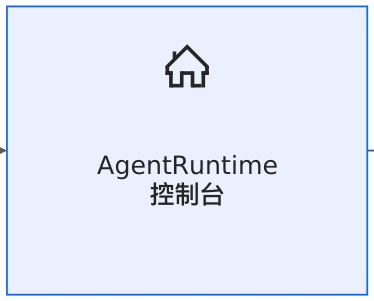

   

   

   资源管理

   集群管理

   接入集群

   导入K8s并纳入算力节

2. 完成存储、网关、域名、监控和镜像源配置。在集群详情页完成底座运维配置，包括：存储（S3 兼容对象存储）、网关、域名、监控、镜像源。更多详情请参见集群。

   

   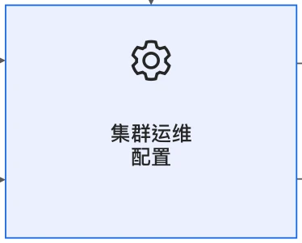

   

   

   

   

   底座配置中心

3. 了解集群运行情况、节点状态、关联信息。通过集群详情页掌握整体运行状态，查看运行情况、节点状态、关联资源，以及算力池节点的资源运行趋势，确保集群水位健康、资源就绪。更多详情请参见集群。

   

   - 运行正常

     - 3/3 节点

   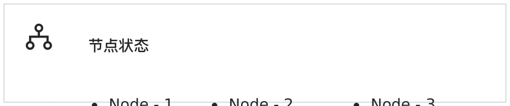

   - Node - 1

     - Node - 2

       - Node - 3

   

**高代码Agent**

在**快速上手**区域的**高代码Agent**页签，可以进行以下操作。

1. 代码创建Agent

   进入**Agent**，选择**创建Agent > 代码创建**，填写自定义镜像或上传代码包，完成部署上线。更多详情请参见代码创建Agent。

   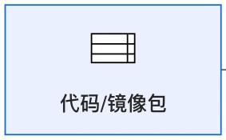

   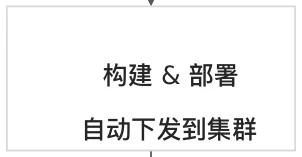

   

   Agent

2. 弹性 & 隔离策略

   在 Agent 详情页或部署页配置弹性策略（最小/最大实例数、并发度、冷却时间等）与隔离策略，确保服务高可用与资源隔离。更多详情请参见代码创建Agent。

   

   

3. 版本管理与灰度发布

   在 Agent 详情页**发布管理**页签创建不可变版本与 Endpoint，通过设置流量比例实现灰度发布，异常时随时调回旧版本流量。更多详情请参见发布管理。

   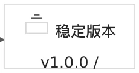

   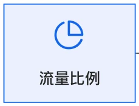

   80%

   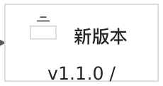

4. 协议声明与集成调用

   在**配置与调试**页签开启 A2A 等对外协议开关；在**集成**页签获取 PYTHON / CURL / ZeroCodeAgent调用样例，复制 ENDPOINT 与 TOKEN 即可接入。更多详情请参见配置与调试和集成。

   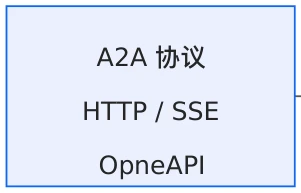

   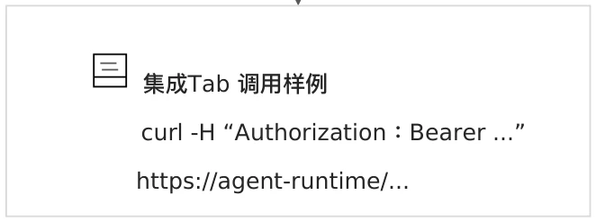

**All-in-one沙箱**

在**快速上手**区域的**All-in-one沙箱**页签，可以进行以下操作。

1. 创建 All-in-one 沙箱

   进入**工具 > 创建工具 > 系统工具**，选择**AllInOne 沙箱**完成创建。该沙箱组合了代码解析、浏览器、文件系统、GUI 四类能力，作为工具服务运行在集群中。更多详情请参见创建系统工具。

   

   

   All-in-One 沙箱

   

   

2. 创建低码 Agent 并绑定沙箱工具

   进入**Agent**，选择**创建Agent > 快速创建**，按表单填写提示词、选择模型服务、配置工具时勾选上一步创建的 AllInOne 沙箱，完成 Agent 与沙箱能力的绑定。更多详情请参见快速创建Agent。

   

   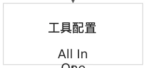

   One

   

3. 调试与发布

   在 Agent 详情页的**配置与调试**页签进行在线调试，确认无误后在**发布版本**页签发布版本并生成Endpoint，即可对外提供服务。更多详情请参见配置与调试和发布管理。

   

   用户：“帮我分析这份报告”

   Agent：“正在调用沙箱工具”

   

   d

   i

4. 调用与集成

   在 Agent 详情页的**集成**页签获取 PYTHON / CURL 调用样例，复制 ENDPOINT 与 TOKEN 后即可在自己的应用中调用该 Agent。更多详情请参见集成。

   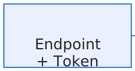

   

   import

   agentruntime

**产品文档**

**手册**

在**产品文档**的**手册**区域，可以查看以下手册。

- 产品简介：产品定位、核心能力与适用场景。

- 用户指南：运行时、沙箱、工具与凭证的操作说明。

- 开发手册（OpenAPI）：OpenAPI 接口说明、认证方式与调用示例。

- 运维部署：集群纳管、部署升级与环境要求。

**产品动态**

在**产品文档**的**产品动态**区域，可以查看以下动态。

- Scale-to-Zero 上线：按消费者设定用量上限，超额自动拦截。

- E2B 兼容沙箱：Anthropic/Bedrock 原生支持。

- GPU 弹性调度支持 ≤7B 模型：AI 请求/响应内容合规审核。

- All-in-One 工具集成：支持 HTTP/OTLP/Kafka 三通道输出。

**最佳实践**

- Python 数据分析 Agent：支持多种 AI 模型与服务接入，提供标准化 API 接口。

- NumPy 数值计算：基于策略与负载的智能路由分发，提升调用效率。

- 安全防护 Docker 容器部署：多层安全机制，保障数据安全与接口调用合规。

- Playwright 浏览器自动化：多层安全机制，保障数据安全与接口调用合规。

<a id="section-4"></a>

# 4.运行时和沙箱

<a id="section-4-1"></a>

## 4.1. Agent

统一构建、部署与运行你的智能体。支持代码创建与快速创建两种方式，每个 Agent 运行在会话级隔离沙箱中，按流量秒级弹性伸缩、闲时可缩容至零。

**创建方式**

Agent创建方式分为以下两种：

- 快速创建Agent

- 代码创建Agent

**流程概览**

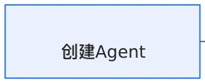

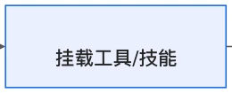

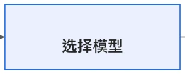


<a id="section-4-1-1"></a>

### 4.1.1. 快速创建Agent

AgentRuntime是一个面向智能体（Agent）全生命周期管理的一站式开发与运行平台，若您是初次使用或需要快速验证想法，推荐选择快速创建方式。通过可视化界面配置Agent，无需编写代码，适合快速原型开发。

**创建Agent**

1. 登录AgentRuntime控制台。

2. 在左侧导航，单击**运行时和沙箱 > Agent**。

3. 在**Agent列表**页面，单击**创建Agent**。

4. 在**创建Agent**页面，可以选择**快速创建**方式，填写以下配置项，单击**开始创建**。

   <table>
     <tr>
       <th>配置项</th>
       <th>描述</th>
       <th>示例值</th>
     </tr>
     <tr>
       <td colspan="3">区域配置</td>
     </tr>
     <tr>
       <td>组织</td>
       <td>请选择组织。</td>
       <td>DefaultOrganization</td>
     </tr>
     <tr>
       <td>资源集</td>
       <td>请选择资源集。</td>
       <td>ResourceSet（DefaultOrganiz ation）</td>
     </tr>
     <tr>
       <td colspan="3">基本信息</td>
     </tr>
     <tr>
       <td>Agent名称</td>
       <td>集群内的唯一标识，需符合 DNS格式：仅支持小写字母、数字和短横线（-），且必须以字母或数字开头和结尾。创建后不可修改。</td>
       <td>my-chat-agent</td>
     </tr>
     <tr>
       <td>显示名称</td>
       <td>用于前端展示的友好名称，支持中文和特殊字符。</td>
       <td>智能客服助手</td>
     </tr>
     <tr>
       <td>描述</td>
       <td>记录 Agent 的用途、能力或备注信息。</td>
       <td>基于qwen-plus的多轮对话客服Agent，支持工具调用。</td>
     </tr>
     <tr>
       <td colspan="3">资源配置</td>
     </tr>
     <tr>
       <td>选择集群</td>
       <td>集群算力池中有可用节点时才能选择。请选择集群，如果无可用集群请参见接入集群。</td>
       <td>无</td>
     </tr>
     <tr>
       <td>命名空间</td>
       <td>选择集群所在的命名空间。</td>
       <td>无</td>
     </tr>
     <tr>
       <td>CPU配额</td>
       <td>选择CPU配额。单个工具实例的CPU 上限（limits）。平台会自动设置 requests 为限制值的1/4（如配额 1 核，requests 为0.25 核）。浏览器类工具建议 1核及以上。</td>
       <td>1核</td>
     </tr>
     <tr>
       <td>内存配额</td>
       <td>单个 Agent 实例的内存上限（limits）。平台会自动设置requests 为限制值的 1/4（如配额 1Gi，requests 为 256Mi）。建议至少 512Mi，加载大模型SDK 或处理大文件时建议 1Gi 及以上。</td>
       <td>1024Mi</td>
     </tr>
     <tr>
       <td>临时存储空间</td>
       <td>容器内临时磁盘空间上限（limits），平台会自动设置requests 为限制值的 1/4。Pod重启后数据丢失，如需持久化数据请在高级配置中启用存储。</td>
       <td>4Gi</td>
     </tr>
     <tr>
       <td colspan="3">模型配置</td>
     </tr>
     <tr>
       <td>模型服务</td>
       <td>请选择模型，如果无可用模型请参见模型接入。</td>
       <td>无</td>
     </tr>
     <tr>
       <td>系统提示词</td>
       <td>请输入系统提示词，引导模型输出。</td>
       <td>无</td>
     </tr>
     <tr>
       <td colspan="3">工具配置</td>
     </tr>
     <tr>
       <td>选择工具</td>
       <td>请选择工具，如果无可用工具请参见创建系统工具或创建自定义工具。</td>
       <td>无</td>
     </tr>
     <tr>
       <td colspan="3">技能配置</td>
     </tr>
     <tr>
       <td>选择技能</td>
       <td>请选择技能，单击<strong>添加技能</strong>，在<strong>添</strong><strong>加技能</strong>页面可根据<strong>技能名称</strong>进行检索，选择目标技能，如果无可用技能请参见创建技能。<br>单击技能卡片右上角选择目<br>标技能，可选择技能版本。<br>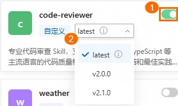<br>说明在<strong>添加技能</strong>页面，单击底部的<strong>默认选择的latest版本</strong>，将所选技能的版本号全部设置为latest版本。</td>
       <td>无</td>
     </tr>
     <tr>
       <td colspan="3">高级配置 &gt; 存储配置 &gt; 对象存储<br>说明启用持久化存储后，会话历史、沙箱文件等数据将保存到存储，Pod 重启或扩缩容后数据不会丢失。多副本部署时建议选择<strong>多实例读写</strong>模式。</td>
     </tr>
     <tr>
       <td>存储桶名称</td>
       <td>存储桶名称，默认使用集群配置的存储桶，可按需修改。</td>
       <td>bucket-name</td>
     </tr>
     <tr>
       <td>读写模式</td>
       <td>请选择读写模式。<br>• <strong>多实例读写（推荐）</strong>：多副本部署时请选择，以确保所有实例都能读写数据。<br>• 单实例读写<br>• 多实例只读</td>
       <td>多实例读写</td>
     </tr>
     <tr>
       <td>存储目录</td>
       <td>出于性能与数据安全治理角度出发，Agent的存储目录路径必须严格限制含有相应的Agent名称，例：/agent-name。</td>
       <td>tool-name</td>
     </tr>
     <tr>
       <td>容器内路径</td>
       <td>存储挂载到容器内的路径，应用通过此路径读写持久化数据。</td>
       <td>/workspace</td>
     </tr>
     <tr>
       <td colspan="3">高级配置 &gt; 存储配置 &gt; 文件存储<br>说明启用持久化存储后，会话历史、沙箱文件等数据将保存到存储，Pod 重启或扩缩容后数据不会丢失。</td>
     </tr>
     <tr>
       <td>基础路径</td>
       <td>默认为根路径，不可修改。</td>
       <td>/</td>
     </tr>
     <tr>
       <td>读写模式</td>
       <td>默认为多实例读写，不可修改。</td>
       <td>多实例读写</td>
     </tr>
     <tr>
       <td>子目录</td>
       <td>请输入子目录。</td>
       <td>无</td>
     </tr>
     <tr>
       <td>容器内路径</td>
       <td>请输入容器内路径路径。</td>
       <td>无</td>
     </tr>
     <tr>
       <td colspan="3">高级配置 &gt; 实例隔离策略</td>
     </tr>
     <tr>
       <td>隔离策略</td>
       <td>请选择隔离策略。决定请求如何分配到实例。<br>• <strong>共享模式（shared）</strong>：多个用户会话共享同一实例，资源利用率高，适合无状态或轻量有状态场景。<br>• <strong>独占模式(isolated)</strong>：每个用户会话独占一个实例，会话间完全隔离，适合需要独立运行环境的场景（如沙箱、代码执行）。</td>
       <td>独占模式</td>
     </tr>
     <tr>
       <td>单实例最大会话数</td>
       <td>仅共享模式生效。单个实例同时承载的最大会话数，超出后将触发扩容或排队。独占模式下固定为1。<strong>隔离策略</strong>选择<strong>共享模式</strong>显示。取值范围：[0,2000]。</td>
       <td>100</td>
     </tr>
     <tr>
       <td colspan="3">高级配置 &gt; 弹性策略</td>
     </tr>
     <tr>
       <td>最小实例数</td>
       <td>仅共享模式生效。缩容下限。系统保证运行中的实例数不低于此值。设为 0 表示允许缩容到零（无流量时不保留实例）。取值范围：[0,2000]。</td>
       <td>0</td>
     </tr>
     <tr>
       <td>最大实例数</td>
       <td>扩容上限。系统保证运行中的实例数不超过此值。取值范围：[0,2000]。</td>
       <td>100</td>
     </tr>
     <tr>
       <td>冷却时间（秒）</td>
       <td>当实例并发/请求量下降时，系统不会立即缩减实例数，而是等待该冷却时间过后，才执行缩容。在冷却时间窗口内，系统会保持窗口期内的实例数不变。单位：秒。取值范围：[0,86400]。</td>
       <td>300</td>
     </tr>
     <tr>
       <td>优雅停止时间（秒）</td>
       <td>当缩容或更新发生时，系统在发送终止信号后，会等待该时间让服务完成正在处理的请求，超过此时间后将强制终止。</td>
       <td>60</td>
     </tr>
     <tr>
       <td colspan="3">高级配置 &gt; 快照策略<br>说明请先选择集群，再配置快照策略。当前集群若未安装快照组件，请<strong>单击安装</strong>，更多详情请参见集群组件管理。</td>
     </tr>
     <tr>
       <td>创建热启动快照（GoldenCheckpoint）</td>
       <td>部署完成后系统会自动在(Revision) 粒度打一次基线快照，后续 KPA 缩容与冷启动均基于该快照。<br>• 开启<br>• 关闭</td>
       <td>开启</td>
     </tr>
     <tr>
       <td>最多保留快照数</td>
       <td>超过该数量后按创建时间淘汰最旧的非基线快照。<br>说明当<strong>创建热启动快照</strong>（GoldenCheckpoint）为开启时显示。</td>
       <td>3</td>
     </tr>
   </table>

   <table>
     <tr>
       <td>可观测探针设置</td>
       <td>当集群开启了可观测配置性后，默认显示注入状态为<strong>注入探针</strong>，可在Agent 详情页的<strong>可观测性</strong>页签查看。<br>• 注入探针<br>• 不注入探针<br>说明当前注入的探针暂不支持自动采集应用日志。</td>
       <td>注入探针</td>
     </tr>
   </table>

<a id="section-4-1-2"></a>

### 4.1.2. 代码创建Agent

AgentRuntime是一个面向智能体（Agent）全生命周期管理的一站式开发与运行平台。若需要实现复杂的业务逻辑或与现有系统深度集成，建议选择代码创建方式。使用Python或JavaScript编写Agent逻辑，实现更复杂的业务需求。

**创建Agent**

1. 登录AgentRuntime控制台。

2. 在左侧导航，单击**运行时和沙箱 > Agent**。

3. 在**Agent列表**页面，单击**创建Agent**。

4. 在**创建Agent**页面，选择**代码创建**方式，填写以下配置项，单击**开始创建**。

   <table>
     <tr>
       <th>配置项</th>
       <th>描述</th>
       <th>示例值</th>
     </tr>
     <tr>
       <td colspan="3">区域配置</td>
     </tr>
     <tr>
       <td>组织</td>
       <td>请选择组织。</td>
       <td>DefaultOrganization</td>
     </tr>
     <tr>
       <td>资源集</td>
       <td>请选择资源集。</td>
       <td>ResourceSet（DefaultOrganiz ation）</td>
     </tr>
     <tr>
       <td colspan="3">基本信息</td>
     </tr>
     <tr>
       <td>Agent名称</td>
       <td>集群内的唯一标识，需符合 DNS格式：仅支持小写字母、数字和短横线（-），且必须以字母或数字开头和结尾。创建后不可修改。</td>
       <td>my-chat-agent</td>
     </tr>
     <tr>
       <td>显示名称</td>
       <td>用于前端展示的友好名称，支持中文和特殊字符。</td>
       <td>智能客服助手</td>
     </tr>
     <tr>
       <td>描述</td>
       <td>记录 Agent 的用途、能力或备注信息。</td>
       <td>基于qwen-plus的多轮对话客服Agent，支持工具调用。</td>
     </tr>
     <tr>
       <td colspan="3">资源配置</td>
     </tr>
     <tr>
       <td>集群</td>
       <td>集群算力池中有可用节点时才能选择。请选择集群。如果无可用集群请参见接入集群。</td>
       <td>无</td>
     </tr>
     <tr>
       <td>命名空间</td>
       <td>选择集群所在的命名空间。</td>
       <td>无</td>
     </tr>
     <tr>
       <td>CPU配额</td>
       <td>选择CPU配额。单个工具实例的CPU 上限（limits）。平台会自动设置 requests 为限制值的1/4（如配额 1 核，requests 为0.25 核）。浏览器类工具建议 1核及以上。</td>
       <td>1核</td>
     </tr>
     <tr>
       <td>内存配额</td>
       <td>单个 Agent 实例的内存上限（limits）。平台会自动设置requests 为限制值的 1/4（如配额 1Gi，requests 为 256Mi）。建议至少 512Mi，加载大模型SDK 或处理大文件时建议 1Gi 及以上。</td>
       <td>1024Mi</td>
     </tr>
     <tr>
       <td>临时存储空间</td>
       <td>容器内临时磁盘空间上限（limits），平台会自动设置requests 为限制值的 1/4。Pod重启后数据丢失，如需持久化数据请在高级配置中启用存储。</td>
       <td>4Gi</td>
     </tr>
     <tr>
       <td colspan="3">制品配置</td>
     </tr>
     <tr>
       <td>制品类型</td>
       <td>请选择制品类型。<br>• 上传代码<br>• 镜像地址</td>
       <td>上传代码</td>
     </tr>
   </table>

   <table>
     <tr>
       <td>代码上传方式</td>
       <td>请选择代码上传方式。<br>• 文件上传<br>• URL上传<br>说明<strong>制品类型</strong>选择<strong>上传代码</strong>时显示。</td>
       <td>文件上传</td>
     </tr>
     <tr>
       <td>上传代码</td>
       <td>拖拽文件到指定位置，单击上传，支持.tar，.gzip，.gz，.tar.gz，.tg z，.zip格式。<br>说明<strong>制品类型</strong>选择<strong>上传代码</strong>并且<strong>代</strong><strong>码上传方式</strong>选择<strong>文件上传</strong>时显示。</td>
       <td>无</td>
     </tr>
     <tr>
       <td>代码包地址</td>
       <td>请输入代码包路径。<br>说明<strong>制品类型</strong>选择<strong>上传代码</strong>，并且<strong>代码上传方式</strong>选择<strong>URL上</strong><strong>传</strong>时显示。</td>
       <td>http://xxx/xxx.zip</td>
     </tr>
   </table>

   <table>
     <tr>
       <td>运行时环境</td>
       <td>请选择选择与 Agent 代码语言匹配的运行时环境。如 Python Agent 选择 Python 3.x，Java Agent 选择对应 JDK 版本。<br>• Java8<br>• Java11<br>• Java17<br>• Java21<br>• Java25<br>• Node.js 18<br>• Node.js 20<br>• Node.js 22<br>• Python 3.10<br>• Python 3.12<br>• 自定义<br>说明<strong>制品类型</strong>选择<strong>上传代码</strong>时显示。</td>
       <td>Node.js 18</td>
     </tr>
     <tr>
       <td>启动命令</td>
       <td>请输入启动命令，容器启动时执行的命令，需确保能正确启动 Agent服务并监听访问配置中指定的端口。</td>
       <td><code> sh start.sh </code>或<code> python -</code><code>m uvicorn app:app --host</code><br><code>0.0.0.0 --port 8080</code></td>
     </tr>
     <tr>
       <td>镜像仓库类型</td>
       <td>请选择镜像仓库类型。<br>• 自定义<br>• ACR<br>说明<strong>制品类型</strong>选择<strong>镜像地址</strong>时显示。</td>
       <td>ACR</td>
     </tr>
     <tr>
       <td>镜像地址</td>
       <td>请输入镜像地址。<br>说明<br>• <strong>制品类型</strong>选择<strong>上传代</strong><strong>码</strong>，且<strong>运行时选择</strong>选择<strong>自定义</strong>时显示。<br>• <strong>制品类型</strong>选择<strong>镜像地</strong><strong>址</strong>时显示。</td>
       <td>registry.example.com/image:t ag</td>
     </tr>
     <tr>
       <td colspan="3">技能配置</td>
     </tr>
     <tr>
       <td>选择技能</td>
       <td>请选择技能，单击<strong>添加技能</strong>，在<strong>添</strong><strong>加技能</strong>页面可根据<strong>技能名称</strong>进行检索，选择目标技能，如果无可用技能请参见创建技能。<br>单击技能卡片右上角选择目<br>标技能，可选择技能版本。<br><br>说明在<strong>添加技能</strong>页面，单击底部的<strong>默认选择的latest版本</strong>，将所选技能的版本号全部设置为latest版本。</td>
       <td>无</td>
     </tr>
     <tr>
       <td>技能挂载路径</td>
       <td>技能包在容器内的挂载路径，默认为 <code> /app/skills/ </code>。</td>
       <td>/app/skills/</td>
     </tr>
     <tr>
       <td colspan="3">访问配置</td>
     </tr>
     <tr>
       <td>端口号</td>
       <td>请输入端口号。Agent 服务监听的端口号，需与代码中实际监听端口一致。</td>
       <td>80</td>
     </tr>
     <tr>
       <td>协议类型</td>
       <td>请选择协议类型。Agent 服务的通信协议，需与代码中的服务协议匹配。<br>• HTTP<br>• HTTPS<br>• SSH<br>• VNC</td>
       <td>HTTP</td>
     </tr>
     <tr>
       <td>访问凭证</td>
       <td>请选择访问凭证。用于 Agent API认证的 Kubernetes Secret。需提前在集群中创建，包含认证所需的 key-value 对。如果无可用凭证请参见创建凭证。</td>
       <td>无</td>
     </tr>
     <tr>
       <td colspan="3">环境变量配置</td>
     </tr>
     <tr>
       <td>环境变量</td>
       <td>单击添加，请输入<strong>变量名</strong>和<strong>变量</strong><strong>值</strong>。</td>
       <td>无</td>
     </tr>
     <tr>
       <td colspan="3">高级配置 &gt; 存储配置 &gt; 对象存储<br>说明启用持久化存储后，会话历史、沙箱文件等数据将保存到存储，Pod 重启或扩缩容后数据不会丢失。多副本部署时建议选择<strong>多实例读写</strong>模式。</td>
     </tr>
     <tr>
       <td>存储桶名称</td>
       <td>存储桶名称，集群当前实际生效的配置，可按需修改。</td>
       <td>bucket-name</td>
     </tr>
     <tr>
       <td>读写模式</td>
       <td>请选择读写模式。<br>• <strong>多实例读写（推荐）</strong>：多副本部署时请选择，以确保所有实例都能读写数据。<br>• 单实例读写<br>• 多实例只读</td>
       <td>多实例读写</td>
     </tr>
     <tr>
       <td>存储目录</td>
       <td>出于性能与数据安全治理角度出发，Agent的存储目录路径必须严格限制含有相应的Agent名称，例：/agent-name。</td>
       <td>agent-name</td>
     </tr>
     <tr>
       <td>容器内路径</td>
       <td>存储挂载到容器内的路径，应用通过此路径读写持久化数据。</td>
       <td>/workspace</td>
     </tr>
     <tr>
       <td colspan="3">高级配置 &gt; 存储配置 &gt; 文件存储<br>说明启用持久化存储后，会话历史、沙箱文件等数据将保存到存储，Pod 重启或扩缩容后数据不会丢失。</td>
     </tr>
     <tr>
       <td>基础路径</td>
       <td>默认为根路径，不可修改。</td>
       <td>/</td>
     </tr>
     <tr>
       <td>读写模式</td>
       <td>默认为多实例读写，不可修改。</td>
       <td>多实例读写</td>
     </tr>
     <tr>
       <td>子目录</td>
       <td>请输入子目录。</td>
       <td>无</td>
     </tr>
     <tr>
       <td>容器内路径</td>
       <td>请输入容器内路径路径。</td>
       <td>无</td>
     </tr>
     <tr>
       <td colspan="3">高级配置 &gt; 实例隔离策略</td>
     </tr>
     <tr>
       <td>隔离策略</td>
       <td>请选择隔离策略。决定请求如何分配到实例。<br>• <strong>共享策略</strong>：多个用户会话共享同一实例，资源利用率高，适合无状态或轻量有状态场景。<br>• <strong>独占模式</strong>：每个用户会话独占一个实例，会话间完全隔离，适合需要独立运行环境的场景（如沙箱、代码执行）。</td>
       <td>独占模式</td>
     </tr>
     <tr>
       <td>单实例最大会话数</td>
       <td>仅共享模式生效。单个实例同时承载的最大会话数，超出后将触发扩容或排队。独占模式下固定为1。<strong>隔离策略</strong>选择<strong>共享模式</strong>显示。取值范围：[0,2000]。</td>
       <td>100</td>
     </tr>
     <tr>
       <td colspan="3">高级配置 &gt; 弹性策略</td>
     </tr>
     <tr>
       <td>最小实例数</td>
       <td>仅共享模式生效。缩容下限。系统保证运行中的实例数不低于此值。设为 0 表示允许缩容到零（无流量时不保留实例）。取值范围：[0,2000]。</td>
       <td>0</td>
     </tr>
     <tr>
       <td>最大实例数</td>
       <td>扩容上限。系统保证运行中的实例数不超过此值。取值范围：[0,2000]。</td>
       <td>100</td>
     </tr>
     <tr>
       <td>冷却时间（秒）</td>
       <td>当实例并发/请求量下降时，系统不会立即缩减实例数，而是等待该冷却时间过后，才执行缩容。在冷却时间窗口内，系统会保持窗口期内的实例数不变。单位：秒。取值范围：[0,86400]。</td>
       <td>300</td>
     </tr>
     <tr>
       <td>优雅停止时间（秒）</td>
       <td>当缩容或更新发生时，系统在发送终止信号后，会等待该时间让服务完成正在处理的请求，超过此时间后将强制终止。</td>
       <td>60</td>
     </tr>
     <tr>
       <td colspan="3">高级配置 &gt; 日志服务</td>
     </tr>
     <tr>
       <td>日志项目</td>
       <td>SLS 日志服务的 Project 名称，需提前在日志服务控制台创建。</td>
       <td>my-tool-logs</td>
     </tr>
     <tr>
       <td>日志库</td>
       <td>SLS 日志服务的 Logstore 名称，用于存储工具运行日志。</td>
       <td>tool-access-log</td>
     </tr>
     <tr>
       <td>日志类型</td>
       <td>请选择日志类型。<br>• 文件<br>• 标准输出</td>
       <td>文件</td>
     </tr>
     <tr>
       <td>日志路径</td>
       <td>请根据日志类型写日志路径。<br>• <strong>文件</strong>：请输入日志路径。<br>• <strong>标准输出</strong>：stdout。</td>
       <td>/var/log/app.log</td>
     </tr>
     <tr>
       <td>可观测探针设置</td>
       <td>若集群关闭了可观测性配置，探针注入状态选择置灰。当集群开启了可观测性配置，探针注入策略如下：<br>• 制品类型选择<strong>上传代码</strong>且使用平台<strong>运行时环</strong><strong>境</strong>（Python/Java/Node.js）时，系统自动注入可观测探针。<br>• 制品类型选择<strong>上传代码</strong>且使用自定义<strong>运行时环境</strong>时，探针注入行为取决于自定义运行环境是否支持探针注入。<br>• 制品类型选择<strong>镜像地址</strong>时，系统不自动注入探针，需在镜像中自行集成可观测 探针。<br>说明探针仅启用标准 HTTP 自动埋点。</td>
       <td>注入探针</td>
     </tr>
     <tr>
       <td colspan="3">健康检查</td>
     </tr>
     <tr>
       <td>检查路径</td>
       <td>工具提供的健康检查 HTTP 端点路径，需返回 2xx 状态码表示健康。</td>
       <td>/fastapi/health</td>
     </tr>
     <tr>
       <td>端口</td>
       <td>健康检查请求的目标端口，通常与访问配置中的端口号一致。</td>
       <td>80</td>
     </tr>
     <tr>
       <td>检查间隔（秒）</td>
       <td>两次健康检查之间的间隔秒数。过短会增加工具负载，建议 5-30秒。</td>
       <td>5</td>
     </tr>
     <tr>
       <td>检查超时（秒）</td>
       <td>单次健康检查的超时秒数，超时视为不健康。建议不超过检查间隔。</td>
       <td>3</td>
     </tr>
     <tr>
       <td colspan="3">高级配置 &gt; 快照策略<br>说明<br>• 请先选择集群，再配置快照策略。<br>• 当前集群若未安装 ArtSandbox 组件，请<strong>单击安装</strong>，更多详情请参见集群组件管理。</td>
     </tr>
     <tr>
       <td>创建热启动快照（GoldenCheckpoint）</td>
       <td>部署完成后系统会自动在(Revision) 粒度打一次基线快照，后续 KPA 缩容与冷启动均基于该快照。<br>• 开启<br>• 关闭</td>
       <td>开启</td>
     </tr>
     <tr>
       <td>最多保留快照数</td>
       <td>超过该数量后按创建时间淘汰最旧的非基线快照。<br>说明当<strong>创建热启动快照</strong>（GoldenCheckpoint）为开启时显示。</td>
       <td>3</td>
     </tr>
   </table>

> **说明**
>
> 编辑 Agent 时，编辑表单中显示当前探针的注入状态。修改制品类型或运行环境后，探针注入状态将根据新的配置自动更新。探针注入状态可在 Agent 详情页的**配置与调试**页签中查看。

<a id="section-4-1-3"></a>

### 4.1.3. 更多操作

本文档全面介绍了AgentRuntime平台中 Agent 的全生命周期管理与集成能力，涵盖从配置、调试、发布、监控到删除的完整操作流程。

**前置条件**

- 已创建Agent。

- 进行技能配置，需要开启技能管理菜单权限。

**Agent详情**

1. 登录AgentRuntime控制台。

2. 在左侧导航，单击**运行时和沙箱 > Agent**。

3. 在**Agent列表**页面，可以根据**显示名称**、**Agent名称**、**类型**、**状态**或**集群名称**搜索Agent信息。单击**高级筛选**，可以根据**显示名称**、**Agent名称**、**类型**、**状态**和**集群名称**组合搜索Agent信息。

4. 在**Agent列表**页面，可以查看**显示名称/ID**、**Agent名称**、**描述**、**状态**、**类型**、**集群名称/ID**、**命名空间**、**最新版本**、**创建时间**和**更新时间**等信息。

5. 在**Agent列表**页面，单击目标Agent的**显示名称/ID**或者**操作**列的**详情**，进入到Agent详情页面。

   **概览**

   在Agent详情页的**概览**页签，可以查看Agent以下配置信息。

   - 在**基本信息**区域，可以查看**Agent ID**、**Agent名称**、**显示名称**、**状态**、**创建时间**、**最后更新时间**和**描述**信息。

   - 在**资源配置**区域，可以查看**集群**、**命名空间**、**CPU配额**、**内存配额**和**临时存储空间**等信息。

   - 在**制品配置**区域，可以查看**制品类型**、**代码包URL**、**运行时环境**和**启动命令**等信息。

   - 在**技能配置**区域，可以查看**技能挂载路径**、**技能名称**和**版本**等信息。

   - 在**访问配置**区域，可以查看**端口号**和**访问凭证**等信息。

   - 在**实例隔离策略**区域，可以查看**隔离策略**、**单实例最大会话数**和**会话空闲时间**等信息。

   - 在**弹性策略**区域，可以查看**最小实例数**、**最大实例数**、**冷却时间**和**优雅停止时间**等信息。

   - 在**快照策略**区域，可以查看<strong>创建热启动快照（GoldenCheckpoint）</strong>和**最多保留快照数**等信息。

   - 在**环境变量**配置区域，可以查看**变量名**和**变量值**等信息。

   - 在**存储配置**区域，如果存储类型为**对象存储**，可以查看**存储桶名称**、**读写模式**、**储存目录**和**容器内路径**等信息。如果存储类型为文件存储，可以查看**存储配置名**、**读写模式**、**子目录**和**容器内路径**等信息。

   - 在**日志服务**区域，可以查看**日志项目**、**日志库**、**日志类型**和**日志路径**等信息。

   - 在**健康检查**区域，可以查看**检查路径**、**端口**、**检查间隔**和**检查超时**等信息。

   - 在**快速访问配置**区域，可以查看**访问端点**和**端口号**等信息。

   - 在**协议声明**区域，可以查看当**前支持的协议**和**协议声明说明**等信息。

   **配置与调试**

   在Agent详情页的**配置与调试**页签，可以根据创建方式不同选择以下调试方式。

   在**配置与调试**页签，可以查看当前 Agent 的可观测性配置状态，包括探针是否已注入等信息。该页签为只读展示，如需修改可观测性配置，请在集群可观测性管理页面进行操作。

   - 快速创建Agent

     如果Agent的创建方式为快速创建，可以配置以下信息进行调试。

     <table>
       <tr>
         <th>配置项</th>
         <th>描述</th>
         <th>示例值</th>
       </tr>
       <tr>
         <td>提示词/Prompt</td>
         <td>请输入系统提示词，引导模型输出。</td>
         <td>你是个助手</td>
       </tr>
       <tr>
         <td colspan="3">模型服务</td>
       </tr>
       <tr>
         <td>选择模型</td>
         <td>请选择模型，创建模型请参见模型接入。</td>
         <td>qwen</td>
       </tr>
       <tr>
         <td>Temperature</td>
         <td>取值范围[0,1]，不填为模型自身的默认值。</td>
         <td>无</td>
       </tr>
       <tr>
         <td>Max Tokens</td>
         <td>模型的参数，一般指最多输出token数量，填写数字，具体限制看模型供应商限制。</td>
         <td>无</td>
       </tr>
       <tr>
         <td colspan="3">变量管理</td>
       </tr>
     </table>

     变量的Key。

     **变量名称**

     user_name

     变量的Value。

     **默认值**

     zhangsan

     描述变量的用途。

     无

     **描述（可选）**

     **工具配置**

     请选择工具，更多工具信息请参

     无

     **选择工具**

     见工具。

     **技能配置**

     > **说明**
     >
     > 技能管理菜单权限开启时，该功能才会显示。

     单击**技能配置**区域后的**添加技能**，在**添加技能**页面可根据**技能名称**进行检索，选择目标技能，如果无可用技能请参见创建技能。

     单击技能卡片右上角  选择目

     标技能，可选择技能版本。

     

     无

     > **说明**
     >
     > 在**添加技能**页面，单击底部的**默认选择的latest版本**，将所选技能的版本号全部设置为latest版本。

     **添加技能**

     添加完成技能之后，单击右上角的**保存**，在**调试预览**的输入框，选择输入 `/` 可以选择添加完成的技能。

     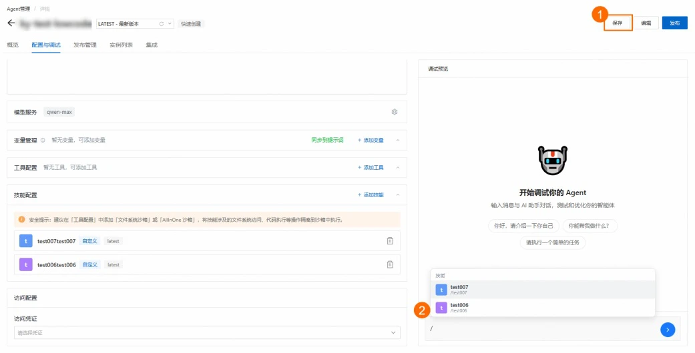

     /

     在**调试预览**区域，输入您遇到的问题，进行调试。

     

     在**轨迹**区域，可以查看调试预览记录信息。

     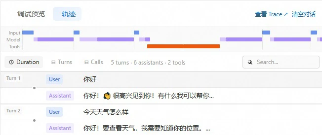

   - 代码创建Agent

     如果Agent的创建方式为代码创建，输入问题进行调试。

     编辑：单击**编辑**，可以修改代码。

     更新：单击**更新**，立即看到修改代码变化。

     下载：单击**下载**，可以下载修改后的代码，如需固化，需要下载代码，使用代码包部署或重新构建镜像后部署。

     

   **发布管理**

   在Agent详情页的**发布管理**页签，可以进行Agent版本管理和Endpoint管理。

   > **说明**
   >
   > 版本一旦创建成功就不能再修改，可以通过输入更大的版本号来区分和升级新版本。

   - 版本管理

     **创建**：在Agent详情页的**发布管理**页签，单击右上角的**发布**，在**发布**对话框中输入以下配置项，单击**确定**。

     | 配置项 | 描述 | 示例值 |
     | --- | --- | --- |
     | 版本号 | 版本号格式：vX.Y.Z。 | v1.0.0 |
     | 版本说明 | 请说明此版本的更新内容。 | 修改CPU配额 |

     **编辑**：在Agent详情页的**发布管理**页签，单击右上角的**编辑**，可以修改Agent的配置项，更多配置项详情请参见快速创建Agent。

     **查看**：在**版本列表**区域，可以查看**版本号**、**版本名称**、**Agent名称**、**版本说明**、**状态**和**创建时间**等信息。

     **克隆**：在**版本列表**区域，单击目标版本操作列的克隆，输入**版本号**和**版本说明**，单击**保存并发布**。

   - Endpoint管理

     **创建**：在工具详情页的**发布管理**页签的**Endpoint管理**区域，单击右上角**创建版本Endpoint**，在**创建版本Endpoint**对话框中输入以下配置项，单击**确定**。

     | 配置项 | 描述 | 示例值 |
     | --- | --- | --- |
     | 名称 | 仅支持小写字母、数字和短横线，且以字母或数字开头和结尾。 | test |
     | 描述 | 请说明此Endpoint的使用对象。 | 开发 |
     | 版本 | 请选择关联的版本。 | v1.0.0 |

     **配置**：在工具详情页的**发布管理**页签的**Endpoint管理**区域，单击生产环境Endpoint的**编辑**，在**配置Endpoint**对话框中选择多个版本设置比例进行流量分配，单击**确定**。

     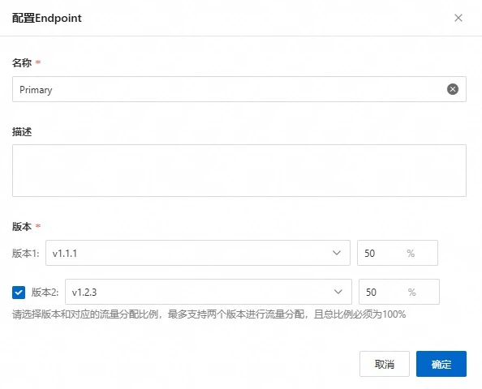

     **删除**：在工具详情页的**版本发布**页签的**Endpoint管理**区域，单击目标Endpoint的**删除**，在**删除**对话框中，单击**确定**。

   **生成技能**

   - **创建技能**

     <ol type="a">

     <li>

     在Agent详情页的**生成技能**页签，单击**创建技能**。

     </li>

     <li>

     在**从Agent创建技能**页面，配置以下参数，单击**生成并发布**。

     <table>
       <tr>
         <th>配置项</th>
         <th>描述</th>
         <th>示例值</th>
       </tr>
       <tr>
         <td colspan="3">技能元数据</td>
       </tr>
       <tr>
         <td>技能名称（name）</td>
         <td>请输入技能名称。技能唯一标识，英文小写+连字符。</td>
         <td>weather-query</td>
       </tr>
       <tr>
         <td>显示名称（showName）</td>
         <td>请输入显示名称。面向用户的展示名。</td>
         <td>天气查询</td>
       </tr>
       <tr>
         <td>行为描述（description）</td>
         <td>请输入行为描述。说明技能能力，写入 SKILL.md 供 Agent决定何时自动加载该技能。</td>
         <td>查询指定城市的实时天气</td>
       </tr>
       <tr>
         <td>标签</td>
         <td>输入后添加标签，最多 5 个。</td>
         <td>工具类、天气</td>
       </tr>
       <tr>
         <td>行为指令（instruction，可选）</td>
         <td>请输入行为指令。用于引导Agent 判断何时触发、如何调用及调用约束（适用场景、参数格式、调用顺序、注意事项等）；留空则仅依据行为描述判断。</td>
         <td>仅当用户明确要求"实时天气"时使用；调用前确认城市名，city传中文全称（如"杭州市"）；不用于历史天气或预报类问题</td>
       </tr>
       <tr>
         <td colspan="3">调用协议<br>说明调用端点默认使用本 Agent 最新已发布版本（latest）的端点，由平台自动解析与路由，无需手动填写。高码（代码创建）Agent 可能未实现所选调用协议，生成的技能可能无法正常调用。可在生成后下载修改技能并重新上传。</td>
       </tr>
       <tr>
         <td>A2A Agent-to-Agent</td>
         <td>使用 A2A 协议建立 Agent 间会话，支持流式输出与多轮交互。</td>
         <td>无</td>
       </tr>
       <tr>
         <td>Chat Completions</td>
         <td>兼容 OpenAI Chat Completions 接口，可被任何支持该协议的客户端调用。</td>
         <td>无</td>
       </tr>
       <tr>
         <td>AGUI</td>
         <td>面向 Agent UI 交互的事件协议，支持丰富的渲染与输入事件。</td>
         <td>无</td>
       </tr>
       <tr>
         <td>AgentScope API</td>
         <td>使用 AgentScope 原生 API 调用 Agent，支持会话上下文与状态管理。</td>
         <td>无</td>
       </tr>
       <tr>
         <td colspan="3">调用协议</td>
       </tr>
       <tr>
         <td>网关访问（推荐）</td>
         <td>通过统一网关调用，集群内外均可访问。</td>
         <td>无</td>
       </tr>
       <tr>
         <td>直连访问</td>
         <td>直接访问集群内部地址，仅同集群网络可用。</td>
         <td>无</td>
       </tr>
     </table>

     </li>

     </ol>

     <ol type="i" start="100">

     <li>

     单击**生成并发布**，在**确认导入版本**页面，配置以下配置项，单击**确定**。

     | 配置项 | 描述 | 示例值 |
     | --- | --- | --- |
     | 版本号 | 请输入版本号，格式：<code> vX.Y.Z </code>。 | v1.0.0 |
     | 版本说明 | 描述此版本的主要变更。 | 无 |

     </li>

     <li value="500">

     在**从Agent创建技能**页面，填写表单后自动生成预览，协议切换时调用脚本会随之变化，可通过**实时预览**进行查看。

     </li>

     </ol>

   - **查询技能**

     在Agent详情页的**生成技能**页签，可以查看已创建技能的**名称**、**显示名称**、**描述**和**创建时间**等信息。

     在Agent详情页的**生成技能**页签的技能列表中，单击目标技能**操作**列的**详情**，在技能详情页，选择版本信息，可以查看**概览**、**SKILL.md**、**文件包**和**版本**页签的信息，更多详情请参见查看技能详情。

   **实例列表**

   在Agent详情页的**实例列表**页签，可以查看**实例ID/名称**、**集群ID/命名空间**、**运行状态**、**CPU使用率**、**内存使用**率、**GPU显存分配量**、**GPU算力分配百分比**、**GPU实时利用率**、**运行时长**、**IP地址**、**主机IP**和**启动时间**等信息。

   在Agent详情页的**实例列表**页签，单击目标实例**操作**列的**详情**，可以查看**实例名称**、**集群ID**、**命名空间**、**运行状态**、**IP地址**、**主机IP** 、**CPU使用量**、**CPU限制**、**内存使用量**、**内存限制**、**GPU 显存分配量**、**GPU 算力分配百分比**、**GPU 实时利用率**、**运行时长**和**启动时间**等信息。

   在Agent详情页的**实例列表**页签，单击目标实例**操作**列的**终端**，在**实例终端**对话框，选择**container**，单击**连接**。

   在Agent详情页的**实例列表**页签，单击目标实例**操作**列的**日志**，在**查看日志**对话框，选择**容器**，查看日志。

   **快照列表**

   在Agent详情页的**快照列表**页签，可以根据**状态**或**关键词**搜索快照信息。单击**高级筛选**，可以根据**状态**和**关键词**组合搜索快照信息。

   在Agent详情页的**快照列表**页签，可以查看**ID/名称**、**关联 Revision**、**大小**、**存储位置**、**状态**和**创建时间**等信息。

   在**快照列表**页签的列表中，单击目标快照**操作**列的**删除**，在二次确认对话框中，单击**确定**。

   **集成**

   在Agent详情页的**集成**页签，可以查看以下集成说明，具体集成操作步骤以控制台为准。

   - Python 集成 Agent：Python 以多种协议访问兼容 AgentScope Runtime 的 Agent。

   - 通过 curl 调用 Agent：通过  `curl`  向兼容 OpenAI 协议的 Agent 发起对话请求。

   - 零码 Agent 集成指南：通过外层 Web 服务集成使用零码 Agent（Zero Code Agent）。

   **身份**

   在Agent详情页的**身份**页签，可以查看**身份信息**、**已分配角色**、**网关访问设置**、**免鉴权URL**和<strong>转发配置（高安全模式）</strong>等信息。

   - 在**身份信息**区域，可以查看**身份标识（URI）**、**鉴权方式**、**JWT状态**和**有效期**等信息。

     > **说明**
     >
     > 调用方在请求中携带平台签发的 JWT 时，网关会将该身份标识注入 X-Agent-Identity 头传递给后端。

   - 在**已分配角色**区域，可以查看**角色名称**、**类型**、**角色ID**等信息。

   - 在**网关访问设置**区域，可以查看访问设置。

     - **网关鉴权（推荐）**：调用方须持有平台签发的 JWT 或 API Key，由网关统一校验身份后转发。

     - **自定义鉴权（网关不推荐）**：网关不校验调用方身份，请求直接转发至后端。适用于后端服务自身已实现鉴权的场景。

   - 在**免鉴权 URL**区域，可以查看免鉴权的当前配置。

     > **说明**
     >
     > 命中以下 URL 的请求将跳过网关身份校验直接转发，适用于静态资源、自带凭证的下载链接等场景。请仅放行确实无需鉴权的路径，免鉴权 URL 不会注入转发鉴权头。

     - **保存**：在输入框输入免鉴权的配置后，单击**保存**。格式：逗号分隔，支持三种形式：\*.后缀（如\*.js）、/前缀\*（如 /filesystem/\*）、/精确路径（如 /download）。总长不超过 256 字符。

     - **清除配置**：单击**清除配置**，清除当前配置。

   - 在<strong>转发配置（高安全模式）</strong>区域，可以查看**请求头名称**和**请求头**的值。

     **适用场景**：后端服务自带鉴权 Token（如 AgentScope 运行时的 SECRET_TOKEN），调用方不持有也无法获取该 Token。配置后，网关在自身鉴权通过时，会将指定请求头统一替换为设定值再转发给后端，调用方原始携带的同名请求头将被移除，不会透传。

     - **请求头名称**

       - Authorization：网关完成调用方鉴权后，会将请求中的 Authorization 头替换为上方设定值再转发给后端。调用方携带的原始 Authorization 不会透传。

       - X-API-Key：网关完成调用方鉴权后，会将请求中的 X-API-Key 头替换为上方设定值再转发给后端。调用方携带的原始 X-API-Key 不会透传。

     - **请求头值**

     - **保存**：在选择**请求头名称**和输入**请求头值**的后，单击**保存**。

     - **清除配置**：单击**清除配置**，清除当前配置。

   **可观测性**

   在Agent详情页的**可观测性**页签，可以查看以下指标信息。

   当集群开启了可观测配置后，在创建Agent时选择是否探针，自动采集可观测数据。单击选择Jaeger UI、Grafana大盘、Loki可跳转，查看来源于注入的探针的可观测数据。

   **应用总览**

   在**应用总览**页签，可以查看以下指标信息：

   <table>
     <tr>
       <th width="121">面板</th>
       <th>说明</th>
     </tr>
     <tr>
       <td>模型调用次数</td>
       <td>应用的大语言模型在指定时间段内被调用的次数。</td>
     </tr>
     <tr>
       <td>Token使用</td>
       <td>应用的Token在指定时间段内被使用的次数。</td>
     </tr>
     <tr>
       <td>Trace数量</td>
       <td>应用在指定时间段产生的调用链数量。</td>
     </tr>
     <tr>
       <td>Span数量</td>
       <td>应用在指定时间段产生的Span数量。</td>
     </tr>
     <tr>
       <td>会话数</td>
       <td>应用在指定时间段产生的会话数量。您需要在相应LLM框架中设置会话才可统计此指标。</td>
     </tr>
     <tr>
       <td>用户数</td>
       <td>应用在指定时间段内的用户数量。您需要在相应LLM框架中设置用户才可统计此指标。</td>
     </tr>
   </table>

   <table>
     <tr>
       <td>操作类型分布</td>
       <td>• <strong>CHAIN</strong>：一种将LLM和其他多个组件连接在一起以实现复杂任务的工具，可能包含Retrieval、Embedding、LLM调用，还可以嵌套Chain等。<br>• <strong>EMBEDDING</strong>：嵌入处理，例如针对文本嵌入大模型的操作，可以根据相似度查询并优化问题。<br>• <strong>RETRIEVER</strong>：一般表示访问向量存储或者数据库获取数据，通常用于补充上下文内容，以提升LLM的响应准确性以及效率。<br>• <strong>RERANKER</strong>：针对输入的多个文档，结合提问内容判断相关性进行排序处理，可能返回TopK的文档作为LLM。<br>• <strong>LLM</strong>：标识对大模型的调用，例如基于SDK或OpenAPI请求不同的大模型进行推理或者文本生成等。<br>• <strong>TOOL</strong>：标识对外部工具的调用，例如可能调用计算器或者请求天气API获取最新的天气情况。<br>• <strong>AGENT</strong>：智能体场景，一种复杂的CHAIN，需要基于大模型的推理结果决策执行下一步，例如可能涉及到LLM以及Tool的多次调用，一步步决策得出最终答案。<br>• <strong>TASK</strong>：标识内部自定义方法，例如可能调用本地的某个Function应用自定义的逻辑。</td>
     </tr>
     <tr>
       <td>Avg LLM call per request</td>
       <td>每次请求平均访问大模型次数。此指标通过将<strong>大模型</strong><strong>调用次数</strong>除以<strong>调用链数量</strong>得到。</td>
     </tr>
     <tr>
       <td>Request数趋势</td>
       <td>LLM应用每分钟的Trace数趋势图。</td>
     </tr>
     <tr>
       <td>模型调用排行 Top5</td>
       <td>LLM应用中被调用次数最多的大语言模型Top5。</td>
     </tr>
     <tr>
       <td>用户请求排行</td>
       <td>LLM应用中发起请求最多的用户Top5。</td>
     </tr>
     <tr>
       <td>会话数趋势</td>
       <td>LLM应用每分钟的会话数趋势图。</td>
     </tr>
   </table>

   **性能分析**

   在**性能分析**页签，可以查看以下指标信息：

   | 面板 | 说明 |
   | --- | --- |
   | 模型调用次数 | 应用在指定时间段内调用大语言模型的次数。 |
   | 模型调用平均耗时 | 应用在指定时间段内调用大语言模型的平均耗时。 |
   | 模型调用错误次数 | 应用在指定时间段内调用大语言模型失败的次数。 |
   | 模型调用次数 | 应用每分钟调用大语言模型的次数。 |
   | 模型调用平均耗时 | 应用每分钟调用大语言模型的平均耗时。 |
   | 模型调用错误次数 | 应用每分钟调用大语言模型失败的次数。 |
   | 模型调用排行（Top5） | 按调用次数从高到低排序，展示调用量最高的前5个模型。 |
   | 模型调用平均耗时排行（Top5） | 按平均耗时从高到低排序，展示耗时最长的前5个模型。 |
   | 模型调用错误排行（Top5） | 按调用错误次数从高到低排序，展示错误率最高的前5个模型。 |
   | 模型调用P99耗时 | 应用调用大语言模型耗时的P99分位数值（即99%的调用耗时小于该值）。 |
   | 模型首次调用平均耗时 | 应用调用大语言模型返回首次调用数据的平均耗时。 |

   **Token分析**

   在**Token分析**页签，可以查看以下指标信息：

   | 面板 | 说明 |
   | --- | --- |
   | Token使用 | 指定时间段内所有模型调用消耗的Token总量。 |
   | 每次LLM调用平均Token数 | 每次模型调用（LLM Call）平均消耗的Token数量。 |
   | 每次请求平均Token数 | 每个用户请求（Request）平均消耗的Token数量。 |
   | Tokens消耗/1m | 每分钟内所有模型调用消耗的Token总量。 |
   | 每次LLM调用平均Token数/1m | 每分钟内每次模型调用平均消耗的Token数量。 |
   | 每次请求平均Token数/0 | 每分钟内每个用户请求平均消耗的Token数量。 |
   | Token使用模型排行（Top5） | 按Token消耗总量从高到低排序，展示Token使用最多的前5个模型。 |
   | Token使用会话排行（Top5） | 按Token消耗总量从高到低排序，展示Token使用最多的前5个会话（Session）。 |
   | Token使用用户排行（Top5） | 按Token消耗总量从高到低排序，展示Token使用最多的前5个用户。 |

   **嵌入分析**

   在**嵌入分析**页签，可以查看以下指标信息：

   | 面板 | 说明 |
   | --- | --- |
   | Embedding次数 | 指定时间段内所有Embedding调用的总次数。 |
   | Embedding平均耗时 | 指定时间段内所有Embedding调用的平均耗时。 |
   | Embedding错误次数 | 指定时间段内所有Embedding调用失败的次数。 |
   | Embedding调用趋势/1m | 每分钟内Embedding调用的总次数。 |
   | Embedding耗时趋势/1m | 每分钟内所有Embedding调用的平均耗时。 |
   | Embedding错误趋势/1m | 每分钟内Embedding调用失败的次数。 |
   | Embedding调用排行（Top5） | 按调用次数从高到低排序，展示调用量最高的前5个Embedding功能或模型。 |
   | Embedding耗时排行（Top5） | 按平均耗时从高到低排序，展示耗时最长的前5个Embedding功能或模型。 |
   | Embedding错误排行（Top5） | 按调用错误次数从高到低排序，展示错误率最高的前5个Embedding功能或模型。 |

   **检索增强**

   在大模型应用中，检索增强（Retrieval-Augmented Generation, RAG） 是一种结合检索（Retrieval）和重排序（Rerank）的技术，用于提升大模型生成内容的相关性和准确性。

   通过监控Retrieval的相关指标，您可以评估检索增强功能的性能、稳定性和效果，为优化大模型应用提供数据支持。

   在**检索增强**页签，可以查看以下指标信息：

   <table>
     <tr>
       <th>面板</th>
       <th>说明</th>
     </tr>
     <tr>
       <td colspan="2">Retrieval</td>
     </tr>
     <tr>
       <td>调用次数</td>
       <td>指定时间段内所有检索操作的调用总次数。</td>
     </tr>
     <tr>
       <td>调用平均耗时</td>
       <td>指定时间段内所有检索操作的平均耗时。</td>
     </tr>
     <tr>
       <td>错误次数</td>
       <td>指定时间段内所有检索调用失败的次数。</td>
     </tr>
     <tr>
       <td>调用次数趋势/1m</td>
       <td>每分钟内检索调用的总次数。</td>
     </tr>
     <tr>
       <td>调用耗时趋势/1m</td>
       <td>每分钟内所有检索调用的平均耗时。</td>
     </tr>
     <tr>
       <td>错误次数趋势/1m</td>
       <td>每分钟内检索调用失败的次数。</td>
     </tr>
   </table>

   **工具调用**

   在大模型应用中，工具调用（Tool Calling） 是指大模型在执行任务时，调用外部工具或API来完成特定功能的过程。这些工具可以是计算器、数据库查询接口、搜索引擎、翻译服务等，用于扩展大模型的能力，使其能够处理更复杂或更具体的任务。

   通过工具调用的监控数据，您可以全面评估大模型应用与外部工具的交互情况，为优化和运维提供数据支持。

   在**工具调用**页签，可以查看以下指标信息：

   | 面板 | 说明 |
   | --- | --- |
   | 调用次数 | 指定时间段内所有工具的调用总次数。 |
   | 调用平均耗时 | 指定时间段内所有工具调用的平均耗时。 |
   | 错误次数 | 指定时间段内所有工具调用失败的次数。 |
   | 调用次数趋势/1m | 每分钟内工具调用的总次数。 |
   | 调用耗时趋势/1m | 每分钟内所有工具调用的平均耗时。 |
   | 错误次数趋势/1m | 每分钟内工具调用失败的次数。 |

   **Metrics**

   在**Metrics**页签，可以通过 Grafana 可观测性监控大盘查看 Agent 的性能指标，可按应用名称过滤。Metrics 数据来源于可观测探针自动注入的 HTTP 标准指标。

   大盘包含以下面板：

   - **HTTP 请求数**：应用在指定时间段内的 HTTP 请求总量。

   - **HTTP 请求延迟**：HTTP 请求的平均响应时间（P50/P90/P99）。

   - **HTTP 错误率**：返回错误状态码的请求占比。

   - **进程资源**：Agent 进程的 CPU 和内存使用情况。

   > **说明**
   >
   > 大盘中的 GenAI 相关面板（调用数、Token 用量、LLM 延迟等）需要应用侧接入 GenAI 埋点SDK 后才会产生数据，探针自动注入仅覆盖标准 HTTP 指标。

   **调用链分析**

   <ol type="i">

   <li>

   在**调用链路分析**页签右上角的时间选择框设置需要查询的时间段。

   </li>

   <li>

   可基于**响应时间**、**请求数**、**异常数**等指标，精准定位目标调用链。

   </li>

   <li>

   单击目标调用链，可以查看**产生时间**、**Span名称**、**主机/IP**、**耗时**和**TraceId**等信息。

   </li>

   <li>

   在调用链列表中，单击目标**TraceId**，进入调用链路详情页面。

   在调用链详情面板可以查看调用链的时间轴、开始时间、总耗时等信息，并且可以展开查看各个Span。

   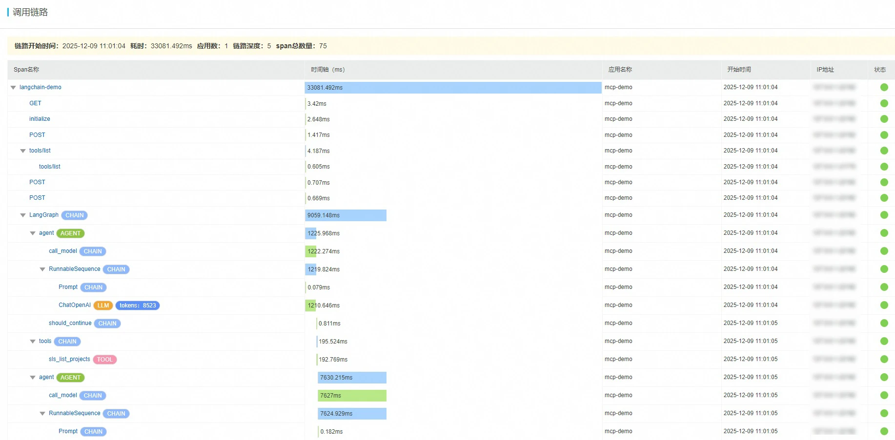

   对于带有 CHAIN、AGENT、LLM等标签的Span节点，您可点击该标签以查看更多AI相关调用信息。

   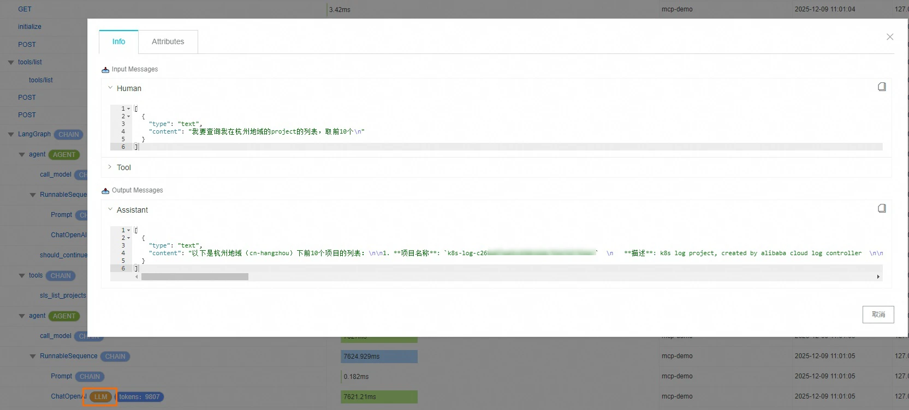

   </li>

   </ol>

   > **说明**
   >
   > 调用链数据来源于可观测探针自动注入，开启可观测性后自动生成，可通过 Jaeger 查看详细调用链路。使用 Python 运行时创建的 Agent，其调用链在 Jaeger 中的展示方式与 Java、Node.js运行时存在差异，不影响链路数据采集的完整性。

   **会话分析**

   <ol type="i">

   <li>

   在**会话分析**页签，可以查看**会话ID**、**耗时**、**Tokens数**、**调用链路**、**用户**和**开始时间**等信息。

   </li>

   <li>

   在会话列表中，单击目标会话的**会话ID**或**操作**列的**详情**，在会话详情页面，可以查看会话的**开始时间**、**模型名称**和**调用链条数**信息。

   </li>

   <li>

   单击目标调用链，可以查看调用链的开始时间、Intput、Output、调用链ID、Tokens数、用户ID和模型名称等信息。

   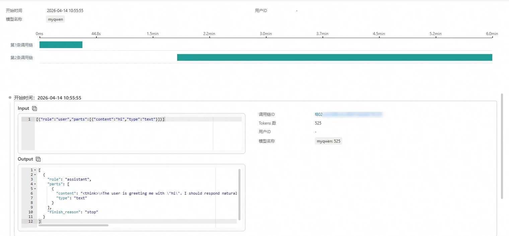

   </li>

   </ol>

**编辑Agent**

1. 登录AgentRuntime控制台。

2. 在左侧导航，单击**运行时和沙箱 > Agent**。

3. 在**Agent列表**页面，单击目标Agent**操作**列的**编辑**，在编辑Agent对话框中，可以修改**显示名称**和**描述**，单击**确定**。

**删除Agent**

1. 登录AgentRuntime控制台。

2. 在左侧导航，单击**运行时和沙箱 > Agent**。

3. 在**Agent列表**页面，单击目标Agent**操作**列的**删除**，在<strong>确认删除该Agent吗？</strong>对话框中，单击**确定**。

<a id="section-4-2"></a>

## 4.2. 工具

为 Agent 扩展外部能力的工具服务。内置浏览器 、文件系统、GUI、All-in-One 等系统工具，也支持OpenAPI / MCP 自定义导入；在隔离沙箱中安全调用，随 Agent 弹性伸缩。

**创建方式**

工具创建方式分为以下两种：

- 创建系统工具

- 创建自定义工具

**流程概览**

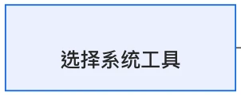

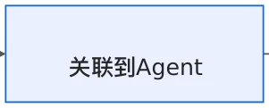


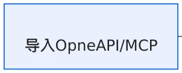

<a id="section-4-2-1"></a>

### 4.2.1. 创建系统工具

AgentRuntime的工具市场提供了丰富的工具，用户可以实现工具的一键部署，快速获取并集成高质量工具，极大提升Agent开发效率，加速业务落地。

**创建系统工具**

1. 登录AgentRuntime控制台。

2. 在左侧导航，单击**运行时和沙箱 > 工具**。

3. 在**工具列表**页面，单击**创建工具**。

4. 在**创建工具**页面的**系统工具**区域，选择合适的工具，单击**创建**。

   | 工具 | 描述 |
   | --- | --- |
   | Agent Harbr | Agent Harbr沙箱。 |
   | AllInOne沙箱 | All In One沙箱，组合了代码解析沙箱、浏览器沙箱、文件系统沙箱和GUI沙箱。 |
   | 基础沙箱 | Python代码与Shell脚本执行。 |
   | 浏览器沙箱 | 浏览器沙箱。 |
   | E2B Sandbox | E2B代码沙箱。 |
   | 文件系统沙箱 | 文件系统沙箱。 |
   | GUI沙箱 | GUI沙箱。 |

5. 在**创建工具**页面，设置以下配置项，单击**创建**。

   <table>
     <tr>
       <th>配置项</th>
       <th>描述</th>
       <th>示例值</th>
     </tr>
     <tr>
       <td colspan="3">区域配置</td>
     </tr>
     <tr>
       <td>组织</td>
       <td>请选择组织。</td>
       <td>DefaultOrganization</td>
     </tr>
     <tr>
       <td>资源集</td>
       <td>请选择资源集。</td>
       <td>ResourceSet（DefaultOrganiz ation）</td>
     </tr>
     <tr>
       <td colspan="3">创建方式</td>
     </tr>
     <tr>
       <td>创建方式选择</td>
       <td>基于预配置模板快速创建系统工具，包括代码解释器、浏览器等。<br>• Agent Harbr<br>• AllInOne沙箱<br>• 基础沙箱<br>• 浏览器沙箱<br>• E2B Sandbox<br>• 文件系统沙箱<br>• GUI沙箱</td>
       <td>基础沙箱</td>
     </tr>
     <tr>
       <td colspan="3">基本信息</td>
     </tr>
     <tr>
       <td>工具名称</td>
       <td>平台内的唯一标识，需符合 DNS格式：仅支持小写字母、数字和短横线（-），且必须以字母或数字开头和结尾，长度为1-32个字符。创建后不可修改。</td>
       <td>tool-name</td>
     </tr>
     <tr>
       <td>显示名称</td>
       <td>用于前端展示的友好名称，支持中文和特殊字符，长度为1-128个字符。</td>
       <td>display_name</td>
     </tr>
     <tr>
       <td>描述</td>
       <td>记录工具的用途和能力，Agent 在选择工具时可能参考此描述。</td>
       <td>无</td>
     </tr>
     <tr>
       <td colspan="3">资源配置</td>
     </tr>
     <tr>
       <td>选择集群</td>
       <td>集群算力池中有可用节点时才能选择。如果无可用集群请参见接入集群。</td>
       <td>无</td>
     </tr>
     <tr>
       <td>命名空间</td>
       <td>选择集群所在的命名空间。</td>
       <td>无</td>
     </tr>
     <tr>
       <td>CPU配额</td>
       <td>单个工具实例的 CPU 上限（limits）。平台会自动设置requests 为限制值的 1/4（如配额 1 核，requests 为 0.25核）。浏览器类工具建议 1 核及以上。</td>
       <td>1核</td>
     </tr>
     <tr>
       <td>内存配额</td>
       <td>单个工具实例的内存上限（limits）。平台会自动设置requests 为限制值的 1/4（如配额 2Gi，requests 为 512Mi）。浏览器类工具建议 2Gi 及以上。</td>
       <td>1024Mi</td>
     </tr>
     <tr>
       <td>临时存储空间</td>
       <td>容器内临时磁盘空间上限（limits），平台会自动设置requests 为限制值的 1/4。Pod重启后数据丢失，如需持久化数据请在高级配置中启用存储。</td>
       <td>4Gi</td>
     </tr>
     <tr>
       <td colspan="3">访问配置</td>
     </tr>
     <tr>
       <td>端口号</td>
       <td>工具服务监听的端口号，需与工具代码中实际监听端口一致。Agent通过此端口与工具通信。</td>
       <td>80</td>
     </tr>
     <tr>
       <td colspan="3">环境变量配置</td>
     </tr>
     <tr>
       <td>环境变量</td>
       <td>单击添加，请输入<strong>变量名</strong>和<strong>变量</strong><strong>值</strong>。</td>
       <td>无</td>
     </tr>
     <tr>
       <td colspan="3">高级配置 &gt; 存储配置 &gt; 对象存储<br>说明启用持久化存储后，会话历史、沙箱文件等数据将保存到存储，Pod 重启或扩缩容后数据不会丢失。多副本部署时建议选择<strong>多实例读写</strong>模式。</td>
     </tr>
     <tr>
       <td>存储桶名称</td>
       <td>存储桶名称，默认使用集群配置的存储桶，可按需修改。</td>
       <td>bucket-name</td>
     </tr>
     <tr>
       <td>读写模式</td>
       <td>请选择读写模式。<br>• <strong>多实例读写（推荐）</strong>：多副本部署时请选择，以确保所有实例都能读写数据。<br>• 单实例读写<br>• 多实例只读</td>
       <td>多实例读写</td>
     </tr>
     <tr>
       <td>存储目录</td>
       <td>出于性能与数据安全治理角度出发，工具的存储目录路径必须严格限制含有相应的工具名称，例：/tool-name。</td>
       <td>tool-name</td>
     </tr>
     <tr>
       <td>容器内路径</td>
       <td>存储挂载到容器内的路径，应用通过此路径读写持久化数据。</td>
       <td>/workspace</td>
     </tr>
     <tr>
       <td colspan="3">高级配置 &gt; 存储配置 &gt; 文件存储<br>说明启用持久化存储后，会话历史、沙箱文件等数据将保存到存储，Pod 重启或扩缩容后数据不会丢失。</td>
     </tr>
     <tr>
       <td>基础路径</td>
       <td>默认为根路径，不可修改。</td>
       <td>/</td>
     </tr>
     <tr>
       <td>读写模式</td>
       <td>默认为多实例读写，不可修改。</td>
       <td>多实例读写</td>
     </tr>
     <tr>
       <td>子目录</td>
       <td>请输入子目录。</td>
       <td>无</td>
     </tr>
     <tr>
       <td>容器内路径</td>
       <td>请输入容器内路径路径。</td>
       <td>无</td>
     </tr>
     <tr>
       <td colspan="3">高级配置 &gt; 实例隔离策略</td>
     </tr>
     <tr>
       <td>隔离策略</td>
       <td>请选择隔离策略。<br>• <strong>共享策略</strong>：多个用户会话共享同一实例，资源利用率高，适合无状态或轻量有状态场景。<br>• <strong>独占模式</strong>：每个用户会话独占一个实例，会话间完全隔离，适合需要独立运行环境的场景（如沙箱、代码执行）。</td>
       <td>独占模式</td>
     </tr>
     <tr>
       <td>单实例最大会话数</td>
       <td><strong>隔离策略</strong>选择<strong>共享模式</strong>显示。单个实例同时承载的最大会话数，超出后将触发扩容或排队。独占模式下固定为 1。取值范围：[0,2000]。</td>
       <td>100</td>
     </tr>
     <tr>
       <td colspan="3">高级配置 &gt; 弹性策略</td>
     </tr>
     <tr>
       <td>最小实例数</td>
       <td>仅共享模式生效。缩容下限。系统保证运行中的实例数不低于此值。设为 0 表示允许缩容到零（无流量时不保留实例）。取值范围：[0,2000]。</td>
       <td>0</td>
     </tr>
     <tr>
       <td>最大实例数</td>
       <td>扩容上限。系统保证运行中的实例数不超过此值。取值范围：[0,2000]。</td>
       <td>100</td>
     </tr>
     <tr>
       <td>冷却时间</td>
       <td>当实例并发/请求量下降时，系统不会立即缩减实例数，而是等待该冷却时间过后，才执行缩容。在冷却时间窗口内，系统会保持窗口期内的实例数不变。单位：秒。取值范围：[0,86400]。</td>
       <td>300</td>
     </tr>
     <tr>
       <td colspan="3">高级配置 &gt; 快照策略<br>说明请先选择集群，再配置快照策略。当前集群若未安装快照组件，请<strong>单击安装</strong>，更多详情请参见集群组件管理。</td>
     </tr>
     <tr>
       <td>创建热启动快照（GoldenCheckpoint）</td>
       <td>部署完成后系统会自动在(Revision) 粒度打一次基线快照，后续 KPA 缩容与冷启动均基于该快照。<br>• 开启<br>• 关闭</td>
       <td>开启</td>
     </tr>
     <tr>
       <td>最多保留快照数</td>
       <td>超过该数量后按创建时间淘汰最旧的非基线快照。<br>说明当<strong>创建热启动快照</strong>（GoldenCheckpoint）为开启时显示。</td>
       <td>3</td>
     </tr>
     <tr>
       <td colspan="3">高级配置 &gt; 日志服务</td>
     </tr>
     <tr>
       <td>日志项目</td>
       <td>SLS 日志服务的 Project 名称，需提前在日志服务控制台创建。</td>
       <td>my-tool-logs</td>
     </tr>
     <tr>
       <td>日志库</td>
       <td>SLS 日志服务的 Logstore 名称，用于存储工具运行日志。</td>
       <td>tool-access-log</td>
     </tr>
     <tr>
       <td>日志类型</td>
       <td>请选择日志类型。<br>• 文件<br>• 标准输出</td>
       <td>文件</td>
     </tr>
     <tr>
       <td>日志路径</td>
       <td>请根据日志类型写日志路径。<br>• <strong>文件</strong>：请输入日志路径。<br>• <strong>标准输出</strong>：stdout。</td>
       <td>/var/log/app.log</td>
     </tr>
     <tr>
       <td>可观测探针设置</td>
       <td>当集群开启了可观测性配置后，可选择是否<strong>注入探针</strong>。<br>• 注入探针<br>• 不注入探针</td>
       <td>注入探针</td>
     </tr>
   </table>

<a id="section-4-2-2"></a>

### 4.2.2. 创建自定义工具

本文档介绍了AgentRuntime创建自定义工具的完整配置流程，涵盖基本信息、资源配置、访问设置、环境变量及高级策略等参数，支持灵活部署具备浏览器自动化等能力的工具服务。

以下通过两种方式创建自定义工具：

- 通过导入工具创建自定义工具：通过OpenAPI规范或MCP协议导入现有工具。

- 通过代码创建自定义工具：通过编写代码创建自定义工具。

**通过导入工具创建自定义工具**

1. 登录AgentRuntime控制台。

2. 在左侧导航，单击**运行时和沙箱 > 工具**。

3. 在**工具列表**页面，单击**创建工具**。

4. 在**创建工具**页面的**自定义工具**区域，选择**导入工具**，单击**创建**。

5. 在**创建工具**页面，设置以下配置项，单击**创建**。

   <table>
     <tr>
       <th>配置项</th>
       <th>描述</th>
       <th>示例值</th>
     </tr>
     <tr>
       <td colspan="3">区域配置</td>
     </tr>
     <tr>
       <td>组织</td>
       <td>请选择组织。</td>
       <td>DefaultOrganization</td>
     </tr>
     <tr>
       <td>资源集</td>
       <td>请选择资源集。</td>
       <td>ResourceSet（DefaultOrganiz ation）</td>
     </tr>
     <tr>
       <td colspan="3">创建方式</td>
     </tr>
     <tr>
       <td>创建方式选择</td>
       <td>通过OpenAPI规范或MCP协议导入现有工具。</td>
       <td>导入工具</td>
     </tr>
     <tr>
       <td colspan="3">基本信息</td>
     </tr>
     <tr>
       <td>工具名称</td>
       <td>平台内的唯一标识，需符合 DNS格式：仅支持小写字母、数字和短横线（-），且必须以字母或数字开头和结尾。创建后不可修改。</td>
       <td>browser-tool</td>
     </tr>
     <tr>
       <td>显示名称</td>
       <td>用于前端展示的友好名称，支持中文和特殊字符，最大长度为 64 个字符。</td>
       <td>浏览器工具</td>
     </tr>
     <tr>
       <td>描述</td>
       <td>记录工具的用途和能力，Agent 在选择工具时可能参考此描述。</td>
       <td>提供浏览器自动化能力，支持网页截图、内容抓取等操作。</td>
     </tr>
     <tr>
       <td colspan="3">资源配置</td>
     </tr>
     <tr>
       <td>选择集群</td>
       <td>集群算力池中有可用节点时才能选择。请选择集群，如果无可用集群请参见接入集群。</td>
       <td>无</td>
     </tr>
     <tr>
       <td>命名空间</td>
       <td>选择集群所在的命名空间。</td>
       <td>无</td>
     </tr>
     <tr>
       <td>CPU配额</td>
       <td>选择CPU配额。单个工具实例的CPU 上限（limits）。平台会自动设置 requests 为限制值的1/4（如配额 1 核，requests 为0.25 核）。浏览器类工具建议 1核及以上。</td>
       <td>1核</td>
     </tr>
     <tr>
       <td>内存配额</td>
       <td>选择内存配额。单个工具实例的内存上限（limits）。平台会自动设置 requests 为限制值的 1/4（如配额 2Gi，requests 为512Mi）。浏览器类工具建议 2Gi及以上。</td>
       <td>1024Mi</td>
     </tr>
     <tr>
       <td>临时存储空间</td>
       <td>容器内临时磁盘空间上限（limits），平台会自动设置requests 为限制值的 1/4。Pod重启后数据丢失，如需持久化数据请在高级配置中启用存储。</td>
       <td>4Gi</td>
     </tr>
     <tr>
       <td colspan="3">导入配置</td>
     </tr>
   </table>

   <table>
     <tr>
       <td>本地方式（stdio）</td>
       <td>请输入 MCP 服务器配置（JSON格式），切换导入方式会自动填充对应示例。<br>说明对于stdio模式，必须有字段command。</td>
       <td><code>{</code><br><code>"mcpServers": {</code><br><code>"filesystem": {</code><br><code>"command":</code><br><code>"npx",</code><br><code>"args": [</code><br><code>"-y",</code><br><code>"@modelcontextprotocol/</code><br><code>server-filesystem",</code><br><code>"/tmp"</code><br><code>]</code><br><code>}</code><br><code>}</code><br><code>}</code></td>
     </tr>
     <tr>
       <td>远程方式-SSE（sse）</td>
       <td>请输入 MCP 服务器配置（JSON格式），切换导入方式会自动填充对应示例。<br>说明对于sse模式，必须有url及type，且type为sse。</td>
       <td><code>{</code><br><code>"mcpServers": {</code><br><code>"websearch": {</code><br><code>"type": "sse",</code><br><code>"url":</code><br><code>"https://websearch/sse"</code><br><code>}</code><br><code>}</code><br><code>}</code></td>
     </tr>
     <tr>
       <td>远程方式-StreamableHttp（streamab leHttp）</td>
       <td>请输入 MCP 服务器配置（JSON格式），切换导入方式会自动填充对应示例。<br>说明对于streamableHttp模式，就必须包含type，且为streamable_http。</td>
       <td><code>{</code><br><code>"mcpServers": {</code><br><code>"amap-maps": {</code><br><code>"type":</code><br><code>"streamable_http",</code><br><code>"url":</code><br><code>"https://mcp.amap.com/m</code><br><code>cp?key=xxx"</code><br><code>}</code><br><code>}</code><br><code>}</code></td>
     </tr>
     <tr>
       <td colspan="3">访问配置</td>
     </tr>
     <tr>
       <td>端口号</td>
       <td>请输入端口号。工具服务监听的端口号，需与工具代码中实际监听端口一致。Agent 通过此端口与工具通信。</td>
       <td>80</td>
     </tr>
     <tr>
       <td colspan="3">环境变量配置</td>
     </tr>
     <tr>
       <td>环境变量</td>
       <td>单击添加，请输入<strong>变量名</strong>和<strong>变量</strong><strong>值</strong>。</td>
       <td>无</td>
     </tr>
     <tr>
       <td colspan="3">高级配置 &gt; 存储配置 &gt; 对象存储<br>说明启用持久化存储后，会话历史、沙箱文件等数据将保存到存储，Pod 重启或扩缩容后数据不会丢失。多副本部署时建议选择<strong>多实例读写</strong>模式。</td>
     </tr>
     <tr>
       <td>存储桶名称</td>
       <td>存储桶名称，集群当前实际生效的配置，可按需修改。</td>
       <td>bucket-name</td>
     </tr>
     <tr>
       <td>读写模式</td>
       <td>请选择读写模式。<br>• <strong>多实例读写（推荐）</strong>：多副本部署时请选择，以确保所有实例都能读写数据。<br>• 单实例读写<br>• 多实例只读</td>
       <td>多实例读写</td>
     </tr>
     <tr>
       <td>存储目录</td>
       <td>出于性能与数据安全治理角度出发，工具的存储目录路径必须严格限制含有相应的工具名称，例：/tool-name。</td>
       <td>tool-name</td>
     </tr>
     <tr>
       <td>容器内路径</td>
       <td>存储挂载到容器内的路径，应用通过此路径读写持久化数据。</td>
       <td>/workspace</td>
     </tr>
     <tr>
       <td colspan="3">高级配置 &gt; 存储配置 &gt; 文件存储<br>说明启用持久化存储后，会话历史、沙箱文件等数据将保存到存储，Pod 重启或扩缩容后数据不会丢失。</td>
     </tr>
     <tr>
       <td>基础路径</td>
       <td>默认为根路径，不可修改。</td>
       <td>/</td>
     </tr>
     <tr>
       <td>读写模式</td>
       <td>默认为多实例读写，不可修改。</td>
       <td>多实例读写</td>
     </tr>
     <tr>
       <td>子目录</td>
       <td>请输入子目录。</td>
       <td>无</td>
     </tr>
     <tr>
       <td>容器内路径</td>
       <td>请输入容器内路径路径。</td>
       <td>无</td>
     </tr>
     <tr>
       <td colspan="3">高级配置 &gt; 实例隔离策略</td>
     </tr>
     <tr>
       <td>隔离策略</td>
       <td>请选择隔离策略。决定请求如何分配到实例。<br>• <strong>共享策略</strong>：多个用户会话共享同一实例，资源利用率高，适合无状态或轻量有状态场景。<br>• <strong>独占模式</strong>：每个用户会话独占一个实例，会话间完全隔离，适合需要独立运行环境的场景（如沙箱、代码执行）。</td>
       <td>独占模式</td>
     </tr>
     <tr>
       <td>单实例最大会话数</td>
       <td>仅共享模式生效。单个实例同时承载的最大会话数，超出后将触发扩容或排队。独占模式下固定为1。<strong>隔离策略</strong>选择<strong>共享模式</strong>显示。取值范围：[0,2000]。</td>
       <td>100</td>
     </tr>
     <tr>
       <td colspan="3">高级配置 &gt; 弹性策略</td>
     </tr>
     <tr>
       <td>最小实例数</td>
       <td>仅共享模式生效。缩容下限。系统保证运行中的实例数不低于此值。设为 0 表示允许缩容到零（无流量时不保留实例）。取值范围：[0,2000]。</td>
       <td>0</td>
     </tr>
     <tr>
       <td>最大实例数</td>
       <td>扩容上限。系统保证运行中的实例数不超过此值。取值范围：[0,2000]。</td>
       <td>100</td>
     </tr>
     <tr>
       <td>冷却时间</td>
       <td>当实例并发/请求量下降时，系统不会立即缩减实例数，而是等待该冷却时间过后，才执行缩容。在冷却时间窗口内，系统会保持窗口期内的实例数不变。单位：秒。取值范围：[0,86400]。</td>
       <td>300</td>
     </tr>
     <tr>
       <td>优雅停止时间（秒）</td>
       <td>当缩容或更新发生时，系统在发送终止信号后，会等待该时间让服务完成正在处理的请求，超过此时间后将强制终止。</td>
       <td>60</td>
     </tr>
     <tr>
       <td colspan="3">高级配置 &gt; 快照策略<br>说明请先选择集群，再配置快照策略。当前集群若未安装 ArtSandbox 组件，请<strong>单击安装</strong>，更多详情请参见集群组件管理。</td>
     </tr>
     <tr>
       <td>创建热启动快照（GoldenCheckpoint）</td>
       <td>部署完成后系统会自动在(Revision) 粒度打一次基线快照，后续 KPA 缩容与冷启动均基于该快照。<br>• 开启<br>• 关闭</td>
       <td>开启</td>
     </tr>
     <tr>
       <td>最多保留快照数</td>
       <td>超过该数量后按创建时间淘汰最旧的非基线快照。<br>说明当<strong>创建热启动快照</strong>（GoldenCheckpoint）为开启时显示。</td>
       <td>3</td>
     </tr>
     <tr>
       <td colspan="3">高级配置 &gt; 日志服务</td>
     </tr>
     <tr>
       <td>日志项目</td>
       <td>SLS 日志服务的 Project 名称，需提前在日志服务控制台创建。</td>
       <td>my-tool-logs</td>
     </tr>
     <tr>
       <td>日志库</td>
       <td>SLS 日志服务的 Logstore 名称，用于存储工具运行日志。</td>
       <td>tool-access-log</td>
     </tr>
     <tr>
       <td>日志类型</td>
       <td>请选择日志类型。<br>• 文件<br>• 标准输出</td>
       <td>文件</td>
     </tr>
     <tr>
       <td>日志路径</td>
       <td>请根据日志类型写日志路径。<br>• <strong>文件</strong>：请输入日志路径。<br>• <strong>标准输出</strong>：stdout。</td>
       <td>/var/log/app.log</td>
     </tr>
     <tr>
       <td>可观测探针设置</td>
       <td>当集群开启了可观测性配置后，可选择是否<strong>注入探针</strong>。<br>• 注入探针<br>• 不注入探针</td>
       <td>注入探针</td>
     </tr>
   </table>

**通过代码创建自定义工具**

1. 登录AgentRuntime控制台。

2. 在左侧导航，单击**运行时和沙箱 > 工具**。

3. 在**工具列表**页面，单击**创建工具**。

4. 在**创建工具**页面的**自定义工具**区域，选择**代码创建**，单击**创建**。

5. 在**创建工具**页面，设置以下配置项，单击**创建**。

   <table>
     <tr>
       <th>配置项</th>
       <th>描述</th>
       <th>示例值</th>
     </tr>
     <tr>
       <td colspan="3">创建方式</td>
     </tr>
     <tr>
       <td>创建方式选择</td>
       <td>通过代码创建工具。</td>
       <td>代码创建</td>
     </tr>
     <tr>
       <td colspan="3">基本信息</td>
     </tr>
     <tr>
       <td>工具名称</td>
       <td>平台内的唯一标识，需符合 DNS格式：仅支持小写字母、数字和短横线（-），且必须以字母或数字开头和结尾。创建后不可修改。</td>
       <td>browser-tool</td>
     </tr>
     <tr>
       <td>显示名称</td>
       <td>用于前端展示的友好名称，支持中文和特殊字符，最大长度为 64 个字符。</td>
       <td>浏览器工具</td>
     </tr>
     <tr>
       <td>描述</td>
       <td>记录工具的用途和能力，Agent 在选择工具时可能参考此描述。</td>
       <td>提供浏览器自动化能力，支持网页截图、内容抓取等操作。</td>
     </tr>
     <tr>
       <td colspan="3">资源配置</td>
     </tr>
     <tr>
       <td>选择集群</td>
       <td>集群算力池中有可用节点时才能选择。请选择集群，如果无可用集群请参见接入集群。</td>
       <td>无</td>
     </tr>
     <tr>
       <td>命名空间</td>
       <td>选择集群所在的命名空间。</td>
       <td>无</td>
     </tr>
     <tr>
       <td>CPU配额</td>
       <td>选择CPU配额。单个工具实例的CPU 上限（limits）。平台会自动设置 requests 为限制值的1/4（如配额 1 核，requests 为0.25 核）。浏览器类工具建议 1核及以上。</td>
       <td>1核</td>
     </tr>
     <tr>
       <td>内存配额</td>
       <td>选择内存配额。单个工具实例的内存上限（limits）。平台会自动设置 requests 为限制值的 1/4（如配额 2Gi，requests 为512Mi）。浏览器类工具建议 2Gi及以上。</td>
       <td>1024Mi</td>
     </tr>
     <tr>
       <td>临时存储空间</td>
       <td>容器内临时磁盘空间上限（limits），平台会自动设置requests 为限制值的 1/4。Pod重启后数据丢失，如需持久化数据请在高级配置中启用存储。</td>
       <td>4Gi</td>
     </tr>
     <tr>
       <td colspan="3">制品配置</td>
     </tr>
     <tr>
       <td>制品类型</td>
       <td>请选择制品类型。<br>• 上传代码<br>• 镜像地址</td>
       <td>上传代码</td>
     </tr>
     <tr>
       <td>代码上传方式</td>
       <td>请选择代码上传方式。<br>• 文件上传<br>• URL上传<br>说明<strong>制品类型</strong>选择<strong>上传代码</strong>时显示。</td>
       <td>文件上传</td>
     </tr>
     <tr>
       <td>上传代码</td>
       <td>拖拽文件到指定位置，单击上传，支持.tar，.gzip，.gz，.tar.gz，.tg z，.zip格式。<br>说明<strong>制品类型</strong>选择<strong>上传代码</strong>并且<strong>代</strong><strong>码上传方式</strong>选择<strong>文件上传</strong>时显示。</td>
       <td>无</td>
     </tr>
     <tr>
       <td>代码包地址</td>
       <td>请输入代码包路径。<br>说明<strong>制品类型</strong>选择<strong>上传代码</strong>，并且<strong>代码上传方式</strong>选择<strong>URL上</strong><strong>传</strong>时显示。</td>
       <td></td>
     </tr>
     <tr>
       <td>运行时环境</td>
       <td>请选择运行时环境。<br>• Java8<br>• Java11<br>• Java17<br>• Java21<br>• Java25<br>• Node.js 18<br>• Node.js 20<br>• Node.js 22<br>• Python 3.10<br>• Python 3.12<br>• 自定义<br>说明<strong>制品类型</strong>选择<strong>上传代码</strong>时显示。</td>
       <td>Node.js 18</td>
     </tr>
     <tr>
       <td>镜像仓库类型</td>
       <td><strong>制品类型</strong>选择<strong>镜像地址</strong>时显示。<br>• 自定义<br>• ACR</td>
       <td>ACR</td>
     </tr>
     <tr>
       <td>镜像地址</td>
       <td>请输入镜像地址。<br>说明<br>• <strong>制品类型</strong>选择<strong>上传代</strong><strong>码</strong>，且<strong>运行时选择</strong>选择<strong>自定义</strong>时显示。<br>• <strong>制品类型</strong>选择<strong>镜像地</strong><strong>址</strong>时显示。</td>
       <td>registry.{region}.aliyuncs.com/test/we ather-tool:latest</td>
     </tr>
     <tr>
       <td>启动命令</td>
       <td>请输入启动命令，容器启动时执行的命令，需确保能正确启动 Agent服务并监听访问配置中指定的端口。</td>
       <td><code> sh start.sh </code>或<code> python -</code><code>m uvicorn app:app --host</code><br><code>0.0.0.0 --port 8080</code></td>
     </tr>
     <tr>
       <td>可观测性</td>
       <td colspan="2"></td>
     </tr>
     <tr>
       <td>探针注入</td>
       <td colspan="2">当集群开启了可观测性（开源 OLTP）后：<br>• 制品类型选择<strong>上传代码</strong>且使用平台运行时环境时，系统自动注入可观测探针。<br>• 制品类型选择<strong>镜像地址</strong>或运行时选择<strong>自定义</strong>时，探针注入行为取决于运行环境配置。</td>
     </tr>
     <tr>
       <td colspan="3">访问配置</td>
     </tr>
     <tr>
       <td>端口号</td>
       <td>请输入端口号。工具服务监听的端口号，需与工具代码中实际监听端口一致。Agent 通过此端口与工具通信。</td>
       <td>80</td>
     </tr>
     <tr>
       <td>协议类型</td>
       <td>请选择协议类型。工具服务的通信协议，需与工具代码的服务协议匹配。<br>• HTTP<br>• SSH<br>• VNC</td>
       <td>HTTP</td>
     </tr>
     <tr>
       <td>访问凭证</td>
       <td>请选择访问凭证。用于工具 API 认证的 Kubernetes Secret。Agent 调用工具时会携带此凭证进行身份验证。如果无可用凭证请参见创建凭证。</td>
       <td>无</td>
     </tr>
     <tr>
       <td colspan="3">环境变量配置</td>
     </tr>
     <tr>
       <td>环境变量</td>
       <td>单击添加，请输入<strong>变量名</strong>和<strong>变量</strong><strong>值</strong>。</td>
       <td>无</td>
     </tr>
     <tr>
       <td colspan="3">高级配置 &gt; 存储配置</td>
     </tr>
     <tr>
       <td>存储</td>
       <td>说明启用持久化存储后，会话历史、沙箱文件等数据将保存到存储，Pod 重启或扩缩容后数据不会丢失。多副本部署时建议选择<strong>多实例读写</strong>模式。</td>
       <td></td>
     </tr>
     <tr>
       <td>存储桶名称</td>
       <td>存储桶名称，默认使用集群配置的存储桶，可按需修改。</td>
       <td>bucket-name</td>
     </tr>
     <tr>
       <td>读写模式</td>
       <td>请选择读写模式。<br>• <strong>多实例读写（推荐）</strong>：多副本部署时请选择，以确保所有实例都能读写数据。<br>• 单实例读写<br>• 多实例只读</td>
       <td>多实例读写</td>
     </tr>
     <tr>
       <td>存储目录</td>
       <td>出于性能与数据安全治理角度出发，工具的存储目录路径必须严格限制含有相应的工具名称，例：/tool-name。</td>
       <td>tool-name</td>
     </tr>
     <tr>
       <td>容器内路径</td>
       <td>存储挂载到容器内的路径，应用通过此路径读写持久化数据。</td>
       <td>/workspace</td>
     </tr>
     <tr>
       <td colspan="3">高级配置 &gt; 实例隔离策略</td>
     </tr>
     <tr>
       <td>隔离策略</td>
       <td>请选择隔离策略。决定请求如何分配到实例。<br>• <strong>共享策略</strong>：多个用户会话共享同一实例，资源利用率高，适合无状态或轻量有状态场景。<br>• <strong>独占模式</strong>：每个用户会话独占一个实例，会话间完全隔离，适合需要独立运行环境的场景（如沙箱、代码执行）。</td>
       <td>独占模式</td>
     </tr>
     <tr>
       <td>会话空闲时间</td>
       <td>服务完全空闲后，仍保留最后一个实例一段时间，以便在短时间内有新请求到来时能立即响应，而无需经历从零启动的延迟。单位：秒。取值范围：[0,7776000]。</td>
       <td>1800</td>
     </tr>
     <tr>
       <td>单实例最大会话数</td>
       <td>仅共享模式生效。单个实例同时承载的最大会话数，超出后将触发扩容或排队。独占模式下固定为1。<strong>隔离策略</strong>选择<strong>共享模式</strong>显示。取值范围：[0,2000]。</td>
       <td>100</td>
     </tr>
     <tr>
       <td colspan="3">高级配置 &gt; 弹性策略</td>
     </tr>
     <tr>
       <td>最小实例数</td>
       <td>仅共享模式生效。缩容下限。系统保证运行中的实例数不低于此值。设为 0 表示允许缩容到零（无流量时不保留实例）。取值范围：[0,2000]。</td>
       <td>0</td>
     </tr>
     <tr>
       <td>最大实例数</td>
       <td>扩容上限。系统保证运行中的实例数不超过此值。取值范围：[0,2000]。</td>
       <td>100</td>
     </tr>
     <tr>
       <td>冷却时间</td>
       <td>当实例并发/请求量下降时，系统不会立即缩减实例数，而是等待该冷却时间过后，才执行缩容。在冷却时间窗口内，系统会保持窗口期内的实例数不变。单位：秒。取值范围：[0,86400]。</td>
       <td>300</td>
     </tr>
     <tr>
       <td colspan="3">高级配置 &gt; 日志服务</td>
     </tr>
     <tr>
       <td>日志项目</td>
       <td>SLS 日志服务的 Project 名称，需提前在日志服务控制台创建。</td>
       <td>my-tool-logs</td>
     </tr>
     <tr>
       <td>日志库</td>
       <td>SLS 日志服务的 Logstore 名称，用于存储工具运行日志。</td>
       <td>tool-access-log</td>
     </tr>
     <tr>
       <td>日志类型</td>
       <td>请选择日志类型。<br>• 文件<br>• 标准输出</td>
       <td>文件</td>
     </tr>
     <tr>
       <td>日志路径</td>
       <td>请根据日志类型写日志路径。<br>• <strong>文件</strong>：请输入日志路径。<br>• <strong>标准输出</strong>：stdout。</td>
       <td>/var/log/app.log</td>
     </tr>
     <tr>
       <td colspan="3">健康检查</td>
     </tr>
     <tr>
       <td>检查路径</td>
       <td>工具提供的健康检查 HTTP 端点路径，需返回 2xx 状态码表示健康。</td>
       <td>/fastapi/health</td>
     </tr>
     <tr>
       <td>检查间隔（秒）</td>
       <td>两次健康检查之间的间隔秒数。过短会增加工具负载，建议 5-30秒。</td>
       <td>5</td>
     </tr>
     <tr>
       <td>检查超时（秒）</td>
       <td>单次健康检查的超时秒数，超时视为不健康。建议不超过检查间隔。</td>
       <td>3</td>
     </tr>
     <tr>
       <td>可观测探针设置</td>
       <td>若集群关闭了可观测性配置，探针注入状态选择置灰。当集群开启了可观测性配置，探针注入策略如下：<br>• 制品类型选择<strong>上传代码</strong>且使用平台<strong>运行时环</strong><strong>境</strong>（Python/Java/Node.js）时，系统自动注入可观测探针。<br>• 制品类型选择<strong>上传代码</strong>且使用自定义<strong>运行时环境</strong>时，探针注入行为取决于自定义运行环境是否支持探针注入。<br>• 制品类型选择<strong>镜像地址</strong>时，系统不自动注入探针，需在镜像中自行集成可观测探针。<br>说明探针仅启用标准 HTTP 自动埋点。</td>
       <td>注入探针</td>
     </tr>
   </table>

<a id="section-4-2-3"></a>

### 4.2.3. 更多操作

本文介绍了AgentRuntime平台中工具的全生命周期管理与集成能力，涵盖配置查看、版本发布、实例运维、调试及可观测性监控，助力开发者高效构建、部署和调用智能体所需的各类沙箱与外部工具服务。

**前置条件**

已创建系统工具或已创建自定义工具。

**操作指南**

1. 登录AgentRuntime控制台。

2. 在左侧导航，单击**运行时和沙箱 > 工具**。

3. 在**工具列表**页面，单击目标工具**显示名称/ID**或者**操作**列的**详情**，进入到工具详情页面。

   **概览**

   在工具详情页的**概览**页签，可以查看工具以下配置信息。

   - 在**基本信息**区域，可以查看**工具 ID**、**工具名称**、**显示名称**、**状态**、**创建时间**、**最后更新时间**和**描述**信息。

   - 在**模板配置**区域，可以查看**沙箱模板**。

   - 在**制品配置**区域，可以查看**制品类型**和**镜像地址**等信息。

   - 在**资源配置**区域，可以查看**集群**、**命名空间**、**CPU配额**、**内存配额**和**临时存储空间**等信息。

   - 在**访问配置**区域，可以查看**端口号**等信息。

   - 在**环境变量配置**区域，可以查看**变量名**和**变量值**等信息。

   - 在**存储配置**区域，可以查看存储类型信息。

   - 在**实例隔离策略**区域，可以查看**隔离策略**和**会话空闲时间**等信息。

   - 在**弹性策略**区域，可以查看**最小实例数**、**最大实例数**、**冷却时间**和**优雅停止时间**等信息。

   - 在**快照策略**区域，可以查看<strong>创建热启动快照（GoldenCheckpoint）</strong>和**最多保留快照数**等信息。

   - 在**日志服务**区域，可以查看**日志项目**、**日志库**、**日志类型**和**日志路径**等信息。

   - 在**健康检查**区域，可以查看**检查路径**、**端口**、**检查时间**和**检查超时**等信息。

   - 在**快速访问配置**区域，可以查看**访问端点**和**端口号**等信息。

   **调试**

   - 调试MCP

     在工具详情页的**调试MCP**页签，在**工具列表**选择工具，输入参数，单击**运行**进行调试。

     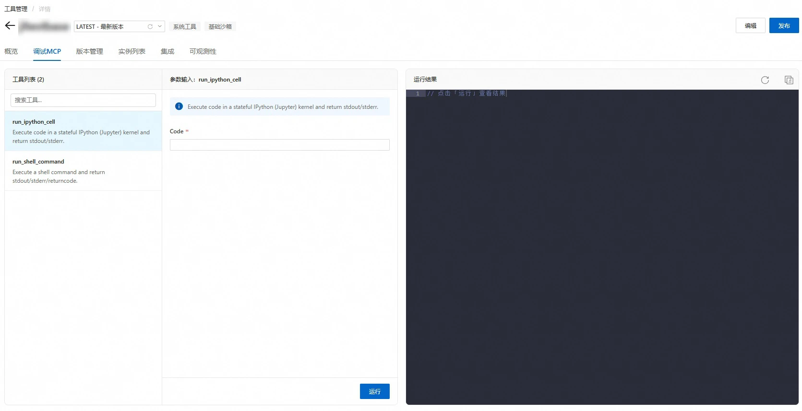

     > **说明**
     >
     > 当集群开启了可观测配置后，且在创建Agent时选择注入探针，可在右上角单击**查看Trace**，跳转至**Jaeger UI**大盘。

   - 调试VNC

     在工具详情页的**调试VNC**页签，单击**创建实例**，可以查看工具基本信息，包含沙箱实例运行状态、工具、集群、类型、版本、超时和ID等信息。

     在**工具列表**选择工具，输入参数，单击**运行**进行调试。

     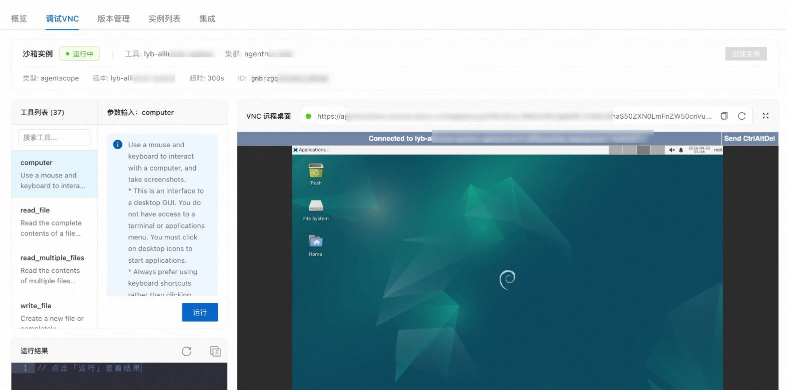

   - 代码调试

     编辑：单击**编辑**，可以修改代码。

     更新：单击**更新**，立即看到修改代码变化。

     下载：单击**下载**，可以下载修改后的代码，如需固化，需要下载代码，使用代码包部署或重新构建镜像后部署。

     

   **版本管理**

   在工具详情页的**版本发布**页签，可以进行工具版本管理和Endpoint管理。

   > **说明**
   >
   > 版本一旦创建成功就不能再修改，可以通过输入更大的版本号来区分和升级新版本。

   - 版本管理

     **创建**：在工具详情页的**版本发布**页签，单击右上角的**发布**，在**发布**对话框中输入以下配置项，单击**确定**。

     | 配置项 | 描述 | 示例值 |
     | --- | --- | --- |
     | 版本号 | 版本号格式：vX.Y.Z。 | v1.0.0 |
     | 版本说明 | 请说明此版本的更新内容。 | 修改CPU配额 |

     **编辑**：在工具详情页的**版本发布**页签，单击右上角的**编辑**，可以修改工具的配置项，更多配置项详情请参见创建系统工具和创建自定义工具。

     **查看**：在**版本列表**区域，可以查看**版本号**、**版本名称**、**工具名称**、**状态**和**创建时间**等信息。

     **克隆**：在**版本列表**区域，单击目标版本操作列的克隆，输入**版本号**和**版本说明**，单击**保存并发布**。

   - Endpoint管理

     **创建**：在工具详情页的**版本发布**页签的**Endpoint管理**区域，单击右上角创建版本Endpoint，在**创建版本Endpoint**对话框中输入以下配置项，单击**确定**。

     | 配置项 | 描述 | 示例值 |
     | --- | --- | --- |
     | 名称 | 仅支持小写字母、数字和短横线，且以字母或数字开头和结尾。 | v1.0.0 |
     | 描述 | 请说明此版本的更新内容。 | 修改CPU配额 |
     | 版本 | 请选择关联的版本。 | v1.0.0 |

     **配置**：在工具详情页的**版本发布**页签的**Endpoint管理**区域，单击生产环境Endpoint的  ，在**配置**

     **Endpoint**对话框中选择多个版本设置比例进行流量分配，单击**确定**。

     

     **删除**：在工具详情页的**版本发布**页签的**Endpoint管理**区域，单击目标Endpoint的  ，在**删除**对话

     框中，单击**确定**。

   **生成技能**

   - **创建技能**

     <ol type="a">

     <li>

     在工具详情页的**生成技能**页签，单击**创建技能**。

     </li>

     <li>

     在**从Agent创建技能**页面，配置以下参数，单击**生成并发布**。

     <table>
       <tr>
         <td>配置项</td>
         <td>说明</td>
         <td></td>
       </tr>
       <tr>
         <td colspan="3">选择工具方法</td>
       </tr>
       <tr>
         <td>选择要暴露的方法</td>
         <td>请选择要暴露的方法。可多选。</td>
         <td></td>
       </tr>
       <tr>
         <td colspan="3">技能元数据</td>
       </tr>
       <tr>
         <td>技能名称（name）</td>
         <td>请输入技能名称。技能唯一标识，英文小写+连字符。</td>
         <td>lunar-calendar</td>
       </tr>
       <tr>
         <td>显示名称</td>
         <td>请输入显示名称。面向用户的展示名。</td>
         <td>黄历查询</td>
       </tr>
       <tr>
         <td>行为描述（description）</td>
         <td>请输入行为描述。说明技能能力，写入 SKILL.md 供 Agent决定何时自动加载该技能。</td>
         <td>查询指定日期的黄历信息</td>
       </tr>
       <tr>
         <td>标签</td>
         <td>输入后添加标签。最多 5 个。</td>
         <td>黄历、日期</td>
       </tr>
       <tr>
         <td>行为指令（instruction）</td>
         <td>请输入行为指令。用于引导Agent 判断何时触发、如何调用及调用约束（适用场景、参数格式、调用顺序、注意事项等）；留空则仅依据行为描述判断。</td>
         <td>涉及农历、宜忌、节气查询时使用；date 参数传 YYYY-MM-DD 格式；不用于公历节假日查询</td>
       </tr>
       <tr>
         <td>调用方式</td>
         <td>请选择调用方式。<br>• 集群外访问<br>• 集群内访问</td>
         <td>集群外访问</td>
       </tr>
     </table>

     </li>

     </ol>

     <ol type="i" start="100">

     <li>

     单击**生成并发布**，在**确认导入版本**页面，配置以下配置项，单击**确定**。

     | 配置项 | 描述 | 示例值 |
     | --- | --- | --- |
     | 版本号 | 必填。请输入版本号，格式：vX.Y.Z 或 X.Y.Z，支持预发布版本（如 -alpha.1）和构建元数据（如 +build.123），总长度不超过 20 个字符。例如v1.0.0、1.0.0、v1.0.0-beta、1.0.0-beta.1、v1.0.0+build.1。 | v1.0.0 |
     | 版本说明 | 必填。请输入版本说明，描述此版本的主要变更，最大长度为1024 个字符。 | 无 |

     </li>

     <li value="500">

     在**从工具创建技能**页面，勾选方法或修改元数据，预览自动更新，可通过**实时预览**进行查看。

     </li>

     </ol>

   - **查询技能**

     在工具详情页的**生成技能**页签，可以查看已创建技能的**名称**、**显示名称**、**描述**和**创建时间**等信息。

     在工具详情页的**生成技能**页签的技能列表中，单击目标技能**操作**列的**详情**，在技能详情页，选择版本信息，可以查看**概览**、**SKILL.md**、**文件包**和**版本**页签的信息，更多详情请参见查看技能详情。

   **实例列表**

   在工具详情页的**实例列表**页签，可以查看**实例ID/名称**、**集群ID/命名空间**、**运行状态**、**CPU使用率**、**内存使用率**、**GPU显存分配量**、**GPU算力分配百分比**、**GPU实时利用率**、**运行时长**、**IP地址**、**主机IP**和**启动时间**等信息。

   在工具详情页的**实例列表**页签，单击目标实例**操作**列的**详情**，可以查看**实例名称**、**集群ID**、**命名空间**、**运行状态**、**IP地址**、**主机IP** 、**CPU使用量**、**CPU限制**、**内存使用量**、**内存限制**、**GPU 显存分配量**、**GPU 算力分配百分比**、**GPU 实时利用率**、**运行时长**和**启动时间**等信息。

   在工具详情页的**实例列表**页签，单击目标实例**操作**列的**终端**，在**实例终端**对话框，选择**container**，单击**连接**。

   在工具详情页的**实例列表**页签，单击目标实例**操作**列的**日志**，在**查看日志**对话框，选择**container**，查看日志。

   **快照列表**

   在工具详情页的**快照列表**页签，可以根据**状态**或**关键词**搜索快照信息。单击**高级筛选**，可以根据**状态**和**关键词**组合搜索快照信息。

   在工具详情页的**快照列表**页签，可以查看**ID/名称**、**关联 Revision**、**大小**、**存储位置**、**状态**和**创建时间**等信息。

   在**快照列表**页签的列表中，单击目标快照**操作**列的**删除**，在二次确认对话框中，单击**确定**。

   **集成**

   在工具详情页的**集成**页签，可以查看以下集成说明，具体集成操作以控制台为准。

   - MCP JSON 配置：在 MCP 客户端（IDE、Agent 框架等）中通过 JSON 配置接入平台托管的ToolServer。

   - Python MCP 客户端访问 ToolServer：通过 Python MCP SDK 以 Streamable HTTP 协议访问平台托管的 ToolServer。

   - agentscope-runtime 集成沙箱工具：在 agentscope-runtime Agent 中通过代码集成平台托管的沙箱工具。

   - LangGraph 集成 AgentScope 沙箱工具：在 LangGraph ReAct Agent 中通过代码集成平台托管的沙箱工具（代码执行等）。

   **身份**

   在Agent详情页的**身份**页签，可以查看**身份信息**、**已分配角色**、**网关访问设置**、**免鉴权URL**和<strong>转发配置（高安全模式）</strong>等信息。

   - 在**身份信息**区域，可以查看**身份标识（URI）**、**鉴权方式**、**JWT状态**和**有效期**等信息。

     > **说明**
     >
     > 调用方在请求中携带平台签发的 JWT 时，网关会将该身份标识注入 X-Agent-Identity 头传递给后端。

   - 在**已分配角色**区域，可以查看**角色名称**、**类型**、**角色ID**等信息。

   - 在**网关访问设置**区域，可以查看访问设置。

     - **网关鉴权（推荐）**：调用方须持有平台签发的 JWT 或 API Key，由网关统一校验身份后转发。

     - **自定义鉴权（网关不推荐）**：网关不校验调用方身份，请求直接转发至后端。适用于后端服务自身已实现鉴权的场景。

   - 在**免鉴权 URL**区域，可以查看免鉴权的当前配置。

     > **说明**
     >
     > 命中以下 URL 的请求将跳过网关身份校验直接转发，适用于静态资源、自带凭证的下载链接等场景。请仅放行确实无需鉴权的路径，免鉴权 URL 不会注入转发鉴权头。

     - **保存**：在输入框输入免鉴权的配置后，单击**保存**。格式：逗号分隔，支持三种形式：\*.后缀（如\*.js）、/前缀\*（如 /filesystem/\*）、/精确路径（如 /download）。总长不超过 256 字符。

     - **清除配置**：单击**清除配置**，清除当前配置。

   - 在<strong>转发配置（高安全模式）</strong>区域，可以查看**请求头名称**和**请求头**的值。

     **适用场景**：后端服务自带鉴权 Token（如 AgentScope 运行时的 SECRET_TOKEN），调用方不持有也无法获取该 Token。配置后，网关在自身鉴权通过时，会将指定请求头统一替换为设定值再转发给后端，调用方原始携带的同名请求头将被移除，不会透传。

     - **请求头名称**

       - **Authorization**：网关完成调用方鉴权后，会将请求中的 Authorization 头替换为上方设定值再转发给后端。调用方携带的原始 Authorization 不会透传。

       - **X-API-Key**：网关完成调用方鉴权后，会将请求中的 X-API-Key 头替换为上方设定值再转发给后端。调用方携带的原始 X-API-Key 不会透传。

     - **请求头值**

     - **保存**：在选择**请求头名称**和输入**请求头值**的后，单击**保存**。

     - **清除配置**：单击**清除配置**，清除当前配置。

   **可观测性**

   在工具详情页的**可观测性**页签，可以查看工具的 应用总览、接口调用和日志信息。

   当集群开启了可观测配置后，在创建Agent时选择是否注入探针，自动采集可观测数据。单击选择**Jaeger UI**、**Grafana大盘**、**Loki**可跳转，查看来源于注入的探针的可观测数据。

   **应用总览**

   在**应用总览**页签上展示以下关键指标：

   - 选定时间内的**总请求量**、**平均响应时间**、**错误数**和**实时实例数**，以及这些指标和上周、上一天的同比升降幅度。

   - **应用提供服务**：因用户访问该应用而产生的数据，例如用户在浏览器中访问该应用。其包含应**用提供服务的请求量**和**应用提供服务平均响应时间**两个指标。

   - **应用依赖服务**：因该应用访问其他服务而产生的数据，例如该应用访问数据库。其包含**应用依赖服务的请求量**和**应用依赖服务平均响应时间**两个指标。

   - **接口慢调用分析**：可以查看**接口慢调用分析**、**统计信息**和**平均响应时间**等信息。

   - **异常类型**：可以查看**异常类型**和<strong>出现次数（/占比）</strong>等信息。

   **接口调用**

   在**接口调用**页签的**接口列表**区域，可以根据**响应时间**、**请求数**、**错误数**或**异常数**升序或者降序查询接口列表。

   单击目标接口，可以查看**产生时间**、**接口名称**、**应用名称**、**耗时**、**状态**和**TraceId**等信息。

<a id="section-4-3"></a>

## 4.3. 技能

可复用的 Agent 技能包（SKILL.md）。来自技能市场或自定义上传，挂载即用，把领域经验沉淀为可分发的标准能力。技能包存放位置在**平台资源 > 存储**中配置。

**创建方式**

技能创建方式分为以下两种：

- 自定义

- 市场

**流程概览**

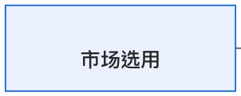

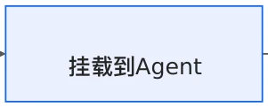


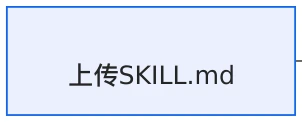

<a id="section-4-3-1"></a>

### 4.3.1. 创建技能

AgentRuntime支持通过上传 SKILL.md 文件或技能压缩包，解析并创建技能；提供技能市场，支持一键安装所需技能。

**前置条件**

请先配置技能存储，然后再创建技能，更多详情请参见已创建生效范围为租户的存储配置。

**创建技能**

1. 登录AgentRuntime控制台。

2. 在左侧导航，单击**运行时和沙箱 > 技能**。

3. 在**技能管理**页面，单击**创建技能**。

4. 在**创建技能**页面，选择创建方式进行创建。

   > **说明**
   >
   > 通过导入 SKILL.md 或技能包来创建技能；或从市场安装已有技能。

   - **自定义**

     - **导入技能**

       上传单个 SKILL.md 文件，平台自动解析 YAML frontmatter并创建技能。

       <ol type="a">

       <li>

       选中**导入技能**卡片，单击**创建**。

       </li>

       <li>

       在**创建技能**页面，单击**选择文件**，上传单个 SKILL.md 文件，平台自动解析 YAML frontmatter并创建技能。

       </li>

       </ol>

       <ol type="i" start="100">

       <li>

       解析完成后，输入以下配置项，单击**确认创建**。

       <table>
         <tr>
           <th width="121">配置项</th>
           <th>说明</th>
         </tr>
         <tr>
           <td>技能显示名称</td>
           <td>请输入技能显示名称，技能显示名称最大长度为64 个字符。</td>
         </tr>
         <tr>
           <td>技能名称</td>
           <td>来自 SKILL.md 的 name 字段，不可修改，支持中文、小写字母、数字和 -；且必须以中文或小写字母开头、不能以 - 结尾；最大长度为128个字符。</td>
         </tr>
         <tr>
           <td>行为描述</td>
           <td>来自 SKILL.md 的 description 字段，不可修改，最大长度为 1024 个字符。</td>
         </tr>
         <tr>
           <td>适用场景</td>
           <td>输入后添加适用场景，最多添加5个标签。</td>
         </tr>
       </table>

       </li>

       <li value="500">

       在**确认导入版本**页面，设置输入以下配置项，单击**确定**。

       <table>
         <tr>
           <th width="89">配置项</th>
           <th>说明</th>
         </tr>
         <tr>
           <td>版本号</td>
           <td>必填。请输入版本号，格式：vX.Y.Z 或 X.Y.Z，支持预发布版本（如 -alpha.1）和构建元数据（如 +build.123），总长度不超过 20 个字符。例如 v1.0.0、1.0.0、v1.0.0-beta、1.0.0-beta.1、v1.0.0+build.1。</td>
         </tr>
         <tr>
           <td>版本说明</td>
           <td>必填。请输入版本说明，描述此版本的主要变更，最大长度为 1024 个字符。</td>
         </tr>
       </table>

       </li>

       </ol>

     - **上传压缩包**

       上传包含SKILL.md 及配套脚本/模块的压缩包，平台自动解析完整技能包。

       <ol type="a">

       <li>

       选中**上传压缩包**卡片，单击**创建**。

       </li>

       <li>

       在**创建技能**页面，单击**查看包规范**，查看文件目录和规范信息。

       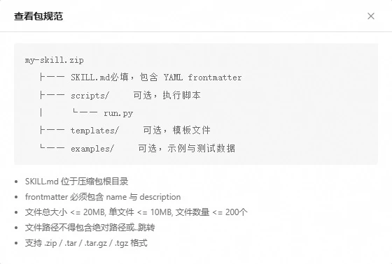

       </li>

       </ol>

       <ol type="i" start="100">

       <li>

       **创建技能**页面，单击**选择文件**，上传压缩包，支持.zip, .tar, .tar.gz 和 .tgz 格式，最大20MB。

       </li>

       <li value="500">

       解析完成后，输入以下配置项，单击**确认创建**。

       <table>
         <tr>
           <th width="121">配置项</th>
           <th>说明</th>
         </tr>
         <tr>
           <td>技能显示名称</td>
           <td>请输入技能显示名称。</td>
         </tr>
         <tr>
           <td>技能名称</td>
           <td>来自 SKILL.md 的 name 字段，不可修改，支持中文、小写字母、数字和 -；且必须以中文或小写字母开头、不能以 - 结尾；最大长度为128个字符。</td>
         </tr>
         <tr>
           <td>行为描述</td>
           <td>来自 SKILL.md 的 description 字段，不可修改，最大长度为 1024 个字符。</td>
         </tr>
         <tr>
           <td>适用场景</td>
           <td>输入后添加使用场景。</td>
         </tr>
         <tr>
           <td>包含文件</td>
           <td>包含文件展示。</td>
         </tr>
       </table>

       </li>

       </ol>

       <ol type="a" start="5">

       <li>

       在**确认导入版本**页面，设置输入以下配置项，单击**确定**。

       <table>
         <tr>
           <th width="89">配置项</th>
           <th>说明</th>
         </tr>
         <tr>
           <td>版本号</td>
           <td>必填。请输入版本号，格式：vX.Y.Z 或 X.Y.Z，支持预发布版本（如 -alpha.1）和构建元数据（如 +build.123），总长度不超过 20 个字符。例如 v1.0.0、1.0.0、v1.0.0-beta、1.0.0-beta.1、v1.0.0+build.1。</td>
         </tr>
         <tr>
           <td>版本说明</td>
           <td>必填。请输入版本说明，描述此版本的主要变更，最大长度为 1024 个字符。</td>
         </tr>
       </table>

       </li>

       </ol>

   - **市场**

     **从市场进行安装**

     浏览并安装技能市场中已有的技能，快速集成到当前环境。

     <ol type="a">

     <li>

     选中**从市场安装**卡片，单击**创建**。

     </li>

     <li>

     在**技能市场**页面，浏览市场发布的技能，单击目标技能卡片的**安装**，一键安装到当前租户。

     </li>

     </ol>

<a id="section-4-3-2"></a>

### 4.3.2. 更多操作

AgentRuntime 控制台提供完善的技能全生命周期管理，支持多维度检索、详细属性查看以及安全的删除操作，助您高效管理技能。

**前置条件**

已创建技能

**查看技能详情**

1. 登录AgentRuntime控制台。

2. 在左侧导航，单击**运行时和沙箱 > 技能**。

3. 在**技能管理**页面，可根据**显示名称**检索技能。也可单击**显示名称**右侧下拉框或单击**高级筛选**，通过**显示名称**、**技能名称**、**来源**（可通过**市场**或**自定义**、**工具生成**或**Agent生成**筛选）和**标签**进行检索技能。

4. 在技能卡片上可以查看**显示名称**、**技能名称**、**ID**、**描述**、**标签**、**关联的Agent**、**最新版本**、**创建方式**（**Agent 生成**、**自定义**或**工具生成**）、**版本标签**和**更新时间**等信息。

5. 鼠标悬停在技能卡片上，单击**详情**，在技能详情页，选择版本信息，可以查看**概览**、**SKILL.md**、**文件包**和**版本**页签的信息。

   **概览**

   在技能详情页，默认展示**概览**页签，包含**技能ID**、**技能名称**、**显示名称**、**行为描述**、**标签**、**来源**、**创建时间**、**更新时间**等信息。

   **SKILL.md**

   在技能详情页，单击**SKILL.md**页签，可以查看技能SKILL.md文件的**富文本**和**纯文本**信息。

   **文件包**

   在技能详情页，单击**文件包**页签，可以查看文件包内文件目录结构、文件大小和文件信息。

   **版本**

   在技能详情页，单击**版本**页签，可以查看技能的**版本号**、**描述**、**存储配置**和**发布时间**等信息。

   - 单击目标技能版本**操作**列的**引用**，在**引用此技能**的对话框中，根据实际使用场景复制配置，并查看**使用说明**。

     - Agent Runtime 以外的 AI Agent引用配置

       适用于 Agent Runtime 以外的 AI Agent，链接 10 分钟内有效。

     - Agent Runtime 引用配置

       复制配置到 Agent CR 的 skills 中，Agent 启动时会自动下载并挂载该技能。

   - 单击目标技能版本**操作**列的**下载**，下载完整技能包。

**删除技能**

1. 登录AgentRuntime控制台。

2. 在左侧导航，单击**运行时和沙箱 > 技能**。

3. 鼠标悬停在技能卡片上，单击**删除**，在二次确认对话框中，单击**确定**，完成删除。

<a id="section-5"></a>

# 5.智能底座

<a id="section-5-1"></a>

## 5.1. 模型部署

在 GPU 上部署您自己的模型并对外提供推理服务。支持多推理引擎与自定义镜像，按实例弹性伸缩、闲时缩容至零，部署完成后自动汇入**模型接入**目录供 Agent 选用。

**流程概览**

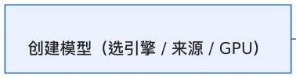

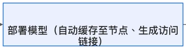


<a id="section-5-1-1"></a>

### 5.1.1. 创建模型

AgentRuntime控制台提供一站式模型部署服务，支持 vLLM、Triton 及自定义环境，灵活配置资源与弹性策略，快速将模型上线为高可用推理服务。

**创建模型**

1. 登录AgentRuntime控制台。

2. 在左侧导航，单击**智能底座 > 模型部署**。

3. 在**模型运行时**页面，单击**创建模型**。

4. 在**创建模型**页面，输入以下配置项，单击**下一步**。

   <table>
     <tr>
       <th>配置项</th>
       <th>说明</th>
       <th>示例值</th>
     </tr>
     <tr>
       <td colspan="3">选择环境-选择运行环境</td>
     </tr>
     <tr>
       <td>选择运行环境</td>
       <td>不同环境提供不同的推理框架和优化能力。<br>• <strong>模型部署环境（vLLM）</strong>：高性能大语言模型推理引擎，支持主流开源模型的高效部署与推理。请选择<strong>镜像版本</strong>和<strong>模型类型</strong>。<br>• <strong>模型部署环境（Triton）</strong>：NVIDIA通用推理服务平台，支持TensorRT、PyTorch、ONNX等多框架，提供HTTP+gRPC双协议接口。请选择<strong>推理后端</strong>和<strong>镜像版本</strong>。<br>• <strong>自定义部署环境</strong>：使用自定义镜像部署模型服务，支持任意推理框架和自定义逻辑。请输入<strong>镜像地址</strong>。</td>
       <td>模型部署环境</td>
     </tr>
     <tr>
       <td colspan="3">资源配置-资源配置</td>
     </tr>
     <tr>
       <td>集群</td>
       <td>请选择集群，如果无可用集群请参见接入集群。</td>
       <td>无</td>
     </tr>
     <tr>
       <td>命名空间</td>
       <td>选择集群所在的命名空间。</td>
       <td>无</td>
     </tr>
     <tr>
       <td>CPU配额</td>
       <td>请输入单个实例的CPU上限。<br>说明建议参考：0.5B-3B 模型≥2 核，7B-14B 模型 ≥4核。配置过低可能导致模型加载超时或推理延迟增大。</td>
       <td>2核</td>
     </tr>
     <tr>
       <td>内存配额</td>
       <td>请输入单个实例的内存上限。<br>说明建议参考：0.5B-3B 模型≥8Gi，7B-14B 模型≥16Gi。vLLM 除模型权重外还需额外运行时内存，配置过低会导致 OOMKilled。</td>
       <td>4Gi</td>
     </tr>
     <tr>
       <td>GPU 类型</td>
       <td>请选择GPU类型。</td>
       <td>NVIDIA-A10</td>
     </tr>
     <tr>
       <td>GPU 数量</td>
       <td>请输入GPU数量。</td>
       <td>1</td>
     </tr>
     <tr>
       <td>每卡显存</td>
       <td>每张 GPU 分配的显存上限。不选择则独占物理卡全部显存；选具体值（如 8 GiB）则可能与其他模型共享同一张卡。</td>
       <td>8Gi</td>
     </tr>
     <tr>
       <td>算力</td>
       <td>每张 GPU 的算力配额 (SM 核心占比)。</td>
       <td>不限制</td>
     </tr>
     <tr>
       <td colspan="3">资源配置-调度策略</td>
     </tr>
     <tr>
       <td>部署策略</td>
       <td>请选择部署策略。<br>• <strong>自动调度</strong>：不可选择，可以查看<strong>节点</strong>、<strong>GPU</strong>、<strong>每卡显存</strong>、<strong>已</strong><strong>分配</strong>、<strong>可用显卡</strong>和<strong>调度状态</strong>等信息。<br>• <strong>指定节点</strong>：可以根据节点名称进行检索，支持选择指定节点调度。可以查看<strong>节点</strong>、<strong>GPU</strong>、<strong>每</strong><strong>卡显存</strong>、<strong>已分配</strong>、<strong>可用显卡</strong>和<strong>调</strong><strong>度状态</strong>等信息。</td>
       <td>指定节点</td>
     </tr>
     <tr>
       <td colspan="3">资源配置-弹性配置</td>
     </tr>
     <tr>
       <td>最小实例数</td>
       <td>保证至少有此数量的实例始终运行。</td>
       <td>10</td>
     </tr>
     <tr>
       <td>最大实例数</td>
       <td>限制实例数量上限，防止资源过度消耗。</td>
       <td>20</td>
     </tr>
     <tr>
       <td>单Pod并发度</td>
       <td>每个Pod同时处理的最大请求数。</td>
       <td>10</td>
     </tr>
     <tr>
       <td>冷却时间（秒）</td>
       <td>当实例并发/请求量下降时，系统不会立即缩减实例数，而是等待该冷却时间过后，才执行缩容。在冷却时间窗口内，系统会保持窗口期内的实例数不变。</td>
       <td>60</td>
     </tr>
     <tr>
       <td>优雅停止时间（秒）</td>
       <td>当缩容或更新发生时，系统在发送终止信号后，会等待该时间让服务完成正在处理的请求，超过此时间后将强制终止。</td>
       <td>60</td>
     </tr>
     <tr>
       <td colspan="3">基础配置-基本配置</td>
     </tr>
     <tr>
       <td>模型名称</td>
       <td>平台内的唯一标识，需符合 DNS格式：仅支持小写字母、数字和短横线（-），且必须以字母或数字开头和结尾。创建后不可修改。</td>
       <td>无</td>
     </tr>
     <tr>
       <td>显示名称</td>
       <td>请输入显示名称，用于前端展示的友好名称，支持中文和特殊字符。</td>
       <td>智能问答模型</td>
     </tr>
     <tr>
       <td>描述</td>
       <td>请输入描述信息。</td>
       <td>无</td>
     </tr>
     <tr>
       <td>标签</td>
       <td>输入后选择添加标签。</td>
       <td>无</td>
     </tr>
     <tr>
       <td colspan="3">基础配置-模型来源<br>说明仅<strong>模型部署环境（vLLM）</strong>和<strong>模型部署环境（Triton）</strong>显示此参数。</td>
     </tr>
     <tr>
       <td>对象存储</td>
       <td>从对象存储 Bucket下载。</td>
       <td>-</td>
     </tr>
     <tr>
       <td>每次更新强制重新部署</td>
       <td>开启后，每次保存配置都会重新从存储下载模型文件并重新部署，适用于模型文件频繁更新但存储路径不变的场景。<br>• 开启<br>• 关闭</td>
       <td>开启</td>
     </tr>
     <tr>
       <td>存储桶名称</td>
       <td>请选择存储桶，模型文件所在的对象存储 Bucket。</td>
       <td>无</td>
     </tr>
     <tr>
       <td>存储目录</td>
       <td>模型在 Bucket 中的目录路径，以/ 结尾。<br>说明在triton下：模型在 Bucket 中的目录路径，以 / 结尾。目录结构需符合 Triton 模型仓库规范：目录名仅支持字母、数字和下划线，内含版本子目录（如 1/）及模型文件。如需格式转换，可以填写到源文件所在目录，系统自动处理。</td>
       <td>/models/qwen/</td>
     </tr>
     <tr>
       <td>转换参数</td>
       <td>说明仅当<strong>模型部署环境</strong><strong>（Triton）</strong>配置，当传入模型格式和推理后端不匹配需要转换中时显示。<br>• 参数名<br>• 参数值</td>
       <td>Enable FP16 precision (trtexec --fp16)<br>参数名：fp16参数值：true</td>
     </tr>
     <tr>
       <td colspan="3">基础配置-模型配置（可选）<br>说明仅<strong>自定义部署环境</strong>显示此参数，模型配置为可选配置，单击<strong>添加</strong>配置以下参数。</td>
     </tr>
     <tr>
       <td>对象存储</td>
       <td>启用对象存储下载后，会自动从对象存储下载模型文件并挂载到容器对应位置。</td>
       <td>-</td>
     </tr>
     <tr>
       <td>每次更新强制重新部署</td>
       <td>开启后，每次保存配置都会重新从存储下载模型文件并重新部署，适用于模型文件频繁更新但存储路径不变的场景。<br>• 开启<br>• 关闭</td>
       <td>开启</td>
     </tr>
     <tr>
       <td>存储桶名称</td>
       <td>模型文件所在的对象存储Bucket，请输入或选择存储桶名称。</td>
       <td>无</td>
     </tr>
     <tr>
       <td>存储目录</td>
       <td>模型在 Bucket 中的目录路径，以/ 结尾。</td>
       <td>/models/qwen/</td>
     </tr>
     <tr>
       <td>容器内路径</td>
       <td>模型文件下载后挂载到容器内的路径，应用通过此路径加载模型。</td>
       <td>/workspace</td>
     </tr>
     <tr>
       <td colspan="3">基础配置-启动配置</td>
     </tr>
     <tr>
       <td>启动命令</td>
       <td>返显启动命令。</td>
       <td>无</td>
     </tr>
     <tr>
       <td>启动参数</td>
       <td>容器启动参数。</td>
       <td>无</td>
     </tr>
     <tr>
       <td colspan="3">基础配置-快照策略<br>说明仅<strong>模型部署环境（vLLM）</strong>显示此参数。请先选择集群，再配置快照策略。当前集群若未安装快照组件，请<strong>单击安装</strong>，更多详情请参见集群组件管理。</td>
     </tr>
     <tr>
       <td>创建热启动快照（GoldenCheckpoint）</td>
       <td>部署完成后系统会自动在(Revision) 粒度打一次基线快照，后续 KPA 缩容与冷启动均基于该快照。<br>• 开启<br>• 关闭</td>
       <td>开启</td>
     </tr>
     <tr>
       <td>丢弃 KV 缓存</td>
       <td>减小快照体积，恢复后 KV 缓存需要重新生成。默认开启。<br>• 开启<br>• 关闭</td>
       <td>开启</td>
     </tr>
     <tr>
       <td>丢弃模型权重</td>
       <td>快照体积最小；恢复时从本地模型缓存重新加载权重，恢复耗时会增加。默认关闭。<br>• 开启<br>• 关闭</td>
       <td>关闭</td>
     </tr>
     <tr>
       <td>存储位置</td>
       <td>固定为本地存储，暂不支持修改。</td>
       <td>无</td>
     </tr>
     <tr>
       <td colspan="3">基础配置-访问配置</td>
     </tr>
     <tr>
       <td>超时时间（秒）</td>
       <td>请求超时时间，输入范围：1-600。</td>
       <td>300</td>
     </tr>
     <tr>
       <td colspan="3">基础配置-环境变量配置</td>
     </tr>
     <tr>
       <td>环境变量</td>
       <td>环境变量以明文存储，请勿直接填写 API Key、密码等敏感信息。敏感信息建议通过访问凭证（Secret）挂载到容器中。<br>• 变量名<br>• 变量值</td>
       <td>变量名：APP_NAME变量值：your-value-here</td>
     </tr>
     <tr>
       <td colspan="3">基础配置-健康检查配置<br>说明仅<strong>自定义部署环境</strong>需配置此参数。</td>
     </tr>
     <tr>
       <td>健康检查</td>
       <td>配置健康检查后，平台会自动设置Readiness 和 Liveness 探针。Readiness 探针确保实例从 0 弹出或重启时，只有健康检查通过后才接收流量，保障弹性扩缩场景下的流量无损；Liveness 探针持续检测实例是否存活，检查失败的实例会被自动重启。建议所有生产Model 都配置健康检查。单击<strong>添加</strong>，并配置以下参数：<br>• <strong>检查路径</strong>：Model 提供的健康检查 HTTP 端点路径，需返回2xx 状态码表示健康。<br>• <strong>端口</strong>：健康检查请求的目标端口，通常与访问配置中的端口号一致。<br>• <strong>检查间隔（秒）</strong>：两次健康检查之间的间隔秒数。过短会增加Model 负载，建议 5-30 秒。<br>• <strong>检查超时（秒）</strong>：单次健康检查的超时秒数，超时视为不健康。建议不超过检查间隔。</td>
       <td>无</td>
     </tr>
     <tr>
       <td colspan="3">确认部署</td>
     </tr>
     <tr>
       <td>快捷操作</td>
       <td>说明仅<strong>模型部署环境（vLLM）</strong>显示此参数。<br>在 AgentRuntime 模型管理自动注册此模型服务。<br>• 开启<br>• 关闭</td>
       <td>开启</td>
     </tr>
     <tr>
       <td>内容配置</td>
       <td>查看配置信息，确认无误，单击<strong>确</strong><strong>认部署</strong>。</td>
       <td>无</td>
     </tr>
   </table>

<a id="section-5-1-2"></a>

### 5.1.2. 更多操作

本文介绍如何查看、编辑和删除模型。

**前置条件**

已创建模型。

**查看模型详情**

1. 登录AgentRuntime控制台。

2. 在左侧导航，单击**智能底座 > 模型部署**。

3. 在**模型运行时**页面，您可以通过**模型名称**、**显示名称**、**部署环境**、**状态**、**集群名称**快速筛选模型。

4. 页面展示所有模型，在模型卡片上可查看**显示名称/ID**、**模型名称**、**部署环境**、**描述**、**状态**、**集群名称 /ID**、**命名空间**、**创建时间**、**更新时间**以及当前模型的状态。

   > **说明**
   >
   > 模型默认以卡片展示，您可以单击
   >
   > 切换为列表形式。
   >
   > 

5. 找到目标模型，单击卡片上的  ，选择**详情**，进入到模型详情页面。

   **概览**

   在模型详情页的**概览**页签，可以查看模型的以下配置信息：

   - 在**运行时参数**区域，可以查看以下信息。

     - 模型部署环境（vLLM）：可以查看**镜像版本**和**模型类型**等信息。

     - 模型部署环境（Triton）：可以查看**推理后端**和**镜像版本**等信息。

     - 自定义部署环境/模型：可以查看**自定义镜像地址**等信息。

   - 在**基本信息**区域，可以查看**模型ID**、**模型名称**、**显示名称**、**部署地域**、**创建时间**、**描述**和**标签**等信息。

   - 在**集群配置**区域，可以查看**集群**和**命名空间**信息。

   - 在**资源配置**区域，可以查看**GPU 类型**、**GPU 数量**、**每卡显存**、**算力**、**CPU 配额**和**内存配额**等信息。

   - 在**调度策略**区域，可以查看**部署策略**和**节点**信息。

   - 在**弹性配置**区域，可以查看**最小实例数**、**最大实例数**、**单Pod并发度**、<strong>冷却时间（秒）</strong>和<strong>优雅停止时间（秒）</strong>等信息。

   - 在**模型来源**区域，可以查看**来源**、是否开启**每次更新强制重新部署**、**存储桶名称**和**存储目录**等信息。

     > **说明**
     >
     > 仅模型部署环境（vLLM）或模型部署环境（Triton）显示。

   - 在**模型配置**区域，可以查看**来源**、是否开启**每次更新强制重新部署**、**存储桶名称**和**存储目录**和**容器内路径**等信息。

     > **说明**
     >
     > 仅自定义部署环境/模型显示或者不显示。

   - 在**启动配置**区域，可以查看**启动命令**和**启动参数**等信息。

   - 在**访问配置**区域，可以查看**超时时间（秒）**、<strong>会话空闲时间（秒）</strong>和**访问凭证**等信息。

   - 在**环境变量**区域，可以查看环境变量相关信息。

   - 在**健康检查**区域，可以查看**检查路径**、**端口**、<strong>检查间隔（秒）</strong>以及<strong>检查超时（秒）</strong>等信息。

   - 在**快捷操作**区域，可以查看是否开启**注册到模型管理**。

     > **说明**
     >
     > 仅模型部署环境（vLLM）或模型部署环境（Triton）显示。

   - 在**服务访问入口**区域，可以查看服务访问入口链接。

   **调试**

   > **说明**
   >
   > 当前 API 端点根据模型类型自动匹配，请正确选择模型类型。如果您的模型使用了非标准接口，请单击<strong>+ 新增端点</strong>手动添加。

   - **发送请求**

     <ol type="a">

     <li>

     单击请求配置右侧的  。

     </li>

     <li>

     在右侧**响应结果**区域可查看请求结果。

     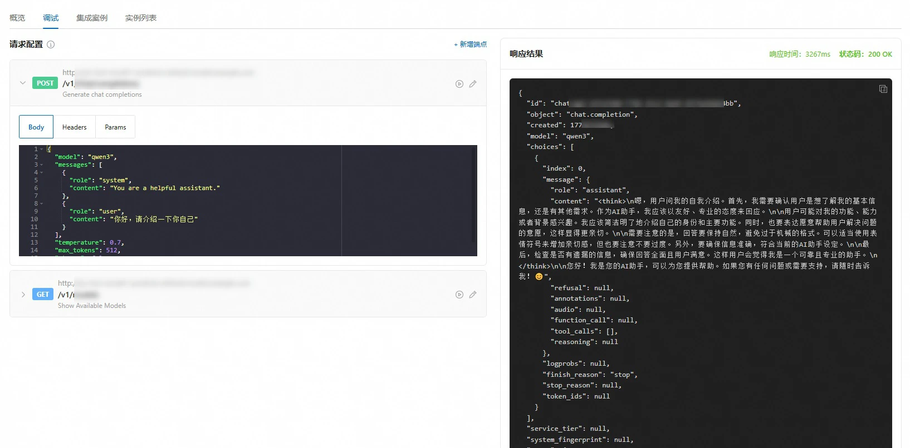

     </li>

     </ol>

   - **编辑请求配置**

     <ol type="a">

     <li>

     单击请求配置右侧的  。

     </li>

     <li>

     完成请求配置参数修改，单击**保存**。

     </li>

     </ol>

   - **新增请求配置**

     <ol type="a">

     <li>

     单击**新增端点**，选择请求方法，输入端点路径和描述信息，配置请求参数。

     </li>

     <li>

     单击**确定**。

     </li>

     </ol>

   - **删除请求配置**

     <ol type="a">

     <li>

     单击请求配置右侧的  。

     </li>

     <li>

     在二次确认弹框中单击**确定**。

     </li>

     </ol>

   **集成案例**

   可查看**基础信息**、**API端点**以及**cURL**、**Python**、**Node.js**、**Java**四种格式的**代码示例**。

   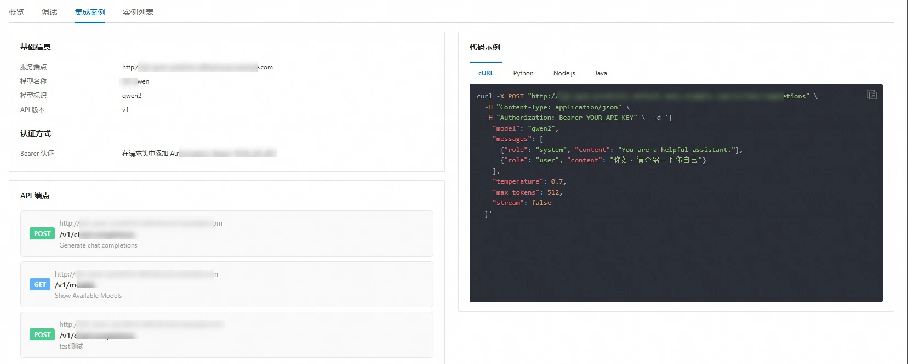

   **实例列表**

   - 在模型详情页的**实例列表**页签，可以查看**实例ID/名称**、**集群ID/命名空间**、**运行状态**、**CPU使用率**、**内存使用率**、**GPU显存分配量**、**GPU算力分配百分比**、**GPU实时利用率**、**运行时长**、**IP地址**、**主机IP**和**启动时间**等信息。

   - 在模型详情页的**实例列表**页签，单击目标实例**操作**列的**详情**，可以查看**实例ID/名称**、**集群ID/命名空间**、**运行状态**、CPU使用量、内存使用率、GPU显卡分配量、GPU算力分配百分比、GPU实时利用率、**IP地址**、**主机IP**和**启动时间**等信息。

   - 在模型详情页的**实例列表**页签，单击目标实例**操作**列的**终端**，在**实例终端**对话框，选择**container**，单击**连接**。

     > **说明**
     >
     > AiStack/OneConsole 模式下不支持终端连接。

   - 在模型详情页的**实例列表**页签，单击目标实例**操作**列的**日志**，在**查看日志**对话框，选择**container**，查看和复制日志。

**编辑模型**

1. 在**模型运行时**页面，找到目标模型，单击卡片上的  ，选择**编辑**。

2. 在编辑模型对话框中，修改**显示名称**、**描述**和**标签**后，单击**确定**。

**删除模型**

1. 在**模型运行时**页面，找到目标模型，单击卡片上的  ，选择**删除**。

2. 在二次确认弹框中单击**确定**。

<a id="section-5-2"></a>

## 5.2. 模型接入

模型在AgentRuntime系统中作为智能推理的核心能力提供者，通过配置其 API 端点、认证信息和协议类型，为 Agent 提供文本生成、对话理解等 AI 能力，支撑 Agent 的决策与交互功能。

**流程概览**

Agent 可调用的统一模型目录。既可 BYOK（自带密钥） 通过网关代理接入外部模型（如百炼 / OpenAI /DeepSeek），也自动汇入平台自建部署的模型。一处选型，统一鉴权、配额与路由。

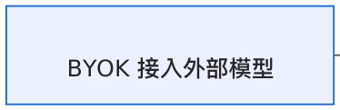

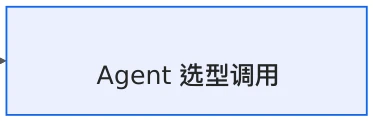


**添加模型**

1. 登录AgentRuntime控制台。

2. 在左侧导航，单击**智能底座 > 模型接入**。

3. 在**模型列表**页面，单击**添加模型**。

4. 在**添加模型**页面，配置以下配置项，单击**添加**。

   | 配置项 | 描述 | 示例值 |
   | --- | --- | --- |
   | 模型名称 | 平台内的唯一标识名称，需符合DNS 格式：仅支持小写字母、数字和短横线（-），且必须以字母或数字开头和结尾。如模型官方名称含有不支持的字符（如点号、下划线），请替换为短横线。 | qwen |
   | 模型标识 | 模型标识必须以字母或数字开头和结尾，允许包含字母、数字、连字符（-）、点（.）、下划线（_）和冒号（:），长度不超过128个字符。 | qwen2.5:3b |
   | 提供商 | 模型的服务提供商。不同提供商的API 端点和认证方式不同。<br>• OpenAI<br>• Azure OpenAI<br>• Claude<br>• Gemini<br>• 文心一言<br>• 通义千问<br>• 智谱AI<br>• Moonshot<br>• DeepSeek | 通义千问 |
   | 模型类型 | 请选择模型类型。<br>• <strong>文本类型</strong>：用于对话和文本生成。<br>• 图像类型<br>• 视频类型<br>• 重排序类型<br>• 向量类型<br>• <strong>多模态类型</strong>：支持图片、音频等输入。 | 文本类型 |
   | 支持协议 | 请选择模型 API 兼容的协议格式。<br>• <strong>openai</strong>：兼容 OpenAI Chat Completions API 格式，大多数模型提供商都支持此协议。<br>• <strong>dashscope</strong>：通义千问DashScope 原生协议。<br>• <strong>anthropic</strong>：Anthropic Claude Messages API 格式。 | dashscope |
   | API端点 | 模型服务的 API 地址，需填写完整URL。<br>说明端点必须与所选的<strong>支持协议</strong>类型匹配，选择不同协议时端点地址可能不同。例如选择openai 协议时需使用OpenAI 兼容格式的端点地址。 | https://dashscope.aliyuncs.co m/\*\*\*\*\*\* |
   | API密钥 | 从模型提供商处获取的 API Key，用于身份认证。请妥善保管，不要泄露。 | 无 |
   | 描述 | 请输入描述信息。 | 无 |
   | 模型状态 | 关闭后该模型将不可被 Agent 选用，但配置信息会保留。<br>• <strong>启用</strong>：绿色表示已启用。<br>• <strong>不启用</strong>：灰色表示不启用。 | 启用 |
   | 测试链接 | 测试连接从管控端发起请求，网络环境与实际集群内 Agent 调用不同。测试通过仅表示管控端可达该API 端点，不代表集群内 Agent也能正常访问（可能存在网络策略、DNS 解析、代理配置等差异）。 | 无 |

**更多操作**

1. 登录AgentRuntime控制台。

2. 在左侧导航，单击**智能底座 > 模型接入**。

3. 在**模型列表**页面，可以根据**模型名称**、**状态**、**服务提供商**或**模型类型**搜索模型信息。单击**高级筛选**，可以根据**模型名称**、**状态**、**服务提供商**和**模型类型**组合搜索模型信息。

4. 在模型列表中，可以查看**模型名称**、**服务提供商**、**模型类型**、**API 端点**、**支持协议**、**状态**、**创建时间**和**更新时间**等信息。

5. 在模型列表中，单击**操作**列的**详情**，可以查看模型的**模型名称**、**模型标识符**、**服务提供商**、**模型类型**、**API 端点**、**支持协议**、**状态**、**描述**、**创建时间**和**更新时间**等信息。

6. 在模型列表中，单击**操作**列的**编辑**，在编辑模型页面，修改配置项，单击**更新**。配置项详情请参见：添加模型。

7. 在模型列表中，单击**操作**列的**禁用**，在<strong>确定禁用该模型吗？</strong>的对话框中，单击**确定**。

8. 在模型列表中，单击**操作**列的**启用**，在<strong>确定启用该模型吗？</strong>的对话框中，单击**确定**。

9. 在模型列表中，单击**操作**列的**删除**，在<strong>确定删除该模型吗？</strong>的对话框中，单击**确定**。

<a id="section-5-3"></a>

## 5.3. 推理服务监控接入指南

本指南介绍如何采集推理服务的运行指标并通过 Grafana 大盘查看。

采集推理服务的运行指标并通过 Grafana 大盘查看，覆盖以下两种环境：

- **阿里云 ACK**：使用托管的 ARMS Prometheus。

- <strong>自建 Kubernetes：</strong>使用开源 kube-prometheus-stack 自建 Prometheus + Grafana。

模型推理服务的指标以 Prometheus 标准格式暴露，Prometheus 与 Grafana 均为 CNCF 开源项目，任意 Kubernetes 集群均可自建。

**概述**

每个模型的 Pod 在  `:8000/metrics`  上以 Prometheus 文本格式暴露指标，涵盖模型延迟、吞吐、显存、冷启动指标等。

接入分三步：采集指标（Prometheus 通过  `PodMonitor`  抓取模型 Pod 的  `/metrics` ）、指标写入Prometheus、导入 Grafana 大盘可视化。

> **说明**
>
> 具体指标已在 AgentRuntime 平台相关镜像开发（推理镜像 v1.1.0 及以上提供  `vllm_*`  /  `triton_*`  等平台增强指标），无需额外配置。接入工作仅是让 Prometheus 抓取到它们，并在Grafana 中加载大盘。

**前提条件**

- **阿里云 ACK**：开通 ARMS 即含 CRD 和托管 Grafana，无需额外准备。

- **自建 Kubernetes**：需自备 Prometheus Operator + Grafana ≥9.0，推荐 kube-prometheus-stack，已有 Operator 的只需确认 CRD 版本。

> **说明**
>
> 推理 Pod 由平台自动打上  `agentruntime.alibabacloud.com/model`  标签，采集配置以此标签选中推理 Pod。

**标准 ACK集群**

ACK 集群使用托管的 ARMS Prometheus，免运维、自带 Grafana。

**步骤一：启用 ARMS Prometheus**

在ACK集群详情页，在左侧导航栏，单击**集群信息**，在**集群监控**页签，单击**导入Grafana专家版**。

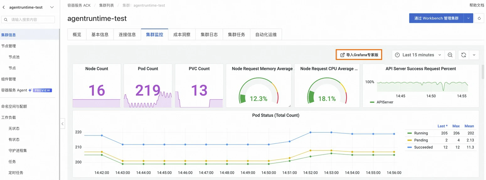

**步骤二：采集推理指标**

创建 PodMonitor：

```yaml
apiVersion: monitoring.coreos.com/v1
kind: PodMonitor
metadata:
  name: inference-metrics
  namespace: arms-prom
spec:
  selector:
    matchExpressions:
      - key: agentruntime.alibabacloud.com/model
        operator: Exists
  namespaceSelector:
    any: true
  podMetricsEndpoints:
    - targetPort: 8000
      path: /metrics
      interval: 15s
      scrapeTimeout: 10s
      relabelings:
        - sourceLabels: [__meta_kubernetes_namespace]
          targetLabel: namespace
        - sourceLabels: 
[__meta_kubernetes_pod_label_agentruntime_alibabacloud_com_model]
          targetLabel: model_cr
        - sourceLabels: [__meta_kubernetes_pod_node_name]
          targetLabel: node
```

```bash
kubectl apply -f inference-podmonitor.yaml
```

> **说明**
>
> `relabelings`  将  `namespace`  /  `model_cr`  /  `node`  注入为指标标签，是大盘筛选维度的来源，请勿删除。

**步骤三：采集GPU指标**

**模型级 GPU 显存指标**随步骤二：采集推理指标一起采集到，无需额外组件：

- vLLM 模型： `vllm_gpu_memory_used_bytes` 、 `vllm_gpu_memory_utilization` 等。

- Triton 模型：Triton Server 原生  `nv_gpu_memory_used_bytes` 、 `nv_gpu_utilization` 等。

**步骤四：导入大盘**

1. 在**Grafana服务**控制台，在左侧导航栏单击**概览**，在**Grafana工作区列表**区域，单击**版本类型**为**专家版**工作区的**登录**。

   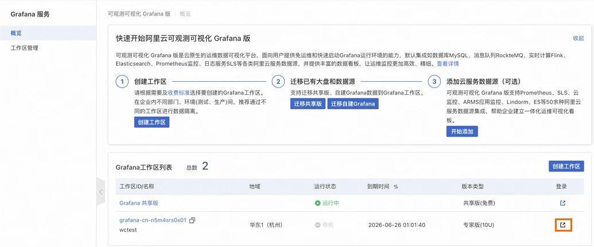

2. **Prometheus 服务**中选择实例列表，找到目标实例选择**设置**，在**访问地址**中配置**免密访问配置**。

   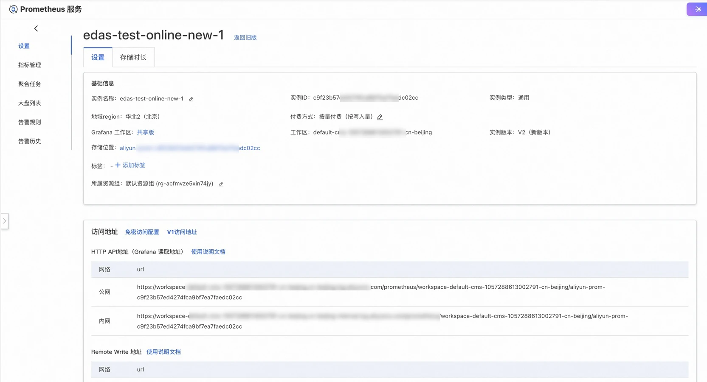

3. 在**Grafana服务**控制台，在左侧导航栏单击**工作区管理**，在工作区中的**云服务集成**中，选择**Prometheus 监控服务**，集成之前配置的Prometheus实例。

   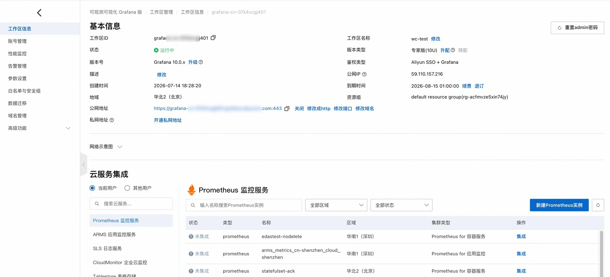

4. 登录后进入**Dashboards > Import**，上传  `dashboards/`  目录下的 JSON 文件，在提示的  `datasource`  处选择 ARMS 的 Prometheus 数据源，完成导入。

   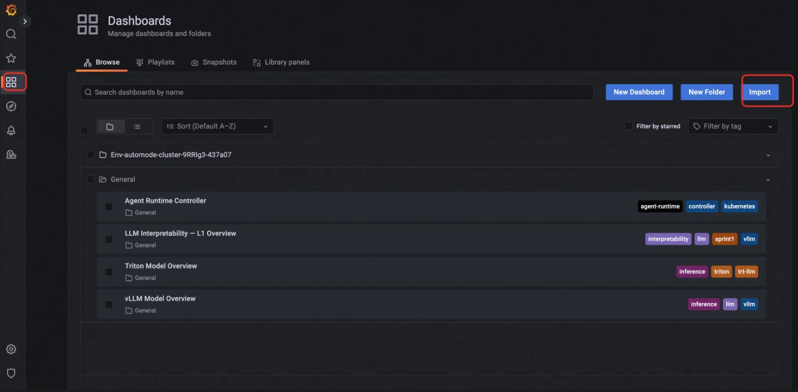

5. 大盘清单如下：

   | 文件 | 大盘 | 用途 |
   | --- | --- | --- |
   | <code>dashboards/vllm-model-</code><br><code>overview.json</code> | vLLM Model Overview | vLLM 模型：延迟、吞吐、KV Cache、冷启动分阶段。 |
   | <code>dashboards/triton-model-</code><br><code>overview.json</code> | Triton Model Overview | Triton / TRT-LLM 模型：延迟、吞吐、Proxy、启动分阶段。 |
   | <code>dashboards/agent-</code><br><code>runtime-controller.json</code> | Agent Runtime Controller | 管控面运维（可选，指标来自controller Pod，本文的<code> PodMonitor </code> 不覆盖，需另行配置采集）。 |

   > **说明**
   >
   > 大盘使用  `datasource`  模板变量，导入时选择一次 Prometheus 数据源即可， `namespace`  / `model`  变量会自动从指标中填充。大盘 JSON 以 chart 仓库 dashboards/ 目录为准，以下为当前版本快照。

   - **vllm-model-overview.json（vLLM Model Overview）**

     ```json
     {
       "annotations": {
         "list": []
       },
       description: vLLM LLM Model Monitoring,
       "editable": true,
       "graphTooltip": 1,
       "schemaVersion": 39,
       "tags": [
         "vllm",
         "llm",
         "inference"
       ],
       "title": "vLLM Model Overview",
       "uid": "vllm-model-overview",
       "time": {
         "from": "now-20m",
         "to": "now"
       },
       "templating": {
         "list": [
           {
             "name": "datasource",
             "type": "datasource",
             "query": "prometheus",
             "hide": 0,
             "includeAll": false,
             "multi": false,
             "refresh": 1
           },
           {
             "name": "namespace",
             "type": "query",
             "label": "Namespace",
             "datasource": {
               "type": "prometheus",
               "uid": "${datasource}"
             },
             "definition": "label_values(vllm:kv_cache_usage_perc, namespace)",
             "query": "label_values(vllm:kv_cache_usage_perc, namespace)",
             "includeAll": false,
             "multi": false,
             "refresh": 2,
             "sort": 1,
             "hide": 0
           },
           {
             "name": "model",
             "type": "query",
             "label": "Model Instance",
             "datasource": {
               "type": "prometheus",
               "uid": "${datasource}"
             },
             "definition": 
     "label_values(vllm:kv_cache_usage_perc{namespace=~\"$namespace\"}, model_name)",
             "query": 
     "label_values(vllm:kv_cache_usage_perc{namespace=~\"$namespace\"}, model_name)",
             "includeAll": false,
             "multi": false,
             "refresh": 2,
             "sort": 1,
             "hide": 0
           }
         ]
       },
       "panels": [
         {
           "type": "row",
           "title": "Overview",
           "collapsed": false,
           "gridPos": {
             "h": 1,
             "w": 24,
             "x": 0,
             "y": 0
           },
           "panels": []
         },
         {
           "title": "$model",
           "type": "stat",
           "gridPos": {
             "h": 4,
             "w": 4,
             "x": 0,
             "y": 1
           },
           "fieldConfig": {
             "defaults": {
               "noValue": "—",
               "thresholds": {
                 "steps": [
                   {
                     "color": "green",
                     "value": 0
                   }
                 ]
               }
             }
           },
           "options": {
             "colorMode": "background",
             "graphMode": "none",
             "reduceOptions": {
               "calcs": [
                 "lastNotNull"
               ]
             },
             "textMode": "name"
           },
           "targets": [
             {
               "expr": "count(vllm:num_requests_running{model_name=~\"$model\", namespa
     ce=~\"$namespace\"})",
               "refId": "A",
               "legendFormat": "$model"
             }
           ],
           "datasource": {
             "type": "prometheus",
             "uid": "${datasource}"
           },
           "description": "Current model instance name and status"
         },
         {
           "title": "Throughput",
           "type": "stat",
           "gridPos": {
             "h": 4,
             "w": 4,
             "x": 4,
             "y": 1
           },
           "fieldConfig": {
             "defaults": {
               "unit": "short",
               "decimals": 1,
               "noValue": "0",
               "thresholds": {
                 "steps": [
                   {
                     "color": "green",
                     "value": 0
                   }
                 ]
               }
             }
           },
           "options": {
             "colorMode": "value",
             "graphMode": "area",
             "reduceOptions": {
               "calcs": [
                 "lastNotNull"
               ]
             }
           },
           "targets": [
             {
               "expr": 
     "sum(vllm_token_throughput_generation_per_second{model_name=~\"$model\", 
     namespace=~\"$namespace\"})",
               "refId": "A"
             }
           ],
           "datasource": {
             "type": "prometheus",
             "uid": "${datasource}"
           },
           "description": "Generation tokens per second (30s sliding window)"
         },
         {
           "title": "TTFT P95",
           "type": "stat",
           "gridPos": {
             "h": 4,
             "w": 4,
             "x": 8,
             "y": 1
           },
           "fieldConfig": {
             "defaults": {
               "unit": "s",
               "decimals": 2,
               "noValue": "0",
               "thresholds": {
                 "steps": [
                   {
                     "color": "green",
                     "value": 0
                   },
                   {
                     "color": "yellow",
                     "value": 1
                   },
                   {
                     "color": "red",
                     "value": 3
                   }
                 ]
               }
             }
           },
           "options": {
             "colorMode": "value",
             "graphMode": "area",
             "reduceOptions": {
               "calcs": [
                 "lastNotNull"
               ]
             }
           },
           "targets": [
             {
               "expr": "histogram_quantile(0.95, sum by (le) 
     (rate(vllm:time_to_first_token_seconds_bucket{model_name=~\"$model\", 
     namespace=~\"$namespace\"}[5m])))",
               "refId": "A"
             }
           ],
           "datasource": {
             "type": "prometheus",
             "uid": "${datasource}"
           },
           "description": "95th percentile Time To First Token — user-perceived 
     response speed"
         },
         {
           "title": "KV Cache",
           "type": "gauge",
           "gridPos": {
             "h": 4,
             "w": 4,
             "x": 12,
             "y": 1
           },
           "fieldConfig": {
             "defaults": {
               "unit": "percentunit",
               "min": 0,
               "max": 1,
               "thresholds": {
                 "steps": [
                   {
                     "color": "green",
                     "value": 0
                   },
                   {
                     "color": "yellow",
                     "value": 0.8
                   },
                   {
                     "color": "red",
                     "value": 0.95
                   }
                 ]
               }
             }
           },
           "options": {
             "reduceOptions": {
               "calcs": [
                 "lastNotNull"
               ]
             },
             "showThresholdMarkers": true
           },
           "targets": [
             {
               "expr": "max(vllm:kv_cache_usage_perc{model_name=~\"$model\", namespace=
     ~\"$namespace\"})",
               "refId": "A"
             }
           ],
           "datasource": {
             "type": "prometheus",
             "uid": "${datasource}"
           },
           "description": "KV cache utilization (0~100%). Near 100% = capacity 
     bottleneck"
         },
         {
           "title": "GPU Memory",
           "type": "gauge",
           "gridPos": {
             "h": 4,
             "w": 4,
             "x": 16,
             "y": 1
           },
           "fieldConfig": {
             "defaults": {
               "unit": "percentunit",
               "min": 0,
               "max": 1,
               "thresholds": {
                 "steps": [
                   {
                     "color": "green",
                     "value": 0
                   },
                   {
                     "color": "yellow",
                     "value": 0.8
                   },
                   {
                     "color": "red",
                     "value": 0.95
                   }
                 ]
               }
             }
           },
           "options": {
             "reduceOptions": {
               "calcs": [
                 "lastNotNull"
               ]
             },
             "showThresholdMarkers": true
           },
           "targets": [
             {
               "expr": "max(vllm_gpu_memory_utilization{model_name=~\"$model\", namespa
     ce=~\"$namespace\"})",
               "refId": "A"
             }
           ],
           datasource: {
             "type": "prometheus",
             "uid": "${datasource}"
           },
           "description": "GPU memory utilization visible to this Pod. With HAMi vGPU enabled, this reflects the virtual GPU memory limit (not the full physical card).
     "
         },
         {
           "title": "Last Startup Time",
           "type": "stat",
           "gridPos": {
             "h": 4,
             "w": 4,
             "x": 20,
             "y": 1
           },
           "fieldConfig": {
             "defaults": {
               "unit": "s",
               "decimals": 1,
               "noValue": "0",
               "thresholds": {
                 "steps": [
                   {
                     "color": "green",
                     "value": 0
                   },
                   {
                     "color": "yellow",
                     "value": 30
                   },
                   {
                     "color": "red",
                     "value": 120
                   }
                 ]
               }
             }
           },
           "options": {
             "colorMode": "value",
             "graphMode": "none",
             "reduceOptions": {
               "calcs": [
                 "lastNotNull"
               ]
             }
           },
           "targets": [
             {
               "expr": "max(vllm_engine_startup_total_seconds{model_name=~\"$model\", namespace=~\"$namespace\"})",
               "refId": "A"
             }
           ],
           "datasource": {
             "type": "prometheus",
             "uid": "${datasource}"
           },
           "description": "Total cold start time from process start to server ready"
         },
         {
           "type": "row",
           "title": "Latency Details",
           "collapsed": false,
           "gridPos": {
             "h": 1,
             "w": 24,
             "x": 0,
             "y": 5
           }
         },
         {
           "title": "E2E Latency",
           "type": "timeseries",
           "gridPos": {
             "h": 8,
             "w": 12,
             "x": 0,
             "y": 6
           },
           "fieldConfig": {
             "defaults": {
               "unit": "s",
               "custom": {
                 "lineWidth": 1,
                 "fillOpacity": 10
               }
             }
           },
           "options": {},
           "targets": [
             {
               "expr": "histogram_quantile(0.5, sum by (le) 
     (rate(vllm:e2e_request_latency_seconds_bucket{model_name=~\"$model\", 
     namespace=~\"$namespace\"}[$__rate_interval])))",
               "legendFormat": "P50",
               "refId": "A"
             },
             {
               "expr": "histogram_quantile(0.9, sum by (le) 
     (rate(vllm:e2e_request_latency_seconds_bucket{model_name=~\"$model\", 
     namespace=~\"$namespace\"}[$__rate_interval])))",
               "legendFormat": "P90",
               "refId": "B"
             },
             {
               "expr": "histogram_quantile(0.95, sum by (le) 
     (rate(vllm:e2e_request_latency_seconds_bucket{model_name=~\"$model\", 
     namespace=~\"$namespace\"}[$__rate_interval])))",
               "legendFormat": "P95",
               "refId": "C"
             },
             {
               "expr": "histogram_quantile(0.99, sum by (le) 
     (rate(vllm:e2e_request_latency_seconds_bucket{model_name=~\"$model\", 
     namespace=~\"$namespace\"}[$__rate_interval])))",
               "legendFormat": "P99",
               "refId": "D"
             }
           ],
           "datasource": {
             "type": "prometheus",
             "uid": "${datasource}"
           },
           "description": "End-to-end request latency percentiles (submit to last 
     token)"
         },
         {
           "title": "Time To First Token",
           "type": "timeseries",
           "gridPos": {
             "h": 8,
             "w": 12,
             "x": 12,
             "y": 6
           },
           "fieldConfig": {
             "defaults": {
               "unit": "s",
               "custom": {
                 "lineWidth": 1,
                 "fillOpacity": 10
               }
             }
           },
           "options": {},
           "targets": [
             {
               "expr": "histogram_quantile(0.5, sum by (le) 
     (rate(vllm:time_to_first_token_seconds_bucket{model_name=~\"$model\", 
     namespace=~\"$namespace\"}[$__rate_interval])))",
               "legendFormat": "P50",
               "refId": "A"
             },
             {
               "expr": "histogram_quantile(0.9, sum by (le) 
     (rate(vllm:time_to_first_token_seconds_bucket{model_name=~\"$model\", 
     namespace=~\"$namespace\"}[$__rate_interval])))",
               "legendFormat": "P90",
               "refId": "B"
             },
             {
               "expr": "histogram_quantile(0.95, sum by (le) 
     (rate(vllm:time_to_first_token_seconds_bucket{model_name=~\"$model\", 
     namespace=~\"$namespace\"}[$__rate_interval])))",
               "legendFormat": "P95",
               "refId": "C"
             },
             {
               "expr": "histogram_quantile(0.99, sum by (le) 
     (rate(vllm:time_to_first_token_seconds_bucket{model_name=~\"$model\", 
     namespace=~\"$namespace\"}[$__rate_interval])))",
               "legendFormat": "P99",
               "refId": "D"
             }
           ],
           "datasource": {
             "type": "prometheus",
             "uid": "${datasource}"
           },
           "description": "Time from request submit to first token output (TTFT)"
         },
         {
           "title": "Inter Token Latency",
           "type": "timeseries",
           "gridPos": {
             "h": 8,
             "w": 12,
             "x": 0,
             "y": 14
           },
           "fieldConfig": {
             "defaults": {
               "unit": "s",
               "custom": {
                 "lineWidth": 1,
                 "fillOpacity": 10
               }
             }
           },
           "options": {},
           "targets": [
             {
               "expr": "histogram_quantile(0.5, sum by (le) 
     (rate(vllm:inter_token_latency_seconds_bucket{model_name=~\"$model\", 
     namespace=~\"$namespace\"}[$__rate_interval])))",
               "legendFormat": "P50",
               "refId": "A"
             },
             {
               "expr": "histogram_quantile(0.9, sum by (le) 
     (rate(vllm:inter_token_latency_seconds_bucket{model_name=~\"$model\", 
     namespace=~\"$namespace\"}[$__rate_interval])))",
               "legendFormat": "P90",
               "refId": "B"
             },
             {
               "expr": "histogram_quantile(0.95, sum by (le) 
     (rate(vllm:inter_token_latency_seconds_bucket{model_name=~\"$model\", 
     namespace=~\"$namespace\"}[$__rate_interval])))",
               "legendFormat": "P95",
               "refId": "C"
             },
             {
               "expr": "histogram_quantile(0.99, sum by (le) 
     (rate(vllm:inter_token_latency_seconds_bucket{model_name=~\"$model\", 
     namespace=~\"$namespace\"}[$__rate_interval])))",
               "legendFormat": "P99",
               "refId": "D"
             }
           ],
           "datasource": {
             "type": "prometheus",
             "uid": "${datasource}"
           },
           "description": "Time between consecutive output tokens (ITL)"
         },
         {
           "title": "Time Per Output Token",
           "type": "timeseries",
           "gridPos": {
             "h": 8,
             "w": 12,
             "x": 12,
             "y": 14
           },
           "fieldConfig": {
             "defaults": {
               "unit": "s",
               "custom": {
                 "lineWidth": 1,
                 "fillOpacity": 10
               }
             }
           },
           "options": {},
           "targets": [
             {
               "expr": "histogram_quantile(0.5, sum by (le) 
     (rate(vllm:request_time_per_output_token_seconds_bucket{model_name=~\"$model\", namespace=~\"$namespace\"}[$__rate_interval])))",
               "legendFormat": "P50",
               "refId": "A"
             },
             {
               "expr": "histogram_quantile(0.9, sum by (le) 
     (rate(vllm:request_time_per_output_token_seconds_bucket{model_name=~\"$model\", namespace=~\"$namespace\"}[$__rate_interval])))",
               "legendFormat": "P90",
               refId: B"B"
             },
             {
               "expr": "histogram_quantile(0.95, sum by (le) 
     (rate(vllm:request_time_per_output_token_seconds_bucket{model_name=~\"$model\", namespace=~\"$namespace\"}[$__rate_interval])))",
               "legendFormat": "P95",
               "refId": "C"
             },
             {
               "expr": "histogram_quantile(0.99, sum by (le) 
     (rate(vllm:request_time_per_output_token_seconds_bucket{model_name=~\"$model\", namespace=~\"$namespace\"}[$__rate_interval])))",
               "legendFormat": "P99",
               "refId": "D"
             }
           ],
           "datasource": {
             "type": "prometheus",
             "uid": "${datasource}"
           },
           "description": "Average time per output token across the request (TPOT)"
         },
         {
           "type": "row",
           "title": "Throughput & Cache",
           "collapsed": false,
           "gridPos": {
             "h": 1,
             "w": 24,
             "x": 0,
             "y": 22
           }
         },
         {
           "title": "Token Throughput",
           "type": "timeseries",
           "gridPos": {
             "h": 8,
             "w": 12,
             "x": 0,
             "y": 23
           },
           "fieldConfig": {
             "defaults": {
               "unit": "short",
               "custom": {
                 "lineWidth": 1,
                 "fillOpacity": 30,
                 "stacking": {
                   "mode": "normal"
                 }
               }
             }
           },
           "options": {},
           "targets": [
             {
               "expr": "sum(rate(vllm:prompt_tokens_total{model_name=~\"$model\", names
     pace=~\"$namespace\"}[$__rate_interval]))",
               "legendFormat": "Prompt tok/s",
               "refId": "A"
             },
             {
               "expr": "sum(rate(vllm:generation_tokens_total{model_name=~\"$model\", namespace=~\"$namespace\"}[$__rate_interval]))",
               "legendFormat": "Gen tok/s",
               "refId": "B"
             }
           ],
           "datasource": {
             "type": "prometheus",
             "uid": "${datasource}"
           },
           "description": "Token processing rate: prompt (prefill) + generation 
     (decode)"
         },
         {
           "title": "KV Cache Usage",
           "type": "timeseries",
           "gridPos": {
             "h": 8,
             "w": 12,
             "x": 12,
             "y": 23
           },
           "fieldConfig": {
             "defaults": {
               "unit": "percentunit",
               "custom": {
                 "lineWidth": 1,
                 "fillOpacity": 10
               }
             }
           },
           "options": {},
           "targets": [
             {
               "expr": "max(vllm:kv_cache_usage_perc{model_name=~\"$model\", namespace=
     ~\"$namespace\"})",
               "legendFormat": "KV Cache %",
               "refId": "A"
             }
           ],
           "datasource": {
             "type": "prometheus",
             "uid": "${datasource}"
           },
           "description": "KV cache utilization trend over time"
         },
         {
           "title": "Prefix Cache Hit Rate",
           "type": "timeseries",
           "gridPos": {
             "h": 8,
             "w": 12,
             "x": 0,
             "y": 31
           },
           "fieldConfig": {
             "defaults": {
               "unit": "percentunit",
               "custom": {
                 "lineWidth": 1,
                 "fillOpacity": 10
               }
             }
           },
           "options": {},
           "targets": [
             {
               "expr": "sum(rate(vllm:prefix_cache_hits_total{model_name=~\"$model\", namespace=~\"$namespace\"}[5m])) / 
     sum(rate(vllm:prefix_cache_queries_total{model_name=~\"$model\", 
     namespace=~\"$namespace\"}[5m]))",
               "legendFormat": "Hit Rate",
               "refId": "A"
             }
           ],
           "datasource": {
             "type": "prometheus",
             "uid": "${datasource}"
           },
           "description": "Ratio of prefix cache hits to total queries"
         },
         {
           "title": "GPU Memory",
           "type": "timeseries",
           "gridPos": {
             "h": 8,
             "w": 12,
             "x": 12,
             "y": 31
           },
           "fieldConfig": {
             "defaults": {
               "unit": "bytes",
               "custom": {
                 "lineWidth": 1,
                 "fillOpacity": 10
               }
             }
           },
           "options": {},
           "targets": [
             {
               "expr": "max(vllm_gpu_memory_used_bytes{model_name=~\"$model\", 
     namespace=~\"$namespace\"})",
               "legendFormat": "Used",
               "refId": "A"
             },
             {
               "expr": "max(vllm_gpu_memory_total_bytes{model_name=~\"$model\", namespa
     ce=~\"$namespace\"})",
               "legendFormat": "Total",
               "refId": "B"
             }
           ],
           "datasource": {
             "type": "prometheus",
             "uid": "${datasource}"
           },
           "description": "GPU memory used vs total capacity"
         },
         {
           "type": "row",
           "title": "Request Queue & Errors",
           "collapsed": false,
           "gridPos": {
             "h": 1,
             "w": 24,
             "x": 0,
             "y": 39
           }
         },
         {
           "title": "In-Flight Requests",
           "type": "timeseries",
           "gridPos": {
             "h": 8,
             "w": 12,
             "x": 0,
             "y": 40
           },
           "fieldConfig": {
             "defaults": {
               "unit": "short",
               "custom": {
                 "lineWidth": 1,
                 "fillOpacity": 20,
                 "stacking": {
                   "mode": "normal"
                 }
               }
             }
           },
           "options": {},
           "targets": [
             {
               "expr": "sum(vllm:num_requests_running{model_name=~\"$model\", namespace
     =~\"$namespace\"})",
               "legendFormat": "Running",
               "refId": "A"
             },
             {
               "expr": "sum(vllm:num_requests_waiting{model_name=~\"$model\", namespace
     =~\"$namespace\"})",
               "legendFormat": "Waiting (queued)",
               "refId": "B"
             }
           ],
           "datasource": {
             "type": "prometheus",
             "uid": "${datasource}"
           },
           "description": "Running (in GPU) + waiting (queued for scheduling)"
         },
         {
           "title": "Request Rate & Errors",
           "type": "timeseries",
           "gridPos": {
             "h": 8,
             "w": 12,
             "x": 12,
             "y": 40
           },
           "fieldConfig": {
             "defaults": {
               "unit": "reqps",
               "custom": {
                 "lineWidth": 1,
                 "fillOpacity": 10
               }
             },
             "overrides": [
               {
                 "matcher": {
                   "id": "byName",
                   "options": "Errors"
                 },
                 "properties": [
                   {
                     "id": "color",
                     "value": {
                       "fixedColor": "red",
                       "mode": "fixed"
                     }
                   }
                 ]
               }
             ]
           },
           "options": {},
           "targets": [
             {
               "expr": "sum(rate(vllm:request_success_total{model_name=~\"$model\", 
     namespace=~\"$namespace\", finished_reason=~\"stop|length|repetition\"}
     [$__rate_interval])) or vector(0)",
               "legendFormat": "Success",
               "refId": "A"
             },
             {
               "expr": "sum(rate(vllm:request_success_total{model_name=~\"$model\", 
     namespace=~\"$namespace\", finished_reason=~\"error|abort\"}[$__rate_interval])) or vector(0)",
               "legendFormat": "Errors",
               "refId": "B"
             }
           ],
           "datasource": {
             "type": "prometheus",
             "uid": "${datasource}"
           },
           "description": "Request throughput and error rate"
         },
         {
           "type": "row",
           "title": "Request Distribution",
           "collapsed": true,
           "gridPos": {
             "h": 1,
             "w": 24,
             "x": 0,
             "y": 48
           },
           "panels": [
             {
               "title": "Prompt Length (tokens)",
               "type": "timeseries",
               "gridPos": {
                 "h": 8,
                 "w": 12,
                 "x": 0,
                 "y": 49
               },
               "fieldConfig": {
                 "defaults": {
                   "unit": "short",
                   "custom": {
                     "lineWidth": 1,
                     "fillOpacity": 10,
                     "spanNulls": true
                   },
                   "min": 0
                 }
               },
               "options": {
                 "legend": {
                   "displayMode": "list",
                   "placement": "bottom"
                 }
               },
               "targets": [
                 {
                   "expr": "histogram_quantile(0.5, sum by (le) 
     (rate(vllm:request_prompt_tokens_bucket{model_name=~\"$model\", 
     namespace=~\"$namespace\"}[$__rate_interval])))",
                   "legendFormat": "P50",
                   "refId": "A"
                 },
                 {
                   "expr": "histogram_quantile(0.9, sum by (le) 
     (rate(vllm:request_prompt_tokens_bucket{model_name=~\"$model\", 
     namespace=~\"$namespace\"}[$__rate_interval])))",
                   "legendFormat": "P90",
                   "refId": "B"
                 },
                 {
                   "expr": "histogram_quantile(0.99, sum by (le) 
     (rate(vllm:request_prompt_tokens_bucket{model_name=~\"$model\", 
     namespace=~\"$namespace\"}[$__rate_interval])))",
                   "legendFormat": "P99",
                   "refId": "C"
                 }
               ],
               "datasource": {
                 "type": "prometheus",
                 "uid": "${datasource}"
               },
               "description": "Prompt token length distribution — p50/p90/p99 over 
     time"
             },
             {
               "title": "Generation Length (tokens)",
               "type": "timeseries",
               "gridPos": {
                 "h": 8,
                 "w": 12,
                 "x": 12,
                 "y": 49
               },
               "fieldConfig": {
                 "defaults": {
                   "unit": "short",
                   "custom": {
                     "lineWidth": 1,
                     "fillOpacity": 10,
                     "spanNulls": true
                   },
                   "min": 0
                 }
               },
               "options": {
                 "legend": {
                   "displayMode": "list",
                   "placement": "bottom"
                 }
               },
               "targets": [
                 {
                   "expr": "histogram_quantile(0.5, sum by (le) 
     (rate(vllm:request_generation_tokens_bucket{model_name=~\"$model\", 
     namespace=~\"$namespace\"}[$__rate_interval])))",
                   "legendFormat": "P50",
                   "refId": "A"
                 },
                 {
                   "expr": "histogram_quantile(0.9, sum by (le) 
     (rate(vllm:request_generation_tokens_bucket{model_name=~\"$model\", 
     namespace=~\"$namespace\"}[$__rate_interval])))",
                   "legendFormat": "P90",
                   "refId": "B"
                 },
                 {
                   "expr": "histogram_quantile(0.99, sum by (le) 
     (rate(vllm:request_generation_tokens_bucket{model_name=~\"$model\", 
     namespace=~\"$namespace\"}[$__rate_interval])))",
                   "legendFormat": "P99",
                   "refId": "C"
                 }
               ],
               "datasource": {
                 "type": "prometheus",
                 "uid": "${datasource}"
               },
               "description": "Generation token length distribution — p50/p90/p99 over 
     time"
             },
             {
               "title": "Finish Reason",
               "type": "timeseries",
               "gridPos": {
                 "h": 8,
                 "w": 24,
                 "x": 0,
                 "y": 57
               },
               "fieldConfig": {
                 "defaults": {
                   "custom": {
                     "lineWidth": 1,
                     "fillOpacity": 20,
                     "stacking": {
                       "mode": "normal"
                     }
                   },
                   "unit": "reqps"
                 }
               },
               "options": {
                 "legend": {
                   "showLegend": true,
                   "displayMode": "list",
                   "placement": "bottom"
                 }
               },
               "targets": [
                 {
                   "expr": "rate(vllm:request_success_total{model_name=~\"$model\", nam
     espace=~\"$namespace\"}[$__rate_interval])",
                   "legendFormat": "{{finished_reason}}",
                   "refId": "A",
                   "datasource": {
                     "type": "prometheus",
                     "uid": "${datasource}"
                   }
                 }
               ],
               "datasource": {
                 "type": "prometheus",
                 "uid": "${datasource}"
               },
               "description": "Completion finish reasons (stop / length / abort) — 
     request outcome mix"
             }
           ]
         },
         {
           "type": "row",
           "title": "Engine Startup",
           "collapsed": true,
           "gridPos": {
             "h": 1,
             "w": 24,
             "x": 0,
             "y": 49
           },
           "panels": [
             {
               "title": "Last Time Engine Startup Breakdown",
               "type": "bargauge",
               "gridPos": {
                 "h": 8,
                 "w": 24,
                 "x": 0,
                 "y": 41
               },
               "fieldConfig": {
                 "defaults": {
                   "unit": "s",
                   "decimals": 2,
                   "color": {
                     "mode": "palette-classic"
                   },
                   "min": 0,
                   "thresholds": {
                     "steps": [
                       {
                         "color": "green",
                         "value": 0
                       },
                       {
                         "color": "yellow",
                         "value": 30
                       },
                       {
                         "color": "red",
                         "value": 120
                       }
                     ]
                   }
                 }
               },
               "options": {
                 "orientation": "horizontal",
                 "displayMode": "gradient",
                 "showUnfilled": true,
                 "valueMode": "text",
                 "reduceOptions": {
                   "calcs": [
                     "lastNotNull"
                   ]
                 }
               },
               "transformations": [],
               "targets": [
                 {
                   "expr": 
     "max(vllm_engine_startup_api_server_init_seconds{model_name=~\"$model\", 
     namespace=~\"$namespace\"}) or vector(0)",
                   "legendFormat": "API Server Init",
                   "refId": "B",
                   "instant": true
                 },
                 {
                   "expr": 
     "max(vllm_engine_startup_engine_core_init_seconds{model_name=~\"$model\", namespace=~\"$namespace\"}) or vector(0)",
                   "legendFormat": "Engine Core Init",
                   "refId": "F",
                   "instant": true
                 },
                 {
                   "expr": 
     "max(vllm_engine_startup_device_init_seconds{model_name=~\"$model\", 
     namespace=~\"$namespace\"}) or vector(0)",
                   "legendFormat": "Device Init",
                   "refId": "G",
                   "instant": true
                 },
                 {
                   "expr": 
     "max(vllm_engine_startup_model_load_seconds{model_name=~\"$model\", 
     namespace=~\"$namespace\"}) or vector(0)",
                   "legendFormat": "Model Load",
                   "refId": "A",
                   "instant": true
                 },
                 {
                   "expr": 
     "max(vllm_engine_startup_profile_run_seconds{model_name=~\"$model\", 
     namespace=~\"$namespace\"}) or vector(0)",
                   "legendFormat": "Profile Run",
                   "refId": "C",
                   "instant": true
                 },
                 {
                   "expr": 
     "max(vllm_engine_startup_kv_cache_init_seconds{model_name=~\"$model\", 
     namespace=~\"$namespace\"}) or vector(0)",
                   "legendFormat": "KV Cache Init",
                   "refId": "H",
                   "instant": true
                 },
                 {
                   "expr": 
     "max(vllm_engine_startup_compile_warmup_seconds{model_name=~\"$model\", 
     namespace=~\"$namespace\"}) or vector(0)",
                   "legendFormat": "Compile/Warmup",
                   "refId": "D",
                   "instant": true
                 },
                 {
                   "expr": 
     "max(vllm_engine_startup_init_overhead_seconds{model_name=~\"$model\", 
     namespace=~\"$namespace\"}) or vector(0)",
                   "legendFormat": "Init Overhead",
                   "refId": "E",
                   "instant": true
                 }
               ],
               "datasource": {
                 "type": "prometheus",
                 "uid": "${datasource}"
               }
             }
           ]
         }
       ]
     }
     ```

   - **triton-model-overview.json（Triton Model Overview）**

     ```json
     {
       "annotations": {
         "list": []
       },
       "description": "Triton / TRT-LLM Model Monitoring",
       "editable": true,
       "graphTooltip": 1,
       "schemaVersion": 39,
       "tags": [
         "triton",
         "trt-llm",
         "inference"
       ],
       "title": "Triton Model Overview",
       "uid": "triton-model-overview",
       "time": {
         "from": "now-20m",
         "to": "now"
       },
       "templating": {
         "list": [
           {
             "name": "datasource",
             "type": "datasource",
             "query": "prometheus",
             "hide": 0,
             "includeAll": false,
             "multi": false,
             "refresh": 1
           },
           {
             "name": "namespace",
             "type": "query",
             "label": "Namespace",
             "datasource": {
               "type": "prometheus",
               "uid": "${datasource}"
             },
             "definition": 
     "label_values({__name__=~\"triton_engine_startup_total_seconds|triton_coldstart_tot
     _seconds\"}, namespace)",
             "query": 
     "label_values({__name__=~\"triton_engine_startup_total_seconds|triton_coldstart_tot
     _seconds\"}, namespace)",
             "includeAll": false,
             "multi": false,
             "refresh": 2,
             "sort": 1,
             "hide": 0
           },
           {
             "name": "model",
             "type": "query",
             "label": "Model Instance",
             "datasource": {
               "type": "prometheus",
               "uid": "${datasource}"
             },
             "definition": 
     "label_values({__name__=~\"triton_engine_startup_total_seconds|triton_coldstart_tot
     _seconds\", namespace=~\"$namespace\"}, model)",
             "query": 
     "label_values({__name__=~\"triton_engine_startup_total_seconds|triton_coldstart_tot
     _seconds\", namespace=~\"$namespace\"}, model)",
             "includeAll": false,
             "multi": false,
             "refresh": 2,
             "sort": 1,
             "hide": 0
           }
         ]
       },
       "panels": [
         {
           "type": "row",
           "title": "Overview",
           "collapsed": false,
           "gridPos": {
             "h": 1,
             "w": 24,
             "x": 0,
             "y": 0
           },
           "panels": []
         },
         {
           "title": "$model",
           "type": "stat",
           "gridPos": {
             "h": 4,
             "w": 4,
             "x": 0,
             "y": 1
           },
           "fieldConfig": {
             "defaults": {
               "noValue": "—",
               "thresholds": {
                 "steps": [
                   {
                     "color": "green",
                     "value": 0
                   }
                 ]
               }
             }
           },
           "options": {
             "colorMode": "background",
             "graphMode": "none",
             "textMode": "name",
             "reduceOptions": {
               "calcs": [
                 "lastNotNull"
               ]
             }
           },
           "targets": [
             {
               "expr": "count(triton_engine_startup_total_seconds{model=~\"$model\", na
     mespace=~\"$namespace\"})",
               "legendFormat": "$model",
               "refId": "A"
             }
           ],
           "datasource": {
             "type": "prometheus",
             "uid": "${datasource}"
           },
           "description": "Current model instance name and status"
         },
         {
           "title": "Throughput",
           "type": "stat",
           "gridPos": {
             "h": 4,
             "w": 4,
             "x": 4,
             "y": 1
           },
           "fieldConfig": {
             "defaults": {
               "unit": "short",
               "decimals": 1,
               "noValue": "0",
               "thresholds": {
                 "steps": [
                   {
                     "color": "green",
                     "value": 0
                   }
                 ]
               }
             }
           },
           "options": {
             "colorMode": "value",
             "graphMode": "area",
             "reduceOptions": {
               "calcs": [
                 "lastNotNull"
               ]
             }
           },
           "targets": [
             {
               "expr": "sum by (model) 
     (triton_throughput_infer_per_second{model=~\"$model\", 
     namespace=~\"$namespace\"})",
               "refId": "A"
             }
           ],
           "datasource": {
             "type": "prometheus",
             "uid": "${datasource}"
           },
           "description": "Inferences per second (30s window)"
         },
         {
           "title": "Avg Latency",
           "type": "stat",
           "gridPos": {
             "h": 4,
             "w": 4,
             "x": 8,
             "y": 1
           },
           "fieldConfig": {
             "defaults": {
               "unit": "ms",
               "decimals": 1,
               "noValue": "0",
               "thresholds": {
                 "steps": [
                   {
                     "color": "green",
                     "value": 0
                   },
                   {
                     "color": "yellow",
                     "value": 100
                   },
                   {
                     "color": "red",
                     "value": 500
                   }
                 ]
               }
             }
           },
           options: {
             "colorMode": "value",
             "graphMode": "area",
             "reduceOptions": {
               "calcs": [
                 "lastNotNull"
               ]
             }
           },
           "targets": [
             {
               "expr": "max by (model) 
     (triton_avg_request_latency_ms{model=~\"$model\", namespace=~\"$namespace\"})",
               "refId": "A"
             }
           ],
           "datasource": {
             "type": "prometheus",
             "uid": "${datasource}"
           },
           "description": "Average end-to-end request latency"
         },
         {
           "title": "GPU Memory",
           "type": "gauge",
           "gridPos": {
             "h": 4,
             "w": 4,
             "x": 12,
             "y": 1
           },
           "fieldConfig": {
             "defaults": {
               "unit": "percentunit",
               "min": 0,
               "max": 1,
               "thresholds": {
                 "steps": [
                   {
                     "color": "green",
                     "value": 0
                   },
                   {
                     "color": "yellow",
                     "value": 0.7
                   },
                   {
                     "color": "red",
                     "value": 0.9
                   }
                 ]
               }
             }
           },
           "options": {
             "reduceOptions": {
               "calcs": [
                 "lastNotNull"
               ]
             },
             "showThresholdMarkers": true
           },
           "targets": [
             {
               "expr": "avg(nv_gpu_memory_used_bytes{namespace=~\"$namespace\"}) / 
     avg(nv_gpu_memory_total_bytes{namespace=~\"$namespace\"})",
               "refId": "A"
             }
           ],
           "datasource": {
             "type": "prometheus",
             "uid": "${datasource}"
           },
           "description": "GPU memory utilization visible to this Pod. With HAMi vGPU enabled, this reflects the virtual GPU memory limit (not the full physical card).
     "
         },
         {
           "title": "Error Rate",
           "type": "stat",
           "gridPos": {
             "h": 4,
             "w": 4,
             "x": 16,
             "y": 1
           },
           "fieldConfig": {
             "defaults": {
               "unit": "reqps",
               "decimals": 3,
               "noValue": "0",
               "thresholds": {
                 "steps": [
                   {
                     "color": "green",
                     "value": 0
                   },
                   {
                     "color": "red",
                     "value": 0.01
                   }
                 ]
               }
             }
           },
           "options": {
             "colorMode": "value",
             "graphMode": "area",
             "reduceOptions": {
               "calcs": [
                 "lastNotNull"
               ]
             }
           },
           "targets": [
             {
               "expr": "sum by (model) 
     (rate(nv_inference_request_failure{model=~\"$model\", namespace=~\"$namespace\"}[5m]))",
               "refId": "A"
             }
           ],
           "datasource": {
             "type": "prometheus",
             "uid": "${datasource}"
           },
           "description": "Failed requests per second"
         },
         {
           "title": "Last Startup Time",
           "type": "stat",
           "gridPos": {
             "h": 4,
             "w": 4,
             "x": 20,
             "y": 1
           },
           "fieldConfig": {
             "defaults": {
               "unit": "s",
               "decimals": 1,
               "noValue": "0",
               "thresholds": {
                 "steps": [
                   {
                     "color": "green",
                     "value": 0
                   },
                   {
                     "color": "yellow",
                     "value": 5
                   },
                   {
                     "color": "red",
                     "value": 15
                   }
                 ]
               }
             }
           },
           "options": {
             "colorMode": "value",
             "graphMode": "none",
             "reduceOptions": {
               "calcs": [
                 "lastNotNull"
               ]
             }
           },
           "targets": [
             {
               "expr": "max by (model) 
     ({__name__=~\"triton_engine_startup_total_seconds|triton_coldstart_total_seconds\",
     model=~\"$model\", namespace=~\"$namespace\"})",
               "refId": "A"
             }
           ],
           "datasource": {
             "type": "prometheus",
             "uid": "${datasource}"
           },
           "description": "Total cold start time from process start to server ready"
         },
         {
           "type": "row",
           "title": "Performance Details",
           "collapsed": false,
           "gridPos": {
             "h": 1,
             "w": 24,
             "x": 0,
             "y": 5
           }
         },
         {
           "title": "Latency Breakdown (avg µs per request)",
           "type": "timeseries",
           "gridPos": {
             "h": 8,
             "w": 8,
             "x": 0,
             "y": 6
           },
           "fieldConfig": {
             "defaults": {
               "unit": "µs",
               "custom": {
                 "lineWidth": 1,
                 "fillOpacity": 30,
                 "stacking": {
                   "mode": "normal"
                 },
                 "spanNulls": true
               },
               "noValue": ""
             }
           },
           "options": {
             "noValue": ""
           },
           "targets": [
             {
               "expr": "(sum by (model) 
     (rate(nv_inference_queue_duration_us{model=~\"$model\", 
     namespace=~\"$namespace\"}[5m])) / (sum by (model) 
     (rate(nv_inference_request_success{model=~\"$model\", namespace=~\"$namespace\"}[5m])) > 0)) or on() vector(0)",
               "legendFormat": "Queue",
               "refId": "A"
             },
             {
               "expr": "(sum by (model) 
     (rate(nv_inference_compute_input_duration_us{model=~\"$model\", 
     namespace=~\"$namespace\"}[5m])) / (sum by (model) 
     (rate(nv_inference_request_success{model=~\"$model\", namespace=~\"$namespace\"}[5m])) > 0)) or on() vector(0)",
               "legendFormat": "Input",
               "refId": "B"
             },
             {
               "expr": "(sum by (model) 
     (rate(nv_inference_compute_infer_duration_us{model=~\"$model\", 
     namespace=~\"$namespace\"}[5m])) / (sum by (model) 
     (rate(nv_inference_request_success{model=~\"$model\", namespace=~\"$namespace\"}[5m])) > 0)) or on() vector(0)",
               "legendFormat": "Infer",
               "refId": "C"
             },
             {
               "expr": "(sum by (model) 
     (rate(nv_inference_compute_output_duration_us{model=~\"$model\", 
     namespace=~\"$namespace\"}[5m])) / (sum by (model) 
     (rate(nv_inference_request_success{model=~\"$model\", namespace=~\"$namespace\"}[5m])) > 0)) or on() vector(0)",
               "legendFormat": "Output",
               "refId": "D"
             }
           ],
           "datasource": {
             "type": "prometheus",
             "uid": "${datasource}"
           },
           "description": "Queue + Compute Input + Infer + Output (stacked)"
         },
         {
           "title": "Request Rate",
           "type": "timeseries",
           "gridPos": {
             "h": 8,
             "w": 8,
             "x": 8,
             "y": 6
           },
           "fieldConfig": {
             "defaults": {
               "unit": "reqps",
               "custom": {
                 "lineWidth": 1,
                 "fillOpacity": 10,
                 "spanNulls": true
               },
               "noValue": ""
             }
           },
           "options": {
             "noValue": ""
           },
           "targets": [
             {
               "expr": "sum by (model) 
     (rate(nv_inference_request_success{model=~\"$model\", namespace=~\"$namespace\"}[5m]))",
               "legendFormat": "Success {{model}}",
               "refId": "A"
             },
             {
               "expr": "sum(rate(triton_proxy_requests_total{namespace=~\"$namespace\"}
     [5m])) by (endpoint)",
               "legendFormat": "Proxy {{endpoint}}",
               "refId": "B"
             }
           ],
           "datasource": {
             "type": "prometheus",
             "uid": "${datasource}"
           },
           "description": "Successful requests and inferences per second"
         },
         {
           "title": "Error Rate by Reason",
           "type": "timeseries",
           "gridPos": {
             "h": 8,
             "w": 8,
             "x": 16,
             "y": 6
           },
           "fieldConfig": {
             "defaults": {
               "unit": "reqps",
               "custom": {
                 "lineWidth": 1,
                 "fillOpacity": 10,
                 "spanNulls": true
               },
               "noValue": ""
             }
           },
           "options": {
             "noValue": ""
           },
           "targets": [
             {
               "expr": "(sum by (model, reason) 
     (rate(nv_inference_request_failure{model=~\"$model\", namespace=~\"$namespace\"}[5m]))) or on() vector(0)",
               "legendFormat": "{{model}} {{reason}}",
               "refId": "A"
             },
             {
               "expr": "(sum(rate(triton_proxy_errors_total{namespace=~\"$namespace\"}[
     5m])) by (endpoint)) or on() vector(0)",
               "legendFormat": "Proxy {{endpoint}}",
               "refId": "B"
             }
           ],
           "datasource": {
             "type": "prometheus",
             "uid": "${datasource}"
           },
           "description": "Error rate breakdown by reason (REJECTED/CANCELED/BACKEND)"
         },
         {
           "type": "row",
           "title": "Proxy & Connections",
           "collapsed": false,
           "gridPos": {
             "h": 1,
             "w": 24,
             "x": 0,
             "y": 14
           }
         },
         {
           "title": "Proxy Duration P50/P99",
           "type": "timeseries",
           "gridPos": {
             "h": 8,
             "w": 12,
             "x": 0,
             "y": 15
           },
           "fieldConfig": {
             "defaults": {
               "unit": "s",
               "custom": {
                 "lineWidth": 1,
                 "fillOpacity": 10,
                 "spanNulls": true
               },
               "noValue": ""
             }
           },
           "options": {
             "noValue": ""
           },
           "targets": [
             {
               "expr": "histogram_quantile(0.99, sum by(le, endpoint) 
     (rate(triton_proxy_request_duration_seconds_bucket{namespace=~\"$namespace\"}[$__rate_interval])))",
               "legendFormat": "P99 {{endpoint}}",
               "refId": "A"
             },
             {
               "expr": "histogram_quantile(0.5, sum by(le, endpoint) 
     (rate(triton_proxy_request_duration_seconds_bucket{namespace=~\"$namespace\"}[$__rate_interval])))",
               "legendFormat": "P50 {{endpoint}}",
               "refId": "B"
             }
           ],
           "datasource": {
             "type": "prometheus",
             "uid": "${datasource}"
           },
           "description": "FastAPI proxy layer request duration percentiles"
         },
         {
           "title": "Request & Inference Rate",
           "type": "timeseries",
           "gridPos": {
             "h": 8,
             "w": 12,
             "x": 12,
             "y": 15
           },
           "fieldConfig": {
             "defaults": {
               "unit": "short",
               "custom": {
                 "lineWidth": 1,
                 "fillOpacity": 10,
                 "spanNulls": true
               },
               "noValue": ""
             }
           },
           "options": {
             "noValue": ""
           },
           "targets": [
             {
               "expr": "sum by (model) 
     (rate(nv_inference_request_success{model=~\"$model\", namespace=~\"$namespace\"}[
     $__rate_interval]))",
               "legendFormat": "Success/s {{model}}",
               "refId": "A"
             },
             {
               "expr": "sum by (model) (rate(nv_inference_count{model=~\"$model\", name
     space=~\"$namespace\"}[$__rate_interval]))",
               "legendFormat": "Inferences/s {{model}}",
               "refId": "B"
             }
           ],
           "datasource": {
             "type": "prometheus",
             "uid": "${datasource}"
           },
           "description": "Request success rate and inference throughput over time"
         },
         {
           "type": "row",
           "title": "TRT-LLM Metrics",
           "collapsed": true,
           "gridPos": {
             "h": 1,
             "w": 24,
             "x": 0,
             "y": 23
           },
           "panels": [
             {
               "title": "Token Throughput (TRT-LLM)",
               "type": "timeseries",
               "gridPos": {
                 "h": 8,
                 "w": 8,
                 "x": 0,
                 "y": 24
               },
               "fieldConfig": {
                 "defaults": {
                   "unit": "short",
                   "custom": {
                     "lineWidth": 1,
                     "fillOpacity": 10
                   }
                 }
               },
               "options": {},
               "targets": [
                 {
                   "expr": "(sum by (model) (rate(llm_requests_total{model=~\"$model\", 
     namespace=~\"$namespace\"}[$__rate_interval]))) or on() vector(0)",
                   "legendFormat": "Requests/s",
                   "refId": "A"
                 },
                 {
                   "expr": "(sum by (model) (llm_tokens_per_second{model=~\"$model\", n
     amespace=~\"$namespace\"})) or on() vector(0)",
                   "legendFormat": "Tokens/s",
                   "refId": "B"
                 }
               ],
               "datasource": {
                 "type": "prometheus",
                 "uid": "${datasource}"
               }
             },
             {
               "title": "Prompt Length (tokens)",
               "type": "timeseries",
               "gridPos": {
                 "h": 8,
                 "w": 8,
                 "x": 8,
                 "y": 24
               },
               "fieldConfig": {
                 "defaults": {
                   "unit": "short",
                   "custom": {
                     "lineWidth": 1,
                     "fillOpacity": 10,
                     "spanNulls": true
                   },
                   "min": 0
                 }
               },
               "options": {
                 "legend": {
                   "displayMode": "list",
                   "placement": "bottom"
                 }
               },
               "targets": [
                 {
                   "expr": "histogram_quantile(0.5, sum by (le) 
     (rate(llm_prompt_tokens_bucket{model=~\"$model\", namespace=~\"$namespace\"}[$__rate_interval])))",
                   "legendFormat": "P50",
                   "refId": "A"
                 },
                 {
                   "expr": "histogram_quantile(0.9, sum by (le) 
     (rate(llm_prompt_tokens_bucket{model=~\"$model\", namespace=~\"$namespace\"}[$__rate_interval])))",
                   "legendFormat": "P90",
                   "refId": "B"
                 },
                 {
                   "expr": "histogram_quantile(0.99, sum by (le) 
     (rate(llm_prompt_tokens_bucket{model=~\"$model\", namespace=~\"$namespace\"}[$__rate_interval])))",
                   "legendFormat": "P99",
                   "refId": "C"
                 }
               ],
               "datasource": {
                 "type": "prometheus",
                 "uid": "${datasource}"
               },
               "description": "TRT-LLM prompt token length — p50/p90/p99"
             },
             {
               "title": "Completion Length (tokens)",
               "type": "timeseries",
               "gridPos": {
                 "h": 8,
                 "w": 8,
                 "x": 16,
                 "y": 24
               },
               "fieldConfig": {
                 "defaults": {
                   "unit": "short",
                   "custom": {
                     "lineWidth": 1,
                     "fillOpacity": 10,
                     "spanNulls": true
                   },
                   "min": 0
                 }
               },
               "options": {
                 "legend": {
                   "displayMode": "list",
                   "placement": "bottom"
                 }
               },
               "targets": [
                 {
                   "expr": "histogram_quantile(0.5, sum by (le) 
     (rate(llm_completion_tokens_bucket{model=~\"$model\", namespace=~\"$namespace\"}[
     $__rate_interval])))",
                   "legendFormat": "P50",
                   "refId": "A"
                 },
                 {
                   "expr": "histogram_quantile(0.9, sum by (le) 
     (rate(llm_completion_tokens_bucket{model=~\"$model\", namespace=~\"$namespace\"}[
     $__rate_interval])))",
                   "legendFormat": "P90",
                   "refId": "B"
                 },
                 {
                   "expr": "histogram_quantile(0.99, sum by (le) 
     (rate(llm_completion_tokens_bucket{model=~\"$model\", namespace=~\"$namespace\"}[
     $__rate_interval])))",
                   "legendFormat": "P99",
                   "refId": "C"
                 }
               ],
               "datasource": {
                 "type": "prometheus",
                 "uid": "${datasource}"
               },
               "description": "TRT-LLM completion token length — p50/p90/p99"
             }
           ]
         },
         {
           "type": "row",
           "title": "Engine Startup",
           "collapsed": false,
           "gridPos": {
             "h": 1,
             "w": 24,
             "x": 0,
             "y": 24
           }
         },
         {
           "title": "Last Time Engine Startup Breakdown",
           "type": "bargauge",
           "gridPos": {
             "h": 8,
             "w": 24,
             "x": 0,
             "y": 25
           },
           "fieldConfig": {
             "defaults": {
               "unit": "s",
               "decimals": 2,
               "color": {
                 "mode": "palette-classic"
               },
               "min": 0,
               "thresholds": {
                 "steps": [
                   {
                     "color": "green",
                     "value": 0
                   },
                   {
                     "color": "yellow",
                     "value": 10
                   },
                   {
                     "color": "red",
                     "value": 30
                   }
                 ]
               }
             },
             "overrides": [
               {
                 "matcher": {
                   "id": "byName",
                   "options": "Engine Load"
                 },
                 "properties": [
                   {
                     "id": "color",
                     "value": {
                       "fixedColor": "semi-dark-green",
                       "mode": "fixed"
                     }
                   }
                 ]
               },
               {
                 "matcher": {
                   "id": "byName",
                   "options": "Python Init"
                 },
                 "properties": [
                   {
                     "id": "color",
                     "value": {
                       "fixedColor": "semi-dark-orange",
                       "mode": "fixed"
                     }
                   }
                 ]
               },
               {
                 "matcher": {
                   "id": "byName",
                   "options": "Init Overhead"
                 },
                 "properties": [
                   {
                     "id": "color",
                     "value": {
                       "fixedColor": "semi-dark-purple",
                       "mode": "fixed"
                     }
                   }
                 ]
               }
             ]
           },
           "options": {
             "orientation": "horizontal",
             "displayMode": "gradient",
             "showUnfilled": true,
             "valueMode": "text",
             "reduceOptions": {
               "calcs": [
                 "lastNotNull"
               ]
             }
           },
           "transformations": [],
           "targets": [
             {
               "expr": 
     "max(triton_engine_startup_triton_ready_seconds{model=~\"$model\", 
     namespace=~\"$namespace\"}) or vector(0)",
               "legendFormat": "Engine Load",
               "refId": "A",
               "instant": true
             },
             {
               "expr": 
     "max(triton_engine_startup_python_init_seconds{model=~\"$model\", 
     namespace=~\"$namespace\"}) or vector(0)",
               "legendFormat": "Python Init",
               "refId": "C",
               "instant": true
             },
             {
               "expr": 
     "max(triton_engine_startup_init_overhead_seconds{model=~\"$model\", 
     namespace=~\"$namespace\"}) or vector(0)",
               "legendFormat": "Init Overhead",
               "refId": "D",
               "instant": true
             }
           ],
           "datasource": {
             "type": "prometheus",
             "uid": "${datasource}"
           },
           "description": "Cold start time breakdown by stage"
         }
       ]
     }
     ```

   - **agent-runtime-controller.json（Agent Runtime Controller）**

     ```json
     {
       "__inputs": [
         {
           "name": "DS_PROMETHEUS",
           "label": "Prometheus",
           "description": "Prometheus 数据源",
           "type": "datasource",
           "pluginId": "prometheus",
           "pluginName": "Prometheus"
         }
       ],
       "__requires": [
         { "type": "grafana", "id": "grafana", "name": "Grafana", "version": "9.0.0" 
     },
         { "type": "datasource", "id": "prometheus", "name": "Prometheus", "version": 
     "1.0.0" },
         { "type": "panel", "id": "stat", "name": "Stat", "version": "" },
         { "type": "panel", "id": "barchart", "name": "Bar chart", "version": "" },
         { "type": "panel", "id": "timeseries", "name": "Time series", "version": "" }
       ],
       "annotations": { "list": [] },
       "editable": true,
       "graphTooltip": 1,
       "links": [],
       "panels": [
         {
           "collapsed": false,
           "gridPos": { "h": 1, "w": 24, "x": 0, "y": 0 },
           "id": 100,
           "title": " 概览",
           "type": "row"
         },
         {
           "datasource": { "type": "prometheus", "uid": "${datasource}" },
           "fieldConfig": {
             "defaults": {
               "color": { "mode": "thresholds" },
               "mappings": [],
               "thresholds": {
                 "mode": "absolute",
                 "steps": [
                   { "color": "green", "value": null }
                 ]
               }
             },
             "overrides": []
           },
           "gridPos": { "h": 5, "w": 8, "x": 0, "y": 1 },
           "id": 1,
           "options": {
             "colorMode": "background",
             "graphMode": "area",
             "justifyMode": "auto",
             "orientation": "auto",
             "reduceOptions": { "calcs": ["lastNotNull"], "fields": "", "values": false },
             "textMode": "auto"
           },
           title: Agent 总数,
           "type": "stat",
           "targets": [
             { "expr": "sum(agentruntime_agent_count{namespace=~\"$namespace\"})", 
     "legendFormat": "Total" }
           ]
         },
         {
           "datasource": { "type": "prometheus", "uid": "${datasource}" },
           "fieldConfig": {
             "defaults": {
               "color": { "mode": "thresholds" },
               "thresholds": { "mode": "absolute", "steps": [{ "color": "green", 
     "value": null }] }
             }
           },
           "gridPos": { "h": 5, "w": 8, "x": 8, "y": 1 },
           "id": 2,
           "options": {
             "colorMode": "background",
             "graphMode": "area",
             "reduceOptions": { "calcs": ["lastNotNull"], "fields": "", "values": false }
           },
           "title": "ToolServer 总数",
           "type": "stat",
           "targets": [
             { "expr": 
     "sum(agentruntime_toolserver_count{namespace=~\"$namespace\"})", "legendFormat": 
     "Total" }
           ]
         },
         {
           "datasource": { "type": "prometheus", "uid": "${datasource}" },
           "description": "Agent / ToolServer 中处于 Failed 或 Error 状态的 CR 数量。0 = 
     健康，>0 = 红⾊告警",
           "fieldConfig": {
             "defaults": {
               "color": { "mode": "thresholds" },
               "thresholds": {
                 "mode": "absolute",
                 "steps": [
                   { "color": "green", "value": null },
                   { "color": "yellow", "value": 1 },
                   { "color": "red", "value": 5 }
                 ]
               }
             }
           },
           "gridPos": { "h": 5, "w": 8, "x": 16, "y": 1 },
           "id": 4,
           "options": {
             "colorMode": "background",
             "graphMode": "area",
             "reduceOptions": { "calcs": ["lastNotNull"], "fields": "", "values": false }
           },
           "title": "Failed 资源数",
           "type": "stat",
           "targets": [
             { "expr": "sum(agentruntime_agent_count{namespace=~\"$namespace\", 
     phase=~\"Failed|Error\"}) + 
     sum(agentruntime_toolserver_count{namespace=~\"$namespace\", 
     phase=~\"Failed|Error\"})", "legendFormat": "Failed" }
           ]
         },
         {
           "datasource": { "type": "prometheus", "uid": "${datasource}" },
           "fieldConfig": { "defaults": { "color": { "mode": "palette-classic" }, "custom": { "fillOpacity": 80, "stacking": { "mode": "normal" } } } },
           "gridPos": { "h": 7, "w": 12, "x": 0, "y": 6 },
           "id": 5,
           "options": { "barRadius": 0.1, "barWidth": 0.8, "orientation": 
     "horizontal", "showValue": "auto", "xTickLabelRotation": 0 },
           "title": "Agent 按 Phase 分布",
           "type": "barchart",
           "targets": [{ "expr": "sum by (phase) 
     (agentruntime_agent_count{namespace=~\"$namespace\"})", "legendFormat": "
     {{phase}}" }]
         },
         {
           "datasource": { "type": "prometheus", "uid": "${datasource}" },
           "fieldConfig": { "defaults": { "color": { "mode": "palette-classic" }, "custom": { "fillOpacity": 80, "stacking": { "mode": "normal" } } } },
           "gridPos": { "h": 7, "w": 12, "x": 12, "y": 6 },
           "id": 6,
           "options": { "barRadius": 0.1, "barWidth": 0.8, "orientation": 
     "horizontal", "showValue": "auto", "xTickLabelRotation": 0 },
           "title": "ToolServer 按 Phase 分布",
           "type": "barchart",
           "targets": [{ "expr": "sum by (phase) 
     (agentruntime_toolserver_count{namespace=~\"$namespace\"})", "legendFormat": "{{phase}}" }]
         },
         {
           "datasource": { "type": "prometheus", "uid": "${datasource}" },
           "fieldConfig": { "defaults": { "color": { "mode": "palette-classic" }, "custom": { "lineWidth": 1, "fillOpacity": 10 } } },
           "gridPos": { "h": 7, "w": 12, "x": 0, "y": 13 },
           "id": 8,
           "title": "Phase 流转速率 (per min)",
           "type": "timeseries",
           "targets": [{ "expr": "sum by (controller, from, to) 
     (rate(agentruntime_phase_transition_total{namespace=~\"$namespace\"}[5m])) * 60",
     "legendFormat": "{{controller}}: {{from}}→{{to}}" }]
         },
         {
           "datasource": { "type": "prometheus", "uid": "${datasource}" },
           "fieldConfig": { "defaults": { "color": { "mode": "palette-classic" }, "custom": { "lineWidth": 1, "fillOpacity": 10 } } },
           "gridPos": { "h": 7, "w": 12, "x": 12, "y": 13 },
           "id": 9,
           "title": "Revision 创建速率 (per min)",
           "type": "timeseries",
           "targets": [
             { "expr": "sum by (resource_type, result) 
     (rate(agentruntime_revision_create_total{namespace=~\"$namespace\"}[5m])) * 60", 
     "legendFormat": "{{resource_type}}/{{result}}" }
           ]
         },

         {
           "collapsed": false,
           "gridPos": { "h": 1, "w": 24, "x": 0, "y": 20 },
           "id": 200,
           "title": " SLI / 错误率",
           "type": "row"
         },
         {
           "datasource": { "type": "prometheus", "uid": "${datasource}" },
           "description": "Reconcile 错误率 = errors / total",
           "fieldConfig": {
             "defaults": {
               "color": { "mode": "thresholds" },
               "unit": "percentunit",
               "thresholds": {
                 "mode": "absolute",
                 "steps": [
                   { "color": "green", "value": null },
                   { "color": "yellow", "value": 0.01 },
                   { "color": "red", "value": 0.05 }
                 ]
               },
               "custom": { "lineWidth": 2, "fillOpacity": 10 }
             }
           },
           "gridPos": { "h": 7, "w": 8, "x": 0, "y": 21 },
           "id": 30,
           "title": "Reconcile 错误率（per controller）",
           "type": "timeseries",
           "targets": [
             { "expr": "sum by (controller) 
     (rate(controller_runtime_reconcile_errors_total{namespace=~\"$namespace\"}[5m])) 
     / clamp_min(sum by (controller) 
     (rate(controller_runtime_reconcile_total{namespace=~\"$namespace\"}[5m])), 0.001)
     ", "legendFormat": "{{controller}}" }
           ]
         },
         {
           "datasource": { "type": "prometheus", "uid": "${datasource}" },
           "description": "Sync push 失败率 = failure / total",
           "fieldConfig": {
             "defaults": {
               "color": { "mode": "thresholds" },
               "unit": "percentunit",
               "thresholds": {
                 "mode": "absolute",
                 "steps": [
                   { "color": "green", "value": null },
                   { "color": "yellow", "value": 0.01 },
                   { "color": "red", "value": 0.05 }
                 ]
               },
               "custom": { "lineWidth": 2, "fillOpacity": 10 }
             }
           },
           "gridPos": { "h": 7, "w": 8, "x": 8, "y": 21 },
           "id": 31,
           "title": "Sync 推送失败率（per resource_type）",
           "type": "timeseries",
           "targets": [
             { "expr": "sum by (resource_type) 
     (rate(agentruntime_sync_push_total{result!=\"success\"}[5m])) / clamp_min(sum by 
     (resource_type) (rate(agentruntime_sync_push_total[5m])), 0.001)", 
     "legendFormat": "{{resource_type}}" }
           ]
         },
         {
           "datasource": { "type": "prometheus", "uid": "${datasource}" },
           "description": "Status Update 失败 / 重试速率",
           "fieldConfig": { "defaults": { "color": { "mode": "palette-classic" }, "custom": { "lineWidth": 1, "fillOpacity": 10 } } },
           "gridPos": { "h": 7, "w": 8, "x": 16, "y": 21 },
           "id": 14,
           "title": "Status Update 冲突重试 / 失败 (per min)",
           "type": "timeseries",
           "targets": [
             { "expr": "sum by (controller) 
     (rate(agentruntime_status_update_retry_total[5m])) * 60", "legendFormat": "{{controller}} retry/min" },
             { "expr": "sum by (controller) 
     (rate(agentruntime_status_update_fail_total[5m])) * 60", "legendFormat": "{{controller}} fail/min" }
           ]
         },

         {
           "collapsed": false,
           "gridPos": { "h": 1, "w": 24, "x": 0, "y": 28 },
           "id": 300,
           "title": "⚡ Reconcile 性能",
           "type": "row"
         },
         {
           "datasource": { "type": "prometheus", "uid": "${datasource}" },
           "fieldConfig": { "defaults": { "color": { "mode": "palette-classic" }, "custom": { "lineWidth": 1, "fillOpacity": 10 }, "unit": "s" } },
           "gridPos": { "h": 8, "w": 12, "x": 0, "y": 29 },
           "id": 10,
           "title": "Reconcile 总耗时 P50 / P99",
           "type": "timeseries",
           "targets": [
             { "expr": "histogram_quantile(0.50, sum by (le, controller) 
     (rate(controller_runtime_reconcile_time_seconds_bucket{namespace=~\"$namespace\"}
     [5m])))", "legendFormat": "{{controller}} P50" },
             { "expr": "histogram_quantile(0.99, sum by (le, controller) 
     (rate(controller_runtime_reconcile_time_seconds_bucket{namespace=~\"$namespace\"}
     [5m])))", "legendFormat": "{{controller}} P99" }
           ]
         },
         {
           "datasource": { "type": "prometheus", "uid": "${datasource}" },
           "fieldConfig": { "defaults": { "color": { "mode": "palette-classic" }, "custom": { "lineWidth": 1, "fillOpacity": 10 } } },
           "gridPos": { "h": 8, "w": 12, "x": 12, "y": 29 },
           "id": 12,
           "title": "Reconcile 速率 (per sec)",
           "type": "timeseries",
           "targets": [
             { "expr": "sum by (controller, result) 
     (rate(controller_runtime_reconcile_total{namespace=~\"$namespace\"}[5m]))", "legendFormat": "{{controller}}/{{result}}" }
           ]
         },
         {
           "datasource": { "type": "prometheus", "uid": "${datasource}" },
           "fieldConfig": {
             "defaults": {
               "color": { "mode": "thresholds" },
               "custom": { "lineWidth": 2, "fillOpacity": 20 },
               "thresholds": {
                 "mode": "absolute",
                 "steps": [
                   { "color": "green", "value": null },
                   { "color": "yellow", "value": 10 },
                   { "color": "red", "value": 50 }
                 ]
               }
             }
           },
           "gridPos": { "h": 7, "w": 8, "x": 0, "y": 37 },
           "id": 13,
           "title": "Workqueue 深度",
           "description": "队列堆积超过 50 通常意味着 reconcile 跟不上事件速率",
           "type": "timeseries",
           "targets": [
             { "expr": "workqueue_depth{namespace=~\"$namespace\"}", "legendFormat": "
     {{name}}" }
           ]
         },
         {
           "datasource": { "type": "prometheus", "uid": "${datasource}" },
           "fieldConfig": { "defaults": { "color": { "mode": "palette-classic" }, "custom": { "lineWidth": 1, "fillOpacity": 10 }, "unit": "s" } },
           "gridPos": { "h": 7, "w": 8, "x": 8, "y": 37 },
           "id": 33,
           "title": "Workqueue 排队耗时 P99 / 重试速率",
           "description": "P99 排队时⻓ + 重试 per minute",
           "type": "timeseries",
           "targets": [
             { "expr": "histogram_quantile(0.99, sum by (le, name) 
     (rate(workqueue_queue_duration_seconds_bucket{namespace=~\"$namespace\"}[5m])))", 
     "legendFormat": "{{name}} P99" },
             { "expr": "sum by (name) 
     (rate(workqueue_retries_total{namespace=~\"$namespace\"}[5m])) * 60", 
     "legendFormat": "{{name}} retry/min" }
           ]
         },
         {
           "datasource": { "type": "prometheus", "uid": "${datasource}" },
           "description": "排查 Top-N：哪个 namespace 当前 Failed CR 最多",
           "fieldConfig": { "defaults": { "color": { "mode": "palette-classic" } } },
           "gridPos": { "h": 7, "w": 8, "x": 16, "y": 37 },
           "id": 34,
           "title": "Failed CR Top-10（按 namespace）",
           "type": "barchart",
           "options": { "barRadius": 0.1, "barWidth": 0.8, "orientation": 
     "horizontal", "showValue": "auto", "xTickLabelRotation": 0 },
           "targets": [
             { "expr": "topk(10, sum by (namespace) 
     (agentruntime_agent_count{namespace=~\"$namespace\", phase=~\"Failed|Error\"}) orsum by (namespace) (agentruntime_toolserver_count{namespace=~\"$namespace\", phase=~\"Failed|Error\"}))", "legendFormat": "{{namespace}}" }
           ]
         },

         {
           "collapsed": false,
           "gridPos": { "h": 1, "w": 24, "x": 0, "y": 44 },
           "id": 600,
           "title": " Exec 操作",
           "type": "row"
         },
         {
           "datasource": { "type": "prometheus", "uid": "${datasource}" },
           "fieldConfig": { "defaults": { "color": { "mode": "palette-classic" }, "custom": { "lineWidth": 1, "fillOpacity": 10 } } },
           "gridPos": { "h": 7, "w": 8, "x": 0, "y": 45 },
           "id": 20,
           "title": "Exec 操作速率 (per min)",
           "type": "timeseries",
           "targets": [
             { "expr": "sum by (operation, result) 
     (rate(agentruntime_exec_total{namespace=~\"$namespace\"}[5m])) * 60", 
     "legendFormat": "{{operation}}/{{result}}" }
           ]
         },
         {
           "datasource": { "type": "prometheus", "uid": "${datasource}" },
           "fieldConfig": { "defaults": { "color": { "mode": "palette-classic" }, "custom": { "lineWidth": 1, "fillOpacity": 10 }, "unit": "s" } },
           "gridPos": { "h": 7, "w": 8, "x": 8, "y": 45 },
           "id": 21,
           "title": "Exec 操作耗时 P99",
           "type": "timeseries",
           "targets": [
             { "expr": "histogram_quantile(0.99, sum by (le, operation) 
     (rate(agentruntime_exec_duration_seconds_bucket{namespace=~\"$namespace\"}[5m])))
     ", "legendFormat": "{{operation}} P99" }
           ]
         },
         {
           "datasource": { "type": "prometheus", "uid": "${datasource}" },
           "fieldConfig": { "defaults": { "color": { "mode": "palette-classic" }, "custom": { "lineWidth": 1, "fillOpacity": 10 } } },
           "gridPos": { "h": 7, "w": 8, "x": 16, "y": 45 },
           "id": 22,
           "title": "业务容器重启速率 (per min)",
           "type": "timeseries",
           "targets": [
             { "expr": "sum by (result) 
     (rate(agentruntime_business_container_restart_total{namespace=~\"$namespace\"}[5m
     ])) * 60", "legendFormat": "{{result}}" }
           ]
         },

         {
           "collapsed": false,
           "gridPos": { "h": 1, "w": 24, "x": 0, "y": 52 },
           "id": 700,
           "title": " Sync 同步",
           "type": "row"
         },
         {
           "datasource": { "type": "prometheus", "uid": "${datasource}" },
           "fieldConfig": { "defaults": { "color": { "mode": "palette-classic" }, "custom": { "lineWidth": 1, "fillOpacity": 10 } } },
           "gridPos": { "h": 7, "w": 8, "x": 0, "y": 53 },
           "id": 23,
           "title": "Sync 推送速率 (per min)",
           "type": "timeseries",
           "targets": [
             { "expr": "sum by (resource_type, result) 
     (rate(agentruntime_sync_push_total[5m])) * 60", "legendFormat": "
     {{resource_type}}/{{result}}" }
           ]
         },
         {
           "datasource": { "type": "prometheus", "uid": "${datasource}" },
           "fieldConfig": { "defaults": { "color": { "mode": "palette-classic" }, "custom": { "lineWidth": 1, "fillOpacity": 10 }, "unit": "s" } },
           "gridPos": { "h": 7, "w": 8, "x": 8, "y": 53 },
           "id": 24,
           "title": "Sync 推送耗时 P99",
           "type": "timeseries",
           "targets": [
             { "expr": "histogram_quantile(0.99, sum by (le, resource_type) 
     (rate(agentruntime_sync_push_duration_seconds_bucket[5m])))", "legendFormat": "{{
     resource_type}} P99" }
           ]
         },
         {
           "datasource": { "type": "prometheus", "uid": "${datasource}" },
           "fieldConfig": {
             "defaults": {
               "color": { "mode": "thresholds" },
               "custom": { "lineWidth": 2, "fillOpacity": 20 },
               "thresholds": {
                 "mode": "absolute",
                 "steps": [
                   { "color": "green", "value": null },
                   { "color": "yellow", "value": 100 },
                   { "color": "red", "value": 500 }
                 ]
               }
             }
           },
           "gridPos": { "h": 7, "w": 8, "x": 16, "y": 53 },
           "id": 25,
           "title": "Sync 队列深度",
           "description": ">100 警告，>500 危险（控制器同步速度跟不上）",
           "type": "timeseries",
           "targets": [
             { "expr": "agentruntime_sync_queue_depth", "legendFormat": "Queue Depth" 
     }
           ]
         },

         {
           "collapsed": false,
           "gridPos": { "h": 1, "w": 24, "x": 0, "y": 60 },
           "id": 800,
           "title": "️ Webhook & ImageCache",
           "type": "row"
         },
         {
           "datasource": { "type": "prometheus", "uid": "${datasource}" },
           "fieldConfig": { "defaults": { "color": { "mode": "palette-classic" }, "custom": { "lineWidth": 1, "fillOpacity": 10 } } },
           "gridPos": { "h": 7, "w": 8, "x": 0, "y": 61 },
           "id": 35,
           "title": "Webhook 校验速率 (per min)",
           "type": "timeseries",
           "targets": [
             { "expr": "sum by (resource_type, result) 
     (rate(agentruntime_webhook_validation_total[5m])) * 60", "legendFormat": "{{resource_type}}/{{result}}" }
           ]
         },
         {
           "datasource": { "type": "prometheus", "uid": "${datasource}" },
           "description": "Webhook 拒绝率 = denied / total，新发布时短暂上升正常，持续⾼位需
     排查",
           "fieldConfig": {
             "defaults": {
               "color": { "mode": "thresholds" },
               "unit": "percentunit",
               "thresholds": {
                 "mode": "absolute",
                 "steps": [
                   { "color": "green", "value": null },
                   { "color": "yellow", "value": 0.05 },
                   { "color": "red", "value": 0.2 }
                 ]
               },
               "custom": { "lineWidth": 2, "fillOpacity": 10 }
             }
           },
           "gridPos": { "h": 7, "w": 8, "x": 8, "y": 61 },
           "id": 36,
           "title": "Webhook 拒绝率",
           "type": "timeseries",
           "targets": [
             { "expr": "sum by (resource_type) 
     (rate(agentruntime_webhook_validation_total{result!=\"allowed\"}[5m])) / 
     clamp_min(sum by (resource_type) 
     (rate(agentruntime_webhook_validation_total[5m])), 0.001)", "legendFormat": "{{resource_type}}" }
           ]
         },
         {
           "datasource": { "type": "prometheus", "uid": "${datasource}" },
           "fieldConfig": { "defaults": { "color": { "mode": "palette-classic" }, "custom": { "lineWidth": 1, "fillOpacity": 10 } } },
           "gridPos": { "h": 7, "w": 8, "x": 16, "y": 61 },
           "id": 37,
           "title": "ImageCache ConfigMap 更新速率 (per min)",
           "type": "timeseries",
           "targets": [
             { "expr": "sum by (result) 
     (rate(agentruntime_imagecache_configmap_update_total[5m])) * 60", "legendFormat": 
     "{{result}}" }
           ]
         },

         {
           "collapsed": false,
           "gridPos": { "h": 1, "w": 24, "x": 0, "y": 68 },
           "id": 900,
           "title": "☸️ K8s API 客户端",
           "type": "row"
         },
         {
           "datasource": { "type": "prometheus", "uid": "${datasource}" },
           "fieldConfig": { "defaults": { "color": { "mode": "palette-classic" }, "custom": { "lineWidth": 1, "fillOpacity": 10 } } },
           "gridPos": { "h": 7, "w": 8, "x": 0, "y": 69 },
           "id": 38,
           "title": "K8s API 请求速率 (per sec)",
           "type": "timeseries",
           "targets": [
             { "expr": "sum by (verb) 
     (rate(rest_client_requests_total{namespace=~\"$namespace\", job=~\".*agent-runtime.*\"}[5m]))", "legendFormat": "{{verb}}" }
           ]
         },
         {
           "datasource": { "type": "prometheus", "uid": "${datasource}" },
           "fieldConfig": { "defaults": { "color": { "mode": "palette-classic" }, "custom": { "lineWidth": 1, "fillOpacity": 10 }, "unit": "s" } },
           "gridPos": { "h": 7, "w": 8, "x": 8, "y": 69 },
           "id": 39,
           "title": "K8s API 请求耗时 P99",
           "type": "timeseries",
           "targets": [
             { "expr": "histogram_quantile(0.99, sum by (le, verb) 
     (rate(rest_client_request_duration_seconds_bucket{namespace=~\"$namespace\", job=
     ~\".*agent-runtime.*\"}[5m])))", "legendFormat": "{{verb}} P99" }
           ]
         },
         {
           "datasource": { "type": "prometheus", "uid": "${datasource}" },
           "description": "API Server 限流次数 (HTTP 429)。出现说明 controller 调⽤过于频繁
     ，需要降速或调整 QPS/Burst。",
           "fieldConfig": {
             "defaults": {
               "color": { "mode": "thresholds" },
               "custom": { "lineWidth": 2, "fillOpacity": 20 },
               "thresholds": {
                 "mode": "absolute",
                 "steps": [
                   { "color": "green", "value": null },
                   { "color": "yellow", "value": 0.1 },
                   { "color": "red", "value": 1 }
                 ]
               }
             }
           },
           "gridPos": { "h": 7, "w": 8, "x": 16, "y": 69 },
           "id": 40,
           "title": "K8s API 限流速率 (429 per sec)",
           "type": "timeseries",
           "targets": [
             { "expr": "sum by (verb) 
     (rate(rest_client_requests_total{namespace=~\"$namespace\", job=~\".*agent-runtime.*\", code=\"429\"}[5m]))", "legendFormat": "{{verb}} 429" }
           ]
         },

         {
           "collapsed": false,
           "gridPos": { "h": 1, "w": 24, "x": 0, "y": 76 },
           "id": 1000,
           "title": "️ 进程资源（按 Pod）",
           "type": "row"
         },
         {
           "datasource": { "type": "prometheus", "uid": "${datasource}" },
           "fieldConfig": { "defaults": { "color": { "mode": "palette-classic" }, "custom": { "lineWidth": 1, "fillOpacity": 10 } } },
           "gridPos": { "h": 7, "w": 6, "x": 0, "y": 77 },
           "id": 26,
           "title": "Go Goroutines",
           "type": "timeseries",
           "targets": [
             { "expr": "go_goroutines{namespace=~\"$namespace\", job=~\".*agent-
     runtime.*\"}", "legendFormat": "{{pod}}" }
           ]
         },
         {
           "datasource": { "type": "prometheus", "uid": "${datasource}" },
           "fieldConfig": { "defaults": { "color": { "mode": "palette-classic" }, "custom": { "lineWidth": 1, "fillOpacity": 10 }, "unit": "s" } },
           "gridPos": { "h": 7, "w": 6, "x": 6, "y": 77 },
           "id": 27,
           "title": "Go GC 耗时 (sum/sec)",
           "type": "timeseries",
           "targets": [
             { "expr": "rate(go_gc_duration_seconds_sum{namespace=~\"$namespace\", 
     job=~\".*agent-runtime.*\"}[5m])", "legendFormat": "{{pod}}" }
           ]
         },
         {
           "datasource": { "type": "prometheus", "uid": "${datasource}" },
           "fieldConfig": { "defaults": { "color": { "mode": "palette-classic" }, "custom": { "lineWidth": 1, "fillOpacity": 10 }, "unit": "bytes" } },
           "gridPos": { "h": 7, "w": 6, "x": 12, "y": 77 },
           "id": 29,
           "title": "内存使⽤（按 Pod）",
           "type": "timeseries",
           "targets": [
             { "expr": "process_resident_memory_bytes{namespace=~\"$namespace\", 
     job=~\".*agent-runtime.*\"}", "legendFormat": "{{pod}} RSS" },
             { "expr": "go_memstats_heap_inuse_bytes{namespace=~\"$namespace\", 
     job=~\".*agent-runtime.*\"}", "legendFormat": "{{pod}} Heap" }
           ]
         },
         {
           "datasource": { "type": "prometheus", "uid": "${datasource}" },
           "description": "controller-runtime leader election：1=leader，0=非 leader。多
     副本时应该有且只有 1 个 leader",
           "fieldConfig": {
             "defaults": {
               "color": { "mode": "thresholds" },
               "thresholds": {
                 "mode": "absolute",
                 "steps": [
                   { "color": "red", "value": null },
                   { "color": "green", "value": 1 }
                 ]
               },
               "max": 1,
               "min": 0,
               "custom": { "lineWidth": 2, "fillOpacity": 20 }
             }
           },
           "gridPos": { "h": 7, "w": 6, "x": 18, "y": 77 },
           "id": 41,
           "title": "Leader 选举状态",
           "type": "timeseries",
           "targets": [
             { "expr": "leader_election_master_status{namespace=~\"$namespace\", 
     job=~\".*agent-runtime.*\"}", "legendFormat": "{{pod}}" }
           ]
         }
       ],
       "schemaVersion": 39,
       "tags": ["agent-runtime", "kubernetes", "controller"],
       "templating": {
         "list": [
           {
             "current": { "selected": false, "text": "${DS_PROMETHEUS}", "value": 
     "${DS_PROMETHEUS}" },
             "hide": 0,
             "includeAll": false,
             "label": "数据源",
             "multi": false,
             "name": "datasource",
             "options": [],
             "query": "prometheus",
             "queryValue": "",
             "refresh": 1,
             "regex": "",
             "skipUrlSync": false,
             "type": "datasource"
           },
           {
             "current": { "selected": false, "text": "All", "value": "$__all" },
             "datasource": { "type": "prometheus", "uid": "${datasource}" },
             "definition": "label_values(agentruntime_agent_count, namespace)",
             "hide": 0,
             "includeAll": true,
             "label": "命名空间",
             "multi": true,
             "name": "namespace",
             "options": [],
             "query": { "qryType": 1, "query": "label_values(agentruntime_agent_count, 
     namespace)", "refId": "PrometheusVariableQueryEditor-VariableQuery" },
             "refresh": 1,
             "regex": "",
             "skipUrlSync": false,
             "sort": 1,
             "type": "query"
           }
         ]
       },
       "time": { "from": "now-1h", "to": "now" },
       "timepicker": {},
       "timezone": "",
       "title": "Agent Runtime Controller",
       "uid": "agent-runtime-controller",
       "version": 3,
       "refresh": "30s"
     }
     ```

效果如下图所示：

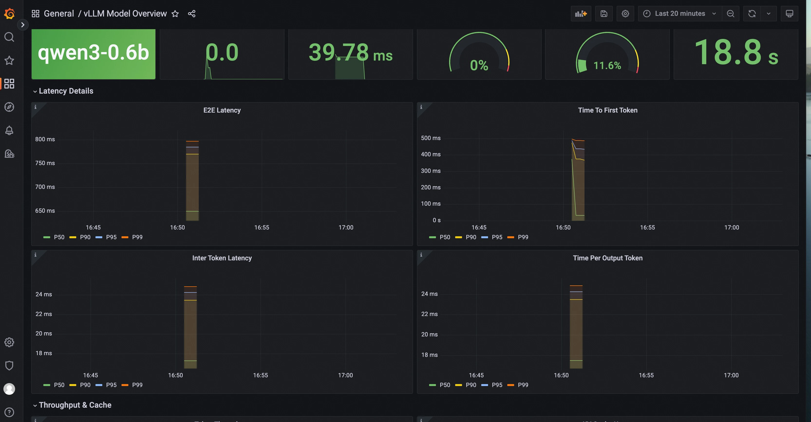

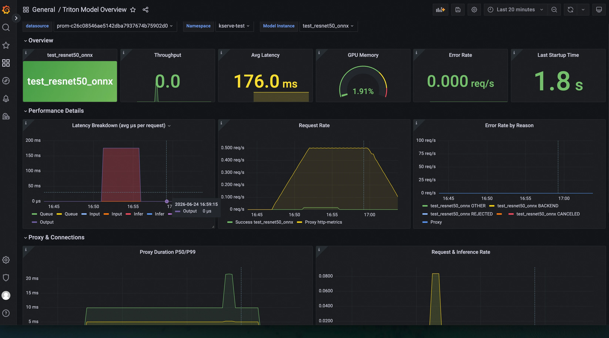

**自建 Kubernetes 集群**

自建 K8s 集群使用开源 kube-prometheus-stack 部署 Prometheus、Grafana 和 Operator基础监控设施，再通过 agentrun-inference-monitoring Helm chart 一键部署采集配置与可视化大盘，实现推理服务监控的快速落地。

**步骤一：确认组件版本**

采集配置与大盘通用的唯一前提，是 Prometheus Operator 提供  `monitoring.coreos.com/v1`  API。该 API 长期稳定，安装当前稳定版即可。

| 组件 | 版本 | 说明 |
| --- | --- | --- |
| kube-prometheus-stack | 87.5.1 | 对应 Prometheus Operator appVersion <code> v0.92.1 </code>。 |
| Prometheus / Grafana /Alertmanager | 随 chart 部署 | 由 chart 决定，无需单独指定。 |

**步骤二：安装 kube-prometheus-stack**

```bash
helm repo add prometheus-community https://prometheus-community.github.io/helm-charts
helm repo update
helm install kube-prom prometheus-community/kube-prometheus-stack \
  -n monitoring --create-namespace
```

安装后集群将具备 Prometheus、Grafana、Alertmanager 及  `PodMonitor`  /  `ServiceMonitor` CRD。

**步骤三　安装监控 chart（采集 + 大盘）**

```bash
helm repo add cloudapp-suites https://cloudapp-suites.github.io/agentrun-inference-monitoring
helm repo update
helm install inference-monitoring cloudapp-suites/agentrun-inference-monitoring \
  -n monitoring \
  --set prometheusReleaseLabel=kube-prom
```

chart 创建两类资源：

- `PodMonitor` ：抓取带  `agentruntime.alibabacloud.com/model`  标签的推理 Pod 的  `:8000/metrics` ，并注入  `namespace`  /  `model_cr`  /  `node`  标签（大盘筛选维度来源）。

- Grafana 大盘 ConfigMap：vLLM / Triton 两个大盘，Grafana sidecar 自动加载，无需手动导入。

> **说明**
>
> - kube-prometheus-stack 默认只选中带有  `release`  标签的监控资源， `prometheusReleaseLabel`  必须与其 release 名一致（本例  `kube-prom` ），否则不会被采集。若安装 kube-prometheus-stack 时已设置  `podMonitorSelectorNilUsesHelmValues=false` （选中所有 monitor），该值可留空。
>
> - 抓取端口、周期、大盘开关等配置项见 chart 仓库 README。

**步骤四：采集 GPU 指标**

**模型级 GPU 显存**随步骤三　安装监控 chart（采集 + 大盘）一起采集到，无需额外组件：

- vLLM 模型用  `vllm_gpu_memory_*`  等。

- Triton 模型用 Triton 原生  `nv_gpu_memory_*`  等。

**步骤五：访问 Grafana 查看大盘**

大盘已随步骤三　安装监控 chart（采集 + 大盘）的 chart 交付，Grafana sidecar 自动加载，无需手动导入。默认在 Dashboards 的 General 目录；要归类到 `AgentRun Inference` 独立目录，安装 kube-prometheus-stack 时追加：

```text
--set grafana.sidecar.dashboards.folderAnnotation=grafana_folder \
--set grafana.sidecar.dashboards.provider.foldersFromFilesStructure=true
```

Grafana 管理员密码由 kube-prometheus-stack 生成、存于 Secret  `kube-prom-grafana` ；其Service 为 ClusterIP，集群外不可直达，临时访问用  `port-forward`  把本机 3000 端口映射进去（长期访问可自行配 Ingress / LoadBalancer）：

```bash
kubectl get secret -n monitoring kube-prom-grafana \
  -o jsonpath='{.data.admin-password}' | base64 -d ; echo
kubectl port-forward -n monitoring svc/kube-prom-grafana 3000:80
```

浏览器打开  `http://localhost:3000` （用户名  `admin`  + 上一步取到的密码），Dashboards 中应出现 `vLLM Model Overview` 与 `Triton Model Overview` 。

> **说明**
>
> 大盘 ConfigMap 需与 Grafana 同命名空间才能被 sidecar 加载；本例 chart 与 kube-prometheus-stack 同装在  `monitoring` ，无需额外处理。

**验证接入**

按一下步骤顺序进行确认：

| 步骤 | 检查项 | 通过标准 |
| --- | --- | --- |
| 1 | 指标端点 | <code> curl Pod:8000/metrics </code> 有输出。 |
| 2 | 采集目标 | Prometheus Targets 页面出现推理 target 且状态 <code> UP </code>。 |
| 3 | 指标入库 | 查询<code>vllm:num_requests_running</code><code> </code> 或<code>triton_throughput_infer_pe</code> <code>r_second </code> 有返回。 |
| 4 | 大盘接通 | Grafana 大盘顶部 <code> namespace </code>/ <code> model </code> 下拉框能选到值。 |


检查具体命令（将  `<namespace>`  替换为实际命名空间）：

```bash
POD=$(kubectl get pods -n <namespace> -l agentruntime.alibabacloud.com/model -o jsonpath='{.items[0].metadata.name}')
kubectl exec $POD -n <namespace> -c kserve-container -- curl -s localhost:8000/metrics 
| head -30
```

看到  `vllm:*` （vLLM 模型）或  `nv_*` （Triton 模型）指标即正常。

自建集群查看 Targets：

```bash
kubectl port-forward -n monitoring svc/kube-prom-kube-prometheus-prometheus 9090:9090
```

# 浏览器打开 http://localhost:9090/targets

**故障排查**

| 现象 | 可能原因 | 处理 |
| --- | --- | --- |
| 大盘无任何数据 | <code> PodMonitor </code> 未被Prometheus 选中。 | 自建：确认安装 chart 时<code>prometheusReleaseLabel</code>与 kube-prometheus-stack 的release 名一致；ACK：确认<code> PodMonitor </code> 创建在 <code> arms-</code><code>prom </code> 命名空间。 |
| Prometheus Targets 无推理target | <code> selector </code>或命名空间不匹配。 | 确认推理 Pod 带<code>agentruntime.alibabacloud.</code><code>com/model </code> 标签，<code> namespaceSelector </code> 覆盖目标命名空间。 |
| Triton 大盘 GPU 面板无数据 | 推理指标未采到（并非缺 GPU 组件）。 | Triton GPU 显存来自推理 Pod 原生 <code> nv_gpu_* </code>，按第一行排查采集。 |
| 大盘 <code> namespace </code> / <code> model </code>下拉为空 | <code> relabelings </code> 缺失或指标未入库。 | 确认 <code> PodMonitor </code> 的<code> relabelings </code> 三项完整，且指标端点正常，详情请参见指标端点检查项。 |
| 部分面板长期无数据 | 推理镜像版本过低。 | 平台增强指标（<code> vllm_* </code> /<code> triton_* </code> / <code> llm_* </code>）需推理镜像 v1.1.0 及以上。 |
| Grafana 无法登录（自建） | 使用了错误的默认密码。 | 从 <code> kube-prom-grafana </code> Secret 取 <code> admin-password </code>，详情请参见访问 Grafana 查看大盘。 |

**附录：指标清单**

指标分两类：引擎原生指标（部署即有）与平台增强指标（推理镜像注入）。

| 前缀 | 类别 | 示例 |
| --- | --- | --- |
| <code>vllm:*</code> | vLLM 原生。 | <code>vllm:time_to_first_token_s</code> <code>econds </code>、<code> vllm:kv_cache_us</code> <code>age_perc </code>、<code> vllm:num_reque</code> <code>sts_running</code> |
| <code>nv_*</code> | Triton 原生。 | <code>nv_inference_request_succe</code> <code>ss </code>、<code> nv_inference_count </code>、<code> nv_gpu_memory_used_bytes</code><code> </code>、<code> nv_gpu_utilization </code> |

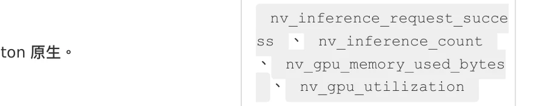

<table>
  <tr>
    <td><code>vllm_*</code></td>
    <td>平台增强（vLLM）。</td>
    <td><code>vllm_engine_startup_total_</code><code>seconds </code>（冷启动分阶段）、<code> vllm_gpu_memory_utili</code> <code>zation </code>、<code> vllm_token_throu</code> <code>ghput_generation_per_second</code></td>
  </tr>
  <tr>
    <td><code>triton_*</code></td>
    <td>平台增强（Triton）。</td>
    <td><code>triton_throughput_infer_pe</code> <code>r_second </code>、<code> triton_avg_req</code> <code>uest_latency_ms </code>、<code> triton_</code><code>engine_startup_total_seconds</code></td>
  </tr>
  <tr>
    <td><code>llm_*</code></td>
    <td>平台增强（TRT-LLM，Triton 大盘<code> TRT-LLM Metrics </code>折叠区使用）。</td>
    <td><code> llm_tokens_per_second </code>、<code>llm_prompt_tokens_bucket</code><code> </code>、<code> llm_completion_tokens_b</code> <code>ucket</code></td>
  </tr>
</table>


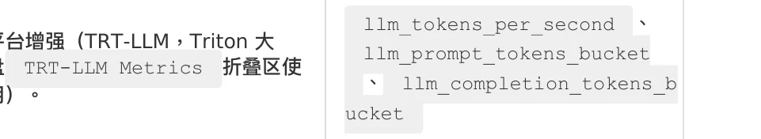

<a id="section-6"></a>

# 6.平台资源

<a id="section-6-1"></a>

## 6.1. 集群

集群在AgentRuntime系统中作为底层基础设施，用于托管和运行 Agent 及其关联工具的计算资源，提供Kubernetes 环境、算力调度、网络网关、存储与监控等能力，支撑智能体的部署、通信、扩缩容及全生命周期管理。

**接入集群**

1. 登录AgentRuntime控制台。

2. 在左侧导航，单击**平台资源 > 集群**。

3. 在**集群管理**页面，单击**接入集群**。

4. 在**接入集群**页面的**基本信息**页签，配置以下配置项，单击**下一步，网关配置**。

   | 配置项 | 描述 | 示例值 |
   | --- | --- | --- |
   | 集群名称 | 请输入集群名称。长度为 1-64 个字符。 | aigateway-cluster |
   | 集群类型 | 请选择集群类型。<br>• 容器服务<br>说明<strong>容器服务</strong>选项默认隐藏，如需使用，请联系产品管理员开启。<br>• 自建 Kubernetes | 自建 Kubernetes |
   | 区域 | 请选择区域。 | 华东（杭州） |
   | Kubeconfig（YAML格式） | 请粘贴你的KubeConfig内容。 | 无 |
   | API Server地址 | KubeConfig内容中Server内容回显。 | 无 |
   | 集群描述 | 描述集群用途，负责团队或维护周期等信息。 | 无 |
   | 测试连通性 | 测试自建Kubernetes的网络连通性。 | 无 |

5. 在**接入集群**页面的**网关配置**页签，配置以下配置项，单击**下一步，域名配置**。

   | 配置项 | 描述 | 示例值 |
   | --- | --- | --- |
   | 网关类型 | 请选择网关类型。<br>• AI 网关 | AI 网关 |
   | 网关列表 | 请选择网关列表。 | 无 |
   | 命名空间 | 选择网关列表之后命名空间回显。 | 无 |

6. 在**接入集群**页面的**域名配置**页签，配置以下配置项，单击**下一步，完成导入**。

   | 配置项 | 描述 | 示例值 |
   | --- | --- | --- |
   | 域名 | 请选择域名。 | 无 |
   | 启用HTTPS | • <strong>启用</strong>：绿色表示已启用。<br>• <strong>不启用</strong>：灰色表示不启用。 | 启用 |
   | 强制HTTPS | 只生效 HTTPS（443端口），HTTP（80端口）访问将被重定向至 HTTPS（443端口）。 | 无 |
   | 证书名称 | 请选择证书名称。 | 无 |

7. 在**接入集群**页面的**完成导入**页签，确认配置信息，单击**完成导入**。

**查看集群详情**

1. 登录AgentRuntime控制台。

2. 在左侧导航，单击**平台资源 > 集群**。

3. 在**集群管理**页面，可以根据**集群名称**或**区域**搜索集群信息。单击**高级筛选**，可以根据**集群名称**和**区域**组合搜索集群信息。

4. 在集群列表中，可以查看**集群/ID**、**ACK集群ID**、**状态**、**算力池节点**、**运行中实例**、**描述**、**区域**、**Kubernetes版本**、**当前组件版本**、**最新组件版本**、**创建时间**和**更新时间**等信息。

5. 在集群列表中，单击目标集群**操作**列的**详情**，进入到**集群详情**页面，可以查看**集群基本信息**、**存储配置**、**沙箱管理器**、**算力池节点**、**关联资源**、**运行时实例列表**、**存储资源**和**集群组件管理**等信息。

   在**集群基本信息**区域，可以查看**集群名称**、**描述**、**集群ID**、**状态**、**算力池节点**、**区域**、**Kubernetes版本**、**当前组件版本**、**最新组件版本**、**创建时间**和**更新时间**等信息。

   在**存储配置**区域，可以查看该集群生效的**对象存储**和**文件存储**，更多详情请参见存储。

   在**沙箱管理器**区域，可以查看**集群内部访问端点**、**集群外部访问端点**和**访问token**等信息。

   > **说明**
   >
   > 在集群管理详情页可以查看当前集群的可观测性配置状态（开启/关闭）。开启可观测性后，集群内创建的 Agent、工具和模型运行时将自动注入可观测探针。

6. 在**算力池节点**、**关联的Agent及工具**、**运行时实例列表**、**存储资源**和**集群组件管理**页签可以进行以下操作。

   **算力池节点**

   在**算力池节点列表**中，可以查看**节点名称**、**IP地址**、**规格**、**操作系统**、**CPU类型**、**GPU类型**和**状态**等信息。

   单击目标算力池节点**操作**列的**查看实例**，可以查看**实例信息**、**状态**、**IP地址**、**类型**、**创建时间**和**更新时间**等信息。

   单击目标算力池节点**操作**列的**移除**，在<strong>确定移除该节点吗？</strong>的对话框中，单击**确定**。

   **关联资源**

   - 在**Agent**页签的**Agent列表**中，可以查看**Agent 名称/ID**、**显示名称**、**描述**、**类型**、**集群**、**命名空间**、**状态**、**最新版本**、**创建时间**和**更新时间**等信息。

     在Agent列表中，单击目标Agent**操作**列的**详情**，可以查看Agent的详细信息，更多详情请参见概览。

   - 在**工具**页签的**工具列表**中，可以查看**工具名称/ID**、**显示名称**、**描述**、**类型**、**状态**、**集群**、**命名空间**、**创建时间**和**更新时间**等信息。

     在工具列表中，单击目标工具**操作**列的**详情**，可以查看工具的详细信息，更多详情请参见概览。

   - 在**模型**页签的**模型服务**列表中，可以查看**显示名称/ID**、**模型名称**、**部署环境**、**描述**、**状态**、**集群名称/ID**、**命名空间**、**创建时间**和**更新时间**等信息。

     在模型服务列表中，单击目标模型**操作**列的**详情**，可以查看模型的详细信息，更多详情请参见概览。

   **运行时实例列表**

   在**运行时实例列表**页签，可以查看**实例信息**、**状态**、**IP地址**、**类型**、**创建时间**和**更新时间**等信息。

   在**运行时实例列表**中，单击目标运行时实例**操作**列的**详情**，可以查看**实例名称**、**集群ID**、**命名空间**、**运行状态**、**IP地址**、**主机IP**、**CPU使用量**、**CPU限制**、**内存使用量**、**内存限制**、**GPU 显存分配量**、**GPU 算力分配百分比**、**GPU 实时利用率**、**运行时长**和**启动时间**等信息。

   在**运行时实例列表**中，单击目标运行时实例**操作**列的**终端**，在**实例终端**对话框，选择**container**，单击**连接**。

   在**运行时实例列表**中，单击目标运行时实例**操作**列的**日志**，在**查看日志**对话框，选择**容器**，查看日志。

   **存储资源**

   - 在**存储资源**页签的**资源拓扑**页签中，可以查看**算力池节点**（个）、**集群存储总容量**、**已使用量**、**快照占用**和**快照总数**（个）的统计。

     在**存储资源**页签的列表中，可以查看**节点名称**、**类型**、**磁盘分区**、**总量**和**使用情况**等信息。

   - 在**存储资源**页签的**快照列表**页签中，可以根据**类型**、**状态**、**节点**或**关键词**进行检索，也可以单击高级筛选，根据**类型**、**状态**、**节点**和**关键词**组合筛选。

     在**快照列表**页签的列表中，可以查看**ID/名称**、**类型**、**关联对象/Revision**、**节点**、**大小**、**创建时间**、**最近一次使用时间**和**状态**等信息。

     在**快照列表**页签的列表中，单击目标快照**操作**列的**删除**，在二次确认对话框中，单击**确定**。

   **集群组件管理**

   在**集群组件管理**页签，可以查看并管理当前集群支持托管安装的组件，在组件列表中，可以查看**组件名称**、**描述**、**架构**、**状态**和**版本**等信息。

   - 安装组件

     以ArtSandbox组件为例，单击ArtSandbox组件**操作**列的**安装**。

     - 在**安装ArtSandbox**页面的**沙箱算力节点**区域，请选择运行 ArtSandbox 引擎的节点，GPU 节点已自动过滤。

       > **重要**
       >
       > 所选节点将安装安全沙箱引擎并触发重启，请先排空节点上的业务容器。

     - 在**安装ArtSandbox**页面的**存储配置**区域，填写以下配置项，单击**执行预检查**，然后单击**确认安装**。

       <table>
         <tr>
           <th>配置项</th>
           <th>说明</th>
           <th>示例值</th>
         </tr>
         <tr>
           <td colspan="3">节点数据盘存储配置</td>
         </tr>
         <tr>
           <td>启用 Loopback 数据盘</td>
           <td>启用后，当目标路径不是 XFS 挂载点时，将在节点本地创建Loopback XFS 数据盘。<br>• 开启<br>• 关闭</td>
           <td>开启</td>
         </tr>
         <tr>
           <td>沙箱存储路径</td>
           <td>沙箱快照及系统存储路径由平台统一管理，不支持修改。</td>
           <td>/data/sandbox</td>
         </tr>
         <tr>
           <td>沙箱数据盘容量（GiB）</td>
           <td>该容量同时用于所选节点的安装前存储空间检查。</td>
           <td>50</td>
         </tr>
         <tr>
           <td colspan="3">管控持久化存储配置</td>
         </tr>
         <tr>
           <td>StorageClass</td>
           <td>请选择<strong>StorageClass。</strong></td>
           <td>无</td>
         </tr>
         <tr>
           <td>存储空间（GiB）</td>
           <td>请填写存储空间大小。</td>
           <td>50</td>
         </tr>
         <tr>
           <td colspan="3">数据库配置</td>
         </tr>
         <tr>
           <td>部署模式</td>
           <td>• <strong>生产模式</strong>：生产模式连接外部数据库。<br>• <strong>POC 模式</strong>：POC 模式使用组件内置 MySQL 与 Redis，并复用上方 StorageClass 和存储容量。</td>
           <td>生产模式</td>
         </tr>
         <tr>
           <td colspan="3">MySQL 配置<br>说明当<strong>数据库配置</strong>的<strong>部署模式</strong>为<strong>生产模式</strong>时显示。</td>
         </tr>
         <tr>
           <td>MySQL 连接端点</td>
           <td>请输入MySQL 连接端点。</td>
           <td>mysql.example.com</td>
         </tr>
         <tr>
           <td>MySQL 端口</td>
           <td>请输入MySQL 端口。</td>
           <td>3306</td>
         </tr>
         <tr>
           <td>MySQL 数据库</td>
           <td>请输入MySQL 数据库。</td>
           <td>无</td>
         </tr>
         <tr>
           <td>MySQL 用户名</td>
           <td>请输入MySQL 用户名。</td>
           <td>无</td>
         </tr>
         <tr>
           <td>MySQL 密码</td>
           <td>请输入MySQL 密码。</td>
           <td>无</td>
         </tr>
         <tr>
           <td colspan="3">Redis 配置<br>说明当<strong>数据库配置</strong>的<strong>部署模式</strong>为<strong>生产模式</strong>时显示。</td>
         </tr>
         <tr>
           <td>Redis 连接端点</td>
           <td>请输入Redis 连接端点。</td>
           <td>redis.example.com</td>
         </tr>
         <tr>
           <td>Redis 端口</td>
           <td>请输入Redis 端口。</td>
           <td>6379</td>
         </tr>
         <tr>
           <td>Redis 密码</td>
           <td>请输入Redis 密码。</td>
           <td>无</td>
         </tr>
       </table>

**编辑集群**

1. 登录AgentRuntime控制台。

2. 在左侧导航，单击**平台资源 > 集群**。

3. 在集群列表中，单击目标集群**操作**列的**编辑**，配置以下配置项，单击**保存**。

   | 配置项 | 描述 | 示例值 |
   | --- | --- | --- |
   | 名称 | 请输入集群名称。长度为 1-64 个字符。 | aigateway-cluster |
   | 集群类型 | 请选择集群类型。<br>• 自建 Kubernetes<br>• 容器服务 | 自建 Kubernetes |
   | 区域 | 请选择区域。 | 无 |
   | Kubeconfig（YAML格式） | 集群类型选择<strong>自建</strong><strong>Kubernetes</strong>显示，请粘贴你的KubeConfig内容。 | 无 |
   | API Server地址 | 集群类型选择<strong>自建</strong><strong>Kubernetes</strong>显示，KubeConfig内容中Server内容回显。 | 无 |
   | 描述 | 描述集群用途，负责团队或维护周期等信息。 | 无 |

**删除集群**

1. 登录AgentRuntime控制台。

2. 在左侧导航，单击**平台资源 > 集群**。

3. 在集群列表中，单击目标集群**操作**列的**删除**，在<strong>确认删除该集群吗？</strong>对话框中，单击**确定**。

**更多操作**

1. 登录AgentRuntime控制台。

2. 在左侧导航，单击**平台资源 > 集群**。

3. 在集群列表中，单击**操作**列的**详情**，进入到**集群详情**页面。

   - 单击右上角的**域名设置**，可以配置以下配置项，单击**确定**。

     | 配置项 | 描述 | 示例值 |
     | --- | --- | --- |
     | 域名 | 请选择域名。 | 无 |
     | 启用SSL证书 | • <strong>启用</strong>：绿色表示已启用。<br>• <strong>不启用</strong>：灰色表示不启用。 | 启用 |
     | SSL证书 (Certificate) | 请粘贴 SSL 证书内容（PEM格式）或者单击<strong>一键生成证书</strong>自动补充。<br>说明当<strong>启用SSL证书</strong>为<strong>启用</strong>时显示。 | 无 |
     | 私钥 (Private Key) | 请粘贴私钥内容（PEM格式）或者单击<strong>一键生成证书</strong>自动补充。<br>说明当<strong>启用SSL证书</strong>为<strong>启用</strong>时显示。 | 无 |
     | 启用HTTPS | • <strong>启用</strong>：绿色表示已启用。<br>• <strong>不启用</strong>：灰色表示不启用。<br>说明当<strong>启用SSL证书</strong>为<strong>启用</strong>时显示。 | 启用 |

   - 单击右上角的**网关设置**，可以配置以下配置项，单击**确定**。

     | 配置项 | 描述 | 示例值 |
     | --- | --- | --- |
     | 网关类型 | 默认为<strong>Higress</strong>。 | Higress |
     | 网关详情 | 网关类型选择<strong>Higress</strong>时，可以查看<strong>命名空间</strong>、<strong>Ingress</strong> <strong>Class</strong>和<strong>访问Endpoint</strong>等信息。 | 无 |

   - 单击右上角的**镜像源设置**，请选择镜像源配置，单击**绑定配置**。关于镜像源配置的更多信息，请参见镜像源。

   - 单击右上角的**更多 > 可观测性配置**，在**可观测性配置**对话框中，根据业务需要进行配置，单击**保存配置**。

     | 参数 | 说明 | 示例值 |
     | --- | --- | --- |

     <table>
       <tr>
         <td>可观测性</td>
         <td>选择是否开启集群可观测性。默认关闭。开启后选择<strong>aiobs</strong>或<strong>开源 OTLP</strong>，在创建集群内 Agent或工具时可选择是否注入探针，自动采集可观测性数据。支持以下三类可观测信号：<br>• <strong>Trace</strong>：通过 Jaeger 查看调用链路。<br>• <strong>Metrics</strong>：通过 Grafana 可观测性监控大盘查看，可按应用名称过滤。<br>• <strong>Logs</strong>：通过 Loki 查看。当前注入的探针暂不支持自动采集应用日志，如需通过 Loki 采集日志，请在应用侧自行接入日志 SDK。</td>
         <td>开启（开源 OTLTP）</td>
       </tr>
     </table>

     集群可观测性配置选择关闭时，Agent 和工具的创建、编辑、详情页中探针注入相关项置灰，不注入探针。

     - 配置开源OTLP。

       | 参数 | 说明 | 示例值 |
       | --- | --- | --- |
       | OTLP Endpoint | 必填。填写 OTLP 数据上报端点地址。 | http://10.xxx.xxx.xxx:4318 |
       | 启用 traces | 开启后注入 OTLP traces 上报配置，Jaeger 跳转链接随之可用。 | 开启 |
       | 启用 metrics | 开启后注入 OTLP metrics 上报配置，Grafana 大盘链接随之可用。 | 开启 |
       | 启用 logs | 开启后注入 OTLP metrics 上报配置，Grafana 大盘链接随之可用。 | 开启 |
       | Headers | 可选。OTLP 上报时携带的自定义鉴权头，格式为k1=v1,k2=v2。 | Authorization=Bearer xxx |
       | Jaeger 跳转地址 | 填写 Jaeger 跳转地址。 | 172.xxx.xxx.xxx |
       | Grafana 跳转地址 | 填写 Grafana 跳转地址。 | http://172.xxx.xxx.xxx:3049 2 |
       | Loki 跳转地址 | 填写 Loki 跳转地址，下方显示连通性测试状态。 | http://172.xxx.xxx.xxx:3049 2 |

   - 单击右上角的**更多 > 编辑算力池**，在**编辑算力池**页面，可以查看**节点名称**、**IP地址**、**规格**、**安全等级**、**操作系统**、**CPU类型**、**GPU类型**和**状态**等信息。

   - 在计算池列表中，可以选择多个目标节点名称，单击**确定**。

<a id="section-6-2"></a>

## 6.2. 镜像

<a id="section-6-2-1"></a>

### 6.2.1. 镜像仓库

镜像仓库用于管理容器镜像仓库的访问凭证，配置仓库地址、用户名和密码后，平台可自动拉取私有镜像用于 Agent 和工具的构建与部署，配置完成后自动下发到关联集群。

**新增镜像仓库**

1. 登录AgentRuntime控制台。

2. 在左侧导航，单击**平台资源 > 镜像**。

3. 在**镜像配置**页面，确认当前处于**镜像仓库**页签，单击**新增**。

4. 在**创建镜像仓库**页面，配置以下配置项，单击**确定**。

   | 配置项 | 描述 | 示例值 |
   | --- | --- | --- |
   | 仓库地址 | 请输入镜像仓库的访问地址。 | registry.cn-hangzhou.aliyuncs.com |
   | 用户名 | 请输入镜像仓库的登录用户名。 | user@example.com |
   | 密码 | 请输入镜像仓库的登录密码。 | 无 |
   | 描述 | 请输入描述信息，最多 512 个字符。 | 阿里云 ACR 杭州 |

**更多操作**

1. 登录AgentRuntime控制台。

2. 在左侧导航，单击**平台资源 > 镜像**。

3. 在**镜像仓库**页签，可以根据**仓库地址**搜索镜像仓库信息。

4. 在镜像仓库列表中，可以查看**仓库地址**、**用户名**、**描述**、**更新时间**等信息。

5. 在镜像仓库列表中，单击目标镜像仓库**操作**列的**编辑**，可以修改镜像仓库的配置信息。

6. 在镜像仓库列表中，单击目标镜像仓库**操作**列的**删除**，在二次确认对话框中，单击**确定**。

<a id="section-6-2-2"></a>

### 6.2.2. 镜像源

在软件开发中，依赖包的高效、稳定获取是保障研发效率与系统可靠性的关键。本文介绍镜像源配置，一站式解决 Python（pip / uv）与 Node.js（npm）等主流生态的镜像加速与安全配置问题。

**创建镜像源配置**

1. 登录AgentRuntime控制台。

2. 在左侧导航，单击**平台资源 > 镜像**。

3. 在**镜像源**页签，单击**新增**。

4. 在**创建镜像源配置**页面，配置以下配置项，单击**确定**。

   | 配置项 | 描述 | 示例值 |
   | --- | --- | --- |
   | 配置名称 | 镜像源配置的唯一标识名称，用于在 Agent/工具构建时选择使用镜像源。 | china-mirrors |
   | 描述 | 记录该镜像源配置的用途或适用场景。 | 国内网络环境使用的镜像源配置。 |
   | UV 主镜像源 | UV 包安装器的主要镜像源地址（对应 UV_INDEX_URL）。UV是一个高性能的 Python 包安装工具，平台默认使用 UV 安装Python 依赖。 | https://mirrors.aliyun.com/pyp i/\*\*\*\*\*\* |
   | UV 额外镜像源 | UV 包安装器的备用镜像源地址（对应UV_EXTRA_INDEX_URL）。当主镜像源中找不到某个包时，会从额外镜像源查找。多个URL用空格分隔，最多10个。 | https://pypi.org/\*\*\*\*\*\* |
   | pip 主镜像源 | pip 的主要镜像源地址（对应PIP_INDEX_URL）。用于Python 包的安装，当构建环境使用 pip 而非 UV 时生效。 | https://mirrors.aliyun.com/pyp i/\*\*\*\*\*\* |
   | pip 可信主机 | pip 的可信主机列表（对应PIP_TRUSTED_HOST）。当镜像源使用 HTTP 或自签名 HTTPS 证书时，需将其域名加入可信列表以跳过证书校验。多个主机用空格分隔。 | mirrors.aliyun.com |
   | npm 镜像源 | npm 包管理器的镜像源地址（对应NPM_CONFIG_REGISTRY）。用于 Node.js 包的安装。 | https://registry.npmmirrors.co m |

5. 创建完成后，可以在集群管理详情页面配置镜像源，更多操作请参见镜像源设置。

**更多操作**

1. 登录AgentRuntime控制台。

2. 在左侧导航，单击**平台资源 > 镜像**。

3. 在**镜像源**页签，可以根据**镜像源名称**或**状态**搜索镜像源配置信息。单击**高级筛选**，可以根据**镜像源名称**和**状态**组合搜索镜像源配置信息。

4. 在镜像源配置列表中，可以查看**镜像源名称/ID**、**状态**、**创建时间**和**更新时间**等信息。

5. 在镜像源配置列表中，单击目标镜像源**操作**列的**详情**，在**镜像源配置详情**页面，可以查看**配置ID**、**配置名称**、**描述**、**UV 主镜像源**、**UV 额外镜像源**、**pip 主镜像源**、**pip 可信主机**、**npm 镜像源**、**状态**、**创建时间**和**更新时间**等信息。

6. 在镜像源配置列表中，单击目标镜像源**操作**列的**编辑**，在**编辑镜像源配置**页面，修改配置项，单击**确定**。配置项详情请参见：创建镜像源配置。

7. 在镜像源配置列表中，单击目标镜像源**操作**列的**禁用**，在<strong>确定禁用该镜像源配置吗？</strong>对话框中，单击**确定**。

8. 在镜像源配置列表中，单击目标镜像源**操作**列的**启用**，在<strong>确定启用该镜像源配置吗？</strong>对话框中，单击**确定**。

9. 在镜像源配置列表中，单击目标镜像源**操作**列的**删除**，在<strong>确定删除该镜像源配置吗？</strong>对话框中，单击**确定**。

<a id="section-6-3"></a>

## 6.3. 存储

AgentRuntime 存储配置管理提供统一的对象存储（S3 兼容）与文件存储（NFS/JuiceFS）接入能力，支持租户级或集群级生效范围、多 Bucket 功能划分、CSI 挂载参数精细化控制及连通性测试，实现 AI 应用所需存储资源的集中化、安全化与自动化运维。

**新增存储配置**

1. 登录AgentRuntime控制台。

2. 在左侧导航，单击**平台资源 > 存储**。

3. 在**存储配置管理**页面，单击**新增**。

4. 在**创建存储配置**页面，配置以下配置项，单击**保存配置**。

   <table>
     <tr>
       <th>配置项</th>
       <th>描述</th>
       <th>示例值</th>
     </tr>
     <tr>
       <td>类型</td>
       <td>请选择存储类型。<br>• <strong>对象存储</strong>：兼容 S3 协议，如OSS、MinIO、COS，支持文件上传。<br>• <strong>文件存储</strong>：NFS / JuiceFS 等，仅支持 PVC 挂载，不支持上传。</td>
       <td>对象存储</td>
     </tr>
     <tr>
       <td>配置名称</td>
       <td>存储配置的唯一标识名称。</td>
       <td>agentruntime</td>
     </tr>
     <tr>
       <td>显示名称</td>
       <td>请输入显示名称。</td>
       <td>无</td>
     </tr>
     <tr>
       <td>描述</td>
       <td>请输入描述，对该存储配置的简要说明。</td>
       <td>无</td>
     </tr>
     <tr>
       <td>生效范围</td>
       <td>请选择生效范围。<br>• <strong>租户</strong>：租户存储配置，需配置 6个功能 Bucket。<br>说明租户比集群生效范围多一个技能存储的bucket。<br>• <strong>集群</strong>：集群存储配置，需配置 5个功能 Bucket。<br>说明集群用存储时两级解析：优先使用集群绑定的配置，集群未绑定配置或已绑定的配置被禁用时，实际生效的是租户启用配置。</td>
       <td>租户</td>
     </tr>
     <tr>
       <td>生效集群</td>
       <td>请选择生效集群，同一集群仅可绑定一个同类型存储配置。保存后，所选集群将统一绑定至本配置，已绑定其他同类型配置的集群将被覆盖。<br>说明当<strong>生效范围</strong>选择<strong>集群</strong>时显示。</td>
       <td>无</td>
     </tr>
     <tr>
       <td colspan="3">对象存储配置<br>说明当<strong>类型</strong>选择<strong>对象存储</strong>时显示。</td>
     </tr>
     <tr>
       <td>Endpoint</td>
       <td>兼容标准 S3 协议的存储服务地址，如阿里云 OSS、MinIO、AWS S3 等。</td>
       <td>http://oss-cn-beijing.aliyuncs.com</td>
     </tr>
     <tr>
       <td>Region</td>
       <td>请选择Region。</td>
       <td>cn-beijing</td>
     </tr>
     <tr>
       <td>Access Key ID</td>
       <td>使用仅具备目标Bucket读写权限的子账号AK。</td>
       <td>LTAI******</td>
     </tr>
     <tr>
       <td>Access Key Secret</td>
       <td>使用仅具备目标Bucket读写权限的子账号SK。</td>
       <td>无</td>
     </tr>
     <tr>
       <td colspan="3">Bucket 配置</td>
     </tr>
     <tr>
       <td>用户上传包</td>
       <td>请选择或输入用户上传包，用于存放用户上传的应用包文件。</td>
       <td>无</td>
     </tr>
     <tr>
       <td>部署加速存储</td>
       <td>请选择或输入部署加速存储，用于部署流程的分发加速缓存。</td>
       <td>无</td>
     </tr>
     <tr>
       <td>存储卷</td>
       <td>请选择或输入存储卷，用于 ACK PVC 存储卷挂载。</td>
       <td>无</td>
     </tr>
     <tr>
       <td>模型默认部署仓库</td>
       <td>用于模型默认部署存储。</td>
       <td>无</td>
     </tr>
     <tr>
       <td>模型转换存储仓库</td>
       <td>用于模型转换过程存储。</td>
       <td>无</td>
     </tr>
     <tr>
       <td>技能存储</td>
       <td>用于存放技能相关文件及资源。</td>
       <td>无</td>
     </tr>
     <tr>
       <td colspan="3">文件存储配置<br>说明当<strong>类型</strong>选择<strong>文件存储</strong>时显示。</td>
     </tr>
     <tr>
       <td>文件存储类型</td>
       <td>请选择文件存储类型。<br>• 标准 NFS/NAS<br>• <strong>JuiceFS</strong>：JuiceFS 文件系统（只挂载已 format 的卷）。</td>
       <td>标准 NFS/NAS</td>
     </tr>
     <tr>
       <td>Server</td>
       <td>NFS 服务器地址。<br>说明<strong>文件存储类型</strong>选择<strong>标准</strong><strong>NFS/NAS</strong>时显示。</td>
       <td>172.16.0.1或xxx.nas.aliyuncs.com</td>
     </tr>
     <tr>
       <td>导出目录 / 共享路径 basePath</td>
       <td>阿里云 NAS 可留空（默认 /）；标准 NFS CSI(nfs.csi.k8s.io) 必填。<br>说明<strong>文件存储类型</strong>选择<strong>标准</strong><strong>NFS/NAS</strong>时显示。</td>
       <td>/或/exports/data</td>
     </tr>
     <tr>
       <td>卷名 volumeName</td>
       <td>请输入卷名。</td>
       <td>myjfs</td>
     </tr>
     <tr>
       <td>元数据引擎 metaurl</td>
       <td>含引擎密码，加密存储、脱敏展示（存 metaSecret 列）。对象后端的 bucket 与 AK/SK 已写在元数据引擎里，这里无需再填。</td>
       <td>redis://:pass@host:6379/1</td>
     </tr>
     <tr>
       <td>额外环境变量 envs</td>
       <td>S3 兼容后端（含 MinIO）必填AWS_REGION。</td>
       <td>AWS_REGION：cn-hangzhou</td>
     </tr>
     <tr>
       <td colspan="3">高级配置（CSI）<br>说明CSI 挂载参数，通常无需修改，仅在需要自定义驱动行为时调整。</td>
     </tr>
     <tr>
       <td>CSI 驱动</td>
       <td>请选择CSI驱动。<br>说明当<strong>类型</strong>选择<strong>文件存储</strong>，<strong>文件存</strong><strong>储类型</strong>为<strong>JuiceFS</strong>，不可修改。</td>
       <td>无</td>
     </tr>
   </table>

   <table>
     <tr>
       <td>volumeAttributes</td>
       <td>• 透传给 CSI 驱动的挂载参数(key-value)，控制挂载行为。<br>说明<br>• 当<strong>类型</strong>选择<strong>对象存</strong><strong>储</strong>时显示。<br>• 当<strong>类型</strong>选择<strong>文件存</strong><strong>储</strong>，<strong>文件存储类</strong><strong>型</strong>为<strong>标准</strong><strong>NFS/NAS</strong>显示。<br>• 写入 StorageClass 的parameters。凭证引用与pathPattern 由系统自动注入，通常无需手填；若要自定义pathPattern 或加juicefs/host-path 就填在这里。Mount Pod 资源限制建议改用 juicefs-csi-driver-config ConfigMap。<br>说明当<strong>类型</strong>选择<strong>文件存储</strong>，<strong>文</strong><strong>件存储类型</strong>为<strong>JuiceFS</strong>填写。</td>
       <td>无</td>
     </tr>
     <tr>
       <td>mountOptions</td>
       <td>挂载选项，透传到 PV /StorageClass 的mountOptions，用逗号进行分隔。<br>说明<br>• 当<strong>类型</strong>选择<strong>对象存</strong><strong>储</strong>时显示。<br>• 当<strong>类型</strong>选择<strong>文件存</strong><strong>储</strong>，<strong>文件存储类</strong><strong>型</strong>为<strong>标准</strong><strong>NFS/NAS</strong>显示。</td>
       <td>无</td>
     </tr>
     <tr>
       <td>测试连通性</td>
       <td>测试存储配置的网络连通性。<br>说明当<strong>类型</strong>选择<strong>对象存储</strong>时显示。</td>
       <td>无</td>
     </tr>
   </table>

**查看存储配置**

1. 登录AgentRuntime控制台。

2. 在左侧导航，单击**平台资源 > 存储**。

3. 在**存储配置管理**页面，可以根据**配置名称**、**显示名称**、**生效范围（租户、集群）**、**类型**或**状态**搜索存储配置信息。单击**高级筛选**，可以根据**配置名称**、**显示名称**、**生效范围（租户、集群）**、**类型**和**状态**组合搜索存储配置信息。

4. 在存储配置列表中，可以查看**显示名称/ID**、**配置名称**、**生效范围**、**类型**、**状态**、**创建时间**和**更新时间**等信息。

5. 在存储配置列表中，单击目标存储配置的**显示名称/ID**或**操作**列的**详情**，打开**存储配置详情**页面，可以查看**基本信息**、**对象存储配置**、**Bucket配置**和CSI 挂载配置等信息。

   在**基本信息**区域，可以查看**类型**、**配置名称**、**显示名称**、**描述**、**生效范围**、**生效集群**、**状态**、**创建时间**和**更新时间**等信息。

   在**对象存储配置**区域，可以查看**Endpoint**、**Region**、**Access Key ID**和**Access Key Secret**等信息。

   在**文件存储信息**区域，可以查看**文件存储类型**、**版本 edition**、**卷名 volumeName**、**元数据引擎metaurl**和**额外环境变量 envs**等信息。

   在**Bucket配置**区域，可以查看**用户上传包**、**部署加速存储**、**存储卷**、**模型默认部署仓库**和**模型转换存储仓库**等信息。

   在**CSI 挂载配置**区域，可以查看**驱动**、**mountOptions**、**volumeAttributes**等信息。

**编辑存储配置**

1. 登录AgentRuntime控制台。

2. 在左侧导航，单击**平台资源 > 存储**。

3. 在存储配置列表中，单击目标存储配置的**操作**列的**编辑**。

4. 在编辑存储配置页面，可以对显示名称和描述等参数进行编辑，更多参数说明请参见新增存储配置。

**禁用/启用存储配置**

1. 登录AgentRuntime控制台。

2. 在左侧导航，单击**平台资源 > 存储**。

3. 禁用：在存储配置列表中，单击目标存储配置的**操作**列的**禁用**，在二次确认对话框中，单击**确定**。

   启用：在存储配置列表中，单击目标存储配置的**操作**列的**启用**。在二次确认对话框中，单击**确定**。

   > **说明**
   >
   > 租户范围内，同一对象存储或文件存储仅允许保持一个启用配置。确认启用本配置后，其他已启用的文件存储配置将被自动禁用。

<a id="section-7"></a>

# 7.安全与权限

<a id="section-7-1"></a>

## 7.1. Agent访问控制

<a id="section-7-1-1"></a>

### 7.1.1. 核心概念速览

AgentRuntime 构建以身份为中心、角色为纽带、策略为规则、鉴权模式为开关的统一访问控制体系，通过网关集中认证授权，实现细粒度、可审计、高安全的资源调用管控。

> **说明**
>
> 这里管理的是 AI 服务的 API 调用权限，不是控制台用户的操作权限。Agent、工具(Tool)、模型运行时(ModelRuntime) 在互相调用时，以及外部应用通过 API Key / OAuth2 接入时，均由网关统一鉴权。

AgentRuntime 的访问控制体系围绕四个核心概念展开：

| 概念 | 一句话解释 | 控制台入口 |
| --- | --- | --- |
| 身份（Identity） | "你是谁"——每个 Agent/工具/模型/外部系统都有唯一身份标识（URI）。 | Agent访问控制 &gt; 身份管理 |
| 角色（Role） | "你属于哪一类"——身份的分组标签，用于批量授权。 | Agent访问控制 &gt; 角色管理 |
| 策略（Policy） | "允许/拒绝做什么"——描述对哪些资源、允许还是拒绝调用。 | Agent访问控制 &gt; 访问策略 |
| 鉴权模式（Auth Mode） | "网关要不要管"——按集群配置网关的鉴权执行严格程度。 | Agent访问控制 &gt; 鉴权配置 |

**授权链路**：身份 → 绑定角色 → 角色挂载策略 → 策略声明对哪些资源允许/拒绝调用。

身份 (Identity)

绑定

角色 (Role)

挂载

策略(Policy)

声明

允许/拒绝访问某资源

**一次调用的完整链路**：所有对平台内资源的调用都经过同一条数据链路。

调用方

携带自己的凭证

API网关

后端负载（Agent/工具/模型/系统组件）

认证：凭证是否合法（伪造/过期/已吊销？）

授权：调用方的角色策略是否允许访问该目标（按集群鉴权模式）

全部通过才转发，被拦截的请求不会到达后端，网关记录审计日志

记住三个要点：

- **凭证代表“调用方自己”**，不是目标方的钥匙，不需要获取对方的任何密钥。

- **认证与授权都在网关统一完成**，由平台的角色/策略集中管理，可审计。

- **被网关拒绝的请求不会到达后端**，是否放行只取决于身份凭证 + 角色策略 + 集群鉴权模式。

<a id="section-7-1-2"></a>

### 7.1.2. Agent访问概览

管理 Agent、工具(Tool) 和 模型运行时(ModelRuntime) 的 API 调用权限。

**查看访问概览**

1. 登录AgentRuntime控制台。

2. 在左侧导航，单击**安全与权限 > Agent访问控制**。

3. 在**访问概览**页面，可以查看以下信息。

   **适用场景**

   - **内部互调**

     Agent、工具(Tool)、模型运行时(ModelRuntime) 在互相调用时，或平台基础组件（如 sandbox-manager）调用这些服务时，网关都会验证调用方是否有权访问目标服务。

   - **外部接入**

     外部系统或应用携带 API Key / OAuth2 凭证调用平台上的 Agent / 工具(Tool) / 模型运行时(ModelRuntime) 时，网关统一鉴权后放行或拒绝。

   可以查看**访问策略**、**角色**、**平台身份**和**外部身份**的资源信息。

   单击**访问策略**卡片，进入到**访问策略**页面，更多详情请参见访问策略。

   单击**角色**卡片，进入到**角色管理**页面，更多详情请参见角色管理。

   单击**平台身份**卡片，进入到**身份管理**页面的**平台身份**页签，更多详情请参见管理平台身份。

   单击**外部身份**卡片，进入到**身份管理**页面的**外部身份**页签，更多详情请参见管理外部身份。

   **核心概念**

   

   角色

   策略

   资源权限

   谁在调用

   权限包

   规则合集

   定义

   绑定

   关联

   Allow/Deny

   > **说明**
   >
   > 身份代表“谁”（Agent / 工具（Tool）/ 模型运行时（ModelRuntime） / 外部应用），角色是策略的集合，策略定义对具体资源的允许或拒绝规则。拒绝（Deny）始终优先于允许（Allow）。

   **策略管理**：定义“谁允许/拒绝调用哪个服务”的规则，单击**策略管理**卡片，进入到**访问策略**页面，更多详情请参见访问策略。

   **角色管理**：将策略组合成角色，批量授权给多个调用方。单击**角色管理**卡片，进入到**角色管理**页面，更多详情请参见角色管理。

   **身份管理**：管理调用方身份，为其分配角色和调用权限。单击**身份管理**卡片，进入到**身份管理**页面的**平台身份**页签，更多详情请参见身份管理。

<a id="section-7-1-3"></a>

### 7.1.3. 身份管理

AgentRuntime 身份管理系统提供平台自动托管与外部手动注册双模身份机制，支持 JWT 及 API Key/OAuth2 多种鉴权方式，并通过细粒度的角色分配、凭证生命周期管理及安全吊销功能，实现了对内部组件与外部应用访问权限的统一管控与安全治理。

**两种身份区别**

管理平台身份和外部注册身份，两种身份类型区别如下：

| 维度 | 平台身份 | 外部身份 |
| --- | --- | --- |
| 归属 | Agent / 工具（ToolServer） / 模型（Model）。 | 平台外部的应用/系统。 |
| 创建方式 | 系统自动创建，<strong>不可手动注册。</strong> | 用户在控制台手动“注册外部身份”。 |
| 鉴权方式 | JWT（长期有效，自动签发并挂载到Pod）。 | API Key 或 OAuth2（Client Credentials）。 |
| URI 格式 | <code> agent://</code>租户<code>/</code>集群<code>/</code>命名空间<code>/</code>名称<code> </code>（tool/model 同理。） | <code> external://</code>租户<code>/</code>名称<code> </code>。 |


**管理平台身份**

1. 登录AgentRuntime控制台。

2. 在左侧导航，单击**安全与权限 > Agent访问控制**。

3. 在平台身份页签，可以根据身份标识、集群、命名空间或类型进行筛选，也可以单击**高级筛选**，根据身份标识、集群、命名空间和类型组合筛选。

4. 在平台身份列表中，可以查看**名称**、**身份标识**、**类型**、**命名空间**、**鉴权方式**、**已分配角色**和**创建时间**等信息。

5. 在平台身份列表中，单例目标平台身份**操作**列的**查看**，可以查看并配置以下信息。

   - 在**基本信息**区域，可以查看**名称**、**身份标识**、**类型**、**鉴权方式**、**集群**、**命名空间**和**创建时间**等信息。

   - 在**JWT凭证信息**区域，可以查看**JWT状态**、**主体（sub）**、**有效期**和**JWT Token**等信息。

     - **重新签发**：单击**重新签发**，在二次确认对话框中，单击**确定**。

       > **重要**
       >
       > 重新签发后旧 JWT 将立即失效，此操作不可撤销。

     - **吊销**：单击**吊销**，在二次确认对话框中，单击**确定**。

       > **重要**
       >
       > 吊销后该身份的所有凭证将立即失效，此操作不可撤销。

   - 在**已分配角色**区域，可以查看已分配角色的**角色名称**信息。

     - <strong>分配角色：</strong>单击**分配角色**，在**分配角色**页面，可以根据角色名称检索，选择角色（可多选），单击**确定**。

     - <strong>移除：</strong>在已分配角色列表中，单击目标角色**操作**列的**移除**，在二次确认对话框中，单击**确定**。

**管理外部身份**

**注册外部身份**

1. 登录AgentRuntime控制台。

2. 在左侧导航，单击**安全与权限 > Agent访问控制**。

3. 在**身份管理**页面，单击**外部身份**页签。

4. 在**外部身份**页签中，单击**注册外部身份**，配置以下配置项，单击**确定**。

   | 配置项 | 描述 | 示例值 |
   | --- | --- | --- |
   | 名称 | 请输入名称，小写字母、数字和短横线，身份标识将自动生成为external://tenant/{name}。 | alice-service |
   | 鉴权方式 | 请选择鉴权方式：<br>• <strong>API Key</strong>：生成一个密钥字符串。<br>• <strong>OAuth2</strong>：生成 Client ID + Client Secret 凭证对。<br>说明两种凭证均只在创建后完整展示一次，请提前准备好保存方式。 | 无 |
   | 过期时间 | 不设置则该凭证永不过期。出于安全考虑，建议为凭证设置合理的过期时间，降低长期凭证泄露的风险。 | 无 |
   | 描述 | 请输入描述，仅供内部记录，不影响实际功能，最多 512 字符。 | 无 |

**查看外部身份**

1. 登录AgentRuntime控制台。

2. 在左侧导航，单击**安全与权限 > Agent访问控制**。

3. 在**身份管理**页面，单击**外部身份**页签。

4. 在**外部身份**页签中，可以根据搜索名称或状态进行筛选，也可以单击**高级筛选**，根据**搜索名称**和**状态**组合筛选。

5. 在外部身份列表中，可以查看**名称**、**身份标识**、**鉴权方式**、**状态**和**过期时间**等信息。

6. 在外部身份列表中，单击目标外部身份**操作**列的**查看**，可以查看并配置以下信息。

   - 在**基本信息**区域，可以查看**名称**、**身份标识**、**鉴权方式**、**状态**、**创建时间**、**过期时间**和**描述**等信息。

   - 在**凭证管理**区域，可以查看凭证信息。

     - <strong>轮换：</strong>单击**轮换**，在二次确认对话框中，单击**确定**。

       > **说明**
       >
       > 凭证仅在创建/轮换时完整显示一次，之后无法再获取明文，轮换后旧凭证将立即失效，此操作不可撤销。

     - <strong>吊销：</strong>单击**吊销**，在二次确认对话框中，单击**确定**。

       > **说明**
       >
       > 吊销后该身份的所有凭证将立即失效，此操作不可撤销。

   - 在**角色分配**区域，可以查看**角色名称**信息。

     - <strong>分配角色：</strong>单击**分配角色**，在**分配角色**页面，可以根据角色名称检索，选择角色（可多选），单击**确定**。

     - <strong>移除：</strong>在角色分配列表中，单击目标角色**操作**列的**移除**，在二次确认对话框中，单击**确定**。

**吊销外部身份**

1. 登录AgentRuntime控制台。

2. 在左侧导航，单击**安全与权限 > Agent访问控制**。

3. 在**身份管理**页面，单击**外部身份**页签。

4. 在外部身份列表中，单击目标外部身份**操作**列的**吊销**，在二次确认对话框中，单击**确定**。

**删除外部身份**

1. 登录AgentRuntime控制台。

2. 在左侧导航，单击**安全与权限 > Agent访问控制**。

3. 在**身份管理**页面，单击**外部身份**页签。

4. 在外部身份列表中，单击目标外部身份**操作**列的**删除**，在二次确认对话框中，单击**确定**。

   > **说明**
   >
   > 在删除外部身份之前，请先吊销外部身份。

<a id="section-7-1-4"></a>

### 7.1.4. 角色管理

AgentRuntime 角色管理通过将身份、策略与角色灵活绑定，实现权限的集中分配与动态调整，支持细粒度访问控制、可视化关联关系及全生命周期管理，提升权限治理效率与安全性。

**创建角色**

1. 登录AgentRuntime控制台。

2. 在左侧导航，单击**安全与权限 > Agent访问控制**。

3. 在**角色管理**页面，单击**创建角色**。

4. 在**创建角色**页面，配置以下配置项，单击**确定**。

   | 配置项 | 描述 |
   | --- | --- |
   | 角色名称 | 请输入角色名称，角色的唯一标识名称，创建后不可修改。 |
   | 描述 | 请输入描述，仅供内部记录，不影响实际功能，最多512 字符。 |
   | 关联访问策略 | 请选择策略（可多选），更多策略信息请参见访问策略。 |

**查看角色**

1. 登录AgentRuntime控制台。

2. 在左侧导航，单击**安全与权限 > Agent访问控制**。

3. 在**角色管理**页面，可以根据**角色名称**或**角色类型**筛选策略，也可以单击高级筛选，根据**角色名称**和**角色类型**组合筛选。

4. 在角色列表中，可以查看**角色名称**、**角色类型**、**备注**、**已关联策略数**和**创建时间**等信息。

5. 在角色列表中，单击目标角色**操作**列的**查看**，可以查看并配置以下信息。

   - 在**基本信息**区域，可以查看**角色名称**、**描述**、**类型**和**创建时间**等信息。

   - 在**访问策略**区域，可以查看角色关联的访问策略，包含**策略名称**、**类型**、**描述**和**关联时间**等信息。

     > **说明**
     >
     > 角色通过关联访问策略获得对应资源的访问权限。

     - **关联策略**：单击**关联策略**，在**关联策略**页面，可以根据策略名称检索，选择目标策略（可多选），单击**确定**。

     - **解除关联**：在关联策略列表中，单击目标策略**操作**列的**解除关联**，在二次确认对话框中，单击**确定**。

   - 在**关联身份**区域，可以查看角色关联的身份信息，包含**身份名称**、**身份标识**、**类型**和**分配时间**等信息。

     > **说明**
     >
     > 将角色分配给关联的身份，身份绑定到此角色后，该身份将获得角色所关联策略的访问权限。

     - **关联身份**：单击**关联身份**，在**关联身份**页面，可以根据身份名称检索，选择目标身份（可多选），单击**确定**。

     - **解除关联**：在关联身份列表中，单击目标身份**操作**列的**移除**，在二次确认对话框中，单击**确定**。

**删除角色**

1. 登录AgentRuntime控制台。

2. 在左侧导航，单击**安全与权限 > Agent访问控制**。

3. 在角色列表中，单击目标角色**操作**列的**删除**，在二次确认对话框中，单击**确定**。

<a id="section-7-1-5"></a>

### 7.1.5. 访问策略

AgentRuntime 访问控制策略管理提供细粒度、灵活且安全的权限管控能力，支持基于集群、命名空间、资源类型及名称的多维度策略配置，遵循“拒绝优先于允许”的原则，并通过版本化机制确保策略变更可追溯，内置系统策略保障核心安全基线。

**创建策略**

1. 登录AgentRuntime控制台。

2. 在左侧导航，单击**安全与权限 > Agent访问控制**。

3. 在**访问策略**页面，单击**创建策略**。

4. 在**创建策略**页面，配置以下配置项，单击**确定**。

   <table>
     <tr>
       <th>配置项</th>
       <th>描述</th>
       <th>示例值</th>
     </tr>
     <tr>
       <td>策略名称</td>
       <td>请输入策略名称。策略的唯一标识名称，创建后不可修改。</td>
       <td>Policy</td>
     </tr>
     <tr>
       <td>备注</td>
       <td>请输入备注信息，仅供内部记录，不影响实际功能，最多512字符。</td>
       <td>无</td>
     </tr>
     <tr>
       <td colspan="3">策略规则</td>
     </tr>
     <tr>
       <td>效果</td>
       <td>• 允许<br>• 拒绝<br>说明拒绝（Deny）优先于允许（Allow）：当同一资源同时被“允许”和“拒绝”规则命中时，最终结果是拒绝。</td>
       <td>允许</td>
     </tr>
     <tr>
       <td>集群</td>
       <td>请选择具体集群或<strong>所有集群</strong>（通配）。</td>
       <td>所有集群</td>
     </tr>
     <tr>
       <td>命名空间</td>
       <td>请选择具体命名空间或<strong>所有命名空</strong><strong>间</strong>（联动集群，需先选集群）。</td>
       <td>所有命名空间</td>
     </tr>
     <tr>
       <td>资源类型</td>
       <td>请选择资源类型。<br>• 所有类型<br>• Agent<br>• Tool<br>• Model</td>
       <td>所有类型</td>
     </tr>
     <tr>
       <td>资源名称</td>
       <td>请选择具体资源（可多选）或<strong>全</strong><strong>部</strong>。</td>
       <td>全部</td>
     </tr>
   </table>

   **关键规则说明如下**：

   - **拒绝（Deny）始终优先于允许（Allow）**：当同一资源被多条规则命中（哪怕来自不同策略），只要有一条 Deny，最终结果就是拒绝。

   - **修改规则会自动生成新版本**：编辑已有策略的“规则”内容不是原地修改，而是新建一个版本号 +1 的版本并立即生效替代旧版本（历史版本可追溯，见“版本列表”），只修改**备注**等描述信息则是真正的原地更新，不产生新版本。

   - **内置策略（系统策略）不可编辑规则、不可删除**，只能改备注。

**查看策略**

1. 登录AgentRuntime控制台。

2. 在左侧导航，单击**安全与权限 > Agent访问控制**。

3. 在**访问策略**页面，可以根据**策略名称**或**策略类型**筛选策略，也可以单击高级筛选，根据**策略名称**和**策略类型**组合筛选。

4. 在访问策略列表中，可以查看**策略名称**、**策略类型**、**备注**、**已关联授权数**和**创建时间**等信息。

**编辑策略**

1. 登录AgentRuntime控制台。

2. 在左侧导航，单击**安全与权限 > Agent访问控制**。

3. 在访问策略列表中，单击目标访问策略**操作**列的**编辑**，配置以下配置项，单击**确定**。

   > **说明**
   >
   > **内置策略（系统策略）不可编辑规则**，只能改备注。

   <table>
     <tr>
       <th>配置项</th>
       <th>描述</th>
       <th>示例值</th>
     </tr>
     <tr>
       <td>策略名称</td>
       <td>策略的唯一标识名称，创建后不可修改</td>
       <td>无</td>
     </tr>
     <tr>
       <td>备注</td>
       <td>请输入备注信息，仅供内部记录，不影响实际功能，最多512字符。</td>
       <td>无</td>
     </tr>
     <tr>
       <td colspan="3">策略规则</td>
     </tr>
     <tr>
       <td>效果</td>
       <td>• 允许<br>• 拒绝<br>说明拒绝（Deny）优先于允许（Allow）：当同一资源同时被“允许”和“拒绝”规则命中时，最终结果是拒绝。</td>
       <td>允许</td>
     </tr>
     <tr>
       <td>集群</td>
       <td>请选择具体集群或<strong>所有集群</strong>（通配）。</td>
       <td>所有集群</td>
     </tr>
     <tr>
       <td>命名空间</td>
       <td>请选择具体命名空间或<strong>所有命名空</strong><strong>间</strong>（联动集群，需先选集群）。</td>
       <td>所有命名空间</td>
     </tr>
     <tr>
       <td>资源类型</td>
       <td>请选择资源类型。<br>• 所有类型<br>• Agent<br>• Tool<br>• Model</td>
       <td>所有类型</td>
     </tr>
     <tr>
       <td>资源名称</td>
       <td>请选择具体资源（可多选）或<strong>全</strong><strong>部</strong>。</td>
       <td>全部</td>
     </tr>
   </table>

**删除策略**

1. 登录AgentRuntime控制台。

2. 在左侧导航，单击**安全与权限 > Agent访问控制**。

3. 在访问策略列表中，单击目标访问策略操作列的**删除**，在二次确认对话框中单击**确定**。

   > **说明**
   >
   > **内置策略（系统策略）不可删除**。

<a id="section-7-1-6"></a>

### 7.1.6. 鉴权配置

AgentRuntime 鉴权模式配置功能支持为各集群独立设置 API 网关的访问控制策略（观察/认证/管控），结合 RBAC 权限模型与集群状态感知，实现从平滑过渡到严格管控的安全演进。

**鉴权模式配置**

1. 登录AgentRuntime控制台。

2. 在左侧导航，单击**安全与权限 > Agent访问控制**。

3. 在**鉴权模式配置**页面，为每个集群独立配置 API 网关的鉴权执行模式。

   | 模式 | 说明 |
   | --- | --- |
   | 观察 | 放行所有请求，仅记录审计日志。适用于升级过渡期，不拦截任何请求，方便观察调用方身份迁移进度。 |
   | 认证 | 要求所有调用方必须携带合法凭证（JWT 或 API Key）才能通过；是否已配置角色授权<strong>不影响放行</strong>——只有命中「拒绝（Deny）」策略才会被拒绝。适合从观察模式过渡到管控模式之间的中间档。 |
   | 管控 | 要求合法身份凭证，且所有资源均需显式授权策略。未配置策略的资源一律拒绝访问，适用于安全要求最高的生产环境。 |

**集群状态提示**

| 状态 | 含义 | 操作建议 |
| --- | --- | --- |
| 正常显示模式名 | 集群已升级，支持 RBAC 访问控制。 | 可正常切换。 |
| 旧鉴权模式（key-auth） | 该集群尚未升级，仍是旧的 key-auth 模式，不支持当前基于 RBAC的访问控制。 | 需先完成集群升级，暂不可切换。 |
| 加载中 / 不可用 | 集群连接异常。 | 检查集群连通性。 |

<a id="section-7-1-7"></a>

### 7.1.7. 集成指引

平台上的 Agent、工具(Tool) 和模型运行时(ModelRuntime) 由网关统一鉴权。本文档说明调用方如何获取并携带凭证访问这些服务。

**凭证模型**

调用方只需携带**自己身份**的凭证，网关根据授权策略决定是否放行——无需获取目标服务的任何密钥。

- 凭证代表"你是谁"（身份），能否访问由"角色 + 策略"决定。

- 一个凭证可用于调用所有被授权的服务，无需为每个目标单独管理密钥。

- 拒绝(Deny)策略始终优先于允许(Allow)。

**平台内互调**

平台实体的身份凭证（JWT）已**自动挂载**到 Pod 中，业务代码直接读取即可，无需任何配置。

- 凭证文件： `$AGENT_IDENTITY_TOKEN_PATH` （默认  `/var/run/agentruntime/credentials/identity/token` ）

- 自身身份： `$AGENT_IDENTITY` （如  `agent://t1/c1/default/my-agent` ）

以下为各语言读取凭证并发起调用的示例代码。

Python 示例：

```python
import os
import httpx

token_path = os.environ.get(
    "AGENT_IDENTITY_TOKEN_PATH",
    "/var/run/agentruntime/credentials/identity/token",
)
headers = {}
try:
    # 每次调⽤前重新读取，为凭证轮转做好准备
    headers["Authorization"] = f"Bearer {open(token_path).read().strip()}"
except OSError:
    pass  # 读不到则不携带，由⽹关鉴权模式决定是否放⾏

response = httpx.post("https://{{endpoint}}/compatible-mode/v1/responses",
                      headers=headers, json={...})
```

Go 示例：

```text
req, _ := http.NewRequest("POST", "https://{{endpoint}}/compatible-mode/v1/responses", body)
if data, err := os.ReadFile(os.Getenv("AGENT_IDENTITY_TOKEN_PATH")); err == nil {
    req.Header.Set("Authorization", "Bearer "+strings.TrimSpace(string(data)))
}
```

Node.js 示例：

```javascript
const fs = require('fs');

const headers = {};
try {
  const tokenPath = process.env.AGENT_IDENTITY_TOKEN_PATH
    || '/var/run/agentruntime/credentials/identity/token';
  headers['Authorization'] = `Bearer ${fs.readFileSync(tokenPath, 'utf8').trim()}`;
} catch { /* 读不到则不携带 */ }
```

**外部应用接入**

外部系统（企业应用、第三方服务）需先在**访问控制** > **身份管理** > **外部身份**注册身份，获得凭证。支持两种凭证模式：

**方式一：API Key（简单长期）**

注册时选择 **API Key** 模式，获得  `art_ak_`  开头的密钥（仅在创建/轮转时显示一次，请妥善保存）。

调用时在请求头携带：

```bash
curl -X POST "https://{{endpoint}}/compatible-mode/v1/responses" \
  -H "Content-Type: application/json" \
  -H "X-API-Key: art_ak_xxxxxxxx" \
  -d '{"input": "你好", "model": "friday"}'
```

> **说明**
>
> API Key 推荐使用  `X-API-Key`  请求头携带；也兼容放在  `Authorization: Bearer art_ak_xxxxxxxx`  中（网关对非 JWT 格式的 Bearer 凭证自动按 API Key 处理），方便只支持Bearer 头的客户端 SDK（如 E2B SDK）直接接入。

**方式二：OAuth2 Client Credentials（短期令牌）**

注册时选择 **OAuth2** 模式，获得  `client_id` （ `app_`  开头）与  `client_secret` （ `sec_`  开头）。

先用凭证换取短期访问令牌（有效期 1 小时）：

```bash
curl -X POST "https://<console-address>/oauth/token" \
  -H "Content-Type: application/x-www-form-urlencoded" \
  -d "grant_type=client_credentials" \
  -d "client_id=app_xxxxxxxx" \
  -d "client_secret=sec_xxxxxxxx"

# 响应：{"access_token": "<jwt>", "token_type": "Bearer", "expires_in": 3600}
```

再携带令牌调用：

```bash
curl -X POST "https://{{endpoint}}/compatible-mode/v1/responses" \
  -H "Content-Type: application/json" \
  -H "Authorization: Bearer <access_token>" \
  -d '{"input": "你好", "model": "friday"}'
```

令牌过期后需重新调用  `/oauth/token`  获取。建议客户端缓存令牌并在过期前刷新。

**两种模式如何选择**

<table>
  <tr>
    <td></td>
    <td>API Key</td>
    <td>OAuth2</td>
  </tr>
  <tr>
    <td>适用场景</td>
    <td>服务端到服务端、运行环境可控</td>
    <td>对凭证泄露面有要求、需要短期凭证</td>
  </tr>
  <tr>
    <td>有效期</td>
    <td>长期（可设过期时间、可轮转）</td>
    <td>令牌 1 小时，过期需重新获取</td>
  </tr>
  <tr>
    <td>接入成本</td>
    <td>一个请求头即可</td>
    <td>需实现换令牌逻辑</td>
  </tr>
</table>

**授权前提：凭证不等于权限**

携带有效凭证只解决"你是谁"。能否访问目标服务，取决于该身份是否被**授权**：

1. 在**角色管理**中创建角色并关联策略（策略定义允许/拒绝访问哪些资源）。

2. 在**身份管理**中将角色分配给调用方身份。

未授权时网关返回  `403` （凭证有效但无权限）。

平台身份默认绑定租户默认角色（TenantDefaultRole），可访问平台基础组件；外部身份默认无任何权限，必须显式授权。

**匿名访问**

若目标服务的访问模式设置为"匿名访问（AllowAnonymous）"，调用方无需携带任何凭证，直接请求即可。

> **说明**
>
> 匿名模式下网关不会注入调用方身份，目标服务无法区分调用者，请仅用于无需鉴权的场景。

**免鉴权 URL（部分路径放行）**

如果不想整体关闭鉴权，只想放行少数路径（如静态资源、自带凭证的下载链接），可以在目标服务的"网关访问设置"中配置**免鉴权 URL**——命中这些路径的请求跳过网关鉴权，其余路径照常校验凭证。

逗号分隔，支持三种写法： `*.js` （后缀匹配）、 `/filesystem/*` （前缀匹配）、 `/download` （精确匹配）。

> **说明**
>
> 免鉴权路径不会注入调用方身份，也不会携带后端鉴权头。
>
> 零码 Agent 创建时默认将  `/download`  配为免鉴权 URL（文件下载链接自带加密 token，无需也不应再要求请求头凭证）。

**鉴权模式对调用方的影响**

每个集群可独立配置鉴权模式（**访问控制** > **鉴权模式**），它决定了凭证缺失或未授权时的行为：

| 模式 | 无凭证 | 有凭证但未授权 |
| --- | --- | --- |
| 观察 | 放行，仅记录审计日志 | 放行，仅记录审计日志 |
| 认证 | 401 | 放行（命中显式 Deny 仍拒绝） |
| 管控 | 401 | 403 |

**常见问题**

**401 与 403 的区别？**

`401` ：认证失败——凭证缺失、格式错误、已过期或已被吊销。检查凭证是否正确携带、是否在有效期内。

`403` ：授权失败——凭证有效，但该身份未被授予目标资源的访问权限。需在访问控制中为身份配置角色/策略。

**API Key 可以放在 Authorization: Bearer 里吗？**

可以。网关对  `Authorization: Bearer`  中非 JWT 格式的凭证会自动按 API Key 处理，与放在  `X-API-Key`  请求头效果相同。推荐使用  `X-API-Key` （语义更明确）； `Authorization: Bearer`  方式适合只支持 Bearer 头的客户端 SDK。

**凭证泄露了怎么办？**

在**身份管理**中对该身份执行"轮转"（生成新凭证，旧凭证可设宽限期）或"吊销"（立即失效）。

<a id="section-7-2"></a>

## 7.2. 审计日志

审计日志功能可集中记录并查询 AgentRuntime 控制台中的操作行为，支持按时间、操作人、资源类型、资源 ID、操作类型等条件筛选，并可查看操作详情、请求参数和响应结果，帮助用户进行安全审计、问题排查和操作追溯。

**操作指南**

1. 登录AgentRuntime控制台。

2. 在左侧导航，单击**安全与权限 > 审计日志**。

3. 在**审计日志**页面，可以根据**操作时间**、**操作人**、**资源类型**、**资源ID**或**操作类型**搜索审计日志信息。单击**高级筛选**，可以根据**操作时间**、**操作人**、**资源类型**、**资源ID**和**操作类型**组合搜索审计日志信息。

4. 在**审计日志**页面的结果列表中，可以查看**操作时间**、**操作人**、**资源类型**、**资源ID**、**操作类型**、**状态码**和**操作描述**等信息。

5. 在**审计日志**页面的结果列表中，单击目标审计日志**操作**列的**详情**，可以查看**基本信息**，**请求参数**和**响应结果**。

   在**基本信息**区域，可以查看**日志ID**、**操作时间**、**操作人**、**资源类型**、**资源ID**、**操作类型**、**状态码**和**操作描述**等信息。

   在**请求参数**区域，可以查看请求的JSON信息。

   在**响应结果**区域，可以查看响应的JSON信息。
