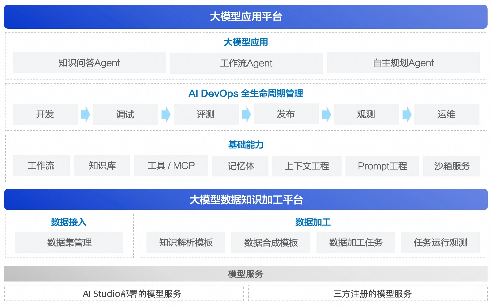

阿里云  
专有云  
智能体工厂 OpenTrek  
OpenTrek Agent Dev 产品简介  
产品版本：v3.18.6  
文档版本：20261023

**目录**

- [1.产品详情](#section-1)
- [2.产品价值](#section-2)
- [3.应用场景](#section-3)
- [4.功能特性](#section-4)

# 1.产品详情

OpenTrek Agent Dev作为企业级大模型智能体开发平台，提供了专业领域知识加工与管理、智能体搭建、能力评测等一站式服务工具链。

**产品背景**

随着大模型技术进入产业化落地深水区，企业智能化转型面临三重核心挑战：

- 首先，大模型应用开发存在全生命周期管理复杂度高的问题，传统开发模式中工具链割裂、评测体系缺失导致开发效率低下，从上下文工程优化到知识系统动态更新等环节均缺乏工具和方法论支撑。

- 其次，多模态数据处理能力不足严重制约应用场景拓展，企业海量非结构化数据（如财报、图纸、音视频等）难以有效转化为知识资产。

- 最后，智能体开发面临功能边界受限与安全风险并存的双重困境，既要满足从基础问答到复杂决策的多层次需求，又需保障企业级场景下的系统稳定性与数据安全性。

据行业调研显示，超过70%的企业在构建大模型应用时受困于知识库构建周期长、智能体功能单一、工具链集成度低等痛点，直接导致AI应用开发周期延长40%以上。

在此背景下，百炼专属版应需而生，其产品设计直击产业落地关键瓶颈。平台聚焦企业级场景，以“全生命周期管理”和“基础能力支持”为核心，通过构建覆盖数据加工、应用开发、运维优化的全栈式平台，打通从多模态知识处理到智能体工程化的完整链路。作为支撑企业构建AI原生系统的核心基础设施，OpenTrek Agent Dev不仅解决了传统开发模式中工具链碎片化的问题，更打破传统开发模式对多模态数据处理的掣肘，提供从数据解析到应用落地的端到端解决方案，助力企业实现AI技术的快速部署与迭代，推动大模型从技术验证走向规模化产业应用。

**产品介绍**

OpenTrek Agent Dev定位于企业级大模型应用开发与知识加工双平台，提供覆盖开发、调试、评测、观测、运维的全生命周期工具链，并深度融合知识加工、智能体搭建、工具生态管理等核心能力。

在知识处理层面，平台通过端到端多模态解析技术，支持文档、图像、音视频、数据表等全模态数据管理，内置多种深度解析模板，可精准处理财报、论文、政策等10余类专业内容，实现复杂表格解析、公式识别与图像理解，帮助企业快速构建高质量知识库，为RAG问答等AI应用提供底层支持。平台提供在线解析服务管理，支持离线模型与自定义解析配置，并可解析OFD、HTML等多种格式文件；知识检索支持按元数据条件过滤，进一步提升召回的准确性。

在智能体开发层面，平台提供全场景支持能力：

- 一方面，通过整合RAG知识增强、Workflow自定义编排、ReAct推理决策机制，开发者可灵活搭建知识问答、工作流驱动、自主规划等类型智能体，满足从简单交互到复杂决策的多层次需求；平台还提供TrekAgent自主规划智能体、TrekClaw工具化开发能力与高代码智能体等多种智能体形态，覆盖从低代码到高代码的开发诉求；

- 另一方面，平台开放MCP与工具生态，既拓展智能体功能边界，又保障高并发稳定性与脚本执行安全性；

- 平台提供统一的技能（Skills）生态，通过技能广场集中管理与共享技能，支持技能鉴权凭证托管与安装技能时的AI内容生成，降低技能接入与复用成本。

此外，平台独创精细化记忆管理机制，短期记忆支持上下文压缩与实体抽取，长期记忆通过用户画像、任务地图等实现个性化服务，配合自定义生成与召回策略，并提供记忆体观测能力，使智能体具备持续进化能力。平台还提供覆盖评估器、评测集与评测任务的智能体评测体系，以及全链路Trace追踪与指标监控，帮助企业在开发、调试、观测、评测各环节持续优化智能体效果。

通过上述能力，OpenTrek Agent Dev为企业提供知识加工、智能体开发、评测运维的一站式服务，成为驱动产业智能化转型的核心引擎。

# 2.产品价值

OpenTrek Agent Dev整合了行业领域的丰富的知识和数据，具备广泛的应用能力。它可以涵盖行业多个领域的问题，并提供准确的、全面的答案。用户可以通过这个平台一站式管理各场景解决方案，方便快捷。

**多模态知识高效处理**

- 客户价值

  高效构建高质量企业知识库，快速搭建RAG问答等AI应用。

- 能力优势

  提供了端到端知识解析能力：支持文档/图像/音视频/数据表等全模态数据管理，内置20+深度解析加工模板，覆盖财报/论文/政策/教材等10+类型，可实现文档版面解析、复杂表格解析、公式解析、图片理解，可帮助客户基于私有化数据知识，快速构建多模态知识库。同时提供在线解析服务管理，支持离线模型与自定义解析配置，可解析OFD、HTML等多种格式文件，并支持按元数据条件过滤检索，提升知识召回准确性。

**全场景智能体搭建支持**

- 客户价值

  场景覆盖全面，支持知识问答Agent、工作流Agent、高代码Agent等类型智能体搭建。

- 能力优势

  深度整合RAG知识增强、Workflow自定义编排、ReAct单智能体推理决策多重机制，开发者可根据场景需求灵活切换工作模式，满足从基础问答到群体智能的多层次开发需求。平台提供TrekAgent自主规划智能体、TrekClaw工具化开发能力与高代码智能体等多种智能体形态，覆盖低代码到高代码的开发诉求；并提供统一的技能（Skills）生态，通过技能广场集中管理与共享技能，支持技能鉴权凭证托管与安装技能时的AI内容生成，降低技能接入与复用成本。

**MCP与工具生态开放**

- 客户价值

  支持客户高效集成多样化工具，提升开发灵活性和安全性，简化接入流程，降低集成成本，加速业务创新与响应。

- 能力优势

  支持API工具的异步调用和鉴权信息动态传入，适配多场景类型工具接入；支持SSE/STDIO双模式注册MCP服务，支持安全沙箱独立运行，灵活支持不同接入方式，保障安全性和稳定响应；API一键封装MCP，实现跨协议兼容，降低集成成本。

**精细化记忆管理机制**

- 客户价值

  基于短期记忆管理能力有效解决智能体任务长上下文管理问题，基于长期记忆管理能力实现智能体任务的个性化处理，使智能体越用越好用。

- 能力优势

  短期记忆管理支持历史对话轮数设置、长上下文压缩、重要实体抽取、自定义记忆读写。长期记忆支持重点问答、用户画像、任务地图，同时支持自定义记忆生成策略、整理策略、召回策略，并提供记忆体观测能力，便于查看记忆体的运行与命中情况。

# 3.应用场景

举例说明百炼专属版各行业的应用场景

行业百炼专属版应用于各个行业的场景。以下是一些百炼专属版的应用方向参考：

**公共服务**

政策解读：针对政策文件专业性强、群众理解困难的问题，搭建基于大模型的智能解读智能体。接入历年政策文档并构建政策知识库，通过知识库检索增强问答，实现面向群众的政策解读，并支持语音问答和条款溯源，降低政策咨询窗口压力，提高群众和企业办事效率。

**金融**

投研分析：针对买方机构需要快速消化海量非结构化数据（财报/招股书/卫星图像/互联网文章等）的诉求，基于多模态知识解析能力，构建知识库，并实现多路知识检索。基于大模型搭建投研分析智能体，输入推理逻辑建模，自动周期性批量完成分析产出。

**能源电力**

调度决策中枢：针对电力调度场景中故障处置时效性低、多系统协同效率不足的问题，构建基于大模型的智能调度决策智能体。集成调度指令库、设备台账、历史预案等数据构建电力调度知识库，通过智能体实现问题意图识别路由、潮流计算与转供工具联动、智能预案管理、智能可视化辅助。

**工业制造**

制造工艺优化：通过构建工业物联网数据中枢，整合设备实时传感器数据（温度、压力、振动等）与历史生产日志（工艺参数、质检记录、能耗报表），搭建工艺优化知识库。基于大模型构建工艺分析智能体，实现能耗预测、缺陷溯源和工艺参数智能调优，形成闭环优化机制。

**医疗**

用药咨询：针对药品信息专业性强、患者用药认知不足、医疗机构咨询压力大等问题，构建基于大模型的用药咨询智能体。通过整合权威医药数据资源，解决群众用药信息查询难、病症用药匹配难、用药指导获取难等痛点，提升患者用药安全性和便捷性。

**传媒出版**

智能审读校稿：基于大模型搭建智能体，结合本地知识库检索、公网搜索能力，实现敏感信息检测、事实核查、风格一致性分析等，提高校稿审稿效率。

**教育**

课程视频总结：基于多模态理解大模型进行视频画面、声音综合理解，并进行知识点抽取、知识体系构建、知识内容自动摘要等，实现课程视频总结能力。

# 4.功能特性

百炼专属版的功能特性说明。

**智能体开发**

提供智能体开发范式，支持快速搭建、按照模板搭建，调试、评测、发布智能体，并实现应用集成对接。

**智能体管理**

智能体管理模块支持智能体的自定义新建、模板新建、编辑、删除、搜索与导入导出，实现智能体全生命周期管理。

<table>
  <tr>
    <th width="154">功能</th>
    <th>功能描述</th>
  </tr>
  <tr>
    <td>智能体自定义新建</td>
    <td>允许用户从头开始创建一个智能体用户可以通过填写智能体的名称、描述和选择创建方式来初始化智能体，并进入版本配置页面进行进一步的设置。</td>
  </tr>
  <tr>
    <td>智能体模板新建</td>
    <td>提供基于模板的智能体快速搭建功能，允许用户通过界面引导和prompt工程，迅速完成智能体的创建。</td>
  </tr>
  <tr>
    <td>智能体编辑</td>
    <td>提供功能以修改现有智能体的名称、简介、头像等信息，使用户能够根据需求更新智能体的配置和描述。</td>
  </tr>
  <tr>
    <td>智能体删除</td>
    <td>通过此模块，用户可以彻底移除不再需要的智能体，释放系统资源并保持智能体列表的整洁。</td>
  </tr>
  <tr>
    <td>智能体搜索</td>
    <td>允许用户通过智能体名称进行快速搜索，以便在众多智能体中迅速定位特定实例。</td>
  </tr>
  <tr>
    <td>智能体导出</td>
    <td>输入目标环境导入密钥，可导出智能体文件。导出智能体时，智能体依赖的模型服务、知识库、记忆内容、MCP服务和其他子智能体不能导出，相同环境密钥无法导出。</td>
  </tr>
  <tr>
    <td>智能体导入</td>
    <td>选择智能体导出文件进行导入。仅使用当前环境密钥导出的智能体才能导入，仅限不同环境智能体文件导入。</td>
  </tr>
  <tr>
    <td>获取导入密钥</td>
    <td>自动生成密钥，用于在其他环境导出智能体时校验使用。密钥有效期72小时。</td>
  </tr>
  <tr>
    <td>导入Dify工作流</td>
    <td>导入智能体时支持选择Dify工作流类型进行导入，导入后提示导入结果及注意事项。</td>
  </tr>
</table>

**版本管理**

版本管理模块支持智能体版本的新建、克隆、切流、发布与状态管理，维护智能体生命周期。

<table>
  <tr>
    <th width="202">功能</th>
    <th>功能描述</th>
  </tr>
  <tr>
    <td>版本自定义新建</td>
    <td>用户可以自定义创建智能体的新版本，进入工作流页面进行智能体版本从头开发，支持输入版本名称和创建方式。</td>
  </tr>
  <tr>
    <td>版本模板创建</td>
    <td>提供基于模板的版本快速搭建功能，允许用户通过界面引导和prompt，迅速完成智能体版本创建。</td>
  </tr>
  <tr>
    <td>模板表单升级为工作流</td>
    <td>此功能会将当前版本复制一个副本，并在副本上打开工作流画布，用户可以在画布上实现更高阶更复杂的业务流程。</td>
  </tr>
  <tr>
    <td>在当前智能体下克隆版本</td>
    <td>此功能支持用户克隆现有智能体版本的配置，生成一个完全相同的新版本，便于进行修改而不影响原版本。</td>
  </tr>
  <tr>
    <td>版本克隆至其它空间</td>
    <td>此功能支持用户克隆现有智能体版本配置到指定空间，智能体依赖的模型服务、知识库、记忆内容、MCP服务和其他子智能体不能克隆。</td>
  </tr>
  <tr>
    <td>版本切流设置</td>
    <td>为指定的智能体版本设置流量分配额度，支持按sessionID和reuqestID进行切流，可保障指定智能体获得充足的流量资源。对唯一版本流量设置指定版本即指定此版本为输出版本。</td>
  </tr>
  <tr>
    <td>导出智能体版本</td>
    <td>支持选中智能体版本导出，支持多选。导出智能体版本时，依赖的模型服务、知识库、记忆内容和其他子智能体不能导出，相同环境密钥无法导出。</td>
  </tr>
  <tr>
    <td>导入智能体版本</td>
    <td>选择智能体导出文件进行导入。仅使用当前环境密钥导出的智能体才能导入，仅限不同环境智能体文件导入。</td>
  </tr>
  <tr>
    <td>版本状态管理</td>
    <td>提供对智能体不同版本的管理，包括查看版本详情、发布版本、下线版本等，维护智能体的生命周期。</td>
  </tr>
  <tr>
    <td>版本发布</td>
    <td>将设计中的智能体版本发布为上线状态，使其可以被外部调用，发布前平台会进行完整性和合法性校验。</td>
  </tr>
  <tr>
    <td>效果跟踪</td>
    <td>支持查询智能体服务每一次请求的任务详情、日志记录，支持按版本、SessionId、RequestId过滤。</td>
  </tr>
  <tr>
    <td>指标监控</td>
    <td>支持以智能体维度和版本维度统计问答成功率、问答平均耗时、问答请求数、问答平均首字消耗、输入tokens消耗、输出tokens消耗，及指定智能体版本调用的知识库、工具、模型对应的相关业务/性能指标监控。</td>
  </tr>
  <tr>
    <td>基于指定版本新建</td>
    <td>新建智能体版本时，支持基于指定的已有版本进行新建。</td>
  </tr>
</table>

**设计工作流**

设计工作流模块提供丰富的画布节点，支持通过可视化编排实现复杂业务流程。

<table>
  <tr>
    <th width="186">功能</th>
    <th>功能描述</th>
  </tr>
  <tr>
    <td>开始节点</td>
    <td>定义智能体流程的起点，允许用户自定义输入参数，并将其映射到智能体的标准输入中，为后续任务设定初始条件。</td>
  </tr>
  <tr>
    <td>迭代器</td>
    <td>配合聚合器使用，可实现一组集合数据的串行分发或并行分发，进而实现集合数据列表循环效果。</td>
  </tr>
  <tr>
    <td>聚合器</td>
    <td>配合迭代器使用，可实现一组集合数据的串行分发或并行分发，进而实现集合数据列表循环效果。</td>
  </tr>
  <tr>
    <td>大语言模型节点</td>
    <td>配置大语言模型执行特定推理任务的节点，支持模型选择、设置模型参数、输入输出，并可通过prompt控制模型生成内容。</td>
  </tr>
  <tr>
    <td>多模态理解大模型节点</td>
    <td>配置多模态理解大模型执行特定推理任务的节点，支持模型选择设置模型参数、输入输出，并可通过prompt控制模型生成内容。</td>
  </tr>
  <tr>
    <td>文本精排模型节点</td>
    <td>配合文本精排模型执行特定任务的节点，支持模型选择、模型参数设置、输入输出。</td>
  </tr>
  <tr>
    <td>图文精排模型节点</td>
    <td>配合图文精排模型执行特定任务的节点，支持模型选择、模型参数设置、输入输出。</td>
  </tr>
  <tr>
    <td>工具节点</td>
    <td>用于调用已注册的工具，允许配置输入参数和选择工具，以执行特定功能或服务。</td>
  </tr>
  <tr>
    <td>文档检索</td>
    <td>支持选择有权限的文档知识库进行检索，支持配置检索相关参数、输入输出，并支持按元数据条件过滤检索结果。</td>
  </tr>
  <tr>
    <td>图文检索</td>
    <td>支持选择有权限的图文知识库进行检索，支持配置检索相关参数、输入输出。</td>
  </tr>
  <tr>
    <td>数据表检索</td>
    <td>支持选择有权限的数据表知识库进行检索，支持配置检索相关参数、输入输出。</td>
  </tr>
  <tr>
    <td>SQL执行器</td>
    <td>支持选择已在平台注册且有权限的数据库，执行SQL任务。支持配置输入输出。</td>
  </tr>
  <tr>
    <td>内容合并</td>
    <td>用于合并前置多个输出结果，支持合并结果流式输出，支持定义多个结果的组合规则、结构等。</td>
  </tr>
  <tr>
    <td>过程输出</td>
    <td>在最终结果输出前，基于此节点前置输出部分信息。</td>
  </tr>
  <tr>
    <td>短期记忆写入</td>
    <td>支持选择在短期记忆中设置的变量，对变量值进行覆盖、追加、清空操作。</td>
  </tr>
  <tr>
    <td>智能体节点</td>
    <td>允许选择已配置的其他智能体版本作为当前流程中的调用节点，主子智能体间的session保持相对稳定；子智能体节点支持TrekClaw与高代码智能体，并支持知识库、智能体节点动态传参。</td>
  </tr>
  <tr>
    <td>脚本节点</td>
    <td>用户可编写自定义脚本来完成任务，支持定义输入输出参数，并符合预设的参数结构。</td>
  </tr>
  <tr>
    <td>选择器节点</td>
    <td>实现流程中条件分支逻辑的节点，根据输入参数的值选择不同的执行路径。</td>
  </tr>
  <tr>
    <td>结果渲染节点</td>
    <td>用于组合和渲染智能体的输出信息，包括文本、附件内容和自定义结构数据。</td>
  </tr>
  <tr>
    <td>合法性校验</td>
    <td>检查智能体配置的合法性，确保所有节点配置正确，连接合理，保障智能体正常运行。</td>
  </tr>
  <tr>
    <td>自动保存</td>
    <td>智能体配置过程中的变更自动保存，确保用户操作的连续性和数据的安全性。</td>
  </tr>
  <tr>
    <td>手动保存</td>
    <td>提供手动触发保存配置的选项，允许用户在特定时刻保存当前智能体的状态和配置。</td>
  </tr>
  <tr>
    <td>函数能力</td>
    <td>提供内置函数库，包含30个函数，支持开发者通过函数对数据进行进一步解析和处理，或读取特定信息，如获取对象中特定key的值、解析列表中的数据项、读取历史对话记录等。</td>
  </tr>
  <tr>
    <td>widget组件节点</td>
    <td>以组件化方式在画布中承载自定义交互界面，支持widget组件的维护与节点编排。</td>
  </tr>
  <tr>
    <td>集合加工节点</td>
    <td>对集合类数据进行组合与转换加工，支持在画布中编排集合数据处理流程。</td>
  </tr>
  <tr>
    <td>参数提取节点</td>
    <td>支持综合改写与多轮改写，可多选知识库并支持关闭精排，问答、术语知识库可按需选择，实现对话参数的智能提取。</td>
  </tr>
  <tr>
    <td>任务规划节点</td>
    <td>对复杂任务进行拆解与规划编排；每个画布中任务规划节点限添加一个。</td>
  </tr>
  <tr>
    <td>组合任务节点</td>
    <td>将多个子任务组合编排为完整流程；每个画布中组合任务节点限添加一个。</td>
  </tr>
</table>

**Skills**

Skills模块提供技能的集中管理、共享与鉴权凭据托管，支持技能安装与AI内容生成。

<table>
  <tr>
    <th width="169">功能</th>
    <th>功能描述</th>
  </tr>
  <tr>
    <td>Skills广场</td>
    <td>统一展示与管理可用技能，取代原“内置Skills”和“授权Skills”菜单；Agent Dev与CoWorker平台共用技能广场的数据与管理逻辑。</td>
  </tr>
  <tr>
    <td>技能仓</td>
    <td>集中查看与管理已安装、已发布的技能。</td>
  </tr>
  <tr>
    <td>Skills鉴权凭证托管</td>
    <td>为需要鉴权的技能托管凭据，支持设置托管时效，超期自动清除；支持在数字员工粒度进行凭据管理。</td>
  </tr>
  <tr>
    <td>安装技能AI生成</td>
    <td>在系统设置的智能化设置中开启“技能转化AI生成”后，安装技能时的工具转化与工作流转化支持由AI生成技能内容。</td>
  </tr>
  <tr>
    <td>Skills Hub版本管理</td>
    <td>Skills Hub支持技能版本管理与OpenAPI。</td>
  </tr>
</table>

**调试**

对智能体效果和稳定性进行调试，支持输入输出、中间任务查看、日志查看定位等。

<table>
  <tr>
    <th width="170">功能</th>
    <th>功能描述</th>
  </tr>
  <tr>
    <td>文本输入调试</td>
    <td>允许开发者输入文本信息，模拟用户与智能体的交互，用于测试和调整智能体对文本输入的响应和处理逻辑。</td>
  </tr>
  <tr>
    <td>附件输入调试</td>
    <td>支持上传附件功能，使开发者能够测试智能体对不同类型附件的处理能力，确保智能体能够正确解析和利用附件中的数据。</td>
  </tr>
  <tr>
    <td>附加信息调试</td>
    <td>提供输入附加信息的接口，供开发者模拟复杂场景下的交互，测试智能体如何结合附加信息进行决策。</td>
  </tr>
  <tr>
    <td>json输入调试</td>
    <td>允许以JSON格式输入数据，便于开发者测试智能体对结构化数据的解析和响应能力，适用于API接口的调试。</td>
  </tr>
  <tr>
    <td>清除会话</td>
    <td>使开发者能够清除当前会话的所有内容，重置会话状态，以便开始新的交互测试，保证会话独立性。</td>
  </tr>
  <tr>
    <td>run模式调试</td>
    <td>在run模式下，智能体自动执行完整链路任务并给出回答，适用于快速测试智能体的自动执行流程和效率。</td>
  </tr>
  <tr>
    <td>debug模式调试</td>
    <td>debug模式允许手动触发每个任务的执行，提供更细致的控制和问题排查，适用于复杂逻辑的调试和优化。</td>
  </tr>
  <tr>
    <td>中间任务透视</td>
    <td>展示智能体执行过程中的所有中间任务和子环节结果，帮助开发者理解整个交互过程中的每个步骤和逻辑。</td>
  </tr>
  <tr>
    <td>日志查看</td>
    <td>提供日志查看功能，使开发者能够查看智能体的调试日志，包括错误信息、执行状态等，以便于进行调试情况分析。</td>
  </tr>
  <tr>
    <td>思考过程插入和查看</td>
    <td>允许开发者插入和查看智能体的思考过程，包括决策逻辑和推理步骤，以便于评估和优化智能体的决策质量。</td>
  </tr>
  <tr>
    <td>上下文压缩提示</td>
    <td>触发上下文压缩时，在对话流中给出明确提示。</td>
  </tr>
  <tr>
    <td>思考过程兼容展示</td>
    <td>兼容模型输出的思考过程字段，统一展示模型推理过程；调试时模型推理过程展示在每轮回答的顶部。</td>
  </tr>
</table>

**记忆**

记忆模块提供短期记忆与长期记忆的配置与管理，支持智能体的上下文管理与个性化服务。

| 功能 | 功能描述 |
| --- | --- |
| 短期记忆-对话记录开关 | 支持定义对话记录开关，关闭后，将无法引用会话中的历史对话记录。 |
| 短期记忆-对话记录保存轮数 | 支持定义对话记录保留轮数，以及超过轮数后处理，支持超过定义轮数后截断或摘要。 |
| 短期记忆-对话记录摘要设置 | 支持选择对话记录摘要模型和总结摘要prompt，以改善总结摘要效果。 |
| 短期记忆-重要实体开关 | 重要实体指的是在历史对话中抽取有价值的信息单独保存，避免因上下文过长造成重要信息被遗忘。支持开关。 |
| 短期记忆-重要实体设置 | 支持设置实体名称、描述和类型，将按照设置进行实体抽取。最多支持设置10个。 |
| 短期记忆-重要实体抽取设置 | 支持选择重要实体抽取模型和设置重要实体抽取prompt，以改善抽取效果。 |
| 短期记忆-自定义变量 | 支持设置自定义变量，在智能体设置中，基于“自定义记忆”节点，对变量内容进行写入。 |
| 长期记忆-重要问答模板创建记忆分区 | 通过重要问答模板创建长期记忆分区，支持选择记忆生成模型和向量化模型，将会话中的重要对话内容保存到记忆库中，提高智能体应答效果。 |
| 长期记忆-用户画像模板创建记忆分区 | 通过用户画像模板创建长期记忆分区，将会话中传递的用户画像信息保存到记忆中，可选择记忆生成模型和向量化模型，用户画像标签可人工维护。 |
| 长期记忆-自定义创建记忆分区 | 通过工作流编排来创建记忆分区，参数配置： 记忆存储结构：可选择键值对、多文本、文本。 记忆生成策略：可选择工作流编排、手动维护。 记忆整理策略：设置记忆保存时效，可选择长期有效、时效性清理。 记忆检索策略：支持设置记忆检索方法，选择按记忆标题、记忆内容来检索和召回内容。 向量化模型：配置记忆分区的记忆检索策略向量化模型。 |
| 长期记忆-记忆内容编辑 | 对记忆分区中的具体记忆条目进行编辑，更新其内容以适应新的业务场景或需求。 |
| 长期记忆-记忆内容删除 | 提供删除功能，可以移除不再适用或错误的单个记忆条目，优化记忆库的质量。 |
| 长期记忆-记忆分区编辑 | 对已创建的记忆分区进行编辑，更新其名称、描述、记忆生成策略、整理策略、检索策略等信息。 |
| 长期记忆-记忆分区删除 | 删除已创建的记忆分区，以适应智能体不断变化的需求。 |
| 长期记忆-记忆分区调试 | 通过输入query的方式对记忆分区中的内容进行调试，检验记忆分区召回的效果。 |
| 记忆体观测 | 提供记忆体观测能力，展示记忆体ID、名称、创建人、创建时间等信息，便于查看记忆体的运行与命中情况。 |
| 记忆体对接智能体 | 记忆体支持对接高代码智能体与三方智能体。 |
| 记忆体关联约束 | TrekAgent开发时仅可关联一个记忆体；历史版本已关联多个的保持原有兼容，可删除不可新增。 |

**观测**

观测模块提供全链路Trace追踪与指标监控，帮助查看智能体调用情况与运行指标。

| 功能 | 功能描述 |
| --- | --- |
| 全链路Trace追踪 | 支持查看智能体调用的全链路Trace，展示点赞点踩信息并支持按其筛选，包含沙箱拉起时间等Span信息。 |
| 指标监控与OpenAPI查询 | 支持按筛选条件查看调用相关指标，并提供指标监控与Trace追踪的OpenAPI查询能力。 |

**TrekAgent**

支持TrekAgent智能体创建。

<table>
  <tr>
    <th width="148">功能</th>
    <th>功能描述</th>
  </tr>
  <tr>
    <td>模型配置</td>
    <td>• 支持选择大语言模型、多模态理解大模型作为TrekAgent的基础规划模型，完成TrekAgent整体任务规划、拆解、反思、决策等。 • 只有接入模型时配置“支持TrekAgent”，才可被选用。</td>
  </tr>
  <tr>
    <td>补充Prompt配置</td>
    <td>支持通过补充Prompt的方式，为TrekAgent补充身份定义、世界观与行为准则、风格偏好。</td>
  </tr>
  <tr>
    <td>技能配置</td>
    <td>支持选用本空间已安装的技能，作为TrekAgent的能力补充，被TrekAgent调用。</td>
  </tr>
  <tr>
    <td>技能凭据托管</td>
    <td>为TrekAgent添加的技能如需要凭据且符合凭据托管规范，可把凭据托管至平台。</td>
  </tr>
  <tr>
    <td>知识库配置</td>
    <td>支持选用本空间有权限的文档知识库和多模态知识库，作为TrekAgent的知识补充，被TrekAgent调用。一个TrekAgent限选择不超过5个知识库。</td>
  </tr>
  <tr>
    <td>短期记忆压缩</td>
    <td>支持设置TrekAgent任务运行中短期记忆压缩阈值。</td>
  </tr>
  <tr>
    <td>长期记忆配置</td>
    <td>支持选择有权限的记忆体，作为TrekAgent的经验补充，被TrekAgent调用。同时TrekAgent的任务上下文信息也会回流对应的记忆体进行记忆加工。</td>
  </tr>
  <tr>
    <td>技能自进化</td>
    <td>支持技能自优化自生成，支持配置进化任务触发时机。</td>
  </tr>
  <tr>
    <td>沙箱发布</td>
    <td>• 发布时支持选择沙箱规格，在发起会话任务时将实时拉起对应规格的沙箱，会话结束后将销毁沙箱释放资源。 • 可选沙箱规格在系统管理菜单由管理员设置。</td>
  </tr>
  <tr>
    <td>分享试用</td>
    <td>支持设计中、已发布状态的TrekAgent对外分享试用链接，支持设置分享范围。</td>
  </tr>
  <tr>
    <td>开场白</td>
    <td>支持设置开场问候语和开场引导问题。</td>
  </tr>
  <tr>
    <td>下一轮问题推荐</td>
    <td>支持设置策略实现一轮对话完成后动态推荐下一轮问题。</td>
  </tr>
  <tr>
    <td>点赞点踩</td>
    <td>支持在TrekAgent调试页面基于点赞点踩能力进行效果反馈。</td>
  </tr>
</table>

**角色对话Agent**

支持角色对话Agent创建。

<table>
  <tr>
    <th width="138">功能</th>
    <th>功能描述</th>
  </tr>
  <tr>
    <td>角色设定</td>
    <td>按需选择大语言模型，并输入角色定义和约束条件Prompt。</td>
  </tr>
  <tr>
    <td>任务设定</td>
    <td>按需选择所需工具、智能体，完成任务配置。</td>
  </tr>
  <tr>
    <td>记忆-对话记录</td>
    <td>支持定义对话记录开关，关闭后，将无法引用会话中的历史对话记录 。 支持定义对话记录保留轮数，以及超过轮数后处理，支持超过定义轮数后截断或摘要。 支持选择对话记录摘要模型和总结摘要prompt，以改善总结摘要效果。</td>
  </tr>
  <tr>
    <td>记忆-长期记忆</td>
    <td>支持选择记忆体进行长期记忆引用。</td>
  </tr>
  <tr>
    <td>分享试用</td>
    <td>支持设计中、已发布状态的Agent对外分享试用链接，支持设置分享范围。</td>
  </tr>
  <tr>
    <td>开场白</td>
    <td>支持设置开场问候语和开场引导问题。</td>
  </tr>
  <tr>
    <td>下一轮问题推荐</td>
    <td>支持设置策略实现一轮对话完成后动态推荐下一轮问题。</td>
  </tr>
</table>

**知识问答Agent-AutoDoc**

知识问答Agent创建。

<table>
  <tr>
    <th width="206">功能</th>
    <th>功能描述</th>
  </tr>
  <tr>
    <td>配置AutoDoc模板智能体</td>
    <td>• 支持关联单个指定的文档知识库。 • 参数设置：支持标准问答、知识改写、多轮改写、向量检索、文本检索、结果精排、总结摘要等环节的参数设置。 • 术语库检索：支持选择术语库类型的知识库进行术语解释能力补充，支持设置问答库召回参数。 • 记忆设置-对话记录：支持定义对话记录开关，关闭后，将无法引用会话中的历史对话记录。 • 记忆设置-对话记录摘要设置：支持选择对话记录摘要模型和总结摘要prompt，以改善总结摘要效果。</td>
  </tr>
  <tr>
    <td>分享试用</td>
    <td>支持设计中、已发布状态的Agent对外分享试用链接，支持设置分享范围。</td>
  </tr>
  <tr>
    <td>开场白</td>
    <td>支持设置开场问候语和开场引导问题。</td>
  </tr>
  <tr>
    <td>下一轮问题推荐</td>
    <td>支持设置策略实现一轮对话完成后动态推荐下一轮问题。</td>
  </tr>
</table>

**知识问答Agent-AutoBI**

知识问答Agent创建。

| 功能 | 功能描述 |
| --- | --- |

<table>
  <tr>
    <td>配置AutoBI模板智能体</td>
    <td>• 参数设置： • 关联知识库：支持搜索和绑定数据表知识库。 • 知识改写：提供默认配置方案，并支持自定义配置知识改写所用的大模型及参数信息，包括Prompt、temperature等参数。 • 多轮改写：提供默认配置方案，并支持自定义配置知识改写所用的大模型及参数信息，包括Prompt、temperature等参数。 • 召回配置：支持配置表列、值、SQL样例召回信息，提供默认配置方案，支持配置召回数量和召回阈值。 • 生成SQL：支持配置生成SQL的方案，支持选择NL2SQL及配置生成SQL的大模型的运行参数，包括Prompt、temperature等参数。 • 总结摘要：支持配置回复总结，对SQL执行结果进行内容提炼总结，提供默认配置方案，并支持自定义配置总结摘要所用的大模型及参数信息，包括Prompt、temperature等参数。 • 绘制图表：支持对SQL执行结果数据进行图表数据结构生成，供应用侧进行对应图表渲染，并支持自定义配置绘制图表数据结构所用的大模型及参数信息，包括Prompt、temperature等参数。 • 记忆设置-对话记录保存轮数：支持定义对话记录保留轮数，以及超过轮数后处理，支持超过定义轮数后截断或摘要。 • 记忆设置-对话记录摘要设置：支持选择对话记录摘要模型和总结摘要prompt，以改善总结摘要效果。</td>
  </tr>
  <tr>
    <td>分享试用</td>
    <td>支持设计中、已发布状态的Agent对外分享试用链接，支持设置分享范围。</td>
  </tr>
  <tr>
    <td>开场白</td>
    <td>支持设置开场问候语和开场引导问题。</td>
  </tr>
  <tr>
    <td>下一轮问题推荐</td>
    <td>支持设置策略实现一轮对话完成后动态推荐下一轮问题。</td>
  </tr>
</table>

**知识问答Agent-AutoVideo**

知识问答Agent创建。

| 功能 | 功能描述 |
| --- | --- |

<table>
  <tr>
    <td>配置AutoVideo模板智能体</td>
    <td>• 支持关联单个指定的图文知识库。 • 参数设置：支持标准问答、知识改写、多轮改写、向量检索、文本检索、结果精排、总结摘要等环节的参数设置。 • 参数设置：支持标准问答、知识改写、多轮改写、向量检索、文本检索、结果精排、总结摘要等环节的参数设置。 • 术语库检索：支持选择术语库类型的知识库进行术语解释能力补充，支持设置问答库召回参数。 • 记忆设置-对话记录：支持定义对话记录开关，关闭后，将无法引用会话中的历史对话记录。 • 记忆设置-对话记录保存轮数：支持定义对话记录保留轮数，以及超过轮数后处理，支持超过定义轮数后截断或摘要。 • 记忆设置-对话记录摘要设置：支持选择对话记录摘要模型和总结摘要prompt，以改善总结摘要效果。</td>
  </tr>
  <tr>
    <td>分享试用</td>
    <td>支持设计中、已发布状态的Agent对外分享试用链接，支持设置分享范围。</td>
  </tr>
  <tr>
    <td>开场白</td>
    <td>支持设置开场问候语和开场引导问题。</td>
  </tr>
  <tr>
    <td>下一轮问题推荐</td>
    <td>支持设置策略实现一轮对话完成后动态推荐下一轮问题。</td>
  </tr>
</table>

**高代码Agent**

高代码Agent搭建。

<table>
  <tr>
    <th width="138">功能</th>
    <th>功能描述</th>
  </tr>
  <tr>
    <td>框架支持</td>
    <td>• 支持AgentScope1.0版本框架。 • 支持AgentScope2.0版本框架。</td>
  </tr>
  <tr>
    <td>观测对接支持</td>
    <td>支持接入平台指标监控和Trace追踪，实现统一观测。 说明需要按照开发指南完成对接。</td>
  </tr>
  <tr>
    <td>记忆体支持</td>
    <td>支持接入平台记忆体，实现记忆资产平台共管共用。 说明需要按照开发指南完成对接。</td>
  </tr>
  <tr>
    <td>部署与沙箱托管</td>
    <td>支持上传代码包，选择模型服务与沙箱规格，完成在平台的部署托管。</td>
  </tr>
</table>

**分享体验**

分享体验模块支持将智能体以体验对话页面形式对外分享，便于试用与演示。

<table>
  <tr>
    <th width="202">功能</th>
    <th>功能描述</th>
  </tr>
  <tr>
    <td>Agent分享体验对话页面</td>
    <td>工作流、知识问答、角色对话Agent及TrekAgent支持分享体验对话页面，可输入文本、上传附件、录入附加信息发起对话，支持问候语与下一轮问题推荐。</td>
  </tr>
</table>

**智能体模板**

提供智能体搭建的模板，包括系统模板、自定义模板，支持模板上架、删除，提升智能体搭建效率和可复用性。

**模板列表**

查看智能体模板列表和智能体模板详情，并支持基于模板创建智能体。

<table>
  <tr>
    <th width="90">功能</th>
    <th>功能描述</th>
  </tr>
  <tr>
    <td>模板列表</td>
    <td>可以查看智能体模板名称、ID、介绍等信息，并从此页面进入模板详情。</td>
  </tr>
  <tr>
    <td>模板详情</td>
    <td>可以查看模板使用说明、配置条件、接口、能力依赖等信息、并由此页面发起智能体创建。</td>
  </tr>
  <tr>
    <td>使用模板</td>
    <td>可以从模板详情页，基于模板直接完成智能体创建，可选择创建新智能体或在已有智能体添加版本。</td>
  </tr>
</table>

**智能体模板-AutoDoc**

AutoDoc模板面向文档问答场景，支持基于文档知识库快速搭建智能体。

| 功能 | 功能描述 |
| --- | --- |
| 基于AutoDoc模板新建智能体 | 支持基于AutoDoc模板新建智能体实例，可选择创建新智能体或在已有智能体添加版本，支持自定义名称和描述信息。 |
| 编辑Autodoc模板的智能体 | 支持基于AutoDoc模板创建的智能体实例的名称和描述信息的编辑。 |
| 配置AutoDoc模板智能体 | 支持关联单个指定的文档知识库。 |
| 配置AutoDoc模板智能体 | 参数设置：支持标准问答、知识改写、多轮改写、向量检索、文本检索、结果精排、总结摘要等环节的参数设置。。 |
| 配置AutoDoc模板智能体 | 标准问答库：基于长期记忆分区设置标准问答库，支持标准问答的新增、编辑、删除、内容查看等。 |
| 配置AutoDoc模板智能体 | 知识词库：基于长期记忆分区设置知识词库，支持标准问答的新增、编辑、删除、内容查看等。 |
| 删除Autodoc模板的智能体 | 支持删除此模板创建的智能体实例。 |

**智能体模板-AutoBI**

AutoBI模板面向数据分析场景，支持基于数据表知识库实现自然语言查询与分析。

| 功能 | 功能描述 |
| --- | --- |
| 基于AutoBI模板新建智能体 | 支持基于BI模板新建智能体实例，可选择创建新智能体或在已有智能体添加版本，支持自定义名称和描述信息。 |
| 配置AutoBI模板智能体 | 参数设置： • 关联知识库：支持搜索和绑定数据表知识库。 • 知识改写：提供默认配置方案，并支持自定义配置知识改写所用的大模型及参数信息，包括Prompt、temperature等参数。 • 多轮改写：提供默认配置方案，并支持自定义配置知识改写所用的大模型及参数信息，包括Prompt、temperature等参数。 • 召回配置：支持配置表列、值、SQL样例召回信息，提供默认配置方案，支持配置召回数量和召回阈值。 • 生成SQL：支持配置生成SQL的方案，支持选择NL2SQL及配置生成SQL的大模型的运行参数，包括Prompt、temperature等参数。 • 总结摘要：支持配置回复总结，对SQL执行结果进行内容提炼总结，提供默认配置方案，并支持自定义配置总结摘要所用的大模型及参数信息，包括Prompt、temperature等参数。 • 绘制图表：支持对SQL执行结果数据进行图表数据结构生成，供应用侧进行对应图表渲染，并支持自定义配置绘制图表数据结构所用的大模型及参数信息，包括Prompt、temperature等参数。 |
| 删除AutoBI实例 | 支持删除此模板创建的智能体实例。 |
| 数据查询 | 支持通过自然语言查询和指令来处理数据库查询操作，用户只需简单描述查询需求，系统会自动解析并生成相应的SQL查询语句。 |
| 数据分析 | 支持通过分析用户输入的数据查询意图和数据查询结果，结合问题分析数据结果，提取关键信息并进行数据分析，总结并生成分析摘要。 |

**智能体模板-AutoVideo**

AutoVideo模板面向图文视频理解场景，支持图像与视频内容的理解、对话与检索。

| 功能 | 功能描述 |
| --- | --- |
| 基于AutoVideo模板新建智能体 | 支持基于AutoVideo模板新建智能体实例，可选择创建新智能体或在已有智能体添加版本，支持自定义名称和描述信息。 |
| 编辑AutoVideo模板的智能体 | 支持基于Video模板创建的智能体实例的名称和描述信息的编辑。 |
| 配置AutoVideo模板智能体 | 支持关联单个指定的图文知识库。 |
| 配置AutoVideo模板智能体 | 参数设置：支持标准问答、知识改写、多轮改写、向量检索、文本检索、结果精排、总结摘要等环节的参数设置。 |
| 配置AutoVideo模板智能体 | 标准问答库：基于长期记忆分区设置标准问答库，支持标准问答的新增、编辑、删除、内容查看等。 |
| 配置AutoVideo模板智能体 | 知识词库：基于长期记忆分区设置知识词库，支持标准问答的新增、编辑、删除、内容查看等。 |
| 删除AutoVideo模板的智能体 | 支持删除此模板创建的智能体实例。 |
| 通用图像理解 | 支持同一对话内限定数量4张内的图片基本内容描述的生成。 |
| 基于图文知识库的图像理解 | 支持根据召回配置、精排配置、生成配置以及配置的图文知识库对单张图片内容生成描述。 |
| 图片对话 | 支持关闭召回配置后进行单轮对话中单张图片的限定轮数内的对话。 |
| 视频对话 | 支持关闭召回配置后进行单轮对话中单个视频20M内的限定轮数内的对话。 |
| 通用视频理解 | 支持限定大小20M内的视频基本内容描述的生成。 |
| 特定图表类型理解 | 支持内容清晰呈现的折线图、柱状图、饼图3种图表图片的内容理解。 |
| 支持文字检索图片 | 支持根据AutoVideo的召回配置、精排配置在知识库范围内图文通过文字query来检索。 |
| 支持图片检索图片 | 支持根据AutoVideo的召回配置、精排配置在知识库范围内图文通过图片query来检索。 |

**我的工具**

进行API、MCP类型工具的注册、调试，支持自定义工具注册，营造完善的工具生态。

**工具列表**

已注册的API类型、连接器类型工具编辑、查看、删除。

<table>
  <tr>
    <th width="109">功能</th>
    <th>功能描述</th>
  </tr>
  <tr>
    <td>工具编辑</td>
    <td>提供工具编辑功能，使用户能够对已注册的工具进行修改和更新这包括更新工具的配置信息、请求参数等。</td>
  </tr>
  <tr>
    <td>工具删除</td>
    <td>基于工具删除功能，移除不再需要的工具，释放系统资源这有助于维护智能体平台的整洁和高效运行。</td>
  </tr>
  <tr>
    <td>工具查询</td>
    <td>具备工具查询功能，允许用户通过关键词快速查找已注册的工具这提高了用户在大量工具中检索特定工具的效率，加快了开发和维护过程。</td>
  </tr>
  <tr>
    <td>升级为MCP</td>
    <td>已注册的API类型工具可一键升级成MCP，支持选择升级添加到已有MCP工具，或者新建MCP。</td>
  </tr>
  <tr>
    <td>观测</td>
    <td>查看特定时间范围内指定工具的调用情况相关指标，包括成功率、平均耗时、调用量。</td>
  </tr>
</table>

**API工具注册**

API工具的注册、调用。

<table>
  <tr>
    <th width="154">功能</th>
    <th>功能描述</th>
  </tr>
  <tr>
    <td>工具注册</td>
    <td>智能体工厂提供API工具注册功能，允许用户将外部服务API集成到智能体平台中。通过填写工具名称、描述、地址、请求方式等信息，用户能够定义API工具的基本属性和调用参数，实现对第三方服务的快速接入和使用。</td>
  </tr>
  <tr>
    <td>流式API支持</td>
    <td>支持流式API的接入和使用用户可以配置API工具以支持流式输出，这使得接口能够持续地返回数据。</td>
  </tr>
  <tr>
    <td>异步调用工具支持</td>
    <td>对于单次请求任务耗时较长的工具可开启异步调用，按照平台说明完成对接后，可支持工具的异步调用。</td>
  </tr>
</table>

**MCP服务注册**

MCP服务注册支持以SSE、STDIO等模式接入MCP工具，扩展智能体能力边界。

| 功能 | 功能描述 |
| --- | --- |
| SSE模式注册MCP工具 | 选择SSE模式注册MCP工具输入名称、描述后，提供服务配置说明，并校验服务连通性。 |
| STDIO模式注册MCP工具 | 支持选择虚机，按脚手架要求开发并上传代码包，在虚机完成服务部署。 |

**工具调试**

进行API、连接器型工具调试。

<table>
  <tr>
    <th width="125">功能</th>
    <th>功能描述</th>
  </tr>
  <tr>
    <td>API工具调试</td>
    <td>该功能模块允许用户对注册的API工具进行调试，确保其连通性和返回结果的正确性，用户可以通过模拟请求，观察工具的响应数据，进而调整参数配置，优化工具性能。</td>
  </tr>
  <tr>
    <td>MCP服务调试</td>
    <td>支持选择MCP服务中的指定工具，通过表单结构或JSON结构输入进行调试。SSE模式注册、录入了鉴权信息的MCP工具，在调试时支持输入鉴权密钥。</td>
  </tr>
</table>

**平台工具**

平台提供的API、连接器类型工具查询、查看详情，快速了解工具的使用方法和适用场景。

**平台工具列表**

查询平台工具，查看工具详情。

<table>
  <tr>
    <th width="122">功能</th>
    <th>功能描述</th>
  </tr>
  <tr>
    <td>工具列表查询</td>
    <td>支持通过工具名称、工具类型来查找平台工具，快速找到指定的工具。</td>
  </tr>
  <tr>
    <td>工具详情</td>
    <td>查看平台工具详情，进入工具详情页，可阅览工具的使用方法、参数说明、资源依赖，掌握工具的适用场景。</td>
  </tr>
</table>

**平台内置API工具**

平台内置API工具。

| 功能 | 功能描述 |
| --- | --- |
| 夸克搜索 | 对接夸克搜索接口，默认内置，使用时输入夸克的鉴权信息并付相关费用。 |

**共享工具**

支持查看/调试其它空间分享至本空间的工具。

**共享工具列表**

查看分享至此空间的工具列表和详情。

| 功能 | 功能描述 |
| --- | --- |
| 共享工具列表查询 | 支持通过工具名称、工具类型来查找平台工具，快速找到指定的工具。 |
| 工具详情查询 | 查看工具详情，进入工具详情页，可查看工具使用详情信息。 |

**共享工具调试**

进行API、连接器类型工具调试。

<table>
  <tr>
    <th width="125">功能</th>
    <th>功能描述</th>
  </tr>
  <tr>
    <td>API工具调试</td>
    <td>该功能模块允许用户对API工具进行调试，确保其连通性和返回结果的正确性，用户可以通过模拟请求，观察工具的响应数据，进而调整参数配置，优化工具性能。</td>
  </tr>
  <tr>
    <td>MCP服务调试</td>
    <td>支持选择MCP服务中的指定工具，通过表单结构或JSON结构输入进行调试。SSE模式注册、录入了鉴权信息的MCP工具，在调试时支持输入鉴权密钥。</td>
  </tr>
</table>

**提示词模板**

提供prompt模板创建、调试、查询，分为我的模板、平台模板，可快速优化prompt提示词。

**我的模板**

进行prompt模板创建、查询、调试，在搭建智能体时通过模板可快速插入prompt指令。

<table>
  <tr>
    <th width="149">功能</th>
    <th>功能描述</th>
  </tr>
  <tr>
    <td>新建prompt模板</td>
    <td>支持通过自定义、CRISPE、Few-shot三种框架创建prompt模板，可配置prompt标签，便于prompt模板调用和查找。</td>
  </tr>
  <tr>
    <td>模板查询</td>
    <td>支持按模板标签和输入的指定内容查询模板，快速找到待使用的prompt模板。</td>
  </tr>
  <tr>
    <td>模板列表</td>
    <td>展示所有已创建的prompt模板，列表中可查看模板名称、调试状态信息，便于模板管理。</td>
  </tr>
  <tr>
    <td>模板编辑</td>
    <td>更改prompt模板的名称、标签、搭建框架、指令内容，可根据模板使用场景调整模板内容。</td>
  </tr>
  <tr>
    <td>模板调试</td>
    <td>通过输入变量值进行prompt模板调试，验证模板的可用性，支持选择用于调试的模型服务。</td>
  </tr>
  <tr>
    <td>模板删除</td>
    <td>删除不再需要的prompt模板，实现空间整理。</td>
  </tr>
</table>

**平台模板**

提供平台内置的prompt模板，可直接选用。

<table>
  <tr>
    <th width="122">功能</th>
    <th>功能描述</th>
  </tr>
  <tr>
    <td>平台模板列表</td>
    <td>提供平台内置的prompt模板，支持模板调试，搭建智能体时可直接选用。</td>
  </tr>
  <tr>
    <td>平台模板查询</td>
    <td>通过模板分类标签和prompt内容查询平台内置prompt模板，快速找到模板。</td>
  </tr>
</table>

**提示词优化**

对Prompt模板的质量和结构进行优化，以获取更好的大模型推理结果，支持新建、终止、删除prompt优化任务。

**优化任务列表**

查看prompt指令优化任务，支持任务终止、删除。

<table>
  <tr>
    <th width="122">功能</th>
    <th>功能描述</th>
  </tr>
  <tr>
    <td>任务列表查询</td>
    <td>通过prompt名称查询指令优化任务，快速找到指定任务，获取任务详情和优化状态。</td>
  </tr>
  <tr>
    <td>任务详情</td>
    <td>查看prompt指令优化任务详情，提供多种优化方案，优化方案结果可保存到我的模板中，用于智能体搭建。</td>
  </tr>
  <tr>
    <td>任务终止</td>
    <td>处于优化中的prompt指令优化任务支持终止操作，中断优化进程。</td>
  </tr>
  <tr>
    <td>任务删除</td>
    <td>删除prompt指令优化任务，整理任务空间，便于查找任务。</td>
  </tr>
</table>

**发起优化任务**

新建prompt指令优化任务。

| 功能 | 功能描述 |
| --- | --- |
| 新建prompt指令优化任务 | 选择模型根据输入的prompt描述进行指令优化，提升prompt质量。 |

**智能体评测**

提供评测集、评估器与评测任务管理能力，支持对智能体效果进行自动化评测与结果分析。

**评测集管理**

评测集管理支持评测集版本的创建、下载、启用、禁用与删除，并查看版本日志。

<table>
  <tr>
    <th width="138">功能</th>
    <th>功能描述</th>
  </tr>
  <tr>
    <td>评测集版本管理</td>
    <td>支持新增评测集版本，支持下载、禁用、启用、删除评测集版本，且支持查看评测集版本日志信息。</td>
  </tr>
</table>

**评测任务**

评测任务支持任务的创建、启动、重跑、删除与结果查看，输出评测报告与样本分析。

<table>
  <tr>
    <th width="122">功能</th>
    <th>功能描述</th>
  </tr>
  <tr>
    <td>评测任务管理</td>
    <td>评测任务创建完成后支持查看任务详情，任务详情包括基本信息、任务实例信息并支持手工启动任务、重跑任务、删除任务。</td>
  </tr>
  <tr>
    <td>查看评测结果</td>
    <td>评测完成的评测任务支持查看评测报告，评测报告会根据会展示评测效果信息以及样本分析结果，以帮助用户识别智能体效果。</td>
  </tr>
</table>

**评测能力升级**

评测能力升级提供评估器、评测集携带附件与TrekAgent评测等增强能力。

| 功能 | 功能描述 |
| --- | --- |
| 评估器 | 提供内置评估器与评测集管理，用于对智能体输出进行自动化评估。 |
| 评测集升级 | 评测集支持携带附件，并支持对TrekAgent进行评测。 |
| 评测任务升级 | 支持评测任务的新建、管理与升级，提升评测流程完整度。 |

**知识库**

知识库增删改查基本管理。

**知识库列表**

支持知识库列表查看管理。

<table>
  <tr>
    <th width="144">功能</th>
    <th>功能描述</th>
  </tr>
  <tr>
    <td>知识库查看</td>
    <td>通过知识库名称、知识库ID、知识库类型查找知识库，查看指定的知识库名称、描述、配置参数、状态。</td>
  </tr>
  <tr>
    <td>知识库信息编辑</td>
    <td>支持对已创建的知识库名称、描述、检索策略进行编辑修改。</td>
  </tr>
  <tr>
    <td>知识库内容管理</td>
    <td>查看知识库的原始文件、任务详情、解析状态、解析结果，支持删除知识库中的任务，下载知识库的源文件、解析结果、分段结果，实现知识库内容整理。</td>
  </tr>
  <tr>
    <td>知识库启用/禁用</td>
    <td>创建的知识库在启用状态可在智能体中被调用，禁用功能可限制知识库的调用。</td>
  </tr>
  <tr>
    <td>知识库删除</td>
    <td>删除废弃的知识库，释放系统资源。</td>
  </tr>
  <tr>
    <td>知识库指标观测</td>
    <td>查看选定的时间范围内指定知识库的调用情况相关指标，包括调用成功率、平均耗时、调用量、token消耗。</td>
  </tr>
</table>

**自定义知识库创建**

自定义知识库创建支持灵活配置内容结构与索引，满足个性化知识管理需求。

<table>
  <tr>
    <th width="186">功能</th>
    <th>功能描述</th>
  </tr>
  <tr>
    <td>自定义创建</td>
    <td>使用更灵活的方式创建知识库，根据知识库使用场景进行配置： 支持配置知识库的内容结构和内容结构中的字段信息。 检索策略可配置向量索引、ES索引参数。</td>
  </tr>
  <tr>
    <td>自定义知识库构建索引</td>
    <td>为自定义创建的知识库构建索引，提升调用时知识召回的准确性。配置索引内容包括内容结构、索引内容、存储信息、选择模型、检索和召回字段，支持在工作流中新增和配置索引节点。</td>
  </tr>
</table>

**文档知识库创建**

文档知识库创建支持基于模板快速创建文档知识库，并配置向量化模型与解析策略。

<table>
  <tr>
    <th width="192">功能</th>
    <th>功能描述</th>
  </tr>
  <tr>
    <td>文档模板创建</td>
    <td>选择文档知识库模板，输入知识库名称、描述，即可快速创建文档知识库。</td>
  </tr>
  <tr>
    <td>高级设置-向量模型切换</td>
    <td>支持在高级设置页面，切换文本向量化模型选择。仅限新建知识库时切换，新建完成后文本向量化模型不可修改。</td>
  </tr>
  <tr>
    <td>高级设置-解析策略</td>
    <td>支持在高级设置页面设置解析策略，按不同解析策略设置，可进行文档文本提取、版面分析、图片OCR、表格解析、公式解析、图片解析等。</td>
  </tr>
</table>

**图文知识库创建**

图文知识库创建支持基于模板创建图文知识库，并配置向量化与图文解析。

| 功能 | 功能描述 |
| --- | --- |
| 图文模板创建 | 选择图文知识库模板，输入知识库名称、描述，即可快速创建文档知识库。 |
| 高级设置-向量化 | 支持设置图文向量化模型与向量化触发条件。 新建完成后图文向量化模型不可修改。 |
| 高级设置-图文解析 | 支持开启/关闭智能解析，设置图文解析模型与相关prompt。 |

**数据表知识库创建**

数据表知识库创建支持通过配置数据来源，将数据库信息导入知识库实现数据调用。

<table>
  <tr>
    <th width="138">功能</th>
    <th>功能描述</th>
  </tr>
  <tr>
    <td>数据表模板新建</td>
    <td>通过数据表知识库模板创建数据表知识库，通过配置数据来源，将数据库中的信息导入知识库中，快速实现数据调用。</td>
  </tr>
</table>

**自定义知识库详情**

自定义知识库详情支持查看知识库信息、内容查询、导入与任务管理。

| 功能 | 功能描述 |
| --- | --- |
| 查看知识库详情 | 查看知识库名称、描述、知识库ID、创建方式。 |
| 知识库内容查询 | 按照知识库内容关键字、状态查找任务，支持分内容结构表查询。 |
| 知识库导入 | 支持按照模板导入、接口导入方式批量添加知识库内容。 |
| 任务删除 | 删除废弃的任务，整理知识库内容。 |
| 任务重试 | 重新处理入库的内容。 |
| 刷新内容列表 | 刷新页面状态。每30秒自动刷新。 |

**文档知识库详情**

文档知识库详情支持原始文件与内容详情的查询、导入、解析、下载与向量化管理。

| 功能 | 功能描述 |
| --- | --- |
| 查看知识库详情 | 展示知识库名称、描述、知识库code、创建方式。 |
| 原始文件-查询 | 支持按文件code、文件名、格式、状态查询原始文件。 |
| 原始文件-文件导入 | 支持通过文档上传、接口同步的方式导入文件。 |
| 原始文件-删除 | 删除文件，对应的解析结果、分段结果、向量库数据均删除，支持批量删除。 |
| 原始文件-解析详情 | 查看文件解析结果，验视分段情况和解析情况，支持编辑解析结果。 |
| 原始文件-重新解析 | 重新解析文件，支持批量重新解析。 |
| 原始文件-下载源文件 | 下载源文件到本地。 |
| 原始文件-下载解析结果 | 下载解析结果文件。 |
| 原始文件-刷新 | 刷新页面状态。每30秒自动刷新。 |
| 内容详情-查询 | 支持按照关键词、分段code、状态查找内容。 |
| 内容详情-批量导入 | 支持按模板导入、接口同步批量导入内容。 |
| 内容详情-删除 | 删除解析得到的内容，支持批量删除. |
| 内容详情-重新向量化 | 对指定的内容进行重新向量化，入向量库中状态下，不支持此操作。 |
| 内容详情-刷新 | 刷新页面状态。每30秒自动刷新。 |

**图文知识库详情**

图文知识库详情支持图文文件的查询、导入、解析、删除与向量化管理。

| 功能 | 功能描述 |
| --- | --- |
| 知识库详情展示 | 展示知识库名称、描述、code、创建方式。 |
| 查询 | 支持按照文件code、文件名、状态查询。 |
| 文件导入 | 支持通过文件上传、模板导入、接口同步方式导入文件。 |
| 解析 | 人工编辑图片内容、图片描述、图片标签，以便智能体接入知识库时进行召回。 |
| 智能解析 | 发起智能解析，覆盖原有内容，支持批量智能解析。 |
| 文件删除 | 删除废弃的图片，支持批量删除。 |
| 重新向量化 | 对图片重新发起向量化，支持批量重新向量化. |
| 刷新 | 刷新页面状态。每30秒自动刷新。 |

**数据表知识库详情**

数据表知识库详情支持查看知识库信息并基于已注册数据表编辑详情。

| 功能 | 功能描述 |
| --- | --- |
| 知识库详情展示 | 展示知识库名称、描述、code、创建方式。 |
| 知识库编辑 | 支持注册数据表并基于已注册的数据表编辑知识库详情。 |

**共享知识库**

可查看其它空间共享过来的知识库。

| 功能 | 功能描述 |
| --- | --- |
| 共享知识库查看 | 支持在共享知识库菜单页面，查看其它空间分享至此空间的知识库列表，并查看支持库详情。 |
| 知识库分享 | 支持在本空间的知识库，指定知识库，操作分享至有权限的其它空间。 |

**知识库解析与检索增强**

知识库解析与检索增强提供在线解析服务、多格式解析、检索条件过滤与元数据维护等能力，提升知识处理与召回质量。

| 功能 | 功能描述 |
| --- | --- |
| 在线解析服务管理 | 支持在线解析服务管理，可创建解析服务，支持离线模型与自定义解析配置。 |
| 检索条件过滤与元数据维护 | 文档、图文、自定义、数据表知识库检索支持按指定条件过滤，并支持元数据维护。 |
| 多格式解析 | 文档知识库支持解析OFD、HTML等格式文件，上传MD文档支持按标题树型切分。 |
| 文档知识库批量操作 | 文档知识库支持对文件与内容的批量操作，提升管理效率。 |
| VLM图片版面分析 | 提供VLM图片版面分析算子，提升图文内容的解析质量。 |
| 问答库与专家词库 | 扩展问答库与专家词库类型知识库，沉淀标准问答与专业术语。 |

**数据管理**

提供数据集的创建、标签管理、多模态文件托管、数据视图与权限控制，并支持CLI与OpenAPI集成开发。

**数据集管理**

数据集管理支持数据集的创建、标签管理、多模态文件托管、数据视图与权限控制。

<table>
  <tr>
    <th width="154">功能</th>
    <th>功能描述</th>
  </tr>
  <tr>
    <td>数据集创建与设置</td>
    <td>支持查看数据集列表，支持关键字、标签筛选数据集，数据集具备三级标签体系、支持用户自定义设计和管理数据集标签</td>
  </tr>
  <tr>
    <td>数据集创建与设置</td>
    <td>支持创建与管理数据集，支持数文档、文本、图片、音频、视频、表格多种模态的数据类型的管理，数据集的文件支持定义按照层级路径进行管理</td>
  </tr>
  <tr>
    <td>数据集创建与设置</td>
    <td>支持托管多种文件类型： • Image图片类：.png，.jpg，.jpeg，.bmp，.gif，.webp，.svg，.ico，.tiff，.eps，.psd，.raw，.h eic，.jxr • Audio音频类：.wav，.mp3，.aac，.flac，.alac，.ogg，.wma，.aiff，.dsd，.midi，.dts，.amr，.opus，.m4a • Video视频类：.mp4，.avi，.mov，.mkv，.wmv，.flv，.webm，.mpeg，.3gp，.vob，.ts，.asf，.rm • Doc富文本类：pdf，txt，doc，docx，md，epub，caj，wps，xls，xlsx，ppt，pptx，html，htm，rtf，odt，ods，xml，tex，mobi，fb2，fb2z，azw • Tabular表格类：.csv, .json, .jsonl, .parquet</td>
  </tr>
  <tr>
    <td>数据视图</td>
    <td>数据集支持多子集、子集支持灵活数据格式，支持用户自定义配置子集与文件数据的映射，支持开启/关闭子集数据的自动更新。</td>
  </tr>
  <tr>
    <td>数据文件</td>
    <td>支持通过文件和文件夹的方式批量上传数据文件，具备下载和删除文件操作，单批次最大可上传文件有限制，同一批次支持上传不同文件类型数据。</td>
  </tr>
  <tr>
    <td>数据集权限</td>
    <td>具备数据权限管理，空间管理员和数据集创建者具备完全数据集操作权限，普通用户仅可浏览。</td>
  </tr>
</table>

**集成开发**

集成开发提供CLI与OpenAPI两种操作模式，支持以编程方式管理数据与任务。

| 功能 | 功能描述 |
| --- | --- |
| CLI（命令行模式）操作模式 | 提供CLI（命令行模式）操作模式，支持通过命令行的方式，批量上传和下载数据文件。 |
| OpenAPI | 提供OpenAPI，支持数据集创建、数据文件上传、子集创建配置等数据集操作。 |

**数据加工**

提供数据清洗、解析、增强、配平等加工模板与任务编排能力，支持将原始数据处理为高质量语料。

**能力广场**

能力广场集中展示数据加工模板与算子，支持筛选、搜索、查看详情并从模板创建任务。

| 功能 | 功能描述 |
| --- | --- |
| 查看模板与创建任务 | 具备加工模板功能，支持筛选和搜索及查看模板详情，包含模板的详细说明和数据流详情，支持从模板创建任务。 |
| 模板列表 | 查看数据加工模板列表，支持筛选、搜索与查看模板详情，并可从模板创建任务。 |
| 算子列表 | 查看可用算子列表，支持按类型筛选与查看算子说明。 |
| Ray调度 | 数据加工任务支持Ray调度。 |
| workflow编排 | 数据加工支持workflow编排，灵活组合加工流程。 |
| 算子配置加密 | 算子配置中的敏感信息支持加密存储，保存后以密文展示。 |

**加工任务**

加工任务支持创建、配置、发布、下线与克隆数据加工任务，对数据集进行批量处理。

<table>
  <tr>
    <th width="90">功能</th>
    <th>功能描述</th>
  </tr>
  <tr>
    <td>任务管理</td>
    <td>支持创建数据处理任务对数据集进行批量的数据加工处理。</td>
  </tr>
  <tr>
    <td>任务管理</td>
    <td>任务可区分草稿态与发布态，具备任务配置、发布、下线、克隆的任务管理功能。</td>
  </tr>
  <tr>
    <td>任务运行</td>
    <td>支持灵活配置任务运行所需的计算资源规格、算子并行度。</td>
  </tr>
  <tr>
    <td>任务配置</td>
    <td>按照清洗、解析、增强、配平及端到端划分模板分类，支持创建pipeline任务，同一任务支持混合组合CPU和GPU资源类型的算子，处理结果支持保存为新的子集。</td>
  </tr>
</table>

**任务运维**

任务运维支持查看任务实例运行情况、输入输出数据集与日志，并支持取消与重跑。

| 功能 | 功能描述 |
| --- | --- |
| 任务实例查看 | 具备任务实例运维功能，支持查看任务实例运行情况、输入和输出数据集信息、以及日志查看。 |
| 任务实例取消与重跑 | 任务实例运维支持取消和重跑操作。 |

**集成开发**

集成开发提供CLI与OpenAPI两种操作模式，支持以编程方式管理数据与任务。

| 功能 | 功能描述 |
| --- | --- |
| CLI（命令行模式）操作模式 | 提供CLI（命令行模式）操作模式，支持通过命令行的方式创建和执行任务。 |
| OpenAPI | 提供OpenAPI，支持任务及实例的增删配及查看操作。 |

**端到端模板**

端到端模板提供从文档解析到知识片段生成的一体化加工模板。

| 功能 | 功能描述 |
| --- | --- |
| 文档-PDF基础解析生成知识片段 | 解析用户上传的PDF文档，直接提取PDF的原生内容（不支持扫描版内容和图片内容的提取），并生成语义数据结构，解析结果将切分为知识片段，可导入知识库。 |
| 文档-PDF深度解析生成知识片段 | 解析用户上传的PDF文档、具备版面分析能力，支持解析表格、公式、URL超链接，并生成语义结构树，解析结果将切分为知识片段，可导入知识库。 |
| 文档-EXCEL基础解析生成知识片段 | 将用户上传的EXCEL类型文档（如xls、xlsx）进行Excel解析（不支持解析文档内图片）、chunk切分处理、生成知识片段，保存结果为数据集，支持切分后的知识片段结果保存成平台统一格式的 JSONL 文件。 |
| 文档-WORD基础解析生成知识片段 | 解析用户上传的 WORD文档（不支持解析文档内图片），并生成语义结构树，解析结果将切分为知识片段，可导入知识库。 |
| 文档-WORD深度解析生成知识片段 | 解析用户上传的 WORD文档，支持解析文档内图片，并生成语义结构树，解析结果将切分为知识片段，可导入知识库。 |
| 文档-纯文本文档生成知识片段 | 对用户上传的纯文本文档切分为知识片段，可导入知识库（支持文件类型为txt、json、jsonl、md）。 |

**数据解析模板**

数据解析模板提供文档、视频等内容的解析能力，结果保存为数据集或JSONL文件。

| 功能 | 功能描述 |
| --- | --- |
| 文档-PDF深度解析 | 解析用户上传的PDF文档、Word文档自动转PDF并解析，结果保存为文档对应JSONL 文件。 |
| 文档-PDF基础解析 | 解析用户上传的PDF文档，直接提取PDF的原生内容（不支持扫描版内容和图片内容的提取），并生成语义数据结构，解析结果保存为数据集。 |
| 文档-WORD基础解析 | 解析用户上传的 WORD文档（不支持解析文档内图片），结果保存为文档对应JSONL 文件。 |
| 文档-WORD深度解析 | 解析用户上传的 WORD文档，支持解析文档内图片，解析结果可保存为对应JSONL文件。 |
| 视频-智能解析视频分段与关键帧 | 将视频拆解为多个片段并返回每个片段的边界时间点和片段的关键帧（不返回具体视频片段），并对片段和关键帧进行摘要描述，支持多种视频文件格式。 |
| 视频-视频切片 | 基于视频解析结果，对长视频进行片段切分，并按照平台文生视频数据协议生成语料数据集。 |
| 视频-视频抽帧 | 基于视频解析结果，对长视频进行抽帧生成图片（格式为 JPG），并按照平台文生图训练数据协议生成语料数据集。 |

**数据清洗模板**

数据清洗模板提供文本、视频、图片数据的清洗与过滤能力，生成高质量样本。

<table>
  <tr>
    <th width="128">功能</th>
    <th>功能描述</th>
  </tr>
  <tr>
    <td>文本-数据清洗</td>
    <td>对文本数据集的指定列进行清洗，包括编码转换、内容过滤、敏感信息处理、去重等操作，按需组合算子生成高质量文本数据，适用于大语言模型训练。</td>
  </tr>
  <tr>
    <td>视频-数据清洗</td>
    <td>对视频数据集进行长宽比过滤、时长过滤和分辨率过滤等操作，过滤出合适的样本。</td>
  </tr>
  <tr>
    <td>图片-数据清洗</td>
    <td>对图片数据集进行去重、形状过滤、大小过滤、清晰度过滤和宽高比过滤等操作，过滤出合适的样本。</td>
  </tr>
</table>

**数据增强**

数据增强提供问答对增强、问答对提取与图片预标注等能力，扩充训练样本。

| 功能 | 功能描述 |
| --- | --- |
| 文本-SFT问答对增强 | 针对文本问答对（QA对）样例集，提取种子QA对(不超过10)，基于种子QA对的内容特征和格式特征，生成新的QA样本(不超过2000条)。 |
| 文本-文本问答对提取 | 针对文本片段提取问答对，结果保存为JSONL文件及数据子集。 |
| 图片-图片描述和QA对预标注模板 | 批量生成关于图片的描述和问答对两类数据，并存储到pre_tag列作为预标注内容，用户可指定prompt 和模型需要回答的问题。 |

**数据配平**

数据配平提供欠采样与过采样等模板，解决多类别数据不平衡问题。

| 功能 | 功能描述 |
| --- | --- |
| 文本-数据配平-随机欠采样 | 用于解决多类别数据不平衡的问题。它通过对数据集中的多数类样本进行随机采样，使得每个类别的样本数量与数据集中最少类别样本数一致，从而实现数据平衡。该算子主要应用于分类任务中，尤其是在类别分布严重不均衡的情况下。 |
| 文本-数据配平-随机过采样 | 用于解决多类别数据不平衡问题。它通过对数据集中的少数类样本进行随机复制，使得每个类别的样本数量与数据集中最多类别样本数一致，从而实现数据平衡。该算子主要应用于分类任务中，尤其是在类别分布严重不均衡的情况下。 |
| 文本-数据配平-基于聚类的欠采样 | 该模板实现了一个基于K-means聚类的欠采样功能，旨在解决类别不平衡问题。通过对每个类别进行K-means聚类，将多数类样本减少到与少数类样本数量一致，从而生成一个类别分布均衡的数据集。 |
| 文本-数据配平-基于数据增强的过采样 | 此模板主要用于解决多类别分类任务中类别不平衡问题。通过文本数据增强技术，对少类别样本进行过采样，生成新样本以平衡各类别的样本数量。 |

**系统管理**

系统管理。

**全局资源管理**

全局资源管理用于添加和管理平台所需的对象存储、数据库等底层基础设施资源。

<table>
  <tr>
    <th width="122">功能</th>
    <th>功能描述</th>
  </tr>
  <tr>
    <td>全局资源管理</td>
    <td>全局资源管理用于添加和管理平台所需的各类数据资源，包括对象存储、数据库等底层基础设施资源。通过全局资源管理，您可以为智能体服务、数据中心和知识库提供统一的资源存储和管理能力，仅组织管理员/资源集管理员角色通过管理员角色访问时可进行配置。</td>
  </tr>
</table>

**全局服务管理**

全局服务管理提供智能体服务和数据中心资源的创建、配置与运维管理能力。

<table>
  <tr>
    <th width="122">功能</th>
    <th>功能描述</th>
  </tr>
  <tr>
    <td>全局服务管理</td>
    <td>提供智能体服务和数据中心资源的创建、配置和运维管理能力。通过全局服务管理，您可以为智能体应用配置网关服务、存储资源和数据库资源，并实现服务的空间分配，保障智能体服务的稳定运行和数据中心的正常服务。</td>
  </tr>
</table>

**系统设置-场景默认模型**

配置搭建智能体、记忆体、知识库场景的模型组件，减少重复操作，提升智能体搭建效率。

<table>
  <tr>
    <th width="186">功能</th>
    <th>功能描述</th>
  </tr>
  <tr>
    <td>场景默认服务列表</td>
    <td>查看平台场景默认服务配置情况，实现全局控制赋能。</td>
  </tr>
  <tr>
    <td>场景默认服务设置</td>
    <td>智能体、记忆体、知识库中各使用模型的场景，模型选择默认选项，支持自定义配置，用户可在使用场景界面切换；工作流场景的模型默认值可回填至对应类型节点。</td>
  </tr>
  <tr>
    <td>文档解析场景默认模型</td>
    <td>场景默认模型支持“文档解析”场景的默认服务设置。</td>
  </tr>
</table>

**系统设置-系统参数设置**

配置搭建智能体、记忆体、知识库场景的各项参数。

| 功能 | 功能描述 |
| --- | --- |
| 系统参数设置列表 | 查看和管理系统中的参数，支持按名称、code查询系统参数。 |
| 系统参数配置 | 设置智能体中心的各项参数，设置后全局生效，支持通过上传文件批量设置。 |

**系统设置-请求流量控制**

按空间、智能体、版本分配流量资源，为智能体提供流量保障和限制。

| 功能 | 功能描述 |
| --- | --- |
| 请求流量控制列表 | 查看不同空间、智能体、版本控制和分配流量请求次数和最大并行处理任务数。 |
| 请求流量控制方式 | 可选择按同时发起请求数控制、按并行处理请求数控制。 |
| 版本流量编辑 | 修改已设置的版本流量控制，根据智能体使用情况调整流量保障。 |
| 版本流量删除 | 不再需要控制版本流量的智能体，可删除该配置。 |

**系统设置-虚机管理**

虚机管理支持虚机的查询、注册、编辑、删除与服务查看，用于STDIO模式MCP服务部署。

| 功能 | 功能描述 |
| --- | --- |
| 虚机管理查询 | 支持通过虚机名称、虚机code、可用空间筛选虚机。 |
| 虚机列表 | 查看虚机详情和状态，支持在列表中刷新指定虚机的连接状态。 |
| 查看虚机服务 | 支持查看已在此虚机上部署的服务列表。 |
| 虚机注册 | 支持选择虚机的可用空间，需完成一次连通性测试，测试通过才可提交保存。 |
| 虚机编辑 | 修改虚机注册信息，包括服务名称、可用空间。 |
| 虚机删除 | 删除不再使用的虚机，同时删除该虚机服务列表中的所有服务。 |

**模型接入**

接入平台部署或三方注册模型至平台，供各处调用。

| 功能 | 功能描述 |
| --- | --- |
| 接入模型 | 支持选择平台部署模型或三方注册模型接入，支持接入的模型进行空间分配。 |
| 模型列表 | 支持查看、筛选已接入模型，支持对已接入模型进行启用、停用、编辑等操作。 |
| 模型调试 | 对已接入模型进行调试，确认模型服务连通性。 |
| 内置解析模型 | 模型接入支持“内置解析模型”类型，并支持自研富文档解析模型上架。 |
| 模型描述信息登记 | 模型服务接入支持登记模型描述信息，并在模型选择时展示描述。 |
| 在线语音识别自定义协议 | 在线语音识别类型模型支持自定义协议接入。 |

**沙箱管理**

支持管理沙箱规格。

| 功能 | 功能描述 |
| --- | --- |
| 沙箱规格查询 | 支持通过沙箱规格名称、code查询列表中沙箱规格。 |
| 沙箱规格列表 | 支持查看已添加的沙箱规格信息。 |
| 新增沙箱规格 | 输入名称描述与规格配置信息，完成新增。 |
| 删除沙箱规格 | 不再使用的规格完成删除。 |
| 查看沙箱关联智能体 | 查看使用此规格的智能体服务列表。 |

**数据源管理**

支持管理数据表知识库可用数据源。

| 功能 | 功能描述 |
| --- | --- |
| 数据源查询 | 支持查看已添加的数据源列表、基本信息、关联知识库列表。 |
| 数据源新增 | 支持按开发手册完成对接后，新增数据源。 |
| 数据源启用停用 | 支持对列表中的数据源进行启用停用操作。 |
| 数据源编辑 | 支持对数据源名称等基础信息进行编辑。 |
| 数据源删除 | 支持删除不再需要的数据源。 |

**空间管理**

空间和空间成员管理。

| 功能 | 功能描述 |
| --- | --- |
| 空间列表 | 支持查看用户本人所在的空间列表。 |
| 空间新建 | 支持管理员新建空间。 |
| 空间成员管理 | 支持空间管理员增删空间成员，指定普通成员为管理员等操作。 |
