阿里云  
专有云  
智能体工厂 OpenTrek  
OpenTrek Agent Dev 用户指南  
产品版本：v3.18.6  
文档版本：20261023

**目录**

- [1.产品简介](#section-1)
- [2.快速入门](#section-2)
- [3.总览](#section-3)
- [4.开发](#section-4)
    - [4.1. 功能概述](#section-4-1)
    - [4.2. 智能体](#section-4-2)
        - [4.2.1. 智能体开发](#section-4-2-1)
            - [4.2.1.1. 新建智能体](#section-4-2-1-1)
            - [4.2.1.2. 配置智能体](#section-4-2-1-2)
            - [4.2.1.3. 智能体使用](#section-4-2-1-3)
                - [4.2.1.3.1. 设计智能体](#section-4-2-1-3-1)
                    - [4.2.1.3.1.1. 设计工作流Agent](#section-4-2-1-3-1-1)
                    - [4.2.1.3.1.2. 设计知识问答Agent](#section-4-2-1-3-1-2)
                    - [4.2.1.3.1.3. 设计角色对话Agent](#section-4-2-1-3-1-3)
                    - [4.2.1.3.1.4. 设计TrekAgent](#section-4-2-1-3-1-4)
                    - [4.2.1.3.1.5. 设计高代码Agent](#section-4-2-1-3-1-5)
                - [4.2.1.3.2. 调试智能体](#section-4-2-1-3-2)
                - [4.2.1.3.3. 体验智能体](#section-4-2-1-3-3)
                - [4.2.1.3.4. 记忆智能体](#section-4-2-1-3-4)
        - [4.2.2. 智能体模板](#section-4-2-2)
    - [4.3. 工具箱](#section-4-3)
        - [4.3.1. 空间工具](#section-4-3-1)
        - [4.3.2. 平台工具](#section-4-3-2)
        - [4.3.3. 共享工具](#section-4-3-3)
    - [4.4. 技能仓](#section-4-4)
        - [4.4.1. 技能广场](#section-4-4-1)
        - [4.4.2. 空间技能](#section-4-4-2)
        - [4.4.3. 共享技能](#section-4-4-3)
    - [4.5. 记忆体](#section-4-5)
        - [4.5.1. 新增记忆体](#section-4-5-1)
        - [4.5.2. 管理记忆](#section-4-5-2)
        - [4.5.3. 生成策略](#section-4-5-3)
        - [4.5.4. 整理策略](#section-4-5-4)
    - [4.6. 知识库](#section-4-6)
        - [4.6.1. 空间知识库](#section-4-6-1)
            - [4.6.1.1. 文档知识库](#section-4-6-1-1)
            - [4.6.1.2. 数据表知识库](#section-4-6-1-2)
            - [4.6.1.3. 图文知识库](#section-4-6-1-3)
            - [4.6.1.4. 问答知识库](#section-4-6-1-4)
            - [4.6.1.5. 术语知识库](#section-4-6-1-5)
        - [4.6.2. 共享知识库](#section-4-6-2)
    - [4.7. 提示词](#section-4-7)
        - [4.7.1. 提示词模板](#section-4-7-1)
            - [4.7.1.1. 我的模板](#section-4-7-1-1)
            - [4.7.1.2. 平台模板](#section-4-7-1-2)
        - [4.7.2. 提示词优化](#section-4-7-2)
    - [4.8. 评测](#section-4-8)
        - [4.8.1. 评测集](#section-4-8-1)
            - [4.8.1.1. 空间评测集](#section-4-8-1-1)
            - [4.8.1.2. 内置评测集](#section-4-8-1-2)
        - [4.8.2. 评估器](#section-4-8-2)
            - [4.8.2.1. 空间评估器](#section-4-8-2-1)
            - [4.8.2.2. 内置评估器](#section-4-8-2-2)
        - [4.8.3. 评测任务](#section-4-8-3)
            - [4.8.3.1. 一次性任务](#section-4-8-3-1)
            - [4.8.3.2. 自动化任务](#section-4-8-3-2)
    - [4.9. 对话卡片](#section-4-9)
        - [4.9.1. 创建对话卡片](#section-4-9-1)
        - [4.9.2. 管理对话卡片](#section-4-9-2)
- [5.数据](#section-5)
    - [5.1. 功能概述](#section-5-1)
    - [5.2. 数据集管理](#section-5-2)
        - [5.2.1. 新建数据集](#section-5-2-1)
        - [5.2.2. 数据集详情](#section-5-2-2)
    - [5.3. 数据加工](#section-5-3)
        - [5.3.1. 能力广场](#section-5-3-1)
        - [5.3.2. 数据加工任务](#section-5-3-2)
        - [5.3.3. 任务运行总览](#section-5-3-3)
    - [5.4. 数据标注](#section-5-4)
        - [5.4.1. 任务管理](#section-5-4-1)
        - [5.4.2. 标注任务](#section-5-4-2)
        - [5.4.3. 验收任务](#section-5-4-3)
- [6.观测](#section-6)
    - [6.1. 指标监控](#section-6-1)
    - [6.2. Trace追踪](#section-6-2)
- [7.系统管理](#section-7)
    - [7.1. 功能概述](#section-7-1)
    - [7.2. 内置资产](#section-7-2)
        - [7.2.1. 内置Skills](#section-7-2-1)
        - [7.2.2. 内置评测集](#section-7-2-2)
        - [7.2.3. 内置评估器](#section-7-2-3)
    - [7.3. 服务接入](#section-7-3)
        - [7.3.1. 沙箱规格](#section-7-3-1)
        - [7.3.2. 模型接入](#section-7-3-2)
            - [7.3.2.1. 平台部署模型](#section-7-3-2-1)
            - [7.3.2.2. 三方注册模型](#section-7-3-2-2)
        - [7.3.3. 数据源管理](#section-7-3-3)
        - [7.3.4. 知识库解析服务管理](#section-7-3-4)
    - [7.4. 元数据管理](#section-7-4)
    - [7.5. 平台设置](#section-7-5)
        - [7.5.1. 系统设置](#section-7-5-1)
        - [7.5.2. 观测设置](#section-7-5-2)
        - [7.5.3. 智能化设置](#section-7-5-3)
    - [7.6. 全局资源管理](#section-7-6)
        - [7.6.1. 镜像仓库ACR](#section-7-6-1)
        - [7.6.2. 普通集群ACK](#section-7-6-2)
        - [7.6.3. 对象存储](#section-7-6-3)
        - [7.6.4. 数据库](#section-7-6-4)
        - [7.6.5. 向量](#section-7-6-5)
    - [7.7. 全局服务管理](#section-7-7)
        - [7.7.1. 智能体服务](#section-7-7-1)
        - [7.7.2. 空间资源池](#section-7-7-2)
        - [7.7.3. 数据中心资源](#section-7-7-3)
    - [7.8. 空间管理](#section-7-8)
- [8.集成开放](#section-8)
    - [8.1. 功能概述](#section-8-1)
    - [8.2. APP_KEY](#section-8-2)
    - [8.3. OpenAPI](#section-8-3)
- [9.附录](#section-9)
    - [9.1. 工作流函数说明](#section-9-1)
    - [9.2. 变量与图表数据配置说明](#section-9-2)

<a id="section-1"></a>

# 1.产品简介

OpenTrek Agent Dev产品定义、产品优势、产品架构说明。

**产品定义**

OpenTrek Agent Dev作为企业级大模型应用开发管理平台和行业知识加工平台，提供了大模型应用开发、调试、评测、观测、运维、优化全生命周期管理工具链，并提供知识加工检索、工具和MCP服务注册管理、上下文工程和提示词工程等能力支持。

**产品优势**

**多模态知识高效处理**

- 客户价值

  高效构建高质量企业知识库，快速搭建RAG问答等AI应用。

- 能力优势

  提供了端到端知识解析能力：支持文档/图像/音视频/数据表等全模态数据管理，内置20+深度解析加工模板，覆盖财报/论文/政策/教材等10+类型，可实现文档版面解析、复杂表格解析、公式解析、图片理解，可帮助客户基于私有化数据知识，快速构建多模态知识库。

**全场景智能体搭建支持**

- 客户价值

  场景覆盖全面，支持知识问答Agent、工作流Agent、自主规划Agent等类型智能体搭建。

- 能力优势

  深度整合RAG知识增强、Workflow自定义编排、ReAct单智能体推理决策多重机制，开发者可根据场景需求灵活切换工作模式，满足从基础问答到群体智能的多层次开发需求。

**MCP与工具生态开放**

- 客户价值

  支持客户高效集成多样化工具，提升开发灵活性和安全性，简化接入流程，降低集成成本，加速业务创新与响应。

- 能力优势

  支持API工具的异步调用和鉴权信息动态传入，适配多场景类型工具接入；支持SSE/STDIO双模式注册MCP服务，支持安全沙箱独立运行，灵活支持不同接入方式，保障安全性和稳定响应；API一键封装MCP，实现跨协议兼容，降低集成成本。

**精细化记忆管理机制**

- 客户价值

  基于短期记忆管理能力有效解决智能体任务长上下文管理问题，基于长期记忆管理能力实现智能体任务的个性化处理，使智能体越用越好用。

- 能力优势

  短期记忆管理支持历史对话轮数设置、长上下文压缩、重要实体抽取、自定义记忆读写。长期记忆支持重点问答、用户画像、任务地图，同时支持自定义记忆生成策略、整理策略、召回策略。

**产品架构**

随着大模型成熟和产业落地加速，大模型应用开发正成为驱动千行百业智能化转型的新质生产力。然而在应用落地过程中，开发者面临全生命周期管理复杂、工具链割裂、评测体系缺失等核心痛点——从上下文工程的设计优化、知识系统的动态更新，到多工具协同的工作流编排、复杂场景的持续观测运维，每个环节都存在技术门槛高、试错成本大的挑战。传统开发模式更面临多模态数据处理能力不足等掣肘，严重制约大模型应用的规模化落地。

为了应对这一趋势，我们围绕大模型应用在企业级场景中的全生命周期管理和基础能力支持，构建了OpenTrek Agent Dev大模型应用开发平台和数据知识加工平台，旨在为企业提供从数据加工到应用开发的一体化解决方案，助力AI技术真正实现产业落地。

平台作为企业级大模型应用生产平台，提供了专业领域的知识加工、智能体搭建、评测、观测、运维等一站式服务工具链。

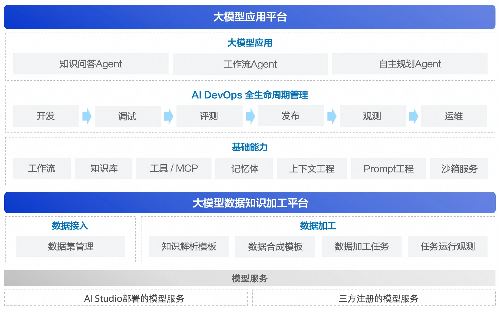

<a id="section-2"></a>

# 2.快速入门

本文档介绍平台初始化操作流程和环境准备要求。

**前期准备**

**环境要求**

OpenTrek Agent Dev需使用指定版本范围内的浏览器，具体浏览器及版本范围如下：

- Chrome浏览器： 100+版本

- Edge浏览器： 129+版本

- safari浏览器： 16.0+版本

在使用时请检查浏览器型号和版本，下载并使用对应的浏览器，及时更新浏览器版本。

**账号要求**

除平台初始化配置场景外，OpenTrek Agent Dev支持3类角色登录：运营管理员、组织管理员和组织资源监察员。

> **说明**
>
> - 创建空间时需指定资源集，仅可在当前登录角色有权限的资源集下新建空间。
>
> - 添加空间成员时，仅可添加空间所属资源集的成员。需先将被添加角色加入资源集成员列表。

**角色权限范围说明**

<table>
  <tr>
    <th width="188">角色</th>
    <th>权限说明</th>
  </tr>
  <tr>
    <td>运营管理员（admin）</td>
    <td>• 可进行智能体模板、提示词模板的自定义上架。<br>• 拥有运维权限。<br>• 拥有组织管理员和组织资源监察员的所有权限。</td>
  </tr>
  <tr>
    <td>组织管理员</td>
    <td>• 拥有智能体中心、评测中心、数据中心（如有）菜单功能权限。<br>• 可被添加入空间。被添加入空间后，拥有对应空间数据权限。如无空间权限，需联系空间管理员添加。<br>• 可被添加为空间管理员。被添加为空间管理员后，可进行对应空间的成员增删、指定空间管理员等。<br>• 不可进行智能体模板、提示词模板的自定义上架。</td>
  </tr>
  <tr>
    <td>组织资源监察员</td>
    <td>• 拥有智能体中心、评测中心、数据中心（如有）菜单功能权限。<br>• 可被添加入空间。被添加入空间后，拥有对应空间数据权限。如无空间权限，需联系空间管理员添加。<br>• 可被添加为空间管理员。被添加为空间管理员后，可进行对应空间的成员增删、指定空间管理员等。<br>• 不可进行智能体模板、提示词模板的自定义上架。</td>
  </tr>
</table>

**登录OpenTrek Agent Dev控制台**

1. 在浏览器地址栏中，输入Apsara Uni-manager运营控制台的服务域名地址，按回车键。

2. 输入正确的用户名及密码。

   请向运营管理员获取登录控制台的用户名和密码。

   > **说明**
   >
   > - **首次登录**
   >
   >   首次Apsara Uni-manager运营控制台时，需要修改登录用户名的密码，请按照提示完成密码修改。为提高安全性，密码长度必须为10~32位，且包含英文字母大小写、阿拉伯数字和特殊符号（感叹号（!）、at（@）、井号（#）、美元符号（$）、百分号（%）等）。
   >
   > - **忘记密码**
   >
   >   用户忘记登录密码时，单击忘记密码，输入账户名（当前账号的用户名）、邮箱（当前用户创建时所录入的邮箱）和验证码后，重置密码的链接将发至邮箱，进入链接后用户可输入新密码。

3. 单击**账号登录**。

4. 如果账号已激活MFA多因素认证，请根据以下两种情况进行操作：

   - 管理员强制开启MFA后的首次登录：

     <ol type="a">

     <li>

     在绑定虚拟MFA设备页面中，按页面提示步骤绑定MFA设备。

     </li>

     <li>

     按照步骤2重新输入账号和密码，单击**账号登录**。

     </li>

     </ol>

     <ol type="i" start="100">

     <li>

     输入6位MFA码后单击**认证**。

     </li>

     </ol>

   - 您已开启并绑定MFA：

     输入6位MFA码后单击**认证**。

5. 在顶部菜单栏单击**产品**，选择**人工智能与机器学习 > 模型平台与服务 > OpenTrek DEV**。

   > **说明**
   >
   > - 初次使用平台，必须需要**平台一级组织的资源集管理员** 登录，完成平台初始化配置。
   >
   > - 云资源在切换组织时，系统自动弹出窗口以完成服务角色授权。请按照界面提示操作。

**初始化配置**

1. 请参考全局资源管理章节及其子章节内容，完成对象存储、镜像仓ACR、普通集群ACK、PolarDB PG、缓存数据库、向量数据库、全文检索ES 等资源的注册。

2. 请参考空间管理章节内容，按业务需求新建空间。请至少新建一个空间，用于 全局服务管理-数据中心资源 和 模型接入 配置时的空间分配。

3. 请参考全局服务管理章节及其子章节内容，完成数据中心资源、智能体服务等内容配置。

4. 请参考模型接入章节及其子章节内容，完成模型接入和模型的空间分配。

5. 请参考系统设置章节中场景默认服务内容，完成场景默认服务配置。

<a id="section-3"></a>

# 3.总览

OpenTrek Agent Dev控制台的总览页面展示平台核心资源统计和快速操作入口。

**功能说明**

OpenTrek Agent Dev控制台的总览页面展示平台核心资源统计和快速操作入口，帮助您快速了解当前空间的整体使用情况。

总览页面包含以下信息：

- 资源统计卡片：展示智能体个数、知识库个数、工具个数、Skills个数、记忆体个数。

- 最新创建智能体：展示最近创建的智能体列表，支持快速跳转到智能体详情。

- 操作引导：分为开发、评测、观测三个部分，引导您完成从创建到上线的完整流程。

**操作步骤**

1. 登录OpenTrek Agent Dev控制台。

2. 在左侧导航栏中单击**总览**。

3. 单击**立即体验**，创建一个TrekAgent。

4. 输入智能体步骤和智能体描述，上传智能体头像。

5. 单击**确定**。

6. 参考智能体使用对智能体进行设计、调试、发布。

7. 在总览页面查看以下信息：

   - 资源统计：查看各类资源的数量概览。

   - 最新创建智能体：

     - 查看最近创建的智能体，单击智能体名称进入详情页。

     - 单击**查看全部**，会跳转至智能体开发页面，查看全部的智能体。

   - 操作引导：根据引导完成开发、评测和观测流程。

     单击流程中的某一步会跳转至相应的页面，例如单击开发下的知识库，会跳转至知识库页面。

**指标概览说明**

单击查看更新可以跳转至指标监控页面。

| 指标名称 | 说明 |
| --- | --- |
| 智能体个数 | 当前空间下已创建的智能体总数。 |
| 知识库个数 | 当前空间下已创建的知识库总数。 |
| 工具个数 | 当前空间下已注册的工具总数。 |
| Skills个数 | 当前空间下已安装的Skills总数。 |
| 记忆体个数 | 当前空间下已创建的记忆体总数。 |

<a id="section-4"></a>

# 4.开发

<a id="section-4-1"></a>

## 4.1. 功能概述

本章节介绍智能体中心下的所有功能说明和类型。

**功能说明**

**智能体**

智能体是OpenTrek Agent Dev平台的核心应用形态，基于大模型能力构建对话式AI应用。平台支持多种智能体类型，满足不同业务场景的需求，并提供从创建、配置到调试、评测的完整开发流程。

- 智能体开发：创建和管理智能体，支持多种智能体类型和创建模式。

- 智能体模板：使用平台预置的智能体模板快速搭建应用，支持 AutoBI、AutoVideo、AutoDoc 等场景模板。

**知识库**

知识库为智能体提供结构化的知识支撑，支持对文档、数据表、图文等多种类型的知识进行统一管理。通过知识库，智能体可以在对话中引用相关知识，提升回答的准确性和专业性。

我的知识库：管理登录用户的知识库，支持创建文档知识库、数据表知识库和图文知识库。

共享知识库：查看和使用其他空间共享过来的知识库，实现跨空间的知识复用。

**工具箱**

工具箱为智能体提供外部能力调用入口，支持管理平台工具、共享工具和我的工具。通过工具箱，您可以为智能体配置 API、代码执行、知识检索等能力，扩展智能体的功能边界。

- 我的工具：管理当前登录用户的工具，支持创建、编辑和删除自定义工具。

- 平台工具：查看平台预置的工具，这些工具由平台管理员统一维护，可直接在智能体中使用。

- 共享工具：查看和使用其他空间共享过来的工具，实现跨空间的能力复用。

**提示词**

提示词模块提供提示词模板管理和提示词优化能力，帮助您设计高质量的提示词，提升智能体的对话效果。通过提示词模板，您可以快速复用经过验证的提示词方案；通过提示词优化任务，您可以系统地改进提示词质量。

- 提示词模板：管理提示词模板，支持创建自定义模板和调试平台模板。

- 提示词优化：创建提示词优化任务，通过系统化的方法提升提示词质量。

**类型**

**智能体类型**

- **知识问答**：大模型直接回答或参考辅助知识实现对话应用。可选择基于 AutoBI、AutoVideo、AutoDoc等模板创建。

- **工作流**：大模型作为工具被调用，完成已拆解好的指定任务。支持自定义工作流编排。

- **角色对话**：基于角色设定进行多轮对话，适用于客服、助手等场景。

- **TrekAgent**：基于强化学习的智能决策代理，能够自主探索环境并作出最优决策。

**知识库类型**

- **文档知识库**：基于文档内容进行知识检索问答，适用于 FAQ、产品手册等场景。

- **数据表知识库**：基于数据表进行检索分析问答，适用于数据分析、报表查询等场景。

- **图文知识库**：基于图文内容进行检索理解问答，适用于多媒体内容理解等场景。

- **自定义知识库**：根据使用场景需求，自由配置知识库内容结构与索引，适用于高定制化需求场景。

**工具箱类型**

平台支持以下工具类型：

- **API 工具**：通过调用外部 API 接口实现特定功能。

- **MCP工具**：通过脚本代码或本地代码文件搭建MCP服务，快速构建、部署和管理兼容Model Context Protocol标准的服务器，实现与外部数据源及工具的安全、标准化连接。

**提示词模板类型**

提示词模板分为以下类型：

- **我的模板**：用户自定义创建的提示词模板，可在智能体配置中引用。

- **平台模板**：平台预置的提示词模板，提供经过优化的标准提示词方案。

<a id="section-4-2"></a>

## 4.2. 智能体

本章节及其子章节介绍智能体的使用方法，包括智能体开发、智能体模板，工作流如何使用等操作。

<a id="section-4-2-1"></a>

### 4.2.1. 智能体开发

本文档介绍基础开发管理逻辑，含智能体管理、版本管理、开发、切流、监控、导入导出。

<a id="section-4-2-1-1"></a>

#### 4.2.1.1. 新建智能体

本章节介绍智能体开发的相关操作，包括新建、编辑、配置、删除等操作。

**操作步骤**

1. 登录OpenTrek Agent Dev控制台。

2. 在左侧导航栏中选择**开发 > 智能体 > 智能体开发**。

3. 单击**新建智能体**。

4. 选择Agent类型。

   支持选择知识问答Agent、工作流Agent、角色对话Agent、TrekAgent、高代码Agent。

   <ol type="i">

   <li>

   **知识问答Agent**：大模型直接或者参考辅助知识，实现对话应用。

   知识问答Agent可选择基于现有的模板创建。

   - **文档检索问答**：基于文档知识库进行知识检索问答服务。此模板下，知识库请从“智能体中心-知识库”中选择“文档知识库”类型。

   - **数据分析问答**：基于BI知识库进行数据检索分析问答服务。此模板下，可选择“智能体中心的BI知识库”或“知识中心的数据表知识库”。

   - **图文理解问答**：基于图文知识库进行图文检索理解问答服务。此模板下，知识库请从“智能体中心-知识库”中选择“图文知识库”类型。

   </li>

   <li>

   **工作流Agent**：大模型作为工具被调用，完成已拆解好的指定任务。

   工作流Agent可选择基于现有的模板创建。

   - **会议纪要撰写**：输入会议文字记录（已转写的文本），自动生成格式规范的正式会议纪要。系统逐项梳理议题讨论、决议事项与待办任务，适用于项目周会、需求评审、跨部门协调等各类会议场景。

   - **社交广告文案矩阵**：输入产品与核心卖点，一次产出5条不同角度的社交广告文案（价格锚定、场景代入、情感共鸣、竞品对比、用户证言），用于朋友圈等信息流广告位的投放前AB测试。

   - **固定资产外观描述**：输入固定资产照片，自动生成规范的外观状况描述，用于资产盘点与台账登记。支持多角度照片综合识别，输出资产类型、外观状况、新旧程度，标签清晰时识别资产编号。结果以 JSON 格式输出，为入库、统计等后续处理提供便利。

   </li>

   <li>

   **角色对话Agent**：基于角色设定，智能体自主完成任务实现对话交流。

   </li>

   <li>

   **TrekAgent**：基于强化学习的智能决策代理，能够自主探索环境并作出最优决策。

   </li>

   <li>

   **高代码Agent**：支持指定框架的高代码Agent运行，实现平台统一管理统一观测。

   </li>

   </ol>

5. 参考下表配置参数。

   | 参数名称 | 参数说明 |
   | --- | --- |
   | 智能体名称 | 请自定义智能体名称，长度小于20个字符。 |
   | 智能体描述 | 请介绍智能体的功能。 |
   | 智能体头像 | 单击上传图片，设置智能体的头像。 |

6. 单击**确定**。

**相关操作**

智能体新建成功后，您可以执行以下操作。

| 任务名称 | 操作步骤 |
| --- | --- |

<table>
  <tr>
    <td>导入智能体</td>
    <td>1. 单击页面<strong>导入智能体</strong>。<br>2. 选择Agent Dev或Dify。<br>• Agent Dev：<br>a. 选择本地的智能体ENC加密文件。<br>b. 单击<strong>打开</strong>，导入文件。<br>• Dify：<br>a. 选择本地的Dify工作流文件。<br>b. 单击<strong>打开</strong>，导入文件。<br>说明导入成功后，若存在未能完整迁移的配置，系统将弹出提示，列出需在编排页确认并人工调整的配置清单，请根据清单完成人工调整。</td>
  </tr>
  <tr>
    <td>编辑智能体</td>
    <td>1. 将鼠标放至智能体卡片上。<br>2. 单击<strong>编辑</strong>。<br>3. 修改智能体名称、描述或头像后，单击<strong>确定</strong>。</td>
  </tr>
  <tr>
    <td>API调试</td>
    <td>1. 将鼠标放至智能体卡片上。<br>2. 单击<strong>API调试</strong>，跳转至API文档页面，请参考文档调用接口。</td>
  </tr>
  <tr>
    <td>导出智能体</td>
    <td>1. 将鼠标放至智能体卡片上。<br>2. 单击<strong>导出</strong>。<br>3. 输入目标环境的导入密钥，单击<strong>确定</strong>。</td>
  </tr>
  <tr>
    <td>删除智能体</td>
    <td>1. 将鼠标放至智能体卡片上。<br>2. 单击<strong>删除</strong>。<br>3. 在弹出的提示框上单击<strong>确定</strong>。</td>
  </tr>
</table>

<a id="section-4-2-1-2"></a>

#### 4.2.1.2. 配置智能体

本章节介绍配置智能体版本的相关操作，包括新建、发布、删除、保存为模板等操作。

**新建智能体版本**

1. 登录OpenTrek Agent Dev控制台。

2. 在左侧导航栏中选择**开发 > 智能体 > 智能体开发**。

3. 将鼠标放至智能体卡片上，单击**详情**。

   进入智能体详情页面。

4. 单击**新建版本**。

   选择创建模式，输入智能体版本名称。

   - **基于已有版本新建**（默认选中）：选择**基于版本**（默认为版本列表第一个，可切换），新版本创建后保持与所基于版本一致的配置，可修改。

   - **全新创建**：创建空白配置的新版本。

5. 单击**确定**。

**相关操作**

在智能体配置详情页面，您可以执行以下操作。

<table>
  <tr>
    <th width="138">任务名称</th>
    <th>操作步骤</th>
  </tr>
  <tr>
    <td>版本切流设置</td>
    <td>1. 在版本列表上方单击<strong>其他操作</strong>。<br>2. 选择<strong>版本切流设置</strong>。<br>3. 选择切流方式：<br>• 按sessionID切流：此模式下，只在创建新会话时按设置流量分配。完成会话创建后，在会话内发起的全部请求将始终稳定在一个版本下。<br>• 按requestID切流：此模式下，每次发起请求都会按设置进行流量分配，可能出现同一会话下不同轮次请求到不同版本的情况。<br>4. 选择智能体版本，并为版本配置流量占比。<br>5. 单击<strong>确定</strong>。</td>
  </tr>
  <tr>
    <td>导入智能体版本</td>
    <td>1. 在版本列表上方单击<strong>其他操作</strong>。<br>2. 选择<strong>选择导入智能体版本</strong>。<br>3. 选择本地的智能体版本，仅支持ENC版本的文件。</td>
  </tr>
  <tr>
    <td>实时监控</td>
    <td>1. 在版本列表上方单击<strong>其他操作</strong>。<br>2. 选择<strong>实时监控</strong>，跳转至云监控智能体页面。</td>
  </tr>
  <tr>
    <td>设计智能体版本</td>
    <td>1. 单击操作列<strong>设计</strong>。<br>2. 具体操作步骤请参考智能体使用。</td>
  </tr>
</table>

<table>
  <tr>
    <td>克隆智能体版本<br>说明高代码智能体不支持克隆版本。</td>
    <td>1. 单击操作列<strong>克隆</strong>。<br>2. 选择克隆位置：<br>• 当前智能体下克隆：输入版本名称。<br>• 克隆至其他空间：<br>• 选择空间：选择克隆智能体版本的目标空间。<br>• 选择智能体：<br>• 选择已有智能体：选择已有的智能体克隆。<br>• 新建智能体：需要输入智能体名称和其他信息。<br>• 版本名称：输入智能体版本名称，长度小于20个字符。<br>3. 单击<strong>确定</strong>。</td>
  </tr>
  <tr>
    <td>API调用</td>
    <td>单击操作列API调用，跳转至接口API文档，按照文档内容调用。</td>
  </tr>
  <tr>
    <td>切换沙箱<br>说明仅高代码智能体支持该操作。</td>
    <td>1. 单击操作列<strong>切换沙箱</strong>。<br>2. 重新选择沙箱规格和实例数。<br>3. 单击<strong>确认切换</strong>。</td>
  </tr>
  <tr>
    <td>查看沙箱指标<br>说明仅高代码智能体支持该操作。</td>
    <td>1. 选择<strong>沙箱</strong>页签。<br>2. 展示沙箱的实例性能指标数据。</td>
  </tr>
  <tr>
    <td>保存为模板</td>
    <td>1. 单击操作列。<br>2. 选择<strong>保存为模板</strong>。<br>3. 确认参数是否正确，无误后单击<strong>确认</strong>。保存成功的会在智能体模板看到。</td>
  </tr>
  <tr>
    <td>发布</td>
    <td>1. 单击操作列。<br>2. 选择<strong>发布</strong>。<br>3. 在弹出的提示框上单击<strong>确定</strong>。</td>
  </tr>
  <tr>
    <td>删除</td>
    <td>1. 单击操作列。<br>2. 选择<strong>删除</strong>。<br>3. 在弹出的提示框上单击<strong>确定</strong>。</td>
  </tr>
</table>

<a id="section-4-2-1-3"></a>

#### 4.2.1.3. 智能体使用

本章节及其子章节介绍工作流基本操作和各节点具体功能配置说明。

<a id="section-4-2-1-3-1"></a>

##### 4.2.1.3.1. 设计智能体

<a id="section-4-2-1-3-1-1"></a>

###### 4.2.1.3.1.1. 设计工作流Agent

OpenTrek Agent Dev控制台支持可视化工作流设计，通过拖拽连接各类功能节点实现智能体复杂业务逻辑编排。本文介绍如何在智能体开发页面设计和配置各类工作流节点的具体操作方法。

**操作步骤**

1. 登录OpenTrek Agent Dev控制台。

2. 在左侧导航栏中选择**开发 > 智能体 > 智能体开发**。

3. 单击工作流智能体卡片上的**详情**。

4. 在**版本**页签下，单击操作列**设计**。

5. 单击画布下方**添加节点**。

6. 选择添加的节点类型，包括逻辑节点、模型服务节点、代码节点、知识节点、支撑节点、记忆节点和套件节点；每种类型的节点配置的参数不一样，具体请参考下述表格。

   - **逻辑节点**

     | 节点名称 | 节点说明 |
     | --- | --- |

     <table>
       <tr>
         <td>开始</td>
         <td>开始节点作为一个流程的开端。仅需配置此画布需要的入参字段，单击添加字段进行配置。配置模式：此处对输入结构的规范和约束仅对调试和分享体验页面生效，通过OpenAPI调用时不生效。<br>• 对话输入：单击输入框，选择输入类型（文本、数字或下拉单选、下拉多选），下<br>拉选择默认值，设置是否必填。<br>• 附件：单击输入框，勾选支持的文件类型，对于不同的文件类型，所支持的附件大<br>小不同，具体请查看界面提示，设置最大上传文件个数和是否必填。<br>• 元数据：单击<strong>添加</strong>，设置变量名称、显示名称和输入类型，最后设置是否必填。高级模式：开始节点入参常用函数：例如，智能体标准入参协议，仅有“text”一个文本输入字段，但是在应用侧可能存在多个字段输入文本，并拼装成Object结构作为“text”输入（如“{"title":"","content":""}”）。而在画布后续链路中，需要将title和content作为不同字段处理。但是通过“引用”方式仅能选到“text”，无法进一步解析。此时需要用到如下函数：<br>a. 先新增一个入参，例如入参名为“title”。<br>b. 选择函数json_path(object,path)，object属性选择引用-输入信息-用户输入（input），path属性选择常量-“title”，在下一个节点就可以直接解析到title的值。</td>
       </tr>
       <tr>
         <td>结果渲染任务</td>
         <td>结果渲染任务节点用于输出智能体运行结果。该节点包含3个部分：content、metadata、高级配置。<br>• Content：用于配置输出内容，输出格式可选文本、图片、指令。同一个结果渲染任务只支持一种输出格式，一般输出来源选择引用前置节点的处理结果。<br>• Metadata：<br>• 用于配置随着content输出内容一起输出的其他元数据内容，例如中间节点的处理情况、随结果输出的url。默认为非流式输出，可在高级配置中更改为流式输出。<br>• Metadata的输出内容可在通过API调用时查看。在API文档及结果渲染节点右上角“出参详情”可查看API接口内容。<br>• 高级配置：用于设置结束回调地址，该地址可在智能体任务完成时自动调用指定的外部地址，反馈智能体任务的完成状态。高级配置callbackUrl来源须为可用的url地址。<br>说明<br>• Metadata输出顺序配置：智能体任务执行结果为流式输出，在已设置metadata时，默认metadata内容随首个数据块输出。可选择“全部数据块”、“末尾数据块”。<br>• Metadata输出支持流式：metadata输出内容默认为非流式，可启用后支持流式输出。</td>
       </tr>
       <tr>
         <td>澄清反馈任务</td>
         <td>澄清反馈任务节点用于在特定场景下将指定的内容作为结果传递给用户，一般用于对用户问题进行追问、澄清。该节点包含2个部分：content和输出参数。<br>• content：配置输出格式、来源、具体内容。<br>说明<br>• 若为固定的反问、澄清句式，可使用文本格式，来源为常量，输入句式内容即可。<br>• 若为针对用户提问中不同细节的澄清、追问，可以使用引用其他节点发输出参数，或使用函数来源，从特定内容中提取待澄清、追问的具体内容。<br>• 格式：可选文本、指令。<br>• 来源：引用、常量、函数，使用方法与输入参数相同。<br>• 内容：即追问或澄清的内容，该内容将直接输出给用户。<br>• 输出参数：将content中配置的内容作为追问、澄清内容输出给用户。</td>
       </tr>
       <tr>
         <td>选择器</td>
         <td>选择器节点可对输入内容进行逻辑判断后，根据逻辑运算结果，分别进入不同的分支流程进行处理。<br>• 原值：选择前置节点的任意一个输出参数<br>• 逻辑运算符：选择不同的逻辑运算关系，包括等于、不等于、大于、大于等于、小于、小于等于、为空、不为空、包含、不包含、长度等于、长度不等于、长度大于、长度大于等于、长度小于、长度小于等于。<br>• 比较值：可选择来源为引用、常量、函数。原值与比较值为一一对应关系，两者满足逻辑运算符时，则进入对应的后续分支流程。<br>说明<br>• 同一个“如果”条件中，可添加多个逻辑运算条件，不同条件之间可以单击左侧选择“或”、“且”的关系。<br>• 同一个选择器节点，可以包含多个“如果”。<br>• 每个“如果”和“否则”必须对应一个分支流程。在卡片右侧单击对应的“+”图标即可添加后置节点。</td>
       </tr>
       <tr>
         <td>迭代器</td>
         <td>迭代器用于将一组数据按照并行、串行方式进入下一步循环处理。一般配合聚合器使用，获取集合数据的循环处理结果。<br>• 入参：用于选择需要进行迭代处理的数据来源，一般选择前置节点处理好的结果中的数据集合。迭代器入参不可添加字段。<br>• 迭代配置：迭代配置可选择是否忽略迭代中的异常。开启忽略异常可避免因个别元素处理出现异常而导致总体循环流程中断。<br>• 迭代项：迭代器节点的输出参数，可在后续节点中引用。<br>• iteratorItem用于获取当前迭代次数的迭代集合元素。<br>• iteratorSum用于获取迭代集合总数，主要用于在聚合器中设置跳出条件。</td>
       </tr>
       <tr>
         <td>聚合器</td>
         <td>聚合器在迭代器后续节点使用，将一组集合数据串行处理或者并行处理后的结果进行聚。<br>• 输入参数：聚合器输入参数一般引用前置节点的输出结果，用于获取每次迭代循环的结果。不可添加输入参数字段。<br>• 输出参数：输出参数不可修改、新增。<br>• aggregateCount：聚合次数，可在跳出条件、后续节点中引用。<br>• aggregateCollection：元素集合，将每次正常迭代产出的上述入参追加进该集合<br>• errorIteratorCollection：异常元素集合，将每次异常迭代的待迭代项写入该集合。<br>• 跳出条件：设置迭代循环的跳出条件，在满足条件时终止迭代。<br>• 串行迭代场景下可自定义跳出条件，默认为迭代集合中的元素全部处理完成即跳出。并行迭代场景下不支持<br>• 跳出条件设置：可新增跳出条件，设置聚合次数、元素集合、异常元素集合满足指定条件时跳出循环，例如在聚合次数等于1时跳出。</td>
       </tr>
     </table>

   - **模型服务**

     <table>
       <tr>
         <th width="106">节点名称</th>
         <th>节点说明</th>
       </tr>
       <tr>
         <td>大模型任务</td>
         <td>大模型任务节点指的是指定大模型按照指定的prompt完成推理输出推理结果的任务。由“模型配置”、“输入参数”、“prompt模板”、高级配置、“输出参数”5部分组成。<br>• 模型配置：选择模型。此处模型仅用于完成此卡片配置的prompt，可按需选择。如无明确目标，可选择平台内置72B。单击模型右侧<br><br>，支持配置、编辑和<br>删除。单击右上角<strong>切换至配置模式</strong>，可自定义添加字段。模型试用。<br>• 设置停止词。停止词，即，大模型在生成与停止词完全相同的内容时停止生成。<br>• 单击“添加停止词”新增设置，停止词可添加多条。<br>• 单击每条停止词后面的“删除”删除停止词。<br>• 输入参数：<br>• 输入参数配置详情见上文“节点操作基础说明”章节内容。<br>• 大模型任务节点设置入参的目的：作为prompt模板中的变量插入，在智能体运行中，可以获取具体参数值填充到prompt中，供模型推理。<br>说明大模型入参常用函数：<br>• 获取短期记忆（在V2.1.0版本中，主要包含历史对话信息），函数：memory_remember()。<br>• 获取组合任务中的任务清单（任务名称+任务描述），函数：combinationTasks()。<br>• 获取组合任务中的任务名称清单，函数：combinationTasks(contentRange)。<br>• 获取组合任务中的任务清单（任务名称+任务描述+入参描述），函数：combinationTasks(wholeSkillDefs)。<br>• 获取前置节点出参List中指定位次，函数：get(list,index)。例如：需获取名称为“a”的入参中第一个值，配置函数参数：get(list="a",index="0")”。即代表获取入参“a”的List中第1个值。<br>• prompt模板：输入prompt，并插入上面设置的入参。<br>• 入参作为变量插入结构：${参数名称}。<br>• 需自行保证插入的变量与入参的对应关系，以及插入变量的结构正确性。<br>• 可通过prompt输入框右上角的“快速导入prompt模板”将模板库中的prompt导入进来。<br>• 已输入的prompt可一键复制、保存为模板。<br>• Prompt输入框可全屏显示。<br>• 高级配置：<br>• 系统提示词：可选择再次输入prompt提示词对模型的角色、作用、输入输出内容进行说明或限制。<br>• 非流式调用：可配置当前节点是否以流式调用的方式调用所选模型。<br>• 是否忽略异常：开启后可在当前节点异常时将异常情况作为输出参数，继续进入下一个节点。<br>• mock输出：开启后需配置mock信息，在当前节点异常时输出配置的mock信息。<br>• 断点：开启后可进行断点调试, 效果调试时在debug模式下会直接运行到当前节点后停下。<br>• 是否开启重试：开启后当前节点的模型调用失败时会自动重试。</td>
       </tr>
     </table>

     - 输出参数：大模型任务节点输出参数固定，不可编辑。

     <table>
       <tr>
         <td>VLM模型</td>
         <td>VLM模型节点用于图文理解场景，对输入的图片进行解析后，根据prompt指令生成文本输出。VLM模型任务节点，由“模型配置”、“输入参数”、“prompt模板”、高级配置、“输出参数”5部分组成。<br>• 模型配置：选择多模态模型。此处模型用于理解节点输入的图像，并根据配置的prompt生成文本内容，可按需选择。单击模型右侧<br><br>，支持配置、编辑<br>和删除。<br>说明当选择模型接入为公共云百炼模型服务接入，并且类型为多模态理解，同时是Qwen系列模型时，支持自动转base64输入。默认关闭。<br>单击右上角<strong>切换至配置模式</strong>，可自定义添加字段。<br>• 输入参数：VLM模型节点的输入参数必须是图片或文件的url，支持添加多个入参，并进行删除。每个入参分别设置入参名称、来源、类型、描述。<br>• prompt模板：输入prompt，并插入上面设置的入参。<br>• 入参作为变量插入结构：${参数名称}。<br>• 需自行保证插入的变量与入参的对应关系，以及插入变量的结构正确性。<br>• 可通过prompt输入框右上角的“快速导入prompt模板”将模板库中的prompt导入进来。<br>• 已输入的prompt可一键复制、保存为模板。<br>• Prompt输入框可全屏显示。<br>• 高级配置：用于控制当前节点是否开启非流式输出、是否忽略异常。<br>• 非流式调用：可配置当前节点是否以流式类型输出模型的生成结果。<br>• 是否忽略异常：开启后可在当前节点异常时将异常情况作为输出参数，继续进入下一个节点。<br>• 输出参数：大模型任务节点输出参数固定，不可编辑。<br>说明后置节点可引用此节点输出参数中的content返回内容作为入参，进行后续处理。</td>
       </tr>
     </table>

     <table>
       <tr>
         <td>文本精排模型</td>
         <td>文本精排模型节点用于对文档知识库召回的文本内容进行精排，一般置于文档检索节点后，对文档检索结果进行排序。配置内容包括模型配置、输入参数、高级配置、输出参数。<br>• 模型配置：单击，选择精排模型，支持选择平台内置模型、空间部署模型、三方接入模型。在右上角单击“切换至高级模式”，通过模型code选择精排模型。<br>• 输入参数：输入参数默认提供用户输入、文本列表参数项，需选择来源、参数类型。文本列表为LIST类型。text为文本内容，es_score为索引得分，vec_score为向量得分。默认参数可删除后自行配置输入参数。单击左下角“添加字段”可添加输入参数。文本列表（recall_list）所使用的来源数据类型需与默认参数类型一致，为LIST类型，包含text（STRING类型）、es_score、vec_score。<br>• 高级配置：用于设置文本内容的召回分数和条数。配置以后符合条件的文本内容才会进行精排。若不进行高级配置，模型将按内置默认的参数值对召回的文本内容进行精排。<br>• 输出参数：文本精排模型的输出结果为一个LIST类型的精排结果。该输出参数不可修改，在后续节点中以引用的形式使用。</td>
       </tr>
     </table>

     <table>
       <tr>
         <td>图文精排模型</td>
         <td>图文精排模型节点用于对输入的图文内容根据得分、与提问query相关性进行精排。配置内容包括模型配置、输入参数、输出参数。<br>• 模型配置：单击，选择模型，支持选择平台内置模型、空间部署模型、三方接入模型。在右上角单击“切换至高级模式”，通过模型code选择模型。<br>• 输入参数：输入参数可在默认提供的参数项基础上进行增删，修改配置。默认提供OBJECT类型的用户输入，为query和召回内容的集合。说明如下：<br>• input_params ：召回参数。<br>• top_k ：最大召回数量。<br>• threshold ：召回阈值。<br>• search_result：召回结束。<br>• itemId：召回知识的ID。<br>• imageUrl：图片地址。<br>• annotation：图文的注释内容。<br>• query_info ：检索的原始信息。<br>• query_image：query中的图片内容。<br>• query_text：query中的文本内容。<br>• 输出参数：输出参数不可修改，在后续节点中以引用的形式使用。</td>
       </tr>
     </table>

   - **代码**

     | 节点名称 | 节点说明 |
     | --- | --- |

     <table>
       <tr>
         <td>脚本任务</td>
         <td>脚本任务节点通过输入脚本代码对前置节点中的参数进行处理，得到对应的结果。<br>• 输入参数：可根据使用场景进行自由配置。<br>• 脚本代码：代码框中可直接输入python脚本代码，完成后可单击左下角“语法检查”自动检查代码结构。右上角“使用说明”可调整页面查看该节点代码规范、函数、语法。<br>• 高级配置：主要进行断点调试的启用与关闭。<br>• 输出参数：输出参数可根据场景进行增删、修改名称和类型。输出参数必须与脚本代码中对应的函数命名匹配，参数类型与脚本代码定义的变量数据类型一致。</td>
       </tr>
     </table>

   - **知识**

     | 节点名称 | 节点说明 |
     | --- | --- |

     <table>
       <tr>
         <td>文档检索</td>
         <td>文档检索节点从文档知识库中根据输入内容召回指定知识信息。包括知识库、检索策略、输入参数、高级设置、输出参数。<br>• 知识库：选择我的知识库或共享知识库，单击知识库右侧可按照元<br>数据进行筛选过滤。<br>• 输入参数：文档检索节点的输入参数为query内容，固定不可修改，需根据场景选择query的来源。<br>• 检索策略：选择了检索策略后，需设置对应的最低召回分数（0～1.0）、最大召回条数（1～50）、向量-最低召回分数（0～1.0）等参数值。<br>• 向量检索：<br>• 全文检索：<br>• 混合检索[线性加权]<br>• 混合检索[互惠排名]<br>• 高级设置：<br>• 是否召回文件地址<br>• 并行召回策略（多路并发召回时发生作用）<br>• 全局并行：将召回任务调度至集群处理，适合召回数据体积较大的场景。<br>• 本地并行：将召回任务调度至 query 发起的实例，适合需要快速返回结果的场景。<br>• 结果精排：打开后请选择模型，并设置最低匹配分数和最大匹配条数。<br>• 相邻chunk扩展：开启后，设置扩展chunk数。此处定义，设置为1，即前后各扩展1条。<br>• 是否只返回chunkContent：精简响应体，只返回关键召回结果。<br>• 是否按照知识库映射chunk集返回<strong>：</strong>多知识库批量查询场景下，默认按照聚合后的chunk集合返回;开启当前设置会按照MAP结构返回知识库编码与对应检索结果的集合。<br>• 输出参数：输出参数默认状态下不显示，不可修改，会根据当前节点已配置的内容自动生成。</td>
       </tr>
     </table>

     <table>
       <tr>
         <td>问答库检索</td>
         <td>问答库检索节点从知识库中根据输入内容召回指定知识信息。包括知识库、检索策略、输入参数、高级设置、输出参数。<br>• 输入参数：问答库检索节点的输入参数为query内容，固定不可修改，需根据场景选择query的来源。<br>• 检索字段：指定索引中配置的检索字段。<br>• 知识库来源：选择我的知识库或共享知识库。<br>• 选择知识库：单击选择具体知识库。<br>• 检索策略：选择了检索策略后，需设置对应的最低召回分数（0～1.0）、最大召回条数（1～100）参数值。<br>• 向量检索：<br>• 全文检索：<br>• 混合检索[线性加权]<br>• 混合检索[互惠排名]<br>• 高级设置：<br>• 并行召回策略（多路并发召回时发生作用）<br>• 全局并行：将召回任务调度至集群处理，适合召回数据体积较大的场景。<br>• 本地并行：将召回任务调度至 query 发起的实例，适合需要快速返回结果的场景。<br>• 结果精排：打开后请选择模型，并设置最低匹配分数和最大匹配条数。<br>• 输出参数：输出参数默认状态下不显示，不可修改，会根据当前节点已配置的内容自动生成。</td>
       </tr>
     </table>

     <table>
       <tr>
         <td>术语库检索</td>
         <td>术语库检索节点从知识库中根据输入内容召回指定知识信息。包括知识库、检索策略、输入参数、高级设置、输出参数。<br>• 输入参数：术语库检索节点的输入参数为query内容，固定不可修改，需根据场景选择query的来源。<br>• 检索字段：选择术语名称或术语解释作为索引中的检索字段。<br>• 知识库来源：选择我的知识库或共享知识库。<br>• 选择知识库：单击选择具体知识库。<br>• 检索策略：选择了检索策略后，需设置对应的最低召回分数（0～1.0）、最大召回条数（1～50）参数值。<br>• 向量检索：<br>• 全文检索：<br>• 混合检索[线性加权]<br>• 混合检索[互惠排名]<br>• 高级设置：<br>• 并行召回策略（多路并发召回时发生作用）<br>• 全局并行：将召回任务调度至集群处理，适合召回数据体积较大的场景。<br>• 本地并行：将召回任务调度至 query 发起的实例，适合需要快速返回结果的场景。<br>• 结果精排：打开后请选择模型，并设置最低匹配分数和最大匹配条数。<br>• 输出参数：输出参数默认状态下不显示，不可修改，会根据当前节点已配置的内容自动生成。</td>
       </tr>
     </table>

     <table>
       <tr>
         <td>自定义知识库检索</td>
         <td>自定义知识库检索节点用于对自定义知识库中的内容进行检索。使用该节点需提前创建自定义知识库。<br>• 选择知识库：选择我的知识库或共享知识库，单击知识库右侧可按<br>照元数据进行筛选过滤。<br>• 选择索引：指定知识库中检索用到的索引结构。<br>• 选择检索字段：指定索引中配置的检索字段。<br>• 最低召回分数：对索引对应的知识结构召回的最低分数，填写小于1的小数。<br>• 最大召回条数：对索引对应的知识结构召回的最大条数，填写正整数。<br>• 高级设置：设置并行召回策略。<br>• 本地并行：将召回任务调度至 query 发起的实例，适合需要快速返回结果的场景。<br>• 全局并行：将召回任务调度至集群处理，适合召回数据体积较大的场景。<br>• 输入参数：输入参数queryText内置为查询内容，需选择参数来源。<br>• 输出参数：节点的输出参数固定，不可修改。其中包含了检索成功或失败信息，以及检索结果（data）。后续节点使用检索结果可通过data参数获取。</td>
       </tr>
       <tr>
         <td>数据表检索</td>
         <td>数据表检索节点基于已搭建完毕的数据表知识库进行使用，召回指定的内容，包括表列信息、数据值、专家知识、SQL样例、维度。<br>• 选择知识库：选择我的知识库或共享知识库。<br>• 查询方式：<br>• 列表信息<br>• 值<br>• 知识<br>• 样例库/ICL<br>• 维度<br>• 检索策略：可选择向量检索、全文检索。需配置最低召回分数、最大召回条数。<br>• 高级设置：设置并行召回策略。<br>• 本地并行：将召回任务调度至 query 发起的实例，适合需要快速返回结果的场景。<br>• 全局并行：将召回任务调度至集群处理，适合召回数据体积较大的场景。<br>• 输入参数：query用于对知识库进行检索的文本内容。配置tableCodes和columnCodes。<br>• 输出参数：输出参数为固定不变，其中data字段包含了从知识库中召回的所有内容，可在后续节点中进行使用。</td>
       </tr>
       <tr>
         <td>图文检索</td>
         <td>图文检索节点基于图文知识库进行使用。在搭建好图文知识库后，可在此节点使用query对知识库中的图片、图片描述等内容进行召回。<br>• 选择知识库：选择我的知识库或共享知识库，单击知识库右侧可按<br>照元数据进行筛选过滤。<br>• 查询方式：选择查询方式后，配置最低召回分数和最大召回条数。<br>• 以图搜图<br>• 以文搜文<br>• 以文搜图<br>• 输入参数：节点包括两个输入参数，分别对应待检索的图片url、待检索的文本内容。二者均为非必填。<br>• queryImageUrl：检索图片可访问地址。<br>• queryText：检索文本信息。<br>• 高级配置：设置并行召回策略和是否开启结果精排功能。<br>• 输出参数：输出参数中，data字段包含了所有从知识库检索出来满足检索条件的内容，可在后续节点中进行整理或输出。</td>
       </tr>
       <tr>
         <td>SQL执行器</td>
         <td>数据库执行器节点用于对已连接的数据库执行sql语句。包括数据库配置、输入参数、输出参数。<br>• 数据库配置：<br>• 我的数据表知识库<br>• 共享数据表知识库<br>• 数据源<br>• 输入参数：仅支持将可执行的SQL语句作为输入参数，不支持增加、修改输入参数。<br>• 输出参数：输出参数为固定不变。</td>
       </tr>
     </table>

     <table>
       <tr>
         <td>动态知识库检索</td>
         <td>动态知识库检索节点用于对任意指定的知识库进行检索召回。<br>• 检索方式：批量检索 限制同时最多查询10个不同query,考虑到响应体会很大,请结合实际业务适量传参。<br>• 单库检索<br>• 组合检索<br>• 输入参数：<br>• 单库检索：<br>• kbIndexCode：选择索引来源，可以使用引用、常量、函数来源。<br>• kbIndexRetieveFieldName：选择检索字段来源。<br>• query：选择查询内容来源。<br>• score：设置最小分值。<br>• limit：设置返回条目数量，即最大召回数。<br>• 组合检索：<br>• combinationParams：多知识库组合检索。<br>• 高级设置：设置并行召回策略。<br>• 本地并行：将召回任务调度至 query 发起的实例，适合需要快速返回结果的场景。<br>• 全局并行：将召回任务调度至集群处理，适合召回数据体积较大的场景。<br>• 输出参数：输出参数固定，data结果为最终成功召回的结果。</td>
       </tr>
     </table>

     <table>
       <tr>
         <td>多模态知识库检索</td>
         <td>多模态知识库检索节点从多模态知识库中根据输入内容召回多模态知识信息，支持文本、图片、视频、音频等多种数据类型的检索。配置面板包括输入参数、知识库来源、检索策略、高级设置、输出参数五个区块。<br>• 输入参数：query（检索查询内容，STRING 文本类型，可引用上游节点输出）<br>• 知识库来源：选择知识库来源（我的知识库/共享知识库），选择知识库（多选添加，最多 10 个，不支持文档知识库与多模态知识同时选择）。<br>• 检索策略：仅支持向量检索，需设置对应的最低召回分数（0～1.0）、最大召回条数（1～50）。<br>• 高级设置：<br>• 是否召回文件地址。<br>• 并行召回策略（多路并发召回时发生作用）<br>• 全局并行：将召回任务调度至集群处理，适合召回数据体积较大的场景。<br>• 本地并行：将召回任务调度至 query 发起的实例，适合需要快速返回结果的场景。<br>• 结果精排：打开后请选择模型，并设置最低匹配分数和最大匹配条数。<br>• 是否只返回chunkContent：精简响应体，只返回关键召回结果。<br>• 是否按照知识库映射chunk集返回<strong>：</strong>多知识库批量查询场景下，默认按照聚合后的chunk集合返回;开启当前设置会按照MAP结构返回知识库编码与对应检索结果的集合。<br>• 输出参数：输出参数默认状态下不显示，不可修改，会根据当前节点已配置的内容自动生成。</td>
       </tr>
     </table>

   - **支撑**

     | 节点名称 | 节点说明 |
     | --- | --- |
     | 工具任务 | 工具任务节点用于调用在工具箱中已经注册的工具，对输入内容进行处理。<br>• 选择工具：可选择我的工具、平台工具和共享工具。我的工具可选API工具、MCP工具。若未创建工具，可在窗口单击<strong>新建工</strong><strong>具</strong>或<strong>注册MCP服务</strong>前往创建。工具数量多的情况下，可通过下拉筛选工具类型、搜索查找指定的工具。工具卡片支持单击“详情”图标查看工具详情，单击选中按钮直接选择该工具。<br>• 高级配置：主要进行断点调试的启用与关闭。<br>• 入参：支持选择和修改来源，参数根据所选的工具而变。<br>• 出参：配置出参时参数根据所选的工具而变。可选择开启或关闭任务异常继续执行、Mock输出。在启用Mock输出的情况下，可对输出参数配置Mock输出值。 |
     | 智能体任务 | 智能体任务节点用于将已上线的智能体作为当前工作流的子智能体，对输入的内容进行处理后返回结果。其输入参数在选择子智能体后显示。<br>• 选择智能体：单击添加智能体，选择智能体后选择版本单击<strong>确定</strong>。<br>• 入参：输入参数根据选择的智能体而变化，以下给出几个示例参数：<br>• text：配置子智能体的用户输入内容，来源可选引用、常量、函数。<br>• attachments：配置子智能体的附件信息，包括附件名name、附件地址url。<br>• metadata：若子智能体需要输入metadata信息，则进行配置。此外，可使用常量类型false/true配置是否呈现子智能体思考过程、用户澄清、是否动态识别灰度切流版本、是否总是开启新的会话。<br>• 出参：智能体任务节点的出参固定，可根据出参字段描述在后续节点中选择进行使用。 |
     | 组合任务<br>说明每个工作流仅允许添加一个。 | 组合任务节点用于根据应用场景要求，调用多个不同的工具对入参进行处理。在使用时需先配置待调用的工具，并确保前一个节点的输出参数与组合任务的入参一致。<br>说明每个画布中组合任务节点仅限添加1个。添加多个组合任务节点时，单击<strong>校验</strong>将提示“组合任务节点需唯一”。<br>• 参数说明：<br>• combinationParams：组合任务输入，可选择来源，所选来源类型必须为LIST类型。<br>• listIndex：任务列表索引，用于指定任务调用工具技能的顺序。<br>• taskName：任务名称，用于指定执行任务的技能名称。<br>• params ：任务参数，用于向任务对应的工具传入参数和值。<br>• 使用步骤：以前置节点为脚本任务节点为例，配置并使用组合任务节点。工作流节点前后顺序为：<br>a. 前置节点出参配置：需在脚本代码输入框输入内容如下：<br><code>def execute_output(params):</code><br><code>task_list = [</code><code>{"listIndex":0,"taskName":"</code>天气查询工具<code>","params":{"msg":"</code>杭州<code>","type":"1"}},</code> <code>{"listIndex":1,"taskName":"</code>天气查询工具<code>","params":{"msg":"</code>北京<code>","type":"1"}},</code><code>]</code><br><code>return task_list</code><br>b. 组合任务节点选择工具：先选择组合任务节点的工具技能，并对技能进行命名。该名称需与脚本任务节点中指定的技能名称一致。<br>c. 组合任务节点入参配置：combinationParams的入参选择来源为引用-脚本任务节点-返回内容。该入参来源必须为LIST类型，并且包含的参数名称一一对应，否则智能体将会报错。<br>d. 组合任务节点的结果输出：组合任务节点的输出参数为固定不可修改，任务处理节点将通过combinationTaskResult（组合任务结果列表）参数输出，可在后续节点中通过引用获取。<br>e. 效果调试：切换至调试页面，输入任意内容，即可查看组合任务节点 |
     | 内容合并 | 的使用效果。内容合并节点用于根据提示词内容，将多个入参中的内容进行合并处理。<br>• 输入参数：输入参数选择待合并的由前置节点传递的字段内容。单击<strong>添加</strong><strong>字段</strong>开始配置。字段内容来源可选择引用、常量、函数。<br>• prompt内容：在文本输入框中输入合并内容的prompt指令，可通过“{{}}”将输入参数作为变量插入内容中。<br>• 输出参数：输出内容为合并结果，可在后续节点中使用入参直接引用。 |
     | 过程输出 | 过程输出节点用于输出大模型的思考过程，仅对具有思考过程输出能力的模型生效。<br>• 输出位置：仅支持思考过程。<br>• 输出内容：可配置输出参数来源，分为引用、常量、函数。 |
     | 列表处理 | 列表处理节点用于对列表类型的数据进行过滤、截取、排序等加工处理。<br>• 输入变量：iteratorCollection，类型为LIST&lt;Object&gt;（对象数组），用于接收待处理的列表数据，来源需引用上游节点的列表输出。<br>• 业务配置：支持开启过滤条件、取第N项、取前N项、排序，默认均为关闭。开启过滤条件后，可配置逻辑运算符与比较值对列表元素进行过滤；开启取第N项后，可指定提取元素的序号，默认为0，最小值为1；开启取前N项后，可指定提取元素的个数，默认为0，最小值为1；开启排序后，可选择升序或降序（默认升序）作为排序方式，列表元素为对象时可配置排序字段，按指定字段排序，留空则按元素本身排序。<br>• 输出变量：iteratorCollection（LIST&lt;Object&gt;，处理后的集合）、iteratorItemFirst（OBJECT，第一个元素）、iteratorItemLast（OBJECT，最后一个元素），可在后续节点中引用。 |
     | 对话卡片 | 请提前参考创建对话卡片将对话卡片创建成功。然后选择正确的卡片模板和版本。<br>• 输入参数：自动填充。<br>• 高级设置：默认关闭，打开后会输出分享页面地址。<br>• 输出参数：不支持修改。 |

   - **记忆**

     <table>
       <tr>
         <th width="106">节点名称</th>
         <th>节点说明</th>
       </tr>
       <tr>
         <td>自定义记忆</td>
         <td>自定义记忆节点的使用，需与记忆模块-短期记忆-自定义记忆开启并配置字段后搭配使用。将待保存为记忆的内容作为入参，在变量字段处选择自定义记忆字段名称。<br>• 输入参数：数获取前置节点的输出内容，并将对应的内容追加或覆盖到自定义记忆中。来源可选择引用、常量、函数，类型与自定义记忆字段类型一致，为STRING类型。<br>• 待赋值的变量：选择待赋值变量，即短期记忆中自定义记忆字段。<br>• 赋值模式：<br>• 覆盖：每次写入记忆内容，将覆盖之前的记忆。<br>• 追加：记忆内容以增量形式写入。自定义记忆的字段类型对应必须为list(STRING)。<br>• 清空：每次写入记忆内容，将清空之前的记忆内容。<br>• 输出参数：将自定义记忆的变量内容输出，传递给下一个节点。</td>
       </tr>
       <tr>
         <td>记忆体</td>
         <td>记忆体节点将记忆体的内容作为入参，同时将检索出来的内容作为内容输出传递给下一个节点。<br>• 输入参数：输入参数为query内容，固定不可修改，需根据场景选择query的来源。来源可选择引用、常量、函数，类型与记忆体字段类型一致，为STRING类型。<br>• 选择记忆体：单击进行添加。未找到记忆体时单击<strong>新增记忆体</strong>。<br>• 检索参数：<br>• 最低召回分数<br>• 最大召回条数<br>• 输出参数：将记忆体中常驻记忆、检索记忆、用户记忆等内容，传递给下一个节点。</td>
       </tr>
     </table>

   - **套件**

     <table>
       <tr>
         <th width="122">节点名称</th>
         <th>节点说明</th>
       </tr>
       <tr>
         <td>意图分类套件</td>
         <td>意图分类套件节点用于对前序的输入内容进行意图分类，并分配进入后续分支节点。作用与if…else…类似，可实现根据用户输入内容不同，进入不同的处理流程，使智能体适应多种应用场景。<br>• 分类模型配置：单击“添加”选择意图分类模型，该模型支持阈值配置、更换模型。选择的大模型将会根据意图列表中配置的意图名称、意图描述，分类示例中的输入、分类结果，综合分析前序输入内容，自动对用户输入意图进行分类。<br>• 输入参数：输入参数选择需要进行意图分类的内容，根据情况选择引用、函数来源。<br>• 意图列表：意图列表用于配置意图内容，包括意图名称、意图描述。意图名称越直观、意图描述越详细，大模型进行意图分类越准确。在对应输入框中输入意图名称、意图描述内容。意图列表左下单击“添加意图”可以添加意图分类。列表右侧“-”图标可删除意图分类。若智能体有两种意图处理路径，需有3种分类，增加“其他”意图，可提升智能体的灵活性和使用体验。<br>• 意图示例补充：意图示例可用于为大模型提供每一种意图分类对应的输入内容示例。在输入框中输入示例内容和分类结果。单击底部“添加”按钮可增加分类示例。单击右侧图标进行示例的删除、下移、上移。<br>说明示例中的输入内容尽量接近实际应用场景，分类结果与意图名称一致。每一条示例中的分类结果填写一个意图名称。以提升大模型意图分类结果的准确性。<br>• 输出参数：输出参数默认提供了一项，“intent”用于后续节点获取意图分类结果。可单击底部“添加字段”增加输出参数。单击左侧“-”图标删除输出参数。<br>• 分支连线：鼠标移到意图分类套件节点上，在右侧“+”处长按拖动鼠标，连接到后续节点左侧完成连线。配置后意图类别后，可为每一种意图分配后续节点分支，分别进行处理。意图与连线为一一对应的关系。</td>
       </tr>
     </table>

     <table>
       <tr>
         <td>任务规划套件<br>说明每个工作流Agent仅允许添加一个。</td>
         <td>任务规划套件集合了大模型任务节点、工具任务节点多个节点的功能。对输入参数，选择大模型和指定的工具根据prompt命令进行处理，从而生成结果。<br>说明每个画布中任务规划套件节点仅限添加1个。添加多个任务规划套件节点时，单击<strong>校验</strong>将提示“任务规划节点需唯一”。<br>• 模型配置<br>• 模型选择：单击<strong>添加</strong>选择模型，支持选择资源集内模型和三方注册模型。单击右上角<strong>切换至高级模式</strong>可切换至高级模式，通过模型code指定调用的模型。<br>• 添加停止词：单击<strong>添加停止词</strong>，输入停止词，可添加多个。<br>• 输入参数：该节点的输入参数可自定义修改、增删。<br>• 系统提示词：prompt输入框中添加系统提示词。输入框右上角提供了保存为模板、导入prompt模板、复制、全屏功能。<br>• 用户提示词：prompt输入框中添加用户提示词。输入框右上角提供了保存为模板、导入prompt模板、复制、全屏功能。<br>• 执行任务：选择执行任务的工具技能，可选多个，包括我的工具、平台工具、共享工具、智能体。已添加的工具技能卡片右侧单击“设置”图标，可以修改技能配置。包括技能名称、技能适用场景、能力限制条件、任务异常是否继续处理。针对输入提供入参预处理策略，对出参提供结果后处理策略。<br>• 高级配置：针对具体的使用场景生效。可配置模型的观察模式、任务处理的循环次数、是否开启用户澄清、开启functionCall。输出内容格式可选文本格式、表单格式。<br>• 模型异常重试：请设置出现异常后可重试的次数。<br>• 输出参数：此节点输出参数为固定，不可修改。包括了最终答案内容、处理过程中的任务列表、是否最终答案。</td>
       </tr>
     </table>

     <table>
       <tr>
         <td>报告大纲撰写套件</td>
         <td>报告大纲撰写套件主要用于长文本内容生成，用于根据指定主题生成报告文章的大纲及章节标题等。<br>• 模型选择：单击<strong>添加</strong>选择模型，支持选择资源集内模型和三方注册模型。单击右上角<strong>切换至高级模式</strong>可切换至高级模式，通过模型code指定调用的模型。<br>• 输入参数：输入参数支持添加、删除，可自定义参数的名称、来源、类型。<br>• 大纲撰写要求：通过prompt指令告诉大模型撰写大纲的要求，包括指定大模型的角色、大纲结构、大纲内容、范围、章节层级等。prompt输入框右上角提供了保存为模板、导入prompt模板、复制、全屏功能。<br>• 背景知识补充：在需要补充背景知识的场景下，背景知识通过prompt的形式进行补充，以便大模型更清晰的理解用户诉求和输入内容。prompt输入框同样提供了保存为模板、导入prompt模板、复制、全屏等功能。<br>• 大纲样例补充：大纲样例补充内容在prompt输入框中输入。大模型将会按照示例的结构、内容生成大纲。<br>• 输出参数：输出参数包含报错信息、生成的大纲内容，可在后续节点中引用。</td>
       </tr>
       <tr>
         <td>报告段落撰写套件</td>
         <td>报告段落撰写套件节点用于根据文章标题、文章大纲、章节标题撰写报告段落内容，可结合报告大纲撰写套件进行使用。配置内容包括：模型配置、输入参数、关于内容撰写要求的提示词、撰写工具、高级配置。<br>• 模型选择：单击<strong>添加</strong>选择模型，支持选择资源集内模型和三方注册模型。单击右上角<strong>切换至高级模式</strong>可切换至高级模式，通过模型code指定调用的模型。<br>• 输入参数：此节点预填了3个输入参数，在使用时只需选择参数内容来源。单击来源对应选择框，配置报告标题、报告大纲、待撰写章节标题的参数来源。<br>• 内容撰写要求：在内容撰写要求输入框中填写撰写内容的prompt，可单击右上角通过模板导入。此处预填了可用的简要prompt内容，可在此基础上根据实际需要进行完善。<br>• 撰写工具配置：单击<strong>添加</strong>选择工具为大模型撰写内容提供更多的参考信息，如联网信息获取、特定数据参考。<br>• 高级配置：配置是否开启段落总结。开启段落总结时，支持对撰写出的段落内容进行总结。<br>• 输出参数：输出参数为固定值，可在后续节点中引用。</td>
       </tr>
     </table>

7. 节点设计完成后，单击**调试**切换至**调试**页面。调试的具体操作请参见调试工作流。

**参数类型**

配置输入参数时，需选择参数类型。

在“组合任务”、“工具任务”、“智能体任务”中，出入参的参数类型均固定不可修改。

在“脚本任务”、“大模型任务”中，参数类型按需确定。

对于引用上游出参字段作为入参的，参数类型与被引用类型保持一致。

参数类型说明：

| 字段类型 | 说明 |
| --- | --- |
| String | 字符串，可以是字母、数字、符号等任意字符。 |
| Number | 数字，可以用于表示整数、浮点数（即带小数部分的数）。 |
| Boolean | 布尔类型，只有两种可能的值：true（真）和false（假）。 |
| Object | 对象类型，通常是一个通用的父类，可以添加子类。 |
| List&lt;String&gt; | List指的是数组，用于归类一系列相同类型的字段数据。List&lt;String&gt;指数组下字符串类型数据。 |
| List&lt;Number&gt; | List指的是数组，用于归类一系列相同类型的字段数据。List&lt;Number&gt;指数组下数字类型数据。 |
| List&lt;Boolean&gt; | List指的是数组，用于归类一系列相同类型的字段数据。List&lt;Boolean&gt;指数组下布尔类型数据。 |
| List&lt;Object&gt; | List指的是数组，用于归类一系列相同类型的字段数据。List&lt;Object&gt;指数组下对象类型数据，可创建子类。 |
| SString（Stream String） | 流式输出字符串。 |

**参数来源**

输入参数的来源用来定义节点入参字段所取值的来源，支持三种类型：常量、引用、函数。

- 常量：即输入固定值。

- 引用：可引用任意上游节点指定出参的值作为此入参字段的值。

- 函数：通过输入函数实现进一步解析和信息读取功能。具体请参见工作流函数说明。

**相关操作**

在工作流设计阶段，您还可以执行以下操作。

<table>
  <tr>
    <th width="186">任务名称</th>
    <th>操作步骤</th>
  </tr>
  <tr>
    <td>功能</td>
    <td>1. 在设计阶段，单击右上角。<br>2. 选择开场白或下一个问题建议。<br>• 开场白：输入开场白内容，单击<strong>保存</strong>。最多可添加5条。<br>• 下一条问题建议：开启后设置模型、系统提示词、用户提示词等内容后单击<strong>保存</strong>。</td>
  </tr>
  <tr>
    <td>修改节点名称</td>
    <td>1. 选中节点，打开配置页面。<br>2. 鼠标停至节点名称区域，单击输入框输入新的节点名称。</td>
  </tr>
  <tr>
    <td>删除节点</td>
    <td>1. 单击节点卡片右上角。<br>2. 选择<strong>删除</strong>。<br>3. 在弹出的提示框上单击<strong>确定</strong>。</td>
  </tr>
  <tr>
    <td>复制节点</td>
    <td>1. 单击节点卡片右上角。<br>2. 选择<strong>复制</strong>，会复制出一个相同的节点。</td>
  </tr>
  <tr>
    <td>撤回</td>
    <td>单击画布下方。</td>
  </tr>
  <tr>
    <td>重做</td>
    <td>单击画布下方。</td>
  </tr>
  <tr>
    <td>整理节点</td>
    <td>单击画布下方。</td>
  </tr>
  <tr>
    <td>收起全部节点</td>
    <td>单击画布下方。</td>
  </tr>
  <tr>
    <td>切换为直角线</td>
    <td>单击画布下方。</td>
  </tr>
  <tr>
    <td>切换为贝塞尔曲线</td>
    <td>单击画布下方</td>
  </tr>
  <tr>
    <td>收起画布导航</td>
    <td>单击画布下方。</td>
  </tr>
  <tr>
    <td>全链路适应到画布窗口</td>
    <td>单击画布下方。</td>
  </tr>
  <tr>
    <td>缩小画布</td>
    <td>单击画布下方。</td>
  </tr>
  <tr>
    <td>放大画布</td>
    <td>单击画布下方。</td>
  </tr>
</table>

<a id="section-4-2-1-3-1-2"></a>

###### 4.2.1.3.1.2. 设计知识问答Agent

知识问答Agent支持改写、召回、生成和记忆四个阶段的配置，可实现精准的知识检索与回答生成。本文介绍如何设计和配置知识问答Agent。

**前提条件**

已新建知识问答智能体。

**操作步骤**

1. 登录OpenTrek Agent Dev控制台。

2. 在左侧导航栏中选择**开发 > 智能体 > 智能体开发**。

3. 单击知识问答Agent卡片上的**详情**。

4. 在**版本**页签下，单击操作列**设计**。

   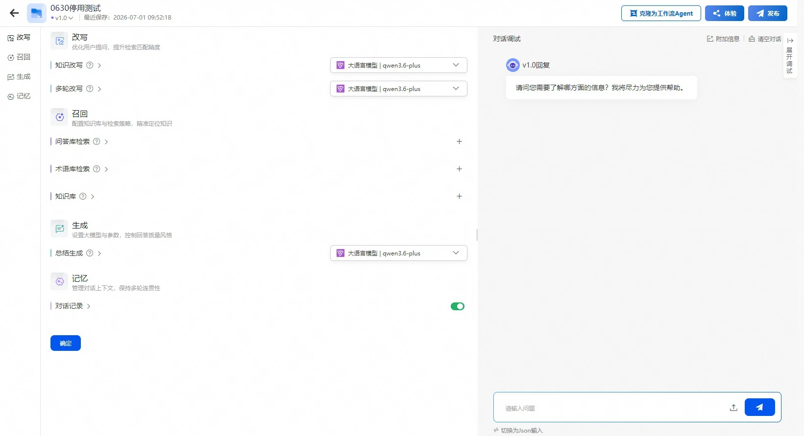

5. 在**改写**阶段，设置知识改写和多轮改写。

   - 知识改写：知识词库召回与用户查询相关的知识词条，并按指令要求改写查询意图。不配置智能体也能正常运行。

     单击模型  ，选择知识改写的模型，输入Prompt。  依次支持保存为我的模板、快速导

     入Prompt模板、复制和全屏。

   - 多轮改写：基于用户会话中的查询问题提炼出查询意图和问题进行召回。不配置智能体也能正常运行。

     单击模型  ，选择多轮改写的模型，输入Prompt。  依次支持保存为我的模板、快速导

     入Prompt模板、复制和全屏。

6. 在**召回**阶段，配置知识库与检索策略，精准定位知识。

   - 问答库检索：选择关联问答库，作为知识检索增强的数据来源。

     <table>
       <tr>
         <th width="186">问答库检索方式</th>
         <th>配置参数</th>
       </tr>
       <tr>
         <td>向量检索</td>
         <td>• 问答库向量检索最大召回条数：1~50<br>• 问答库向量检索最低召回分数：0~1<br>• 选择结果精排模型<br>• 结果精排模型的保留最大条数：1~50<br>• 结果精排模型的保留最低分数：0~1</td>
       </tr>
       <tr>
         <td>全文检索</td>
         <td>• 问答库文本检索最大召回条数：1~50<br>• 问答库文本检索最低召回分数：0~1<br>• 选择结果精排模型<br>• 结果精排模型的保留最大条数：1~50<br>• 结果精排模型的保留最低分数：0~1</td>
       </tr>
       <tr>
         <td>混合检索（线性加权）</td>
         <td>• 问答库 LWS 向量检索最大召回条数：1~50<br>• 问答库 LWS 向量检索最低召回分数：0~1<br>• 问答库 LWS 文本检索最大召回条数：1~50<br>• 问答库 LWS 文本检索最低召回分数：0~1<br>• 问答库 LWS 最终返回条数：1~50<br>• 问答库 LWS 关键词权重：0~1<br>• 选择结果精排模型<br>• 结果精排模型的保留最大条数：1~50<br>• 结果精排模型的保留最低分数：0~1</td>
       </tr>
       <tr>
         <td>混合检索（互惠排名）</td>
         <td>• 问答库 RRF 向量检索最大召回条数：1~50<br>• 问答库 RRF 向量检索最低召回分数：0~1<br>• 问答库 RRF 文本检索最大召回条数：1~50<br>• 问答库 RRF 文本检索最低召回分数：0~1<br>• 问答库 RRF 最终返回条数：1~50<br>• 问答库 RRF 排名折扣：1~100<br>• 选择结果精排模型<br>• 结果精排模型的保留最大条数：1~50<br>• 结果精排模型的保留最低分数：0~1</td>
       </tr>
     </table>

   - 术语库检索：选择关联术语库，作为知识检索增强的数据来源。

     <table>
       <tr>
         <th width="186">术语库检索方式</th>
         <th>配置参数</th>
       </tr>
       <tr>
         <td>向量检索</td>
         <td>• 术语库向量检索最大召回条数：1~50<br>• 术语库向量检索最低召回分数：0~1<br>• 选择结果精排模型<br>• 结果精排模型的保留最大条数：1~50<br>• 结果精排模型的保留最低分数：0~1</td>
       </tr>
       <tr>
         <td>全文检索</td>
         <td>• 术语库文本检索最大召回条数：1~50<br>• 术语库文本检索最低召回分数：0~1<br>• 选择结果精排模型<br>• 结果精排模型的保留最大条数：1~50<br>• 结果精排模型的保留最低分数：0~1</td>
       </tr>
       <tr>
         <td>混合检索（线性加权）</td>
         <td>• 术语库 LWS 向量检索最大召回条数：1~50<br>• 术语库 LWS 向量检索最低召回分数：0~1<br>• 术语库 LWS 文本检索最大召回条数：1~50<br>• 术语库 LWS 文本检索最低召回分数：0~1<br>• 术语库 LWS 最终返回条数：1~50<br>• 术语库 LWS 关键词权重：0~1<br>• 选择结果精排模型<br>• 结果精排模型的保留最大条数：1~50<br>• 结果精排模型的保留最低分数：0~1</td>
       </tr>
       <tr>
         <td>混合检索（互惠排名）</td>
         <td>• 术语库 RRF 向量检索最大召回条数：1~50<br>• 术语库 RRF 向量检索最低召回分数：0~1<br>• 术语库 RRF 文本检索最大召回条数：1~50<br>• 术语库 RRF 文本检索最低召回分数：0~1<br>• 术语库 RRF 最终返回条数：1~50<br>• 术语库 RRF 排名折扣：1~100<br>• 选择结果精排模型<br>• 结果精排模型的保留最大条数：1~50<br>• 结果精排模型的保留最低分数：0~1</td>
       </tr>
     </table>

   - 知识库：选择关联知识库，支持选择多个知识库，作为知识检索增强的数据来源。

     - 召回文件地址

     - 知识库检索方式

       > **说明**
       >
       > 当结果精排关闭时，无需配置结果精排相关参数。

       <table>
         <tr>
           <th width="186">知识库检索方式</th>
           <th>配置参数</th>
         </tr>
         <tr>
           <td>向量检索</td>
           <td>• 知识库向量检索最大召回条数：1~50<br>• 知识库向量检索最低召回分数：0~1<br>• 选择结果精排模型<br>• 结果精排模型的保留最大条数：1~50<br>• 结果精排模型的保留最低分数：0~1</td>
         </tr>
         <tr>
           <td>全文检索</td>
           <td>• 知识库文本检索最大召回条数：1~50<br>• 知识库文本检索最低召回分数：0~1<br>• 选择结果精排模型<br>• 结果精排模型的保留最大条数：1~50<br>• 结果精排模型的保留最低分数：0~1</td>
         </tr>
         <tr>
           <td>混合检索（线性加权）</td>
           <td>• 知识库 LWS 向量检索最大召回条数：1~50<br>• 知识库 LWS 向量检索最低召回分数：0~1<br>• 知识库 LWS 文本检索最大召回条数：1~50<br>• 知识库 LWS 文本检索最低召回分数：0~1<br>• 知识库 LWS 最终返回条数：1~50<br>• 知识库 LWS 关键词权重：0~1<br>• 选择结果精排模型<br>• 结果精排模型的保留最大条数：1~50<br>• 结果精排模型的保留最低分数：0~1</td>
         </tr>
         <tr>
           <td>混合检索（互惠排名）</td>
           <td>• 知识库 RRF 向量检索最大召回条数：1~50<br>• 知识库 RRF 向量检索最低召回分数：0~1<br>• 知识库 RRF 文本检索最大召回条数：1~50<br>• 知识库 RRF 文本检索最低召回分数：0~1<br>• 知识库 RRF 最终返回条数：1~50<br>• 知识库 RRF 排名折扣：1~100<br>• 选择结果精排模型<br>• 结果精排模型的保留最大条数：1~50<br>• 结果精排模型的保留最低分数：0~1</td>
         </tr>
       </table>

7. 在**生成**阶段，设置大模型与参数，控制回答质量风格。

   总结生成：基于召回的文档片段内容和查询问题、改写知识进行总结分析，生成最终答案。

   单击模型  选择总结生成的模型，输入Prompt。  依次支持保存为我的模板、快速导入

   Prompt模板、复制和全屏。

8. 在**记忆**阶段，管理对话上下文，保持多轮连贯性。

   对话记录：

   - 保留对话：保留最近\*\*轮对话记录原文（历史对话中“一问一答”为一轮）。

   - 超过以上轮次的对话记录：

     - 阶段

     - 摘要

9. 单击**确定**，会保存成功。

10. 在页面右侧对话框输入问题或单击  上传文件，单击  进行对话调试。

11. 调试成功后单击右上角**发布**，发布知识问答Agent。

**相关操作**

- 单击右上角**克隆为工作流Agent**，参考设计工作流Agent进行配置。

- 单击右上角**体验**，开启体验功能后，可通过体验地址访问智能体，单击体验地址即可进行对话。或复制体验地址在浏览器中输入进行对话体验。

- 在设计阶段，单击右上角  。

  选择开场白或下一个问题建议。

  - 开场白：输入开场白内容，单击**保存**。最多可添加5条。

  - 下一条问题建议：开启后设置模型、系统提示词、用户提示词等内容后单击**保存**。

<a id="section-4-2-1-3-1-3"></a>

###### 4.2.1.3.1.3. 设计角色对话Agent

通过Agent Dev控制台设计角色对话Agent，配置模型参数、核心人设与行为约束，集成工具与协作任务，管理长短时记忆实现持久化对话，支持调试验证后发布体验。本文介绍设计角色对话Agent的详细操作步骤。

**前提条件**

已新建角色对话智能体。

**操作步骤**

1. 登录Agent Dev控制台。

2. 在左侧导航栏中选择**开发 > 智能体 > 智能体开发**。

3. 单击角色对话Agent卡片上的**详情**。

4. 在**版本**页签下，单击操作列**设计**。

   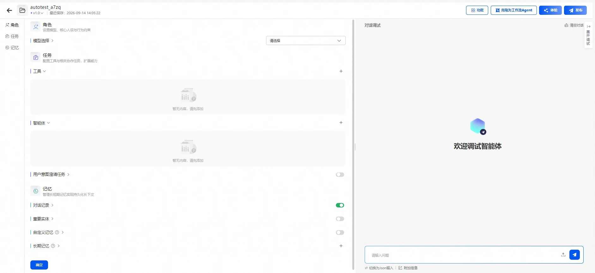

5. 在**角色**阶段，设置模型、核心人设与行为约束。

   - 单击模型  ，选择模型，输入角色定义Prompt和约束条件Prompt。  依次支持保存为

     我的模板、快速导入Prompt模板、复制和全屏。

   - 单击模型旁边  ，根据界面提示设置参数。

     > **说明**
     >
     > 参数取值范围、取值精度、配置规则等，请咨询模型中心模型提供方。

6. 在**任务**阶段，配置工具与相关协作任务，扩展能力。

   - 工具：单击  选择使用的工具，分为我的工具、平台工具和共享工具；如果没有合适的工具，单击**新**

     **建工具**进行创建，内容请参考空间工具。选择工具后参考下表配置参数。  依次支持参数设置

     和删除工具操作。

     <table>
       <tr>
         <th width="152">参数名称</th>
         <th>参数说明</th>
       </tr>
       <tr>
         <td>任务名称</td>
         <td>请自定义工具执行任务的名称。</td>
       </tr>
       <tr>
         <td>适用场景</td>
         <td>单击<strong>案例示意</strong>，根据示意格式输入使用场景。</td>
       </tr>
       <tr>
         <td>能力、限制条件</td>
         <td>请填写任务的能力和限制条件。</td>
       </tr>
       <tr>
         <td>任务异常继续执行</td>
         <td>默认关闭，打开后任务执行过程中出现异常时继续执行任务，不会中断。</td>
       </tr>
       <tr>
         <td>入参预处理</td>
         <td>表示入参时的处理方式：<br>• 不处理<br>• 脚本处理：根据脚本代码处理入参。<br>• 规划处理：根据规划参数处理入参。</td>
       </tr>
       <tr>
         <td>结果后处理</td>
         <td>表示有结果后处理方式：<br>• 直接返回结果：对工具的返回结果不做处理，直接输出。<br>• 脚本转换：根据脚本代码处理后输出。<br>• Mock结果输出：根据Mock结果输出。</td>
       </tr>
     </table>

   - 智能体：单击  选择使用的智能体和智能体版本，单击**确定**。参考下表设置智能体执行任务。

      依次支持参数设置和删除智能体操作。

     | 参数名称 | 参数说明 |
     | --- | --- |
     | 任务名称 | 请自定义智能体执行任务的名称。 |
     | 适用场景 | 单击<strong>案例示意</strong>，根据示意格式输入使用场景。 |
     | 能力、限制条件 | 请填写任务的能力和限制条件。 |
     | 是否呈现子智能体进度(思考过程、日志) | 默认关闭，打开后在执行任务时会呈现子智能体进度。 |
     | 是否呈现子智能体用户澄清 | 默认关闭，打开后在执行任务时会呈现子智能体用户澄清。 |
     | 入参预处理 | 表示入参时的处理方式：<br>• 不处理<br>• 脚本处理：根据脚本代码处理入参。<br>• 规划处理：根据规划参数处理入参。 |
     | 结果后处理 | 表示有结果后处理方式：<br>• 直接返回结果：对工具的返回结果不做处理，直接输出。<br>• 脚本转换：根据脚本代码处理后输出。<br>• Mock结果输出：根据Mock结果输出。 |

   - 用户意图澄清任务：默认关闭，打开后输入用户意图澄清任务描述prompt，  依次支持

     保存为我的模板、快速导入Prompt模板、复制和全屏。

7. 在**记忆**阶段，管理长短期记忆实现持久化上下文。

   - 对话记录：

     - 保留对话：保留最近\*\*轮对话记录原文（历史对话中“一问一答”为一轮）。

     - 超过以上轮次的对话记录：

       - 阶段

       - 摘要

   - 重要实体：默认关闭，输入实体、类型、描述作为重要实体，单击**添加字段**可添加多个。选择实体抽取模型、提取轮数和Prompt。

   - 自定义记忆：在智能体设计中可给予“自定义记忆”节点自定义添加变量的值供智能体对话使用。

     输入实体、类型、描述等作为自定义记忆输出的内容，单击**添加字段**可添加多个。

   - 长期记忆：在生成或保存后不会随着当前对话结束而丢失。后续会话都可以继续使用这些信息，提供更连贯的体验。

     <ol type="a">

     <li>

     单击  ，选择长期记忆。

     </li>

     <li>

     单击设置，选择检索方式，并设置最低召回分数和最大召回条数。

     </li>

     </ol>

     <ol type="i" start="100">

     <li>

      依次支持查看详情和删除操作。

     </li>

     </ol>

8. 在页面右侧对话框输入问题或单击  上传文件，单击  进行对话调试。

9. 调试成功后单击右上角**发布**，发布角色对话Agent。

**相关操作**

- 单击右上角**功能**，可设置开场白和下一步问题建议，设置完成后单击**保存**即可生效。

- 单击右上角**克隆为工作流Agent**，参考设计工作流Agent进行配置。

- 单击右上角**体验**，开启体验功能后，可通过体验地址访问智能体，单击体验地址即可进行对话。或复制体验地址在浏览器中输入进行对话体验。

- 在设计阶段，单击右上角  。

  选择开场白或下一个问题建议。

  - 开场白：输入开场白内容，单击**保存**。最多可添加5条。

  - 下一条问题建议：开启后设置模型、系统提示词、用户提示词等内容后单击**保存**。

<a id="section-4-2-1-3-1-4"></a>

###### 4.2.1.3.1.4. 设计TrekAgent

TrekAgent支持通过Agent Dev控制台进行智能体开发，涵盖规划阶段的模型选择与参数配置、任务阶段的Skills与知识库配置，以及进化阶段的记忆策略管理，并提供对话调试和发布功能。本文介绍TrekAgent的设计操作流程。

**前提条件**

已新建TrekAgent智能体。

**操作步骤**

1. 登录OpenTrek Agent Dev控制台。

2. 在左侧导航栏中选择**开发 > 智能体 > 智能体开发**。

3. 单击TrekAgent卡片上的**详情**。

4. 在**版本**页签下，单击操作列**设计**。

   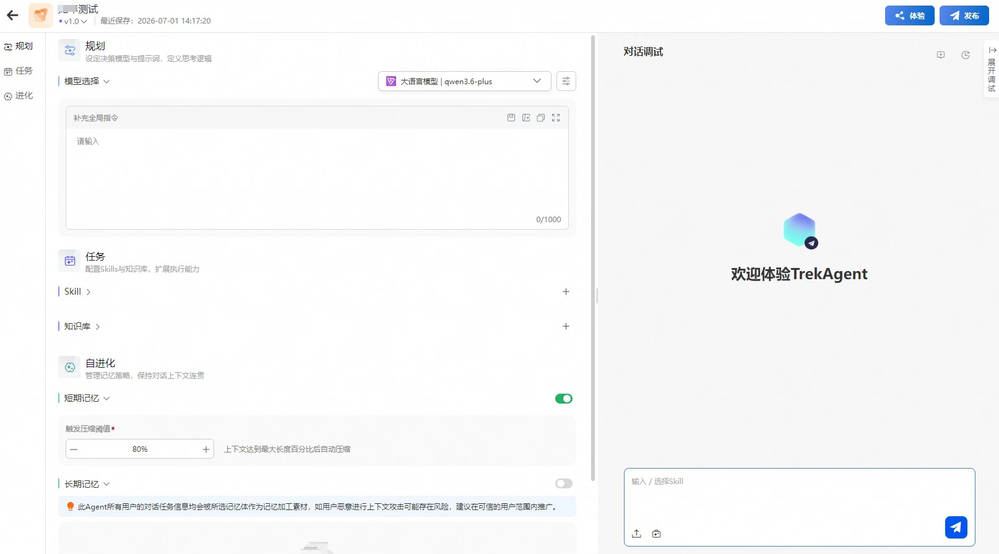

5. 在**规划**阶段，设定决策模型与提示词，定义思考逻辑。

   - 单击模型  ，选择模型，输入全局指令。  依次支持保存为我的模板、快速导入Prompt

     模板、复制和全屏。

   - 单击模型旁边  ，根据界面提示设置参数。

     > **说明**
     >
     > 参数取值范围、取值精度、配置规则等，请咨询模型中心模型提供方。

6. 在**任务**阶段，配置Skills与知识库，扩展执行能力。

   - Skill：单击  选择使用的Skill，支持选择多个，单击**确认**。  依次支持查看详情和删除操作。

     当添加的技能是有凭据时，需要输入**OpenWeatherMap API Key**并设置托管时效（长期有效或限时有效），单击确认。

     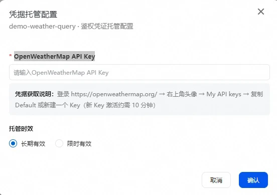

     > **说明**
     >
     > 在添加技能的时候会按照Skill ZIP包凭据规范解析技能文件，请根据界面提示获取凭据并输入API Key。

   - 知识库：单击  选择使用知识库，可以从空间知识库或共享知识库选择，支持选择多个，文档知识库

     和多模态知识库支持同时选择；根据界面提示信息配置调用信息后，单击**保存**。

     > **说明**
     >
     > - 空间知识库最多支持选择5个文档知识库和5个多模态知识库。
     >
     > - 共享知识库最多支持选择1个文档知识库和1个多模态知识库。

7. 在**进化**阶段，管理记忆策略，保持对话上下文连贯。

   - 短期记忆：设置触发压缩阈值，当上下文达到最大长度百分比后自动压缩。

   - 长期记忆：在生成或保存后不会随着当前对话结束而丢失。后续会话都可以继续使用这些信息，提供更连贯的体验。

     <ol type="a">

     <li>

     单击  ，选择长期记忆体，根据界面提示设置记忆体调用信息。

     仅支持关联1个记忆体。如历史版本已关联多个记忆体，则继续保持原有关联，您可删除已有记忆体，但无法再新增关联。

     </li>

     <li>

     单击**保存**。

     </li>

     </ol>

     <ol type="i" start="100">

     <li>

     单击**设置**，选择检索策略，并设置最低召回分数和最大召回条数。

     </li>

     <li value="500">

      依次支持查看详情、设置参数和删除操作。

     </li>

     </ol>

   - Skills自优化：优化后的Skill会生成新版本添加到本智能体选用的Skills列表，不会影响其他使用原版本Skill的智能体。

     - 触发时机

       - 每日更新

       - 闲时更新

     - 自进化更新模式

       - 当前版本滚动更新：Skills自进化产生的所选Skills列表变更会直接在当前版本更新，有利于用户上下文继承。

       - 新建版本更新：Skills自进化产生的所选Skills列表变更会新建一个智能体版本更新，现有版本不变，有利于保持效果稳定性。

8. 在页面右侧对话框输入/或单击  选择技能，单击  进行对话调试。

9. 调试成功后单击右上角**发布**，发布TrekAgent。

**相关操作**

- 单击右上角**体验**，开启体验功能后，可通过体验地址访问智能体，单击体验地址即可进行对话。或复制体验地址在浏览器中输入进行对话体验。

- 单击右上角**克隆**。

  <ol type="i">

  <li>

  选择克隆至当前智能体下或克隆至其他空间。

  - 当前智能体下克隆：输入版本名称。

  - 克隆至其他空间：

    - 选择空间：选择克隆智能体版本的目标空间。

    - 选择智能体：

      - 选择已有智能体：选择已有的智能体克隆。

      - 新建智能体：需要输入智能体名称和其他信息。

    - 版本名称：输入智能体版本名称，长度小于20个字符。

  </li>

  <li>

  单击**确定**。

  </li>

  </ol>

<a id="section-4-2-1-3-1-5"></a>

###### 4.2.1.3.1.5. 设计高代码Agent

通过OpenTrek Agent Dev控制台的高代码Agent开发模式，您可以下载示例代码进行框架适配开发，配置观测功能实现全链路监控，上传代码包并选择兼容OpenAI协议的模型完成部署，最终通过对话或API调试验证功能后发布智能体。本文介绍高代码Agent的完整开发、部署与发布操作流程。

**操作步骤**

1. 登录OpenTrek Agent Dev控制台。

2. 在左侧导航栏中选择**开发 > 智能体 > 智能体开发**。

3. 单击高代码Agent卡片上的**详情**。

4. 在**版本**页签下，单击操作列**设计**。

   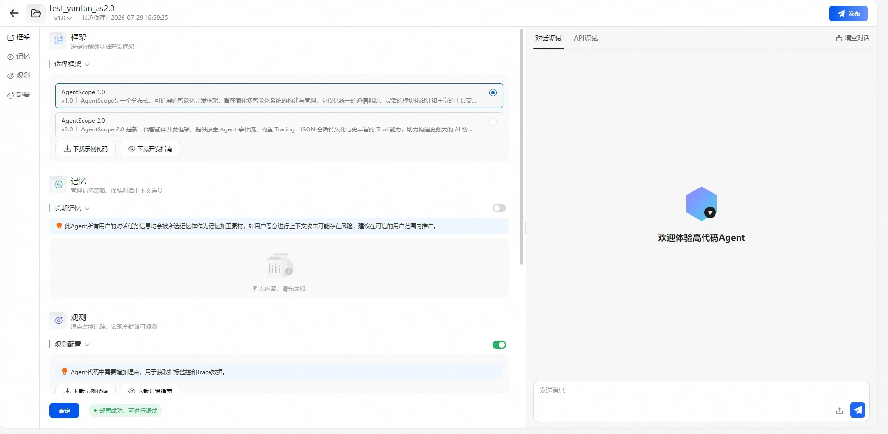

5. 在**框架**阶段，选择框架。

   AgentScope是一款企业级开箱即用的智能体框架，提供灵活的核心抽象以适配不断进化的模型能力，并原生支持模型微调。高代码Agent目前支持AgentScope2.0，基于AgentScope与AgentScope-Runtime，提供覆盖灵活构建、一键部署、在线运维的企业级全链路开发部署闭环。单击下载示例代码，可将代码下载至本地查看。

6. 在**记忆**阶段，管理记忆策略，保持对话上下文连贯。

   长期记忆：打开后此Agent所有用户的对话任务信息均会被所选记忆体作为记忆加工素材，如用户恶意进行上下文攻击可能存在风险，建议在可信的用户范围内推广。

7. 在**观测**阶段，配置观测功能。

   打开后监控追踪，实现全链路可观测。

8. 在**部署**阶段，上传代码包，配置模型资源一键发布。

   - 单击  下载代码示例，按照示例输入代码包在上传至Agent。

   - 选择模型：选择智能体使用的模型，智能体开发需要对模型进行适配开发，或者使用兼容OpenAI协议的模型。

   - 配置沙箱规格和实例数。

   - 确认是否开启Session亲和性。

9. 单击**确定**，Agent会开始部署，等待部署成功后进行调试。

10. 在页面右侧对话框进行**对话调试**或**API调试**。

11. 调试成功后单击右上角**发布**，发布高代码Agent。

<a id="section-4-2-1-3-2"></a>

##### 4.2.1.3.2. 调试智能体

通过文本、附件或JSON调试智能体与工作流并查看日志，以验证搭建效果。本文介绍在OpenTrek Agent Dev中调试与发布智能体的操作方法。

**操作步骤**

1. 登录Agent Dev控制台。

2. 在左侧导航栏中选择**开发 > 智能体 > 智能体开发**。

3. 将鼠标放至智能体卡片上，单击**详情**。

4. 在**版本**页签下，单击操作列**设计**。

5. 单击**调试**，进入调试阶段。

6. 在左下方输入框中输入文本，并回车，根据智能体回复的内容判断搭建流程是否成功。

   单击  可上传附件，支持任意格式文件，不同类型的文件所支持的大小不同，具体请参见设计工作流

   Agent中开始节点在配置模式下所设置的值或高级模式固定的50MB。

   > **说明**
   >
   > 模型推理过程会在对话顶部展示，思考过程输出完成后，会自动折叠收起。

7. 在左下方输入框下切换为JSON输入，通过JSON语句进行调试，通过智能体响应结果判断搭建效果。

8. 调试完成后，单击**发布**，可发布智能体进入智能体详情页面。

**相关操作**

在工作流调试阶段，您还可以执行以下操作。

| 任务名称 | 操作步骤 |
| --- | --- |
| 横向展示工作流 | 单击画布上方<br><br>。 |
| 纵向展示工作流 | 单击画布上方<br><br>。 |
| 查看日志 | 单击右侧<strong>日志</strong>页签。 |
| Run工作流 | 单击画布上方<br><br>。 |
| Debug工作流 | 单击画布上方<br><br>。 |

<a id="section-4-2-1-3-3"></a>

##### 4.2.1.3.3. 体验智能体

OpenTrek Agent Dev控制台仅支持角色对话、知识问答、TrekAgent、工作流类型的智能体开启体验功能。开启体验功能后可设置访问权限并生成分享链接供其他用户对话使用。

**操作步骤**

1. 登录OpenTrek Agent Dev控制台。

2. 在左侧导航栏中选择**开发 > 智能体 > 智能体开发**。

3. 将鼠标放至智能体卡片上，单击**详情**。

4. 在**版本**页签下，单击操作列**体验**。

   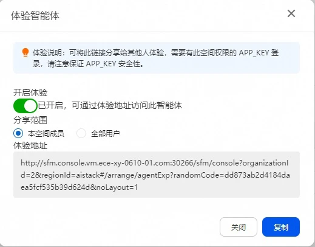

5. 开启体验功能，设置分享范围：

   - 本空间成员

   - 全部用户

6. 复制体验地址在浏览器中打开直接单击体验地址即可进行对话。

   

   若智能体配置了开场白与推荐问题，体验页会展示开场白文案和可点击的推荐问题，单击推荐问题可直接发起提问。

   > **说明**
   >
   > 上述图片仅为角色对话智能体示例，其他类型智能体请以实际环境界面为准。

7. 其他功能：

   - 单击  新开对话。

   - 在输入框中单击  可上传附件。

   - 在输入框中单击  添加附加信息，输入Key和Value；单击**增加附加信息**可添加多条。

   - 单击  发送内容。

<a id="section-4-2-1-3-4"></a>

##### 4.2.1.3.4. 记忆智能体

OpenTrek Agent Dev支持智能体记忆系统配置管理，包括短期记忆和长期记忆两种类型。本文介绍如何在OpenTrek Agent Dev中配置和管理智能体的记忆功能。

**背景信息**

- 短期记忆：短期记忆指的是会话级别的记忆，多会话之间短期记忆隔离，会话清除后短期记忆清除。

- 长期记忆：长期记忆指的是智能体版本级别的记忆，版本内不同会话间长期记忆共享。长期记忆长期保存不主动清除。

**短期记忆**

1. 登录OpenTrek Agent Dev控制台。

2. 在左侧导航栏中选择**开发 > 智能体 > 智能体开发**。

3. 将鼠标放至智能体卡片上，单击**详情**。

4. 在**版本**页签下，单击操作列**设计**。

5. 单击**记忆**，进入记忆阶段。

6. 在短期记忆区域，支持设置对话记录、实体参数、自定义记忆等。

   > **说明**
   >
   > 对话记录短期记忆可提升对话连贯性，保持多轮对话进行追问时模型回复的关联性。开启后默认保留最近5轮对话记录。

7. 设置对话记录。

   <ol type="i">

   <li>

   开启对话记录功能，单击右上角**编辑**，进入编辑状态。

   </li>

   <li>

   修改保留对话轮数，并配置超过对话轮次后的处理方式为截断或者摘要。

   - 截断：不会保留设定轮次外的对话内容。

   - 摘要：则会将对话轮次外的内容生成摘要。

   </li>

   <li>

   （可选）单击**添加**选择摘要模型，设置总结轮数和摘要prompt<strong>。</strong>

   选择摘要后执行本步骤，选择截断请跳过本步骤。

   </li>

   <li>

   完成配置，单击**保存**。

   </li>

   </ol>

8. 设置重要实体。

   <ol type="i">

   <li>

   开启重要实体功能，单击右上角**编辑**，进入编辑状态。

   </li>

   <li>

   输入实体名称、实体类型（STRING('文本')或LIST&lt;String>(字符串数组)）、描述内容。

   </li>

   <li>

   单击**添加**选择实体抽取模型和提取轮数。

   </li>

   <li>

   输入prompt内容，输入的prompt内容可一键保存为模板，也可通过模板导入prompt。

   </li>

   <li>

   完成配置，单击**保存**。

   </li>

   </ol>

9. 设置自定义记忆。

   > **说明**
   >
   > 在智能体设计中可给予“自定义记忆”节点自定义添加变量的值供智能体对话使用。用于将指定信息作为记忆内容影响大模型的输出结果。

   <ol type="i">

   <li>

   开启自定义记忆功能，单击右上角**编辑**，进入编辑状态。

   </li>

   <li>

   输入记忆名称、类型、描述内容。

   </li>

   <li>

   单击**添加字段**增加记忆内容。

   </li>

   <li>

   配置完成，单击**保存**。

   </li>

   <li>

   写入记忆，在工作流中添加自定义记忆节点，将待保存为记忆的内容作为入参。在变量字段处选择自定义记忆名称。

   自定义记忆节点，内容的添加模式可选择：覆盖、追加、清空。

   - 覆盖：每次写入记忆内容，将覆盖之前的记忆。

   - 追加：记忆内容以增量形式写入。

   - 清空：每次写入记忆内容，将清空之前的记忆内容。

   </li>

   </ol>

**长期记忆**

1. 登录OpenTrek Agent Dev控制台。

2. 在左侧导航栏中选择**开发 > 智能体 > 智能体开发**。

3. 将鼠标放至智能体卡片上，单击**详情**。

4. 在**版本**页签下，单击操作列**设计**。

5. 单击**记忆**，进入记忆阶段。

6. 在长期记忆区域，单击**新建记忆分区**，进入长期记忆创建表单页面。

7. 输入记忆分区名称、描述。

8. 选择创建方式：**从模板创建**、**自定义创建**，并进行对应配置。

   - 模板创建：选择通过模板创建时，即通过内置模板快速创建记忆分区，可选择重要问答模板、用户画像模板、任务地图模板。

     <table>
       <tr>
         <th width="90">模型类型</th>
         <th>说明</th>
       </tr>
       <tr>
         <td>重要问答</td>
         <td>重要问答模板记录会话中的重要问答内容，智能体参考问答记忆内容进行回答。<br>a. 选择记忆生成模型，设置对话轮数。<br>b. 配置向量化模型，输入最大召回条数、最低召回分值，对记忆内容进行文本向量化，以便智能体进行记忆召回。</td>
       </tr>
       <tr>
         <td>用户画像</td>
         <td>用户画像模板记录用户偏好信息，智能体可以生成更加符合用户偏好的内容。<br>说明为确保用户画像生成有效，需在“调试”页面，切换json输入后在metadata处按照“详细说明”中的示例添加“memoryUserId”。<br>a. 勾选注意事项的详细说明。<br>b. 单击<strong>添加</strong>，选择记忆生成模型。<br>c. 单击<strong>添加字段</strong>设置画像标签，可添加多个。<br>d. 用户画像记忆分区需依靠向量化模型对记忆进行检索和召回，点击“添加”按钮配置向量化模型，并设置最大召回条数、最低召回分值。<br>e. 完成配置，单击<strong>保存并返回列表页</strong>完成记忆分区创建。</td>
       </tr>
       <tr>
         <td>任务地图</td>
         <td>任务地图会自动记录历史任务执行情况，推荐更加稳定可靠的任务路径。单击<strong>保存并返回列表页</strong>。</td>
       </tr>
     </table>

- 自定义创建：选择自定义创建，提供更灵活的方式定义记忆分区的结构，存储更多样的记忆内容。

  配置完成后**单击保存并返回列表**。

  <table>
    <tr>
      <th colspan="2">参数名称</th>
      <th>参数说明</th>
    </tr>
    <tr>
      <td rowspan="4">记忆存储结构</td>
      <td>-</td>
      <td>• 键值对：即结构化数据，以key-value形式存储记忆。<br>• 多文本：以自由格式的长文本内容为核心，支持存储多条独立文本内容，适合需要保留上下文语义或整体性内容的应用场景。<br>• 文本：仅存储单条文本。</td>
    </tr>
    <tr>
      <td>K列表头</td>
      <td>键值对存储结构需输入K列表头名称。</td>
    </tr>
    <tr>
      <td>V列表头</td>
      <td>键值对存储结构需输入K列表头名称、V列表头名称。</td>
    </tr>
    <tr>
      <td>存储内容描述</td>
      <td>多文本和文本存储结构需输入存储内容描述。</td>
    </tr>
    <tr>
      <td rowspan="2">记忆生成策略</td>
      <td>生成策略类型</td>
      <td>• 手动维护需人工添加记忆内容。<br>• 工作流编排可进入工作流编排画布，设计记忆生成规则。</td>
    </tr>
    <tr>
      <td>调用频次</td>
      <td>工作流编排记忆生成策略，需配置调用频次为单次触发、条件触发。<br>• 单次触发：该记忆分区生成策略仅会触发一次。<br>• 条件触发：需选择触发条件“请求完成”，将在每次请求完成的时候触发一次记忆生成。</td>
    </tr>
    <tr>
      <td>记忆整理策略</td>
      <td>记忆保存时效</td>
      <td>选择长期有效、时效性清理。<br>• 选择长期有效，记忆分区中的内容将长期生效；<br>• 选择时效性清理，则设置记忆有效天数和保留最大条数，超过时效后，记忆将会失效。记忆失效规则为：首先删除“已停用”状态记忆，按更新时间由早到晚顺序删除；无“已停用”状态的记忆，则按更新时间由早到晚顺序删除“已启用”状态的记忆。</td>
    </tr>
    <tr>
      <td rowspan="3">记忆检索策略</td>
      <td>检索方法</td>
      <td>通过配置记忆检索策略，设置智能体召回该记忆分区内容的条件。检索方法为通过语义检索、文本内容检索等，根据记忆存储结构不同所不同。</td>
    </tr>
    <tr>
      <td>检索内容</td>
      <td rowspan="2">检索内容、召回内容可分别或同时选择记忆标题和记忆内容。即通过搜索记忆标题召回记忆标题或记忆内容，搜索记忆内容召回记忆标题或记忆内容。</td>
    </tr>
    <tr>
      <td>召回内容</td>
    </tr>
    <tr>
      <td colspan="2">选择向量化模型</td>
      <td>选择模型并设置最大召回条数、最低召回分数。</td>
    </tr>
  </table>

**相关操作**

长期记忆分区创建成功后，您还可以执行以下操作。

<table>
  <tr>
    <th width="122">任务名称</th>
    <th>操作步骤</th>
  </tr>
  <tr>
    <td>查看详情</td>
    <td>单击记忆分区卡片上的<strong>详情</strong>。</td>
  </tr>
  <tr>
    <td>编辑</td>
    <td>1. 单击记忆分区卡片上的<strong>编辑</strong>。<br>2. 除创建方式、记忆存储结构、模型外的配置项支持进行修改并保存。</td>
  </tr>
  <tr>
    <td>调试</td>
    <td>1. 单击记忆分区卡片上的<strong>调试</strong>。<br>2. 通过输入query，对记忆的召回结果进行调试。</td>
  </tr>
  <tr>
    <td>删除</td>
    <td>单击记忆分区卡片上的<strong>删除</strong>。</td>
  </tr>
  <tr>
    <td>启用/关闭</td>
    <td>已创建的记忆分区默认为启用状态，可点击卡片右上角按钮进行关闭，关闭后该记忆分区不可调用，存储的记忆内容不再生效。</td>
  </tr>
  <tr>
    <td>新增记忆内容</td>
    <td>1. 单击记忆分区卡片上的<strong>详情</strong>。<br>2. 在详情页面单击<strong>新建</strong>。<br>3. 按照页面提示填写记忆内容。以重要问答为例，输入问题、回答内容，并选择该条记忆的启用状态。该记忆条目需在启用状态才能被智能体召回。<br>4. 单击<strong>确定</strong>。</td>
  </tr>
  <tr>
    <td>记忆调用</td>
    <td>记忆开启并创建后，通过引用形式在节点中调用。以开始节点为例，来源选择“引用”，下拉选择短期记忆或长期记忆的子节点。</td>
  </tr>
</table>

<a id="section-4-2-2"></a>

### 4.2.2. 智能体模板

本章节介绍智能体模板功能模块和内置模板操作。

**背景信息**

系统提供知识问答Agent模板，基于不同的模板创建智能体所配置的内容不同：

- **文档检索问答**：基于文档知识库进行知识检索问答服务。此模板下，知识库请从“智能体中心-知识库”中选择“文档知识库”类型。

- **数据分析问答**：基于BI知识库进行数据检索分析问答服务。此模板下，可选择“智能体中心的BI知识库”或“知识中心的数据表知识库”。

- **图文理解问答**：基于图文知识库进行图文检索理解问答服务。此模板下，知识库请从“智能体中心-知识库”中选择“图文知识库”类型。

系统提供以下工作流Agent模板，可直接基于模板创建智能体：

- **固定资产外观描述**：输入固定资产照片，自动生成规范的外观状况描述，用于资产盘点与台账登记，支持多角度照片综合识别，结果以JSON格式输出。

- **会议纪要撰写**：输入会议文字记录（已转写的文本），自动生成格式规范的正式会议纪要，逐项梳理议题讨论、决议事项与待办任务。

- **社交广告文案矩阵**：输入产品与核心卖点，一次产出5条不同角度的社交广告文案，用于信息流广告投放前AB测试。

**操作步骤**

> **说明**
>
> 操作步骤为通用步骤，配置时请参考不同内容。

1. 登录OpenTrek Agent Dev控制台。

2. 在左侧导航栏中选择**开发 > 智能体 > 智能体模板**。

3. 在模板卡片上单击详情，查看OpenAPI试用该智能体模板的接口说明，包括输入参数、输出参数。

4. 单击**使用此模板**，进入创建智能体页面。

5. 选择创建模式。

   - 创建为新智能体

     <ol type="a">

     <li>

     输入智能体名称、描述，上传智能体头像。

     </li>

     <li>

     单击**确定**。

     </li>

     </ol>

   - 在已有智能体下新建版本

     <ol type="a">

     <li>

     选择已有的智能体。

     </li>

     <li>

     输入版本名称。

     </li>

     </ol>

     <ol type="i" start="100">

     <li>

     单击**确定**。

     </li>

     </ol>

6. 创建成功后会进入工作流设计页面，单击右上角**升级为画布编排**，会进入工作流设计页面，具体操作请参见智能体使用及其子章节。

<a id="section-4-3"></a>

## 4.3. 工具箱

本文档介绍我的工具、平台工具和共享工具的相关操作。

<a id="section-4-3-1"></a>

### 4.3.1. 空间工具

本章节介绍注册API工具和注册MCP服务以及其他相关操作。

**注册API工具**

1. 登录OpenTrek Agent Dev控制台。

2. 在左侧导航栏中选择**开发 > 工具箱 > 空间工具**。

3. 单击**注册API工具**。

4. 填写工具名称和工具描述。

5. 选择工具类型，目前仅支持API方式。

6. 输入工具地址，并选择请求方式，API工具可选择POST、GET两种请求方式。

7. 填写Header信息：Header名、Header值类型、描述，是否加密、是否开放修改。

   单击**添加header**可添加多个。

8. 添加请求参数、返回参数信息。

   > **说明**
   >
   > 请求参数为非必填。

   - 请求参数需填写：字段名称、类型、描述、默认值、是否必填、是否开放修改。

   - 返回参数需填写：字段名称、类型、描述。

   - 可添加多个请求参数、返回参数。

   - 请求参数、返回参数均可单击表后的  进行删除。

9. 输入数字设置API工具的请求限制，单位次/秒。

10. 确认是否开启异步调用和流式输出.

    - 异步调用：对于单次请求任务耗时较长的工具可开启异步调用，开启后需按照异步调用对接说明完成对接。

    - 流式输出：数据不需要一次性全部生成或加载完毕再发送，产生一点就发送一点，接收方收到一点就处理一点。

11. 单击**确定**。

**注册MCP服务**

1. 登录OpenTrek Agent Dev控制台。

2. 在左侧导航栏中选择**开发 > 工具箱 > 空间工具**。

3. 单击**注册MCP服务**。

4. 输入服务名称和服务描述。

5. 选择注册模式：

   - SSE：根据页面提示以JSON语句输入服务配置，并进行鉴权配置。

   - STDIO：选择虚机，虚机部署模式，用户按脚手架要求上传代码包，完成MCP服务部署。

   - BUNDLE：暂不支持。

6. 单击**确定**。

**相关操作**

在空间工具页面，您还可以执行以下操作。

| 任务名称 | 操作步骤 |
| --- | --- |
| 编辑工具 | 1. 单击操作列<strong>编辑</strong>。<br>2. 修改参数后单击<strong>确定</strong>。 |
| 调试工具 | 1. 单击操作列<strong>调试</strong>。<br>2. 选择以表单结构调试或JSON结构调试。<br>3. 单击<strong>调试</strong>。 |
| 共享工具 | 1. 单击操作列<strong>共享</strong>。<br>2. 选择空间，单击<strong>确定</strong>。分配的工具可在共享工具中查看。 |
| 升级MCP<br>说明本操作仅针对API工具。 | 1. 单击操作列。<br>2. 选择<strong>升级MCP</strong>。<br>3. 选择添加至已有MCP或新建MCP。<br>• 添加至已有MCP：选择添加的MCP。<br>• 新建MCP：参考上述注册CMP服务的步骤填写参数。<br>4. 单击<strong>确定</strong>。 |
| 查看详情 | 1. 单击操作列。<br>2. 选择<strong>详情</strong>。 |
| 观测 | 1. 单击操作列。<br>2. 选择<strong>观测</strong>。<br>3. 展示成功率、平均耗时、调用量等指标数据。 |
| 删除工具 | 1. 单击操作列。<br>2. 选择<strong>删除</strong>。<br>3. 在弹出的提示框上单击<strong>确定</strong>。 |

<a id="section-4-3-2"></a>

### 4.3.2. 平台工具

本章节介绍如何查看并调试平台工具。

**操作步骤**

1. 登录OpenTrek Agent Dev控制台。

2. 在左侧导航栏中选择**开发 > 工具箱 > 平台工具**。

3. 单击操作列**详情**，可查看工具的使用方法、工具列表、资源依赖。

4. 单击操作**调试**。

5. 下拉选择工具，选择以表单结构调试或JSON结构调试。

6. 单击**调试**。

<a id="section-4-3-3"></a>

### 4.3.3. 共享工具

本章节介绍如何查看并调试共享工具。

**前提条件**

在我的工具中将工具分配给共享空间。

**操作步骤**

1. 登录OpenTrek Agent Dev控制台。

2. 在左侧导航栏中选择**开发 > 工具箱 > 共享工具**。

3. 单击操作列**详情**，可查看工具的使用方法、工具列表、资源依赖。

4. 单击操作**调试**。

5. 下拉选择工具，选择以表单结构调试或JSON结构调试。

6. 单击**调试**。

<a id="section-4-4"></a>

## 4.4. 技能仓

技能仓是 OpenTrek Agent Dev 控制台中的 Skills 管理模块，提供平台内置技能和空间技能的浏览、安装、调试和管理功能。

<a id="section-4-4-1"></a>

### 4.4.1. 技能广场

本文介绍OpenTrek Agent Dev控制台中内置技能的管理和使用方法，包括筛选、查看详情、调试和安装到本空间的操作步骤，帮助您快速获取和使用内置技能。

**操作步骤**

1. 登录OpenTrek Agent Dev控制台。

2. 在左侧导航栏中选择**开发 > 技能仓**。

3. 单击**技能广场**页签。

4. 在输入框中心输入技能名称，单击  ，筛选除符合条件的技能。

   - 详情：

     <ol type="a">

     <li>

     单击目标技能卡片底部的**详情**。

     </li>

     <li>

     可以查看技能的详细信息。

     </li>

     </ol>

     <ol type="i" start="100">

     <li>

     单击右上角**下载**可将技能下载至本地。

     </li>

     <li value="500">

     在右上角支持切换版本。

     </li>

     </ol>

   - 调试：

     <ol type="a">

     <li>

     单击目标技能卡片底部的**调试**。

     </li>

     <li>

     在右侧抽屉对话框输入消息进行对话调试。

     </li>

     </ol>

   - 安装：

     <ol type="a">

     <li>

     单击目标技能卡片底部的**安装到本空间**。

     </li>

     <li>

     在弹出的提示框上单击**确定**。安装成功后可以在**空间技能**中查看。

     </li>

     </ol>

<a id="section-4-4-2"></a>

### 4.4.2. 空间技能

本文介绍如何通过文件上传、工具转化或工作流转化方式安装技能及配置参数，并提供编辑、调试、共享等管理功能的具体操作方法。

**安装技能**

1. 登录OpenTrek Agent Dev控制台。

2. 在左侧导航栏中选择**开发 > 技能仓**。

3. 选择**空间技能**页签，单击**安装技能**。

4. 配置参数。

   <table>
     <tr>
       <th width="165">配置项</th>
       <th>说明</th>
     </tr>
     <tr>
       <td>安装方式</td>
       <td>请选择合适的安装方式。<br>• 文件<br>• 工具转化(API/MCP)<br>• 工作流转化</td>
     </tr>
     <tr>
       <td>上传文件</td>
       <td>• <strong>安装方式</strong>为<strong>文件</strong>时有此选项。<br>• 支持.zip格式。<br>说明<br>• 当上传具有鉴权凭证的技能时，会出现托管提示，单击<strong>查看 Skill ZIP 包</strong><strong>凭据规范</strong>，可查看规范内容。<br>• 空间技能以智能体粒度托管凭证，在智能体设计页面添加技能时完成凭证配置。</td>
     </tr>
     <tr>
       <td>选择API/MCP工具</td>
       <td>• <strong>安装方式</strong>为<strong>工具转化(API/MCP)</strong>时有此选项。<br>• 请选择工具类型和工具。</td>
     </tr>
     <tr>
       <td>选择工作流Agent</td>
       <td>• <strong>安装方式</strong>为<strong>工作流转化</strong>时有此选项。<br>• 请选择工作流Agent。</td>
     </tr>
     <tr>
       <td>书写Skill.md</td>
       <td>• <strong>安装方式</strong>为<strong>工具转化(API/MCP)</strong>和<strong>工作流转化</strong>时有此选项。<br>• 请输入技能内容，支持Markdown格式。当智能化<br>设置中开启技能转化AI生成时，单击<br><br>会<br>调用大模型的能力，生成Skill.md的内容。<br><br>• 右上角，依次支持保存到本地、导<br>入内容、放大内容和全屏。</td>
     </tr>
     <tr>
       <td>技能备注名称</td>
       <td>平台将使用Skill.md文件中的name字段作为技能的唯一标识。您可以填写备注名称，以便于在技能列表中区分和管理不同技能。<br>说明填写备注名称后，技能列表卡片将优先大字展示备注名，小字展示name；未填写备注名称时，列表卡片将大字展示name。</td>
     </tr>
   </table>

5. 单击**确认安装**。

**相关操作**

<table>
  <tr>
    <th width="154">任务名称</th>
    <th>操作步骤</th>
  </tr>
  <tr>
    <td>编辑</td>
    <td>1. 单击目标技能卡片底部的<strong>编辑</strong>。<br>2. 修改技能信息。<br>3. 单击<strong>确认修改</strong>。</td>
  </tr>
  <tr>
    <td>查看技能的版本</td>
    <td>在空间技能页面，技能的卡片上会展示当前版本。</td>
  </tr>
  <tr>
    <td>查看技能详细信息</td>
    <td>1. 单击目标技能卡片底部的<strong>详情</strong>。<br>2. 在页面右上角，支持切换版本。</td>
  </tr>
  <tr>
    <td>查看关联智能体</td>
    <td>1. 单击目标技能卡片底部的<strong>详情</strong>。<br>2. 选择<strong>关联智能体</strong>页签。<br>3. 单击操作列<strong>查看详情</strong>。</td>
  </tr>
  <tr>
    <td>强制刷新技能版本</td>
    <td>1. 勾选需要刷新版本的智能体。<br>2. 单击<strong>强制刷新技能版本</strong>。</td>
  </tr>
  <tr>
    <td>调试</td>
    <td>1. 单击目标技能卡片底部的<strong>调试</strong>或进入详情页单击右上角<strong>调试</strong>。<br>2. 进行对话调试。</td>
  </tr>
  <tr>
    <td>共享</td>
    <td>1. 单击目标技能卡片底部的<strong>共享</strong>。<br>2. 选择空间范围。支持选择指定空间和所有空间。选择指定空间时还需要选择空间。<br>3. 单击<strong>确定</strong>。</td>
  </tr>
  <tr>
    <td>观测</td>
    <td>单击目标技能卡片底部的<strong>观测</strong>。</td>
  </tr>
</table>

| 删除 | 单击目标技能卡片底部的<strong>删除</strong>。 |
| --- | --- |

<a id="section-4-4-3"></a>

### 4.4.3. 共享技能

本文介绍在OpenTrek Agent Dev控制台中使用技能仓共享技能的功能，包括筛选、查看详情、调试和安装操作，帮助您快速获取和使用共享技能。

**操作步骤**

1. 登录OpenTrek Agent Dev控制台。

2. 在左侧导航栏中选择**开发 > 技能仓**。

3. 单击**共享技能**页签。

4. 在输入框输入技能名称，单击  ，会筛选出符合条件技能。

   - 详情：

     <ol type="a">

     <li>

     单击目标技能卡片底部的**详情**。

     </li>

     <li>

     可以查看技能的详细信息。

     </li>

     </ol>

     <ol type="i" start="100">

     <li>

     单击右上角**下载**可将技能下载至本地。

     </li>

     <li value="500">

     在右上角支持切换版本。

     </li>

     </ol>

   - 调试：

     <ol type="a">

     <li>

     单击目标技能卡片底部的**调试**或单击详情页右上角**调试**。

     </li>

     <li>

     在右侧抽屉对话框输入消息进行对话调试。

     </li>

     </ol>

   - 安装：

     <ol type="a">

     <li>

     单击目标技能卡片底部的**安装到本空间**。

     </li>

     <li>

     在弹出的提示框上单击**确定**。安装成功后可以在**空间技能**中查看。

     </li>

     </ol>

<a id="section-4-5"></a>

## 4.5. 记忆体

记忆体为智能体提供长期记忆能力，支持跨会话的上下文记忆和知识积累。

<a id="section-4-5-1"></a>

### 4.5.1. 新增记忆体

Agent Dev平台的记忆体功能支持为智能体配置持久化记忆存储，实现跨会话记忆、领域知识积累和个性化服务。本文介绍新增记忆体的操作方式，包括配置分区参数、设置共享属性、绑定智能体及管理操作。

**功能说明**

记忆体是Agent Dev平台提供的长期记忆管理功能，支持为智能体配置持久化的记忆存储，使智能体在多轮对话中能够记忆上下文信息和用户偏好。

通过记忆体，智能体可以：

- 跨会话保持对用户的了解和记忆。

- 积累和沉淀领域知识。

- 基于历史交互提供更个性化的服务。

**前提条件**

- 已登录Agent Dev控制台。

- 拥有记忆体的管理权限。

**新增记忆体**

1. 登录OpenTrek Agent Dev控制台。

2. 在左侧导航栏中，选择**开发 > 记忆体**。

3. 在记忆体页面，单击**新增记忆体**。

4. 在弹出的对话框中，配置以下参数：

   | 参数 | 是否必选 | 说明 |
   | --- | --- | --- |
   | 记忆体名称 | 是 | 输入记忆体的名称，用于标识不同的记忆存储实例。 |
   | 记忆体描述 | 否 | 输入记忆体的描述信息，便于识别该记忆体的用途。 |
   | 检索记忆向量模型 | 是 | 选择用于记忆检索的向量模型。<br>重要完成记忆体创建后，向量模型不可修改。 |
   | 记忆加工/整理默认模型 | 是 | 选择用于记忆加工和整理的默认模型。 |
   | 分区属性 | 是 | 选择记忆体分区的共享属性：<br>• <strong>空间共享</strong>：该记忆体分区在当前空间内所有智能体均可使用。<br>• <strong>部分智能体专享</strong>：该记忆体分区仅指定类型的智能体可使用。选择此项后需进一步配置<strong>智能体类型</strong>。 |
   | 智能体类型 | 否 | 当分区属性选择<strong>部分智能体专享</strong>时需要配置。选择可使用该记忆体分区的智能体类型。例如工作流Agent。 |
   | 选择智能体 | 是 | 选择记忆体绑定的智能体类型下的智能体。 |

5. 单击**确定**，完成记忆体创建。

**相关操作**

在记忆体页面，您还可以执行以下操作：

| 任务名称 | 操作步骤 |
| --- | --- |
| 查看详情 | 单击记忆体卡片上<strong>详情</strong>，跳转至详情页面。详情页面的其他操作请参见子章节。 |
| 编辑记忆体 | 1. 单击记忆体卡片上的<strong>编辑</strong>。<br>2. 修改参数后单击<strong>确定</strong>。 |
| 查看记忆体引用关系 | 1. 单击记忆体卡片上的<strong>引用</strong>。<br>2. 如果记忆体被智能体引用，单击<strong>详情</strong>，可查看详细信息。。 |
| 查看观测 | 1. 单击记忆体卡片上的<strong>观测</strong>。<br>2. 支持查看指定时间段内的指标数据。 |
| 删除记忆体 | 1. 单击记忆体卡片上的<strong>... &gt; 删除</strong>。<br>2. 在弹出的提示框上单击<strong>确定删除</strong>。 |

<a id="section-4-5-2"></a>

### 4.5.2. 管理记忆

本文提供Agent Dev控制台记忆管理的完整操作指导，涵盖常驻记忆、检索记忆、用户记忆和Skills记忆的创建、编辑、冻结、锁定、转化和删除等全生命周期管理功能，帮助您高效管理智能体记忆信息。

**操作步骤**

1. 登录OpenTrek Agent Dev控制台。

2. 在左侧导航栏中选择**开发 > 记忆体**。

3. 单击记忆体卡片上的**详情**。

4. 在**记忆总览**页签，选择记忆类型。

   - 常驻记忆：

     - 无论处理任何任务都会参考的记忆信息。

     - 锁定的记忆不清理、不合并、不冻结。

   - 检索记忆：

     - 根据用户任务检索相关记忆纳入参考。

     - 锁定的记忆不清理、不合并、不冻结。

   - 用户记忆：

     - 用户画像与个人偏好的记忆信息。

     - 需要创建智能体会话时memoryUserId字段传入用户编码信息，此会话才会被用于生产和整理用户记忆。

     - 智能体调试默认传入平台用户名作为用户编码。

   - 技能记忆：从记忆中沉淀可复用Skills。

5. （可选）单击**添加记忆**。

   仅常驻记忆、检索记忆和用户记忆支持该操作。

6. 输入记忆内容，单击**创建**。

   记忆类型是用户记忆时需要输入用户编码和记忆内容，单击**创建**。

**相关操作**

记忆添加成功后，您可以执行以下操作。

| 任务名称 | 操作步骤 |
| --- | --- |
| 查看详情<br>说明仅用户记忆支持。 | 单击操作列<strong>详情</strong>。 |
| 编辑记忆 | 1. 单击操作列<strong>编辑</strong>。<br>2. 修改记忆内容后单击<strong>确定</strong>。 |
| 冻结/唤醒记忆<br>说明常驻和检索记忆支持冻结/唤醒。 | 1. 单击操作列<strong>冻结</strong>。<br>2. 冻结后的记忆再次使用的话需要唤醒，单击操作列<strong>唤醒</strong>。 |
| 锁定/解锁记忆<br>说明冻结后的记忆不支持锁定操作。常驻和检索记忆支持锁定和解锁。 | 1. 单击操作列<strong>锁定</strong>。<br>2. 锁定后单击<strong>解锁</strong>后可以继续使用。 |
| 转化为技能<br>说明常驻和检索记忆支持转换为技能。 | 1. 单击操作列<strong>转化为技能</strong>。<br>2. 选择<strong>转化模式</strong>。<br>• 新建技能<br>a. 输入name和description。<br>b. 选择生成Skill模型。<br>c. 输入备注名称。<br>d. 单击<strong>确定转化</strong>。<br>• 更新已有技能<br>• 选择已有Skill。<br>• 选择生成Skill模型。<br>• 单击<strong>确定转化</strong>。 |
| 删除记忆 | 1. 单击操作列<strong>... &gt; 删除</strong>。<br>2. 在弹出的提示框上单击<strong>确定</strong>。用户记忆直接单击操作列<strong>删除</strong>。 |

<a id="section-4-5-3"></a>

### 4.5.3. 生成策略

Agent Dev支持记忆生成策略的完整配置管理，包括常驻记忆、检索记忆、用户记忆三种策略类型选择，加工策略配置，触发时机设置和模型选择，提供策略启用停用及删除等管理功能。本文介绍如何在Agent Dev中添加、管理和删除记忆生成策略。

**操作步骤**

1. 登录OpenTrek Agent Dev控制台。

2. 在左侧导航栏中选择**开发 > 记忆体**。

3. 单击记忆体卡片上的**详情**。

4. 选择**生成策略**页签，选择策略。

   - 常驻记忆策略：无论处理任何任务都会参考的记忆信息。

   - 检索记忆策略：根据用户任务检索相关记忆纳入参考。

   - 用户记忆策略：用户画像与个人偏好相关的记忆信息。

     > **说明**
     >
     > - 需要创建智能体会话时memoryUserId字段传入用户编码信息，此会话才会被用于生产和整理用户记忆。
     >
     > - 智能体调试默认传入平台用户名作为用户编码。

5. 单击**添加策略**。

   <table>
     <tr>
       <th width="121">参数名称</th>
       <th>参数说明</th>
     </tr>
     <tr>
       <td>策略名称</td>
       <td>请输入记忆生成策略名称。</td>
     </tr>
     <tr>
       <td>加工策略</td>
       <td>• <strong>默认策略</strong>：根据执行任务和用户指令规律自主加工沉淀常驻记忆。<br>• <strong>自定义策略</strong>：自定义输入策略内容。</td>
     </tr>
     <tr>
       <td>默认策略</td>
       <td>加工策略选择默认策略时，需要配置。请选择默认加工策略。</td>
     </tr>
     <tr>
       <td>自定义策略</td>
       <td>加工策略选择自定义策略时，需要配置。请输入自定义策略内容。</td>
     </tr>
     <tr>
       <td>选择加工模型</td>
       <td>下拉选择处理策略时的模型。</td>
     </tr>
     <tr>
       <td>触发时机</td>
       <td>触发加工策略执行的时间。<br>• 每日更新<br>• 闲时更新</td>
     </tr>
     <tr>
       <td>更新时间</td>
       <td>触发时机选择每日更新时需要配置。设置具体的时间点，将于每日的这个时间点更新。</td>
     </tr>
   </table>

6. 单击**确定**。

   添加成功的策略状态默认已启用。

**相关操作**

策略添加成功后，您还可以执行以下操作。

> **说明**
>
> 策略为已停用状态的策略才支持编辑和删除操作。

| 任务名称 | 操作步骤 |
| --- | --- |
| 编辑策略 | 1. 单击已停用策略操作列<strong>编辑</strong>。<br>2. 修改完成后单击<strong>确定</strong>。 |
| 停用/启用策略 | 单击操作列是否启用开关，已启用的策略会停用，已停用的策略会已启用。 |
| 查看记忆示例 | 单击操作列<strong>记忆示例</strong>。 |
| 删除策略 | 1. 单击已停用策略操作列<strong>删除</strong>。<br>2. 在弹出的提示框上单击<strong>确定删</strong>除。 |

<a id="section-4-5-4"></a>

### 4.5.4. 整理策略

通过配置智能合并、自动清除、冲突处理等整理策略，实现对常驻记忆、检索记忆和用户记忆的自动化管理，提升记忆体运营效率。本文介绍如何配置记忆体的整理策略。

**操作步骤**

1. 登录OpenTrek Agent Dev控制台。

2. 在左侧导航栏中选择**开发 > 记忆体**。

3. 单击记忆体卡片上的**详情**。

4. 选择**整理策略**页签，针对常驻记忆、检索记忆和用户记忆进行整理。以下操作以常驻记忆整理为例，其他类型请以实际页面为准。

   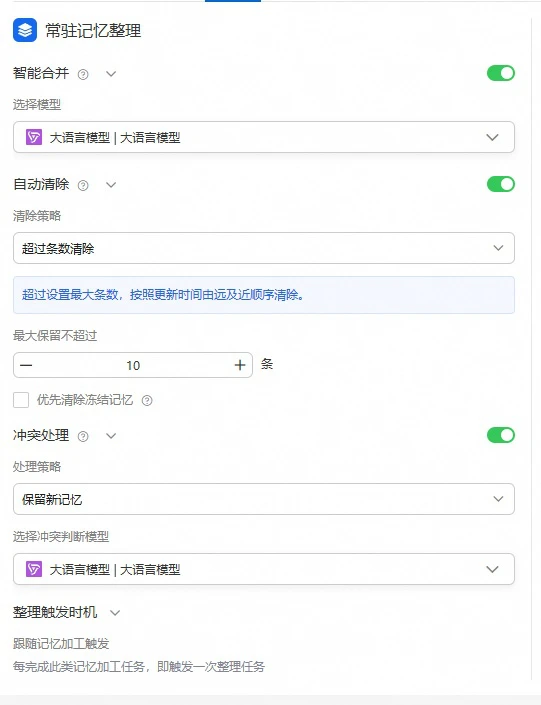

   - **智能合并**：打开后当加工出的多条相似的常驻记忆时，会自动合并为一条。锁定状态下的记忆不会被合并。

   - **自动清除**：打开后在记忆超过设置最大条数，按照更新时间由远及近顺序清除。如果勾选优先清除冻结记忆后，冻结状态记忆全部清除前，正常状态的记忆即使符合清除策略也不会清除。

   - **冲突处理**：设置当存在多条冲突的相似记忆时的处理方法，不会处理锁定状态下的记忆。

   - **整理触发时机**：跟随记忆加工触发，每完成此类记忆加工任务，即触发一次整理任务。

5. 设置完成后单击**保存**。

<a id="section-4-6"></a>

## 4.6. 知识库

<a id="section-4-6-1"></a>

### 4.6.1. 空间知识库

本章节介绍空间知识库的相关操作，包括新建、查看、分配、停用/启用等操作。

**操作步骤**

1. 登录OpenTrek Agent Dev控制台。

2. 在左侧导航栏中选择**开发 > 知识库 > 我的知识库**。

3. 单击**新建知识库**，参考下表配置参数。

   <ol type="i">

   <li>

   配置基础信息。

   <table>
     <tr>
       <th width="105">参数名称</th>
       <th>参数说明</th>
     </tr>
     <tr>
       <td>知识库名称</td>
       <td>请自定义知识库名称。</td>
     </tr>
     <tr>
       <td>知识库描述</td>
       <td>请输入知识库的其他信息。</td>
     </tr>
     <tr>
       <td>创建方式</td>
       <td>• 模板创建：可选文档问答模板、数据表问答模板、图文理解问答模板。<br>• 自定义知识库：自定义设计索引方案及知识内容数据。</td>
     </tr>
     <tr>
       <td>选择模板</td>
       <td>• 文档知识库：新建的知识库作为文档知识库。<br>• 数据表知识库：新建的知识库作为数据表知识库。<br>• 图文知识库：新建的知识库作为图文知识库。<br>• 问答知识库：新建的知识库作为问答知识库。<br>• 术语知识库：新建的知识库作为术语知识库。</td>
     </tr>
   </table>

   </li>

   <li>

   （可选）配置模板创建参数。

   > **说明**
   >
   > 当**创建方式**是**模板创建**时，请执行本步骤，参考下表配置参数。

   - **文档知识库参数表**

     当**创建方式**是**模板创建**同时**选择模板**为**文档知识库**时，参考下表配置参数。

     <table>
       <tr>
         <th width="137">参数名称</th>
         <th>参数说明</th>
       </tr>
       <tr>
         <td>模型选择</td>
         <td>• 在线解析模型：是一种利用预训练的算法或人工智能技术，实时对数据进行结构化解构、语义理解或信息提取后返回结果的计算模型或服务。<br>• 文本向量化模型：是一种将自然语言文本（如单词、句子、段落或文档）转换为**固定长度的数值向量（Vector）**的人工智能模型。</td>
       </tr>
       <tr>
         <td>解析策略</td>
         <td>• 基础解析：指对原始数据进行初步的、表层的结构化提取。<br>说明基础解析不支持OFD文件格式的解析。<br>• 深度解析：指在基础解析之上，利用自然语言处理（NLP）、计算机视觉（CV）或机器学习模型，对数据进行语义理解、结构重组、逻辑关联和知识抽取。</td>
       </tr>
       <tr>
         <td>深度解析配置</td>
         <td>当解析策略选择深度解析时，需要配置。<br>• 版面分析：识别文档文本排版，标题位置信息。<br>• 文本解析：文档文字内容基础提取。<br>• OCR增强：处理影印版文件的文字，开启后会减慢处理速度。<br>• 图片OCR：提取文档中图片中包含的文字内容，开启后会减慢处理速度。<br>• URL提取：提取PDF中文本内嵌的超链接URL。<br>• 表格解析：将文件中的表格解析为HTML，开启后会减慢处理速度。<br>• 公式解析：将文件中的公式解析为Latex，开启后会减慢处理速度。<br>• 图片理解：图片、图表描述，开启后会减慢处理速度。</td>
       </tr>
       <tr>
         <td>分段策略</td>
         <td>分段策略调整仅对新上传文件生效。<br>• 智能语义分段<br>• 自定义分段</td>
       </tr>
       <tr>
         <td>分段标识符</td>
         <td>当分段策略为自定义分段时，需要配置。按照所选的标识符切分文本。切分后，按设置的分段最大长度对切分后的文本组合成单一切片内容。</td>
       </tr>
       <tr>
         <td>分段最大长度</td>
         <td>当分段策略为自定义分段时，需要配置。分段最大长度应匹配应用中的模型上下文长度范围。长度越大，召回的上下文越丰富。长度越小，召回的信息越精简</td>
       </tr>
       <tr>
         <td>最大重叠字占比</td>
         <td>当分段策略为自定义分段时，需要配置。当前分段与前后分段的 “重叠部分字符数” 相较于设置的 “分段最大长度”的比例。 如果重叠部分存在不完整的句子，则此分段舍去该句。占比越大，相邻分段重叠字符越多， 占比越小，重叠字符越少。最大值为25%</td>
       </tr>
       <tr>
         <td>是否关联文件名</td>
         <td>当分段策略为自定义分段时，需要配置。默认关闭，打开后知识库会与文件名相关联。</td>
       </tr>
     </table>

   - **数据表知识库参数表**

     当**创建方式**是**模板创建**同时**选择模板**为**数据表知识库**时，参考下表配置参数。

     <table>
       <tr>
         <th colspan="2">参数名称</th>
         <th>参数说明</th>
       </tr>
       <tr>
         <td colspan="2">选择数据源实例</td>
         <td>请下拉选择正确的数据源。如果没有合适的数据库，单击<strong>管理数据源实例</strong>，单击<strong>添加数据源实例</strong>，按照界面提示输入正确的参数值。</td>
       </tr>
       <tr>
         <td>数据表</td>
         <td>向量模型</td>
         <td>请选择正确的数据表向量模型，单击<strong>添加</strong>，勾选正确的模型。支持在资源集内模型或三方注册模型选择。</td>
       </tr>
       <tr>
         <td rowspan="2">数据值</td>
         <td>选择索引类型</td>
         <td>请选择索引是生成向量数据还是生成ES数据，支持两个同时选择。</td>
       </tr>
       <tr>
         <td>向量模型</td>
         <td>请选择正确的数据值向量模型，单击<strong>添加</strong>，勾选正确的模型。支持在资源集内模型或三方注册模型选择。</td>
       </tr>
       <tr>
         <td rowspan="2">数据维度</td>
         <td>选择索引类型</td>
         <td>请选择索引是生成向量数据还是生成ES数据，支持两个同时选择。</td>
       </tr>
       <tr>
         <td>向量模型</td>
         <td>请选择正确的数据维度向量模型，单击<strong>添加</strong>，勾选正确的模型。支持在资源集内模型或三方注册模型选择。</td>
       </tr>
       <tr>
         <td>数据专家知识</td>
         <td>向量模型</td>
         <td>请选择正确的数据专家知识向量模型，单击<strong>添加</strong>，勾选正确的模型。支持在资源集内模型或三方注册模型选择。</td>
       </tr>
       <tr>
         <td>样例库</td>
         <td>向量模型</td>
         <td>请选择正确的样例库向量模型，单击<strong>添加</strong>，勾选正确的模型。支持在资源集内模型或三方注册模型选择。</td>
       </tr>
     </table>

   - **图文知识库参数表**

     当**创建方式**是**模板创建**同时**选择模板**为**图文知识库**时，参考下表配置参数。

     <table>
       <tr>
         <th colspan="2">参数名称</th>
         <th>参数说明</th>
       </tr>
       <tr>
         <td rowspan="3">图文解析配置</td>
         <td>智能解析</td>
         <td>默认关闭，打开后使用智能解析功能解析图文。</td>
       </tr>
       <tr>
         <td>智能解析模型</td>
         <td>请选择智能解析时使用的模型。</td>
       </tr>
       <tr>
         <td>图文描述Prompt</td>
         <td>请输入简短的语句描述图片，不要带入情感和发散性词语。</td>
       </tr>
       <tr>
         <td rowspan="2">向量化配置<br>说明图文向量化模型在知识库新建完成后，不可调整。</td>
         <td>图文向量化模型</td>
         <td>请选择向量化的模型。</td>
       </tr>
       <tr>
         <td>向量化触发条件</td>
         <td>• 文件上传后即向量化：将对新上传的全部数据直接向量化（含已解析和未解析）。<br>• 仅对已标注的文件向量化：即仅已完成解析的数据进行向量化。</td>
       </tr>
     </table>

   - **问答知识库**

     向量模型在知识库新建完成后，不可调整<strong>。</strong>

     <ol type="a">

     <li>

     单击**添加**，选择文本向量化模型。

     </li>

     <li>

     勾选模型后，单击**确定**。

     </li>

     </ol>

   - **术语知识库**

     向量模型在知识库新建完成后，不可调整<strong>。</strong>

     <ol type="a">

     <li>

     单击**添加**，选择文本向量化模型。

     </li>

     <li>

     勾选模型后，单击**确定**。

     </li>

     </ol>

   </li>

   <li>

   （可选）配置自定义知识库参数。

   > **说明**
   >
   > 当**创建方式**是**自定义知识库**时，请执行本步骤，参考下表配置参数。

   <table>
     <tr>
       <th width="122">参数名称</th>
       <th>参数说明</th>
     </tr>
     <tr>
       <td>内容结构配置</td>
       <td>请配置知识库内容：<br>• 知识库名称：自定义输入，长度小于256个字符。<br>• 添加字段：输入字段名称、字段内容、字段类型和默认值等信息。</td>
     </tr>
     <tr>
       <td>索引构建</td>
       <td>单击<strong>添加索引</strong>，配置下列参数：<br>• 选择内容结构：下拉选择提前配置好的内容结构。<br>• 索引名称：自定义名称，长度小于256个字符。<br>• 索引类型：选择向量或ES。<br>• 选择模型：单击添加，选择知识库模型。<br>• 选择检索字段：请选择知识库中检索的字段。<br>• 选择召回字段：请选择知识库中召回的字段。</td>
     </tr>
   </table>

   </li>

   </ol>

4. 单击**确定并进入详情页**或**确定并返回列表**。

**相关操作**

知识库新增成功后，您还可以执行以下操作。

<table>
  <tr>
    <th width="144">任务名称</th>
    <th>操作步骤</th>
  </tr>
  <tr>
    <td>查看详情</td>
    <td>1. 将鼠标放至知识库卡片上。<br>2. 单击<strong>详情</strong>。<br>3. 支持查看数据模型、数据维度、数据专家知识和样例库。</td>
  </tr>
  <tr>
    <td>停用/启用知识库</td>
    <td>1. 将鼠标放至已启用/已停用的知识库卡片上。<br>2. 单击<strong>停用</strong>/<strong>启用</strong>。<br>3. 在弹出的提示框上单击<strong>确定</strong>。</td>
  </tr>
  <tr>
    <td>分配知识库</td>
    <td>1. 将鼠标放至知识库卡片上。<br>2. 单击<strong>分配</strong>。<br>3. 选择空间，单击<strong>确定</strong>。</td>
  </tr>
  <tr>
    <td>删除知识库</td>
    <td>1. 将鼠标放至已停用的知识库卡片上。<br>2. 单击<strong>删除</strong>。<br>3. 在弹出的提示框上单击<strong>确定</strong>。</td>
  </tr>
</table>

<a id="section-4-6-1-1"></a>

#### 4.6.1.1. 文档知识库

本章节介绍文档知识库详情页面的相关操作。

**操作步骤**

1. 登录OpenTrek Agent Dev控制台。

2. 在左侧导航栏中选择**开发 > 知识库 > 我的知识库**。

3. 将鼠标放至文档知识库卡片上。

4. 单击**详情**。

   - **原始文件**：

     <ol type="a">

     <li>

     在**原始文件**页签，单击**导入**。

     </li>

     <li>

     请选择是手工上传还是API上传。

     - 手工上传：支持pdf、docx、doc、txt、xls、xlsx、ppt、pptx、caj、html、ofd格式，在本地配置好后单击**上传文件**。批量上传仅支持2000个以下文件。如需上传更多数据，请通过API上传方式上传。

       > **说明**
       >
       > caj、ppt、pptx文件解析时会先转换为pdf，由于转换过程中会存在乱码或信息丢失的情况，无法保障最终解析效果，请知悉。

     - API上传：支持调用OpenAPI接口完成知识库文件导入。

       单击查看接口，跳转查看接口文档。

     </li>

     </ol>

   - **内容详情**：

     <ol type="a">

     <li>

     单击**内容详情**页签。

     </li>

     <li>

     单击**导入**。

     </li>

     </ol>

     <ol type="i" start="100">

     <li>

     请选择是手工上传还是API上传。

     - 手工上传：支持json格式，单击**下载JSON模板**，在本地配置好后单击**上传文件**。批量上传仅支持2000个以下文件。如需上传更多数据，请通过API上传方式上传。

       > **说明**
       >
       > caj、ppt、pptx文件解析时会先转换为pdf，由于转换过程中会存在乱码或信息丢失的情况，无法保障最终解析效果，请知悉。

     - API上传：支持调用OpenAPI接口完成知识库文件导入。

       单击查看接口，跳转查看接口文档。

     </li>

     </ol>

**相关操作**

导入成功后，您还可以执行以下操作。

**任务名称**

**操作步骤**

**模块**

1. 选择状态，设置文件名称、文件Code和格式。

搜索文件

2. 系统会筛选出符合条件的文件。

单击**元数据管理**，会跳转至元数据管理页面。具体操

元数据管理

作请参见元数据管理。

查看解析详情

单击操作列**解析详情**。

- 单条重新解析

  <ol type="i">

  <li>

  单击操作列**重新解析**。

  </li>

  <li>

  在弹出的提示框上单击**确定**。

  </li>

  </ol>

重新解析

- 批量重新解析

  <ol type="i">

  <li>

  勾选需要删除的文件。

  </li>

  <li>

  单击下方**批量操作**，选择**批量重解析**。

  </li>

  </ol>

- 单条删除

  <ol type="i">

  <li>

  单击操作列**删除**。

  </li>

  <li>

  在弹出的提示框上单击**确定**。

  </li>

  </ol>

删除文件

- 批量删除

原始文件

<ol type="i">

<li>

勾选需要删除的文件。

</li>

<li>

单击下方**批量操作**，选择**批量删除**。

</li>

<li>

在弹出的提示框上单击**确定**。

</li>

</ol>

1. 单击操作列  。

下载源文件

2. 选择**下载源文件**。

3. 选择本地存储路径，单击下载。

1. 单击操作列  。

下载解析结果

2. 选择**下载解析结果**。

3. 选择本地存储路径，单击下载。

1. 单击操作列  。

2. 选择**解析日志**，跳转至知识库加工任务详情页

查看解析日志

面。

3. 单击**日志**页签。

<table>
  <tr>
    <td rowspan="5">内容详情</td>
    <td>导入</td>
    <td>1. 单击<strong>导入</strong>。<br>2. 选择添加方式：<br>• 手工上传<br>说明支持json，jsonl格式，批量上传仅支持2000个以下文件如需上传更多数据，请通过API上传方式上传。<br>• API上传<br>3. 单击<strong>确定</strong>。</td>
  </tr>
  <tr>
    <td>搜索文件</td>
    <td>1. 输入关键字、分段Code、所属文件。<br>2. 单击<strong>查询</strong>。</td>
  </tr>
  <tr>
    <td>查看分段详情</td>
    <td>单击分段列<strong>详情</strong>。</td>
  </tr>
  <tr>
    <td>编辑内容</td>
    <td>1. 单击操作列<strong>编辑</strong>。<br>2. 修改完成后单击<strong>提交</strong>。</td>
  </tr>
  <tr>
    <td>删除内容</td>
    <td>1. 单击操作列<strong>删除</strong>。<br>2. 在弹出的提示框上单击<strong>确定</strong>。</td>
  </tr>
  <tr>
    <td colspan="2">调整每页显示数量</td>
    <td>在列表下方通过<strong>每页显示</strong>下拉框选择每页展示的数据条数，支持选择10、20、50、100条，分页数和单页显示数量将对应改变。</td>
  </tr>
</table>

<a id="section-4-6-1-2"></a>

#### 4.6.1.2. 数据表知识库

本章节介绍数据表知识库的详情页操作。

**操作步骤**

1. 登录OpenTrek Agent Dev控制台。

2. 在左侧导航栏中选择**开发 > 知识库 > 我的知识库**。

3. 将鼠标移至数据表知识库卡片上。

4. 单击**详情**。

   - **数据模型**：

     <ol type="a">

     <li>

     在**数据模型**页签，单击**添加数据表**。

     </li>

     <li>

     支持勾选多个表，勾选后单击**确定**。

     </li>

     </ol>

   - **数据维度**：

     <ol type="a">

     <li>

     选择**数据维度**页签。

     </li>

     <li>

     单击**新增维度**。

     </li>

     </ol>

     <ol type="i" start="100">

     <li>

     输入维度名称后单击**确定**。

     </li>

     <li value="500">

     选择维度后单击**新增维度数据**。

     </li>

     </ol>

     <ol type="a" start="5">

     <li>

     输入Key和Value，单击**确定**。

     </li>

     </ol>

   - **数据专家知识**：

     <ol type="a">

     <li>

     选择**数据专家知识**页签。

     </li>

     <li>

     单击**新增专家知识**。

     <table>
       <tr>
         <th>参数名称</th>
         <th>参数说明</th>
       </tr>
       <tr>
         <td>知识词条</td>
         <td>请输入词条。</td>
       </tr>
       <tr>
         <td>知识描述</td>
         <td>请输入专家知识的其他信息。</td>
       </tr>
       <tr>
         <td>知识分组</td>
         <td>下拉选择分组，如果目前分组不满足要求，单击<strong>管理分组</strong>，添加或删除分组信息。</td>
       </tr>
       <tr>
         <td>适用范围</td>
         <td rowspan="2">• 全库生效<br>• 非全库生效</td>
       </tr>
       <tr>
         <td>生效维度</td>
       </tr>
       <tr>
         <td>选择生效字段</td>
         <td>请下拉选择数据表中的生效字段。</td>
       </tr>
     </table>

     </li>

     </ol>

     <ol type="i" start="100">

     <li>

     单击**确定**。

     </li>

     </ol>

   - **样例库**：

     <ol type="a">

     <li>

     选择**样例库**页签。

     </li>

     <li>

     单击**新增样例**。

     </li>

     </ol>

     <ol type="i" start="100">

     <li>

     输入Query和Sql。

     </li>

     <li value="500">

     单击**确定**。

     </li>

     </ol>

**相关操作**

在数据表知识库详情页面，您还可以执行以下操作。在执行相应的操作时，请切换至对应的页签下。

**功能模块（页签）**

**任务名称**

**操作步骤**

1. 单击数据表  。

编辑数据表

2. 选择**编辑**。

3. 修改表名称，单击**确定**。

1. 单击数据表  。

删除数据表

2. 选择**删除**。

3. 在弹出的提示框上单击**确定**。

数据模型

1. 单击关联表列信息下拉框。

修改关联表列信息

2. 重新选择表列信息。

开启/关闭值向量化

单击值向量化列的开关，即可开启或关闭。

1. 单击操作列**扩展信息**。

修改扩展信息

2. 修改扩展项名称和扩展项明细。

3. 单击**确定**。

1. 单击操作列**删除**。

删除表字段

2. 在弹出的提示框上单击**确定**。

1. 单击数据维度  。

修改维度

2. 修改维度名称，单击**确定**。

1. 单击数据维度  。

删除维度

2. 在弹出的提示框上单击**确定**。

数据维度

1. 单击操作列**编辑**。

编辑维度数据

2. 修改key和value，单击**确定**。

1. 单击操作列**删除**。

删除维度数据

2. 在弹出的提示框上单击**确定**。

1. 单击操作列**编辑**。

编辑专家知识

2. 修改参数后单击**确定**。

数据专家知识

1. 单击操作列**删除**。

删除专家知识

2. 在弹出的提示框上单击**确定**。

1. 单击操作列**编辑**。

编辑样例库

2. 修改Query和Sql，单击**确定**。

样例库

1. 单击操作列**删除**。

删除样例库

2. 在弹出的提示框上单击**确定**。

在列表下方通过**每页显示**下拉框选择每页展示的数据条数，支

调整每页显示数量

持选择10、20、50、100条，分页数和单页显示数量将对应改变。

<a id="section-4-6-1-3"></a>

#### 4.6.1.3. 图文知识库

本章节介绍图文知识库的详情页操作。

**操作步骤**

1. 登录OpenTrek Agent Dev控制台。

2. 在左侧导航栏中选择**开发 > 知识库 > 我的知识库**。

3. 将鼠标移至图文知识库卡片上。

4. 单击**详情**。

5. 单击**导入。**

6. 选择添加方式。

   - 图片上传

     <ol type="a">

     <li>

     选择文件，支持jpg，jpeg，png格式，批量上传仅支持2000个以下文件，如需上传更多数据，请通过模板导入方式上传。

     </li>

     <li>

     单击**确定**。

     </li>

     </ol>

   - 模板导入

     <ol type="a">

     <li>

     支持上传csv、jsonl格式。

     </li>

     <li>

     上传后单击**确定**。

     </li>

     </ol>

   - 接口同步

     单击**查看接口**，使用接口导入。

**相关操作**

在图文知识库详情页面，您还可以执行以下操作。

<table>
  <tr>
    <th width="138">任务名称</th>
    <th>操作步骤</th>
  </tr>
  <tr>
    <td>删除图片</td>
    <td>• 单张删除：<br>i. 选中图片后。ii. 单击右上角<strong>删除</strong>。iii. 在弹出的提示框上单击<strong>确定</strong>。<br>• 批量删除：<br>i. 单击<strong>批量操作</strong>。ii. 选择<strong>批量删除</strong>。iii. 在弹出的提示框上单击<strong>确定</strong>。</td>
  </tr>
  <tr>
    <td>智能分析图片</td>
    <td>• 智能分析单张<br>i. 选中图片后。ii. 单击图片下方<strong>智能分析</strong>。<br>• 批量智能分析<br>i. 单击<strong>批量操作</strong>。ii. 选择<strong>批量智能分析</strong>。iii. 在弹出的提示框上单击<strong>确定</strong>。</td>
  </tr>
  <tr>
    <td>重新向量化图片</td>
    <td>1. 单击<strong>批量操作</strong>。<br>2. 选择<strong>批量重新向量化</strong>。<br>3. 在弹出的提示框上单击<strong>确定</strong>。</td>
  </tr>
  <tr>
    <td>编辑图文知识库</td>
    <td>1. 单击页面右上角<strong>编辑</strong>。<br>2. 参考空间知识库重新配置参数。<br>3. 单击<strong>确定</strong>。</td>
  </tr>
</table>

<a id="section-4-6-1-4"></a>

#### 4.6.1.4. 问答知识库

Agent Dev支持问答知识库的批量导入和精细化管理，提供手工上传和API两种方式。本文介绍如何在Agent Dev控制台中创建和维护问答知识库的具体操作步骤。

**操作步骤**

1. 登录OpenTrek Agent Dev控制台。

2. 在左侧导航栏中选择**开发 > 知识库 > 空间知识库**。

3. 将鼠标移至问答知识库卡片上。

4. 单击**详情**。

5. 单击**导入。**

6. 选择添加方式。

   - 手工上传

     <ol type="a">

     <li>

     单击**上传文件**选择文件，支持jsonl，xls，xlsx，csv格式，批量上传仅支持2000个以下文件，如需上传更多数据，请通过API上传方式上传。

     </li>

     <li>

     单击**确定**。

     > **说明**
     >
     > 请提前下载相应格式的模板，按照模板填好后再上传。

     </li>

     </ol>

   - API上传

     单击查看接口，使用接口批量上传。

**相关操作**

在问答知识库详情页面，您还可以执行以下操作。

<table>
  <tr>
    <th width="154">任务名称</th>
    <th>操作步骤</th>
  </tr>
  <tr>
    <td>新增单个问题</td>
    <td>1. 单击列表左上角<strong>新增问题</strong>。<br>2. 输入问题和答案，单击<strong>确定</strong>。</td>
  </tr>
  <tr>
    <td>编辑问题/答案</td>
    <td>1. 单击操作列<strong>编辑</strong>。<br>2. 修改问题和答案后，单击<strong>确定</strong>。</td>
  </tr>
  <tr>
    <td>删除问题/答案</td>
    <td>1. 单击操作列<strong>删除</strong>。<br>2. 在弹出的提示框上单击<strong>确定</strong>。</td>
  </tr>
  <tr>
    <td>调整每页显示数量</td>
    <td>在列表下方通过<strong>每页显示</strong>下拉框选择每页展示的数据条数，支持选择10、20、50、100条，分页数和单页显示数量将对应改变。</td>
  </tr>
</table>

<a id="section-4-6-1-5"></a>

#### 4.6.1.5. 术语知识库

OpenTrek Agent Dev控制台支持术语知识库的全生命周期管理，涵盖数据导入、条目维护等核心功能。本文介绍如何在Agent Dev控制台中管理术语知识库，包括通过手工上传或API方式导入术语数据，以及新增、编辑、删除术语等操作方法。

**操作步骤**

1. 登录OpenTrek Agent Dev控制台。

2. 在左侧导航栏中选择**开发 > 知识库 > 空间知识库**。

3. 将鼠标移至术语知识库卡片上。

4. 单击**详情**。

5. 单击**导入。**

6. 选择添加方式。

   - 手工上传

     <ol type="a">

     <li>

     单击**上传文件**选择文件，支持jsonl，xls，xlsx，csv格式，批量上传仅支持2000个以下文件，如需上传更多数据，请通过API上传方式上传。

     </li>

     <li>

     单击**确定**。

     > **说明**
     >
     > 请提前下载相应格式的模板，按照模板填好后再上传。

     </li>

     </ol>

   - API上传

     单击查看接口，使用接口批量上传。

**相关操作**

在术语知识库详情页面，您还可以执行以下操作。

<table>
  <tr>
    <th width="154">任务名称</th>
    <th>操作步骤</th>
  </tr>
  <tr>
    <td>新增单个术语</td>
    <td>1. 单击列表左上角<strong>新增术语</strong>。<br>2. 输入术语和术语解释，单击<strong>确定</strong>。</td>
  </tr>
  <tr>
    <td>编辑术语</td>
    <td>1. 单击操作列<strong>编辑</strong>。<br>2. 修改术语和术语解释后，单击<strong>确定</strong>。</td>
  </tr>
  <tr>
    <td>删除术语</td>
    <td>1. 单击操作列<strong>删除</strong>。<br>2. 在弹出的提示框上单击<strong>确定</strong>。</td>
  </tr>
  <tr>
    <td>调整每页显示数量</td>
    <td>在列表下方通过<strong>每页显示</strong>下拉框选择每页展示的数据条数，支持选择10、20、50、100条，分页数和单页显示数量将对应改变。</td>
  </tr>
</table>

<a id="section-4-6-2"></a>

### 4.6.2. 共享知识库

本章节介绍如何查看共享知识库。

**前提条件**

在空间知识库分配到当前项目空间。

**操作步骤**

1. 登录OpenTrek Agent Dev控制台。

2. 在左侧导航栏中选择**开发 > 知识库 > 共享知识库**。

3. 展示本项目空间下所有的知识库。

4. 将鼠标放至知识库卡片上。

5. 单击**详情**，进入知识库详情页面。

6. 详情页的具体操作请参见空间知识库下的子章节。

<a id="section-4-7"></a>

## 4.7. 提示词

本文档介绍智能体开发涉及的画布编排、智能体版本管理、调试、知识库以及提示词的管理和操作。

<a id="section-4-7-1"></a>

### 4.7.1. 提示词模板

本章节及其子章节介绍提示词模板的相关内容，包括创建、调试、删除等操作。

<a id="section-4-7-1-1"></a>

#### 4.7.1.1. 我的模板

本章节介绍如何新建、编辑、调试、删除、发布模板。

**操作步骤**

1. 登录OpenTrek Agent Dev控制台。

2. 在左侧导航栏中选择**开发 > 提示词 > 提示词模板**。

3. 单击**新建我的模板**，参考下表填写参数。

   <table>
     <tr>
       <th width="89">参数名称</th>
       <th>参数说明</th>
     </tr>
     <tr>
       <td>模板名称</td>
       <td>请输入模板的内容，小于30个字符。</td>
     </tr>
     <tr>
       <td>标签</td>
       <td>请下拉选择标签，单击<strong>管理分类标签</strong>，支持<strong>增加</strong>或<strong>删除</strong>标签。</td>
     </tr>
     <tr>
       <td>提示框架</td>
       <td>• <strong>自定义</strong>：用户自定义输入模板内容。<br>• <strong>CRISPE</strong>： 是一个专为大型语言模型（LLM，如 ChatGPT、Claude、文心一言等）设计的提示词工程（Prompt Engineering）框架。<br>• <strong>Few-shot</strong>：是指使用少量示例来指导大模型生成更多的信息。</td>
     </tr>
     <tr>
       <td>模板内容</td>
       <td>• 当提示框架是自定义时，请按照界面提示输入模板内容。<br>• 当提示框架是CRISPE时，请配置以下参数：<br>• 能力与角色：请输入你想要大模型扮演的角色或者具备的能力，例如：你是一名销售员。<br>• 背景信息：请输入背景信息，例如：我正在准备饮食相关的论文，报告的主题是中国饮食的文化和未来趋势。<br>• 指令：请输入你希望大模型目前执行的任务，例如：我希望你能为我提供一些中国历史上关于饮食的详细信息。<br>• 输出风格：请输入期望大模型生成内容的风格，例如：我希望你以幽默的方式回答我。<br>• 输出范围：请输入期望大模型生成内容的范围，例如，我希望你能围绕饮食相关的内容回答我。<br>• 当提示框架是Few-shot时，请配置以下参数：<br>• 背景指令：请输入背景指令，例如，***是某国的一种小型毛茸茸的动物。给一个使用***的句子即可。<br>• 示例：给出输入和输出的示例，支持添加多个，单击添加配置即可。</td>
     </tr>
   </table>

4. 单击**确定**。

**相关操作**

创建模板后，您还可以执行以下操作。

<table>
  <tr>
    <th width="90">任务名称</th>
    <th>操作步骤</th>
  </tr>
  <tr>
    <td>编辑模板</td>
    <td>1. 单击操作列<strong>编辑</strong>。<br>2. 修改模板内容后单击<strong>确定</strong>。</td>
  </tr>
  <tr>
    <td>调试模板</td>
    <td>1. 单击操作列<strong>调试</strong>。<br>2. 单击<strong>添加</strong>，选择模型服务。<br>3. 勾选合适的服务后单击<strong>立即测试</strong>。</td>
  </tr>
  <tr>
    <td>删除模板</td>
    <td>1. 单击操作列<strong>删除</strong>。<br>2. 在弹出的提示框上单击<strong>确定</strong>。</td>
  </tr>
  <tr>
    <td>发布模板</td>
    <td>1. 单击操作列<strong>发布</strong>。<br>2. 在弹出的提示框上单击<strong>确定</strong>。</td>
  </tr>
</table>

<a id="section-4-7-1-2"></a>

#### 4.7.1.2. 平台模板

本章节介绍如何查看、调试平台的模板。

**操作步骤**

1. 登录OpenTrek Agent Dev控制台。

2. 在左侧导航栏中选择**开发 > 提示词 > 提示词模板**。

3. 单击**平台模板**，展示平台中预置的模板。

4. 单击操作列**调试**。

5. 单击**添加**，选择模型服务。

6. 勾选合适的服务后，输入code和problem。

7. 单击**立即测试**。

<a id="section-4-7-2"></a>

### 4.7.2. 提示词优化

本章节介绍如何新建提示词优化任务。

**操作步骤**

1. 登录OpenTrek Agent Dev控制台。

2. 在左侧导航栏中选择**开发 > 提示词 > 提示词优化**。

3. 单击**新建提示词优化任务**，参考下表填写参数。

   | 参数名称 | 参数说明 |
   | --- | --- |
   | 选择提示词模板 | 请选择提示词优化的模型，从我的模板或平台模板选择。 |
   | 提示词模板内容 | 不支持修改，请保持默认。 |
   | 描述优化需求 | 为了让模型更好地理解指令内容，可以围绕提示词用途、输出结果等进行阐述。 |
   | 选择验证模型 | 请选择验证模型。 |
   | 选择优化模型 | 请选择优化模型。 |

4. 单击**确定**。

<a id="section-4-8"></a>

## 4.8. 评测

本章节及其子章节介绍评测相关内容，包括评测集、评测任务的相关操作。

<a id="section-4-8-1"></a>

### 4.8.1. 评测集

评测集用于管理评测任务所需的数据集，支持创建自定义评测集和使用内置评测集。

<a id="section-4-8-1-1"></a>

#### 4.8.1.1. 空间评测集

OpenTrek Agent Dev支持评测集全生命周期管理，本文详细介绍评测集创建配置、数据维护、版本控制和智能数据生成的具体操作方法，帮助您高效构建和管理评测数据集。

**新建评测集**

1. 登录OpenTrek Agent Dev控制台。

2. 在左侧导航栏中，选择**开发 > 评测 > 评测集**。

3. 在**空间评测集**页签，单击**新建评测集**。

4. 配置评测集信息：

   | 参数 | 是否必选 | 说明 |
   | --- | --- | --- |
   | 评测集名称 | 是 | 输入评测集名称，用于标识不同的评测数据集。 |
   | 评测集描述 | 是 | 输入评测集的描述信息。 |
   | 评测集类型 | 是 | 选择评测集类型：<br>• <strong>端到端评测集</strong>：此评测集关注智能体开始输入与最终结果输出，不关注中间过程。评测集结构为智能体标准输入输出参数，不可修改。<br>• <strong>轨迹评测集</strong>：此评测集关注智能体输入到输出过程中每一个环节执行过程信息，评测集结构为智能体Trace，不可修改。<br>• <strong>TrekAgent 评测集</strong>：适用于自主规划类 Agent 评测，支持配置期望工具和上传附件，创建后评测集结构不可修改。模板字段包括：user_input（用户输入，必填）、expected_output（期望输出）、expected_tools（期望工具列表）、attachments（附件，任务相关文件如需求文档/截图/数据表等，评测时自动签名传递给被测Agent）。<br>• <strong>自定义评测集</strong>：默认支持Input+Reference_Output两列结构，可按需增删，完成新建后不可修改。 |
   | 模板字段结构 | 是 | 配置评测集的字段结构，默认包含user_input（STRING，必填）和expected_output（STRING）字段。 |

5. 单击**确定**，完成评测集创建。

**相关操作**

在评测集列表中，您可以执行以下操作。

<table>
  <tr>
    <th width="106">列名</th>
    <th>说明</th>
  </tr>
  <tr>
    <td>查看详情</td>
    <td>1. 单击操作列<strong>详情</strong>。<br>2. 进入详情页面展示评测集详情和智能合成页签，详情请参见评测集详情。</td>
  </tr>
  <tr>
    <td>编辑评测集</td>
    <td>1. 单击操作列<strong>编辑</strong>。<br>2. 修改参数后单击<strong>确定</strong>。</td>
  </tr>
  <tr>
    <td>删除评测集</td>
    <td>1. 单击操作列<strong>删除</strong>。<br>2. 在弹出的提示框上单击<strong>确定</strong>。</td>
  </tr>
</table>

**评测集详情**

**评测集详情**

1. 进入评测集详情页面。

2. 在**评测集详情**页签，支持添加数据、导入数据、导出数据、新建版本和查看版本列表。

   - **添加数据**

     <ol type="a">

     <li>

     单击**添加数据**。

     </li>

     <li>

     输入user_input和expected_output。

     </li>

     </ol>

     <ol type="i" start="100">

     <li>

     单击**确定**。

     </li>

     <li value="500">

     单击**编辑**和**删除**，支持修改和删除数据。

     </li>

     </ol>

   - **导入数据**

     <ol type="a">

     <li>

     单击**导入数据**。

     </li>

     <li>

     单击  或  下载模板。

     </li>

     </ol>

     <ol type="i" start="100">

     <li>

     按照模板填写好数据后，单击  上传数据。

     > **说明**
     >
     > 每个版本最多支持 1,000 条。支持 CSV、XLSX 格式，文件大小不超过 50MB。

     </li>

     </ol>

   - **导出数据**

     单击**导出数据**会将列表中的数据导出至本地。

   - **新建版本**

     <ol type="a">

     <li>

     单击**新建版本**。

     </li>

     <li>

     输入版本号，首字符必须是字母（a-zA-Z）或数字（0-9），例如 v1.0、1.0.0。

     </li>

     </ol>

     <ol type="i" start="100">

     <li>

     输入版本描述，单击**确定**。

     </li>

     </ol>

   - **版本列表**单击**版本列表**，可查看所有版本。

**智能合成**

1. 进入评测集详情页面。

2. 选择**智能合成**页签。

3. 单击**新建合成任务**。

4. 参考下表配置参数。

   <table>
     <tr>
       <th>区域</th>
       <th>参数名称</th>
       <th>参数说明</th>
     </tr>
     <tr>
       <td rowspan="3">基本信息</td>
       <td>任务名称</td>
       <td>请输入任务的名称，字符数小于64个字符。</td>
     </tr>
     <tr>
       <td>选择种子数据</td>
       <td>请选择在评测集详情添加的数据作为种子数据。</td>
     </tr>
     <tr>
       <td>样本数量</td>
       <td>请输入样本数量，例如：10。</td>
     </tr>
     <tr>
       <td rowspan="2">场景描述</td>
       <td>自定义prompt</td>
       <td>请输入合成数据的场景和用途。</td>
     </tr>
     <tr>
       <td>合成列配置</td>
       <td>• <strong>user_input：</strong>用户输入的问题内容。<br>• <strong>expected_output：</strong>期望Agent响应内容。</td>
     </tr>
     <tr>
       <td rowspan="2">合成参数</td>
       <td>合成样本数</td>
       <td>请输入合成的样本数量，0~100的整数。</td>
     </tr>
     <tr>
       <td>合成模型</td>
       <td>请选择智能任务合成时使用的模型。</td>
     </tr>
     <tr>
       <td>实验执行</td>
       <td>沙箱规格</td>
       <td>请选择沙箱的规格，例如：1核，2GB。</td>
     </tr>
   </table>

5. 单击**创建**。

   创建成功的合成任务默认会发起任务，如果失败支持重新发起。同时支持查看日志和详情。

<a id="section-4-8-1-2"></a>

#### 4.8.1.2. 内置评测集

本文介绍OpenTrek Agent Dev内置评测集的查看与导出方法，帮助您了解评测集结构并支持本地查看分析。

**操作步骤**

1. 登录OpenTrek Agent Dev控制台。

2. 在左侧导航栏中选择**开发 > 评测 > 评测集**。

3. 选择**内置评测集**页签。

4. 单击操作列**详情**。

5. 可查看内置评测集的问题、User Input、Excepted Output内容。

6. 单击**导出数据**，可将内置评测集数据导出至本地查看。

7. 单击**版本列表**，可查看所有版本。

<a id="section-4-8-2"></a>

### 4.8.2. 评估器

评估器用于定义评测任务的评估规则和标准，支持代码、Agent和大模型三种类型的评估器。

评估器用于定义评测任务的评估规则和标准。Agent Dev提供以下类型的评估器：

- **内置评估器**：平台预置的评估器，无需创建即可直接使用。支持查看评估器的Prompt模板和变量配置。

- **空间评估器**：用户在当前空间内自定义创建的评估器，支持代码、Agent和大模型三种类型。

您可以在评估器页面中管理内置评估器和空间评估器，包括查看详情、创建空间评估器等操作。内置评估器支持查看Prompt模板和变量，空间评估器支持自定义配置评估规则。

<a id="section-4-8-2-1"></a>

#### 4.8.2.1. 空间评估器

空间评估器支持通过大模型、代码或Agent服务等方式，对Agent响应进行端到端、轨迹或分析评估。本文介绍如何在Agent Dev控制台中新建、编辑、删除评估器及查看评估器详情等相关操作。

**新建评估器**

1. 登录OpenTrek Agent Dev控制台。

2. 在左侧导航栏中选择**开发 > 评测 > 评估器 > 空间评估器**。

3. 单击**新建评估器**。

4. 在新建评估器弹窗中，配置以下参数：

   | 参数 | 是否必选 | 说明 |
   | --- | --- | --- |
   | 评估器名称 | 是 | 输入评估器名称。 |
   | 评估器描述 | 是 | 输入评估器的描述信息。 |
   | 评测场景 | 是 | 选择兼容的评测集类型：<br>• <strong>参考答案对比</strong>：与评测集中的「期望输出」做对比，如回答一致性、参考答案对齐度等。<br>• <strong>轨迹期望对比</strong>：与评测集中的「期望工具/期望节点」等轨迹列做对比，如工具命中率、节点覆盖率等。<br>• <strong>Agent行为分析</strong>：直接分析 Agent 输出质量、安全性、响应延迟等，不依赖评测集标准答案。 |
   | 评估器类型 | 是 | 选择评估器类型：<br>• <strong>大模型</strong>：使用大语言模型作为裁判进行评估。<br>• <strong>代码</strong>：通过编写Python代码自定义评估逻辑。<br>• <strong>Agent</strong>：调用平台Agent服务进行端到端评估。 |
   | Prompt配置 | 否 | • 当评估器类型选择大模型时需要配置。<br>• 输入评估Prompt，用于指导评估器对Agent响应进行质量评估。默认Prompt包含输入信息、Agent响应和参考答案等变量。 |
   | 变量配置 | 否 | • 当评估器类型选择代码时需要配置。<br>• 单击<strong>添加字段</strong>，设置字段名称和类型。支持添加多个。 |
   | 代码 | 否 | • 当评估器类型选择代码时需要配置。<br>• 按照模板输入代码，仅支持Python。 |
   | Agent配置 | 否 | 当评估器类型选择Agent时需要配置。请设置以下参数。<br>• 智能体类型<br>• 智能体<br>• 版本<br>• App Key<br>• 超时时间 |
   | 参数配置 | 否 | • 当评估器类型选择Agent时需要配置。<br>• 单击<strong>添加参数</strong>，配置字段名称和描述。 |

5. 单击**创建**，完成评估器创建。

**相关操作**

| 任务名称 | 操作步骤 |
| --- | --- |
| 查看评估器详情 | 1. 单击评估器卡片上的<strong>详情</strong>。<br>2. 查看Prompt模板和评估器变量。 |
| 编辑评估器 | 1. 单击评估器卡片上的<strong>编辑</strong>。<br>2. 修改参数后单击<strong>保存</strong>。 |
| 删除评估器 | 1. 单击评估器卡片上的<strong>删除</strong>。<br>2. 在弹出的提示框上单击<strong>确定</strong>。 |

<a id="section-4-8-2-2"></a>

#### 4.8.2.2. 内置评估器

本文介绍如何在Agent Dev控制台中查看内置评估器的详细配置信息。

**操作步骤**

1. 登录Agent Dev控制台。

2. 在左侧导航栏中选择**开发 > 评测 > 评估器**。

3. 选择**内置评估器**页签。

   - 详情：

     <ol type="a">

     <li>

     单击评估器卡片上的**详情**。

     </li>

     <li>

     可查看评估器Prompt模板和变量。

     </li>

     </ol>

   - 克隆：

     <ol type="a">

     <li>

     单击评估器卡片上的**克隆**。

     </li>

     <li>

     输入新评估器名称。

     </li>

     </ol>

     <ol type="i" start="100">

     <li>

     单击**确定**。

     </li>

     </ol>

<a id="section-4-8-3"></a>

### 4.8.3. 评测任务

评测任务用于对智能体进行自动化评测，支持创建一次性和自动化评测任务，配置评测集、评估器和运行参数。

<a id="section-4-8-3-1"></a>

#### 4.8.3.1. 一次性任务

过多步骤向导配置评测集采样方式、智能体类型及参数、评估器选择、并发数和超时设置，完成一次性评测任务创建，并支持查询、查看、终止、重新发起、删除等管理操作。本文介绍如何创建和管理一次性评测任务。

**前提条件**

- 已创建评测集，详情请参见评测集及其子章节。

- 已创建评估器，详情请参见评估器及其子章节。

- 已新增需要的沙箱规格，详情请参见沙箱管理。

- 已接入需要的模型，详情请参见模型接入。

- 获取到Agent的AppKey。

**新建评测任务**

1. 登录OpenTrek Agent Dev控制台。

2. 在左侧导航栏中选择**开发 > 评测 > 评测任务 > 一次性任务**。

3. 单击**新建评测任务**。

4. 配置**评测对象**。

   - 智能体类型：分为TrekAgent、工作流、知识问答、角色对话、高代码。

   - 智能体：根据智能体类型选择相应的智能体。

   - 版本：选择智能体对应的版本。

   - 并发数：执行评测任务数同时执行的条数，输入1~5的整数。

   - 超时：执行评测任务时允许超时的时长，输入30~1800，单位：s。

   > **说明**
   >
   > 若所选评测集包含附件字段（如TrekAgent评测集的attachments），评测时附件将自动签名并传递给被测Agent，无需额外配置。

5. <strong>配置评估器：</strong>分为参考答案对比、轨迹期望对比和Agent行为分析三种类型。

   单任务最多选择 5 个评估器；数据列匹配将在**评测数据**步骤自动校验。

6. **选择评测集与版本**。

   - 评测集与版本：选择正确的评测集和对应的版本。

     > **说明**
     >
     > 评测集支持携带附件，例如评测集中包含图片、文档。

   - 采样比例：设置评测时实际采样数占总数的比例。

   - Agent输入：编写发送给 Agent 的输入模板，用 {{字段名}} 引用评测集字段，运行时自动替换为实际值。例如：{{user_input}}。

7. 配置**任务信息**，单击**提交创建**。

   - 任务名称：请输入评测任务的名称。

   - 沙箱：请选择评测任务执行时使用的沙箱。推荐规格 0.3C/0.3G。若问题回答或 Trace 数据量较大，请适当增加内存配置（上限 2C/2G）。

   - 评测模型：请选择评测任务执行时使用的模型。

**相关操作**

任务创建成功后，您还可以执行以下操作。

| 任务名称 | 操作步骤 |
| --- | --- |
| 编辑任务 | 1. 单击终止或失败状态任务的操作<strong>编辑</strong>。<br>2. 修改参数后单击<strong>保存修改</strong>。 |
| 查询评测任务 | 输入任务名称或code，系统会筛选出符合条件的评测任务。 |
| 查看详情 | 单击操作列<strong>详情</strong>。 |
| 查看日志 | 单击操作列<strong>查看日志</strong>。 |
| 终止评测任务 | 1. 单击操作<strong>终止</strong>。<br>2. 在弹出的提示框上单击<strong>确定</strong>。 |
| 查看评测报告 | 单击操作列<strong>评测报告</strong>。 |
| 重新发起评测任务 | 1. 已终止的任务，单击操作列<strong>... &gt; 重新发起</strong>。<br>2. 在弹出的提示框上单击<strong>确定</strong>。 |
| 删除评测任务 | 1. 已终止的任务，单击操作列<strong>... &gt; 删除</strong>。<br>2. 在弹出的提示框上单击<strong>确定</strong>。 |

<a id="section-4-8-3-2"></a>

#### 4.8.3.2. 自动化任务

通过配置评测集、评测对象、评估器等参数，实现对工作流、知识问答、角色对话等智能体的自动化评测，支持定时执行和多种采样方式，帮助用户高效完成模型性能评估。本文介绍新建和管理自动化评测任务的操作方式。

**前提条件**

- 已创建评测集，详情请参见评测集及其子章节。

- 已创建评估器，详情请参见评估器及其子章节。

- 已新增需要的沙箱规格，详情请参见沙箱管理。

- 已接入需要的模型，详情请参见模型接入。

- 获取到Agent的AppKey。

**新建评测任务**

1. 登录OpenTrek Agent Dev控制台。

2. 在左侧导航栏中选择**开发 > 评测 > 评测任务**。

3. 选择**自动化任务**页签。

4. 单击**新建自动化任务**。

5. 配置**评测集**，选择采样来源，单击**下一步**。

   - 评测集采样：

     - 选择正确的评测集和版本。

     - 采样方式：选择评测任务执行时的采样方式。

       - 全量采样：全部数据都将进行评测。

       - 按比例采样：评测数据/全部数据的百分比进行评测。

       - 按数量采样：根据输入的数量进行评测。

   - Trace追踪：

     配置 Trace 采样条数。

6. 配置**评测对象**，单击**下一步**。

   - 评测集采样

     - 智能体类型：分为工作流、知识问答、角色对话、高代码。

     - 智能体：根据智能体类型选择相应的智能体。

     - 版本：选择智能体对应的版本。

     - 并发数：执行评测任务数同时执行的条数，输入1~5的整数。

     - 超时：执行评测任务时允许超时的时长，输入30~1800，单位：s。

     - Agent AppKey：请输入Agent的AppKey。

     - 字段直传/模板拼接：选择通过字段直传或模板拼接的方式作为Agent的输入值。

   - Trace追踪

     > **说明**
     >
     > Trace 追踪模式：选择智能体后，系统将自动拉取其 Trace 数据作为评测输入。

     - 智能体类型：分为工作流、知识问答、角色对话、高代码。

     - 智能体：根据智能体类型选择相应的智能体。

     - 版本：选择智能体对应的版本。

7. 配置**评估器**，单击**下一步**。

   选择评估器并配置相关参数，最多支持选择五个评估器。

8. 配置**任务信息**，单击**提交创建**。

   - 任务名称：请输入评测任务的名称。

   - 执行计划：设置每天或每周固定时间执行任务。

   - 执行周期：设置计划执行的开始时间和结束时间，任务将在这段时间内按照设置的计划自动执行。

   - 沙箱：请选择评测任务执行时使用的沙箱。

   - 评测模型：请选择评测任务执行时使用的模型。

**相关操作**

任务创建成功后，您还可以执行以下操作。

| 任务名称 | 操作步骤 |
| --- | --- |
| 查询评测任务 | 输入任务名称或code，系统会筛选出符合条件的评测任务。 |
| 查看详情 | 单击操作列<strong>详情</strong>。 |
| 查看执行记录 | 1. 单击操作列<strong>执行记录</strong>。<br>2. 单击<strong>趋势总览</strong>。 |
| 编辑任务 | 1. 单击操作列<strong>编辑</strong>。<br>2. 修改完后单击<strong>下一步</strong>，直到单击<strong>保存修改</strong>。 |
| 终止评测任务 | 1. 单击操作<strong>终止</strong>。<br>2. 在弹出的提示框上单击<strong>确定</strong>。 |
| 删除评测任务 | 1. 已终止的任务，单击操作列<strong>删除</strong>。<br>2. 在弹出的提示框上单击<strong>确定</strong>。 |

<a id="section-4-9"></a>

## 4.9. 对话卡片

<a id="section-4-9-1"></a>

### 4.9.1. 创建对话卡片

Agent Dev支持对话卡片的可视化创建和编辑，提供三区域布局的编辑界面、模板应用、组件拖拽等功能，本文介绍如何在Agent Dev控制台创建对话卡片，包括使用模板、添加组件、配置样式等完整编辑流程，帮助您快速构建个性化的对话交互界面。

**操作步骤**

1. 登录Agent Dev控制台。

2. 在左侧导航栏中选择**开发 > 对话卡片开发**。

3. 单击**创建对话卡片**，对话卡片直接创建成功跳转至编辑页面。

4. 编辑页面分为三部分，搭建区域、画布区域和配置区域。

   - 搭建区域：提供模板、组件、结构和变量等针对对话卡片进行编辑修改。

   - 画布区域：展示搭建的结果，同时支持拖拽、复制和删除组件操作。

   - 配置区域：配置当前选中组件的属性。根据组件类型，可设置数据、样式、显示条件等基础或高级属性；还可以查看相关 Schema。

5. 下述步骤以图文展示为例介绍，其他模板的应用方式类似。

6. 在搭建区域单击**模板**，单击**图文展示**卡片上的**使用**。

7. 在弹出的页面单击**应用模板**，在画布区域会显示图文展示的内容。

   应用模板会替换当前卡片的组件、变量、数据格式、模拟数据和链接。

   

8. 单击**组件**页签，选择组件的布局，例如：多列布局。

   

9. 在组件页签下，选择**按钮**和**评分**组件。

   

10. 选中模板中的图片组件，在右侧配置区域的**样式 > 图片形状**中选择**圆形**，画布中的图片将裁剪为圆形。

    编辑器会自动保存草稿，可通过页面顶部的“保存中”、“已保存”状态确认保存结果，无需手动单击保存。

    

11. 编辑完成后单击**预览**，可查看最终生成样式。

12. 预览满足要求后，单击**发布**。

    版本号为必填项，系统默认提供建议版本号。版本号必须采用不带v前缀的三段式格式，例如 0.0.1；首次发布从 0.0.1\`开始，后续版本必须高于最后一个已发布版本，且最长 20 个字符。

13. 填写版本描述，最长200个字符，单击**发布**。

14. 单击页面右上角的**版本**，可以查看已发布的版本和当前编辑的草稿版。

15. 在目标版本上单击**恢复**，确认后会使用该版本的内容覆盖当前草稿。恢复不会修改或删除任何已发布版本，也不会改变卡片名称，恢复后可以撤销。

**相关操作**

| 任务名称 | 操作步骤 |
| --- | --- |
| 选择父级 | 单击画布区域。 |
| 撤销 | 单击画布区域。 |
| 重做 | 单击画布区域。 |
| 清除画布 | 单击画布区域。 |

**变量和图表数据配置说明**

具体内容请参见变量与图表数据配置说明。

<a id="section-4-9-2"></a>

### 4.9.2. 管理对话卡片

本文介绍在Agent Dev控制台中管理对话卡片，包括编辑、复制和删除卡片的具体步骤和方法。

**编辑卡片**

1. 登录Agent Dev控制台。

2. 在左侧导航栏中选择**开发 > 对话卡片开发**。

3. 单击卡片上**编辑**。

4. 参考创建对话卡片进行编辑及配置。

**复制卡片**

1. 登录Agent Dev控制台。

2. 在左侧导航栏中选择**开发 > 对话卡片开发**。

3. 单击卡片上**复制**，会跳转至卡片副本编辑页面。

   副本拥有独立身份，只复制当前草稿，不复制或共享原卡片的发布版本。

4. 参考创建对话卡片进行编辑及配置。

**删除卡片**

1. 登录Agent Dev控制台。

2. 在左侧导航栏中选择**开发 > 对话卡片开发**。

3. 单击目标卡片上的**删除**。

4. 在弹出的提示框上单击**永久删除**。

   删除后该对话卡片的草稿、模拟数据及全部发布记录将被永久删除，此操作无法撤销。

<a id="section-5"></a>

# 5.数据

<a id="section-5-1"></a>

## 5.1. 功能概述

本章节介绍数据中心下的所有功能说明和类型。

**功能说明**

**数据管理**

数据管理为平台提供统一的数据集管理能力，支持文档、图像、音频、视频、数据表、文本等多种数据类型的存储和管理。通过数据集管理，您可以高效组织训练数据、微调数据和知识库构建数据，为模型训练、智能体开发和知识加工提供数据支撑。

- 数据集管理：创建和管理数据集，支持多种数据类型和用途的自定义配置。

- 数据集详情：查看数据集介绍、数据视图和数据文件，支持数据加工和数据标注的快捷入口。

**数据加工**

数据加工提供端到端的数据解析、增强和清洗能力，覆盖富文本解析、大语言数据合成、多模态解析、数据清洗、数据配平等多个功能类别。通过数据加工，您可以将原始数据转换为高质量的训练数据和知识片段，为模型训练和知识库构建提供数据支撑。

- 能力广场：提供丰富的数据加工模板和自定义算子，支持端到端的数据处理流程。

- 数据加工任务：创建、运行、运维和克隆数据加工任务，实现数据的自动化处理。

- 任务运行总览：查看加工任务的运行状态、实例详情、日志和实时监控。

**数据标注**

数据标注提供对文本、图片数据进行标注及验收的全流程管理能力，支持多人协作标注和任务拆分。通过数据标注，您可以为模型训练、微调和 RAG 知识库构建准备高质量的标注数据，同时支持智能标注模型辅助生成标注结果，提升标注效率。

- 任务管理：导入数据并创建标注任务，支持查看详情、分配标注人和验收人、导出至数据集等操作。

- 标注任务：执行数据标注操作，支持文本和图片多种标注类型，可结合智能标注模型辅助生成。

- 验收任务：对已标注数据进行检查和批阅，对不合格的子任务进行驳回重标，确保标注质量。

**类型**

**数据类型**

平台支持以下数据类型：

- **文档**：PDF、Word、Excel 等格式的文档数据。

- **图像**：图片格式的数据，适用于多模态模型训练等场景。

- **音频**：音频格式的数据，适用于语音相关模型训练。

- **视频**：视频格式的数据，适用于视频理解和生成模型训练。

- **数据表**：结构化表格数据，适用于数据分析和查询场景。

- **文本**：纯文本格式的数据，适用于大语言模型训练等场景。

**加工模板类型**

能力广场提供以下类型的加工模板：

- **富文本解析**：PDF/Excel/Word 文档的基础解析和深度解析，生成知识片段或数据集。

- **大语言数据合成**：文本问答对提取、SFT 问答对增强、数据清洗和数据配平。

- **多模态解析**：视频智能解析与分段、视频切片、视频抽帧。

- **多模态数据合成**：图片多模态微调数据集合成、图片数据清洗。

**标注类型**

平台支持以下标注类型：

**文本标注**

- **文本描述**：对文本内容进行文本描述标注，输出语料一般用于大语言模型预训练、继续预训练等。

- **标签分类**：对文本内容进行标签分类标注，输出语料一般用于分类模型的训练（如 CNN、SVM、BERT）。

- **问答对**：为文本段落创建问答对，输出语料一般用于大语言模型 SFT/LoRA 训练或 RAG 标准问答库内容。

- **实体识别**：为文本片段创建实体标注，输出语料一般用于大语言模型 RLHF 训练等。

**图片标注**

- **文本描述**：对图片内容进行文本描述标注，输出语料一般用于多模态理解模型预训练、继续预训练等。

- **标签分类**：对图片内容进行标签分类标注，输出语料一般用于图像分类模型的训练（如 VIT、YOLO）。

- **问答对**：为图片创建问答对，输出语料一般用于多模态理解模型 SFT/LoRA 或 RAG 标准问答库内容。

- **细节标注**：为图片内容进行拉框标注，输出语料一般用于 CV 视觉大模型微调训练。

<a id="section-5-2"></a>

## 5.2. 数据集管理

本文档提供数据中心关于数据集的管理的操作说明。

**数据集管理流程**

1. 创建数据集：新建数据集，定义数据集标签。

2. 维护数据子集：支持导入数据或本地上传数据，作为数据子集。

3. 查看数据结果：数据加工或标注完成后，可查看结果并进行验证。

<a id="section-5-2-1"></a>

### 5.2.1. 新建数据集

本章节介绍新建数据集，以及数据集的其他操作。

**操作步骤**

1. 登录OpenTrek Agent Dev控制台。

2. 在左侧导航栏中选择**数据 > 数据管理 > 数据集管理**。

3. 单击**新建数据集**，参考表格填写参数。

   <table>
     <tr>
       <th width="116">参数名称</th>
       <th>参数说明</th>
     </tr>
     <tr>
       <td>数据集名称</td>
       <td>请自定义数据集名称，长度小于50个字符。</td>
     </tr>
     <tr>
       <td>数据集code</td>
       <td>自动生成或手动输入一个唯一的代码。</td>
     </tr>
     <tr>
       <td>数据集概述</td>
       <td>请简要描述数据集的内容或用途。</td>
     </tr>
     <tr>
       <td>数据类型</td>
       <td>请在<strong>可选标签</strong>区域单击将标签添加至<strong>已选标签</strong>区域。目前支持的数据类型如下<br>所示：<br>• 文档<br>• 图像<br>• 音频<br>• 视频<br>• 数据表<br>• 文本</td>
     </tr>
     <tr>
       <td>数据用途</td>
       <td>请在<strong>可选标签</strong>区域单击将标签添加至<strong>已选标签</strong>区域。目前支持的数据用途如下<br>所示：<br>• 大语言模型训练<br>• 微调<br>• 偏好对齐<br>• 强化学习<br>• 多模态模型训练<br>• 微调<br>• 偏好对齐<br>• 强化学习<br>• 知识库构建</td>
     </tr>
     <tr>
       <td>数据协议</td>
       <td>请在<strong>可选标签</strong>区域单击将标签添加至<strong>已选标签</strong>区域。目前支持的数据协议如下<br>所示，选中后会展示具体协议类型：<br>• 平台内置协议<br>• MS协议<br>• ShareGPT协议<br>• AIpaca协议</td>
     </tr>
     <tr>
       <td>数据集打标</td>
       <td>请在<strong>可选标签</strong>区域单击将标签添加至<strong>已选标签</strong>区域。目前支持的数据集标签如<br>下所示，支持用户管理标签请参见相关操作：<br>• 文档<br>• txt<br>• word</td>
     </tr>
   </table>

4. 单击**确定**，系统会自动跳转到数据集详情页。详情页操作请参见数据集详情。

**相关操作**

数据创建成功后，您还可以执行以下操作。

<table>
  <tr>
    <th width="106">任务名称</th>
    <th>操作步骤</th>
  </tr>
  <tr>
    <td>查询数据集</td>
    <td>1. 在输入框中输入数据集名称的关键字。<br>2. 单击。</td>
  </tr>
  <tr>
    <td>查看详情</td>
    <td>1. 将鼠标放至数据集卡片上。<br>2. 单击查看<strong>详情</strong>，详情页操作请参见数据集详情。</td>
  </tr>
  <tr>
    <td>删除数据集</td>
    <td>1. 将鼠标放至数据集卡片上。<br>2. 单击查看<strong>删除</strong>。<br>3. 在弹出的提示框上单击<strong>确定</strong>。</td>
  </tr>
  <tr>
    <td>管理标签</td>
    <td>1. 单击标签区域的<strong>管理</strong>。<br>2. 单击<strong>增加标签</strong>，输入标签名称后单击即可添加成功。<br>3. 单击标签操作列，可为标签添加子类，同样输入标签名称后单击<br>。<br>4. 单击标签操作列，可删除标签。<br>5. 单击标签操作列，可编辑标签。</td>
  </tr>
</table>

<a id="section-5-2-2"></a>

### 5.2.2. 数据集详情

本章节介绍数据集详情页面的相关操作。

**操作步骤**

1. 登录OpenTrek Agent Dev控制台。

2. 在左侧导航栏中选择**数据 > 数据管理 > 数据集管理**。

3. 在输入框中输入数据集标题关键字，单击  。

4. 将鼠标放至数据集卡片上，单击**查看详情**。

5. 支持查看数据集介绍，数据视图和数据文件。

   - **数据集介绍**：在**数据集介绍**页签展示数据文件上传的内容，方便用户使用数据集。

   - **数据视图**

     <ol type="a">

     <li>

     在详情页选择**数据视图**页签，展示数据集下所有的数据。

     </li>

     <li>

     单击右上角**数据加工**，会跳转至数据加工任务页面。

     </li>

     </ol>

     <ol type="i" start="100">

     <li>

     单击右上角**数据标注**，右侧会弹出数据标注配置页面，请参考任务管理进行配置。

     </li>

     <li value="500">

     单击页面右上角**编辑**支持修改数据集。

     </li>

     </ol>

   - **数据文件**

     <ol type="a">

     <li>

     在详情页选择**数据文件**页签。

     </li>

     <li>

     单击**文件上传**，支持上传文件或上传文件夹。

     > **说明**
     >
     > 批量上传仅支持2000个以下文件，如需上传更多数据，请通过SDK方式上传。

     </li>

     </ol>

     <ol type="i" start="100">

     <li>

     单击**确定**。

     </li>

     <li value="500">

     单击操作列**删除**。

     </li>

     </ol>

     <ol type="a" start="5">

     <li>

     在弹出的提示框上单击**确定**，就可以将上传的文件删除。

     </li>

     </ol>

<a id="section-5-3"></a>

## 5.3. 数据加工

本文档提供数据中心关于数据加工的操作说明。

<a id="section-5-3-1"></a>

### 5.3.1. 能力广场

本章节介绍能力广场中模板列表和算子列表的操作。

**模板列表**

1. 登录OpenTrek Agent Dev控制台。

2. 在左侧导航栏中选择**数据 > 数据加工 > 能力广场**。

3. 在模板列表页签，鼠标放至模板卡片上，单击创建任务。

4. 参考数据加工任务创建任务。

5. 将鼠标放至模板卡片上，单击**模板详情**，可查看模板处理流程、数据集说明等信息。

**算子列表**

**新建算子**

1. 登录OpenTrek Agent Dev控制台。

2. 在左侧导航栏中选择**数据 > 数据加工 > 能力广场**。

3. 选择**算子列表**页签。

4. 单击**新建自定义算子**，参考下表填写参数。

   **区域**

   **参数名称**

   **参数说明**

   请输入算子的名称或code，小于64个字符。

   **算子名称**

   **基本信息**

   请给算子设置标签。例如：

   - 算子标签：音频、视频。

   **算子标签**

   - 业务场景：数据切分、数据质检。

   - 资源类型：CPU、GPU。

   请输入算子的其他信息，长度为2~256个字符。

   **描述**

   请输入目标地址URL，https://开头。

   **请求目标地址 URL**

   表示算子执行的方法。

   - POST

   **请求方法 Method**

   - GET

   - PUT

   - DELETE

   请输入Header名和Header值。

   **请求头 Header**

   请输入字段名称、类型、描述和值，支持输入多个。

   **请求参数 Request**

   **参数配置**

   请输入字段名称、描述和值，支持输入多个。

   **返回参数 Response**

   请选择正确的数据集和子集作为样例数据。

   **样例数据**

   表示允许的最大超时时间，单位：秒。

   **超时时间（秒）**

   表示算子执行失败时，系统自动重新尝试执行该操作的

   **最大重试次数**

   最大允许次数。

   表示发生错误时，处理任务的策略。

   - <strong>IGNORE：</strong>忽略错误，返回空字符串（""）作为结

   **错误处理策略**

   果。

   - <strong>RAISE：</strong>遇到错误时抛出异常并终止流程。

5. 单击**确认新建**。

**查看算子详情**

1. 登录OpenTrek Agent Dev控制台。

2. 在左侧导航栏中选择**数据 > 数据加工 > 能力广场**。

3. 选择**算子列表**页签。

4. 将鼠标放至卡片上，单击**算子详情**

5. 可查看算子详情和结果预览。

**编辑算子**

1. 登录OpenTrek Agent Dev控制台。

2. 在左侧导航栏中选择**数据 > 数据加工 > 能力广场**。

3. 选择**算子列表**页签。

4. 将鼠标放至卡片上，单击**编辑**。

5. 参考上述表格修改参数。

6. 单击**确认修改**。

**删除算子**

1. 登录OpenTrek Agent Dev控制台。

2. 在左侧导航栏中选择**数据 > 数据加工 > 能力广场**。

3. 选择**算子列表**页签。

4. 将鼠标放至卡片上，单击**删除**。

5. 在弹出的提示框上单击**确定**。

**模板信息**

> **说明**
>
> 如果下列表格中未列出模板信息，请在OpenTrek Agent Dev控制台中**能力广场 > 模板列表**中查找。

| 模板名称（类型-名称） | 功能类别 | 类型 | 功能概述 |
| --- | --- | --- | --- |
| 文档-PDF基础解析生成知识片段 | 富文本解析 | 端到端 | 解析用户上传的PDF文档，直接提取PDF的原生内容（不支持扫描版内容和图片内容的提取），并生成语义数据结构，解析结果将切分为知识片段，可导入知识库。 |
| 文档-PDF深度解析生成知识片段 | 富文本解析 | 端到端 | 解析用户上传的PDF文档、具备版面分析能力，支持解析表格、公式、URL超链接，并生成语义结构树，解析结果将切分为知识片段，可导入知识库。 |
| 文档-PDF深度解析生成知识片段-VLM | 富文本解析 | 端到端 | 将多种格式的原始文档高效地转换为可供RAG系统使用的、细粒度的结构化知识片段，并自动同步至知识库。 |
| 文档-EXCEL基础解析生成知识片段 | 富文本解析 | 端到端 | 解析用户上传的EXCEL文档，支持复杂财务表格，解析结果将切分为知识片段，可导入知识库。 |
| 文档-WORD基础解析生成知识片段 | 富文本解析 | 端到端 | 解析用户上传的WORD文档（不支持解析文档内图片），并生成语义结构树，解析结果将切分为知识片段，可导入知识库。 |
| 文档-WORD深度解析生成知识片段 | 富文本解析 | 端到端 | 解析用户上传的WORD文档，支持解析文档内图片，并生成语义结构树，解析结果将切分为知识片段，可导入知识库。 |
| 文档-纯文本文档生成知识片段 | 富文本解析 | 端到端 | 对用户上传的纯文本文档切分为知识片段，可导入知识库（支持文件类型为txt、json、jsonl、md）。 |
| 文档-PDF深度解析 | 富文本解析 | 数据解析 | 解析用户上传的PDF文档、WORD文档自动转PDF并解析，结果保存为文档对应JSONL 文件。 |
| 文档-PDF基础解析 | 富文本解析 | 数据解析 | 解析用户上传的PDF文档，直接提取PDF的原生内容（不支持扫描版内容和图片内容的提取），并生成语义数据结构，解析结果保存为数据集。 |
| 文档-EXCEL基础解析 | 富文本解析 | 数据解析 | 解析用户上传的EXCEL文档（不支持解析文档内图片），保存解析结果为数据集，可选支持结果保存为文档对应 JSONL 文件。 |
| 文档-WORD基础解析 | 富文本解析 | 数据解析 | 解析用户上传的 WORD文档（不支持解析文档内图片），结果保存为文档对应 JSONL 文件。 |
| 文档-WORD深度解析 | 富文本解析 | 数据解析 | 解析用户上传的WORD文档，支持解析文档内图片，解析结果可保存为对应JSONL文件。 |
| 文本-文本问答对提取 | 大语言数据合成 | 数据增强 | 通过大语言模型基于解析结果实现问答对生成，通过思维链增强、质量筛选等方式，提升数据准确性、多样性和可解释性，结果保存为JSONL文件及数据子集。 |
| 文本-SFT问答对增强 | 大语言数据合成 | 数据增强 | 针对文本问答对（QA对）样例集，提取种子QA对(不超过10)，基于种子QA对的内容特征和格式特征，生成新的QA样本(不超过2K条)。 |
| 文档-PDF端到端SFT语料构建 | 富文本解析 | 端到端 | 从原始文档到结构化 Markdown 的转换，精准识别文本、表格、公式和图像。在此基础上，后半部分新增了智能分块、QA对生成、对话格式化等一系列流程，支持启用 Swift 框架进行 GRPO 训练。最终产出高质量的 SFT训练数据集。 |
| 文本-数据清洗 | 大语言数据合成 | 数据清洗 | 对文本数据集的指定列进行清洗，包括编码转换、内容过滤、敏感信息处理、去重等操作，按需组合算子生成高质量文本数据，适用于大语言模型训练。 |
| 视频-智能解析视频分段与关键帧 | 多模态解析 | 数据解析 | 将视频拆解为多个片段并返回每个片段的边界时间点和片段的关键帧（不返回具体视频片段），并对片段和关键帧进行摘要描述，支持多种视频文件格式。 |
| 视频-视频切片 | 多模态解析 | 数据解析 | 基于视频解析结果，对长视频进行片段切分，并按照平台文生视频数据协议生成语料数据集。 |
| 视频-视频抽帧 | 多模态解析 | 数据解析 | 基于视频解析结果，对长视频进行抽帧生成图片（格式为JPG），并按照平台文生图训练数据协议生成语料数据。 |
| 视频-数据清洗 | 多模态数据合成 | 数据清洗 | 对视频数据集进行长宽比过滤、时长过滤和分辨率过滤等操作，过滤出合适的样本。 |
| 音频-智能切分 | 多模态解析 | 音频切分 | 按照设定的时长对长音频进行切分，并自动将切分点对齐到附近的静音区间，尽量避免在语音中间切断。尾部剩余音频将始终保留。输出MP3 格式。 |
| 音频-智能降噪 | 多模态数据合成 | 音频清洗 | 使用 FFmpeg 对音频进行降噪处理，可配置噪声抑制强度和高低通滤波参数。输出降噪后的音频及质量对比指标（SNR 信噪比）。 |
| 图片-多模态微调数据集合成 | 多模态数据合成 | 端到端 | 通过多模态大模型批量实现图片描述与问答对生成，通过数据清洗、知识改写、思维链增强等，提升数据准确性、多样性和推理逻辑性，为多模态VLM打造高质量的合成数据集。 |
| 图片-数据清洗 | 多模态数据合成 | 数据清洗 | 对图片数据集进行去重、形状过滤、大小过滤、清晰度过滤和宽高比过滤等操作，过滤出合适的样本。 |
| 文本-数据配平-随机欠采样 | 大语言数据合成 | 数据配平 | 用于解决多类别数据不平衡的问题。它通过对数据集中的多数类样本进行随机采样，使得每个类别的样本数量与数据集中最少类别样本数一致，从而实现数据平衡。该算子主要应用于分类任务中，尤其是在类别分布严重不均衡的情况下。 |
| 文本-数据配平-随机过采样 | 大语言数据合成 | 数据配平 | 用于解决多类别数据不平衡问题。它通过对数据集中的少数类样本进行随机复制，使得每个类别的样本数量与数据集中最多类别样本数一致，从而实现数据平衡。该算子主要应用于分类任务中，尤其是在类别分布严重不均衡的情况下。 |
| 文本-数据配平-基于聚类的欠采样 | 大语言数据合成 | 数据配平 | 该模板实现了一个基于K-means聚类的欠采样功能，旨在解决类别不平衡问题。通过对每个类别进行K-means聚类，将多数类样本减少到与少数类样本数量一致，从而生成一个类别分布均衡的数据集。 |
| 文本-数据配平-基于数据增强的过采样 | 大语言数据合成 | 数据配平 | 此模板主要用于解决多类别分类任务中类别不平衡问题。通过文本数据增强技术，对少类别样本进行过采样，生成新样本以平衡各类别的样本数量。 |

**算子信息**

平台内置的算子覆盖文本、图片、音频、视频、文档、数据表等数据模态，并随版本持续增加。内置算子由平台统一维护，不支持编辑和删除。算子的描述、输入参数、变更数据列和结果预览可在算子详情中查看。

> **说明**
>
> 内置算子的实际数量和可用范围以OpenTrek Agent Dev控制台**能力广场 > 算子列表**的实时结果为准。部分算子需要GPU资源，实际可用的算子与部署形态和License授权有关。

**算子分类**

在**算子列表**页面左侧可按标签筛选算子，也可按算子名称搜索，每个标签后显示该标签下的算子数量。标签分为下列四个维度，同一维度内可多选，不同维度之间为且的关系。

| 分类维度 | 标签 | 说明 |
| --- | --- | --- |
| 算子来源 | 内置、自定义。 | 区分算子由平台内置，还是由用户自行创建。 |
| 算子模态 | 文本、图片、音频、视频、文档、数据表。 | 算子处理的数据模态。同一个算子可归属多个模态。 |
| 业务场景 | 数据去重、数据映射、数据过滤、数据转换、数据采集、数据标注、数据切分、数据质检、数据解析、数据同步、数据增强、数据清洗。 | 算子在数据加工流程中承担的处理动作。同一个算子可归属多个业务场景。 |
| 资源类型 | CPU、GPU。 | 算子运行所需的资源类型。 |

**算子类型**

在数据加工任务中单击**添加算子**时，可按算子类型筛选。算子类型分为下列四类。

| 类型 | 说明 |
| --- | --- |
| 映射 | 对输入数据进行转换处理，输出新的数据列。 |
| 选择 | 从数据集中选取需要的字段或数据。 |
| 过滤 | 按设定条件筛除不符合要求的数据。 |
| 去重 | 识别并移除重复的数据。 |

<a id="section-5-3-2"></a>

### 5.3.2. 数据加工任务

本章节介绍数据加工任务的创建、运行、运维、克隆等操作。

**数据加工流程**

1. 新建加工任务：支持新建Popeine或Workflow形式的数据加工任务。

2. 选择加工能力：支持选择内置模板、编辑内置模板进行数据加工。

3. 加工结果导入：加工任务完成后，加工结果导出至指定的数据子集。

**操作步骤**

1. 登录OpenTrek Agent Dev控制台。

2. 在左侧导航栏中选择**数据 > 数据加工 > 数据加工任务**。

3. 单击**新建任务**，参考下表配置参数。

   <table>
     <tr>
       <th width="121">参数名称</th>
       <th>参数说明</th>
     </tr>
     <tr>
       <td>任务名称</td>
       <td>请自定义任务名称，长度在64个字符以内。</td>
     </tr>
     <tr>
       <td>任务描述</td>
       <td>请输入加工任务的其他信息，长度在200个字符以内。</td>
     </tr>
     <tr>
       <td>任务创建方式</td>
       <td>• Pipeline：通过预设的数据处理管道创建任务，适合标准化的数据处理场景。<br>• Workflow：通过可视化流程编排方式创建任务，适合复杂多步骤的数据处理流程。</td>
     </tr>
     <tr>
       <td>选择模板</td>
       <td>可选，当<strong>任务创建方式</strong>选择<strong>Pipeline</strong>时，需要配置。默认选择全部，不支持修改。</td>
     </tr>
   </table>

4. 单击**确定**，进入加工任务详情页面。

5. 参考界面提示选择输入数据集、输出数据集等其他参数。

   > **说明**
   >
   > 参数中的敏感信息会进行加密处理。例如：api_key会加密后显示。

6. 资源配置：当平台启用了弹性平台资源时，还会显示**资源组来源**选项，支持在xdb和aistudio之间切换。切换资源组来源时，已选的资源组会被清空，需重新选择。

   > **说明**
   >
   > 通用计算资源和灵骏智算资源暂不支持，不可选中。

   - **资源池**

     选择资源规格，同时配置CPU和内存。

   - **AI Studio资源**

     选择独享资源组或共享资源组，同时配置单节点CPU、单节点内存、单节点GPU等参数。

   - **是否开启Ray调度**

     默认关闭，打开后支持Ray调度；选择资源规格后，配置对应的实例，包括CPU、内存、实例数等，支持配置多个实例组。

7. 设置并行度：并行度缺省值为最大为（cpu数\*2），最小可改为1。

   （可选）设置算子并行度：在**算子并行度**配置表中单击**增加算子配置**新增一行，通过算子选择框选择任务中已添加的算子，在并行度列设置数值，支持删除配置行。算子并行度设置优先于任务全局并行度生效。

8. 确认是否打开异常处理/检查点功能。打开后请配置以下参数：

   - 是否启用异常检查点：启用异常检查点可能导致部分算子运行时间变长。

   - 数据加工异常处理策略：

     - 忽略异常数据继续执行：当算子遇到抛出异常的数据后，跳过该数据，不写入输出数据集。

     - 异常后终止任务：当算子抛出异常后，任务直接终止。

   - 是否启用异常检查点：

     - 不记录异常数据

     - 单独写入文件，任务中可查看

     - 输出至异常数据子集，附带异常状态说明

9. 配置完成后单击**保存**。

**相关操作**

加工任务创建成功后，您还可以执行以下操作。

<table>
  <tr>
    <th width="152">任务名称</th>
    <th>操作步骤</th>
  </tr>
  <tr>
    <td>运行加工任务</td>
    <td>1. 单击操作列<strong>运行</strong>。<br>2. 在弹出的提示框上单击<strong>确定</strong>。</td>
  </tr>
  <tr>
    <td>运维加工任务</td>
    <td>1. 单击操作列<strong>运维</strong>，会跳转至任务运行总览。<br>2. 单击操作列<strong>详情</strong>，可查看运行详情。</td>
  </tr>
  <tr>
    <td>编辑加工任务</td>
    <td>1. 单击草稿状态加工任务操作列<strong>编辑</strong>。<br>2. 单击<strong>添加算子</strong>，勾选算子后单击<strong>确定</strong>。<br>3. 修改参数，例如：<br>• file_type: 文档类型（如word, excel, pdf, html等）。<br>• chunk_size: 分块大小（如512）。<br>• chunk_overlap: 分块重叠（如128）。<br>• use_table_split: 是否对表格进行分块。<br>• table_header_size: 表格标题的行数。<br>• table_split_size: 表格数据的行数。<br>4. 修改后单击<strong>保存</strong>。</td>
  </tr>
  <tr>
    <td>发布加工任务</td>
    <td>1. 单击草稿状态加工任务操作列<strong>发布</strong>。<br>2. 在弹出的提示框上单击<strong>确定</strong>。发布成功的算子状态会变成已发布。</td>
  </tr>
  <tr>
    <td>查看加工任务详情</td>
    <td>单击操作列<strong>详情</strong>。</td>
  </tr>
  <tr>
    <td>下线加工任务</td>
    <td>1. 单击加工任务操作列<strong>下线</strong>。<br>2. 在弹出的提示框上单击<strong>确定</strong>。下线成功的算子状态会变成草稿。</td>
  </tr>
  <tr>
    <td>克隆加工任务</td>
    <td>1. 单击操作列<strong>克隆</strong>。<br>2. 进入编辑页面配置后单击<strong>保存</strong>。</td>
  </tr>
  <tr>
    <td>删除加工任务</td>
    <td>1. 单击草稿状态加工任务操作列<strong>删除</strong>。<br>2. 在弹出的提示框上单击<strong>确定</strong>。</td>
  </tr>
</table>

<a id="section-5-3-3"></a>

### 5.3.3. 任务运行总览

本章节介绍任务总览的操作，包括查看详情、查看日志、查看实时监控等。

**操作步骤**

1. 登录OpenTrek Agent Dev控制台。

2. 在左侧导航栏中选择**数据 > 数据加工 > 运行任务总览**。

   展示所有的加工任务。

3. 单击操作列**详情**，可查看加工任务的实例详情、资源实例、日志和事件。

   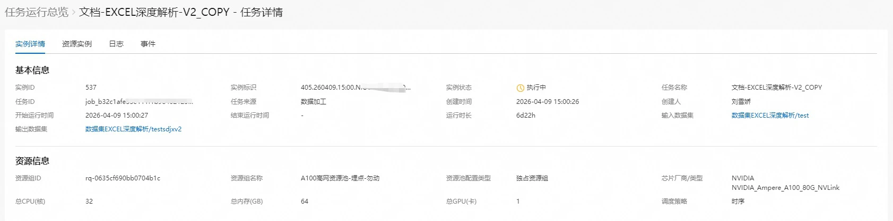

   - 查看资源实例：

     <ol type="a">

     <li>

     单击**资源实例**页签，支持查看日志和实时监控。

     </li>

     <li>

     单击操作列**日志**，展示日志信息。

     </li>

     </ol>

     <ol type="i" start="100">

     <li>

     单击操作列**实时监控**，会跳转至云监控的数据中心页面。

     </li>

     </ol>

   - 查看日志：在详情页面单击**日志**页签。

   - 查看事件：在详情页面单击**事件**页签。

**相关操作**

在任务运行总览页面，您还可以执行以下操作。

| 任务名称 | 操作步骤 |
| --- | --- |
| 重跑任务 | 单击执行成功任务操作列<strong>重跑</strong>。 |
| 取消任务 | 1. 单击执行中任务操作列<strong>取消</strong>。<br>2. 在弹出的提示框上单击<strong>确定</strong>。 |
| 下载badcases文件<br>说明当数据加工任务配置检查点“记录异常数据”为“单独写入文件”且出数据加工出现异常，任务状态为执行成功时，才支持下载。 | 1. 单击操作列<strong>详情</strong>。<br>2. 单击badcases文件，跳转至数据集页面。<br>3. 选择<strong>数据视图</strong>页签，单击操作列<strong>下载</strong>可下载文件至本地。 |

<a id="section-5-4"></a>

## 5.4. 数据标注

本章节及其子章节介绍数据标注任务的标注操作和验收操作。

<a id="section-5-4-1"></a>

### 5.4.1. 任务管理

本章节介绍如何导入数据，以及查看详情、导出至数据集等操作。

**数据标注流程**

1. 新建标注任务：从数据集导入数据，创建并配置标注任务。

2. 进行标注：支持分配多人进行标注，同时也支持AI批量标注。

3. 进行验收：对标注结果进行验收，验收不通过支持再次标注，最终完成整体标注。

**前提条件**

请提前创建所需的数据集。

**操作步骤**

1. 登录OpenTrek Agent Dev控制台。

2. 在左侧导航栏中选择**数据 > 数据标注 > 任务管理**。

3. 单击**导入数据开始标注**，参考下表填写参数。

   **区域**

   **参数名称**

   **参数说明**

   请自定义任务名称。

   **任务名称**

   请输入标注任务的其他信息，例如：\*\*\*项目标注任

   **任务描述**

   务。

   请选择图片或文本。

   **任务类型**

   请选择正确的数据集，可导入数据数量最大支持

   **选择数据集**

   1,000,000条。

   **基本信息**

   数据集选择后自动填充。

   **选择标注列**

   当任务类型是文本时，需要配置。

   **选择参考列**

   请下拉选择。

   拆包后可多人协作标注，每包为1个子任务、大小为固定数值，每包最大支持10000条数据

   **子任务大小**

   出于性能与协作考虑，系统推荐单个包的数据大小填写范围为50-200。

   - 标注：仅标注。

   **任务流程**

   - 标注-验收：标注同时验收。

   当任务流程选择标注-验收时，需要配置。

   - 子任务中抽检数据：所有子任务包都会进入检查环节，从每个子任务包中按比例抽取数据进行检查，每个子任务包最少抽检1条数据。

   **任务配置**

   **抽样方式**

   - 抽检子任务包：对被抽中的子任务包进入检查环节，对其中的全部数据进行检查，未被抽中的子任务包将直接进入检查后下一环节 比如任务有1000条数据，子任务包大小为10，共有100个子任务包，抽检比例设置为20%。

   输入抽检数占总数的比例，单位：%。

   **抽样比例**

   当平台启用了AI Studio资源时，页面会显示**资源组来源**选项，选择**资源池**或**AI Studio资源**。选择资源组来源后，从下拉列表中选择对应的资源组，并配置单节点CPU（核）和单节点内存（GB）。

   - 独享资源组

   - 共享资源组

   > **说明**
   >
   > - 资源组来源选项仅在平台启用AI Studio时显示。切换资源组来源时，已选的资源组会被清空，需重新选择。
   >
   > - 通用计算资源和灵骏智算资源暂不支持，

   **资源组**

   > 不可选择。

   > **说明**
   >
   > 如果需要使用自动标注功能，可能需要消耗算力资源启动自动标注相关模型。请通过查看资源组闲忙信息选择合适资源组使用。

   上传预标注文件，支持jsonl类型的文件，大小不能超过100M。

   **其他配置**

   > **说明**
   >
   > 目前仅图片任务支持上传预标注文件。

4. 单击**我已确认，提交**。

   > **说明**
   >
   > 当前任务配置提交后不可再次更改，请确认后再提交。

5. 选择模板。

   - 文本模板：支持自定义、文本-分类标注、文本-文本描述、文本-文本问答对、文本-实体识别。

   - 图文模板：支持自定义、图片-文本描述、图片-标签分类、图片-问答对、图片-细节标注。

6. 单击**确定**。

**相关操作**

数据导入成功后，您还可以执行以下操作。

<table>
  <tr>
    <th width="122">任务名称</th>
    <th>操作步骤</th>
  </tr>
  <tr>
    <td>查看详情</td>
    <td>1. 单击操作列<strong>详情</strong>，进入任务详情页面。<br>2. 在<strong>基本信息</strong>区域，单击任务名称旁边的<strong>修改</strong>，支持修改任务名称。<br>3. 单击资源组旁边的<strong>修改</strong>，支持修改资源组配置。</td>
  </tr>
  <tr>
    <td>查看子任务</td>
    <td>1. 单击操作列<strong>子任务</strong>。<br>2. 单击操作列<strong>详情</strong>，可查看子任务详细信息。<br>3. 单击操作列<strong>分配标注人</strong>，可将子任务分配。<br>说明如果任务流程是标注-验收，还支持分配验收人。</td>
  </tr>
  <tr>
    <td>导出至数据集</td>
    <td>单击操作列<strong>导出至数据集</strong>。</td>
  </tr>
  <tr>
    <td>修改配置项</td>
    <td>1. 单击操作列<strong>修改配置项</strong>。<br>2. 在右侧单击<strong>去配置</strong>，参考参数修改。<br>• 整体标注：给数据标注任务下的所有子任务进行标注。打开智能生成开关后才支持配置智能标注模型和Prompt指令。<br>• 标签分类：单击<strong>新增选项</strong>，配置标签标题和标签选项。<br>• 智能标注模型：下拉选择智能标注所使用的模型。<br>• Prompt指令(使用{{变量名}}的方式引用变量)<strong>：</strong>例如，你是一个专注于图像智能问答的AI助手，你的任务是根据图中的物体或场景回答以下问题，不要带入情感和发散。问题：{{__Question}}，问题类型：{{__Type}}。请从下面几个选项中根据问题类型选择最符合要求的，并直接回答选项标号：{{__Options}}。若问题类型为单选题，回答只能包含一个选项标号；若问题类型为多选题，回答可以包含多个选项标号，输出格式需要保证每行只包含一个选项，超过一个选项需要换行。<br>• 细节标注：<br>• 拉框：单击<strong>新增标签</strong>，进行标签配置，可添加多个标签。<br>• 多边形：单击<strong>新增标签</strong>，进行标签配置，支持智能分割，打开智能分割开关后，请选择智能分割模型；可添加多个标签。智能分割标注是在“细节标注”下通过 AI与人工标注协作的标注方式，通过模型的除部分预测或辅助功能，减少人工标注工作量、确保标注结果质量。<br>3. 单击<strong>确定</strong>。配置完成后，在标注任务的时候可以选择。</td>
  </tr>
  <tr>
    <td>删除任务</td>
    <td>1. 单击操作列<strong>删除</strong>。<br>2. 在弹出的提示框上单击<strong>确定</strong>。</td>
  </tr>
</table>

<a id="section-5-4-2"></a>

### 5.4.2. 标注任务

本章节介绍标注任务的操作。

**操作步骤**

1. 登录OpenTrek Agent Dev控制台。

2. 在左侧导航栏中选择**数据 > 数据标注 > 标注任务**。

3. 单击操作列**标注**。

4. 选择角色定位、输入角色技能、问题、回答等内容。

5. 单击**完成并进入下一项**。

6. 重复步骤四再次配置内容。

7. 配置完成后单击**完成**。

   > **说明**
   >
   > 标注状态变更为已标注状态的前提是在标注配置中所有必填项均完成标注。

8. 单击操作列详情可查看详细信息。

**相关操作**

在标注页面，您还可以执行以下操作。

| 任务名称 | 操作步骤 |
| --- | --- |
| AI 批量自动标注 | 1. 在标注页面单击<strong>AI批量自动标注</strong>。<br>2. 在弹出的提示框上选择是否覆盖已标注的数据。<br>• 跳过，不覆盖<br>• 覆盖 |
| 智能生成 | 1. 在标注页面，单击标注记录区域的。<br>2. 可通过AI智能生成标注结果，例如图片分类、图片描述、图片问答等都支持智能生成。<br>3. 单击标注记录区域的，支持修改每个标注配置项对应的模型配置。<br>4. 修改完成后单击<strong>确定</strong>。<br>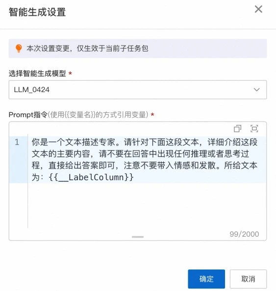 |
| 智能分割<br>说明图片标注任务在标注配置细节标注设置多边形时，打开智能分割开关后支持本操作。 | <br>1. 在标注页面，单击画布上方，可进行AI 智能分割。<br>2. 单击智能分割旁边，支持修改智能分割模型。<br>3. 支持以标点分割或拉框分割。 |
| 提交标注任务<br>说明该步骤需要子任务全部标注完毕后才支持操作。 | 在标注页面单击<strong>提交标注任务</strong>。 |

<a id="section-5-4-3"></a>

### 5.4.3. 验收任务

本章节介绍验收任务的操作。

**操作步骤**

1. 登录OpenTrek Agent Dev控制台。

2. 在左侧导航栏中选择**数据 > 数据标注 > 验收任务**。

3. 单击操作列**验收**。

4. 单击**通过并进入下一张**或**不通过**，直到最后一条验收任务完成。

   > **说明**
   >
   > 支持整体验收，单击页面右上角**整体驳回**或**整体通过**。
   >
   > - 如果子任务“验收通过”，则此子任务中未验收的数据默认状态为验收正确。
   >
   > - 如果子任务“整体驳回”，则此子任务会重新进入标注阶段，且未验收的数据默认状态为验收不正确。

5. 最后一条验收任务单击**修改验收结果**，可重新验收。

6. 单击操作列**详情**可查看详细信息。

<a id="section-6"></a>

# 6.观测

<a id="section-6-1"></a>

## 6.1. 指标监控

OpenTrek Agent Dev平台支持三层级指标监控统计，提供实时容量水位监控和运维大盘展示。通过应用层、资产层、模型层三个层面的指标监控，帮助用户全面掌握平台空间使用状况和资源消耗情况。

**背景信息**

指标监控分三个层面对平台当前空间的使用情况进行数据统计，所有层级的监控指标均包括总览指标、明细指标，可上下滚动页面进行查看。

- 应用层：从智能体及其版本的维度对当前空间的工具、知识库、模型的调用情况进行统计。

- 资产层：知识库、记忆体、Skills等资产相关指标。

- 模型层：按模型类型的不同进行总量统计，包括调用成功率、token消耗等相关的指标。

**应用层监控**

1. 登录Agent Dev控制台。

2. 查看指标监控。

   <ol type="i">

   <li>

   方法一：在左侧导航栏，单击**观测 > 指标监控**。

   默认进入应用层监控指标。

   </li>

   <li>

   方法二：

   <ol type="a">

   <li>

   在左侧导航栏，单击**开发 > 智能体**。

   </li>

   <li>

   单击目标智能体卡片或单击目标智能体卡片底部的**详情**。

   进入智能体详情页面，切换到**指标监控**页面。

   </li>

   </ol>

   </li>

   </ol>

3. 单击右上角时间组件，可选择统计数据的时间范围。

   鼠标指针移动到图表上，即可查看对应时间点的具体数值。

   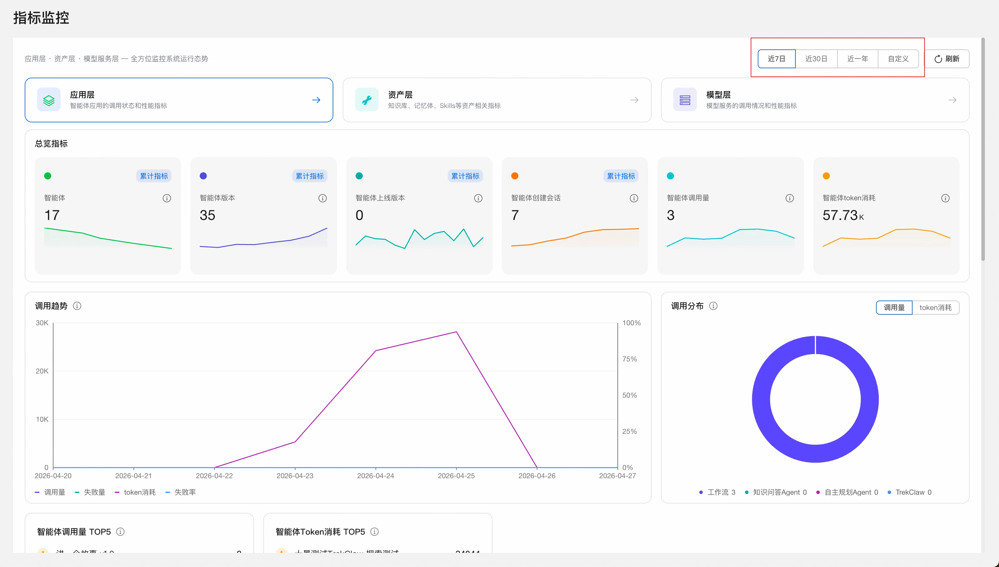

4. 切换监控对象。

   <ol type="i">

   <li>

   页面滚动至明细指标处，可切换页面，查看指定的智能体及智能体版本、对应工具、知识库、模型的调用情况。

   </li>

   <li>

   单击下拉列表即可选择智能体、智能体版本、起止时间。

   若查看工具、知识库、模型明细指标，还需选择工具名称、知识库名称或者模型名称。

   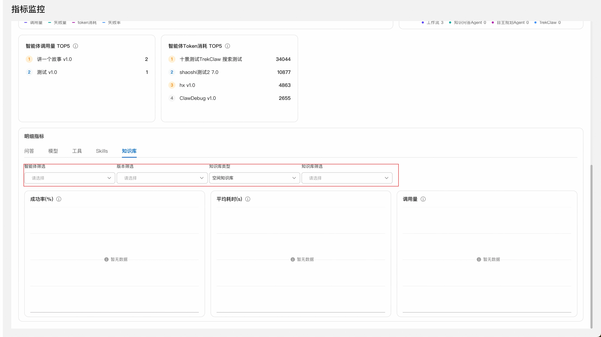

   </li>

   </ol>

**资产层监控**

1. 登录Agent Dev控制台。

2. 在左侧导航栏，单击**观测 > 指标监控**。

   默认进入应用层监控指标。

3. 单击**资产层**切换到**资产层**。

4. 查看总览指标。

   单击右上角时间组件，可选择总览指标显示的统计数据对应的时间段。

   与token消耗相关的数据，可在图表中点击右上角，下拉选择token数量单位。

   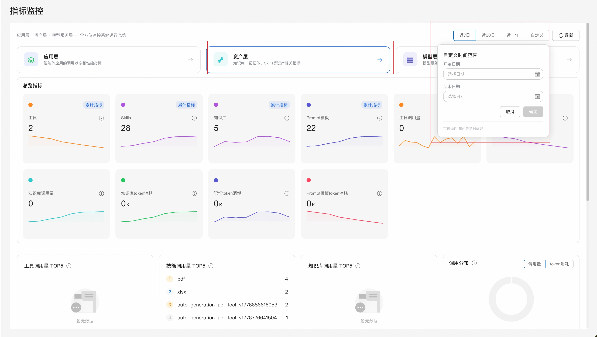

5. 查看明细指标。

   <ol type="i">

   <li>

   查看工具明细指标。

   单击下拉框，选择工具类型、工具名称。

   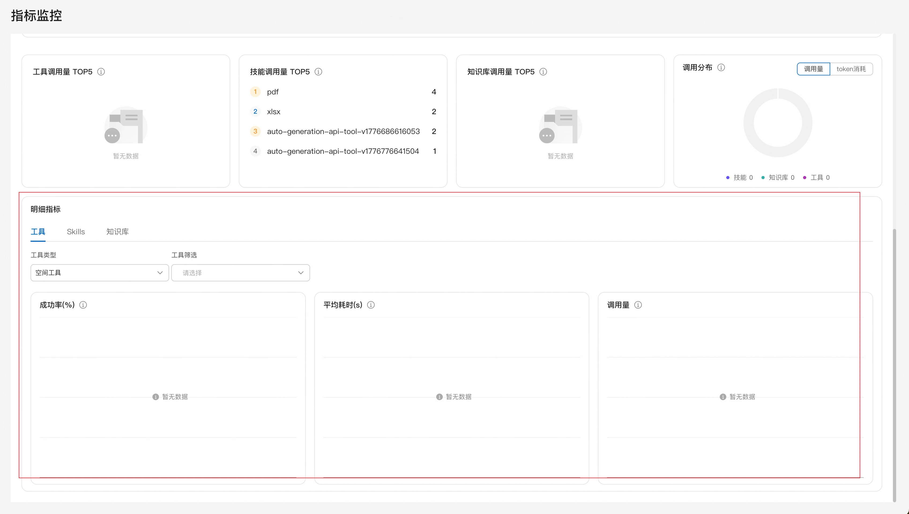

   </li>

   <li>

   查看Skills明细指标。

   切换到Skills，单击下拉框选择Skill类型和Skill名称。

   </li>

   <li>

   查看知识库明细指标。

   切换到知识库，单击下拉框选择知识库类型和知识库名称。

   </li>

   </ol>

**模型层监控**

1. 登录Agent Dev控制台。

2. 在左侧导航栏，单击**观测 > 指标监控**。

   默认进入应用层监控指标。

3. 单击**模型层**切换到**模型层**。

4. 查看总览指标。

   查看各类不同模型的总数量、对应的token消耗量。

5. 单击右上角时间，选择统计的起止时间。

   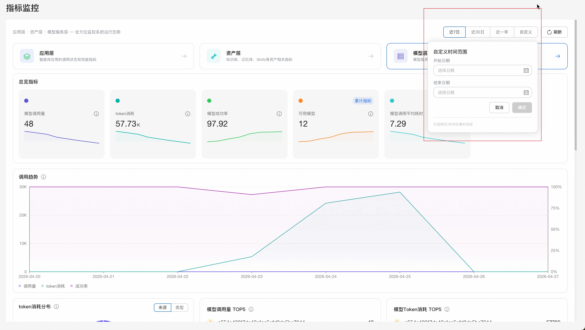

6. 查看明细指标。

   查看模型层明细指标需单击下拉框，选择模型来源、模型名称。

   图表中可查看该模型的调用成功率、平均耗时、调用量、平均首token消耗、输入token消耗、输出token消耗等指标。

   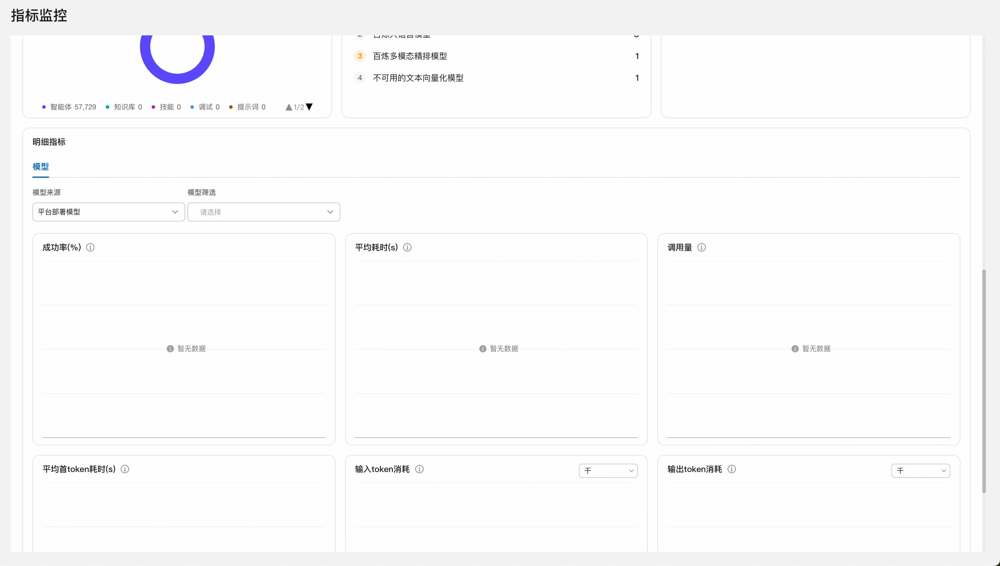

<a id="section-6-2"></a>

## 6.2. Trace追踪

OpenTrek Agent Dev的Trace追踪功能支持查看智能体请求的完整链路信息，包括来源、时间、输入输出等，并可通过Span分析查看各节点状态、耗时详情及监控埋点信息，帮助用户快速定位性能瓶颈。

**前提条件**

部署完成后默认不开启Trace追踪功能，使用Trace追踪功能请参见观测设置开启Trace追踪。

**查看Span分析**

1. 登录Agent Dev控制台。

2. 查看Trace追踪。

   <ol type="i">

   <li>

   方法一：在左侧导航栏，单击**观测 > Trace追踪**。

   </li>

   <li>

   方法二：

   <ol type="a">

   <li>

   在左侧导航栏，单击**开发 > 智能体**。

   </li>

   <li>

   单击目标智能体卡片或单击目标智能体卡片底部的**详情**。

   进入智能体详情页面，切换到**Trace追踪**页面。

   </li>

   </ol>

   </li>

   </ol>

3. 在Trace追踪页面可根据请求ID查看智能体某个请求对应的来源、开始时间、input、output等内容。

   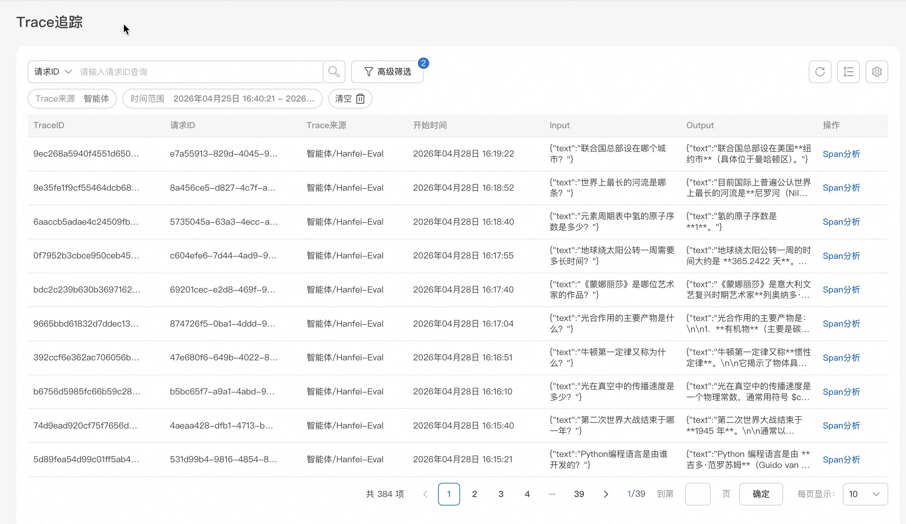

   列表中的**反馈状态**列展示用户对该次回答的点赞、点踩反馈信息，未反馈的记录显示为未反馈。

4. 单击**高级筛选**按钮展开更多筛选项，进行精细查找，包括智能体来源、版本、反馈状态、起止时间等。支持按反馈状态（点赞/点踩）筛选Trace记录。

   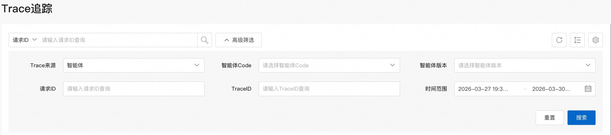

5. 单击目标Trace操作列的**Span分析**。即可查看该条请求对应的Span分析详情。

   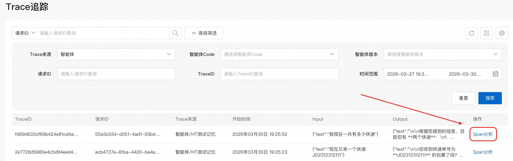

   Span分析结果中包含该请求对应的各个节点，每个节点的状态、耗时、开始时间/结束时间、输入、输出等信息。

   在右侧会显示各个节点的RUN和Attributes信息。Attributes中包含监控的埋点信息。

   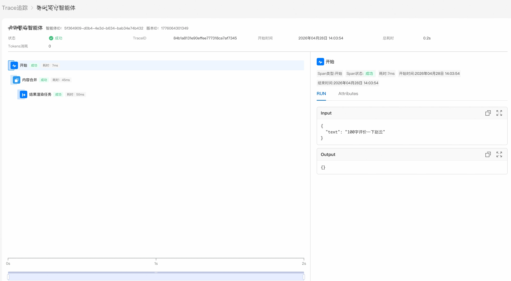

   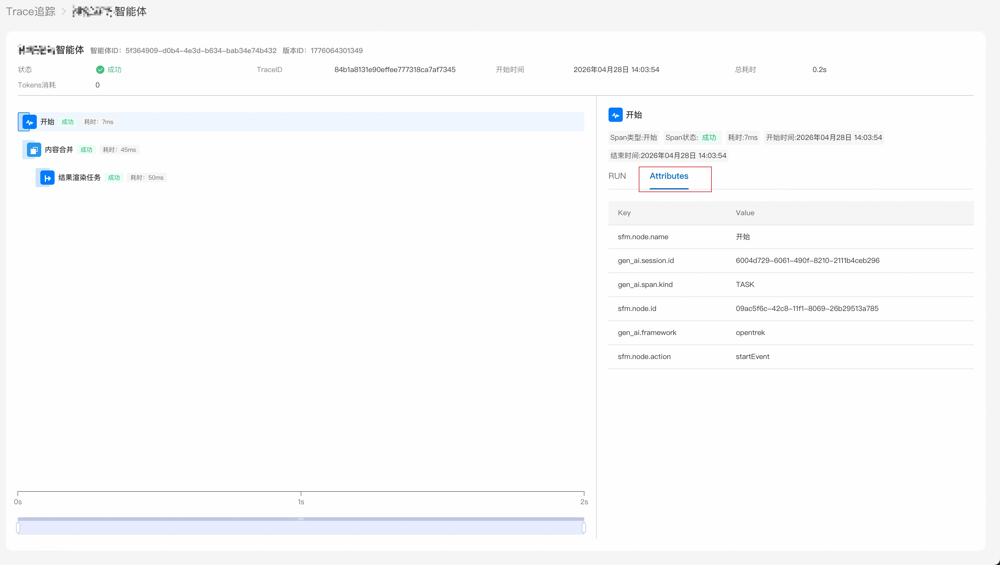

**回流至评测集**

1. 在左侧导航栏，单击**观测 > Trace追踪**。

2. 勾选Trace数据，可勾选多条。

3. 单击列表下方的**回流至评测集**。

4. 选择回流方式：

   - **追加数据**：在评测集现有数据基础上追加选中的Trace数据。

   - **新建版本**：使用选中的Trace数据作为评测集新建版本数据。

5. 选择评测集和评测集版本。

6. 单击**确认**。

<a id="section-7"></a>

# 7.系统管理

<a id="section-7-1"></a>

## 7.1. 功能概述

本章节介绍系统管理下所有功能说明。

**功能说明**

**全局资源管理**

全局资源管理用于添加和管理平台所需的各类数据资源，包括对象存储、数据库等底层基础设施资源。通过全局资源管理，您可以为智能体服务、数据中心和知识库提供统一的资源存储和管理能力，仅组织管理员/资源集管理员角色通过管理员角色访问时可进行配置。

- **对象存储**：注册 OSS 或 S3 类型的存储资源，用于数据文件的存储和管理。

- **PolarDB PG**：注册 PostgreSQL 数据库资源。

- **缓存数据库**：注册 Redis 缓存数据库资源。

- **向量数据库**：注册向量存储和检索资源，用于知识库向量索引。

- **全文检索 ES**：注册 Elasticsearch 全文检索资源。

**全局服务管理**

全局服务管理提供智能体服务和数据中心资源的创建、配置和运维管理能力。通过全局服务管理，您可以为智能体应用配置网关服务、存储资源和数据库资源，并实现服务的空间分配，保障智能体服务的稳定运行和数据中心的正常服务。

- **智能体服务**：创建、配置和停用智能体服务实例，管理网关服务和资源配置。

- **数据中心资源**：创建、配置和停用数据中心资源，支持数据库检索增强和数据中心两种模式。

**系统设置**

系统设置提供场景默认服务、系统参数、请求流量控制和虚机管理等配置能力。通过系统设置，您可以为智能体开发流程配置默认模型服务，调整系统运行参数，控制智能体版本的请求流量，并管理用于 STDIO 模式 MCP 服务注册的虚机资源。

- **场景默认服务**：为工作流、记忆体、知识库等场景配置默认模型服务，减少手动选择操作。

- **系统参数设置**：配置智能体系统 RT 参数、数据清理策略和夸克搜索 SK 信息等。

- **请求流量控制**：控制智能体的切流方式，支持按并行处理任务数或同时发起请求数两种模式。

- **虚机管理**：注册和管理虚机资源，用于STDIO模式MCP服务的部署和运行。

**模型接入**

- **平台部署模型**：

  - 接入并管理平台内部署的模型服务，完成调试和启用后供智能体调用。

  - 接入平台内部署的模型，需选择组织、资源集、地域、提供方模型服务和模型类型，填写 API_KEY，配置生效空间。

- **三方注册模型**：

  - 将三方模型API接入平台使用，支持自定义服务类型、协议类型和API服务地址。

  - 接入三方模型API，需配置模型服务名称、展示名称、code、服务类型、协议类型、API 服务地址、请求头和开放参数配置。

**空间管理**

空间管理提供多组织环境下的空间创建、成员管理和权限配置能力。通过空间管理，平台管理员可以为各个组织部门分别创建独立的空间，实现智能体应用的隔离管理，确保不同组织或业务部门之间的数据和应用互不干扰。

- **创建空间**：新建空间并指定所属资源集，为各组织部门提供独立的应用管理环境。

- **空间成员管理**：为空间添加成员，配置空间管理员和空间成员角色。

  > **说明**
  >
  > 平台支持以下空间角色：
  >
  > - **空间管理员**：可管理空间成员，进行成员的添加、修改角色和移除操作。
  >
  > - **空间成员**：拥有对应空间的数据权限，可查看和使用空间内的智能体、知识库等资源。

- **空间查找与切换**：通过资源集和空间名称查找空间，具有多空间权限的账号可快速切换空间。

<a id="section-7-2"></a>

## 7.2. 内置资产

本章节及其子章节介绍内置Skills、内置评测集、内置评估器支持的操作。

<a id="section-7-2-1"></a>

### 7.2.1. 内置Skills

通过OpenTrek Agent Dev控制台上传.zip格式Skill文件，自动提取SKILL.md中name字段作为唯一标识。本文介绍Skill的上架、更新、查看、调试及删除等完整管理流程。

**上架Skill**

1. 登录Agent Dev控制台。

2. 在左侧导航栏，单击**系统管理 > 内置资产**。

   默认进入**内置skills**页签。

3. 单击**上架Skill**。

4. 上传文件，输入**Skill备注名称**。

   <ol type="i">

   <li>

   文件支持.zip格式。

   </li>

   <li>

   平台将使用 SKILL.md 文件中的name字段作为Skill名称展示，该name同时作为Skill的唯一标识。您可以填写备注名称以便于管理和区分Skill。

   </li>

   </ol>

5. 单击**确认**。

**相关操作**

上架Skill后您可以进行以下操作。

<table>
  <tr>
    <th width="155">任务名称</th>
    <th>操作步骤</th>
  </tr>
  <tr>
    <td>更新Skill</td>
    <td>1. 单击目标Skill卡片底部的<strong>更新</strong>。<br>2. 在弹出的更新Skill页面上传文件，修改Skill备注名称。<br>3. 单击<strong>确认</strong>。</td>
  </tr>
  <tr>
    <td>查看Skill详细信息</td>
    <td>单击目标Skill卡片底部的<strong>详情</strong>。</td>
  </tr>
  <tr>
    <td>调试Skill</td>
    <td>单击目标Skill卡片底部的<strong>调试</strong>。</td>
  </tr>
  <tr>
    <td>删除Skill</td>
    <td>1. 单击目标Skill卡片底部的<strong>删除</strong>。<br>2. 单击<strong>确定</strong>。</td>
  </tr>
</table>

<a id="section-7-2-2"></a>

### 7.2.2. 内置评测集

本文介绍在OpenTrek Agent Dev控制台创建和管理内置评测集的操作方法，涵盖评测集配置、数据添加、版本管理、导入导出等完整功能操作。

**新建评测集**

1. 登录OpenTrek Agent Dev控制台。

2. 在左侧导航栏，单击**系统管理 > 内置资产 > 内置评测集**。

3. 单击**新建评测集**。

4. 配置评测集信息：

   | 参数 | 是否必选 | 说明 |
   | --- | --- | --- |
   | 评测集名称 | 是 | 输入评测集名称，用于标识不同的评测数据集。 |
   | 评测集描述 | 是 | 输入评测集的描述信息。 |
   | 评测集类型 | 是 | 选择评测集类型：评测集创建成功后不支持修改评测集类型。<br>• <strong>端到端评测集</strong>：此评测集关注智能体开始输入与最终结果输出，不关注中间过程。评测集结构为智能体标准输入输出参数，不可修改。<br>• <strong>轨迹评测集</strong>：此评测集关注智能体输入到输出过程中每一个环节执行过程信息，评测集结构为智能体Trace，不可修改。<br>• <strong>TrekAgent评测集</strong>：适用于自主规划类 Agent 评测，支持配置期望工具和上传附件；创建后评测集结构不可修改。<br>• <strong>自定义评测集</strong>：默认支持Input+Reference_Output两列结构，可按需增删，完成新建后不可修改。 |
   | 模板字段结构 | 是 | 配置评测集的字段结构，默认包含user_input（STRING，必填）和expected_output（STRING）字段。 |

5. 单击**确定**，完成评测集创建。

**相关操作**

在内置评测集添加成功后，您还可以执行以下操作。

<table>
  <tr>
    <th width="106">任务名称</th>
    <th>操作步骤</th>
  </tr>
  <tr>
    <td>查看详情</td>
    <td>1. 单击操作列<strong>详情</strong>。<br>2. 进入详情页面支持添加/导入数据、导出数据、新建版本和查看版本列表。<br>• 单击<strong>添加数据</strong>，输入用户输入和期望输出，单击<strong>确定</strong>。<br>• 单击<strong>导入数据</strong>，单击下载CSV或XLSX格式的模板，按照<br>模板填好后单击导入。<br>• 单击<strong>导出数据</strong>，可以将所有数据导出至本地查看。<br>• 单击<strong>新建版本</strong>，输入版本号和版本描述，单击<strong>确定</strong>。<br>• 单击<strong>版本列表</strong>，可查看该数据集的所有版本，新建的版本支持查看和删除。</td>
  </tr>
  <tr>
    <td>编辑评测集</td>
    <td>1. 单击操作列<strong>编辑</strong>。<br>2. 修改参数后单击<strong>确定</strong>。</td>
  </tr>
  <tr>
    <td>删除评测集</td>
    <td>1. 单击操作列<strong>删除</strong>。<br>2. 在弹出的提示框上单击<strong>确定</strong>。</td>
  </tr>
</table>

<a id="section-7-2-3"></a>

### 7.2.3. 内置评估器

本文详细介绍OpenTrek Agent Dev平台内置评估器的创建与管理方法，包括三种评估器类型（大模型、代码、Agent）的配置参数和操作流程，帮助用户构建完善的Agent质量评估体系。

**新建评估器**

1. 登录OpenTrek Agent Dev控制台

2. 在左侧导航栏中选择**系统管理 > 内置资产 > 内置评估器**。

3. 单击**新建评估器**。

4. 在新建评估器弹窗中，配置以下参数：

   | 参数 | 是否必选 | 说明 |
   | --- | --- | --- |
   | 评估器名称 | 是 | 输入评估器名称。 |
   | 评估器描述 | 是 | 输入评估器的描述信息。 |
   | 评测场景 | 是 | 选择兼容的评测集类型：<br>• <strong>参考答案对比</strong>：与评测集中的「期望输出」做对比，如回答一致性、参考答案对齐度等。<br>• <strong>轨迹期望对比</strong>：与评测集中的「期望工具/期望节点」等轨迹列做对比，如工具命中率、节点覆盖率等。<br>• <strong>Agent行为分析</strong>：直接分析 Agent 输出质量、安全性、响应延迟等，不依赖评测集标准答案。 |
   | 评估器类型 | 是 | 选择评估器类型：<br>• <strong>大模型</strong>：使用大语言模型作为裁判进行评估。<br>• <strong>代码</strong>：通过编写Python代码自定义评估逻辑。<br>• <strong>Agent</strong>：调用平台Agent服务进行端到端评估。 |
   | Prompt配置 | 否 | • 当评估器类型选择大模型时需要配置。<br>• 输入评估Prompt，用于指导评估器对Agent响应进行质量评估。默认Prompt包含输入信息、Agent响应和参考答案等变量。 |
   | 变量配置 | 否 | • 当评估器类型选择代码时需要配置。<br>• 单击<strong>添加字段</strong>，设置字段名称和类型。支持添加多个。 |
   | 代码 | 否 | • 当评估器类型选择代码时需要配置。<br>• 按照模板输入代码，仅支持Python。 |
   | Agent配置 | 否 | 当评估器类型选择Agent时需要配置。请设置以下参数。<br>• 智能体类型<br>• 智能体<br>• 版本<br>• App Key<br>• 超时时间 |
   | 参数配置 | 否 | • 当评估器类型选择Agent时需要配置。<br>• 单击<strong>添加参数</strong>，配置字段名称和描述。最多可添加20条。 |

5. 单击**创建**，完成评估器创建。

**相关操作**

| 任务名称 | 操作步骤 |
| --- | --- |
| 查看评估器详情 | 单击评估器卡片上的<strong>详情</strong>。 |
| 编辑评估器 | 1. 单击评估器卡片上的<strong>编辑</strong>。<br>2. 修改参数后单击<strong>保存</strong>。 |
| 删除评估器 | 1. 单击评估器卡片上的<strong>删除</strong>。<br>2. 在弹出的提示框上单击<strong>确定</strong>。 |

<a id="section-7-3"></a>

## 7.3. 服务接入

<a id="section-7-3-1"></a>

### 7.3.1. 沙箱规格

本文介绍OpenTrek Agent Dev控制台中沙箱规格的全生命周期管理操作，包括新增配置、信息修改和删除操作的具体步骤。

**新增规格**

1. 登录OpenTrek Agent Dev控制台。

2. 在左侧导航栏中选择**系统管理 > 内置服务 > 沙箱规格**。

3. 单击**新增规格**。

4. 在新增沙箱规格页面配置以下参数。

   | 配置项 | 说明 |
   | --- | --- |
   | 沙箱名称 | 请输入沙箱名称。 |
   | 描述 | 请输入沙箱描述。 |
   | CPU核数 | • 请输入CPU核数。<br>• 单位：核。 |
   | 内存大小 | • 请输入内存大小。<br>• 单位：GB。 |
   | 网络出口策略 | • 配置是否允许域名地址访问。<br>• 单击<strong>添加域名</strong>可增加新的域名访问策略。 |

5. 单击**确定**。

**相关操作**

| 任务名称 | 操作 |
| --- | --- |
| 修改沙箱信息 | 1. 单击目标沙箱操作列的<strong>编辑</strong>。<br>2. 修改沙箱信息。<br>3. 单击<strong>确定</strong>。 |
| 删除沙箱 | 1. 单击目标沙箱操作列的<strong>删除</strong>。<br>2. 单击<strong>确定</strong>。 |

<a id="section-7-3-2"></a>

### 7.3.2. 模型接入

本文档介绍将平台部署模型服务和三方模型服务接入Opentrek dev平台的操作。

<a id="section-7-3-2-1"></a>

#### 7.3.2.1. 平台部署模型

在平台部署模型页面，可以接入并管理平台模型。

**操作步骤**

1. 登录OpenTrek Agent Dev控制台。

2. 在左侧导航栏中选择**系统管理 > 服务接入 > 模型接入**。

3. 在**平台部署模型**页签，单击**接入模型**。

4. 参考下表配置参数。

   <table>
     <tr>
       <th width="179">参数名称</th>
       <th>参数说明</th>
     </tr>
     <tr>
       <td>组织/资源集/地域</td>
       <td>请选择模型所属的组织、资源集和地域。</td>
     </tr>
     <tr>
       <td>提供方模型服务</td>
       <td>下拉选择模型服务。</td>
     </tr>
     <tr>
       <td>提供方模型服务code</td>
       <td>选择提供方模型服务后自动填充，无需设置。</td>
     </tr>
     <tr>
       <td>模型类型</td>
       <td>请选择模型的类型，例如：多模态理解。当类型为大语言模型和多模态理解大模型时，需要确认和补充 Meta 信息。</td>
     </tr>
     <tr>
       <td>选择模型API_KEY</td>
       <td>若可选API_KEY为空，则表示无该模型权限，请联系模型创建人授权。</td>
     </tr>
     <tr>
       <td>选择模型协议类型</td>
       <td>为保证应用场景下模型服务调用正常，此处仅支持选择平台内置标注协议，不支持自定义。</td>
     </tr>
     <tr>
       <td>模型服务名称</td>
       <td>在各应用场景（如智能体工作流中）选择模型，列表展示此名称。</td>
     </tr>
     <tr>
       <td>模型描述</td>
       <td>描述长度为2~256个字符，不能以http://和https://开头。</td>
     </tr>
     <tr>
       <td>有效空间</td>
       <td>• 指定空间<br>• 全局空间</td>
     </tr>
     <tr>
       <td>选择空间</td>
       <td>当有效空间选择指定空间时，需要配置。请选择使用该模型的空间，没有可选空间时，请参考空间管理创建。</td>
     </tr>
     <tr>
       <td>Meta信息确认</td>
       <td>• <strong>上下文tokens限制</strong>：模型所支持的最大上下文，非运行态传入的上下文长度参数。<br>• <strong>Enable Thinking</strong>：请选择支持或不支持。<br>• <strong>Temperature</strong>：选择支持后，需要设置最小值、最大值、取值精度和默认值。<br>• <strong>Top_P</strong>：选择支持后，需要设置最小值、最大值、取值精度和默认值。<br>• <strong>Top_K</strong>：选择支持后，需要设置最小值、最大值、取值精度和默认值。<br>• <strong>Max_tokens</strong>：选择支持后，需要设置最小值、最大值、取值精度和默认值。<br>• <strong>Response_format</strong>：选择支持后，需要设置响应格式，系统提供text和json_object两种默认格式，单击添加响应格式，支持自定义。</td>
     </tr>
   </table>

5. 单击**确定**。

**相关操作**

在平台部署模型页面，您还可以执行以下操作。

<table>
  <tr>
    <th width="128">任务名称</th>
    <th>操作步骤</th>
  </tr>
  <tr>
    <td>调试模型</td>
    <td>1. 单击操作列<strong>调试</strong>。<br>2. 修改入参内容后，单击页面底部<strong>调试</strong>。<br>3. 等待返回内容正确后，单击<strong>调试通过</strong>。调试通过的模型状态会变成<strong>启用</strong>。</td>
  </tr>
  <tr>
    <td>编辑模型</td>
    <td>1. 单击操作列<strong>编辑</strong>。<br>2. 修改参数后单击<strong>确定</strong>。</td>
  </tr>
  <tr>
    <td>停用/启用模型</td>
    <td>单击模型状态为启用或停用操作列<strong>停用</strong>/<strong>启用</strong>。</td>
  </tr>
  <tr>
    <td>删除模型</td>
    <td>1. 单击模型状态为待调试/停用操作列<strong>删除</strong>。<br>2. 在弹出的提示框上单击<strong>确定</strong>。</td>
  </tr>
</table>

<a id="section-7-3-2-2"></a>

#### 7.3.2.2. 三方注册模型

通过三方注册模型，可以将三方模型API接入平台进行使用。

**操作步骤**

1. 登录OpenTrek Agent Dev控制台。

2. 在左侧导航栏中选择**系统管理 > 服务接入 > 模型接入**。

3. 单击**三方注册模型**页签，单击**接入模型**。

4. 参考下表配置参数。

   <table>
     <tr>
       <th width="162">参数名称</th>
       <th>参数说明</th>
     </tr>
     <tr>
       <td>模型服务名称</td>
       <td>请自定义模型服务的名称。</td>
     </tr>
     <tr>
       <td>模型服务展示名称</td>
       <td>在各应用场景（如智能体工作流中）选择模型，列表展示此名称。</td>
     </tr>
     <tr>
       <td>模型服务code</td>
       <td>请自定义模型服务的code。</td>
     </tr>
     <tr>
       <td>模型类型</td>
       <td>• 请选择模型类型：<br>• 当<strong>接入方式</strong>是<strong>公共云百炼模型接入</strong>时支持以下 6 种类型：大语言模型（用于文本生成、对话等场景）、多模态理解（用于图片理解、图文分析等场景，支持图片 base64 传参）、文本向量化（用于文本检索、语义相似度计算）、多模态向量（用于图文检索）、文本精排（用于搜索结果重排序）、多模态精排（用于图文搜索结果重排序）。<br>• 当<strong>接入方式</strong>是<strong>自定义接入</strong>时支持以下 10 种类型：大语言模型（用于文本生成、对话等场景）、多模态理解（用于图片理解、图文分析等场景，支持图片 base64 传参）、文本向量化（用于文本检索、语义相似度计算）、多模态向量（用于图文检索）、文本精排（用于搜索结果重排序）、多模态精排（用于图文搜索结果重排序）、自动语音识别（用于语音转文字、会议纪要生成、客服录音分析）、视觉分割（用于图像中不同语义区域的像素级分割，适用于医学影像病灶勾画、遥感图像地物分类）、在线解析服务（用于实时处理输入文档如 PDF、Word 并提取结构化信息，适用于合同条款抽取、商品参数归类等）、内置解析服务（用于基于预设模板的文档结构化处理，如发票、简历、报表等字段一键提取）。<br>• 当类型为大语言模型和多模态理解大模型时，需要确认和补充Meta信息。</td>
     </tr>
     <tr>
       <td>选择模型API_KEY</td>
       <td>若可选API_KEY为空，则表示无该模型权限，请联系模型创建人授权。</td>
     </tr>
     <tr>
       <td>模型协议类型</td>
       <td>为保证应用场景下模型服务调用正常，此处仅支持选择平台内置标注协议，不支持自定义。<br>说明当模型类型为自动语音识别时，支持自定义。</td>
     </tr>
     <tr>
       <td>模型描述</td>
       <td>描述长度为2~256个字符，不能以http://和https://开头。</td>
     </tr>
     <tr>
       <td>有效空间</td>
       <td>• 指定空间<br>• 全局空间</td>
     </tr>
     <tr>
       <td>选择空间</td>
       <td>当有效空间选择指定空间时，需要配置。请选择使用该模型的空间，没有可选空间时，请参考空间管理创建。</td>
     </tr>
     <tr>
       <td>API配置</td>
       <td>• 服务地址：请输入API的服务地址。例如：http://*****.shuguang.com:80<br>• 请求方式：默认POST，不支持修改。<br>• 请求头：单击<strong>添加更多信息</strong>，设置key和value。<br>• 入参示例：展示入参示例，单击<strong>切换查看参数定义</strong>，可查看参数说明。<br>• 出参示例：展示出参示例，单击<strong>切换查看参数定义</strong>，可查看参数说明。<br>• 入参开放：定义body中可强制替换或追加的参数值；单击<strong>增加参</strong><strong>数</strong>配置key、数据类型和value。</td>
     </tr>
     <tr>
       <td>Meta信息确认</td>
       <td>• <strong>上下文tokens限制</strong>：模型所支持的最大上下文，非运行态传入的上下文长度参数。<br>• <strong>Enable Thinking</strong>：请选择支持或不支持。<br>• <strong>Temperature</strong>：选择支持后，需要设置最小值、最大值、取值精度和默认值。<br>• <strong>Top_P</strong>：选择支持后，需要设置最小值、最大值、取值精度和默认值。<br>• <strong>Top_K</strong>：选择支持后，需要设置最小值、最大值、取值精度和默认值。<br>• <strong>Max_tokens</strong>：选择支持后，需要设置最小值、最大值、取值精度和默认值。<br>• <strong>Response_format</strong>：选择支持后，需要设置响应格式，系统提供text和json_object两种默认格式，单击添加响应格式，支持自定义。</td>
     </tr>
   </table>

5. 勾选**本平台不对您使用的第三方模型的合法性、安全性、准确性进行任何保证，并不对由此引发的任何损害承担责任；您应自觉遵守第三方模型的用户协议、使用规范以及相关法律法规要求，并就使用第三方模型的合法合规性承担相关责任。**

6. 单击**确定**。

**相关操作**

在三方注册模型页面，您还可以执行以下操作。

<table>
  <tr>
    <th width="128">任务名称</th>
    <th>操作步骤</th>
  </tr>
  <tr>
    <td>调试模型</td>
    <td>1. 单击操作列<strong>调试</strong>。<br>2. 修改入参内容后，单击页面底部<strong>调试</strong>。<br>3. 等待返回内容正确后，单击<strong>调试通过</strong>。调试通过的模型状态会变成<strong>启用</strong>。</td>
  </tr>
  <tr>
    <td>编辑模型</td>
    <td>1. 单击操作列<strong>编辑</strong>。<br>2. 修改参数后单击<strong>确定</strong>。</td>
  </tr>
  <tr>
    <td>停用/启用模型</td>
    <td>单击模型状态为启用或停用操作列<strong>停用</strong>/<strong>启用</strong>。</td>
  </tr>
  <tr>
    <td>删除模型</td>
    <td>1. 单击模型状态为待调试/停用操作列<strong>删除</strong>。<br>2. 在弹出的提示框上单击<strong>确定</strong>。</td>
  </tr>
</table>

<a id="section-7-3-3"></a>

### 7.3.3. 数据源管理

数据源管理用于配置平台的外部数据源连接，为数据加工和知识库提供数据接入能力。

**功能说明**

数据源管理用于配置和管理平台使用的外部数据源连接，支持对接不同类型的数据存储服务。

您可以在内置服务中管理数据源，为数据加工、知识库等功能提供数据连接能力。

**前提条件**

- 已登录OpenTrek Agent Dev控制台。

- 拥有系统管理权限。

**操作步骤**

1. 登录OpenTrek Agent Dev控制台。

2. 在左侧导航栏中选择**系统管理 > 服务接入 > 数据源管理**。

3. 单击**添加自定义数据源**，参考下表配置参数。

   <table>
     <tr>
       <th width="168">参数名称</th>
       <th>参数说明</th>
     </tr>
     <tr>
       <td>数据源名称</td>
       <td>请输入数据源名称。</td>
     </tr>
     <tr>
       <td>添加数据源开发指南</td>
       <td>i. 单击<strong>查看开发指南</strong>，按照开发指南完成自定义数据源添加并调试通过。ii. 勾选我已按开发指南完成开发，并按实际情况填写<strong>数据源类型</strong><strong>Code</strong>、<strong>SPI服务地址</strong>和<strong>数据源密钥</strong>。</td>
     </tr>
     <tr>
       <td>连接字段</td>
       <td>按照开发对接实际情况，定义数据源连接所需要的具体字段（例如主机地址、用户名、密码等）。单击<strong>添加字段</strong>，输入字段名、字段描述和提示信息。支持添加多个字段。</td>
     </tr>
   </table>

4. 单击**添加**。

   添加的数据源默认为已启用状态，如需调整可添加完成后在列表操作。

**相关操作**

数据源添加成功后，您还可以执行以下操作。

| 任务名称 | 操作步骤 |
| --- | --- |
| 修改数据源状态 | 单击状态列开关，修改数据源状态。 |
| 编辑数据源 | 1. 单击操作列<strong>编辑</strong>。<br>2. 修改名称和连接字段后，单击<strong>保存</strong>。 |
| 删除数据源 | 1. 单击关闭状态数据源操作列<strong>删除</strong>。<br>2. 在弹出的提示框上单击<strong>确定</strong>。 |

<a id="section-7-3-4"></a>

### 7.3.4. 知识库解析服务管理

知识库解析服务用于对知识库文档进行在线解析。本文介绍如何在系统管理中创建和管理知识库解析服务。

**操作步骤**

1. 登录OpenTrek Agent Dev控制台。

2. 在左侧导航栏中选择**系统管理 > 服务接入 > 知识库解析服务管理**。

3. 单击**创建服务**，参考下表配置参数。

   **区域**

   **参数名称**

   **参数说明**

   请输入服务名称。

   **服务名称**

   请输入服务描述。

   **服务描述**

   - **通过本次配置创建**：基于服务模板创建新的解析服务。

   基本信息

   **解析服务创建方式**

   - **引入AIStudio服务**：引入已有的解析服务。

   选择解析服务的解析场景。

   - 多模态解析服务

   **服务类型**

   - 文档解析服务

   - 其他

   服务类型选择多模态解析服务时，需要配置。

   - 富文档类：pdf、ppt、pptx、caj、wps、doc、docx

   - 纯文本文档类：txt

   模态与模板配置

   - 音频类：mp3、wav、flac、aac、wma

   - 视频类：mp4、avi、mkv、mov

   > **说明**

   **模态选择**

   - 表格类：xlsx、xls

   > 创建方式选

   - 位图类：png、jpg、jpeg、bmp、gif

   > 择直接创建时需要配置

   - 矢量图类：svg

   > 该参数。选择模态后，

   - 网页类：html、htm

   > 将自动关联

   - Markdown类：md

   > 平台内置模板。

   服务类型选择多模态解析服务或文档解析服务时，需要配置。支持选择在线服务和离线模型。

   **多模态理解模型**

   - 在线服务：当前平台已接入的对应类型模型服务。

   - 离线模型：当前支持部署的模型。

   服务类型选择多模态解析服务时，需要配置。支持选择在线服务和离线模型。

   **语音识别模型**

   - 在线服务：当前平台已接入的对应类型模型服务。

   - 离线模型：当前支持部署的模型。

   资源配置

   > **说明**

   配置服务运行的资源规格（CPU、内存）。

   **资源规格**

   > 创建方式选择直接创建时需要配置该参数。

   选择**指定空间**或**全局空间**。

   **有效空间**

   空间权限

   > **说明**
   >
   > 创建方式选

   有效空间选择指定空间时，需要选择具体的空间。

   **选择空间**

   > 择直接创建时需要配置该参数。

   <table>
     <tr>
       <td>模型配置</td>
       <td>创建方式为引入AIStudio服务时，需要选择具体的模型。</td>
     </tr>
   </table>

4. 单击**确定**。

**相关操作**

服务列表展示服务Code/名称、服务状态（运行中/已停止/待启动）、来源（创建/引用）、模板/引用名称、标签、资源规格、实例数、创建时间和创建人。您还可以执行以下操作：

- 已停止/待启动的服务：单击操作列**启动**、**详情**、**编辑**或**删除**。

- 运行中的服务：单击操作列**停用**或**资源变配**调整服务资源。

<a id="section-7-4"></a>

## 7.4. 元数据管理

本文介绍OpenTrek Agent Dev控制台中元数据管理的操作方法，涵盖多种数据类型定义和灵活取值设置，帮助您有效管理系统元数据配置。

**操作步骤**

1. 登录OpenTrek Agent Dev控制台。

2. 在左侧导航栏中选择**系统管理 > 元数据管理**。

3. 单击**添加元数据**，参考下表配置参数值。

   > **说明**
   >
   > 打开右上角**用户自主添加知识库内元数据**后，会自动同步知识库的元数据至该页面。

   <table>
     <tr>
       <th width="105">参数名称</th>
       <th>参数说明</th>
     </tr>
     <tr>
       <td>元数据名称</td>
       <td>请输入元数据名称。</td>
     </tr>
     <tr>
       <td>元数据描述</td>
       <td>请输入元数据描述，例如：用途。</td>
     </tr>
     <tr>
       <td>元数据类型</td>
       <td>请选择元数据类型：<br>• String<br>• <strong>Number</strong>：可在知识库中定义此元数据的值，限输入大于等于0的整数。<br>• <strong>Time</strong>：可在知识库中定义此元数据的值，数据格式要求：YY-MM-DD HH:MM:SS。</td>
     </tr>
     <tr>
       <td>取值方法</td>
       <td>当元数据类型为String时，需要配置该参数。<br>• <strong>自定义</strong>：可在知识库中定义此元数据的值。<br>• <strong>候选值</strong>：输入元数据值，单击<strong>添加条目</strong>支持添加多条。</td>
     </tr>
   </table>

4. 单击**确定**。

**相关操作**

| 任务名称 | 操作步骤 |
| --- | --- |
| 编辑元数据 | 1. 单击操作列<strong>编辑</strong>。<br>2. 修改参数后单击<strong>确定</strong>。 |
| 删除元数据 | 1. 单击操作列<strong>删除</strong>。<br>2. 在弹出的提示框上单击<strong>确定</strong>。 |

<a id="section-7-5"></a>

## 7.5. 平台设置

<a id="section-7-5-1"></a>

### 7.5.1. 系统设置

OpenTrek Agent Dev支持系统设置页面的核心配置功能，包括场景默认模型服务设置、系统参数自定义配置、请求流量控制操作，本文介绍如何通过控制台进行全面的系统级参数与服务配置管理。

**场景默认服务**

1. 登录Agent Dev控制台。

2. 在左侧导航栏选择**系统管理 > 平台设置**。

   默认进入**系统设置**页面。

3. 在**场景默认服务**页签下，可查看工作流、记忆体、知识库等场景对应的模型。

4. 单击页面下方的**编辑**，进入可编辑模式。

5. 单击模型  ，支持重新选择模型服务。

6. 单击模型  ，可删除模型服务。

7. 单击页面下方的**保存**，保存设置。

**系统参数设置**

系统参数设置对智能体系统RT相关配置、智能体系统数据清理策略、夸克搜索sk信息三类场景的参数提供了查看、自定义配置能力，以满足对应功能的场景适应能力。

1. 登录Agent Dev控制台。

2. 在左侧导航栏选择**系统管理 > 平台设置**。

   默认进入**系统设置**页面。

3. 单击**系统参数设置**页签。

4. 单击**编辑**，进入编辑模式。

5. 在代码框中找到待修改的参数，修改参数值。

   > **说明**
   >
   > 编辑配置时，确保配置内容、结构与完整性，否则将配置失败。

6. 单击**确定**。

**请求流量控制**

1. 登录Agent Dev控制台。

2. 在左侧导航栏选择**系统管理 > 平台设置**。

   默认进入**系统设置**页面。

3. 单击**请求流量控制**页签。

4. 单击**注册虚机**，参考下表配置参数。

   请提前联系对应的云平台管理员申请获取内容。

   | 参数名称 | 参数说明 |
   | --- | --- |
   | 虚机名称 | 请自定义虚机名称。 |
   | 可用空间 | • 全部空间<br>• 指定空间 |
   | 选择空间 | 可用空间选择<strong>指定空间</strong>时，需要配置。选择虚机使用的空间。 |
   | 主机地址 | 请输入虚机的主机地址。 |
   | 主机端口 | 请输入虚机的主机端口。 |
   | 用户名 | 请输入虚机的用户名。 |
   | 密码 | 请输入用户名对应的密码。 |
   | 是否开放给空间自定义工具使用 | 打开后支持给可用空间的自定义工具使用，关闭后则不支持。 |
   | 连通测试 | 测试是否能够连通，需要完成一次连通测试才可以提交保存。 |

5. 单击**确定**。

6. 相关操作。

   - 编辑：

     <ol type="a">

     <li>

     单击操作列**编辑**。

     </li>

     <li>

     修改参数后单击**确定**。

     </li>

     </ol>

   - 查看已部署服务

     <ol type="a">

     <li>

     单击操作列**已部署服务**。

     </li>

     <li>

     可以查看虚机上部署的全部服务。

     </li>

     </ol>

   - 删除

     <ol type="a">

     <li>

     单击操作列**删除**。

     </li>

     <li>

     在弹出的提示框上单击**确定**。

     </li>

     </ol>

<a id="section-7-5-2"></a>

### 7.5.2. 观测设置

本文介绍如何在OpenTrek Agent Dev控制台配置观测设置，包括Trace追踪的开启关闭、保存上限设定（全局或空间维度）以及开启范围配置，帮助您有效管理系统观测能力。

**操作步骤**

1. 登录Agent Dev控制台。

2. 在左侧导航栏中选择**系统管理 > 平台设置**。

3. 选择**观测设置**页签。

4. 配置**是否开启Trace追**踪。

5. 配置**Trace保存上限**。

   可选全局上限、每个空间上限。

   全局上限是指所有空间共用的保存总数。每个空间上限是指单个空间保存的数量。

   > **说明**
   >
   > - 实际Trace保存条数上限不承诺严格符合此上限，部分情况可能略高于此上限；
   >
   > - 请保证数据库存储空间可满足此处设置使用需求。

6. Trace开启范围。

   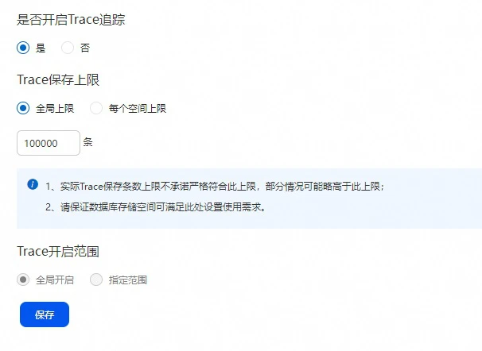

7. 单击**保存**。

<a id="section-7-5-3"></a>

### 7.5.3. 智能化设置

通过OpenTrek Agent Dev控制台平台设置页面，您可以启用/禁用智能体、修改智能体信息和删除智能体，实现对智能体的全生命周期管理，提升系统智能化运维效率。本文介绍智能体的启用、编辑和删除操作方式。

**背景信息**

每项智能化能力需要配置使用的模型后才能启用。启用后，该能力将在对应场景中自动调用所选模型提供服务。

**操作步骤**

1. 登录Agent Dev控制台。

2. 在左侧导航栏中选择**系统管理 > 平台设置 > 智能化设置**。

   - 启用/禁用智能体。

     单击目标智能体是否启用列的开关进行智能体的启用和禁用。

   - 修改智能体信息。

     <ol type="a">

     <li>

     单击目标智能体右侧的  。

     </li>

     <li>

     重新选择模型后单击**确定**。

     </li>

     </ol>

   - 删除智能体。

     <ol type="a">

     <li>

     单击目标智能体右侧的  。

     </li>

     <li>

     在弹出的提示框上单击**确定**。

     </li>

     </ol>

<a id="section-7-6"></a>

## 7.6. 全局资源管理

本文档介绍智能体资源管理相关配置操作。

> **说明**
>
> 本章节介绍通用资源管理操作，具体添加某一种资源，请参见具体章节。初次切换组织添加资源时，请首先在ASCM平台上将Opentrek Dev的服务角色授权给此组织。

**操作步骤**

1. 登录OpenTrek Agent Dev控制台。

2. 在左侧导航栏中选择**系统管理 > 全局资源管理**。

3. 单击**添加资源**，参考下表配置参数。

   <table>
     <tr>
       <th width="89">参数名称</th>
       <th>参数说明</th>
     </tr>
     <tr>
       <td>组织名称</td>
       <td>自动填充为当前组织，不支持修改。</td>
     </tr>
     <tr>
       <td>资源集</td>
       <td>请选择组织下的资源集。</td>
     </tr>
     <tr>
       <td>资源类型</td>
       <td>• 计算<br>• 普通集群ACK<br>• 镜像<br>• 镜像仓库ACR<br>• 存储<br>• 对象存储<br>• 数据库<br>• 向量数据库<br>• 数据库PolarDB<br>• 缓存数据库<br>• 向量<br>• 全文检索</td>
     </tr>
     <tr>
       <td>资源选择</td>
       <td>请下拉选择资源。</td>
     </tr>
     <tr>
       <td>资源名称</td>
       <td>请自定义资源名称，20个字符以内。</td>
     </tr>
     <tr>
       <td>资源标识</td>
       <td>资源唯一标识，32位字符以内，支持英文、数字、_，以英文开头。</td>
     </tr>
   </table>

**相关操作**

资源添加成功后，您还可以执行以下操作。

| 任务名称 | 操作步骤 |
| --- | --- |
| 查看详情 | 单击操作列<strong>详情</strong>。 |
| 配置资源 | 1. 单击操作列<strong>配置</strong>。<br>2. 修改参数后单击<strong>确定</strong>。 |
| 停用资源 | 1. 单击操作列<strong>停用</strong>。<br>2. 在弹出的提示框上单击<strong>确认</strong>。 |

<a id="section-7-6-1"></a>

### 7.6.1. 镜像仓库ACR

OpenTrek Agent Dev支持添加镜像仓ACR资源并配置相关参数，通过系统管理界面完成资源类型、名称、标识、命名空间、Endpoint及认证信息的录入，实现容器镜像仓库的统一管理和访问控制。

**操作步骤**

1. 登录OpenTrek Agent Dev控制台。

2. 在左侧导航栏中选择**系统管理 > 全局资源管理**。

3. 单击**添加资源**，参考下表配置参数。

   | 参数名称 | 参数说明 |
   | --- | --- |
   | 组织名称 | 自动填充为当前组织，不支持修改。 |
   | 资源集 | 请选择组织下的资源集。 |
   | 资源类型 | 选择<strong>镜像 &gt; 镜像仓库 ACR</strong>。 |
   | 资源选择 | 请下拉选择资源。 |
   | 资源名称 | 请自定义资源名称，20个字符以内。 |
   | 资源标识 | 资源唯一标识，32位字符以内，支持英文、数字、_，以英文开头。 |
   | 命名空间 | 自定义命名空间。 |
   | Endpoint | 输入资源访问的Endpoint地址。 |
   | 用户名 | 请输入访问镜像仓ACR的用户。 |
   | 密码 | 请输入用户对应的密码。 |
   | 协议 | 请下拉选中访问镜像仓ACR时使用的协议。<br>• http<br>• https |

4. 配置完后单击**确定**。

5. 添加成功后，确认是否部署AI Studio，需要部署AI Studio的话请打开。

<a id="section-7-6-2"></a>

### 7.6.2. 普通集群ACK

本文介绍在OpenTrek Agent Dev控制台添加普通集群ACK资源的完整操作流程，包括资源配置参数设置与AI Studio部署选项，帮助您快速完成集群资源接入管理。

**操作步骤**

1. 登录OpenTrek Agent Dev控制台。

2. 在左侧导航栏中选择**系统管理 > 全局资源管理**。

3. 单击**添加资源**，参考下表配置参数。

   <table>
     <tr>
       <th width="198">参数名称</th>
       <th>参数说明</th>
     </tr>
     <tr>
       <td>组织名称</td>
       <td>自动填充为当前组织，不支持修改。</td>
     </tr>
     <tr>
       <td>资源集</td>
       <td>请选择组织下的资源集。</td>
     </tr>
     <tr>
       <td>资源类型</td>
       <td>选择<strong>计算 &gt; 普通集群 ACK</strong>。</td>
     </tr>
     <tr>
       <td>资源选择</td>
       <td>请下拉选择资源。</td>
     </tr>
     <tr>
       <td>资源名称</td>
       <td>请自定义资源名称，20个字符以内。</td>
     </tr>
     <tr>
       <td>资源标识</td>
       <td>资源唯一标识，32位字符以内，支持英文、数字、_，以英文开头。</td>
     </tr>
     <tr>
       <td>CPU类型</td>
       <td>选择CPU类型，如“AMD64”。</td>
     </tr>
     <tr>
       <td>VPC类型</td>
       <td>保持默认：专有网络。</td>
     </tr>
     <tr>
       <td>VPC ID</td>
       <td>系统根据选择的资源自动填充，不支持修改。</td>
     </tr>
     <tr>
       <td>Master instanceIds</td>
       <td>单击<strong>添加</strong>，输入主节点实例ID。</td>
     </tr>
     <tr>
       <td>集群配置</td>
       <td>输入集群的配置。</td>
     </tr>
     <tr>
       <td>IngressSLB</td>
       <td>• Instance ID：输入实例ID，此项为选填项。<br>• 外部IP：输入资源的IP地址。<br>• 内部地址：输入 ingress 服务对应的内部集群 IP或服务地址</td>
     </tr>
     <tr>
       <td>ApiServerSLB</td>
       <td>• Instance ID：输入实例ID，此项为选填项。<br>• IP：输入资源的IP地址。</td>
     </tr>
     <tr>
       <td>DubboSLB</td>
       <td>• Instance ID：输入实例ID，此项为选填项。<br>• IP：输入资源的IP地址。</td>
     </tr>
     <tr>
       <td>可选配置</td>
       <td>是否开启虚拟化。</td>
     </tr>
     <tr>
       <td>协议</td>
       <td>选择访问ACK集群时的协议。<br>• http<br>• https</td>
     </tr>
   </table>

4. 配置完后单击**确定**。

5. 添加成功后，确认是否部署AI Studio，需要部署AI Studio的话请打开。

<a id="section-7-6-3"></a>

### 7.6.3. 对象存储

本章节介绍添加对象存储资源的步骤。

**操作步骤**

1. 登录OpenTrek Agent Dev控制台。

2. 在左侧导航栏中选择**系统管理 > 全局资源管理**。

3. 单击**添加资源**，参考下表配置参数。

   | 参数名称 | 参数说明 |
   | --- | --- |
   | 组织名称 | 自动填充为当前组织，不支持修改。 |
   | 资源集 | 请选择组织下的资源集。 |
   | 资源类型 | 选择<strong>存储 &gt; 对象存储</strong>。 |
   | 资源选择 | 请下拉选择资源。 |
   | 资源名称 | 请自定义资源名称，20个字符以内。 |
   | 资源标识 | 请设置资源标识，全局唯一。 |
   | Bucket | 保持默认，不支持修改。 |
   | Region | 保持默认，不支持修改。 |
   | Internal Endpoint（内网地址） | 请输入Bucket内网访问的Endpoint。 |
   | External Endpoint（外网地址） | 请输入Bucket外网访问的Endpoint。 |
   | AccessKeyId | 输入访问密钥 ID，用于身份验证。 |
   | AccessKeySecret | 输入访问密钥，用于身份验证。 |
   | 角色 ARN | 输入角色的ARN以获取相应的权限。 |
   | 协议 | • http<br>• https |
   | 资源分类 | • 平台默认<br>• 自定义 |

4. 单击**确定**。

<a id="section-7-6-4"></a>

### 7.6.4. 数据库

本章节介绍添加数据库资源的步骤。

**向量数据库**

1. 登录OpenTrek Agent Dev控制台。

2. 在左侧导航栏中选择**系统管理 > 全局资源管理**。

3. 单击**添加资源**，参考下表配置参数。

   | 参数名称 | 参数说明 |
   | --- | --- |
   | 组织名称 | 自动填充为当前组织，不支持修改。 |
   | 资源集 | 请选择组织下的资源集。 |
   | 资源类型 | 选择<strong>数据库 &gt; 向量数据库</strong>。 |
   | 资源选择 | 请下拉选择资源。 |
   | 资源名称 | 请自定义资源名称，20个字符以内。 |
   | 资源标识 | 请设置资源标识，全局唯一。 |
   | 域名 | 请输入访问该资源的域名。 |
   | 端口 | 请输入访问该资源的端口。 |
   | 数据库用户名 | 请输入访问该资源的用户名。 |
   | 数据库密码 | 请输入与用户名对应的密码。 |
   | 是否开启SSL | 默认关闭，开启后支持SSL认证。 |
   | SSL根证书 | 开启SSL后输入SSL根证书的内容。 |
   | 资源分类 | • 平台默认<br>• 自定义 |

4. 单击**确定**。

**数据库PolarDB**

1. 登录OpenTrek Agent Dev控制台。

2. 在左侧导航栏中选择**系统管理 > 全局资源管理**。

3. 单击**添加资源**，参考下表配置参数。

   | 参数名称 | 参数说明 |
   | --- | --- |
   | 组织名称 | 自动填充为当前组织，不支持修改。 |
   | 资源集 | 请选择组织下的资源集。 |
   | 资源类型 | 选择<strong>数据库 &gt; 数据库 PolarDB</strong>。 |
   | 资源选择 | 请下拉选择资源。 |
   | 资源名称 | 请自定义资源名称，20个字符以内。 |
   | 资源标识 | 请设置资源标识，全局唯一。 |
   | 域名 | 请输入访问该资源的域名。 |
   | 端口 | 请输入访问该资源的端口。 |
   | 数据库用户名 | 请输入访问该资源的用户名。 |
   | 数据库密码 | 请输入与用户名对应的密码。 |
   | 是否开启SSL | 默认关闭，开启后支持SSL认证。 |
   | SSL根证书 | 开启SSL后输入SSL根证书的内容。 |

4. 单击**确定**。

**缓存数据库**

1. 登录OpenTrek Agent Dev控制台。

2. 在左侧导航栏中选择**系统管理 > 全局资源管理**。

3. 单击**添加资源**，参考下表配置参数。

   | 参数名称 | 参数说明 |
   | --- | --- |
   | 组织名称 | 自动填充为当前组织，不支持修改。 |
   | 资源集 | 请选择组织下的资源集。 |
   | 资源类型 | 选择<strong>数据库 &gt; 缓存数据库</strong>。 |
   | 资源选择 | 请下拉选择资源。 |
   | 资源名称 | 请自定义资源名称，20个字符以内。 |
   | 资源标识 | 请设置资源标识，全局唯一。 |
   | 服务Host | 请填写Redis实例的Host。 |
   | 端口 | 请填写Redis实例服务端口号。 |
   | Redis密码 | 请填写Redis密码。 |
   | 模式 | • 单机模式<br>• 主从模式<br>• 哨兵模式<br>• 集群模式 |
   | 版本 | 系统自动填充，不支持修改。 |
   | 是否开启SSL | 默认关闭，开启后支持SSL认证。 |
   | SSL根证书 | 开启SSL后输入SSL根证书的内容。 |

4. 单击**确定**。

<a id="section-7-6-5"></a>

### 7.6.5. 向量

本章节介绍添加全文检索资源的步骤。

**操作步骤**

1. 登录OpenTrek Agent Dev控制台。

2. 在左侧导航栏中选择**系统管理 > 全局资源管理**。

3. 单击**添加资源**，参考下表配置参数。

   | 参数名称 | 参数说明 |
   | --- | --- |
   | 组织名称 | 自动填充为当前组织，不支持修改。 |
   | 资源集 | 请选择组织下的资源集。 |
   | 资源类型 | 选择<strong>向量 &gt; 全文检索</strong>。 |
   | 资源选择 | 请下拉选择资源。 |
   | 资源名称 | 请自定义资源名称，20个字符以内。 |
   | 资源标识 | 请设置资源标识，全局唯一。 |
   | 域名 | 请输入域名。 |
   | 端口 | 请输入端口。 |
   | ES登录用户名 | 请输入访问该资源的用户名。 |
   | ES登录密码 | 请输入与用户名对应的密码。 |
   | 协议 | • http<br>• https |
   | 资源分类 | • 平台默认<br>• 自定义 |

4. 单击**确定**。

<a id="section-7-7"></a>

## 7.7. 全局服务管理

本文档介绍全局服务管理相关操作。

<a id="section-7-7-1"></a>

### 7.7.1. 智能体服务

本章节介绍智能体服务的创建、配置和停用操作。

**前提条件**

在API Gateway页面完成集群绑定，配置AI网关基础信息。

> **说明**
>
> 配置的信息建议与智能体服务的内容一致。

**操作步骤**

1. 登录OpenTrek Agent Dev控制台。

2. 在左侧导航栏中选择**系统管理 > 全局服务管理**。

3. 选择**智能体服务**页签。

4. 单击**创建资源**，参考下表填写参数。

   **区域**

   **参数名称**

   **参数说明**

   请输入实例名称，字符不能大于等于20个字符。

   **实例名称**

   请输入实例标识，需要全局唯一。

   **实例标识**

   - **基础版**：使用容器调度机制保障网关的可用性。

   **集群类型**

   - **自定义资源**：项目自定义应用对副本数与资源规格、环境变量。选择自定义资源后，默认是高可用双副本配置。

   **基本信息**

   当集群类型选择自定义资源时，需要配置。系统会提供小、中、大三种默认资源，用户也可以自定义填写。其中小（单副本）、中（双副本，可用于 POC）、大（双副本，纵向扩容，较大生产流量）。

   **自定义资源情况**

   - router-service：

   - ibp-agent-platform

   - sfm-kortex

   单击**添加资源组**，选择合适的资源组后单击**确**

   **资源组**

   **定**。

   请下拉选择实例所使用的OSS。

   **OSS**

   **资源配置**

   请下拉选择实例所属的PoarDB数据库。

   **PolarDB**

   请下拉选择实例所属的Redis数据库。

   **Redis**

   请下拉选择实例所属的向量数据库。

   **向量数据库**

   **高级配置**

   请下拉选择实例所属的ES。

   **ES**

   默认关闭，打开后请输入证书的名称。

   **开启Https模式**

   **httpsCA证书名称**

   下拉选择AI 网关。

   **AI网关选择**

5. 单击**确定**。

**相关操作**

资源创建成功后，您还可以执行以下操作。

| 任务名称 | 操作步骤 |
| --- | --- |
| 查看详情 | 单击操作列<strong>详情</strong>。 |
| 配置服务 | 1. 单击操作列<strong>配置</strong>。<br>2. 修改配置的参数值。<br>3. 单击<strong>确定</strong>。 |
| 停用服务 | 1. 单击操作列<strong>停止</strong>。<br>2. 在弹出的提示框上单击<strong>确定</strong>。 |

<a id="section-7-7-2"></a>

### 7.7.2. 空间资源池

OpenTrek Agent Dev支持空间资源池的创建和管理，本文介绍如何配置ACK集群、OSS、ACR、PolarDB等资源及算力、网络、环境变量等高级参数，并提供分配空间、查看详情、配置服务等完整操作流程。

**操作步骤**

1. 登录OpenTrek Agent Dev控制台。

2. 在左侧导航栏中选择**系统管理 > 全局服务管理**。

3. 选择**空间资源池**页签。

4. 单击**创建资源**，参考下表填写参数。

   **区域**

   **参数名称**

   **参数说明**

   资源类型

   仅支持资源池。

   实例名称

   请输入资源名称，长度不大于20个字符。

   实例标识

   系统自动生成。

   - 默认

   **基本信息**

   资源分类

   - 自定义

   仅支持ACK。配置集群全局资源。

   - ACK集群：选择对应的ACK集群资源。

   集群类型

   - OSS：选择对应的OSS资源。

   - ACR：选择对应的镜像仓ACR资源。

   - PolarDB：选择对应的数据库PolarDB资源。

   高性能网络

   选择高性能网络。

   配置环境变量，例如：[ { "name": "ENV_VAR_1", "value": "value1" }, {

   环境变量

   "name": "ENV_VAR_2", "value": "value2" }]。

   CPFS路径

   输入CPFS的绝对路径。

   高级配置

   配置模型缓存，例如：{"sfmCacheVolumeSpec": {"volumeSource": {"persistentVolumeClaim": { "claimName": "my-pvc" } }, "mountPath": "/mnt/cache"

   模型缓存配置

   }, "volumes": [ { "name": "cache-volume", "persistentVolumeClaim": { "claimName": "cache-pvc" } } ], "volumeMounts": [ {"name": "cache-volume", "mountPath": "/mnt/cache" } ] }。

   配置容忍度策略，例如：[ { "key": "key1", "value": "value1", "effect": "NoSchedule" },

   容忍度策略

   { "key": "key2", "value": "value2", "effect": "NoSchedule" } ]。

5. 单击**确定**。

**相关操作**

资源创建成功后，您还可以执行以下操作。

| 任务名称 | 操作步骤 |
| --- | --- |
| 分配空间 | 1. 单击操作列<strong>分配空间</strong>。<br>2. 选择空间后单击<strong>确定</strong>。 |
| 查看详情 | 单击操作列<strong>详情</strong>。 |
| 配置服务 | 1. 单击操作列<strong>配置</strong>。<br>2. 修改配置的参数值。<br>3. 单击<strong>确定</strong>。 |
| 停用服务 | 1. 单击操作列<strong>停止</strong>。<br>2. 在弹出的提示框上单击<strong>确定</strong>。 |

<a id="section-7-7-3"></a>

### 7.7.3. 数据中心资源

本章节介绍数据中心资源的创建、查看详情、 分配空间和停用等操作。

**操作步骤**

1. 登录OpenTrek Agent Dev控制台。

2. 在左侧导航栏中选择**系统管理 > 全局服务管理**。

3. 选择**数据中心资源**页签。

4. 单击**创建资源**，参考下表填写参数。

   **区域**

   **参数名称**

   **参数说明**

   请输入资源名称，长度小于20个字符。

   **资源名称**

   资源的唯一标识，32位字符以内，支持英文、数

   **资源标识**

   字、_，以英文开头，建议使用默认资源标识。

   - **数据库检索增强（bi）**:支持创建多个资源。创建资源时向量数据库、ES和知识中心OSS资源三个配置项均为必选项，且依赖的数据库和存储资源已成功创建。

     - 首次创建数据库检索增强资源的前提条件是网关服务已成功创建。

     - 由于资源在服务和数据存储层面都是隔离的，所以再次创建数据库检索增强资源的时，必须保证网关服务和独立目标数据库已成功创建。

   **数据加工与检索资源**

   - **数据中心**：仅知识中心OSS资源为必选项，且依赖的存储资源已成功创建。

   基础配置

   > **说明**
   >
   > - 支持数据库检索增强（bi）和数据中心两种模式同时选择。
   >
   > - 两种模式同选定时，向量数据库、ES和知识中心OSS资源三个配置项都是必选项。

   支持基础版和高性能两种模式。

   - **基础版**：适用于较小规模的向量存储和全文检索存储，存储容量500G。大约可支撑每小时处理3600页/文档，或72000张图片（图文对中的文字小于128tokens，1024维向量）。

   **性能与容量**

   - **高性能**：默认约为15倍的基础版性能，存储容量扩展到6T。系统在基础版基础上增加了**自定义资源情况**，用于修改相关Pod性能配置参数。

   请下拉选择资源所属的向量数据库。

   **向量数据库**

   请下拉选择资源所使用的ES。

   **ES**

   高级资源设置

   请下拉选择知识中心的OSS资源。

   **知识中心OSS资源**

   <table>
     <tr>
       <td rowspan="2">自定义资源情况<br>说明当<strong>存储资源设</strong><strong>置</strong>为<strong>数据库检索</strong><strong>增强（bi）</strong>同时<strong>性能与容量</strong>选择<strong>高性能</strong>时，需要配置。</td>
       <td>opentrek-llm-dext-task</td>
       <td rowspan="2">自定义资源提供三种默认规格，在参数右上角可选择。<br>• 小：适用于单副本。<br>• 中：双副本，可用于POC。<br>• 大：双副本，纵向扩容，较大生产流量。请根据实际情况配置参数值，如果不填，系统会设置为默认值。<br>• replicas：应用副本数，默认值：2，单位：个。<br>• cpuLimit：最大CPU规格，默认值：1，单位：核。<br>• memoryLimit：最大内存规格，默认值：4，单位：Gi。<br>• cpuRequest：最小CPU规格，默认值：1，单位：核。<br>• memoryRequest：最小内存规格，默认值：4，单位：Gi。</td>
     </tr>
     <tr>
       <td>opentrek-llm-dext</td>
     </tr>
   </table>

5. 单击**确定**。

**相关操作**

数据中心资源创建成功后，您还可以执行以下操作。

<table>
  <tr>
    <th width="90">任务名称</th>
    <th>操作步骤</th>
  </tr>
  <tr>
    <td>分配空间</td>
    <td>1. 单击操作列<strong>分配空间</strong>。<br>2. 将鼠标放至输入框中下拉选择；也支持单击<strong>快捷全选</strong>，全部选择。<br>3. 单击<strong>确定</strong>。</td>
  </tr>
  <tr>
    <td>查看详情</td>
    <td>单击操作列<strong>详情</strong>。</td>
  </tr>
  <tr>
    <td>配置资源</td>
    <td>1. 单击操作列<strong>配置</strong>。<br>2. 参考上述表格修改配置的参数值。<br>说明仅支持垂直扩容（升级参数配置），暂不支持配置降级操作。<br>3. 单击<strong>确定</strong>。</td>
  </tr>
  <tr>
    <td>停用资源</td>
    <td>1. 单击操作列<strong>更多</strong>。<br>2. 选择<strong>停用</strong>。<br>3. 在弹出的提示框上单击<strong>确定</strong>。</td>
  </tr>
</table>

<a id="section-7-8"></a>

## 7.8. 空间管理

为了适应多组织管理应用等场景，平台提供了空间管理能力，平台管理员账号创建不同的空间，为各个组织部门分别进行智能体应用管理。本章节介绍空间增删改查和空间内成员管理操作。

**操作步骤**

1. 登录OpenTrek Agent Dev控制台。

2. 在左侧导航栏选择**系统管理 > 空间管理**。

3. 单击**新增空间**。

4. 选择所属资源集，设置空间名称和空间描述。

5. 单击**确定**。

6. 鼠标选中空间，单击**添加成员**，为空间添加成员。

   > **说明**
   >
   > - 非当前空间所属资源集的成员无法加入该空间。
   >
   > - 资源集成员管理可通过路径：选择菜单导航栏**企业 > 资源管理 > 资源集管理**，单击**成员授权**进行添加。

7. 勾选成员后单击**确定**。

**相关操作**

<table>
  <tr>
    <th width="122">任务名称</th>
    <th>操作步骤</th>
  </tr>
  <tr>
    <td>修改空间</td>
    <td>1. 单击空间旁。<br>2. 修改空间名称和空间描述。<br>3. 单击<strong>确定</strong>。</td>
  </tr>
  <tr>
    <td>修改空间成员</td>
    <td>1. 选中对应空间。<br>2. 单击成员操作列<strong>修改</strong>。<br>3. 重新选择成员的角色。<br>• 工作空间管理员<br>• 空间成员<br>4. 单击<strong>确定</strong>。</td>
  </tr>
  <tr>
    <td>移除空间成员</td>
    <td>1. 选中对应空间。<br>2. 单击成员操作列<strong>移除</strong>。<br>3. 在弹出的提示框上单击<strong>确定</strong>。</td>
  </tr>
</table>

<a id="section-8"></a>

# 8.集成开放

<a id="section-8-1"></a>

## 8.1. 功能概述

本章节介绍集成开发下所有功能说明。

**功能说明**

**OpenAPI**

查看和调试平台开放的 API 接口，获取接口文档和调用示例。

**APP_KEY**

管理应用访问密钥，控制外部系统对平台API的访问权限。

<a id="section-8-2"></a>

## 8.2. APP_KEY

本文介绍如何在OpenTrek Dev控制台中创建和管理APP_KEY，包括配置参数、设置有效期、获取密钥等完整操作流程，帮助用户安全地进行应用集成开发。

**新建APP_KEY**

1. 登录OpenTrek Agent Dev控制台。

2. 在左侧导航栏中选择**集成开放 > APP_KEY**。

3. 单击**新建**，参考下表配置参数。

   <table>
     <tr>
       <th width="121">参数名称</th>
       <th>参数说明</th>
     </tr>
     <tr>
       <td>描述</td>
       <td>自定义APP_KEY的信息。</td>
     </tr>
     <tr>
       <td>有效空间</td>
       <td>• 指定空间：选择具体的空间名称。<br>• 有权限的全部空间：在所有空间APP_KEY都可以使用。</td>
     </tr>
     <tr>
       <td>是否永久生效</td>
       <td>默认关闭，打开后APP_KEY永久有效。</td>
     </tr>
     <tr>
       <td>过期时间</td>
       <td><strong>是否永久生效</strong>关闭时需要配置。请设置APP_KEY的过期时间。</td>
     </tr>
   </table>

4. 单击**确定**。

   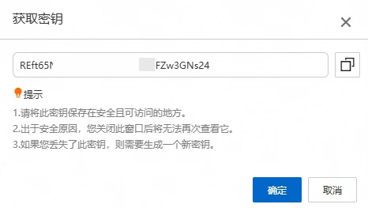

5. 单击  ，获取当前APP_KEY。

   > **重要**
   >
   > 获取后请妥善保存，避免丢失和泄露！

6. 单击**确定**，结束创建。

**相关操作**

创建APP_KEY后您可以进行以下操作。

<table>
  <tr>
    <th width="89">任务名称</th>
    <th>操作</th>
  </tr>
  <tr>
    <td>刷新</td>
    <td>在APP_KEY界面单击列表左上方的<strong>刷新</strong>。</td>
  </tr>
  <tr>
    <td>编辑</td>
    <td>1. 单击目标APP_KEY操作列的<strong>编辑</strong>。<br>2. 修改描述、有效空间、是否永久生效。<br>3. 单击<strong>确定</strong></td>
  </tr>
  <tr>
    <td>删除</td>
    <td>1. 单击目标APP_KEY操作列的<strong>删除</strong>，删除不再使用的APP_KEY，避免资源浪费和数据泄露。<br>2. 单击<strong>确定</strong>。</td>
  </tr>
</table>

<a id="section-8-3"></a>

## 8.3. OpenAPI

本章节介绍如何查看OpenAPI的内容。

**操作步骤**

1. 登录OpenTrek Agent Dev控制台。

2. 在左侧导航栏选择**集成开放 > OpenAPI**。

3. 单击**OpenAPI**，跳转至API文档帮助中心。

<a id="section-9"></a>

# 9.附录

<a id="section-9-1"></a>

## 9.1. 工作流函数说明

通过自定义工作流画布编排搭建智能体时，入参提供了多种工作流函数，可根据搭建场景进行选用。

**调用函数操作指引**

1. 在工作流设计阶段，单击**添加节点**，选择具体节点。

2. 配置输入参数时，来源选择函数。

3. 将鼠标放至函数输入框中，搜索相应函数。

4. 选中函数后，需要配置函数。

5. 单击配置项的**请选择**区域，触发配置功能，可配置函数对应属性的值。不同的函数会有1个到多个配置项，每个配置项独立配置。

   > **说明**
   >
   > 函数配置规则：
   >
   > 函数属性的值可支持“引用”、“函数”、“常量”3种获取方式。
   >
   > - 引用：可引用前置所有节点的任意出参。
   >
   > - 常量：输入固定值。
   >
   > - 函数：嵌套其他函数。
   >
   > 如函数有多个配置项属性待配置，需要每个都完成配置。

6. 完成配置后，单击  。

7. 将鼠标悬停至已配置的函数区域，可查看函数全文。

**常用函数说明**

**get(object,key)**

此函数用于解析object类型的数据，选择指定的object中某一个key的值。

此函数需要配置“object”和“key”两个配置项属性：

- object配置项，配置需要被此函数解析的数据（支持引用、常量、函数）。此处输入或引用的数据必须保证为object类型，否则解析会报错。

- key配置项，配置上一条配置的object数据中，需要被解析出来的key。

例如，object={"name":"张三","id"="123"}，key="id"，则此函数解析出来的值为“123”。

**get(list,index)**

此函数用于解析List类型的数据，指定List中具体某一条数据为输入参数。

此函数支持“list”和“index”两个配置项属性。

- list配置项，配置需要被此函数解析的数据（支持引用、常量、函数）。此处输入或引用的数据必须保证为list类型，否则解析会报错。

- index配置项，配置上一条配置的list数据中，需要被解析出的数据位次。

**其他函数说明**

| 序号 | 函数 | 说明 |
| --- | --- | --- |
| 1 | knowledge_recall(query,knowledge base,top_k,threshold) | 知识召回函数，可用于记忆库召回。可在函数配置时定义最大召回条数和最低召回分值数据。 |
| 2 | task_execute_history() | 查询一轮对话内的中间任务运行记录。 |
| 3 | dialogue_history(topK) | 插入指定轮数的聊天记录。 |
| 4 | substr(string,open) | 截取字符串s在第一个open字符串后面的子字符串，截取不到返回空字符串。比如：substr(m123456789","2")，返回：3456789。 |
| 5 | substr(string,open,close) | 截取字符串s在第一个open字符串到第一个close字符串之间的子字符串，截取不到返回空字符串。比如：substr("123456789","2","5")，返回：34。 |
| 6 | substr(string,start) | 截取字符串s从序号start开始的子字符串，序号从0开始，截取不到返回空字符串。比如：substr("123456789",1)，返回：23456789。 |
| 7 | substr(string,start,end) | 截取字符串s从序号start开始到序号end（不包含）结束的子字符串，序号从0开始，截取不到返回空字符串。比如：substr("123456789",1, 4)，返回：234。 |
| 8 | join(string1,string2,delim) | 按分隔符delim, 连接文本string1和string2, 返回连接后的文本。 |
| 9 | join(string1, string2) | 连接文本string1和string2，返回连接后的文本。 |
| 1 0 | join(string_list, delim) | 按分隔符delim, 连接文本列表string_list, 返回连接后的文本。 |
| 1 1 | join(string_list) | 连接文本列表string_list, 返回连接后的文本。 |
| 1 2 | json_path(object, path) | 通过JSONPath取得对象结构里的值。示例如下：<br>• jison_path(object,"key1")，获取object下key1字段的元素。<br>• json_path(object,"key1.key2")，获取object下。<br>• key1字段的元素下key2字段的元素。 |
| 1 3 | uuid() | 生成一个随机ID。 |
| 1 4 | date() | 当前时间，格式为yyyy-MM-dd HH:mm:ss。 |
| 1 5 | date(format) | (format)当前时间，格式为format。比如当前时间为2023年12月30日，date ('yyMMdd")会输出231230。yy：年份的最后两位yyyy：年份MM：月份dd：日期HH：小时mm：分钟ss：秒 |
| 1 6 | size(object) | 返回文本长度或集合大小。 |
| 1 7 | add(num1, num2) | 计算两数之和。 |
| 1 8 | add(num_list) | 对输入数字列表求和。 |
| 1 9 | split(string, delim) | 按分隔符delim，切分文本string，返回文本列表。 |
| 2 0 | combinationTasks() | 获取组合任务列表。 |
| 2 1 | combinationTasks(contentRange) | 获取组合任务列表（带参数）。 |
| 2 2 | default(object, defaultValue) | 尝试获取参数，否则使用指定的默认值。 |
| 2 3 | get(list, index, defaultValue) | 获取list指定索引index的元素，找不到时返回defaultValue。 |
| 2 4 | get(object, key, defaultValue) | 获取object指定key的元素，找不到时返回defaultValue。 |
| 2 5 | listChatMessagesWithModel(titles, count) | 获取Agent与Model交互的历史记录。 |

<a id="section-9-2"></a>

## 9.2. 变量与图表数据配置说明

本文介绍创建对话卡片时如何使用变量、配置图表数据结构以及在不同数据源间进行选择和切换。

**什么是变量**

变量可以理解为卡片中预留的“数据位置”。设计卡片时，先定义变量并将它绑定到组件属性；卡片实际展示时，再由消费侧为变量提供真实数据。这样不需要为每一组数据重新制作、发布一张卡片。例如，一张订单卡片可以定义：

| 变量名称 | 类型 | 用途 |
| --- | --- | --- |
| <code>customer_name</code> | String | 展示客户姓名。 |
| <code>order_amount</code> | Number | 展示订单金额。 |
| <code>is_vip</code> | Boolean | 表示是否为 VIP。 |
| <code>order_info</code> | Object | 保存订单对象。 |
| <code>salesData</code> | Array | 为图表提供销售数据。 |

整体数据流如下：

1. 消费侧提供业务数据。

2. 变量salesData。

3. 绑定到图表的“图表数据”。

4. 图表按照字段配置展示数据。

**什么时候应该使用变量**

适合使用变量的场景：

- 同一张卡片需要展示不同用户、订单或商品的数据。

- 图表数据会随消息或业务场景变化。

- 多个组件需要使用同一份数据。

- 希望卡片发布后只替换数据，不再修改卡片结构。

如果内容始终固定，例如固定标题、固定说明文字，可以直接填写组件属性，不一定需要创建变量。

**创建和使用变量**

**创建变量**

在对话卡片编辑器左侧进入**搭建 > 变量**，单击**新增变量**，填写：变量名称、变量类型和默认值。

变量支持以下类型：

| 类型 | 适合的数据 | 示例 |
| --- | --- | --- |
| String | 文本 | <code> "</code>张三<code>" </code> |
| Number | 数字 | <code>128.5</code> |
| Boolean | 是/否状态 | <code>true</code> |
| Object | 一个结构化对象 | <code> {"name":"</code>张三<code>","age":28} </code> |
| Array | 一组数据 | <code> [{"name":"</code>商品<code>A","value":10}]</code> |

变量名称发布后会作为数据字段名，因此建议使用有明确含义的英文名称，例如  `customer_name` 、 `salesData` 。

变量名称需遵守以下规则：

- 不能以数字开头。

- 只能包含字母、数字、 `$`  和  `_` 。

- 不能包含空格。

- 最多 64 个字符。

- 创建后不能直接修改名称和类型。

**默认值有什么作用**

变量默认值主要用于编辑画布和预览，让设计者在尚未接入真实数据时也能看到卡片效果。

> **说明**
>
> 变量默认值不会进入正式发布的运行时制品，也不应当被当作生产环境的兜底业务数据。卡片实际展示时，仍应由消费侧提供真实数据。

例如，变量  `customer_name`  的默认值是“示例客户”，只表示编辑器预览时显示“示例客户”。正式使用时，消费侧可以传入：

```json
{  "customer_name": "李雷"}
```

如果变量勾选“必填”，表示卡片进入完整展示状态时，消费侧必须提供该字段。

**将变量绑定到组件**

选中一个组件后，在右侧属性面板中找到支持变量的属性，单击变量图标：

- 选择已有变量。

- 或选择“新增并使用”，创建变量后立即绑定。

变量类型必须与组件属性兼容。例如：

- 标题内容通常绑定 String；

- 评分值通常绑定 Number；

- 图表数据必须绑定符合图表结构的 Array；

- 不兼容的变量不能选择。

取消变量绑定后，组件会恢复为组件内置的默认值，不会自动保留变量当前的默认值。

正在被组件或操作引用的变量不能直接删除，需要先解除相关绑定。

**图表数据的基本结构**

一份图表数据由两部分组成：

- **分类字段**：表示横轴、日期、渠道、产品名称等分类信息。

- **数值字段**：表示销量、金额、订单数等需要绘制的数字。

例如：

```json
[  {    "date": "2026-08-01",    "sales": 120,    "orders": 32  },  {    "date": "2026-0
8-02",    "sales": 168,    "orders": 45  }]
```

图表数据必须是数组，数组中的每个对象代表一个数据点，也就是表格中的一行。上述 JSON 对应的字段配置如下：

| 字段 | 角色 | 含义 |
| --- | --- | --- |
| <code>date</code> | 分类字段 | 日期。 |
| <code>sales</code> | 数值字段 | 销售额。 |
| <code>orders</code> | 数值字段 | 订单数。 |

**选择默认数据还是变量数据**

图表支持两种数据来源：

| 数据来源 | 适用场景 | 发布后的行为 |
| --- | --- | --- |
| 图表默认数据 | 数据固定，不需要消费侧替换。 | 数据随图表一起发布并固定展示。 |
| Array 变量 | 数据会随用户、消息或业务场景变化。 | 消费侧为变量提供真实数据。 |

这两种“默认”需要严格区分：

- 图表默认数据：是图表自身的固定内容，会进入发布结果。

- 变量默认值：是编辑和预览使用的示例数据，不会进入运行时制品。

如果图表需要展示实时业务数据，应当使用变量，而不是只修改图表默认数据。

**使用表格进行可视化配置**

选中图表，在右侧**图表数据**区域单击  ，可以进入数据编辑界面。编辑界面包含字段配置和数据内容。

**字段配置**

在“字段配置”中定义每一列的作用：

- 分类字段名：例如  `date` 、 `month` 、 `channel` 。

- 横轴类型：分类或时间。

- 数值字段名：例如  `sales` 、 `orders` 。

- 数值显示名：例如“销售额”“订单数”。

横轴类型的区别：

- 分类：所有分类等距排列，适合产品、渠道、地区等数据。

- 时间：按照真实日期间隔排列，日期必须使用  `YYYY-MM-DD`  格式。

字段名会与 JSON 数据中的字段一一对应，必须保持完全一致。

**数据内容**

在“数据内容”中：

- 每一行代表一个数据点。

- 每一列对应一个已配置字段。

- 可以新增或删除数据行。

- 数值字段必须填写数字。

> **说明**
>
> - 单个图表最多支持 200 个数据点。
>
> - 折线图、柱状图一个分类字段最多支持 4 个数值字段。
>
> - 饼图一个分类字段只能配置 1 个数值字段。
>
> - 数据可以暂时保存为空数组。

表格配置更适合不熟悉 JSON 的用户，也能同时完成字段结构和数据内容的编辑，建议作为主要操作方式。

**使用JSON配置图表变量数据**

图表绑定 Array 变量后，可以通过以下入口编辑 JSON 默认值：

- 在图表数据区域单击变量旁的  。

- 选择左侧搭建区域的**变量**页签，单击变量行的  编辑对应的 Array 变量。

建议优先从图表的“新增变量”入口创建变量。编辑器会根据当前图表字段自动生成匹配的数据结构。

**折线图和柱状图示例**

字段配置：

- 分类字段： `date`

- 横轴类型：时间

- 数值字段： `sales`

- 数值字段： `orders`

变量默认值：

```json
[  {    "date": "2026-08-01",    "sales": 120,    "orders": 32  },  {    "date": "2026-0
8-02",    "sales": 168,    "orders": 45  }]
```

消费侧提供真实数据时，变量位于本次卡片数据对象中：其中  `salesData`  必须与变量名称一致。

```json
{  "salesData": [    {      "date": "2026-08-01",      "sales": 356,      "orders": 78  
},    {      "date": "2026-08-02",      "sales": 421,      "orders": 93    }  ]}
```

**饼图示例**

字段配置：

- 分类字段： `channel`

- 数值字段： `value`

JSON 数据：

```json
[  {    "channel": "搜索",    "value": 56  },  {    "channel": "推荐",    "value": 32  },
{    "channel": "其他",    "value": 12  }]
```

饼图只能配置一个数值字段，因此不能同时加入  `value` 、 `count`  等多个数值列。

**JSON 数据规则**

填写 JSON 时应注意：

- 必须使用标准 JSON 格式。

- 字段名和字符串必须使用双引号。

- 不能添加注释。

- 最后一项后不能出现多余逗号。

- 分类字段必须是字符串。

- 数值字段必须是真正的数字，不能写成带引号的字符串。

- 时间字段必须采用  `YYYY-MM-DD`  格式，且日期不能重复。

- 每行必须包含全部已配置字段。

- 不能包含未配置的额外字段。

- Object 和 Array 默认值中不能包含  `null` 。

错误示例：

```json
[  {    "date": "2026/08/01",    "sales": "120"  }]
```

其中存在两个问题：

- 日期没有使用  `YYYY-MM-DD`  格式。

- `"120"`  是字符串，不是数字。

正确写法：

```json
[  {    "date": "2026-08-01",    "sales": 120  }]
```

**JSON 编辑和可视化编辑的区别**

JSON 编辑主要用于修改变量的默认数据，不适合修改图表字段结构。

如果需要执行以下操作，应使用可视化编辑器：

- 新增或删除数值字段。

- 修改分类字段名。

- 修改字段映射。

- 切换分类横轴和时间横轴。

- 调整数值显示名称。

如果只需要在字段结构不变的情况下批量粘贴或替换数据，可以使用 JSON 编辑。

**共享图表变量**

同一个 Array 变量可以绑定到多个图表。

共享变量适合多个图表共同使用同一份数据，但需要注意：

- 修改变量默认值会影响所有绑定该变量的图表。

- 在可视化编辑器中修改变量字段结构，会同步修改所有关联图表的字段映射。

- 如果共享变量绑定了饼图，该变量只能保留一个数值字段。

如果多个图表的数据含义或字段结构不同，建议分别创建变量。

**直白解释**

可以把图表理解成一个只认识“列名”的模板。

例如，图表被设置为：

- `date`  是横轴。

- `sales`  是销售额。

- `orders`  是订单数。

那么无论通过表格还是 JSON 输入，每一行数据都必须同时提供这三个字段。表格配置相当于在 Excel 中逐行填写；JSON 配置相当于一次性粘贴一批结构化数据。两种方式最终表达的是同一类数据，只是操作方式不同。

> **说明**
>
> 容易混淆的两种默认数据：
>
> - 图表自己的默认数据，是卡片的一部分，会固定显示。
>
> - 变量的默认值，只是设计和预览时使用的示例，正式展示的数据仍由消费侧传入。
