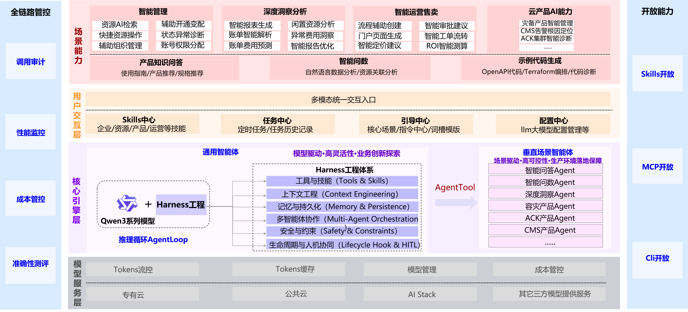

阿里云  
专有云  
统一云管平台  
飞天助理 产品简介  
产品版本：v3.18.6  
文档版本：20261023

**目录**

- [1.产品详情](#section-1)
- [2.产品价值](#section-2)
- [3.应用场景](#section-3)
- [4.功能特性](#section-4)

# 1.产品详情

本文对Apsara Copilot（飞天助理）进行整体介绍。

Apsara Copilot（飞天助理）云管数字人定位于专有云统一云管平台的智能化入口，通过自然语言对话交互，为专有云管理者和使用者提供资源管理、运营分析和深度洞察的一站式管云体验。

- **对话即管理**

  通过CaaS（Conversation as a Service）的全新范式，重塑管云形态，实现30+核心高频操作从“纯人工操作”到“AI分析+自动化执行”的升级。

- **数字员工化**

  Copilot系列数字员工的操作权限均都源自实际用户的权限体系，用户可以自由定义和扩展自己的数字分身。

- **开放可扩展**

  通过标准化的协议和接口，将Apsara Copilot的AI能力与企业本地知识库、企业已有的AI智能体深度融合，构建一个开放、协同的智能系统。

# 2.产品价值

本文为您介绍飞天助理的产品价值。

**降低云使用门槛**

面向非专业用户或新手开发者，通过自然语言交互，自动解析意图并生成相关操作说明，减少对复杂控制台操作和API文档的依赖性，提升易用性。

**提升运营效率**

快速理解用户问题，从海量文档、知识库或系统中提取准确信息，减少人工查找时间。飞天助理具有自然语言理解和上下文记忆能力，能够提供连贯、个性化的服务。

**推动人工智能的管理模式**

打造“对话即服务”的交互模式，让云平台更像一个智能伙伴而非工具系统，为未来的自主智能管理打下基础。

# 3.应用场景

本文为您介绍飞天助理的典型使用场景。

**产品知识问答**

对于云产品推荐、功能操作、限制说明及最佳实践等使用类问题，可以通过飞天助理给出准确的回答和指导。

- **使用帮助**：基于专有云用户手册和最佳实践指南，针对用户的使用问题，生成产品使用的操作说明。

- **产品帮助**：针对用户的业务场景诉求，自动给出所需要的云产品以及相关实例规格推荐，并可以直达相关产品控制台页面。

**运营数据分析**

对于运营数据支持通过用户输入的自然语言，自动生成查询的SQL语言，并将返回的查询信息，动态生成图表展示，并在此基础上完成针对资源利用率，健康度和账单费用的分析和优化建议。

- **图表式问答**：支持通过用户输入的自然语言，做意图识别，自动生成SQL语言，并将返回的查询信息，动态生成图表和列表展示。

- **自定义报表**：在数据分析界面支持自然语言输入，帮助数据分析师创建交互式可视化图表，通过自然语言对话进行多维度统计与汇总分析，并自动生成对应报表和图表。

**辅助资源管理**

支持对资源及其关联资源的智能化检索，根据场景给出资源规格的建议，并可以辅助进行资源的开通。

- **资源检索**：通过提问或页面划选的方式，快速查询相关云资源的信息，并支持对其关联资源的拓扑分析。

- **规格选择**：根据用户输入的应用需求，智能分析自动推荐最优ECS实例规避，平衡性能与成本，并支持联动开通创建页面。

**OpenAPI代码生成**

针对开发者的开发场景诉求，自动生成云产品OpenAPI的接口调用样例代码，以及Terraform代码，供参考使用。

**接口代码生成**：可以针对开发者的开发场景诉求，针对性的生成对应云产品OpenAPI的接口调用样例代码，供开发者参考。

**代码一键调试**：对于生成的OpenAPI样例代码，可以点击去调试链接，直达开发者门户里的接口在线调试页面，快速进行调试。

# 4.功能特性

本文介绍飞天助理的典型功能特性。

| 功能 | 说明 |
| --- | --- |
| 访问控制 | 支持通过角色的权限点管理实现用户访问控制及功能点权限分配。 |
| 个性化配置 | 对智能助手中的品牌内容、欢迎语等进行个性化设置。AI助手配置开启显示后，新增飞天助理的交互入口，支持通过飞天助理对话框向AI咨询信息，与AI进行智能对话。 |
| 模型配置 | 管理和配置您的AI模型，包括大语言模型、向量模型和重排序模型。 |
| 准确性评测 | 提供一站式智能体评测平台。 |
| 知识库管理 | 统一管理飞天助理的知识库，支持知识入库、切片配置与检索测试。 |
| 知识问答运营 | 将用户负反馈自动转化为知识库优化动作，查看归因案例。 |
| 辅助云资源管理 | 通过自定义辅助创建和辅助变配的配置，更好地使用AI辅助管理云资源。 |
| 运营分析看板 | 提供飞天助理的运营数据分析看板，帮助客户更好地掌握飞天助理的使用情况，以及业务效果。 |
| 操作审计 | 飞天助理支持操作审计日志记录功能。 |
| 飞天助理对话 | 提供AI助理的交互入口，吊顶和悬浮球，支持新开对话，多轮对话，对话记录等能力。提供智能管理数字人、智能洞察数字人、智能运营数字人。 |
| 技能管理 | 安装与管理技能，在对话中扩展飞天助理的能力。 |
| 数字员工管理 | 平台预置的专业领域 Agent，各司其职协同工作，为你提供全方位的智能云管理能力。 |
| 办公室 | 查看数字员工的数据概览。 |
| 记忆管理 | 系统将自动学习并沉淀你的使用偏好，也支持手动创建自定义记忆。 |
| 定时任务管理 | 按计划自动执行任务，也可随时手动触发。在任意对话中描述你想定期做的事，即可快速创建。 |
