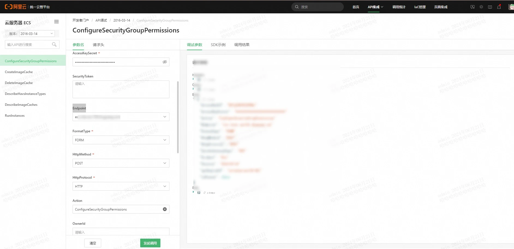

阿里云  
专有云  
统一云管平台  
飞天助理 开发指南  
产品版本：v3.18.6  
文档版本：20261023

**目录**

- [1.快速入门](#section-1)
    - [1.1. 开发文档使用说明](#section-1-1)
    - [1.2. API调用流程说明](#section-1-2)
- [2.准备工作](#section-2)
    - [2.1. 获取API信息及其EndPoint](#section-2-1)
    - [2.2. 获取AccessKey](#section-2-2)
    - [2.3. 获取公共Header参数](#section-2-3)
    - [2.4. 获取STS AccessKey](#section-2-4)
- [3.通过POP网关调用专有云API](#section-3)
    - [3.1. 调用前置](#section-3-1)
    - [3.2. Java版](#section-3-2)
    - [3.3. Go版](#section-3-3)
    - [3.4. Python版](#section-3-4)
- [4.API列表](#section-4)
    - [4.1. IntelligentAnalysis](#section-4-1)
    - [4.2. IntelligentSearch](#section-4-2)
    - [4.3. IntelligentQa](#section-4-3)
    - [4.4. CreateChat](#section-4-4)
    - [4.5. IntelligentCoding](#section-4-5)
    - [4.6. GetChatHistory](#section-4-6)
    - [4.7. ListHistoryChats](#section-4-7)
    - [4.8. PushChatMessage](#section-4-8)
    - [4.9. MessageFeedback](#section-4-9)
    - [4.10. DeleteChat](#section-4-10)

<a id="section-1"></a>

# 1.快速入门

<a id="section-1-1"></a>

## 1.1. 开发文档使用说明

本文为您介绍在使用专有云API进行开发工作时，如何查看所需要的产品文档。

**使用流程**

您可以按照以下流程图中步骤，判断自己所需要使用的开发文档。


**前提条件**

通过运维人员或运营管理员获取专有云的版本。

**操作步骤**

您可以通过阿里云专有云文档中心，获取需要的产品文档。

1. 通过浏览器打开专有云文档中心。

2. 根据专有云的版本单击**企业版**、**敏捷版**或**一体机**标签。

3. 在下拉列表中，选择对应的专有云版本。

   

4. 在左侧导航栏中，选择目标产品名称。

5. 在单击目标文档区域的**查看详情**或**下载PDF**。

<a id="section-1-2"></a>

## 1.2. API调用流程说明

本文为您介绍调用流程及可以参考的文档资料。

**流程图**


**调用步骤**

1. 获取AccessKey。

   获取调用时所需要的AccessKey参数，请参见获取AccessKey。

   > **说明**
   >
   > 推荐使用个人AccessKey调用Apsara Uni-manager运营控制台及云产品接口。

2. 获取RegionID。

   获取调用时所需要的RegionID参数，请参见获取公共Header参数。

3. 获取组织ID与资源集ID。

   获取调用时所需要的组织ID和资源集ID参数，请参见获取公共Header参数。

   > **说明**
   >
   > 调用API时，通过Header参数组织ID（&lt;x-acs-organizationid>）和资源集ID（&lt;x-acs-resourcegroupid>）指定组织和资源集，实现实例资源的隔离查询。
   >
   > - 组织ID（&lt;x-acs-organizationid>）不指定则默认获取当前用户所属的组织。
   >
   > - 资源集ID（&lt;x-acs-resourcegroupid>）不指定默认为空，如果指定资源集需要同时指定组织ID。

4. 查找API的开发文档。

   您需要查看目标云产品的开发指南，了解API的功能与使用方式，查找开发指南的方式请参见开发文档使用说明。

5. 获取云产品Endpoint。

6. 获取云产品SDK并调用云产品API。

<a id="section-2"></a>

# 2.准备工作

<a id="section-2-1"></a>

## 2.1. 获取API信息及其EndPoint

首先，您需要了解产品开放API接口的相关信息，包括产品名称（code）、开放API接口名称、API版本。

**背景信息**

Apsara Uni-manager运营控制台API目录中的API信息仅供调用参考，具体API的使用方式需要参见云产品的开发指南。如果发生不一致情况，以开发指南支持情况为准。

**操作步骤**

1. 登录Apsara Uni-manager运营控制台。

2. 在顶部菜单栏选择**产品** > **开发工具** > **API与工具** > **开发者门户**。

3. 在**开发者门户**页面，选择**API集成** > **API调试**。

   

4. 在左侧导航栏中选择目标云产品。

5. 在**版本**下拉列表中，选择目标API版本。

6. 在下方API列表中可浏览当前版本的所有API接口。

7. 选中对应接口，在参数名下获取云产品的POP Endpoint信息。

   

<a id="section-2-2"></a>

## 2.2. 获取AccessKey

访问身份验证中通过使用AccessKey ID和AccessKey Secret对称加密的方法来验证某个请求的发送者身份。AccessKey ID用于标示用户，AccessKey Secret是用户用于加密签名的字符串。本文将为您描述如何获取通过RAM授权的AccessKey。

**前提条件**

只有运营管理员和一级组织管理员可以获取组织AccessKey。

**背景信息**

AccessKey支持两种授权模式：

- 通过RAM授权给第三方请求者的AccessKey ID和AccessKey Secret。

- 通过STS授权给第三方请求者的AccessKey ID、AccessKey Secret和Security Token。

本文仅为您介绍如何获取通过RAM授权的AccessKey，通过STS授权的AccessKey获取方式请参见获取STS AccessKey。

推荐使用个人账号AccessKey调用Apsara Uni-manager运营控制台及云产品相关接口。如果使用个人账号AccessKey，需要在Header中添加以下限制性参数，否则可能提示权限不足：

<table>
  <tr>
    <th width="206">参数名称</th>
    <th>描述</th>
  </tr>
  <tr>
    <td>x-acs-regionid</td>
    <td>环境Region，如：cn-hangzhou-*。</td>
  </tr>
  <tr>
    <td>x-acs-organizationid</td>
    <td>Apsara Uni-manager运营控制台中对应的组织ID。获取方法可参见Apsara Uni-manager运营控制台开发指南中的GetOrganizationList文档。</td>
  </tr>
  <tr>
    <td>x-acs-resourcegroupid</td>
    <td>Apsara Uni-manager运营控制台中对应的资源集ID。获取方法可参见Apsara Uni-manager运营控制台开发指南中的ListResourceGroup文档。</td>
  </tr>
  <tr>
    <td>x-acs-instanceid</td>
    <td>进行操作的实例ID，例如，ECS的实例ID可以从ECS列表中查询到。</td>
  </tr>
</table>

> 个人账号AccessKey是由Apsara Uni-manager运营控制台权限体系管控的受限
>
> **警告**
>
> AccessKey，组织AccessKey相对权限较大，需要管理员确认操作的安全性。

**获取个人账号AccessKey**

获取个人账号AccessKey的方法如下：

1. 登录Apsara Uni-manager运营控制台。

2. 在系统界面右上角，将鼠标悬停在当前登录用户的头像上，单击**个人信息**。

3. 在**阿里云AccessKey**区域，您可以查看个人账户的AccessKey信息。

   

   > Accesskey ID和AccessKey Secret是您访问云资源时的密钥，具有该账号完整的权
   >
   > **说明**
   >
   > 限，请您妥善保管。

**获取组织AccessKey**

获取组织AccessKey的方法如下：

1. 管理员登录Apsara Uni-manager运营控制台。

2. 在顶部菜单栏，单击**企业**。

3. 在左侧导航栏中，选择**资源管理 > 组织管理**。

4. 在组织结构中，单击目标一级组织名称。

5. 单击**管理Accesskey**。

6. 在弹出的对话框中，查看组织AccessKey信息。

<a id="section-2-3"></a>

## 2.3. 获取公共Header参数

调用API时需要提供多个Header参数。本文为您介绍如何获取这些参数。并对调用后的一些返回值做出解释。

**获取Region ID**

1. 管理员登录Apsara Uni-manager运营控制台。

2. 在顶部菜单栏中，单击**企业**。

3. 在左侧导航栏中，选择**资源管理**>**地域管理**。

4. 单击目标组织名称。

5. 在右侧**Region列表**中查看**Region名称**，即为Region ID。

**获取组织ID**

组织ID需要通过调用API方式获取，您可以在Apsara Uni-manager运营控制台中通过API在线调试功能快速获取组织ID信息。

1. 管理员登录Apsara Uni-manager运营控制台。

2. 单击顶部菜单栏**产品**，选择**开发者工具** > **API与工具** > **开发者门户**。

3. 在**开发者门户**页面，选择**API集成** > **API调试**。

4. 单击  按钮，选择**云平台** > **统一云管平台**，**版本**选择**2019-05-10**。

5. 在文本框内输入 `GetOrganizationList` 进行在线调试，在name参数填写目标组织名称后发起调用，调用成功后查看**调用结果**中**id**的信息，即为组织ID。接口信息详见*Apsara Uni-manager运营控制台开发指南*中的章节*GetOrganizationList*。

**获取资源集ID**

资源集ID需要通过调用API方式获取，您可以在Apsara Uni-manager运营控制台中通过API在线调试功能快速获取资源集ID信息。

1. 管理员登录Apsara Uni-manager运营控制台。

2. 单击顶部菜单栏**产品**，选择**开发者工具** > **API与工具** > **开发者门户**。

3. 在**开发者门户**页面，选择**API集成** > **API调试**。

4. 单击  按钮，选择**云平台** > **统一云管平台**，**版本**选择**2019-05-10**。

5. 在文本框内输入 `ListResourceGroup` 进行在线调试，调用成功后查看**调用结果**中**id**的信息，即为资源集ID。接口信息详见*Apsara Uni-manager运营控制台开发指南*中的章节*ListResourceGroup*。

**获取实例ID**

实例ID可以通过Apsara Uni-manager运营控制台中的云产品实例列表进行获取，本文中以API网关为例，获取步骤如下：

1. 登录Apsara Uni-manager运营控制台。

2. 在顶部的菜单栏中，选择**产品** > **开发与工具** > **开发与运维** > **API网关**。

3. 在左侧导航栏中，单击**实例**。

4. 在实例列表中查看**实例ID**。

**返回参数**

对于列表类的云产品资源实例接口，调用后会默认增加如下返回值。

| 名称 | 描述 |
| --- | --- |
| ResourceGroupName | 资源集名称。 |
| ResourceGroup | 资源集ID。 |
| DepartmentName | 组织名称。 |
| Department | 组织ID。 |

<a id="section-2-4"></a>

## 2.4. 获取STS AccessKey

本文为您介绍如何利用STS方式，调用专有云的产品API。

**背景信息**

阿里云临时安全令牌STS（Security Token Service）是阿里云提供的一种临时访问权限管理服务。您可以选择利用STS方式，调用专有云的产品API。

**操作步骤**

1. 获取用户角色的 `RAM Role` 。

   <ol type="i">

   <li>

   登录Apsara Uni-manager运营控制台。

   </li>

   <li>

   单击页面右上角的用户头像，选择**个人信息**。

   </li>

   <li>

   单击**查看当前角色策略**。

   在**当前选择角色策略**对话框中查看 `RAM Role` 。

   </li>

   </ol>

2. 使用以下代码，通过角色的 `RAM Role` 获得 `stsAK` 、 `stsSK` 和 `stsToken` 。

   ```java
   public static void main(String[] args) {
        ASClient asClient = new ASClient();
        // 调⽤来源说明
           asClient.setSdkSource("test");
        // 传入Arn
           String assumeRole = AssumeRole(asClient, "<RAM Role>");

           JSONObject assumeRoleJson = JSONObject.parseObject(assumeRole);

           JSONObject credentials = assumeRoleJson.getJSONObject("Credentials");

           // 获取到STS三元组
           String stsAK = credentials.getString("AccessKeyId");
           String stsSK = credentials.getString("AccessKeySecret");
           String stsToken = credentials.getString("SecurityToken");
   }

   public static String AssumeRole(ASClient asClient, String roleArn) {

           Map<String, String> headers = new HashMap<>();

           Map<String, Object> reqParams = new HashMap<>();

           reqParams.put("action", "AssumeRole");

           reqParams.put("Product", "Sts");

           reqParams.put("Version", "2015-04-01");

           reqParams.put("regionId", regionId);

        // 当前登录⽤户的ak
           reqParams.put("AccessKeyId", <当前⽤户的AccessKey ID>);
        // 当前登录⽤户的sk
           reqParams.put("AccessKeySecret", <当前⽤户的AccessKey Secret>);

           reqParams.put("roleSessionName", "StsUser");

           reqParams.put("roleArn", roleArn);

           return asClient.doRequest(endpoint, headers, reqParams);
   }
   ```

3. 通过STS可以调用云产品的接口，下列代码以ECS为示例。

   ```java
   public static void main(String[] args) {
        ASClient asClient = new ASClient();
           asClient.setSdkSource("test");
     // 调⽤云产品的API
           String ecsRes = DescribeZones(asClient,<stsAK>,<stsSK>,<stsToken>);
   }


   public static String DescribeZones(ASClient asClient, String stsAK, String stsSK, String stsToken) {

           Map<String, String> headers = new HashMap<>();

           Map<String, Object> reqParams = new HashMap<>();

           reqParams.put("action", "DescribeZones");

           reqParams.put("Product", "Ecs");

           reqParams.put("Version", "2014-05-26");

           reqParams.put("regionId", "<your-RegionID>");

           //STS AK/SK/Token三元组
           reqParams.put("AccessKeyId", <stsAK>);
           reqParams.put("AccessKeySecret", <stsSK>);
           reqParams.put("SecurityToken", <stsToken>);

           return asClient.doRequest(endpoint, headers, reqParams, HttpMethod.GET);

       }
   ```

<a id="section-3"></a>

# 3.通过POP网关调用专有云API

<a id="section-3-1"></a>

## 3.1. 调用前置

阿里云专有云与公共云一样，可通过POP网关的方式进行API调用。本文为您介绍调用前需要进行的准备工作。

**背景信息**

为了使专有云保持与公共云相同的使用方式，使您拥有更方便，更一致的体验，建议通过POP网关调用专有云API。

**获取云产品的Endpoint**

**通过开发者门户获取**

1. 登录Apsara Uni-manager运营控制台。

2. 在顶部菜单栏选择**产品** > **开发工具** > **API与工具** > **开发者门户**。

3. 在**开发者门户**页面，选择**API集成** > **API调试**。

   

4. 在左侧导航栏中选择目标云产品。

5. 在**版本**下拉列表中，选择目标API版本。

6. 在下方API列表中可浏览当前版本的所有API接口。

7. 选中对应接口，在参数名下获取云产品的POP Endpoint信息。

**通过飞天基础运维平台获取**

通过POP网关调用专有云API时需要使用云产品业务域的Endpoint。您可以在阿里云驻场运维工程师处获取。

您也可以自行获取Endpoint，如下为您介绍获取Endpoint的方法。

1. 登录Apsara Uni-manager运维控制台。

2. 顶部菜单栏选择**平台运维** > **飞天基础运维平台** > **资源管理**。

3. 在左侧导航栏，选择**资源管理** > **产品集群运维**。

4. 在**产品集群运维**页面的**产品|集群**输入 `apsara-copilot` 。

5. 在集群**操作**列单击**集群详情**。

6. 在**集群详情**页面单击**资源详情**页签。

7. 在资源详情页签下找到名称为 `copilot-api-dns` ，类型为 `dns` 的资源，单击**资源申请结果**列的 

   图标。

8. 单击**资源申请结果**列的文本信息，在弹出的对话框，查看domain值，即 `Endpoint` 。

**获取公共参数**

通过POP网关调用专有云API过程中所使用的参数，如组织ID、资源集ID、RegionID和实例ID，获取方式请参见本手册**准备工作**下的**获取公共Header参数**章节。

<a id="section-3-2"></a>

## 3.2. Java版

通过POP Java SDK访问产品域名，需要了解该产品调用方式(RPC或ROA)。

**前提条件**

目前专有云推荐使用CommonRequest进行调用，可以在Apsara Uni-manager运营控制台**产品** > **开发工具** > **API与工具** > **开发者门户**，选择**API集成** > **API调试**查看推荐SDK版本以及示例代码。

> **重要**
>
> 不建议直接从SDK中心下载SDK到专有云场景下使用，公有云的SDK不一定支持专有云的API，可能存在兼容性问题，请谨慎使用！

**CommonRequest调用示例**

RPC调用，示例接口信息：产品（apigateway）、接口（DescribeApiGroups）、版本（2016-07-14）。

调用示例如下：

```xml
import com.aliyuncs.CommonRequest;
import com.aliyuncs.CommonResponse;
import com.aliyuncs.DefaultAcsClient;
import com.aliyuncs.IAcsClient;
import com.aliyuncs.exceptions.ClientException;
import com.aliyuncs.exceptions.ServerException;
import com.aliyuncs.http.MethodType;
import com.aliyuncs.profile.DefaultProfile;

public class DescribeApiGroups {

    public static void main(String[] args) {
        // 创建DefaultAcsClient实例并初始化。
        DefaultProfile profile = DefaultProfile.getProfile("<your-regionid>", "
<yourAccessKeyId>", "<yourAccessSecret>");

        // 忽略SSL
        // HttpClientConfig clientConfig = HttpClientConfig.getDefault();
        // clientConfig.setIgnoreSSLCerts(true);
        // 设置连接超时
        // clientConfig.setConnectionTimeoutMillis(3000L);
        // 设置读取超时
        // clientConfig.setReadTimeoutMillis(10000L);
        // profile.setHttpClientConfig(clientConfig);
        
        IAcsClient client = new DefaultAcsClient(profile);
        // 创建API请求并设置参数。
        CommonRequest request = new CommonRequest();
        // 设置请求⽅式
        request.setSysMethod(MethodType.POST);
        // 设置云产品Endpoint
        request.setSysDomain("<apigatewayEndpoint>");
        // 设置访问接⼝版本
        request.setSysVersion("2016-07-14");
        // 设置LocationProduct
        request.setSysLocationProduct("apigateway");
        // 设置访问接⼝的名称
        request.setSysAction("DescribeApiGroups");
        
        // 当使⽤sts ak调⽤RPC接⼝时需要在参数中加上SecurityToken字段
        // request.putBodyParameter("SecurityToken", "<your-SecurityToken>");

        // 业务参数
        request.putQueryParameter("PageSize", "10");
        request.putQueryParameter("PageNumber", "1");

        // 必填值，调⽤来源说明
        request.putHeadParameter("x-acs-caller-sdk-source", "ApiTestDemo");
        // 非必填，企业版V3.15.0之前历史版本需要
        request.putHeadParameter("x-acs-regionid", "<your-regionid>");
        // 非必填，资源集ID
        request.putHeadParameter("x-acs-resourcegroupid", "<your-resourcegroupid>");
        // 必填, 组织ID
        request.putHeadParameter("x-acs-organizationid", "<your-organizationid>");
        // 非必填，修改&删除操作需要
        // request.putHeadParameter("x-acs-instanceid", "<your-instanceid>");

        try {
            // 发起请求并处理应答或异常。
            CommonResponse response = client.getCommonResponse(request);
            System.out.println(response.getData());
        } catch (ServerException e) {
            e.printStackTrace();
        } catch (ClientException e) {
            System.out.println("ErrCode:" + e.getErrCode());
            System.out.println("ErrMsg:" + e.getErrMsg());
            System.out.println("RequestId:" + e.getRequestId());
        }

    }
}
```

ROA调用，示例接口信息：产品（CR）接口（GetNamespaceList）版本（2016-06-07）。

调用示例如下：

```xml
import com.aliyuncs.CommonRequest;
import com.aliyuncs.CommonResponse;
import com.aliyuncs.DefaultAcsClient;
import com.aliyuncs.IAcsClient;
import com.aliyuncs.exceptions.ClientException;
import com.aliyuncs.exceptions.ServerException;
import com.aliyuncs.http.MethodType;
import com.aliyuncs.profile.DefaultProfile;

public class GetNamespaceList {

    public static void main(String[] args) {
        // 创建DefaultAcsClient实例并初始化。
        DefaultProfile profile = DefaultProfile.getProfile("<your-regionid>", "
<yourAccessKeyId>", "<yourAccessSecret>");

        // 忽略SSL
        // HttpClientConfig clientConfig = HttpClientConfig.getDefault();
        // clientConfig.setIgnoreSSLCerts(true);
        // 设置连接超时
        // clientConfig.setConnectionTimeoutMillis(3000L);
        // 设置读取超时
        // clientConfig.setReadTimeoutMillis(10000L);
        // profile.setHttpClientConfig(clientConfig);
        
        IAcsClient client = new DefaultAcsClient(profile);
        // 创建API请求并设置参数。
        CommonRequest request = new CommonRequest();

        // 设置HTTPS访问
        request.setSysProtocol(ProtocolType.HTTP);
        // 设置请求⽅式
        request.setSysMethod(MethodType.GET);
        // 设置云产品endpoint
        request.setSysDomain("<crEndpoint>");
        // 设置访问接⼝版本
        request.setSysVersion("2016-06-07");
        // 设置uriPattern 只有roa调⽤需要传递此字段
        request.setSysUriPattern("/namespace");
        // 设置LocationProduct
        request.setSysLocationProduct("cr");
        // 设置访问接⼝的名称
        request.setSysAction("GetNamespaceList");

        // 必填值，调⽤来源说明
        request.putHeadParameter("x-acs-caller-sdk-source", "ApiTestDemo");
        // 非必填，企业版V3.15.0之前历史版本需要
        request.putHeadParameter("x-acs-regionid", "<your-regionid>");
        // 非必填,资源集ID
        request.putHeadParameter("x-acs-resourcegroupid", "<your-resourcegroupid>");
        // 必填,组织ID
        request.putHeadParameter("x-acs-organizationid", "<your-organizationid>");
        // 非必填，修改&删除操作需要
        // request.putHeadParameter("x-acs-instanceid", "<your-instanceid>");


        // 当使⽤STS AK调⽤ROA接⼝时需要在Header加上x-acs-security-token字段
        // request.putHeadParameter("x-acs-security-token", "<your-securitytoken>");

        try {
            // 发起请求并处理应答或异常。
            CommonResponse response = client.getCommonResponse(request);
            System.out.println(response.getData());
        } catch (ServerException e) {
            e.printStackTrace();
        } catch (ClientException e) {
            System.out.println("ErrCode:" + e.getErrCode());
            System.out.println("ErrMsg:" + e.getErrMsg());
            System.out.println("RequestId:" + e.getRequestId());
        }

    }
}
```

> **重要**
>
> 使用HTTPS协议访问OpenAPI时，SDK会默认开启校验SSL/TLS 证书有效性，若您代码环境没有证书环境，则会报错证书校验失败。
>
> 为保障生产环境通信安全，建议您保持开启，若在测试环境必须忽略证书校验，可以通过以下参数设置：
>
> Java
>
> ```text
> HttpClientConfig clientConfig = HttpClientConfig.getDefault();
> // 设置不校验服务端证书
> clientConfig.setIgnoreSSLCerts(true)
> ```

**SSE 调用示例**

1、需要集成新版POP SDK

```xml
<dependency>
  <groupId>com.aliyun</groupId>
  <artifactId>aliyun-gateway-pop</artifactId>
  <version>0.2.11-beta</version>
</dependency>
```

2、示例代码

```java
import java.util.Date;
import com.aliyun.auth.credentials.Credential;
import com.aliyun.auth.credentials.provider.StaticCredentialProvider;
import com.aliyun.core.http.HttpMethod;
import com.aliyun.core.utils.DateUtil;
import com.aliyun.sdk.gateway.pop.clients.CommonAsyncClient;
import com.aliyun.sdk.gateway.pop.models.CommonRequest;
import darabonba.core.ResponseIterable;
import darabonba.core.ResponseIterator;
import darabonba.core.client.ClientOverrideConfiguration;

public class SseSample {

  public static void main(String[] args) {
    StaticCredentialProvider provider = StaticCredentialProvider.create(
      Credential.builder()
      .accessKeyId("<yourAccessKeyID>") // 请替换为您实际的AccessKey ID。
      .accessKeySecret("yourAccessKeySecret") // 请替换为您实际的AccessKey Secret。
      .build()
    );
    CommonAsyncClient client = CommonAsyncClient.builder()
      .region("<yourRegionID>") // 请替换为您实际的地域ID。
      .credentialsProvider(provider)
      .overrideConfiguration(
        ClientOverrideConfiguration.create()
        .setProtocol("http")
        .setEndpointOverride("<yourEndpoint>") // 请替换为您实际的Endpoint。
      )
      .build();
    
    CommonRequest commonRequest = CommonRequest.builder()
      // 接⼝信息参数，请根据实际调⽤的API进⾏替换
      .product("aipaas")
      .version("2024-06-24")
      .action("StreamChat")
      .path("/model/streamChat")
      .httpMethod(HttpMethod.POST)
      // 接⼝业务参数设置。
      .putBodyParameters("serviceId", "xxx")
      .putBodyParameters("userMessage", "introduce yourself")
      .putBodyParameters("model", "Qwen2.5-7B-Instruct")
      .build();

    System.out.println("----begin----" + DateUtil.formatIso8601Date(new Date()));
    try{
      ResponseIterable<String> iterable = client.callSseApi(commonRequest);
      ResponseIterator<String> iterator = iterable.iterator();
      while (iterator.hasNext()) {
        System.out.println(System.currentTimeMillis() + ":" + iterator.next());
      }
      System.out.println("----end----" + DateUtil.formatIso8601Date(new Date()));
    }catch (Exception e) {
      e.printStackTrace();
    }
  }
}
```

<a id="section-3-3"></a>

## 3.3. Go版

本文为您介绍POP Go SDK调用的方式。

**前提条件**

目前专有云推荐使用CommonRequest进行调用，可以在Apsara Uni-manager运营控制台**产品** > **开发工具** > **API与工具** > **开发者门户**，选择**API集成** > **API调试**查看推荐SDK版本以及示例代码。

> **重要**
>
> 不建议直接从SDK中心下载SDK到专有云场景下使用，公有云的SDK不一定支持专有云的API，可能存在兼容性问题，请谨慎使用！

**背景信息**

当前支持RPC和ROA的方式调用API。

**CommonRequest调用示例**

RPC方式调用示例接口信息：产品（apigateway）、接口（DescribeApiGroups）、版本（2016-07-14）。

示例代码如下：

```go
package main

import (
    "fmt"
    "github.com/aliyun/alibaba-cloud-sdk-go/sdk"
    "github.com/aliyun/alibaba-cloud-sdk-go/sdk/requests"
  
)

func main() {
    client, err := sdk.NewClientWithAccessKey("<your-RegionID>", "<AccessKey ID>", "<AccessKey Secret>")

    request := requests.NewCommonRequest()
    
    request.Method = "POST"
    request.Domain = "<ApigatewayEndpoint>"
    request.Version = "2016-07-14"
    request.ApiName = "DescribeApiGroups"
    request.Product = "apigateway"
    // 当使⽤sts ak调⽤rpc接⼝时需要在参数中加上SecurityToken字段
    // request.QueryParams["SecurityToken"]="<your-SecurityToken>"

    // 必填值，调⽤来源说明
    request.Headers["x-acs-caller-sdk-source"] = "ApiTestDemo"
    // 非必填，企业版V3.15.0之前历史版本需要
    request.Headers["x-acs-regionid"] = "<your-RegionID>"
    // 非必填，资源集ID
    request.Headers["x-acs-resourcegroupid"] = "<your-ResourceGroupID>"
    // 必填，组织ID
    request.Headers["x-acs-organizationid"] = "<your-OrganizationID>"
    // 非必填，修改&删除操作需要
    // request.Headers["x-acs-instanceid"] = "<your-InstanceID>"

    response, err := client.ProcessCommonRequest(request)
    if err != nil {
        panic(err)
    }
    fmt.Print(response.GetHttpContentString())
}
```

ROA调用示例接口信息：产品（CR）接口（GetNamespaceList）版本（2016-06-07）。

调用示例如下：

```xml
package main

import (
 "fmt"
 "github.com/aliyun/alibaba-cloud-sdk-go/sdk"
 "github.com/aliyun/alibaba-cloud-sdk-go/sdk/requests"
 "os"
)


func main() {
    client, err := sdk.NewClientWithAccessKey("<your-regionid>", "<yourAccessKeyId>", "
<yourAccessSecret>")
 request := requests.NewCommonRequest()

 request.Method = "GET"
 request.Domain = "<crEndpoint>"
 request.Version = "2016-06-07"
 request.ApiName = "GetNamespaceList"
 request.Product = "cr"

 request.PathPattern = "/namespace"
 // 当使⽤sts ak调⽤ROA接⼝时需要在header中加上x-acs-security-token字段
 // request.Headers["x-acs-security-token"] = "<your-SecurityToken>"
 // 必填值，调⽤来源说明
 request.Headers["x-acs-caller-sdk-source"] = "ApiTestDemo"
    // 非必填，企业版V3.15.0之前历史版本需要
    request.Headers["x-acs-regionid"] = "<your-RegionID>"
    // 非必填，资源集ID
    request.Headers["x-acs-resourcegroupid"] = "<your-ResourceGroupID>"
    // 必填，组织ID
    request.Headers["x-acs-organizationid"] = "<your-OrganizationID>"
 // 非必填，修改&删除操作需要
 // request.Headers["x-acs-instanceid"] = "<your-InstanceID>"

 response, err := client.ProcessCommonRequest(request)
 if err != nil {
  panic(err)
 }
 fmt.Print(response.GetHttpContentString())
}
```

**设置代理**

当您在调用实例时，或许会需要设置代理，您可以通过以下两种方式设置代理。

- 通过环境变量设置。

  环境变量HTTP_PROXY、HTTPS_PROXY或者NO_PROXY。

  设置代码如下：

  ```go
  import (
      "os"
  )
  func main(){
   os.Setenv("HTTP_PROXY", "http://x.x.x.x:xxxx") // 设置 HTTP_PROXY 环境变量
   os.Setenv("HTTPS_PROXY", "https://x.x.x.x:xxxx") // 设置 HTTPS_PROXY 环境变量
  }
  ```

- 通过客户端设置。

  设置代码如下：

  ```text
  // 客户端设置代理优先级比环境变量⾼
  client.SetHttpProxy("http://x.x.x.x:xxxx")   // 设置http代理
  client.GetHttpProxy()                          // 获取http代理

  client.SetHttpsProxy("https://x.x.x.x:xxxx")   // 设置https代理
  client.GetHttpsProxy()                           // 获取https代理

  client.SetNoProxy("127.0.0.1,localhost")     // 设置代理⽩名单
  client.GetNoProxy()                          // 获取代理⽩名单
  ```

**SSL验证**

**摘要**

请求时验证SSL证书行为。

- 设置成 `true` ，禁用证书验证（这是不安全的，请设置证书！）。

- 设置成 `false` ，启用SSL证书验证，默认使用操作系统提供的CA证书。

**默认值**

默认值为 `false` 。

**设置**

> **重要**
>
> 使用HTTPS协议访问OpenAPI时，SDK会默认开启校验SSL证书有效性，若您代码环境没有证书环境，则会报错证书校验失败。为保障生产环境通信安全，建议您保持开启，若在测试环境必须忽略证书校验，可参考如下内容进行设置。

```text
// 设置请求 HTTPSInsecure（只影响当前）
request.SetHTTPSInsecure(true)                           // 设置请求 HTTPSInsecure 为 true
isInsecure := request.GetHTTPSInsecure()                 // 获取请求 HTTPSInsecure
```

当请求未设置时，客户端设置才能生效。

```text
// 设置客户端 HTTPSInsecure（⽤于客户端发送的所有请求）。
client.SetHTTPSInsecure(true)                         // 设置客户端 HTTPSInsecure 为 trueisInsecure := client.GetHTTPSInsecure()               // 获取客户端 HTTPSInsecure
```

<a id="section-3-4"></a>

## 3.4. Python版

本文为您介绍POP Python SDK调用云产品API的方式。

**前提条件**

目前专有云推荐使用CommonRequest进行调用，可以在Apsara Uni-manager运营控制台**产品** > **开发工具** > **API与工具** > **开发者门户**，选择**API集成** > **API调试**查看推荐SDK版本以及示例代码。

> **重要**
>
> 不建议直接从SDK中心下载SDK到专有云场景下使用，公有云的SDK不一定支持专有云的API，可能存在兼容性问题，请谨慎使用！

**背景信息**

目前仅支持通过RPC方式调用API。

**CommonRequest调用示例**

调用示例接口信息：产品（ECS）、接口（DescribeInstances）、版本（2014-05-26）。

示例代码如下：

```python
from aliyunsdkcore.client import AcsClient
import os
from aliyunsdkcore.request import CommonRequest

# 创建AcsClient实例
client = AcsClient(
    "<AccessKey ID>",
    "<AccessKey Secret>",
    "<your-RegionID>",
    timeout=1000,  # 设置超时时间
    verify=False, # 忽略证书或者verify='<证书位置>'
);
# 和https⼀起使⽤
# client.set_verify(False)
# os.environ["HTTPS_PROXY"] = "http://127.0.0.1:8080"

# os.environ["HTTP_PROXY"] = "http://127.0.0.1:8080"
def describe_api_groups():
    # 创建request，并设置参数
    request = CommonRequest()

    # 当使⽤sts ak调⽤rpc接⼝时需要在参数中加上SecurityToken字段
    # params = {"PageSize":"10","PageNumber":"1","SecurityToken":"<your-
SecurityToken>"};
    params = {"PageSize":"10","PageNumber":"1"};
    request.set_query_params(params)

    headers = {
        # 必填值，调⽤来源说明
        "x-acs-caller-sdk-source":"ApiTestDemo",
        # 非必填，企业版V3.15.0之前历史版本需要
        "x-acs-regionid":"<your-RegionID>",
        # 非必填，资源集ID
        "x-acs-resourcegroupid":"<your-ResourceGroupID>",
        # 必填，组织ID
        "x-acs-organizationid":"<your-OrganizationID>"
        # 非必填，修改&删除操作需要
        # "x-acs-instanceid":"<your-InstanceID>"

    }
    request.set_headers(headers)
    request.set_version("2016-07-14")
    request.set_action_name("DescribeApiGroups")
    request.set_endpoint("<ApigatewayEndpoint>")   //Endpoint请替换为真实地址
    request.set_product("apigateway")
    request.set_method("POST")

    # 发起API请求并显示返回值
    response = client.do_action_with_exception(request)
    print(response)


if __name__ == '__main__':
    print("Hello Aliyun OpenApi!")
    describe_api_groups()
```

**设置代理**

调用API时您或许需要通过环境变量设置HTTP_PROXY、HTTPS_PROXY。

示例代码如下：

```text
# https的代理 
os.environ["HTTPS_PROXY"] = "http://x.x.x.x:xxxx"

# http的代理
os.environ["HTTP_PROXY"] = "https://x.x.x.x:xxxx"
```

**HTTPS配置**

下面介绍使用HTTPS协议进行OpenAPI访问。

**使用HTTPS协议**

SDK默认使用HTTPS协议。

```python
from aliyunsdkecs.request.v20140526.DescribeInstancesRequest import 
DescribeInstancesRequest
from aliyunsdkcore.client import AcsClient
client = AcsClient(
    region_id='<region_id>',  # 地域ID
)

request = DescribeInstancesRequest()
request.set_protocol_type('https')  # 使⽤https

client.do_action_with_exception(request)   
```

**忽略证书**

> **重要**
>
> - 使用HTTPS协议访问OpenAPI时，SDK会默认开启校验SSL/TLS证书有效性，若您代码环境没有证书环境，则会报错证书校验失败。
>
> - 为保障生产环境通信安全，建议您保持开启，若在测试环境必须忽略证书校验，可以通过参数 `verify` 设置。

```python
from aliyunsdkcore.client import AcsClient
client = AcsClient(
    region_id='<region_id>',  # 地域ID
    verify=False  # 忽略对 SSL 证书的验证
)
```

**指定CA证书文件**

```python
from aliyunsdkcore.client import AcsClient
client = AcsClient(
    region_id='<region_id>',  # 地域ID
    verify='./cacert.pem'  # 证书路径
)
```

<a id="section-4"></a>

# 4.API列表

<a id="section-4-1"></a>

## 4.1. IntelligentAnalysis

支持如下场景的智能问数能力： 1、云平台账单成本分析：支持组织、资源集、资源维度的年、月账单统计、趋势分析、同环比计算等 2、云资源优化治理分析：支持组织、资源集、资源维度的资源闲置、瓶颈及健康度分析。 3、云资源统计：支持按照组织、资源集等统计云资源数量、利用率统计等。

该接口采用 Server-Sent Events (SSE) 通信方式，响应类型为 text/event-stream，表示服务端将以流式传输的方式逐步返回数据。客户端通过持续监听事件流，可以实时接收服务器发送的每一段响应内容，适用于需要分段输出或长时间处理的场景，如模型推理、实时问答等。

在响应过程中，每一条数据以独立的事件形式发送，格式通常为： data: {"content": "这是第一段回答"}客户端可逐条解析并处理这些事件，实现动态更新和实时反馈。

**请求头**

该接口使用公共请求头，无特殊请求头。请参见公共请求参数文档。

**请求语法**

```http
POST /api/open/api/IntelligentAnalysis HTTP/1.1
```

**请求参数**

| 参数名称 | 类型 | 位置 | 是否必选 | 示例 | 说明 |
| --- | --- | --- | --- | --- | --- |
| messages | Array | Body | 否 | \[{"role":"user","content":"帮我查询xx组织IP为xx的ECS实例"}\] | 参数messages是一个由多个 Map 组成的列表（List&lt;Map&lt;String, Object&gt;&gt;），用于表示用户在对话中的发言内容。每个 Map 对象代表一条消息，包含以下两个固定字段：role：字符串类型，必填，值固定为 "user"，表示消息发送者的角色。 content：字符串类型，必填，表示用户的提问或输入内容。 |
| domain | Strin g | Body | 否 | cloud_optimized | 智能分析的数据域，可用的数据域有：<br>• bill_analysis: 成本分析域<br>• resource_analysis: 资源分析域<br>• cloud_optimized：云优化域 |
| tables | Array | Body | 否 | \["instance_health_score"\] | 数据域下的数据表信息 |

**示例**

请求示例

```http
POST /api/open/api/IntelligentAnalysis HTTP/1.1
Content-Type: application/json
Accept: text/event-stream
x-acs-userid: 5003
x-acs-roleid: 1

{
  "messages": [
    {
      "role": "user",
      "content": "统计ECS实例数量最多的⼀级组织TOP5"
    }
  ]
}
```

正常返回示例

`JSON`  格式

````text
data: {"choices": [{"delta": {"role": "function", "name": "action_node_type", "content": "data_analysis", "status": "waiting", "extra": {}}}]}

data: {"choices": [{"delta": {"role": "assistant", "content": "", "reasonContent": "<TeamixStep>取数意图</TeamixStep>", "phase": "execute", "status": "ongoing", "chatSource": 
"", "chatSourceProps": null}}]}

data: {"choices": [{"delta": {"role": "assistant", "content": "", "reasonContent": "⽤
户想要统计ECS实例数量最多的前5个⼀级组织，最相关的是资源分析域的资源实例表，涉及组织、资源类型维度和实例
数量指标。我将筛选出资源类型为ECS实例的数据，按照组织进⾏聚合，并取实例数量最多的前5个⼀级组织。", "phase": "execute", "status": "ongoing", "chatSource": "", "chatSourceProps": null}}]}

data: {"choices": [{"delta": {"role": "assistant", "content": "", "reasonContent": "", 
"phase": "execute", "status": "ongoing", "chatSource": "", "chatSourceProps": null}}]}

data: {"choices": [{"delta": {"role": "assistant", "content": "", "reasonContent": "<TeamixStep>相关指标</TeamixStep>", "phase": "execute", "status": "ongoing", "chatSource": 
"", "chatSourceProps": null}}]}

data: {"choices": [{"delta": {"role": "assistant", "content": "", "reasonContent": "| 
数据域   | 表     | 指标   ||:------|:------|:-----|| 资源分析域 | 资源实例表 | 实例数量 |", "p
hase": "execute", "status": "ongoing", "chatSource": "", "chatSourceProps": null}}]}

data: {"choices": [{"delta": {"role": "assistant", "content": "", "reasonContent": "<TeamixStep>查询数据并展示</TeamixStep>", "phase": "execute", "status": "ongoing", 
"chatSource": "", "chatSourceProps": null}}]}

data: {"choices": [{"delta": {"role": "assistant", "content": "", "reasonContent": "<TeamixStepEnd />", "phase": "execute", "status": "done", "chatSource": "", 
"chatSourceProps": null}}]}

data: {"choices": [{"delta": {"role": "assistant", "content": "**数据域**: 资源分析域, **
表**: 资源实例表, **维度**: 组织,资源类型, **指标**: 实例数量", "reasonContent": "", "phase": 
"answer","status":"ongoing","chatSource":"","chatSourceProps":null}}]}

data: {"choices": [{"delta": {"role": "assistant", "content": "", "reasonContent": "", 
"phase": "answer", "status": "ongoing", "chatSource": "", "chatSourceProps": null}}]}

data: {"choices": [{"delta": {"role": "assistant", "content": 
"```TeamixModule{\"moduleInfo\": {\"name\": \"renderAIPanel\",\"hideLoadTime\": true}, 
\"moduleProps\": {\"title\": \"ECS实例数量最多的⼀级组织TOP5\", \"description\": \"\", \"chartConfig\": {\"type\": \"bar\", \"config\": {\"column\": true, \"zoom\": true}}, \"dataSource\": {\"success\": true, \"type\": \"chart\", \"table\": [{\"data\": 
[[\"ascmTest\", 118], [\"iaas_test\", 100], [\"acs-autotest\", 26], [\"amc-storage\", 21], [\"coms standard org\", 13]], \"name\": \"ECS实例数量\"}], \"tableName\": \"ECS实例数
量最多的⼀级组织TOP5\"}, \"dataConfig\": {\"type\": \"apsara-copilot\", \"request\": { \"url\": \"/data/api.json\", \"method\": \"POST\", \"data\": {\"$product\": \"ascm\", \"$version\": \"2025-03-10\", \"$action\": \"GetAnalysisDataForCard\", \"cardId\": \"3dd606e9-d071-4364-8a41-042b1387390e\", \"cardVersion\": \"v1\"}}}}}```", "reasonContent": "", "phase": "answer", "status": "ongoing", "chatSource": "", "chatSourceProps": null}}]}

data: {"choices": [{"delta": {"role": "assistant", "content": "", "status": "ongoing", 
"phase": "answer"}}]}

data: {"choices": [{"delta": {"role": "assistant", "content": "### 数据解读", "status": 
"ongoing", "phase":"answer"}}]}

data: {"choices": [{"delta": {"role": "assistant", "content": "根据统计结果", "status": "ongoing", "phase": "answer"}}]}

data: {"choices": [{"delta": {"role": "assistant", "content": "...<总结分析⽂本>", "status": "ongoing", "phase": "answer"}}]}

data: {"choices": [{"delta": {"role": "assistant", "content": "", "status": "ongoing", 
"phase": "answer"}}]}

data: [DONE]
````

<a id="section-4-2"></a>

## 4.2. IntelligentSearch

云产品实例、组织、资源集、用户智能搜索功能。

该接口采用 Server-Sent Events (SSE) 通信方式，响应类型为 text/event-stream，表示服务端将以流式传输的方式逐步返回数据。客户端通过持续监听事件流，可以实时接收服务器发送的每一段响应内容，适用于需要分段输出或长时间处理的场景，如模型推理、实时问答等。

在响应过程中，每一条数据以独立的事件形式发送，格式通常为： data: {"content": "这是第一段回答"}客户端可逐条解析并处理这些事件，实现动态更新和实时反馈。

**请求头**

该接口使用公共请求头，无特殊请求头。请参见公共请求参数文档。

**请求语法**

```http
POST /api/open/api/IntelligentSearch HTTP/1.1
```

**请求参数**

| 参数名称 | 类型 | 位置 | 是否必选 | 示例 | 说明 |
| --- | --- | --- | --- | --- | --- |
| messages | Json | Body | 否 | {"messages": \[{"role":"user","content":"帮我查询xx组织IP为xx的ECS实例"}\]} | 参数messages是一个由多个 Map 组成的列表（List&lt;Map&lt;String, Object&gt;&gt;），用于表示用户在对话中的发言内容。每个 Map 对象代表一条消息，包含以下两个固定字段：role：字符串类型，必填，值固定为 "user"，表示消息发送者的角色。 content：字符串类型，必填，表示用户的提问或输入内容。 |

流式返回

**示例**

请求示例

```http
POST /api/open/api/IntelligentSearch HTTP/1.1
{
  "messages": [
    {
      "role": "user",
      "content": "查询我创建的ECS实例"
    }
  ]
}
```

正常返回示例

`JSON`  格式

```json
{
 "data":"[{}]",
 "success":true,
 "dynamicMessages":"[]",
 "errorMessage":"\"\"",
 "errorCode":"500",
 "httpCode":200
}
```

`XML`  格式

```xml
<data>[{}]</data>
<success>true</success>
<dynamicMessages>[]</dynamicMessages>
<errorMessage>&quot;&quot;</errorMessage>
<errorCode>500</errorCode>
<httpCode>200</httpCode>
```

<a id="section-4-3"></a>

## 4.3. IntelligentQa

云产品知识问答，解答各类云平台及云资源使用和配置问题。支持基于对话历史的上下文理解和无对话历史的单次问答两种模式。

接口说明

该接口采用 Server-Sent Events (SSE) 通信方式，响应类型为 text/event-stream，表示服务端将以流式传输的方式逐步返回数据。客户端通过持续监听事件流，可以实时接收服务器发送的每一段响应内容，适用于需要分段输出或长时间处理的场景，如模型推理、实时问答等。

在响应过程中，每一条数据以独立的事件形式发送，格式通常为： data: {"content": "这是第一段回答"}客户端可逐条解析并处理这些事件，实现动态更新和实时反馈。

**准备工作**

- 如需使用会话功能，需要先创建会话或准备有效的 chatId。

**注意事项**

- 当提供chatId参数时，系统将启用有会话模式，会根据历史对话上下文进行多轮交互。

- 当不提供chatId参数时，系统将以无会话模式运行，适用于单次独立问答场景。

**最佳实践**

- 对于连续对话场景：先调用CreateChat创建会话获取chatId，后续请求使用该chatId维持对话上下文。

- 对于单次问答场景：直接调用接口不传chatId参数，实现轻量级问答。

**请求头**

该接口使用公共请求头，无特殊请求头。请参见公共请求参数文档。

**请求语法**

```http
POST /api/open/api/IntelligentQa HTTP/1.1
```

**请求参数**

| 参数名称 | 类型 | 位置 | 是否必选 | 示例 | 说明 |
| --- | --- | --- | --- | --- | --- |
| outerId | Strin g | Body | 否 | 123456 | 外部应用的用户ID。 |
| outerType | Strin g | Body | 否 | coms | 外部应用类型标识。 |
| chatId | Strin g | Body | 否 | 8932b258-75b5-42e7-8c52-0be053a88d64 | 聊天会话ID，提供时表示启用有会话模式，否则为无会话模式。 |
| model | Strin g | Body | 否 | qwen3 | 使用的模型名称。说明<br>• 非必填，不传使用默认模型。 |
| parentId | Strin g | Body | 否 | 5d2db7cc-4182-4a80-a9b7-a9d49a460a1f | 父消息ID。说明<br>• 非必填，提供chatId的情况下必填。 |
| messages | Json | Body | 否 | 无会话：{"messages": \[{"role":"user","content":"问答内容"}\]} 有会话：\[{"role":"user","msgId":" 42511985-4941-49d1-ac10-7573ff19671f","content":"简单回答一下上个问题","chatSourceProps": {"intranetSearch":false}}\] | 消息列表。说明<br>• 参数messages是一个由多个 Map 组成的列表（List&lt;Map&lt;String, Object&gt;&gt;），用于表示用户在对话中的发言内容。每个 Map 对象代表一条消息，包含以下两个固定字段：<br>• role：字符串类型，必填，值固定为 "user"，表示消息发送者的角色。<br>• content：字符串类型，必填，表示用户的提问或输入内容。<br>• msgId：字符串类型，提供chatId的情况下必填，表示当前消息ID<br>• chatSourceProps: 对象类型<br>• chatSourceProps.intra netSearch: 布尔类型，表示是否启用内网搜素功能 |
| product | Strin g | Body | 否 | ECS | 产品名称code，比如ECS、VPC等。 |

**返回数据**

| 参数名称 | 类型 | 示例 | 说明 |
| --- | --- | --- | --- |
| dynamicMessa ges | List | \[\] | 动态提示信息。 |
| data | String | \[{}\] | 返回数据。 |
| success | Boolean | true | 返回状态。<br>• 成功：true。<br>• 失败：false。 |
| errorCode | String | 500 | 错误码。 |
| errorMessage | String | "" | 错误信息。 |
| httpCode | Integer | 200 | HTTP状态码。 |

返回类型为 StreamingResponse，响应格式为 text/event-stream（SSE），表示服务端通过事件流的方式逐步返回数据。在流式传输过程中，每条数据以独立的事件形式发送，事件内容为一个包含 content字段的 JSON 对象，其中 content 是字符串类型，用于承载模型逐步生成的回答内容，例如：data: {"content": "这是第一段回答"}。

**示例**

请求示例

```http
POST /api/open/api/IntelligentQa HTTP/1.1

Content-Type: application/json

{
  "chatId": "8932b258-75b5-42e7-8c52-0be053a88d64",
  "parentId": "2e469579-5c6f-4f55-accb-ae339a1aff78",
  "messages": [
    {
      "role": "user",
      "msgId": "42511985-4941-49d1-ac10-7573ff19671f",
      "content": "简单回答⼀下上个问题",
      "chatSourceProps": {
        "intranetSearch": false
      }
    }
  ]
}
```

正常返回示例

`JSON`  格式

```json
{
 "data":"[{}]",
 "success":true,
 "dynamicMessages":"[]",
 "errorMessage":"\"\"",
 "errorCode":"500",
 "httpCode":200
}
```

`XML`  格式

```xml
<data>[{}]</data>
<success>true</success>
<dynamicMessages>[]</dynamicMessages>
<errorMessage>&quot;&quot;</errorMessage>
<errorCode>500</errorCode>
<httpCode>200</httpCode>
```

<a id="section-4-4"></a>

## 4.4. CreateChat

创建一个新的对话并返回对话的全局唯一标识和生成的标题（默认为用户输入的第一个内容）。

接口说明

**准备工作**

- 准备消息ID（msgId），必须是非空字符串

- 准备对话内容（content），必须是非空字符串

- 可选择性地提供外部应用标识（outerType和outerId）。outerType和outerId必须同时传递，不能单独使用其中一个。

**注意事项**

- msgId和content都是必需参数，不能为空

- content必须是字符串类型

- msgId必须是字符串类型

- 系统会自动生成唯一的chatId

**最佳实践**

- 在用户开始新的对话时调用此接口

**请求头**

该接口使用公共请求头，无特殊请求头。请参见公共请求参数文档。

**请求语法**

```http
POST /api/open/api/CreateChat HTTP/1.1
```

**请求参数**

| 参数名称 | 类型 | 位置 | 是否必选 | 示例 | 说明 |
| --- | --- | --- | --- | --- | --- |
| outerId | Strin g | Body | 否 | 123456 | 外部应用的用户ID。说明<br>• 该参数为非必填。需要与outerType同时使用。 |
| outerType | Strin g | Body | 否 | coms | 外部应用类型标识。说明<br>• 该参数为非必填。需要与outerId同时使用。 |
| msgId | Strin g | Body | 否 | 8158be15-ccf5-4e57-a3b9-68c7af900000 | 第一条消息的唯一标识符。说明<br>• 该参数为必填。 |
| content | Strin g | Body | 否 | AI助理能为我做什么？ | 对话内容，将作为对话标题。说明<br>• 该参数为必填。 |

**返回数据**

| 参数名称 | 类型 | 示例 | 说明 |
| --- | --- | --- | --- |
| dynamicMessa ges | List | \[\] | 动态提示信息。 |
| success | Boolean | true | 返回状态。<br>• 成功：true。<br>• 失败：false。 |
| message | String | success | 响应信息。 |
| errorCode | String | UnknownError | 错误码。 |
| errorMessage | String | 系统异常 | 错误信息。 |
| httpCode | Integer | 200 | HTTP状态码。 |
| data | Struct | {} | 返回数据。 |
| -chatId | String | 8158be15-ccf5-4e57-a3b9-68c7af900000 | 会话的唯一标识。 |
| -title | String | AI助理是什么呢？ | 会话标题 |

**示例**

请求示例

```http
POST /api/open/api/CreateChat HTTP/1.1

Content-Type: application/json

{
    "msgId": "8158be15-ccf5-4e57-a3b9-68c7af900000",
    "content": "AI助理是什么呢？",
    "outerId":"123456",
    "outerType":"coms"
}
```

正常返回示例

`JSON`  格式

```json
{
 "data":{
  "chatId":"8158be15-ccf5-4e57-a3b9-68c7af900000",
  "title":"AI助理是什么呢？"
 },
 "success":true,
 "dynamicMessages":"[]",
 "errorMessage":"系统异常",
 "errorCode":"UnknownError",
 "message":"success",
 "httpCode":200
}
```

`XML`  格式

```xml
<data>
 <chatId>8158be15-ccf5-4e57-a3b9-68c7af900000</chatId>
 <title>AI助理是什么呢？</title>
</data>
<success>true</success>
<dynamicMessages>[]</dynamicMessages>
<errorMessage>系统异常</errorMessage>
<errorCode>UnknownError</errorCode>
<message>success</message>
<httpCode>200</httpCode>
```

<a id="section-4-5"></a>

## 4.5. IntelligentCoding

支持开放平台OpenAPI代码样例生成及terraform代码样例生成

该接口采用 Server-Sent Events (SSE) 通信方式，响应类型为 text/event-stream，表示服务端将以流式传输的方式逐步返回数据。客户端通过持续监听事件流，可以实时接收服务器发送的每一段响应内容，适用于需要分段输出或长时间处理的场景，如模型推理、实时问答等。

在响应过程中，每一条数据以独立的事件形式发送，格式通常为： data: {"content": "这是第一段回答"}客户端可逐条解析并处理这些事件，实现动态更新和实时反馈。

**请求头**

该接口使用公共请求头，无特殊请求头。请参见公共请求参数文档。

**请求语法**

```http
POST /api/open/api/IntelligentCoding HTTP/1.1
```

**请求参数**

| 参数名称 | 类型 | 位置 | 是否必选 | 示例 | 说明 |
| --- | --- | --- | --- | --- | --- |
| messages | Json | Body | 否 | {"messages": \[{"role":"user","content":"帮我编写OpenAPI代码创建ECS实例"}\]} | 参数messages是一个由多个 Map 组成的列表（List&lt;Map&lt;String, Object&gt;&gt;），用于表示用户在对话中的发言内容。每个 Map 对象代表一条消息，包含以下两个固定字段：role：字符串类型，必填，值固定为 "user"，表示消息发送者的角色。 content：字符串类型，必填，表示用户的提问或输入内容。 |
| product | Strin g | Body | 否 | ECS | 云产品Code。 |
| scene | Strin g | Body | 否 | api_code_gen | api_code_gen: 解答用户关于OpenAPI代码生成、SDK集成的相关问题，为用户提供开放平台api的示例代码。terraform_code_gen： 解答用户关于terraform代码生成和使用的相关问题，为开发者提供terraform模版和示例代码，帮助用户高效地使用terraform去管理ECS、VPC、MQ等云资源。 code_check：解答用户关于代码诊断的问题,包括诊断专有云的SDK示例代码、terraform资源的示例代码、Java代码、python代码、Golang代码等。 |

**返回数据**

| 参数名称 | 类型 | 示例 | 说明 |
| --- | --- | --- | --- |
| dynamicMessa ges | List | \[\] | 动态提示信息。 |
| data | String | \[{}\] | 返回数据。 |
| success | Boolean | true | 返回状态。<br>• 成功：true。<br>• 失败：false。 |
| errorCode | String | 500 | 错误码。 |
| errorMessage | String | 系统异常 | 错误信息。 |
| httpCode | Integer | 200 | HTTP状态码。 |

**示例**

请求示例

```http
POST /api/open/api/IntelligentCoding HTTP/1.1
```

正常返回示例

`JSON`  格式

```json
{
 "data":"[{}]",
 "success":true,
 "dynamicMessages":"[]",
 "errorMessage":"系统异常",
 "errorCode":"500",
 "httpCode":200
}
```

`XML`  格式

```xml
<data>[{}]</data>
<success>true</success>
<dynamicMessages>[]</dynamicMessages>
<errorMessage>系统异常</errorMessage>
<errorCode>500</errorCode>
<httpCode>200</httpCode>
```

<a id="section-4-6"></a>

## 4.6. GetChatHistory

根据对话ID获取完整对话历史。

接口说明

**准备工作**

- 需要获取有效的chatId

**注意事项**

- chatId是必填参数，不能为空。

- 支持通过outerType和outerId过滤特定来源的对话。outerType和outerId必须同时传递，不能单独使用其中一个。

**最佳实践**

- 在用户打开历史对话时调用此接口获取完整对话记录

**请求头**

该接口使用公共请求头，无特殊请求头。请参见公共请求参数文档。

**请求语法**

```http
POST /api/open/api/GetChatHistory HTTP/1.1
```

**请求参数**

| 参数名称 | 类型 | 位置 | 是否必选 | 示例 | 说明 |
| --- | --- | --- | --- | --- | --- |
| outerId | Strin g | Body | 否 | 123456 | 外部应用的用户ID。说明<br>• 该参数为非必填。需要与outerType同时使用。 |
| outerType | Strin g | Body | 否 | coms | 外部应用类型标识。说明<br>• 该参数为非必填。需要与outerId同时使用。 |
| chatId | Strin g | Body | 否 | fe5ad98e-0ed7-4f99-8bf6-cbf9d3e878f9 | 对话的唯一标识符。说明<br>• 该参数为必填。 |

**返回数据**

| 参数名称 | 类型 | 示例 | 说明 |
| --- | --- | --- | --- |
| dynamicMessa ges | List | \[\] | 动态提示信息。 |
| title | String | AI助理能为我做什么？ | 对话标题。 |
| chatId | String | e379688d-6d52-4e68-9ac6-92b75d003e6d | 对话唯一标识。 |
| namespace | String | default | 命名空间。 |
| success | Boolean | true | 返回状态。<br>• 成功：true。<br>• 失败：false。 |
| message | String | success | 返回信息。 |
| errorCode | String | UnknownError | 错误码。 |
| errorMessage | String | 系统异常 | 错误信息。 |
| httpCode | Integer | 200 | HTTP状态码。 |
| chat | Struct | {} | 对话详情 |
| -messages | Array | \[{}\] | 消息列表，按时间顺序排列 |
| --childrenIds | List | \["ecd0f609-9fd5-49d7-a3bc-dddd89658100"\] | 子消息ID列表 |
| --content | String | AI助理能为我做什么？ | 消息内容 |
| --feedback | String | 反馈内容 | 用户反馈 |
| --msgId | String | 02fab45f-5770-45b9-85e2-dc8e4defa06a | 消息唯一标识符 |
| --parentId | String | 02fab45f-5770-45b9-85e2-dc8e4defa06a | 父消息ID |
| --rating | Integer | 0 | 用户对该消息的评分。说明<br>• 未评分0/点赞1/点踩-1 |
| --role | String | user | 消息角色。说明<br>• user/assistant |
| --timestamp | String | 2026-01-22T09:04:45Z | 修改时间 |
| --type | String | content | 消息类型 |
| --reasonContent | String | 意图识别 资料理解与分析 正在检索相关资料, 并对资料进行理解分析, 为您生成参考答案。 | 思考过程。 |
| --actionNodeTyp e | String | rag | 动作节点类型。 |
| --thinkingEnable d | String | 0 | 是否启用思考模式 |
| --chatSource | String | rag | 对话来源 |
| -title | String | AI助理能为我做什么？ | 对话标题 |
| -chatId | String | 8a5544e8-6704-4981-9241-caa15fd9fc3d | 对话唯一标识 |
| -chatType | String | default | 对话类型 |
| -history | Struct | {} | 历史记录 |
| --currentId | String | ecd0f609-9fd5-49d7-a3bc-dddd89658100 | 当前消息ID |
| --messages | Map | {"ecd0f609-9fd5-49d7-a3bc-dddd89658100": {"role":"assistant", "reasonContent":"意图识别 资料理解与分析 正在检索相关资料, 并对资料进行理解分析, 为您生成参考答案。","thinkingEnab led":0,"rating":0,"c hildrenIds": \[\],"msgId":"ecd0f6 09-9fd5-49d7-a3bc-dddd89658100","ty pe":"content","cont ent":"### AI助理能为您的云上服务提供智能化支持，帮助您更简单、高效地使用云产品与服务。","parentId":"02fab 45f-5770-45b9-85e2-dc8e4defa06a","ch atSource":"default","actionNodeType": "rag","timestamp": "2026-01-22T09:04:45Z"},"0 2fab45f-5770-45b9-85e2-dc8e4defa06a": {"role":"user","thin kingEnabled":0,"rat ing":0,"childrenIds":\["ecd0f609-9fd5-49d7-a3bc-dddd89658100"\]," msgId":"02fab45f-5770-45b9-85e2-dc8e4defa06a","ty pe":"content","cont ent":"AI助理能为我做什么？","chatSource": "default","actionNo deType":"default"," timestamp":"2026-01-22T09:04:29Z"}} | 消息字典，键为消息ID，值为消息对象 |

**示例**

请求示例

```http
POST /api/open/api/GetChatHistory HTTP/1.1

Content-Type: application/json

{
  "outerId": "123456",
  "outerType": "coms",
  "chatId": "ff536d45-014c-43ca-a97f-f7e4dca3bed9"
}
```

正常返回示例

`JSON`  格式

```json
{
    "chatId": "8a5544e8-6704-4981-9241-caa15fd9fc3d",
    "chat": {
        "chatId": "8a5544e8-6704-4981-9241-caa15fd9fc3d",
        "messages": [
            {
                "role": "user",
                "thinkingEnabled": 0,
                "rating": 0,
                "childrenIds": [
                    "ecd0f609-9fd5-49d7-a3bc-dddd89658100"
                ],
                "msgId": "02fab45f-5770-45b9-85e2-dc8e4defa06a",
                "type": "content",
                "chatSource": "default",
                "content": "⼀句话告诉我，AI助理能为我做什么？",
                "actionNodeType": "default",
                "timestamp": "2026-01-22T09:04:29Z"
            },
            {
                "role": "assistant",
                "reasonContent": "<TeamixStep>意图识别</TeamixStep><TeamixStepEnd /><Team
ixStep>资料理解与分析</TeamixStep>正在检索相关资料, 并对资料进⾏理解分析, 为您⽣成参考答案。
<TeamixStepEnd />",
                "thinkingEnabled": 0,
                "rating": 0,
                "childrenIds": [],
                "msgId": "ecd0f609-9fd5-49d7-a3bc-dddd89658100",
                "type": "content",
                "chatSource": "default",
                "content": "### AI助理能为您的云上服务提供智能化⽀持，帮助您更简单、⾼效地使⽤云产
品与服务。",
                "parentId": "02fab45f-5770-45b9-85e2-dc8e4defa06a",
                "actionNodeType": "rag",
                "timestamp": "2026-01-22T09:04:45Z"
            }
        ],
        "history": {
            "currentId": "ecd0f609-9fd5-49d7-a3bc-dddd89658100",
            "messages": {
                "ecd0f609-9fd5-49d7-a3bc-dddd89658100": {
                    "role": "assistant",
                    "reasonContent": "<TeamixStep>意图识别</TeamixStep><TeamixStepEnd /><
TeamixStep>资料理解与分析</TeamixStep>正在检索相关资料, 并对资料进⾏理解分析, 为您⽣成参考答案。
<TeamixStepEnd />",
                    "thinkingEnabled": 0,
                    "rating": 0,
                    "childrenIds": [],
                    "msgId": "ecd0f609-9fd5-49d7-a3bc-dddd89658100",
                    "type": "content",
                    "content": "### AI助理能为您的云上服务提供智能化⽀持，帮助您更简单、⾼效地使⽤
云产品与服务。",
                    "parentId": "02fab45f-5770-45b9-85e2-dc8e4defa06a",
                    "chatSource": "default",
                    "actionNodeType": "rag",
                    "timestamp": "2026-01-22T09:04:45Z"
                },
                "02fab45f-5770-45b9-85e2-dc8e4defa06a": {
                    "role": "user",
                    "thinkingEnabled": 0,
                    "rating": 0,
                    "childrenIds": [
                        "ecd0f609-9fd5-49d7-a3bc-dddd89658100"
                    ],
                    "msgId": "02fab45f-5770-45b9-85e2-dc8e4defa06a",
                    "type": "content",
                    "content": "⼀句话告诉我，AI助理能为我做什么？",
                    "chatSource": "default",
                    "actionNodeType": "default",
                    "timestamp": "2026-01-22T09:04:29Z"
                }
            }
        },
        "title": "⼀句话告诉我，AI助理能为我做什么？",
        "chatType": "default"
    },
    "namespace": "default",
    "title": "⼀句话告诉我，AI助理能为我做什么？"
}
```

<a id="section-4-7"></a>

## 4.7. ListHistoryChats

列出用户的对话历史记录。

接口说明

**注意事项**

- 默认返回最近 20 条记录；支持通过参数指定返回数量，但不支持分页功能。

- 支持通过outerType和outerId过滤特定来源的对话。outerType和outerId必须同时传递，不能单独使用其中一个。

**最佳实践**

- 在用户查看对话历史列表时调用此接口

- 适用于构建对话历史页面，让用户可以快速浏览和选择之前的对话

**请求头**

该接口使用公共请求头，无特殊请求头。请参见公共请求参数文档。

**请求语法**

```http
POST /api/open/api/ListHistoryChats HTTP/1.1
```

**请求参数**

| 参数名称 | 类型 | 位置 | 是否必选 | 示例 | 说明 |
| --- | --- | --- | --- | --- | --- |
| outerId | Strin g | Body | 否 | 123456 | 外部应用的用户ID。说明<br>• 该参数为非必填。需要与outerType同时使用。 |
| outerType | Strin g | Body | 否 | coms | 外部应用类型标识。说明<br>• 该参数为非必填。需要与outerId同时使用。 |
| namespac e | Strin g | Body | 否 | default | 命名空间。说明<br>• 该参数为非必填。默认查询default下的会话。 |
| pageSize | Integ er | Body | 否 | 20 | 返回的对话数量 |

**返回数据**

| 参数名称 | 类型 | 示例 | 说明 |
| --- | --- | --- | --- |
| dynamicMessa ges | List | \[\] | 动态提示信息。 |
| data | Array | \[{}\] | 返回数据。 |
| -chatId | String | b6aaa1fe-9cbd-40e7-b70b-53f0865e6192 | 对话的唯一标识。 |
| -namespace | String | default | 命名空间。 |
| -chatType | String | default | 对话类型。 |
| -title | String | AI助理能为我做什么？ | 对话标题 |
| -created | String | 2026-01-22T08:28:51Z | 创建时间 |
| -updated | String | 2026-01-22T08:29:12Z | 最后修改时间 |
| success | Boolean | true | 返回状态。<br>• 成功：true。<br>• 失败：false。 |
| message | String | success | 返回信息。 |
| errorCode | String | UnknownError | 错误码。 |
| errorMessage | String | 系统异常 | 错误信息。 |
| httpCode | Integer | 200 | HTTP状态码。 |

**示例**

请求示例

```http
POST /api/open/api/ListHistoryChats HTTP/1.1

Content-Type: application/json

{
  "pageSize": 20,
  "outerId": "123456",
  "outerType": "coms"
}
```

正常返回示例

`JSON`  格式

```json
{
    "data": [
        {
            "chatId": "b6aaa1fe-9cbd-40e7-b70b-53f0865e6192",
            "created": "2026-01-22T08:28:51Z",
            "namespace": "default",
            "title": "AI助理能为我做什么？",
            "updated": "2026-01-22T08:29:12Z",
            "chatType": "default"
        }
    ],
    "success": true
}
```

<a id="section-4-8"></a>

## 4.8. PushChatMessage

保存历史对话消息。

接口说明

**准备工作**

- 需要获取有效的chatId

- 准备需要推送的消息列表，包括消息ID、内容、角色等信息

- 确保消息列表中的父子关系正确（parentId关联）

**注意事项**

- chatId是必需参数，不能为空。

- 消息序列必须形成一个连贯的链，只能有一个叶子节点。

- 如果基于历史消息推送，父节点必须已存在于数据库中。

- 支持通过outerType和outerId过滤特定来源的对话。outerType和outerId必须同时传递，不能单独使用其中一个。

**最佳实践**

- 在飞天助理生成回复后，将回复消息和问题推送到对话历史中

**请求头**

该接口使用公共请求头，无特殊请求头。请参见公共请求参数文档。

**请求语法**

```http
POST /api/open/api/PushChatMessage HTTP/1.1
```

**请求参数**

| 参数名称 | 类型 | 位置 | 是否必选 | 示例 | 说明 |
| --- | --- | --- | --- | --- | --- |
| outerId | Strin g | Body | 否 | 123456 | 外部应用的用户ID。说明<br>• 该参数为非必填。需要与outerType同时使用。 |
| outerType | Strin g | Body | 否 | coms | 外部应用类型标识。说明<br>• 该参数为非必填。需要与outerId同时使用。 |
| chatId | Strin g | Body | 否 | fe5ad98e-0ed7-4f99-8bf6-cbf9d3e878f9 | 对话的唯一标识符。说明<br>• 该参数为必填。 |
| actionNod eType | Strin g | Body | 否 | rag | 动作节点类型。说明<br>• 该参数为必填。<br>• 值默认为 <code> rag </code> |
| messages | Json | Body | 否 | \[ { "chatSource": "rag", "msgId": "8158be15-ccf5-4e57-a3b9-68c7af9a1220", "parentId": null, "content": "AI助理是什么呢？", "role": "user", "reasonContent": "", "phase": "answer" }, {"actionNodeType": "rag", "msgId": "8158be15-ccf5-4e57-a3b9-68c7af9a1221", "parentId": "8158be15-ccf5-4e57-a3b9-68c7af9a1220", "content": "省略回答内容", "role": "assistant", "reasonContent": " 意图识别 用户询问AI助理的功能范围，意图是了解可用的服务和能力。 资料理解与分析正在检索相关资料, 并对资料进行理解分析, 为您生成参考答案。", "phase": "answer", "model": "qwen3" } \] | 要推送的消息列表。说明<br>• 该参数为必填。字段<br>• chatSource：消息来源，值默认为 <code> rag </code>。<br>• msgId：消息唯一ID。<br>• parentId：父消息的唯一ID，建立消息间的父子关系。<br>• role：消息角色（user/assistant）。<br>• content：消息内容，问题或者回答。<br>• reasonContent：思考过程。<br>• phase：生成阶段，值默认为<code> answer </code>。<br>• model：使用的语言模型。<br>• actionNodeType： 值默认为 <code> rag </code> |

**返回数据**

| 参数名称 | 类型 | 示例 | 说明 |
| --- | --- | --- | --- |
| dynamicMessa ges | List | \[\] | 动态提示信息。 |
| success | Boolean | true | 返回状态。<br>• 成功：true。<br>• 失败：false。 |
| message | String | success | 返回信息。 |
| errorCode | String | UnknownError | 错误码。 |
| errorMessage | String | 系统异常 | 错误信息。 |
| httpCode | Integer | 200 | HTTP状态码。 |

**示例**

请求示例

```http
POST /api/open/api/PushChatMessage HTTP/1.1

Content-Type: application/json

{
  "outerId":"123456",
  "outerType":"coms",
  "chatId": "fe5ad98e-0ed7-4f99-8bf6-cbf9d3e878f9",
  "messages": [
    {
      "chatSource": "rag",
      "msgId": "8158be15-ccf5-4e57-a3b9-68c7af9a1220",
      "parentId": null,
      "content": "AI助理是什么呢？",
      "role": "user",
      "reasonContent": "",
      "phase": "answer"
    },
    {
      "actionNodeType": "rag",
      "msgId": "8158be15-ccf5-4e57-a3b9-68c7af9a1221",
      "parentId": "8158be15-ccf5-4e57-a3b9-68c7af9a1220",
      "content": "省略回答内容",
      "role": "assistant",
      "reasonContent": "<TeamixStep>意图识别</TeamixStep>⽤户询问AI助理的功能范围，意图是了解
可⽤的服务和能⼒。<TeamixStepEnd /><TeamixStep>资料理解与分析</TeamixStep>正在检索相关资料, 并对
资料进⾏理解分析, 为您⽣成参考答案。<TeamixStepEnd />",
      "phase": "answer",
      "model": "qwen3"
    }
  ],
  "actionNodeType": "rag"
}
```

正常返回示例

`JSON`  格式

```json
{
    "success": true
}
```

<a id="section-4-9"></a>

## 4.9. MessageFeedback

用于对特定对话消息进行评分反馈，支持点赞/踩操作。

接口说明

**准备工作**

- 需要获取有效的chatId和msgId

- 需要确定用户对消息的评分（如：1表示点赞，-1表示踩）

**注意事项**

- chatId和msgId必须存在且有效。

- 支持通过outerType和outerId过滤特定来源的对话。outerType和outerId必须同时传递，不能单独使用其中一个。

**最佳实践**

- 在用户对某个回答进行点赞或点踩操作后调用此接口

**请求头**

该接口使用公共请求头，无特殊请求头。请参见公共请求参数文档。

**请求语法**

```http
POST /api/open/api/MessageFeedback HTTP/1.1
```

**请求参数**

| 参数名称 | 类型 | 位置 | 是否必选 | 示例 | 说明 |
| --- | --- | --- | --- | --- | --- |
| outerId | Strin g | Body | 否 | 123456 | 外部应用的用户ID。说明<br>• 该参数为非必填。需要与outerType同时使用。 |
| outerType | Strin g | Body | 否 | coms | 外部应用类型标识。说明<br>• 该参数为非必填。需要与outerId同时使用。 |
| msgId | Strin g | Body | 否 | 8158be15-ccf5-4e57-a3b9-68c7af900000 | 消息的唯一标识符。说明<br>• 该参数为必填。 |
| chatId | Strin g | Body | 否 | d96cbf45-f2a7-4dea-b745-e4069d171e79 | 对话的唯一标识符。说明<br>• 该参数为必填。 |
| rating | Integ er | Body | 否 | 1 | 用户对该消息的评分。说明<br>• 该参数为必填。<br>• 点赞1/点踩-1 |
| reason | Strin g | Body | 否 | ignore | 执行当前操作的原因。 |

**返回数据**

| 参数名称 | 类型 | 示例 | 说明 |
| --- | --- | --- | --- |
| dynamicMessa ges | List | \[\] | 动态提示信息。 |
| success | Boolean | true | 返回状态。<br>• 成功：true。<br>• 失败：false。 |
| message | String | success | 返回信息。 |
| errorCode | String | UnknownError | 错误码。 |
| errorMessage | String | 系统异常 | 错误信息。 |
| httpCode | Integer | 200 | HTTP状态码。 |

**示例**

请求示例

```http
POST /api/open/api/MessageFeedback HTTP/1.1

Content-Type: application/json

{
  "chatId": "fe5ad98e-0ed7-4f99-8bf6-cbf9d3e878f9",
  "msgId": "8158be15-ccf5-4e57-a3b9-68c7af9a1221",
  "rating": -1,
  "reason": ""
}
```

正常返回示例

`JSON`  格式

```json
{
    "success": true,
    "message": "success"
}
```

<a id="section-4-10"></a>

## 4.10. DeleteChat

删除指定的对话记录

接口说明

**准备工作**

- 需要获取有效的chatId

**注意事项**

- chatId是必填参数，不能为空。

- 支持通过outerType和outerId过滤特定来源的对话。outerType和outerId必须同时传递，不能单独使用其中一个。

**最佳实践**

- 在用户确认要删除某个对话时调用此接口

- 适用于清理不需要的历史对话记录

**请求头**

该接口使用公共请求头，无特殊请求头。请参见公共请求参数文档。

**请求语法**

```http
POST /api/open/api/DeleteChat HTTP/1.1
```

**请求参数**

| 参数名称 | 类型 | 位置 | 是否必选 | 示例 | 说明 |
| --- | --- | --- | --- | --- | --- |
| outerId | Strin g | Body | 否 | 123456 | 外部应用的用户ID。说明<br>• 该参数为非必填。需要与outerType同时使用。 |
| outerType | Strin g | Body | 否 | coms | 外部应用类型标识。说明<br>• 该参数为非必填。需要与outerId同时使用。 |
| chatId | Strin g | Body | 否 | 2a902b57-dd58-416f-b190-cba7dc74e12c | 要删除对话的唯一标识符。说明<br>• 该参数为必填。 |

**返回数据**

| 参数名称 | 类型 | 示例 | 说明 |
| --- | --- | --- | --- |
| dynamicMessa ges | List | \[\] | 动态提示信息。 |
| success | Boolean | true | 返回状态。<br>• 成功：true。<br>• 失败：false。 |
| message | String | success | 返回信息。 |
| errorCode | String | InvalidParameter.c hatId | 错误码。 |
| errorMessage | String | 系统异常 | 错误信息。 |
| httpCode | Integer | 200 | HTTP状态码。 |
| data | Struct | {} | 返回数据。 |
| -chatId | String | d96cbf45-f2a7-4dea-b745-e4069d171e79 | 已删除的会话唯一标识。 |

**示例**

请求示例

```http
POST /api/open/api/DeleteChat HTTP/1.1

Content-Type: application/json

{
    "chatId": "2a902b57-dd58-416f-b190-cba7dc74e12c"
}
```

正常返回示例

`JSON`  格式

```json
{
    "data": {
        "chatId": "d96cbf45-f2a7-4dea-b745-e4069d171e79"
    },
    "success": true
}
```
