阿里云  
专有云  
统一云管平台  
飞天助理 用户指南  
产品版本：v3.18.6  
文档版本：20261023

**目录**

- [1.飞天助理访问控制](#section-1)
- [2.飞天助理配置](#section-2)
    - [2.1. 个性化配置](#section-2-1)
    - [2.2. 准确性评测](#section-2-2)
        - [2.2.1. 评测用例管理](#section-2-2-1)
            - [2.2.1.1. 添加用例](#section-2-2-1-1)
            - [2.2.1.2. 管理用例](#section-2-2-1-2)
        - [2.2.2. 评测集管理](#section-2-2-2)
            - [2.2.2.1. 创建评测集](#section-2-2-2-1)
            - [2.2.2.2. 管理评测集](#section-2-2-2-2)
        - [2.2.3. 评测任务管理](#section-2-2-3)
            - [2.2.3.1. 创建评测任务](#section-2-2-3-1)
            - [2.2.3.2. 管理评测任务](#section-2-2-3-2)
        - [2.2.4. 准确率分析](#section-2-2-4)
    - [2.3. 模型配置](#section-2-3)
    - [2.4. 知识库管理](#section-2-4)
        - [2.4.1. 创建知识库](#section-2-4-1)
        - [2.4.2. 编辑知识库](#section-2-4-2)
        - [2.4.3. 知识库调试](#section-2-4-3)
        - [2.4.4. 删除知识库](#section-2-4-4)
        - [2.4.5. 管理知识库详情](#section-2-4-5)
    - [2.5. 知识问答运营](#section-2-5)
        - [2.5.1. 复核问题](#section-2-5-1)
        - [2.5.2. 关闭问题](#section-2-5-2)
        - [2.5.3. 问题取消关闭](#section-2-5-3)
        - [2.5.4. 查看问题详情](#section-2-5-4)
    - [2.6. 辅助云资源管理](#section-2-6)
        - [2.6.1. 辅助创建](#section-2-6-1)
        - [2.6.2. 辅助变配](#section-2-6-2)
- [3.飞天助理应用](#section-3)
    - [3.1. 飞天助理对话](#section-3-1)
    - [3.2. 技能](#section-3-2)
    - [3.3. 数字员工](#section-3-3)
    - [3.4. 办公室](#section-3-4)
    - [3.5. 记忆](#section-3-5)
    - [3.6. 定时任务](#section-3-6)
    - [3.7. 搜索任务/产物](#section-3-7)
- [4.飞天助理运营分析](#section-4)
- [5.操作审计](#section-5)
- [6.附录](#section-6)
    - [6.1. 登录Apsara Uni-manager运营控制台](#section-6-1)
    - [6.2. 智能管理数字人支持的产品](#section-6-2)
    - [6.3. 划词问答](#section-6-3)

# 1.飞天助理访问控制

飞天助理支持通过角色的权限点管理实现用户访问控制及功能点权限分配。

**操作步骤**

1. 管理员登录Apsara Uni-manager运营控制台。

2. 在顶部菜单栏，选择**企业**。

3. 在左侧导航栏，选择**权限管理** > **角色授权**。

4. 单击**创建自定义角色**。

5. 依次完成角色基础配置、管理权限、应用权限、菜单权限和自定义权限策略。

   - 基础配置、管理权限、菜单权限和自定义权限策略的详细说明请参见《统一云管平台 用户指南》中的“管理自定义角色”章节。

   - 在**应用权限**中，找到飞天助理产品，根据业务需要，进行角色权限勾选。

     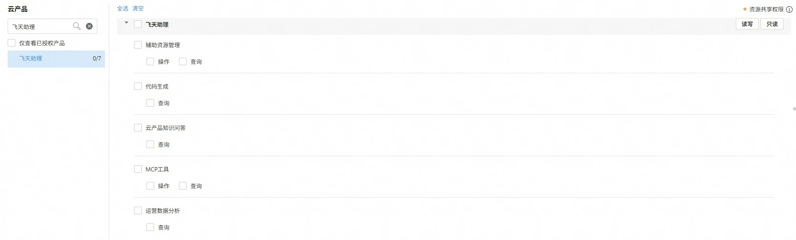

6. 角色创建完成后，将角色授权给用户。

# 2.飞天助理配置

## 2.1. 个性化配置

对智能助手进行启用控制以及AI助手内容的个性化设置。

**前提条件**

操作用户默认为运营管理员用户。

**操作步骤**

1. 登录Apsara Uni-manager运营控制台。

2. 在顶部菜单栏选择**配置**。

3. 在左侧导航栏选择**飞天助理** > **个性化配置**。

4. 在**个性化配置**页面，配置**显示控制**、**AI助理设置**和**偏好风格**。

   当配置需要恢复出厂设置时，可单击页面下方的**恢复出厂设置**，重新登录后生效。

**显示控制**

<table>
  <tr>
    <th width="137">配置项</th>
    <th>说明</th>
  </tr>
  <tr>
    <td>是否在平台开启</td>
    <td>用于控制飞天助理是否在控制台展示，开启后会展示在悬浮层和顶部导航栏。  ：表示关闭。  ：表示开启。</td>
  </tr>
</table>

**AI助理设置**

**标准版**

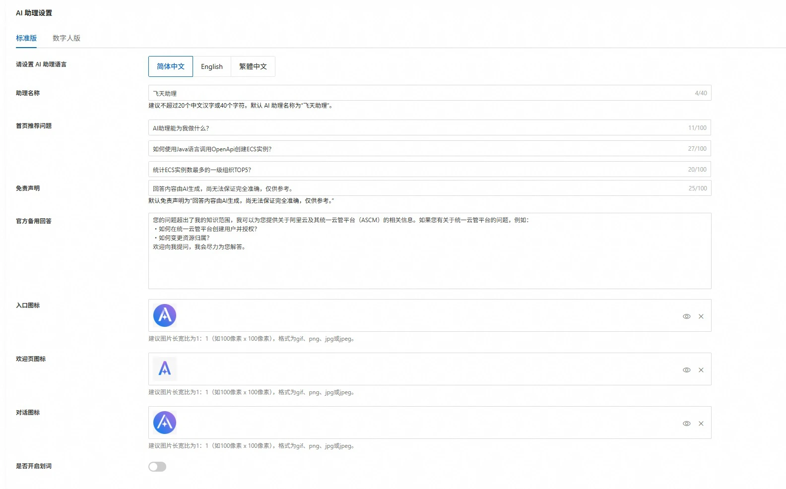

<table>
  <tr>
    <th width="160">配置项</th>
    <th>说明</th>
  </tr>
  <tr>
    <td>请设置AI 助理语言</td>
    <td>支持<strong>简体中文</strong>、<strong>English</strong>和<strong>繁體中文</strong>。</td>
  </tr>
  <tr>
    <td>助理名称</td>
    <td>建议不超过20个中文汉字或40个字符。默认AI助理名称为“飞天助理”。 • <strong>数字人版</strong>：默认AI助理名称为“Apsara Copilot”。</td>
  </tr>
  <tr>
    <td>首页推荐问题</td>
    <td>设置智能助手首页的推荐问题。单击<strong>添加问题</strong>，可增加首页推荐的问题。单击问题所在行的 ，可删除添加的问题。</td>
  </tr>
  <tr>
    <td>免责声明</td>
    <td>设置智能助手的免责声明内容。默认免责声明为“回答内容由AI生成，尚无法保证完全准确，仅供参考。”</td>
  </tr>
  <tr>
    <td>官方备用回答</td>
    <td>设置智能助手的官方备用回答。</td>
  </tr>
  <tr>
    <td>入口图标</td>
    <td>设置智能助手入口的展示图标。建议图片长宽比为1：1（如100像素 x 100像素），格式为gif、png、jpg或jpeg。</td>
  </tr>
  <tr>
    <td>欢迎页图标</td>
    <td>设置智能助手欢迎页的展示图标。建议图片长宽比为1：1（如100像素 x 100像素），格式为gif、png、jpg或jpeg。</td>
  </tr>
  <tr>
    <td>对话图标</td>
    <td>设置智能助手的对话图标。建议图片长宽比为1：1（如100像素 x 100像素），格式为gif、png、jpg或jpeg。</td>
  </tr>
  <tr>
    <td>是否开启划词</td>
    <td>设置划词是否开启。  ：表示关闭。  ：表示开启。</td>
  </tr>
</table>

**数字人版**

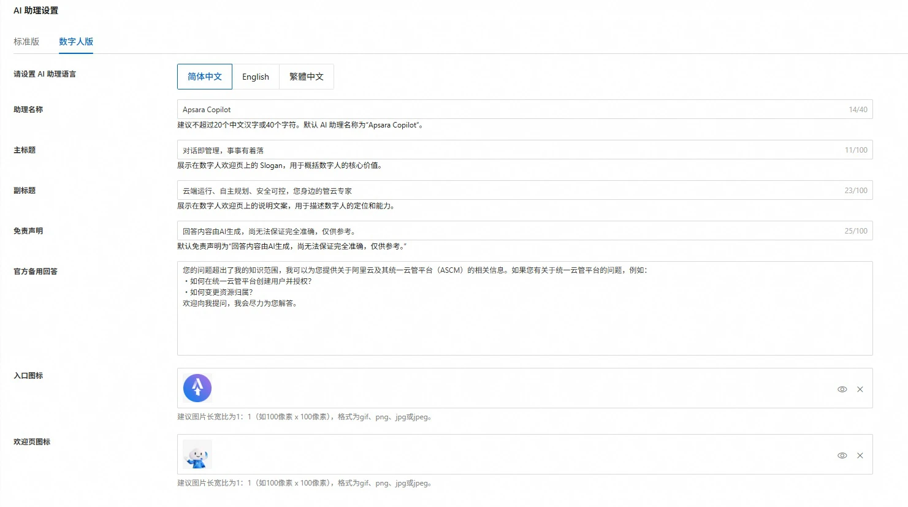

<table>
  <tr>
    <th width="160">配置项</th>
    <th>说明</th>
  </tr>
  <tr>
    <td>请设置AI 助理语言</td>
    <td>支持<strong>简体中文</strong>、<strong>English</strong>和<strong>繁體中文</strong>。</td>
  </tr>
  <tr>
    <td>助理名称</td>
    <td>建议不超过20个中文汉字或40个字符。默认AI助理名称为“Apsara Copilot”。</td>
  </tr>
  <tr>
    <td>主标题</td>
    <td>展示在数字人欢迎页上的Slogan，用于概括数字人的核心价值。</td>
  </tr>
  <tr>
    <td>副标题</td>
    <td>展示在数字人欢迎页上的说明文案，用于描述数字人的定位和能力。</td>
  </tr>
  <tr>
    <td>免责声明</td>
    <td>设置智能助手的免责声明内容。默认免责声明为“回答内容由AI生成，尚无法保证完全准确，仅供参考。”</td>
  </tr>
  <tr>
    <td>官方备用回答</td>
    <td>设置智能助手的官方备用回答。</td>
  </tr>
  <tr>
    <td>入口图标</td>
    <td>设置智能助手入口的展示图标。建议图片长宽比为1：1（如100像素 x 100像素），格式为gif、png、jpg或jpeg。</td>
  </tr>
  <tr>
    <td>欢迎页图标</td>
    <td>设置智能助手欢迎页的展示图标。建议图片长宽比为1：1（如100像素 x 100像素），格式为gif、png、jpg或jpeg。</td>
  </tr>
</table>

**偏好风格**

<table>
  <tr>
    <th width="89">配置项</th>
    <th>说明</th>
  </tr>
  <tr>
    <td>回答风格</td>
    <td>支持<strong>专家型</strong>、<strong>简洁性</strong>和<strong>服务型</strong>风格。 • <strong>专家型</strong>：风格严谨、结构清晰、术语规范。适合满足技术人员的深度答疑、架构设计与最佳实践需求。 • <strong>简洁性</strong>：风格言简意赅，信息密度高，无冗余表达。适合快速响应、操作指引与问题排查等场景。 • <strong>服务型</strong>：风格耐心、亲切、积极引导。适合提升员工满意度、服务信任感。</td>
  </tr>
</table>

## 2.2. 准确性评测

准确性评测支持对飞天助理进行准确性评估。通过评测用例、评测集和评测任务三级结构完成自动化评估流程，并支持导出详细评测报告。

### 2.2.1. 评测用例管理

#### 2.2.1.1. 添加用例

本文介绍如何添加用例。

**前提条件**

操作用户默认为运营管理员用户。

**操作步骤**

1. 登录Apsara Uni-manager运营控制台。

2. 在顶部菜单栏选择**配置**。

3. 在左侧导航栏选择**飞天助理** > **准确性评测**。

4. 单击**评测用例管理**卡片。

5. 在**评测用例管理**页面，单击**添加用例**。

6. 设置评测用例，支持**单评测用例生成**、**自动生成评测用例**和**获取用户问答用例**。

   - **单评侧用例生成**

     <ol type="a">

     <li>

     在**单评测用例生成**页签，输入用例信息。

     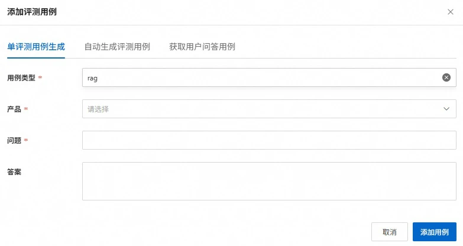

     | 配置项 | 说明 |
     | --- | --- |
     | 用例类型 | 选择用例类型，当前版本仅支持rag类型。 |
     | 产品 | 选择用例对应的产品，仅支持单选。 |
     | 问题 | 输入用例的问题。 |
     | 答案 | 输入用例问题对应的答案。 |

     </li>

     <li>

     单击**添加用例**。

     </li>

     </ol>

   - **自动生成评测用例**

     <ol type="a">

     <li>

     在**自动生成评测用例**页签，设置用例对应的产品的数量。

     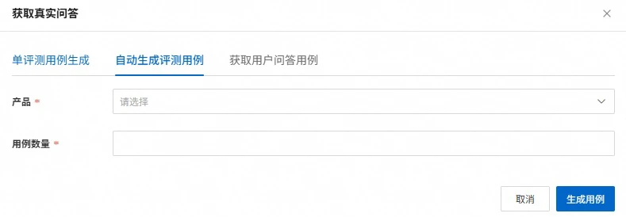

     | 配置项 | 说明 |
     | --- | --- |
     | 产品 | 选择用例对应的产品，支持多选。 |
     | 用例数量 | 输入用例生成的数量。 |

     </li>

     <li>

     单击**生成用例**。

     </li>

     </ol>

   - **获取用户问答用例**

     <ol type="a">

     <li>

     在**获取用户问答用例**页签，选择用户的起止时间。

     

     | 配置项 | 说明 |
     | --- | --- |
     | 目标时间 | 选择获取用例的目标时间。 |

     </li>

     <li>

     单击**确定**。

     </li>

     </ol>

#### 2.2.1.2. 管理用例

用例添加完成后，支持查看、编辑、精筛和删除。

**前提条件**

- 操作用户默认为运营管理员用户。

- 已完成评测用例创建。

**操作步骤**

1. 登录Apsara Uni-manager运营控制台。

2. 在顶部菜单栏选择**配置**。

3. 在左侧导航栏选择**飞天助理** > **准确性评测**。

4. 单击**评测用例管理**卡片。

5. 管理评测用例。

   <table>
     <tr>
       <th width="90">操作</th>
       <th>说明</th>
     </tr>
     <tr>
       <td>查看用例</td>
       <td>在用例列表，单击操作列的<strong>查看</strong>，即可查看测评用例的详情，包括关联的评测集。 说明 • 基础信息中的用例编码支持一键复制，鼠标悬停在用例右侧，单击即可复制。  • 在评测用例详情页面的关联评测集操作列，可单击<strong>取消关联</strong>，将当前用例从评测集中移除。</td>
     </tr>
     <tr>
       <td>编辑用例</td>
       <td>i. 在用例列表，单击操作列的<strong>编辑</strong>。用例关联评测集时不支持编辑。ii. 在<strong>编辑评测用例</strong>对话框，更新评测用例信息。 说明仅评审通过的用例支持更改是否可选。评审中和不通过的评测用例是否可选默认为不可选。 iii. 单击<strong>确定</strong>。</td>
     </tr>
     <tr>
       <td>精筛用例</td>
       <td>i. 在用例列表，单击操作列的<strong>精筛</strong>。仅<strong>评审中</strong>的用例支持精筛。ii. 在评测用例详情页面，查看用例详细信息后，在<strong>人工精筛</strong>区域选择评审是否通过，以及输入相关备注信息。 说明不通过的评测用例默认为不可选，不可被添加到评测集中。  iii. 单击<strong>提交</strong>。</td>
     </tr>
     <tr>
       <td>删除用例</td>
       <td>i. 在用例列表，单击操作列的<strong>删除</strong>。用例关联评测集时不支持删除。ii. 在弹出的对话框单击<strong>确定</strong>，即可删除该测评用例。</td>
     </tr>
   </table>

### 2.2.2. 评测集管理

#### 2.2.2.1. 创建评测集

本文介绍如何创建评测集。

**前提条件**

- 操作用户默认为运营管理员用户。

- 已完成评测用例的创建。

**操作步骤**

1. 登录Apsara Uni-manager运营控制台。

2. 在顶部菜单栏选择**配置**。

3. 在左侧导航栏选择**飞天助理** > **准确性评测**。

4. 单击**评测集管理**卡片。

5. 在**评测集管理**页面，单击**创建评测集**。

6. 在**创建评测集**对话框，设置评测集信息。

   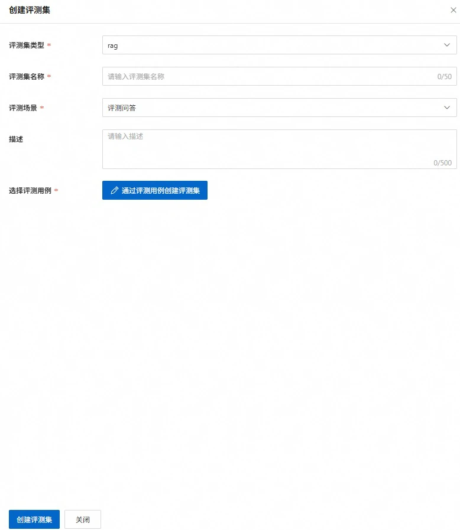

   | 配置项 | 说明 |
   | --- | --- |
   | 评测集类型 | 选择评测集类型，当前版本仅支持rag类型。 |
   | 评测集名称 | 设置对应评测集的名称。 |
   | 评测场景 | 选择评测场景，支持<strong>评测问答</strong>和<strong>用户问答</strong>。 |
   | 描述 | 可选，输入评测集的描述。 |

   | 选择评测用例 | i. 单击<strong>通过评测用例创建评测集</strong>。ii. 选择用例。支持通过<strong>用例编码</strong>、<strong>问题</strong>、<strong>所属产品</strong>和<strong>参考答案</strong>进行筛选，筛选完成后需要单击<strong>搜索</strong>，筛选条件方可生效。iii. 单击<strong>确定</strong>。也可单击<strong>全部添加</strong>，将全部用例添加至评测集。 |
   | --- | --- |

7. 单击**创建评测集**。

#### 2.2.2.2. 管理评测集

评测集创建完成后，支持查看、编辑和删除。

**前提条件**

- 操作用户默认为运营管理员用户。

- 已完成评测集创建。

**操作步骤**

1. 登录Apsara Uni-manager运营控制台。

2. 在顶部菜单栏选择**配置**。

3. 在左侧导航栏选择**飞天助理** > **准确性评测**。

4. 单击**评测集管理**卡片。

5. 管理评测集。

   <table>
     <tr>
       <th width="106">操作</th>
       <th>说明</th>
     </tr>
     <tr>
       <td>查看评测集</td>
       <td>在操作列单击<strong>查看</strong>，即可进入<strong>评测集用例管理</strong>界面，可以对评测集里的用例进行管理。</td>
     </tr>
     <tr>
       <td>编辑评测集</td>
       <td>i. 在操作列单击<strong>编辑</strong>。ii. 在<strong>编辑评测集</strong>页面，修改<strong>评测集名称</strong>和<strong>描述</strong>。iii. 单击<strong>确定</strong>。</td>
     </tr>
     <tr>
       <td>删除评测集</td>
       <td>i. 在操作列单击<strong>删除</strong>。ii. 在弹出的对话框单击<strong>确定</strong>，即可删除该测评集。</td>
     </tr>
   </table>

### 2.2.3. 评测任务管理

#### 2.2.3.1. 创建评测任务

本文介绍如何创建评测任务。

**前提条件**

- 操作用户默认为运营管理员用户。

- 已完成评测集的创建。

**操作步骤**

1. 登录Apsara Uni-manager运营控制台。

2. 在顶部菜单栏选择**配置**。

3. 在左侧导航栏选择**飞天助理** > **准确性评测**。

4. 单击**评测任务管理**卡片。

5. 在**评测任务管理**页面，单击**创建评测任务**。

6. 在**创建评测任务**对话框，设置评测集信息。

   <table>
     <tr>
       <th width="121">配置项</th>
       <th>说明</th>
     </tr>
     <tr>
       <td>任务名称</td>
       <td>输入评测任务的名称。</td>
     </tr>
     <tr>
       <td>评测任务类型</td>
       <td>选择评测任务类型，当前版本仅支持rag类型。</td>
     </tr>
     <tr>
       <td>评测集</td>
       <td>下拉选择需要进行评测的评测集。</td>
     </tr>
     <tr>
       <td>评测类型</td>
       <td>可选择<strong>人工</strong>或<strong>自动</strong>。</td>
     </tr>
     <tr>
       <td>评测人</td>
       <td><strong>评测类型</strong>选择<strong>人工</strong>时，需要指定评测人。评测人最多可指定三人，当评测人指定多个人时，需要所有指定人完成评测。任意一人评测时，若评测结果选择完全错误，则评测不通过。</td>
     </tr>
     <tr>
       <td>评测方式</td>
       <td><strong>评测类型</strong>选择<strong>自动</strong>时，需要选择评测方式。<strong>评测方式</strong>可选择<strong>有参考答案</strong>或<strong>无参考答案</strong>。</td>
     </tr>
   </table>

   **人工评测任务**

   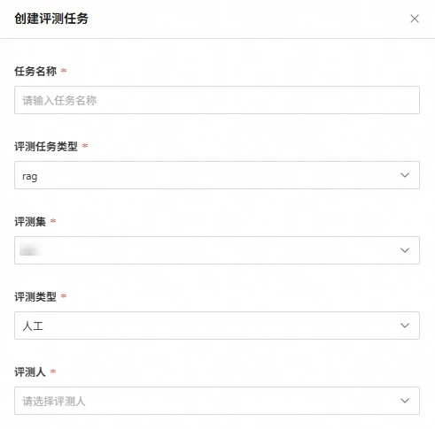

   **自动评测任务**

   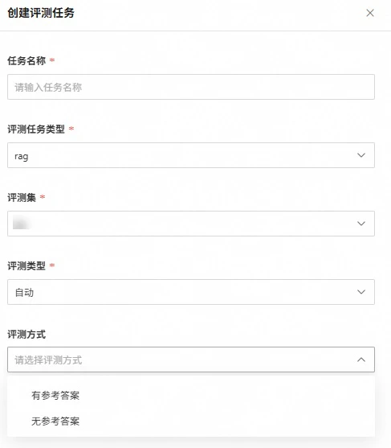

7. 单击**创建评测任务**。

   > **说明**
   >
   > 评测任务完成后不会自动执行，需在操作列单击**开始评测**启动评测任务。

#### 2.2.3.2. 管理评测任务

本文介绍对评测任务的管理。

**前提条件**

- 操作用户默认为运营管理员用户。

- 已完成评测任务创建。

**操作步骤**

1. 登录Apsara Uni-manager运营控制台。

2. 在顶部菜单栏选择**配置**。

3. 在左侧导航栏选择**飞天助理** > **准确性测评**。

4. 单击**评测任务管理**卡片。

5. 查看评测任务。通过列表上方的**任务ID**、**评测集**、**评测类型**和**状态**，可快速查找评测任务。

   

6. 管理评测任务。

   | 操作 | 说明 |
   | --- | --- |
   | 用例入库 | i. 单击评测任务ID。ii. 在<strong>评测结果</strong>页面下，单击用例操作列的<strong>入库</strong>。 说明 • 仅自动类型评测任务下的用例支持入库操作。 • 单击用例操作列的<strong>查看</strong>，可查看评测结果详情。 iii. 在<strong>入库详情</strong>面板，单击<strong>确定</strong>或<strong>拒绝</strong>。选择<strong>确定</strong>，即表示用例入库。选择<strong>拒绝</strong>，即表示用例不入库。 说明仅<strong>未入库</strong>状态的用例支持选择确定或拒绝。<strong>已入库</strong>或<strong>不入库</strong>状态的用例仅支持查看入库详情。 |
   | 人工评测 | i. 在评测任务<strong>操作</strong>列单击<strong>人工评测</strong>。 说明<strong>评测类型</strong>为<strong>人工</strong>的任务才能执行人工评测，并且任务状态为<strong>待人工评测</strong>或<strong>评测</strong><strong>中</strong>。ii. 在<strong>人工评测</strong>页面，单击用例<strong>操作</strong>列的<strong>评测</strong>。 说明单击<strong>操作</strong>列的<strong>查看</strong>，可查看评测结果详情。  iii. 在<strong>评测结果详情</strong>面板，查看需要评测的信息后，在<strong>人工评测</strong>区域，设置<strong>评测结</strong><strong>果</strong>和<strong>备注</strong>。 说明<strong>评测结果</strong>支持选择<strong>完全准确</strong>、<strong>部分准确</strong>、<strong>完全错误</strong>或<strong>未评测</strong>。选择<strong>完全错误</strong>，则表示评测结果不通过，需要在下方<strong>不通过原因</strong>中选择具体原因，可选择<strong>问题</strong><strong>不清晰</strong>、<strong>参考答案不完整</strong>、<strong>内容不完整</strong>、<strong>重复用例</strong>或<strong>其他</strong>。 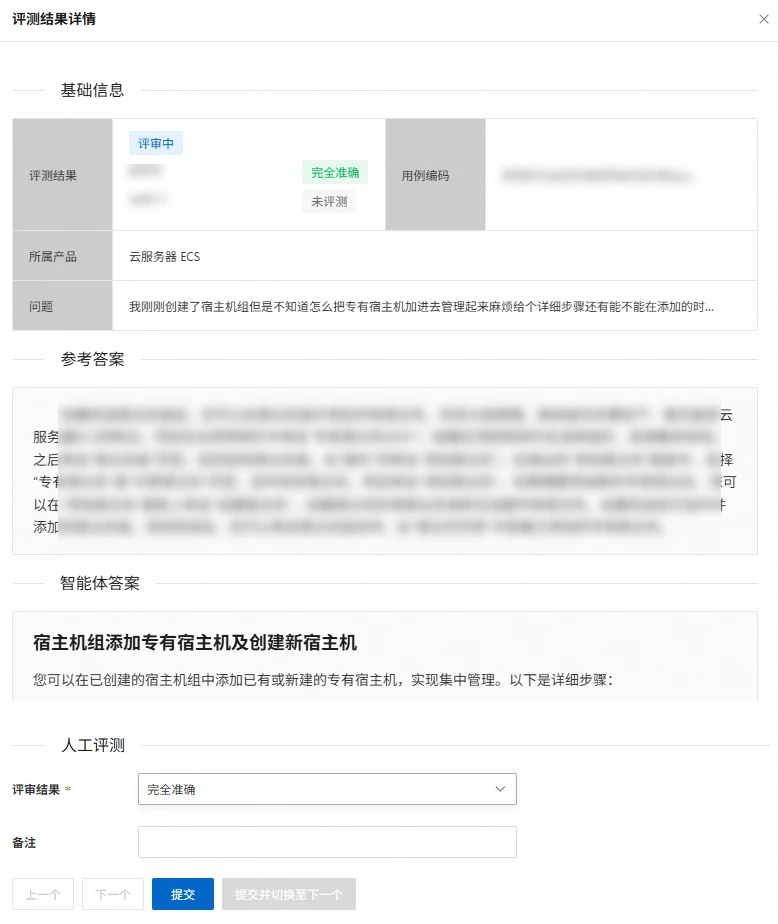 iv. 单击<strong>提交</strong>。有多个评测用例时，完成该用例评测后，可单击<strong>提交并切换至下一个</strong>。 |
   |  |  |
   | 查看任务 | i. 在评测任务<strong>操作</strong>列单击<strong>查看任务</strong>。ii. 在<strong>任务详情</strong>面板，查看任务的基本信息和执行进展。 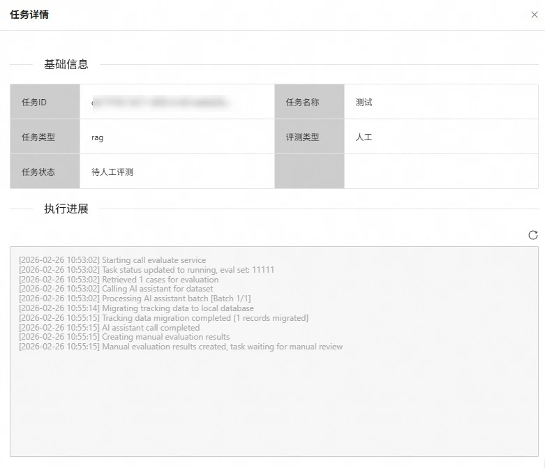 |

   <table>
     <tr>
       <td>查看结果</td>
       <td>i. 在评测任务<strong>操作</strong>列单击<strong>查看结果</strong>。 说明评测任务状态为<strong>已完成</strong>时，支持查看结果。 ii. 在<strong>评测结果</strong>页面，查看用例的评测结果。  iii. 单击用例<strong>操作</strong>列的<strong>查看</strong>，展开评测结果详情。</td>
     </tr>
     <tr>
       <td>查看报告</td>
       <td>i. 单击评测任务<strong>操作</strong>列，选择<strong>查看报告</strong>。 说明评测任务状态为<strong>已完成</strong>时，支持查看报告。 ii. 在任务的<strong>评测报告</strong>页面，查看详细的评测分析报告。</td>
     </tr>
     <tr>
       <td>删除评测任务</td>
       <td>i. 单击操作列，选择<strong>删除</strong>。 ii. 在弹出的对话框单击<strong>确定</strong>，即可删除评测任务。</td>
     </tr>
     <tr>
       <td>重新评测</td>
       <td>i. 评测任务执行失败时，单击<strong>重新评测</strong>。ii. 在弹出的对话框单击<strong>确定</strong>，可重新执行评测任务。</td>
     </tr>
   </table>

### 2.2.4. 准确率分析

查看飞天助理的准确率情况。

**前提条件**

操作用户默认为运营管理员用户。

**操作步骤**

1. 登录Apsara Uni-manager运营控制台。

2. 在顶部菜单栏选择**配置**。

3. 在左侧导航栏选择**飞天助理** > **准确性评测**。

4. 单击**准确率分析**卡片。

5. 在**准确率分析**页面，查看**准确率趋势分析**、**问题分类统计**和**数据明细**。

   <table>
     <tr>
       <th width="137">配置项</th>
       <th>说明</th>
     </tr>
     <tr>
       <td>准确率趋势分析</td>
       <td>以折线图展示准确率分析情况，支持切换<strong>日维度</strong>或<strong>月维度</strong>。</td>
     </tr>
     <tr>
       <td>问题分类统计</td>
       <td>以柱状图展示问题分类统计情况，支持切换<strong>日维度</strong>或<strong>月维度</strong>。</td>
     </tr>
     <tr>
       <td>数据明细</td>
       <td>输入查询的起始日期和结束日期，查看时间范围内的数据明细，支持切换<strong>日维度</strong>或<strong>月</strong><strong>维度</strong>。 • 单击明细<strong>操作</strong>列的<strong>查看报告</strong>，跳转到评测报告详情页面。 • 单击列表上方的，可将明细数据下载到本地。</td>
     </tr>
   </table>

   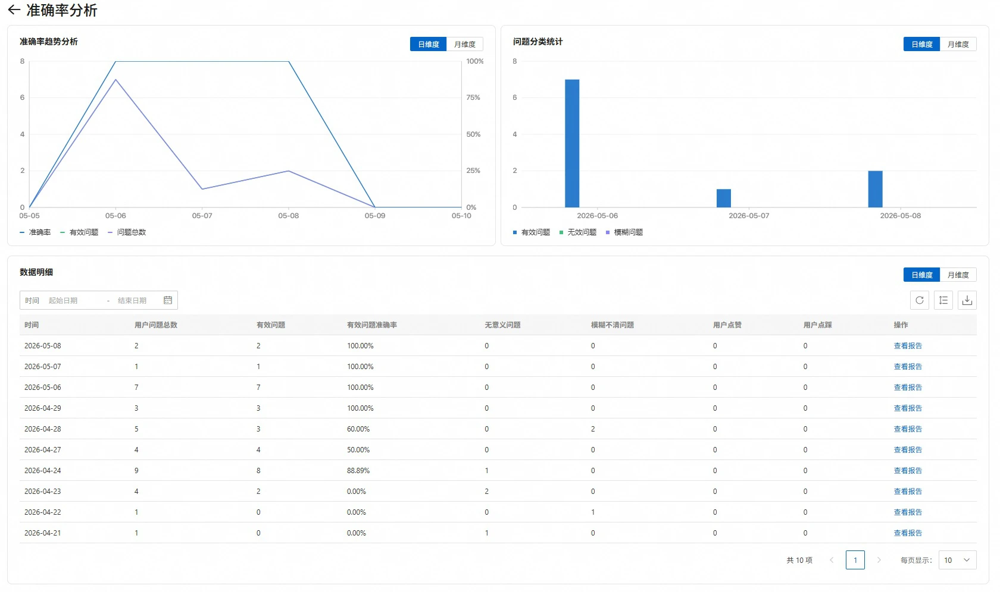

## 2.3. 模型配置

管理和配置您的AI模型，包括大语言模型、向量模型和重排序模型。

**前提条件**

操作用户默认为运营管理员用户。

**操作步骤**

1. 登录Apsara Uni-manager运营控制台。

2. 在顶部菜单栏选择**配置**。

3. 在左侧导航栏选择**飞天助理** > **模型配置**。

4. 在**大语言模型（LLM）**/**向量模型（Embedding）**/<strong>重排序模型（Rerank）</strong>区域，单击**添加模型**。

5. 在**添加模型配置**对话框，进行模型配置。

   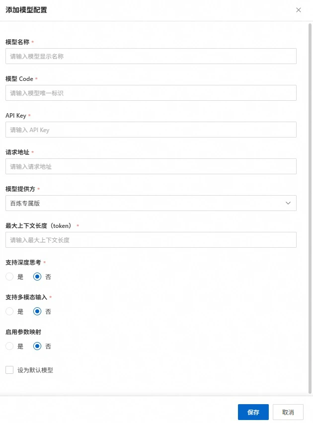

   | 配置项 | 说明 |
   | --- | --- |
   | 模型名称 | 填写模型的显示名称。 |
   | 模型Code | 填写模型的Code，表示模型的唯一标识。 |
   | API Key | 填写该模型的API Key。 |
   | 请求地址 | 填写该模型的API请求地址。 |
   | 模型提供方 | 选择模型的提供方，支持<strong>百炼专属模型</strong>、<strong>百炼公共云</strong>、<strong>aibase</strong>和<strong>openai</strong>。 |
   | 最大上下文长度（token） | 添加大语言模型时配置。输入最大上下文长度。 |
   | 支持深度思考 | 添加大语言模型时配置。选择<strong>是</strong>或<strong>否</strong>。 |
   | 支持多模态输入 | 添加大语言模型时配置。选择<strong>是</strong>或<strong>否</strong>。 |
   | 启用参数映射 | 模型提供方为<strong>百炼专属模型</strong>时配置。选择<strong>是</strong>或<strong>否</strong>。选择<strong>是</strong>时，在映射规则中填写请求参数名和目标路径，支持添加多条规则。 |
   | 设为默认模型 | 设置该模型是否为默认模型。 |

6. 单击**保存**。

7. 其他相关操作。

   <table>
     <tr>
       <th width="122">操作</th>
       <th>说明</th>
     </tr>
     <tr>
       <td>编辑模型</td>
       <td>i. 在模型卡片区域，单击右上方的<strong>编辑</strong>。ii. 在<strong>编辑模型配置</strong>对话框，更新模型配置。 说明模型名称和模型Code不允许修改。 iii. 单击<strong>保存</strong>。</td>
     </tr>
     <tr>
       <td>删除模型</td>
       <td>i. 在模型卡片区域，单击右上方的<strong>删除</strong>。ii. 单击<strong>确定</strong>。</td>
     </tr>
     <tr>
       <td>修改默认模型</td>
       <td>在模型卡片区域，单击下方的<strong>设为默认模型</strong>，根据业务需要修改默认模型。</td>
     </tr>
   </table>

## 2.4. 知识库管理

### 2.4.1. 创建知识库

创建多模态知识库，设置知识加工深度。

**前提条件**

操作用户默认为运营管理员用户。

**操作步骤**

1. 登录Apsara Uni-manager运营控制台。

2. 在顶部菜单栏选择**配置**。

3. 在左侧导航栏选择**飞天助理** > **知识库管理**。

4. 单击**创建知识库**。

5. 在**新建知识库**对话框，进行知识库配置。

   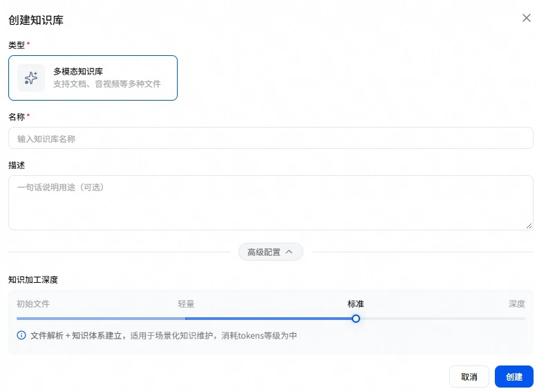

   <table>
     <tr>
       <th width="121">配置项</th>
       <th>说明</th>
     </tr>
     <tr>
       <td>类型</td>
       <td>默认为<strong>多模态知识库</strong>，支持文档、音视频等多种文件。</td>
     </tr>
     <tr>
       <td>名称</td>
       <td>填写知识库的名称。</td>
     </tr>
     <tr>
       <td>描述</td>
       <td>填写知识库的任务描述。</td>
     </tr>
     <tr>
       <td>知识加工深度</td>
       <td>展开<strong>高级配置</strong>，设置知识加工深度。 • <strong>轻量</strong>：仅文件解析，适用于日常办公等文档，消耗Tokens等级为低。 • <strong>标准</strong>：文件解析+知识体系建立，适用于场景化知识维护，消耗Tokens等级为中。默认的知识加工深度。 • <strong>深度</strong>：文件解析+知识体系建立+知识图谱构建，适用于复杂严肃场景的知识维护，消耗Tokens等级为高。</td>
     </tr>
   </table>

6. 单击**创建**。

### 2.4.2. 编辑知识库

知识库配置有更新时支持修改。

**前提条件**

操作用户默认为运营管理员用户。

**操作步骤**

1. 登录Apsara Uni-manager运营控制台。

2. 在顶部菜单栏选择**配置**。

3. 在左侧导航栏选择**飞天助理** > **知识库管理**。

4. 鼠标悬浮在知识库卡片，单击**编辑**。

5. 在**编辑知识库**对话框，更新知识库配置，配置项详细说明请参见创建知识库。

   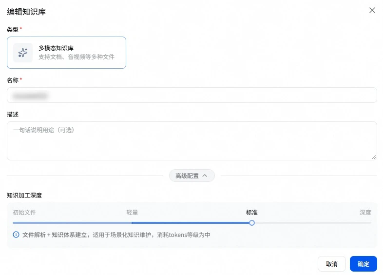

6. 单击**确定**。

### 2.4.3. 知识库调试

配置请求参数，进行知识库调试。

**前提条件**

操作用户默认为运营管理员用户。

**操作步骤**

1. 登录Apsara Uni-manager运营控制台。

2. 在顶部菜单栏选择**配置**。

3. 在左侧导航栏选择**飞天助理** > **知识库管理**。

4. 鼠标悬浮在知识库卡片，单击**调试**。

5. 在**请求参数**面板，配置请求参数。

   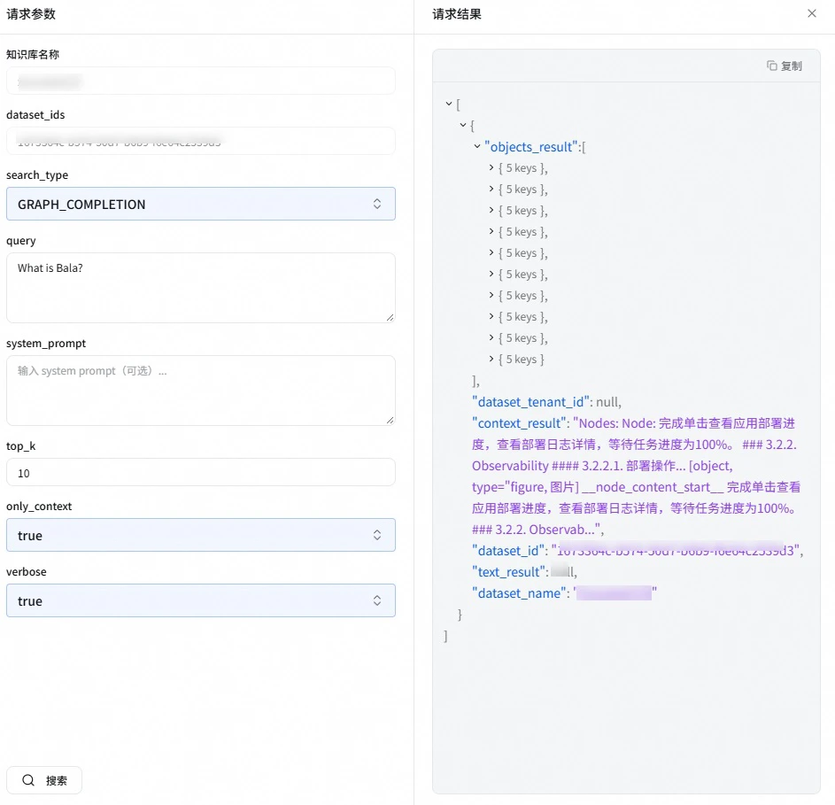

   <table>
     <tr>
       <td>配置项</td>
       <td>说明</td>
     </tr>
     <tr>
       <td>知识库名称</td>
       <td>默认为当前知识库的名称。</td>
     </tr>
     <tr>
       <td>dataset_ids</td>
       <td>知识库ID，默认值，不支持修改。</td>
     </tr>
     <tr>
       <td>search_type</td>
       <td>检索类型，支持<strong>GRAPH_COMPLETION</strong>、<strong>SUMMARIES</strong>、<strong>CHUNKS</strong>。</td>
     </tr>
     <tr>
       <td>query</td>
       <td>输入查询的问题。</td>
     </tr>
     <tr>
       <td>system_prompt</td>
       <td>输入系统提示词。</td>
     </tr>
     <tr>
       <td>top_k</td>
       <td>指定最多返回多少条相关检索结果。</td>
     </tr>
     <tr>
       <td>only_context</td>
       <td>控制是否只返回检索到的知识库内容，而不让大模型生成最终答案。</td>
     </tr>
     <tr>
       <td>verbose</td>
       <td>控制是否返回更详细的信息，主要用于调试。</td>
     </tr>
   </table>

6. 单击**搜索**，在右侧查看请求结果。

### 2.4.4. 删除知识库

删除不需要的知识库。

**前提条件**

操作用户默认为运营管理员用户。

**操作步骤**

1. 登录Apsara Uni-manager运营控制台。

2. 在顶部菜单栏选择**配置**。

3. 在左侧导航栏选择**飞天助理** > **知识库管理**。

4. 鼠标悬浮在知识库卡片，单击**删除**。

5. 在对话框，单击**删除**。

### 2.4.5. 管理知识库详情

进入知识库详情，管理知识库的数据汇聚和知识洞察。

**数据汇聚**

1. 登录Apsara Uni-manager运营控制台。

2. 在顶部菜单栏选择**配置**。

3. 在左侧导航栏选择**飞天助理** > **知识库管理**。

4. 单击知识库卡片。或者鼠标悬浮在知识库卡片，单击**详情**。

5. 选择**数据汇聚**页签，对知识库的数据进行管理。

   <table>
     <tr>
       <th width="106">操作</th>
       <th>说明</th>
     </tr>
     <tr>
       <td>管理文件夹</td>
       <td>i. 单击列表上方的<strong>新建文件夹</strong>。ii. 在对话框，填写文件夹名称。iii. 单击<strong>创建</strong>。 说明文件夹创建成功后，支持<strong>重命名</strong>、<strong>新建子文件夹</strong>和<strong>删除</strong>。</td>
     </tr>
     <tr>
       <td>管理数据</td>
       <td>i. 单击列表上方的<strong>添加数据</strong>。ii. 选择<strong>上传文件夹/文件</strong>。iii. 在<strong>上传文件夹/文件</strong>面板，选择文件夹，添加文件或添加文件夹。iv. 单击<strong>开始上传</strong>。 说明上传成功后，文件支持<strong>预览、AI解析</strong>、<strong>重新解析</strong>、<strong>移动</strong>和<strong>删除</strong>。</td>
     </tr>
   </table>

**知识洞察**

1. 在知识库详情，选择**知识洞察**页签。

2. 按**知识体系**和**知识图谱**切换，查看具体信息。

   - **知识体系**：左侧展示目录结构，右侧展示关联文件。

     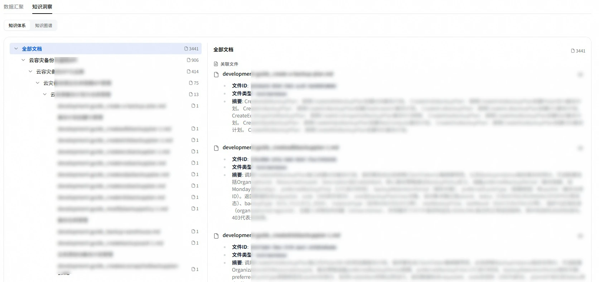

   - **知识图谱**：展示该知识库的知识图谱。

     > **说明**
     >
     > - 单击知识图谱下方的
     >
     >   ，放大图谱。
     >
     >   
     >
     > - 单击知识图谱下方的  ，缩小图谱。
     >
     > - 单击知识图谱下方的
     >
     >   ，自适应窗口。
     >
     >   
     >
     > - 单击知识图谱下方的  ，全屏查看。

     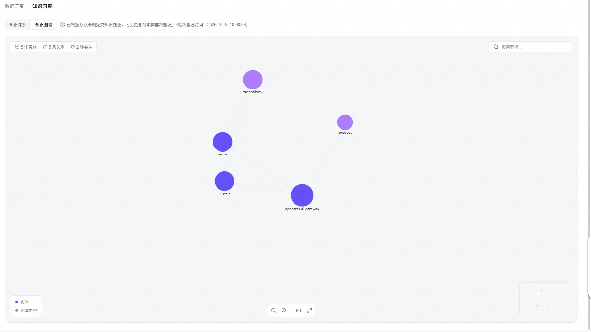

## 2.5. 知识问答运营

将用户负反馈自动转化为知识库优化动作，查看归因案例。

### 2.5.1. 复核问题

对用户对话中负反馈的问题进行复核。

**前提条件**

操作用户默认为运营管理员用户。

**操作步骤**

1. 登录Apsara Uni-manager运营控制台。

2. 在顶部菜单栏选择**配置**。

3. 在左侧导航栏选择**飞天助理** > **知识问答运营**。

4. 展开高级筛选，设置筛选条件，单击**搜索**。

5. 单击问题操作列的**复核**。

6. 在问题页面，根据复核的执行阶段，执行相关操作。

   <table>
     <tr>
       <th width="90">操作</th>
       <th>说明</th>
     </tr>
     <tr>
       <td>重新归因</td>
       <td>i. 在<strong>AI归因</strong>模块，单击右侧的<strong>知识覆盖度诊断详情</strong>，查看完整对话和检索内容。ii. 归因结论不准确时，单击<strong>重新归因</strong>。iii. 在对话框，填写归因提示。iv. 单击<strong>确定</strong>。</td>
     </tr>
     <tr>
       <td>确认结论</td>
       <td>i. 在<strong>AI归因</strong>模块，单击<strong>确认结论</strong>。平台自动进行AI补充建议。 说明如果归因成“知识缺失”或“知识补充”之外的场景，确认结论后，问题状态直接变为<strong>已存档</strong>。 ii. 在<strong>知识补充</strong>模块，预览并修订知识补充内容后，单击<strong>确认</strong>。</td>
     </tr>
     <tr>
       <td>人工发布</td>
       <td>i. 在<strong>构建发布</strong>模块，查看智能放置推荐。 说明 • 单击<strong>推荐依据</strong>，展示推荐依据面板，可<strong>重新生成推荐</strong>和<strong>手动调</strong><strong>整</strong>。 • 单击文件所在行的<strong>预览</strong>，展开<strong>文件预览</strong>面板，可复制和下载文件（.md）。 ii. 单击<strong>人工发布</strong>。iii. 在对话框，单击<strong>确定</strong>。 说明 • 系统只记录本条已闭环，不会写入任何知识库。 • 请确认您已自行把内容发布到目标位置，否则这条知识缺口实际仍未补上。</td>
     </tr>
   </table>

### 2.5.2. 关闭问题

将不需要复核的问题进行关闭。

**前提条件**

操作用户默认为运营管理员用户。

**操作步骤**

1. 登录Apsara Uni-manager运营控制台。

2. 在顶部菜单栏选择**配置**。

3. 在左侧导航栏选择**飞天助理** > **知识问答运营**。

4. 展开高级筛选，设置筛选条件，单击**搜索**。

5. 单击问题操作列的**关闭**。

6. 在对话框，填写关闭原因。

7. 单击**确定**。

### 2.5.3. 问题取消关闭

对误关闭的问题可取消关闭。

**前提条件**

- 操作用户默认为运营管理员用户。

- 问题为**已关闭**状态。

**操作步骤**

1. 登录Apsara Uni-manager运营控制台。

2. 在顶部菜单栏选择**配置**。

3. 在左侧导航栏选择**飞天助理** > **知识问答运营**。

4. 展开高级筛选，设置筛选条件，单击**搜索**。

5. 单击问题操作列的**取消关闭**。问题取消关闭后，重新纳入待复核队列，可参见复核问题，进行问题复核。

### 2.5.4. 查看问题详情

查看问题详情。

**前提条件**

操作用户默认为运营管理员用户。

**操作步骤**

1. 登录Apsara Uni-manager运营控制台。

2. 在顶部菜单栏选择**配置**。

3. 在左侧导航栏选择**飞天助理** > **知识问答运营**。

4. 展开高级筛选，设置筛选条件，单击**搜索**。

5. 单击问题操作列的**详情**。查看问题的详细信息。

## 2.6. 辅助云资源管理

可通过自定义配置，更好地使用AI辅助管理云资源。

### 2.6.1. 辅助创建

为云产品配置辅助创建的个性化场景。

**前提条件**

操作用户默认为运营管理员用户。

**操作步骤**

1. 登录Apsara Uni-manager运营控制台。

2. 在顶部菜单栏选择**配置**。

3. 在左侧导航栏选择**飞天助理** > **辅助云资源管理**。

4. 单击**辅助创建**页签。

5. 完成辅助创建配置。

   | 配置项 | 说明 |
   | --- | --- |
   | 云产品 | 选择辅助创建的云产品。当前仅支持云服务器ECS和专有网络VPC。 |
   | 个性化场景 | 根据实际的业务情况，配置个性化场景，在辅助创建资源时使用。 • <strong>添加场景</strong>：单击<strong>添加场景</strong>，自定义场景，支持选择<strong>场景枚举</strong>、<strong>场景描述</strong>或<strong>无</strong>。 • <strong>删除场景</strong>：单击场景后面的。 • <strong>调整场景顺序</strong>：拖拽场景前的，调整场景的展示顺序。 • <strong>恢复预设场景</strong>：单击<strong>恢复预设场景</strong>，系统将自动加载默认布局与场景配置。 |

   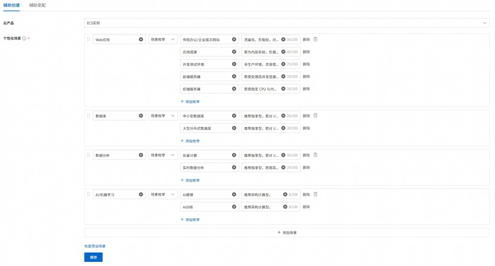

6. 单击**保存**。

**结果展示**

为云产品设置辅助创建配置后，用户在创建云产品时，飞天助理根据个性化场景智能规划并辅助完成创建。

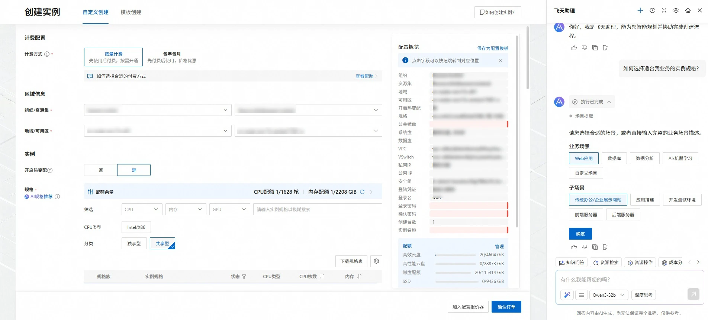

### 2.6.2. 辅助变配

为云产品配置辅助变配的规则，以便在云产品变配时依据当前应用的规则进行变配推荐分析。

**前提条件**

操作用户默认为运营管理员用户。

**操作步骤**

1. 登录Apsara Uni-manager运营控制台。

2. 在顶部菜单栏选择**配置**。

3. 在左侧导航栏选择**飞天助理** > **辅助云资源管理**。

4. 单击**辅助变配**页签。

5. 完成辅助变配的配置。

   | 配置项 | 说明 |
   | --- | --- |
   | 变配产品 | 选择变配的云产品。当前仅支持云服务器ECS和负载均衡SLB。 |
   | 规则模板 | 选择规则模板。预置的规则模板不满足需求时，自定义规则模板。 |
   | 规则描述 | 展示选择的规则模板的规则详情。 |

   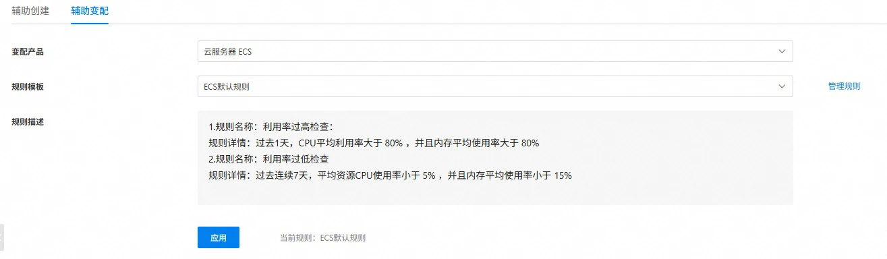

6. 单击**应用**。

**自定义规则模板**

1. 在**辅助变配**页签，单击**规则模板**右侧的**管理规则**。

2. 在**管理规则**面板，单击  。

3. 进行规则配置。

   <table>
     <tr>
       <th width="89">配置项</th>
       <th>说明</th>
     </tr>
     <tr>
       <td>规则名称</td>
       <td>输入规则名称，不能与已有规则名称重复。</td>
     </tr>
     <tr>
       <td>监控指标</td>
       <td>展示当前云产品支持的监控指标，用于监控分析，在规则描述时使用。</td>
     </tr>
     <tr>
       <td>规则描述</td>
       <td>创建云资源的分析规则，在辅助资源变配时使用。可在<strong>AI编写规则</strong>中输入规则描述，生成结果后填入。</td>
     </tr>
   </table>

   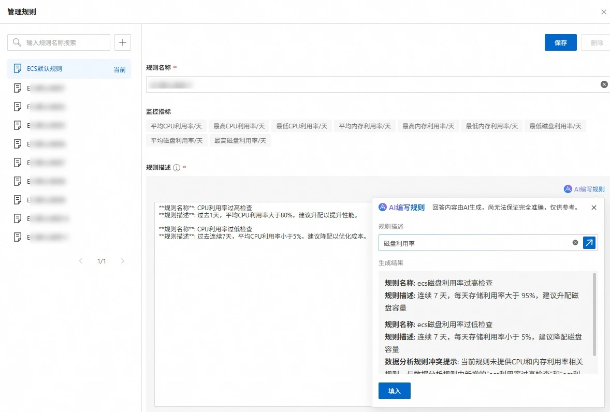

4. 单击**保存**。

5. 规则模板其他相关操作。

   | 操作 | 说明 |
   | --- | --- |
   | 编辑规则模板 | i. 在<strong>管理规则</strong>面板，选中规则，单击<strong>编辑</strong>。 说明预置的规则模板不支持编辑。 ii. 更新规则名称和规则描述。iii. 单击<strong>保存</strong>。 |
   | 删除规则模板 | 在<strong>管理规则</strong>面板，选中规则，单击<strong>删除</strong>。 说明预置的规则模板不支持删除。 |

**结果展示**

为云产品设置辅助变配的配置后，用户在云产品变配时，飞天助理根据应用的规则进行变配推荐分析。

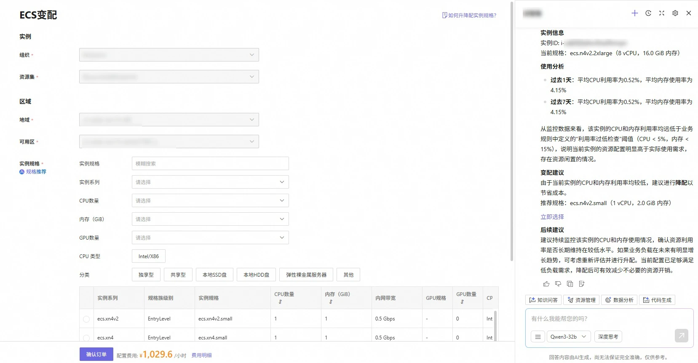

# 3.飞天助理应用

## 3.1. 飞天助理对话

飞天助理支持用户用自然语言提问平台与云产品相关的问题，向AI咨询信息，与AI进行智能对话。

**前提条件**

运营管理员用户已在Apsara Uni-manager运营控制台的**配置** > **飞天助理** > **个性化配置**中开启智能助手的显示。

**操作步骤**

1. 登录Apsara Uni-manager运营控制台。

2. 在控制台顶部导航栏或悬浮菜单单击  ，进入飞天助理。

   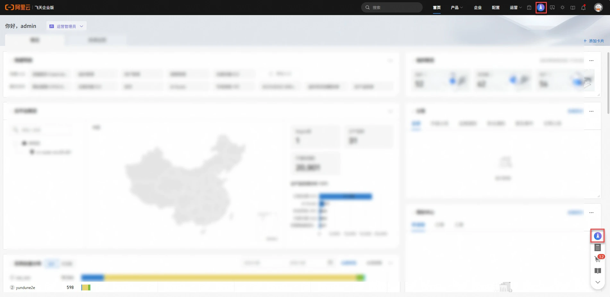

3. 在**Apsara Copilot**对话框或页面，描述任务，单击  。

   > **说明**
   >
   > - 从控制台顶部导航栏进入，默认进入全屏模式。从悬浮菜单进入，默认进入窗口模式。
   >
   >   - 窗口模式：上方依次显示新任务、历史任务、窗口全屏和关闭图标。
   >
   >   - 全屏模式：左侧依次显示新任务、技能、专家、记忆、定时任务等导航栏，以及任务列表等。
   >
   > - 飞天助理支持多种模型，您可以切换不同模型进行提问。
   >
   > - 单击
   >
   >   图标，可上传附件。
   >
   >   
   >
   > - 在输入框中输入“@”，可快捷调用数字员工。
   >
   > - 在输入框中输入“/”，可快捷调用技能。
   >
   > - 飞天助理回答内容后，支持  （赞同）、  （点踩）和  （复制）。

   <table>
     <tr>
       <th colspan="2">展示项</th>
       <th>说明</th>
     </tr>
     <tr>
       <td rowspan="2">通用</td>
       <td>智能待办</td>
       <td>展示已接入的智能场景（如深度洞察）的巡检结果。 说明 • 执行待办：单击待办事项，在对话框确认待办描述后，单击。  • 忽略待办：鼠标悬浮在待办事项，单击<strong>忽略</strong>。</td>
     </tr>
     <tr>
       <td>最近产物</td>
       <td>来自于智能体生成的相关文件。</td>
     </tr>
     <tr>
       <td>数据洞察</td>
       <td>洞察报告模板</td>
       <td>展示计算资源分析报告、存储资源分析报告、网络资源分析报告模板。深度洞察专家已部署并启用时才会展示。</td>
     </tr>
   </table>

   **窗口模式**

   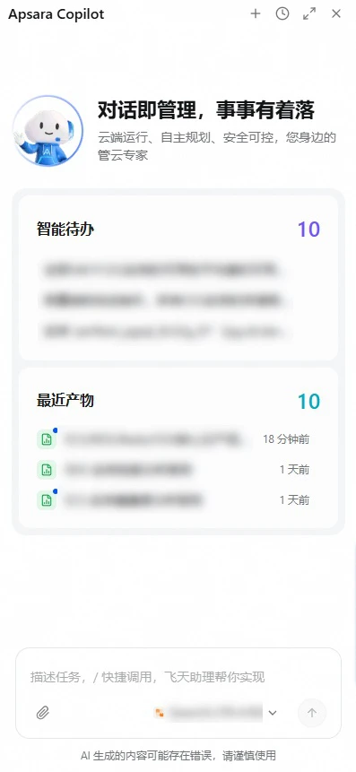

   **全屏模式**

   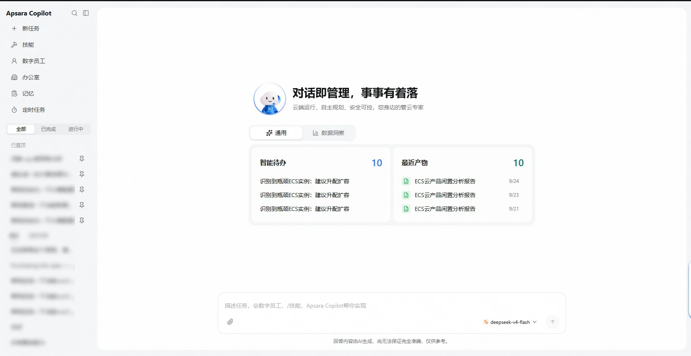

## 3.2. 技能

安装与管理技能，在对话中扩展飞天助理的能力。

**操作步骤**

1. 登录Apsara Uni-manager运营控制台。

2. 在控制台顶部导航栏或悬浮菜单单击  ，进入飞天助理。

   

3. 在**Apsara Copilot**全屏页面，单击左侧导航栏的**技能**。

   > **说明**
   >
   > - 从控制台顶部导航栏进入，默认进入全屏模式。
   >
   > - 从悬浮菜单进入，默认进入窗口模式。在窗口模式上方单击窗口全屏后，也可进入全屏模式。

4. 在**技能**页面，按**全部**、**官方技能**和**自定义**分类查看和管理技能。

   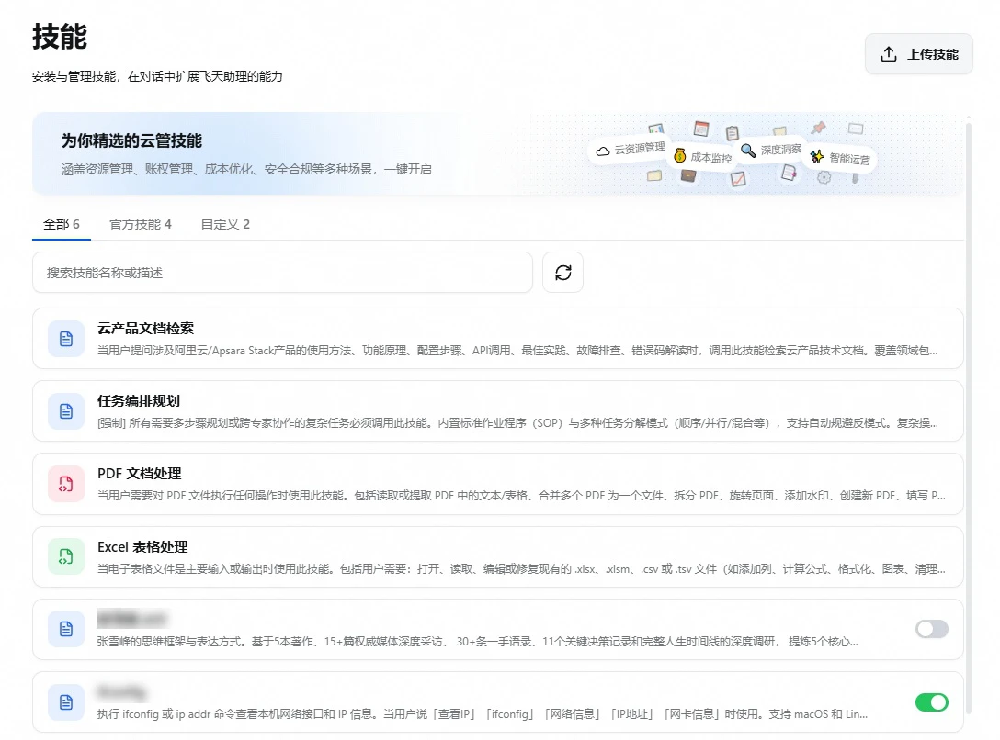

   <table>
     <tr>
       <th width="128">操作</th>
       <th>说明</th>
     </tr>
     <tr>
       <td>查看技能</td>
       <td>i. 在技能列表上方，通过技能名称或描述可快速查找技能。 说明单击文本框右侧的，可刷新技能列表。  ii. 单击技能卡片。iii. 在<strong>查看技能</strong>面板，可查看技能内容的详细信息。 说明 • 支持开启或关闭预览。 • 支持复制技能内容。</td>
     </tr>
     <tr>
       <td>上传技能</td>
       <td>i. 单击页面上方的<strong>上传技能</strong>。ii. 在<strong>上传技能</strong>对话框，单击<strong>上传技能</strong>，选择技能文件。iii. 检测通过后，单击<strong>确认</strong>。</td>
     </tr>
     <tr>
       <td>启用/禁用技能</td>
       <td>单击技能卡片右侧的启用/禁用按钮。  ：表示技能已禁用。  ：表示技能已启用。 说明仅自定义技能支持启用/禁用操作。</td>
     </tr>
     <tr>
       <td>删除技能</td>
       <td>i. 鼠标悬浮在技能卡片，单击右侧。 说明 • 仅自定义技能支持删除操作。 • 删除后改技能不可用且无法恢复，请谨慎操作。 ii. 在对话框，单击<strong>删除</strong>。</td>
     </tr>
   </table>

## 3.3. 数字员工

平台预置的专业领域Agent，各司其职协同工作，为你提供全方位的智能云管理能力。

**操作步骤**

1. 登录Apsara Uni-manager运营控制台。

2. 在控制台顶部导航栏或悬浮菜单单击  ，进入飞天助理。

   

3. 在**Apsara Copilot**全屏页面，单击左侧导航栏的**数字员工**。

   > **说明**
   >
   > - 从控制台顶部导航栏进入，默认进入全屏模式。
   >
   > - 从悬浮菜单进入，默认进入窗口模式。在窗口模式上方单击窗口全屏后，也可进入全屏模式。

4. 在**数字员工**页面，您可以查看支持的专业领域Agent，并支持启用或禁用。

   <table>
     <tr>
       <th width="160">操作</th>
       <th>说明</th>
     </tr>
     <tr>
       <td>查看专家能力</td>
       <td>鼠标悬浮在专家卡片上，查看专家的能力介绍。</td>
     </tr>
     <tr>
       <td>启用/禁用专家能力</td>
       <td>单击专家卡片右侧的启用/禁用按钮。  ：表示专家已禁用。  ：表示专家已启用。 说明未购买对应专家时，不能对其进行启用/禁用操作，也不能使用对应专家的能力。</td>
     </tr>
   </table>

**专业领域Agent介绍**

> **说明**
>
> 平台支持的Agent取决于云产品的交付情况。

<table>
  <tr>
    <th width="154">专家</th>
    <th>描述</th>
  </tr>
  <tr>
    <td>智能管理专家</td>
    <td>飞天企业中心与云资源智能管理专家。处理组织、资源集、账号、权限管理及云服务器、专有网络、安全组、弹性公网、云数据库RDS/PolarDB、云原生数据仓库AnalyticDB PostgreSQL版、云数据库Redis、 云数据库MongoDB、分布式数据库PolarDB-X、文件存储NAS、负载均衡、裸金属服务器、 容器集群、容器镜像、云解析DNS、数据传输、弹性伸缩、高速通道、Elasticsearch、MaxCompute/ODPS、消息队列RocketMQ/Kafka的创建、查询、修改， 以及对象存储OSS、日志服务 SLS 的查询。支持资源巡检：默认资源集审计、产品配额使用率检查（组织/资源集维度）。 同时支持操作审计日志查询与用户行为分析，检索“谁在何时对哪个资源做了什么”。适用于：企业中心/组织管理/创建部门/资源集/归属变更/云资源管理/创建云服务器/新建专有网络/ 申请弹性公网/创建云数据库/创建GPDB/创建AnalyticDB PostgreSQL/创建Redis/创建MongoDB/创建PolarDB-X/创建NAS/创建NAS文件系统/创建NAS权限组/创建NAS命名空间/创建负载均衡/申请裸金属/创建K8s集等。</td>
  </tr>
  <tr>
    <td>深度洞察专家</td>
    <td>编排端到端数据工作流，涵盖自然语言查询、动态大纲生成、自动化数据解读及综合报告合成。在安全沙箱环境中执行分析逻辑。支持意图：资源/账单领域的数据查询、数据统计、数据分析（data analysis）、自然语言查询、报告生成（report generation）、大纲起草（outline drafting）、数据解读（insight interpretation）、可视化图表（visualization）。</td>
  </tr>
  <tr>
    <td>备份管理专家</td>
    <td>通过知识库、日志查询和补救操作诊断错误代码。用于: 备份诊断（backup diagnosis）、错误码分析（error code analysis）、备份失败（backup failure）、ASRBR 报错。</td>
  </tr>
  <tr>
    <td>网络管理专家</td>
    <td>具备租户DNS域名解析故障排查，EIP/VBR实例诊断的能力。</td>
  </tr>
  <tr>
    <td>数据分析专家</td>
    <td>支持云资源、账单费用、资源监控指标三类数据的数据查询、统计分析、趋势解读、对比分析、排行分析、占比分析和可视化图表生成，excel表格输出。支持资源实例属性的查询与统计，支持按资源实例、组织、资源集等维度进行资源分析；但不支持不同资源之间的绑定、挂载、依赖或关联关系查询，也不支持资源创建、删除、重启、购买、续费等操作。账单数据仅支持按月、按年粒度查询和分析，支持按资源实例、组织、资源集等维度进行账单分析；不支持按日、按小时粒度的账单明细、趋势或统计。监控数据支持资源实例和资源集维度，支持CPU、内存、磁盘等指标按天及以上粒度的聚合查询和分析；不支持分钟级、小时级实时监控曲线或明细查询。</td>
  </tr>
  <tr>
    <td>可观测专家</td>
    <td>可观测日志服务查询分析专家。职能范围：根据自然语言描述生成SLS SQL查询语句并执行，用于日志数据分析；当用户对系统输出提出质疑、困惑或不满时，进行深度反思和问题诊断，通过系统性的Debug分析找出问题根源，提供修正方案并总结经验教训；对查询结果进行智能分析，提供数据洞察、趋势识别与异常发现。适用于日志检索、统计取数、报表分析等只读场景。不支持写入、变更、删除类操作；不支持Trace分析、告警规则配置、监控模型管理等SQL以外的可观测能力。</td>
  </tr>
  <tr>
    <td>容灾管理专家</td>
    <td>灾备领域意图识别与路由中枢。识别用户请求属于异地容灾（ASR-DR）还是同城容灾（BCMC），路由到对应下游专家；意图无法区分时咨询用户确认后再路由。不自行执行任何容灾查询、诊断或资源操作。</td>
  </tr>
  <tr>
    <td>数据传输服务专家</td>
    <td>查找失败/高延迟的迁移、同步、订阅任务；给定jobId诊断失败根因并给出修复建议；查看任务当前与历史性能（RPS/BPS/延迟/网络时延）;辅助完成任务配置（建实例→配任务→预检查→启动）。适用于：DTS/数据传输/迁移任务/同步任务/订阅/任务失败/预检查失败/任务延迟高/性能曲线/建同步任务/数据加工ETL。</td>
  </tr>
  <tr>
    <td>智能运营专家</td>
    <td>智能运营专家，负责运营域的配置管理、工单提交和创建、折扣规则全生命周期管理（discount-rule-config）、合同全生命周期管理（contract-create，含合同创建、合同折扣查询、合同启用）、计费策略查询与计费规则定价配置（charge-rule-config）、单条计费规则的计算逻辑解读（charge-rule-analysis）、单条账单明细的金额计算逻辑解读（bill-explanation）、账单稽核与出账重跑（billing-audit，含稽核问题查询、稽查报告生成、稽查情况查看、出账异常排查、计费任务重跑）、工单管理（issue-manager，含工单创建、工单概览、解决方案建议、知识沉淀）、申请单审批建议（workflow-approval-advisor）、云产品资源下单管控与到期续费管理（order-manager，含查询一个月内到期的可续期实例清单、即将到期/到期续费实例查询与总结、智能续期批量体检——到期实例闲置率分析与分档、闲置资源退订询价、单实例闲置分析与变配/降配建议（变配建议/规格调整建议）、批量续费审查、续费下单、退订询价）、订单异常智能分析与修复建议（order-advisor，含异常订单根因分析、处置建议、重新执行交付、忽略异常、异常订单概况统计）、新购计费方式建议（charge-type-advisor，新购场景对比按量付费与包年包月价格，计算盈亏平衡点，给出选哪种计费方式/付费方式更省钱更划算的建议）、初始化配置向导（init-config-wizard，含环境初始化引导、计费配置创建与启用、折扣与合同引导）。所有能力均面向单条记录的操作或解读，不支持跨组织/跨产品的费用汇总、费用对比、费用趋势等聚合分析类问题。但账单稽查问题查询、稽查报告生成、稽查情况查看，以及到期可续期实例清单查询与闲置率批量体检（续期/续费/即将到期实例/闲置率分析/变配建议/降配建议）属于本专家核心职责，不受上述限制。</td>
  </tr>
  <tr>
    <td>上云推荐专家</td>
    <td>上云/迁云评估的规格推荐执行器。由主Agent按链路组委派（mode=link_batch，一组1~2 条），逐条做规格查询与选型、各出一个「收到任务/推荐决策/推荐结果/未决事项」四段式业务语言块，结果以文字返回值回传；不采集解析、不出 xlsx、不反问客户。</td>
  </tr>
  <tr>
    <td>操作系统专家</td>
    <td>专有云操作系统专家技能。帮助用户在其本地计算机上配置、挂载和卸载Skillfs FUSE虚拟文件系统。QwenPaw命令行使用技巧：涵盖心跳配置、定时任务管理、Docker打包部署、工作区导出迁移等操作；在服务器上完成QwenPaw AI助理的安装部署，包括脚本安装、直接写入配置文件、百炼模型API Key 配置、钉钉频道接入等。</td>
  </tr>
  <tr>
    <td>云监控专家</td>
    <td>支持实时指标查询（当前值/时序/Top N）、告警查询与诊断、告警规则创建与管理、告警规则治理（合理性巡检/拆除与阈值建议）、指标拓扑与链路分析、无数据故障排查、组织健康巡检、K8s/ACK集群巡检与升级预检、AI Studio平台诊断，输出原始数据与运维建议。注意，不生成跨产品聚合分析报告或可视化大纲。</td>
  </tr>
</table>

## 3.4. 办公室

通过本章节获取数字员工的数据概览。

**操作步骤**

1. 登录Apsara Uni-manager运营控制台。

2. 在控制台顶部导航栏或悬浮菜单单击  ，进入飞天助理。

   

3. 在**Apsara Copilot**全屏页面，单击左侧导航栏的**办公室**。

   > **说明**
   >
   > - 从控制台顶部导航栏进入，默认进入全屏模式。
   >
   > - 从悬浮菜单进入，默认进入窗口模式。在窗口模式上方单击窗口全屏后，也可进入全屏模式。

4. 在页面，查看**今日Token用量**、**今日会话数**、**今日产出物**及**运行中数字员工**的数据信息。

   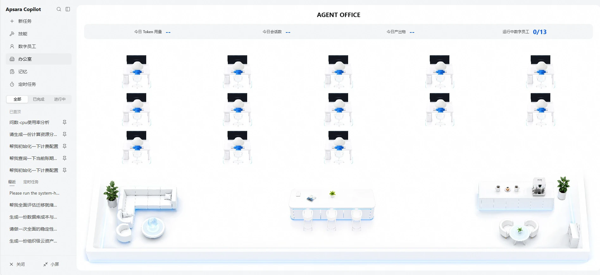

## 3.5. 记忆

记忆即系统自动学习并沉淀您的使用偏好，也支持手动创建自定义记忆。

**操作步骤**

1. 登录Apsara Uni-manager运营控制台。

2. 在控制台顶部导航栏或悬浮菜单单击  ，进入飞天助理。

   

3. 在**Apsara Copilot**全屏页面，单击左侧导航栏的**记忆**。

   > **说明**
   >
   > - 从控制台顶部导航栏进入，默认进入全屏模式。
   >
   > - 从悬浮菜单进入，默认进入窗口模式。在窗口模式上方单击窗口全屏后，也可进入全屏模式。

4. 在**记忆**页面，您可以查看和管理记忆。

   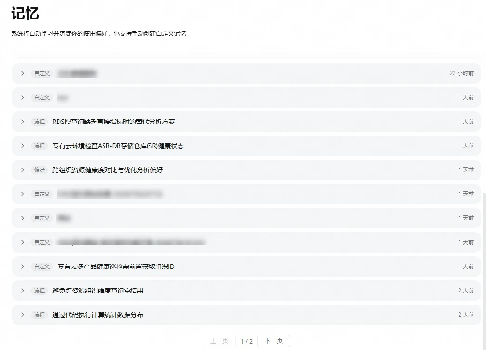

   <table>
     <tr>
       <th width="122">操作</th>
       <th>说明</th>
     </tr>
     <tr>
       <td>查看记忆内容</td>
       <td>i. 在记忆列表上方，可通过文本框快速搜索记忆。 ii. 单击记忆标题前的，展开记忆，查看记忆内容的详细信息。</td>
     </tr>
     <tr>
       <td>新建记忆</td>
       <td>i. 在记忆列表上方，单击<strong>新建</strong>。ii. 在<strong>新建自定义记忆</strong>对话框，填写记忆的<strong>标题</strong>和<strong>内容</strong>。 说明支持Markdown格式。 iii. 单击<strong>保存</strong>。</td>
     </tr>
     <tr>
       <td>修改记忆</td>
       <td>i. 鼠标悬浮在记忆标题，单击。 ii. 在展开的标题和内容文本框，更新记忆的信息。iii. 单击<strong>保存</strong>。</td>
     </tr>
     <tr>
       <td>删除记忆</td>
       <td>i. 鼠标悬浮在记忆标题，单击。 ii. 在对话框，单击<strong>确认删除</strong>。</td>
     </tr>
   </table>

## 3.6. 定时任务

定时任务即按计划自动执行的任务，也可随时手动触发。

**操作步骤**

1. 登录Apsara Uni-manager运营控制台。

2. 在控制台顶部导航栏或悬浮菜单单击  ，进入飞天助理。

   

3. 在**Apsara Copilot**全屏页面，单击左侧导航栏的**定时任务**。

   > **说明**
   >
   > - 从控制台顶部导航栏进入，默认进入全屏模式。
   >
   > - 从悬浮菜单进入，默认进入窗口模式。在窗口模式上方单击窗口全屏后，也可进入全屏模式。

4. 在**定时任务**页面，您可以查看和管理定时任务。

   

   <table>
     <tr>
       <td>操作</td>
       <td>说明</td>
     </tr>
     <tr>
       <td>查看定时任务</td>
       <td>i. 在定时任务卡片，查看定时任务的标题、内容、状态以及执行时间等。 说明：表示定时任务已禁用。  ：表示定时任务已启用。  ii. 定时任务启用后，你可以在左侧导航栏下方区域的<strong>定时任务</strong>页签，查看定时执行的记录列表。</td>
     </tr>
     <tr>
       <td>新建定时任务</td>
       <td>i. 单击<strong>新建定时任务</strong>。 说明您也可以直接通过飞天助理对话创建定时任务。例如，在对话框输入“帮我创建一个每天晚上8点今日工作进展要点的定时任务“。 ii. 在<strong>新建定时任务</strong>对话框，配置任务名称、计划时间、任务描述、以服务关联角色运行。 说明 • 计划时间：支持按每小时、每天、每周或自定义时间设置。 • 任务描述：让Apsara Copilot帮你做什么的具体内容。 • 以服务关联角色运行：开启后任务将以本一级组织的服务关联角色身份运行，不再使用用户访问凭证。非必要不开启。 iii. 单击<strong>保存</strong>或<strong>立即执行</strong>。</td>
     </tr>
     <tr>
       <td>修改定时任务</td>
       <td>i. 鼠标悬浮在定时任务卡片，单击<strong>编辑任务</strong>。ii. 在<strong>编辑任务</strong>对话框，更新定时任务配置。iii. 单击<strong>立即执行</strong>或<strong>保存</strong>。</td>
     </tr>
     <tr>
       <td>启用/禁用定时任务</td>
       <td>单击定时任务卡片右侧的启用/禁用按钮。  ：表示定时任务已禁用。  ：表示定时任务已启用。</td>
     </tr>
     <tr>
       <td>删除定时任务</td>
       <td>i. 鼠标悬浮在定时任务卡片，单击<strong>删除</strong>。ii. 在对话框，单击<strong>删除</strong>。</td>
     </tr>
   </table>

## 3.7. 搜索任务/产物

查询检索任务/产物，快速查找目标。

**操作步骤**

1. 登录Apsara Uni-manager运营控制台。

2. 在控制台顶部导航栏或悬浮菜单单击  ，进入飞天助理。

   

3. 全屏模式下，在左侧单击搜索图标  。

   > **说明**
   >
   > 您也可以通过Ctrl+G快捷操作，唤起搜索对话框。

4. 在搜索对话框，输入任务/产物关键信息。

   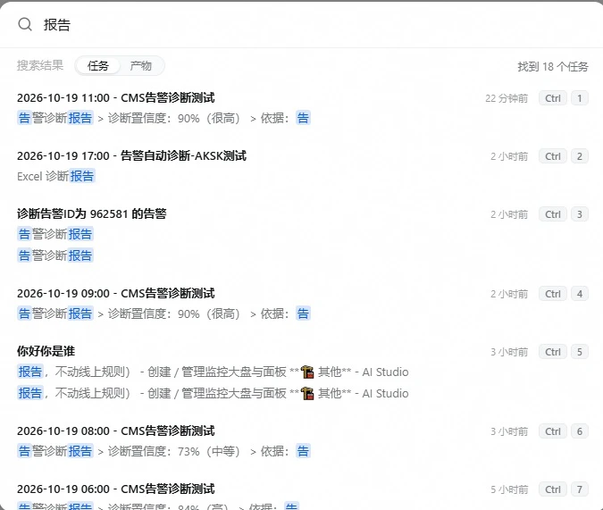

5. 单击**任务**/**产物**，查看搜索到的任务/产物。

6. 单击目标任务/产物，跳转到详情页面。

   > **说明**
   >
   > 在产物详情，支持下载产物。

# 4.飞天助理运营分析

提供飞天助理的运营数据分析看板，帮助客户更好地掌握飞天助理的使用情况，以及业务效果。

**前提条件**

操作用户默认为运营管理员用户。

**操作步骤**

1. 登录Apsara Uni-manager运营控制台。

2. 在顶部菜单栏选择**首页**。

3. 单击**AI+运营**页签，查看**近一周**和**近一个月**的各指标数据。

   | 展示项 | 说明 |
   | --- | --- |
   | AI助理核心指标 | 展示<strong>综合评分</strong>、<strong>日活跃用户数</strong>以及<strong>对话量</strong>等AI助理核心数据。 说明综合评分是衡量飞天助理整体服务质量的一个综合性指标，通过用户满意度、性能响应、请求成功率三个维度计算得出，反映系统在实际使用中的质量与用户体验水平。 |
   | AI助理功能使用 | 展示<strong>智能问答</strong>、<strong>知识覆盖率</strong>、<strong>智能分析</strong>、<strong>辅助操作</strong>、<strong>代码生成</strong>、<strong>MPC调用</strong>等场景化功能使用数据。 |
   | AI助理性能响应 | 展示<strong>首次Token响应时间</strong>和<strong>平均生成速度</strong>等AI助理核心性能数据。 |
   | AI助理资源消耗 | 展示<strong>Tokens消耗量</strong>和<strong>模型推理延迟</strong>等AI助理资源消耗数据。 |
   | AI助理License使用情况 | 展示AI助理License的使用情况，包括<strong>标准版Agent</strong>、<strong>资源管理Agent</strong>、<strong>运营管理</strong><strong>Agent</strong>和<strong>数据洞察Agent</strong>。 |

   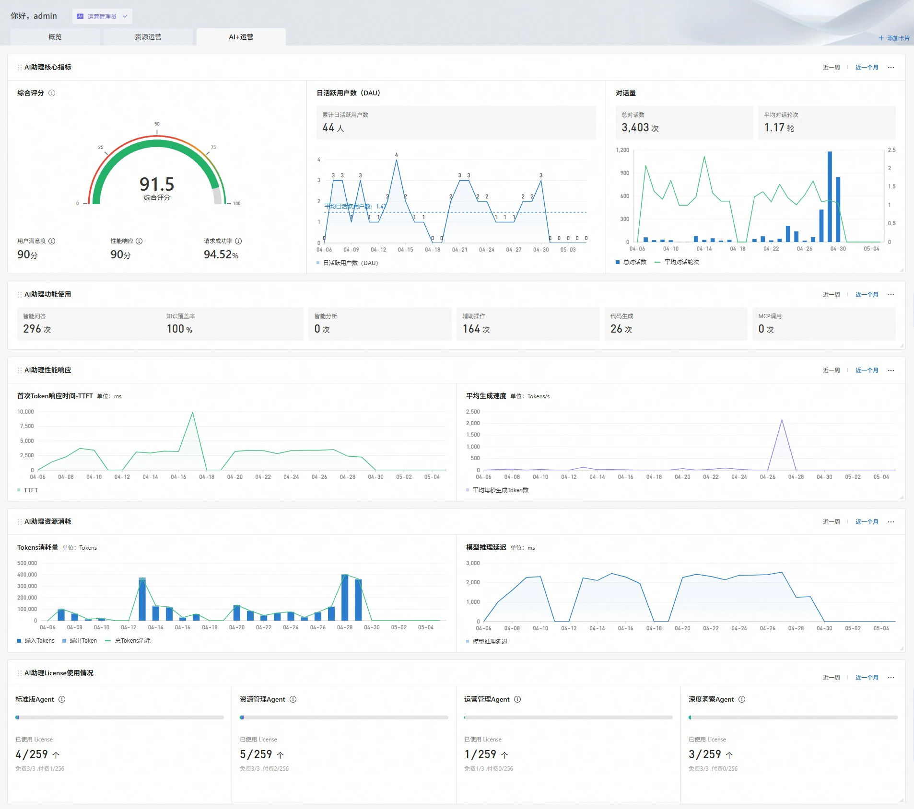

# 5.操作审计

飞天助理支持操作审计日志记录功能。

**操作步骤**

1. 登录Apsara Uni-manager运营控制台。

2. 在菜单中选择**企业**。

3. 在左侧导航栏中选择**操作审计** > **个人操作日志**。

4. 在**个人操作日志**页面，选择组织、产品类型、资源类型、事件类型、资源ID、源IP、事件ID、起止时间等筛选条件后，单击**搜索**。

   > **说明**
   >
   > 产品类型选择**统一云管平台**，资源类型选择**飞天助理**。

5. 在列表查看飞天助理的操作日志记录。

   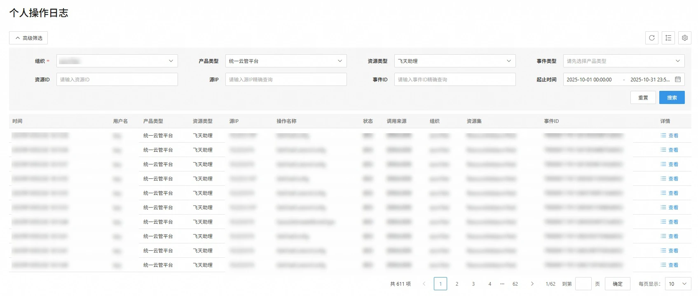

6. 单击列表操作列的**查看**，跳转到**操作详情**面板。

   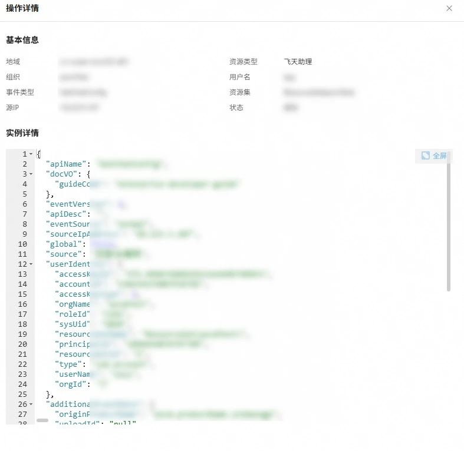

# 6.附录

## 6.1. 登录Apsara Uni-manager运营控制台

本文主要向您介绍如何登录Apsara Uni-manager运营控制台。

**前提条件**

- 登录Apsara Uni-manager运营控制台前，确认您已从部署人员处获取Apsara Uni-manager运营控制台的服务域名地址。

- 推荐使用Chrome浏览器。

**操作步骤**

1. 在浏览器地址栏中，输入Apsara Uni-manager运营控制台的服务域名地址，按回车键。

   

   > **说明**
   >
   > - 单击页面右上角的当前语言可以切换其它语言。
   >
   > - 由于浏览器证书过期或环境开启HTTPS认证等出现多次单击继续访问或无Apsara Uni-manager运营控制台地址入口等现象，此时需要安装证书才能正常访问。单击页面右上角的**浏览器证书安装**，可打开浏览器证书安装指南。

2. 输入正确的用户名及密码。

   > **说明**
   >
   > - 请向运营管理员获取登录控制台的用户名和密码。
   >
   > - 首次登录Apsara Uni-manager运营控制台时，需要修改登录用户名的密码，请按照提示完成密码修改。为提高安全性，密码长度必须为10~32位，且包含英文字母大小写、阿拉伯数字和特殊符号（感叹号（!）、at（@）、井号（#）、美元符号（$）、百分号（%）等）。

3. 勾选**我已阅读并同意产品服务协议、隐私协议、用户协议**。

   > **说明**
   >
   > - 登录页展示的链接文字为文档标题，单击链接文字，可查看协议的详细内容。
   >
   > - **产品服务协议**、**隐私协议**和**用户协议**仅在已发布时才会显示。如果三种类型协议都没有发布，则不需要执行该操作。

4. 单击**账号登录**/**授权登录**。

   > **说明**
   >
   > “授权登录”仅第三方认证的全局IdP设置启用时才会显示，且该显示名称可自定义，默认显示名称为“授权登录”。

5. 如果账号已激活MFA多因素认证，请根据以下两种情况进行操作：

   > **说明**
   >
   > 公网场景下，登录入口默认强制开启多因素认证。

   - **开启MFA后的首次登录**

     <ol type="a">

     <li>

     输入账号密码登录后，展示绑定虚拟MFA设备页面。

     </li>

     <li>

     在绑定虚拟MFA设备页面中，按页面提示步骤绑定虚拟MFA设备。

     </li>

     </ol>

     <ol type="i" start="100">

     <li>

     登录成功，进入控制台。

     </li>

     </ol>

   - **已开启并绑定MFA**

     输入6位MFA码后单击**认证**。

**相关操作**

**忘记密码**

1. 用户忘记登录密码时，单击密码输入框下方的**忘记密码**。

2. 在忘记密码页面，输入**账户名**、**邮箱**和验证码后，单击**确认**。

   

   > **说明**
   >
   > - 账户名请输入当前账号的用户名，邮箱请输入注册账号的Email地址。
   >
   > - 重置密码的链接将发至邮箱，进入链接后用户可输入新密码。

## 6.2. 智能管理数字人支持的产品

本文介绍智能管理数字人支持的产品清单。

产品类别

产品

云服务器ECS

弹性伸缩ESS

弹性计算

裸机管理BMS

容器镜像服务ACR

容器服务 Kubernetes

对象存储OSS

存储

日志服务SLS

文件存储NAS

专有网络VPC

负载均衡SLB

弹性公网IP

网络

云解析DNS

高速通道

云原生数据库PolarDB

云数据库RDS

云原生分布式数据库PolarDB-X 2.0

数据库

云数据Tair（兼容Redis）

云数据库MongoDB

云原生数据仓库AnalyticDB PostgreSQL版

数据传输服务DTS

云原生大数据计算服务 MaxCompute

大数据计算

阿里云检索分析服务

消息队列Kafka版

中间件

消息队列RocketMQ版

> **说明**
>
> 飞天助理支持资源批量开通，批量开通的模板请联系技术支持获取。

## 6.3. 划词问答

通过对控制台页面的划词选择，自动触发对所选内容的问答能力。

**前提条件**

运营管理员已在**配置** > **飞天助理** > **个性化配置**中开启划词。

**操作步骤**

1. 登录Apsara Uni-manager运营控制台。

2. 鼠标左键在控制台页面划取内容，单击提示的“咨询飞天助理”。

   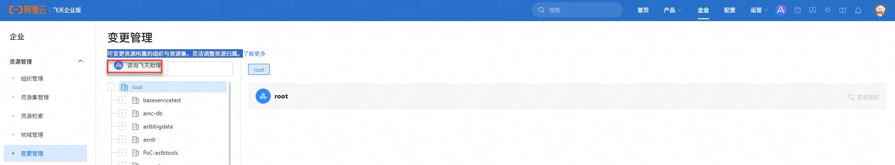

3. 飞天助理自动触发对所选内容的问答能力。

   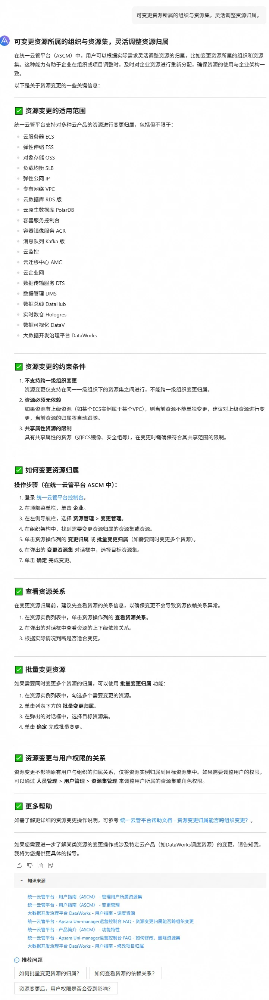
