阿里云  
专有云  
专有云基础服务  
OpenTrek安全白皮书  
产品版本：v3.18.6  
文档版本：20261116

**目录**

- [1.概述](#section-1)
- [2.安全责任共担](#section-2)
- [3.OpenTrek专属版安全架构](#section-3)
- [4.身份与访问控制](#section-4)
    - [4.1. 身份认证与鉴别](#section-4-1)
        - [4.1.1. 账号密码认证](#section-4-1-1)
        - [4.1.2. AK认证](#section-4-1-2)
        - [4.1.3. STS认证](#section-4-1-3)
        - [4.1.4. SSO认证](#section-4-1-4)
    - [4.2. 角色和授权](#section-4-2)
        - [4.2.1. 角色模型](#section-4-2-1)
        - [4.2.2. 授权方式](#section-4-2-2)
        - [4.2.3. 最小权限原则](#section-4-2-3)
    - [4.3. 资源管理](#section-4-3)
        - [4.3.1. 数据集权限](#section-4-3-1)
        - [4.3.2. 知识库权限](#section-4-3-2)
        - [4.3.3. 模型权限](#section-4-3-3)
        - [4.3.4. 智能体权限](#section-4-3-4)
- [5.API安全](#section-5)
    - [5.1. API统一鉴权与签名校验](#section-5-1)
    - [5.2. 限流、熔断防滥用](#section-5-2)
    - [5.3. 输入输出内容过滤与校验](#section-5-3)
- [6.安全审计](#section-6)
    - [6.1. 全链路日志记录](#section-6-1)
    - [6.2. 操作行为审计与责任追溯](#section-6-2)
    - [6.3. 日志防篡改与合规留存](#section-6-3)
- [7.产品安全能力](#section-7)
    - [7.1. AI网关](#section-7-1)
    - [7.2. AI护栏](#section-7-2)
    - [7.3. 运行沙箱AgentRuntime](#section-7-3)
- [8.AI资产生命周期安全](#section-8)
    - [8.1. 数据集构建](#section-8-1)
        - [8.1.1. 数据集安全质检](#section-8-1-1)
        - [8.1.2. 数据集版本管理](#section-8-1-2)
    - [8.2. 模型训练](#section-8-2)
        - [8.2.1. 训练数据脱敏](#section-8-2-1)
        - [8.2.2. 训练环境隔离](#section-8-2-2)
        - [8.2.3. 训练留痕可追溯](#section-8-2-3)
    - [8.3. 模型部署](#section-8-3)
        - [8.3.1. 服务访问控制与资源隔离](#section-8-3-1)
        - [8.3.2. 版本灰度发布与回滚机制](#section-8-3-2)
    - [8.4. 智能体开发](#section-8-4)
        - [8.4.1. 内置权限边界与人工确认](#section-8-4-1)
        - [8.4.2. 工具调用鉴权与最小权限授权](#section-8-4-2)
        - [8.4.3. 工具上架审核与调用白名单](#section-8-4-3)
        - [8.4.4. 运行监控与异常熔断下线](#section-8-4-4)
        - [8.4.5. 灰度发布与版本回滚](#section-8-4-5)
    - [8.5. 智能体运维](#section-8-5)
        - [8.5.1. 运行时风险审计](#section-8-5-1)
        - [8.5.2. 敏感数据脱敏](#section-8-5-2)
- [9.云产品安全SDL](#section-9)
    - [9.1. 立项](#section-9-1)
    - [9.2. 设计](#section-9-2)
    - [9.3. 编码](#section-9-3)
    - [9.4. 测试](#section-9-4)
    - [9.5. 发布](#section-9-5)
    - [9.6. 应急响应](#section-9-6)
- [10.安全合规](#section-10)
    - [10.1. 网络安全等级保护与数据安全等法律合规义务](#section-10-1)
    - [10.2. 算法备案与合规审查](#section-10-2)
    - [10.3. 风险识别、评估与处置闭环](#section-10-3)

# 1.概述

随着大模型能力的演进与产业渗透加速，人工智能正深刻重塑企业的业务创新模式、知识生产流程与系统交互方式。围绕用户场景构建涵盖模型、数据集、知识库、智能体及工具插件的AI应用生态，并对其进行智能化、动态化的全面管理已成为现实。然而，AI应用在提升生产效率的同时，也面临着复杂部署环境带来的全新安全挑战。

专有云OpenTrek专属版（以下简称"OpenTrek专属版"）是阿里云面向客户自有环境交付的一体化AI平台。该平台将模型开发训练、知识库构建、智能体开发与运维、运行沙箱、AI网关与统一运营管控等核心能力，以软件形态整体交付至客户自主运营的基础设施中，实现AI资产、数据与算力的本地闭环管理。阿里云秉持"默认安全、内生安全"理念，致力于为用户提供原生一体、稳定可靠、安全合规的AI平台，全面保障模型、数据及智能体应用的可用性、机密性与完整性。

本白皮书介绍了阿里云专有云OpenTrek专属版的安全体系，主要包括下列内容： - 安全责任共担 -OpenTrek专属版安全架构 - 身份与访问控制 - API安全 - 安全审计 - 产品安全能力 - AI资产生命周期安全 -云产品安全SDL - 安全合规

# 2.安全责任共担

OpenTrek专属版部署并运行于客户自主持有的基础设施环境中，运行所需的服务器、存储设备、网络设施、物理机房环境、基础网络架构以及互联网出口等底层资源，均由客户自行采购、建设并持有。阿里云负责交付OpenTrek专属版平台软件及其内置安全能力，并提供技术支持。除另有约定外，阿里云默认不参与客户侧的日常运维管理。

本章节旨在明确OpenTrek专属版形态下阿里云与客户之间的安全责任边界。本界定适用于OpenTrek专属版在客户环境中部署、配置、运行、运维至退出的全生命周期过程。

基于上述架构形态，OpenTrek专属版的安全责任划分遵循以下基本原则：阿里云对平台软件本身的安全负责(不包含运行时安全)；客户对平台软件之外的基础设施环境安全，以及平台软件在使用过程中的部署、配置、运行、运维与数据安全负责。

双方安全责任的划分与履行遵循以下原则： 1. 阿里云对"软件本身"负责：负责平台软件的代码安全、自身漏洞修复、补丁与版本迭代供应，以及内置安全能力（包含：身份认证、权限管理、安全审计等）。不包含软件在部署后的运行使用过程中，涉及的各类安全运维、安全运营、应急响应等。 2. 客户对"环境与使用"负责：负责软件之外的基础设施（包含：物理机房、硬件、网络等），以及平台在客户环境中的部署、配置、运行、运维与数据安全结果。 3. 在实际使用过程中的部署安全、运维安全、配置安全，其核心责任由客户承担。阿里云提供的产品文档、用户手册与安全白皮书仅作为技术支撑手段，不因客户参考或采用而转移相应责任。 4. 任何一方不因参与协作而转移对方的最终责任。客户为安全管理的最终责任人，安全管理责任不因软件采购或服务外包行为而免除或转移。 5. 硬件、运维及安全三类服务角色，由客户与阿里云依据合同灵活约定，可由客户自建、阿里云或第三方承担。无论由何方承担，均由客户统一组织管理，且约定关系不改变客户的安全管理最终责任。 6. 本责任划分原则系在阿里云专有云产品既有安全责任共担框架的基础上，结合OpenTrek专属版形态作出约定。

在明确总原则的基础上，下方以角色框架图形式概览OpenTrek专属版建设及运营过程中各方所承担的角色及其相互关系：

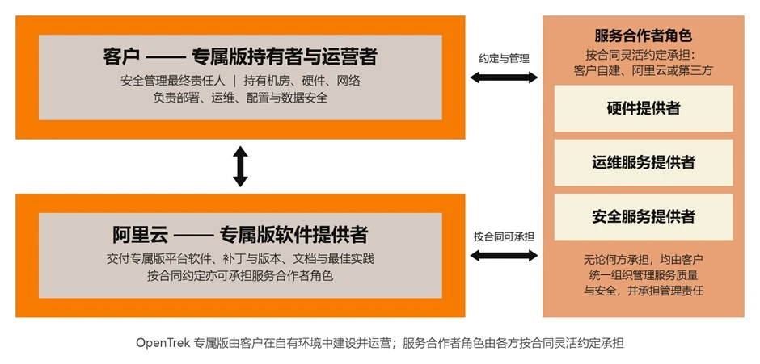

基于上图所示的OpenTrek专属版安全责任角色框架：左侧为客户（OpenTrek专属版持有者与运营者）与阿里云（OpenTrek专属版软件提供者），两者间双向箭头为合同与软件交付、技术支持关系；右侧为硬件提供者、运维服务提供者、安全服务提供者三类服务合作者角色；服务合作者角色按合同灵活约定承担：客户自建、阿里云或第三方均可；客户统一组织管理服务质量与安全，约定关系不转移客户的安全管理最终责任。

**阿里云安全责任**

在OpenTrek专属版环境中，阿里云承担如下安全责任：

**（一）软件交付与持续供应** - 为客户提供符合法律法规要求的平台软件。 - 在约定的服务期限内，提供软件许可更新与技术支持服务。针对软件出现的问题，依据严重程度为客户提供修复补丁或版本软件包，保障平台软件及其安全能力的持续供应。

**（二）软件自身安全与内置安全能力** - 对交付软件自身的安全性负责，及时修复软件自身漏洞。并随版本持续提供身份鉴别、权限管理、日志审计等内置安全能力。

**（三）客户安全使用支撑** - 提供产品文档和用户手册，支撑客户正确部署与配置。

**（四）行为边界与人员管理** - 未经客户明确授权许可，不得接触和处理客户在OpenTrek专属版环境中部署、产生及收集的数据。

**（五）合同约定服务角色** - 若依据合同约定由阿里云承担硬件、运维、安全等服务角色，阿里云将严格履行相应合同义务；该等服务不构成客户安全管理最终责任的转移或豁免。

除上述约定范围外，客户环境中的硬件安全、网络安全、部署实施结果、配置恰当性、运维及时性以及数据安全，均不属于阿里云的责任范围。凡涉及客户环境与客户使用行为之内的安全事项，由客户按照本白皮书《客户安全责任》章节承担相应责任。

**客户安全责任**

在 OpenTrek 专属版环境中，部署、配置及运维安全的主体责任由客户承担。阿里云提供的产品能力与最佳实践不替代客户履行上述责任。客户需参照本白皮书落实以下七项具体管控职责：

**（一）安全组织与策略** - 根据国家法律法规，组织、搭建OpenTrek专属版环境运营的安全管控人员与组织、安全制度与运营体系，制定安全策略。 - 根据业务系统和数据级别、类别制定安全策略，并配套相应的制度、机制（包括代码、程序、数据的运行流转管控机制等），确保安全策略能够落地执行。

**（二）部署安全** - 负责部署架构设计、OpenTrek专属版网络规划分区与隔离、部署环境安全和部署介质安全，按照阿里云部署文档完成部署，并对部署结果负责。

**（三）配置安全** - 负责平台与产品的安全配置与使用规划，包括身份鉴别、权限管理、日志审计等；因配置缺失或配置不当导致的安全风险由客户承担。

**（四）运维安全** - 负责日常运维、监控告警、备份与恢复演练、应急响应，以及漏洞修复与升级的决策和实施等运维变更管理（包括主导漏洞修复、评审升级实施方案、执行变更授权）；因运维不及时（如长期不升级、不修复已知漏洞、不做备份）导致的安全风险由客户承担。

**（五）服务合作者组织管理** - 对硬件、运维、安全三类服务角色，无论由客户自建、阿里云或第三方承担，均由客户统一组织管理，以合同明确服务边界与安全要求，并对服务结果承担管理责任。

**（六）人员入场管理** - 根据国家法律法规以及用户方安全制度的要求，对进入客户环境参与项目的阿里云相关人员进行入场审查、签署保密协议、安全培训与教育。

**（七）数据安全** - 对客户数据、运维过程中产生的运行数据、转移到环境中的业务数据安全负责，并应对重要数据进行常态化备份与恢复演练，确保关键数据有备份且可恢复。

除上述责任外，客户还应特别关注：客户对本文约定范围之外、因客户自身行为而产生的安全事项承担附加责任，包括但不限于：客户自建安全边界与对外服务系统的设计、建设与运营；OpenTrek专属版环境与客户其他信息系统集成、互联的安全管理；法律法规及监管要求对客户提出的其他安全义务。

# 3.OpenTrek专属版安全架构

OpenTrek专属版通过平台通用安全、AI 资产生命周期安全与运行时安全防护，构建三位一体的纵深防御体系。身份与访问控制、API安全和安全审计贯穿平台访问与操作链路，实现身份鉴别、权限约束、接口防护和行为追溯；AI资产生命周期安全覆盖数据集构建、模型训练、模型部署、智能体开发与运维，通过数据脱敏、环境隔离、工具准入、发布回滚及运行时风险检测，保障各阶段的安全边界；AI网关、AI护栏与Agent安全沙箱分别提供接入鉴权与流量控制、内容过滤与提示词注入防护、隔离执行与资源权限约束。各层防护相互补充，确保单一防线失效时仍能通过跨层级的检测、阻断与隔离策略有效遏制威胁横向扩散，为 AI 业务连续性、数据机密性及系统整体安全性提供全方位的安全保障。

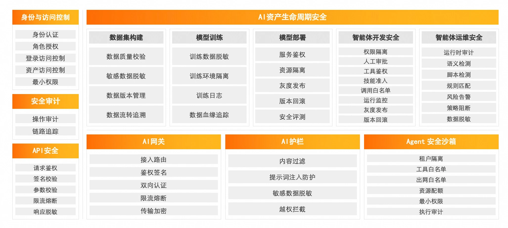

# 4.身份与访问控制

OpenTrek专属版基于加密身份凭证、服务端实时校验以及全生命周期管理这三重机制保障身份鉴别安全。系统不向浏览器暴露任何用户标识，而是签发强加密身份凭证，并写入HttpOnly、Secure且限定业务子域的 Cookie，防止脚本窃取或伪造篡改。每次访问受保护资源时，服务端均实时校验身份凭证状态，一旦过期、超时或被踢下线即刻失效。

## 4.1. 身份认证与鉴别

身份认证是指通过凭证信息认证用户的真实身份，通常是指通过登录密码或AK（Access Key，访问密钥）来进行认证。用于身份认证的凭证信息对于用户来讲是秘密信息，用户必须妥善保护好身份凭证信息的安全确保不对外泄露。

### 4.1.1. 账号密码认证

用户可以使用其用户账号的密码登录运营控制台平台并对其云上资源进行管理操作。运营控制平台的密码策略默认由平台管理员进行配置，例如：密码字符组合规范、重试登录次数、密码轮转周期等策略。可通过登录运营控制台进行查询管理：AI-Manager--系统管理--安全策略。

### 4.1.2. AK认证

阿里云的AK是用户调用云服务API的身份凭证，用于在用户通过API访问阿里云资源时对用户身份进行认证。API凭证相当于登录密码，只是使用场景不同。前者用于程序方式调用云服务API，而后者用于运营平台。

在运营平台中，每个用户在创建时，都会同步生成一对AK。AK包括访问AccessKey ID和AccessKey Secret。AccessKey ID用于标识用户，而AccessKey Secret用来验证用户身份的合法性。用户可以登录ASCM平台的个人中心模块，来查看并管理AK，包括创建、冻结、激活和删除操作。

### 4.1.3. STS认证

STS（Security Token Service，安全令牌服务）是为RAM用户、阿里云服务、身份提供商等授信实体提供短期访问资源权限的凭证。STS是一个三元组，包括安全令牌（Security Token）、AccessKey ID和AccessKey Secret，用户在调用资源API时传入安全令牌和AK ID，并使用AK Secret对请求进行签名。

对于偶尔需要调用云资源的临时用户或运行不可信移动设备上的应用，由于其访问频率低或者设备安全性不可控，不建议分配长期凭证，则可以通过STS来为这些用户颁发临时权限凭证。颁发令牌时，管理员可以根据需要自定义凭证的权限和自动过期时间（默认为1小时），确保临时访问的安全可控。

### 4.1.4. SSO认证

为了满足不同的企业客户的登录场景需求，阿里云提供了基于SAML 2.0（Security Assertion Markup Language 2.0，安全断言标记语言2.0）协议的SSO（Single Sign-On，单点登录）机制。

Opentrek专属版支持SAML2.0、OAuth2.0两种单点认证协议，并且还支持LDAP目录认证协议，客户可依据现有技术架构，灵活选用适配的协议。可通过登录运营控制台配置SSO用户的登录控制：AI-Manager--系统管理--第三方认证。开启后SSO用户仅能够通过SSO登录。

## 4.2. 角色和授权

为了满足对资源的有效管理和多级组织及项目的需求，AI-Manger遵循“最小权限原则”与“职责分离”的核心设计理念，构建了基于 RBAC（Role-Based Access Control，基于角色的访问控制）模型的多层级授权架构。将用户、角色与资源进行解耦，系统实现了从粗粒度的功能菜单访问到细粒度的数据字段操作的全方位管控，确保权限分配的灵活性与安全性并重。

在模型设计上，系统采用“用户-角色-权限”的三元映射机制。管理员无需向单一用户直接授予具体权限，而是通过为用户分配一个或多个业务角色，使其间接继承相应的权限集合。该抽象层设计有效降低了权限管理的运维复杂度，当业务逻辑发生变更时，仅需调整角色关联的权限策略，即可实现权限的批量高效更新，从而规避因人员流动或岗位调整引发的频繁配置变更风险。

### 4.2.1. 角色模型

AI-Manger通过绑定用户和角色给用户授予相应的权限。其中，角色是一组原子权限的集合，原子权限可以映射为API的访问权限，也可以映射为页面元素的访问和操作权限。

用户可以1:1授权一个管理角色，用户在管理视图下拥有的权限为该角色具备的权限。同时，用户可以1:N以指定空间角色加入空间，用户在这个空间下具备的权限为该空间角色具备的权限。角色映射模型如下图所示：

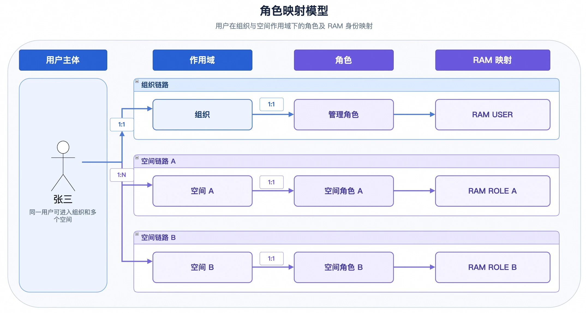

AI-Manager也提供了基于ABAC（Attribute-Based Access Control，基于属性的访问控制）的能力。运营管理员可以通过创建不同的访问控制策略对用户登录行为进行管控，登录运营控制台进行配置和管理：AI-Manager--系统管理--访问控制。界面如下图所示：

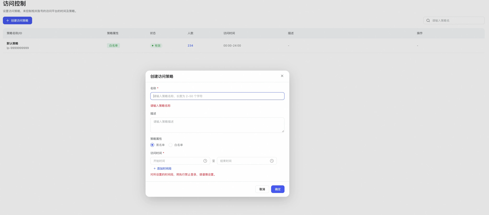

### 4.2.2. 授权方式

AI-Manager运营平台提供了两种常见的授权用户权限的方式： 1. 直接为用户提供预置角色或自定义角色是最常见的授权方式。 2. 将用户加入空间的方式为用户进行授权，只需要为用户授权对应的空间角色，用户即可自动继承角色的权限。

### 4.2.3. 最小权限原则

在AI-Manager运营平台中，管理员可对用户角色实施细粒度的权限管控。用户须经相应角色授权后，方可使用云产品相关功能。

除自定义角色外，还提供以下预置角色，支持基于最小权限原则按业务场景灵活授权：

<table>
  <tr>
    <th width="170">角色名</th>
    <th>角色描述及适用场景</th>
  </tr>
  <tr>
    <td>运营管理员</td>
    <td>拥有平台全部权限，负责平台整体运营策略制定、组织管理、用户管理及全产品功能的管控。适用于平台运维负责人或IT管理决策者。</td>
  </tr>
  <tr>
    <td>组织管理员</td>
    <td>拥有平台全部权限，负责平台整体运营策略制定、组织管理、用户管理及全产品功能的管控。适用于平台运维负责人或IT管理决策者。</td>
  </tr>
  <tr>
    <td>组织资源监察员</td>
    <td>具有所在组织的所有云资源的查看权限。</td>
  </tr>
  <tr>
    <td>Token运营人员</td>
    <td>拥有运营分类下的全部权限，负责Token用量监控、配额分配与成本分析等运营工作。适用于运营专员或财务人员。</td>
  </tr>
  <tr>
    <td>空间管理员</td>
    <td>拥有空间内全部已部署产品的空间级权限及空间管理权限，负责空间的成员管理、产品配置与日常运营。适用于空间负责人或项目经理。</td>
  </tr>
  <tr>
    <td>空间成员（全产品）</td>
    <td>拥有空间内所有产品的查看与写操作权限，可使用空间内全部产品功能进行日常工作。适用于空间内全栈开发或核心成员。</td>
  </tr>
  <tr>
    <td>空间成员（只读）</td>
    <td>拥有空间内所有产品的查看权限，不可执行写操作，适用于仅需浏览了解空间内容的协作方或审计人员。</td>
  </tr>
  <tr>
    <td>智能体开发人员</td>
    <td>拥有Agent Dev、Knowledge Wave及Ops的导航查看与功能读权限，专注于智能体开发、知识库构建及运维观测相关操作。适用于智能体应用开发工程师。</td>
  </tr>
  <tr>
    <td>运维人员</td>
    <td>拥有Agent Ops、Agent Runtime及AI Gateway的全部空间级权限，负责智能体运维部署、运行时监控及网关管理。适用于运维工程师或SRE。</td>
  </tr>
  <tr>
    <td>大模型开发人员</td>
    <td>拥有AI Studio的全部空间级权限，负责模型开发、训练、部署及AI资源管理。适用于算法工程师或ML工程师。</td>
  </tr>
  <tr>
    <td>普通访客</td>
    <td>拥有基础策略的基本权限，可访问个人设置等用户级基础功能，不包含任何产品级操作权限。适用于尚未分配具体角色的新用户或临时访客。</td>
  </tr>
</table>

## 4.3. 资源管理

### 4.3.1. 数据集权限

在AI运营平台中，数据集、子集及文件是模型训练与推理的核心数据资产，为保障资产在多角色场景下的安全性和合规性，平台构建了细粒度的权限管控体系。

当前配置中采用"空间、角色、操作"三个维度作为权限控制基础。"空间"实现多租户或多项目间的数据逻辑隔离；"角色"承载基于岗位职责抽象的权限集合；"操作"定义对具体资源执行的动作类型。在此模型下，针对数据集、子集以及文件等核心资源对象，拆解出查看、创建、编辑、删除、下载五个基础操作权限点。此外，针对高数据外泄风险操作，标注结果导出也作为单独的权限点进行管控。

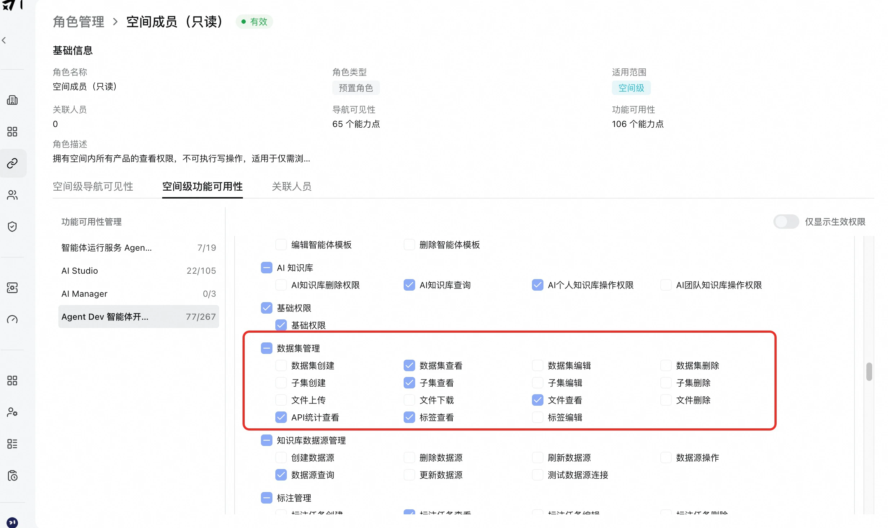

### 4.3.2. 知识库权限

知识库作为支撑智能问答、内容生成及业务推理的核心底座，其沉淀数据常涉及企业敏感信息。为适应多角色协同场景，平台实施"文档"与"索引"解耦的分级授权机制。

索引权限聚焦于检索链路治理，细分为建立、重建、管理与查询四类操作节点。文档权限遵循读写分离与最小权限原则，将上传、删除、元数据管理以及下载、预览等操作独立拆分。此外，还设立独立的知识库共享管控能力，支持跨团队或跨空间的访问和协作。

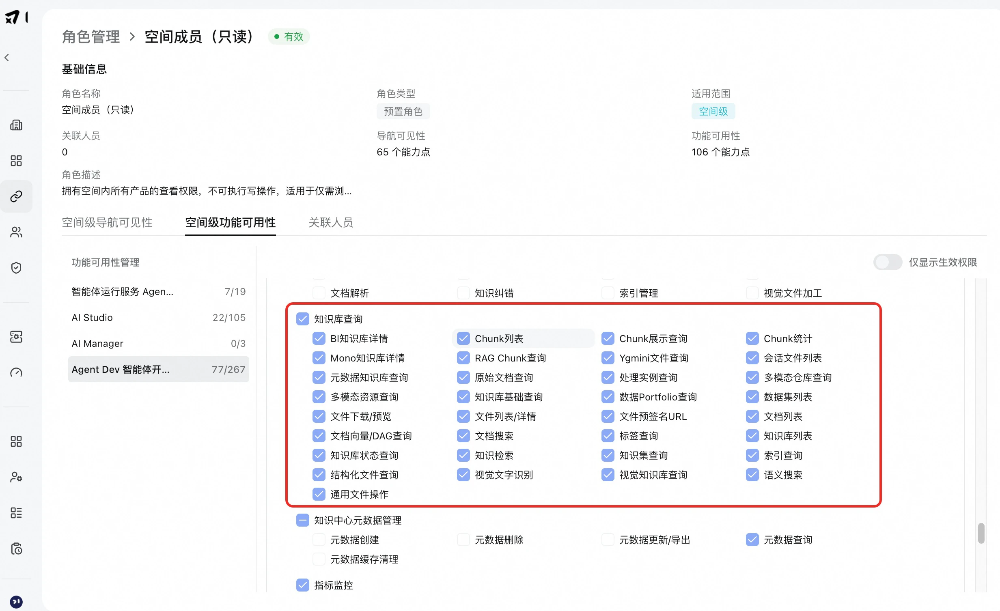

### 4.3.3. 模型权限

模型作为运营平台的重要资产，其生命周期涵盖开发训练、部署上线、推理调用及迭代优化等多个环节。因此，平台将模型的创建、更新、查看、删除及调优拆解为独立的权限点，覆盖模型生命周期的立体化权限管控。同时，模型调用权限在"创建Notebook"、"创建在线服务"等具体业务场景中都有体现。

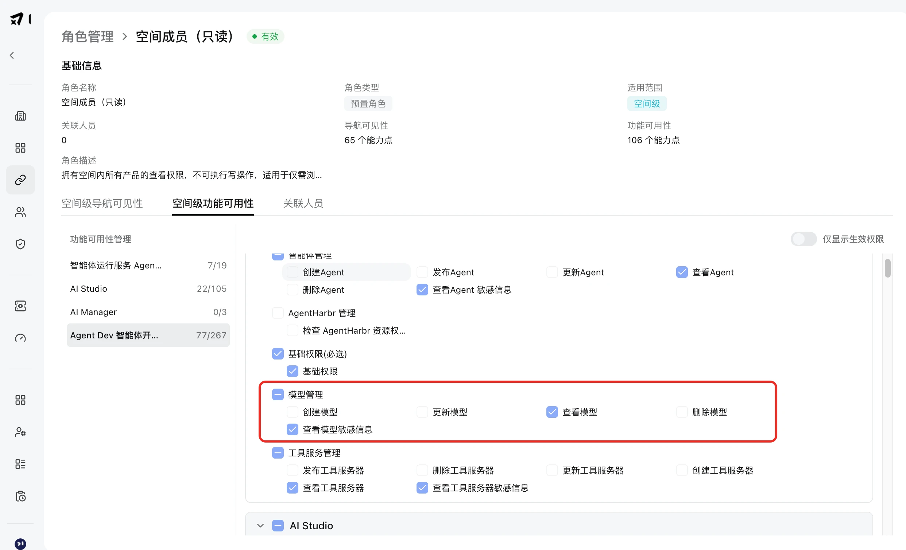

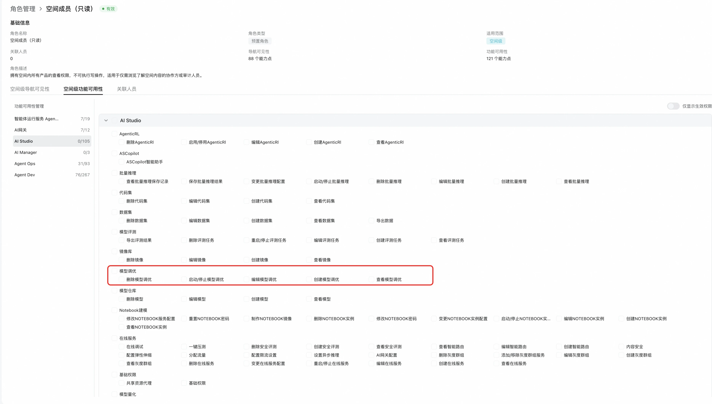

### 4.3.4. 智能体权限

平台将智能体编辑（设计版本）、发布、下线、切流、导出等运维动作进行了独立权限设计。该设计既可以保障敏捷协作效率，又能严格防范越权篡改、误上线或非授权中断服务导致的安全风险。

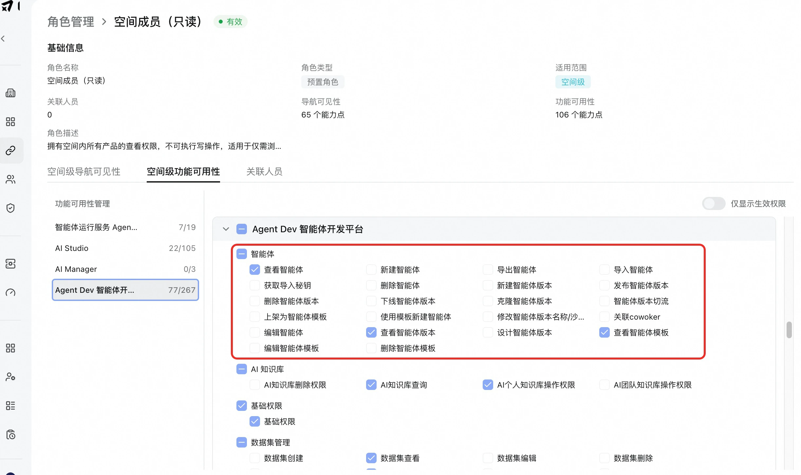

# 5.API安全

API安全

OpenTrek专属版中所有对外接口调用均统一经过API网关接入后端业务服务。网关在请求处理链路中，依次执行身份校验、参数核验、请求转发、响应处理及日志审计等标准化流程，任何请求未通过身份认证与签名校验前，均无法触达后端服务。其次，所有请求与响应数据在完成日志记录前，均会经由统一的内容安全处理机制，将接口安全控制能力集中收敛于网关层实施统一管控，有效规避各业务服务分散实现导致的安全策略不一致风险。

以下从鉴权与签名、限流与防护、内容过滤等方面展开说明。

## 5.1. API统一鉴权与签名校验

所有请求进入API网关后，第一步就是执行身份鉴别和签名校验。只有携带合法凭证、且签名核对通过的请求方可转发至后端服务，未通过则一律拦截。签名计算严格限定于请求参数本身，转发链路中附带的其他数据不参与签名计算，既避免因冗余信息导致校验失败，亦有效防止通过篡改非签名内容绕过安全校验。

## 5.2. 限流、熔断防滥用

网关通过多层容量控制来保障后端服务稳定性。入口和出口的连接与线程容量根据运行环境的资源规格统一配置、协调匹配，并按接口类型做资源隔离，防止某一类慢接口把公共资源全部占用。每个接口都有独立的超时设置，一旦下游响应过慢会快速失败并释放占用资源，配合有限的重试，避免单个接口异常沿着链路扩散、拖垮整体服务，起到熔断隔离的效果。此外，针对超大的响应内容，系统在记录前会进行长度控制，防止资源被大量占用引发资源耗尽风险。

## 5.3. 输入输出内容过滤与校验

内部过滤方面，在请求侧系统会按照每个接口的元数据定义，对必填项、参数类型和格式逐一核对，不符合要求的请求会在网关层直接拦截并返回错误响应，不会透传到后端。在响应侧，系统严格遵守接口预先声明的字段对外返回，后端内部未声明的字段会被过滤掉，避免内部数据无差别外泄。同时，系统具备统一的脱敏机制，能够识别并遮盖请求与响应中的敏感信息（如：密钥类信息）。

# 6.安全审计

平台将审计埋点收敛在统一网关侧，各云产品接入网关即自动纳入审计，无需各产品重复实现。操作日志以"操作主体、时间、角色、目标产品与实例、操作行为、执行结果"为骨架，作为控制台操作审计页面的数据来源。同时所有日志均携带鹰眼 traceId，可与平台调用链数据按同一主键进行关联。可通过登录运营控制台进行日志查看和管理：AI-Manager--系统管理--操作日志。界面如下图所示：

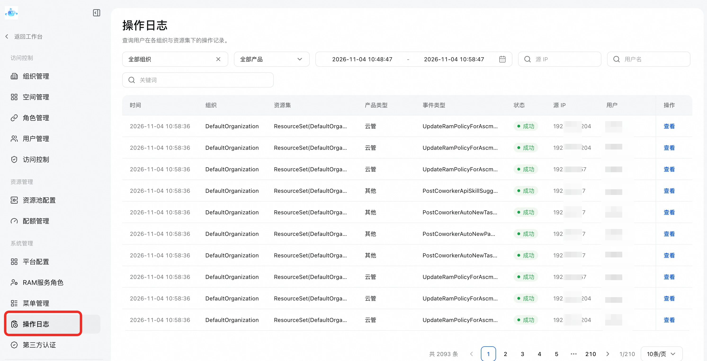

## 6.1. 全链路日志记录

接口层与操作层由网关统一产出，覆盖全部经网关控制台操作接口。系统支持按照"产品 + 资源类型 + 实例ID"维度经进行精准检索，可还原某人在某时刻对某个模型或数据集执行的操作行为、是否成功等。针对变更类操作当前日志仅记录操作和执行状态，暂不支持记录变更前与变更后的值。

## 6.2. 操作行为审计与责任追溯

每条操作日志包含六个字段：主体（用户、角色、组织、资源集）、来源（客户端 IP、地域）、客体（产品、资源类型、实例 ID）、动作（接口名、接口类型、操作级别、时间）、结果（成功/失败）、链路（traceId、实例详情）。任一字段都可作为检索入口反查其余字段，支持"按主体追溯操作"、"按资源追溯变更"、"按 traceId 回溯单次上下文"三条回溯路径，所有检索均以时间范围为必要条件，并支持基于关键词的全文检索。

## 6.3. 日志防篡改与合规留存

平台支持对自身运行过程中的关键事件进行日志记录，可用于问题定位、运行维护和基础审计追溯。日志内容可包括时间、操作主体、操作对象、操作类型、执行结果等基本信息。系统支持通过权限控制机制限制日志访问权限，仅授权人员可查看相关日志。日志留存周期可根据实际部署需求进行配置，保存周期以实际部署配置为准。

# 7.产品安全能力

## 7.1. AI网关

**统一接入与路由**

AI网关为大模型服务、MCP（Model Context Protocol，模型上下文协议）服务提供统一安全接入入口，将分散部署的模型API收敛至网关集中管控，避免服务直接暴露导致攻击面扩大。支持基于消费者、模型、Token用量等多维度精细化路由，以及主备模型自动切换与故障降级，保障业务连续性；访问控制、限流、审计等安全策略在入口统一配置、集中生效，降低多点维护造成的安全配置遗漏与策略漂移风险。

**鉴权签名与mTLS**

AI网关提供完整的身份认证能力，支持API Key、JWT、HMAC签名等多种消费者鉴权方式，拒绝未授权客户端访问模型服务。面向高安全场景，网关支持mTLS双向认证，基于证书校验通信双方身份，防范中间人攻击与仿冒接入。上游模型服务的API Key支持统一托管并加密存储，确保接入链路两端身份可信与凭证安全性。

**限流熔断**

AI网关支持按消费者、模型、路由等多维度限流，除常规QPS（Queries Per Second，每秒查询率）限流外还支持按Token用量精确限流，有效防范恶意刷量、接口滥用导致的推理成本失控。当上游模型服务异常时自动熔断并切换备用模型，避免单点故障。针对超出限流上限的请求，网关支持拒绝、排队等多种处置策略，确保大模型服务在高峰流量与恶意攻击场景下持续稳定可用，保障资源公平使用。

**流量加密**

AI网关支持全链路流量加密，对外提供HTTPS安全接入与证书托管能力，自动完成证书申请、更新与配置，规避因证书过期导致服务中断风险。对内转发至上游模型服务的链路同样支持TLS加密，防止Prompt、API请求和生成结果在传输过程中被窃听或篡改，满足传输安全合规要求。

## 7.2. AI护栏

**输入输出内容过滤**

AI护栏对大模型应用的用户输入与生成内容进行双向合规检测，覆盖涉政有害、违法违禁、歧视侮辱等不合规内容。系统支持拦截、替换、拒答等多种处置策略，并在内容进入模型前与返回用户端前两个环节均可生效，确保大模型应用输出的内容合法合规，满足监管要求。

**提示词注入防护**

AI护栏针对攻击者将恶意指令隐藏在用户输入或外部内容中，诱导模型无视系统约束、执行非预期任务的提示词注入攻击，提供专项检测能力。AI护栏对进入模型的输入进行注入特征提取与意图识别，直接注入与间接注入均可检测、告警与拦截，可防止系统提示词泄露或模型被恶意操控，从而保障大模型与Agent应用在预设边界内稳定运行。

**敏感信息脱敏**

AI护栏对用户输入与模型输出中的敏感数据自动识别与脱敏处理，覆盖身份证号、银行卡号、手机号等个人敏感信息。系统在敏感数据进入模型前完成前置脱敏，并于输出侧进行二次校验，防止敏感信息经大模型链路发生外泄或留存，满足《数据安全法》《个人信息保护法》的数据安全合规要求。

**越权指令拦截**

AI护栏面向大模型应用自动执行指令的场景，对模型生成的工具调用、API请求等指令行为进行权限校验与安全策略检查，主动拦截超出授权范围的操作（如：越权访问数据、调用高危工具、执行危险命令等）。同时，针对越狱攻击进行检测，防范攻击者绕过模型安全对齐机制获取违规输出。该能力确保模型的自动化行为始终在授权边界内，避免执行链路被利用造成业务损失。

## 7.3. 运行沙箱AgentRuntime

**智能体隔离运行**

运行沙箱为智能体代码与AI生成代码提供强隔离的一次性执行环境，依托轻量级安全虚拟化与容器多级隔离技术，实现租户间、任务间隔离。单个智能体任务独立运行、资源独立，任务结束环境即销毁。即使执行不可信代码或代码存在潜在漏洞，其影响范围也被限制于沙箱内部，无法触达宿主机及底层基础设施。该功能确保AI代码生成与执行全程可控，有效防范Agent代码执行引发的逃逸与横向渗透风险。

**插件工具白名单**

运行沙箱对智能体运行期间可使用的插件、工具及可访问的外部地址实施白名单管控，仅放行预先声明的工具调用与网络访问，默认拒绝非授权出网连接与未注册工具调用。该能力可以有效防范提示词注入诱导智能体访问外部恶意服务、调用高危工具等。同时，插件来源必须满足可信与版本可审计的要求，确保智能体自动化操作始终约束在声明的白名单边界内执行，阻断数据外泄与恶意攻击指令的执行。

**资源与权限边界**

运行沙箱对智能体执行环境实施严格的资源与权限管控。在资源维度，按照任务粒度限定CPU、内存、磁盘及执行时长等配额，一旦超过配置的上限即自动终止，防止资源耗尽与算力滥用攻击。在权限维度，文件系统与网络访问权限遵循最小化授权原则，敏感路径默认禁止访问。此外，执行过程全量留痕并支持审计追溯，确保异常行为可被及时发现与定位，避免智能体失控运行造成业务损失。

# 8.AI资产生命周期安全

## 8.1. 数据集构建

### 8.1.1. 数据集安全质检

平台构建了多模态数据处理体系，涵盖敏感信息处理、数据清洗、数据去重以及质量校验等能力。在数据加工环节，系统内置敏感信息处理算子，支持对文本数据集指定字段执行自动化脱敏，以满足大模型训练场景下的数据安全合规要求。

在多模态清洗与去重方面，各数据类型均具备精细化处理能力：文本数据集支持编码转换、内容过滤及去重等算子的按需组合；图像数据集支持针对形状、大小、清晰度与宽高比的多维过滤；音频数据集支持语义去重与基于Chromaprint算法的声学指纹去重；视频数据集则基于CNN（Convolutional Neural Network，卷积神经网络）的近似去重仅保留代表性样本。

此外，平台的加工模板覆盖数据质检场景，支持对PDF、Excel、Word及纯文本的基础与深度解析、音视频降噪与质量过滤。针对标注数据具备质量验收能力，支持配置验收人员、抽样方式与比例，覆盖文本、图片、文档、音频，同时具备单条抽检与批量整体验收能力，错误分类标记及审核通过与驳回的流转机制，确保数据处理链路的质量可控。

### 8.1.2. 数据集版本管理

平台提供覆盖数据集全生命周期的管理能力，支持新建、配置、查询、编辑、删除、克隆及共享设置等操作。在版本管控方面，实行版本递增管理，基于现有数据集创建时版本号依次递增（如：V1 至 V2），并支持查看多版本详情。版本列表完整记录导入状态、数据来源、存储路径等元数据信息；详情页展示关联任务与数据加速器相关信息。此外，将检索结果导出为数据子集时，系统会留存完整的导出操作历史记录，确保数据流转可追溯。

## 8.2. 模型训练

### 8.2.1. 训练数据脱敏

针对大模型训练数据的安全治理，平台在数据加工模块中预置了敏感信息处理算子，支持按列级粒度对文本数据集进行敏感信息处理，降低敏感数据引发的隐私泄露风险，保障训练语料库的安全可控。

### 8.2.2. 训练环境隔离

在资源管理层面，平台构建了覆盖训练与推理任务的资源隔离体系，支持按组织、资源集及地域等多维度实施资源管控。

针对训练阶段，平台提供细粒度的算力隔离与生命周期管理能力，支持 Notebook 交互式建模与自动化任务建模两种模式。在算力分配机制上，系统依托资源组实现物理级隔离：独享资源组节点由业务方专属使用；共享资源组则支持配置资源用量上下限，并采用先到先得的抢占式调度策略。

为保障训练环境的安全边界，平台在网络与运维层面实施严格收敛。网络架构上，Notebook 实例默认分配VPC私网 VIP，须完成租户办公网与 VPC 的网络并网方可访问，从根本上收敛环境暴露面；运维管控上，对网络、设备、系统及数据实行分层分权管理，维护人员仅具备履行当前角色所需的最小权限，有效防范越权访问与横向移动风险。

### 8.2.3. 训练留痕可追溯

训练留痕可追溯平台支持针对建模任务与容器组关键指标监控。在训练任务详情页中，提供训练监控视图以评估模型健康度与运行异常：收敛指标涵盖训练Loss、梯度范数及学习率；吞吐与硬件指标包含MFU（Model Flops Utilization，算力利用率）、显存分配、CPU内存占用及累计训练Token量，并以趋势图表形式直观呈现。当任务发生故障时，平台支持从底层算力到上层任务的一体化诊断，展示故障日志与事件记录，并输出修复建议。

在审计层面，各组件均采集访问与错误日志。此外，数据管理层实现了对数据集、模型、镜像及代码集等资产的全生命周期纳管。通过版本管理与血缘追踪机制，保障数据资产的可审计性。

## 8.3. 模型部署

### 8.3.1. 服务访问控制与资源隔离

在访问控制层面，支持为在线服务创建并管理 API Key，调用推理接口须携带 Authorization Bearer Token 进行鉴权，且仅服务创建者具备 API Key 的管理权限。在网络架构层面，推理服务的对外暴露 IP 严格限定为 VPC 内网地址，不直接暴露公网，外部调用需预先完成访问源至 VPC 的网络链路打通；同时支持开启 AI 网关实施流量调度与限流控制，有效防范服务滥用或过载风险。在资源管理层面，平台通过独享或共享资源组实现训练与推理任务的物理级资源隔离，并支持按组织、资源集及地域等多维度进行资源隔离管控。

### 8.3.2. 版本灰度发布与回滚机制

针对服务迭代，平台提供标准化的版本灰度发布与可回滚机制。支持将多个服务纳入同一灰度群组，明确划分生产版本与灰度版本，并按群组内各服务的实例数比例进行流量分配，实现新旧版本的平滑迁移。

新版本上线时，优先将流量导入灰度服务进行线上运行观测。若出现异常，支持快速停止或回滚灰度版本，并将流量切回生产服务。此外，平台具备在线热升级与运行态配置变更的即时回滚能力。为辅助运维决策，灰度群组详情页内置服务观测模块，提供服务资源、容器资源及服务性能的监控视图；配合预置的安全评测模板，可在服务正式发布前执行内容安全测试，保障发布过程的安全可控。

## 8.4. 智能体开发

### 8.4.1. 内置权限边界与人工确认

系统依托 Agent 体系构建"开发—应用"链路闭环，实现开发端与消费端的严格权限隔离。在资产流转环节，数字员工、知识库、Skills及模型服务等核心资产须经管理员审核通过后方可发布上架。资产进入应用侧后，由管理员逐项授权并按需分发至指定用户。

在运营管控层面，系统提供细粒度的权限管理能力，支持针对用户、数字员工、模型服务、知识库及 Skills等多维度资产的授权配置，并支持基于 License 席位的用户权限管理。此外，平台控制台实行严格的视图隔离机制，区分管理员与开发者视图，确保不同角色仅可访问其权限边界内的功能模块。

### 8.4.2. 工具调用鉴权与最小权限授权

对文件读写、API 调用及代码执行等操作按风险进行分级，支持"自动通过、软确认、硬阻断"三级策略。Skills凭证统一托管与轮换，用户无需暴露个人密钥，从而杜绝凭证泄露风险。

### 8.4.3. 工具上架审核与调用白名单

在 Skills 准入环节，所有技能上架前须经内置的多项安全规则进行自动化扫描，并依据评估结果实施四级风险分级处置：LOW-基础审查，MEDIUM-全代码审查，HIGH-转入人工审批流程，EXTREME-禁止安装。

系统支持将工具定向分发至指定空间，工具分配完成后，用户可在共享工具中查看与使用，以此控制工具的使用边界；通过采用应用层 DNS 过滤与网络层 nftables 的双重管控，并封锁 DoH（DNS over HTTPS）与 DoT（DNS over TLS）等加密解析绕过通道，实现网络层的白名单式流量管控。

### 8.4.4. 运行监控与异常熔断下线

以智能体和版本维度统计问答成功率、平均耗时、请求数、Token消耗及知识库、工具及模型调用指标，基础能力层针对工具调用量、失败量以及失败率趋势进行监控。平台提供各版本的 Trace 列表与 Span 详情查询能力，支持按版本号、TraceID 或时间范围进行检索，还原单次请求的输入输出内容、执行状态及各节点耗时。为保障业务连续性，系统在工具调用节点提供"忽略异常"开关，允许自定义发生异常时是否阻断并继续执行后续流程。

### 8.4.5. 灰度发布与版本回滚

工具或技能支持新建、删除、筛选、发布及下线等操作，支持审查机制确保版本不被覆盖且支持回滚。支持将多个服务实例纳入同一灰度群组，并按实例数比例进行流量分配。新版本优先更新灰度服务以观测线上运行状态，出现问题可快速回滚或停止灰度并把流量切回生产服务。

## 8.5. 智能体运维

### 8.5.1. 运行时风险审计

智能体运维提供运行时风险审计，采用安全检测 LLM（Large Language Model，大型语言模型）单次调用覆盖全部规则的高效架构，覆盖提示词注入、凭证泄露、敏感数据外发、破坏性操作、权限提升、持久化、外联动作、系统探测等多类别AI安全风险。

检测策略上支持 LLM 语义检测、Code脚本检测与Pattern正则匹配三种规则类型，可在请求、响应及结果压缩三个阶段进行实时风险识别，并提供观察模式与试运行两种运行模式。规则命中后可按需执行告警或阻断处置，所有检测决策与处置行为均记录完整审计日志，满足 GDPR（General Data Protection Regulation，《通用数据保护条例》）和《个人信息保护法》等合规要求，为 AI 智能体的安全运行提供全链路、细粒度、可度量的风险防护能力。

### 8.5.2. 敏感数据脱敏

智能体运维内置企业级数据脱敏引擎，支持对手机号、身份证号、银行卡号、邮箱、IP 地址及API 密钥等敏感数据进行智能识别与自动脱敏，同时支持企业通过自定义正则规则灵活扩展敏感数据类型，满足特定业务场景的隐私保护需求。

在算法策略层面提供部分掩码、确定性哈希、格式保留加密及替代标记等脱敏算法。在链路追踪、审计日志、数据集治理等全场景中，采用脱敏策略对用户输入输出、工具调用参数、JSON 结构化数据进行递归脱敏处理，用户 ID 采用一致性哈希保护隐私的同时保留跨会话关联分析能力，保护用户数据与隐私信息安全。

# 9.云产品安全SDL

攻防对抗不是单一环节的较量，阿里云秉持"多层防护、全面覆盖"的理念，深入贯彻DevSecOps，将丰富的安全工具和安全管控流程无缝集成至产品研发的各个阶段。通过多环节协同合作，共同负责风险控制，从而确保安全效果不再依赖于任意单一环节。

阿里云为了向云上用户提供最高安全等级的产品与服务，从 2017 年开始，实践出一套成熟的云时代产品安全生命周期（Secure Product Lifecycle，以下简称 SPLC），这套机制确保云产品和云安全产品从诞生之初便实现默认安全。

阿里安全团队将SPLC的最佳安全实践引入专有云产品的安全生命周期流程中，命名为OneFlow，流程如下。

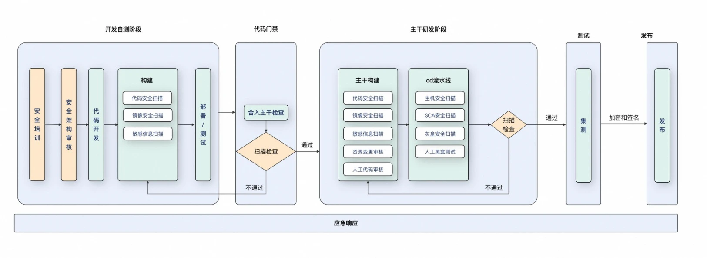

专有云的产品研发安全生命周期共分为六个关键环节：立项、设计、编码、测试、发布、应急响应。在整个产品研发过程中都嵌入安全的审核，层层把关，每个环节都有完整的审核机制，环节之间衔接紧密、责任到人，把安全融入到整个产品开发生命周期中。

## 9.1. 立项

在立项阶段，明确安全要求对于后续环节至关重要。立项阶段需要版本管理团队、安全团队和产品研发团队充分沟通，明确功能需求和产品形态，明确需要满足的安全基线要求，发现潜在的安全隐患。

立项阶段是整个项目前期，在项目前期同步需要做的就是安全培训，安全培训在整个SDL流程中十分重要。安全培训类型分为：安全意识培训、安全红线培训、安全制度培训、安全流程培训、安全平台和工具的使用等。阿里云要求产品线一号位、产品经理、项目经理、研发、运维、交付等相关人员均需学习安全培训课程并通过考试。

## 9.2. 设计

在设计环节，安全团队会辅助产品线完成安全架构的设计与评审工作。新增产品或存量产品存在架构变动时，安全团队会针对应用架构、控制台、接口交互逻辑、开源组件、使用的资源等场景进行完整的安全评审，识别出可能存在的安全风险，并给出针对性整改建议。

专有云产品安全团队内部研发架构安全评审工具，基于架构设计材料、产品基线等内容，结合AI能力辅助，自动化识别安全架构设计层面的风险。

在产品管理流程中，产品必须经过安全评审，且安全团队具备对产品设计方案的一票否决权，并将安全审核作为产品上线的关键卡点，从而保障安全要求的落地。

## 9.3. 编码

产品研发人员在编码时，必须严格遵守安全编码规范，主动接入安全团队设计并封装的安全SDK，使用统一、标准化的安全修复方案。

在编码环节，阿里云希望将多种风险扼杀在摇篮，核心措施包括：针对潜在漏洞治理，通过编码规范、IDE安全编码插件的方式，将诸如 SQL注入、命令执行等基本漏洞，尽量在编码环节规避。

## 9.4. 测试

在安全测试阶段，阿里云安全团队自主研发了黑盒、白盒和灰盒扫描工具，能够全面覆盖代码、开源组件、主机、容器镜像以及应用层等不同维度的安全扫描。

在专有云CICD Oneflow流程中也接入了安全自动化扫描能力，在编译构建阶段，系统会自动触发白盒类安全扫描，包括代码安全扫描、镜像扫描和敏感信息扫描等，这一步旨在尽早发现并修复潜在的安全问题。在部署阶段，部署完成后会自动触发黑盒类安全扫描，包括：合规类扫描、黑盒应用漏洞扫描、灰盒扫描、系统安全扫描等，同时，安全团队还会进行人工渗透测试，以进一步挖掘潜在漏洞。

在整个安全测试阶段，安全团队会详细统计每项安全扫描工具的覆盖率和成功率，确保产品所有功能组件都经过严格的安全扫描检查，这有助于保障产品的整体安全能力。

## 9.5. 发布

专有云版本发布需满足以下安全准出要求：

- 产品完成所有安全扫描/审核。

- 版本内发现的安全漏洞和安全风险均已完成修复和治理。满足后方可允许发布，不满足安全要求的产品对应的组件在版本内禁止输出/售卖。

- 符合安全准出的制品包会进行加密和签名操作，防止包在传递过程中存在篡改和伪造的风险。

## 9.6. 应急响应

版本发布后，会通过以下途径主动发现产品迭代过程中出现的新风险，并及时加固和修复：

- 漏洞情报：阿里云安全团队内部建设漏洞预警机制，依据社区情报和相关国家漏洞公开平台，实时监控最新开源组件CVE漏洞和公开漏洞情报。

- 客户现场反馈：存在客户现场咨询或反馈的安全情报或漏洞。

- 阿里安全响应中心：阿里云在2013年创立了ASRC（AlibabaSecurity Response Center，阿里巴巴安全响应中心），通过高额奖金激励白帽挖掘阿里云产品的漏洞，发现阿里云潜在的安全风险。

- 内部蓝军：基于攻防对抗思想，建立了内部红蓝对抗体系，常态化模拟最接近真实场景的攻防对抗，最大化提升平台安全性。

若发现新的安全情报和漏洞，则结合维护版本漏洞处置流程，以及产品版本生命周期和开发计划进行缺陷修复。持续维护的版本提供Hotfix，交付运维团队进行客户侧补丁升级。维护版本漏洞处置流程如下：

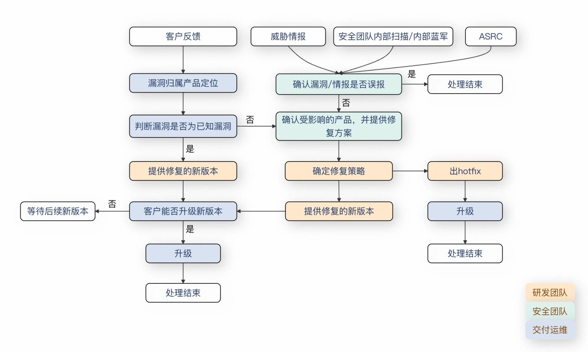

# 10.安全合规

## 10.1. 网络安全等级保护与数据安全等法律合规义务

客户使用OpenTrek专属版建设并运行业务系统的，可能适用《中华人民共和国网络安全法》《中华人民共和国数据安全法》《中华人民共和国个人信息保护法》及网络安全等级保护等法律、法规与国家标准设定的法律合规义务。上述合规义务的履行主体为客户，具体义务是否适用、如何履行，由客户结合其自身业务属性、数据类别与级别、行业监管要求自行判断与决策，客户的管理层及产品维护方应持续关注国家法律法规对客户使用OpenTrek专属版的约束。阿里云仅在本安全白皮书中对OpenTrek专属版场景下可能存在的显著合规风险进行提示，阿里云及OpenTrek专属版本身不承诺代为履行任何合规义务。

若客户需要基于OpenTrek专属版通过等级保护测评、数据安全评估等合规检查或评估，应由客户自行组织，并与其自身网络安全防护、数据加密、安全管理等能力综合考虑。OpenTrek专属版基于其产品定位，仅提供本白皮书所描述的内生安全能力（如身份认证、权限管理、日志审计等），可作为客户履行义务与应对检查的技术支撑，但产品本身不具备独立通过合规检查或评估的能力。

## 10.2. 算法备案与合规审查

客户如依托OpenTrek专属版运营具有舆论属性或社会动员能力的互联网信息服务，或应用深度合成、生成式人工智能等技术对外提供服务的，可能适用《互联网信息服务算法推荐管理规定》《互联网信息服务深度合成管理规定》《生成式人工智能服务管理暂行办法》等设定的算法备案、安全评估与合规审查等监管义务。上述义务的主体及适用性判断均在客户。客户的管理层及产品维护方应结合自身业务形态、算法使用方式与服务对象，关注并判断相关监管要求的适用性并组织履行。阿里云及OpenTrek专属版本身不承诺代为履行算法备案、安全评估、合规审查等义务，亦不就备案或审查结论作出任何承诺。

客户如需开展上述工作，应自行组织，并对备案与审查材料的真实性、准确性与完整性负责。OpenTrek专属版提供的内生安全能力（如访问控制、审计日志等）可作为客户准备相关材料、说明管理措施的支撑，但不构成产品可独立通过备案或审查的承诺。

## 10.3. 风险识别、评估与处置闭环

客户作为安全风险管理主体，应建立并运行覆盖OpenTrek专属版部署、配置、运行、运维全过程的风险识别、评估与处置闭环机制。该机制包括：定期组织漏洞扫描、配置核查、日志审计与暴露面排查等风险识别活动，结合业务系统与数据的重要程度对风险进行评估与分级，明确处置责任与时限，并完成处置、复验与记录留存。阿里云通过提供产品漏洞通报、安全补丁与版本更新、安全建议与最佳实践，支撑客户运行上述闭环，并在本安全白皮书中对可能存在的显著安全与合规风险进行提示；但风险管理闭环的发起、决策、资源投入与结果责任均由客户承担，阿里云不承诺代为实施风险识别、评估或处置。

因客户处置不及时（如：长期不升级、不修复已知漏洞等）导致的风险由客户承担相应责任。识别出的风险如涉及网络安全等级保护与数据安全等法律合规义务和算法备案与合规审查合规义务的，客户应按前述约定自行判断适用性并组织履行。
