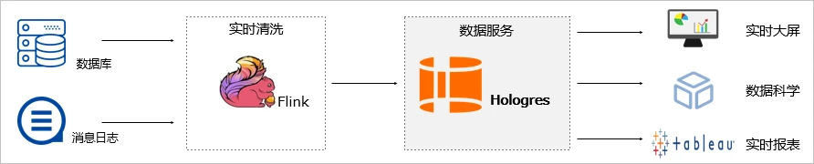
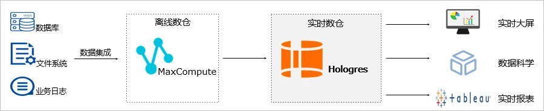
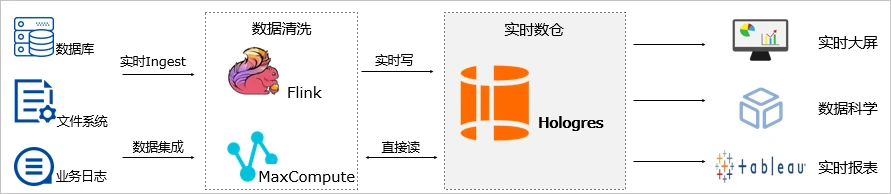

阿里云  
专有云  
实时数仓 Hologres  
产品简介  
产品版本：v3.18.6  
文档版本：20261109

**目录**

- [1.实时数仓 Hologres](#section-1)
    - [1.1. 产品详情](#section-1-1)
    - [1.2. 产品价值](#section-1-2)
    - [1.3. 应用场景](#section-1-3)
    - [1.4. 功能特性](#section-1-4)

# 1.实时数仓 Hologres

阿里云实时数仓是一款兼容PostgreSQL生态的实时交互产品，与大数据生态无缝打通，支持对PB级数据进行高并发、低延时的分析处理，轻松而经济地使用现有BI工具对数据进行多维分析透视和业务探索。

Hologres致力于高性能、高可靠、低成本、可扩展的实时计算引擎研发，为用户提供海量数据的实时数据仓库解决方案和亚秒级交互式查询服务，广泛应用在实时数据中台建设、精细化分析、自助式分析等场景。

## 1.1. 产品详情

Hologres是阿里巴巴自主研发的一站式实时数仓引擎，支持海量数据实时写入、实时更新、实时分析，支持标准SQL，支持PB级数据多维分析（OLAP）与即席分析（Ad Hoc），支持高并发低延迟的在线数据服务（Serving），提供企业级离在线一体化全栈数仓解决方案。

**多场景查询分析**

Hologres支持行存、列存等存储模式和多种索引类型，同时满足简单查询、复杂查询、即席查询等多样化的分析查询需求。Hologres使用大规模并行处理架构，分布式处理SQL，提高资源利用率，实现海量数据极速分析。

- 支持实时数据

  与阿里云实时计算深度合作，支持高并发实时写入与更新，写入速度可达亿级TPS，数据写入即可查。

- 海量数据复杂查询

  全并行计算，实现PB级数据关联分析亚秒级响应。

- 联邦查询

  无缝对接MaxCompute，无需移动数据，直接交互式分析，快速获取查询结果。可以直接单独查询MaxCompute表数据，也可以与实时数据结合进行联合计算。

**生态与可扩展性**

兼容PostgreSQL生态，与大数据计算引擎及大数据智能研发平台DataWorks无缝打通。无需额外学习，即可上手开发。

- 兼容PostgreSQL生态

  Hologres兼容PostgreSQL生态，提供JDBC/ODBC接口，轻松对接第三方ETL和BI工具，包括Quick BI、DataV、Tableau、帆软等。

- DataWorks开发集成

  Hologres与DataWorks深度集成，提供图形化、智能化、一站式的数仓搭建和交互式分析服务工具，支持数据资产、数据血缘、数据实时同步、数据服务等企业级能力。

- 达摩院Proxima向量检索

  Hologres与机器学习平台PAI紧密结合，内置达摩院Proxima向量检索插件，支持在线实时特征存储、实时召回、向量检索。

## 1.2. 产品价值

实时数仓Hologres兼容PostgreSQL生态、支持MaxCompute数据直接查询分析，支持实时写入实时查询，实时离线联邦分析，低成本、高时效、快速构筑企业实时数据仓库。

**极速响应**

PB级数据亚秒级查询响应，满足用户实时多维分析透视和业务探索需求。支持向量化计算及列存储智能索引，性能大幅优于开源系统。

**MaxCompute无缝打通**

无缝对接MaxCompute，无需移动数据，直接交互式分析，快速获取查询结果。可以单独查询MaxCompute，也可以与实时数据结合进行联合计算。

**高并发实时写入和查询**

支持高并发实时数据的实时写入和实时查询，写入速度可达数亿TPS，写入即可查。

**统一引擎架构**

采用统一的引擎架构，支持行存和列存两种存储模式，同时满足点查询、即席查询及OLAP场景。

**简单易用**

兼容PostgreSQL生态，与大数据计算引擎及智能云研发平台DataWorks无缝链接。

## 1.3. 应用场景

Hologres是一款实时交互引擎，与大数据生态无缝打通，支持海量实时和离线数据的实时分析，并兼容PostgreSQL生态，提供JDBC/ODBC接口，对接第三方BI工具，轻松实现数据的可视化分析。Hologres适用于实时数仓、MaxCompute加速查询和实时离线联邦分析等场景。

**实时数仓场景**

业务数据实时写入实时计算，并将数据进行ETL处理，再由Hologres实时查询，最终输出到第三方分析工具，实现实时数据的实时分析。

- 数据部门的实时数仓、实时大屏、实时Reporting报表分析。

- 运维和数据应用的实时监控、实时异常检测预警、实时Debug。

- 业务部门的实时风控、实时推荐、实时效果分析、实时训练等。

**MaxCompute加速查询场景**

业务数据写入离线数仓MaxCompute，由Hologres直接加速查询/导入查询，再对接BI分析工具，轻松实现离线数据的实时分析。

- MaxCompute离线数据的实时查询。

- MaxCompute 离线数据报表分析。

- MaxCompute离线数据的在线应用输出（例如RESTful API）。

**实时离线联邦分析场景**

业务数据按冷热分开存储，冷数据存储在离线数仓MaxCompute，热数据存储在Hologres，通过Hologres实现实时离线数据联邦分析，再对接BI分析工具，快速响应简单查询与复杂多维分析的业务要求。

## 1.4. 功能特性

本文主要介绍阿里云实时数仓Hologres的功能特性，帮助您快速了解产品功能。

**一级特性**

**二级特性**

**三级特性**

**特性描述**

亚秒级查询响

实时分析

支持高并发点查询、实时多维分析、多表关联分析。

应

分析应用

支持MaxCompute数据直接加速分析，同时也支持

MaxComput

异构数据源分析

e异构分析

MaxCompute数据和Hologres实时数据关联分析。

音视频分析

支持向量检索。

\\

支持专家模式

专家模式授权

支持对库、Schema、表级别的权限控制。

授权

对用户进行授

支持对用户进行授权。

权

对库、表级别

支持库、表级别的权限控制。

的权限控制

授权

对库的授权

支持对库的授权。

对表的授权

支持对表的授权。

安全控制

对角色进行授

支持对角色进行授权，可以自定义角色，把用户指定为

权

相应角色，然后针对不同角色给予不同权限。

临时AK

支持使用临时AK进行访问。

数据安全

数据溯源

支持数据血缘显示。

支持用户管理/

完全兼容PostgreSQL的权限模型，支持用户管理和安全

权限模型

访问控制

访问控制。

Hologres兼容PostgreSQL的权限模型，在此基础之

简单权限模型

内置四种角色

上，为了简化权限管理，封装了简单的权限模型。

多副本

三副本

基于Pangu的存储默认三副本，具备数据高可用能力。

支持行存、列存，支持表级别配置存储模式，实现最优化的查询性能。

存储模式

\\

数据存储

- 行存适合高并发高效点查询场景。

- 列存适合多维分析场景。

提供多种数据压缩算法。压缩效率和数据格式相关，常

数据压缩

\\

见压缩比为3~10倍。

- 提供实时数据接入API，以便进行扩展开发。

DataWorks-

- 支持关系型数据库和消息队列数据通过DataWorks数

数据集成-实时

据集成的实时同步功能进行实时全增量同步，数据写

同步

入即可查。

实时同步

Flink、Spark

支持Flink、Spark流计算实时写入，数据写入即可查。

实时写入

数据接入

支持数据高速更新能力，对指定字段（数值类型）进行

实时更新、删除

\\

更新，数据写入/更新即可查询。

copy命令

内置PostgreSQL标准COPY命令，支持数据导入导出。

批量同步

- 提供数据接入API，以便进行扩展开发。

DataWorks-数据集成-离线

- 支持DataWorks数据集成下离线同步的日志系统、数

同步

据库系统中的数据周期性批量同步。

支持非分区表、分区表定义。目前分区只支持String类型，且只支持一级分区。

分区

\\

数据生命周期管

支持数据的生命周期管理，支持快速定位、删除过期数

\\

理

据。

支持基本数据类型，包括BigInt、String、Boolean、

数据类型

\\

数据模型定义

Double、Datetime、Decimal、Array等。

支持常见的索引，客户可以根据不同列类型和业务场

索引

景，创建合适的索引，例如：bitmap索引、聚簇索引、

\\

dictionary_encoding。

视图

支持视图，暂时不支持物化视图。

\\

同城容灾

支持同城容灾

实时数仓Hologres高性能版支持同城容灾。

灾备

异地容灾

支持异地容灾

实时数仓Hologres高性能版支持异地容灾。

兼容

兼容PostgreSQL 11。

\\

PostgreSQL

支持主流BI工具，包括QuickBI、Tabeau、PowerBI、

生态兼容

主流BI工具

\\

帆软等。

主流数据开发工

支持主流数据开发工具，包括DataWorks、PSQL、

\\

具

PGAdmin、Navicat等。

平滑升级

支持平滑升级。

弹性扩缩容能

支持资源按需扩容、缩容，扩容、缩容的过程不影响在

力

运维管理

集群资源管理

线业务使用。

自V3.18.6版本开始，实时数仓Hologres接入统一云管

容量管理

平台（ASO）容量管理。

支持多种架构

支持Intel、海光和鲲鹏。

芯片

芯片一云多芯

多种芯片

支持芯片架构

支持按照集群间混布。

混布
