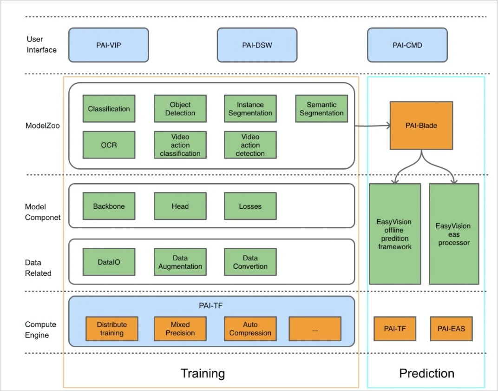
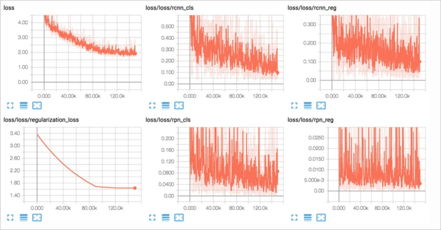
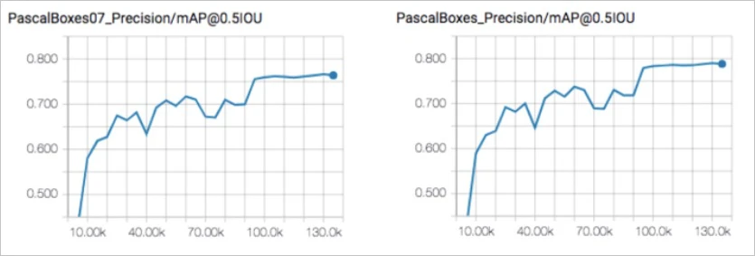
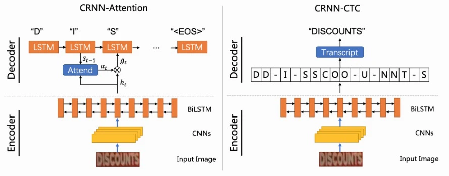

阿里云  
专有云  
机器学习PAI  
开发指南  
产品版本：v3.18.6  
文档版本：20261029

**目录**

- [1.调用示例：SDK参考](#section-1)
    - [1.1. Python SDK调用示例](#section-1-1)
        - [1.1.1. EasyVision](#section-1-1-1)
            - [1.1.1.1. 概述](#section-1-1-1-1)
            - [1.1.1.2. 快速上手](#section-1-1-1-2)
            - [1.1.1.3. 模型导出及预测](#section-1-1-1-3)
            - [1.1.1.4. 模型库](#section-1-1-1-4)
                - [1.1.1.4.1. 图像分类](#section-1-1-1-4-1)
                - [1.1.1.4.2. 物体检测](#section-1-1-1-4-2)
                - [1.1.1.4.3. 图像分割](#section-1-1-1-4-3)
                - [1.1.1.4.4. 实例分割](#section-1-1-1-4-4)
                - [1.1.1.4.5. 文字检测](#section-1-1-1-4-5)
                - [1.1.1.4.6. 文字识别](#section-1-1-1-4-6)
                - [1.1.1.4.7. 端到端的文字识别](#section-1-1-1-4-7)
            - [1.1.1.5. 配置文件样例](#section-1-1-1-5)
                - [1.1.1.5.1. 图像分类](#section-1-1-1-5-1)
                - [1.1.1.5.2. 物体检测](#section-1-1-1-5-2)
                - [1.1.1.5.3. 图像分割](#section-1-1-1-5-3)
                - [1.1.1.5.4. 实例分割](#section-1-1-1-5-4)
                - [1.1.1.5.5. 文字检测](#section-1-1-1-5-5)
                - [1.1.1.5.6. 文字识别](#section-1-1-1-5-6)
                - [1.1.1.5.7. 端到端的文字识别](#section-1-1-1-5-7)
                - [1.1.1.5.8. SavedModel评估](#section-1-1-1-5-8)
            - [1.1.1.6. API](#section-1-1-1-6)
                - [1.1.1.6.1. easy_vision.python.main](#section-1-1-1-6-1)
                - [1.1.1.6.2. easy_vision.python.data_main](#section-1-1-1-6-2)
                - [1.1.1.6.3. easy_vision.python.inference](#section-1-1-1-6-3)
                - [1.1.1.6.4. easy_vision.python.builders](#section-1-1-1-6-4)
    - [1.2. Java SDK调用示例](#section-1-2)
        - [1.2.1. SDK](#section-1-2-1)
- [2.API参考](#section-2)
    - [2.1. 概述](#section-2-1)
    - [2.2. OpenAPI](#section-2-2)
        - [2.2.1. AIWorkSpace](#section-2-2-1)
            - [2.2.1.1. UpdateWorkspace](#section-2-2-1-1)
            - [2.2.1.2. ListResources](#section-2-2-1-2)
            - [2.2.1.3. GetDefaultWorkspace](#section-2-2-1-3)
            - [2.2.1.4. ListUsers](#section-2-2-1-4)
            - [2.2.1.5. CreateWorkspace](#section-2-2-1-5)
            - [2.2.1.6. AddImage](#section-2-2-1-6)
            - [2.2.1.7. AddImageLabels](#section-2-2-1-7)
            - [2.2.1.8. GetImage](#section-2-2-1-8)
            - [2.2.1.9. ListImageLabels](#section-2-2-1-9)
            - [2.2.1.10. RemoveImage](#section-2-2-1-10)
            - [2.2.1.11. PublishImage](#section-2-2-1-11)
            - [2.2.1.12. RemoveImageLabels](#section-2-2-1-12)
            - [2.2.1.13. ListPermissions](#section-2-2-1-13)
            - [2.2.1.14. ListWorkspaceUsers](#section-2-2-1-14)
            - [2.2.1.15. CreateMember](#section-2-2-1-15)
            - [2.2.1.16. DeleteMembers](#section-2-2-1-16)
            - [2.2.1.17. AddMemberRole](#section-2-2-1-17)
            - [2.2.1.18. RemoveMemberRole](#section-2-2-1-18)
            - [2.2.1.19. CreateWorkspaceResource](#section-2-2-1-19)
            - [2.2.1.20. DeleteWorkspaceResource](#section-2-2-1-20)
            - [2.2.1.21. UpdateWorkspaceResource](#section-2-2-1-21)
            - [2.2.1.22. ListQuotas](#section-2-2-1-22)
            - [2.2.1.23. CreateDataset](#section-2-2-1-23)
            - [2.2.1.24. GetDataset](#section-2-2-1-24)
            - [2.2.1.25. UpdateDataset](#section-2-2-1-25)
            - [2.2.1.26. PublishDataset](#section-2-2-1-26)
            - [2.2.1.27. ListDatasets](#section-2-2-1-27)
            - [2.2.1.28. DeleteDataset](#section-2-2-1-28)
            - [2.2.1.29. CreateDatasetLabels](#section-2-2-1-29)
            - [2.2.1.30. DeleteDatasetLabels](#section-2-2-1-30)
            - [2.2.1.31. CreateModel](#section-2-2-1-31)
            - [2.2.1.32. ListModels](#section-2-2-1-32)
            - [2.2.1.33. DeleteModel](#section-2-2-1-33)
            - [2.2.1.34. CreateModelVersion](#section-2-2-1-34)
            - [2.2.1.35. UpdateModelVersion](#section-2-2-1-35)
            - [2.2.1.36. GetModelVersion](#section-2-2-1-36)
            - [2.2.1.37. ListModelVersions](#section-2-2-1-37)
            - [2.2.1.38. DeleteModelVersion](#section-2-2-1-38)
            - [2.2.1.39. CreateModelLabels](#section-2-2-1-39)
            - [2.2.1.40. DeleteModelLabels](#section-2-2-1-40)
            - [2.2.1.41. CreateModelVersionLabels](#section-2-2-1-41)
            - [2.2.1.42. DeleteModelVersionLabels](#section-2-2-1-42)
            - [2.2.1.43. ListMembers](#section-2-2-1-43)
            - [2.2.1.44. GetPermission](#section-2-2-1-44)
            - [2.2.1.45. ListWorkspaces](#section-2-2-1-45)
            - [2.2.1.46. DeleteWorkspace](#section-2-2-1-46)
            - [2.2.1.47. GetWorkspace](#section-2-2-1-47)
            - [2.2.1.48. GetMember](#section-2-2-1-48)
            - [2.2.1.49. DeleteMembers](#section-2-2-1-49)
            - [2.2.1.50. RemoveMemberRole](#section-2-2-1-50)
            - [2.2.1.51. AddMemberRole](#section-2-2-1-51)
            - [2.2.1.52. DeleteWorkspaceResource](#section-2-2-1-52)
            - [2.2.1.53. ListQuotas](#section-2-2-1-53)
            - [2.2.1.54. PublishDataset](#section-2-2-1-54)
            - [2.2.1.55. DeleteDatasetLabels](#section-2-2-1-55)
            - [2.2.1.56. ListImages](#section-2-2-1-56)
            - [2.2.1.57. GetImage](#section-2-2-1-57)
            - [2.2.1.58. PublishImage](#section-2-2-1-58)
            - [2.2.1.59. RemoveImageLabels](#section-2-2-1-59)
            - [2.2.1.60. ListImageLabels](#section-2-2-1-60)
            - [2.2.1.61. GetImage](#section-2-2-1-61)
            - [2.2.1.62. ListWorkspaceUsers](#section-2-2-1-62)
        - [2.2.2. EAS](#section-2-2-2)
            - [2.2.2.1. DescribeService](#section-2-2-2-1)
            - [2.2.2.2. DeleteServiceInstances](#section-2-2-2-2)
            - [2.2.2.3. StartService](#section-2-2-2-3)
            - [2.2.2.4. StopService](#section-2-2-2-4)
            - [2.2.2.5. UpdateServiceVersion](#section-2-2-2-5)
            - [2.2.2.6. ReleaseService](#section-2-2-2-6)
            - [2.2.2.7. ListServiceInstances](#section-2-2-2-7)
            - [2.2.2.8. ListServices](#section-2-2-2-8)
            - [2.2.2.9. DeleteService](#section-2-2-2-9)
            - [2.2.2.10. CreateService](#section-2-2-2-10)
            - [2.2.2.11. DeleteServiceInstances](#section-2-2-2-11)
            - [2.2.2.12. UpdateService](#section-2-2-2-12)
            - [2.2.2.13. StartService](#section-2-2-2-13)
            - [2.2.2.14. StopService](#section-2-2-2-14)
            - [2.2.2.15. DescribeServiceLog](#section-2-2-2-15)
        - [2.2.3. DLC](#section-2-2-3)
            - [2.2.3.1. StopJob](#section-2-2-3-1)
            - [2.2.3.2. ListJobs](#section-2-2-3-2)
            - [2.2.3.3. GetPodEvents](#section-2-2-3-3)
            - [2.2.3.4. GetPodLogs](#section-2-2-3-4)
            - [2.2.3.5. CreateJob](#section-2-2-3-5)

<a id="section-1"></a>

# 1.调用示例：SDK参考

<a id="section-1-1"></a>

## 1.1. Python SDK调用示例

<a id="section-1-1-1"></a>

### 1.1.1. EasyVision

<a id="section-1-1-1-1"></a>

#### 1.1.1.1. 概述

PAI-EasyVision（视觉智能增强算法包）提供多种模型的训练及预测功能，旨在帮助计算机视觉应用开发者方便快捷地构建视觉模型并应用于生产。

**背景信息**

随着深度学习技术的快速发展，计算视觉技术已经跨入大规模商业化应用阶段。对于视觉AI应用开发者而言，熟练地运用深度学习CV建模技术存在较高门槛，主要体现在以下几个方面：

- 深度学习算法代码开发成本高，对大量细节进行Debug的代价很高。

- 模型更新迭代快，理解其原理和细节需要花费大量时间。

- 算法训练和推理性能优化都需要专业的系统知识。

- 数据标注成本高。

- 在PAI上直接使用开源算法存在一定的学习和改造成本。

为此，PAI推出了一套方便且易用的CV建模框架PAI-EasyVision，旨在帮助CV应用开发者快捷地构建视觉模型并应用于生产。

**功能简介**

PAI-EasyVision核心能力体现在框架易用性、性能及模型丰富度方面：

- 易用性方面

  针对视觉任务的多样性，PAI-EasyVision支持面向多任务、模块化及可插拔的原子化功能接口，其功能涵盖了数据IO、预处理、训练及离线预测的完整建模流程。同时，您可以在PAI-Studio或PAI-DSW等多种环境中使用PAI-EasyVision。

- 性能方面

  算法封装了PAI-TF的多种优化引擎，包括分布式训练、编译优化及混合精度等，您通过简单的配置文件即可在PAI中享受极致的性能体验。同时，兼容在开源TF中使用PAI-EasyVision。

- 模型丰富度方面

  提供了大量在开源数据集上训练完成的模型，且集成了PAI中优秀的模型（例如OCR模型），进而降低开发和训练成本。

**架构**

PAI-EasyVision在Model Zoo基础上进行了大量的模型扩充，提供多种模型的训练预测能力，且支持PAI-VIP、PAI-CMD及PAI-DSW多种灵活调用方式，以满足各层次用户的建模需求。PAI-EasyVision灵活高可用的分布式流水线离线预测架构，支持上亿级别数据的快速离线处理。 同时，基于PAI的系统优化和模型优化功能，使得训练模型更小、更快地在PAI-EAS上进行预测。 此外，PAI-EasyVision支持自定义训练预测接口，以便复用已有的功能和优化工作。PAI-EasyVision的具体架构如下所示。



**特性**

- 易用性

  考虑到用户分层，有些用户希望通过简单的交互操作完成模型训练，有的用户希望定时调度模型训练和预测任务，有的用户希望复用PAI-EasyVision已有模块，在此基础上进行模型结构调整，再重新训练。因此，PAI-EasyVision支持通过PAI-VIP、PAI-CMD或PAI-DSW方式调用。

- 性能优化

  依托PAI-TF团队进行了分布式训练性能优化，支持高性能的单机多卡、多机多卡分布式运行方式。同时支持对模型进行Inference阶段优化，包括图优化及模型压缩等方式。

- 对接PAI标记平台

  PAI-EasyVision对接PAI标记平台，您可以通过提供的转换工具，方便地将PAI标记格式文件转换为TFRecord，从而进行相关任务训练。此外，PAI-EasyVision提供了丰富的数据增强模块，用于在训练时动态扩充训练数据。

- 高效的离线预测

  PAI-EasyVision提供多机流水线的预测系统，便于将PAI-EasyVision训练的模型进行离线数据处理。每个处理过程支持多机多线程加速，且各个过程异步流水线处理，极大提高了处理效率。此外，离线预测支持您自定义各个处理过程。

- 对接在线服务平台PAI-EAS

  训练过程会产出SaveModel，用户可以自行接入原有的在线预测业务系统。 同时，PAI-EAS提供了强大的在线预测服务能力，实现了PAI-EasyVision EAS Python Processor，您只需要在配置文件中配置模型地址及模型类别信息，即可进行实时数据处理。

<a id="section-1-1-1-2"></a>

#### 1.1.1.2. 快速上手

本文介绍如何安装PAI-EasyVision，及使用该算法包构建视觉模型的通用流程。

**前提条件**

已安装Python和TensorFlow。关于Python和TensorFlow的版本要求请参见使用限制。

**使用限制**

您只能在如下Python版本和TensorFlow版本的环境中，安装并使用PAI-EasyVision：

- Python版本：Python 2.7或Python 3.4及其以上版本。

- TensorFlow版本：开源TensorFlow 1.8及其以上版本或PAI-TF。

**使用流程**

1. 准备数据。

   <ol type="i">

   <li>

   在当前目录，下载Pascal数据集。

   ```text
   #⽅法⼀：使⽤OSSCMD命令下载数据集。
   osscmd downloadallobject oss://pai-vision-data-hz/data/voc0712_tfrecord/ 
   data/voc0712_tfrecord --host=oss-cn-zhangjiakou.aliyuncs.com
   #⽅法⼆：使⽤ossutil⼯具下载数据集，需要在配置⽂件中设置host为oss-cn-zhangjiakou.aliyuncs.com。
   ossutil  cp -r  oss://pai-vision-data-hz/data/voc0712_tfrecord/ data/voc0712_tfrecord
   ```

   </li>

   <li>

   在当前目录，创建文件夹并下载Resnet50预训练模型。

   ```bash
   mkdir -p pretrained_models/
   ossutil cp -r oss://pai-vision-data-hz/pretrained_models/resnet_v1d_50/ 
   pretrained_models/resnet_v1d_50
   ```

   </li>

   </ol>

2. 启动训练任务。

   - 文件配置模式

     ```python
     import easy_vision
     easy_vision.train_and_evaluate(easy_vision.RFCN_SAMPLE_CONFIG)
     ```

   - 参数配置模式

     ```python
     import easy_vision
     param_config = """
       --model_type RFCN
       --backbone  resnet_v1d_50
       --num_classes 20
       --model_dir experiments/pascal_voc/resnet50_rfcn_model
       --train_data data/voc0712_tfrecord/voc0712_part_*.tfrecord
       --test_data data/voc0712_tfrecord/VOC2007_test.tfrecord
       --num_test_example 2
       --train_batch_size 32
       --test_batch_size 1
       --image_min_sizes 600
       --image_max_sizes 1024
       --lr_type exponential_decay
       --initial_learning_rate 0.001
       --decay_epochs 20
       --staircase true"""
     easy_vision.train_and_evaluate_with_param_config(param_config)
     ```

   - PS模式在具有至少两张GPU卡的服务器中才能运行，需要启动如下3个子进程：

     - ps：parameter server。

     - master：训练过程，负责写Summary、保存Checkpoint及定期进行Evaluation。

     - worker：训练过程。

     具体脚本如下所示。

     ```python
     #-*- encoding:utf-8 -*-
     import multiprocessing
     import sys
     import os
     importeasyvision
     import json
     import logging
     import subprocess
     import time

     # train config under distributed settings
     config=easy_vision.RFCN_DISTRIBUTE_SAMPLE_CONFIG
     print('config path: %s' % config)

     # cluster spec 集群配置。
     TF_CONFIG={'cluster':{
                  'ps': ['localhost:12921'],
                  'master': ['localhost:12922'],
                  'worker': ['localhost:12923']
                 }
               }

     def job(task, gpu):
       task_name = task['type']
       # redirect python log and tf log to log_file_name
       # [logs/master.log, logs/worker.log, logs/ps.log]
       log_file_name = "logs/%s.log" % task_name

       TF_CONFIG['task'] = task
       os.environ['TF_CONFIG'] = json.dumps(TF_CONFIG)
       os.environ['CUDA_VISIBLE_DEVICES'] = gpu
       train_cmd = 'python -m easy_vision.python.train_eval --pipeline_config_path %s' % config 
       logging.info('%s > %s 2>&1 ' % (train_cmd, log_file_name))
       with open(log_file_name, 'w') as lfile:
         return subprocess.Popen(train_cmd.split(' '), stdout= lfile, stderr=subprocess.STDOUT)

     if __name__ == '__main__':
       procs = {}
       # start ps job on cpu
       task = {'type':'ps', 'index':0}
       procs['ps'] = job(task, '')
       # start master job on gpu 0
       task = {'type':'master', 'index':0}
       procs['master'] = job(task, '0')
       # start worker job on gpu 1
       task = {'type':'worker', 'index':0}
       procs['worker'] = job(task, '1')

       num_worker = 2
       for k, proc in procs.items():
         logging.info('%s pid: %d' %(k, proc.pid))
       task_failed = None 
       task_finish_cnt = 0
       task_has_finished = {k:False for k in procs.keys()}
       while True:
         for k, proc in procs.items():
           if proc.poll() is None:
             if task_failed is not None:
               logging.error('task %s failed, %s quit' % (task_failed, k))
               proc.terminate()
               if k != 'ps':
                 task_has_finished[k] = True
                 task_finish_cnt += 1
               logging.info('task_finish_cnt %d' % task_finish_cnt) 
           else:
             if not task_has_finished[k]:
               #process quit by itself
               if k != 'ps':
                 task_finish_cnt += 1
                 task_has_finished[k] = True
               logging.info('task_finish_cnt %d' % task_finish_cnt) 
               if proc.returncode != 0:
                 logging.error('%s failed' %k)
                 task_failed = k 
               else:
                 logging.info('%s run successfuly' % k)

         if task_finish_cnt >= num_worker:
           break
         time.sleep(1)
     ```

3. 使用TensorBoard观察训练过程。在模型目录下保存了模型的Checkpoint和Event File，通过TensorBoard可以查看loss及mAP等相关信息，示例如下。

   ```text
   tensorboard --port 6006 --logdir <model_dir>  [ --host 0.0.0.0 ]
   ```

   其中<strong>&lt;model_dir></strong>需要替换为实际的模型目录。TensorBoard查看的相关信息如下：

   - 训练loss

     

     其中：

     - loss：表示总loss。

     - loss/loss/rcnn_cls：表示分类loss。

     - loss/loss/rcnn_reg：表示回归loss。

     - loss/loss/regularization_loss：表示正则loss。

     - loss/loss/rpn_cls：表示RPN（Region Proposal Network）的分类loss。

     - loss/loss/rpn_reg：表示RPN（Region Proposal Network）的回归loss。

   - 测试mAP

     

     上图中分别使用了PascalBoxes07和PascalBoxes作为Metric，其中PascalBoxes07是论文中常用的Metric。

4. 评估及测试。训练完成后，您可以测试或评估训练结果：

   - 在其它数据集上进行测试，得到每张图的检测结果。

     ```python
     import easy_vision
     test_filelist = 'path/to/filelist.txt' # each line is a image file path.
     detect_results = easy_vision.predict(easy_vision.RFCN_SAMPLE_CONFIG, 
     test_filelist=test_filelist)
     ```

     其中**detect_results**包含了测试集中每张图片的测试结果，格式为<strong>[detection_boxes, box_probability, box_class]</strong>，分别指检测到的物体位置、Probability及类别。

   - 评估结果。

     ```python
     import easy_vision
     eval_metrics = easy_vision.evaluate(easy_vision.RFCN_SAMPLE_CONFIG)
     ```

     其中**eval_metrics**包含了PascalBoxes07 Metric、PascalBoxes Metric、global_step及训练loss（loss、loss/loss/rcnn_cls、loss/loss/rcnn_reg、 loss/loss/rpn_cls、loss/loss/rpn_reg及loss/loss/total_loss）。

5. 导出模型。PAI-EasyVision支持将模型导出为SavedModel格式，方便后续使用Python、C++等语言进行预测。通过如下脚本将模型导出为SaveModel格式。

   ```python
   import easy_vision
   easy_vision.export(export_dir, easy_vision.RFCN_SAMPLE_CONFIG, checkpoint_path)
   ```

   该程序会在**export_dir**路径下，以当前Unix时间戳创建模型目录，并将Checkpoint导出为SaveModel存储在该目录。

6. 预测。PAI-EasyVision提供了SavedModel的Python版本预测器。此处以检测模型（分类、分割及OCR预测器请参见本地预测）为例，使用如下代码进行模型预测。

   ```python
   import easy_vision
   detector = ev.Detector(saved_model_path)
   image = np.zeros([640, 480, 3],  dtype=np.float32)
   output_dict = detector.predict([image])
   ```

   预测结果**output_dict**以List of JSON形式输出，List的长度与输入图像的张数相等。JSON结果样例如下所示。

   ```json
   {
     "detection_boxes": [[243.5308074951172, 197.69570922851562, 385.59625244140625, 
   247.7247772216797], [292.1929931640625, 114.28043365478516, 571.2748413085938, 
   165.09771728515625]], 
     "detection_scores": [0.9942291975021362, 0.9940272569656372],
     "detection_classes": [1, 1],
     "detection_classe_names": ["text", "text"]
   }
   ```

7. 评估SavedModel。评估已导出的SavedModel，Metric会打印在控制台中。

   ```python
   from easy_vision.python.main import predictor_evaluate
   predictor_evaluate(predictor_eval_config)
   ```

   其中**predictor_eval_config**表示评估流程的配置文件，配置样例请参见SavedModel评估。

<a id="section-1-1-1-3"></a>

#### 1.1.1.3. 模型导出及预测

PAI-EasyVision支持将训练完成的模型导出为SavedModel格式，方便后续使用Python、C++等语言进行预测。本文介绍如何将模型导出为SavedModel格式、模型预测的输入输出信息及本地预测示例。

**模型导出**

执行如下Python代码即可导出模型。

```python
import easy_vision
easy_vision.export(export_dir, pipeline_config_path, checkpoint_path)
```

如果没有传入**checkpoint_path**参数，则默认使用**pipeline_config_path**中**model_dir**下的最新Checkpoint。

**模型预测的输入和输出**

使用SavedModel模型进行预测，您需要获取输入输出的Tensor节点。

**输入信息的placeholder定义**

| 参数 | 描述 | 维度 | 类型 |
| --- | --- | --- | --- |
| image | Batched图像Tensor，Channel为RGB顺序。 | \[batch_size, None, None, 3\] | tf.uint8 |
| true_image_shape | 每一张图像的真实Shape。最后一维顺序为<strong>\[height,</strong> width, channel\]例如\[\[224,224,3\], \[448, 448, <strong>3\]\]</strong>。 | \[batch_size, 3\] | tf.int32 |

其中**batch_size**为导出模型时，pipeline_config中export_config配置的batch_size。当**batch_size**取值为-1时，表示使用动态batch_size。目前仅分类模型支持动态batch_size。

**输出的Tensor信息**

预测的输出为List of JSON，且List的长度与输入图像的张数相等。各模型JSON结果的示例及说明如下所示：

- **feature_extractor**结果示例如下所示。

  ```json
  {"feature": [0.0, 0.0, 0.0, 0.0, 0.0, 0.0, 0.4583122730255127, 0.0]}
  ```

  表 1. 参数说明

  | 参数 | 描述 | 维度 | 类型 |
  | --- | --- | --- | --- |
  | feature | 输出特征。坐标顺序为<strong>\[top,</strong> <strong>left, bottom, right\]</strong>。 | \[feature_dim\] | FLOAT |

- **classifier**结果示例如下所示。

  ```json
  {
  "class": 3, 
  "class_name": "coho4",
  "class_probs": {"coho1": 4.028851974258174e-10, 
            "coho2": 0.48115724325180054, 
            "coho3": 5.116515922054532e-07, 
            "coho4": 0.5188422446937221}
  }
  ```

  表 2. 参数说明

  | 参数 | 描述 | 维度 | 类型 |
  | --- | --- | --- | --- |
  | class | 类别ID | \[\] | INT32 |
  | class_name | 类别名称 | \[\] | STRING |
  | class_probs | 所有类别的概率 | \[num_classes\] | Dict{Key: STRING, Value: FLOAT} |

- **multilabel_classifier**结果示例如下所示。

  ```json
  {
  "class": [3, 4], 
  "class_names": ["coho3", "coho4"],
  "class_probs": {"coho1": 4.028851974258174e-10, 
            "coho2": 0.10115724325180054, 
            "coho3": 0.6188422446937221, 
            "coho4": 0.5188422446937221}
  }
  ```

  表 3. 参数说明

  | 参数 | 描述 | 维度 | 类型 |
  | --- | --- | --- | --- |
  | class | 类别id | \[None\] | INT32 |
  | class_names | 类别名称 | \[None\] | STRING |
  | class_probs | 所有类别概率 | \[num_classes\] | Dict{Key: STRING, Value: FLOAT} |

- **detector**（支持实例分割）结果示例如下所示。

  ```json
  {
    "detection_boxes": [[243.5308074951172, 197.69570922851562, 385.59625244140625, 
  247.7247772216797], [292.1929931640625, 114.28043365478516, 571.2748413085938, 
  165.09771728515625]], 
    "detection_scores": [0.9942291975021362, 0.9940272569656372],
    "detection_classes": [1, 1],
    "detection_classe_names": ["text", "text"]
   }
  ```

  表 4. 参数说明

  | 参数 | 描述 | 维度 | 类型 |
  | --- | --- | --- | --- |
  | detection_boxes | 检测到的目标框，坐标顺序<strong>\[top, left, bottom,</strong> <strong>right\]</strong>。 | \[num_detections, 4\] | FLOAT |
  | detection_scores | 目标检测概率 | num_detections | FLOAT |
  | detection_classes | 目标区域类别ID | num_detections | INT |
  | detection_class_names | 目标区域类别名称 | num_detections | STRING |
  | detection_masks | 可选。目标区域分割遮罩。 | \[num_detection, image_height, image_width\] | FLOAT |
  | detection_keypoints | 可选。目标区域中的关键点。 | \[num_detection, num_keypoints, 2\] | FLOAT |
  | detection_roi_features | 可选。目标区域的局部特征图。 | \[num_detection, roi_height, roi_width, channels\] | FLOAT |

- **detector_with_rpn**结果示例如下所示。

  ```json
  {
    "proposal_boxes": [[243.5308074951172, 197.69570922851562, 385.59625244140625, 
  247.7247772216797], 243.5308074951172, 197.69570922851562, 385.59625244140625, 
  247.7247772216797],
    "proposal_scores": [0.88, 0.56],
    "detection_boxes": [[243.5308074951172, 197.69570922851562, 385.59625244140625, 
  247.7247772216797], [292.1929931640625, 114.28043365478516, 571.2748413085938, 
  165.09771728515625]], 
    "detection_scores": [0.9942291975021362, 0.9940272569656372],
    "detection_classes": [1, 1],
    "detection_classe_names": ["text", "text"]
   }
  ```

  表 5. 参数说明

  | 参数 | 描述 | 维度 | 类型 |
  | --- | --- | --- | --- |
  | proposal_boxes | proposal框 | \[num_proposal, 4\] | FLOAT |
  | proposal_scores | prososal的分 | num_proposal | FLOAT |
  | detection_boxes | 检测到的目标框，坐标顺序为<strong>\[top, left, bottom,</strong> <strong>right\]</strong>。 | \[num_detections, 4\] | FLOAT |
  | detection_scores | 目标检测概率 | num_detections | FLOAT |
  | detection_classes | 目标区域类别ID | num_detections | INT |
  | detection_class_names | 目标区域类别名称 | num_detections | STRING |

- **segmentor**结果示例如下所示。

  ```json
  {
    "probs" : [[[0.8, 0.8], [0.6, 0.7]],[[0.8, 0.5], [0.4, 0.3]]],
    "preds" : [[[1,1], [0, 0]], [[0, 0], [1,1]]]
  }
  ```

  表 6. 参数说明

  | 参数 | 描述 | 维度 | 类型 |
  | --- | --- | --- | --- |
  | probs | 分割像素点概率 | \[output_height, output_width, num_classes\] | FLOAT |
  | preds | 分割像素类别ID | \[output_height, output_widths\] | INT |

- **text_detector**结果示例如下所示。

  ```json
  {
    "detection_keypoints": [[[243.57516479492188, 198.84210205078125], [243.91038513183594, 
  247.62425231933594], [385.5513916015625, 246.61660766601562], [385.2197570800781, 
  197.79345703125]], [[292.2718200683594, 114.44700622558594], [292.2237243652344, 
  164.684814453125], [571.1962890625, 164.931640625], [571.2444458007812, 114.67433166503906]]], 
    "detection_boxes": [[243.5308074951172, 197.69570922851562, 385.59625244140625, 
  247.7247772216797], [292.1929931640625, 114.28043365478516, 571.2748413085938, 
  165.09771728515625]], 
    "detection_scores": [0.9942291975021362, 0.9940272569656372],
    "detection_classes": [1, 1],
    "detection_classe_names": ["text", "text"],
     "image_shape": [1024, 968, 3]
   }
  ```

  表 7. 参数说明

  | 参数 | 描述 | 维度 | 类型 |
  | --- | --- | --- | --- |
  | detection_boxes | 检测到的文字框，坐标顺序为<strong>\[top, left, bottom,</strong> <strong>right\]</strong>。 | \[num_detections, 4\] | FLOAT |
  | detection_scores | 文字检测概率 | num_detections | FLOAT |
  | detection_classes | 文字区域类别ID | num_detections | INT |
  | detection_class_names | 文字区域类别名称 | num_detections | STRING |
  | detection_keypoints | 检测到的文字区域四个角点，每个点的坐标为<strong>(y,x)</strong>。 | \[num_detections, 4, 2\] | FLOAT |
  | image_shape | 输入图像大小，高和宽的单位为像素。 | \[3\]，分别表示高、宽及Channel数。 | List |

- **text_recognizer**结果示例如下所示。

  ```json
  {
    "sequence_predict_ids": [1,2,2008,12],
    "sequence_predict_texts": "这是示例",
    "sequence_probability": 0.88
  }
  ```

  表 8. 参数说明

  | 参数 | 描述 | 维度 | 类型 |
  | --- | --- | --- | --- |
  | sequence_predict_ids | 单行文字识别类别id | \[text_length\] | INT |
  | sequence_predict_texts | 单行文字识别结果 | \[\] | STRING |
  | sequence_probability | 单行文字识别概率 | \[\] | FLOAT |

- **text_spotter/text_pipeline_predictor**结果示例如下所示。

  ```json
  {
    "detection_keypoints": [[[243.57516479492188, 198.84210205078125], [243.91038513183594, 
  247.62425231933594], [385.5513916015625, 246.61660766601562], [385.2197570800781, 
  197.79345703125]], [[292.2718200683594, 114.44700622558594], [292.2237243652344, 
  164.684814453125], [571.1962890625, 164.931640625], [571.2444458007812, 114.67433166503906]]], 
    "detection_boxes": [[243.5308074951172, 197.69570922851562, 385.59625244140625, 
  247.7247772216797], [292.1929931640625, 114.28043365478516, 571.2748413085938, 
  165.09771728515625]], 
    "detection_scores": [0.9942291975021362, 0.9940272569656372],
    "detection_classes": [1, 1],
    "detection_classe_names": ["text", "text"],
    "detection_texts_ids" : [[1,2,2008,12], [1,2,2008,12]],
    "detection_texts": ["这是示例", "这是示例"],
    "detection_texts_scores" : [0.88, 0.88],
    "image_shape": [1024, 968, 3]
   }
  ```

  表 9. 参数说明

  | name | 含义 | 维度 | type |
  | --- | --- | --- | --- |
  | detection_boxes | 检测到的文字框，坐标顺序为<strong>\[top, left, bottom,</strong> <strong>right\]</strong>。 | \[num_detections, 4\] | FLOAT |
  | detection_scores | 文字检测概率 | num_detections | FLOAT |
  | detection_classes | 文字区域类别id | num_detections | INT |
  | detection_class_names | 文字区域类别名称 | num_detections | STRING |
  | detection_keypoints | 检测到的文字区域四个角点，每个点的坐标为<strong>(y,x)</strong>。 | \[num_detections, 4, 2\] | FLOAT |
  | detection_texts_ids | 单行文字识别类别ID | \[num_detections, max_text_length\] | INT |
  | detection_texts | 单行文字识别结果 | \[num_detections\] | STRING |
  | detection_texts_scores | 单行文字识别概率 | \[num_detections\] | FLOAT |
  | image_shape | 输入图像大小，高和宽的单位为像素。 | \[3\]， 分别表示高、宽及Channel数。 | List |

**本地预测**

PAI-EasyVision提供Python预测接口，您可以加载导出的SavedModel模型进行预测，预测API请参见easy_vision.python.inference。本地预测的示例如下。

```text
import easy_vision as ev
import numpy as np

#识别。
saved_model_path = 'xxx/xxx'
classifier = ev.Classifier(saved_model_path)
image = np.zeros([640, 480, 3],  dtype=np.float32)
output_dict = classifier.predict([image])

#检测。
saved_model_path = 'xxx/xxx'
detector = ev.Detector(saved_model_path)
image = np.zeros([640, 480, 3],  dtype=np.float32)
output_dict = detector.predict([image])

#⽂字识别。
saved_model_path = 'xxx/xxx'
text_recognizer = ev.TextRecognizer(saved_model_path)
image = np.zeros([640, 480, 3],  dtype=np.float32)
output_dict = text_recognizer.predict([image]) 

#⽂字检测。
saved_model_path = 'xxx/xxx'
text_detector = ev.TextDetector(saved_model_path)
image = np.zeros([640, 480, 3],  dtype=np.float32)
output_dict = text_detector.predict([image]) 

#端到端⽂字识别。
saved_model_path = 'xxx/xxx'
text_spotter = ev.TextSpotter(saved_model_path)
image = np.zeros([640, 480, 3],  dtype=np.float32)
output_dict = text_spotter.predict([image]) 

#基础predictor。
saved_model_path = 'xxx/xxx'
predictor = ev.Predictor(saved_model_path)
image = np.zeros([640, 480, 3],  dtype=np.float32)
image_list = [image for i in range(10)]
batched_images, origin_shapes = predictor.batch(images)
input_data = {
  'image': batched_images,
  'true_image_shape', origin_shapes
}
output_data_dict = predictor.predict(input_data)
```

<a id="section-1-1-1-4"></a>

#### 1.1.1.4. 模型库

<a id="section-1-1-1-4-1"></a>

##### 1.1.1.4.1. 图像分类

本文使用CIFAR-10数据集，以训练resnet_v1d_50模型为例，为您介绍如何使用PAI-EasyVision训练分类模型。

**背景信息**

图像分类模块提供多种主流的卷积神经网络，用于训练图像分类任务。目前支持如下模型：

- ResNet系列

- SE-ResNet系列

- Inception系列

- Vgg系列

- MobileNet系列

- EfficientNet系列

- DarkNet系列

以上模型的性能基线如下表所示。

表 1. Benchmark

| Model | EasyVisionTop1 Acc | EasyVisionTop5 Acc |
| --- | --- | --- |
| resnet_v1a_18 | 70.94 | 89.88 |
| resnet_v1a_34 | 74.26 | 91.97 |
| resnet_v1_50 | 75.20 | 92.20 |
| resnet_v1a_50 | 77.34 | 93.64 |
| resnet_v1b_50 | 77.52 | 93.76 |
| resnet_v1c_50 | 77.90 | 94.12 |
| resnet_v1d_50 | 79.01 | 94.51 |
| resnet_v1_101 | 76.40 | 92.89 |
| resnet_v1a_101 | 78.26 | 93.97 |
| resnet_v1b_101 | 79.05 | 94.60 |
| resnet_v1c_101 | 79.49 | 94.74 |
| resnet_v1d_101 | 80.36 | 95.04 |
| resnet_v1_152 | 76.80 | 93.17 |
| resnet_v1a_152 | 79.16 | 94.69 |
| resnet_v1b_152 | 79.52 | 94.81 |
| resnet_v1c_152 | 79.93 | 94.91 |
| resnet_v1d_152 | 80.48 | 95.31 |
| SE-Resnet-v1-50 | 77.51 | 93.6 |
| SE-Resnet-v1-101 | 78.28 | 94.24 |
| SE-Resnet-v1-152 | 78.58 | 94.41 |
| inception-v1 | 69.8 | 89.6 |
| inception-v2 | 73.9 | 91.8 |
| inception-v3 | 78.0 | 93.9 |
| inception-v4 | 80.2 | 95.2 |
| mobilenet-v1-1.0_224 | 70.7 | 89.5 |
| mobilenet-v2-1.0_224 | 70.1 | 89.5 |
| mobilenet-v3-1.0_224 | 75.4 | 92.7 |
| efficientnet-b0 | 0.7750 | 0.9360 |
| efficientnet-b1 | 0.7957 | 0.9437 |
| efficientnet-b2 | 0.8044 | 0.9503 |
| efficientnet-b3 | 0.8188 | 0.9566 |
| efficientnet-b4 | 0.8330 | 0.9640 |
| efficientnet-b5 | 0.8431 | 0.9694 |
| efficientnet-b6 | 0.8477 | 0.9713 |
| efficientnet-b7 | 0.8516 | 0.9725 |
| efficientnet-b8 | 0.8545 | 0.8524 |
| darknet53 | 0.7664 | 0.9342 |
| cspdarknet53-mish | 0.7794 | 0.9425 |

**步骤一：准备数据**

1. 下载数据集。

   PAI-EasyVision提供了转换好的TFRecord格式的CIFAR-10，您可以通过如下命令将该数据集下载至data文件夹下。

   ```text
   ossutil cp -r oss://pai-vision-data-hz/data/cifar10/ data/cifar10
   ```

2. 下载Resnet50预训练模型到pretrained_models文件夹下。

   ```text
   ossutil cp -r oss://pai-vision-data-hz/pretrained_models/resnet_v1d_50/ 
   pretrained_models/resnet_v1d_50
   ```

**步骤二：训练模型**

PAI-EasyVision支持文件配置或参数配置的方式进行模型训练：

- **文件配置的形式**

  文件配置的形式指在配置文件中指定训练评估相关参数，文件配置的样例请参见图像分类。如果您需要了解配置详情，可以提交工单联系阿里云人工智能平台 PAI（原机器学习平台PAI）客服。运行如下Python代码，即可启动文件配置形式的训练评估流程。

  ```python
  import easy_vision
  easy_vision.train_and_evaluate(easy_vision.RESNET50_FINETUNE_PRETRAINED_MODELS_SAMPLE_CONFIG)
  ```

  如果您使用了自定义的配置文件，则需要将上述代码中的 `easy_vision.RESNET50_FINETUNE_PRETRAINED_MODELS_SAMPLE_CONFIG` 替换为您的配置文件路径。

- **参数配置的形式**

  参数配置的形式指在Python代码中指定训练评估相关参数。运行如下Python代码，即可启动参数配置形式的训练评估流程。

  ```python
  import easy_vision
  param_config = """
      --model_type Classification
    --backbone  resnet_v1d_50
    --num_classes 10
    --num_epochs 1
    --model_dir experiments/cifar10/resnet50_imagenet_pretrain
    --use_pretrained_model true
    --train_data data/cifar10/cifar10_train_part_*.tfrecord
    --test_data data/cifar10/cifar10_test.tfrecord
    --train_batch_size 96
    --test_batch_size 96
    --image_size 224
    --lr_type manual_step
    --initial_learning_rate 0.001
    --learning_rates 0.0003 0.0001
    --decay_epochs 35 40
    --save_checkpoint_epochs 5
    --staircase true"""
  easy_vision.train_and_evaluate_with_param_config(param_config)
  ```

  其中**param_config**包含若干模型配置参数，格式为Python Argparser。各参数具体说明如下表所示。

  > **说明**
  >
  > 所有字符串类型的参数，其取值均不加引号（""）。

  表 2. param_config参数说明

  | 参数名称 | 是否必选 | 参数描述 | 取值格式 | 默认值 |
  | --- | --- | --- | --- | --- |
  | model_type | 是 | 训练模型类型。图像分类的模型类型为<strong>Classification</strong>。 | STRING | 无 |
  | backbone | 否 | 识别模型的网络名称，取值包括：<br>• vgg_16<br>• vgg_19<br>• inception_v1<br>• inception_v2<br>• inception_v3<br>• inception_v4<br>• mobilenet_v1<br>• mobilenet_v2<br>• mobilenet_v3<br>• resnet_v1_50<br>• resnet_v1_101<br>• resnet_v1_152<br>• resnet_v2_50<br>• resnet_v2_101<br>• resnet_v2_152<br>• resnet_v1a_18<br>• resnet_v1a_34<br>• resnet_v1a_50<br>• resnet_v1a_101<br>• resnet_v1a_152<br>• resnet_v1b_50<br>• resnet_v1b_101<br>• resnet_v1b_152<br>• resnet_v1c_50<br>• resnet_v1c_101<br>• resnet_v1c_152<br>• resnet_v1d_50<br>• resnet_v1d_101<br>• resnet_v1d_152<br>• efficientnet-b0<br>• efficientnet-b1<br>• efficientnet-b2<br>• efficientnet-b3<br>• efficientnet-b4<br>• efficientnet-b5<br>• efficientnet-b6<br>• efficientnet-b7<br>• efficientnet-b8 | STRING | inception_v4 |
  | weight_decay | 否 | L2 Regularization的大小。 | FLOAT | 1e-4 |
  | num_classes | 是 | 分类类别数量。 | 100 | 无 |
  | image_size | 否 | 图片Resize后的大小。 | INT | 224 |
  | use_crop | 否 | 是否使用<strong>crop</strong>进行数据增强。 | BOOL | true |
  | crop_min_area | 否 | 随机Crop时，需要Crop框满足与原图重叠的最小阈值。 | FLOAT | 0.7 |
  | eval_each_cate gory | 否 | 是否针对每个类别单独进行评估。 | BOOL | false |
  | optimizer | 否 | 优化方法，取值包括：<br>• <strong>momentum</strong>：指<strong>sgd</strong><br>• adam | STRING | momentum |
  | lr_type | 否 | 学习率调整策略，取值包括：<br>• <strong>exponential_decay</strong>：指数衰减。<br>• <strong>polynomial_decay</strong>：多项式衰减。其中<strong>num_steps</strong>自动配置为总训练迭代次数，<strong>end_learning_rate</strong>为<strong>initial_lea</strong> <strong>rning_rate</strong>的千分之一<br>• <strong>manual_step</strong>：手动指定各阶段的学习率。通过<strong>decay_epochs </strong>指定需要调整学习率的迭代轮数，通过<strong>learning_rates</strong>指定对应迭代轮数使用的学习率。<br>• <strong>cosine_decay</strong>，通过余弦曲线调整学习率变化，最终会降到0。 | STRING | exponential_de cay |
  | initial_learning _rate | 否 | 初始学习率。 | FLOAT | 0.01 |
  | decay_epochs | 否 | 如果使用<strong>exponential_decay</strong>，该参数对应<strong>tf.train.exponential.decay</strong>中的<strong>decay_steps</strong>，系统会自动根据训练数据总数将<strong>decay_epochs</strong>转换为<strong>decay_steps</strong>。例如，取值为10，通常是总Epoch数的1/2。 如果使用<strong>manual_step</strong>，该参数表示需要调整学习率的迭代轮数。例如<strong>16 18</strong>表示在16 Epoch和18 Epoch对学习率进行调整。通常将这两个值配置为总Epoch的8/10和9/10。 | 整数列表，例如<strong>20 20 40</strong> <strong>60</strong>。 | 20 |
  | decay_factor | 否 | <strong>tf.train.exponential.decay</strong>中的<strong>decay_factor</strong>。 | FLOAT | 0.95 |
  | staircase | 否 | <strong>tf.train.exponential.decay</strong>中的<strong>staircase</strong>。 | BOOL | true |
  | power | 否 | <strong>tf.train.polynomial.decay</strong>中的<strong>power</strong>。 | FLOAT | 0.9 |
  | learning_rates | 否 | <strong>manual_step</strong>学习率调整策略中使用的参数，表示在指定Epoch中学习率的取值。 如果您指定的调整Epoch有两个，则需要在此指定两个Epoch对应的学习率。例如，如果<strong>decay_epoches</strong>为<strong>20 40</strong>，则该将参数配置为<strong>0.001 0.0001</strong>，表示在20 Epoch学习率调整为0.001，40 Epoch学习率调整为0.0001。建议几次调整的学习率依次为初始学习率的1/10、1/100及1/1000。 | 浮点列表 | 无 |
  | lr_warmup | 否 | 是否对学习率进行Warmup。 | BOOL | false |
  | lr_warm_up_ep ochs | 否 | 学习率Warmup的轮数。 | FLOAT | 1 |
  | train_data | 是 | 训练数据文件的OSS路径。 | oss://path/to/tr ain_\*.tfrecord | 无 |
  | test_data | 是 | 训练过程中，评估数据的OSS路径。 | oss://path/to/te st_\*.tfrecord | 无 |
  | train_batch_siz e | 是 | 训练的<strong>batch_size</strong>。 | INT，例如32。 | 无 |
  | test_batch_size | 是 | 评估的<strong>batch_size</strong>。 | INT，例如32。 | 无 |
  | train_num_rea ders | 否 | 训练数据并发读取线程数。 | INT | 4 |
  | model_dir | 是 | 训练的OSS目录。 | oss://path/to/m odel | 无 |
  | pretrained_mo del | 否 | 预训练模型OSS路径。如果指定该路径，则在该模型基础上Finetune。 | oss://pai-vision-data-sh/pretrained_models/incepti on_v4.ckpt | “” |
  | use_pretrained _model | 否 | 是否使用预训练模型。 | BOOL | true |
  | num_epochs | 是 | 训练迭代次数。取值<strong>1</strong>表示对所有训练数据都进行一次迭代。 | INT，例如40。 | 无 |
  | num_test_exa mple | 否 | 训练过程中评估数据条目数。取值<strong> -1</strong>表示使用所有测试数据作为评估数据。 | INT，例如2000。 | -1 |
  | num_visualizati ons | 否 | 评估过程可视化显示的样本数量。 | INT | 10 |
  | save_checkpoi nt_epochs | 否 | 保存Checkpoint的频率，以Epoch为单位。取值为<strong>1</strong>表示每完成一次训练就保存一次Checkpoint。 | INT | 1 |
  | save_summary _epochs | 否 | 保存Summary的频率，以Epoch为单位。取值为<strong>0.01</strong>表示每过1%的训练数据就保存一次Summary。 | FLOAT | 0.01 |
  | num_train_ima ges | 否 | 总的训练样本数。如果使用自己生成的TFRecord，则需要指定该参数。 | INT | 0 |
  | label_map_pat h | 否 | 类别映射文件。如果使用自己生成的TFRecord，则需要指定该参数。 | STRING | ”” |

<a id="section-1-1-1-4-2"></a>

##### 1.1.1.4.2. 物体检测

本文使用VOC数据集，以训练FasterRCNN模型为例，介绍如何使用PAI-EasyVision训练一个物体检测模型。

**背景信息**

物体检测模块提供了多种模型用于通用物体检测任务，即检测图片中感兴趣的物体目标区域。目前支持的模型包括：

- FasterRCNN系列

- SSD系列

- YOLO系列

以上模型在VOC数据集及COCO 2017数据集上的性能基线分别如下表所示。

表 1. Benchmark（VOC Dataset）

- TrainSet：voc07+12 trainval

- TestSet：voc07 test

| 模型名称 | 输入图片尺寸 | mAP@IOU0.5 |
| --- | --- | --- |
| faster-rcnn-resnet50 | 600x1024 | 0.790 |
| faster-rcnn-resnet50-ohem | 600x1024 | 0.796 |
| faster-rcnn-resnet50-fpn | 600x1024 | 0.798 |
| rfcn-resnet50 | 600x1024 | 0.764 |
| ssd-vgg16 | 300x300 | 0.777 |
| ssd-vgg16 | 512x512 | 0.801 |
| ssd-resnet50 | 300x300 | 0.749 |
| ssd-resnet50-fpn | 300x300 | 0.762 |

表 2. Benchmark（COCO 2017）

- TrainSet：train 118k

- TestSet：test 5k

| 模型名称 | 输入图片尺寸 | mAP@IOU0.5 |
| --- | --- | --- |
| faster-rcnn-resnet50 | 800x1333 | 0.34 |
| ssd-mobilenet-v1 | 512x512 | 0.21 |

**步骤一：准备数据**

1. 下载数据集。

   PAI-EasyVision提供了转换好的TFRecord格式的VOC，您可以通过如下命令将该数据集下载至data文件夹下。

   ```text
   ossutil  cp -r  oss://pai-vision-data-hz/data/voc0712_tfrecord/ data/voc0712_tfrecord
   ```

2. 下载Resnet50预训练模型到pretrained_models文件夹下。

   ```text
   ossutil cp -r oss://pai-vision-data-hz/pretrained_models/resnet_v1d_50/ 
   pretrained_models/resnet_v1d_50
   ```

**步骤二：训练模型**

PAI-EasyVision支持文件配置或参数配置的方式进行模型训练：

- **文件配置的形式**

  文件配置的形式指在配置文件中指定训练评估相关参数，文件配置的样例请参见物体检测。如果您需要了解配置详情，可以提交工单联系阿里云人工智能平台 PAI（原机器学习平台PAI）客服。运行如下Python代码，即可启动文件配置形式的训练评估流程。

  ```python
  import easy_vision
  easy_vision.train_and_evaluate(easy_vision.FASTER_RCNN_SAMPLE_CONFIG)
  ```

  如果您使用了自定义的配置文件，则需要将上述代码中的 `easy_vision.FASTER_RCNN_SAMPLE_CONFIG` 替换为您的配置文件路径。

- **参数配置的形式**

  参数配置的形式指在Python代码中指定训练评估相关参数。运行如下Python代码，即可启动参数配置形式的训练评估流程。

  ```python
  import easy_vision
  param_config = """
    --model_type FasterRCNN
    --backbone  resnet_v1d_50
    --num_classes 20
    --model_dir experiments/pascal_voc/resnet50_frcnn_model
    --train_data data/voc0712_tfrecord/voc0712_part_*.tfrecord
    --test_data data/voc0712_tfrecord/VOC2007_test.tfrecord
    --num_test_example 2
    --train_batch_size 32
    --test_batch_size 1
    --image_min_sizes 600
    --image_max_sizes 1024
    --lr_type exponential_decay
    --initial_learning_rate 0.001
    --decay_epochs 20
    --staircase true"""
  easy_vision.train_and_evaluate_with_param_config(param_config)
  ```

  其中**param_config**包含若干模型配置参数，格式为Python Argparser。各参数具体说明如下表所示。

  > **说明**
  >
  > 所有字符串类型的参数，其取值均不加引号（""）。

  表 3. param_config参数说明

  | 参数名称 | 是否必选 | 描述 | 参数值格式 | 默认值 |
  | --- | --- | --- | --- | --- |
  | model_type | 是 | 训练模型类型，取值包括：<br>• SSD<br>• FasterRCNN<br>• RFCN | STRING | 无 |
  | backbone | 是 | 检测模型使用的Bkbone，取值包括：<br>• mobilenet_v1<br>• resnet_v1_50<br>• resnet_v1_101<br>• resnet_v1a_18<br>• resnet_v1a_34<br>• resnet_v1d_50<br>• resnet_v1d_101<br>• vgg16 _reduce_fc | STRING | 无 |
  | weight_decay | 否 | L2 Regularization的大小。 | FLOAT | 1e-4 |
  | use_fpn | 否 | 是否使用FPN。 | BOOL | false |
  | num_classes | 否 | 检测类别数目，不包括默认背景分类。 | INT | 无 |
  | anchor_scales | 否 | Anchor框大小，与Resize后的输入图片尺度相同。如果使用普通SSD，则无需指定该参数。如果使用FPN，则仅需为该参数指定一个值，表示分辨率最高Layer的Anchor大小，共5个Layer，后面每个Layer的Anchor大小为前一Layer的2倍。例如<strong>32,64,128,256,512</strong>。如果使用FasterRCNN或RFCN（不包括FPN），则可以任意指定多个Anchor大小。例如<strong>128 256 512</strong>。 | 浮点列表。例如，<strong>32</strong>（单一尺度 ）或<strong>128</strong> <strong>256 512</strong>（ 多个尺度 ）。 | • SSD：输入大小的<strong>\[0.1 0.2</strong> 0.37 0.54 0.71 0.88 0.96 <strong>1.0\]</strong>倍。<br>• FPN：32<br>• FasterRCNN FPN：32<br>• FasterRCNN RFCN：<strong>\[128</strong> 256 512\] |
  | anchor_ratios | 否 | Anchor宽高比。 | 浮点列表 | 0.5 1 2 |
  | image_sizes | 否 | 输入图片缩放大小，仅使用SSD时，该参数生效。取值为长度等于2的列表，分别表示高和宽，单位为像素。 | 浮点列表 | 300 300 |
  | image_min_siz es | 否 | 图片缩放大小最短边（FasterRCNN和RFCN使用该参数），单位为像素。为支持Multi-Scale Training，如果输入多个Size时，则前N-1个作为训练配置，最后一个作为评估测试配置。否则训练与评估使用相同配置。 | 浮点列表 | 600 |
  | image_max_siz es | 否 | 图片缩放大小最长边（FasterRCNN和RFCN使用该参数），单位为像素。为支持Multi-Scale Training，如果输入多个Size时，则前N-1个作为训练配置，最后一个作为评估测试配置。否则训练与评估使用相同配置。 | 浮点列表 | 1024 |
  | optimizer | 否 | 优化方法，取值包括：<br>• <strong>momentum</strong>：指<strong>sgd</strong><br>• adam | STRING | momentum |
  | lr_type | 否 | 学习率调整策略，取值包括：<br>• <strong>exponential_decay</strong>：指数衰减。<br>• <strong>polynomial_decay</strong>：多项式衰减。其中<strong>num_steps</strong>自动配置为总训练迭代次数，<strong>end_learning_rate</strong>为<strong>initial_lea</strong> <strong>rning_rate</strong>的千分之一<br>• <strong>manual_step</strong>：手动指定各阶段的学习率。通过<strong>decay_epochs </strong>指定需要调整学习率的迭代轮数，通过<strong>learning_rates</strong>指定对应迭代轮数使用的学习率。<br>• cosine_decay通过余弦曲线调整<strong>lr</strong>。通过<strong>decay_epochs</strong>指定需要调整学习率的迭代轮数。 | STRING | exponential_de cay |
  | initial_learning _rate | 否 | 初始学习率。 | 浮点数 | 0.01 |
  | decay_epochs | 否 | 如果使用<strong>exponential_decay</strong>，该参数对应<strong>tf.train.exponential.decay</strong>中的<strong>decay_steps</strong>，系统会自动根据训练数据总数将<strong>decay_epochs</strong>转换为<strong>decay_steps</strong>。例如，取值为10，通常是总Epoch数的1/2。如果使用<strong>manual_step</strong>，该参数表示需要调整学习率的迭代轮数。例如<strong>16 18</strong>表示在16 Epoch和18 Epoch对学习率进行调整。通常将这两个值配置为总Epoch的8/10和9/10。 | 整数列表，例如<strong>20 20 40</strong> <strong>60</strong>。 | 20 |
  | decay_factor | 否 | <strong>tf.train.exponential.decay</strong>中的<strong>decay_factor</strong>。 | FLOAT | 0.95 |
  | staircase | 否 | <strong>tf.train.exponential.decay</strong>中的<strong>staircase</strong>。 | BOOL | true |
  | power | 否 | <strong>tf.train.polynomial.decay</strong>中的<strong>power</strong>。 | FLOAT | 0.9 |
  | learning_rates | 否 | <strong>manual_step</strong>学习率调整策略中使用的参数，表示在指定Epoch中学习率的取值。 如果您指定的调整Epoch有两个，则需要在此指定两个Epoch对应的学习率。例如，如果<strong>decay_epoches</strong>为<strong>20 40</strong>，则该将参数配置为<strong>0.001 0.0001</strong>，表示在20 Epoch学习率调整为0.001，40 Epoch学习率调整为0.0001。建议几次调整的学习率依次为初始学习率的1/10、1/100及1/1000。 | 浮点列表 | 无 |
  | lr_warmup | 否 | 是否对学习率进行Warmup。 | BOOL | false |
  | lr_warm_up_ep ochs | 否 | 学习率Warmup的轮数。 | FLOAT | 1 |
  | train_data | 是 | 训练数据文件的OSS路径。 | oss://path/to/tr ain_\*.tfrecord | 无 |
  | test_data | 是 | 训练过程中评估数据的OSS路径。 | oss://path/to/te st_\*.tfrecord | 无 |
  | train_batch_siz e | 是 | 训练的<strong>batch_size</strong>。 | INT，例如32。 | 无 |
  | test_batch_size | 是 | 评估的<strong>batch_size</strong>。 | INT，例如32。 | 无 |
  | train_num_rea ders | 否 | 训练数据并发读取线程的数量。 | INT | 4 |
  | model_dir | 是 | 训练使用的OSS目录。 | oss://path/to/m odel | 无 |
  | pretrained_mo del | 否 | 预训练模型的OSS路径。如果指定该参数，则系统在此模型基础上Finetune。 | oss://pai-vision-data-sh/pretrained_models/incepti on_v4.ckpt | “” |
  | use_pretrained _model | 否 | 是否使用预训练模型。 | BOOL | true |
  | num_epochs | 是 | 训练迭代轮数。取值<strong>1</strong>表示对所有训练数据都进行一次迭代。 | INT，例如40。 | 无 |
  | num_test_exa mple | 否 | 训练过程中评估数据条目数。取值<strong> -1</strong>表示使用所有测试数据作为评估数据。 | INT，例如2000。 | -1 |
  | num_visualizati ons | 否 | 评估过程可视化显示的样本数量。 | INT | 10 |
  | save_checkpoi nt_epochs | 否 | 保存Checkpoint的频率，以Epoch为单位。取值为<strong>1</strong>表示每完成一次训练就保存一次Checkpoint。 | INT | 1 |
  | save_summary _epochs | 否 | 保存Summary的频率，以epoch为单位。取值为<strong>0.01</strong>表示每迭代1%的训练数据就保存一次Summary。 | FLOAT | 0.01 |
  | num_train_ima ges | 否 | 总的训练样本数。如果使用自己生成的TFRecord，则需要指定该参数。 | INT | 0 |
  | label_map_pat h | 否 | 类别映射文件。如果使用自己生成的TFRecord，则需要指定该参数。 | STRING | ”” |

<a id="section-1-1-1-4-3"></a>

##### 1.1.1.4.3. 图像分割

本文使用VOC数据集，以训练deeplab v3+模型为例，介绍如何使用PAI-EasyVision训练一个图像分割模型。

**背景信息**

图像分割（Semantic Segmentation）是指将图像分成若干具有相似性质的区域，评价标准是mIOU。PAI-EasyVision实现了deeplab v3+模型。

**步骤一：准备数据**

1. 下载数据集。

   PAI-EasyVision提供了转换好的TFRecord格式的VOC，您可以通过如下命令将该数据集下载至data文件夹下。

   ```text
   # 下载⽂件到pascal_voc_seg。
   ossutil cp -r  oss://pai-vision-data-hz/data/pascal_voc_seg/ data/pascal_voc_seg
   # 下载⽂件到pascal_voc_seg_aug。
   ossutil cp -r  oss://pai-vision-data-hz/data/pascal_voc_seg_aug/ data/pascal_voc_seg_aug
   ```

2. 下载Resnet101预训练模型到pretrained_models文件夹下。

   ```text
   ossutil cp -r oss://pai-vision-data-hz/pretrained_models/resnet_v1d_101/ 
   pretrained_models/resnet_v1d_101
   ```

**步骤二：训练模型**

PAI-EasyVision支持文件配置或参数配置的方式进行模型训练：

- **文件配置的形式**

  文件配置的形式指在配置文件中指定训练评估相关参数，文件配置的样例请参见图像分割。如果您需要了解配置详情，可以提交工单联系阿里云人工智能平台 PAI（原机器学习平台PAI）客服。运行如下Python代码，即可启动文件配置形式的训练评估流程。

  ```python
  import easy_vision
  # 训练第⼀个步骤。
  easy_vision.train_and_evaluate(easy_vision.DEEPLAB_SAMPLE_CONFIG_STEP1)
  # 完成之后，调⽤第⼆个步骤。
  easy_vision.train_and_evaluate(easy_vision.DEEPLAB_SAMPLE_CONFIG_STEP2)
  ```

  如果您使用了自定义的配置文件，则需要将上述代码中的 `easy_vision.DEEPLAB_SAMPLE_CONFIG_STEP1` 和 `easy_vision.DEEPLAB_SAMPLE_CONFIG_STEP2` 替换为您的配置文件路径。

- **参数配置的形式**

  参数配置的形式指在Python代码中指定训练评估相关参数。运行如下Python代码，即可启动参数配置形式的训练评估流程。

  ```python
  import easy_vision
  param_config = """
    --model_type DeeplabV3
    --backbone  resnet_v1d_101
    --backbone_feature_stride 16
    --bn_trainable true
    --num_classes 21
    --num_epochs 1
    --model_dir experiments/pascal_voc/deeplab_stage1
    --train_data data/pascal_voc_seg_aug/voc_ev_train.tfrecord
    --test_data data/pascal_voc_seg_aug/voc_ev_val.tfrecord
    --num_test_example 2
    --train_batch_size 6
    --test_batch_size 1
    --image_crop_size 513
    --lr_type polynomial_decay
    --initial_learning_rate 0.007
    --power 0.9"""
  easy_vision.train_and_evaluate_with_param_config(param_config)
  ```

  其中**param_config**包含若干模型配置参数，格式为Python Argparser。各参数具体说明如下表所示。

  > **说明**
  >
  > 所有字符串类型的参数，其取值均不加引号（""）。

  表 1. param_config参数说明

  | 参数名称 | 是否必选 | 描述 | 参数值格式 | 默认值 |
  | --- | --- | --- | --- | --- |
  | model_type | 是 | 训练模型类型，目前PAI-EasyVision在图像分割 中仅支持<strong>DeeplabV3</strong>。 | STRING | 无 |
  | backbone | 是 | 分割模型使用的Backbone，取值包括：<br>• resnet_v1_50<br>• resnet_v1_101<br>• resnet_v1a_18<br>• resnet_v1a_34<br>• resnet_v1d_50<br>• resnet_v1d_101<br>• xception_41<br>• xception_65<br>• xception_71 | STRING | 无 |
  | weight_decay | 否 | L2 Regularization的大小。 | FLOAT | 1e-4 |
  | num_classes | 否 | 分割类别数目，包括背景类。 | INT | 无 |
  | backbone_feat ure_stride | 否 | 主干网络的特征分辨率（下采样步长）。 | INT | 16 |
  | bn_trainable | 否 | BN是否可以训练。通常<strong>train_batch_size</strong>大于8时，需要将该参数配置为<strong>true</strong>。 | BOOL | true |
  | image_crop_siz e | 否 | 图片裁剪后的大小。 | INT | 513 |
  | optimizer | 否 | 优化方法，取值包括：<br>• <strong>momentum</strong>：指<strong>sgd</strong><br>• adam | STRING | momentum |
  | lr_type | 否 | 学习率调整策略，取值包括：<br>• <strong>exponential_decay</strong>：指数衰减。<br>• <strong>polynomial_decay</strong>：多项式衰减。其中<strong>num_steps</strong>自动配置为总训练迭代次数，<strong>end_learning_rate</strong>为<strong>initial_lea</strong> <strong>rning_rate</strong>的千分之一。<br>• <strong>manual_step</strong>：手动指定各阶段的学习率。通过<strong>decay_epochs </strong>指定需要调整学习率的迭代轮数，通过<strong>learning_rates</strong>指定对应迭代轮数使用的学习率。<br>• cosine_decay通过余弦曲线调整<strong>lr</strong>。通过<strong>decay_epochs</strong>指定需要调整学习率的迭代轮数。 | STRING | exponential_de cay |
  | initial_learning _rate | 否 | 初始学习率。 | 浮点数 | 0.01 |
  | decay_epochs | 否 | 如果使用<strong>exponential_decay</strong>，该参数对应<strong>tf.train.exponential.decay</strong>中的<strong>decay_steps</strong>，系统会自动根据训练数据总数将<strong>decay_epochs</strong>转换为<strong>decay_steps</strong>。例如，取值为10，通常是总Epoch数的1/2。 如果使用<strong>manual_step</strong>，该参数表示需要调整学习率的迭代轮数。例如<strong>16 18</strong>表示在16 Epoch和18 Epoch对学习率进行调整。通常将这两个值配置为总Epoch的8/10和9/10。 | 整数列表，例如<strong>20 20 40</strong> <strong>60</strong>。 | 20 |
  | decay_factor | 否 | <strong>tf.train.exponential.decay</strong>中的<strong>decay_factor</strong>。 | FLOAT | 0.95 |
  | staircase | 否 | <strong>tf.train.exponential.decay</strong>中的<strong>staircase</strong>。 | BOOL | true |
  | power | 否 | <strong>tf.train.polynomial.decay</strong>中的<strong>power</strong>。 | FLOAT | 0.9 |
  | learning_rates | 否 | <strong>manual_step</strong>学习率调整策略中使用的参数，表示在指定Epoch中学习率的取值。 如果您指定的调整Epoch有两个，则需要在此指定两个Epoch对应的学习率。例如，如果<strong>decay_epoches</strong>为<strong>20 40</strong>，则该将参数配置为<strong>0.001 0.0001</strong>，表示在20 Epoch学习率调整为0.001，40 Epoch学习率调整为0.0001。建议几次调整的学习率依次为初始学习率的1/10、1/100及1/1000。 | 浮点列表 | 无 |
  | lr_warmup | 否 | 是否对学习率进行Warmup。 | BOOL | false |
  | lr_warm_up_ep ochs | 否 | 学习率Warmup的轮数。 | FLOAT | 1 |
  | train_data | 是 | 训练数据文件的OSS路径。 | oss://path/to/tr ain_\*.tfrecord | 无 |
  | test_data | 是 | 训练过程中评估数据的OSS路径。 | oss://path/to/te st_\*.tfrecord | 无 |
  | train_batch_siz e | 是 | 训练的<strong>batch_size</strong>。 | INT，例如32。 | 无 |
  | test_batch_size | 是 | 评估的<strong>batch_size</strong>。 | INT，例如32。 | 无 |
  | train_num_rea ders | 否 | 训练数据并发读取线程的数量。 | INT | 4 |
  | model_dir | 是 | 训练使用的OSS目录。 | oss://path/to/m odel | 无 |
  | pretrained_mo del | 否 | 预训练模型的OSS路径。如果指定该参数，则系统在此模型基础上Finetune。 | oss://pai-vision-data-sh/pretrained_models/incepti on_v4.ckpt | “” |
  | use_pretrained _model | 否 | 是否使用预训练模型。 | BOOL | true |
  | num_epochs | 是 | 训练迭代轮数。取值<strong>1</strong>表示对所有训练数据都进行一次迭代。 | INT，例如40。 | 无 |
  | num_test_exa mple | 否 | 训练过程中评估数据条目数。取值<strong> -1</strong>表示使用所有测试数据作为评估数据。 | INT，例如2000。 | -1 |
  | num_visualizati ons | 否 | 评估过程可视化显示的样本数量。 | INT | 10 |
  | save_checkpoi nt_epochs | 否 | 保存Checkpoint的频率，以Epoch为单位。取值为<strong>1</strong>表示每完成一次训练就保存一次Checkpoint。 | INT | 1 |
  | save_summary _epochs | 否 | 保存Summary的频率，以epoch为单位。取值为<strong>0.01</strong>表示每迭代1%的训练数据就保存一次Summary。 | FLOAT | 0.01 |
  | num_train_ima ges | 否 | 总的训练样本数。如果使用自己生成的TFRecord，则需要指定该参数。 | INT | 0 |
  | label_map_pat h | 否 | 类别映射文件。如果使用自己生成的TFRecord，则需要指定该参数。 | STRING | ”” |

<a id="section-1-1-1-4-4"></a>

##### 1.1.1.4.4. 实例分割

本文使用COCO数据集，以训练MaskRCNN模型为例，介绍如何使用PAI-EasyVision训练一个实例分割模型。

**背景信息**

实例分割模型不仅能够检测出目标物体，而且能够逐像素地预测物体位置（如下图所示）。目前，PAI-EasyVision仅支持MaskRCNN系列模型。


**步骤一：准备数据**

1. 下载数据集。

   PAI-EasyVision提供了转换好的TFRecord格式的COCO，您可以通过如下命令将该数据集下载至data文件夹下。

   ```text
   ossutil  cp -r  oss://pai-vision-data-hz/data/coco_wmask/ data/coco_wmask
   ```

2. 下载Resnet50预训练模型到pretrained_models文件夹下。

   ```text
   ossutil cp -r oss://pai-vision-data-hz/pretrained_models/resnet_v1d_50/ 
   pretrained_models/resnet_v1d_50
   ```

**步骤二：训练模型**

您可以在配置文件中指定训练评估相关参数，以控制训练评估流程，配置文件的样例请参见实例分割。如果您需要了解配置详情，可以提交工单联系阿里云人工智能平台 PAI（原机器学习平台PAI）客服。运行如下Python代码，即可启动训练评估流程。

```python
import easy_vision
easy_vision.train_and_evaluate(easy_vision.MASK_RCNN_SAMPLE_CONFIG)
```

如果您使用了自定义的配置文件，则需要将上述代码中的 `easy_vision.MASK_RCNN_SAMPLE_CONFIG` 替换为您的配置文件路径。

<a id="section-1-1-1-4-5"></a>

##### 1.1.1.4.5. 文字检测

本文使用ICDAR2015数据集，以训练KeypointRCNN模型为例，介绍如何使用PAI-EasyVision训练一个文字检测模型。

**背景信息**

对于复杂场景的文字识别，首先需要定位文字的位置，即文字检测。PAI-EasyVision支持自研的文字检测模型KeypointRCNN，相比通用图像检测的FasterRCNN，KeypointRCNN模型可以预测文本的角点和方向，从而解决了倾斜、畸变文字的检测问题。文字检测的算法架构如下图所示。


**步骤一：准备数据**

1. 下载数据集。

   PAI-EasyVision提供了转换好的TFRecord格式的ICDAR 2015，您可以通过如下命令将该数据集下载至data文件夹下。

   ```text
   ossutil cp -r oss://pai-vision-data-hz/data/icdar_detection_tfrecords/ 
   data/icdar_detection_tfrecords
   ```

2. 下载Resnet50预训练模型到pretrained_models文件夹下。

   ```text
   ossutil cp -r oss://pai-vision-data-hz/pretrained_models/resnet_v1d_50/ 
   pretrained_models/resnet_v1d_50
   ```

**步骤二：训练模型**

PAI-EasyVision支持文件配置或参数配置的方式进行模型训练：

- **文件配置的形式**

  文件配置的形式指在配置文件中指定训练评估相关参数，文件配置的样例请参见文字检测。如果您需要了解配置详情，可以提交工单联系阿里云人工智能平台 PAI（原机器学习平台PAI）客服。运行如下Python代码，即可启动文件配置形式的训练评估流程。

  ```python
  import easy_vision
  easy_vision.train_and_evaluate(easy_vision.TEXT_KRCNN_SAMPLE_CONFIG_ICDARCH4)
  ```

  如果您使用了自定义的配置文件，则需要将上述代码中的 `easy_vision.TEXT_KRCNN_SAMPLE_CONFIG_ICDARCH4` 替换为您的配置文件路径。

- **参数配置的形式**

  参数配置的形式指在Python代码中指定训练评估相关参数。运行如下Python代码，即可启动参数配置形式的训练评估流程。

  ```python
  import easy_vision
  param_config = """
    --model_type TextKRCNN
    --backbone  resnet_v1d_50
    --num_classes 1
    --num_steps 10
    --use_pretrained_model true
    --train_batch_size 1
    --test_batch_size 1
    --image_min_sizes 960
    --image_max_sizes 1440
    --initial_learning_rate 0.00001
    --optimizer adam
    --lr_type exponential_decay
    --decay_epochs 40
    --decay_factor 0.5
    --staircase true
    --train_data oss://pai-vision-data-hz/data/icdar_detection_tfrecords/icdar_training_*.tfrecord
    --test_data oss://pai-vision-data-hz/data/icdar_detection_tfrecords/icdar-ch4-test.tfrecord
    --model_dir oss://pai-vision-data-hz/test/icdar_ch4/text_krcnn_resnet50_fpn"""
  easy_vision.train_and_evaluate_with_param_config(param_config)
  ```

  其中**param_config**包含若干模型配置参数，格式为Python Argparser。各参数具体说明如下表所示。

  > **说明**
  >
  > 所有字符串类型的参数，其取值均不加引号（""）。

  表 1. param_config参数说明

  | 参数名称 | 是否必选 | 参数描述 | 取值格式 | 默认值 |
  | --- | --- | --- | --- | --- |
  | model_type | 是 | 训练模型类型。文字检测的模型类型为<strong>TextKRCNN</strong>。 | STRING | 无 |
  | backbone | 是 | 文字检测的网络名称，取值包括：<br>• resnet_v1_50<br>• resnet_v1_101 | STRING | 无 |
  | weight_decay | 否 | L2 Regularization的大小。 | FLOAT | 1e-4 |
  | num_classes | 否 | 检测类别数量，默认从数据集中分析得到。 | INT | -1 |
  | anchor_scales | 否 | Anchor框的大小，与Resize后的输入图片尺度相同，配置该参数取值时，可以参考输入图片Resize后的大小。该参数仅支持填写一个值，表示分辨率最高Layer的Anchor大小，一共有5个Layer，后面每个Layer的Anchor大小是前面Layer的2倍。例如32、64,、128、256、512。 | 浮点列表 | 24 |
  | anchor_ratios | 否 | Anchor宽高比。 | 浮点列表 | 0.2 0.5 1 2 5 |
  | predict_text_di rection | 否 | 是否预测文字行朝向。 | BOOL | false |
  | text_direction_trainable | 否 | 是否训练文字行朝向预测。 | BOOL | false |
  | text_direction_type | 否 | 文字行朝向预测的策略：<br>• <strong>normal</strong>：贪婪预测文字行方向。<br>• <strong>unified</strong>：预测时，将所有文字行朝向进行投票，得到统一的文字行方向。<br>• <strong>smart_unified</strong>：预测时，将除高大于宽两倍的文字行朝向进行投票，得到统一的文字行方向。 | STRING | normal |
  | aspect_ratio_m in_jitter_coef | 否 | 训练时，随机扰动图像宽高比的最小比例。如果设置为0，则表示关闭随机扰动图像宽高比。 | FLOAT | 0.8 |
  | aspect_ratio_m ax_jitter_coef | 否 | 训练时，随机扰动图像宽高比的最大比例。如果设置为0，则表示关闭随机扰动图像宽高比。 | FLOAT | 1.2 |
  | random_rotatio n_angle | 否 | 训练时，随机旋转图像的角度，取<strong>(-angle,</strong> <strong>angle)</strong>范围内的随机值。如果设置为0，则表示关闭随机旋转图像。 | FLOAT | 10 |
  | random_crop_min_area | 否 | 训练时，随机裁切图像的最小面积占比约束。如果设置为0，则表示关闭随机裁切图像。 | FLOAT | 0.1 |
  | random_crop_max_area | 否 | 训练时，随机裁切图像的最大面积占比约束。如果设置为0，则表示关闭随机裁切图像。 | FLOAT | 1.0 |
  | random_crop_min_aspect_rat io | 否 | 训练时，随机裁切图像的最小宽高比约束。如果设置为0，则表示关闭随机裁切图像。 | FLOAT | 0.2 |
  | random_crop_max_aspect_ra tio | 否 | 训练时，随机裁切图像的最大宽高比约束。如果设置为0，则表示关闭随机裁切图像。 | FLOAT | 5 |
  | image_min_siz es | 否 | 图片缩放大小最短边。为了支持Multi-Scale Training，当输入多个size时，前n-1个作为训练的配置，最后一个作为评估测试的配置。否则，训练评估使用相同配置。 | 浮点列表 | 800 |
  | image_max_siz es | 否 | 图片缩放大小最长边。为了支持Multi-Scale Training，当输入多个size时，前n-1个作为训练的配置，最后一个作为评估测试的配置。否则，训练评估使用相同配置。 | 浮点列表 | 1200 |
  | random_distort _color | 否 | 是否在训练时随机扰动图片的亮度、对比度及饱和度。 | BOOL | true |
  | optimizer | 否 | 优化方法，取值包括：<br>• <strong>momentum</strong>：指<strong>sgd</strong><br>• adam | STRING | momentum |
  | lr_type | 否 | 学习率调整策略，取值包括：<br>• <strong>exponential_decay</strong>：指数衰减。<br>• <strong>polynomial_decay</strong>：多项式衰减。其中<strong>num_steps</strong>自动配置为总训练迭代次数，<strong>end_learning_rate</strong>为<strong>initial_lea</strong> <strong>rning_rate</strong>的千分之一。<br>• <strong>manual_step</strong>：手动指定各阶段的学习率。通过<strong>decay_epochs </strong>指定需要调整学习率的迭代轮数，通过<strong>learning_rates</strong>指定对应迭代轮数使用的学习率。<br>• <strong>cosine_decay</strong>，通过余弦曲线调整学习率变化，最终会降到0。 | STRING | exponential_de cay |
  | initial_learning _rate | 否 | 初始学习率。 | FLOAT | 0.01 |
  | decay_epochs | 否 | 如果使用<strong>exponential_decay</strong>，该参数对应<strong>tf.train.exponential.decay</strong>中的<strong>decay_steps</strong>，系统会自动根据训练数据总数将<strong>decay_epochs</strong>转换为<strong>decay_steps</strong>。例如，取值为10，通常是总Epoch数的1/2。 如果使用<strong>manual_step</strong>，该参数表示需要调整学习率的迭代轮数。例如<strong>16 18</strong>表示在16 Epoch和18 Epoch对学习率进行调整。通常将这两个值配置为总Epoch的8/10和9/10。 | 整数列表，例如<strong>20 20 40</strong> <strong>60</strong>。 | 20 |
  | decay_factor | 否 | <strong>tf.train.exponential.decay</strong>中的<strong>decay_factor</strong>。 | FLOAT | 0.95 |
  | staircase | 否 | <strong>tf.train.exponential.decay</strong>中的<strong>staircase</strong>。 | BOOL | true |
  | power | 否 | <strong>tf.train.polynomial.decay</strong>中的<strong>power</strong>。 | FLOAT | 0.9 |
  | learning_rates | 否 | <strong>manual_step</strong>学习率调整策略中使用的参数，表示在指定Epoch中学习率的取值。 如果您指定的调整Epoch有两个，则需要在此指定两个Epoch对应的学习率。例如，如果<strong>decay_epoches</strong>为<strong>20 40</strong>，则该将参数配置为<strong>0.001 0.0001</strong>，表示在20 Epoch学习率调整为0.001，40 Epoch学习率调整为0.0001。建议几次调整的学习率依次为初始学习率的1/10、1/100及1/1000。 | 浮点列表 | 无 |
  | lr_warmup | 否 | 是否对学习率进行Warmup。 | BOOL | false |
  | lr_warm_up_ep ochs | 否 | 学习率Warmup的轮数。 | FLOAT | 1 |
  | train_data | 是 | 训练数据文件的OSS路径。 | oss://path/to/tr ain_\*.tfrecord | 无 |
  | test_data | 是 | 训练过程中，评估数据的OSS路径。 | oss://path/to/te st_\*.tfrecord | 无 |
  | train_batch_siz e | 是 | 训练的<strong>batch_size</strong>。 | INT，例如32。 | 无 |
  | test_batch_size | 是 | 评估的<strong>batch_size</strong>。 | INT，例如32。 | 无 |
  | train_num_rea ders | 否 | 训练数据并发读取线程数。 | INT | 4 |
  | model_dir | 是 | 训练的OSS目录。 | oss://path/to/m odel | 无 |
  | pretrained_mo del | 否 | 预训练模型OSS路径。如果指定该路径，则在该模型基础上Finetune。 | oss://pai-vision-data-sh/pretrained_models/incepti on_v4.ckpt | “” |
  | use_pretrained _model | 否 | 是否使用预训练模型。 | BOOL | true |
  | num_epochs | 是 | 训练迭代次数。取值<strong>1</strong>表示对所有训练数据都进行一次迭代。 | INT，例如40。 | 无 |
  | num_test_exa mple | 否 | 训练过程中评估数据条目数。取值<strong> -1</strong>表示使用所有测试数据作为评估数据。 | INT，例如2000。 | -1 |
  | num_visualizati ons | 否 | 评估过程可视化显示的样本数量。 | INT | 10 |
  | save_checkpoi nt_epochs | 否 | 保存Checkpoint的频率，以Epoch为单位。取值为<strong>1</strong>表示每完成一次训练就保存一次Checkpoint。 | INT | 1 |
  | save_summary _epochs | 否 | 保存Summary的频率，以Epoch为单位。取值为<strong>0.01</strong>表示每过1%的训练数据就保存一次Summary。 | FLOAT | 0.01 |
  | num_train_ima ges | 否 | 总的训练样本数。如果使用自己生成的TFRecord，则需要指定该参数。 | INT | 0 |
  | label_map_pat h | 否 | 类别映射文件。如果使用自己生成的TFRecord，则需要指定该参数。 | STRING | ”” |

<a id="section-1-1-1-4-6"></a>

##### 1.1.1.4.6. 文字识别

本文使用小票数据，以训练CRNN-Attention模型为例，介绍如何使用PAI-EasyVision训练一个文字识别模型。

**背景信息**

PAI-EasyVision支持的文字识别算法包含CRNN-Attention、CRNN-CRCC、CNN-SpatialAttention及TransformerOCR，主要算法框架如下图所示。



**步骤一：准备数据**

1. 下载数据集。

   PAI-EasyVision提供了转换好的TFRecord格式的小票数据，您可以通过如下命令将该数据集下载至data文件夹下。

   ```text
   ssutil cp -r  oss://pai-vision-data-hz/data/recipt_text/recognition_tfrecords/ data/recipt_text/
   recognition_tfrecords
   ```

2. 下载PAI-EasyVision提供的以中英文数据预训练的文字识别模型到pretrained_models文件夹下。

   ```text
   ossutil cp -r oss://pai-vision-data-hz/pretrained_models/general_crnn_attn_resnet15 
   pretrained_models/general_crnn_attn_resnet15
   ```

**步骤二：训练模型**

PAI-EasyVision支持文件配置或参数配置的方式进行模型训练：

- **文件配置的形式**

  文件配置的形式指在配置文件中指定训练评估相关参数，文件配置的样例请参见文字识别。如果您需要了解配置详情，可以提交工单联系阿里云人工智能平台 PAI（原机器学习平台PAI）客服。运行如下Python代码，即可启动文件配置形式的训练评估流程。

  ```python
  import easy_vision
  easy_vision.train_and_evaluate(easy_vision.TEXT_RECOG_CRNN_ATTN_CONFIG_RECIPT)
  ```

  如果您使用了自定义的配置文件，则需要将上述代码中的 `easy_vision.TEXT_RECOG_CRNN_ATTN_CONFIG_RECIPT` 替换为您的配置文件路径。

- **参数配置的形式**

  参数配置的形式指在Python代码中指定训练评估相关参数。运行如下Python代码，即可启动参数配置形式的训练评估流程。

  ```python
  import easy_vision
  param_config = """
    --model_type TextRecognition
    --backbone text_resnet15
    --use_pretrained_model true
    --train_batch_size 32
    --test_batch_size 32
    --initial_learning_rate 0.0001
    --optimizer adam
    --lr_type exponential_decay
    --decay_epochs 10
    --decay_factor 0.7
    --staircase true
    --train_data data/recipt_text/recognition_tfrecords/train_*.tfrecord
    --test_data data/recipt_text/recognition_tfrecords/test.tfrecord
    --model_dir experiments/recipt_text/crnn_attn_resnet15_fixed_height"""
  easy_vision.train_and_evaluate_with_param_config(param_config)
  ```

  其中**param_config**包含若干模型配置参数，格式为Python Argparser。各参数具体说明如下表所示。

  > **说明**
  >
  > 所有字符串类型的参数，其取值均不加引号（""）。

  表 1. param_config参数说明

  | 参数 | 是否必选 | 描述 | 参数值格式 | 默认值 |
  | --- | --- | --- | --- | --- |
  | model_type | 是 | 训练模型类型。进行端到端文字识别训练时，该参数的取值为<strong>TextRecognition</strong>。 | STRING | 无 |
  | backbone | 是 | 文字识别模型使用的Backbone，取值包括：<br>• text_resnet15<br>• vgg_bai | STRING | 无 |
  | weight_decay | 否 | L2 Regularization的大小。 | FLOAT | 1e-4 |
  | image_resize_h eight | 否 | 图片高度缩放大小。 | INT | 32 |
  | image_resize_width | 否 | 图片宽度缩放大小。默认-1表示固定宽高比缩放。 | INT | -1 |
  | min_input_rati o | 否 | 图片最小的宽高比约束。当固定宽高比缩放时，该参数生效。 | FLOAT | 0.125 |
  | max_input_rati o | 否 | 图片最大的宽高比约束。当固定宽高比缩放时，该参数生效。 | FLOAT | 38.0 |
  | num_buckets | 否 | 图片分桶数目，相似宽高比的会被分进同一个桶中。当固定宽高比缩放时，该参数生效。 | INT | 10 |
  | random_distort _color | 否 | 是否在训练时随机扰动图片的亮度、对比度及饱和度。 | BOOL | true |
  | rgb_to_gray | 否 | 是否将图片转换为灰度图。 | BOOL | true |
  | encoder_type | 否 | 编码器类型，取值包括：<br>• <strong>crnn</strong>：CNN+RNN编码器。<br>• <strong>cnn_line</strong>：CNN编码器。<br>• <strong>cnn_spatial</strong>：CNN编码器，用于Spatial Attention。 | STRING | crnn |
  | encoder_num_l ayers | 否 | 编码器层数（通常指RNN层数，CNN不计算在内）。 | INT | 2 |
  | encoder_rnn_ty pe | 否 | 编码器中使用的RNN类型，取值包括：<br>• <strong>bi</strong>：双向RNN Encoder。<br>• <strong>uni</strong>：单向RNN Encoder。 | STRING | uni |
  | encoder_hidde n_size | 否 | 编码器中的隐藏层神经元数量。 | INT | 512 |
  | encoder_cell_t ype | 否 | 编码器中的RNN Cell类型，取值包括：<br>• basic_lstm<br>• gru<br>• layer_norm_basic_lstm<br>• nas | STRING | basic_lstm |
  | decoder_type | 否 | 解码器类型，取值包括：<br>• attention<br>• ctc | STRING | attention |
  | decoder_num_l ayers | 否 | 解码器层数。 | INT | 2 |
  | decoder_hidde n_size | 否 | 解码器中的隐藏层神经元数量。 | INT | 512 |
  | decoder_cell_t ype | 否 | 解码器中的RNN Cell类型，取值包括：<br>• basic_lstm<br>• gru<br>• layer_norm_basic_lstm<br>• nas | STRING | basic_lstm |
  | embedding_siz e | 否 | 字典的Embedding大小。 | INT | 64 |
  | beam_width | 否 | Beam Search中的Beam Width。 | INT | 0 |
  | length_penalty _weight | 否 | Beam Search中的Length Penalty，用于避免短序列倾向。 | FLOAT | 0.0 |
  | attention_mec hanism | 否 | 解码器中的Attention类型，取值包括：<br>• luong<br>• scaled_luong<br>• bahdanau<br>• normed_bahdanau | STRING | normed_bahda nau |
  | optimizer | 否 | 优化方法，取值包括：<br>• <strong>momentum</strong>：指<strong>sgd</strong>。<br>• adam | STRING | momentum |
  | lr_type | 否 | 学习率调整策略，取值包括：<br>• <strong>exponential_decay</strong>：指数衰减。<br>• <strong>polynomial_decay</strong>：多项式衰减。其中<strong>num_steps</strong>自动配置为总训练迭代次数，<strong>end_learning_rate</strong>为<strong>initial_lea</strong> <strong>rning_rate</strong>的千分之一。<br>• <strong>manual_step</strong>：手动指定各阶段的学习率。通过<strong>decay_epochs </strong>指定需要调整学习率的迭代轮数，通过<strong>learning_rates</strong>指定对应迭代轮数使用的学习率。<br>• cosine_decay通过余弦曲线调整<strong>lr</strong>。通过<strong>decay_epochs</strong>指定需要调整学习率的迭代轮数。 | STRING | exponential_de cay |
  | initial_learning _rate | 否 | 初始学习率。 | FLOAT | 0.01 |
  | decay_epochs | 否 | 如果使用<strong>exponential_decay</strong>，该参数对应<strong>tf.train.exponential.decay</strong>中的<strong>decay_steps</strong>，系统会自动根据训练数据总数将<strong>decay_epochs</strong>转换为<strong>decay_steps</strong>。例如，取值为10，通常是总Epoch数的1/2。 如果使用<strong>manual_step</strong>，该参数表示需要调整学习率的迭代轮数。例如<strong>16 18</strong>表示在16 Epoch和18 Epoch对学习率进行调整。通常将这两个值配置为总Epoch的8/10和9/10。 | 整数列表，例如<strong>20 20 40</strong> <strong>60</strong>。 | 20 |
  | decay_factor | 否 | <strong>tf.train.exponential.decay</strong>中的<strong>decay_factor</strong>。 | FLOAT | 0.95 |
  | staircase | 否 | <strong>tf.train.exponential.decay</strong>中的<strong>staircase</strong>。 | BOOL | true |
  | power | 否 | <strong>tf.train.polynomial.decay</strong> 中的<strong>power</strong>。 | FLOAT | 0.9 |
  | learning_rates | 否 | <strong>manual_step</strong>学习率调整策略中使用的参数，表示在指定Epoch中学习率的取值。 如果您指定的调整Epoch有两个，则需要在此指定两个Epoch对应的学习率。例如，如果<strong>decay_epoches</strong>为<strong>20 40</strong>，则该将参数配置为<strong>0.001 0.0001</strong>，表示在20 Epoch学习率调整为0.001，40 Epoch学习率调整为0.0001。建议几次调整的学习率依次为初始学习率的1/10、1/100及1/1000。 | 浮点列表 | 无 |
  | lr_warmup | 否 | 是否对学习率进行Warmup。 | BOOL | false |
  | lr_warm_up_ep ochs | 否 | 学习率Warmup的轮数。 | FLOAT | 1 |
  | train_data | 是 | 训练数据文件的OSS路径。 | oss://path/to/tr ain_\*.tfrecord | 无 |
  | test_data | 是 | 训练过程中评估数据的OSS路径。 | oss://path/to/te st_\*.tfrecord | 无 |
  | train_batch_siz e | 是 | 训练的Batch_size。 | INT，例如32。 | 无 |
  | test_batch_size | 是 | 评估的Batch_size。 | INT，例如32。 | 无 |
  | train_num_rea ders | 否 | 训练数据并发读取线程数。 | INT | 4 |
  | model_dir | 是 | 训练使用的OSS目录。 | oss://path/to/m odel | 无 |
  | pretrained_mo del | 否 | 预训练模型的OSS路径。如果指定该参数值，则在此模型基础上Finetune。 | oss://pai-vision-data-sh/pretrained_models/incepti on_v4.ckpt | “” |
  | use_pretrained _model | 否 | 是否使用预训练模型。 | BOOL | true |
  | num_epochs | 是 | 训练迭代轮数。取值<strong>1</strong>表示对所有训练数据都进行一次迭代。 | INT，例如40。 | 无 |
  | num_test_exa mple | 否 | 训练过程中评估数据条目数。取值<strong> -1</strong>表示使用所有测试数据作为评估数据。 | INT，例如2000。 | -1 |
  | num_visualizati ons | 否 | 评估过程可视化显示的样本数量。 | INT | 10 |
  | save_checkpoi nt_epochs | 否 | 保存Checkpoint的频率，以Epoch为单位。取值为<strong>1</strong>表示每完成一次训练就保存一次Checkpoint。 | INT | 1 |
  | save_summary _epochs | 否 | 保存Summary的频率，以Epoch为单位。取值为<strong>0.01</strong>表示每迭代1%的训练数据就保存一次Summary。 | FLOAT | 0.01 |
  | num_train_ima ges | 否 | 总的训练样本数。如果使用自己生成的TFRecord，则需要指定该参数。 | INT | 0 |
  | label_map_pat h | 否 | 类别映射文件。如果使用自己生成的TFRecord，则需要指定该参数。 | STRING | ”” |

<a id="section-1-1-1-4-7"></a>

##### 1.1.1.4.7. 端到端的文字识别

本文使用小票数据集，以训练TextEnd2End模型为例，介绍如何使用PAI-EasyVision训练一个端到端的文字识别模型。

**背景信息**

传统的OCR算法通常将文字检测和文字识别两个步骤分离，将他们作为两个任务进行训练，两者之间相互耦合，需要大量逻辑进行中间结果处理，整体算法的精度和速度缺乏保障。为此，PAI-EasyVision提供了检测加识别（End-to-End）的OCR算法，极大简化了算法训练和部署的难度，使得识别精度提升了近2个百分点，识别速度提升了1.7倍。端到端的文字识别模型相比传统的检测和识别算法具有较大优势，主要算法的框架如下图所示。


**步骤一：准备数据**

1. 下载数据集。

   PAI-EasyVision提供了转换好的TFRecord格式的小票数据，您可以通过如下命令将该数据集下载至data文件夹下。

   ```text
   ossutil cp -r oss://pai-vision-data-hz/data/recipt_text/end2end_tfrecords/ 
   data/recipt_text/end2end_tfrecords/
   ```

2. 下载PAI-EasyVision提供的以中英文合成数据预训练的TextEnd2End模型到pretrained_models文件夹下。

   ```text
   ossutil cp -r oss://pai-vision-data-hz/pretrained_models/resnet_v1d_50/ 
   pretrained_models/resnet_v1d_50
   ```

**步骤二：训练模型**

PAI-EasyVision支持文件配置或参数配置的方式进行模型训练：

- **文件配置的形式**

  文件配置的形式指在配置文件中指定训练评估相关参数，文件配置的样例请参见端到端的文字识别。如果您需要了解配置详情，可以提交工单联系阿里云人工智能平台 PAI（原机器学习平台PAI）客服。运行如下Python代码，即可启动文件配置形式的训练评估流程。

  ```python
  import easy_vision
  easy_vision.train_and_evaluate(easy_vision.TEXT_END2END_SAMPLE_CONFIG_RECIPT)
  ```

  如果您使用了自定义的配置文件，则需要将上述代码中的 `easy_vision.TEXT_END2END_SAMPLE_CONFIG_RECIPT` 替换为您的配置文件路径。

- **参数配置的形式**

  参数配置的形式指在Python代码中指定训练评估相关参数。运行如下Python代码，即可启动参数配置形式的训练评估流程。

  ```python
  import easy_vision
  param_config = """
    --model_type TextEnd2End
    --backbone  resnet_v1_50
    --num_classes 1
    --use_pretrained_model true
    --train_batch_size 1
    --test_batch_size 1
    --image_min_sizes 960
    --image_max_sizes 1440
    --initial_learning_rate 0.0001
    --optimizer adam
    --lr_type exponential_decay
    --decay_epochs 40
    --decay_factor 0.5
    --num_epochs 10
    --staircase true
    --predict_text_direction true
    --text_direction_trainable true
    --text_direction_type smart_unified
    --feature_gather_type fixed_height_pyramid
    --train_data data/recipt_text/end2end_tfrecords/train_*.tfrecord
    --test_data data/recipt_text/end2end_tfrecords/test.tfrecord
    --model_dir experiments/recipt_text/text_end2end_krcnn_resnet50_attn"""
  easy_vision.train_and_evaluate_with_param_config(param_config)
  ```

  其中**param_config**包含若干模型配置参数，格式为Python Argparser。各参数具体说明如下表所示。

  > **说明**
  >
  > 所有字符串类型的参数，其取值均不加引号（""）。

  表 1. param_config参数说明

  | 参数 | 是否必选 | 描述 | 参数值格式 | 默认值 |
  | --- | --- | --- | --- | --- |
  | model_type | 是 | 训练模型类型。进行端到端文字识别训练时，该参数的取值为<strong>TextEnd2End</strong>。 | STRING | 无 |
  | backbone | 是 | 端到端文字识别模型使用的Backbone，取值包括：<br>• resnet_v1_50<br>• resnet_v1_101 | STRING | 无 |
  | weight_decay | 否 | L2 Regularization的大小。 | FLOAT | 1e-4 |
  | num_classes | 否 | 检测类别数量，默认通过分析数据集获得该参数值。 | 21 | -1 |
  | anchor_scales | 否 | Anchor框大小，与Resize后的输入图片尺度相同。仅支持为该参数指定一个值，表示分辨率最高Layer的Anchor大小，共5个Layer，后面每个Layer的Anchor大小为前一Layer的2倍。例如<strong>32,64,128,256,512</strong>。 | 浮点列表，例如32（单一尺度）。 | 24 |
  | anchor_ratios | 否 | Anchor宽高比。 | 浮点列表 | 0.2 0.5 1 2 5 |
  | predict_text_di rection | 否 | 是否预测文字行朝向。 | BOOL | false |
  | text_direction_trainable | 否 | 是否训练文字行朝向预测。 | BOOL | false |
  | text_direction_type | 否 | 文字朝向预测的类型，取值包括：<br>• <strong>normal</strong>：贪婪预测文字行方向。<br>• <strong>unified</strong>：预测时将所有文字行朝向进行投票，得到统一的文字行方向。<br>• <strong>smart_unified</strong>：预测时将除高大于宽两倍的文字行朝向进行投票，得到统一的文字行方向 | STRING | normal |
  | feature_gather _type | 否 | 文字行特征抽取器类型，取值包括：<br>• <strong>fixed_size</strong>：固定宽高抽取。<br>• <strong>fixed_height</strong>：固定高度并保持宽高比抽取。<br>• <strong>fixed_height_pyramid</strong>：从多尺度的特征中固定高度并保持宽高比抽取。 | STRING | fixed_height |
  | feature_gather _aspect_ratio | 否 | 文字行的宽高比。当<strong>feature_gather_type</strong>取值为<strong>fixed_size</strong>时，该参数表示特征被Resize后的宽高比。当<strong>feature_gather_type</strong>取值为<strong>fixed_height</strong>时，该参数表示特征Resize的最大宽高比约束。 | FLOAT | 40 |
  | feature_gather _batch_size | 否 | 用于训练的文字行Batch_size。 | INT | 160 |
  | recognition_no rm_type | 否 | 编码器和文字行特征抽取器的Norm类型，取值包括：<br>• batch_norm<br>• group_norm | STRING | group_norm |
  | recognition_bn _trainable | 否 | 编码器和文字行特征抽取器的Batch norm是否可以训练。当<strong>norm_type</strong>取值为<strong>batch_norm</strong>时，该参数生效。 | BOOL | false |
  | encoder_type | 否 | 编码器类型，取值包括：<br>• <strong>crnn</strong>：CNN+RNN编码器。<br>• <strong>cnn_line</strong>：CNN编码器。<br>• <strong>cnn_spatial</strong>：CNN编码器，用于Spatial Attention。 | STRING | crnn |
  | encoder_cnn_n ame | 否 | 编码器中使用的CNN类型，取值包括：<br>• conv5_encoder<br>• senet5_encoder | STRING | senet5_encode r |
  | encoder_num_l ayers | 否 | 编码器层数（通常指RNN层数，CNN不计算在内）。 | INT | 2 |
  | encoder_rnn_ty pe | 否 | 编码器中使用的RNN类型，取值包括：<br>• <strong>bi</strong>：双向RNN Encoder。<br>• <strong>uni</strong>：单向RNN Encoder。 | STRING | uni |
  | encoder_hidde n_size | 否 | 编码器中的隐藏层神经元数量。 | INT | 512 |
  | encoder_cell_t ype | 否 | 编码器中的RNN Cell类型，取值包括：<br>• basic_lstm<br>• gru<br>• layer_norm_basic_lstm<br>• nas | STRING | basic_lstm |
  | decoder_type | 否 | 解码器类型，取值包括：<br>• attention<br>• ctc | STRING | attention |
  | decoder_num_l ayers | 否 | 解码器层数。 | INT | 2 |
  | decoder_hidde n_size | 否 | 解码器中的隐藏层神经元数量。 | INT | 512 |
  | decoder_cell_t ype | 否 | 解码器中的RNN Cell类型，取值包括：<br>• basic_lstm<br>• gru<br>• layer_norm_basic_lstm<br>• nas | STRING | basic_lstm |
  | embedding_siz e | 否 | 字典的Embedding大小。 | INT | 64 |
  | beam_width | 否 | Beam Search中的Beam Width。 | INT | 0 |
  | length_penalty _weight | 否 | Beam Search中的Length Penalty，用于避免短序列倾向。 | FLOAT | 0.0 |
  | attention_mec hanism | 否 | 解码器中的Attention类型，取值包括：<br>• luong<br>• scaled_luong<br>• bahdanau<br>• normed_bahdanau | STRING | normed_bahda nau |
  | aspect_ratio_m in_jitter_coef | 否 | 训练时随机扰动图像宽高比的最小比例。如果取值为<strong>0</strong>，则表示关闭随机扰动图像宽高比。 | FLOAT | 0.8 |
  | aspect_ratio_m ax_jitter_coef | 否 | 训练时随机扰动图像宽高比的最大比例。如果取值为<strong>0</strong>，则表示关闭随机扰动图像宽高比。 | FLOAT | 1.2 |
  | random_rotatio n_angle | 否 | 训练时随机旋转图像的角度，其取值为<strong>(-</strong><strong>angle, angle)</strong>范围内的随机值。如果取值为<strong>0</strong>，则表示关闭随机旋转图像。 | FLOAT | 10 |
  | random_crop_min_area | 否 | 训练时随机裁切图像的最小面积占比约束。如果取值为<strong>0</strong>，则表示关闭随机裁切图像。 | FLOAT | 0.1 |
  | random_crop_max_area | 否 | 训练时随机裁切图像的最大面积占比约束。如果取值为<strong>0</strong>，则表示关闭随机裁切图像。 | FLOAT | 1.0 |
  | random_crop_min_aspect_rat io | 否 | 训练时随机裁切图像的最小宽高比约束。如果取值为<strong>0</strong>，则表示关闭随机裁切图像。 | FLOAT | 0.2 |
  | random_crop_max_aspect_ra tio | 否 | 训练时随机裁切图像的最大宽高比约束。如果取值为<strong>0</strong>，则表示关闭随机裁切图像。 | FLOAT | 5 |
  | image_min_siz es | 否 | 图片缩放大小最短边。为支持Multi-scale Training，如果输入多个Size，则前N-1个作为训练配置，最后一个作为评估测试配置。否则，训练与评估使用相同配置。 | 浮点列表 | 800 |
  | image_max_siz es | 否 | 图片缩放大小最长边。为支持Multi-scale Training，如果输入多个Size，则前N-1个作为训练配置，最后一个作为评估测试配置。否则，训练与评估使用相同配置。 | 浮点列表 | 1200 |
  | random_distort _color | 否 | 是否在训练时随机扰动图片的亮度、对比度及饱和度。 | BOOL | true |
  | optimizer | 否 | 优化方法，取值包括：<br>• <strong>momentum</strong>：指<strong>sgd</strong>。<br>• adam | STRING | momentum |
  | lr_type | 否 | 学习率调整策略，取值包括：<br>• <strong>exponential_decay</strong>：指数衰减。<br>• <strong>polynomial_decay</strong>：多项式衰减。其中<strong>num_steps</strong>自动配置为总训练迭代次数，<strong>end_learning_rate</strong>为<strong>initial_lea</strong> <strong>rning_rate</strong>的千分之一。<br>• <strong>manual_step</strong>：手动指定各阶段的学习率。通过<strong>decay_epochs </strong>指定需要调整学习率的迭代轮数，通过<strong>learning_rates</strong>指定对应迭代轮数使用的学习率。<br>• cosine_decay通过余弦曲线调整<strong>lr</strong>。通过<strong>decay_epochs</strong>指定需要调整学习率的迭代轮数。 | STRING | exponential_de cay |
  | initial_learning _rate | 否 | 初始学习率。 | FLOAT | 0.01 |
  | decay_epochs | 否 | 如果使用<strong>exponential_decay</strong>，该参数对应<strong>tf.train.exponential.decay</strong>中的<strong>decay_steps</strong>，系统会自动根据训练数据总数将<strong>decay_epochs</strong>转换为<strong>decay_steps</strong>。例如，取值为10，通常是总Epoch数的1/2。 如果使用<strong>manual_step</strong>，该参数表示需要调整学习率的迭代轮数。例如<strong>16 18</strong>表示在16 Epoch和18 Epoch对学习率进行调整。通常将这两个值配置为总Epoch的8/10和9/10。 | 整数列表，例如<strong>20 20 40</strong> <strong>60</strong>。 | 20 |
  | decay_factor | 否 | <strong>tf.train.exponential.decay</strong>中的<strong>decay_factor</strong>。 | FLOAT | 0.95 |
  | staircase | 否 | <strong>tf.train.exponential.decay</strong>中的<strong>staircase</strong>。 | BOOL | true |
  | power | 否 | <strong>tf.train.polynomial.decay</strong> 中的<strong>power</strong>。 | FLOAT | 0.9 |
  | learning_rates | 否 | <strong>manual_step</strong>学习率调整策略中使用的参数，表示在指定Epoch中学习率的取值。 如果您指定的调整Epoch有两个，则需要在此指定两个Epoch对应的学习率。例如，如果<strong>decay_epoches</strong>为<strong>20 40</strong>，则该将参数配置为<strong>0.001 0.0001</strong>，表示在20 Epoch学习率调整为0.001，40 Epoch学习率调整为0.0001。建议几次调整的学习率依次为初始学习率的1/10、1/100及1/1000。 | 浮点列表 | 无 |
  | lr_warmup | 否 | 是否对学习率进行Warmup。 | BOOL | false |
  | lr_warm_up_ep ochs | 否 | 学习率Warmup的轮数。 | FLOAT | 1 |
  | train_data | 是 | 训练数据文件的OSS路径。 | oss://path/to/tr ain_\*.tfrecord | 无 |
  | test_data | 是 | 训练过程中评估数据的OSS路径。 | oss://path/to/te st_\*.tfrecord | 无 |
  | train_batch_siz e | 是 | 训练的Batch_size。 | INT，例如32。 | 无 |
  | test_batch_size | 是 | 评估的Batch_size。 | INT，例如32。 | 无 |
  | train_num_rea ders | 否 | 训练数据并发读取线程数。 | INT | 4 |
  | model_dir | 是 | 训练使用的OSS目录。 | oss://path/to/m odel | 无 |
  | pretrained_mo del | 否 | 预训练模型的OSS路径。如果指定该参数值，则在此模型基础上Finetune。 | oss://pai-vision-data-sh/pretrained_models/incepti on_v4.ckpt | “” |
  | use_pretrained _model | 否 | 是否使用预训练模型。 | BOOL | true |
  | num_epochs | 是 | 训练迭代轮数。取值<strong>1</strong>表示对所有训练数据都进行一次迭代。 | INT，例如40。 | 无 |
  | num_test_exa mple | 否 | 训练过程中评估数据条目数。取值<strong> -1</strong>表示使用所有测试数据作为评估数据。 | INT，例如2000。 | -1 |
  | num_visualizati ons | 否 | 评估过程可视化显示的样本数量。 | INT | 10 |
  | save_checkpoi nt_epochs | 否 | 保存Checkpoint的频率，以Epoch为单位。取值为<strong>1</strong>表示每完成一次训练就保存一次Checkpoint。 | INT | 1 |
  | save_summary _epochs | 否 | 保存Summary的频率，以Epoch为单位。取值为<strong>0.01</strong>表示每迭代1%的训练数据就保存一次Summary。 | FLOAT | 0.01 |
  | num_train_ima ges | 否 | 总的训练样本数。如果使用自己生成的TFRecord，则需要指定该参数。 | INT | 0 |
  | label_map_pat h | 否 | 类别映射文件。如果使用自己生成的TFRecord，则需要指定该参数。 | STRING | ”” |

<a id="section-1-1-1-5"></a>

#### 1.1.1.5. 配置文件样例

<a id="section-1-1-1-5-1"></a>

##### 1.1.1.5.1. 图像分类

PAI-EasyVision支持使用配置文件指定训练评估参数的方式进行训练。本文介绍图像分类场景常用模型的配置样例，您可以直接使用该样例或微调部分参数，进行图像分类训练。

**背景信息**

本文介绍以下模型的配置样例：

- resnet_v1d_50

- mobilenet_v3

- efficientnet_b0

- darknet53

**resnet_v1d_50**

```text
##-*- encoding:utf-8 -*-
# classfication_resnet50.config:  config resnet50 model for configuration

model_config {
  model_class: 'Classification'
  classification {
    backbone {
      class_name: 'resnet_v1d_50'
      weight_decay: 0.0001
    } 
    num_classes: 1000
    loss {
      weighted_softmax {
      }
    }
    label_id_offset: 1
  }
}

train_config: {
  optimizer {
    momentum_optimizer: {
       learning_rate: {
         manual_step_learning_rate {
           initial_learning_rate: 0.0
           schedule {
             step: 5000
             learning_rate: 0.1
           }
           schedule {
             step: 200000 
             learning_rate: 0.01
           }
           schedule {
             step: 400000 
             learning_rate: 0.001
           }
            schedule {
             step: 600000
             learning_rate: 0.0001
           }
           warmup: true
         }
       }
       momentum_optimizer_value: 0.9
    }
  }

  #gradient_clipping_by_norm : 10.0

  #distribute training setting
  sync_replicas: true
  #using 8 gpu
  replicas_to_aggregate:8
  num_worker_replicas: 8 

  num_steps: 800000 
  model_dir: 'experiments/imagenet_resnet50_dis/train'
}

train_data: {
  input_path: "data/imagenet_tfrecord/train-*"
  batch_size: 32 
  num_readers: 4
  shuffle: true
  read_block_length: 32
  classification_decoder_config{
  }
  data_augmentation_options {
    random_distort_color {
      color_ordering: 0
      fast_mode: true
    }
  }
  data_augmentation_options {
    vgg_preprocessing {
      is_training: true
    }
  }
}

eval_config: {
  num_examples: 50000 
  # Note: The below line limits the evaluation process to 10 evaluations.
  # Remove the below line to evaluate indefinitely.
  # max_evals: 10
  metrics_set :  'classification_metric'
}

eval_data : {
  input_path: "data/imagenet_tfrecord/validation-*"
  batch_size: 32 
  shuffle: false
  num_readers: 1
  classification_decoder_config{
    label_map_path: 'data/imagenet_tfrecord/imagenet_labelmap.pbtxt'
  }

  data_augmentation_options {
    vgg_preprocessing {
      is_training: false 
    }
  }
}
```

**mobilenet_v3**

```text
##-*- encoding:utf-8 -*-
# classfication_resnet50.config:  config resnet50 model for configuration

model_config {
  model_class: 'Classification'
  classification {
    backbone {
      class_name: 'mobilenet_v3'
      weight_decay: 0.00004
      depth_multiplier: 1.0
    } 
    num_classes: 1001
    loss {
      weighted_softmax {
      }
    }
    label_id_offset: 0
  }
}

train_config: {
  optimizer {
    momentum_optimizer: {
       learning_rate: {
         manual_step_learning_rate {
           initial_learning_rate: 0.1
           schedule {
             step: 200000 
             learning_rate: 0.01
           }
           schedule {
             step: 400000 
             learning_rate: 0.001
           }
            schedule {
             step: 550000 
             learning_rate: 0.0001
           }
          }
       }
       momentum_optimizer_value: 0.9
    }
  }


  #gradient_clipping_by_norm : 10.0
  num_steps: 800000 
  model_dir: 'experiments/imagenet/output/imagenet_mobilenet_v3'
}

train_data: {
  input_path: "data/imagenet/tfrecords/train-*"
  batch_size: 256 
  num_readers: 4
  shuffle: true
  read_block_length : 256
  classification_decoder_config{
  }

  data_augmentation_options {
    inception_preprocessing {
      is_training: true
    }
  }
}

eval_config: {
  num_examples: 50000 
  # Note: The below line limits the evaluation process to 10 evaluations.
  # Remove the below line to evaluate indefinitely.
  # max_evals: 10
  num_visualizations: 0
  metrics_set :  'classification_metric'
}

eval_data : {
  input_path: "data/imagenet/tfrecords/validation-*"
  batch_size: 100
  shuffle: false
  num_readers: 1
  classification_decoder_config{
    label_map_path: 'data/imagenet/tfrecords/imagenet_labelmap.pbtxt'
  }

  data_augmentation_options {
    inception_preprocessing {
      is_training: false
    }
  }
}
```

**efficientnet_b0**

```text
##-*- encoding:utf-8 -*-
model_config {
  model_class: 'Classification'
  classification {
    backbone {
      class_name: 'efficientnet-b0'
      weight_decay: 0.00001
      connect_survival_prob: 0.8
    } 
    num_classes: 1000
    loss {
      weighted_softmax {
      }
    }
    label_id_offset: 1
  }
}

train_config: {
  optimizer {
    rms_prop_optimizer: {
       learning_rate: {
         # decay by 0.97 every 2.4 epochs
         exponential_decay_learning_rate {
           initial_learning_rate: 0.032
           decay_steps: 6000
           decay_factor: 0.97
          }
       }
    }
    use_moving_average: false
  }
  num_steps: 900000     # total 150 epochs
  save_checkpoints_steps: 5000
  model_dir: 'experiments/imagenet/output/imagenet_efficientnet_b0/'
  sync_replicas: true
  replicas_to_aggregate:8
  num_worker_replicas: 8
}

train_data: {
  input_path: "data/imagenet/tfrecords/train-*"
  batch_size: 64 
  num_readers: 8
  shuffle: true
  read_block_length : 32 
  classification_decoder_config{
  }

  data_augmentation_options {
    efficientnet_preprocessing {
      model_name: 'efficientnet-b0' # use default image size for the model
      is_training: true

    }
  }
}

eval_config: {
  num_examples: 50000
  metrics_set :  'classification_metric'
}

eval_data : {
  input_path: "data/imagenet/tfrecords/validation-*"
  batch_size: 100
  read_block_length : 100
  shuffle: false
  num_readers: 1
  classification_decoder_config{
    label_map_path: 'data/imagenet/imagenet_labelmap.pbtxt'
  }

  data_augmentation_options {
    efficientnet_preprocessing {
      model_name: 'efficientnet-b0' # use default image size for the model
      is_training: false
    }
  }
}
```

**darknet53**

```text
##-*- encoding:utf-8 -*-
model_config {
  model_class: 'Classification'
  classification {
    backbone {
      class_name: 'darknet53'
      weight_decay: 0.00001
    } 
    num_classes: 1000
    loss {
      weighted_softmax {
      }
    }
    label_id_offset: 1
  }
}

train_config: {
  optimizer {
    momentum_optimizer: {
      learning_rate: {
        # decay by 0.97 every 2.4 epochs
        exponential_decay_learning_rate {
          # initial_learning_rate: 0.032
          initial_learning_rate: 0.0
          decay_steps: 6000
          decay_factor: 0.97
         }
      }
      momentum_optimizer_value: 0.9
    }
    use_moving_average: false
  }
  num_steps: 1 # 900000     # total 150 epochs
  save_checkpoints_steps: 5000
  model_dir: 'experiments/imagenet/output/imagenet_darknet53/'
}

train_data: {
  input_path: "data/imagenet/tfrecords/train-*"
  batch_size: 64 
  num_readers: 8
  shuffle: true
  read_block_length : 32 
  classification_decoder_config{
  }

  data_augmentation_options {
    classification_random_crop {
    }
  }

  data_augmentation_options {
    resize_image {
      new_height: 256
      new_width: 256
    }
  }

  data_augmentation_options {
    normalize_image {
      original_minval: 0.0
      original_maxval: 255.0
      target_minval: 0.0
      target_maxval: 1.0
    }
  }
}

eval_config: {
  num_examples: 50000
  metrics_set :  'classification_metric'
}

eval_data : {
  input_path: "data/imagenet/tfrecords/validation-*"
  batch_size: 100
  read_block_length : 100
  shuffle: false
  num_readers: 1
  classification_decoder_config{
    label_map_path: 'data/imagenet/imagenet_labelmap.pbtxt'
  }

  data_augmentation_options {
    classification_central_crop {
    }
  }

  data_augmentation_options {
    resize_image {
      new_height: 224 #256
      new_width: 224 #256
    }
  }

  data_augmentation_options {
    normalize_image {
      original_minval: 0.0
      original_maxval: 255.0
      target_minval: 0.0
      target_maxval: 1.0
    }
  }
}
```

<a id="section-1-1-1-5-2"></a>

##### 1.1.1.5.2. 物体检测

PAI-EasyVision支持使用配置文件指定训练评估参数的方式进行训练。本文介绍物体检测场景常用模型的配置样例，您可以直接使用该样例或微调部分参数，进行物体检测训练。

**背景信息**

本文介绍以下模型的配置样例：

- faster_rcnn_r50

- faster_rcnn_r50_fpn

- ssd_r50

- ssd_r50_fpn

- ssd_mobilenet

- yolo3

**faster_rcnn_r50**

```text
#-*- encoding:utf-8 -*-
# simple_rpn.config: encode the configs used in a simple rpn model

train_config: {
  optimizer {
    momentum_optimizer: {
      learning_rate: {
        manual_step_learning_rate {
          initial_learning_rate: 0.00001
          schedule {
            step: 100
            learning_rate: 0.001
          }
          schedule {
            step: 90000
            learning_rate: .0001
          }
          schedule {
            step: 120000
            learning_rate: .00001
          }
          warmup: true
        }
      }
      momentum_optimizer_value: 0.9
    }
    use_moving_average: false
  }
  fine_tune_checkpoint: "pretrained_models/resnet_v1d_50/model.ckpt"
  num_steps: 150000
  model_dir: "pascal_resnet50_frcnn_model"
}

train_data: {
  # [0-7] evenly split into 8 parts
  input_path: "data/voc0712_tfrecord/voc0712_part_*.tfrecord"
  batch_size: 2
  num_readers: 4
  read_block_length: 1
  shuffle: true
  voc_decoder_config {
    label_map_path: "data/voc0712_tfrecord/pascal_label_map.pbtxt"
  }
  # note the augmentation order is important, so it cannot be changed
  data_augmentation_options {
    random_horizontal_flip {
    }
  }

  data_augmentation_options {
    random_resize_to_range {
      min_sizes: 600
      max_sizes: 1024
    }
  }

  data_augmentation_options {
    subtract_channel_mean {
      # see https://github.com/rbgirshick/py-faster-rcnn/blob/master/lib/fast_rcnn/config.py#L181
      means: 123.68
      means: 116.779
      means: 103.939
    }
  }
  use_diff: false
}

eval_config: {
  num_examples: 4952
  max_evals: 1000
  num_visualizations: 100
  #metrics_set: 'coco_detection_metrics'
  metrics_set: 'pascal_voc_detection_metrics'
  metrics_set: 'pascal_voc07_detection_metrics'
}

eval_data: {
  input_path: "data/voc0712_tfrecord/VOC2007_test.tfrecord"
  batch_size: 1
  shuffle: false
  num_readers: 1
  voc_decoder_config {
    label_map_path: "data/voc0712_tfrecord/pascal_label_map.pbtxt"
  }
  # note the augmentation order is important, so it cannot be changed
  data_augmentation_options {
    random_resize_to_range {
      min_sizes: 600
      max_sizes: 1024
    }
  }
  data_augmentation_options {
    subtract_channel_mean {
      # see https://github.com/rbgirshick/py-faster-rcnn/blob/master/lib/fast_rcnn/config.py#L181
      means: 123.68
      means: 116.779
      means: 103.939
    }
  }
  use_diff: true
}

export_config {
  batch_size: 1
}

model_config: {
  model_class: 'FasterRcnn'
  faster_rcnn {
    backbone {
      class_name: 'resnet_v1d_50'
      batchnorm_trainable: false
      weight_decay: 0.0001
      output_stride: 16
    }
    rpn_head {
      input_layer: 'resnet_v1d_50/block3'
      box_predictor {
        convolutional_box_predictor {
          conv_hyperparams {
            op: CONV
            regularizer {
              l2_regularizer {
                weight: 0.0001
              }
            }
            initializer {
              truncated_normal_initializer {
                stddev: 0.01
              }
            }
          }
          min_depth: 512
          max_depth: 512
          num_layers_before_predictor: 1
          kernel_size: 3
        }
      }
      first_stage_minibatch_size: 256
      first_stage_positive_balance_fraction: 0.5
      first_stage_nms_iou_threshold: 0.7
      first_stage_max_proposals: 300
      rpn_min_size: 16
      first_stage_anchor_generator {
        # the default base anchor size is 256
        grid_anchor_generator {
          scales: [0.5, 1.0, 2.0]
          aspect_ratios: [0.5, 1.0, 2.0]
          height_stride: 16
          width_stride: 16
        }
      }
    }
    region_feature_extractor {
      resnet_block {
        class_name: 'resnet_v1d_50' #the name of backbone
        block_name: 'block4'  #the last residual block of resnet_v1d_50
        stride: 1
        weight_decay: 0.0001
      }
    }
    rcnn_head {
      input_layer: 'resnet_v1d_50/block3'
      initial_crop_size: 14
      maxpool_kernel_size: 2
      maxpool_stride: 2
      num_classes: 20
      second_stage_box_predictor {
        mask_rcnn_box_predictor {
          fc_hyperparams {
            op: FC
            regularizer {
              l2_regularizer {
                weight: 0.0001
              }
            }
            initializer {
              xavier_initializer {
              }
            }
          }
          agnostic: true
        }
      }
      nms_config {
        score_threshold: 0.0
        iou_threshold: 0.3
        max_detections_per_class: 400
        max_total_detections: 400
      }
  
      second_stage_batch_size: 128
      second_stage_balance_fraction: 0.25
    } 
  }
}
```

**faster_rcnn_r50_fpn**

```text
#-*- encoding:utf-8 -*-
# simple_rpn.config: encode the configs used in a simple rpn model

train_config: {
  optimizer {
    momentum_optimizer: {
      learning_rate: {
        manual_step_learning_rate {
          initial_learning_rate: 0.00001
          schedule {
            step: 100
            learning_rate: 0.001
          }
          schedule {
            step: 90000
            learning_rate: .0001
          }
          schedule {
            step: 120000
            learning_rate: .00001
          }
          warmup: true
        }
      }
      momentum_optimizer_value: 0.9
    }
    use_moving_average: false
  }
  fine_tune_checkpoint: "pretrained_models/resnet_v1d_50/model.ckpt"
  num_steps: 150000
  model_dir: "pascal_resnet50_frcnn_model_fpn"
  log_step_count_steps: 1
}

train_data: {
  input_path: "data/voc0712_tfrecord/voc0712_part_*.tfrecord"
  batch_size: 2
  num_readers: 4
  read_block_length: 1
  shuffle: true
  voc_decoder_config {
    label_map_path: "data/voc0712_tfrecord/pascal_label_map.pbtxt"
  }
  # note the augmentation order is important, so it cannot be changed
  data_augmentation_options { 
    random_horizontal_flip {
    }
  }

  data_augmentation_options {
    random_resize_to_range {
      min_sizes: 600
      max_sizes: 1024
    }
  }

  data_augmentation_options {
    subtract_channel_mean {
      # see https://github.com/rbgirshick/py-faster-rcnn/blob/master/lib/fast_rcnn/config.py#L181
      means: 123.68
      means: 116.779
      means: 103.939
    }
  }
  use_diff: false
}
    
eval_config: {
  num_examples: 4952
  max_evals: 1000
  num_visualizations: 100
  #metrics_set: 'coco_detection_metrics'
  metrics_set: 'pascal_voc_detection_metrics'
  metrics_set: 'pascal_voc07_detection_metrics'
}

eval_data: {
  input_path: "data/voc0712_tfrecord/VOC2007_test.tfrecord"
  batch_size: 1
  shuffle: false
  num_readers: 1
  voc_decoder_config {
    label_map_path: "data/voc0712_tfrecord/pascal_label_map.pbtxt"
  }
  # note the augmentation order is important, so it cannot be changed
  data_augmentation_options {
    random_resize_to_range {
      min_sizes: 600 
      max_sizes: 1024
    }
  }
  data_augmentation_options {
    subtract_channel_mean {
      # see https://github.com/rbgirshick/py-faster-rcnn/blob/master/lib/fast_rcnn/config.py#L181
      means: 123.68
      means: 116.779
      means: 103.939
    }
  }
  use_diff: true
}

export_config {
  batch_size: 1
}

model_config: {
  model_class: 'FasterRcnn'
  faster_rcnn {
    backbone {
      class_name: 'resnet_v1d_50'
      batchnorm_trainable: false
      weight_decay: 0.0001
    } 
    fpn {
      input: 'resnet_v1d_50/block1'
      input: 'resnet_v1d_50/block2'
      input: 'resnet_v1d_50/block3'
      input: 'resnet_v1d_50/block4'
      fea_dim: 256
      extra_conv_layers: 1
      roi_min_level: 2
      roi_max_level: 5
      conv_hyperparams {
        op: CONV
        regularizer {
          l2_regularizer {
            weight: 0.0001
          }
        }
        initializer {
          truncated_normal_initializer {
            stddev: 0.01
          }
        }
      }
    }
    rpn_head {
      # if input_layer is not specified, will use fpn features,
      # which all have "FPN/" prefix
      box_predictor {
        weight_shared_convolutional_box_predictor {
          conv_hyperparams {
            op: CONV
            regularizer {
              l2_regularizer {
                weight: 0.0001
              }
            }
            initializer {
              truncated_normal_initializer {
                stddev: 0.01
              }
            }
          }
          depth: 512
          num_layers_before_predictor: 1
          kernel_size: 3
        }
      }
      first_stage_minibatch_size: 256
      first_stage_positive_balance_fraction: 0.5
      first_stage_nms_iou_threshold: 0.7
      first_stage_max_proposals: 300
      rpn_min_size: 16
      first_stage_anchor_generator {
        # anchor_size = anchor_scale * feature_map_stride
        multiscale_anchor_generator {
          min_level: 2
          max_level: 6
          anchor_scale: 8
          aspect_ratios: 0.5
          aspect_ratios: 1
          aspect_ratios: 2
          normalize_coordinates: false
          scales_per_octave: 1
        }
      }
    }
    rcnn_head {
      initial_crop_size: 14
      maxpool_kernel_size: 2 
      maxpool_stride: 2
      num_classes: 20

      second_stage_box_predictor {
        mask_rcnn_box_predictor {
          depth: 1024
          num_layers_before_predictor: 2
          fc_hyperparams {
            op: FC
            regularizer {
              l2_regularizer {
                weight: 0.0001
              }
            }
            initializer {
              xavier_initializer {
              }
            }
          }
          agnostic: true
        }
      }
      nms_config {
        score_threshold: 0.0
        iou_threshold: 0.3
        max_detections_per_class: 400
        max_total_detections: 400
      }
  
      second_stage_batch_size: 128
      second_stage_balance_fraction: 0.25
    } 
  }
}
```

**ssd_r50**

```text
##-*- encoding:utf-8 -*-
# SSD with Resnet50 configuration for VOC Dataset.
# Users should configure the fine_tune_checkpoint field in the train config as
# well as the label_map_path and input_path fields in the train_input_reader and
# eval_input_reader. Search for "PATH_TO_BE_CONFIGURED" to find the fields that
# should be configured.

model_config {
  model_class: 'SSD'
  ssd {
    backbone {
      class_name: "resnet_v1d_50"
      output_stride: 16
    }
    ssd_head {
      num_classes: 20
      ssd_featuremap_layout {
        from_layer: 'resnet_v1d_50/block3'
        from_layer: 'resnet_v1d_50/block4'
        from_layer: ''
        from_layer: ''
        from_layer: ''
        from_layer: ''
        layer_depth: -1
        layer_depth: -1 
        layer_depth: 512 
        layer_depth: 512 
        layer_depth: 256 
        layer_depth: 256 
      }
      
      #min_depth: 16
      #depth_multiplier: 1.0
      conv_hyperparams {
        activation: RELU,
        regularizer {
          l2_regularizer {
            weight: 0.0005
          }
        }
        initializer {
          truncated_normal_initializer {
            stddev: 0.03
            mean: 0.0
          }
        }
        batch_norm {
          train: true,
          scale: true,
          center: true,
          decay: 0.9997,
          epsilon: 0.001,
        }
      }

      box_coder {
        faster_rcnn_box_coder {
          y_scale: 10.0
          x_scale: 10.0
          height_scale: 5.0
          width_scale: 5.0
        }
      }
      matcher {
        argmax_matcher {
          matched_threshold: 0.5
          unmatched_threshold: 0.5
          ignore_thresholds: false
          negatives_lower_than_unmatched: true
          force_match_for_each_row: true
        }
      }
      similarity_calculator {
        iou_similarity {
        }
      }
      anchor_generator {
        ssd_anchor_generator {
          num_layers: 6
          #min_scale: 0.2
          #max_scale: 0.9

          #use caffe anchor scale, the last one is [0.88, 1.0]
          scales: 0.1
          scales: 0.2
          scales: 0.37
          scales: 0.54
          scales: 0.71
          scales: 0.88 
          scales: 1.0 
          aspect_ratios: 1.0
          aspect_ratios: 2.0
          aspect_ratios: 0.5
          aspect_ratios: 3.0
          aspect_ratios: 0.3333
          reduce_boxes_in_lowest_layer: true
          reduce_boxes_in_larger_layers: true 
          interpolate_in_all_layers: true
        }
      }
      box_predictor {
        convolutional_box_predictor {
          min_depth: 0
          max_depth: 0
          num_layers_before_predictor: 0
          kernel_size: 3
          box_code_size: 4
          conv_hyperparams {
            #activation: RELU_6,
            activation: NONE,
            regularizer {
              l2_regularizer {
                weight: 0.0005
              }
            }
            initializer {
              #truncated_normal_initializer {
              #  stddev: 0.03
              #  mean: 0.0
              #}
              xavier_initializer {
                uniform : false 
              }
            }
          }
        }
      }

      post_processing {
        batch_non_max_suppression {
          score_threshold: 0.01 
          iou_threshold: 0.45
          max_detections_per_class: 100
          max_total_detections: 200
        }
        score_converter: SOFTMAX 
      }

      normalize_loss_by_num_matches: true
      loss {
        classification_loss {
          weighted_softmax {
          }
        }
        localization_loss {
          weighted_smooth_l1 {
          }
        }
        hard_example_miner {
          num_hard_examples: 3000
          iou_threshold: 0.99
          loss_type: BOTH 
          max_negatives_per_positive: 3
          min_negatives_per_image: 0
        }
        classification_weight: 3.0
        localization_weight: 1.0
      }
    }
  }
}

train_config: {
  optimizer {
    momentum_optimizer: {
       learning_rate: {
         manual_step_learning_rate {
           initial_learning_rate: 0.001
           schedule {
             step: 80000
             learning_rate: 0.0001
           }
           schedule {
             step: 100000
             learning_rate: 0.00001
           }
         }
       }
       momentum_optimizer_value: 0.9
    }
  }

  #gradient_clipping_by_norm : 10.0
  fine_tune_checkpoint: "pretrained_models/resnet_v1d_50/model.ckpt"
  num_steps: 120000
  model_dir: 'experiments/ssd_resnet50/train'
}

train_data: {
  input_path: "data/voc0712_tfrecord/VOC2007_train.tfrecord"
  input_path: "data/voc0712_tfrecord/VOC2012_train.tfrecord"
  input_path: "data/voc0712_tfrecord/VOC2007_val.tfrecord"
  input_path: "data/voc0712_tfrecord/VOC2012_val.tfrecord"
  batch_size: 32
  num_readers: 4
  shuffle: true
  read_block_length : 32
  voc_decoder_config {
    label_map_path: "data/voc0712_tfrecord/pascal_label_map.pbtxt"
  }

  #data argumentation
  data_augmentation_options {
    ssd_random_crop {
    }
  }  
  data_augmentation_options {
    random_adjust_brightness {
      max_delta:0.125 
    }
  }  
  data_augmentation_options {
    random_adjust_contrast {
      min_delta : 0.5
      max_delta : 1.5
    }
  }
  data_augmentation_options {
    random_adjust_hue {
      max_delta : 0.046875 
    }
  }
  data_augmentation_options {
    random_adjust_saturation {
      min_delta : 0.5 
      max_delta : 1.5
    }
  }
  data_augmentation_options {
    random_horizontal_flip {
    }
  }

  data_augmentation_options {
    resize_image {
      new_height: 300
      new_width: 300
      method: BILINEAR
    }
  }

  data_augmentation_options {
    subtract_channel_mean {
      # see https://github.com/weiliu89/caffe/blob/ssd/examples/ssd/ssd_pascal.py#L177
      means: 123.68
      means: 116.779
      means: 103.939
    } 
  }


}

eval_config: {
  num_examples: 4592 
  # Note: The below line limits the evaluation process to 10 evaluations.
  # Remove the below line to evaluate indefinitely.
  # max_evals: 10
  metrics_set :  'pascal_voc07_detection_metrics'
  #metrics_set :  'coco_detection_metrics'
  visualize_groundtruth_boxes : true
  # num of visualizations to be displayed on tensorboard
  num_visualizations : 10 
  # all the evaluation results will be saved to this dir if not ''
  visualization_export_dir: ''
  max_num_boxes_to_visualize: 20 
  min_score_threshold: 0.5
}

eval_data : {
  input_path: "data/voc0712_tfrecord/VOC2007_test.tfrecord"
  batch_size: 1
  shuffle: false
  num_readers: 1
  voc_decoder_config {
    label_map_path: "data/voc0712_tfrecord/pascal_label_map.pbtxt"
  }

  data_augmentation_options {
    resize_image {
      new_height: 300
      new_width: 300
      method: BILINEAR
    }
  }

  data_augmentation_options {
    subtract_channel_mean {
      # see https://github.com/weiliu89/caffe/blob/ssd/examples/ssd/ssd_pascal.py#L177
      means: 123.68
      means: 116.779
      means: 103.939
    } 
  }

}
export_config {
  batch_size: 1
}
```

**ssd_r50_fpn**

```text
##-*- encoding:utf-8 -*-
# SSD with Resnet50 configuration for VOC Dataset.
# Users should configure the fine_tune_checkpoint field in the train config as
# well as the label_map_path and input_path fields in the train_input_reader and
# eval_input_reader. Search for "PATH_TO_BE_CONFIGURED" to find the fields that
# should be configured.

model_config {
  model_class: 'SSD'
  ssd {
    backbone {
      class_name: "resnet_v1d_50"
    }
    ssd_head {
      num_classes: 20
      fpn_featuremap_layout {
        from_layer: 'resnet_v1d_50/block2'
        from_layer: 'resnet_v1d_50/block3'
        from_layer: 'resnet_v1d_50/block4'
        layer_depth: 256
        extra_conv_layers: 2        
      }
      
      conv_hyperparams {
        activation: RELU,
        regularizer {
          l2_regularizer {
            weight: 0.0005
          }
        }
        initializer {
          truncated_normal_initializer {
            stddev: 0.03
            mean: 0.0
          }
        }
        batch_norm {
          train: true,
          scale: true,
          center: true,
          decay: 0.9997,
          epsilon: 0.001,
        }
      }

      box_coder {
        faster_rcnn_box_coder {
          y_scale: 10.0
          x_scale: 10.0
          height_scale: 5.0
          width_scale: 5.0
        }
      }
      matcher {
        argmax_matcher {
          matched_threshold: 0.5
          unmatched_threshold: 0.5
          ignore_thresholds: false
          negatives_lower_than_unmatched: true
          force_match_for_each_row: true
        }
      }
      similarity_calculator {
        iou_similarity {
        }
      }
      anchor_generator {
        multiscale_anchor_generator{
          min_level: 3
          max_level: 7
          anchor_scale: 4.0
          aspect_ratios: [0.5, 1.0, 2.0, 0.333, 3.0]
          scales_per_octave: 2 
          normalize_coordinates: true
        }
      }
      box_predictor {
        weight_shared_convolutional_box_predictor{
          depth: 256
          num_layers_before_predictor: 4
          kernel_size: 3
          box_code_size: 4
          conv_hyperparams {
            #activation: RELU_6,
            activation: NONE,
            regularizer {
              l2_regularizer {
                weight: 0.0005
              }
            }
            initializer {
              xavier_initializer {
                uniform : false 
              }
            }
            batch_norm {
               scale: true,
               decay: 0.9997,
               epsilon: 0.001,
            }
          }
        }
      }

      post_processing {
        batch_non_max_suppression {
          score_threshold: 0.01 
          iou_threshold: 0.45
          max_detections_per_class: 100
          max_total_detections: 200
        }
        score_converter: SOFTMAX 
      }

      normalize_loss_by_num_matches: true
      loss {
        classification_loss {
          weighted_softmax {
          }
        }
        localization_loss {
          weighted_smooth_l1 {
          }
        }
        hard_example_miner {
          num_hard_examples: 3000
          iou_threshold: 0.99
          loss_type: BOTH 
          max_negatives_per_positive: 3
          min_negatives_per_image: 0
        }
        classification_weight: 3.0
        localization_weight: 1.0
      }
    }
  }
}

train_config: {
  optimizer {
    momentum_optimizer: {
       learning_rate: {
         manual_step_learning_rate {
           initial_learning_rate: 0.001
           schedule {
             step: 80000
             learning_rate: 0.0001
           }
           schedule {
             step: 100000
             learning_rate: 0.00001
           }
         }
       }
       momentum_optimizer_value: 0.9
    }
  }

  #gradient_clipping_by_norm : 10.0
  fine_tune_checkpoint: "pretrained_models/resnet_v1d_50/model.ckpt"
  num_steps: 120000
  model_dir: 'experiments/ssd_resnet50_fpn'
}

train_data: {
  input_path: "data/voc0712_tfrecord/VOC2007_train.tfrecord"
  input_path: "data/voc0712_tfrecord/VOC2012_train.tfrecord"
  input_path: "data/voc0712_tfrecord/VOC2007_val.tfrecord"
  input_path: "data/voc0712_tfrecord/VOC2012_val.tfrecord"
  batch_size: 32
  num_readers: 4
  shuffle: true
  read_block_length : 32
  voc_decoder_config {
    label_map_path: "data/voc0712_tfrecord/pascal_label_map.pbtxt"
  }

  #data argumentation
  data_augmentation_options {
    ssd_random_crop {
    }
  }  
  data_augmentation_options {
    random_adjust_brightness {
      max_delta:0.125 
    }
  }  
  data_augmentation_options {
    random_adjust_contrast {
      min_delta : 0.5
      max_delta : 1.5
    }
  }
  data_augmentation_options {
    random_adjust_hue {
      max_delta : 0.046875 
    }
  }
  data_augmentation_options {
    random_adjust_saturation {
      min_delta : 0.5 
      max_delta : 1.5
    }
  }
  data_augmentation_options {
    random_horizontal_flip {
    }
  }

  data_augmentation_options {
    resize_image {
      new_height: 300
      new_width: 300
      method: BILINEAR
    }
  }

  data_augmentation_options {
    subtract_channel_mean {
      # see https://github.com/weiliu89/caffe/blob/ssd/examples/ssd/ssd_pascal.py#L177
      means: 123.68
      means: 116.779
      means: 103.939
    } 
  }


}

eval_config: {
  num_examples: 4592 
  # Note: The below line limits the evaluation process to 10 evaluations.
  # Remove the below line to evaluate indefinitely.
  # max_evals: 10
  metrics_set :  'pascal_voc07_detection_metrics'
  #metrics_set :  'coco_detection_metrics'
  visualize_groundtruth_boxes : true
  # num of visualizations to be displayed on tensorboard
  num_visualizations : 10 
  # all the evaluation results will be saved to this dir if not ''
  visualization_export_dir: ''
  max_num_boxes_to_visualize: 20 
  min_score_threshold: 0.5
}

eval_data : {
  input_path: "data/voc0712_tfrecord/VOC2007_test.tfrecord"
  batch_size: 1
  shuffle: false
  num_readers: 1
  voc_decoder_config {
    label_map_path: "data/voc0712_tfrecord/pascal_label_map.pbtxt"
  }

  data_augmentation_options {
    resize_image {
      new_height: 300
      new_width: 300
      method: BILINEAR
    }
  }

  data_augmentation_options {
    subtract_channel_mean {
      # see https://github.com/weiliu89/caffe/blob/ssd/examples/ssd/ssd_pascal.py#L177
      means: 123.68
      means: 116.779
      means: 103.939
    } 
  }

}
export_config {
  batch_size: 1
}
```

**ssd_mobilenet**

```text
##-*- encoding:utf-8 -*-
# ssd_vgg16.config: encode the configs used in a ssd-vgg16 model
#
# SSD with VGG16 configuration for VOC Dataset.
# Users should configure the fine_tune_checkpoint field in the train config as
# well as the label_map_path and input_path fields in the train_input_reader and
# eval_input_reader. Search for "PATH_TO_BE_CONFIGURED" to find the fields that
# should be configured.

model_config {
  model_class: 'SSD'
  ssd {
    backbone {
      class_name: "mobilenet_v1"
      depth_multiplier: 1.0
      weight_decay: 5e-4
      output_stride: 16
    }
    ssd_head {
      num_classes: 20
      ssd_featuremap_layout {
        from_layer: 'Conv2d_11_pointwise'
        from_layer: 'Conv2d_13_pointwise'
        from_layer: ''
        from_layer: ''
        from_layer: ''
        from_layer: ''
        layer_depth: -1
        layer_depth: -1
        layer_depth: 512
        layer_depth: 512
        layer_depth: 256
        layer_depth: 256
      }

      conv_hyperparams {
        activation: RELU,
        regularizer {
          l2_regularizer {
            weight: 5e-4
          }
        }
        initializer {
          xavier_initializer {
            uniform : true
          }
        }
        batch_norm {
          decay: 0.9997
           center: true
           scale: true
           epsilon: 0.001
        }
      }

      box_coder {
        faster_rcnn_box_coder {
          y_scale: 10.0
          x_scale: 10.0
          height_scale: 5.0
          width_scale: 5.0
        }
      }
      matcher {
        argmax_matcher {
          matched_threshold: 0.5
          unmatched_threshold: 0.5
          ignore_thresholds: false
          negatives_lower_than_unmatched: true
          force_match_for_each_row: true
        }
      }
      similarity_calculator {
        iou_similarity {
        }
      }
      anchor_generator {
        ssd_anchor_generator {
          num_layers: 6
          #min_scale: 0.2
          #max_scale: 0.9

          #use caffe anchor scale, the last one is [0.88, 1.0]
          scales: 0.1
          scales: 0.2
          scales: 0.37
          scales: 0.54
          scales: 0.71
          scales: 0.88
          scales: 1.0
          aspect_ratios: 1.0
          aspect_ratios: 2.0
          aspect_ratios: 0.5
          aspect_ratios: 3.0
          aspect_ratios: 0.3333
          reduce_boxes_in_lowest_layer: true
          reduce_boxes_in_larger_layers: true
          interpolate_in_all_layers: true
        }
      }
      box_predictor {
        convolutional_box_predictor {
          min_depth: 0
          max_depth: 0
          num_layers_before_predictor: 0
          kernel_size: 3
          box_code_size: 4
          conv_hyperparams {
            activation: NONE,
            regularizer {
              l2_regularizer {
                weight: 5e-4
              }
            }
            initializer {
             xavier_initializer {
                uniform : true
              }
            }
          }
        }
      }

      post_processing {
        batch_non_max_suppression {
          score_threshold: 0.01
          iou_threshold: 0.45
          max_detections_per_class: 200
          max_total_detections: 200
        }
        score_converter: SOFTMAX
      }

      normalize_loss_by_num_matches: true
      loss {
        classification_loss {
          weighted_softmax {
          }
        }
        localization_loss {
          weighted_smooth_l1 {
          }
        }
        hard_example_miner {
          num_hard_examples: 3000
          iou_threshold: 0.99
          loss_type: BOTH
          max_negatives_per_positive: 3
          min_negatives_per_image: 0
        }
        classification_weight: 3.0
        localization_weight: 1.0
      }
    }
  }
}

train_config: {
  optimizer {
    momentum_optimizer: {
       learning_rate: {
         manual_step_learning_rate {
           initial_learning_rate: 0.001
           schedule {
             step: 80000
             learning_rate: 0.0001
           }
           schedule {
             step: 100000
             learning_rate: 0.00001
           }
         }
       }
       momentum_optimizer_value: 0.9
    }
  }
  #gradient_clipping_by_norm : 10.0
  fine_tune_checkpoint: "pretrained_models/mobilenet_v1_1.0_224/mobilenet_v1_1.0_224.ckpt"
  num_steps: 120000
  model_dir: 'experiments/ssd_mobilenet_v1_512'
  summary_model_vars: true

}

train_data: {
  input_path: "data/voc0712_tfrecord/VOC2007_train.tfrecord"
  input_path: "data/voc0712_tfrecord/VOC2012_train.tfrecord"
  input_path: "data/voc0712_tfrecord/VOC2007_val.tfrecord"
  input_path: "data/voc0712_tfrecord/VOC2012_val.tfrecord"
  batch_size: 32
  num_readers: 4
  shuffle: true
  read_block_length : 32
  voc_decoder_config {
    label_map_path: "data/voc0712_tfrecord/pascal_label_map.pbtxt"
  }

  #data argumentation
  data_augmentation_options {
    random_distort_color {
      color_ordering: 0
      fast_mode: true
    }
  }

  data_augmentation_options {
    random_pad_image{
      min_height_ratio: 1.1
      min_width_ratio: 1.1
      max_height_ratio: 4.0
      max_width_ratio: 4.0
      pad_color: 123.68
      pad_color: 116.779
      pad_color: 103.939
    }
  }

  data_augmentation_options {
    ssd_random_crop {
    }
  }

  data_augmentation_options {
    random_horizontal_flip {
    }
  }

  data_augmentation_options {
    resize_image {
      new_height: 512
      new_width: 512
      method: BILINEAR
    }
  }

  data_augmentation_options {
    normalize_image {
      original_minval: 0.0
      original_maxval: 255.0
      target_minval: -1.0
      target_maxval: 1.0
    }
  }

}

eval_config: {
  num_examples: 4952
  # Note: The below line limits the evaluation process to 10 evaluations.
  # Remove the below line to evaluate indefinitely.
  # max_evals: 10
  metrics_set :  'pascal_voc07_detection_metrics'
  #metrics_set :  'coco_detection_metrics'
  visualize_groundtruth_boxes : true
  # num of visualizations to be displayed on tensorboard
  num_visualizations : 10
  # all the evaluation results will be saved to this dir if not ''
  visualization_export_dir: ''
  max_num_boxes_to_visualize: 20
  min_score_threshold: 0.5
  matching_iou_threshold: 0.5
  coco_analyze: true
}

eval_data : {
  input_path: "data/voc0712_tfrecord/VOC2007_test.tfrecord"
  batch_size: 1
  shuffle: false
  num_readers: 1
  voc_decoder_config {
    label_map_path: "data/voc0712_tfrecord/pascal_label_map.pbtxt"
  }

  data_augmentation_options {
    resize_image {
      new_height: 512
      new_width: 512
      method: BILINEAR
    }
  }

  data_augmentation_options {
    normalize_image {
      original_minval: 0.0
      original_maxval: 255.0
      target_minval: -1.0
      target_maxval: 1.0
    }
  }

}
export_config {
  batch_size: 1
}
```

**yolo3**

```text
##-*- encoding:utf-8 -*-
# yolo3.config: encode the configs used in a yolo-v3 model

model_config {
  model_class: 'YOLO3'
  yolo {
    backbone {
      class_name: "darknet53"
    }
    yolo_head {
      num_classes: 20
      yolo_featuremap_layout {
        from_layer: 'conv4_res'
        from_layer: 'conv5_res'
        from_layer: 'conv6'
      }
      
      conv_hyperparams {
        activation: LEAKY_RELU
        regularizer {
          l2_regularizer {
            weight: 0.0005
          }
        }
        initializer {
          xavier_initializer {
            uniform : true
          }
        }
        batch_norm {
          decay: 0.997
          center: true
          scale: true
          epsilon: 1e-05
        }
      }

      anchor_generator {
        yolo_anchor_generator {
          anchor_group {
            anchor_size {
              width: 10
              height: 13
            }
            anchor_size {
              width: 16
              height: 30
            }
            anchor_size {
              width: 33
              height: 23
            }
          }
          anchor_group {
            anchor_size {
              width: 30
              height: 61
            }
            anchor_size {
              width: 62
              height: 45
            }
            anchor_size {
              width: 59
              height: 119
            }
          }
          anchor_group {
            anchor_size {
              width: 116
              height: 90
            }
            anchor_size {
              width: 156
              height: 198
            }
            anchor_size {
              width: 373
              height: 326
            }
          }
        }
      }

      box_predictor {
        yolo_box_predictor {
          conv_hyperparams {
            activation: LEAKY_RELU
            regularizer {
              l2_regularizer {
                weight: 0.0005
              }
            }
            initializer {
             xavier_initializer {
                uniform : true
              }
            }
            batch_norm {
              decay: 0.997
              center: true
              scale: true
              epsilon: 1e-05
            }
          }
        }
      }

      post_processing {
        batch_non_max_suppression {
          score_threshold: 0.01
          iou_threshold: 0.45
          max_detections_per_class: 200
          max_total_detections: 200
        }
        score_converter: SIGMOID
      }

      loss {
        classification_loss {
          weighted_sigmoid {
          }
        }
        localization_loss {
          weighted_l2 {
          }
        }
        classification_weight: 1.0
        localization_weight: 1.0
      }

      ignore_threshold: 0.5
    }
  }
}

train_config: {
  optimizer {
    momentum_optimizer: {
       learning_rate: {
         manual_step_learning_rate {
           initial_learning_rate: 0.0000001
           schedule {
             step: 1000
             learning_rate: 0.001
           }
           schedule {
             step: 40000
             learning_rate: 0.0001
           }
           schedule {
             step: 45000
             learning_rate: 0.00001
           }
           warmup: true
         }
       }
       momentum_optimizer_value: 0.9
    }
  }

  #gradient_clipping_by_norm : 10.0

  num_steps: 50200
  fine_tune_checkpoint: "pretrained_models/darknet53/model.ckpt"
  model_dir: 'experiments/yolo/output/yolo3_voc'
  summary_model_vars: false
  sync_replicas: false
  train_distribute: "mirrored"
  num_gpus_per_worker: 8
}

train_data: {
  input_path: "data/voc0712_tfrecord/voc0712_part_*.tfrecord"
  batch_size: 8 #16
  num_readers: 4
  shuffle: true
  read_block_length : 32
  bucket_sizes: 10
  voc_decoder_config {
    label_map_path: "data/voc0712_tfrecord/pascal_label_map.pbtxt"
  }

  data_augmentation_options {
    random_distort_color {
    }
  }

  data_augmentation_options {
    random_horizontal_flip {
    }
  }

  data_augmentation_options {
    random_pad_image {
      max_height_ratio: 1.6
      max_width_ratio: 1.6
    }
  }

  data_augmentation_options {
    random_crop_image {
      min_aspect_ratio: 0.25
      max_aspect_ratio: 4.0
      min_area: 0.1
      max_area: 1.0
    }
  }

  data_augmentation_options {
    normalize_image {
      original_minval: 0.0
      original_maxval: 255.0
      target_minval: 0.0
      target_maxval: 1.0
    }
  }

  data_augmentation_options {
    random_resize_image {
      new_heights: [320, 352, 384, 416, 448, 480, 512, 544, 576, 608]
      new_widths: [320, 352, 384, 416, 448, 480, 512, 544, 576, 608]
      method: BICUBIC
    }
  }
}

eval_config: {
  num_examples: 4952
  metrics_set :  'pascal_voc07_detection_metrics'
  visualize_groundtruth_boxes : true 
  # num of visualizations to be displayed on tensorboard
  num_visualizations : 32
  # all the evaluation results will be saved to this dir if not ''
  visualization_export_dir: ''
  max_num_boxes_to_visualize: 32
  min_score_threshold: 0.5
  matching_iou_threshold: 0.5
}

eval_data : {
  input_path: "data/voc0712_tfrecord/VOC2007_test.tfrecord"
  batch_size: 1
  shuffle: false
  num_readers: 1
  voc_decoder_config {
    label_map_path: "data/voc0712_tfrecord/pascal_label_map.pbtxt"
  }

  data_augmentation_options {
    normalize_image {
      original_minval: 0.0
      original_maxval: 255.0
      target_minval: 0.0
      target_maxval: 1.0
    }
  }

  data_augmentation_options {
    resize_image {
      new_height: 416
      new_width: 416
      method: BICUBIC
    }
  }

}
export_config {
  batch_size: 1
}
```

<a id="section-1-1-1-5-3"></a>

##### 1.1.1.5.3. 图像分割

PAI-EasyVision支持使用配置文件指定训练评估参数的方式进行训练。本文介绍图像分割场景常用模型的配置样例，您可以直接使用该样例或微调部分参数，进行图像分割训练。

**背景信息**

本文介绍以下模型的配置样例：

- deeplab_v3+_r101_stage1

- deeplab_v3+_r101_stage2

**deeplab_v3+_r101_stage1**

```text
#-*- encoding:utf-8 -*-
# step1 of deeplab configuration

train_config: {
  optimizer {
    momentum_optimizer: {
      learning_rate: {
        poly_decay_learning_rate {
          learning_rate_base: 0.007
          total_steps: 30000
          power: 0.9
        }
      }
      momentum_optimizer_value: 0.9
    }
    use_moving_average: false
  }
  save_checkpoints_steps: 5000
  #fine_tune_checkpoint: "xception/model.ckpt"
  fine_tune_checkpoint: "pretrained_models/resnet_v1d_101/model.ckpt"
  num_steps: 30000
  model_dir: "pascal_deeplab_model"
}

train_data: {
  input_path: "data/pascal_voc_seg_aug/voc_ev_train.tfrecord"
  batch_size: 6
  num_readers: 4
  read_block_length: 1
  shuffle: true
  seg_decoder_config { }
  # note the augmentation order is important, so it cannot be changed
  data_augmentation_options {
    subtract_channel_mean {
      # see https://github.com/rbgirshick/py-faster-rcnn/blob/master/lib/fast_rcnn/config.py#L181
      means: 123.68
      means: 116.779
      means: 103.939
    }
  }

  data_augmentation_options {
    deeplab_random_crop {
      crop_size: 513
    }
  }

  data_augmentation_options {
    deeplab_random_horizontal_flip {
    }
  }
}
    
eval_config: {
#  num_examples: 100
  max_evals: 1000
  num_visualizations: 100
}

eval_data: {
  input_path: "data/pascal_voc_seg_aug/voc_ev_val.tfrecord"

  batch_size: 1
  shuffle: false
  num_readers: 1
  seg_decoder_config {
  } 

  # note the augmentation order is important, so it cannot be changed
  data_augmentation_options {
    subtract_channel_mean {
      # see https://github.com/rbgirshick/py-faster-rcnn/blob/master/lib/fast_rcnn/config.py#L181
      means: 123.68
      means: 116.779
      means: 103.939
    }
  }

  num_epochs: 1
}

model_config: {
  model_class: 'DeepLab'
  deeplab {
    backbone {
        # class_name: 'xception_65'
        class_name: 'resnet_v1d_101'
        batchnorm_trainable: true
        weight_decay: 0.0005
        output_stride: 16
    } 

    aspp_input_layer: 'resnet_v1d_101/block4'
   
    aspp_block {
      image_level_features: true
      batchnorm_trainable: true
      weight_decay: 1e-5
      feature_depth: 256
      atrous_rates: 6
      atrous_rates: 12
      atrous_rates: 18
      keep_prob: 0.9
    } 

    seg_decoder_head {
      weight_decay: 1e-5
      batchnorm_trainable: true
      # input_layer: 
'xception_65/entry_flow/block2/unit_1/xception_module/separable_conv2_pointwise'
      input_layer: 'resnet_v1d_101/block1'
      decoder_depth: 256
      output_stride: 4 
      num_classes: 21
    }
  }
}
```

**deeplab_v3+_r101_stage2**

```text
#-*- encoding:utf-8 -*-
# step2 of deeplab configuration

train_config: {
  optimizer {
    momentum_optimizer: {
      learning_rate: {
        poly_decay_learning_rate {
          learning_rate_base: 0.0002
          total_steps: 30000
          power: 0.9
        }
      }
      momentum_optimizer_value: 0.9
    }
    use_moving_average: false
  }
  save_checkpoints_steps: 5000
  fine_tune_checkpoint: "pascal_deeplab_model/model.ckpt-30000"
  num_steps: 30000
  model_dir: "pascal_deeplab_model_finetune"
}

train_data: {
  input_path: "pascal_voc_seg/train-00000-of-00004.tfrecord"
  input_path: "pascal_voc_seg/train-00001-of-00004.tfrecord"
  input_path: "pascal_voc_seg/train-00002-of-00004.tfrecord"
  input_path: "pascal_voc_seg/train-00003-of-00004.tfrecord"
  batch_size: 2
  num_readers: 4
  read_block_length: 1
  shuffle: true
  seg_decoder_config { }
  # note the augmentation order is important, so it cannot be changed
  data_augmentation_options {
    subtract_channel_mean {
      # see https://github.com/rbgirshick/py-faster-rcnn/blob/master/lib/fast_rcnn/config.py#L181
      means: 123.68
      means: 116.779
      means: 103.939
    }
  }

  data_augmentation_options {
    deeplab_random_crop {
      crop_size: 513
    }
  }

  data_augmentation_options {
    deeplab_random_horizontal_flip {
    }
  }
}
    
eval_config: {
#  num_examples: 100
  max_evals: 1000
  num_visualizations: 100
}

eval_data: {
  input_path: "pascal_voc_seg/val-00000-of-00004.tfrecord"
  input_path: "pascal_voc_seg/val-00001-of-00004.tfrecord"
  input_path: "pascal_voc_seg/val-00002-of-00004.tfrecord"
  input_path: "pascal_voc_seg/val-00003-of-00004.tfrecord"

  batch_size: 1
  shuffle: false
  num_readers: 1
  seg_decoder_config {
  } 

  # note the augmentation order is important, so it cannot be changed
  data_augmentation_options {
    subtract_channel_mean {
      # see https://github.com/rbgirshick/py-faster-rcnn/blob/master/lib/fast_rcnn/config.py#L181
      means: 123.68
      means: 116.779
      means: 103.939
    }
  }

  num_epochs: 1
}

model_config: {
  model_class: 'DeepLab'
  deeplab {
    backbone {
        # class_name: 'xception_65'
        class_name: 'resnet_v1d_101'
        batchnorm_trainable: false
        weight_decay: 0.0005
        output_stride: 8
    } 

    aspp_input_layer: 'resnet_v1d_101/block4'
   
    aspp_block {
      image_level_features: true
      batchnorm_trainable: false
      weight_decay: 1e-5
      feature_depth: 256
      atrous_rates: 12
      atrous_rates: 24
      atrous_rates: 36
      keep_prob: 0.9
    } 

    seg_decoder_head {
      weight_decay: 1e-5
      batchnorm_trainable: false
      # input_layer: 
'xception_65/entry_flow/block2/unit_1/xception_module/separable_conv2_pointwise'
      input_layer: 'resnet_v1d_101/block1'
      decoder_depth: 256
      output_stride: 4 
      num_classes: 21
    }
  }
}
```

<a id="section-1-1-1-5-4"></a>

##### 1.1.1.5.4. 实例分割

PAI-EasyVision支持使用配置文件指定训练评估参数的方式进行训练。本文介绍实例分割场景常用模型的配置样例，您可以直接使用该样例或微调部分参数，进行实例分割训练。

**背景信息**

本文介绍以下模型的配置样例：

- mask_rcnn_r50

- mask_rcnn_r50_fpn

**mask_rcnn_r50**

```text
#-*- encoding:utf-8 -*-
# mask_rcnn.config: mscoco mask rcnn model config

train_config: {
  optimizer {
    momentum_optimizer: {
      learning_rate: {
        manual_step_learning_rate {
          initial_learning_rate: 0.00002
          schedule {
            step: 100
            learning_rate: 0.001
          }
          schedule {
            step: 240000
            learning_rate: .0001
          }
          schedule {
            step: 320000
            learning_rate: .00001
          }
          warmup: true
        }
      }
      momentum_optimizer_value: 0.9
    }
    use_moving_average: false
  }
  fine_tune_checkpoint: "pretrained_models/resnet_v1d_50/model.ckpt"
  num_steps: 360000
  model_dir: "experiments/coco_resnet50_maskrcnn_model"
}

train_data: {
  input_path: "data/coco_wmask/coco_train_*.tfrecord"
  batch_size: 1
  num_readers: 8
  read_block_length: 1
  shuffle: true
  shuffle_buffer_size: 512
  prefetch_size: 256
  voc_decoder_config {
    label_map_path: "data/coco_wmask/mscoco_label_map.pbtxt"
    load_instance_masks: true
    mask_format: PNG_MASK_FORMAT
  }
  # note the augmentation order is important, so it cannot be changed
  data_augmentation_options { 
    random_horizontal_flip {
    }
  }

  data_augmentation_options {
    random_resize_to_range {
      min_sizes: [640, 672, 704, 736, 768, 800]
      max_sizes: [1333, 1333, 1333, 1333, 1333, 1333]
    }
  }

  data_augmentation_options {
    subtract_channel_mean {
      # see https://github.com/rbgirshick/py-faster-rcnn/blob/master/lib/fast_rcnn/config.py#L181
      means: 123.68
      means: 116.779
      means: 103.939
    }
  }
  use_diff: false
}
    
eval_config: {
  num_examples: 5000
  num_visualizations: 16
  metrics_set: 'coco_detection_metrics'
  metrics_set: 'coco_mask_metrics'
  visualize_groundtruth_boxes: true
}

eval_data: {
  input_path: "data/coco_wmask/coco_val.tfrecord"
  batch_size: 1
  shuffle: false
  prefetch_size: 256
  num_readers: 1
  voc_decoder_config {
    label_map_path: "data/mscoco/mscoco_label_map.pbtxt"
    load_instance_masks: true
    mask_format: PNG_MASK_FORMAT
  }
  # note the augmentation order is important, so it cannot be changed
  data_augmentation_options {
    random_resize_to_range {
      min_sizes: 800
      max_sizes: 1333
    }
  }
  data_augmentation_options {
    subtract_channel_mean {
      # see https://github.com/rbgirshick/py-faster-rcnn/blob/master/lib/fast_rcnn/config.py#L181
      means: 123.68
      means: 116.779
      means: 103.939
    }
  }
  use_diff: true
}

export_config {
  batch_size: 1
}

model_config: {
  model_class: 'FasterRcnn'
  faster_rcnn {
    backbone {
      class_name: 'resnet_v1d_50'
      batchnorm_trainable: false
      weight_decay: 0.0001
      output_stride: 16
    }
    rpn_head {
      input_layer: 'resnet_v1d_50/block3'
      box_predictor {
        convolutional_box_predictor {
          conv_hyperparams {
            op: CONV
            regularizer {
              l2_regularizer {
                weight: 0.0001
              }
            }
            initializer {
              truncated_normal_initializer {
                stddev: 0.01
              }
            }
          }
          min_depth: 512
          max_depth: 512
          num_layers_before_predictor: 1
          kernel_size: 3
        }
      }
      first_stage_minibatch_size: 256
      first_stage_positive_balance_fraction: 0.5
      first_stage_nms_iou_threshold: 0.7
      first_stage_max_proposals: 2000
      rpn_min_size: 0
      first_stage_anchor_generator {
        # the default base anchor size is 256
        grid_anchor_generator {
          scales: [0.125, 0.25, 0.5, 1.0, 2.0]
          aspect_ratios: [0.5, 1.0, 2.0]
          height_stride: 16
          width_stride: 16
        }
      }
    }
    region_feature_extractor {
      resnet_block {
        class_name: 'resnet_v1d_50' #the name of backbone
        block_name: 'block4'  #the last residual block of resnet_v1d_50
        stride: 1
        weight_decay: 0.0001
      }
    }
    rcnn_head {
      input_layer: 'resnet_v1d_50/block3'
      initial_crop_size: 14
      maxpool_kernel_size: 2
      maxpool_stride: 2
      num_classes: 90
      second_stage_box_predictor {
        mask_rcnn_box_predictor {
          fc_hyperparams {
            op: FC
            regularizer {
              l2_regularizer {
                weight: 0.0001
              }
            }
            initializer {
              xavier_initializer {
              }
            }
          }
         agnostic: true
       }
      }
      nms_config {
        score_threshold: 0.05
        iou_threshold: 0.5
        max_detections_per_class: 100
        max_total_detections: 100
      }

      second_stage_batch_size: 512
      second_stage_balance_fraction: 0.25
    }
    mrcnn_head {
      input_layer: 'resnet_v1d_50/block3'
      initial_crop_size: 14
      maxpool_kernel_size: 2
      maxpool_stride: 2
      num_classes: 90
      third_stage_mask_predictor {
        mask_rcnn_mask_predictor {
          conv_hyperparams {
            op: CONV
            regularizer {
              l2_regularizer {
                weight: 0.0001
              }
            }
            initializer {
              variance_scaling_initializer {
              }
            }
          }
          mask_height: 14
          mask_width: 14
          mask_prediction_conv_depth: 256
          mask_prediction_num_conv_layers: 1
          convolve_then_upsample_masks: true
        }
      }
    } 
  }
}
```

**mask_rcnn_r50_fpn**

```text
#-*- encoding:utf-8 -*-
# mask_rcnn_fpn.config: coco_wmask mask rcnn fpn model config

train_config: {
  optimizer {
    momentum_optimizer: {
      learning_rate: {
        manual_step_learning_rate {
          initial_learning_rate: 0.00002
          schedule {
            step: 100
            learning_rate: 0.001
          }
          schedule {
            step: 240000
            learning_rate: .0001
          }
          schedule {
            step: 320000
            learning_rate: .00001
          }
          warmup: true
        }
      }
      momentum_optimizer_value: 0.9
    }
    use_moving_average: false
  }
  fine_tune_checkpoint: "pretrained_models/resnet_v1d_50/model.ckpt"
  num_steps: 360000
  model_dir: "experiments/coco_resnet50_maskrcnn_model_fpn"
}

train_data: {
  input_path: "data/coco_wmask/coco_train_*.tfrecord"
  batch_size: 1
  num_readers: 8
  read_block_length: 1
  shuffle: true
  shuffle_buffer_size: 512
  prefetch_size: 256
  voc_decoder_config {
    label_map_path: "data/coco_wmask/mscoco_label_map.pbtxt"
    load_instance_masks: true
    mask_format: PNG_MASK_FORMAT
  }
  # note the augmentation order is important, so it cannot be changed
  data_augmentation_options { 
    random_horizontal_flip {
    }
  }

  data_augmentation_options {
    random_resize_to_range {
      min_sizes: [640, 672, 704, 736, 768, 800]
      max_sizes: [1333, 1333, 1333, 1333, 1333, 1333]
    }
  }

  data_augmentation_options {
    subtract_channel_mean {
      # see https://github.com/rbgirshick/py-faster-rcnn/blob/master/lib/fast_rcnn/config.py#L181
      means: 123.68
      means: 116.779
      means: 103.939
    }
  }
  use_diff: false
}
    
eval_config: {
  num_examples: 5000
  num_visualizations: 16
  metrics_set: 'coco_detection_metrics'
  metrics_set: 'coco_mask_metrics'
  visualize_groundtruth_boxes: true
}

eval_data: {
  input_path: "data/coco_wmask/coco_val.tfrecord"
  batch_size: 1
  shuffle: false
  prefetch_size: 256
  num_readers: 1
  voc_decoder_config {
    label_map_path: "data/coco_wmask/mscoco_label_map.pbtxt"
    load_instance_masks: true
    mask_format: PNG_MASK_FORMAT
  }
  # note the augmentation order is important, so it cannot be changed
  data_augmentation_options {
    random_resize_to_range {
      min_sizes: 800 
      max_sizes: 1333
    }
  }
  data_augmentation_options {
    subtract_channel_mean {
      # see https://github.com/rbgirshick/py-faster-rcnn/blob/master/lib/fast_rcnn/config.py#L181
      means: 123.68
      means: 116.779
      means: 103.939
    }
  }
  use_diff: true
}

export_config {
  batch_size: 1
}

model_config: {
  model_class: 'FasterRcnn'
  faster_rcnn {
    backbone {
      class_name: 'resnet_v1d_50'
      batchnorm_trainable: false
      weight_decay: 0.0001
    }
    fpn {
      input: 'resnet_v1d_50/block1'
      input: 'resnet_v1d_50/block2'
      input: 'resnet_v1d_50/block3'
      input: 'resnet_v1d_50/block4'
      fea_dim: 256
      extra_conv_layers: 1
      roi_min_level: 2
      roi_max_level: 5
      conv_hyperparams {
        op: CONV
        regularizer {
          l2_regularizer {
            weight: 0.0001
          }
        }
        initializer {
          truncated_normal_initializer {
            stddev: 0.01
          }
        }
      }
    } 
    rpn_head {
      # if input_layer is not specified, will use fpn features,
      # which all have "FPN/" prefix
      box_predictor {
        weight_shared_convolutional_box_predictor {
          conv_hyperparams {
            op: CONV
            regularizer {
              l2_regularizer {
                weight: 0.0001
              }
            }
            initializer {
              truncated_normal_initializer {
                stddev: 0.01
              }
            }
          }
          depth: 256
          num_layers_before_predictor: 1
          kernel_size: 3
        }
      }   
      first_stage_minibatch_size: 256
      first_stage_positive_balance_fraction: 0.5
      first_stage_nms_iou_threshold: 0.7
      first_stage_max_proposals: 2000
      rpn_min_size: 16
      first_stage_anchor_generator {
        # anchor_size = anchor_scale * feature_map_stride
        multiscale_anchor_generator {
          min_level: 2
          max_level: 6
          anchor_scale: 8
          aspect_ratios: 0.5
          aspect_ratios: 1
          aspect_ratios: 2
          normalize_coordinates: false
          scales_per_octave: 1
        }
      }
    }
    rcnn_head {
      initial_crop_size: 14
      maxpool_kernel_size: 2 
      maxpool_stride: 2
      num_classes: 90 
      second_stage_box_predictor {
        mask_rcnn_box_predictor {
          num_layers_before_predictor: 2
          depth: 1024
          fc_hyperparams {
            op: FC
            regularizer {
              l2_regularizer {
                weight: 0.0001
              }
            }
            initializer {
              xavier_initializer {
              }
            }
          }
         agnostic: true
       }
      }
      nms_config {
        score_threshold: 0.05
        iou_threshold: 0.5
        max_detections_per_class: 100
        max_total_detections: 100
      }
  
      second_stage_batch_size: 512
      second_stage_balance_fraction: 0.25
    } 
    mrcnn_head {
      initial_crop_size: 28
      maxpool_kernel_size: 2 
      maxpool_stride: 2
      num_classes: 90 
      third_stage_mask_predictor {
        mask_rcnn_mask_predictor {
          conv_hyperparams {
            op: CONV
            regularizer {
              l2_regularizer {
                weight: 0.0001
              }
            }
            initializer {
              variance_scaling_initializer {
              }
            }
          }
          mask_height: 28
          mask_width: 28
          mask_prediction_conv_depth: 256
          mask_prediction_num_conv_layers: 5
          convolve_then_upsample_masks: true
        }
      }
    } 
  }
}
```

<a id="section-1-1-1-5-5"></a>

##### 1.1.1.5.5. 文字检测

PAI-EasyVision支持使用配置文件指定训练评估参数的方式进行训练。本文介绍文字检测场景常用模型的配置样例，您可以直接使用该样例或微调部分参数，进行文字检测训练。

**text_krcnn_r50_fpn**

```text
#-*- encoding:utf-8 -*-
# text_krcnn_resnet50.config:
# icdar text krcnn model training config

train_config: {
  optimizer {
    adam_optimizer: {
      learning_rate: {
        exponential_decay_learning_rate {
          initial_learning_rate: 0.00001
          decay_steps: 150000
          decay_factor: 0.5
          min_learning_rate: 0.0000001
        }
      }
    }
    use_moving_average: false
  }
  # gradient_clipping_by_norm: 0.0
  fine_tune_checkpoint: "pretrained_models/resnet_v1d_50/model.ckpt"
  num_steps: 400000
  model_dir: "experiments/icdar_ch4/text_krcnn_resnet50_fpn"
  save_checkpoints_steps: 2000
  save_summary_steps: 100
  log_step_count_steps: 100
  summary_model_vars: false
}

train_data: {
  input_path: "data/icdar_detection_tfrecords/icdar_training_*.tfrecord"
  batch_size: 1
  shuffle: true
  shuffle_buffer_size: 64
  prefetch_size: 64
  num_readers: 8
  text_detection_decoder_config {
    label_map_path: "data/icdar_detection_tfrecords/label_map.pbtxt"
  }

  data_augmentation_options {
    random_jitter_aspect_ratio {
      min_jitter_coef: 0.8
      max_jitter_coef: 1.2
    }
  }

  data_augmentation_options {
    random_rotation {
      min_angle: -10
      max_angle: 10
      use_keypoints_calc_boxes: true
    }
  }
  
  data_augmentation_options {
    random_resize_to_range {
      min_sizes: 640
      max_sizes: 2000
      min_sizes: 800
      max_sizes: 2000
      min_sizes: 960
      max_sizes: 2000
      min_sizes: 1120
      max_sizes: 2000
    }
  }
  
  data_augmentation_options {
    random_distort_color {
    }
  }

  data_augmentation_options {
    subtract_channel_mean {
      # see https://github.com/rbgirshick/py-faster-rcnn/blob/master/lib/fast_rcnn/config.py#L181
      means: 123.68
      means: 116.779
      means: 103.939
    }
  }
  use_diff: false
}
    
eval_config: {
  num_examples: 500
  num_visualizations : 16
  metrics_set: "icdar_detection_metrics"
  visualization_export_dir: ''
}

eval_data: {
  input_path: "data/icdar_detection_tfrecords/icdar-ch4-test.tfrecord"
  batch_size: 1
  shuffle: false
  prefetch_size: 32
  text_detection_decoder_config {
    label_map_path: "data/icdar_detection_tfrecords/label_map.pbtxt"
  }
  # note the augmentation order is important, so it cannot be changed
  data_augmentation_options {
    random_resize_to_range {
      min_sizes: 960
      max_sizes: 2000
    }
  }
  data_augmentation_options {
    subtract_channel_mean {
      # see https://github.com/rbgirshick/py-faster-rcnn/blob/master/lib/fast_rcnn/config.py#L181
      means: 123.68
      means: 116.779
      means: 103.939
    }
  }
  use_diff: true
}

export_config {
  batch_size: 1
}

model_config: {
  model_class: 'TextKRCNN'
  text_krcnn {
    backbone {
        class_name: 'resnet_v1d_50'
        batchnorm_trainable: false
        weight_decay: 0.0001
    } 
    fpn {
      input: 'resnet_v1d_50/block1'
      input: 'resnet_v1d_50/block2'
      input: resnet_v1d_50/block3
      input: 'resnet_v1d_50/block4'
      fea_dim: 256
      extra_conv_layers: 1
      roi_min_level: 2
      roi_max_level: 5
      roi_canonical_scale: 168
      roi_canonical_level: 4
      conv_hyperparams {
        op: CONV
        regularizer {
          l2_regularizer {
            weight: 0.0001
          }
        }
        initializer {
          truncated_normal_initializer {
            stddev: 0.01
          }
        }
      }
    }
    rpn_head {
      # if input_layer is not specified, will use fpn features,
      # which all have "FPN/" prefix
      box_predictor {
        weight_shared_convolutional_box_predictor {
          conv_hyperparams {
            op: CONV
            regularizer {
              l2_regularizer {
                weight: 0.0001
              }
            }
            initializer {
              truncated_normal_initializer {
                stddev: 0.01
              }
            }
          }
          depth: 256
          num_layers_before_predictor: 1
          kernel_size: 3
        }
      }

      first_stage_minibatch_size: 256
      first_stage_positive_balance_fraction: 0.5
      first_stage_nms_iou_threshold: 0.7
      first_stage_max_proposals: 300
      rpn_min_size: 8
      first_stage_anchor_generator {
        multiscale_anchor_generator {
          min_level: 2
          max_level: 6
          anchor_scale: 6
          aspect_ratios: [0.2, 0.5, 1, 2, 5]
          normalize_coordinates: false
          scales_per_octave: 1
        }
      }
    }
    rcnn_head {
      initial_crop_size: 14
      maxpool_kernel_size: 2
      maxpool_stride: 2
      num_classes: 1

      second_stage_box_predictor {
        mask_rcnn_box_predictor {
          num_layers_before_predictor: 2
          depth: 1024
          fc_hyperparams {
            op: FC
            regularizer {
              l2_regularizer {
                weight: 0.0001
              }
            }
            initializer {
              truncated_normal_initializer {
                stddev: 0.01
              }
            }
          }
          agnostic: true
        }
      }

      hard_example_miner {
        num_hard_examples: 128
        iou_threshold: 0.99
        loss_type: BOTH
      }

      nms_config {
        score_threshold: 0.7
        iou_threshold: 0.3
        max_detections_per_class: 400
        max_total_detections: 400
      }

      second_stage_batch_size: 128
      second_stage_balance_fraction: 0.25
    }

    keypoint_head {
      keypoint_predictor {
        text_resnet_keypoint_predictor {
          conv_hyperparams {
            op: CONV
            regularizer {
              l2_regularizer {
                weight: 0.0001
              }
            }
            initializer {
              variance_scaling_initializer {
              }
            }
          }
          fc_hyperparams {
            op: FC
            regularizer {
              l2_regularizer {
                 weight: 0.0001
              }
            }
            initializer {
              variance_scaling_initializer {
              }
            }
          }
        }
      }
      initial_crop_size: 28
      maxpool_kernel_size: 2
      maxpool_stride: 2
      num_keypoints: 4
      predict_direction: false
      direction_trainable: false
    }
  }
}
```

<a id="section-1-1-1-5-6"></a>

##### 1.1.1.5.6. 文字识别

PAI-EasyVision支持使用配置文件指定训练评估参数的方式进行训练。本文介绍文字识别场景常用模型的配置样例，您可以直接使用该样例或微调部分参数，进行文字识别训练。

**背景信息**

本文介绍以下模型的配置样例：

- crnn_ctc_r15

- crnn_attention_r15

- crnn_mono_attention_r15

- cnn_spatial_attention_r15

- transformer_ocr

**crnn_ctc_r15**

```text
##-*- encoding:utf-8 -*-
# text crnn ctc config for recipt text

train_config: {
  optimizer {
    adam_optimizer: {
      learning_rate: {
        exponential_decay_learning_rate {
          initial_learning_rate: 0.0001
          decay_steps: 30000
          decay_factor: 0.7
        }
      }
    }
    use_moving_average: false
  }
  # gradient_clipping_by_norm : 10.0
  num_steps: 1000000
  model_dir: 'experiments/recipt_text/crnn_ctc_resnet15_fixed_height_wopretrain'
  save_checkpoints_steps: 2000
  save_summary_steps: 100
  log_step_count_steps: 100
  summary_model_vars: false
  # for distributed training only
  # sync_replicas: false
  # replicas_to_aggregate: 8
  # num_worker_replicas: 8
}

train_data: {
  input_path: "data/recipt_text/recognition_tfrecords/train_*.tfrecord"
  batch_size: 64
  shuffle: true
  num_readers: 8
  text_recognition_decoder_config {
    char_dict_path: "data/recipt_text/recognition_tfrecords/char_dict"
    min_input_ratio: 0.125
    max_input_ratio: 38
    num_buckets: 10
  }

  data_augmentation_options {
    resize_image_with_fixed_height {
      new_height: 32
    }
  }

  data_augmentation_options {
    random_distort_color {
    }
  }

  data_augmentation_options {
    rgb_to_gray {
    }
  }

  data_augmentation_options {
    normalize_image {
      original_minval: 0
      original_maxval: 255
      target_minval: 0
      target_maxval: 1
    }
  }
}

eval_config: {
  num_visualizations : 16
}

eval_data: {
  input_path: "data/recipt_text/recognition_tfrecords/test.tfrecord"
  batch_size: 64
  shuffle: false
  text_recognition_decoder_config {
    char_dict_path: "data/recipt_text/recognition_tfrecords/char_dict"
    min_input_ratio: 0.125
    max_input_ratio: 100
    num_buckets: 10
  }

  data_augmentation_options {
    resize_image_with_fixed_height {
      new_height: 32
    }
  }

  data_augmentation_options {
    rgb_to_gray {
    }
  }

  data_augmentation_options {
    normalize_image {
      original_minval: 0
      original_maxval: 255
      target_minval: 0
      target_maxval: 1
    }
  }
  num_epochs: 1
}

export_config {
  batch_size: -1
}

model_config {
  model_class: 'TextRecognition'
  text_recognition {
    backbone {
      class_name: 'text_resnet15'
    }
    ctc_head {
      input_layer: 'text_resnet15/conv5_0'
      crnn_encoder {
        num_layers: 2
        basic_lstm {
          num_units: 512
        }
        encoder_type: UNI
      }
      ctc_decoder {
      }
    }
  }
}
```

**crnn_attention_r15**

```text
##-*- encoding:utf-8 -*-
# text recognition config for recipt text

train_config: {
  optimizer {
    adam_optimizer: {
      learning_rate: {
        exponential_decay_learning_rate {
          initial_learning_rate: 0.0001
          decay_steps: 30000
          decay_factor: 0.7
        }
      }
    }
    use_moving_average: false
  }
  # gradient_clipping_by_norm : 10.0
  num_steps: 1000000
  fine_tune_checkpoint: "pretrained_models/general_crnn_attn_resnet15/model.ckpt"
  model_dir: 'experiments/recipt_text/crnn_attn_resnet15_fixed_height'
  save_checkpoints_steps: 2000
  save_summary_steps: 100
  log_step_count_steps: 100
  summary_model_vars: false
  # for distributed training only
  # sync_replicas: false
  # replicas_to_aggregate: 8
  # num_worker_replicas: 8
}

train_data: {
  input_path: "data/recipt_text/recognition_tfrecords/train_*.tfrecord"
  batch_size: 64
  shuffle: true
  num_readers: 8
  text_recognition_decoder_config {
    char_dict_path: "data/recipt_text/recognition_tfrecords/char_dict"
    min_input_ratio: 0.125
    max_input_ratio: 38
    num_buckets: 10
  }

  data_augmentation_options {
    resize_image_with_fixed_height {
      new_height: 32
    }
  }

  data_augmentation_options {
    random_distort_color {
    }
  }

  data_augmentation_options {
    rgb_to_gray {
    }
  }

  data_augmentation_options {
    normalize_image {
      original_minval: 0
      original_maxval: 255
      target_minval: 0
      target_maxval: 1
    }
  }
}

eval_config: {
  num_visualizations : 16
}

eval_data: {
  input_path: "data/recipt_text/recognition_tfrecords/test.tfrecord"
  batch_size: 64
  shuffle: false
  text_recognition_decoder_config {
    char_dict_path: "data/recipt_text/recognition_tfrecords/char_dict"
    min_input_ratio: 0.125
    max_input_ratio: 100
    num_buckets: 10
  }

  data_augmentation_options {
    resize_image_with_fixed_height {
      new_height: 32
    }
  }

  data_augmentation_options {
    rgb_to_gray {
    }
  }

  data_augmentation_options {
    normalize_image {
      original_minval: 0
      original_maxval: 255
      target_minval: 0
      target_maxval: 1
    }
  }
  num_epochs: 1
}

export_config {
  batch_size: -1
}

model_config {
  model_class: 'TextRecognition'
  text_recognition {
    backbone {
      class_name: 'text_resnet15'
    }
    attention_head {
      input_layer: 'text_resnet15/conv5_0'
      crnn_encoder {
        num_layers: 2
        basic_lstm {
          num_units: 512
        }
        encoder_type: UNI
      }
      attention_decoder {
        embedding_size: 64
        num_layers: 2
        basic_lstm {
          num_units: 512
        }
        attention_mechanism: "normed_bahdanau"
        # visualize_type: "line"
      }
    }
  }
}
```

**crnn_mono_attention_r15**

```text
##-*- encoding:utf-8 -*-
# text recognition config for recipt text

train_config: {
  optimizer {
    adam_optimizer: {
      learning_rate: {
        exponential_decay_learning_rate {
          initial_learning_rate: 0.0001
          decay_steps: 30000
          decay_factor: 0.7
        }
      }
    }
    use_moving_average: false
  }
  # gradient_clipping_by_norm : 10.0
  num_steps: 1000000
  fine_tune_checkpoint: "pretrained_models/general_crnn_mono_norm_attn_resnet15_xxlarge/model.ckpt"
  model_dir: 'experiments/recipt_text/crnn_mono_norm_attn_resnet15_fixed_height_xxlarge_dict'
  save_checkpoints_steps: 2000
  save_summary_steps: 100
  log_step_count_steps: 100
  summary_model_vars: false
  # for distributed training only
  # sync_replicas: false
  # replicas_to_aggregate: 8
  # num_worker_replicas: 8
}

train_data: {
  input_path: "data/recipt_text/recognition_tfrecords/train_*.tfrecord"
  batch_size: 64
  shuffle: true
  num_readers: 8
  text_recognition_decoder_config {
    char_dict_path: "data/recipt_text/recognition_tfrecords/char_dict_xxlarge"
    min_input_ratio: 0.125
    max_input_ratio: 38
    num_buckets: 10
  }

  data_augmentation_options {
    resize_image_with_fixed_height {
      new_height: 32
    }
  }

  data_augmentation_options {
    random_distort_color {
    }
  }

  data_augmentation_options {
    random_rgb_to_gray {
      probability: 0.2
    }
  }

  data_augmentation_options {
    subtract_channel_mean {
      means: 123.68
      means: 116.779
      means: 103.939
    }
  }
}

eval_config: {
  num_visualizations : 16
}

eval_data: {
  input_path: "data/recipt_text/recognition_tfrecords/test.tfrecord"
  batch_size: 64
  shuffle: false
  text_recognition_decoder_config {
    char_dict_path: "data/recipt_text/recognition_tfrecords/char_dict_xxlarge"
    min_input_ratio: 0.125
    max_input_ratio: 100
    num_buckets: 10
  }

  data_augmentation_options {
    resize_image_with_fixed_height {
      new_height: 32
    }
  }

  data_augmentation_options {
    subtract_channel_mean {
      means: 123.68
      means: 116.779
      means: 103.939
    }
  }
  num_epochs: 1
}

export_config {
  batch_size: -1
}

model_config {
  model_class: 'TextRecognition'
  text_recognition {
    backbone {
      class_name: 'text_resnet15'
      batchnorm_trainable: true
      weight_decay: 0.00001
    }
    attention_head {
      input_layer: 'text_resnet15/conv5_0'
      crnn_encoder {
        num_layers: 2
        layer_norm_basic_lstm {
          num_units: 512
        }
        encoder_type: UNI
      }
      attention_decoder {
        embedding_size: 256
        num_layers: 2
        layer_norm_basic_lstm {
          num_units: 512
        }
        attention_mechanism: "monotonic_normed_bahdanau"
        # visualize_type: "line"
      }
    }
  }
}
```

**cnn_spatial_attention_r15**

```text
##-*- encoding:utf-8 -*-
# text cnn spatial attention config for recipt text

train_config: {
  optimizer {
    adam_optimizer: {
      learning_rate: {
        exponential_decay_learning_rate {
          initial_learning_rate: 0.0001
          decay_steps: 30000
          decay_factor: 0.7
        }
      }
    }
    use_moving_average: false
  }
  # gradient_clipping_by_norm : 10.0
  num_steps: 1000000
  model_dir: 'experiments/recipt_text/cnn_spatial_attn_resnet15_fixed_height_wopretrain'
  save_checkpoints_steps: 2000
  save_summary_steps: 100
  log_step_count_steps: 100
  summary_model_vars: false
  # for distributed training only
  # sync_replicas: false
  # replicas_to_aggregate: 8
  # num_worker_replicas: 8
}

train_data: {
  input_path: "data/recipt_text/recognition_tfrecords/train_*.tfrecord"
  batch_size: 24
  shuffle: true
  num_readers: 8
  text_recognition_decoder_config {
    char_dict_path: "data/recipt_text/recognition_tfrecords/char_dict"
    min_input_ratio: 0.125
    max_input_ratio: 38
    num_buckets: 10
  }

  data_augmentation_options {
    resize_image_with_fixed_height {
      new_height: 64
    }
  }

  data_augmentation_options {
    random_distort_color {
    }
  }

  data_augmentation_options {
    rgb_to_gray {
    }
  }

  data_augmentation_options {
    normalize_image {
      original_minval: 0
      original_maxval: 255
      target_minval: 0
      target_maxval: 1
    }
  }
}

eval_config: {
  num_visualizations : 16
}

eval_data: {
  input_path: "data/recipt_text/recognition_tfrecords/test.tfrecord"
  batch_size: 24
  shuffle: false
  text_recognition_decoder_config {
    char_dict_path: "data/recipt_text/recognition_tfrecords/char_dict"
    min_input_ratio: 0.125
    max_input_ratio: 100
    num_buckets: 10
  }

  data_augmentation_options {
    resize_image_with_fixed_height {
      new_height: 64
    }
  }

  data_augmentation_options {
    rgb_to_gray {
    }
  }

  data_augmentation_options {
    normalize_image {
      original_minval: 0
      original_maxval: 255
      target_minval: 0
      target_maxval: 1
    }
  }
  num_epochs: 1
}

export_config {
  batch_size: -1
}

model_config {
  model_class: 'TextRecognition'
  text_recognition {
    backbone {
      class_name: 'text_resnet15'
    }
    attention_head {
      input_layer: 'text_resnet15/conv5_0'
      cnn_spatial_encoder {
      }
      attention_decoder {
        embedding_size: 64
        num_layers: 2
        basic_lstm {
          num_units: 512
        }
        attention_mechanism: "normed_bahdanau"
        pass_hidden_state: false
        visualize_type: "spatial"
      }
    }
  }
}
```

**transformer_ocr**

```text
#-*- encoding:utf-8 -*-
# transformer_f1024_e12d4.config:
# Synth90k text recognition model (Transformer) training config

train_config: {
  optimizer {
    adam_optimizer: {
      learning_rate: {
        transformer_learning_rate {
          learning_rate_base: 2
          hidden_size: 512
          warmup_steps: 8000
        }
      }
    }
    use_moving_average: false
  }
  # gradient_clipping_by_norm: 10.0
  num_steps: 1000000
  model_dir: "experiments/synth90k/output/transformer_f1024_e12d4"
  save_checkpoints_steps: 2000
  save_summary_steps: 100
  log_step_count_steps: 100
  summary_model_vars: false
}

train_data: {
  input_path: "data/Synth90k_tfrecords/Synth90k_train_*.tfrecord"
  batch_size: 512
  shuffle: true
  num_readers: 8
  text_recognition_decoder_config {
    char_dict_path: "data/Synth90k_tfrecords/char_dict"
  }

  data_augmentation_options {
    resize_image {
      new_height: 32
      new_width: 100
    }
  }

  data_augmentation_options {
    random_distort_color {
    }
  }

  data_augmentation_options {
    rgb_to_gray {
    }
  }

  data_augmentation_options {
    normalize_image {
      original_minval: 0
      original_maxval: 255
      target_minval: -1
      target_maxval: 1
    }
  }
}

eval_config: {
  num_examples: 31232
  num_visualizations : 16
}

eval_data: {
  input_path: "data/Synth90k_tfrecords/Synth90k_test.tfrecord"
  batch_size: 512
  shuffle: false
  text_recognition_decoder_config {
    char_dict_path: "data/Synth90k_tfrecords/char_dict"
  }

  data_augmentation_options {
    resize_image {
      new_height: 32
      new_width: 100
    }
  }

  data_augmentation_options {
    rgb_to_gray {
    }
  }

  data_augmentation_options {
    normalize_image {
      original_minval: 0
      original_maxval: 255
      target_minval: -1
      target_maxval: 1
    }
  }
}

export_config {
  batch_size: -1
}

model_config {
  model_class: 'TextRecognition'
  text_recognition {
    transformer_head {
      input_layer: 'image'
      transformer_encoder {
        num_layers: 12
        hidden_size: 512
        num_heads: 8
        filter_size: 1024
        layer_postprocess_dropout: 0.1
        attention_dropout: 0.1
        relu_dropout: 0.1
        pooling_rate: 4
      }
      transformer_decoder {
        num_layers: 4
        hidden_size: 512
        num_heads: 8
        filter_size: 1024
        layer_postprocess_dropout: 0.1
        attention_dropout: 0.1
        relu_dropout: 0.1
      }
    }
  }
}
```

<a id="section-1-1-1-5-7"></a>

##### 1.1.1.5.7. 端到端的文字识别

PAI-EasyVision支持使用配置文件指定训练评估参数的方式进行训练。本文介绍端到端的文字识别场景常用模型的配置样例，您可以直接使用该样例或微调部分参数，进行端到端的文字识别训练。

**text_end2end_krcnn_attention**

```text
#-*- encoding:utf-8 -*-
# text_end2end_krcnn_attn_dis.config:
# receipt text text end2end model training config

train_config: {
  optimizer {
    adam_optimizer: {
      learning_rate: {
        exponential_decay_learning_rate {
          initial_learning_rate: 0.0001
          decay_steps: 50000
          decay_factor: 0.5
          min_learning_rate: 0.000001
        }
      }
    }
    use_moving_average: false
  }
  # gradient_clipping_by_norm: 0.0
  fine_tune_checkpoint: "pretrained_models/general_text_end2end_krcnn_attn_resnet50/model.ckpt"
  num_steps: 1000000
  model_dir: "experiments/recipt_text/text_end2end_krcnn_resnet50_attn"
  save_checkpoints_steps: 2000
  save_summary_steps: 100
  log_step_count_steps: 100
  summary_model_vars: false
  # for distributed training only
  # sync_replicas: false
  # replicas_to_aggregate: 8
  # num_worker_replicas: 8
}

train_data: {
  input_path: "data/recipt_text/end2end_tfrecords/train_*.tfrecord"
  batch_size: 1
  shuffle: true
  shuffle_buffer_size: 64
  prefetch_size: 64
  num_readers: 8
  text_end2end_decoder_config {
    char_dict_path: "data/recipt_text/end2end_tfrecords/char_dict"
    label_map_path: "data/recipt_text/end2end_tfrecords/label_map.pbtxt"
  }

  data_augmentation_options {
    random_jitter_aspect_ratio {
      min_jitter_coef: 0.8
      max_jitter_coef: 1.2
    }
  }

  data_augmentation_options {
    random_rotation90 {
    }
  }

  data_augmentation_options {
    random_rotation {
      min_angle: -10
      max_angle: 10
      use_keypoints_calc_boxes: true
    }
  }

  data_augmentation_options {
    random_resize_to_range {
      min_sizes: 640
      max_sizes: 1440
      min_sizes: 800
      max_sizes: 1440
      min_sizes: 960
      max_sizes: 1440
    }
  }
  
  data_augmentation_options {
    random_distort_color {
    }
  }

  data_augmentation_options {
    subtract_channel_mean {
      # see https://github.com/rbgirshick/py-faster-rcnn/blob/master/lib/fast_rcnn/config.py#L181
      means: 123.68
      means: 116.779
      means: 103.939
    }
  }
  use_diff: false
}
    
eval_config: {
  num_examples: 299
  num_visualizations : 16
  visualization_export_dir: ''
  metrics_set: "icdar_end2end_metrics"
}

eval_data: {
  input_path: "data/recipt_text/end2end_tfrecords/test.tfrecord"
  batch_size: 1
  shuffle: false
  prefetch_size: 32
  text_end2end_decoder_config {
    char_dict_path: "data/recipt_text/end2end_tfrecords/char_dict"
    label_map_path: "data/recipt_text/end2end_tfrecords/label_map.pbtxt"
  }
  # note the augmentation order is important, so it cannot be changed
  data_augmentation_options {
    random_resize_to_range {
      min_sizes: 800
      max_sizes: 1440
    }
  }
  data_augmentation_options {
    subtract_channel_mean {
      # see https://github.com/rbgirshick/py-faster-rcnn/blob/master/lib/fast_rcnn/config.py#L181
      means: 123.68
      means: 116.779
      means: 103.939
    }
  }
  use_diff: true
}

export_config {
  batch_size: 1
}

model_config: {
  model_class: 'TextEnd2End'
  text_end2end {
    backbone {
        class_name: 'resnet_v1_50'
        batchnorm_trainable: false
        weight_decay: 0.0001
    } 
    fpn {
      input: 'resnet_v1_50/block1'
      input: 'resnet_v1_50/block2'
      input: 'resnet_v1_50/block3'
      input: 'resnet_v1_50/block4'
      fea_dim: 256
      extra_conv_layers: 1
      roi_min_level: 2
      roi_max_level: 5
      roi_canonical_scale: 168
      roi_canonical_level: 4
      conv_hyperparams {
        op: CONV
        regularizer {
          l2_regularizer {
            weight: 0.0001
          }
        }
        initializer {
          truncated_normal_initializer {
            stddev: 0.01
          }
        }
      }
    }
    rpn_head {
      # if input_layer is not specified, will use fpn features,
      # which all have "FPN/" prefix
      box_predictor {
        weight_shared_convolutional_box_predictor {
          conv_hyperparams {
            op: CONV
            regularizer {
              l2_regularizer {
                weight: 0.0001
              }
            }
            initializer {
              truncated_normal_initializer {
                stddev: 0.01
              }
            }
          }
          depth: 256
          num_layers_before_predictor: 1
          kernel_size: 3
        }
      }

      first_stage_minibatch_size: 256
      first_stage_positive_balance_fraction: 0.5
      first_stage_nms_iou_threshold: 0.7
      first_stage_max_proposals: 300
      rpn_min_size: 8
      first_stage_anchor_generator {
        multiscale_anchor_generator {
          min_level: 2
          max_level: 6
          anchor_scale: 6
          aspect_ratios: [0.2, 0.5, 1, 2, 5]
          normalize_coordinates: false
          scales_per_octave: 1
        }
      }
    }
    rcnn_head {
      initial_crop_size: 14
      maxpool_kernel_size: 2
      maxpool_stride: 2
      num_classes: 1

      second_stage_box_predictor {
        mask_rcnn_box_predictor {
          num_layers_before_predictor: 2
          depth: 1024
          fc_hyperparams {
            op: FC
            regularizer {
              l2_regularizer {
                weight: 0.0001
              }
            }
            initializer {
              truncated_normal_initializer {
                stddev: 0.01
              }
            }
          }
          agnostic: true
        }
      }

      hard_example_miner {
        num_hard_examples: 128
        iou_threshold: 0.99
        loss_type: BOTH
      }

      nms_config {
        score_threshold: 0.7
        iou_threshold: 0.3
        max_detections_per_class: 400
        max_total_detections: 400
      }

      second_stage_batch_size: 128
      second_stage_balance_fraction: 0.25
    }

    keypoint_head {
      keypoint_predictor {
        text_resnet_keypoint_predictor {
          conv_hyperparams {
            op: CONV
            regularizer {
              l2_regularizer {
                weight: 0.0001
              }
            }
            initializer {
              variance_scaling_initializer {
              }
            }
          }
          fc_hyperparams {
            op: FC
            regularizer {
              l2_regularizer {
                 weight: 0.0001
              }
            }
            initializer {
              variance_scaling_initializer {
              }
            }
          }
        }
      }
      initial_crop_size: 28
      maxpool_kernel_size: 2
      maxpool_stride: 2
      num_keypoints: 4
      predict_direction: true
      direction_trainable: true
      unified_direction: true
    }

    fixed_height_feature_gather {
      input_layer: 'FPN/level_1'
      height: 8
      max_width: 300
      visualize_height: 32
      visualize_width: 100
      num_buckets: 5
    }

    attention_head {
      crnn_encoder {
        cnn_name: 'senet5_encoder'
        norm_type: GROUP
        weight_decay: 0.0
        num_layers: 2
        basic_lstm {
          num_units: 512
        }
        encoder_type: UNI
      }
      attention_decoder {
        embedding_size: 64
        num_layers: 2
        basic_lstm {
          num_units: 512
        }
        attention_mechanism: "normed_bahdanau"
        # visualize_type: "line"
      }
    }
  }
}
```

<a id="section-1-1-1-5-8"></a>

##### 1.1.1.5.8. SavedModel评估

PAI-EasyVision支持使用配置文件指定评估参数的方式进行模型评估。本文介绍对常用模型进行评估的配置样例，您可以直接使用该样例或微调部分参数，进行模型评估。

**背景信息**

本文介绍以下模型的配置样例：

- detector

- classifier

- multilabel_classifier

- text_detector

- text_recognizer

- text_spotter

- text_pipeline_predictor

**detector**

```text
# -*- encoding:utf-8 -*-
# detector evaluation config

predictor_name: "Detector"

model_path: "data/test/inference/rfcn"

eval_data: {
  input_path: "data/voc0712_tfrecord/VOC2007_test.tfrecord"
  batch_size: 1
  shuffle: false
  prefetch_size: 32
  voc_decoder_config {
    label_map_path: "data/voc0712_tfrecord/pascal_label_map.pbtxt"
  }
  # do not need augmentation
  use_diff: true
  num_epochs: 1
}

eval_config: {
  num_examples: 10
  metrics_set: 'coco_detection_metrics'
  metrics_set: 'pascal_voc_detection_metrics'
  metrics_set: 'pascal_voc07_detection_metrics'
}
            
```

**classifier**

```text
# -*- encoding:utf-8 -*-
# text pipeline predictor evaluation config

predictor_name: "Classifier"

model_path: "data/test/inference/cifar10_resnet50"

eval_data : {
  input_path: "data/cifar10/cifar10_test.tfrecord"
  batch_size: 100
  shuffle: false
  num_readers: 1
  drop_remainder: false
  classification_decoder_config{
    label_map_path: 'data/cifar10/labelmap.pbtxt'
  }
}

eval_config: {
  num_visualizations : 16
  visualization_export_dir: ''
  metrics_set: "classification_metrics"
}
            
```

**multilabel_classifier**

```text
# -*- encoding:utf-8 -*-
# text pipeline predictor evaluation config

predictor_name: "MultiLabelClassifier"

model_path: "data/test/inference/objects365_resnet101"

eval_data : {
  input_path: "data/objects365_tfrecord/objects365_test*.tfrecord"
  batch_size: 16
  shuffle: false
  num_readers: 2
  classification_decoder_config {
    label_map_path: "data/objects365_tfrecord/objects365_label_map.pbtxt"
     is_multi_label: true
  }
}

eval_config: {
  metrics_set: "multi_label_classification_metrics"
  include_metrics_per_category: true
}
```

**text_detector**

```text
# -*- encoding:utf-8 -*-
# text detector evaluation config

predictor_name: "TextDetector"

model_path: "data/test/inference/text_krcnn"

eval_data: {
  input_path: "data/icdar_detection_tfrecords/icdar-ch4-test.tfrecord"
  batch_size: 1
  shuffle: false
  prefetch_size: 32
  text_detection_decoder_config {
    label_map_path: "data/icdar_detection_tfrecords/label_map.pbtxt"
  }
  # do not need augmentation
  use_diff: true
  num_epochs: 1
}

eval_config: {
  metrics_set: "icdar_detection_metrics"
}
```

**text_recognizer**

```text
# -*- encoding:utf-8 -*-
# text pipeline predictor evaluation config

predictor_name: "TextRecognizer"

model_path: "data/test/inference/crnn_attn"

eval_data: {
  input_path: "data/recipt_text/recognition_tfrecords/test.tfrecord"
  batch_size: 64
  shuffle: false
  text_recognition_decoder_config {
    char_dict_path: "data/recipt_text/recognition_tfrecords/char_dict"
    min_input_ratio: 0.125
    max_input_ratio: 100
  }
  # do not need augmentation
  num_epochs: 1
}

eval_config: {
  metrics_set: "text_recognition_metrics"
}
```

**text_spotter**

```text
# -*- encoding:utf-8 -*-
# text pipeline predictor evaluation config

predictor_name: "TextSpotter"

model_path: "data/test/inference/text_end2end"

eval_data: {
  input_path: "data/recipt_text/end2end_tfrecords/test.tfrecord"
  batch_size: 1
  shuffle: false
  prefetch_size: 32
  text_end2end_decoder_config {
    char_dict_path: "data/recipt_text/end2end_tfrecords/char_dict"
    label_map_path: "data/recipt_text/end2end_tfrecords/label_map.pbtxt"
  }
  # do not need augmentation
  use_diff: true
  num_epochs: 1
}

eval_config: {
  num_visualizations : 16
  visualization_export_dir: ''
  metrics_set: "icdar_end2end_metrics"
}
            
```

**text_pipeline_predictor**

```text
# -*- encoding:utf-8 -*-
# text pipeline predictor evaluation config

predictor_name: "TextPipelinePredictor"

model_path: "data/test/inference/text_pipeline"

eval_data: {
  input_path: "data/recipt_text/end2end_tfrecords/test.tfrecord"
  batch_size: 1
  shuffle: false
  prefetch_size: 32
  text_end2end_decoder_config {
    char_dict_path: "data/recipt_text/end2end_tfrecords/char_dict"
    label_map_path: "data/recipt_text/end2end_tfrecords/label_map.pbtxt"
  }
  # do not need augmentation
  use_diff: true
  num_epochs: 1
}

eval_config: {
  metrics_set: "icdar_end2end_metrics"
}
```

<a id="section-1-1-1-6"></a>

#### 1.1.1.6. API

<a id="section-1-1-1-6-1"></a>

##### 1.1.1.6.1. easy_vision.python.main

本文介绍EasyVision提供的主要Python接口。

**train_and_evaluate**

```text
easy_vision.python.main.train_and_evaluate(pipeline_config_path, continue_train=False)
```

- 功能：建立一个CvEstimator，对这个估算器进行训练和评估。

- 参数：

  - `pipeline_config_path` ：定义proto.CvEstimator对象的配置文件路径。

  - `train_config` ：训练的配置文件，包含模型配置、数据配置及评估流程配置。

  - `continue_train` ：是否从已存在的模型保存点（checkpoint）重启训练。

- 返回值：None。调用该接口后，系统会将训练好的模型保存至 `train_config.model_dir` 路径下。

**train_and_evaluate_with_param_config**

```text
easy_vision.python.main.train_and_evaluate_with_param_config(param_config_str, 
continue_train=False, data_prefix='')
```

- 功能：带参数文件配置的训练和评估模型。

- 参数：

  - `param_config_str` ：模型参数配置文件的字符串。

  - `continue_train` ：是否从已存在的模型保存点（checkpoint）重启训练。

  - `data_prefix`  ：数据和预训练模型的数据路径前缀。例如，OSS路径oss://pai-vision-data/，本地路径local path/home/user/data。

- 返回值：None。调用该接口后，系统会将训练好的模型保存至 `train_config.model_dir` 路径下。

**evaluate**

```text
easy_vision.python.main.evaluate(pipeline_config_path, eval_checkpoint_path='', 
eval_data_path=None, eval_result_filename='eval_result.txt')
```

- 功能：对 `pipeline_config_path` 中配置的评估数据进行评测，指标结果展示在TensorBoard面板中。

- 参数：

  - `pipeline_config_path`  ：定义 `proto.CvEstimator` 配置文件的路径，包含模型、评估数据及评估器的配置文件路径。

  - `eval_checkpoint_path` ：如果指定了该参数，则使用此checkpoint路径的模型进行评估，而不使用 `pipeline_config_path` 中配置的模型。

  - `eval_data_path` ：评估数据集的路径，默认使用 `pipeline_config_path` 中配置的评估数据。该参数可以配置为一个路径或路径列表。

- 返回值：返回字典形式的评估指标结果。您可以在 `pipeline_config_path` 中配置评估指标。

- 报错信息：AssertionError，表示 `pipeline_config_path`  中配置的路径不存在。

**predict**

Test for evaluation for eval_data in pipeline_config_path.

```text
easy_vision.python.main.predict(pipeline_config_path, test_checkpoint_path='', test_filelist=None)
```

- 功能：对 `pipeline_config_path` 中配置的评估数据进行测试。

- 参数：

  - `pipeline_config_path` ：定义 `proto.CvEstimator` 配置文件的路径，包含模型、评估数据及评估器的配置文件路径。

  - `test_checkpoint_path` ：如果指定了改参数，则使用此checkpoint路径的模型进行测试，而不是 `pipeline_config_path` 中配置的模型路径。

- 返回值：返回测试结果列表，每条测试结果表示一张图像的预测结果。

- 报错信息：AssertionError。表示 `pipeline_config_path` 中配置的路径不存在，或 `train_config.model_dir` 不存在。

**export**

Export model defined in pipeline_config_path.

```text
easy_vision.python.main.export(export_dir, pipeline_config_path, checkpoint_path='')
```

- 功能：导出定义在 `pipeline_config_path` 中的模型。

- 参数：

  - `export_dir` ：模型导出至文件夹的路径。

  - `pipeline_config_path` ：定义 `proto.CvEstimator` 配置文件的路径，包含模型、评估数据及评估器的配置文件路径。

  - `checkpoint_path`  ：如果指定了改参数，则使用此checkpoint路径的模型进行测试，而不是 `pipeline_config_path` 中配置的模型路径。

- 返回值：返回模型导出的文件夹路径。

- 报错信息：AssertionError，表示 `pipeline_config_path` 中配置的路径不存在。

**predictor_evaluate**

```text
easy_vision.python.main.predictor_evaluate(config_path)
```

- 功能：对预测器进行评估。

- 参数： `config_path` 表示定义 `proto.PredictorEval` 对象的路径。

- 返回值：返回字典形式的评测结果。

- 报错信息：AssertionError，表示 `config_path` 中配置的路径不存在。

<a id="section-1-1-1-6-2"></a>

##### 1.1.1.6.2. easy_vision.python.data_main

本文介绍EasyVision提供的数据转换接口。

**create_dataset**

```text
easy_vision.python.data_main.create_dataset(input_path, config_path, output_prefix)
```

- 功能：将 `input_path` 路径下的文件格式转换为TFRecord格式。

- 参数：

  - `input_path` ：待转换文件的存储路径。

  - `config_path` ：转换格式的配置文件路径。

  - `output_prefix` ：输出TFRecord格式文件的路径前缀。

- 报错信息：AssertionError，表示 `config_path` 指定的路径不存在，或 `config_path.proc_num <= 0` 。

**create_dataset_with_param_config**

```text
easy_vision.python.data_main.create_dataset_with_param_config(input_path, param_config_str, 
output_prefix, data_prefix='')
```

- 功能：带参数配置的转换，将 `input_path` 路径下的文件格式转换为TFRecord格式。

- 参数：

  - `input_path`  ：待转换文件的存储路径。

  - `param_config_str` ：参数配置文件的字符串。

  - `output_prefix` ：输出TFRecord格式文件的路径前缀。

  - `data_prefix`  :data path prefix for data and pretrained-models, e.g., osspath oss://pai-vision-data/, local path /home/user/data.

  - `data_prefix`  ：数据路径前缀。例如，OSS路径oss://pai-vision-data/，本地路径local path/home/user/data。

- 报错信息：AssertionError，表示 `config_path` 指定的路径不存在，或 `config_path.proc_num <= 0` 。

<a id="section-1-1-1-6-3"></a>

##### 1.1.1.6.3. easy_vision.python.inference

本文介绍EasyVision提供的预测接口。

**predictor.Classifier**

```text
class easy_vision.python.inference.predictor.Classifier(model_path, profiling_file=None, 
verbose_result=False)
```

`easy_vision.python.inference.predictor.Classifier` 类的基类为 `easy_vision.python.inference.predictor.Predictor` ，提供如下类方法。

| 类方法 | 描述 |
| --- | --- |
| <code>__init__(model_path, profiling_file=None,</code><br><code>verbose_result=False)</code> | 初始化方法，需要传入以下参数：<br>• <code> model_path </code>：保存的模型路径，或PB格式的Frozen Graph模型路径。<br>• <code> profiling_file  </code>：结果文件概况统计，默认为None。如果设置，预测函数将使用Timeline统计预测时间，结果以JSON格式存在profiling_file文件中。<br>• <code> verbose_result </code>：如果True，预测评估器将输出更多结果信息。 |
| <code>create_class(name)</code> | 判断name类是否在已经成功注册，若成功注册返回该类，若该类未成功注册则抛出异常。 |
| <code>predict(**kwargs)</code> | 基类方法，未实现。 |

**predictor.Detector**

```text
class easy_vision.python.inference.predictor.Detector(model_path, profiling_file=None)
```

`easy_vision.python.inference.predictor.Detector` 类的基类为 `easy_vision.python.inference.predictor.Predictor` ，提供如下类方法。

| 类方法 | 描述 |
| --- | --- |
| <code>__init__(model_path, profiling_file=None)</code> | 初始化方法，需要传入以下参数：<br>• <code> model_path  </code>：保存的模型路径，或PB格式的Frozen Graph模型路径。<br>• <code> profiling_file </code>：默认为None。 |
| <code>create_class(name)</code> | 判断name类是否在已经成功注册，若成功注册返回该类，若该类未成功注册则抛出异常。 |
| <code>predict(**kwargs)</code> | 基类方法，未实现。 |

**predictor.FeatureExtractor**

```text
class easy_vision.python.inference.predictor.FeatureExtractor(model_path, output_feature, 
profiling_file=None)
```

`easy_vision.python.inference.predictor.FeatureExtractor` 类的基类为 `easy_vision.python.inference.predictor.Predictor` ，提供以下类方法。

| 类方法 | 描述 |
| --- | --- |
| <code>__init__(model_path, output_feature,</code><br><code>profiling_file=None)</code> | 初始化方法，需要传入以下参数：<br>• <code> model_path </code>：保存的模型路径，或PB格式的Frozen Graph模型路径。<br>• <code> output_feature </code>：输出节点名。 |
| <code>create_class(name)</code> | 判断name类是否在已经成功注册，若成功注册返回该类，若该类未成功注册则抛出异常。 |
| <code>predict(**kwargs)</code> | 基类方法，未实现。 |

**predictor.MultiLabelClassifier**

```text
class easy_vision.python.inference.predictor.MultiLabelClassifier(model_path, profiling_file=None, verbose_result=False)
```

`easy_vision.python.inference.predictor.MultiLabelClassifier` 类的基类为 `easy_vision.python.inference.predictor.Predictor` ，提供以下类方法。

| 类方法 | 描述 |
| --- | --- |
| <code>__init__(model_path, profiling_file=None,</code><br><code>verbose_result=False)</code> | 初始化方法，需要传入以下参数：<br>• <code> model_path </code>：保存的模型路径，或PB格式的Frozen Graph模型路径。<br>• <code> profiling_file </code>：结果文件概况统计，默认为None。如果设置，预测函数将使用Timeline统计预测时间，结果以JSON格式存在profiling_file文件中。<br>• <code> verbose_result </code>：如果为True。则预测评估器输出更多结果信息。 |
| <code>create_class(name)</code> | 判断name类是否在已经成功注册，若成功注册返回该类，若该类未成功注册则抛出异常。 |
| <code>predict(**kwargs)</code> | 基类方法，未实现。 |

**predictor.Predictor**

```text
class easy_vision.python.inference.predictor.Predictor(model_path, profiling_file=None, 
decode=True)
```

`easy_vision.python.inference.predictor.Predictor` 类的基类为 `easy_vision.python.inference.predictor.PredictorInterface` ，提供以下类方法。

| 方法 | 描述 |
| --- | --- |
| <code>__init__(model_path, profiling_file=None,</code><br><code>decode=True)</code> | 初始化方法，需要传入以下参数：<br>• <code> model_path </code>：保存的模型路径，或PB格式的Frozen Graph模型路径。<br>• <code> profiling_file </code>：结果文件概况统计，默认为None。如果设置，预测函数将使用Timeline统计预测时间，结果以JSON格式存在profiling_file文件中。<br>• <code> decode </code>：默认为True。 |
| <code>batch(images)</code> | • 功能：将RGB图像列表批量打包。<br>• 参数：<code> images </code>表示图像数据image和形状image shapes。<br>• 返回值：字典形式的含键值输入fead。 |
| <code>create_class(name)</code> | 判断name类是否在已经成功注册，若成功注册返回该类，若该类未成功注册则抛出异常。 |
| <code>get_class_name(cls_id)</code> | • 功能：返回类ID为<code> cls_id </code>的类名。<br>• 参数：<code> cls_id </code>表示类的ID，类型为INT32。<br>• 返回值：返回STRING类型的类名称。 |
| <code>get_input_names</code> | 返回一个包含模型中可用输入节点名称的列表。 |
| <code>get_output_names()</code> | 返回一个包含模型中可用输出节点名称的列表。 |
| <code>predict(data_list, output_names=None,</code><br><code>batch_size=1)</code> | • 参数：<br>• <code> data_list </code>：uint8 numpy array格式数据列表。<br>• <code> output_names </code>：如果非空，则获取特定输出。<br>• <code> batch_size </code>：预测时的批大小，-1表示使用真实的批大小。<br>• 返回值：一个字典列表，每个字典包含键值对。键包含输出名，值包含输出值。 |

**predictor.PredictorImpl**

```text
class easy_vision.python.inference.predictor.PredictorImpl(model_path, profiling_file=None, 
decode=True)
```

`easy_vision.python.inference.predictor.PredictorImpl` 类的基类为 `object` ，提供以下类方法。

| 类方法 | 描述 |
| --- | --- |
| <code>__init__(model_path, profiling_file=None,</code><br><code>decode=True)</code> | 初始化方法，需要传入以下参数：<br>• <code> model_path </code>：保存的模型路径，或PB格式的Frozen Graph模型路径。<br>• <code> profiling_file </code>：结果文件概况统计，默认为None。如果设置，预测函数将使用Timeline统计预测时间，结果以JSON格式存在profiling_file文件中。<br>• <code> decode </code>：默认为True。 |
| <code>predict(input_data_dict, output_names=None)</code> | • 参数：<br>• <code> input_data_dict </code>：一个包含全部输入数据的字典，K是输入名，V是相应的值。<br>• <code> output_names </code>：如果非空，则获取特定输出。如果为空，将返回根据模型签名中的所有输出信息来获取特定输出。<br>• 返回值：一个字典列表，每个字典包含键值对。键包含输出名，值包含对应的输出值。 |
| <code>search_pb(directory)</code> | • 功能：从文件夹递归搜索PB文件。如果存在多个PB文件，将引发异常。<br>• 返回值：包含PB文件的文件夹。 |

**predictor.PredictorInterface**

```text
class easy_vision.python.inference.predictor.PredictorInterface(model_path, model_config=None)
```

`easy_vision.python.inference.predictor.PredictorInterface` 类的基类为 `object` 类，提供以下类方法。

| 类方法 | 描述 |
| --- | --- |
| <code>__init__(model_path, model_config=None)</code> | 初始化TensorFlow会话，并加载TF模型，需要传入以下参数：<br>• <code> model_path </code>：此文件夹中的初始化模型。<br>• <code> model_config </code>：JSON格式的给模型初始化的配置字符串。 |
| <code>check_signature(impl_cls)</code> | 检查实现类中是否存在__init__、predict接口。 |
| <code>create_class(name)</code> | 判断name类是否在已经成功注册，若成功注册返回该类，若该类未成功注册则抛出异常。 |
| <code>get_output_type()</code> | 在这个函数中，用户返回一个类型字典，表示预测器输出的数据应该转换为 \*type json，数据将被序列化为JSON STRING。图片类型，数据将转换为二进制图像并写入oss文件，文件名为output_dir/${key}/${input_filename}_${idx}.jpg，input_filename从url中提取，key对应于输出类型字典中的键。如果数据类型被索引为一个列表，idx是列表元素的下标，否则idx将是空。视频类型，数据将转换为二进制视频并写入oss文件。例如，{‘image’:‘image’,‘feature’:‘json’}表明输出字典中的图像将被保存在图像文件中，输出字典中的特征将被转换成JSON格式。 |
| <code>predict(input_data, batch_size)</code> | • 功能：使用会话预测 batch_size批大小数量的样本。<br>• 参数：<br>• <code> input_data </code>：numpy array格式列表，每个array表示待预测的样本。<br>• <code> batch_size </code>：批大小参数由调用者传参，你可以忽略它并使用一个固定数值如果你不想在运行时调整批大小。<br>• 返回值：一个字典列表，每个字典是每个样本的预测结果。例如，{“output1”:value1,“output2”:value2}，value类型可以是Python中的INT、STRING、FLOAT及numpy array。 |

**predictor.PredictorInterfaceV2**

```text
class easy_vision.python.inference.predictor.PredictorInterfaceV2(model_path, model_config=None)
```

`easy_vision.python.inference.predictor.PredictorInterfaceV2` 类的基类为 `easy_vision.python.inference.predictor.PredictorInterface` ，提供以下类方法。

| 类方法 | 描述 |
| --- | --- |
| <code>__init__(model_path, model_config=None)</code> | 初始化TensorFlow会话，并加载TF模型，需要传入以下参数：<br>• <code> model_path </code>：此文件夹中的初始化模型。<br>• <code> model_config </code>：JSON格式的给模型初始化的配置字符串。 |
| <code>create_class(name)</code> | 判断name类是否在已经成功注册，若成功注册返回该类，若该类未成功注册则抛出异常。 |
| <code>get_output_type()</code> | 在这个函数中，用户返回一个类型字典，表示预测器输出的数据应该转换为 \*type json，数据将被序列化为JSON STRING。图片类型，数据将转换为二进制图像并写入oss文件，文件名为output_dir/${key}/${input_filename}_${idx}.jpg，input_filename从url中提取，key对应于输出类型字典中的键。如果数据类型被索引为一个列表，idx是列表元素的下标，否则idx将是空。视频类型，数据将转换为二进制视频并写入oss文件。例如，{‘image’:‘image’,‘feature’:‘json’}.表明输出字典中的图像将被保存在图像文件中，输出字典中的特征将被转换成JSON格式。 |
| <code>predict(input_data_dict_list, batch_size)</code> | • 功能：使用会话预测 batch_size批大小数量的样本。<br>• 参数：<br>• <code> input_data_dict_list </code>：一个字典列表，每个字典是一个待预测的样本。<br>• <code> batch_size </code>：批大小参数由调用者传参，你可以忽略它并使用一个固定数值如果你不想在运行时调整批大小。<br>• 返回值：一个字典列表，每个字典是每个样本的预测结果。例如，{“output1”:value1,“output2”:value2}，value类型可以是Python中的INT、STRING、FLOAT及numpy array。 |

**predictor.PredictorV2**

```text
class easy_vision.python.inference.predictor.PredictorV2(model_path, profiling_file=None, 
decode=True)
```

`easy_vision.python.inference.predictor.PredictorV2` 类的基类为 `easy_vision.python.inference.predictor.PredictorInterfaceV2` ，提供以下类方法。

| 类方法 | 描述 |
| --- | --- |
| <code>__init__(model_path, profiling_file=None,</code><br><code>decode=True)</code> | 初始化方法，需要传入以下参数：<br>• <code> model_path </code>：保存的模型路径，或PB格式的Frozen Graph模型路径。<br>• <code> profiling_file </code>：结果文件概况统计，默认为None。如果设置，预测函数将使用统计预测时间，结果以JSON格式存在profiling_file文件中。 |
| <code>batch(batch_data_dict_list)</code> | • 功能：批量打包RGB图像列表，这里实现图像的批次。<br>• 参数：<code> batch_data_dict_list </code>表示字典形式数据的列表。<br>• 返回值：TensorFlow输入的feed字典。 |
| <code>create_class(name)</code> | 判断name类是否在已经成功注册，若成功注册返回该类，若该类未成功注册则抛出异常。 |
| <code>get_class_name(cls_id)</code> | • 功能：返回类ID为<code> cls_id </code>的类名。<br>• 参数：<code> cls_id </code>表示类的ID，类型为INT32。<br>• 返回值：返回STRING类型的类名称。 |
| <code>get_input_names()</code> | 返回一个列表，包含了模型中可用的输入节点名。 |
| <code>get_output_names()</code> | 返回一个列表，包含了模型中可用的输出节点名。 |
| <code>predict(input_data_dict_list,</code><br><code>output_names=None, batch_size=1)</code> | • 功能：使用会话预测 batch_size批大小数量的样本。<br>• 参数：<br>• <code> input_data_dict_list </code>：一个字典列表，每个字典是一个待预测的样本。<br>• <code> output_names </code>：如果非空，将获取特定输出。<br>• <code> batch_size </code>：预测时的批大小，-1表示使用真实的批大小。<br>• 返回值：一个字典列表，每个字典是每个样本的预测结果。 |

**predictor.Segmentor**

```text
class easy_vision.python.inference.predictor.Segmentor(model_path, profiling_file=None)
```

`easy_vision.python.inference.predictor.Segmentor` 类的基类为 `easy_vision.python.inference.predictor.Predictor` ，提供以下类方法。

| 类方法 | 描述 |
| --- | --- |
| <code>__init__(model_path, profiling_file=None)</code> | 初始化方法，需要传入以下参数：<br>• <code> model_path </code>：保存的模型路径，或PB格式的Frozen Graph模型路径。<br>• <code> profiling_file </code>：结果文件概况统计，默认为None.。如果设置，预测函数将使用Timeline统计预测时间，结果以JSON格式存在profiling_file文件中。 |
| <code>create_class(name)</code> | 判断name类是否在已经成功注册，若成功注册返回该类，若该类未成功注册则抛出异常。 |
| <code>get_output_type()</code> | 在这个函数中，用户返回一个类型字典，表示预测器输出的数据应该转换为 \*type json，数据将被序列化为JSON STRING。图片类型，数据将转换为二进制图像并写入oss文件，文件名为output_dir/${key}/${input_filename}_${idx}.jpg，input_filename从url中提取，key对应于输出类型字典中的键。如果数据类型被索引为一个列表，idx是列表元素的下标，否则idx将是空。视频类型，数据将转换为二进制视频并写入oss文件。例如，{‘image’:‘image’,‘feature’:‘json’}.表明输出字典中的图像将被保存在图像文件中，输出字典中的特征将被转换成JSON格式。 |
| <code>predict(**kwargs)</code> | 基类方法，未实现。 |

**predictor.TextDetector**

```text
class easy_vision.python.inference.predictor.TextDetector(model_path, profiling_file=None)
```

`easy_vision.python.inference.predictor.TextDetector` 类的基类为 `easy_vision.python.inference.predictor.Predictor` ，提供以下类方法。

| 类方法 | 描述 |
| --- | --- |
| <code>__init__(model_path, profiling_file=None)</code> | 初始化方法，需要传入如下参数：<br>• <code> model_path </code>：保存的模型路径，或PB格式的Frozen Graph模型路径。<br>• <code> profiling_file </code>：结果文件概况统计，默认为None. 如果设置，预测函数将使用Timeline统计预测时间，结果以JSON格式存在profiling_file文件中。 |
| <code>create_class(name)</code> | 判断name类是否在已经成功注册，若成功注册返回该类，若该类未成功注册则抛出异常。 |
| <code>predict(**kwargs)</code> | 基类方法，未实现。 |

**predictor.TextRecognizer**

```text
class easy_vision.python.inference.predictor.TextRecognizer(model_path, profiling_file=None)
```

`easy_vision.python.inference.predictor.TextRecognizer` 类的基类为co `easy_vision.python.inference.predictor.Predictor` ，提供以下类方法。

| 类方法 | 描述 |
| --- | --- |
| <code>__init__(model_path, profiling_file=None)</code> | 初始化方法，需要传入如下参数：<br>• <code> model_path </code>：保存的模型路径，或PB格式的Frozen Graph模型路径。<br>• <code> profiling_file </code>：结果文件概况统计，默认为None. 如果设置，预测函数将使用Timeline统计预测时间，结果以JSON格式存在profiling_file文件中。 |
| <code>create_class(name)</code> | 判断name类是否在已经成功注册，若成功注册返回该类，若该类未成功注册则抛出异常。 |
| <code>predict(**kwargs)</code> | 基类方法，未实现。 |

**predictor.TextSpotter**

```text
class easy_vision.python.inference.predictor.TextSpotter(model_path, profiling_file=None)
```

`easy_vision.python.inference.predictor.TextSpotter` 类的基类为 `easy_vision.python.inference.predictor.Predictor` ，提供以下类方法。

| 类方法 | 描述 |
| --- | --- |
| <code>__init__(model_path, profiling_file=None)</code> | 初始化方法，需要传入如下参数：<br>• <code> model_path </code>：保存的模型路径，或PB格式的Frozen Graph模型路径。<br>• <code> profiling_file </code>：结果文件概况统计，默认为None. 如果设置，预测函数将使用Timeline统计预测时间，结果以JSON格式存在profiling_file文件中。 |
| <code>create_class(name)</code> | 判断name类是否在已经成功注册，若成功注册返回该类，若该类未成功注册则抛出异常。 |
| <code>predict(**kwargs)</code> | 基类方法，未实现。 |

**predictor.batch_images**

```text
easy_vision.python.inference.predictor.batch_images(images, use_bgr)
```

**text_pipeline_predictor.TextPipelinePredictor**

```text
class easy_vision.python.inference.text_pipeline_predictor.TextPipelinePredictor(model_path)
```

`easy_vision.python.inference.text_pipeline_predictor.TextPipelinePredictor` 类的基类为 `easy_vision.python.inference.predictor.PredictorInterface` ，提供以下类方法。

| 类方法 | 描述 |
| --- | --- |
| <code>__init__(model_path)</code> | 初始化文本检测器和识别器，入参<code> model_path </code>表示模型目录，用于存放检测模型和识别模型。 |
| <code>create_class(name)</code> | 判断name类是否在已经成功注册，若成功注册返回该类，若该类未成功注册则抛出异常。 |
| <code>crop_roi_image(img, corners)</code> | • <code> img </code>：图像对象。<br>• <code> coords  </code>：4乘2的numpy array，表示为<strong>\[:, y,x\]</strong>。 |
| <code>predict(image_list, batch_size=None)</code> | • 参数：<br>• <code> image_list </code>： uint8 numpyarray格式数据列表。<br>• <code> batch_size </code>：未使用，提供接口兼容性。<br>• 返回值：返回一个包含如下KV对的字典列表：<br>• detection_boxes:numpy float32 array \[检测对象数量, 4\]。<br>• detection_keypoints:numpy float32 array \[检测对象数量, 8\]<br>• detection_classes:a float32 numpy array，形状为\[检测对象数量\]。<br>• detection_class_names:a numpy array of 类名称。<br>• detection_scores:numpy float32 array， 形状为\[检测对象数量\]。<br>• detection_texts:numpy string array，形状为\[检测对象数量\]。<br>• detection_texts_scores:numpy float32 array，形状为\[检测对象数量\]。 |

**video_predictor.I3DClassifier**

```text
class easy_vision.python.inference.video_predictor.I3DClassifier(model_path, resize_height=256, resize_width=340, crop_size=224, input_modal='rgb', profiling_file=None)
```

`easy_vision.python.inference.video_predictor.I3DClassifier` 类的基类为 `easy_vision.python.inference.video_predictor.VideoPredictor` ，提供以下类方法。

| 类方法 | 描述 |
| --- | --- |
| <code>__init__(model_path, resize_height=256,</code><br><code>resize_width=340, crop_size=224,</code><br><code>input_modal='rgb', profiling_file=None)</code> | 初始化方法，需要传入如下参数：<br>• <code> model_path </code>：保存的模型路径，RGB模型或者流模型。<br>• <code> input_modal </code>：rgb 表示使用RGB模型， flow表示使用流模型。<br>• <code> profiling_file </code>：结果文件概况统计，默认为None。如果设置，预测函数将使用Timeline统计预测时间，结果以JSON格式存在profiling_file文件中。 |
| <code>create_class(name)</code> | 判断name类是否在已经成功注册，若成功注册返回该类，若该类未成功注册则抛出异常。 |
| <code>predict(**kwargs)</code> | 基类方法，未实现。 |
| <code>predict_inner(data_dict_list, batch_size=4)</code> | 该类被抽象为用于双流分类器，需要传入以下参数：<br>• <code> data_dict_list </code>：uint8 numpy array格式数据列表。<br>• <code> batch_size </code>：batch_size。 |
| <code>preprocess(data_dict)</code> | 3D数据的预处理，假设已经进行了时空中心裁剪和空间大小调整，这里我们只对图像进行空间中心裁剪和归一化处理。 |

**video_predictor.I3DTwoStreamClassifier**

```text
class easy_vision.python.inference.video_predictor.I3DTwoStreamClassifier(model_path, 
resize_height=256, resize_width=340, crop_size=224, profiling_file=None)
```

`easy_vision.python.inference.video_predictor.I3DTwoStreamClassifier` 类的基类为 `easy_vision.python.inference.predictor.PredictorInterfaceV2` ，提供以下类方法。

| 类方法 | 描述 |
| --- | --- |
| <code>__init__(model_path, resize_height=256,</code><br><code>resize_width=340, crop_size=224,</code><br><code>profiling_file=None)</code> | 初始化方法，需要传入以下参数：<br>• <code> model_path  </code>：两个模型的保存路径，包含rgb模型与流模型。<br>• <code> sample_duration </code>：样本长度，默认为16。<br>• <code> train_crop </code>：裁剪方法，默认为corner。<br>• <code> input_modal </code>：输入模态，rgb表示使用rgb模型。<br>• <code> profiling_file </code>：结果文件概况统计，默认为None. 如果设置，预测函数将使用Timeline统计预测时间，结果以JSON格式存在profiling_file文件中。 |
| <code>create_class(name)</code> | 判断name类是否在已经成功注册，若成功注册返回该类，若该类未成功注册则抛出异常。 |
| <code>predict(input_data_dict_list, batch_size=4)</code> | • 功能：使用会话预测 batch_size批大小数量的样本。<br>• 参数：<br>• <code> input_data_dict_list  </code>：一个字典列表，每个字典是一个待预测的样本。<br>• <code> batch_size </code>：批大小参数由调用者传参，你可以忽略它并使用一个固定数值如果你不想在运行时调整批大小。<br>• 返回值：一个字典列表，每个字典是每个样本的预测结果。例如，{“output1”:value1,“output2”:value2}，value类型可以是Python中的INT、STRING、FLOAT及numpy array。 |

**video_predictor.VideoClassifier**

```text
class easy_vision.python.inference.video_predictor.VideoClassifier(model_path, sample_duration=16, train_crop='corner', sample_size=112, output_feature=None, profiling_file=None)
```

`easy_vision.python.inference.video_predictor.VideoClassifier` 类的基类为 `easy_vision.python.inference.video_predictor.VideoPredictor` ，提供以下类方法。

| 类方法 | 描述 |
| --- | --- |
| <code>__init__(model_path, sample_duration=16,</code><br><code>train_crop='corner', sample_size=112,</code><br><code>output_feature=None, profiling_file=None)</code> | 初始化方法，需要传入以下参数：<br>• <code> model_path  </code>：保存的模型路径，或PB格式的Frozen Graph模型路径。<br>• <code> sample_duration </code>：样本长度，默认为16。<br>• <code> train_crop </code>：裁剪方法，默认为corner。<br>• <code> sample_size </code>：每帧输出大小，默认112。<br>• <code> output_feature </code>：提出特征名，默认None。<br>• <code> profiling_file </code>：结果文件概况统计，默认为None. 如果设置，预测函数将使用Timeline统计预测时间，结果以JSON格式存在profiling_file文件中。 |
| <code>create_class(name)</code> | 判断name类是否在已经成功注册，若成功注册返回该类，若该类未成功注册则抛出异常。 |
| <code>predict(**kwargs)</code> | 基类方法，未实现。 |

**video_predictor.VideoMultiLabelClassifier**

```text
class easy_vision.python.inference.video_predictor.VideoMultiLabelClassifier(model_path, 
sample_duration=16, train_crop='corner', sample_size=112, profiling_file=None)
```

`easy_vision.python.inference.video_predictor.VideoMultiLabelClassifier` 类的基类为 `easy_vision.python.inference.video_predictor.VideoPredictor` ，提供以下类方法。

| 类方法 | 描述 |
| --- | --- |
| <code>__init__(model_path, sample_duration=16,</code><br><code>train_crop='corner', sample_size=112,</code><br><code>profiling_file=None)</code> | 视频多标签分类器推理的初始化方法，参数如下：<br>• <code> model_path </code>：保存的模型路径，或PB格式的Frozen Graph模型路径。<br>• <code> sample_duration </code>：样本长度，默认16。<br>• <code> train_crop </code>： 裁剪方法，默认corner。<br>• <code> sample_size </code>：每帧输出大小，默认112。<br>• <code> profiling_file </code>：结果文件概况统计，默认为None。如果设置，预测函数将使用统计预测时间，结果以JSON格式存在profiling_file文件中。 |
| <code>create_class(name)</code> | 判断name类是否在已经成功注册，若成功注册返回该类，若该类未成功注册则抛出异常。 |
| <code>predict(**kwargs)</code> | 基类方法，未实现。 |

**video_predictor.VideoPredictor**

```text
class easy_vision.python.inference.video_predictor.VideoPredictor(model_path, profiling_file=None, input_modal='rgb')
```

`easy_vision.python.inference.video_predictor.VideoPredictor` 类的基类为 `easy_vision.python.inference.predictor.PredictorV2` ，提供以下类方法。

| 类方法 | 描述 |
| --- | --- |
| <code>__init__(model_path, profiling_file=None,</code><br><code>input_modal='rgb')</code> | 初始化方法，参数如下：<br>• <code> model_path </code>：保存的模型路径或者PB格式的Frozen Graph模型路径。<br>• <code> profiling_file </code>：结果文件概况统计，默认为None。如果设置，预测函数将使用Timeline统计预测时间，结果以JSON格式存在profiling_file文件中。<br>• <code> input_modal </code>：‘rgb’表示使用使用视频片段。如果预处理图没有导出，视频片段应该是一个np.float32的np array，形状为\[num_frame, h, w, c\]。否则为np.string的np array,形状为\[num_frame\]。 ‘flow’表示流片段，如果预处理图没有导出，流片段应该是一个np.float32的np array，形状为\[num_frame, h, w, c\]。否则为np.string的np array, 形状为\[num_frame\]。 |
| <code>batch(batch_data_dict_list)</code> | 批量打包rgb图像列表，这里实现图像的批次。<code> batch_data_dict_list </code>是字典形式数据的列表，该方法返回TensorFlow输入的feed字典。 |
| <code>batch_clips(clips)</code> | 批量打包片段clips列表。参数<code> clips </code>是一个np array的列表。该方法返回一个包含批量数据的float np array和 一个包含原图形状尺寸的int32 np aarray。 |
| <code>create_class(name)</code> | 判断name类是否在已经成功注册，若成功注册返回该类，若该类未成功注册则抛出异常。 |

<a id="section-1-1-1-6-4"></a>

##### 1.1.1.6.4. easy_vision.python.builders

**easy_vision.python.builders.anchor_generator_builder**

A function to build an object detection anchor generator from config.

**anchor_generator_builder**

```text
easy_vision.python.builders.anchor_generator_builder.build(anchor_generator_config)
```

Builds an anchor generator based on the config.

- Parameters:

  `anchor_generator_config` :An anchor_generator.proto object containing the config for the desired anchor generator.

- Returns:Anchor generator based on the config.

- Raises:ValueError(On empty anchor generator proto.).

**easy_vision.python.builders.backbone_builder**

**build**

```text
easy_vision.python.builders.backbone_builder.build(backbone_config_or_name, is_training=False, 
**kwargs)
```

- input:

  backbone_config_or_name a config object or backbone name is_training: tell backbone to build training graph or predict graph.

- output:return the corresponding backbone instance based on backbone_config.

  currently only resnet_v1 is added in ResnetBackbone.

**build_block**

```text
easy_vision.python.builders.backbone_builder.build_block(block_config, is_training=False)
```

- Parameters:

  - `block_config` :type of protos.Block.

  - `is_training` :training mode or not.

- Returns:the correspoding block instance, such as ResnetBlock().

**build_with_config**

```text
easy_vision.python.builders.backbone_builder.build_with_config(backbone_config, is_training=False)
```

- input:

  backbone_config is_training: tell backbone to build training graph or predict graph.

- output: return the corresponding backbone instance based on backbone_config.

  currently only resnet_v1 is added in ResnetBackbone.

**easy_vision.python.builders.box_coder_builder**

A function to build an object detection box coder from configuration.

**build**

```text
easy_vision.python.builders.box_coder_builder.build(box_coder_config)
```

Builds a box coder object based on the box coder config.

- Parameters:

  `box_coder_config` :A box_coder.proto object containing the config for the desired box coder.

- Returns:BoxCoder based on the config.

- Raises:ValueError(On empty box coder proto.).

**easy_vision.python.builders.box_predictor_builder**

Function to build box predictor from configuration.

**BoxEncodingsClipRange**

```text
classeasy_vision.python.builders.box_predictor_builder.BoxEncodingsClipRange(min, max)
```

- Bases:tuple.

- max:

  Alias for field number 1.

- min:

  Alias for field number 0.

**build**

```text
easy_vision.python.builders.box_predictor_builder.build(argscope_fn, box_predictor_config, 
is_training, num_classes, add_background_class=True)
```

Builds box predictor based on the configuration.

Builds box predictor based on the configuration. See box_predictor.proto for configurable options. Also, see box_predictor.py for more details.

- Parameters:

  - `argscope_fn` : A function that takes the following inputs:

    - hyperparams_pb2.Hyperparams proto.

    - a boolean indicating if the model is in training mode.

    and returns a tf slim argscope for Conv and FC hyperparameters.

  - `box_predictor_config` :box_predictor_pb2.BoxPredictor proto containing configuration.

  - `is_training` :Whether the models is in training mode.

  - `num_classes` :Number of classes to predict.

  - `add_background_class` :Whether to add an implicit background class.

- Returns:box_predictor.BoxPredictor object.

- Return type:box_predictor.

- Raises:ValueError(On unknown box predictor.).

**build_convolutional_3d_box_predictor**

```text
easy_vision.python.builders.box_predictor_builder.build_convolutional_3d_box_predictor(is_training, 
num_classes, conv_hyperparams_fn, min_depth, max_depth, num_layers_before_predictor, 
dropout_keep_prob, kernel_size, box_code_size, add_background_class=True, 
class_prediction_bias_init=0.0, use_depthwise=False)
```

Builds the ConvolutionalBoxPredictor from the arguments.

- Parameters:

  - `is_training` :Indicates whether the BoxPredictor is in training mode.

  - `num_classes` :number of classes. Note that num_classes does not include the background category, so if groundtruth labels take values in {0, 1, .., K-1}, num_classes=K (and not K+1, even though the assigned classification targets can range from {0,… K}).

  - `conv_hyperparams_fn` :A function to generate tf-slim arg_scope with hyperparameters for convolution ops.

  - `min_depth` :Minimum feature depth prior to predicting box encodings and class predictions.

  - `max_depth` :Maximum feature depth prior to predicting box encodings and class predictions. If max_depth is set to 0, no additional feature map will be inserted before location and class predictions.

  - `num_layers_before_predictor` : Number of the additional conv layers before the predictor.

  - `dropout_keep_prob` :Keep probability for dropout.

  - `kernel_size` :Size of final convolution kernel. If the spatial resolution of the feature map is smaller than the kernel size, then the kernel size is automatically set to be min(feature_width, feature_height).

  - `box_code_size` :Size of encoding for each box.

  - `add_background_class` :Whether to add an implicit background class.

  - `class_prediction_bias_init`  :Constant value to initialize bias of the last conv2d layer before class prediction.

  - `use_depthwise` :Whether to use depthwise convolutions for prediction steps. Default is False.

- Returns:A ConvolutionalBoxPredictor class.

**build_convolutional_box_predictor**

```text
easy_vision.python.builders.box_predictor_builder.build_convolutional_box_predictor(is_training, num_classes, conv_hyperparams_fn, min_depth, max_depth, num_layers_before_predictor, 
dropout_keep_prob, kernel_size, box_code_size, add_background_class=True, 
class_prediction_bias_init=0.0, use_depthwise=False)
```

Builds the ConvolutionalBoxPredictor from the arguments.

- Parameters:

  - `is_training` :Indicates whether the BoxPredictor is in training mode.

  - `num_classes` :number of classes. Note that num_classes does not include the background category, so if groundtruth labels take values in {0, 1, .., K-1}, num_classes=K (and not K+1, even though the assigned classification targets can range from {0,… K}).

  - `conv_hyperparams_fn` :A function to generate tf-slim arg_scope with hyperparameters for convolution ops.

  - `min_depth` :Minimum feature depth prior to predicting box encodings and class predictions.

  - `max_depth` :Maximum feature depth prior to predicting box encodings and class predictions. If max_depth is set to 0, no additional feature map will be inserted before location and class predictions.

  - `num_layers_before_predictor`  :Number of the additional conv layers before the predictor.

  - `dropout_keep_prob` :Keep probability for dropout.

  - `kernel_size` :Size of final convolution kernel. If the spatial resolution of the feature map is smaller than the kernel size, then the kernel size is automatically set to be min(feature_width, feature_height).

  - `box_code_size` :Size of encoding for each box.

  - `add_background_class` :Whether to add an implicit background class.

  - `class_prediction_bias_init` :Constant value to initialize bias of the last conv2d layer before class prediction.

  - `use_depthwise` :Whether to use depthwise convolutions for prediction steps. Default is False.

- Returns:A ConvolutionalBoxPredictor class.

**build_mask_rcnn_3d_box_predictor**

```text
easy_vision.python.builders.box_predictor_builder.build_mask_rcnn_3d_box_predictor(is_training, num_classes, fc_hyperparams_fn, depth, num_layers_before_predictor, dropout_keep_prob, box_code_size, add_background_class=True, agnostic=False)
```

Builds and returns a MaskRCNNBoxPredictor class.

- Parameters:

  - `is_training` :Indicates whether the BoxPredictor is in training mode.

  - `num_classes` :number of classes. Note that num_classes does not include the background category, so if groundtruth labels take values in {0, 1, .., K-1}, num_classes=K (and not K+1, even though the assigned classification targets can range from {0,… K}).

  - `fc_hyperparams_fn` :A function to generate tf-slim arg_scope with hyperparameters for fully connected ops.

  - `depth` :feature depth prior to predicting box encodings and class predictions. If max_depth is set to 0, no additional feature map will be inserted before location and class predictions.

  - `num_layers_before_predictor` :Number of the additional fc layers before the predictor.

  - `dropout_keep_prob` :Keep probability for dropout. A single dropout op is applied prior to both box and class predictions, which stands in contrast to the ConvolutionalBoxPredictor below.

  - `box_code_size` :Size of encoding for each box.

  - `add_background_class` :Whether to add an implicit background class.

  - `agnostic` :Whether to share boxes across classes rather than use a different box for each class.

- Returns:A MaskRCNNBoxPredictor class.

**build_mask_rcnn_box_predictor**

```text
easy_vision.python.builders.box_predictor_builder.build_mask_rcnn_box_predictor(is_training, 
num_classes, fc_hyperparams_fn, depth, num_layers_before_predictor, dropout_keep_prob, 
box_code_size, add_background_class=True, agnostic=False)
```

Builds and returns a MaskRCNNBoxPredictor class.

- Parameters:

  - `is_training`  :Indicates whether the BoxPredictor is in training mode.

  - `num_classes` :number of classes. Note that num_classes does not include the background category, so if groundtruth labels take values in {0, 1, .., K-1}, num_classes=K (and not K+1, even though the assigned classification targets can range from {0,… K}).

  - `fc_hyperparams_fn`  :A function to generate tf-slim arg_scope with hyperparameters for fully connected ops.

  - `depth` :feature depth prior to predicting box encodings and class predictions. If max_depth is set to 0, no additional feature map will be inserted before location and class predictions.

  - `num_layers_before_predictor` :Number of the additional fc layers before the predictor.

  - `dropout_keep_prob` :Keep probability for dropout. A single dropout op is applied prior to both box and class predictions, which stands in contrast to the ConvolutionalBoxPredictor below.

  - `box_code_size`  :Size of encoding for each box.

  - `add_background_class`  :Whether to add an implicit background class.

  - `agnostic` :Whether to share boxes across classes rather than use a different box for each class.

- Returns:A MaskRCNNBoxPredictor class.

**build_score_converter**

```text
easy_vision.python.builders.box_predictor_builder.build_score_converter(score_converter_config, is_training)
```

Builds score converter based on the config.

Builds one of [tf.identity, tf.sigmoid] score converters based on the config and whether the BoxPredictor is for training or inference.

- Parameters:

  - `score_converter_config` :box_predictor_pb2.WeightSharedConvolutionalBoxPredictor.score_converter.

  - `is_training` :Indicates whether the BoxPredictor is in training mode.

- Returns:Callable score converter op.

- Raises:ValueError(On unknown score converter.).

**build_weight_shared_convolutional_box_predictor**

```text
easy_vision.python.builders.box_predictor_builder.build_weight_shared_convolutional_box_predictor(is_
ining, num_classes, conv_hyperparams_fn, depth, num_layers_before_predictor, box_code_size, 
kernel_size=3, add_background_class=True, class_prediction_bias_init=0.0, dropout_keep_prob=0.8, share_prediction_tower=False, apply_batch_norm=True, use_depthwise=False, 
box_encodings_clip_range=None)
```

Builds and returns a WeightSharedConvolutionalBoxPredictor class.

- Parameters:

  - `is_training`  :Indicates whether the BoxPredictor is in training mode.

  - `num_classes` :number of classes. Note that num_classes does not include the background category, so if groundtruth labels take values in {0, 1, .., K-1}, num_classes=K (and not K+1, even though the assigned classification targets can range from {0,… K}).

  - `conv_hyperparams_fn`  :A function to generate tf-slim arg_scope with hyperparameters for convolution ops.

  - `depth`  depth of conv layers.

  - `num_layers_before_predictor` :Number of the additional conv layers before the predictor.

  - `box_code_size` :Size of encoding for each box.

  - `kernel_size` :Size of final convolution kernel.

  - `add_background_class`  :Whether to add an implicit background class.

  - `class_prediction_bias_init` :constant value to initialize bias of the last conv2d layer before class prediction.

  - `dropout_keep_prob` :Probability of keeping activiations.

  - `share_prediction_tower` :Whether to share the multi-layer tower between box prediction and class prediction heads.

  - `apply_batch_norm`  :Whether to apply batch normalization to conv layers in this predictor.

  - `use_depthwise` :Whether to use depthwise separable conv2d instead of conv2d.

  - `box_encodings_clip_range` :Min and max values for clipping the box_encodings.

- Returns:A WeightSharedConvolutionalBoxPredictor class.

**build_yolo_box_predictor**

```text
easy_vision.python.builders.box_predictor_builder.build_yolo_box_predictor(is_training, 
num_classes, conv_hyperparams_fn, num_layers_before_predictor)
```

Builds the YOLOBoxPredictor from the arguments.

- Parameters:

  - `is_training` :Indicates whether the BoxPredictor is in training mode.num_classes – number of classes.

  - `num_classes` :number of classes.

  - `conv_hyperparams_fn` :A function to generate tf-slim arg_scope with hyperparameters for convolution ops.

  - `num_layers_before_predictor` :Number of the additional conv layers before the predictor.

- Returns:A YOLOBoxPredictor class.

**easy_vision.python.builders.hyperparams_builder**

Builder function to construct tf-slim arg_scope for convolution, fc ops.

**build**

```text
easy_vision.python.builders.hyperparams_builder.build(hyperparams_config, is_training)
```

Builds tf-slim arg_scope for convolution ops based on the config.

Returns an arg_scope to use for convolution ops containing weights initializer, weights regularizer, activation function, batch norm function and batch norm parameters based on the configuration.

Note that if the batch_norm parameteres are not specified in the config (i.e. left to default) then batch norm is excluded from the arg_scope.

The batch norm parameters are set for updates based on is_training argument and conv_hyperparams_config.batch_norm.train parameter. During training, they are updated only if batch_norm.train parameter is true. However, during eval, no updates are made to the batch norm variables. In both cases, their current values are used during forward pass.

- Parameters:

  - `hyperparams_config` :hyperparams.proto object containing hyperparameters.

  - `is_training` :Whether the network is in training mode.

- Returns:A function to construct tf-slim arg_scope containing.

  hyperparameters for ops.

- Return type:arg_scope_fn.

- Raises:ValueError(if hyperparams_config is not of type hyperparams.Hyperparams.).

**easy_vision.python.builders.keypoint_predictor_builder**

```text
easy_vision.python.builders.keypoint_predictor_builder.build(argscope_fn, 
keypoint_predictor_config, is_training, num_keypoints, predict_direction=False)
```

Builds keypoint predictor based on the configuration.

Builds keypoint predictor based on the configuration. See keypoint_predictor.proto for configurable options. Also, see detection_predictors/predictor.py for more details.

- Parameters:

  ```text
   argscope_fn 
  ```

  A function that takes the following inputs:

  - hyperparams_pb2.Hyperparams proto.

  - a boolean indicating if the model is in training mode.

  and returns a tf slim argscope for Conv and FC hyperparameters.

  - `keypoint_predictor_config` :keypoint_predictor_pb2.KeypointPredictor proto containing configuration.

  - `is_training` :Whether the models is in training mode.

  - `num_keypoints` :Number of keypoints to predict.

  - `predict_direction` :predict text direction or not。

- Returns:predictor.KeypointPredictor object.

- Return type:keypoint_predictor.

- Raises:ValueError(On unknown keypoint predictor.).

**build_text_resnet_keypoint_predictor**

```text
easy_vision.python.builders.keypoint_predictor_builder.build_text_resnet_keypoint_predictor(is_traini
num_keypoints, conv_hyperparams_fn=None, num_blocks_before_predictor=3, num_units_per_block=2, 
base_depth_before_predictor=64, se_rate=0, fc_hyperparams_fn=None, 
keypoint_prediction_num_fc_layers=2, keypoint_prediction_fc_depth=1024, predict_direction=False)
```

Builds and returns a MaskRCNNKeypointPredictor class.

- Parameters:

  - `is_training` :Indicates whether the KeypointPredictor is in training mode.

  - `num_keypoints`  :number of keypoints.

  - `conv_hyperparams_fn` :A function to generate tf-slim arg_scope with hyperparameters for conv ops.

  - `num_blocks_before_predictor` :Number of the additional resnet block before the predictor.

  - `num_units_per_block` :number of unit of resnet block.

  - `base_depth_before_predictor`  :the feature depth of first resnet block.

  - `se_rate` :the squeeze_and_excite rate, less and equal zero for disable.

  - `fc_hyperparams_fn` :A function to generate tf-slim arg_scope with hyperparameters for fc ops.

  - `keypoint_prediction_num_fc_layers` :Number of fc layers applied to the image_features in keypoint prediction branch.

  - `keypoint_prediction_fc_depth` :The depth for the fc op applied to the image_features in the keypoint prediction branch.

  - `predict_direction`  :predict text direction or not.

- Returns:A TextResnetKeypointPredictor class.

**easy_vision.python.builders.losses_builder**

A function to build localization and classification losses from config.

**build**

```text
easy_vision.python.builders.losses_builder.build(loss_config)
```

Build losses based on the config.

Builds classification, localization losses and optionally a hard example miner based on the config.

- Parameters:

  `loss_config` :A losses_pb2.Loss object.

- Returns:

  Classification loss object. localization_loss: Localization loss object.

  classification_weight: Classification loss weight.

  localization_weight: Localization loss weight.

  hard_example_miner: Hard example miner object.

  random_example_sampler: BalancedPositiveNegativeSampler object.

- Return type:classification_loss.

- Raises:

  - ValueError:If hard_example_miner is used with sigmoid_focal_loss.

  - ValueError:If random_example_sampler is getting non-positive value as desired positive example fraction.

**build_classification_loss**

```text
easy_vision.python.builders.losses_builder.build_classification_loss(loss_config)
```

Builds a classification loss based on the loss config.

- Parameters:

  `loss_config` :A losses_pb2.ClassificationLoss object.

- Returns:Loss based on the config.

**build_faster_rcnn_classification_loss**

```text
easy_vision.python.builders.losses_builder.build_faster_rcnn_classification_loss(loss_config)
```

Builds a classification loss for Faster RCNN based on the loss config.

- Parameters:

  `loss_config` :A losses_pb2.ClassificationLoss object.

- Returns:Loss based on the config.

- Raises:ValueError(On invalid loss_config.).

**build_hard_example_miner**

```text
easy_vision.python.builders.losses_builder.build_hard_example_miner(config, classification_weight, localization_weight)
```

Builds hard example miner based on the config.

- Parameters:

  - `config`  :A losses_pb2.HardExampleMiner object.

  - `classification_weight` :Classification loss weight.

  - `localization_weight` :Localization loss weight.

- Returns:Hard example miner.

**easy_vision.python.builders.mask_predictor_builder**

Function to build mask predictor from configuration.

**build**

```text
easy_vision.python.builders.mask_predictor_builder.build(argscope_fn, mask_predictor_config, 
is_training, num_classes)
```

Builds box predictor based on the configuration.

Builds box predictor based on the configuration. See box_predictor.proto for configurable options. Also, see box_predictor.py for more details.

- Parameters:

  - `argscope_fn` : A function that takes the following inputs:

    - hyperparams_pb2.Hyperparams proto.

    - a boolean indicating if the model is in training mode.

    and returns a tf slim argscope for Conv and FC hyperparameters.

  - `mask_predictor_config` :mask_predictor_pb2.MaskPredictor proto containing configuration.

  - `is_training` :Whether the models is in training mode.

  - `num_classes`  :Number of classes to predict.

- Returns:mask_predictor.MaskPredictor object.

- Return type:mask_predictor.

- Raises:ValueError(On unknown box predictor.).

**build_mask_rcnn_mask_predictor**

```text
easy_vision.python.builders.mask_predictor_builder.build_mask_rcnn_mask_predictor(is_training, num_classes, conv_hyperparams_fn=None, mask_height=14, mask_width=14, 
mask_prediction_num_conv_layers=2, mask_prediction_conv_depth=256, masks_are_class_agnostic=False, convolve_then_upsample_masks=False)
```

Builds and returns a MaskRCNNBoxPredictor class.

- Parameters:

  - `is_training` :Indicates whether the BoxPredictor is in training mode.

  - `num_classes`  :number of classes. Note that num_classes does not include the background category, so if groundtruth labels take values in {0, 1, .., K-1}, num_classes=K (and not K+1, even though the assigned classification targets can range from {0,… K}).

  - `conv_hyperparams_fn` :A function to generate tf-slim arg_scope with hyperparameters for convolution ops.

  - `mask_height` :Desired output mask height. The default value is 14.

  - `mask_width` :Desired output mask width. The default value is 14.

  - `mask_prediction_num_conv_layers` :Number of convolution layers applied to the image_features in mask prediction branch.

  - `mask_prediction_conv_depth` :The depth for the first conv2d_transpose op applied to the image_features in the mask prediction branch. If set to 0, the depth of the convolution layers will be automatically chosen based on the number of object classes and the number of channels in the image features.

  - `masks_are_class_agnostic` :Boolean determining if the mask-head is class-agnostic or not.

  - `convolve_then_upsample_masks`  :Whether to apply convolutions on mask features before upsampling using nearest neighbor resizing. Otherwise, mask features are resized to [mask_height, mask_width] using bilinear resizing before applying convolutions.

- Returns:A MaskRCNNMaskPredictor class.

**easy_vision.python.builders.optimizer_builder**

Functions to build DetectionModel training optimizers.

**build**

```text
easy_vision.python.builders.post_processing_builder.build(post_processing_config)
```

Builds callables for post-processing operations.

Builds callables for non-max suppression and score conversion based on the configuration.

Non-max suppression callable takes boxes, scores, and optionally clip_window, parallel_iterations masks, and \`scope as inputs. It returns nms_boxes, nms_scores, nms_classes nms_masks and num_detections. See post_processing.batch_multiclass_non_max_suppression for the type and shape of these tensors.

Score converter callable should be called with input tensor. The callable returns the output from one of 3 tf operations based on the configuration - tf.identity, tf.sigmoid or tf.nn.softmax. See tensorflow documentation for argument and return value descriptions.

- Parameters:

  `post_processing_config` :post_processing.proto object containing the parameters for the post-processing operations.

- Returns:Callable for non-max suppression. score_converter_fn: Callable for score conversion.

- Return type:non_max_suppressor_fn.

- Raises:ValueError(if the post_processing_config is of incorrect type.).

**easy_vision.python.builders.preprocessor_builder**

Builder for preprocessing steps.

**build**

```text
easy_vision.python.builders.preprocessor_builder.build(preprocessor_step_config)
```

Builds preprocessing step based on the configuration.

- Parameters:

  `preprocessor_step_config` :PreprocessingStep configuration proto.

- Returns:A callable function and an argument map to call function with.

- Return type:function, argmap.

- Raises:ValueError(On invalid configuration.).

**easy_vision.python.builders.text_encoder_builder**

```text
easy_vision.python.builders.text_encoder_builder.build(config, is_training)
```

Build an text encoder. :param config: a config contains encoder config and time_major :param is_training: train or not(eval/predict).

Returns:a instance of text_encoder.TextEncoder.

<a id="section-1-2"></a>

## 1.2. Java SDK调用示例

<a id="section-1-2-1"></a>

### 1.2.1. SDK

本文介绍SDK的使用说明。

**阿里云SDK**

```xml
https://developer.aliyun.com/sdk?
spm=5176.10695662.1kquk9v2l.2.1e734735x9Gptc&aly_as=m3lFQpXP<dependency> 
<groupId>com.aliyun</groupId>
<artifactId>aliyun-java-sdk-core</artifactId>
<version>{$version}</version></dependency>
```

**SDK使用范例**

示例：调用RPC风格的API。

```java
import com.aliyuncs.CommonRequest;
import com.aliyuncs.CommonResponse;
import com.aliyuncs.DefaultAcsClient;
import com.aliyuncs.IAcsClient;
import com.aliyuncs.exceptions.ClientException;
import com.aliyuncs.exceptions.ServerException;
import com.aliyuncs.profile.DefaultProfile;
public class Sample {
    public static void main(String[] args) {
        // 创建DefaultAcsClient实例并初始化
        DefaultProfile profile = DefaultProfile.getProfile(
            "<your-region-id>",          // 您的地域ID
            "<your-access-key-id>",      // 您的AccessKey ID
            "<your-access-key-secret>"); // 您的AccessKey Secret
        IAcsClient client = new DefaultAcsClient(profile);
        // 创建API请求并设置参数
        CommonRequest request = new CommonRequest();
        request.setDomain("ecs.aliyuncs.com");
        request.setVersion("2014-05-26");
        request.setAction("DescribeInstanceStatus");
        request.putQueryParameter("PageNumber", "1");
        request.putQueryParameter("PageSize", "30");
        try {
            CommonResponse response = client.getCommonResponse(request);
            System.out.println(response.getData());
        } catch (ServerException e) {
            // TODO Auto-generated catch block
            e.printStackTrace();
        } catch (ClientException e) {
            // TODO Auto-generated catch block
            e.printStackTrace();
        }
    }
}
```

示例：调用RESTful风格的API。

```java
import com.aliyuncs.CommonRequest;
import com.aliyuncs.CommonResponse;
import com.aliyuncs.DefaultAcsClient;
import com.aliyuncs.IAcsClient;
import com.aliyuncs.exceptions.ClientException;
import com.aliyuncs.exceptions.ServerException;
import com.aliyuncs.profile.DefaultProfile;
public class Sample {
    public static void main(String[] args) {
        // 创建DefaultAcsClient实例并初始化
        DefaultProfile profile = DefaultProfile.getProfile(
            "<your-region-id>",          // 您的地域ID
            "<your-access-key-id>",      // 您的AccessKey ID
            "<your-access-key-secret>"); // 您的AccessKey Secret
        IAcsClient client = new DefaultAcsClient(profile);
        // 创建API请求并设置参数
        CommonRequest request = new CommonRequest();
        request.setDomain("cs.aliyuncs.com");
        request.setVersion("2015-12-15");
        request.setUriPattern("/clusters");
        try {
            CommonResponse response = client.getCommonResponse(request);
            System.out.println(response.getData());
        } catch (ServerException e) {
            // TODO Auto-generated catch block
            e.printStackTrace();
        } catch (ClientException e) {
            // TODO Auto-generated catch block
            e.printStackTrace();
        }
    }
}
```

**SDK使用参数**

Domain的格式规则为：pop.${pai_domain}，其中pai_domain就是在pai平台页面的domain。

Version为2019-09-25。

Action为方法参数中的Action。

QueryParameter为方法参数中除Action以外的参数值。

示例：

```text
        CommonRequest request = new CommonRequest();
        request.setDomain("pop.${pai_domain}");
        request.setVersion("2019-09-25");
        request.setAction("DescribePMMLMode");
        request.putQueryParameter("ModelId", "***");
```

<a id="section-2"></a>

# 2.API参考

<a id="section-2-1"></a>

## 2.1. 概述

人工智能平台 PAI（原机器学习平台PAI）API通过阿里云OpenAPI发布，提供HTTP请求，允许 GET和POST方法，提供API URL请求和SDK的调用方式，其中SDK免去了手动身份验证环节，进而能快速调用接口。API URL请求需要自行验证身份和编码URL。

<a id="section-2-2"></a>

## 2.2. OpenAPI

<a id="section-2-2-1"></a>

### 2.2.1. AIWorkSpace

<a id="section-2-2-1-1"></a>

#### 2.2.1.1. UpdateWorkspace

更新工作空间名称和描述信息。

**请求头**

该接口使用公共请求头，无特殊请求头。请参见公共请求参数文档。

**请求语法**

```http
PUT /api/v1/workspaces/[WorkspaceId] HTTP/1.1
```

**请求参数**

| 参数名称 | 类型 | 位置 | 是否必选 | 示例 | 说明 |
| --- | --- | --- | --- | --- | --- |
| WorkspaceI d | String | Path | 是 | 123 | 工作空间ID。 |
| body | String | Body | 否 | { "DisplayName": "workspace-example", "Description": "这是一个示例工作空间", } | 请求结构。 body包含2个字段：<br>• DisplayName：工作空间显示名。<br>• Description：工作空间描述。 |

**返回数据**

| 参数名称 | 类型 | 示例 | 说明 |
| --- | --- | --- | --- |
| RequestId | String | 5A14FA81-DD4E-\*\*\*\*\*\*-6343FE44B941 | 请求ID。 |

**示例**

请求示例

```http
PUT /api/v1/workspaces/123 HTTP/1.1
{
 "DisplayName": "workspace-example",
   "Description": "这是⼀个示例⼯作空间",
}
```

正常返回示例

`JSON`  格式

```json
{
 "RequestId":"5A14FA81-DD4E-******-6343FE44B941"
}
```

`XML`  格式

```xml
<RequestId>5A14FA81-DD4E-******-6343FE44B941</RequestId>
```

<a id="section-2-2-1-2"></a>

#### 2.2.1.2. ListResources

列举工作空间资源。

**请求头**

该接口使用公共请求头，无特殊请求头。请参见公共请求参数文档。

**请求参数**

| 参数名称 | 类型 | 位置 | 是否必选 | 示例 | 说明 |
| --- | --- | --- | --- | --- | --- |
| WorkspaceI d | String | Query | 否 | 123 | Option 为ListResourceByWorkspace时起作用，是必填参数，代表工作空间的id。 |
| PageNumbe r | Long | Query | 否 | 1 | 分页，从1开始，默认1。 |
| PageSize | Integer | Query | 否 | 20 | 页大小，默认20。 |
| ProductType s | String | Query | 是 | PAI | 产品类型， 支持PAI，MaxCompute。 |
| GroupName | String | Query | 否 | group | 资源的group名字。 |
| ResourceNa me | String | Query | 否 | resource | 资源的名字。 |
| Option | String | Query | 否 | ListResourceByWorkspace | 选项，目前支持<br>• ListResource：获取资源（参数不需要传入工作空间Id）<br>• ListResourceByWorkspace：列举某个工作空间的资源<br>• CheckResourceExists：检查指定资源名和类型是否存在<br>• CheckResourceGroupExist s：检查指定资源组名和类型是否存在<br>• ListResourceSummaryBy Workspaces：列举一组工作空间的资源汇总 |
| Verbose | Boolea n | Query | 否 | false | 是否展示详细信息，目前详细信息包含字段 Quotas。取值如下：<br>• true（默认值）：表示展示详细信息。<br>• false：表示不展示详细信息。 |

**返回数据**

| 参数名称 | 类型 | 示例 | 说明 |
| --- | --- | --- | --- |
| Resources | Array |  | 资源列表。 |
| -Quotas | Array |  | 配额列表。 |
| --Specs | Array |  | 规格描述列表。 |
| ---Name | String | cu | 规格名字。 |
| ---Value | String | 11500 | 规格描述。 |
| --Name | String | QuotaName | 配额名称。 |
| --ProductCode | String | MaxCompute_isolate | 产品名，可能值：<br>• PAI_isolate：pai预付费资源组（pai cpu）。<br>• PAI_share：pai后付费资源组（pai gpu）。<br>• MaxCompute_share：MaxCompute后付费资源组。<br>• MaxCompute_isolate：MaxCompute预付费资源组。<br>• DataWorks_isolate：DataWorks预付费资源组。<br>• DataWorks_share：DataWorks后付费资源组。<br>• DLC_share：DLC 后付费资源组。 |
| --QuotaType | String | MaxCompute | 资源配额类型， 可能值：<br>• PAI<br>• MaxCompute<br>• DLC |
| --Mode | String | isolate | 付费模式，可能值：<br>• isolate：预付费。<br>• share：后付费。 |
| --CardType | String | CPU | 卡类型，可能值：<br>• CPU<br>• GPU |
| --Id | String | 123 | 资源配额 ID。 |
| --DisplayName | String | 默认后付费Quota | 资源配额别名。 |
| -Id | String | 123 | 资源 ID。 |
| -Name | String | ResourceName | 资源名。 |
| -ProductType | String | PAI | 产品类型， 支持PAI，MaxCompute。 |
| -EnvType | String | prod | 环境类型，可能值：<br>• dev：开发环境。<br>• prod：生产环境。 |
| -WorkspaceId | String | 123 | 所属的工作空间 ID。 |
| -IsDefault | Boolean | true | 是否为默认资源，每种资源类型都有一个默认的资源。可能值：<br>• true：是默认资源。<br>• false：不是默认资源。 |
| -Spec | Map | 对于MaxCompute {"Endpoint": "odps.alibaba-inc.com", "Project": "mignshi"} | 规格说明。 |
| -GroupName | String | groupName | 资源分组名，主账户内唯一。 |
| -GmtCreateTime | String | 2021-01-21T17:12:35.232Z | 创建 UTC 时间，时间格式为 ISO8601。 |
| RequestId | String | 1e195c511612420237 1861018d5bde | 请求 ID。 |
| TotalCount | Long | 2 | 符合过滤条件的资源数量。 |

**示例**

`JSON`  格式

```json
{
  "RequestId": "1e195c5116124202371861018d5bde",
  "Resources": [
    {
      "Id": "123",
      "Name": "ResourceName",
      "ProductType": "MaxCompute",
      "EnvType": "prod",
      "WorkspaceId": "123",
      "IsDefault": true,
      "Quotas": [
        {
          "Name": "QuotaName",
          "ProductCode": "MaxCompute_isolate",
          "QuotaType": "MaxCompute",
          "Mode": "isolate",
          "Specs": [
            {
              "Name": "cu",
              "Value": "11500"
            }
          ],
          "CardType": "CPU",
          "Id": "123",
          "DisplayName": "默认后付费Quota"
        }
      ],
      "Spec": {
        "test": "test",
        "test2": 1
      },
      "GroupName": "groupName",
      "GmtCreateTime": "2021-01-21T17:12:35.232Z",
      "Executor": {
        "OwnerId": "110973******7793"
      },
      "Encryption": {
        "Enabled": false,
        "Algorithm": "AESCTR",
        "Key": "DEFAULT"
      },
      "ResourceType": "MaxCompute",
      "Labels": [
        {
          "Key": "system.supported.dsw",
          "Value": "true"
        }
      ]
    }
  ],
  "TotalCount": 2
}
```

`XML`  格式

```xml
<RequestId>1e195c5116124202371861018d5bde</RequestId>
<Resources>
 <Id>123</Id>
 <Name>ResourceName</Name>
 <ProductType>MaxCompute</ProductType>
 <EnvType>prod</EnvType>
 <WorkspaceId>123</WorkspaceId>
 <IsDefault>true</IsDefault>
 <Quotas>
  <Name>QuotaName</Name>
  <ProductCode>MaxCompute_isolate</ProductCode>
  <QuotaType>MaxCompute</QuotaType>
  <Mode>isolate</Mode>
  <Specs>
   <Name>cu</Name>
   <Value>11500</Value>
  </Specs>
  <CardType>CPU</CardType>
  <Id>123</Id>
  <DisplayName>默认后付费Quota</DisplayName>
 </Quotas>
 <Spec>
  <test>test</test>
  <test2>1</test2>
 </Spec>
 <GroupName>groupName</GroupName>
 <GmtCreateTime>2021-01-21T17:12:35.232Z</GmtCreateTime>
 <Executor>
  <OwnerId>110973******7793</OwnerId>
 </Executor>
 <Encryption>
  <Enabled>false</Enabled>
  <Algorithm>AESCTR</Algorithm>
  <Key>DEFAULT</Key>
 </Encryption>
 <ResourceType>MaxCompute</ResourceType>
 <Labels>
  <Key>system.supported.dsw</Key>
  <Value>true</Value>
 </Labels>
</Resources>
<TotalCount>2</TotalCount>
```

<a id="section-2-2-1-3"></a>

#### 2.2.1.3. GetDefaultWorkspace

获取默认工作空间详情。

**请求头**

该接口使用公共请求头，无特殊请求头。请参见公共请求参数文档。

**请求语法**

```http
GET /api/v1/defaultWorkspaces HTTP/1.1
```

**请求参数**

| 参数名称 | 类型 | 位置 | 是否必选 | 示例 | 说明 |
| --- | --- | --- | --- | --- | --- |
| Verbose | Boolea n | Query | 否 | false | 是否显示默认工作空间的详细信息，目前详细信息包含阶段列表详情（Conditions）。取值如下。<br>• false（默认值）：不显示详细信息。<br>• true：显示详细信息。 |

**返回数据**

| 参数名称 | 类型 | 示例 | 说明 |
| --- | --- | --- | --- |
| Status | String | ENABLED | 工作空间状态，可能值：<br>• ENABLED：正常。<br>• INITIALIZING：初始化中。<br>• FAILURE：失败。<br>• DISABLED：手动禁用。<br>• FROZEN：欠费冻结。<br>• UPDATING：项目更新中。 |
| Owner | Struct |  | 创建者的阿里云账号UID。 |
| -UserId | String | 1791557919384216 | 用户id。 |
| -UserName | String | liujiong | 用户名。 |
| -UserKp | String | 1791557919384216 | 用户kp。 |
| Description | String | workspace description example | 工作空间描述。 |
| requestId | String | 1e195c511612420237 1861018d5bde | 请求ID。 |
| WorkspaceId | String | 1234 | 工作空间ID。 |
| DisplayName | String | workspace-example | 工作空间显示名称。 |
| WorkspaceName | String | workspace-example | 工作空间名称， 同地域内唯一。 |
| Creator | String | 17915\*\*\*\*\*\*4216 | 创建者的阿里云账号UID。 |
| GmtCreateTime | String | 2021-01-21T17:12:35.232Z | 创建UTC时间，时间格式为ISO8601。 |
| GmtModifiedTim e | String | 2021-01-21T17:12:35.232Z | 修改UTC时间，时间格式为ISO8601。 |
| Conditions | Array |  | 默认工作空间创建流程的阶段列表详情。 |
| -Type | String | CREATING | 任务类型，可能值：<br>• CREATING：创建中。<br>• WORKSPACE_CREATED：工作空间创建完成。<br>• MEMBERS_ADDED：成员添加完成。<br>• ENABLED：总体完成。 |
| -Code | Long | 200 | 返回码。200表示返回正常，其他表示返回异常。 |
| -Message | String | Create Failed | 请求返回的错误消息。当返回码为200时，该字段为空。 |
| EnvTypes | String | \["prod"\] | 环境，用作判断简单模式还是标准模式。 |

**示例**

请求示例

```http
GET /api/v1/defaultWorkspaces HTTP/1.1
&公共请求参数
```

正常返回示例

`JSON`  格式

```json
{
 "Status":"ENABLED",
 "Owner":{
  "UserKp":"1791557919384216",
  "UserName":"liujiong",
  "UserId":"1791557919384216"
 },
 "Description":"workspace description example",
 "requestId":"1e195c5116124202371861018d5bde",
 "WorkspaceId":"1234",
 "DisplayName":"workspace-example",
 "WorkspaceName":"workspace-example",
 "Creator":"17915******4216",
 "GmtCreateTime":"2021-01-21T17:12:35.232Z",
 "GmtModifiedTime":"2021-01-21T17:12:35.232Z",
 "Conditions":{
  "Type":"CREATING ",
  "Message":"Create Failed",
  "Code":200
 },
 "EnvTypes":"[\"prod\"]"
}
```

`XML`  格式

```xml
<Status>ENABLED</Status>
<Owner>
 <UserKp>1791557919384216</UserKp>
 <UserName>liujiong</UserName>
 <UserId>1791557919384216</UserId>
</Owner>
<Description>workspace description example</Description>
<requestId>1e195c5116124202371861018d5bde</requestId>
<WorkspaceId>1234</WorkspaceId>
<DisplayName>workspace-example</DisplayName>
<WorkspaceName>workspace-example</WorkspaceName>
<Creator>17915******4216
</Creator>
<GmtCreateTime>2021-01-21T17:12:35.232Z</GmtCreateTime>
<GmtModifiedTime>2021-01-21T17:12:35.232Z</GmtModifiedTime>
<Conditions>
 <Type>CREATING </Type>
 <Message>Create Failed</Message>
 <Code>200</Code>
</Conditions>
<EnvTypes>[&quot;prod&quot;]</EnvTypes>
```

<a id="section-2-2-1-4"></a>

#### 2.2.1.4. ListUsers

列出所有子账户。

**请求头**

该接口使用公共请求头，无特殊请求头。请参见公共请求参数文档。

**请求参数**

| 参数名称 | 类型 | 位置 | 是否必选 | 示例 | 说明 |
| --- | --- | --- | --- | --- | --- |
| UserName | String | Query | 否 | ming | 用户名，支持模糊搜索。 |
| UserIds | String | Query | 否 | 1234,2321 | 用户Id列表，以逗号分隔。 |
| AccountTyp es | String | Query | 否 | 1，5 | 账户类型列表，以逗号分隔。<br>• 1代表主账户。<br>• 5代表子账户。<br>• 6代表角色账户。 |
| PageNumbe r | Long | Query | 否 | 1 | 分页，从1开始，默认1。 |
| PageSize | Long | Query | 否 | 20 | 页大小，默认20。 |

**返回数据**

| 参数名称 | 类型 | 示例 | 说明 |
| --- | --- | --- | --- |
| Users | Array |  | 用户列表。 |
| -UserId | String | 1611800633000 | 用户ID。 |
| -UserName | String | shequdemo | 用户名。 |
| -DisplayName | String | shequdemo | 显示用户名。 |
| RequestId | String | 1e195c511612420237 1861018d5bde | 请求id。 |
| TotalCount | Long | 2 | 符合过滤条件的用户数量。 |

**示例**

请求示例

```http
GET /api/v1/users HTTP/1.1
&公共请求参数
```

正常返回示例

`JSON`  格式

```json
{
 "TotalCount":2,
 "RequestId":"1e195c5116124202371861018d5bde",
 "Users":{
  "UserName":"shequdemo",
  "UserId":"1611800633000",
  "DisplayName":"shequdemo"
 }
}
```

`XML`  格式

```xml
<TotalCount>2</TotalCount>
<RequestId>1e195c5116124202371861018d5bde</RequestId>
<Users>
 <UserName>shequdemo</UserName>
 <UserId>1611800633000</UserId>
 <DisplayName>shequdemo</DisplayName>
</Users>
```

<a id="section-2-2-1-5"></a>

#### 2.2.1.5. CreateWorkspace

创建工作空间。

**请求头**

该接口使用公共请求头，无特殊请求头。请参见公共请求参数文档。

**请求参数**

| 参数名称 | 类型 | 位置 | 是否必选 | 示例 | 说明 |
| --- | --- | --- | --- | --- | --- |
| body | String | Body | 否 |  | 请求结构体。 |

**返回数据**

| 参数名称 | 类型 | 示例 | 说明 |
| --- | --- | --- | --- |
| RequestId | String | 1e195c511612420237 1861018d5bde | 请求ID。 |
| WorkspaceId | String | 1234 | 工作空间ID。 |

**示例**

请求示例

```text
http(s)://[Endpoint]/?Action=CreateWorkspace
&公共请求参数
```

正常返回示例

`JSON`  格式

```json
{
 "RequestId":"1e195c5116124202371861018d5bde",
 "WorkspaceId":"1234"
}
```

<a id="section-2-2-1-6"></a>

#### 2.2.1.6. AddImage

添加自定义镜像到工作空间。

**请求头**

该接口使用公共请求头，无特殊请求头。请参见公共请求参数文档。

**请求参数**

| 参数名称 | 类型 | 位置 | 是否必选 | 示例 | 说明 |
| --- | --- | --- | --- | --- | --- |
| body | String | Body | 否 |  | 返回结构体。 |

**返回数据**

| 参数名称 | 类型 | 示例 | 说明 |
| --- | --- | --- | --- |
| RequestId | String | 5A14FA81-DD4E-\*\*\*\*\*\*-6343FE44B941 | 请求ID。 |
| ImageId | String | image-4c62\*\*\*\*\*\*53uor | 镜像ID。 |

**示例**

请求示例

```text
http(s)://[Endpoint]/?Action=AddImage
&公共请求参数
```

正常返回示例

`JSON`  格式

```json
{
 "RequestId":"5A14FA81-DD4E-******-6343FE44B941",
 "ImageId":"image-4c62******53uor"
}
```

<a id="section-2-2-1-7"></a>

#### 2.2.1.7. AddImageLabels

为镜像添加标签。

**请求头**

该接口使用公共请求头，无特殊请求头。请参见公共请求参数文档。

**请求参数**

| 参数名称 | 类型 | 位置 | 是否必选 | 示例 | 说明 |
| --- | --- | --- | --- | --- | --- |
| ImageId | String | Path | 是 | image-4c62\*\*\*\*\*\*53uor | 镜像ID，AddImage会返回镜像ID。 |
| body | String | Body | 否 |  | 镜像标签。 |

**返回数据**

| 参数名称 | 类型 | 示例 | 说明 |
| --- | --- | --- | --- |
| RequestId | String | 5A14FA81-DD4E-\*\*\*\*\*\*-6343FE44B941 | 请求ID。 |

**示例**

请求示例

```text
http(s)://[Endpoint]/?Action=AddImageLabels
&ImageId=image-4c62******53uor

&公共请求参数
```

正常返回示例

`JSON`  格式

```json
{
 "RequestId":"5A14FA81-DD4E-******-6343FE44B941"
}
```

<a id="section-2-2-1-8"></a>

#### 2.2.1.8. GetImage

获取镜像详情。

**请求头**

该接口使用公共请求头，无特殊请求头。请参见公共请求参数文档。

**请求参数**

| 参数名称 | 类型 | 位置 | 是否必选 | 示例 | 说明 |
| --- | --- | --- | --- | --- | --- |
| ImageId | String | Path | 是 | image-4c62\*\*\*\*\*\*53uor | 镜像ID，CreateImage成功后返回镜像ID。 |
| Verbose | Boolea n | Query | 否 | false | 是否显示非必要信息，非必要信息目前包含Labels 目前值支持：false：不显示非必要信息（默认值） true：显示非必要信息 |

**返回数据**

| 参数名称 | 类型 | 示例 | 说明 |
| --- | --- | --- | --- |
| Description | String | NLP模型压缩训练镜像 | 镜像描述。 |
| ParentUserId | String | 15577\*\*\*\*\*\*8921 | 创建人父账户 |
| RequestId | String | 5A14FA81-DD4E-\*\*\*\*\*\*-6343FE44B941 | 请求ID。 |
| Accessibility | String | PUBLIC | 镜像的可见性，目前支持：<br>• PUBLIC：当前工作空间所有成员都可以操作<br>• PRIVATE：只有创建者可以操作 |
| UserId | String | 15577\*\*\*\*\*\*8921 | 创建人 |
| WorkspaceId | String | 15945 | 镜像所属的工作空间ID |
| Labels | Array |  | 镜像标签列表，是个数组，数组每一项包含key和value两个字段。官方镜像带有标签：key为system.official，value为true。 |
| -Key | String | system.chipType | 标签的键。 |
| -Value | String | GPU | 标签的值。 |
| ImageUri | String | registry.cn-hangzhou.aliyuncs.\*\*\* \*\*\*ession/nlp:gpu | 镜像地址，包含版本号。 |
| GmtCreateTime | String | 2021-01-21T17:12:35.232Z | 镜像的创建UTC时间，格式iso8601。 |
| GmtModifiedTim e | String | 2021-01-21T17:12:35.232Z | 镜像的修改UTC时间，格式iso8601。 |
| Name | String | nlp-compression | 镜像名称。 |

**示例**

请求示例

```text
http(s)://[Endpoint]/?Action=GetImage
&ImageId=image-4c62******53uor
&公共请求参数
```

正常返回示例

`JSON`  格式

```json
{
 "Description":"NLP模型压缩训练镜像",
 "ParentUserId":"15577******8921",
 "RequestId":"5A14FA81-DD4E-******-6343FE44B941",
 "Accessibility":"PUBLIC",
 "UserId":"15577******8921",
 "WorkspaceId":"15945",
 "Labels":{
  "Value":"GPU",
  "Key":"system.chipType"
 },
 "ImageUri":"registry.cn-hangzhou.aliyuncs.******ession/nlp:gpu",
 "GmtCreateTime":"2021-01-21T17:12:35.232Z",
 "GmtModifiedTime":"2021-01-21T17:12:35.232Z",
 "Name":"nlp-compression"
}
```

<a id="section-2-2-1-9"></a>

#### 2.2.1.9. ListImageLabels

获取镜像标签列表。

**请求头**

该接口使用公共请求头，无特殊请求头。请参见公共请求参数文档。

**请求参数**

| 参数名称 | 类型 | 位置 | 是否必选 | 示例 | 说明 |
| --- | --- | --- | --- | --- | --- |
| LabelKeys | String | Query | 否 | system.framework,system.o fficial | 标签键的列表，以逗号分隔。 系统标签以system开头。 与LabeFilter分别独立生效。 |
| LabelFilter | String | Query | 否 | system.framework=XGBoost 1.6.0,system.official=true | 标签过滤条件，多个条件以逗号分隔。 单个条件过滤格式为key=value。 与LabeKeys分别独立生效。 |
| ImageId | String | Query | 否 | image-4c62\*\*\*\*\*\*53uor | 镜像ID，CreateImage成功后返回镜像ID。 |
| WorkspaceI d | String | Query | 否 | 12345 | 工作空间ID。 |
| Region | String | Query | 否 | cn-shanghai | 镜像所属地域。 |

**返回数据**

| 参数名称 | 类型 | 示例 | 说明 |
| --- | --- | --- | --- |
| Labels | Array |  | 镜像标签列表。 |
| -Key | String | system.chipType | 标签的键。 |
| -Value | String | GPU | 标签的值。 |
| RequestId | String | 5A14FA81-DD4E-\*\*\*\*\*\*-6343FE44B941 | 请求ID。 |
| TotalCount | Long | 2 | 符合过滤条件的数量 |

**示例**

请求示例

```text
http(s)://[Endpoint]/?Action=ListImageLabels
&公共请求参数
```

正常返回示例

`JSON`  格式

```json
{
 "TotalCount":2,
 "RequestId":"5A14FA81-DD4E-******-6343FE44B941",
 "Labels":{
  "Value":"GPU",
  "Key":"system.chipType"
 }
}
```

<a id="section-2-2-1-10"></a>

#### 2.2.1.10. RemoveImage

删除镜像。

**请求头**

该接口使用公共请求头，无特殊请求头。请参见公共请求参数文档。

**请求参数**

| 参数名称 | 类型 | 位置 | 是否必选 | 示例 | 说明 |
| --- | --- | --- | --- | --- | --- |
| ImageId | String | Path | 是 | image-rbv\*\*\*\*\*\*c9ks92 | 镜像ID，CreateImage成功后返回镜像ID。 |

**返回数据**

| 参数名称 | 类型 | 示例 | 说明 |
| --- | --- | --- | --- |
| RequestId | String | 5A14FA81-DD4E-\*\*\*\*\*\*-6343FE44B941 | 请求ID。 |

**示例**

请求示例

```text
http(s)://[Endpoint]/?Action=RemoveImage
&ImageId=image-rbv******c9ks92
&公共请求参数
```

正常返回示例

`JSON`  格式

```json
{
 "RequestId":"5A14FA81-DD4E-******-6343FE44B941"
}
```

<a id="section-2-2-1-11"></a>

#### 2.2.1.11. PublishImage

发布镜像，把镜像的可见性从PRIVATE变为PUBLIC。

**请求头**

该接口使用公共请求头，无特殊请求头。请参见公共请求参数文档。

**请求参数**

| 参数名称 | 类型 | 位置 | 是否必选 | 示例 | 说明 |
| --- | --- | --- | --- | --- | --- |
| ImageId | String | Path | 是 | image-dk\*\*\*\*\*\*fa | 镜像ID，CreateImage成功后返回镜像ID。 |

**返回数据**

| 参数名称 | 类型 | 示例 | 说明 |
| --- | --- | --- | --- |
| RequestId | String | A0F049F0-8D69-5BAC-8F10-B\*\*\*\*\*\*A34C | 请求ID。 |
| ImageId | String | image-dk\*\*\*\*\*\*fa | 镜像ID。 |

**示例**

请求示例

```text
http(s)://[Endpoint]/?Action=PublishImage
&ImageId=image-dk******fa
&公共请求参数
```

正常返回示例

`JSON`  格式

```json
{
 "RequestId":"A0F049F0-8D69-5BAC-8F10-B******A34C",
 "ImageId":"image-dk******fa"
}
```

<a id="section-2-2-1-12"></a>

#### 2.2.1.12. RemoveImageLabels

移除镜像标签。

**请求头**

该接口使用公共请求头，无特殊请求头。请参见公共请求参数文档。

**请求参数**

| 参数名称 | 类型 | 位置 | 是否必选 | 示例 | 说明 |
| --- | --- | --- | --- | --- | --- |
| ImageId | String | Path | 是 | image-d8df\*\*\*\*\*\*dsjfd | 镜像ID，CreateImage成功后返回镜像ID。 |
| LabelKeys | String | Path | 是 | system.framework,system.c hipType | 标签键的列表，以逗号分隔。 系统标签以system开头，不允许移除system.official，目前支持如下值：<br>• system.chipType<br>• system.dsw.cudaVersion<br>• system.dsw.fromImageId<br>• system.dsw.fromInstanceI d<br>• system.dsw.id<br>• system.dsw.os<br>• system.dsw.osVersion<br>• system.dsw.resourceType<br>• system.dsw.rootImageId<br>• system.dsw.stage<br>• system.dsw.tag<br>• system.dsw.type<br>• system.framework<br>• system.origin<br>• system.pythonVersion<br>• system.source<br>• system.supported.dlc<br>• system.supported.dsw |

**返回数据**

| 参数名称 | 类型 | 示例 | 说明 |
| --- | --- | --- | --- |
| RequestId | String | 5A14FA81-DD4E-\*\*\*\*\*\*-6343FE44B941 | 请求ID。 |

**示例**

请求示例

```text
http(s)://[Endpoint]/?Action=RemoveImageLabels
&ImageId=image-d8df******dsjfd
&LabelKeys=system.framework,system.chipType
&公共请求参数
```

正常返回示例

`JSON`  格式

```json
{
 "RequestId":"5A14FA81-DD4E-******-6343FE44B941"
}
```

<a id="section-2-2-1-13"></a>

#### 2.2.1.13. ListPermissions

获取用户在工作空间内的权限列表。

**请求头**

该接口使用公共请求头，无特殊请求头。请参见公共请求参数文档。

**请求参数**

| 参数名称 | 类型 | 位置 | 是否必选 | 示例 | 说明 |
| --- | --- | --- | --- | --- | --- |
| WorkspaceI d | String | Path | 是 | 123 | 工作空间ID。如何获取工作空间ID，请参见 ListWorkspaces。 |

**返回数据**

| 参数名称 | 类型 | 示例 | 说明 |
| --- | --- | --- | --- |
| TotalCount | Long | 1 | 符合过滤条件的数量。 |
| RequestId | String | 2AE63638-5420-56DC-B\*\*\*\*\*\*8174039A0 | 请求ID。 |
| Permissions | Array |  | 权限列表。 |
| -PermissionRules | Array |  | 权限规则列表。 |
| --Accessibility | String |  |  |
| --EntityAccessType | String |  |  |
| -PermissionCode | String | PaiDLC:GetTensorboar d | 权限点的名字，同地域内唯一。权限点介绍，请参见角色及权限列表。 例如示例值PaiDLC:GetTersonboard，指的是页面中DLC功能模块的查看Tensorboard详情权限。 |

**示例**

请求示例

```text
http(s)://[Endpoint]/?Action=ListPermissions
&WorkspaceId=123
&公共请求参数
```

正常返回示例

`JSON`  格式

```json
{
 "TotalCount":1,
 "RequestId":"2AE63638-5420-56DC-B******8174039A0",
 "Permissions":{
  "-PermissionRules":{
   "Accessibility":"",
   "EntityAccessType":""
  },
  "PermissionCode":"PaiDLC:GetTensorboard"
 }
}
```

<a id="section-2-2-1-14"></a>

#### 2.2.1.14. ListWorkspaceUsers

列出未加入工作空间的用户列表，这些用户可被加入工作空间成为成员。

**请求头**

该接口使用公共请求头，无特殊请求头。请参见公共请求参数文档。

**请求参数**

| 参数名称 | 类型 | 位置 | 是否必选 | 示例 | 说明 |
| --- | --- | --- | --- | --- | --- |
| WorkspaceI d | String | Path | 否 | 12345 | 工作空间ID。如何获取工作空间ID，请参见 ListWorkspaces。 |

**返回数据**

| 参数名称 | 类型 | 示例 | 说明 |
| --- | --- | --- | --- |
| TotalCount | Long | 2 | 符合过滤条件的用户数量。 |
| RequestId | String | 1e195c511612420237 1861018d5bde | 请求ID。 |
| Users | Array |  | 用户列表。 |
| -UserId | String | 1611\*\*\*\*\*\*3000 | 用户ID。 |
| -UserName | String | she\*\*\*\*\*\*mo | 用户名。 |

**示例**

请求示例

```text
http(s)://[Endpoint]/?Action=ListWorkspaceUsers
&公共请求参数
```

正常返回示例

`JSON`  格式

```json
{
 "TotalCount":2,
 "RequestId":"1e195c5116124202371861018d5bde",
 "Users":{
  "UserName":"she******mo",
  "UserId":"1611******3000"
 }
}
```

<a id="section-2-2-1-15"></a>

#### 2.2.1.15. CreateMember

添加用户到工作空间，作为工作空间的成员，可以添加多个用户为成员。

**请求头**

该接口使用公共请求头，无特殊请求头。请参见公共请求参数文档。

**请求参数**

| 参数名称 | 类型 | 位置 | 是否必选 | 示例 | 说明 |
| --- | --- | --- | --- | --- | --- |
| WorkspaceI d | String | Path | 是 | 123 | 工作空间ID。如何获取工作空间ID，请参见 ListWorkspaces。 |
| body | String | Body | 否 |  | 请求结构体。 |

**返回数据**

| 参数名称 | 类型 | 示例 | 说明 |
| --- | --- | --- | --- |
| RequestId | String | DA869D1B-035A-43B2-ACC1-C56681BD9FAA | 请求ID。 |
| Members | Array |  | 成员列表。 |
| -Roles | String |  |  |
| -UserId | String | 21513926\*\*\*\*\*\*88039 | 用户ID。 |
| -DisplayName | String | myDisplayName | 显示名。 |
| -MemberId | String | 145883-21513926\*\*\*\*\*\*88039 | 成员ID。 |

**示例**

请求示例

```text
http(s)://[Endpoint]/?Action=CreateMember
&WorkspaceId=123
&公共请求参数
```

正常返回示例

`JSON`  格式

```json
{
 "RequestId":"DA869D1B-035A-43B2-ACC1-C56681BD9FAA",
 "Members":{
  "MemberId":"145883-21513926******88039",
  "UserId":"21513926******88039",
  "DisplayName":"myDisplayName",
  "Roles":""
 }
}
```

<a id="section-2-2-1-16"></a>

#### 2.2.1.16. DeleteMembers

删除工作空间的成员。

**请求头**

该接口使用公共请求头，无特殊请求头。请参见公共请求参数文档。

**请求参数**

| 参数名称 | 类型 | 位置 | 是否必选 | 示例 | 说明 |
| --- | --- | --- | --- | --- | --- |
| WorkspaceI d | String | Path | 是 | 145883 | 工作空间ID。如何获取工作空间ID，请参见 ListWorkspaces。 |
| MemberIds | String | Query | 是 | 145883-21513926\*\*\*\*\*\*88039,1458 83-2769726\*\*\*\*\*\*87513 | 成员ID列表，多个成员ID以半角逗号（,）分隔。如何获取成员ID，请参见ListMembers。 |

**返回数据**

| 参数名称 | 类型 | 示例 | 说明 |
| --- | --- | --- | --- |
| RequestId | String | D5BFFEE3-6025-443F-8A03-02D619B5C4B9 | 请求ID。 |

**示例**

请求示例

```text
http(s)://[Endpoint]/?Action=DeleteMembers
&WorkspaceId=145883
&MemberIds=145883-21513926******88039,145883-2769726******87513
&公共请求参数
```

正常返回示例

`JSON`  格式

```json
{
 "RequestId":"D5BFFEE3-6025-443F-8A03-02D619B5C4B9"
}
```

<a id="section-2-2-1-17"></a>

#### 2.2.1.17. AddMemberRole

为工作空间内的成员添加某个角色，使其拥有角色的权限。

**请求头**

该接口使用公共请求头，无特殊请求头。请参见公共请求参数文档。

**请求参数**

| 参数名称 | 类型 | 位置 | 是否必选 | 示例 | 说明 |
| --- | --- | --- | --- | --- | --- |
| WorkspaceI d | String | Path | 是 | 145883 | 工作空间ID。如何获取工作空间ID，请参见 ListWorkspaces。 |
| MemberId | String | Path | 是 | 145883-215139\*\*\*\*\*\*688039 | 成员ID。如何获取成员ID，请参见ListMembers。 |
| RoleName | String | Path | 是 | PAI.AlgoDeveloper | 角色名。角色名和权限的对应关系，请参见\[角色与权限列表\] (https://pai.console.aliyun.co m/?regionId=cn-shanghai#/workspace/permi ssion\] (https://pai.console.aliyun.co m/?regionId=cn-shanghai#/workspace/permi ssion) 。 支持以下角色名：<br>• PAI.AlgoDeveloper：算法开发。<br>• PAI.AlgoOperator：算法运维。<br>• PAI.MaxComputeDevelope r：MaxCompute开发。<br>• PAI.WorkspaceAdmin：管理员。<br>• PAI.WorkspaceGuest：访客。<br>• PAI.WorkspaceOwner：负责人。 |

**返回数据**

| 参数名称 | 类型 | 示例 | 说明 |
| --- | --- | --- | --- |
| RequestId | String | 5A14FA81-DD4E-\*\*\*\*\*\*-6343FE44B941 | 请求ID。 |

**示例**

请求示例

```text
http(s)://[Endpoint]/?Action=AddMemberRole
&WorkspaceId=145883
&MemberId=145883-215139******688039
&RoleName=PAI.AlgoDeveloper
&公共请求参数
```

正常返回示例

`JSON`  格式

```json
{
 "RequestId":"5A14FA81-DD4E-******-6343FE44B941"
}
```

<a id="section-2-2-1-18"></a>

#### 2.2.1.18. RemoveMemberRole

删除工作空间内的成员角色。

**请求头**

该接口使用公共请求头，无特殊请求头。请参见公共请求参数文档。

**请求参数**

| 参数名称 | 类型 | 位置 | 是否必选 | 示例 | 说明 |
| --- | --- | --- | --- | --- | --- |
| WorkspaceI d | String | Path | 是 | 145883 | 工作空间ID。如何获取工作空间ID，请参见 ListWorkspaces。 |
| MemberId | String | Path | 是 | 145883-21513926\*\*\*\*\*\*88039 | 成员ID。如何获取成员ID，请参见ListMembers。 |
| RoleName | String | Path | 是 | PAI.AlgoDeveloper | 角色名。角色名和权限的对应关系，请参见\[角色与权限列表\] (https://pai.console.aliyun.co m/?regionId=cn-shanghai#/workspace/permi ssion\] (https://pai.console.aliyun.co m/?regionId=cn-shanghai#/workspace/permi ssion) 。 支持以下角色名：<br>• PAI.AlgoDeveloper：算法开发。<br>• PAI.AlgoOperator：算法运维。<br>• PAI.MaxComputeDevelope r：MaxCompute开发。<br>• PAI.WorkspaceAdmin：管理员。<br>• PAI.WorkspaceGuest：访客。<br>• PAI.WorkspaceOwner：负责人。 |

**返回数据**

| 参数名称 | 类型 | 示例 | 说明 |
| --- | --- | --- | --- |
| RequestId | String | 5A14FA81-DD4E-\*\*\*\*\*\*-6343FE44B941 | 请求ID。 |

**示例**

请求示例

```text
http(s)://[Endpoint]/?Action=RemoveMemberRole
&WorkspaceId=145883
&MemberId=145883-21513926******88039
&RoleName=PAI.AlgoDeveloper
&公共请求参数
```

正常返回示例

`JSON`  格式

```json
{
 "RequestId":"5A14FA81-DD4E-******-6343FE44B941"
}
```

<a id="section-2-2-1-19"></a>

#### 2.2.1.19. CreateWorkspaceResource

添加资源引用到工作空间。

**请求头**

该接口使用公共请求头，无特殊请求头。请参见公共请求参数文档。

**请求参数**

| 参数名称 | 类型 | 位置 | 是否必选 | 示例 | 说明 |
| --- | --- | --- | --- | --- | --- |
| WorkspaceI d | String | Path | 是 | 123 | 工作空间ID |
| body | Json | Body | 否 |  | 请求结构体。 |

**返回数据**

| 参数名称 | 类型 | 示例 | 说明 |
| --- | --- | --- | --- |
| TotalCount | Long | 1 | 总数 |
| RequestId | String | 1e195c511612420237 1861018d5bde | 请求ID。 |
| Resources | Array |  | 资源集合 |
| -Id | String | 1234 | 资源ID。 |

**示例**

请求示例

```text
http(s)://[Endpoint]/?Action=CreateWorkspaceResource
&WorkspaceId=123
&公共请求参数
```

正常返回示例

`JSON`  格式

```json
{
 "TotalCount":1,
 "RequestId":"1e195c5116124202371861018d5bde",
 "Resources":{
  "Id":"1234"
 }
}
```

<a id="section-2-2-1-20"></a>

#### 2.2.1.20. DeleteWorkspaceResource

删除工作空间对资源的引用，不会删除底层的资源。

**请求头**

该接口使用公共请求头，无特殊请求头。请参见公共请求参数文档。

**请求参数**

| 参数名称 | 类型 | 位置 | 是否必选 | 示例 | 说明 |
| --- | --- | --- | --- | --- | --- |
| ProductType | String | Query | 是 | DLC | 资源类型，取值如下：<br>• DLC：云原生资源。<br>• FLINK：Flink资源。 |
| GroupName | String | Query | 否 | group | 资源分组名。如果获取资源分组名，请参见ListResources。 |
| WorkspaceI d | String | Path | 是 | 123 | 工作空间ID。如何获取工作空间ID，请参见 ListWorkspaces。 |
| Option | String | Query | 否 | DetachAndDelete | 删除行为，取值如下：<br>• DetachAndDelete（默认值）：与工作空间解绑并删除资源（默认值）。<br>• Detach：与工作空间解绑。 |

**返回数据**

| 参数名称 | 类型 | 示例 | 说明 |
| --- | --- | --- | --- |
| RequestId | String | 5A14FA81-DD4E-\*\*\*\*\*\*-6343FE44B941 | 请求ID。 |

**示例**

请求示例

```text
http(s)://[Endpoint]/?Action=DeleteWorkspaceResource
&ProductType=DLC
&WorkspaceId=123
&公共请求参数
```

正常返回示例

`JSON`  格式

```json
{
 "RequestId":"5A14FA81-DD4E-******-6343FE44B941"
}
```

<a id="section-2-2-1-21"></a>

#### 2.2.1.21. UpdateWorkspaceResource

更新工作空间的资源。

**请求头**

该接口使用公共请求头，无特殊请求头。请参见公共请求参数文档。

**请求参数**

| 参数名称 | 类型 | 位置 | 是否必选 | 示例 | 说明 |
| --- | --- | --- | --- | --- | --- |
| WorkspaceI d | String | Path | 是 | 123 | 工作空间ID。如何获取工作空间ID，请参见 ListWorkspaces。 |
| body | String | Body | 否 |  | 请求参数。 |

**返回数据**

| 参数名称 | 类型 | 示例 | 说明 |
| --- | --- | --- | --- |
| RequestId | String | 5A14FA81-DD4E-\*\*\*\*\*\*-6343FE44B941 | 请求ID。 |

**示例**

请求示例

```text
http(s)://[Endpoint]/?Action=UpdateWorkspaceResource
&WorkspaceId=123
&公共请求参数
```

正常返回示例

`JSON`  格式

```json
{
 "RequestId":"5A14FA81-DD4E-******-6343FE44B941"
}
```

<a id="section-2-2-1-22"></a>

#### 2.2.1.22. ListQuotas

获取资源配额列表。

**请求头**

该接口使用公共请求头，无特殊请求头。请参见公共请求参数文档。

**请求参数**

| 参数名称 | 类型 | 位置 | 是否必选 | 示例 | 说明 |
| --- | --- | --- | --- | --- | --- |
| Name | String | Query | 否 | quota-name | 资源配额名称，支持模糊搜索。 |

**返回数据**

| 参数名称 | 类型 | 示例 | 说明 |
| --- | --- | --- | --- |
| TotalCount | Long | 1 | 符合过滤条件的数量 |
| RequestId | String | 473469C7-AA6F-4DC5-B3DB-A3DC0DE3C83E | 请求ID。 |
| Quotas | Array |  | 资源配额列表。 |
| -Specs | Array | {\\"cu\\":\\"11500\\",\\"mi nCu\\":\\"2300\\",\\"paren tId\\":\\"0\\"} | 规格描述列表 |
| --Name | String |  |  |
| --Value | String |  |  |
| --Type | String |  |  |
| -QuotaType | String | MaxCompute | 资源配额类型，支持如下值<br>• PAI<br>• MaxCompute<br>• DLC |
| -Mode | String | isolate | 付费模式：<br>• isolate：预付费<br>• share：后付费 |
| -ProductCode | String | MaxCompute_share | 产品名，支持如下值<br>• PAI_isolate：pai预付费资源组（pai cpu）<br>• PAI_share：pai后付费资源组（pai gpu）<br>• MaxCompute_share：MaxCompute后付费资源组<br>• MaxCompute_isolate：MaxCompute预付费资源组<br>• DataWorks_isolate：Dataworks预付费资源组<br>• DataWorks_share：Dataworks后付费资源组<br>• DLC_share：DLC后付费资源组 |
| -Name | String | quota-name | 配额名称 |
| -Id | String | 1828233 | 配额的ID。 |
| -DisplayName | String | 默认Quota。 | 资源配额别名。 |

**示例**

请求示例

```text
http(s)://[Endpoint]/?Action=ListQuotas
&公共请求参数
```

正常返回示例

`JSON`  格式

```json
{
 "TotalCount":1,
 "RequestId":"473469C7-AA6F-4DC5-B3DB-A3DC0DE3C83E",
 "Quotas":{
  "ProductCode":"MaxCompute_share",
  "QuotaType":"MaxCompute",
  "Mode":"isolate",
  "DisplayName":"默认Quota。",
  "-Specs":{
   "Type":"",
   "Value":"",
   "Name":""
  },
  "Id":"1828233",
  "Name":"quota-name"
 }
}
```

<a id="section-2-2-1-23"></a>

#### 2.2.1.23. CreateDataset

调用CreateDataset创建一个数据集。

**请求头**

该接口使用公共请求头，无特殊请求头。请参见公共请求参数文档。

**请求参数**

| 参数名称 | 类型 | 位置 | 是否必选 | 示例 | 说明 |
| --- | --- | --- | --- | --- | --- |
| body | String | Body | 否 |  | 请求体。 |

**返回数据**

| 参数名称 | 类型 | 示例 | 说明 |
| --- | --- | --- | --- |
| RequestId | String | B2C51F93-1C07-5477-9705-5FDB\*\*\*\*F19F | 请求ID。 |
| DatasetId | String | d-rbvg5\*\*\*\*\*jhc9ks92 | 数据集ID。 |

**示例**

请求示例

```text
http(s)://[Endpoint]/?Action=CreateDataset
&公共请求参数
```

正常返回示例

`JSON`  格式

```json
{
 "RequestId":"B2C51F93-1C07-5477-9705-5FDB****F19F",
 "DatasetId":"d-rbvg5*****jhc9ks92"
}
```

<a id="section-2-2-1-24"></a>

#### 2.2.1.24. GetDataset

获取数据集。

**请求头**

该接口使用公共请求头，无特殊请求头。请参见公共请求参数文档。

**请求参数**

| 参数名称 | 类型 | 位置 | 是否必选 | 示例 | 说明 |
| --- | --- | --- | --- | --- | --- |
| DatasetId | String | Path | 是 | d-rbvg5wz\*\*\*\*c9ks92 | 数据集ID。如何获取数据集ID，详情请参见ListDatasets。 |

**示例**

请求示例

```text
http(s)://[Endpoint]/?Action=GetDataset
&DatasetId=d-rbvg5wz****c9ks92
&公共请求参数
```

正常返回示例

`JSON`  格式

```json
{}
```

<a id="section-2-2-1-25"></a>

#### 2.2.1.25. UpdateDataset

更新数据集，支持更新名称，描述等。

**请求头**

该接口使用公共请求头，无特殊请求头。请参见公共请求参数文档。

**请求参数**

| 参数名称 | 类型 | 位置 | 是否必选 | 示例 | 说明 |
| --- | --- | --- | --- | --- | --- |
| DatasetId | String | Path | 是 | d-rbvg5wz\*\*\*\*c9ks92 | 数据集ID。如何获取数据集ID，详情请参见ListDatasets。 |
| body | String | Body | 否 |  | 请求体。 |

**返回数据**

| 参数名称 | 类型 | 示例 | 说明 |
| --- | --- | --- | --- |
| RequestId | String | 5A14FA81-DD4E-\*\*\*\*\*\*-6343FE44B941 | 请求ID。 |

**示例**

请求示例

```text
http(s)://[Endpoint]/?Action=UpdateDataset
&DatasetId=d-rbvg5wz****c9ks92
&公共请求参数
```

正常返回示例

`JSON`  格式

```json
{
 "RequestId":"5A14FA81-DD4E-******-6343FE44B941"
}
```

<a id="section-2-2-1-26"></a>

#### 2.2.1.26. PublishDataset

将私有数据集在工作空间内公开。

**请求头**

该接口使用公共请求头，无特殊请求头。请参见公共请求参数文档。

**请求参数**

| 参数名称 | 类型 | 位置 | 是否必选 | 示例 | 说明 |
| --- | --- | --- | --- | --- | --- |
| DatasetId | String | Path | 是 | d-rbvg5w\*\*\*\*c9ks92 | 数据集ID。如何获取数据集ID，详情请参见ListDatasets。 |

**返回数据**

| 参数名称 | 类型 | 示例 | 说明 |
| --- | --- | --- | --- |
| RequestId | String | A0F049F0-8D69-5BAC-8F10-B\*\*\*\*\*\*A34C | 请求ID。 |

**示例**

请求示例

```text
http(s)://[Endpoint]/?Action=PublishDataset
&DatasetId=d-rbvg5w****c9ks92
&公共请求参数
```

正常返回示例

`JSON`  格式

```json
{
 "RequestId":"A0F049F0-8D69-5BAC-8F10-B******A34C"
}
```

<a id="section-2-2-1-27"></a>

#### 2.2.1.27. ListDatasets

获取某个工作空间下的数据集列表。

**请求头**

该接口使用公共请求头，无特殊请求头。请参见公共请求参数文档。

**请求参数**

| 参数名称 | 类型 | 位置 | 是否必选 | 示例 | 说明 |
| --- | --- | --- | --- | --- | --- |
| PageNumbe r | Integer | Query | 否 | 1 | 数据集列表的页码。起始值为1，默认为1。 |
| PageSize | Integer | Query | 否 | 10 | 分页查询时设置的每页行数。默认为10。 |
| Order | String | Query | 否 | ASC | 分页查询时，对指定的排序字段进行升序或降序。默认值为ASC。<br>• ASC：升序。<br>• DESC：降序。 |
| Name | String | Query | 否 | myName | 数据集名称，支持根据数据集名称模糊搜索。 |
| Properties | String | Query | 否 | FILE | 数据集属性，多项之间使用半角逗号（,）分隔。支持以下取值：<br>• DIRECTORY：文件夹。<br>• FILE：文件。 |
| DataSource Types | String | Query | 否 | OSS | 数据源类型，多项之间是否半角逗号分隔。支持以下取值：<br>• NAS：数据存储为阿里云文件存储（NAS）。<br>• OSS：数据存储为阿里云对象存储（OSS）。 |
| DataTypes | String | Query | 否 | COMMON,TEXT | 数据集类型，多项之间使用半角逗号（,）分隔。支持以下取值：<br>• VIDEO：视频。<br>• COMMON：通用。<br>• TEXT：文本。<br>• PIC：图片。<br>• AUDIO：音频。 |
| SourceType s | String | Query | 否 | USER,ITAG | 来源类型，多项之间使用半角逗号分隔。支持以下取值：<br>• PAI-PUBLIC-DATASET：PAI公共数据集。<br>• ITAG：iTAG模块标注结果生成的数据集。<br>• USER：用户注册的数据集。 |
| WorkspaceI d | String | Query | 否 | 324\*\* | 数据集所在工作空间ID。如何获取工作空间ID，请参见ListWorkspaces。 如果不配置该参数，则会使用默认工作空间；如果默认工作空间不存在，则会报错。 |
| LabelKeys | String | Query | 否 |  |  |
| LabelValues | String | Query | 否 |  |  |

**示例**

请求示例

```text
http(s)://[Endpoint]/?Action=ListDatasets
&公共请求参数
```

正常返回示例

`JSON`  格式

```json
{}
```

<a id="section-2-2-1-28"></a>

#### 2.2.1.28. DeleteDataset

删除数据集。

**请求头**

该接口使用公共请求头，无特殊请求头。请参见公共请求参数文档。

**请求参数**

| 参数名称 | 类型 | 位置 | 是否必选 | 示例 | 说明 |
| --- | --- | --- | --- | --- | --- |
| DatasetId | String | Path | 是 | d-rbvg5wzlj\*\*\*\*9ks92 | 数据集ID。如何获取数据集ID，详情请参见ListDatasets。 |

**返回数据**

| 参数名称 | 类型 | 示例 | 说明 |
| --- | --- | --- | --- |
| RequestId | String | A0F049F0-8D69-5BAC-8F10-B\*\*\*\*\*\*A34C | 请求ID。 |

**示例**

请求示例

```text
http(s)://[Endpoint]/?Action=DeleteDataset
&DatasetId=d-rbvg5wzlj****9ks92
&公共请求参数
```

正常返回示例

`JSON`  格式

```json
{
 "RequestId":"A0F049F0-8D69-5BAC-8F10-B******A34C"
}
```

<a id="section-2-2-1-29"></a>

#### 2.2.1.29. CreateDatasetLabels

为数据集打标签。

**请求头**

该接口使用公共请求头，无特殊请求头。请参见公共请求参数文档。

**请求参数**

| 参数名称 | 类型 | 位置 | 是否必选 | 示例 | 说明 |
| --- | --- | --- | --- | --- | --- |
| DatasetId | String | Path | 否 | d-lfd60v0p\*\*\*\*ujtsdx | 数据集ID。如何获取数据集ID，详情请参见ListDatasets。 |

**返回数据**

| 参数名称 | 类型 | 示例 | 说明 |
| --- | --- | --- | --- |
| RequestId | String | A083731B-4973-54D1-B324-E53\*\*\*\*4DD44 | 请求ID。 |

**示例**

请求示例

```text
http(s)://[Endpoint]/?Action=CreateDatasetLabels
&公共请求参数
```

正常返回示例

`JSON`  格式

```json
{
 "RequestId":"A083731B-4973-54D1-B324-E53****4DD44"
}
```

<a id="section-2-2-1-30"></a>

#### 2.2.1.30. DeleteDatasetLabels

删除数据集标签。

**请求头**

该接口使用公共请求头，无特殊请求头。请参见公共请求参数文档。

**请求参数**

| 参数名称 | 类型 | 位置 | 是否必选 | 示例 | 说明 |
| --- | --- | --- | --- | --- | --- |
| DatasetId | String | Path | 否 | d-rbvg5\*\*\*\*jhc9ks92 | 数据集ID。如何获取数据集ID，详情请参见ListDatasets。 |
| Keys | String | Query | 否 | 标签的键值。 | key1,key2 |

**返回数据**

| 参数名称 | 类型 | 示例 | 说明 |
| --- | --- | --- | --- |
| RequestId | String | 64B50C1D-D4C2-560C-86A3-A6ED\*\*\*\*16D | 请求ID。 |

**示例**

请求示例

```text
http(s)://[Endpoint]/?Action=DeleteDatasetLabels
&公共请求参数
```

正常返回示例

`JSON`  格式

```json
{
 "RequestId":"64B50C1D-D4C2-560C-86A3-A6ED****16D"
}
```

<a id="section-2-2-1-31"></a>

#### 2.2.1.31. CreateModel

创建模型。模型是模型版本的集合，创建模型时需要指定模型名称，描述等信息。

**请求头**

该接口使用公共请求头，无特殊请求头。请参见公共请求参数文档。

**请求参数**

| 参数名称 | 类型 | 位置 | 是否必选 | 示例 | 说明 |
| --- | --- | --- | --- | --- | --- |
| body | String | Body | 否 |  | 请求体。 |

**返回数据**

| 参数名称 | 类型 | 示例 | 说明 |
| --- | --- | --- | --- |
| RequestId | String | 9DAD3112-AE22-5563-9A02-5C7E8\*\*\*\*E35 | 请求ID。 |
| ModelId | String | model-rbvg5wzljz\*\*\*\*ks92 | 模型ID。 |

**示例**

请求示例

```text
http(s)://[Endpoint]/?Action=CreateModel
&公共请求参数
```

正常返回示例

`JSON`  格式

```json
{
 "RequestId":"9DAD3112-AE22-5563-9A02-5C7E8****E35",
 "ModelId":"model-rbvg5wzljz****ks92"
}
```

<a id="section-2-2-1-32"></a>

#### 2.2.1.32. ListModels

获取模型列表。

**请求头**

该接口使用公共请求头，无特殊请求头。请参见公共请求参数文档。

**请求参数**

| 参数名称 | 类型 | 位置 | 是否必选 | 示例 | 说明 |
| --- | --- | --- | --- | --- | --- |
| PageNumbe r | Integer | Query | 否 | 1 | 分页编号，从1开始，默认为1。 |
| PageSize | Integer | Query | 否 | 10 | 分页大小，默认为10。 |
| Order | String | Query | 否 | DESC | 分页查询时，对指定的排序字段进行升序或降序。默认ASC。<br>• ASC 升序<br>• DESC 降序 |
| SortBy | String | Query | 否 | GmtCreateTime | 用于排序的字段。目前有如下字段支持用于排序：GmtCreateTime（默认） |
| WorkspaceI d | String | Query | 否 | 324\*\* | 工作空间ID。 |
| ModelName | String | Query | 否 | 情感分析 | 模型名称。 |
| Labels | String | Query | 否 |  |  |
| LabelString | String | Query | 否 |  |  |

**示例**

请求示例

```text
http(s)://[Endpoint]/?Action=ListModels
&公共请求参数
```

正常返回示例

`JSON`  格式

```json
{}
```

<a id="section-2-2-1-33"></a>

#### 2.2.1.33. DeleteModel

删除模型。

**请求头**

该接口使用公共请求头，无特殊请求头。请参见公共请求参数文档。

**请求参数**

| 参数名称 | 类型 | 位置 | 是否必选 | 示例 | 说明 |
| --- | --- | --- | --- | --- | --- |
| ModelId | String | Path | 是 | model-rbvg5wzl\*\*\*\*ks92 | 模型ID。 |

**返回数据**

| 参数名称 | 类型 | 示例 | 说明 |
| --- | --- | --- | --- |
| RequestId | String | 5A14FA81-DD4E-\*\*\*\*\*\*-6343FE44B941 | 请求ID。 |

**示例**

请求示例

```text
http(s)://[Endpoint]/?Action=DeleteModel
&ModelId=model-rbvg5wzl****ks92
&公共请求参数
```

正常返回示例

`JSON`  格式

```json
{
 "RequestId":"5A14FA81-DD4E-******-6343FE44B941"
}
```

<a id="section-2-2-1-34"></a>

#### 2.2.1.34. CreateModelVersion

为指定模型新增版本。

**请求头**

该接口使用公共请求头，无特殊请求头。请参见公共请求参数文档。

**请求参数**

| 参数名称 | 类型 | 位置 | 是否必选 | 示例 | 说明 |
| --- | --- | --- | --- | --- | --- |
| body | String | Body | 否 |  | 请求体。 |
| ModelId | String | Path | 是 | model-dfs1\*\*\*\*5c | 模型ID。 |

**返回数据**

| 参数名称 | 类型 | 示例 | 说明 |
| --- | --- | --- | --- |
| RequestId | String | 21645FCD-BAB9-5742-89AE-AEB27\*\*\*\*B2E | 请求ID。 |
| VersionName | String | 0.1.0 | 模型版本。 |

**示例**

请求示例

```text
http(s)://[Endpoint]/?Action=CreateModelVersion
&ModelId=model-dfs1****5c
&公共请求参数
```

正常返回示例

`JSON`  格式

```json
{
 "RequestId":"21645FCD-BAB9-5742-89AE-AEB27****B2E",
 "VersionName":"0.1.0"
}
```

<a id="section-2-2-1-35"></a>

#### 2.2.1.35. UpdateModelVersion

更新模型版本。

**请求头**

该接口使用公共请求头，无特殊请求头。请参见公共请求参数文档。

**请求参数**

| 参数名称 | 类型 | 位置 | 是否必选 | 示例 | 说明 |
| --- | --- | --- | --- | --- | --- |
| body | String | Body | 否 |  | 请求体。 |
| ModelId | String | Path | 否 | model-dfs1\*\*\*\*5c | 模型ID。 |
| VersionNam e | String | Path | 否 | 0.1.0 | 模型版本。 |

**返回数据**

| 参数名称 | 类型 | 示例 | 说明 |
| --- | --- | --- | --- |
| RequestId | String | D5BFFEE3-6025-443F-8A03-02D61\*\*\*C4B9 | 请求ID。 |

**示例**

请求示例

```text
http(s)://[Endpoint]/?Action=UpdateModelVersion
&公共请求参数
```

正常返回示例

`JSON`  格式

```json
{
 "RequestId":"D5BFFEE3-6025-443F-8A03-02D61***C4B9"
}
```

<a id="section-2-2-1-36"></a>

#### 2.2.1.36. GetModelVersion

获取模型版本。

**请求头**

该接口使用公共请求头，无特殊请求头。请参见公共请求参数文档。

**请求参数**

| 参数名称 | 类型 | 位置 | 是否必选 | 示例 | 说明 |
| --- | --- | --- | --- | --- | --- |
| ModelId | String | Path | 是 | model-rbvg5wzljz\*\*\*\*ks92 | 模型ID。 |
| VersionNam e | String | Path | 是 | 1.0.1 | 模型版本。 |

**示例**

请求示例

```text
http(s)://[Endpoint]/?Action=GetModelVersion
&ModelId=model-rbvg5wzljz****ks92
&VersionName=1.0.1
&公共请求参数
```

正常返回示例

`JSON`  格式

```json
{}
```

<a id="section-2-2-1-37"></a>

#### 2.2.1.37. ListModelVersions

获取模型版本列表。

**请求头**

该接口使用公共请求头，无特殊请求头。请参见公共请求参数文档。

**请求参数**

| 参数名称 | 类型 | 位置 | 是否必选 | 示例 | 说明 |
| --- | --- | --- | --- | --- | --- |
| PageNumbe r | Integer | Query | 否 | 1 | 分页编号，从1开始，默认为1。 |
| PageSize | Integer | Query | 否 | 10 | 分页大小，默认为10。 |
| Order | String | Query | 否 | DESC | 分页查询时，对指定的排序字段进行升序或降序。默认ASC。<br>• ASC 升序<br>• DESC 降序 |
| SortBy | String | Query | 否 | GmtCreateTime | 用于排序的字段。目前有如下字段支持用于排序：GmtCreateTime（默认） |
| VersionNam e | String | Query | 否 | 1.0.1 | 模型版本名称。 |
| FormatType | String | Query | 否 | SavedModel | 模型格式。 |
| FrameworkT ype | String | Query | 否 | TensorFlow | 模型框架。 |
| ModelId | String | Path | 否 | model-dajbueh\*\*\*\*\*\* | 模型ID |
| SourceType | String | Query | 否 | PAIFlow | 模型来源类型，默认为Custom。<br>• Custom 自定义<br>• PAIFlow PAI工作流<br>• TrainingService PAI训练服务 |
| SourceId | String | Query | 否 | region=cn-shanghai,workspaceId=13\*\*,kind=PipelineRun,id=run-sakdb\*\*\*\*jdf | 来源ID。<br>• 来源类型为Custom时，该字段不做限制。<br>• 来源为PAIFlow，TrainingService时，格式为<br><code>region=</code><br><code>&lt;region_id&gt;,workspaceI</code><br><code>d=</code><br><code>&lt;workspace_id&gt;,kind=</code><br><code>&lt;kind&gt;,id=&lt;id&gt;</code><br>region 为阿里云区域 id；workspacceId 为工作空间 id；kind 为类型，取值：PipelineRun（PAIFlow工作流），ServiceJob（训练服务）；id 为唯一标识。 |
| Labels | String | Query | 否 |  |  |
| LabelString | String | Query | 否 |  |  |

**示例**

请求示例

```text
http(s)://[Endpoint]/?Action=ListModelVersions
&公共请求参数
```

正常返回示例

`JSON`  格式

```json
{}
```

<a id="section-2-2-1-38"></a>

#### 2.2.1.38. DeleteModelVersion

删除模型版本。

**请求头**

该接口使用公共请求头，无特殊请求头。请参见公共请求参数文档。

**请求参数**

| 参数名称 | 类型 | 位置 | 是否必选 | 示例 | 说明 |
| --- | --- | --- | --- | --- | --- |
| ModelId | String | Path | 是 | model-rbvg5wzljz\*\*\*\*ks92 | 模型ID。 |
| VersionNam e | String | Path | 是 | 0.1.1 | 模型版本。 |

**返回数据**

| 参数名称 | 类型 | 示例 | 说明 |
| --- | --- | --- | --- |
| RequestId | String | 5A14FA81-DD4E-\*\*\*\*\*\*-6343FE44B941 | 请求ID。 |

**示例**

请求示例

```text
http(s)://[Endpoint]/?Action=DeleteModelVersion
&ModelId=model-rbvg5wzljz****ks92
&VersionName=0.1.1
&公共请求参数
```

正常返回示例

`JSON`  格式

```json
{
 "RequestId":"5A14FA81-DD4E-******-6343FE44B941"
}
```

<a id="section-2-2-1-39"></a>

#### 2.2.1.39. CreateModelLabels

为模型创建标签。

**请求头**

该接口使用公共请求头，无特殊请求头。请参见公共请求参数文档。

**请求参数**

| 参数名称 | 类型 | 位置 | 是否必选 | 示例 | 说明 |
| --- | --- | --- | --- | --- | --- |
| ModelId | String | Path | 否 | model-1dkasjfhds23dft | 模型ID。 |

**返回数据**

| 参数名称 | 类型 | 示例 | 说明 |
| --- | --- | --- | --- |
| RequestId | String | F81D9EC0-1872-50F5-A96C-A0647D\*\*\*\*1D | 请求ID。 |

**示例**

请求示例

```text
http(s)://[Endpoint]/?Action=CreateModelLabels
&公共请求参数
```

正常返回示例

`JSON`  格式

```json
{
 "RequestId":"F81D9EC0-1872-50F5-A96C-A0647D****1D"
}
```

<a id="section-2-2-1-40"></a>

#### 2.2.1.40. DeleteModelLabels

删除模型标签。

**请求头**

该接口使用公共请求头，无特殊请求头。请参见公共请求参数文档。

**请求参数**

| 参数名称 | 类型 | 位置 | 是否必选 | 示例 | 说明 |
| --- | --- | --- | --- | --- | --- |
| ModelId | String | Path | 否 | model-d8dfd\*\*\*\*sjfd | 模型ID。 |
| Keys | String | Query | 否 | key1,key2 | 需要删除的标签键。多项标签键使用半角逗号（,）分隔。 |

**返回数据**

| 参数名称 | 类型 | 示例 | 说明 |
| --- | --- | --- | --- |
| RequestId | String | 5A14FA81-DD4E-\*\*\*\*\*\*-6343FE44B941 | 请求ID。 |

**示例**

请求示例

```text
http(s)://[Endpoint]/?Action=DeleteModelLabels
&公共请求参数
```

正常返回示例

`JSON`  格式

```json
{
 "RequestId":"5A14FA81-DD4E-******-6343FE44B941"
}
```

<a id="section-2-2-1-41"></a>

#### 2.2.1.41. CreateModelVersionLabels

为模型版本创建标签。

**请求头**

该接口使用公共请求头，无特殊请求头。请参见公共请求参数文档。

**请求参数**

| 参数名称 | 类型 | 位置 | 是否必选 | 示例 | 说明 |
| --- | --- | --- | --- | --- | --- |
| ModelId | String | Path | 是 | model-rbvg5wzljz\*\*\*\*ks92 | 模型ID。 |
| VersionNam e | String | Path | 是 | 0.1.1 | 模型版本。 |

**返回数据**

| 参数名称 | 类型 | 示例 | 说明 |
| --- | --- | --- | --- |
| RequestId | String | 5A14FA81-DD4E-\*\*\*\*\*\*-6343FE44B941 | 请求ID。 |

**示例**

请求示例

```text
http(s)://[Endpoint]/?Action=CreateModelVersionLabels
&ModelId=model-rbvg5wzljz****ks92
&VersionName=0.1.1
&公共请求参数
```

正常返回示例

`JSON`  格式

```json
{
 "RequestId":"5A14FA81-DD4E-******-6343FE44B941"
}
```

<a id="section-2-2-1-42"></a>

#### 2.2.1.42. DeleteModelVersionLabels

删除模型版本标签。

**请求头**

该接口使用公共请求头，无特殊请求头。请参见公共请求参数文档。

**请求参数**

| 参数名称 | 类型 | 位置 | 是否必选 | 示例 | 说明 |
| --- | --- | --- | --- | --- | --- |
| ModelId | String | Path | 是 | model-d8dfd\*\*\*\*sjfd | 模型ID。 |
| VersionNam e | String | Path | 是 | 0.1.1 | 模型版本。 |
| Keys | String | Query | 否 | key1,key2 | 需要删除的标签键。多项标签键使用半角逗号（,）分隔。 |

**返回数据**

| 参数名称 | 类型 | 示例 | 说明 |
| --- | --- | --- | --- |
| RequestId | String | 5A14FA81-DD4E-\*\*\*\*\*\*-6343FE44B941 | 请求ID。 |

**示例**

请求示例

```text
http(s)://[Endpoint]/?Action=DeleteModelVersionLabels
&ModelId=model-d8dfd****sjfd
&VersionName=0.1.1
&公共请求参数
```

正常返回示例

`JSON`  格式

```json
{
 "RequestId":"5A14FA81-DD4E-******-6343FE44B941"
}
```

<a id="section-2-2-1-43"></a>

#### 2.2.1.43. ListMembers

获取工作空间的成员列表。

**请求头**

该接口使用公共请求头，无特殊请求头。请参见公共请求参数文档。

**请求语法**

```http
GET /api/v1/workspaces/[WorkspaceId]/members HTTP/1.1
```

**请求参数**

| 参数名称 | 类型 | 位置 | 是否必选 | 示例 | 说明 |
| --- | --- | --- | --- | --- | --- |
| WorkspaceI d | String | Path | 是 | 123 | 工作空间ID。如何获取工作空间ID，请参见ListWorkspaces。 |
| PageNumbe r | Long | Query | 否 | 1 | 工作空间列表的页码。起始值为1，默认为1。 |
| PageSize | Integer | Query | 否 | 20 | 分页查询时设置的每页行数。默认为20。 |
| Roles | String | Query | 否 | PAI.AlgoDeveloper | 使用用角色过滤成员，多个角色以半角逗号（,）分隔。 支持以下角色名：<br>• PAI.AlgoDeveloper：算法开发。<br>• PAI.AlgoOperator：算法运维。<br>• PAI.LabelManager：标注管理员。<br>• PAI.MaxComputeDevelope r：MaxCompute开发。<br>• PAI.WorkspaceAdmin：管理员。<br>• PAI.WorkspaceGuest：访客。<br>• PAI.WorkspaceOwner：负责人。 |
| MemberNa me | String | Query | 否 | zhangsan | 成员名，支持模糊匹配。 |

**返回数据**

| 参数名称 | 类型 | 示例 | 说明 |
| --- | --- | --- | --- |
| TotalCount | Long | 1 | 符合过滤条件的成员数量。 |
| RequestId | String | 473469C7-AA6F-4DC5-B3DB-A3DC0DE3C83E | 请求ID。 |
| Members | Array |  | 成员列表。 |
| -Roles | String |  |  |
| -UserId | String | 215139\*\*\*\*\*\*88039 | 用户ID。 |
| -MemberName | String | user1 | 用户名。 |
| -GmtCreateTime | String | 2021-01-21T17:12:35.232Z | 创建UTC时间，时间格式为ISO8601。 |
| -DisplayName | String | myDisplayName | 成员显示名。 |
| -MemberId | String | 14588\*\*\*\*\*51688039 | 成员ID。 |

**示例**

请求示例

```http
GET /api/v1/workspaces/[WorkspaceId]/members HTTP/1.1
&WorkspaceId=123
&公共请求参数
```

正常返回示例

`JSON`  格式

```json
{
 "TotalCount":1,
 "RequestId":"473469C7-AA6F-4DC5-B3DB-A3DC0DE3C83E",
 "Members":{
  "MemberId":"14588*****51688039",
  "UserId":"215139******88039",
  "DisplayName":"myDisplayName",
  "Roles":"",
  "MemberName":"user1",
  "GmtCreateTime":"2021-01-21T17:12:35.232Z"
 }
}
```

<a id="section-2-2-1-44"></a>

#### 2.2.1.44. GetPermission

获取工作空间的权限。

**请求头**

该接口使用公共请求头，无特殊请求头。请参见公共请求参数文档。

**请求语法**

```http
GET /api/v1/workspaces/[WorkspaceId]/permissions/[PermissionCode] HTTP/1.1
```

**请求参数**

| 参数名称 | 类型 | 位置 | 是否必选 | 示例 | 说明 |
| --- | --- | --- | --- | --- | --- |
| WorkspaceI d | String | Path | 是 | 123 | 工作空间ID。如何获取工作空间ID，请参见ListWorkspaces。 |
| PermissionC ode | String | Path | 是 | PaiDLC:GetTensorboard | 权限点的名字，同地域内唯一。 |
| Accessibility | String | Query | 否 | PUBLIC | 访问类型，取值如下。<br>• PUBLIC：当前工作空间所有成员都可以访问。<br>• PRIVATE：只有创建者可以访问。 |
| Creator | String | Query | 否 | 17915\*\*\*\*\*\*4216 | 工作空间权限创建者的阿里云账号UID。 |

**返回数据**

| 参数名称 | 类型 | 示例 | 说明 |
| --- | --- | --- | --- |
| RequestId | String | 5A14FA81-DD4E-\*\*\*\*\*\*-6343FE44B941 | 请求ID。 |
| PermissionCode | String | PaiDLC:ListJobs | 权限点的名字，同地域内唯一。 |
| PermissionRules | Array |  | 权限规则列表。 |
| -Accessibility | String | PRIVATE | 访问类型，可能值：<br>• PUBLIC：当前工作空间所有成员都可以操作。<br>• PRIVATE：只有创建者可以操作。<br>• ANY：创建者和非创建者都可以操作。 |
| -EntityAccessType | String | CREATOR | 存取类型。 当Accessibility为PUBLIC，所有用户都能操作，此值无效； 当Accessibility为PRIVATE，EntityAccessType支持如下值：<br>• CREATOR：只有创建者可以操作。<br>• ANY：创建者和非创建者都可以操作。 |

**示例**

请求示例

```http
GET /api/v1/workspaces/[WorkspaceId]/permissions/[PermissionCode] HTTP/1.1
&WorkspaceId=123
&PermissionCode=PaiDLC:GetTensorboard
&公共请求参数
```

正常返回示例

`JSON`  格式

```json
{
 "RequestId":"5A14FA81-DD4E-******-6343FE44B941",
 "PermissionCode":"PaiDLC:ListJobs",
 "PermissionRules":{
  "Accessibility":"PRIVATE",
  "EntityAccessType":"CREATOR"
 }
}
```

<a id="section-2-2-1-45"></a>

#### 2.2.1.45. ListWorkspaces

获取某个地域下的工作空间列表。

**请求头**

该接口使用公共请求头，无特殊请求头。请参见公共请求参数文档。

**请求语法**

```http
GET /api/v1/workspaces HTTP/1.1
```

**请求参数**

| 参数名称 | 类型 | 位置 | 是否必选 | 示例 | 说明 |
| --- | --- | --- | --- | --- | --- |
| PageNumbe r | Long | Query | 否 | 1 | 工作空间列表的页码。起始值为1，默认为1。 |
| PageSize | Integer | Query | 否 | 20 | 分页查询时设置的每页行数，默认为20。 |
| SortBy | String | Query | 否 | GmtCreateTime | 分页查询时的排序字段，默认使用GmtCreateTime。取值如下。<br>• GmtCreateTime（默认值）：按创建时间。<br>• GmtModifiedTime：按修改时间。 |
| Order | String | Query | 否 | ASC | 分页查询时，对指定的排序字段进行升序或降序。取值如下：<br>• ASC（默认值）：升序。<br>• DESC ：降序。 |
| WorkspaceN ame | String | Query | 否 | abc | 工作空间名称。 |
| ModuleList | String | Query | 否 | PAI | 逗号（,）分割的模块列表。默认值：PAI。 |
| Status | String | Query | 否 | ENABLED | 工作空间状态，目前支持如下值：<br>• ENABLED：正常。<br>• INITIALIZING：初始化中。<br>• FAILURE：失败。<br>• DISABLED：手动禁用。<br>• FROZEN：欠费冻结。<br>• UPDATING：项目更新中。 |
| Option | String | Query | 否 | GetWorkspaces | 选项，取值如下：<br>• GetWorkspaces（默认值）：获取工作空间列表，会返回Workspaces。<br>• GetResourceLimits：获取资源限制，会返回ResourceLimits。 |
| Verbose | Boolea n | Query | 否 | true | 是否显示工作空间详细信息。取值如下：<br>• false（默认值）：不显示。<br>• true：显示。 |
| Fields | String | Query | 否 | Id | 工作空间详情的返回字段列表。用于限定返回结果中的工作空间属性。 多个属性用半角逗号（,）分隔。目前只支持Id，表示工作空间ID。 |
| WorkspaceI ds | String | Query | 否 | 123,234 | 工作空间ID列表。多个工作空间ID用半角逗号（,）分隔。 |

**返回数据**

| 参数名称 | 类型 | 示例 | 说明 |
| --- | --- | --- | --- |
| TotalCount | Long | 1 | 符合查询条件的工作空间总数。 |
| RequestId | String | 8D7B2E70-F770-505B-A672-09F1D8F2EC1E | 请求ID。 |
| ResourceLimits | Map | {"MaxCompute_share": 1, "MaxCompute_isolate": 1, "DLC_share": 1 } | 用户在一个工作空间内允许开通的资源类型和数量限制，当Option为GetResourceLimits时会返回该列表。 目前支持的资源类型包括：<br>• MaxCompute_share：MaxCompute后付费。<br>• MaxCompute_isolate：MaxCompute预付费。<br>• DLC_share：DLC后付费。<br>• PAI_isolate：PAI预付费。<br>• PAI_share：PAI后付费。<br>• DataWorks_isolate：Dataworks预付费。<br>• DataWorks_share：Dataworks后付费。 |
| Workspaces | Array |  | 工作空间详情列表，当Option为GetWorkspaces时会返回该列表。 |
| -EnvTypes | String |  |  |
| -AdminNames | String |  |  |
| -WorkspaceId | String | 123 | 工作空间ID。 |
| -WorkspaceName | String | workspace-example | 工作空间名称。 |
| -GmtCreateTime | String | 2021-01-21T17:12:35.232Z | 工作空间创建时间。以ISO8601为标准，并使用UTC+0时间，格式为yyyy-MM-ddTHH:mm:ss.SSSZ。 |
| -GmtModifiedTim e | String | 2021-01-21T17:12:35.232Z | 工作空间修改时间。以ISO8601为标准，并使用UTC+0时间，格式为yyyy-MM-ddTHH:mmZ。 |
| -Description | String | workspace description example | 工作空间描述。 |
| -Creator | String | 122424353535 | 创建者用户ID。 |
| -Status | String | ENABLED | 工作空间状态。 |
| -IsDefault | Boolean | false | 是否为默认工作空间。 |
| -ExtraInfos | Map | {"TenantId": "4286\*\*\*\*\*\*98"} | 扩展信息，目前包含TenantId，代表租户ID。 |

**示例**

请求示例

```http
GET /api/v1/workspaces HTTP/1.1
&公共请求参数
```

正常返回示例

`JSON`  格式

```json
{
 "TotalCount":1,
 "RequestId":"8D7B2E70-F770-505B-A672-09F1D8F2EC1E",
 "ResourceLimits":{
  "MaxCompute_share":1,
  "MaxCompute_isolate":1,
  "DLC_share":1
 },
 "Workspaces":{
  "Status":"ENABLED",
  "IsDefault":false,
  "Description":"workspace description example",
  "AdminNames":"",
  "WorkspaceId":"123",
  "WorkspaceName":"workspace-example",
  "ExtraInfos":{
   "TenantId":"4286******98"
  },
  "Creator":"122424353535",
  "EnvTypes":"",
  "GmtCreateTime":"2021-01-21T17:12:35.232Z",
  "GmtModifiedTime":"2021-01-21T17:12:35.232Z"
 }
}
```

<a id="section-2-2-1-46"></a>

#### 2.2.1.46. DeleteWorkspace

删除工作空间，关联的资源不会释放，需要您自已释放。

**请求头**

该接口使用公共请求头，无特殊请求头。请参见公共请求参数文档。

**请求语法**

```http
DELETE /api/v1/workspaces/[WorkspaceId] HTTP/1.1
```

**请求参数**

| 参数名称 | 类型 | 位置 | 是否必选 | 示例 | 说明 |
| --- | --- | --- | --- | --- | --- |
| WorkspaceI d | String | Path | 否 | 123 | 工作空间ID。 |

**返回数据**

| 参数名称 | 类型 | 示例 | 说明 |
| --- | --- | --- | --- |
| RequestId | String | 5A14FA81-DD4E-\*\*\*\*\*\*-6343FE44B941 | 请求ID。 |

**示例**

请求示例

```http
DELETE /api/v1/workspaces/[WorkspaceId] HTTP/1.1
&公共请求参数
```

正常返回示例 `JSON`  格式

```json
{
 "RequestId":"5A14FA81-DD4E-******-6343FE44B941"
}
```

<a id="section-2-2-1-47"></a>

#### 2.2.1.47. GetWorkspace

获取工作空间详细信息。

**请求头**

该接口使用公共请求头，无特殊请求头。请参见公共请求参数文档。

**请求语法**

```http
GET /api/v1/workspaces/[WorkspaceId] HTTP/1.1
```

**请求参数**

| 参数名称 | 类型 | 位置 | 是否必选 | 示例 | 说明 |
| --- | --- | --- | --- | --- | --- |
| WorkspaceI d | String | Path | 是 | 12345 | 工作空间ID。 |
| Verbose | Boolea n | Query | 否 | true | 是否显示工作空间Owner等补充信息。取值如下：<br>• false（默认值）：不显示补充信息。<br>• true：显示补充信息。 |

**返回数据**

| 参数名称 | 类型 | 示例 | 说明 |
| --- | --- | --- | --- |
| Status | String | ENABLED | 工作空间状态，可能值：ENABLED：正常。 INITIALIZING：初始化中。FAILURE：失败。 DISABLED：手动禁用。FROZEN：欠费冻结。 UPDATING：项目更新中。 |
| IsDefault | Boolean | true | 是否为默认工作空间，可能值：<br>• false：不是默认工作空间。<br>• true：是默认工作空间。 |
| Owner | Struct | 无 | 工作空间所有者ID，当Verbose为true时显示。 |
| -UserKp | String | 1157\*\*\*\*\*\*94123 | 用户UID |
| -UserId | String | 1157\*\*\*\*\*\*94123 | 用户UID。 |
| -UserName | String | mings\*\*\*\*t | 用户名。 |
| -DisplayName | String | mings\*\*\*\*t | 显示名。 |
| Description | String | workspace description example | 工作空间描述。 |
| RequestId | String | A0F049F0-8D69-5BAC-8F10-B4DED1B5A34C | 请求ID。 |
| WorkspaceId | String | 1234 | 工作空间ID。 |
| Creator | String | 1157\*\*\*\*\*\*94123 | 创建者用户ID。 |
| GmtModifiedTim e | String | 2021-01-21T17:12:35.232Z | 工作空间修改UTC时间，时间格式为ISO8601。 |
| DisplayName | String | workspace-example | 工作空间显示名称。 |
| WorkspaceName | String | workspace-example | 工作空间名称。 |
| ExtraInfos | Map | {"TenantId": "4286\*\*\*\*\*\*98"} | 附加信息，目前包含TenantId（租户ID）。 |
| GmtCreateTime | String | 2021-01-21T17:12:35.232Z | 工作空间创建UTC时间，时间格式为ISO8601。 |
| EnvTypes | String | prod | 工作空间包含的环境，取值如下：<br>• 简单模式只有生产环境（prod）。<br>• 标准模式包含开发环境（dev）和生产环境（prod）。 |
| AdminNames | String | demo_test@\*\*\*.aliyuni d.com | 管理员账户名称。当Verbose为true时显示。 |

**示例**

请求示例

```http
GET /api/v1/workspaces/[WorkspaceId] HTTP/1.1
&WorkspaceId=12345
&公共请求参数
```

正常返回示例

`JSON`  格式

```json
{
 "Status":"ENABLED",
 "IsDefault":true,
 "Owner":{
  "UserKp":"",
  "UserName":"",
  "UserId":"",
  "DisplayName":""
 },
 "Description":"workspace description example",
 "RequestId":"A0F049F0-8D69-5BAC-8F10-B4DED1B5A34C",
 "AdminNames":"",
 "WorkspaceId":"1234",
 "Creator":"1157******94123",
 "GmtModifiedTime":"2021-01-21T17:12:35.232Z",
 "DisplayName":"workspace-example",
 "WorkspaceName":"workspace-example",
 "ExtraInfos":{
  "TenantId":"4286******98"
 },
 "GmtCreateTime":"2021-01-21T17:12:35.232Z",
 "EnvTypes":""
}
```

<a id="section-2-2-1-48"></a>

#### 2.2.1.48. GetMember

获取工作空间的成员。

**请求头**

该接口使用公共请求头，无特殊请求头。请参见公共请求参数文档。

**请求语法**

```http
GET /api/v1/workspaces/[WorkspaceId]/member HTTP/1.1
```

**请求参数**

| 参数名称 | 类型 | 位置 | 是否必选 | 示例 | 说明 |
| --- | --- | --- | --- | --- | --- |
| WorkspaceI d | String | Path | 是 | 145883 | 工作空间ID。如何获取工作空间ID，请参见ListWorkspaces。 |
| UserId | String | Query | 是 | 21513926\*\*\*\*\*\*88039 | 用户UID。如何查看用户UID，请参见ListWorkspaceUsers。 |

**返回数据**

| 参数名称 | 类型 | 示例 | 说明 |
| --- | --- | --- | --- |
| MemberId | String | 145883-21513926\*\*\*\*\*\*88039 | 成员ID。 |
| RequestId | String | 5A14FA81-DD4E-\*\*\*\*\*\*-6343FE44B941 | 请求ID。 |
| UserId | String | 21513926\*\*\*\*\*\*88039 | 用户ID。 |
| DisplayName | String | myDisplayName | 成员显示名。 |
| MemberName | String | user1 | 用户名。 |
| GmtCreateTime | String | 2021-01-21T17:12:35.232Z | 创建UTC时间，时间格式为ISO8601。 |
| Roles | String | myRole1 | 角色列表，可能值：<br>• PAI.AlgoDeveloper：算法开发。<br>• PAI.AlgoOperator：算法运维。<br>• PAI.LabelManager：标注管理员。<br>• PAI.MaxComputeDeveloper：MaxCompute开发。<br>• PAI.WorkspaceAdmin：管理员。<br>• PAI.WorkspaceGuest：访客。<br>• PAI.WorkspaceOwner：负责人。 |

**示例**

请求示例

```http
GET /api/v1/workspaces/[WorkspaceId]/member HTTP/1.1
&WorkspaceId=145883
&UserId=21513926******88039
&公共请求参数
```

正常返回示例

`JSON`  格式

```json
{
 "MemberId":"145883-21513926******88039",
 "RequestId":"5A14FA81-DD4E-******-6343FE44B941",
 "UserId":"21513926******88039",
 "DisplayName":"myDisplayName",
 "Roles":"",
 "MemberName":"user1",
 "GmtCreateTime":"2021-01-21T17:12:35.232Z"
}
```

<a id="section-2-2-1-49"></a>

#### 2.2.1.49. DeleteMembers

删除工作空间的成员。

**请求头**

该接口使用公共请求头，无特殊请求头。请参见公共请求参数文档。

**请求语法**

```http
DELETE /api/v1/workspaces/[WorkspaceId]/members HTTP/1.1
```

**请求参数**

| 参数名称 | 类型 | 位置 | 是否必选 | 示例 | 说明 |
| --- | --- | --- | --- | --- | --- |
| WorkspaceI d | String | Path | 是 | 145883 | 工作空间ID。如何获取工作空间ID，请参见ListWorkspaces。 |
| MemberIds | String | Query | 是 | 145883-21513926\*\*\*\*\*\*88039,1458 83-2769726\*\*\*\*\*\*87513 | 成员ID列表，多个成员ID以半角逗号（,）分隔。如何获取成员ID，请参见ListMembers。 |

**返回数据**

| 参数名称 | 类型 | 示例 | 说明 |
| --- | --- | --- | --- |
| RequestId | String | D5BFFEE3-6025-443F-8A03-02D619B5C4B9 | 请求ID。 |

**示例**

请求示例

```http
DELETE /api/v1/workspaces/[WorkspaceId]/members HTTP/1.1
&WorkspaceId=145883
&MemberIds=145883-21513926******88039,145883-2769726******87513
&公共请求参数
```

正常返回示例

`JSON`  格式

```json
{
 "RequestId":"D5BFFEE3-6025-443F-8A03-02D619B5C4B9"
}
```

<a id="section-2-2-1-50"></a>

#### 2.2.1.50. RemoveMemberRole

删除工作空间内的成员角色。

**请求头**

该接口使用公共请求头，无特殊请求头。请参见公共请求参数文档。

**请求语法**

```http
DELETE /api/v1/workspaces/[WorkspaceId]/members/[MemberId]/roles/[RoleName] HTTP/1.1
```

**请求参数**

| 参数名称 | 类型 | 位置 | 是否必选 | 示例 | 说明 |
| --- | --- | --- | --- | --- | --- |
| WorkspaceI d | String | Path | 是 | 145883 | 工作空间ID。如何获取工作空间ID，请参见ListWorkspaces。 |
| MemberId | String | Path | 是 | 145883-21513926\*\*\*\*\*\*88039 | 成员ID。如何获取成员ID，请参见ListMembers。 |
| RoleName | String | Path | 是 | PAI.AlgoDeveloper | 角色名。角色名和权限的对应关系，支持以下角色名：<br>• PAI.AlgoDeveloper：算法开发。<br>• PAI.AlgoOperator：算法运维。<br>• PAI.LabelManager：标注管理员。<br>• PAI.MaxComputeDevelope r：MaxCompute开发。<br>• PAI.WorkspaceAdmin：管理员。<br>• PAI.WorkspaceGuest：访客。<br>• PAI.WorkspaceOwner：负责人。 |

**返回数据**

| 参数名称 | 类型 | 示例 | 说明 |
| --- | --- | --- | --- |
| RequestId | String | 5A14FA81-DD4E-\*\*\*\*\*\*-6343FE44B941 | 请求ID。 |

**示例**

请求示例

```http
DELETE /api/v1/workspaces/[WorkspaceId]/members/[MemberId]/roles/[RoleName] HTTP/1.1
&WorkspaceId=145883
&MemberId=145883-21513926******88039
&RoleName=PAI.AlgoDeveloper
&公共请求参数
```

正常返回示例

`JSON`  格式

```json
{
 "RequestId":"5A14FA81-DD4E-******-6343FE44B941"
}
```

<a id="section-2-2-1-51"></a>

#### 2.2.1.51. AddMemberRole

为工作空间内的成员添加某个角色，使其拥有角色的权限。

**请求头**

该接口使用公共请求头，无特殊请求头。请参见公共请求参数文档。

**请求语法**

```http
POST /api/v1/workspaces/[WorkspaceId]/members/[MemberId]/roles/[RoleName] HTTP/1.1
```

**请求参数**

| 参数名称 | 类型 | 位置 | 是否必选 | 示例 | 说明 |
| --- | --- | --- | --- | --- | --- |
| WorkspaceI d | String | Path | 是 | 145883 | 工作空间ID。如何获取工作空间ID，请参见ListWorkspaces。 |
| MemberId | String | Path | 是 | 145883-215139\*\*\*\*\*\*688039 | 成员ID。如何获取成员ID，请参见ListMembers。 |
| RoleName | String | Path | 是 | PAI.AlgoDeveloper | 角色名，支持以下角色名：<br>• PAI.AlgoDeveloper：算法开发。<br>• PAI.AlgoOperator：算法运维。<br>• PAI.LabelManager：标注管理员。<br>• PAI.MaxComputeDevelope r：MaxCompute开发。<br>• PAI.WorkspaceAdmin：管理员。<br>• PAI.WorkspaceGuest：访客。<br>• PAI.WorkspaceOwner：负责人。 |

**返回数据**

| 参数名称 | 类型 | 示例 | 说明 |
| --- | --- | --- | --- |
| RequestId | String | 5A14FA81-DD4E-\*\*\*\*\*\*-6343FE44B941 | 请求ID。 |

**示例**

请求示例

```http
POST /api/v1/workspaces/[WorkspaceId]/members/[MemberId]/roles/[RoleName] HTTP/1.1
{
"WorkspaceId":"145883",
"MemberId":"145883-215139******688039",
"RoleName":"PAI.AlgoDeveloper"
}
```

正常返回示例

`JSON`  格式

```json
{
 "RequestId":"5A14FA81-DD4E-******-6343FE44B941"
}
```

<a id="section-2-2-1-52"></a>

#### 2.2.1.52. DeleteWorkspaceResource

删除工作空间对资源的引用，不会删除底层的资源。

**请求头**

该接口使用公共请求头，无特殊请求头。请参见公共请求参数文档。

**请求语法**

```http
DELETE /api/v1/workspaces/[WorkspaceId]/resources HTTP/1.1
```

**请求参数**

| 参数名称 | 类型 | 位置 | 是否必选 | 示例 | 说明 |
| --- | --- | --- | --- | --- | --- |
| ProductType | String | Query | 是 | DLC | 资源类型，取值如下：<br>• DLC：云原生资源。<br>• FLINK：Flink资源。 |
| GroupName | String | Query | 否 | group | 资源分组名。 |
| WorkspaceI d | String | Path | 是 | 123 | 工作空间ID。如何获取工作空间ID，请参见ListWorkspaces。 |
| Option | String | Query | 否 | DetachAndDelete | 删除行为，取值如下：<br>• DetachAndDelete（默认值）：与工作空间解绑并删除资源（默认值）。<br>• Detach：与工作空间解绑。 |

**返回数据**

| 参数名称 | 类型 | 示例 | 说明 |
| --- | --- | --- | --- |
| RequestId | String | 5A14FA81-DD4E-\*\*\*\*\*\*-6343FE44B941 | 请求ID。 |

**示例**

请求示例

```http
DELETE /api/v1/workspaces/[WorkspaceId]/resources HTTP/1.1
&ProductType=DLC
&WorkspaceId=123
&公共请求参数
```

正常返回示例

`JSON`  格式

```json
{
 "RequestId":"5A14FA81-DD4E-******-6343FE44B941"
}
```

<a id="section-2-2-1-53"></a>

#### 2.2.1.53. ListQuotas

获取资源配额列表。

**请求头**

该接口使用公共请求头，无特殊请求头。请参见公共请求参数文档。

**请求语法**

```http
GET /api/v1/quotas HTTP/1.1
```

**请求参数**

| 参数名称 | 类型 | 位置 | 是否必选 | 示例 | 说明 |
| --- | --- | --- | --- | --- | --- |
| Name | String | Query | 否 | quota-name | 资源配额名称，支持模糊搜索。 |

**返回数据**

| 参数名称 | 类型 | 示例 | 说明 |
| --- | --- | --- | --- |
| TotalCount | Long | 1 | 符合过滤条件的数量。 |
| RequestId | String | 473469C7-AA6F-4DC5-B3DB-A3DC0DE3C83E | 请求ID。 |
| Quotas | Array |  | 资源配额列表。 |
| -Specs | Array | {\\"cu\\":\\"11500\\",\\"mi nCu\\":\\"2300\\",\\"paren tId\\":\\"0\\"} | 规格描述列表。 |
| --Name | String |  |  |
| --Value | String |  |  |
| --Type | String |  |  |
| -QuotaType | String | MaxCompute | 资源配额类型，支持如下值：<br>• PAI<br>• MaxCompute<br>• DLC |
| -Mode | String | isolate | 付费模式：<br>• isolate：预付费<br>• share：后付费 |
| -ProductCode | String | MaxCompute_share | 产品名，支持如下值：<br>• PAI_isolate：pai预付费资源组（pai cpu）<br>• PAI_share：pai后付费资源组（pai gpu）<br>• MaxCompute_share：MaxCompute后付费资源组<br>• MaxCompute_isolate：MaxCompute预付费资源组<br>• DataWorks_isolate：Dataworks预付费资源组<br>• DataWorks_share：Dataworks后付费资源组<br>• DLC_share：DLC后付费资源组 |
| -Name | String | quota-name | 配额名称。 |
| -Id | String | 1828233 | 配额的ID。 |
| -DisplayName | String | 默认Quota。 | 资源配额别名。 |

**示例**

请求示例

```http
GET /api/v1/quotas HTTP/1.1
&公共请求参数
```

正常返回示例

`JSON`  格式

```json
{
 "TotalCount":1,
 "RequestId":"473469C7-AA6F-4DC5-B3DB-A3DC0DE3C83E",
 "Quotas":{
  "ProductCode":"MaxCompute_share",
  "QuotaType":"MaxCompute",
  "Mode":"isolate",
  "DisplayName":"默认Quota。",
  "-Specs":{
   "Type":"",
   "Value":"",
   "Name":""
  },
  "Id":"1828233",
  "Name":"quota-name"
 }
}
```

<a id="section-2-2-1-54"></a>

#### 2.2.1.54. PublishDataset

将私有数据集在工作空间内公开。

**请求头**

该接口使用公共请求头，无特殊请求头。请参见公共请求参数文档。

**请求语法**

```http
PUT /api/v1/datasets/[DatasetId]/publish HTTP/1.1
```

**请求参数**

| 参数名称 | 类型 | 位置 | 是否必选 | 示例 | 说明 |
| --- | --- | --- | --- | --- | --- |
| DatasetId | String | Path | 是 | d-rbvg5w\*\*\*\*c9ks92 | 数据集ID。 |

**返回数据**

| 参数名称 | 类型 | 示例 | 说明 |
| --- | --- | --- | --- |
| RequestId | String | A0F049F0-8D69-5BAC-8F10-B\*\*\*\*\*\*A34C | 请求ID。 |

**示例**

请求示例

```http
PUT /api/v1/datasets/[DatasetId]/publish HTTP/1.1
{
"DatasetId":"d-rbvg5w****c9ks92"
}
```

正常返回示例

`JSON`  格式

```json
{
 "RequestId":"A0F049F0-8D69-5BAC-8F10-B******A34C"
}
```

<a id="section-2-2-1-55"></a>

#### 2.2.1.55. DeleteDatasetLabels

删除数据集标签。

**请求头**

该接口使用公共请求头，无特殊请求头。请参见公共请求参数文档。

**请求语法**

```http
DELETE /api/v1/datasets/[DatasetId]/labels HTTP/1.1
```

**请求参数**

| 参数名称 | 类型 | 位置 | 是否必选 | 示例 | 说明 |
| --- | --- | --- | --- | --- | --- |
| DatasetId | String | Path | 否 | d-rbvg5\*\*\*\*jhc9ks92 | 数据集ID。 |
| Keys | String | Query | 否 | key1,key2 | 标签的键值。 |

**返回数据**

| 参数名称 | 类型 | 示例 | 说明 |
| --- | --- | --- | --- |
| RequestId | String | 64B50C1D-D4C2-560C-86A3-A6ED\*\*\*\*16D | 请求ID。 |

**示例**

请求示例

```http
DELETE /api/v1/datasets/[DatasetId]/labels HTTP/1.1
&公共请求参数
```

正常返回示例

`JSON`  格式

```json
{
 "RequestId":"64B50C1D-D4C2-560C-86A3-A6ED****16D"
}
```

<a id="section-2-2-1-56"></a>

#### 2.2.1.56. ListImages

获取镜像列表。

**请求头**

该接口使用公共请求头，无特殊请求头。请参见公共请求参数文档。

**请求语法**

```http
GET /api/v1/images HTTP/1.1
```

**请求参数**

| 参数名称 | 类型 | 位置 | 是否必选 | 示例 | 说明 |
| --- | --- | --- | --- | --- | --- |
| Name | String | Query | 否 | tensorflow_2.9 | 镜像名称，支持模糊搜索。 |
| PageNumbe r | Integer | Query | 否 | 1 | 镜像列表的页码。起始值为1，默认为1。 |
| PageSize | Integer | Query | 否 | 20 | 分页查询时设置的每页行数。默认为20。 |
| SortBy | String | Query | 否 | GmtCreateTime | 分页查询时的排序字段。目前GmtCreateTime字段用于排序。 |
| Order | String | Query | 否 | DESC | 分页查询时，对指定的排序字段进行升序或降序，与SortBy结合使用。默认ASC。<br>• ASC：升序。<br>• DESC：降序。 |
| Labels | String | Query | 否 | system.framework=XGBoost 1.6.0,system.official=true | 标签过滤条件，多个条件以半角逗号（,）分隔。 单个条件过滤格式为<code> Key=Value </code>。 Key支持如下值：<br>• system.chipType<br>• system.dsw.cudaVersion<br>• system.dsw.fromImageId<br>• system.dsw.fromInstanceI d<br>• system.dsw.id<br>• system.dsw.os<br>• system.dsw.osVersion<br>• system.dsw.resourceType<br>• system.dsw.rootImageId<br>• system.dsw.stage<br>• system.dsw.tag<br>• system.dsw.type<br>• system.framework<br>• system.origin<br>• system.pythonVersion<br>• system.source<br>• system.supported.dlc<br>• system.supported.dsw |
| Verbose | Boolea n | Query | 否 | true | 是否显示非必要信息，非必要信息目前包含Labels。取值如下：<br>• true：包含非必要信息。<br>• false：不包含非必要信息。 |
| WorkspaceI d | String | Query | 否 | 20\*\*\*\*\*\*55 | 工作空间ID。如何获取工作空间ID，请参见ListWorkspaces。 |
| UserId | String | Query | 否 | 155\*\*\*\*\*\*\*\*\*\*904 | 创建者的阿里云账号UID。 |
| ParentUserI d | String | Query | 否 | 155\*\*\*\*\*\*\*\*\*\*904 | 创建者的阿里云账号UID。 |

**返回数据**

| 参数名称 | 类型 | 示例 | 说明 |
| --- | --- | --- | --- |
| TotalCount | Long | 2 | 返回的镜像总量。 |
| RequestId | String | 5A14FA81-DD4E-\*\*\*\*\*\*-6343FE44B941 | 请求ID。 |
| Images | Array |  | 镜像列表。 |
| -Labels | Array |  | 镜像标签列表。 |
| --Key | String | system.chipType | 标签的键。 |
| --Value | String | GPU | 标签的值。 |
| -Name | String | tensorflow_2.9 | 镜像名称。 |
| -GmtCreateTime | String | 2021-01-21T17:12:35.232Z | 创建UTC时间，日期格式为ISO8601。 |
| -Description | String | desc | 镜像描述。 |
| -ImageUri | String | registry-vpc.cn-shanghai.aliyuncs.co m/\*\*\*\*\*\*/pai:python_3.8.10-tensorflow_2.9.0 | 镜像地址，包含版本号。 |
| -ImageId | String | image-tzi7f9\*\*\*\*\*\*s45t | 镜像ID。 |
| -Accessibility | String | PUBLIC | 镜像的可见性，可能值：<br>• PUBLIC：当前工作空间所有成员都可以操作。<br>• PRIVATE：只有创建者可以操作。 |
| -GmtModifiedTim e | String | 2021-01-21T17:12:35.232Z | 修改UTC时间，格式为ISO8601。 |
| -UserId | String | 15577\*\*\*\*\*\*82932 | 创建者的UID。 |
| -ParentUserId | String | 15577\*\*\*\*\*\*82932 | 创建者的阿里云账号UID。 |
| -WorkspaceId | String | 20\*\*\*\*\*\*55 | 工作空间ID。 |

**示例**

请求示例

```http
GET /api/v1/images HTTP/1.1
&公共请求参数
```

正常返回示例

`JSON`  格式

```json
{
 "TotalCount":2,
 "RequestId":"5A14FA81-DD4E-******-6343FE44B941",
 "Images":{
  "-Labels":{
   "Value":"",
   "Key":""
  },
  "Description":"desc",
  "ParentUserId":"15577******82932",
  "Accessibility":"PUBLIC",
  "UserId":"15577******82932",
  "ImageId":"image-tzi7f9******s45t",
  "WorkspaceId":"20******55",
  "ImageUri":"registry-vpc.cn-shanghai.aliyuncs.com/******/pai:python_3.8.10-tensorflow_2.9.0",
  "GmtCreateTime":"2021-01-21T17:12:35.232Z",
  "GmtModifiedTime":"2021-01-21T17:12:35.232Z",
  "Name":"tensorflow_2.9"
 }
}
```

<a id="section-2-2-1-57"></a>

#### 2.2.1.57. GetImage

获取镜像详情。

**请求头**

该接口使用公共请求头，无特殊请求头。请参见公共请求参数文档。

**请求语法**

```http
GET /api/v1/images/[ImageId] HTTP/1.1
```

**请求参数**

| 参数名称 | 类型 | 位置 | 是否必选 | 示例 | 说明 |
| --- | --- | --- | --- | --- | --- |
| ImageId | String | Path | 是 | image-4c62\*\*\*\*\*\*53uor | 镜像ID。如何获取镜像ID，请参见ListImages 。 |
| Verbose | Boolea n | Query | 否 | false | 是否显示非必要信息，非必要信息目前包含Labels。 取值如下：<br>• false（默认值）：不显示非必要信息。<br>• true：显示非必要信息。 |

**返回数据**

| 参数名称 | 类型 | 示例 | 说明 |
| --- | --- | --- | --- |
| Description | String | NLP模型压缩训练镜像 | 镜像描述。 |
| ParentUserId | String | 15577\*\*\*\*\*\*8921 | 创建者的阿里云账号。 |
| RequestId | String | 5A14FA81-DD4E-\*\*\*\*\*\*-6343FE44B941 | 请求ID。 |
| Accessibility | String | PUBLIC | 镜像的可见性，可能值：<br>• PUBLIC：当前工作空间所有成员都可以操作。<br>• PRIVATE：只有创建者可以操作。 |
| UserId | String | 15577\*\*\*\*\*\*8921 | 创建镜像的UID。 |
| WorkspaceId | String | 15945 | 镜像所属的工作空间ID。 |
| Labels | Array |  | 镜像标签列表，数组类型，数组每一项包含Key和Value两个字段。 官方镜像带有标签：key为system.official；value为true。 |
| -Key | String | system.chipType | 标签的键。 |
| -Value | String | GPU | 标签的值。 |
| ImageUri | String | registry.cn-hangzhou.aliyuncs.\*\*\* \*\*\*ession/nlp:gpu | 镜像地址，包含版本号。 |
| GmtCreateTime | String | 2021-01-21T17:12:35.232Z | 镜像的创建UTC时间，格式ISO8601。 |
| GmtModifiedTim e | String | 2021-01-21T17:12:35.232Z | 镜像的修改UTC时间，格式ISO8601。 |
| Name | String | nlp-compression | 镜像名称。 |

**示例**

请求示例

```http
GET /api/v1/images/[ImageId] HTTP/1.1
&ImageId=image-4c62******53uor
&公共请求参数
```

正常返回示例

`JSON`  格式

```json
{
 "Description":"NLP模型压缩训练镜像",
 "ParentUserId":"15577******8921",
 "RequestId":"5A14FA81-DD4E-******-6343FE44B941",
 "Accessibility":"PUBLIC",
 "UserId":"15577******8921",
 "WorkspaceId":"15945",
 "Labels":{
  "Value":"GPU",
  "Key":"system.chipType"
 },
 "ImageUri":"registry.cn-hangzhou.aliyuncs.******ession/nlp:gpu",
 "GmtCreateTime":"2021-01-21T17:12:35.232Z",
 "GmtModifiedTime":"2021-01-21T17:12:35.232Z",
 "Name":"nlp-compression"
}
```

<a id="section-2-2-1-58"></a>

#### 2.2.1.58. PublishImage

发布镜像，把镜像的可见性从PRIVATE变为PUBLIC。

**请求头**

该接口使用公共请求头，无特殊请求头。请参见公共请求参数文档。

**请求语法**

```http
PUT /api/v1/images/[ImageId]/publish HTTP/1.1
```

**请求参数**

| 参数名称 | 类型 | 位置 | 是否必选 | 示例 | 说明 |
| --- | --- | --- | --- | --- | --- |
| ImageId | String | Path | 是 | image-dk\*\*\*\*\*\*fa | 镜像ID。如何获取镜像ID，请参见ListImages。 |

**返回数据**

| 参数名称 | 类型 | 示例 | 说明 |
| --- | --- | --- | --- |
| RequestId | String | A0F049F0-8D69-5BAC-8F10-B\*\*\*\*\*\*A34C | 请求ID。 |
| ImageId | String | image-dk\*\*\*\*\*\*fa | 镜像ID。 |

**示例**

请求示例

```http
PUT /api/v1/images/[ImageId]/publish HTTP/1.1
{
"ImageId":"image-dk******fa"
}
```

正常返回示例

`JSON`  格式

```json
{
 "RequestId":"A0F049F0-8D69-5BAC-8F10-B******A34C",
 "ImageId":"image-dk******fa"
}
```

<a id="section-2-2-1-59"></a>

#### 2.2.1.59. RemoveImageLabels

移除镜像标签。

**请求头**

该接口使用公共请求头，无特殊请求头。请参见公共请求参数文档。

**请求语法**

```http
DELETE /api/v1/images/[ImageId]/labels/[LabelKeys] HTTP/1.1
```

**请求参数**

| 参数名称 | 类型 | 位置 | 是否必选 | 示例 | 说明 |
| --- | --- | --- | --- | --- | --- |
| ImageId | String | Path | 是 | image-d8df\*\*\*\*\*\*dsjfd | 镜像ID。如何获取镜像ID，请参见ListImages。 |
| LabelKeys | String | Path | 是 | system.framework,system.c hipType | 标签键的列表，以半角逗号（,）分隔。 系统标签以system开头，不允许移除system.official，目前支持如下值：<br>• system.chipType<br>• system.dsw.cudaVersion<br>• system.dsw.fromImageId<br>• system.dsw.fromInstanceI d<br>• system.dsw.id<br>• system.dsw.os<br>• system.dsw.osVersion<br>• system.dsw.resourceType<br>• system.dsw.rootImageId<br>• system.dsw.stage<br>• system.dsw.tag<br>• system.dsw.type<br>• system.framework<br>• system.origin<br>• system.pythonVersion<br>• system.source<br>• system.supported.dlc<br>• system.supported.dsw |

**返回数据**

| 参数名称 | 类型 | 示例 | 说明 |
| --- | --- | --- | --- |
| RequestId | String | 5A14FA81-DD4E-\*\*\*\*\*\*-6343FE44B941 | 请求ID。 |

**示例**

请求示例

```http
DELETE /api/v1/images/[ImageId]/labels/[LabelKeys] HTTP/1.1
&ImageId=image-d8df******dsjfd
&LabelKeys=system.framework,system.chipType
&公共请求参数
```

正常返回示例

`JSON`  格式

```json
{
 "RequestId":"5A14FA81-DD4E-******-6343FE44B941"
}
```

<a id="section-2-2-1-60"></a>

#### 2.2.1.60. ListImageLabels

获取镜像标签列表。

**请求头**

该接口使用公共请求头，无特殊请求头。请参见公共请求参数文档。

**请求语法**

```http
GET /api/v1/image/labels HTTP/1.1
```

**请求参数**

| 参数名称 | 类型 | 位置 | 是否必选 | 示例 | 说明 |
| --- | --- | --- | --- | --- | --- |
| LabelKeys | String | Query | 否 | system.framework,system.o fficial | 标签键的列表，以半角逗号（,）分隔。 系统标签以system开头，与LabeFilter分别独立生效。 |
| LabelFilter | String | Query | 否 | system.framework=XGBoost 1.6.0,system.official=true | 标签过滤条件，多个条件以半角逗号（,）分隔。 单个条件过滤格式为<code> key=value </code>。 与LabeKeys分别独立生效。 |
| ImageId | String | Query | 否 | image-4c62\*\*\*\*\*\*53uor | 镜像ID。如何获取镜像ID，请参见ListImages。 |
| WorkspaceI d | String | Query | 否 | 12345 | 工作空间ID。如何获取工作空间ID，请参见ListWorkspaces。 |
| Region | String | Query | 否 | cn-shanghai | 镜像所属地域ID。 |

**返回数据**

| 参数名称 | 类型 | 示例 | 说明 |
| --- | --- | --- | --- |
| TotalCount | Long | 2 | 符合过滤条件的镜像标签列表数量。 |
| RequestId | String | 5A14FA81-DD4E-\*\*\*\*\*\*-6343FE44B941 | 请求ID。 |
| Labels | Array |  | 镜像标签列表。 |
| -Key | String | system.chipType | 标签的键。 |
| -Value | String | GPU | 标签的值。 |

**示例**

请求示例

```http
GET /api/v1/image/labels HTTP/1.1
&公共请求参数
```

正常返回示例

`JSON`  格式

```json
{
 "TotalCount":2,
 "RequestId":"5A14FA81-DD4E-******-6343FE44B941",
 "Labels":{
  "Value":"GPU",
  "Key":"system.chipType"
 }
}
```

<a id="section-2-2-1-61"></a>

#### 2.2.1.61. GetImage

获取镜像详情。

**请求头**

该接口使用公共请求头，无特殊请求头。请参见公共请求参数文档。

**请求语法**

```http
GET /api/v1/images/[ImageId] HTTP/1.1
```

**请求参数**

| 参数名称 | 类型 | 位置 | 是否必选 | 示例 | 说明 |
| --- | --- | --- | --- | --- | --- |
| ImageId | String | Path | 是 | image-4c62\*\*\*\*\*\*53uor | 镜像ID 。 |
| Verbose | Boolea n | Query | 否 | false | 是否显示非必要信息，非必要信息目前包含Labels。 取值如下：<br>• false（默认值）：不显示非必要信息。<br>• true：显示非必要信息。 |

**返回数据**

| 参数名称 | 类型 | 示例 | 说明 |
| --- | --- | --- | --- |
| Description | String | NLP模型压缩训练镜像 | 镜像描述。 |
| ParentUserId | String | 15577\*\*\*\*\*\*8921 | 创建者的阿里云账号。 |
| RequestId | String | 5A14FA81-DD4E-\*\*\*\*\*\*-6343FE44B941 | 请求ID。 |
| Accessibility | String | PUBLIC | 镜像的可见性，可能值：<br>• PUBLIC：当前工作空间所有成员都可以操作。<br>• PRIVATE：只有创建者可以操作。 |
| UserId | String | 15577\*\*\*\*\*\*8921 | 创建镜像的UID。 |
| WorkspaceId | String | 15945 | 镜像所属的工作空间ID。 |
| Labels | Array |  | 镜像标签列表，数组类型，数组每一项包含Key和Value两个字段。 官方镜像带有标签：key为system.official；value为true。 |
| -Key | String | system.chipType | 标签的键。 |
| -Value | String | GPU | 标签的值。 |
| ImageUri | String | registry.cn-hangzhou.aliyuncs.\*\*\* \*\*\*ession/nlp:gpu | 镜像地址，包含版本号。 |
| GmtCreateTime | String | 2021-01-21T17:12:35.232Z | 镜像的创建UTC时间，格式ISO8601。 |
| GmtModifiedTim e | String | 2021-01-21T17:12:35.232Z | 镜像的修改UTC时间，格式ISO8601。 |
| Name | String | nlp-compression | 镜像名称。 |

**示例**

请求示例

```http
GET /api/v1/images/[ImageId] HTTP/1.1
&ImageId=image-4c62******53uor
&公共请求参数
```

正常返回示例

`JSON`  格式

```json
{
 "Description":"NLP模型压缩训练镜像",
 "ParentUserId":"15577******8921",
 "RequestId":"5A14FA81-DD4E-******-6343FE44B941",
 "Accessibility":"PUBLIC",
 "UserId":"15577******8921",
 "WorkspaceId":"15945",
 "Labels":{
  "Value":"GPU",
  "Key":"system.chipType"
 },
 "ImageUri":"registry.cn-hangzhou.aliyuncs.******ession/nlp:gpu",
 "GmtCreateTime":"2021-01-21T17:12:35.232Z",
 "GmtModifiedTime":"2021-01-21T17:12:35.232Z",
 "Name":"nlp-compression"
}
```

<a id="section-2-2-1-62"></a>

#### 2.2.1.62. ListWorkspaceUsers

列出未加入工作空间的用户列表，这些用户可被加入工作空间成为成员。

**请求头**

该接口使用公共请求头，无特殊请求头。请参见公共请求参数文档。

**请求语法**

```http
GET /api/v1/workspaces/[WorkspaceId]/users HTTP/1.1
```

**请求参数**

| 参数名称 | 类型 | 位置 | 是否必选 | 示例 | 说明 |
| --- | --- | --- | --- | --- | --- |
| WorkspaceI d | String | Path | 否 | 12345 | 工作空间ID。 |

**返回数据**

| 参数名称 | 类型 | 示例 | 说明 |
| --- | --- | --- | --- |
| TotalCount | Long | 2 | 符合过滤条件的用户数量。 |
| RequestId | String | 1e195c511612420237 1861018d5bde | 请求ID。 |
| Users | Array |  | 用户列表。 |
| -UserId | String | 1611\*\*\*\*\*\*3000 | 用户ID。 |
| -UserName | String | she\*\*\*\*\*\*mo | 用户名。 |

**示例**

请求示例

```http
GET /api/v1/workspaces/[WorkspaceId]/users HTTP/1.1
&公共请求参数
```

正常返回示例

`JSON`  格式

```json
{
 "TotalCount":2,
 "RequestId":"1e195c5116124202371861018d5bde",
 "Users":{
  "UserName":"she******mo",
  "UserId":"1611******3000"
 }
}
```

<a id="section-2-2-2"></a>

### 2.2.2. EAS

<a id="section-2-2-2-1"></a>

#### 2.2.2.1. DescribeService

获取指定服务的详细信息。

**请求头**

该接口使用公共请求头，无特殊请求头。请参见公共请求参数文档。

**请求参数**

| 参数名称 | 类型 | 位置 | 是否必选 | 示例 | 说明 |
| --- | --- | --- | --- | --- | --- |
| ClusterId | String | Path | 是 | cn-shanghai | 服务所在区域。 |
| ServiceNam e | String | Path | 是 | foo | 服务名称。 |

**示例**

请求示例

```text
http(s)://[Endpoint]/?Action=DescribeService
&ClusterId=cn-shanghai
&ServiceName=foo
&公共请求参数
```

正常返回示例

<a id="section-2-2-2-2"></a>

#### 2.2.2.2. DeleteServiceInstances

调用DeleteServiceInstances重启服务的指定实例。

**请求头**

该接口使用公共请求头，无特殊请求头。请参见公共请求参数文档。

**请求参数**

| 参数名称 | 类型 | 位置 | 是否必选 | 示例 | 说明 |
| --- | --- | --- | --- | --- | --- |
| ClusterId | String | Path | 是 | cn-shanghai | 服务所在区域。 |
| ServiceNam e | String | Path | 是 | foo | 服务名称。如何查看服务名称，请参见ListServices。 |
| InstanceList | String | Query | 是 | foo-rdsbxxxx,foo-rdsaxxxx | 重启的实例列表，多个实例名称之间使用半角逗号（,）分隔。如何查看实例名称，请参见ListServiceInstances。 |

**返回数据**

| 参数名称 | 类型 | 示例 | 说明 |
| --- | --- | --- | --- |
| RequestId | String | 40325405-579C-4D82\*\*\*\* | 请求ID。 |
| Message | String | Instance(s) \[foo-rdsb,foo-rdsa\] for service \[foo\] in region \[cn-shanghai\] was deleted successfully | 请求返回信息。 |

**示例**

请求示例

```text
http(s)://[Endpoint]/?Action=DeleteServiceInstances
&ClusterId=cn-shanghai
&ServiceName=foo
&InstanceList=foo-rdsbxxxx,foo-rdsaxxxx
&公共请求参数
```

正常返回示例

`JSON`  格式

```json
{
 "RequestId":"40325405-579C-4D82****",
 "Message":"Instance(s) [foo-rdsb,foo-rdsa]  for service [foo] in region [cn-shanghai] was deleted successfully"
}
```

<a id="section-2-2-2-3"></a>

#### 2.2.2.3. StartService

启动一个已停止状态的服务。

**请求头**

该接口使用公共请求头，无特殊请求头。请参见公共请求参数文档。

**请求参数**

| 参数名称 | 类型 | 位置 | 是否必选 | 示例 | 说明 |
| --- | --- | --- | --- | --- | --- |
| ClusterId | String | Path | 是 | cn-shanghai | 服务所在区域。 |
| ServiceNam e | String | Path | 是 | foo | 服务名称。如何查看服务名称，请参见ListServices。 |

**返回数据**

| 参数名称 | 类型 | 示例 | 说明 |
| --- | --- | --- | --- |
| RequestId | String | 40325405-579C-4D82\*\*\*\* | 请求ID。 |
| Message | String | Service \[foo\] in region \[cn-shanghai\] is starting | 请求返回消息。 |

**示例**

请求示例

```text
http(s)://[Endpoint]/?Action=StartService
&ClusterId=cn-shanghai
&ServiceName=foo
&公共请求参数
```

正常返回示例

`JSON`  格式

```json
{
 "RequestId":"40325405-579C-4D82****",
 "Message":"Service [foo] in region [cn-shanghai] is starting"
}
```

<a id="section-2-2-2-4"></a>

#### 2.2.2.4. StopService

停止一个运行中的服务。

**请求头**

该接口使用公共请求头，无特殊请求头。请参见公共请求参数文档。

**请求参数**

| 参数名称 | 类型 | 位置 | 是否必选 | 示例 | 说明 |
| --- | --- | --- | --- | --- | --- |
| ClusterId | String | Path | 是 | cn-shanghai | 服务所在区域。 |
| ServiceNam e | String | Path | 是 | foo | 服务名称。如何查看服务名称，请参见ListServices。 |

**返回数据**

| 参数名称 | 类型 | 示例 | 说明 |
| --- | --- | --- | --- |
| RequestId | String | 40325405-579C-4D82\*\*\*\* | 请求ID。 |
| Message | String | Succeed to auto scale service \[foo\] | 请求返回信息。 |

**示例**

请求示例

```text
http(s)://[Endpoint]/?Action=StopService
&ClusterId=cn-shanghai
&ServiceName=foo
&公共请求参数
```

正常返回示例

`JSON`  格式

```json
{
 "RequestId":"40325405-579C-4D82****",
 "Message":"Succeed to auto scale service [foo]"
}
```

<a id="section-2-2-2-5"></a>

#### 2.2.2.5. UpdateServiceVersion

更新服务的当前版本，用于服务在历史版本的切换，可实现回滚功能。

**请求头**

该接口使用公共请求头，无特殊请求头。请参见公共请求参数文档。

**请求参数**

| 参数名称 | 类型 | 位置 | 是否必选 | 示例 | 说明 |
| --- | --- | --- | --- | --- | --- |
| ClusterId | String | Path | 是 | cn-shanghai | 服务所在区域。 |
| ServiceNam e | String | Path | 是 | echo | 服务名字。如何查看服务名称，请参见ListServices。 |
| body | String | Body | 否 |  | 请求Body。 |

**返回数据**

| 参数名称 | 类型 | 示例 | 说明 |
| --- | --- | --- | --- |
| RequestId | String | 40325405-579C-4D82\*\*\*\* | 请求ID。 |
| Message | String | Service \[foo\] in region \[cn-shanghai\] is starting | 返回结果信息。 |

**示例**

请求示例

```text
http(s)://[Endpoint]/?Action=UpdateServiceVersion
&ClusterId=cn-shanghai
&ServiceName=echo
&公共请求参数
```

正常返回示例

`JSON`  格式

```json
{
 "RequestId":"40325405-579C-4D82****",
 "Message":"Service [foo] in region [cn-shanghai] is starting"
}
```

<a id="section-2-2-2-6"></a>

#### 2.2.2.6. ReleaseService

执行分组发布或蓝绿发布切流。

**请求头**

该接口使用公共请求头，无特殊请求头。请参见公共请求参数文档。

**请求参数**

| 参数名称 | 类型 | 位置 | 是否必选 | 示例 | 说明 |
| --- | --- | --- | --- | --- | --- |
| ClusterId | String | Path | 是 | cn-shanghai | 服务所在区域。 |
| ServiceNam e | String | Path | 是 | foo | 服务名称。如何查看服务名称，请参见ListServices。 |
| body | String | Body | 否 |  | 请求Body。 |

**返回数据**

| 参数名称 | 类型 | 示例 | 说明 |
| --- | --- | --- | --- |
| RequestId | String | 40325405-579C-4D82\*\*\*\* | 请求ID。 |
| Message | String | Releasing service \[foo\] in region \[cn-shanghai\] with weight \[40\], service status: \[Running\] | 请求返回消息。 |

**示例**

请求示例

```text
http(s)://[Endpoint]/?Action=ReleaseService
&ClusterId=cn-shanghai
&ServiceName=foo
&公共请求参数
```

正常返回示例

`JSON`  格式

```json
{
 "RequestId":"40325405-579C-4D82****",
 "Message":"Releasing service [foo] in region [cn-shanghai] with weight [40], service status: 
[Running]"
}
```

<a id="section-2-2-2-7"></a>

#### 2.2.2.7. ListServiceInstances

获取指定服务的实例列表。

**请求头**

该接口使用公共请求头，无特殊请求头。请参见公共请求参数文档。

**请求参数**

| 参数名称 | 类型 | 位置 | 是否必选 | 示例 | 说明 |
| --- | --- | --- | --- | --- | --- |
| ClusterId | String | Path | 是 | cn-shanghai | 服务所在区域。 |
| ServiceNam e | String | Path | 是 | foo | 服务名称。如何获取服务名称，请参见ListServices。 |
| PageNumbe r | Integer | Query | 否 | 1 | 服务实例列表的页，默认值为1。 |
| PageSize | Integer | Query | 否 | 20 | 分页查询时设置的每页显示的实例数量，默认为100。 |

**示例**

请求示例

```text
http(s)://[Endpoint]/?Action=ListServiceInstances
&ClusterId=cn-shanghai
&ServiceName=foo
&公共请求参数
```

正常返回示例

`JSON`  格式

```json
{}
```

<a id="section-2-2-2-8"></a>

#### 2.2.2.8. ListServices

获取当前用户的服务列表。

**请求头**

该接口使用公共请求头，无特殊请求头。请参见公共请求参数文档。

**请求参数**

| 参数名称 | 类型 | 位置 | 是否必选 | 示例 | 说明 |
| --- | --- | --- | --- | --- | --- |
| Sort | String | Query | 否 | CreateTime | 排序字段。按时间戳类型默认倒序排序。 |
| Order | String | Query | 否 | asc | 排序方式，取值如下：<br>• desc（默认值）：降序。<br>• asc：升序。 |
| Filter | String | Query | 否 | foo | 模糊匹配字段。只支持按服务名字模糊匹配。 |
| PageNumbe r | Integer | Query | 否 | 1 | 服务列表的请求页码，默认为1。 |
| PageSize | Integer | Query | 否 | 100 | 分页查询时设置的每页显示的服务数量，默认为100。 |

**示例**

请求示例

```text
http(s)://[Endpoint]/?Action=ListServices
&公共请求参数
```

正常返回示例

`JSON`  格式

```json
{}
```

<a id="section-2-2-2-9"></a>

#### 2.2.2.9. DeleteService

删除指定的服务。

**请求头**

该接口使用公共请求头，无特殊请求头。请参见公共请求参数文档。

**请求语法**

```http
DELETE /api/v2/services/[ClusterId]/[ServiceName] HTTP/1.1
```

**请求参数**

| 参数名称 | 类型 | 位置 | 是否必选 | 示例 | 说明 |
| --- | --- | --- | --- | --- | --- |
| ClusterId | String | Path | 是 | cn-shanghai | 服务所在地域ID。 |
| ServiceNam e | String | Path | 是 | foo | 服务名称。 |

**返回数据**

| 参数名称 | 类型 | 示例 | 说明 |
| --- | --- | --- | --- |
| RequestId | String | 40325405-579C-4D82\*\*\*\* | 请求ID。 |
| Message | String | Service \[foo\] in region \[cn-shanghai\] is terminating | 请求返回消息。 |

**示例**

请求示例

```http
DELETE /api/v2/services/[ClusterId]/[ServiceName] HTTP/1.1
&ClusterId=cn-shanghai
&ServiceName=foo
&公共请求参数
```

正常返回示例

`JSON`  格式

```json
{
 "RequestId":"40325405-579C-4D82****",
 "Message":"Service [foo] in region [cn-shanghai] is terminating"
}
```

<a id="section-2-2-2-10"></a>

#### 2.2.2.10. CreateService

创建PAI-EAS服务。

**请求头**

该接口使用公共请求头，无特殊请求头。请参见公共请求参数文档。

**请求语法**

```http
POST /api/v2/services HTTP/1.1
```

**请求参数**

| 参数名称 | 类型 | 位置 | 是否必选 | 示例 | 说明 |
| --- | --- | --- | --- | --- | --- |
| body | String | Body | 否 | 详见下表 | 请求body。 |

**返回数据**

| 参数名称 | 类型 | 示例 | 说明 |
| --- | --- | --- | --- |
| Status | String | Creating | 新服务的当前状态。 |
| RequestId | String | 40325405-579C-4D82\*\*\*\* | 请求ID。 |
| ServiceName | String | yourname | 新创建服务的服务名字。 |
| InternetEndpoint | String | http://pai-eas.vpc.cn-shanghai.\*\*\*\* | 新创建服务的公网endpoint。 |
| Region | String | cn-shanghai | 新创建服务所属的区域ID。 |
| IntranetEndpoint | String | http://pai-eas.cn-shanghai.\*\*\*\* | 新创建服务的内网endpoint。 |
| ServiceId | String | eas-m-aaxxxddf | 新创建服务的服务ID。 |

**示例**

请求示例

```http
POST /api/v2/services HTTP/1.1
{

}
```

正常返回示例

`JSON`  格式

```json
{
 "Status":"Creating",
 "RequestId":"40325405-579C-4D82****",
 "ServiceName":"yourname",
 "InternetEndpoint":"http://pai-eas.vpc.cn-shanghai.****",
 "Region":"cn-shanghai",
 "IntranetEndpoint":"http://pai-eas.cn-shanghai.****",
 "ServiceId":"eas-m-aaxxxddf"
}
```

<a id="section-2-2-2-11"></a>

#### 2.2.2.11. DeleteServiceInstances

调用DeleteServiceInstances重启服务的指定实例。

**请求头**

该接口使用公共请求头，无特殊请求头。请参见公共请求参数文档。

**请求语法**

```http
DELETE /api/v2/services/[ClusterId]/[ServiceName]/instances HTTP/1.1
```

**请求参数**

| 参数名称 | 类型 | 位置 | 是否必选 | 示例 | 说明 |
| --- | --- | --- | --- | --- | --- |
| ClusterId | String | Path | 是 | cn-shanghai | 服务所在地域ID。 |
| ServiceNam e | String | Path | 是 | foo | 服务名称。 |
| InstanceList | String | Query | 是 | foo-rdsbxxxx,foo-rdsaxxxx | 重启的实例列表，多个实例名称之间使用半角逗号（,）分隔。 |

**返回数据**

| 参数名称 | 类型 | 示例 | 说明 |
| --- | --- | --- | --- |
| RequestId | String | 40325405-579C-4D82\*\*\*\* | 请求ID。 |
| Message | String | Instance(s) \[foo-rdsb,foo-rdsa\] for service \[foo\] in region \[cn-shanghai\] was deleted successfully | 请求返回信息。 |

**示例**

请求示例

```http
DELETE /api/v2/services/[ClusterId]/[ServiceName]/instances HTTP/1.1
&ClusterId=cn-shanghai
&ServiceName=foo
&InstanceList=foo-rdsbxxxx,foo-rdsaxxxx
&公共请求参数
```

正常返回示例

`JSON`  格式

```json
{
 "RequestId":"40325405-579C-4D82****",
 "Message":"Instance(s) [foo-rdsb,foo-rdsa]  for service [foo] in region [cn-shanghai] was deleted successfully"
}
```

<a id="section-2-2-2-12"></a>

#### 2.2.2.12. UpdateService

用于服务的模型或Processor更新。如果只更新metadata.instance字段，则用于服务扩缩容功能。

**请求头**

该接口使用公共请求头，无特殊请求头。请参见公共请求参数文档。

**请求语法**

```http
PUT /api/v2/services/[ClusterId]/[ServiceName] HTTP/1.1
```

**请求参数**

| 参数名称 | 类型 | 位置 | 是否必选 | 示例 | 说明 |
| --- | --- | --- | --- | --- | --- |
| ClusterId | String | Path | 否 | cn-shanghai | 服务所在的地域ID。 |
| ServiceNam e | String | Path | 否 | foo | 服务名称。 |
| body | String | Body | 否 | { "name": "foo", "model_path": "http://path/to/model.tar.gz", "processor": "tensorflow_cpu", "metadata": { "instance": 2, "memory": 7000, "cpu": 4 }} | 更新配置。 |

**返回数据**

| 参数名称 | 类型 | 示例 | 说明 |
| --- | --- | --- | --- |
| RequestId | String | 40325405-579C-4D82\*\*\*\* | 请求ID。 |
| Message | String | Succeed to update service \[foo\] in region \[cn-shanghai\] | 操作结果信息。 |

**示例**

请求示例

```http
PUT /api/v2/services/[ClusterId]/[ServiceName] HTTP/1.1
{

}
```

正常返回示例

`JSON`  格式

```json
{
 "RequestId":"40325405-579C-4D82****",
 "Message":"Succeed to update service [foo] in region [cn-shanghai]"
}
```

<a id="section-2-2-2-13"></a>

#### 2.2.2.13. StartService

启动一个已停止状态的服务。

**请求头**

该接口使用公共请求头，无特殊请求头。请参见公共请求参数文档。

**请求语法**

```http
PUT /api/v2/services/[ClusterId]/[ServiceName]/start HTTP/1.1
```

**请求参数**

| 参数名称 | 类型 | 位置 | 是否必选 | 示例 | 说明 |
| --- | --- | --- | --- | --- | --- |
| ClusterId | String | Path | 是 | cn-shanghai | 服务所在地域ID。 |
| ServiceNam e | String | Path | 是 | foo | 服务名称。 |

**返回数据**

| 参数名称 | 类型 | 示例 | 说明 |
| --- | --- | --- | --- |
| RequestId | String | 40325405-579C-4D82\*\*\*\* | 请求ID。 |
| Message | String | Service \[foo\] in region \[cn-shanghai\] is starting | 请求返回消息。 |

**示例**

请求示例

```http
PUT /api/v2/services/[ClusterId]/[ServiceName]/start HTTP/1.1
{
"ClusterId":"cn-shanghai",
"ServiceName":"foo"
}
```

正常返回示例

`JSON`  格式

```json
{
 "RequestId":"40325405-579C-4D82****",
 "Message":"Service [foo] in region [cn-shanghai] is starting"
}
```

<a id="section-2-2-2-14"></a>

#### 2.2.2.14. StopService

停止一个运行中的服务。

**请求头**

该接口使用公共请求头，无特殊请求头。请参见公共请求参数文档。

**请求语法**

```http
PUT /api/v2/services/[ClusterId]/[ServiceName]/stop HTTP/1.1
```

**请求参数**

| 参数名称 | 类型 | 位置 | 是否必选 | 示例 | 说明 |
| --- | --- | --- | --- | --- | --- |
| ClusterId | String | Path | 是 | cn-shanghai | 服务所在地域ID。 |
| ServiceNam e | String | Path | 是 | foo | 服务名称。 |

**返回数据**

| 参数名称 | 类型 | 示例 | 说明 |
| --- | --- | --- | --- |
| RequestId | String | 40325405-579C-4D82\*\*\*\* | 请求ID。 |
| Message | String | Succeed to auto scale service \[foo\] | 请求返回信息。 |

**示例**

请求示例

```http
PUT /api/v2/services/[ClusterId]/[ServiceName]/stop HTTP/1.1
{
"ClusterId":"cn-shanghai",
"ServiceName":"foo"
}
```

正常返回示例 `JSON`  格式

```json
{
 "RequestId":"40325405-579C-4D82****",
 "Message":"Succeed to auto scale service [foo]"
}
```

<a id="section-2-2-2-15"></a>

#### 2.2.2.15. DescribeServiceLog

获取指定服务的日志信息。

**请求头**

该接口使用公共请求头，无特殊请求头。请参见公共请求参数文档。

**请求语法**

```http
GET /api/v2/services/[ClusterId]/[ServiceName]/logs HTTP/1.1
```

**请求参数**

| 参数名称 | 类型 | 位置 | 是否必选 | 示例 | 说明 |
| --- | --- | --- | --- | --- | --- |
| PageNum | Long | Query | 否 | 1 | 服务日志的页码，默认为1。 |
| PageSize | Long | Query | 否 | 500 | 分页查询时设置的每页显示的日志行数，默认值为500。 |
| Ip | String | Query | 否 | 10.0.0.1 | 要查询的机器IP。 |
| Keyword | String | Query | 否 | key | 查询的关键字。 |
| StartTime | String | Query | 否 | 2006-01-02 15:04:05 | 查询的开始UTC时间。 |
| EndTime | String | Query | 否 | 2006-01-02 15:04:05 | 查询的结束UTC时间。 |
| ClusterId | String | Path | 是 | cn-shanghai | 服务所在地域ID。 |
| ServiceNam e | String | Path | 是 | echo | 服务名称。 |

**返回数据**

| 参数名称 | 类型 | 示例 | 说明 |
| --- | --- | --- | --- |
| TotalCount | Long | 1 | 总计数量。 |
| RequestId | String | 40325405-579C-4D82\*\*\*\*\*\*\*\* | 请求ID。 |
| PageNum | Long | 1 | 当前页码。 |
| TotalPageNum | Long | 500 | 总计页码。 |
|  |  |  |  |
| 参数名称 | 类型 | 示例 | 说明 |

<table>
  <tr>
    <td>Logs</td>
    <td>String</td>
    <td></td>
    <td>返回的日志信息。</td>
  </tr>
</table>

**示例**

请求示例

```http
GET /api/v2/services/[ClusterId]/[ServiceName]/logs HTTP/1.1
&ClusterId=cn-shanghai
&ServiceName=echo
&公共请求参数
```

正常返回示例

`JSON`  格式

```json
{
 "TotalCount":1,
 "RequestId":"40325405-579C-4D82********",
 "PageNum":1,
 "TotalPageNum":500,
 "Logs":""
}
```

<a id="section-2-2-3"></a>

### 2.2.3. DLC

<a id="section-2-2-3-1"></a>

#### 2.2.3.1. StopJob

停止一个正在运行的任务。

**请求头**

该接口使用公共请求头，无特殊请求头。请参见公共请求参数文档。

**请求语法**

```http
POST /api/v1/jobs/[JobId]/stop HTTP/1.1
```

**请求参数**

| 参数名称 | 类型 | 位置 | 是否必选 | 示例 | 说明 |
| --- | --- | --- | --- | --- | --- |
| JobId | String | Path | 否 | dlc-20210126170216-xxxxxx | 任务ID。如何获取任务ID，请参见ListJobs。 |

**返回数据**

| 参数名称 | 类型 | 示例 | 说明 |
| --- | --- | --- | --- |
| JobId | String | dlc-20210126170216-xxxxxxx | 任务ID。 |
| RequestId | String | 473469C7-AA6F-4DC5-B3DB-xxxxxx | 请求ID，用于诊断和答疑。 |
| JobId | String | dlc-20210126170216-xxxxxxx | 任务ID。 |

**示例**

请求示例

```http
POST /api/v1/jobs/[JobId]/stop HTTP/1.1
{

}
```

正常返回示例

`JSON`  格式

```json
{
 "RequestId":"473469C7-AA6F-4DC5-B3DB-xxxxxx",
 "JobId":"dlc-20210126170216-xxxxxxx"
}
```

<a id="section-2-2-3-2"></a>

#### 2.2.3.2. ListJobs

获取任务列表，支持分页、排序和按条件过滤。

**请求头**

该接口使用公共请求头，无特殊请求头。请参见公共请求参数文档。

**请求语法**

```http
GET /api/v1/jobs HTTP/1.1
```

**请求参数**

| 参数名称 | 类型 | 位置 | 是否必选 | 示例 | 说明 |
| --- | --- | --- | --- | --- | --- |
| DisplayNam e | String | Query | 否 | tf-mnist-test | 任务名称，支持模糊查询，大小写不敏感，不支持通配符。 例如：输入test，可以匹配test-job1、job-test、job-test2或job-Test；但是不能匹配job-t1。 默认为空，代表任意任务名称。 |
| JobType | String | Query | 否 | TFJob | 任务类型，可以查询任意任务类型。默认为空，代表所有类型。支持的任务类型如下：<br>• TFJob<br>• PyTorchJob<br>• XGBoostJob<br>• OneFlowJob<br>• ElasticBatchJob |
| Status | String | Query | 否 | Running | 任务状态；默认为空，代表任意状态。 |
| StartTime | String | Query | 否 | 2020-11-08T16:00:00Z | 查询区间的起始时间；使用任务的创建时间来过滤。 |
| EndTime | String | Query | 否 | 2020-11-09T14:45:00Z | 查询区间的截止时间；使用任务的创建时间来过滤。 |
| PageNumbe r | Integer | Query | 否 | 1 | 分页查询，指定当前需要返回的页码，起始值为1，默认为1。 |
| PageSize | Integer | Query | 否 | 50 | 分页查询中，指定每页返回的任务数量。 |
| SortBy | String | Query | 否 | GmtCreateTime | 返回任务列表的排序字段，枚举型：<br>• DisplayName<br>• JobType<br>• Status<br>• GmtCreateTime<br>• GmtFinishTime |
| Order | String | Query | 否 | desc | 排列顺序，枚举类型：<br>• desc：降序。<br>• asc：升序。 |
| ShowOwn | Boolea n | Query | 否 | true | 是否只查询当前用户提交的任务列表。 |
| WorkspaceI d | String | Query | 否 | 1\*\*\*\* | 工作空间ID。如何获取工作空间ID，请参见ListWorkspaces。 |
| ResourceId | String | Query | 否 | r\*\*\*\*\* | 资源组ID。 |
| BusinessUse rId | String | Query | 否 | 16\*\*\*\* | 任务关联用户ID。 |
| Caller | String | Query | 否 | local | 调用方。 |
| Tags | String | Query | 否 |  | 用于过滤的标签。 |
| PipelineId | String | Query | 否 | flow-\*\*\*\*\*\*\* | 过滤指定工作流ID创建的任务。 |
| FromAllWor kspaces | Boolea n | Query | 否 | false | 是否跨工作空间获取任务列表，需要配合<code> ShowOwn=true </code>参数使用，可以查询当前用户最近提交的任务列表。 |

**示例**

请求示例

```http
GET /api/v1/jobs HTTP/1.1
&公共请求参数
```

正常返回示例

`JSON`  格式

```json
{}
```

<a id="section-2-2-3-3"></a>

#### 2.2.3.3. GetPodEvents

获取一个任务中某个节点的系统事件。

**请求头**

该接口使用公共请求头，无特殊请求头。请参见公共请求参数文档。

**请求语法**

```http
GET /api/v1/jobs/[JobId]/pods/[PodId]/events HTTP/1.1
```

**请求参数**

| 参数名称 | 类型 | 位置 | 是否必选 | 示例 | 说明 |
| --- | --- | --- | --- | --- | --- |
| JobId | String | Path | 是 | dlc-20210126170216-\*\*\*\*\* | 任务ID。 |
| PodId | String | Path | 是 | dlc-20210126170216-mtl37ge7gkvdz-chief-0 | 节点ID。 |
| PodUid | String | Query | 否 | dlc-20210126170216-\*\*\*\*\*-chief-0 | 节点UID。 |
| MaxEventsN um | Integer | Query | 否 | 100 | 返回的事件最大数量。 |
| StartTime | String | Query | 否 | 2020-11-08T16:00:00Z | 起始时间（UTC）。 |
| EndTime | String | Query | 否 | 2020-11-09T16:00:00Z | 截止时间（UTC）。 |

**返回数据**

| 参数名称 | 类型 | 示例 | 说明 |
| --- | --- | --- | --- |
| RequestId | String | 473469C7-AA6F-4DC5-B3DB-A3DC0DE3C83E | 本次调用的请求ID，用于诊断和答疑。 |
| PodUid | String | 94a7cc7c-0033-48b5-85bd-71c63592c268 | 实例UID。 |
| PodId | String | dlc-20210126170216-\*\*\*\*\*-chief-0 | 节点ID。 |
| JobId | String | dlc-20210126170216-\*\*\*\*\* | 任务ID。 |
| Events | String |  |  |

**示例**

请求示例

```http
GET /api/v1/jobs/[JobId]/pods/[PodId]/events HTTP/1.1
&JobId=dlc-20210126170216-*****
&PodId=dlc-20210126170216-mtl37ge7gkvdz-chief-0
&公共请求参数
```

正常返回示例

`JSON`  格式

```json
{
 "RequestId":"473469C7-AA6F-4DC5-B3DB-A3DC0DE3C83E",
 "PodUid":"94a7cc7c-0033-48b5-85bd-71c63592c268",
 "Events":"",
 "PodId":"dlc-20210126170216-*****-chief-0",
 "JobId":"dlc-20210126170216-*****"
}
```

<a id="section-2-2-3-4"></a>

#### 2.2.3.4. GetPodLogs

获取（或者下载）任务某个节点的日志，日志来源于系统和用户脚本的stdout和stderr。

**请求头**

该接口使用公共请求头，无特殊请求头。请参见公共请求参数文档。

**请求语法**

```http
GET /api/v1/jobs/[JobId]/pods/[PodId]/logs HTTP/1.1
```

**请求参数**

| 参数名称 | 类型 | 位置 | 是否必选 | 示例 | 说明 |
| --- | --- | --- | --- | --- | --- |
| JobId | String | Path | 是 | dlc-20210126170216-\*\*\*\*\* | 任务ID。如何获取任务ID，请参见ListJobs。 |
| PodId | String | Path | 是 | dlc-20210126170216-\*\*\*\*\*-chief-0 | 节点ID。 |
| PodUid | String | Query | 否 | fe846462-af2c-4521-bd6f-96787a57\*\*\*\* | 节点UID。 |
| MaxLines | Integer | Query | 否 | 100 | 返回的日志的最大行数，默认值：2000。 |
| StartTime | String | Query | 否 | 2020-11-08T16:00:00Z | 查询的起始时间，默认值：7天前。 |
| EndTime | String | Query | 否 | 2020-11-08T17:00:00Z | 查询的截止时间，默认值：当前。 |
| DownloadTo File | Boolea n | Query | 否 | true | 是否下载日志文件。取值如下：<br>• false（默认）：表示不下载日志文件。<br>• true：开始下载日志文件。 |

**返回数据**

| 参数名称 | 类型 | 示例 | 说明 |
| --- | --- | --- | --- |
| RequestId | String | 473469C7-AA6F-4DC5-B3DB-A3DC0DE3C83E | 此次调用的请求ID，用于诊断和答疑。 |
| PodUid | String | 94a7cc7c-0033-48b5-85bd-71c63592c268 | 实例UID。 |
| PodId | String | dlc-20210126170216-\*\*\*\*-chief-0 | 节点ID。 |
| JobId | String | dlc-20210126170216-\*\*\*\*\*\* | 任务ID。 |
| Logs | String |  |  |

**示例**

请求示例

```http
GET /api/v1/jobs/[JobId]/pods/[PodId]/logs HTTP/1.1
&JobId=dlc-20210126170216-*****
&PodId=dlc-20210126170216-*****-chief-0
&公共请求参数
```

正常返回示例

`JSON`  格式

```json
{
 "RequestId":"473469C7-AA6F-4DC5-B3DB-A3DC0DE3C83E",
 "PodUid":"94a7cc7c-0033-48b5-85bd-71c63592c268",
 "PodId":"dlc-20210126170216-****-chief-0",
 "Logs":"",
 "JobId":"dlc-20210126170216-******"
}
```

<a id="section-2-2-3-5"></a>

#### 2.2.3.5. CreateJob

创建一个任务到集群中运行。您可以指定数据源配置、代码源配置、启动命令以及任务运行的每个节点的计算资源配置等信息。

**请求头**

该接口使用公共请求头，无特殊请求头。请参见公共请求参数文档。

**请求语法**

```http
POST /api/v1/jobs HTTP/1.1
```

**返回数据**

| 参数名称 | 类型 | 示例 | 说明 |
| --- | --- | --- | --- |
| RequestId | String | 473469C7-AA6F-4DC5-B3DB-xxxxxxx | 本次请求的ID，用于诊断和答疑。 |
| JobId | String | dlc7\*\*\*\*\*\*\* | 此次调用创建的任务ID。 |

**示例**

请求示例

```http
POST /api/v1/jobs HTTP/1.1
```

正常返回示例

`JSON`  格式

```json
{
 "RequestId":"473469C7-AA6F-4DC5-B3DB-xxxxxxx",
 "JobId":"dlc7*******"
}
```
