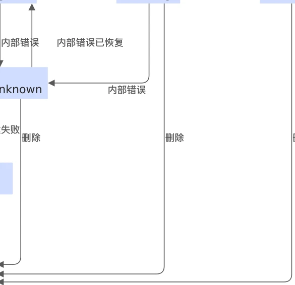
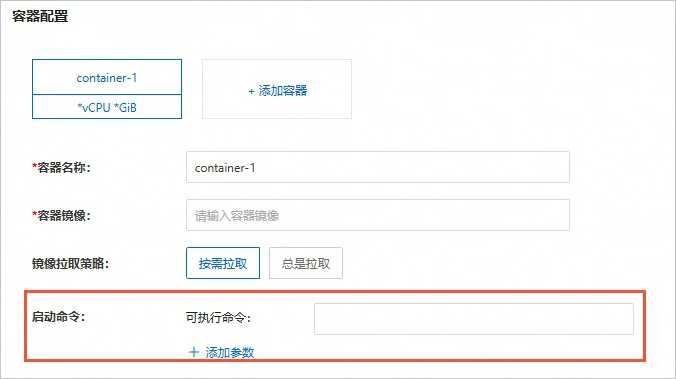

阿里云  
专有云  
机器学习PAI  
裸金属容器算力平台BCI 用户指南  
产品版本：v3.18.6  
文档版本：20261023

**目录**

- [1.什么是裸金属容器算力平台BCI](#section-1)
- [2.登录裸金属容器算力平台BCI](#section-2)
- [3.容器组](#section-3)
    - [3.1. 容器组概述](#section-3-1)
    - [3.2. 弹性容器组生命周期](#section-3-2)
    - [3.3. 创建容器组](#section-3-3)
    - [3.4. 查看弹性容器组](#section-3-4)
    - [3.5. 克隆实例](#section-3-5)
    - [3.6. 管理实例状态](#section-3-6)
    - [3.7. 更换实例的容器镜像](#section-3-7)
    - [3.8. 远程登录容器](#section-3-8)
    - [3.9. 删除弹性容器组](#section-3-9)
- [4.存储](#section-4)
    - [4.1. 数据卷概述](#section-4-1)
    - [4.2. 挂载EmptyDir数据卷](#section-4-2)
    - [4.3. 挂载ConfigFile数据卷](#section-4-3)
    - [4.4. 挂载APFS数据卷](#section-4-4)
    - [4.5. 挂载OSS数据卷](#section-4-5)
- [5.容器配置](#section-5)
    - [5.1. 设置容器启动命令和参数](#section-5-1)
    - [5.2. 使用探针对容器进行健康检查](#section-5-2)
- [6.日志](#section-6)
    - [6.1. 自定义配置日志采集](#section-6-1)
- [7.监控](#section-7)
    - [7.1. 查看容器组监控指标](#section-7-1)
- [8.EVPC](#section-8)
- [9.快照管理](#section-9)

<a id="section-1"></a>

# 1.什么是裸金属容器算力平台BCI

裸金属容器算力平台BCI（Bareless Containers Instance），融合了BareMetal（裸金属）与Serverless（无服务器），提供Serverless化的容器服务。您无需管理底层服务器，也无需关心运行过程中的容量规划，只需要提供打包好的Docker镜像，即可运行容器。

**产品概述**

裸金属容器算力平台BCI是阿里云结合容器和Serverless技术为您提供的容器运行服务。通过使用BCI，在阿里云上部署容器时，您无需购买和管理云服务器ECS，只需提供打包好的Docker镜像，即可在阿里云上运行容器。

从购买配置ECS再部署容器（ECS模式）到直接部署容器（BCI模式），BCI为您省去了底层服务器的运维和管理工作，让您专注于业务开发，提升开发效率。

使用BCI时，您既可以借助OpenAPI将BCI接入到您已有的业务系统中，通过OpenAPI和控制台直接快速部署容器应用；也可以通过Virtual Kubelet对接Kubernetes集群，借助BCI的弹性能力轻松应对突发业务流量。

<a id="section-2"></a>

# 2.登录裸金属容器算力平台BCI

本章节介绍如何登录裸金属容器算力平台BCI控制台。

**前提条件**

- 登录Apsara Uni-manager运营控制台前，确认您已从部署人员处获取Apsara Uni-manager运营控制台的服务域名地址。

- 推荐使用Chrome浏览器。

**操作步骤**

1. 在浏览器地址栏中，输入Apsara Uni-manager运营控制台的服务域名地址，按回车键。

   

   > **说明**
   >
   > - 单击页面右上角的当前语言可以切换其它语言。
   >
   > - 由于浏览器证书过期或环境开启HTTPS认证等出现多次单击继续访问或无Apsara Uni-manager运营控制台地址入口等现象，此时需要安装证书才能正常访问。单击页面右上角的**浏览器证书安装**，可打开浏览器证书安装指南。

2. 输入正确的用户名及密码。

   > **说明**
   >
   > - 请向运营管理员获取登录控制台的用户名和密码。
   >
   > - 首次登录Apsara Uni-manager运营控制台时，需要修改登录用户名的密码，请按照提示完成密码修改。为提高安全性，密码长度必须为10~32位，且包含英文字母大小写、阿拉伯数字和特殊符号（感叹号（!）、at（@）、井号（#）、美元符号（$）、百分号（%）等）。

3. 勾选**我已阅读并同意产品服务协议、隐私协议、用户协议**。

   > **说明**
   >
   > - 登录页展示的链接文字为文档标题，单击链接文字，可查看协议的详细内容。
   >
   > - **产品服务协议**、**隐私协议**和**用户协议**仅在已发布时才会显示。如果三种类型协议都没有发布，则不需要执行该操作。

4. 单击**账号登录**/**授权登录**。

   > **说明**
   >
   > “授权登录”仅第三方认证的全局IdP设置启用时才会显示，且该显示名称可自定义，默认显示名称为“授权登录”。

5. 如果账号已激活MFA多因素认证，请根据以下两种情况进行操作：

   > **说明**
   >
   > 公网场景下，登录入口默认强制开启多因素认证。

   - **开启MFA后的首次登录**

     <ol type="a">

     <li>

     输入账号密码登录后，展示绑定虚拟MFA设备页面。

     </li>

     <li>

     在绑定虚拟MFA设备页面中，按页面提示步骤绑定虚拟MFA设备。

     </li>

     </ol>

     <ol type="i" start="100">

     <li>

     登录成功，进入控制台。

     </li>

     </ol>

   - **已开启并绑定MFA**

     输入6位MFA码后单击**认证**。

6. 在页面顶部的导航栏中，选择**产品 > 计算 > 裸金属容器算力平台BCI**。

<a id="section-3"></a>

# 3.容器组

<a id="section-3-1"></a>

## 3.1. 容器组概述

一个容器组由GPU、vCPU、内存、网络等基础组件组成的sandbox实例，用于运行一个或多个容器。本文介绍容器组的基本配置、创建方式和生命周期等。

**基本配置**

容器组包含实例规格、容器镜像、网络、存储等基础组件，您可以方便地定制、更改实例的配置。您对该容器组拥有完全的控制权，不需要进行底层服务器的管理和配置操作，只需要提供打包好的容器镜像，即可运行容器。

- 实例规格

  一个容器组主要包括GPU、vCPU和内存规格。创建容器组时，可以使用基础模式配置实例资源（直接指定GPU、vCPU和内存），也可以指定具体资源规格，使用系统提供的具体GPU、vCPU、内存等进行容器组实例资源配置。

- 容器镜像

  一个容器组由一个或者多个容器组成，部署容器应用时，需要准备好容器镜像。容器镜像包含容器应用运行所需的程序、库文件、配置等。拉取镜像时，需要保证网络畅通，推荐您使用镜像缓存功能来节约实例的启动耗时。

- 网络

  一个容器组将占用所属VPC下的交换机的一个弹性网卡资源，默认具备一个内网IP地址。

- 存储

  一个容器组默认有30 GiB的临时存储空间，您可以根据需要增加临时存储空间。如果想要保留存储的文件，建议使用外挂数据卷。

**创建方式**

根据业务场景和使用场景，容器组支持两种实例的定义方式。

<table>
  <tr>
    <th width="148">创建方式</th>
    <th>说明</th>
  </tr>
  <tr>
    <td>指定vCPU和内存</td>
    <td>根据您指定的vCPU和内存进行创建。在此基础上，如果您对性能有更多要求，可以进一步指定算力类别。对于不满足容器组要求的vCPU和内存规格，系统将自动进行规整。</td>
  </tr>
  <tr>
    <td>指定资源规格</td>
    <td>根据您指定的资源规格进行创建，您可以根据业务需要，指定Pod底层使用具体的某一资源规格，来获取相应规格的指定能力。</td>
  </tr>
</table>

**生命周期**

如果您没有通过Kubernetes集群来对接使用BCI，为保证业务的健壮性和避免资源浪费，需要您对容器组进行生命周期管理，根据不同状态进行业务逻辑处理。更多信息，请参见弹性容器组生命周期。

<a id="section-3-2"></a>

## 3.2. 弹性容器组生命周期

本文介绍容器组的生命周期状态，您可以根据容器组状态，设计和实现符合您业务逻辑的处理逻辑。

**容器组状态**

在容器组的生命周期中，不同的阶段有其固有的状态，具体如下表所示。

| 容器组状态 | 说明 |
| --- | --- |
| 待处理（Pending） | 创建容器组后，系统等待处理。 |
| 调度中（Scheduling） | 系统通知调度进行调度资源。 |
| 创建中（Creating） | 容器组正在创建。 |
| 运行中（Running） | 容器组中所有容器均已经创建成功，并且至少有一个容器正在运行中，或者正在重启。 |
| 停止中（Stopping） | 容器组正在停止。 |
| 已停止（Stopped） | 容器组中所有容器均已经停止。 |
| 运行成功（Succeeded） | 容器组中所有容器均已运行成功终止，并且不会再重启。 |
| 运行失败（Failed） | 容器组中所有容器均已运行终止，并且至少有一个容器是运行失败终止，即容器以非0状态退出或者被系统终止。 |
| 未知（Unkown） | 系统出现内部错误。 |
| 删除中（Deleating） | 容器组正在删除。 |

容器组的生命周期状态转换如下图所示。


Create

Stopped

BCI

停止成功

Stopping

停止

通知调度

调度成功

创建成功

运行成功

Pending

Scheduling

Creating

Running

Succeeded




Unknown

创建失败

删除

删除

Failed

删除

Deleting

彻底删除

Deleted

**容器状态**

| 状态 | 说明 |
| --- | --- |
| 启动中（Waiting） | 容器正在等待创建，还未开始运行。 |
| 运行中（Running） | 容器已经成功创建，并且正在运行。 |
| 运行终止（Terminated） | 容器运行终止并退出，包括运行成功终止和运行失败终止。 |

<a id="section-3-3"></a>

## 3.3. 创建容器组

容器组是一组可以被调度到同一台宿主机上的容器集合，一个容器组即一个BCI实例。这些容器共同构成了容器组的生命周期，并共享容器组的网络和存储资源。本文介绍如何创建容器组。

**操作步骤**

1. 登录裸金属容器算力平台BCI。

2. 在左侧导航栏中，选择**容器组**。

3. 单击**创建容器组**。

4. 在**创建容器组**页面，配置容器组属性。

   **类型**

   **配置项**

   **是否必选**

   **说明**

   仅支持**按量计费**。用户先使用服务，然后根据实际使用的资源量在事后生成费用。这种方式适用于业务用量经常变化的场景，用户可以根据实际需求灵活使用资源，避免浪费。

   是

   **计费配置**

   **计费方式**

   > **说明**
   >
   > 仅当您的管理员在运营中心中配置了计费规则时才会展示此选项。关于计费规则的详细说明，请参见<strong>《统一云管平台 用户指南》</strong>中的<strong>《计费规则》</strong>章节。

   是

   容器组所属的组织。

   **组织**

   是

   容器组所属的资源集。

   **资源集**

   是

   容器组所属的地域。

   **地域**

   是

   容器组所属的可用区。

   **可用区**

   - 如果提示：该组织尚未进行容器服务RAM角色授权，请单击右侧按钮进行授权，继续操作需要该组

   **基本信息**

   织先进行容器服务RAM角色授权，在新页面授权完

   是

   **容器服务RAM**

   成后可单击右侧刷新按钮刷新状态。

   **角色授权**

   - 如果提示：该组织已经进行了容器服务RAM角色授权，可以继续操作。

   - 如果提示：该组织尚未进行云接入网关RAM角色授权，请单击右侧按钮进行授权，继续操作需要该组织先进行云接入网关RAM角色授权，授权完成后可单击右侧刷新按钮刷新状态。

   **云接入网关**

   是

   **RAM角色授权**

   - 如果提示：该组织已经进行了云接入网关RAM角色授权，可以继续操作集群创建。

   否

   根据业务需要，选择是否启用**Ipv6**。

   **Ipv6**

   选择已创建的专有网络，或者单击**创建专有网络**即时创建专有网络，创建完成后，返回集群创建页面并单

   

   击

   图标，查看专有网络列表。创建专有网络的具

   是

   **专有网络**

   体操作，请参见专有云文档中心<strong>《专有网络VPC用户指南》</strong>中的<strong>《创建和管理专有网络》</strong>章节。

   **网络配置**

   选择已创建的交换机，或者单击**创建交换机**即时创建

   

   交换机，创建完成后，返回集群创建页面并单击

   是

   **虚拟交换机**

   图标，查看交换机列表。

   创建交换机的具体操作，请参见专有云文档中心<strong>《专有网络VPC用户指南》</strong>中的<strong>《创建和管理交换机》</strong> 章节。

   选择安全组。

   是

   **安全组**

   通过配置安全组规则，可以允许或禁止安全组内的容器对公网或私网的访问，以及IP间的访问。

   输入容器组名称。

   否

   **容器组名称**

   名称长度为2~128个字符，可包含英文小写字母、数字或者短划线（-），不能以短划线（-）开始或结尾。

   选择重启策略。

   - **失败后重启**：仅当容器以非0状态码退出 （即运行失败）时才重启；若容器正常退出（exit 0），则不再重启。适用于批处理任务或可能因临时错误失败但可重试的作业。

   - **总是重启**：无论容器退出状态码为何（成功或失败），均立即重启。适用于长期运行的服务型应用（如 Web 服务器、API 服务），需保证容器持续可用。

   是

   **重启策略**

   > **说明**
   >
   > 即使容器正常退出（exit 0），也会被重启。

   - **永不重启**：无论容器退出原因如何，均不重启。适用于一次性任务（如数据迁移、初始化脚本）；需由上层编排系统（如 Job、CronJob）统一管理重试逻辑的场景。

   支持**基础模式**和**指定规格**。

   - **基础模式**：选择GPU类型、GPU数量、CPU数量、

   **容器组配置**

   内存、EVPC和GPU驱动版本，该方式可以提供更

   是

   **规格配置**

   好的弹性和资源供应能力。

   - **指定规格**：当您的业务需要有特殊的规格需求，例如GPU等，您可以指定特定的ECS规格。

   否

   **基于快照创建**

   否

   **使用快照**

   开启**基于快照创建**后需选择已创建的快照。

   - **存储**：容器组支持挂载数据卷作为持久化存储，支持设置临时目录（EmptyDir）、配置项（ConfigFile）、高性能存储（APFS）和OSS持久化存储。

   - **临时存储大小**：取值范围：30~2048 GiB，默认为

   否

   **高级配置**

   30 GiB。

   - **自动采集容器标准输出到 SLS**：支持定义配置日志采集，将容器组日志采集到SLS中。

   - **自动监控指标采集（CPU/内存/GPU/RDMA）**：支持自动采集监控指标并查看容器组监控指标。

   输入容器名称。

   是

   **容器名称**

   名称长度为2~128，可以包含英文小写字母、数字和中划线（-），不能以中划线开始或结尾。

   是

   输入容器镜像。

   **容器镜像**

   默认为按需拉取（IfNotPresent），即优先使用本地

   是

   **镜像拉取策略**

   镜像，本地没有时则拉取镜像。

   否

   设置各个容器的启动命令和参数。

   **启动命令**

   - **CPU**、**内存**和**GPU**：设置容器组中各容器的CPU、内存和GPU。

   **容器配置**

   各容器的vCPU和内存汇总后，不能超过即容器组的vCPU和内存设置。

   - **环境变量**：设置容器的环境变量。

   - **存储**：在容器组高级配置中开启了存储开关后才能配置该参数。具体配置说明，请参见挂载EmptyDir数据卷、挂载ConfigFile数据卷和挂载APFS数据

   否

   卷。

   **高级配置**

   - **日志采集**：支持定义配置日志采集，将容器组日志采集到SLS中。

   - **健康检查**：支持配置Liveness Probe和Readiness Probe对容器进行健康检查，以便BCI更好地监控和管理容器的运行状态

   - **生命周期**：生命周期脚本定义，主要针对容器类应用的生命周期事件应采取的动作。支持应用**启动后处理**和**停止前处理**。

   当前仅支持从ACR中拉取镜像，具体操作，请参

   否

   见<strong>《容器镜像服务ACR 用户指南》</strong>文档中的<strong>《配置访</strong>

   **镜像仓库访问凭证**

   <strong>问凭证》</strong>章节。

   标签由区分大小写的键值对组成，您最多可以设置20个标签。 标签键不可以重复，最长为64个字符； 标签

   否

   **标签**

   值可以为空，最长为128个字符。标签键和标签值都不能以“aliyun”、“acs:”、“https://”或“http://”开头。

5. 完成容器组的创建。

   - 服务管理中已创建云产品为**裸金属容器算力平台 BCI**、资源项为**BCI实例**的服务：确认相关参数，单击**确认订单**。

   - 服务管理中未创建云产品为**裸金属容器算力平台 BCI**、资源项为**BCI实例**的服务：确认相关参数，单击**提交**。

   关于服务管理的更多信息，请参见<strong>《Apsara Uni-manager运营控制台 用户指南》</strong> 中的<strong>《服务管理》</strong>章节。

<a id="section-3-4"></a>

## 3.4. 查看弹性容器组

在实例详情页面，您可以查看事件和日志来排查问题，也可以查看基础监控、GPU监控、容器稳定性监控、RDMA指标监控等监控信息了解实例运行情况。本文介绍如何查看BCI容器组的事件、日志和监控信息。

**操作步骤**

1. 登录裸金属容器算力平台BCI。

2. 在左侧导航栏中，选择**容器组**。

3. 在搜索框，根据**容器组ID**、**容器组名称**、**EVPCID**、**标签筛选**或**创建人**来筛选容器组。

   使用**容器组ID**或**EVPCID**筛选时，多个容器ID之间使用逗号隔开。

4. 单击目标容器组ID或**操作**列的**详情**，进入弹性容器组详情页。

5. 在实例详情页面，可以容器基本信息、日志或监控信息。

   <table>
     <tr>
       <th width="122">操作</th>
       <th>操作步骤</th>
     </tr>
     <tr>
       <td>查看基本信息</td>
       <td>在<strong>基本信息</strong>区域，可以查看容器组ID、容器组名称、状态、标签、CPU、内存、规格等信息。</td>
     </tr>
     <tr>
       <td>查看容器</td>
       <td>单击<strong>容器</strong>页签，可以查看容器组中各容器的容器名称、状态、GPU、CPU、内存、启动命令、环境变量和挂载的数据卷等参数。</td>
     </tr>
     <tr>
       <td>查看数据卷</td>
       <td>单击<strong>数据卷</strong>页签，可以查看容器组挂载的数据卷，包括临时目录（EmptyDir）、配置项（ConfigFile）、高性能存储（APFS）和OSS数据卷。</td>
     </tr>
     <tr>
       <td>查看事件</td>
       <td>单击<strong>事件</strong>页签，可以查看容器组的事件，包括事件类型、事件的归属对象名、事件名和事件消息等。</td>
     </tr>
     <tr>
       <td>查看日志</td>
       <td>单击<strong>日志</strong>页签，选择<strong>容器名称</strong>和<strong>开始时间</strong>，单击<strong>确定</strong>，即可查看容器运行日志。</td>
     </tr>
     <tr>
       <td>查看监控信息</td>
       <td>单击<strong>监控</strong>页签，可以查看<strong>基础监控</strong>、<strong>GPU监控</strong>、<strong>容器稳定性监控</strong>和<strong>RDMA指标监控</strong>信息。更多监控信息，请参见查看容器组监控指标。</td>
     </tr>
   </table>

<a id="section-3-5"></a>

## 3.5. 克隆实例

克隆实例可以快速创建与源实例相同或相似的实例，本文介绍如何克隆实例。

**操作步骤**

1. 登录裸金属容器算力平台BCI。

2. 在左侧导航栏中，选择**容器组**。

3. 单击目标容器组操作列的**实例设置 > 克隆实例**。

4. 在弹出的**创建容器组**页面，根据需要，配置弹性容器组属性，然后单击**提交**。

<a id="section-3-6"></a>

## 3.6. 管理实例状态

在弹性容器组（实例）的生命周期中，不同的阶段有其固有的状态。您可以根据业务需要，管理实例的状态。

**停止实例**

**操作步骤**

1. 登录裸金属容器算力平台BCI。

2. 在左侧导航栏中，选择**容器组**。

3. 单击**运行中**容器组操作列的**实例状态 > 停止**。

4. 在弹出的对话框，确认要停止的容器组，然后单击**确定**。

**启动实例**

**操作步骤**

1. 登录裸金属容器算力平台BCI。

2. 在左侧导航栏中，选择**容器组**。

3. 单击**已停止**容器组操作列的**实例状态 > 启动**。

4. 在弹出的对话框，确认要启动的容器组，然后单击**确定**。

**删除实例**

对于不再使用的实例，您可以在弹性容器实例控制台进行删除。删除后，该实例不再计费。

**操作步骤**

1. 登录裸金属容器算力平台BCI。

2. 在左侧导航栏中，选择**容器组**。

3. 单击目标容器组操作列的**实例状态 > 删除**。

4. 在弹出的对话框，确认要删除的容器组，然后单击**确定**。

<a id="section-3-7"></a>

## 3.7. 更换实例的容器镜像

更换容器镜像支持在不新建实例的前提下更换容器镜像，同时保留实例的网络配置、存储挂载等资源不变。

**前提条件**

容器组（实例）的状态必须为**运行中**。

**操作步骤**

1. 登录裸金属容器算力平台BCI。

2. 在左侧导航栏中，选择**容器组**。

3. 单击目标容器组**操作**列的**实例设置 > 编辑实例**。

4. 在弹出的**编辑容器组**页面，根据需要，修改已有容器的容器镜像、删除已有容器、新增容器、修改镜像仓库访问凭证，然后单击**提交**。

<a id="section-3-8"></a>

## 3.8. 远程登录容器

部署容器后，可远程登录容器，执行命令进行调试。

**操作步骤**

1. 登录裸金属容器算力平台BCI。

2. 在左侧导航栏中，选择**容器组**。

3. 单击目标容器组ID，进入弹性容器组详情页。

4. 单击页面右上角的**远程登录**。

5. 在弹出的对话框中选择**容器**、**命令**，然后单击**登录**。

   相关说明如下：

   - 选择容器时，仅支持选择**运行中**的容器。

   - Shell命令类型仅支持<strong>/bin/sh</strong>和<strong>/bin/bash</strong>。

6. 根据需要输入并执行命令。

   ```text
   / # ls
   bin  dev  etc  home  proc  root  sys  tmp  usr  var
   / #
   ```

<a id="section-3-9"></a>

## 3.9. 删除弹性容器组

对于不再使用的弹性容器组，您可以在弹性容器组控制台进行删除。

**操作步骤**

1. 登录裸金属容器算力平台BCI。

2. 在左侧导航栏中，选择**容器组**。

3. 在容器组页面，找到想要删除的实例，选择以下一种方式进行删除。

   - 单击要删除的容器组对应**操作**列中的**删除**。

   - 选中一个或多个容器组，单击底部的**删除弹性容器组**。

4. 在弹出的对话框中，单击**确定**。

<a id="section-4"></a>

# 4.存储

<a id="section-4-1"></a>

## 4.1. 数据卷概述

弹性容器组支持挂载数据卷作为持久化存储。本文介绍弹性容器组支持的数据卷及其配置方式。

**数据卷介绍**

容器中的文件在磁盘上是临时存放的，这给容器中运行的应用程序带来一些问题：

- 当容器崩溃时，容器重建不会保留容器运行过程中产生的文件，会导致文件丢失。

- 当一个容器组中同时运行多个容器时，无法在这些容器之间共享文件。

对于上述问题，容器组支持通过数据卷（Volume）的方式来解决。目前容器组支持挂载以下几类数据卷：

| 数据卷类型 | 说明 | 相关文档 |
| --- | --- | --- |
| EmptyDir | 临时目录，用于临时存放数据，便于容器之间共享数据。EmptyDir数据卷中的数据会随容器组删除而清空。 | 挂载EmptyDir数据卷 |
| ConfigFile | 配置文件，用于向容器组注入配置数据。 | 挂载ConfigFile数据卷 |
| APFS | APFS是以云定义的分布式并行文件系统，具备智算场景下大规模并行训练所需的高性能，以及智能化数据管理、可靠的安全保障、灵活的部署形态、资源弹性扩展等特点。APFS数据卷适用于以下场景：<br>• 共享数据场景APFS为共享存储，支持多个容器组同时访问一份数据。APFS数据卷中的数据不会随容器组删除而清空，可用于容器组之间共享数据。<br>• 大数据分析场景APFS提供了较高的数据吞吐能力，能满足大批量作业对共享存储访问的需求。<br>• Web应用场景为Web应用、内容管理系统提供存储支撑。<br>• 保存日志场景如果您希望将日志持久化存储，推荐使用APFS数据卷。 | 挂载APFS数据卷 |

<table>
  <tr>
    <td>OSS</td>
    <td>OSS是阿里云提供的一个海量、安全、低成本、高可靠的存储空间，适合存储非结构化数据（如图片、音视频等）。OSS数据卷适用于以下场景：<br>• 共享数据场景OSS为共享存储，支持多个实例同时访问一份数据。OSS数据卷中的数据不会随实例删除而清空，可用于实例之间共享数据。<br>• 网页、应用配置文件只读场景ossfs网络性能欠佳，可以支撑一些小文件的读场景。<br>• 图片、音视频等媒体文件只读场景OSS适合存储非结构化数据，您可以通过OSS数据卷读取图片、音视频等。</td>
    <td>挂载OSS数据卷</td>
  </tr>
</table>

**配置说明**

使用数据卷时，需要先声明数据卷，然后将数据卷挂载到容器中。

通过控制台创建容器组时，您可以在**容器组配置**区域声明数据卷，然后在**容器配置**区域，将数据卷挂载到容器中。

1. 在**容器组配置**区域的**高级配置**处，声明数据卷。

   目前控制台仅支持配置以下几类数据卷：

   - 配置项（ConfigFile）

   - 临时目录（EmptyDir）

   - 高性能存储（APFS）

   - OSS持久化存储

2. 在**容器配置**区域，在某一容器的**高级配置**处，将数据卷挂载到该容器。

<a id="section-4-2"></a>

## 4.2. 挂载EmptyDir数据卷

EmptyDir数据卷是一个空的目录，用于临时存放数据，便于容器之间共享数据。本文介绍如何为弹性容器组挂载EmptyDir数据卷。

**配置说明**

在控制台创建弹性容器组时，您可以在**容器组配置**区域声明数据卷，然后在**容器配置**区域，将数据卷挂载到容器中。

**声明数据卷**

1. 在**容器组配置**区域，展开**高级配置**。

2. 开启**存储**开关后，选择**临时目录**页签，然后单击**添加临时目录**。

3. 输入EmptyDir数据卷的名称并设置shm大小。

   例如，在名称中输入 `emptydir-demo` 。

**挂载数据卷**

1. 在**容器配置**区域选择容器，展开该容器的高级配置。

2. 打开**存储**开关后，单击**添加存储**。

3. 选择**存储**，设置**容器内挂载路径**。

   此处存储为配置容器组时声明的数据卷 `emptydir-demo` 。

> **说明**
>
> 如果要为多个容器挂载数据卷，请选择其他容器，重复上述操作。

<a id="section-4-3"></a>

## 4.3. 挂载ConfigFile数据卷

ConfigFile数据卷是一种用于存储配置文件的数据卷，可以向BCI实例注入配置数据。本文介绍如何为弹性容器组挂载ConfigFile数据卷。

**使用限制**

ConfigFile数据卷中，单个配置文件不能大于32 KB，多个配置文件的总和不能大于60 KB。

**配置说明**

在控制台创建弹性容器组时，您可以在**容器组配置**区域声明数据卷，然后在**容器配置**区域，将数据卷挂载到容器中。

**声明数据卷**

1. 在**容器组配置**区域，展开**高级配置**。

2. 开启**存储**开关后，选择**临时目录**页签，，单击**添加配置项**。

3. 配置ConfigFile数据卷的相关参数。

   - **名称**：ConfigFile数据卷的名称（例如 `configfile-demo` ）。

   - **配置文件Path**：配置文件所在的相对文件路径。

   - **文件内容**：配置文件的内容。请明文输入，控制台会自动进行Base64编码。

**挂载数据卷**

1. 在**容器配置**区域选择容器，展开该容器的高级配置。

2. 打开**存储**开关后单击**添加**存储。

   此处可添加的数据卷为配置容器组时声明的数据卷。

   

   

   选择存储为configfile-demo，类型为 配置项 ，设置容器内挂载路径为  `/data` ，不勾选 只读 。

> **说明**
>
> 如果要为多个容器挂载数据卷，请选择其他容器，重复上述操作。

<a id="section-4-4"></a>

## 4.4. 挂载APFS数据卷

APFS是以云定义的分布式并行文件系统，具备智算场景下大规模并行训练所需的高性能，以及智能化数据管理、可靠的安全保障、灵活的部署形态、资源弹性扩展等特点。本文介绍如何为弹性容器组挂载NAS数据卷。

**准备工作**

使用APFS作为数据卷前，请先创建APFS文件系统。具体操作，请参见<strong>《APFS用户指南》</strong>中的**创建APFS文件系统**章节。

**配置说明（控制台）**

在控制台创建弹性容器组时，您可以在**容器组配置**区域声明数据卷，然后在**容器配置**区域，将数据卷挂载到容器中。

**声明数据卷**

1. 在**容器组配置**区域，展开**高级配置**。

2. 开启**存储**开关后，选择**高性能存储**页签。

3. 配置APFS存储卷的相关参数。

   - 高性能存储类型：当前仅支持APFS。

   - 名称：APFS数据卷的名称。

   - 文件系统：选择APFS文件系统。

**挂载数据卷**

1. 在**容器配置**区域选择容器，展开该容器的**高级配置**。

2. 打开**存储**开关后，单击**添加存储**。

   此处可添加的数据卷为配置容器组时声明的数据卷。

   在**选择存储**中选择已声明的数据卷（示例为 `efs-demo` ），存储类型选择NAS持久化存储，容器内挂载路径 填写  `/data` ，子目录 填写  `/test` ，按需勾选**只读**。

> **说明**
>
> 如果要为多个容器挂载数据卷，请选择其他容器，重复上述操作。

<a id="section-4-5"></a>

## 4.5. 挂载OSS数据卷

OSS是阿里云提供的一个海量、安全、低成本、高可靠的存储空间，适合存储非结构化数据（如图片、音视频等）。本文介绍如何为ECI实例挂载OSS数据卷。

**注意事项**

- OSS为共享存储，一个OSS可以挂载到多个实例上。

- 挂载目录中建议存放的文件数不要超过1000个。

  文件数量过多时，OSS客户端会占用大量内存，可能会导致实例发生OOM（Out Of Memory）事件。

  1. 创建**读写权限**为**公共读写**的OSS bucket（例如bci-oss-volume）。

     具体操作，请参见专有云文档中心<strong>《对象存储用户指南》</strong>中的<strong>《创建存储空间》</strong>章节。

  2. 创建RAM角色授权。

     <ol type="i">

     <li>

     登录Apsara Uni-manager运营控制台。

     </li>

     <li>

     在顶部菜单栏，单击**企业**。

     </li>

     <li>

     在左侧导航栏，选择**权限管理** **> 角色授权**，然后单击**创建自定义角色**。

     </li>

     <li>

     在**创建自定义角色**页面，展开页面下方的**高级创建**，单击**创建RAM角色授权**。

     </li>

     <li>

     在**基础配置**步骤中，设置角色名称（例如bci-oss-volume）单击**下一步**。

     </li>

     <li>

     在**自定义权限策略配置**步骤中，选择已创建权限策略，单击**下一步**。

     如果没有合适的权限策略，可自定义权限策略。策略内容如下，其中bci-oss-volume请替换成实际的OSS bucket名称。

     ```json
     {
       "Version": "1",
       "Statement": [
         {
           "Effect": "Allow",
           "Action": "oss:*",
           "Resource": [
             "acs:oss:*:*:bci-oss-volume",
             "acs:oss:*:*:bci-oss-volume/*"
           ]
         },
         {
           "Effect": "Allow",
           "Action": [
             "ram:ListPoliciesForRole",
             "ram:GetPolicy"
           ],
           "Resource": "*"
         }
       ]
     }
     ```

     </li>

     <li>

     在**信任策略配置**步骤中，选择**授信组织**和**授信云服务**，单击**下一步**。

     **授信云服务**选择 `dcaasbms.aliyuncs.com` 和 `oss.aliyuncs.com`

     </li>

     <li>

     在**策略预览**页面，查看已选权限策略和信任策略内容，确认后单击**创建**。

     </li>

     </ol>

  3. 创建并获取角色ARN。

     <ol type="i">

     <li>

     在角色授权列表中，找到已创建的RAM角色授权（例如bci-oss-volume-role）。

     </li>

     <li>

     单击RAM角色授权的角色名称或**操作**列的**查看**。

     </li>

     <li>

     在RAM角色授权详情，单击**RAM角色**页签。

     </li>

     <li>

     在**RAM角色**页签，单击**新建**。

     </li>

     <li>

     在**新建**对话框，选择RAM角色创建所在组织，然后单击**确定**。

     创建完成后，ARN列即为Role ARN，格式为： `acs:ram::127756957048****:role/bci-oss-volume-role` 。

     </li>

     </ol>

**配置说明（控制台）**

通过弹性容器实例售卖页创建ECI实例时，您可以在**容器组配置**区域声明数据卷，然后在**容器配置**区域，将数据卷挂载到容器中。

**声明数据卷**

1. 在**容器组配置**区域，展开**高级配置**。

2. 打开**存储**开关后，选择**OSS持久化存储**页签，然后单击**添加OSS持久化存储**。

3. 配置OSS数据卷的相关参数。

   - **名称**：OSS数据卷的名称。

   - **Bucket**：OSS Bucket名称。

   - **Bucket路径**：OSS Bucket路径。

   - **角色ARN**：步骤3中创建的角色ARN。

**挂载数据卷**

1. 在**容器配置**区域选择容器，展开该容器的**高级配置**。

2. 打开**存储**开关后单击**添加存储。**

   此处可添加的数据卷为配置容器组时声明的数据卷。

   在存储配置行中，设置**选择存储**为已声明的数据卷（如  `oss-demo` ），选择存储类型（如**OSS持久化存储**），填写**容器内挂载路径**（如  `/data` ），并根据需要勾选**只读**。

> **说明**
>
> 如果要为多个容器挂载数据卷，请选择其他容器，重复上述操作。

<a id="section-5"></a>

# 5.容器配置

<a id="section-5-1"></a>

## 5.1. 设置容器启动命令和参数

弹性容器组通过容器镜像中的预设参数来启动容器。如果您在构建镜像时没有设置启动命令和参数，或者想要变更启动命令和参数，可以在创建弹性容器组时设置。通过设置容器启动命令和参数，可以定义容器的启动行为和初始化过程，保证容器能够正确运行并提供所需服务。本文介绍如何为容器设置启动命令和参数。

**功能说明**

如果您想覆盖镜像中设置的启动默认值，包括工作目录、启动命令和参数，可以通过以下参数进行配置：

- **工作目录**

  镜像构建时，通过WORKDIR可以指定容器的工作目录， 容器启动时执行的命令会在该目录下执行。更多信息，请参见WORKDIR。

  创建容器组时，通过配置容器组中容器的工作目录（ WorkingDir），可以覆盖WORKDIR。

  > **说明**
  >
  > - 如果镜像里未指定WORKDIR，且创建容器组也未配置工作目录，则工作目录默认为根目录。
  >
  > - 如果指定的工作目录不存在，系统将自动创建。

- **启动命令和参数**

  镜像构建时，通过ENTRYPOINT和CMD可以指定启动容器后要执行的命令和参数。更多信息，请参见ENTRYPOINT和CMD。

  创建容器组时，通过配置容器组中容器的启动命令（Command）和参数（Arg），可以覆盖ENTRYPOINT和CMD。具体生效规则如下：

  > **重要**
  >
  > 启动命令必须为容器镜像支持的命令，否则会导致容器启动失败。

  | 镜像ENTRYP OINT | 镜像CMD | 容器Comman d | 容器Arg | 最终执行 | 说明 |
  | --- | --- | --- | --- | --- | --- |
  | mkdir | /data/bac kup | 未设置 | 未设置 | mkdir /data/b ackup | 容器没有设置Command和Arg，则执行镜像ENTRYPOINT和CMD。 |
  | mkdir | /data/bac kup | cd | 未设置 | cd | 容器设置了Command，未设置Arg，则只执行容器Command，忽略镜像ENTRYPOINT和CMD。 |
  | mkdir | /data/bac kup | 未设置 | /opt/back up | mkdir /opt/ba ckup | 容器设置了Arg，未设置Command，则执行镜像ENTRYPOINT和容器Arg。 |
  | mkdir | data/back up | cd | /opt/back up | cd /opt/backu p | 容器同时设置了Command和Arg，则执行容器Command和Arg。 |

**配置说明**

在控制台创建弹性容器组时，您可以在**容器配置**中设置各个容器的启动命令和参数。



<a id="section-5-2"></a>

## 5.2. 使用探针对容器进行健康检查

Liveness Probe和Readiness Probe是用于检测容器状态的机制，其中Liveness Probe用于检测容器是否正常运行，Readiness Probe用于检测容器是否已经就绪。本文介绍如何配置Liveness Probe和Readiness Probe对容器进行健康检查，以便BCI更好地监控和管理容器的运行状态，确保服务的高可用性和稳定性。

**功能说明**

BCI支持通过存活探针和业务探针来检查容器的状态和运行情况。

| 探针 | 说明 | 应用场景 |
| --- | --- | --- |
| 应用存活探针（ Liveness P robe） | 用于检查容器是否正常运行。<br>• 如果检查成功，则表示容器正常运行。<br>• 如果检查失败，系统会根据配置的容器重启策略进行相应的处理。<br>• 如果未配置该探针，则默认容器一直正常运行。 | • 当应用程序处于运行状态但无法进行进一步操作时，Liveness Probe将捕获到deadlock，重启对应的容器，使得应用程序在存在bug的情况下依然能够运行。<br>• 长时间运行的应用程序最终可能会转换到broken状态，此时除了重新启动，无法恢复。Liveness Probe可以检测并补救这种情况。 |
| 应用业务探针（Readiness Probe） | 用于检查容器是否已经准备就绪，可以为请求提供服务。<br>• 如果检查成功，则表示容器已经准备就绪，可以接收业务请求。<br>• 如果检查失败，则表示容器没有准备就绪，系统将停止向该容器发送任何请求，直至重新检查成功。<br>• 如果未配置该探针，则默认容器已经准备就绪。 | 如果应用程序暂时无法对外部流量提供服务，例如应用程序需要在启动期间加载大量数据或配置文件，此时，如果不想终止应用程序，也不想向其发送请求，可以通过Readiness Probe来检测和缓解这种情况。 |

**配置说明**

在控制台创建弹性容器组时，您可以在**容器配置**区域选择容器，展开该容器的**高级配置**，然后打开**健康检查**开关，并配置探针。

| 参数 | 描述 |
| --- | --- |
| 时间设置 | • <strong>延迟时间</strong>：容器启动多久后开始检查。<br>• <strong>超时时间</strong>：检查的超时等待时间，如果超时，则视为检查失败。 |
| 检查方式 | 根据需要选择检查方式。<br>• <strong>命令行脚本</strong>：探针在容器内执行命令，并检查命令退出的状态码，如果状态码为0，则表示检查成功。<br>• <strong>HTTP请求方式</strong>：探针向容器发送HTTP请求，如果返回状态码符合以下要求：200≤状态码&lt;400，则表示检查成功。<br>• <strong>TCP Socket</strong>：探针尝试连接容器 IP 的TCP 端口。能连上算成功，连接失败算失败。 |
| 命令行脚本 | 当检查方式为<strong>命令行脚本</strong>时，需要配置在容器内执行的命令行脚本。 |
| HTTP请求方式 | 当检查方式为<strong>HTTP请求方式</strong>时，需要配置HTTP Get请求包含的<strong>路径</strong>、<strong>端口</strong>和<strong>协议</strong>。 |
| TCP Socket | 当检查方式为<strong>HTTP请求方式</strong>时，需要配置TCP Socket请求包含的<strong>端口</strong>。 |

<a id="section-6"></a>

# 6.日志

<a id="section-6-1"></a>

## 6.1. 自定义配置日志采集

容器组支持对接阿里云日志服务SLS，将容器组日志采集到SLS中。本文介绍如何通过环境变量自定义配置容器组日志采集，包括指定项目、日志库、机器组等。

**注意事项**

- 仅在创建容器组时才能通过环境变量自定义配置日志采集。

- 对于自定义配置的日志Project和Logtail配置，如果后续不再使用，请及时删除相关Project和Logtail配置。

- 对自定义配置的环境变量名称进行修改后，原有的配置不会自动删除，请手动清理以免产生不必要的费用。

**配置说明**

创建容器组时，可以通过容器的环境变量传入日志相关的自定义配置，包括项目（Project）、日志库（Logstore）、Logtail配置、机器组（Machinegroup）、分区（Shard）、日志保留时间、标签（Tag）等。可配置的环境变量如下：

> **说明**
>
> 日志相关环境变量名称的格式前缀为 `aliyun_logs_{key}` ， `{key}` 表示日志服务中Logtail配置的名称，只能包含小写字母、数字和短划线（-）。

| 配置对象 | 环境变量名称 | 环境变量取值说明 |
| --- | --- | --- |
| Logtail配置 | aliyun_logs_{key} | 创建Logtail配置。取值为日志采集路径。<br>• 采集标准输出时，取值如下：<br>• stdout：采集正常输出和错误信息。<br>• stderr-only：只采集错误信息，不采集正常输出。<br>• stdout-only：只采集正常输出，不采集错误信息。<br>• 采集文本文件时，取值为容器内的文件目录。 |
| 项目 | aliyun_logs_{key}_proj ect | 指定Project。Project名称格式要求如下：<br>• 长度为3~63个字符。<br>• 仅支持小写字母、数字和短划线（-），且必须以小写字母和数字作为开头和结尾。<br>说明项目名称必须全局唯一，创建后不可修改。如果名称格式校验不通过，将直接忽略该配置，采用默认项目。 |
| 日志库 | aliyun_logs_{key}_logs tore | 指定Logstore。Logstore名称格式要求如下：<br>• 长度为3~63个字符。<br>• 仅支持小写字母、数字、短划线（-）和下划线（_），且必须以小写字母和数字作为开头和结尾。<br>说明如果名称格式校验不通过，将直接忽略该配置，采用默认日志库。默认情况下，日志库名称与Logtail配置名称<code> {key} </code>相同。 |
| 机器组 | aliyun_logs_{key}_mac hinegroup | 指定机器组。机器组名称格式要求如下：<br>• 长度为3~63个字符。<br>• 仅支持小写字母、数字、短划线（-）和下划线（_），且必须以小写字母和数字作为开头和结尾。<br>说明如果名称格式校验不通过，将直接忽略该配置，采用默认机器组。 |
| 分区 | aliyun_logs_{key}_shar d | 设置日志分区数。取值范围为1~10。Logstore读写日志必须保存在某一个分区上，默认情况下，每个日志库有2个分区。 |
| 日志保留时间 | aliyun_logs_{key}_ttl | 设置日志保留时间，单位为天。取值范围为1~3650。<br>• 取值为3650时，表示永久保留日志。<br>• 默认保留90天。 |
| 标签 | aliyun_logs_{key}_tags | 绑定标签。取值格式为<code> tag-key=tag-value </code>，用于对日志进行标识。 |

**配置示例**

假设您需要自定义以下日志相关配置项：

- Logtail配置和Logstore名称：标准输出日志保存到stdout-bci，文本文件日志保存到file-bci。

- Project名称：project-bci-test

- 机器组名称：mg-bci-test

> **说明**
>
> 以下为示例配置，实际配置请使用您自定义的配置，确保Project名称唯一。

在控制台创建弹性容器组时，您可以在**容器配置**区域选择容器，展开该容器的高级配置，然后打开**环境变量**开关，添加环境变量。

- 配置stdout日志采集的环境变量：

  - `aliyun_logs_stdout-bci`  =  `stdout`

  - `aliyun_logs_stdout-bci_project`  =  `project-bci-test`

  - `aliyun_logs_stdout-bci_machinegroup`  =  `mg-bci-test`

- 配置文件日志采集的环境变量：

  - `aliyun_logs_file-bci`  =  `/log/*.log`

  - `aliyun_logs_file-bci_project`  =  `project-bci-test`

  - `aliyun_logs_file-bci_machinegroup`  =  `mg-bci-test`

<a id="section-7"></a>

# 7.监控

<a id="section-7-1"></a>

## 7.1. 查看容器组监控指标

本文介绍如何查看容器组的监控指标。

**操作步骤**

1. 登录裸金属容器算力平台BCI。

2. 在左侧导航栏中，选择**容器组**。

3. 单击目标容器组ID，进入弹性容器组详情页。

4. 在容器组详情页，单击**监控**页签。

5. 当前页面包含以下四个部分，从不同角度分析和统计容器组监控信息。支持自定义时间段。

   <ol type="i">

   <li>

   查看**基础监控**。

   | 监控项 | 说明 |
   | --- | --- |
   | CPU使用率 | 当前CPU的使用百分比，反映CPU负载情况。 |
   | 内存使用率 | 已使用内存占总内存的比例。 |
   | 磁盘使用率 | 已用磁盘空间占总磁盘空间的百分比。 |
   | 系统负载load1 | 过去1分钟内的平均系统负载，反映系统繁忙程度。 |
   | TCP连接量 | 当前系统建立的TCP连接总数。 |

   </li>

   <li>

   查看**GPU监控**。

   | 监控项 | 说明 |
   | --- | --- |
   | GPU温度 | 当前GPU温度。 |
   | GPU功率 | 当前GPU功率，反映负载强度。 |
   | GPU利用率 | 当前GPU利用率。 |
   | GPU显存使用率 | 当前GPU编码器的利用率。 |

   </li>

   <li>

   查看**容器稳定性监控**。

   | 监控项 | 说明 |
   | --- | --- |
   | SANDBOX 线程数量 | 每个 pod/runtime 当前线程数量。 |
   | 容器组内存OOM稳定性 | 所有 pod 在最近 5 分钟内 OOM kill 的总次数。 |
   | 容器组内存分配稳定性 | 物理机上所有 sandbox/pod 最近 5 分钟内 swap in + swap out 的总新增次数。 |
   | 容器组网络收发错误 | 当前物理机上所有 sandbox/pod、所有网卡最近 5 分钟内 RX error + TX error 的总新增次数。 |
   | 容器组网络DROP | 当前物理机上所有 sandbox/pod、所有网卡最近 5 分钟内 RX drop + TX drop的总新增次数。 |
   | 容器组网络重传 | 当前物理机上所有 sandbox/pod 最近 5 分钟内 TCP retrans segs 的总新增数。 |

   </li>

   <li>

   查看**RDMA监控**。

   | 监控项 | 说明 |
   | --- | --- |
   | RDMA网络发送吞吐 | RDMA网络每秒发送的数据量，反映发送性能。 |
   | RDMA网络接收吞吐 | RDMA网络每秒接收的数据量，反映接收性能。 |
   | RDMA网络缓冲区溢出数 | 接收端缓冲区不足导致数据包被丢弃的次数。 |
   | RDMA网络数据报文乱序数 | RDMA传输中报文未按序到达的次数。 |
   | RDMA本机CQE错误数 | 本机完成队列（CQE）中记录的错误数量，如无效请求、资源不足等，反映本地RDMA操作异常。 |
   | 对端RNR NAK包数 | 对端设备因资源未就绪（Receive Not Ready）而返回的NAK（否定确认）包数量。 |

   </li>

   </ol>

<a id="section-8"></a>

# 8.EVPC

本文介绍如何创建和删除EVPC。

**创建EVPC**

1. 登录裸金属容器算力平台BCI。

2. 在左侧导航栏中，选择**EVPC管理**。

3. 单击**创建EVPC**，在**创建EVPC**页面，配置EVPC参数。

   | 配置项 | 是否必选 | 说明 |
   | --- | --- | --- |
   | 组织 | 是 | EVPC所属的组织。 |
   | 资源集 | 是 | EVPC所属的资源集。 |
   | 地域 | 是 | EVPC所属的地域。 |
   | 可用区 | 是 | EVPC所属的可用区。 |
   | CpnZoneId | 是 | 选择CPNZoneID。 |
   | EVPC名称 | 是 | 长度为2～128个字符，必须以字母或中文开头，可包含数字、半角句号（.）、下划线（_）和短划线（-）。 |
   | 描述 | 否 | 长度为2~256个字符，不能以http://和https://开头。 |
   | 标签 | 否 | 标签由区分大小写的键值对组成，您最多可以设置20个标签。 标签键不可以重复，最长为64个字符； 标签值可以为空，最长为128个字符。标签键和标签值都不能以“aliyun”、“acs:”、“https://”或“http://”开头。 |

4. 单击**提交**。

**删除EVPC**

1. 登录裸金属容器算力平台BCI。

2. 在左侧导航栏中，选择**EVPC**。

3. 单击目标EVPC**操作**列的**删除**。

4. 在弹出的对话框，单击**确定**。

<a id="section-9"></a>

# 9.快照管理

快照管理可以为容器组创建快照，用于备份并恢复容器组，是一种高效的数据容灾手段，支持根据计划周期性或手动备份数据。

**步骤一：创建快照仓库**

**准备工作**

1. 创建**读写权限**为**公共读写**的OSS bucket（例如bci-snapshot）。具体操作，请参见专有云文档中心<strong>《对象存储用户指南》</strong>中的<strong>《创建存储空间》</strong>章节。

2. 创建RAM角色授权。

   <ol type="i">

   <li>

   登录Apsara Uni-manager运营控制台。

   </li>

   <li>

   在顶部菜单栏，单击**企业**。

   </li>

   <li>

   在左侧导航栏，选择**权限管理** **> 角色授权**，然后单击**创建自定义角色**。

   </li>

   <li>

   在**创建自定义角色**页面，展开页面下方的**高级创建**，单击**创建RAM角色授权**。

   </li>

   <li>

   在**基础配置**步骤中，设置角色名称（例如bci-snapshot-role）单击**下一步**。

   </li>

   <li>

   在**自定义权限策略配置**步骤中，选择已创建权限策略，单击**下一步**。

   如果没有合适的权限策略，可自定义权限策略。策略内容如下，其中bci-snapshot请替换成实际的OSS bucket名称。

   ```json
   {
     "Version": "1",
     "Statement": [
       {
         "Effect": "Allow",
         "Action": "oss:*",
         "Resource": [
           "acs:oss:*:*:bci-snapshot",
           "acs:oss:*:*:bci-snapshot/*"
         ]
       },
       {
         "Effect": "Allow",
         "Action": [
           "ram:ListPoliciesForRole",
           "ram:GetPolicy"
         ],
         "Resource": "*"
       }
     ]
   }
   ```

   </li>

   <li>

   在**信任策略配置**步骤中，选择**授信组织**和**授信云服务**，单击**下一步**。

   **授信云服务**选择 `dcaasbms.aliyuncs.com` 和 `oss.aliyuncs.com`

   </li>

   <li>

   在**策略预览**页面，查看已选权限策略和信任策略内容，确认后单击**创建**。

   </li>

   </ol>

3. 创建并获取角色ARN。

   <ol type="i">

   <li>

   在角色授权列表中，找到已创建的RAM角色授权（例如bci-snapshot-role）。

   </li>

   <li>

   单击RAM角色授权的角色名称或**操作**列的**查看**。

   </li>

   <li>

   在RAM角色授权详情，单击**RAM角色**页签。

   </li>

   <li>

   在**RAM角色**页签，单击**新建**。

   </li>

   <li>

   在**新建**对话框，选择RAM角色创建所在组织，然后单击**确定**。

   创建完成后，ARN列即为Role ARN，格式为： `acs:ram::127756957048****:role/bci-snapshot-role` 。

   </li>

   </ol>

**操作步骤**

1. 登录裸金属容器算力平台BCI。

2. 在左侧导航栏中，选择**快照管理**。

3. 在**快照管理**页面中，选择**快照仓库**页签，然后单击**创建仓库**。

4. 在**创建快照仓库**对话框，配置参数，然后单击**确定**。

   <table>
     <tr>
       <th width="131">配置项</th>
       <th>说明</th>
     </tr>
     <tr>
       <td>仓库名称</td>
       <td>长度为2～128个字符，必须以字母或中文开头，可包含数字、半角句号（.）、下划线（_）和短划线（-）。</td>
     </tr>
     <tr>
       <td>OSS Bucket</td>
       <td>选择已创建的OSS Bucket。</td>
     </tr>
     <tr>
       <td>角色ARN</td>
       <td>选择步骤3中创建的角色ARN。</td>
     </tr>
     <tr>
       <td>BCI类型</td>
       <td>当前仅支持<strong>cpu</strong>。</td>
     </tr>
     <tr>
       <td>路径前缀</td>
       <td>无序设置，创建仓库后自动使用仓库ID。</td>
     </tr>
     <tr>
       <td>描述</td>
       <td>长度为2~256个字符，不能以<code> http:// </code>和<code> https:// </code>开头。</td>
     </tr>
   </table>

5. 单击目标快照仓库**操作**列的**验证**，在弹出的对话框中，单击**确定**。

   页面显示**验证成功**时，说明快照仓库可以正常连接OSS Bucket。

6. 其他操作。

   <ol type="i">

   <li>

   修改快照仓库：单击目标快照仓库**操作**列的**编辑**，修改参数后单击**确定**。

   </li>

   <li>

   删除快照仓库：单击目标快照仓库**操作**列的**删除**，在弹出的对话框单击**确定**。

   > **说明**
   >
   > - 当前快照仓库已关联快照计划时不支持删除。
   >
   > - 如果该快照仓库已有快照，删除快照仓库后快照也会被删除，请谨慎操作。

   </li>

   </ol>

**步骤二：创建快照**

快照支持按照**快照计划**或**快照任务**两种方式进行备份：

- **快照计划**：快照计划可以周期性地创建快照，避免因人为疏忽忘记创建备份，降低数据丢失风险，提高系统的可靠性和稳定性。

- **快照任务**：快照任务可以立即创建快照做好数据备份，当出现未预期的问题或数据丢失，您可以通过快照来恢复数据，保证业务连续性。

**方式一：创建快照计划**

**前提条件**

已创建快照仓库。

**操作步骤**

1. 在**快照管理**页面中，选择**快照计划**页签，然后单击**创建计划**。

2. 在**创建快照计划**对话框，配置参数，然后单击**提交**。

   | 配置项 | 说明 |
   | --- | --- |
   | 计划名称 | 长度为2～128个字符，必须以字母或中文开头，可包含数字、半角句号（.）、下划线（_）和短划线（-）。 |
   | 快照仓库 | 选择已创建的快照仓库。 |
   | 周期（分钟） | 设置快照 |
   | 超时（秒） |  |
   | 保留方式 | 设置快照的保留方式，可以选择<strong>按天数</strong>或<strong>按份数</strong>。<br>重要非保留策略内的快照将会被清理，清理后无法使用快照恢复BCI实例。 |
   | 保留值 | • <strong>保留方式</strong>为<strong>按天数</strong>：快照超过保留天数后，将被系统自动删除。<br>• <strong>保留方式</strong>为<strong>按份数</strong>：快照超过保留后，将被系统自动删除。 |
   | 至少保留一个 | <strong>保留天数</strong>选择<strong>按天数</strong>时，可以选择是否<strong>至少保留一个</strong>，系统会默认保留最新创建的一个快照。 |
   | 描述 | 长度为2~256个字符，不能以http://和https://开头。 |
   | 启用 | 开启开关后，快照计划才会运行。 |
   | BCI类型 | 当前仅支持cpu，不支持修改。 |
   | 快照模式 | 默认为文件系统级快照，不支持修改。 |
   | 输出类型 | 默认为OSS文件，不支持修改。 |
   | 输出文件类型 | 默认为<code> /data-lvm/flashload/{bci_instance_id}-{snapshot_id}.img </code>，不支持修改。 |
   | 快照完成后实例状态 | 默认为保持运行，不支持修改。 |

3. 绑定容器组。

   快照计划创建后，需要绑定容器组才能为容器组创建快照。

   <ol type="i">

   <li>

   单击已创建的快照计划**操作**列的绑定。

   </li>

   <li>

   在弹出的对话框，选择容器组，然后单击**确定**。

   </li>

   </ol>

4. 其他操作。

   - 编辑快照计划：单击目标快照计划**操作**列的**编辑**，修改参数后单击**确定**。

   - 解绑容器组：单击目标快照计划**操作**列的**编辑**，选择要解绑的容器组，然后单击**确定**。

   - 删除快照计划：单击目标快照计划**操作**列的**删除**，在弹出的对话框单击**确定**。

     > **说明**
     >
     > 已绑定容器组时不能删除快照计划，请解绑容器组后再删除。

**方式二：创建快照任务**

**前提条件**

已创建快照仓库。

**操作步骤**

1. 创建快照任务有以下两个入口。

   <ol type="i">

   <li>

   在**快照任务**页签下，单击**创建快照任务**。

   </li>

   <li>

   在**快照实例**页签下，单击**创建快照**。

   </li>

   </ol>

2. 在**创建快照任务**或**创建快照**对话框，配置参数，然后单击**确定**。

   | 配置项 | 说明 |
   | --- | --- |
   | 计划名称 | 长度为2～128个字符，必须以字母或中文开头，可包含数字、半角句号（.）、下划线（_）和短划线（-）。 |
   | 快照仓库 | 选择已创建的快照仓库。 |
   | 排除EmptyDir卷/路径 | 选择需要排除的排除EmptyDir卷/路径。 |
   | BCI类型 | 当前仅支持cpu，不支持修改。 |
   | 快照模式 | 默认为文件系统级快照，不支持修改。 |
   | 输出类型 | 默认为OSS文件，不支持修改。 |
   | 输出文件类型 | 默认为<code> /data-lvm/flashload/{bci_instance_id}-{snapshot_id}.img </code>，不支持修改。 |
   | 快照完成后实例状态 | 默认为保持运行，不支持修改。 |

3. 在快照任务页签下，系统会自动展示已创建的快照任务。

   您可以查看**任务ID**、**来源**、**bci实例**、**进度**及**状态**等。

4. 其他操作。

   <ol type="i">

   <li>

   **查看快照进展**：单击**操作**列的**阶段**，在弹出的面板中，查看**快照任务阶段**与**子任务阶段**。

   </li>

   <li>

   **删除快照**：单击**操作**列的**删除**，在弹出的对话框单击**确定**。

   删除快照任务不会影响已生成的快照。

   </li>

   </ol>

**步骤三：使用快照恢复容器组**

1. 在**快照管理**页面中，选择**快照实例**页签。

2. 单击目标快照**操作**列的**恢复**。

3. 在创建容器组页面，开启**基于快照创建**并选择目标快照，单击**提交**。

4. 其他操作。

   <ol type="i">

   <li>

   **查看快照详情**：单击**操作**列的**详情**，在弹出的面板中，查看快照详情。

   </li>

   <li>

   **删除快照**：单击**操作**列的**删除**，在弹出的对话框单击**确定**。

   </li>

   </ol>
