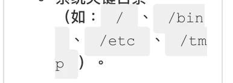

阿里云  
专有云  
机器学习PAI  
裸金属算力平台BMCP 开发指南  
产品版本：v3.18.6  
文档版本：20261023

**目录**

- [1.开发概览](#section-1)
- [2.准备工作](#section-2)
- [3.获取AccessKey](#section-3)
- [4.使用泛化调用方式调用API](#section-4)
- [5.API参考](#section-5)
    - [5.1. 集群管理](#section-5-1)
        - [5.1.1. 裸金属-智算算力集群](#section-5-1-1)
            - [5.1.1.1. CreateBmcpCluster](#section-5-1-1-1)
            - [5.1.1.2. ListBmcpMachineType](#section-5-1-1-2)
            - [5.1.1.3. ListBmcpCluster](#section-5-1-1-3)
            - [5.1.1.4. DescribeBmcpCluster](#section-5-1-1-4)
            - [5.1.1.5. AddBmcpClusterInstances](#section-5-1-1-5)
            - [5.1.1.6. ListAvailableBmcpInstance](#section-5-1-1-6)
            - [5.1.1.7. DeleteBmcpClusterInstances](#section-5-1-1-7)
            - [5.1.1.8. DeleteBmcpCluster](#section-5-1-1-8)
        - [5.1.2. 容器-智算算力集群](#section-5-1-2)
            - [5.1.2.1. CreateAckCluster](#section-5-1-2-1)
            - [5.1.2.2. ListAckCluster](#section-5-1-2-2)
            - [5.1.2.3. DescribeAckCluster](#section-5-1-2-3)
            - [5.1.2.4. AddAckClusterInstances](#section-5-1-2-4)
            - [5.1.2.5. ListAckClusterInstances](#section-5-1-2-5)
            - [5.1.2.6. ListAckClusterNodePool](#section-5-1-2-6)
            - [5.1.2.7. DeleteAckClusterInstances](#section-5-1-2-7)
            - [5.1.2.8. ModifyAckClusterDeletionProtection](#section-5-1-2-8)
            - [5.1.2.9. ListAckInstanceType](#section-5-1-2-9)
            - [5.1.2.10. ListApps](#section-5-1-2-10)
            - [5.1.2.11. DescribeApp](#section-5-1-2-11)
            - [5.1.2.12. GetOssStsToken](#section-5-1-2-12)
            - [5.1.2.13. UploadCustomApp](#section-5-1-2-13)
            - [5.1.2.14. ListCustomApps](#section-5-1-2-14)
            - [5.1.2.15. DescribeCustomApp](#section-5-1-2-15)
            - [5.1.2.16. DeleteCustomApp](#section-5-1-2-16)
            - [5.1.2.17. InstallAiInstanceResource](#section-5-1-2-17)
            - [5.1.2.18. UnInstallAiInstanceResource](#section-5-1-2-18)
            - [5.1.2.19. InstallAiApplication](#section-5-1-2-19)
            - [5.1.2.20. UpgradeAiApplication](#section-5-1-2-20)
            - [5.1.2.21. UnInstallAiApplication](#section-5-1-2-21)
            - [5.1.2.22. ListInstanceTypeDiskCategory](#section-5-1-2-22)
            - [5.1.2.23. ListAckClusterEcsWorkerInstances](#section-5-1-2-23)
            - [5.1.2.24. DescribeAckClusterLogs](#section-5-1-2-24)
            - [5.1.2.25. GetClusterNamespaces](#section-5-1-2-25)
            - [5.1.2.26. ListHistoryEvent](#section-5-1-2-26)
            - [5.1.2.27. ListReStartEvent](#section-5-1-2-27)
            - [5.1.2.28. DeleteAckCluster](#section-5-1-2-28)
        - [5.1.3. 裸金属-超算算力集群](#section-5-1-3)
            - [5.1.3.1. CreateEhpcCluster](#section-5-1-3-1)
            - [5.1.3.2. ListEhpcCluster](#section-5-1-3-2)
            - [5.1.3.3. DescribeEhpcCluster](#section-5-1-3-3)
            - [5.1.3.4. AddEhpcClusterInstances](#section-5-1-3-4)
            - [5.1.3.5. DeleteEhpcClusterInstances](#section-5-1-3-5)
            - [5.1.3.6. DeleteEhpcCluster](#section-5-1-3-6)
        - [5.1.4. 弹性算力集群](#section-5-1-4)
            - [5.1.4.1. CreateBFICluster](#section-5-1-4-1)
            - [5.1.4.2. ListBFICluster](#section-5-1-4-2)
            - [5.1.4.3. DescribeBFICluster](#section-5-1-4-3)
            - [5.1.4.4. ExpandBFICluster](#section-5-1-4-4)
            - [5.1.4.5. ShrinkBFICluster](#section-5-1-4-5)
            - [5.1.4.6. DeleteBFICluster](#section-5-1-4-6)
        - [5.1.5. GetVswitchSwitchMethod](#section-5-1-5)
        - [5.1.6. ClusterDryRun](#section-5-1-6)
        - [5.1.7. TagResources](#section-5-1-7)
        - [5.1.8. RetryFailedInstance](#section-5-1-8)
    - [5.2. 节点管理](#section-5-2)
        - [5.2.1. ListBmcpInstance](#section-5-2-1)
        - [5.2.2. ListManageableInstance](#section-5-2-2)
        - [5.2.3. DescribeInstance](#section-5-2-3)
        - [5.2.4. StopInstance](#section-5-2-4)
        - [5.2.5. StartInstance](#section-5-2-5)
        - [5.2.6. ReStartInstance](#section-5-2-6)
        - [5.2.7. ModifyInstanceAttribute](#section-5-2-7)
        - [5.2.8. ModifyHostNameInstance](#section-5-2-8)
        - [5.2.9. ModifyPasswordInstance](#section-5-2-9)
        - [5.2.10. DescribeWorkbenchDomain](#section-5-2-10)
        - [5.2.11. ReStartEvent](#section-5-2-11)
    - [5.3. 机型管理](#section-5-3)
        - [5.3.1. ListMachineType](#section-5-3-1)
        - [5.3.2. ModifyMachineType](#section-5-3-2)
        - [5.3.3. ListGpu](#section-5-3-3)
        - [5.3.4. DeleteMachineType](#section-5-3-4)
    - [5.4. 镜像管理](#section-5-4)
        - [5.4.1. CreateOrUpdateImage](#section-5-4-1)
        - [5.4.2. ListImage](#section-5-4-2)
        - [5.4.3. ListImageName](#section-5-4-3)
        - [5.4.4. ModifyImage](#section-5-4-4)
        - [5.4.5. ModifyImageStatus](#section-5-4-5)
        - [5.4.6. EnableImage](#section-5-4-6)
        - [5.4.7. DisableImage](#section-5-4-7)
        - [5.4.8. DeleteImage](#section-5-4-8)
    - [5.5. 高性能存储管理](#section-5-5)
        - [5.5.1. CreateCpfsClientCluster](#section-5-5-1)
        - [5.5.2. DescribeCpfsClientClusterType](#section-5-5-2)
        - [5.5.3. MountFilesystem](#section-5-5-3)
        - [5.5.4. UnmountFilesystem](#section-5-5-4)
        - [5.5.5. DeleteCpfsClientCluster](#section-5-5-5)
    - [5.6. 第三方存储管理](#section-5-6)
        - [5.6.1. ModifyInstanceAttach](#section-5-6-1)
        - [5.6.2. ListInstanceStorage](#section-5-6-2)
        - [5.6.3. ModifyInstanceDetach](#section-5-6-3)
    - [5.7. EVPC](#section-5-7)
        - [5.7.1. CreateEvpc](#section-5-7-1)
        - [5.7.2. ListEvpc](#section-5-7-2)
        - [5.7.3. ListEvpcConnections](#section-5-7-3)
        - [5.7.4. ModifyEvpc](#section-5-7-4)
        - [5.7.5. DeleteEvpc](#section-5-7-5)
    - [5.8. 安全组](#section-5-8)
        - [5.8.1. CreateSecurityGroup](#section-5-8-1)
        - [5.8.2. ListSecurityGroup](#section-5-8-2)
        - [5.8.3. ModifySecurityGroup](#section-5-8-3)
        - [5.8.4. DeleteSecurityGroup](#section-5-8-4)
        - [5.8.5. AddSecurityGroupRule](#section-5-8-5)
        - [5.8.6. ListSecurityGroupRule](#section-5-8-6)
        - [5.8.7. ModifySecurityGroupRule](#section-5-8-7)
        - [5.8.8. DeleteSecurityGroupRule](#section-5-8-8)
        - [5.8.9. AddSecurityGroupInstance](#section-5-8-9)
        - [5.8.10. ListSecurityGroupInstance](#section-5-8-10)
        - [5.8.11. DeleteSecurityGroupInstance](#section-5-8-11)
    - [5.9. 密钥对](#section-5-9)
        - [5.9.1. CreateKeyPair](#section-5-9-1)
        - [5.9.2. ListKeyPair](#section-5-9-2)
        - [5.9.3. ConfigKeyPair](#section-5-9-3)
        - [5.9.4. UnbindKeyPair](#section-5-9-4)
        - [5.9.5. DeleteKeyPair](#section-5-9-5)
    - [5.10. 裸机网络](#section-5-10)
        - [5.10.1. ListBorder](#section-5-10-1)
        - [5.10.2. BindVswitchToBorder](#section-5-10-2)
        - [5.10.3. ListVswitchBindToBorder](#section-5-10-3)
        - [5.10.4. ReBindVswitchToBorder](#section-5-10-4)
        - [5.10.5. UnBindVswitchToBorder](#section-5-10-5)
        - [5.10.6. ReUnbindVswitchToBorder](#section-5-10-6)
    - [5.11. 文件备份](#section-5-11)
        - [5.11.1. CreateBackupRepository](#section-5-11-1)
        - [5.11.2. ListBackupRepository](#section-5-11-2)
        - [5.11.3. UpdateBackupRepositoryCapacity](#section-5-11-3)
        - [5.11.4. UpdateBackupRepository](#section-5-11-4)
        - [5.11.5. DeleteBackupRepository](#section-5-11-5)
        - [5.11.6. CreateBackupPlan](#section-5-11-6)
        - [5.11.7. ListBackupPlan](#section-5-11-7)
        - [5.11.8. UpdateBackupPlan](#section-5-11-8)
        - [5.11.9. DeleteBackupPlan](#section-5-11-9)
        - [5.11.10. BindMachineToBackupPlan](#section-5-11-10)
        - [5.11.11. UnbindMachineFromBackupPlan](#section-5-11-11)
        - [5.11.12. CreateBackupTask](#section-5-11-12)
        - [5.11.13. ListBackupTask](#section-5-11-13)
        - [5.11.14. DeleteBackupTask](#section-5-11-14)
        - [5.11.15. ListBackupSnapshot](#section-5-11-15)
        - [5.11.16. RestoreFromSnapshot](#section-5-11-16)
        - [5.11.17. DeleteBackupSnapshot](#section-5-11-17)
    - [5.12. 弹性缓存加速](#section-5-12)
        - [5.12.1. CreateEdaCluster](#section-5-12-1)
        - [5.12.2. DeleteEdaCluster](#section-5-12-2)
    - [5.13. 数据分发](#section-5-13)
        - [5.13.1. ListMP2pTask](#section-5-13-1)
        - [5.13.2. CreateMP2pTask](#section-5-13-2)
        - [5.13.3. DeleteMP2pTask](#section-5-13-3)
    - [5.14. 智能诊断](#section-5-14)
        - [5.14.1. DiagnoseQuery](#section-5-14-1)
        - [5.14.2. TaskQuery](#section-5-14-2)
        - [5.14.3. DiagnosePoint](#section-5-14-3)
    - [5.15. 一键诊断](#section-5-15)
        - [5.15.1. GetDiagnoseItem](#section-5-15-1)
        - [5.15.2. StartDiagnose](#section-5-15-2)
        - [5.15.3. QueryDiagnose](#section-5-15-3)
        - [5.15.4. GetDiagnoseStatusById](#section-5-15-4)
        - [5.15.5. GetDiagnoseDetail](#section-5-15-5)
    - [5.16. 弹性容错任务](#section-5-16)
        - [5.16.1. KeaCreateTrainingTask](#section-5-16-1)
        - [5.16.2. KeaModelList](#section-5-16-2)
        - [5.16.3. KeaTaskList](#section-5-16-3)
        - [5.16.4. KeaTrainingDetail](#section-5-16-4)
        - [5.16.5. KeaStopTraining](#section-5-16-5)
        - [5.16.6. KeaReleaseTrainingResource](#section-5-16-6)
        - [5.16.7. KeaDeleteTrainingTask](#section-5-16-7)
    - [5.17. 性能评测](#section-5-17)
        - [5.17.1. QueryTotalAvailableResource](#section-5-17-1)
        - [5.17.2. ListModels](#section-5-17-2)
        - [5.17.3. ListTasks](#section-5-17-3)
        - [5.17.4. DescribeTask](#section-5-17-4)
        - [5.17.5. GetLog](#section-5-17-5)
        - [5.17.6. GetResult](#section-5-17-6)
        - [5.17.7. GetBaseline](#section-5-17-7)
        - [5.17.8. DeleteJob](#section-5-17-8)
    - [5.18. 事件自愈单](#section-5-18)
        - [5.18.1. ListOrder](#section-5-18-1)
        - [5.18.2. GetOrderDetail](#section-5-18-2)
        - [5.18.3. UpdateOrder](#section-5-18-3)
    - [5.19. 云助手](#section-5-19)
        - [5.19.1. DescribeAliYunAssistServerUrl](#section-5-19-1)
    - [5.20. 回收站](#section-5-20)
        - [5.20.1. ListRecycleBMCPMachine](#section-5-20-1)
        - [5.20.2. RevertMachine](#section-5-20-2)
        - [5.20.3. ReleaseMachine](#section-5-20-3)

<a id="section-1"></a>

# 1.开发概览

在使用裸金属算力平台BMCP功能前，开发人员需了解产品不同功能调用所用产品名称和API版本以及完整的使用流程，有助于正确集成和调用BMCP。

**功能调用说明**

使用BMCP API实现具体功能前，开发人员需要了解调用BMCP不同功能API时所需的产品名称和API版本的区别。

| API功能 | 产品名称 | API版本 |
| --- | --- | --- |
| 集群管理、高性能存储管理、EVPC、安全组、密钥对、弹性缓存加速、数据分发、智能诊断、事件自愈单、回收站 | EasyAI | 2023-11-01 |
| 文件备份、弹性容错任务、性能评测、一键诊断 | bms | 2024-03-01 |
| 节点管理、镜像管理、机型管理、第三方存储管理、裸机网络、云助手 | bms | 2022-05-30 |

**使用流程**


**正式调用**

通过SDK调用API

具体调用流程说明请参见下表。

<table>
  <tr>
    <th>阶段</th>
    <th>具体操作</th>
    <th>说明</th>
  </tr>
  <tr>
    <td rowspan="3">准备工作</td>
    <td>获取公共Header参数</td>
    <td>调用云产品API时，需要提供多个Header参数，包括x-acs-regionid（地域ID）、x-acs-organizationid（组织ID）、x-acs-resourcegroupid（资源集ID）和x-acs-instanceid（云产品资源ID）。</td>
  </tr>
  <tr>
    <td>获取Endpoint</td>
    <td>调用BMCP API时，需要使用BMCP业务域的Endpoint。您可以在阿里云驻场运维工程师处获取，也可以自行获取Endpoint。</td>
  </tr>
  <tr>
    <td>获取AccessKe y</td>
    <td>获取AccessKey后，将访问凭证配置到环境变量中。通过环境变量配置访问凭证可避免在代码中硬编码敏感信息，提升安全性。</td>
  </tr>
  <tr>
    <td>正式调用</td>
    <td>使用泛化调用方式调用API</td>
    <td>使用泛化调用方式调用RPC风格的API。</td>
  </tr>
</table>

<a id="section-2"></a>

# 2.准备工作

使用SDK调用BMCP API前，需要完成访问凭证、公共Header、Endpoint的准备。

**获取公共Header参数**

调用专有云API时需要提供多个Header参数。公共Header参数说明请参见下表。

<table>
  <tr>
    <th>名称</th>
    <th>描述</th>
    <th>示例</th>
    <th>获取方式</th>
  </tr>
  <tr>
    <td>x-acs-regionid</td>
    <td>地域ID。</td>
    <td>cn-********-d01</td>
    <td>1. 管理员登录Apsara Uni-manager运营控制台。<br>2. 在顶部菜单栏中，单击<strong>企业</strong>。<br>3. 在左侧导航栏中，选择<strong>资源管理</strong> &gt; <strong>地域管理</strong>。<br>4. 单击目标组织名称。<br>5. 在右侧<strong>Region列表</strong>中查看Region ID。</td>
  </tr>
  <tr>
    <td>x-acs-organizatio nid</td>
    <td>资源所属的组织ID。</td>
    <td>org-10385eca88860a d8********</td>
    <td rowspan="2">重要使用个人AccessKey时必须获取这些参数，使用组织AccessKey时无需获取。<br>1. 管理员登录Apsara Uni-manager运营控制台。<br>2. 在顶部菜单栏中，单击<strong>企业</strong>。<br>3. 在左侧导航栏中，选择<strong>资源管理</strong> &gt; <strong>组织管理</strong>。<br>4. 单击目标组织名称后，在<strong>基本信息</strong>区域中查看组织ID。<br>5. 在<strong>资源集列表</strong>页签的<strong>资源集名称/ID</strong>列中查看资源集ID。您也可以通过API获取组织ID和资源集ID。获取方式请参见<em>统一云管平台开发指南</em>中的<em>GetOrganizationList、ListResourceGroup章</em><em>节</em>。</td>
  </tr>
  <tr>
    <td>x-acs-resourcegr oupid</td>
    <td>资源所属的资源集ID。</td>
    <td>rs-10385eca8c100a bc********</td>
  </tr>
  <tr>
    <td>x-acs-instanceid</td>
    <td>进行操作的资源ID。</td>
    <td>bmcp-bpnopt****</td>
    <td>资源ID可以通过Apsara Uni-manager运营控制台中的云产品实例列表进行获取。<br>1. 登录Apsara Uni-manager运营控制台。<br>2. 在顶部的菜单栏中，选择<strong>产品 &gt; 计算 &gt; 裸金属</strong><strong>算力平台 BMCP</strong>。<br>3. 在左侧导航栏中，单击<strong>集群管理</strong>、<strong>节点管理</strong>等。<br>4. 在对应资源列表中查看资源ID，例如集群ID、节点ID等。</td>
  </tr>
</table>

> **说明**
>
> 对于列表类的云产品资源实例接口，调用后会默认增加ResourceGroupName（资源集名称）、ResourceGroup（资源集ID）、DepartmentName（组织名称）和Department（组织ID）的返回值。

**获取Endpoint**

1. 登录Apsara Uni-manager运维控制台。

2. 在顶部菜单栏，选择**平台运维 > 飞天基础运维平台 > 运维工具**。

3. 在**服务注册变量大盘**页面，根据所用功能获取相应产品的Endpoint。

   <ol type="i">

   <li>

   选择**服务**并输入**easyAIControllerService**。

   </li>

   <li>

   在**easyAIControllerService**服务的**Service Registration**列中，单击  图标，然后单击

   显示的信息。

   </li>

   <li>

   在**注册变量**对话框，查看**EasyAIPopDomain**值，即 `Endpoint` 。

   </li>

   </ol>

**配置访问凭证**

获取AccessKey后，将访问凭证配置到环境变量。此处以配置AccessKey到环境变量为例介绍。

| 使用方式 | 变量名称 | 说明 |
| --- | --- | --- |
| 使用AccessKey | ALIBABA_CLOUD_ACCESS_KEY _ID、ALIBABA_CLOUD_ACCESS_KEY _SECRET | 使用个人AccessKey或组织AccessKey。 |
| 使用STS临时访问凭证 | ALIBABA_CLOUD_ACCESS_KEY _ID、ALIBABA_CLOUD_ACCESS_KEY _SECRET、ALIBABA_CLOUD_SESSION_TO KEN | STS服务获取的Access Key ID以STS开头，例如<code> STS.**************** </code>，使用通过STS服务获取的临时身份凭证（Access Key ID、Access Key Secret和Security Token）。 |

> **重要**
>
> 配置完成后请重启或刷新编译运行环境，包括IDE、命令行界面、其它桌面应用程序及后台服务，确保最新的系统环境变量成功加载。

**Linux**

1. 在命令行界面执行以下命令，将环境变量设置追加到 `~/.bashrc` 文件中。

   ```bash
   echo "export ALIBABA_CLOUD_ACCESS_KEY_ID='YOUR_ACCESS_KEY_ID'" >> ~/.bashrc
   echo "export ALIBABA_CLOUD_ACCESS_KEY_SECRET='YOUR_ACCESS_KEY_SECRET'" >> ~/.bashrc
   ```

2. 执行以下命令使变更生效。

   ```text
   source ~/.bashrc
   ```

3. 执行以下命令检查环境变量是否生效。

   ```bash
   echo $ALIBABA_CLOUD_ACCESS_KEY_ID
   echo $ALIBABA_CLOUD_ACCESS_KEY_SECRET
   ```

**macOS**

1. 在终端中执行以下命令，查看默认Shell类型。

   ```bash
   echo $SHELL
   ```

2. 根据默认Shell类型进行操作。

   **Zsh**

   <ol type="i">

   <li>

   执行以下命令，将环境变量设置追加到  `~/.zshrc`  文件中。

   ```bash
   echo "export ALIBABA_CLOUD_ACCESS_KEY_ID='YOUR_ACCESS_KEY_ID'" >> ~/.zshrc
   echo "export ALIBABA_CLOUD_ACCESS_KEY_SECRET='YOUR_ACCESS_KEY_SECRET'" >> 
   ~/.zshrc
   ```

   </li>

   <li>

   执行以下命令使变更生效。

   ```text
   source ~/.zshrc
   ```

   </li>

   <li>

   执行以下命令检查环境变量是否生效。

   ```bash
   echo $ALIBABA_CLOUD_ACCESS_KEY_ID
   echo $ALIBABA_CLOUD_ACCESS_KEY_SECRET
   ```

   </li>

   </ol>

   **Bash**

   <ol type="i">

   <li>

   执行以下命令，将环境变量设置追加到  `~/.bash_profile`  文件中。

   ```bash
   echo "export ALIBABA_CLOUD_ACCESS_KEY_ID='YOUR_ACCESS_KEY_ID'" >> 
   ~/.bash_profile
   echo "export ALIBABA_CLOUD_ACCESS_KEY_SECRET='YOUR_ACCESS_KEY_SECRET'" >> 
   ~/.bash_profile
   ```

   </li>

   <li>

   执行以下命令使变更生效。

   ```text
   source ~/.bash_profile
   ```

   </li>

   <li>

   执行以下命令检查环境变量是否生效。

   ```bash
   echo $ALIBABA_CLOUD_ACCESS_KEY_ID
   echo $ALIBABA_CLOUD_ACCESS_KEY_SECRET
   ```

   </li>

   </ol>

**Windows**

**CMD**

1. 在CMD中运行以下命令。

   ```text
   setx ALIBABA_CLOUD_ACCESS_KEY_ID "YOUR_ACCESS_KEY_ID"
   setx ALIBABA_CLOUD_ACCESS_KEY_SECRET "YOUR_ACCESS_KEY_SECRET"
   ```

2. 运行以下命令，检查环境变量是否生效。

   ```bash
   echo %ALIBABA_CLOUD_ACCESS_KEY_ID%
   echo %ALIBABA_CLOUD_ACCESS_KEY_SECRET%
   ```

**PowerShell**

1. 在PowerShell中运行以下命令。

   ```text
   [Environment]::SetEnvironmentVariable("ALIBABA_CLOUD_ACCESS_KEY_ID", 
   "YOUR_ACCESS_KEY_ID", [EnvironmentVariableTarget]::User)
   [Environment]::SetEnvironmentVariable("ALIBABA_CLOUD_ACCESS_KEY_SECRET", 
   "YOUR_ACCESS_KEY_SECRET", [EnvironmentVariableTarget]::User)
   ```

2. 运行以下命令，检查环境变量是否生效。

   ```text
   [Environment]::GetEnvironmentVariable("ALIBABA_CLOUD_ACCESS_KEY_ID", 
   [EnvironmentVariableTarget]::User)
   [Environment]::GetEnvironmentVariable("ALIBABA_CLOUD_ACCESS_KEY_SECRET", 
   [EnvironmentVariableTarget]::User)
   ```

<a id="section-3"></a>

# 3.获取AccessKey

如果应用程序部署运行在安全、稳定且不易受外部攻击的环境中，需要长期访问产品，且不能频繁轮转凭证时，可以使用AccessKey（Access Key ID、Access Key Secret）初始化凭证提供者。

**背景信息**

> **警告**
>
> 个人账号AccessKey是由Apsara Uni-manager运营控制台权限体系管控的受限AccessKey，组织AccessKey相对权限较大，需要管理员确认操作的安全性。

Apsara Uni-manager运营控制台提供了个人AccessKey和组织AccessKey（只有运营管理员和一级组织管理员可以获取组织AccessKey），推荐使用个人账号AccessKey调用Apsara Uni-manager运营控制台及云产品相关接口。

> **说明**
>
> 如果使用个人账号AccessKey，需要在Header中添加x-acs-regionid（地域ID）、x-acs-organizationid（组织ID）、x-acs-resourcegroupid（资源集ID）和x-acs-instanceid（云产品资源ID）参数。具体操作请参见各产品的准备工作文档。

**获取个人账号AccessKey**

1. 登录Apsara Uni-manager运营控制台。

2. 在系统界面右上角，单击当前登录用户头像，单击**个人信息**。

3. 在**AccessKey**区域，您可以查看个人账户的AccessKey信息。

   > **说明**
   >
   > Accesskey ID和AccessKey Secret是您访问云资源时的密钥，具有该账号完整的权限，请您妥善保管。

**获取组织AccessKey**

1. 管理员登录Apsara Uni-manager运营控制台。

2. 在顶部菜单栏，单击**企业**。

3. 在左侧导航栏中，选择**资源管理 > 组织管理**。

4. 在组织结构中，单击目标一级组织名称。

5. 单击**管理Accesskey**。

6. 在弹出的对话框中，查看组织AccessKey信息。

<a id="section-4"></a>

# 4.使用泛化调用方式调用API

BMCP API没有提供SDK，您可以采用泛化调用方式。本文以使用泛化调用方式调用RPC风格的API为例介绍各语言的调用示例。

**背景信息**

使用泛化调用方式可实现任意OpenAPI接口的调用。特点如下：

- 轻量：仅需安装阿里云核心SDK，无需额外安装云产品SDK。

- 简单：仅需构造通用的请求参数对象，然后利用通用请求客户端调用通用函数发起请求，调用结果也以通用格式返回。

发起一次泛化调用请求，您需要获取以下几个参数的值，可在产品的API文档中获取相应参数的值。

- 域名(domain)：该产品的服务地址。

- API版本(version)：该API的版本号，格式为YYYY-MM-DD。BMCP产品名称为EasyAI，API版本为2023-11-01。

- 接口信息：要调用的接口名称。您需要获取 `Action` 参数并在请求中指定API名称。

  例如 `DescribeBmcpCluster` 接口，在通过Java SDK发起请求时，需要使用 `setAction("DescribeBmcpCluster")` 指定API名称。

> **说明**
>
> 本文示例中的可变参数需根据实际替换相关信息，尖括号（<>）在最终代码中不保留。

**Java示例**

**安装核心SDK**

在pom.xml中添加以下依赖安装核心SDK。

```xml
<dependency>
     <groupId>com.aliyun</groupId>
     <artifactId>aliyun-java-sdk-core</artifactId>
     // 可选择版本
     <version>[(4.0.0,5.0.0)]</version>
</dependency>
```

**完整示例**

以下示例通过调用DescribeBmcpCluster接口获取裸金属-智算算力集群详情。其中 `<your_region_id>` 请替换为集群所属地域ID，AccessKey直接通过环境变量获取， `<bmcpDomain>` 请替换为BMCP的Endpoint<strong>，</strong>其他可变参数按需配置即可。

```java
import com.aliyuncs.CommonRequest;
import com.aliyuncs.CommonResponse;
import com.aliyuncs.DefaultAcsClient;
import com.aliyuncs.IAcsClient;
import com.aliyuncs.exceptions.ClientException;
import com.aliyuncs.exceptions.ServerException;
import com.aliyuncs.profile.DefaultProfile;
public class Sample {
  public static void main(String[] args) {
    // 创建DefaultAcsClient实例并初始化
    DefaultProfile profile = DefaultProfile.getProfile(
      // 您的地域ID
      "<your-region-id>",
      // 从环境变量获取RAM账号的AccessKey ID
      System.getenv("AccessKey"),
      // 从环境变量获取RAM账号的AccessKey Secret
      System.getenv("AccessKeySecret"));
    IAcsClient client = new DefaultAcsClient(profile);
    // 创建API请求并设置参数
    CommonRequest request = new CommonRequest();
    request.setSysDomain("<bmcpDomain>");
    request.setSysProduct("EasyAI");
    request.setSysVersion("2023-11-01");
    request.setSysAction("DescribeBmcpCluster");
    request.setSysMethod(MethodType.POST);
    request.setProtocol(com.aliyuncs.http.ProtocolType.HTTP);
    request.putQueryParameter("ClusterId", "bmcp-bpnopt****");
    try {
      CommonResponse response = client.getCommonResponse(request);
      System.out.println(response.getData());
    } catch (ServerException e) {
      // TODO Auto-generated catch block
      e.printStackTrace();
    } catch (ClientException e) {
      // TODO Auto-generated catch block
      e.printStackTrace();
    }
  }
}
```

**Python示例**

**安装核心SDK**

在Terminal中执行以下命令安装核心SDK。

```bash
pip install aliyun-python-sdk-core
```

**完整示例**

以下示例通过调用DescribeBmcpCluster接口获取裸金属-智算算力集群详情。其中 `<your_region_id>` 请替换为集群所属地域ID，AccessKey直接通过环境变量获取， `<bmcpDomain>` 请替换为BMCP的Endpoint<strong>，</strong>其他可变参数按需配置即可。

```python
# coding=utf-8

import os

from aliyunsdkcore.client import AcsClient
from aliyunsdkcore.request import CommonRequest


class Sample:

    @staticmethod
    def main():
        region_id = "<your_region_id>"
        bmcp_domain = "<bmcpDomain>"
        cluster_id = "bmcp-bpnopt****"

        client = AcsClient(
            os.environ["ALIBABA_CLOUD_ACCESS_KEY_ID"],
            os.environ["ALIBABA_CLOUD_ACCESS_KEY_SECRET"],
            region_id,
            verify=False
        )

        request = CommonRequest()
        request.set_domain(bmcp_domain)
        request.set_product("EasyAI")
        request.set_version("2023-11-01")
        request.set_action_name("DescribeBmcpCluster")
        request.set_method("POST")
        request.set_protocol_type("HTTP")

        request.add_body_params("ClusterId", cluster_id)

        response = client.do_action_with_exception(request)
        print(response.decode("utf-8"))


if __name__ == "__main__":
    Sample.main()
```

**Go 调用示例**

**安装核心SDK**

在Terminal中执行以下命令安装核心SDK。

```text
go get -u github.com/aliyun/alibaba-cloud-sdk-go/sdk
```

**完整示例**

以下示例通过调用DescribeBmcpCluster接口获取裸金属-智算算力集群详情。其中 `<your_region_id>` 请替换为集群所属地域ID，AccessKey直接通过环境变量获取， `<bmcpDomain>` 请替换为BMCP的Endpoint<strong>，</strong>其他可变参数按需配置即可。

```go
package main

import (
 "fmt"
 "os"

 "github.com/aliyun/alibaba-cloud-sdk-go/sdk"
 "github.com/aliyun/alibaba-cloud-sdk-go/sdk/requests"
)

func main() {
 RegionId := "<your_region_id>"
 bmcpDomain := "<bmcpDomain>"

 client, err := sdk.NewClientWithAccessKey(
  RegionId,
  os.Getenv("ALIBABA_CLOUD_ACCESS_KEY_ID"),
  os.Getenv("ALIBABA_CLOUD_ACCESS_KEY_SECRET"),
 )
 if err != nil {
  panic(err)
 }

 request := requests.NewCommonRequest()
 request.Domain = bmcpDomain
 request.Product = "EasyAI"
 request.Version = "2023-11-01"
 request.ApiName = "DescribeBmcpCluster"
 request.Method = "POST"
 request.Scheme = "http"

 request.QueryParams["ClusterId"] = "bmcp-bpnopt****"

 response, err := client.ProcessCommonRequest(request)
 if err != nil {
  panic(err)
 }

 fmt.Print(response.GetHttpContentString())
}
```

<a id="section-5"></a>

# 5.API参考

<a id="section-5-1"></a>

## 5.1. 集群管理

<a id="section-5-1-1"></a>

### 5.1.1. 裸金属-智算算力集群

<a id="section-5-1-1-1"></a>

#### 5.1.1.1. CreateBmcpCluster

创建裸金属-智算算力集群。

**请求头**

该接口使用公共请求头，无特殊请求头。请参见公共请求参数文档。

**请求参数**

| 参数名称 | 类型 | 位置 | 是否必选 | 示例 | 说明 |
| --- | --- | --- | --- | --- | --- |
| Departme nt | Strin g | Query | 否 | 4 | 组织ID。 |
| Resource Group | Strin g | Query | 否 | 3 | 资源集ID。 |
| RegionId | Strin g | Query | 否 | cn-wulan-env\*\*\*-d01 | 地域 ID。 |
| VpcId | Strin g | Query | 否 | vpc-bp1b1xjllp3ve5yze\*\*\*\* | VPC ID。 |
| ClusterNa me | Strin g | Query | 否 | cluster-name | 集群名称。长度为1~63个字符，可包含数字、中文字符、英文字符或短划线（-）。 |
| Descriptio n | Strin g | Query | 否 | testDescription | 集群描述。长度为0~1000个字符。 |
| Password | Strin g | Query | 否 | Pwd\*\*\*\*\* | 集群中机器的登录密码。密码要求为8~30个字符，且至少同时包含大写字母、小写字母、数字、特殊字符中的三项，支持的特殊字符包括()\`~!@#$%^&amp;\*-_+=\|{}\[\]:;'&lt;&gt;,.?/。 |
| AddBmsIn stanceList | Json | Query | 否 | null | 该参数已废弃。 |
| ApplyBmsI nstanceLis t | Json | Query | 否 | \[ { "CpuCount": 2, "MemCount": 16, "FlopsCount": 30, "VideoMemCount": 30, "InstanceName": "myinstance", "UseOriginImage": true, "ImageType": "", "Image": "", "HostName": "xxx", "InstanceAlias": "xxx", "Description": "testDescription", "NodePoolName": "bmcp-node-pool", "VswitchId": "vsw-3gagdup8scary04iq\*\*\*\*", "ActivationId": "a-hz0ch3SwhOlE1234+Xo 32lAZC\*\*\*\*", "ActivationCode": "4ECEEE12-56F1-4FBC-9AB1-890F1234\*\*\*\*" } \] | 需要申请裸机的参数列表。ClusterArchType取值为managed必须配置该参数。 |
| ZoneId | Strin g | Query | 否 | cn-wulan-env\*\*\*-\*\*\*\*-a | 可用区ID。 |
| ClusterArc hType | Strin g | Query | 否 | standard | 集群类型，取值范围：<br>• standard：智算高网。<br>• managed：智算纳管。<br>• base：智算基础。<br>• aspeed：智算训推。 |
| MachineT ypeList | Json | Query | 否 | \[ { "MachineType": "test", "Arch": "x86", "CpuCount": 2, "MemCount": 4, "FlopsCount": 4.8, "VideoMemCount": 5, "NodeCount": 10, "VswitchId": "vsw-3gagdup8scary04iq\*\*\*\*"} \] | 要加入超算集群的裸机机型列表。ClusterArchType取值为standard、base、aspeed必须配置该参数。 |
| VswitchId List | Json | Query | 否 | null | 该参数已废弃。 |
| StandardV switchId | Strin g | Query | 否 | vsw-3gagdup8scary04iq\*\*\*\* | 交换机ID，用于构建管控服务网络通道。 |
| EvpcId | Strin g | Query | 否 | evpc-htchvitxlfjyso\*\*\*\* | Evpc ID。ClusterArchType取值为standard或aspeed必须配置该参数。您可以调用ListEvpc查询EvpcId。 |
| VolumeId | Strin g | Query | 否 | null | 该参数已废弃。 |
| MountPat h | Strin g | Query | 否 | null | 该参数已废弃。 |
| ActivationI d | Strin g | Query | 否 | 4ECEEE12-56F1-4FBC-9AB1-890F1234\*\*\*\* | 云助手激活码 ID。ClusterArchType取值为standard、base、aspeed必须配置该参数。 |
| Activation Code | Strin g | Query | 否 | a-hz0ch3SwhOlE1234+Xo 32lAZC\*\*\*\* | 云助手激活码的代码。ClusterArchType取值为standard、base、aspeed必须配置该参数。 |
| IsCreateC pfsCluster | Boole an | Query | 否 | true | 是否启用高性能存储客户端集群。取值范围：<br>• true：开启。<br>• false：关闭。默认值：false。ClusterArchType取值为standard或aspeed可以配置该参数。 |
| CpfsClust erType | Strin g | Query | 否 | CPFS | 高性能存储客户端集群类型，取值范围：<br>• CPFS<br>• APFS<br>IsCreateCpfsCluster取值为true时必须配置该参数。 |
| VolumeInf o | Json | Query | 否 | \[ { "VolumeType": "iscsi", "VolumeParams": { "IP": "127.0.0.1", "ServerIQN": "iqn.2023-04.com.bms:server", "ClientIQN": "", "ChapEnabled": "true", "UserID": "bms", "Password": "xxxx", "LunID": "0", "Description": "", "ClientAttachPath": "/mnt" } }, {"VolumeType": "nfs", "VolumeParams": { "IP": "127.0.0.1", "Description": "", "ServerPath": "/home/nfstestdir", "ClientAttachPath": "/mnt" } }, {"VolumeType": "mount", "VolumeParams": {"Description": "", "ServerPath": "/dev/sdl1", "ClientAttachPath": "/mnt", "MountParams": "--bind" } } \] | 第三方存储挂载信息。ClusterArchType取值为managed可以配置该参数。 |
| IsInstallYu ndunAegis | Boole an | Query | 否 | true | 是否安装安骑士。取值范围：<br>• true：开启。<br>• false：关闭。默认值：false。 |
| SwitchMet hod | Strin g | Query | 否 | CHSW | 交换机联网方式。<br>• ClusterArchType取值为standard、base或aspeed时，该参数必须为CHSW。<br>• ClusterArchType取值为managed时，该参数可以设置CHSW或HSW。 |
| EnableIpv 6 | Boole an | Query | 否 | true | 是否启用IPv6功能。取值范围：<br>• true：开启。<br>• false：关闭。默认值：false。 |
| EvpcEnabl eIpv6 | Boole an | Query | 否 | true | 是否启用EVPC IPv6。取值范围：当配置了EvpcId时才能开启IPv6。<br>• true：开启。<br>• false：关闭。默认值：false。 |

**返回数据**

| 参数名称 | 类型 | 示例 | 说明 |
| --- | --- | --- | --- |
| errorCode | String | Successful | 错误码。 |
| errorTitle | String | Successful | 异常标题。 |
| errorMessage | String | Successful | 错误信息。 |
| data | Map | { "ClusterName": "testname", "ClusterId": "bmcp-bpnopt\*\*\*\*" } | 返回数据。 |
| status | Integer | 200 | 返回状态。 |
| requestId | String | F0A8A039-930D-5EC1-97C8-\*\*\*\*\*\*\*\*\*\*\*\* | 请求ID。 |
| success | Boolean | true | 返回状态。<br>• 成功：true。<br>• 失败：false。 |
| responseVersi on | String | v1 | 返回版本。 |

**示例**

请求示例

```text
http://[Endpoint]/?Action=CreateBmcpCluster
http://[Endpoint]/?Action=CreateEhpcCluster
&Department=4
&ResourceGroup=3
&RegionId=cn-wulan-env***-d01
&ZoneId=cn-wulan-env***-****-a
&VpcId=vpc-bp1b1xjllp3ve5yze****
&ClusterName=cluster-name
&ClusterArchType=standard
&MachineTypeList=[
  {
    "MachineType": "test",
    "Arch": "x86",
    "CpuCount": 2,
    "MemCount": 4,
    "FlopsCount": 4.8,
    "VideoMemCount": 5,
    "NodeCount": 10,
    "VswitchId": "vsw-3gagdup8scary04iq****"
  }
]
&StandardVswitchId=vsw-3gagdup8scary04iq****
&EvpcId=evpc-htchvitxlfjyso****
&ActivationId=a-hz0ch3SwhOlE1234+Xo32lAZC****
&ActivationCode=4ECEEE12-56F1-4FBC-9AB1-890F1234****
&IsCreateCpfsCluster=true
&CpfsClusterType=CPFS
&SwitchMethod=CHSW
&EnableIpv6=true
&EvpcEnableIpv6=true
&公共请求参数
```

正常返回示例

`JSON`  格式

```json
{
 "responseVersion":"v1",
 "data":{
  "ClusterId":"bmcp-bpnopt****",
  "ClusterName":"testname"
 },
 "errorTitle":"Successful",
 "requestId":"F0A8A039-930D-5EC1-97C8-************",
 "success":true,
 "errorMessage":"Successful",
 "errorCode":"Successful",
 "status":200
}
```

`XML`  格式

```xml
<responseVersion>v1</responseVersion>
<data>
 <ClusterId>bmcp-bpnopt****</ClusterId>
 <ClusterName>testname</ClusterName>
</data>
<errorTitle>Successful</errorTitle>
<requestId>F0A8A039-930D-5EC1-97C8-************</requestId>
<success>true</success>
<errorMessage>Successful</errorMessage>
<errorCode>Successful</errorCode>
<status>200</status>
```

<a id="section-5-1-1-2"></a>

#### 5.1.1.2. ListBmcpMachineType

获取BMCP机型列表。

**请求头**

该接口使用公共请求头，无特殊请求头。请参见公共请求参数文档。

**请求参数**

| 参数名称 | 类型 | 位置 | 是否必选 | 示例 | 说明 |
| --- | --- | --- | --- | --- | --- |
| MachineT ype | Strin g | Query | 否 | QPG78P4M8G3V.03BB | 机型名称。 |
| CPUArch | Strin g | Query | 否 | x86_64 | CPU架构，取值范围：<br>• x86_64<br>• arm64 |
| DiskType | Strin g | Query | 否 | cloud_ssd | 磁盘类型。取值范围：<br>• HDD<br>• SSD<br>• SATA |
| Manufactu rer | Strin g | Query | 否 | NVIDIA | 厂商名称。 |
| ZoneId | Strin g | Query | 否 | cn-wulan-env\*\*\*-\*\*\*\*-a | 可用区ID。<br>• 如果传递会统计指定可用区可用通用实例数量。<br>• 如果不传，会统计本机型下所有可用区内的可用通用实例数量。 |
| PageNum ber | Integ er | Query | 否 | 1 | 页码，默认为1。 |
| PageSize | Integ er | Query | 否 | 10 | 每页容量，默认为10。 |
| DeployTy pes | Json | Query | 否 | "\["bmcp"\]" | 要查询的机型的类型列表，取值范围：<br>• bmcp：智算高网<br>• ehpc：高性能计算高网<br>• base：智算基础<br>• aspeed：训推优化<br>• bfi：融合高网<br>• bfi_base：融合基础 |
| Specificati on | Strin g | Query | 否 | gBMC-Ch4ce8hdr | 机型规格。 |

**返回数据**

| 参数名称 | 类型 | 示例 | 说明 |
| --- | --- | --- | --- |
| errorCode | String | "" | 错误码。 |
| errorTitle | String | “” | 错误标题。 |
| errorMessage | String | "“ | 错误信息。 |
| data | Map | { "PageNumber": 1, "PageSize": 10, "TotalCount": 10, "MachineTypeList": \[ { "ratedPower": "1", "memory": 500, "defaultFmin": "", "gpuManufacturer": "NVIDIA", "CPUNumber": 128, "networkCardType": "10G", "unitNum": 2, "description": "", "updateTime": "2024-03-14T10:48:43+08:0 0", "CPUArch": "x86_64", "gpu": "T4", "deployType": "bmcp", "manufacturer": "HW", "networkCardNum": 2, "GpuNum": 4, "disk": 500, "cpuManufacturer": "Hygon", "createTime": "2024-03-14T10:48:43+08:0 0", "name": "T4", "ID": 2, "diskType": "SSD", "CPUModel": "Hygon C86 7285 32-core Processor", "StandardInstance Count": 10, "Specification": "xxxx" } \] } | 返回数据。 |
| status | Integer | 0 | 返回状态。 |
| requestId | String | 66dfddc6-b547-11ee-aa84-acde4800\*\*\*\* | 请求ID。 |
| success | Boolean | true | 请求状态。 |
| responseVersi on | String | v1 | 返回版本。 |

**示例**

请求示例

```text
http://[Endpoint]/?Action=ListBmcpMachineType
&MachineType=MachineType
&公共请求参数
```

正常返回示例

`JSON`  格式

```json
{
 "responseVersion":"v1",
 "data":{},
 "errorTitle":"Successful",
 "requestId":"**",
 "success":true,
 "errorMessage":"Successful",
 "errorCode":"Successful",
 "status":200
}
```

`XML`  格式

```xml
<responseVersion>v1</responseVersion>
<data  />
<errorTitle>Successful</errorTitle>
<requestId>**</requestId>
<success>true</success>
<errorMessage>Successful</errorMessage>
<errorCode>Successful</errorCode>
<status>200</status>
```

<a id="section-5-1-1-3"></a>

#### 5.1.1.3. ListBmcpCluster

查询裸金属-智算算力集群列表。

**请求头**

该接口使用公共请求头，无特殊请求头。请参见公共请求参数文档。

**请求参数**

| 参数名称 | 类型 | 位置 | 是否必选 | 示例 | 说明 |
| --- | --- | --- | --- | --- | --- |
| Departme nt | Strin g | Query | 否 | 4 | 组织ID。 |
| Resource Group | Strin g | Query | 否 | 3 | 资源集ID。 |
| ClusterNa me | Strin g | Query | 否 | cluster-name | 集群名称。 |
| ClusterId | Strin g | Query | 否 | bmcp-bpnopt\*\*\*\* | 集群ID。 |
| Status | Strin g | Query | 否 | active | 集群状态，取值范围：<br>• creating：创建中<br>• active：运行中<br>• createFailed：创建失败<br>• deleting：删除中<br>• deleteFailed：删除失败<br>• scalingDown：缩容中<br>• scalingDownFailed：缩容失败<br>• scalingUp：扩容中<br>• scalingUpFailed：扩容失败 |
| PageNum ber | Integ er | Query | 否 | 1 | 页码。 |
| PageSize | Integ er | Query | 否 | 10 | 每页容量，默认为10。 |
| Zone | Strin g | Query | 否 | cn-\*\*\*\*-env\*\*-d01-a | 可用区ID。 |
| ClusterArc hType | Strin g | Query | 否 | standard | 集群类型，取值范围：<br>• standard：智算高网。<br>• managed：智算纳管。<br>• base：智算基础。<br>• aspeed：智算训推。 |
| EvpcId | Strin g | Query | 否 | evpc-htchvitxlfjyso\*\*\*\* | Evpc ID，Evpc的唯一标识符。您可以调用ListEvpc查询Evpc ID。 |
| VpcId | Strin g | Query | 否 | vpc-bp1b1xjllp3ve5yze\*\*\*\* | VPC ID。 |

**返回数据**

| 参数名称 | 类型 | 示例 | 说明 |
| --- | --- | --- | --- |
| errorCode | String | Successful | 错误码。 |
| errorTitle | String | Successful | 异常标题。 |
| errorMessage | String | Successful | 错误信息。 |
|  |  | { "ClusterList": \[ { |  |
|  |  |  |  |
| 参数名称 | 类型 | "Description":示例"testDescription", | 说明 |
| data | Map | "Organization": "5", "IsSetPassword": true, "SwitchMethod": "CHSW", "CpfsClusterType": "APFS", "Gpu": \[ {"GpuNum": 32, "GpuModel": "NVIDIA_Ampere_A 10_80G_NVLink" }\], "EvpcId": "evpc-pi2q\*\*\*z8b", "EnableIpv6": true, "FlopsCount": 9984, "Department": 5, "CpuCount": 512, "ClusterName": "cluster-name", "ResourceGroup": 4, "Status": "active", "ActiveNodeCount": 4, "NodeCount": 4, "ClusterId": "bmcp-v8\*\*\*QVZT", "Zone": "cn-wulan-env\*\*\*-d01-a", "CreateTime": "2026-01-12T10:44:46+08:0 0", "Specification": \[ { "Count": 3, "Name": "gBMC-Ci8af8nbr" } \], "CpfsClusterState": "active", "AscmCreateUser": "admin", "MemCount": 8192, "ClusterArchType": "standard", "VpcId": "vpc-7kkjbu\*\*\*\*od7pxs6 10", "OldClusterBzid": "", "UpdateTime": "2026-01-22T15:58:01+08:0 0", "Region": "cn-wulan-env\*\*\*-d01", "CpfsMountFs": "efs-01\*\*\*08", "RegionId": "cn-wulan-env\*\*\*-d01", "VideoMemory": 2560, "EnableIpv6": true, "EvpcEnableIpv6": true } \], | 返回数据。 |
|  |  |  |  |
| 参数名称 | 类型 | "PageSize": 10,示例"TotalCount": 1, | 说明 |
| status | Integer | "PageNumber": 1 }<br>200 | 返回状态。 |
| requestId | String | F0A8A039-930D-5EC1-97C8-\*\*\*\*\*\*\*\*\*\*\*\* | 请求ID。 |
| success | Boolean | true | 返回状态。<br>• 成功：true。<br>• 失败：false。 |
| responseVersi on | String | v1 | 返回版本。 |

**示例**

请求示例

```text
http://[Endpoint]/?Action=ListBmcpCluster
&Department=4
&ResourceGroup=3
&RegionId=cn-wulan-env***-d01
&ZoneId=cn-wulan-env***-****-a
&VpcId=vpc-bp1b1xjllp3ve5yze****
&ClusterName=cluster-name
&公共请求参数&公共请求参数
```

正常返回示例

`JSON`  格式

```json
{
 "responseVersion":"v1",
 "data":{
  "TotalCount":1,
  "ClusterList":[
   {
    "Description":"testDescription",
    "Organization":"5",
    "IsSetPassword":true,
    "SwitchMethod":"CHSW",
    "CpfsClusterType":"APFS",
    "Gpu":[
     {
      "GpuNum":32,
      "GpuModel":"NVIDIA_Ampere_A10_80G_NVLink"
     }
    ],
    "EvpcId":"evpc-pi2q***z8b",
    "EnableIpv6":true,
    "FlopsCount":9984,
    "Department":5,
    "CpuCount":512,
    "EvpcEnableIpv6":true,
    "ClusterName":"cluster-name",
    "ResourceGroup":4,
    "Status":"active",
    "ActiveNodeCount":4,
    "NodeCount":4,
    "ClusterId":"bmcp-v8***QVZT",
    "Zone":"cn-wulan-env***-d01-a",
    "CreateTime":"2026-01-12T10:44:46+08:00",
    "Specification":[
     {
      "Count":3,
      "Name":"gBMC-Ci8af8nbr"
     }
    ],
    "CpfsClusterState":"active",
    "AscmCreateUser":"admin",
    "MemCount":8192,
    "ClusterArchType":"standard",
    "VpcId":"vpc-7kkjbu****od7pxs610",
    "OldClusterBzid":"",
    "UpdateTime":"2026-01-22T15:58:01+08:00",
    "Region":"cn-wulan-env***-d01",
    "CpfsMountFs":"efs-01***08",
    "RegionId":"cn-wulan-env***-d01",
    "VideoMemory":2560
   }
  ],
  "PageSize":10,
  "PageNumber":1
 },
 "errorTitle":"Successful",
 "requestId":"F0A8A039-930D-5EC1-97C8-************",
 "success":true,
 "errorMessage":"Successful",
 "errorCode":"Successful",
 "status":200
}
```

`XML`  格式

```xml
<responseVersion>v1</responseVersion>
<data>
 <TotalCount>1</TotalCount>
 <ClusterList>
  <Description>testDescription</Description>
  <Organization>5</Organization>
  <IsSetPassword>true</IsSetPassword>
  <SwitchMethod>CHSW</SwitchMethod>
  <CpfsClusterType>APFS</CpfsClusterType>
  <Gpu>
   <GpuNum>32</GpuNum>
   <GpuModel>NVIDIA_Ampere_A10_80G_NVLink</GpuModel>
  </Gpu>
  <EvpcId>evpc-pi2q***z8b</EvpcId>
  <EnableIpv6>true</EnableIpv6>
  <FlopsCount>9984</FlopsCount>
  <Department>5</Department>
  <CpuCount>512</CpuCount>
  <EvpcEnableIpv6>true</EvpcEnableIpv6>
  <ClusterName>cluster-name</ClusterName>
  <ResourceGroup>4</ResourceGroup>
  <Status>active</Status>
  <ActiveNodeCount>4</ActiveNodeCount>
  <NodeCount>4</NodeCount>
  <ClusterId>bmcp-v8***QVZT</ClusterId>
  <Zone>cn-wulan-env***-d01-a</Zone>
  <CreateTime>2026-01-12T10:44:46+08:00</CreateTime>
  <Specification>
   <Count>3</Count>
   <Name>gBMC-Ci8af8nbr</Name>
  </Specification>
  <CpfsClusterState>active</CpfsClusterState>
  <AscmCreateUser>admin</AscmCreateUser>
  <MemCount>8192</MemCount>
  <ClusterArchType>standard</ClusterArchType>
  <VpcId>vpc-7kkjbu****od7pxs610</VpcId>
  <OldClusterBzid  />
  <UpdateTime>2026-01-22T15:58:01+08:00</UpdateTime>
  <Region>cn-wulan-env***-d01</Region>
  <CpfsMountFs>efs-01***08</CpfsMountFs>
  <RegionId>cn-wulan-env***-d01</RegionId>
  <VideoMemory>2560</VideoMemory>
 </ClusterList>
 <PageSize>10</PageSize>
 <PageNumber>1</PageNumber>
</data>
<errorTitle>Successful</errorTitle>
<requestId>F0A8A039-930D-5EC1-97C8-************</requestId>
<success>true</success>
<errorMessage>Successful</errorMessage>
<errorCode>Successful</errorCode>
<status>200</status>
```

<a id="section-5-1-1-4"></a>

#### 5.1.1.4. DescribeBmcpCluster

查询裸金属-智算算力集群详情。

**请求头**

该接口使用公共请求头，无特殊请求头。请参见公共请求参数文档。

**请求参数**

| 参数名称 | 类型 | 位置 | 是否必选 | 示例 | 说明 |
| --- | --- | --- | --- | --- | --- |
| ClusterId | Strin g | Query | 否 | bmcp-bpnopt\*\*\*\* | 裸金属-智算算力集群ID。您可以调用ListBmcpCluster查询集群ID。 |

**返回数据**

| 参数名称 | 类型 | 示例 | 说明 |
| --- | --- | --- | --- |
| errorCode | String | Successful | 错误码。 |
| errorTitle | String | Successful | 异常标题。 |
| errorMessage | String | Successful | 错误信息。 |
| data | Map | { "ClusterId": "bmcp-bpnopt\*\*\*\*", "ClusterName": "cluster-name", "Description": "testDescription", "Status": "active", "CreateTime": "2023-11-29T17:08:15+08:0 0", "UpdateTime": "2023-12-13T15:15:25+08:0 0", "NodeCount": 3, "ActiveNodeCount": 1, "CpuCount": 10, "MemCount": 36, "FlopsCount": 50, "VideoMemory": 50, "Region": "cn-\*\*\*\*-env\*\*-d01", "Organization": "4", "ResourceGroup": "3", "InstanceList": \[ "i-d8offheheob5qaf0\* \*\*\*", "i-d620b2eheobcabte \*\*\*\*", "i-d75ppnuheobcnhq o\*\*\*\*" \], "VpcId": "vpc-bp1b1xjllp3ve5yze \*\*\*\*", "ClusterArchType": "standard", "EvpcId": "evpc-htchvitxlfjyso\*\*\*\*", "Zone": "cn-\*\*\*\*-env\*\*-d01-a", "IsSetPassword": true } | 返回数据。 |
| status | Integer | 200 | 返回状态。 |
| requestId | String | F0A8A039-930D-5EC1-97C8-\*\*\*\*\*\*\*\*\*\*\*\* | 请求ID。 |
| success | Boolean | true | 返回状态。<br>• 成功：true。<br>• 失败：false。 |
| responseVersi on | String | v1 | 返回版本。 |

**示例**

请求示例

```text
http://[Endpoint]/?Action=DescribeBmcpCluster
&ClusterId=bmcp-bpnopt****
&公共请求参数
```

正常返回示例

`JSON`  格式

```json
{
 "responseVersion":"v1",
 "data":{
  "Status":"active",
  "Description":"testDescription",
  "ActiveNodeCount":1,
  "Organization":"4",
  "IsSetPassword":true,
  "NodeCount":3,
  "ClusterId":"bmcp-bpnopt****",
  "Zone":"cn-****-env**-d01-a",
  "CreateTime":"2023-11-29T17:08:15+08:00",
  "MemCount":36,
  "EvpcId":"evpc-htchvitxlfjyso****",
  "ClusterArchType":"standard",
  "FlopsCount":50,
  "CpuCount":10,
  "VpcId":"vpc-bp1b1xjllp3ve5yze****",
  "UpdateTime":"2023-12-13T15:15:25+08:00",
  "ClusterName":"cluster-name",
  "Region":"cn-****-env**-d01",
  "VideoMemory":50,
  "InstanceList":[
   "i-d8offheheob5qaf0****",
   "i-d620b2eheobcabte****",
   "i-d75ppnuheobcnhqo****"
  ],
  "ResourceGroup":"3"
 },
 "errorTitle":"Successful",
 "requestId":"F0A8A039-930D-5EC1-97C8-************",
 "success":true,
 "errorMessage":"Successful",
 "errorCode":"Successful",
 "status":200
}
```

`XML`  格式

```xml
<responseVersion>v1</responseVersion>
<data>
 <Status>active</Status>
 <Description>testDescription</Description>
 <ActiveNodeCount>1</ActiveNodeCount>
 <Organization>4</Organization>
 <IsSetPassword>true</IsSetPassword>
 <NodeCount>3</NodeCount>
 <ClusterId>bmcp-bpnopt****</ClusterId>
 <Zone>cn-****-env**-d01-a</Zone>
 <CreateTime>2023-11-29T17:08:15+08:00</CreateTime>
 <MemCount>36</MemCount>
 <EvpcId>evpc-htchvitxlfjyso****</EvpcId>
 <ClusterArchType>standard</ClusterArchType>
 <FlopsCount>50</FlopsCount>
 <CpuCount>10</CpuCount>
 <VpcId>vpc-bp1b1xjllp3ve5yze****</VpcId>
 <UpdateTime>2023-12-13T15:15:25+08:00</UpdateTime>
 <ClusterName>cluster-name</ClusterName>
 <Region>cn-****-env**-d01</Region>
 <VideoMemory>50</VideoMemory>
 <InstanceList>i-d8offheheob5qaf0****</InstanceList>
 <InstanceList>i-d620b2eheobcabte****</InstanceList>
 <InstanceList>i-d75ppnuheobcnhqo****</InstanceList>
 <ResourceGroup>3</ResourceGroup>
</data>
<errorTitle>Successful</errorTitle>
<requestId>F0A8A039-930D-5EC1-97C8-************</requestId>
<success>true</success>
<errorMessage>Successful</errorMessage>
<errorCode>Successful</errorCode>
<status>200</status>
```

<a id="section-5-1-1-5"></a>

#### 5.1.1.5. AddBmcpClusterInstances

扩容裸金属-智算算力集群。

**请求头**

该接口使用公共请求头，无特殊请求头。请参见公共请求参数文档。

**请求参数**

| 参数名称 | 类型 | 位置 | 是否必选 | 示例 | 说明 |
| --- | --- | --- | --- | --- | --- |
| ClusterId | Strin g | Query | 否 | bmcp-bpnopt\*\*\*\* | 裸金属-超算算力集群ID。您可以通过ListEhpcCluster查询集群ID。 |
| InstanceLi st | Json | Query | 否 | null | 该参数已废弃。 |
| Password | Strin g | Query | 否 | null | 该参数已废弃。 |
| MachineT ypeList | Json | Query | 否 | \[ { "MachineType": "test", "Arch": "x86", "CpuCount": 2, "MemCount": 4, "FlopsCount": 4.8, "VideoMemCount": 5, "NodeCount": 10, "VswitchId": "vsw-3gagdup8scary04iq\*\*\*\*"} \] | 要加入超算集群的裸机机型列表。ClusterArchType取值为standard、base、aspeed必须配置该参数。 |
| ApplyBmsI nstanceLis t | Json | Query | 否 | \[ { "CpuCount": 2, "MemCount": 16, "FlopsCount": 30, "VideoMemCount": 30, "InstanceName": "myinstance", "UseOriginImage": true, "ImageType": "", "Image": "", "HostName": "xxx", "InstanceAlias": "xxx", "Description": "testDescription", "NodePoolName": "bmcp-node-pool", "VswitchId": "vsw-3gagdup8scary04iq\*\*\*\*", "ActivationId": "a-hz0ch3SwhOlE1234+Xo 32lAZC\*\*\*\*", "ActivationCode": "4ECEEE12-56F1-4FBC-9AB1-890F1234\*\*\*\*" } \] | 需要申请裸机的参数列表。ClusterArchType取值为managed必须配置该参数。 |
| VswitchId List | Json | Query | 否 | null | 该参数已废弃。 |
| ActivationI d | Strin g | Query | 否 | 4ECEEE12-56F1-4FBC-9AB1-890F1234\*\*\*\* | 云助手激活码 ID。ClusterArchType取值为standard、base、aspeed必须配置该参数。 |
| Activation Code | Strin g | Query | 否 | a-hz0ch3SwhOlE1234+Xo 32lAZC\*\*\*\* | 云助手激活码的代码。ClusterArchType取值为standard、base、aspeed必须配置该参数。 |
| ZoneId | Strin g | Query | 否 | cn-\*\*\*\*-env\*\*-d01-a | 可用区ID。 |

**返回数据**

| 参数名称 | 类型 | 示例 | 说明 |
| --- | --- | --- | --- |
| errorCode | String | Successful | 错误码。 |
| errorTitle | String | Successful | 异常标题。 |
| errorMessage | String | Successful | 错误信息。 |
| data | Map | { "ClusterName": "testname", "ClusterId": "bmcp-bpnopt\*\*\*\*" } | 返回数据。 |
| status | Integer | 200 | 返回状态。 |
| requestId | String | F0A8A039-930D-5EC1-97C8-\*\*\*\*\*\*\*\*\*\*\*\* | 请求ID。 |
| success | Boolean | true | 返回状态。<br>• 成功：true。<br>• 失败：false。 |
| responseVersi on | String | v1 | 返回版本。 |

**示例**

请求示例

```text
http://[Endpoint]/?Action=AddBmcpClusterInstances
&ClusterId=bmcp-bpnopt****
&ZoneId=cn-wulan-env***-****-a
&MachineTypeList=    
[
  {
    "CpuCount": 2,
    "MemCount": 16,
    "FlopsCount": 30,
    "VideoMemCount": 30,
    "InstanceName": "myinstance",
    "UseOriginImage": true,
    "ImageType": "",
    "Image": "",
    "HostName": "xxx",
    "InstanceAlias": "xxx",
    "Description": "testDescription",
    "NodePoolName": "bmcp-node-pool",
    "VswitchId": "vsw-3gagdup8scary04iq****"
  }
]
&ActivationId=a-hz0ch3SwhOlE1234+Xo32lAZC****
&ActivationCode=4ECEEE12-56F1-4FBC-9AB1-890F1234****
&公共请求参数
```

正常返回示例

`JSON`  格式

```json
{
 "responseVersion":"v1",
 "data":{
  "ClusterId":"bmcp-bpnopt****",
  "ClusterName":"testname"
 },
 "errorTitle":"Successful",
 "requestId":"F0A8A039-930D-5EC1-97C8-************",
 "success":true,
 "errorMessage":"Successful",
 "errorCode":"Successful",
 "status":200
}
```

`XML`  格式

```xml
<responseVersion>v1</responseVersion>
<data>
 <ClusterId>bmcp-bpnopt****</ClusterId>
 <ClusterName>testname</ClusterName>
</data>
<errorTitle>Successful</errorTitle>
<requestId>F0A8A039-930D-5EC1-97C8-************</requestId>
<success>true</success>
<errorMessage>Successful</errorMessage>
<errorCode>Successful</errorCode>
<status>200</status>
```

<a id="section-5-1-1-6"></a>

#### 5.1.1.6. ListAvailableBmcpInstance

查询当前可用的BMCP（裸金属云平台）实例列表。

**请求头**

该接口使用公共请求头，无特殊请求头。请参见公共请求参数文档。

**请求参数**

| 参数名称 | 类型 | 位置 | 是否必选 | 示例 | 说明 |
| --- | --- | --- | --- | --- | --- |
| Departme nt | Strin g | Query | 否 | 4 | 组织ID。 |
| Resource Group | Strin g | Query | 否 | 3 | 资源集ID。 |
| VpcId | Strin g | Query | 否 | vpc-4uftp58qtzn7t663xajtj | VPC ID。 |

**返回数据**

| 参数名称 | 类型 | 示例 | 说明 |
| --- | --- | --- | --- |
| errorCode | String | "" | 错误码。 |
| errorTitle | String | “” | 错误标题。 |
| errorMessage | String | "“ | 错误信息。 |
| data | Map | { "InstanceList": \[{ "InstanceId": "1", "InstanceIp": "192.168.1.1", "InstanceAlias": "c25d0\*\*\*\*.cloud.d 04.\*\*\*\*", "HostName": "c25d0\*\*\*\*.cloud.d 04.\*\*\*\*", "SN": "98001716037\*\*\*\* ", "InstacneType": "VM", "CpuCount": 192, "MemCount": 256, "FlopsCount": 2496, "VideoMemCount": 640, "VpcId": "vpc-xxxx" } \] } | 返回数据。 |
| status | Integer | 0 | 返回状态。 |
| requestId | String | 66dfddc6-b547-11ee-aa84-acde4800\*\*\*\* | 请求ID。 |
| success | Boolean | true | 请求状态。 |
| responseVersi on | String | v1 | 返回版本。 |

**示例**

请求示例

```text
http://[Endpoint]/?Action=ListAvailableBmcpInstance
&Department=4
&ResourceGroup=3
&VpcId=vpc-4uftp58qtzn7t663xajtj
&公共请求参数
```

正常返回示例

`JSON`  格式

```json
{
 "responseVersion":"v1",
 "data":{
  "InstanceList":[
   {
    "FlopsCount":2496,
    "CpuCount":192,
    "VideoMemCount":640,
    "VpcId":"vpc-xxxx",
    "InstanceId":"1",
    "InstanceAlias":"c25d0****.cloud.d04.****",
    "InstanceIp":"192.168.1.1",
    "SN":"98001716037****",
    "InstacneType":"VM",
    "HostName":"c25d0****.cloud.d04.****",
    "MemCount":256
   }
  ]
 },
 "errorTitle":"“”",
 "requestId":"66dfddc6-b547-11ee-aa84-acde4800****",
 "success":true,
 "errorMessage":"\"“",
 "errorCode":"",
 "status":0
}
```

`XML`  格式

```xml
<responseVersion>v1</responseVersion>
<data>
 <InstanceList>
  <FlopsCount>2496</FlopsCount>
  <CpuCount>192</CpuCount>
  <VideoMemCount>640</VideoMemCount>
  <VpcId>vpc-xxxx</VpcId>
  <InstanceId>1</InstanceId>
  <InstanceAlias>c25d0****.cloud.d04.****</InstanceAlias>
  <InstanceIp>192.168.1.1</InstanceIp>
  <SN>98001716037****</SN>
  <InstacneType>VM</InstacneType>
  <HostName>c25d0****.cloud.d04.****</HostName>
  <MemCount>256</MemCount>
 </InstanceList>
</data>
<errorTitle>“”</errorTitle>
<requestId>66dfddc6-b547-11ee-aa84-acde4800****</requestId>
<success>true</success>
<errorMessage>&quot;“</errorMessage>
<errorCode  />
<status>0</status>
```

<a id="section-5-1-1-7"></a>

#### 5.1.1.7. DeleteBmcpClusterInstances

缩容裸金属集群实例

**请求头**

该接口使用公共请求头，无特殊请求头。请参见公共请求参数文档。

**请求参数**

| 参数名称 | 类型 | 位置 | 是否必选 | 示例 | 说明 |
| --- | --- | --- | --- | --- | --- |
| ClusterId | Strin g | Query | 否 | bmcp-bpnopt\*\*\*\* | 裸金属-超算算力集群ID。您可以通过ListEhpcCluster查询集群ID。 |
| InstanceId List | Json | Query | 否 | \["i-d92sc86heobfdsc1\*\*\*\*"\] | 需要从集群中缩容的节点ID列表。 |
| InstanceLi st | Json | Query | 否 | \[ { "InstanceId": "11", "InstanceIp": "127.0.0.1", "SN": "980017160373\*\*\*\*", "InstanceType": "P5N1", "CpuCount": 2, "MemCount": 16, "VideoMemCount": 30 }\] | 需要从集群中删除的裸机列表。可以不设置。 |
| OsUpdate | Boole an | Query | 否 | true | 释放机器的时候是否清理数据盘。<br>• true：清理。<br>• false，：不清理。 |
| Retention Period | Integ er | Query | 否 | 168 | 冷冻时长。单位：小时。取值范围：1～720。默认值：168。BMCP节点在集群缩容后会被放置于回收站中。在冷冻时长内，您可以从回收站中将节点恢复至原集群；超过冷冻时长，节点将自动释放回资源池。 |

**返回数据**

| 参数名称 | 类型 | 示例 | 说明 |
| --- | --- | --- | --- |
| errorCode | String | Successful | 错误码。 |
| errorTitle | String | Successful | 异常标题。 |
| errorMessage | String | Successful | 错误信息。 |
| data | Map | { "ClusterName": "testname", "ClusterId": "bmcp-bpnopt\*\*\*\*" } | 返回数据。 |
| status | Integer | 200 | 返回状态。 |
| requestId | String | F0A8A039-930D-5EC1-97C8-\*\*\*\*\*\*\*\*\*\*\*\* | 请求ID。 |
| success | Boolean | true | 返回状态。<br>• 成功：true。<br>• 失败：false。 |
| responseVersi on | String | v1 | 返回版本。 |

**示例**

请求示例

```text
http://[Endpoint]/?Action=DeleteBmcpClusterInstances
&ClusterId=bmcp-bpnopt****
&InstanceIdList=["i-d92sc86heobfdsc1****"]
&ZoneId=cn-wulan-env***-****-a
&InstanceList=    
[
  {
    "InstanceId": "11",
    "InstanceIp": "127.0.0.1",
    "SN": "980017160373****",
    "InstanceType": "P5N1",
    "CpuCount": 2,
    "MemCount": 16,
    "VideoMemCount": 30
  }
]  
&OsUpdate=true
&RetentionPeriod=168
&公共请求参数
```

正常返回示例

`JSON`  格式

```json
{
 "responseVersion":"v1",
 "data":{
  "ClusterId":"bmcp-bpnopt****",
  "ClusterName":"testname"
 },
 "errorTitle":"Successful",
 "requestId":"F0A8A039-930D-5EC1-97C8-************",
 "success":true,
 "errorMessage":"Successful",
 "errorCode":"Successful",
 "status":200
}
```

`XML`  格式

```xml
<responseVersion>v1</responseVersion>
<data>
 <ClusterId>bmcp-bpnopt****</ClusterId>
 <ClusterName>testname</ClusterName>
</data>
<errorTitle>Successful</errorTitle>
<requestId>F0A8A039-930D-5EC1-97C8-************</requestId>
<success>true</success>
<errorMessage>Successful</errorMessage>
<errorCode>Successful</errorCode>
<status>200</status>
```

<a id="section-5-1-1-8"></a>

#### 5.1.1.8. DeleteBmcpCluster

删除裸金属-智算算力集群。

**请求头**

该接口使用公共请求头，无特殊请求头。请参见公共请求参数文档。

**请求参数**

| 参数名称 | 类型 | 位置 | 是否必选 | 示例 | 说明 |
| --- | --- | --- | --- | --- | --- |
| ClusterId | Strin g | Query | 否 | bmcp-bpnopt\*\*\*\* | 裸金属-超算算力集群ID。您可以通过ListEhpcCluster查询集群ID。 |
| InstanceLi st | Json | Query | 否 | \[ { "InstanceId": "11", "InstanceIp": "127.0.0.1", "SN": "980017160373\*\*\*\*", "InstanceType": "P5N1", "CpuCount": 2, "MemCount": 16, "VideoMemCount": 30 }\] | 需要从集群中删除的裸机列表。 |
| OsUpdate | Boole an | Query | 否 | true | 释放机器的时候是否清理数据盘。<br>• true：清理。<br>• false，：不清理。 |
| Retention Period | Integ er | Query | 否 | 168 | 冷冻时长。单位：小时。取值范围：1～720。默认值：168。BMCP节点在集群缩容后会被放置于回收站中。在冷冻时长内，您可以从回收站中将节点恢复至原集群；超过冷冻时长，节点将自动释放回资源池。实例保留在回收站的时间，单位小时 |

**返回数据**

| 参数名称 | 类型 | 示例 | 说明 |
| --- | --- | --- | --- |
| errorCode | String | Successful | 错误码。 |
| errorTitle | String | Successful | 异常标题。 |
| errorMessage | String | Successful | 错误信息。 |
| data | Map | { "ClusterName": "testname", "ClusterId": "bmcp-bpnopt\*\*\*\*" } | 返回数据。 |
| status | Integer | 200 | 返回状态。 |
| requestId | String | F0A8A039-930D-5EC1-97C8-\*\*\*\*\*\*\*\*\*\*\*\* | 请求ID。 |
| success | Boolean | true | 返回状态。<br>• 成功：true。<br>• 失败：false。 |
| responseVersi on | String | v1 | 返回版本。 |

**示例**

请求示例

```text
http://[Endpoint]/?Action=DeleteBmcpCluster
&ClusterId=bmcp-bpnopt****
&InstanceList=[
  {
    "InstanceId": "i-d8offl6heob05q4v****",
    "InstanceIp": "127.0.0.1",
    "SN": "980017160373****",
    "InstanceType": "P5N1",
    "CpuCount": 2,
    "MemCount": 16,
    "FlopsCount": 30,
    "VideoMemCount": 30
  }
]
&OsUpdate=true
&RetentionPeriod=168
&公共请求参数
```

正常返回示例

<a id="section-5-1-2"></a>

### 5.1.2. 容器-智算算力集群

<a id="section-5-1-2-1"></a>

#### 5.1.2.1. CreateAckCluster

创建容器-智算算力集群。

**请求头**

该接口使用公共请求头，无特殊请求头。请参见公共请求参数文档。

**请求参数**

| 参数名称 | 类型 | 位置 | 是否必选 | 示例 | 说明 |
| --- | --- | --- | --- | --- | --- |
| Departme nt | Strin g | Query | 否 | 4 | 组织ID。 |
| Resource Group | Strin g | Query | 否 | 3 | 资源集ID。 |
| RegionId | Strin g | Query | 否 | cn-wulan-env\*\*\*-d01 | 地域ID。 |
| ClusterNa me | Strin g | Query | 否 | cluster-name | 集群名称。长度为1~63个字符，可包含数字、中文字符、英文字符或短划线（-）。 |
| Descriptio n | Strin g | Query | 否 | testDescription | 集群描述。长度为0~1000个字符。 |
| Password | Strin g | Query | 否 | Pwd\*\*\*\*\* | 集群中机器的登录密码。密码要求为8~30个字符，且至少同时包含大写字母、小写字母、数字、特殊字符中的三项，支持的特殊字符包括()\`~!@#$%^&amp;\*-_+=\|{}\[\]:;'&lt;&gt;,.?/。 |
| ApplyBmsI nstanceLis t | Json | Query | 否 | \[ { "CpuCount": 2, "MemCount": 16, "FlopsCount": 30, "VideoMemCount": 30, "InstanceName": "myinstance", "UseOriginImage": true, "ImageType": "", "Image": "", "HostName": "xxx", "InstanceAlias": "xxx", "Description": "testDescription", "NodePoolName": "bmcp-node-pool", "VswitchId": "vsw-3gagdup8scary04iq\*\*\*\*", "ActivationId": "a-hz0ch3SwhOlE1234+Xo 32lAZC\*\*\*\*", "ActivationCode": "4ECEEE12-56F1-4FBC-9AB1-890F1234\*\*\*\*" } \] | 智算纳管类型集群bmcp实例列表。 |
| VpcId | Strin g | Query | 否 | vpc-bp1b1xjllp3ve5yze\*\*\*\* | VPC ID，集群将部署在指定的VPC中。 |
| VswitchId List | Json | Query | 否 | \["vsw-2ze3ds0mdip0hdz8i\*\*\*\*","vsw-3gagdup8scary04iq\*\*\*\*"\] | Master 节点交换机 ID 列表，交换机个数取值范围为<code> [1,3] </code>。为确保集群的高可用性，推荐您选择 3个交换机，且分布在不同的可用区。 |
| Kubernete sVersion | Strin g | Query | 否 | 1.32.7-aliyun.1 | Kubernetes版本，与Kubernetes社区基线版本保持一致。建议选择最新版本，若不指定，默认使用最新版本。您可以调用DescribeKubernetesVers ionMetadata查询支持的Kubernetes版本的详细信息。具体操作，请参见《容器服务Kubernetes版 开发指南》文档中的查询Kubernetes版本详情章节。 |
| Runtime | Strin g | Query | 否 | {docker 19.03.5} | 容器运行时，支持containerd、docker、Sandboxed-Container.runv三种运行时。runtime包括以下2个信息：<br>• name：容器运行时名称。<br>• version：容器运行时版本。您可以调用DescribeKubernetesVers ionMetadata查询支持的runtime信息。具体操作，请参见《容器服务Kubernetes版 开发指南》文档中的查询Kubernetes版本详情章节。 |
| MasterCo unt | Integ er | Query | 否 | 3 | Master节点数量。可选值3或5。 |
| MasterInst anceType List | Json | Query | 否 | \["ecs.n4.xlarge","ecs.n4.2xlarge"\] | Master节点实例规格列表。您可以调用ListAckInstanceType查询Master节点支持的实例规格（指定NodeType为master）。 |
| MasterSys temDiskC ategory | Strin g | Query | 否 | cloud_ssd | 主节点系统盘类型。取值范围：<br>• cloud_efficiency：高效云盘。<br>• cloud_ssd：SSD云盘。<br>• cloud_pperf：高性能云盘。<br>• cloud_sperf：普通性能云盘。默认值：cloud_efficiency。<br>MasterSystemDiskCateg ory必须与MasterInstanceTypeList相匹配，您可以调用ListInstanceTypeDiskCat egory查询主节点规格支持的系统盘类型。 |
| MasterSys temDiskSi ze | Strin g | Query | 否 | 40 | 主节点系统盘大小。单位：GiB。取值范围：40~500。 |
| WorkerCo unt | Integ er | Query | 否 | 5 | ECS Worker节点数量。取值范围：0 ≤ WorkerCount ≤ 100 -MasterCount。 |
| WorkerSy stemDiskS ize | Strin g | Query | 否 | 40 | ECS Worker系统盘大小。单位：GiB。取值范围：40~500。 |
| WorkerSy stemDisk Category | Strin g | Query | 否 | cloud_ssd | ECS Worker节点系统盘类型。取值范围：<br>• cloud_efficiency：高效云盘。<br>• cloud_ssd：SSD云盘。<br>• cloud_pperf：高性能云盘。<br>• cloud_sperf：普通性能云盘。默认值：cloud_efficiency。<br>WorkerSystemDiskCateg ory必须与WorkerInstanceTypeList相匹配，您可以调用ListInstanceTypeDiskCat egory查询worker节点规格支持的系统盘类型。 |
| WorkerVs witchIdList | Json | Query | 否 | \["vsw-2ze3ds0mdip0hdz8i\*\*\*\*","vsw-3gagdup8scary04iq\*\*\*\*"\] | ECS Worker节点交换机列表。取值范围：<code> [1,3] </code>。为保证高可用性，建议选择不同可用区的虚拟交换机。 |
| WorkerIns tanceType List | Json | Query | 否 | \["ecs.n4.xlarge","ecs.n4.2xlarge"\] | ECS Worker节点实例规格列表，最多设置10个规格。您可以调用ListAckInstanceType查询Master节点支持的实例规格（指定NodeType为worker）。 |
| WorkerDa taDiskList | Json | Query | 否 | \[{"Category": "cloud_ssd","Size":60,"E ncrypted":false}\] | ECS Worker节点数据盘信息，最多10个。WorkerDataDiskList包括以下3个信息：<br>• Category：数据盘类型。取值范围：<br>• cloud_efficiency：高效云盘。<br>• cloud_ssd：SSD云盘。<br>• cloud_pperf：高性能云盘。<br>• cloud_sperf：普通性能云盘。<br>Category必须与WorkerInstanceTypeLi st相匹配，您可以调用ListInstanceTypeDisk Category查询worker节点规格支持的数据盘类型。<br>• Size：数据盘大小。单位：GiB。取值范围：40~500。<br>• Encrypted：是否加密。 |
| Os | Strin g | Query | 否 | Linux | 操作系统类型。取值范围：<br>• Windows<br>• Linux<br>默认值：Linux。 |
| Platform | Strin g | Query | 否 | AliyunLinux | 操作系统发行版。您可以调用DescribeKubernetesVers ionMetadata查询支持的镜像信息。具体操作，请参见《容器服务Kubernetes版开发指南》文档中的查询Kubernetes版本详情章节。 |
| ImageTyp e | Strin g | Query | 否 | AliyunLinux3 | 镜像类型。您可以调用DescribeKubernetesVers ionMetadata查询支持的镜像类型信息。具体操作，请参见《容器服务Kubernetes版 开发指南》文档中的查询Kubernetes版本详情章节。 |
| PodCidr | Strin g | Query | 否 | 172.20.0.0/16 | Pod网络地址段，不能和VPC网段冲突。 |
| ServiceCid r | Strin g | Query | 否 | 172.21.0.0/20 | Service 网络地址段，可选范围：10.0.0.0/16-24，172.16-31.0.0/16-24，192.168.0.0/16-24不能与 VPC 网段10.1.0.0/21 及 VPC 内已有 Kubernetes 集群使用的网段重复，创建成功后不能修改。 |
| SnatEntry | Boole an | Query | 否 | true | 为专有网络配置 SNAT。取值：<br>• true：自动创建 NAT 网关并自动配置 SNAT 规则。集群内的节点、应用等需要访问公网需要设置为true。<br>• false：不创建 NAT 网关及 SNAT 规则。集群内节点及应用将不能访问公网。默认值：false。 |
| EndpointP ublicAcces s | Boole an | Query | 否 | true | 是否开启公网访问。通过EIP暴露API Server，实现集群公网访问。<br>• true：开启公网访问。<br>• false：不开启公网访问。选择不开放时，则无法通过外网访问集群API Server。默认值：false。 |
| SshFlag | Boole an | Query | 否 | true | 是否开放公网SSH登录。取值范围：<br>• true：开放。<br>• false：不开放。默认值：false。如果EndpointPublicAccess为ture需要传这个参数。 |
| LogServic e | Boole an | Query | 否 | true | 是否使用日志服务。取值范围：<br>• true：启用。<br>• false：不启用。默认值：不启用。 |
| LogProject | Strin g | Query | 否 | k8s-log-c2345xxxxxxxxxxxx | 日志Project名称。当LogService取值为true时可以设置该参数，如果不设置会自动创建一个日志project。 |
| DeleteProt ection | Boole an | Query | 否 | true | 是否开启集群删除保护。取值范围：<br>• true：开启。<br>• false：不开启。默认值：不开启。 |
| InstanceD eleteProte ction | Boole an | Query | 否 | true | 是否开启实例删除保护。取值范围：<br>• true：开启。<br>• false：不开启。默认值：不开启。 |
| ZoneId | Strin g | Query | 否 | cn-wulan-env\*\*\*-\*\*\*\*-a | 可用区ID。 |
| ClusterArc hType | Strin g | Query | 否 | standard | 集群类型，取值范围：<br>• standard：智算高网。<br>• managed：智算纳管。<br>• base：智算基础。<br>• aspeed：智算训推。 |
| MachineT ypeList | Json | Query | 否 | \[ { "MachineType": "test", "Arch": "x86", "CpuCount": 2, "MemCount": 4, "FlopsCount": 4.8, "VideoMemCount": 5, "NodeCount": 10, "NodePoolName": "bmcp-node-pool" , "VswitchId": "vsw-3gagdup8scary04iq\*\*\*\*"} \] | 要加入集群的裸机机型列表。ClusterArchType取值为standard、base、aspeed必须配置该参数。 |
| BmsVswit chIdList | Json | Query | 否 | null | 该参数已废弃。 |
| EvpcId | Strin g | Query | 否 | evpc-htchvitxlfjyso\*\*\*\* | Evpc ID。ClusterArchType取值为standard或aspeed必须配置该参数。您可以调用ListEvpc查询EvpcId。 |
| ActivationI d | Strin g | Query | 否 | a-hz0ch3SwhOlE1234+Xo 32lAZC\*\*\*\* | 云助手激活码 ID。ClusterArchType取值为standard、base、aspeed必须配置该参数。 |
| Activation Code | Strin g | Query | 否 | 4ECEEE12-56F1-4FBC-9AB1-890F1234\*\*\*\* | 云助手激活码的代码。ClusterArchType取值为standard、base、aspeed必须配置该参数。 |
| VolumeId | Strin g | Query | 否 | null | 该参数已废弃。 |
| MountPat h | Strin g | Query | 否 | null | 该参数已废弃。 |
| IsCreateC pfsCluster | Boole an | Query | 否 | true | 是否启用高性能存储客户端集群。取值范围：<br>• true：开启。<br>• false：关闭。默认值：false。ClusterArchType取值为standard或aspeed可以配置该参数。启用高性能存储集群，需要满足evpcId已选，CPFS类型裸机节点大于等于3个，APFS集群裸机节点大于等于1个。 |
| CpfsClust erType | Strin g | Query | 否 | CPFS | 高性能存储客户端集群类型，取值范围：<br>• CPFS<br>• APFS<br>IsCreateCpfsCluster取值为true时必须配置该参数。 |
| ClassicSlb Spec | Strin g | Query | 否 | slb.s2.small | slb规格。 |
| VolumeInf o | Json | Query | 否 | \[ { "VolumeType": "iscsi", "VolumeParams": { "IP": "127.0.0.1", "ServerIQN": "iqn.2023-04.com.bms:server", "ClientIQN": "", "ChapEnabled": "true", "UserID": "bms", "Password": "xxxx", "LunID": "0", "Description": "", "ClientAttachPath": "/mnt" } }, {"VolumeType": "nfs", "VolumeParams": { "IP": "127.0.0.1", "Description": "", "ServerPath": "/home/nfstestdir", "ClientAttachPath": "/mnt" } }, {"VolumeType": "mount", "VolumeParams": {"Description": "", "ServerPath": "/dev/sdl1", "ClientAttachPath": "/mnt", "MountParams": "--bind" } } \] | 第三方存储挂载信息。ClusterArchType取值为managed可以配置该参数。 |
| AppName List | Json | Query | 否 | \["ai-task-inspector","fluid"\] | 要安装的组件列表。您可以调用ListApps查询可用的组件列表。 |
| EnabledDr agonfly | Boole an | Query | 否 | null | 该参数已废弃。 |
| AddonSys temDiskSi ze | Integ er | Query | 否 | 40 | 软件实例系统盘大小。单位：GiB。取值范围：40~500。 |
| AddonSys temDiskC ategory | Strin g | Query | 否 | cloud_ssd | 软件实例系统盘规格。取值范围：<br>• cloud_efficiency：高效云盘。<br>• cloud_ssd：SSD云盘。<br>• cloud_pperf：高性能云盘。<br>• cloud_sperf：普通性能云盘。<br>AddonSystemDiskCateg ory必须与AddonInstanceTypeList相匹配，您可以调用ListInstanceTypeDiskCat egory查询软件实例规格支持的系统盘类型。 |
| DataDisk | Json | Query | 否 | \* | 软件实例数据盘列表。WorkerDataDiskList包括以下2个信息：<br>• Category：数据盘类型。取值范围：<br>• cloud_efficiency：高效云盘。<br>• cloud_ssd：SSD云盘。<br>• cloud_pperf：高性能云盘。<br>• cloud_sperf：普通性能云盘。<br>• Size：数据盘大小。单位：GiB。取值范围：40~500。Category必须与AddonInstanceTypeList相匹配，您可以调用ListInstanceTypeDiskCat egory查询worker节点规格支持的数据盘类型。 |
| ImageId | Strin g | Query | 否 | aliyun_4_x86_64_20G_co ntainer_optimized_alibas e_20260407.vhd | 软件实例使用的镜像ID。<br>• 如未配置，默认与集群使用的镜像一致。<br>• 如需配置，请调用DescribeKubernetesV ersionMetadata查询支持的镜像ID。具体操作，请参见《容器服务Kubernetes版 开发指南》文档中的查询Kubernetes版本详情章节。 |
| AdminUid | Strin g | Query | 否 | \*\* | 该参数已废弃。 |
| AIRootPw d | Strin g | Query | 否 | \* | 该参数已废弃。 |
| AIUserNa me | Strin g | Query | 否 | \* | 该参数已废弃。 |
| AIPwd | Strin g | Query | 否 | \* | 该参数已废弃。 |
| Accelerato rVendorN ame | Strin g | Query | 否 | \* | nanhu insight加速器供应商名换。当AppNameList安装nanhu insight时，必须配置该参数。 |
| NanhuInsi ghtCluster Id | Strin g | Query | 否 | \* | nanhu insight集群ID。当AppNameList安装nanhu insight时，必须配置该参数。 |
| PeerEvpcI d | Strin g | Query | 否 | evpc-\*\*\*hvitxlfjyso\*\*\*\* | nanhu insight对端EvpcId。当AppNameList安装nanhu insight时，必须配置该参数。 |
| AddonInst anceType List | Json | Query | 否 | \["ecs.g6s-k10-c1m1.4xlarge","ecs.n4.4 xlarge"\] | 软件实例规格列表，最多10个。您可以调用ListAckInstanceType查询软件实例规格，软件实例规格最小为16 vCPU 16 GB。 |
| IsCreateE daCluster | Boole an | Query | 否 | true | 是否开启弹性缓存加速集群。取值范围：<br>• true：开启。<br>• false：关闭。ClusterArchType取值为standard、base、aspeed可以配置该参数。 |
| IsInstallYu ndunAegis | Boole an | Query | 否 | true | 是否安装安骑士。取值范围：<br>• true：开启。<br>• false：关闭。默认值：false。 |
| IsAutoDisk | Boole an | Query | 否 | true | bmcp节点的k8s镜像和pod是否挂载到数据盘. |
| SwitchMet hod | Strin g | Query | 否 | CHSW | 交换机联网方式。<br>• ClusterArchType取值为standard、base或aspeed时，该参数必须为CHSW。<br>• ClusterArchType取值为managed时，该参数可以设置CHSW或HSW。 |
| StandardV switchId | Strin g | Query | 否 | vsw-2ze3ds0mdip0hdz8i\*\*\*\* | 监控通道交换机，构建集群管控运维通道使用。 |
| EnableIpv 6 | Boole an | Query | 否 | true | 是否启用IPv6功能。取值范围：<br>• true：开启。<br>• false：关闭。默认值：false。 |
| EvpcEnabl eIpv6 | Boole an | Query | 否 | true | 是否启用EVPC IPv6。取值范围：当配置了EvpcId时才能开启IPv6。<br>• true：开启。<br>• false：关闭。默认值：false。 |
| NodeCidr Mask | Strin g | Query | 否 | 25 | 节点IP数量，通过指定网络的CIDR来确定IP的数量，只对于Flannel网络类型集群生效。默认值：25。 |

**返回数据**

| 参数名称 | 类型 | 示例 | 说明 |
| --- | --- | --- | --- |
| errorCode | String | "" | 返回码。 |
| errorTitle | String | "" | 返回标题。 |
| errorMessage | String | "" | 返回信息。 |
| data | Map | { "ClusterName": "testname", "ClusterId": "ack-E7qLEr\*\*\*\*", "AckClusterName": "testname" } | 返回数据。 |
| status | Integer | 0 | 返回状态。 |
| requestId | String | 66dfddc6-b547-11ee-aa84-acde4800\*\*\*\* | 请求ID。 |
| success | Boolean | true | 请求状态。 |
| responseVersi on | String | v1 | 返回版本。 |

**示例**

请求示例

```text
http://[Endpoint]/?Action=CreateAckCluster
&Department=4
&ResourceGroup=3
&RegionId=cn-wulan-env***-d01
&ZoneId=cn-wulan-env***-****-a
&VpcId=vpc-bp1b1xjllp3ve5yze****
&ClusterName=cluster-name
&ClusterArchType=standard
&MachineTypeList=[
  {
    "MachineType": "test",
    "Arch": "x86",
    "CpuCount": 2,
    "MemCount": 4,
    "FlopsCount": 4.8,
    "VideoMemCount": 5,
    "NodeCount": 10,
 "NodePoolName": "bmcp-node-pool" ,
    "VswitchId": "vsw-3gagdup8scary04iq****"
  }
]
&StandardVswitchId=vsw-3gagdup8scary04iq****
&EvpcId=evpc-htchvitxlfjyso****
&ActivationId=a-hz0ch3SwhOlE1234+Xo32lAZC****
&ActivationCode=4ECEEE12-56F1-4FBC-9AB1-890F1234****
&VswitchIdList= ["vsw-2ze3ds0mdip0hdz8i****","vsw-3gagdup8scary04iq****"]
&KubernetesVersion=1.32.7-aliyun.1
&Runtime={docker 19.03.5}
&MasterCount=3
&MasterInstanceTypeList=["ecs.n4.xlarge","ecs.n4.2xlarge"]
&MasterSystemDiskCategory=cloud_ssd
&MasterSystemDiskSize=40
&WorkerCount=5
&WorkerSystemDiskSize=40
&WorkerSystemDiskCategory=cloud_ssd
&WorkerVswitchIdList= ["vsw-2ze3ds0mdip0hdz8i****","vsw-3gagdup8scary04iq****"]
&WorkerInstanceTypeList=["ecs.n4.xlarge","ecs.n4.2xlarge"]
&WorkerDataDiskList=[{"Category": "cloud_ssd","Size":60,"Encrypted":false}]
&Os=Linux
&Platform=AliyunLinux
&ImageType=AliyunLinux3
&PodCidr=172.20.0.0/16
&ServiceCidr=172.21.0.0/20
&NodeCidrMask=25
&AppNameList=["ai-task-inspector","fluid"]
&AddonInstanceTypeList=["ecs.g6s-k10-c1m1.4xlarge","ecs.n4.4xlarge"]
&AddonSystemDiskCategory=cloud_ssd
&AddonSystemDiskSize=40
&IsCreateCpfsCluster=true
&CpfsClusterType=CPFS
&SwitchMethod=CHSW
&EnableIpv6=true
&EvpcEnableIpv6=true
&公共请求参数
```

正常返回示例

`JSON`  格式

```json
{
 "responseVersion":"v1",
 "data":{
  "ClusterId":"ack-E7qLEr****",
  "ClusterName":"testname",
  "AckClusterName":"testname"
 },
 "errorTitle":"",
 "requestId":"66dfddc6-b547-11ee-aa84-acde4800****",
 "success":true,
 "errorMessage":"",
 "errorCode":"",
 "status":0
}
```

`XML`  格式

```xml
<responseVersion>v1</responseVersion>
<data>
 <ClusterId>ack-E7qLEr****</ClusterId>
 <ClusterName>testname</ClusterName>
 <AckClusterName>testname</AckClusterName>
</data>
<errorTitle  />
<requestId>66dfddc6-b547-11ee-aa84-acde4800****</requestId>
<success>true</success>
<errorMessage  />
<errorCode  />
<status>0</status>
```

<a id="section-5-1-2-2"></a>

#### 5.1.2.2. ListAckCluster

获取容器-智算算力集群列表。

**请求头**

该接口使用公共请求头，无特殊请求头。请参见公共请求参数文档。

**请求参数**

| 参数名称 | 类型 | 位置 | 是否必选 | 示例 | 说明 |
| --- | --- | --- | --- | --- | --- |
| Departme nt | Strin g | Query | 否 | 4 | 组织ID。 |
| Resource Group | Strin g | Query | 否 | 3 | 资源集ID。 |
| ClusterNa me | Strin g | Query | 否 | cluster-name | 集群名称。 |
| AckCluste rName | Strin g | Query | 否 | cluster-name | ACK集群名称。 |
| ClusterId | Strin g | Query | 否 | ack-8EEjd6\*\*\*\* | 集群ID。 |
| AckCluste rId | Strin g | Query | 否 | cef51d60a6778415ab3a 8026c24\*\*\*\*\* | ACK集群ID。 |
| Status | Strin g | Query | 否 | \*\* | 集群状态，取值范围：<br>• creating：创建中<br>• active：运行中<br>• createFailed：创建失败<br>• deleting：删除中<br>• deleteFailed：删除失败<br>• scalingDown：缩容中<br>• scalingDownFailed：缩容失败<br>• scalingUp：扩容中<br>• scalingUpFailed：扩容失败 |
| PageNum ber | Integ er | Query | 否 | 1 | 页码，用于分页查询，默认值为1。 |
| PageSize | Integ er | Query | 否 | 10 | 分页大小，用于指定每页返回的结果数量，默认为10。 |
| Zone | Strin g | Query | 否 | cn-\*\*\*\*-env\*\*-d01-a | 可用区ID。 |
| AiStatus | Strin g | Query | 否 | active | 集群中安装的软件状态。<br>• notInstall：未安装<br>• active：运行中<br>• installFailed：安装失败<br>• installing：安装中<br>• uninstalling：卸载中<br>• unInstallFailed：卸载失败 |
| ClusterArc hType | Strin g | Query | 否 | standard | 集群类型，取值范围：<br>• standard：智算高网。<br>• managed：智算纳管。<br>• base：智算基础。<br>• aspeed：智算训推。 |
| EvpcId | Strin g | Query | 否 | evpc-htchvitxlfjyso\*\*\*\* | Evpc ID。ClusterArchType取值为standard或aspeed必须配置该参数。您可以调用ListEvpc查询EvpcId。 |
| VpcId | Strin g | Query | 否 | vpc-bp1b1xjllp3ve5yze\*\*\*\* | VPC ID。 |
| EdaCluste rState | Strin g | Query | 否 | RUNNING | 弹性缓存加速集群状态，取值范围：<br>• INITIAL：创建中<br>• RUNNING：运行中<br>• SHRINKING：缩容中<br>• EXPANDING：扩容中<br>• RELEASING：删除中 |

**返回数据**

| 参数名称 | 类型 | 示例 | 说明 |
| --- | --- | --- | --- |
| errorCode | String | "" | 返回码。 |
| errorTitle | String | “” | 返回标题。 |
| errorMessage | String | "“ | 返回信息。 |
|  |  | { "TotalCount": 1, "PageNumber": 1, "PageSize": 10, "ClusterList": \[ {"ClusterId": "ack-8EEjd6\*\*\*\*", "AckClusterId": "c4ecce05e63814a 9592b92ad18e59\* \*\*\*", "ClusterName": "cluster-name", "CpfsClusterType": "CPFS", "CpfsMountFs": "", "CpfsClusterState": "", "AckClusterName": "cluster-name", "Description": "testDescription", "Status": "active", |  |
|  |  |  |  |
| 参数名称 | 类型 | "Version":示例"1.20.11- | 说明 |
| data | Map | aliyunedge.1", "CreateTime": "2023-12-29T10:00:00+08:0 0", "UpdateTime": "2023-12-29T10:00:00+08:0 0", "NodeCount": 5, "ClusterResourceT ype": "bmcp", "BmsNodeCount": 2, "BmsActiveNodeCo unt": 1, "Region": "cn-wulan-env\*\*\*-d01", "Organization": "69", "ResourceGroup": "69", "SpId": "", "AiStatus": "notInstall", "VpcId": "vpc-bp1b1xjllp3ve5yze \*\*\*\*", "SlbIp": "", "CpuCount": 0, "MemCount": 0, "FlopsCount": 0, "VideoMemory": 0, "Zone": "cn-wulan-env\*\*\*-\*\*\*\*-a", "ClusterArchType": "standard", "EvpcId": "evpc-htchvitxlfjyso\*\*\*\*", "EcsNodeCount": 3, "IsSetPassword": true, "Gpu": \[ {"GpuNum": 3, "GpuModel": "NvidiaTeslaA100"} \], "SwitchMethod": "CHSW", "EdaClusterState": "RUNNING" } \] } | 返回数据。 |
| status | Integer | 0 | 返回状态。 |
| requestId | String | 66dfddc6-b547-11ee-aa84-acde4800\*\*\*\* | 请求ID。 |
| success | Boolean | true | 请求状态。 |
| responseVersi on | String | v1 | 返回版本。 |

**示例**

请求示例

```text
http://[Endpoint]/?Action=ListAckCluster
&Department=4
&ResourceGroup=3
&Zone=cn-****-env**-d01-a
&公共请求参数
```

正常返回示例

`JSON`  格式

```json
{
 "responseVersion":"v1",
 "data":{
  "TotalCount":1,
  "ClusterList":[
   {
    "EcsNodeCount":3,
    "Description":"testDescription",
    "Organization":"69",
    "IsSetPassword":true,
    "BmsActiveNodeCount":1,
    "SwitchMethod":"CHSW",
    "CpfsClusterType":"CPFS",
    "Gpu":[
     {
      "GpuNum":3,
      "GpuModel":"NvidiaTeslaA100"
     }
    ],
    "EvpcId":"evpc-htchvitxlfjyso****",
    "FlopsCount":0,
    "CpuCount":0,
    "SlbIp":"",
    "Version":"1.20.11-aliyunedge.1",
    "ClusterResourceType":"bmcp",
    "AiStatus":"notInstall",
    "ClusterName":"cluster-name",
    "ResourceGroup":"69",
    "SpId":"",
    "Status":"active",
    "AckClusterId":"c4ecce05e63814a9592b92ad18e59****",
    "NodeCount":5,
    "ClusterId":"ack-8EEjd6****",
    "Zone":"cn-wulan-env***-****-a",
    "CreateTime":"2023-12-29T10:00:00+08:00",
    "AckClusterName":"cluster-name",
    "CpfsClusterState":"",
    "MemCount":0,
    "ClusterArchType":"standard",
    "VpcId":"vpc-bp1b1xjllp3ve5yze****",
    "BmsNodeCount":2,
    "UpdateTime":"2023-12-29T10:00:00+08:00",
    "CpfsMountFs":"",
    "Region":"cn-wulan-env***-d01",
    "EdaClusterState":"RUNNING",
    "VideoMemory":0
   }
  ],
  "PageSize":10,
  "PageNumber":1
 },
 "errorTitle":"“”",
 "requestId":"66dfddc6-b547-11ee-aa84-acde4800****",
 "success":true,
 "errorMessage":"\"“",
 "errorCode":"",
 "status":0
}
```

`XML`  格式

```xml
<responseVersion>v1</responseVersion>
<data  />
<errorTitle>Successful</errorTitle>
<requestId>**</requestId>
<success>true</success>
<errorMessage>Successful</errorMessage>
<errorCode>Successful</errorCode>
<status>200</status>
```

<a id="section-5-1-2-3"></a>

#### 5.1.2.3. DescribeAckCluster

获取容器-智算算力集群详情。

**请求头**

该接口使用公共请求头，无特殊请求头。请参见公共请求参数文档。

**请求参数**

| 参数名称 | 类型 | 位置 | 是否必选 | 示例 | 说明 |
| --- | --- | --- | --- | --- | --- |
| ClusterId | Strin g | Query | 否 | ack-8EEjd6\*\*\*\* | 容器-智算算力集群ID。您可以调用ListAckCluster查询集群ID。 |

**返回数据**

| 参数名称 | 类型 | 示例 | 说明 |
| --- | --- | --- | --- |
| errorCode | String | "" | 返回码。 |
| errorTitle | String | “” | 返回标题。 |
| errorMessage | String | "“ | 返回信息。 |
| data | Map | { "ClusterId": "ack-8EEjd6\*\*\*\*", "AckClusterId": "c4ecce05e63814a 9592b92ad18e59\* \*\*\*", "ClusterName": "cluster-name", "AckClusterName": "zpftest1", "Organization": "69", "ResourceGroup": "69", "Region": "cn-wulan-env\*\*\*-d01", "Description": "testDescription", "Status": "active", "Version": "1.20.11-aliyunedge.1", "CreateTime": "2023-12-29T10:00:00+08:0 0", "UpdateTime": "2023-12-29T10:00:00+08:0 0", "NodeCount": 3, "BmsNodeCount": 2, "BmsActiveNodeCo unt": 1, "AliUid": "111", "SpId": "", "AiStatus": "notInstall", "VpcId": "vpc-bp1b1xjllp3ve5yze \*\*\*\*", "DeletionProtection ": false, "CpuCount": 0, "MemCount": 0, "FlopsCount": 0, "VideoMemory": 0, "SlbIp": "", "Zone": "cn-wulan-env\*\*\*-\*\*\*\*-a", "ClusterArchType": "standard", "EvpcId": "evpc-htchvitxlfjyso\*\*\*\*", "EcsNodeCount": 3, "IsSetPassword": true } | 返回数据。 |
| status | Integer | 200 | 返回状态。 |
| requestId | String | 66dfddc6-b547-11ee-aa84-acde4800\*\*\*\* | 请求ID。 |
| success | Boolean | true | 请求状态。 |
| responseVersi on | String | v1 | 返回版本。 |

**示例**

请求示例

```text
http://[Endpoint]/?Action=DescribeAckCluster
&公共请求参数
```

正常返回示例

`JSON`  格式

```json
{
 "responseVersion":"v1",
 "data":{
  "EcsNodeCount":3,
  "Organization":"69",
  "Description":"testDescription",
  "IsSetPassword":true,
  "BmsActiveNodeCount":1,
  "EvpcId":"evpc-htchvitxlfjyso****",
  "FlopsCount":0,
  "CpuCount":0,
  "SlbIp":"",
  "Version":"1.20.11-aliyunedge.1",
  "AiStatus":"notInstall",
  "ClusterName":"cluster-name",
  "ResourceGroup":"69",
  "SpId":"",
  "Status":"active",
  "AckClusterId":"c4ecce05e63814a9592b92ad18e59****",
  "NodeCount":3,
  "ClusterId":"ack-8EEjd6****",
  "Zone":"cn-wulan-env***-****-a",
  "CreateTime":"2023-12-29T10:00:00+08:00",
  "AckClusterName":"zpftest1",
  "DeletionProtection":false,
  "MemCount":0,
  "ClusterArchType":"standard",
  "VpcId":"vpc-bp1b1xjllp3ve5yze****",
  "BmsNodeCount":2,
  "UpdateTime":"2023-12-29T10:00:00+08:00",
  "Region":"cn-wulan-env***-d01",
  "VideoMemory":0,
  "AliUid":"111"
 },
 "errorTitle":"“”",
 "requestId":"66dfddc6-b547-11ee-aa84-acde4800****",
 "success":true,
 "errorMessage":"\"“",
 "errorCode":"",
 "status":200
}
```

`XML`  格式

```xml
<responseVersion>v1</responseVersion>
<data>
 <EcsNodeCount>3</EcsNodeCount>
 <Organization>69</Organization>
 <Description>testDescription</Description>
 <IsSetPassword>true</IsSetPassword>
 <BmsActiveNodeCount>1</BmsActiveNodeCount>
 <EvpcId>evpc-htchvitxlfjyso****</EvpcId>
 <FlopsCount>0</FlopsCount>
 <CpuCount>0</CpuCount>
 <SlbIp  />
 <Version>1.20.11-aliyunedge.1</Version>
 <AiStatus>notInstall</AiStatus>
 <ClusterName>cluster-name</ClusterName>
 <ResourceGroup>69</ResourceGroup>
 <SpId  />
 <Status>active</Status>
 <AckClusterId>c4ecce05e63814a9592b92ad18e59****</AckClusterId>
 <NodeCount>3</NodeCount>
 <ClusterId>ack-8EEjd6****</ClusterId>
 <Zone>cn-wulan-env***-****-a</Zone>
 <CreateTime>2023-12-29T10:00:00+08:00</CreateTime>
 <AckClusterName>zpftest1</AckClusterName>
 <DeletionProtection>false</DeletionProtection>
 <MemCount>0</MemCount>
 <ClusterArchType>standard</ClusterArchType>
 <VpcId>vpc-bp1b1xjllp3ve5yze****</VpcId>
 <BmsNodeCount>2</BmsNodeCount>
 <UpdateTime>2023-12-29T10:00:00+08:00</UpdateTime>
 <Region>cn-wulan-env***-d01</Region>
 <VideoMemory>0</VideoMemory>
 <AliUid>111</AliUid>
</data>
<errorTitle>“”</errorTitle>
<requestId>66dfddc6-b547-11ee-aa84-acde4800****</requestId>
<success>true</success>
<errorMessage>&quot;“</errorMessage>
<errorCode  />
<status>200</status>
```

<a id="section-5-1-2-4"></a>

#### 5.1.2.4. AddAckClusterInstances

扩容容器-智算算力集群。

**请求头**

该接口使用公共请求头，无特殊请求头。请参见公共请求参数文档。

**请求参数**

| 参数名称 | 类型 | 位置 | 是否必选 | 示例 | 说明 |
| --- | --- | --- | --- | --- | --- |
| ClusterId | Strin g | Query | 否 | ack-8EEjd6\*\*\*\* | 容器-智算算力集群ID。您可以调用ListAckCluster查询集群ID。 |
| ApplyBmsI nstanceLis t | Json | Query | 否 | \[ { "CpuCount": 2, "MemCount": 16, "FlopsCount": 30, "VideoMemCount": 30, "InstanceName": "myinstance", "UseOriginImage": true, "ImageType": "", "Image": "", "HostName": "xxx", "InstanceAlias": "xxx", "Description": "testDescription", "NodePoolName": "bmcp-node-pool", "VswitchId": "vsw-3gagdup8scary04iq\*\*\*\*", "ActivationId": "a-hz0ch3SwhOlE1234+Xo 32lAZC\*\*\*\*", "ActivationCode": "4ECEEE12-56F1-4FBC-9AB1-890F1234\*\*\*\*" } \] | 需要申请裸机的参数列表。ClusterArchType取值为managed必须配置该参数。 |
| Password | Strin g | Query | 否 | Pwd\*\*\*\*\* | 要修改的裸机密码，如果集群没有设置过密码，必传。 |
| MachineT ypeList | Json | Query | 否 | \[ { "MachineType": "test", "Arch": "x86", "CpuCount": 2, "MemCount": 4, "FlopsCount": 4.8, "VideoMemCount": 5, "NodeCount": 10, "VswitchId": "vsw-3gagdup8scary04iq\*\*\*\*"} \] | 要加入超算集群的裸机机型列表。ClusterArchType取值为standard、base、aspeed必须配置该参数。 |
| BmsVswit chIdList | Json | Query | 否 | null | 该参数已废弃。 |
| ActivationI d | Strin g | Query | 否 | 4ECEEE12-56F1-4FBC-9AB1-890F1234\*\*\*\* | 云助手激活码 ID。ClusterArchType取值为standard、base、aspeed必须配置该参数。 |
| Activation Code | Strin g | Query | 否 | a-hz0ch3SwhOlE1234+Xo 32lAZC\*\*\*\* | 云助手激活码的代码。ClusterArchType取值为standard、base、aspeed必须配置该参数。 |
| ZoneId | Strin g | Query | 否 | cn-wulan-env\*\*\*-\*\*\*\*-a | 可用区ID。 |
| WorkerCo unt | Integ er | Query | 否 | 5 | ECS Worker节点数量。取值范围：0 ≤ WorkerCount ≤ 100 -MasterCount。 |
| WorkerSy stemDiskS ize | Strin g | Query | 否 | 40 | 扩容ECS Worker系统盘大小。单位：GiB。取值范围：40~500。 |
| WorkerSy stemDisk Category | Strin g | Query | 否 | cloud_ssd | ECS Worker节点系统盘类型。取值范围：cloud_efficiency：高效云盘。cloud_ssd：SSD云盘。cloud_pperf：高性能云盘。cloud_sperf：普通性能云盘。默认值：cloud_efficiency。<br>WorkerSystemDiskCateg ory必须与WorkerInstanceTypeList相匹配，您可以调用ListInstanceTypeDiskCat egory查询worker节点规格支持的系统盘类型。 |
| WorkerVs witchIdList | Json | Query | 否 | \["vsw-2ze3ds0mdip0hdz8i\*\*\*\*","vsw-3gagdup8scary04iq\*\*\*\*"\] | ECS Worker节点交换机列表。取值范围：\[1,3\]。为保证高可用性，建议选择不同可用区的虚拟交换机。 |
| WorkerIns tanceType List | Json | Query | 否 | \["ecs.n4.xlarge","ecs.n4.2xlarge"\] | 扩容ECS Worker节点实例规格列表，最多设置10个规格。您可以调用ListAckInstanceType查询Master节点支持的实例规格（指定NodeType为worker）。 |
| WorkerDa taDiskList | Json | Query | 否 | \[{"Category": "cloud_ssd","Size":60,"E ncrypted":false}\] | 扩容ECS Worker节点数据盘信息，最多10个。<br>• WorkerDataDiskList包括以下3个信息：<br>• Category：数据盘类型。取值范围：<br>• cloud_efficiency：高效云盘。<br>• cloud_ssd：SSD云盘。<br>• cloud_pperf：高性能云盘。<br>• cloud_sperf：普通性能云盘。Category必须与WorkerInstanceTypeLi st相匹配，您可以调用ListInstanceTypeDisk Category查询worker节点规格支持的数据盘类型。<br>• Size：数据盘大小。单位：GiB。取值范围：40~500。<br>• Encrypted：是否加密。 |
| IsAutoDisk | Boole an | Query | 否 | true | bmcp节点的k8s镜像和pod是否挂载到数据盘 |
| WorkerIm ageId | Strin g | Query | 否 | aliyun_4_x86_64_20G_co ntainer_optimized_alibas e_20260407.vhd | ECS Worker节点镜像ID。您可以调用DescribeKubernetesVers ionMetadata查询支持的镜像信息。具体操作，请参见《容器服务Kubernetes版开发指南》文档中的查询Kubernetes版本详情章节。 |
| WorkerIm ageType | Strin g | Query | 否 | AliyunLinux3 | ECS Worker镜像类型。您可以调用DescribeKubernetesVers ionMetadata查询支持的镜像信息。具体操作，请参见《容器服务Kubernetes版开发指南》文档中的查询Kubernetes版本详情章节。 |
| WorkerPla tform | Strin g | Query | 否 | AliyunLinux | ECS Worker镜像平台操作系统发行版。您可以调用DescribeKubernetesVers ionMetadata查询支持的镜像信息。具体操作，请参见《容器服务Kubernetes版开发指南》文档中的查询Kubernetes版本详情章节。 |

**返回数据**

| 参数名称 | 类型 | 示例 | 说明 |
| --- | --- | --- | --- |
| errorCode | String | "" | 返回码。 |
| errorTitle | String | “” | 返回标题。 |
| errorMessage | String | "“ | 返回信息。 |
| data | Map | { "ClusterName": "cluster-name", "ClusterId": "ack-8EEjd6\*\*\*\*", "AckClusterId": "cef51d60a677841 5ab3a8026c24\*\*\*\* \*", "AckClusterName": "cluster-name" } | 返回数据。 |
| status | Integer | 0 | 返回状态。 |
| requestId | String | 66dfddc6-b547-11ee-aa84-acde4800\*\*\*\* | 请求ID。 |
| success | Boolean | true | 请求状态。 |
| responseVersi on | String | v1 | 返回版本。 |

**示例**

请求示例

```text
http://[Endpoint]/?Action=AddBmcpClusterInstances
&ClusterId=ack-8EEjd6****
&ZoneId=cn-wulan-env***-****-a
&MachineTypeList=    
[
  {
    "CpuCount": 2,
    "MemCount": 16,
    "FlopsCount": 30,
    "VideoMemCount": 30,
    "InstanceName": "myinstance",
    "UseOriginImage": true,
    "ImageType": "",
    "Image": "",
    "HostName": "xxx",
    "InstanceAlias": "xxx",
    "Description": "testDescription",
    "NodePoolName": "bmcp-node-pool",
    "VswitchId": "vsw-3gagdup8scary04iq****"
  }
]
&ActivationId=a-hz0ch3SwhOlE1234+Xo32lAZC****
&ActivationCode=4ECEEE12-56F1-4FBC-9AB1-890F1234****
&WorkerCount=5
&WorkerSystemDiskSize=40
&WorkerSystemDiskCategory=cloud_ssd
&WorkerVswitchIdList= ["vsw-2ze3ds0mdip0hdz8i****","vsw-3gagdup8scary04iq****"]
&WorkerInstanceTypeList=["ecs.n4.xlarge","ecs.n4.2xlarge"]
&Platform=AliyunLinux
&ImageType=AliyunLinux3
&WorkerImageId=aliyun_4_x86_64_20G_container_optimized_alibase_20260407.vhd
&公共请求参数
```

正常返回示例

`JSON`  格式

```json
{
 "responseVersion":"v1",
 "data":{
  "AckClusterId":"cef51d60a6778415ab3a8026c24*****",
  "ClusterId":"ack-8EEjd6****",
  "ClusterName":"cluster-name",
  "AckClusterName":"cluster-name"
 },
 "errorTitle":"“”",
 "requestId":"66dfddc6-b547-11ee-aa84-acde4800****",
 "success":true,
 "errorMessage":"\"“",
 "errorCode":"",
 "status":0
}
```

`XML`  格式

```xml
<responseVersion>v1</responseVersion>
<data>
 <AckClusterId>cef51d60a6778415ab3a8026c24*****</AckClusterId>
 <ClusterId>ack-8EEjd6****</ClusterId>
 <ClusterName>cluster-name</ClusterName>
 <AckClusterName>cluster-name</AckClusterName>
</data>
<errorTitle>“”</errorTitle>
<requestId>66dfddc6-b547-11ee-aa84-acde4800****</requestId>
<success>true</success>
<errorMessage>&quot;“</errorMessage>
<errorCode  />
<status>0</status>
```

<a id="section-5-1-2-5"></a>

#### 5.1.2.5. ListAckClusterInstances

获取容器-智算算力集群节点列表。

**请求头**

该接口使用公共请求头，无特殊请求头。请参见公共请求参数文档。

**请求参数**

| 参数名称 | 类型 | 位置 | 是否必选 | 示例 | 说明 |
| --- | --- | --- | --- | --- | --- |
| Departme nt | Strin g | Query | 否 | 4 | 组织。 |
| Resource Group | Strin g | Query | 否 | 3 | 资源集。 |
| ClusterId | Strin g | Query | 否 | ack-8EEjd6\*\*\*\* | 集群的唯一标识符。 |
| State | Strin g | Query | 否 | running | 节点运行状态，不传表示取所有状态。<br>• pending：创建中。<br>• running：运行中。<br>• starting：启动中。<br>• stopping：停止中。<br>• stopped：已停止。 |
| NodePoolI d | Strin g | Query | 否 | bmcp | 节点池ID，默认为空。您可以调用ListAckClusterNodePool查询节点池ID。 |
| PageNum ber | Integ er | Query | 否 | 1 | 页码，默认为1。 |
| PageSize | Integ er | Query | 否 | 10 | 每页容量，默认为10。 |

**返回数据**

| 参数名称 | 类型 | 示例 | 说明 |
| --- | --- | --- | --- |
| errorCode | String | "" | 返回码。 |
| errorTitle | String | “” | 返回标题。 |
| errorMessage | String | "“ | 返回信息。 |
| data | Map | { "TotalCount": 1, "PageNumber": 1, "PageSize": 10, "InstanceList": \[ {"InstanceName": "worker-k8s-for-cs-c42bb3189a\*\*\*\*c2 608634943d67", "NodePoolId": "npba2cf\*\*\*acd093 eb12d5e", "NodeName": "cn\*\*\*\*-d01.192.168.99.14 4", "InstanceId": "i-\*\*\*\*", "State": "running", "CreateTime": "2024-06-20T15:15:24+08:0 0", "IP": "192.\*\*\*.\*\*.144", "ImageId": "aliyun_2_1903_x8 6_64_\*\*\*\*\*_202211 18.vhd", "InstanceRole": "Worker", "InstanceType": "ecs.sn1.medium", "HostName": "iZ0sv0\*\*\*\*9c4las1 hZ", "NodeStatus": "Ready", "SN": "xxxx", "VirtualStrategy": "1", "SupportVirtStg":" \[\\"1\\"\]", "BmcpStatus":"", "BmcpState": "", "BmcpMappingStat us":"", "BMcpRunningStat e": "" }, \] } | 返回数据。 |
| status | Integer | 200 | 返回状态。 |
| requestId | String | 66dfddc6-b547-11ee-aa84-acde4800\*\*\*\* | 请求ID。 |
| success | Boolean | true | 请求状态。 |
| responseVersi on | String | v1 | 返回版本。 |

**示例**

`JSON`  格式

```json
{
 "responseVersion":"v1",
 "data":{
  "TotalCount":1,
  "PageSize":10,
  "PageNumber":1,
  "InstanceList":[
   {
    "BMcpRunningState":"",
    "NodeName":"cn****-d01.192.168.99.144",
    "InstanceId":"i-****",
    "CreateTime":"2024-06-20T15:15:24+08:00",
    "IP":"192.***.**.144",
    "SupportVirtStg":"[\"1\"]",
    "BmcpState":"",
    "InstanceName":"worker-k8s-for-cs-c42bb3189a****c2608634943d67",
    "BmcpMappingStatus":"",
    "NodePoolId":"npba2cf***acd093eb12d5e",
    "State":"running",
    "ImageId":"aliyun_2_1903_x86_64_*****_20221118.vhd",
    "InstanceRole":"Worker",
    "VirtualStrategy":"1",
    "BmcpStatus":"",
    "SN":"xxxx",
    "InstanceType":"ecs.sn1.medium",
    "HostName":"iZ0sv0****9c4las1hZ",
    "NodeStatus":"Ready"
   }
  ]
 },
 "errorTitle":"“”",
 "requestId":"66dfddc6-b547-11ee-aa84-acde4800****",
 "success":true,
 "errorMessage":"\"“",
 "errorCode":"",
 "status":200
}
```

`XML`  格式

```xml
<responseVersion>v1</responseVersion>
<data>
 <TotalCount>1</TotalCount>
 <PageSize>10</PageSize>
 <PageNumber>1</PageNumber>
 <InstanceList>
  <BMcpRunningState  />
  <NodeName>cn****-d01.192.168.99.144</NodeName>
  <InstanceId>i-****</InstanceId>
  <CreateTime>2024-06-20T15:15:24+08:00</CreateTime>
  <IP>192.***.**.144</IP>
  <SupportVirtStg>[&quot;1&quot;]</SupportVirtStg>
  <BmcpState  />
  <InstanceName>worker-k8s-for-cs-c42bb3189a****c2608634943d67</InstanceName>
  <BmcpMappingStatus  />
  <NodePoolId>npba2cf***acd093eb12d5e</NodePoolId>
  <State>running</State>
  <ImageId>aliyun_2_1903_x86_64_*****_20221118.vhd</ImageId>
  <InstanceRole>Worker</InstanceRole>
  <VirtualStrategy>1</VirtualStrategy>
  <BmcpStatus  />
  <SN>xxxx</SN>
  <InstanceType>ecs.sn1.medium</InstanceType>
  <HostName>iZ0sv0****9c4las1hZ</HostName>
  <NodeStatus>Ready</NodeStatus>
 </InstanceList>
</data>
<errorTitle>“”</errorTitle>
<requestId>66dfddc6-b547-11ee-aa84-acde4800****</requestId>
<success>true</success>
<errorMessage>&quot;“</errorMessage>
<errorCode  />
<status>200</status>
```

<a id="section-5-1-2-6"></a>

#### 5.1.2.6. ListAckClusterNodePool

获取容器-智算算力集群节点池列表。

**请求头**

该接口使用公共请求头，无特殊请求头。请参见公共请求参数文档。

**请求参数**

| 参数名称 | 类型 | 位置 | 是否必选 | 示例 | 说明 |
| --- | --- | --- | --- | --- | --- |
| Departme nt | Strin g | Query | 否 | 4 | 组织ID。 |
| Resource Group | Strin g | Query | 否 | 3 | 资源集ID。 |
| ClusterId | Strin g | Query | 是 | ack-8EEjd6\*\*\*\* | 容器-智算算力集群ID。您可以调用ListAckCluster查询集群ID。 |
| Type | Strin g | Query | 否 | bmcp | 节点池类型，取值范围：<br>• bmcp<br>• ecs<br>如果不传将返回所有类型节点池。 |

**返回数据**

| 参数名称 | 类型 | 示例 | 说明 |
| --- | --- | --- | --- |
| errorCode | String | "" | 返回码。 |
| errorTitle | String | “” | 返回标题。 |
| errorMessage | String | "“ | 返回信息。 |
| data | Map | { "NodePools": \[ {"NodePoolId": "npe576\*\*\*\*3c944 b1\*\*\*\*d144c0263\* \*\*\*", "NodePoolName": "test1", "NodePoolType": "bmcp" }, {"NodePoolId": "npcdcf\*\*\*\*2bb946 288\*\*\*\*ab9aa34\*\*\* \*", "NodePoolName": "test1", "NodePoolType": "ess" } \] } | 返回数据。 |
| status | Integer | 0 | 返回状态。 |
| requestId | String | 66dfddc6-b547-11ee-aa84-acde4800\*\*\*\* | 请求ID。 |
| success | Boolean | true | 请求状态。 |
| responseVersi on | String | v1 | 返回版本。 |

**示例**

请求示例

```text
http://[Endpoint]/?Action=ListAckClusterNodePool
&Department=4
&ResourceGroup=3
&ClusterId=ack-8EEjd6****
&公共请求参数
```

正常返回示例

`JSON`  格式

```json
{
 "responseVersion":"v1",
 "data":{
  "NodePools":[
   {
    "NodePoolId":"npe576****3c944b1****d144c0263****",
    "NodePoolName":"test1",
    "NodePoolType":"bmcp"
   },
   {
    "NodePoolId":"npcdcf****2bb946288****ab9aa34****",
    "NodePoolName":"test1",
    "NodePoolType":"ess"
   }
  ]
 },
 "errorTitle":"“”",
 "requestId":"66dfddc6-b547-11ee-aa84-acde4800****",
 "success":true,
 "errorMessage":"\"“",
 "errorCode":"",
 "status":0
}
```

`XML`  格式

```xml
<responseVersion>v1</responseVersion>
<data>
 <NodePools>
  <NodePoolId>npe576****3c944b1****d144c0263****</NodePoolId>
  <NodePoolName>test1</NodePoolName>
  <NodePoolType>bmcp</NodePoolType>
 </NodePools>
 <NodePools>
  <NodePoolId>npcdcf****2bb946288****ab9aa34****</NodePoolId>
  <NodePoolName>test1</NodePoolName>
  <NodePoolType>ess</NodePoolType>
 </NodePools>
</data>
<errorTitle>“”</errorTitle>
<requestId>66dfddc6-b547-11ee-aa84-acde4800****</requestId>
<success>true</success>
<errorMessage>&quot;“</errorMessage>
<errorCode  />
<status>0</status>
```

<a id="section-5-1-2-7"></a>

#### 5.1.2.7. DeleteAckClusterInstances

容器-智算算力集群缩容。

**请求头**

该接口使用公共请求头，无特殊请求头。请参见公共请求参数文档。

**请求参数**

| 参数名称 | 类型 | 位置 | 是否必选 | 示例 | 说明 |
| --- | --- | --- | --- | --- | --- |
| ClusterId | Strin g | Query | 否 | ack-8EEjd6\*\*\*\* | 容器-智算算力集群ID。您可以调用ListAckCluster查询集群ID。 |
| InstanceId List | Json | Query | 否 | \["11"\] | 需要从集群中缩容的裸机节点ID列表。您可以调用ListBmcpInstance查询裸机节点ID。具体操作，请参见《裸机管理BMS 开发指南》中的ListBmcpInstance章节。 |
| InstanceLi st | Json | Query | 否 | \[ { "InstanceId": "11", "InstanceIp": "127.0.0.1", "SN": "980017160373\*\*\*\*", "InstanceType": "P5N1", "CpuCount": 2, "MemCount": 16, "VideoMemCount": 30 }\] | 需要从集群中缩容的裸机节点列表。 |
| EcsInstan ceIdList | Json | Query | 否 | \["i-d92sc86heobfdsc1\*\*\*\*"\] | 需要从集群中缩容的ECS Worker节点ID列表。您可以调用ListAckClusterEcsWorker Instances查询ECS Worker节点ID。 |
| OsUpdate | Boole an | Query | 否 | false | 释放机器的时候是否清理数据盘。<br>• true：清理。<br>• false，：不清理。 |
| Retention Period | Integ er | Query | 否 | 168 | 冷冻时长。单位：小时。取值范围：1～720。默认值：168。BMCP节点在集群缩容后会被放置于回收站中。在冷冻时长内，您可以从回收站中将节点恢复至原集群；超过冷冻时长，节点将自动释放回资源池。 |

**返回数据**

| 参数名称 | 类型 | 示例 | 说明 |
| --- | --- | --- | --- |
| errorCode | String | "" | 返回码。 |
| errorTitle | String | “” | 返回标题。 |
| errorMessage | String | "“ | 返回信息。 |
| data | Map | { "ClusterName": "cluster-name", "ClusterId": "ack-8EEjd6\*\*\*\*", "AckClusterId": "cef51d60a677841 5ab3a8026c24\*\*\*\* \*", "AckClusterName": "cluster-name" } | 返回数据。 |
| status | Integer | 0 | 返回状态。 |
| requestId | String | 66dfddc6-b547-11ee-aa84-acde4800\*\*\*\* | 请求ID。 |
| success | Boolean | true | 请求状态。 |
| responseVersi on | String | v1 | 返回版本。 |

**示例**

请求示例

```text
http://[Endpoint]/?Action=DeleteAckClusterInstances
&ClusterId=ack-8EEjd6****
&InstanceIdList=["11"]
&InstanceList=    
[
  {
    "InstanceId": "11",
    "InstanceIp": "127.0.0.1",
    "SN": "980017160373****",
    "InstanceType": "P5N1",
    "CpuCount": 2,
    "MemCount": 16,
    "VideoMemCount": 30
  }
]  
&OsUpdate=true
&RetentionPeriod=168
&公共请求参数
```

正常返回示例

`JSON`  格式

```json
{
 "responseVersion":"v1",
 "data":{
  "AckClusterId":"cef51d60a6778415ab3a8026c24*****",
  "ClusterId":"ack-8EEjd6****",
  "ClusterName":"cluster-name",
  "AckClusterName":"cluster-name"
 },
 "errorTitle":"“”",
 "requestId":"66dfddc6-b547-11ee-aa84-acde4800****",
 "success":true,
 "errorMessage":"\"“",
 "errorCode":"",
 "status":0
}
```

`XML`  格式

```xml
<responseVersion>v1</responseVersion>
<data>
 <AckClusterId>cef51d60a6778415ab3a8026c24*****</AckClusterId>
 <ClusterId>ack-8EEjd6****</ClusterId>
 <ClusterName>cluster-name</ClusterName>
 <AckClusterName>cluster-name</AckClusterName>
</data>
<errorTitle>“”</errorTitle>
<requestId>66dfddc6-b547-11ee-aa84-acde4800****</requestId>
<success>true</success>
<errorMessage>&quot;“</errorMessage>
<errorCode  />
<status>0</status>
```

<a id="section-5-1-2-8"></a>

#### 5.1.2.8. ModifyAckClusterDeletionProtection

修改容器-智算算力集群删除保护状态。

**请求头**

该接口使用公共请求头，无特殊请求头。请参见公共请求参数文档。

**请求参数**

| 参数名称 | 类型 | 位置 | 是否必选 | 示例 | 说明 |
| --- | --- | --- | --- | --- | --- |
| ClusterId | Strin g | Query | 否 | ack-8EEjd6\*\*\*\* | 容器-智算算力集群ID。您可以调用ListAckCluster查询集群ID。 |
| DeletionPr otection | Boole an | Query | 否 | true | 删除保护状态。取值范围：<br>• true：开启删除保护。<br>• false：关闭删除保护。 |

**返回数据**

| 参数名称 | 类型 | 示例 | 说明 |
| --- | --- | --- | --- |
| errorCode | String | "" | 返回码。 |
| errorTitle | String | “” | 返回标题。 |
| errorMessage | String | "“ | 返回信息。 |
| data | Map | "The modification was successful" | 返回数据。 |
| status | Integer | 0 | 返回状态。 |
| requestId | String | 66dfddc6-b547-11ee-aa84-acde4800\*\*\*\* | 请求ID。 |
| success | Boolean | true | 请求状态。 |
| responseVersi on | String | v1 | 返回版本。 |

**示例**

`JSON`  格式

```json
{
    "errorCode": "",
    "errorTitle": "",
    "errorMessage": "",
    "code": "",
    "data": "The modification was successful",
    "status": 0,
    "requestId": "d239ef18-a5f1-11ee-a470-16f363c78ec1",
    "success": true,
    "responseVersion": ""
}
```

`XML`  格式

```xml
<errorCode  />
<errorTitle  />
<errorMessage  />
<code  />
<data>The modification was successful</data>
<status>0</status>
<requestId>d239ef18-a5f1-11ee-a470-16f363c78ec1</requestId>
<success>true</success>
<responseVersion  />
```

<a id="section-5-1-2-9"></a>

#### 5.1.2.9. ListAckInstanceType

查询容器-智算算力集群支持的实例规格。

**请求头**

该接口使用公共请求头，无特殊请求头。请参见公共请求参数文档。

**请求参数**

| 参数名称 | 类型 | 位置 | 是否必选 | 示例 | 说明 |
| --- | --- | --- | --- | --- | --- |
| Departme nt | Strin g | Query | 否 | 4 | 组织。 |
| Resource Group | Strin g | Query | 否 | 3 | 资源集。 |
| ClusterNa me | Strin g | Query | 否 | \*\* | 该参数已废弃。 |
| AckCluste rName | Strin g | Query | 否 | \*\* | 该参数已废弃。 |
| ClusterId | Strin g | Query | 否 | \*\* | 该参数已废弃。 |
| AckCluste rId | Strin g | Query | 否 | \*\* | 该参数已废弃。 |
| Status | Strin g | Query | 否 | \*\* | 该参数已废弃。 |
| ZoneId | Strin g | Query | 否 | cn-wulan-env\*\*\*-\*\*\*\*-a | 可用区ID。对个可用区ID用英文逗号（,）隔开。示例：<code> zone1,zone2 </code>。 |
| VpcAdvan cedResour ce | Boole an | Query | 否 | true | 是否开启VPC高级特性。取值范围：<br>• true：开启<br>• false：不开启默认值：false |
| NodeType | Strin g | Query | 否 | master | ack节点类型, 取值范围：<br>• master<br>• worker |

**返回数据**

| 参数名称 | 类型 | 示例 | 说明 |
| --- | --- | --- | --- |
| errorCode | String | "" | 错误码。 |
| errorTitle | String | "" | 错误标题。 |
| errorMessage | String | "" | 错误信息。 |
| data | Map | { "InstanceTypes": \[ { "MemorySize": 4, "MultiIpPodCount": 0, "CpuCoreCount": 2, "EniTrunkSupporte d": false, "InstanceTypeFami ly": "ecs.n4", "Zone": "cn-wulan-env\*\*\*-\*\*\*\*-a", "EniQuantity": 1, "ExclusivePodCoun t": 0, "GPUAmount": 0, "ExclusiveMode": false, "WarningInfos": \["If the resource specifications are low, business operations may be affected, so we recommend that you use them only for small-scale verification tests" \], "MultiIpMode": false, "GPUSpec": "", "InstanceTypeId": "ecs.n4.large", "TrunkPodCount": 0 } \] } | 返回数据。 |
| status | Integer | 200 | 返回状态。 |
| requestId | String | 66dfddc6-b547-11ee-aa84-acde4800\*\*\*\* | 请求ID。 |
| success | Boolean | true | 请求状态。 |
| responseVersi on | String | v1 | 返回版本。 |

**示例**

请求示例

```text
http://[Endpoint]/?Action=ListAckInstanceType
&Department=4
&ResourceGroup=3
&RegionId=cn-wulan-env***-d01
&ZoneId=cn-wulan-env***-****-a
&VpcAdvancedResource=true
&NodeType=master
&公共请求参数
```

正常返回示例

`JSON`  格式

```json
{
 "responseVersion":"v1",
 "data":{
  "InstanceTypes":[
   {
    "MemorySize":4,
    "MultiIpPodCount":0,
    "CpuCoreCount":2,
    "EniTrunkSupported":false,
    "InstanceTypeFamily":"ecs.n4",
    "Zone":"cn-wulan-env***-****-a",
    "EniQuantity":1,
    "ExclusivePodCount":0,
    "GPUAmount":0,
    "ExclusiveMode":false,
    "WarningInfos":[
     "If the resource specifications are low, business operations may be affected, so we recommend that you use them only for small-scale verification tests"
    ],
    "MultiIpMode":false,
    "GPUSpec":"",
    "InstanceTypeId":"ecs.n4.large",
    "TrunkPodCount":0
   }
  ]
 },
 "errorTitle":"",
 "requestId":"**",
 "success":true,
 "errorMessage":"",
 "errorCode":"",
 "status":200
}
```

`XML`  格式

```xml
<responseVersion>v1</responseVersion>
<data>
 <InstanceTypes>
  <MemorySize>4</MemorySize>
  <MultiIpPodCount>0</MultiIpPodCount>
  <CpuCoreCount>2</CpuCoreCount>
  <EniTrunkSupported>false</EniTrunkSupported>
  <InstanceTypeFamily>ecs.n4</InstanceTypeFamily>
  <Zone>cn-wulan-env***-****-a</Zone>
  <EniQuantity>1</EniQuantity>
  <ExclusivePodCount>0</ExclusivePodCount>
  <GPUAmount>0</GPUAmount>
  <ExclusiveMode>false</ExclusiveMode>
  <WarningInfos>If the resource specifications are low, business operations may be affected, so we recommend that you use them only for small-scale verification tests</WarningInfos>
  <MultiIpMode>false</MultiIpMode>
  <GPUSpec  />
  <InstanceTypeId>ecs.n4.large</InstanceTypeId>
  <TrunkPodCount>0</TrunkPodCount>
 </InstanceTypes>
</data>
<errorTitle  />
<requestId>**</requestId>
<success>true</success>
<errorMessage  />
<errorCode  />
<status>200</status>
```

<a id="section-5-1-2-10"></a>

#### 5.1.2.10. ListApps

查询可用的组件列表。

**请求头**

该接口使用公共请求头，无特殊请求头。请参见公共请求参数文档。

**请求参数**

| 参数名称 | 类型 | 位置 | 是否必选 | 示例 | 说明 |
| --- | --- | --- | --- | --- | --- |
| AppType | Strin g | Query | 否 | BMCP | 应用类型。可能值：<br>• BMCP<br>• ACK |
| Group | Strin g | Query | 否 | AIComputing | 套件组，不同套件组适用不同智算场景。取值范围：<br>• OpsStability<br>• InferenceOptimize<br>• DataAccelerate<br>• AIComputing |
| PageNum ber | Integ er | Query | 否 | 1 | 分页页数，默认为1。 |
| PageSize | Integ er | Query | 否 | 10 | 每页容量，默认为10。 |
| SearchVal ue | Strin g | Query | 否 | test | 查询的关键字。 |
| Language | Strin g | Query | 否 | zh_CN | 语言环境。 |

**返回数据**

| 参数名称 | 类型 | 示例 | 说明 |
| --- | --- | --- | --- |
| errorCode | String | "" | 错误码。 |
| errorTitle | String | "" | 错误标题。 |
| errorMessage | String | "" | 错误信息。 |
| data | Map | { "PageSize": 10, "PageNumber": 1, "Total": 3, "Apps": \[ { "AppVersion": "1.2.0", "ChartVersion": "1.2.0", "Group": "AIComputing", "Description": "BMCP平台设备插件（包括DevicePlugin、Exporter等）的统一管理控制器，部署后可统一管理、编排容器侧GPU插件以及安装节点标签NFD组件。", "Arch": \["amd64", "arm64"\], "AppType": "BMCP", "AppName": "bmcp-gpu-operator" }, {"AppVersion": "1.0.0", "ChartVersion": "1.0.0", "Group": "AIComputing", "Description": "BMCP平台的GPU部署引擎支持更灵活、可适应且可升级的GPU组件部署。用户需基于自定义资源（CR）—— BMCPClusterPolicy创建GPU组件部署任务。", "Arch": \["amd64", "arm64"\], "AppType": "BMCP", "AppName": "gpu-deploy-engine" }, {"AppVersion": "1.2.0", "ChartVersion": "1.2.0", "Group": "AIComputing", "Description": "一个提供APG用户空间虚拟化的云原生组件，支持计算能力与GPU内存隔离。目前仅支持APG。使用前需先安装BMCP GPU工具包。", "Arch": \["amd64", "arm64"\], "AppType": "BMCP", "AppName": "kgpu" } \] } | 返回数据。 |
| status | Integer | 0 | 返回状态。 |
| requestId | String | 66dfddc6-b547-11ee-aa84-acde4800\*\*\*\* | 请求ID。 |
| success | Boolean | true | 请求状态。 |
| responseVersi on | String | v1 | 返回版本。 |

**示例**

请求示例

```text
http://[Endpoint]/?Action=ListApps
&AppType=BMCP
&Group=Group
&公共请求参数
```

正常返回示例

`JSON`  格式

```json
{
 "responseVersion":"v1",
 "data":{
  "PageSize":10,
  "PageNumber":1,
  "Total":3,
  "Apps":[
   {
    "AppVersion":"1.2.0",
    "ChartVersion":"1.2.0",
    "Group":"AIComputing",
    "Description":"BMCP平台设备插件（包括DevicePlugin、Exporter等）的统⼀管理控制器，部署后可统
⼀管理、编排容器侧GPU插件以及安装节点标签NFD组件。",
    "Arch":[
     "amd64",
     "arm64"
    ],
    "AppType":"BMCP",
    "AppName":"bmcp-gpu-operator"
   },
   {
    "AppVersion":"1.0.0",
    "ChartVersion":"1.0.0",
    "Group":"AIComputing",
    "Description":"BMCP平台的GPU部署引擎⽀持更灵活、可适应且可升级的GPU组件部署。⽤户需基于⾃定义资
源（CR）——BMCPClusterPolicy创建GPU组件部署任务。",
    "Arch":[
     "amd64",
     "arm64"
    ],
    "AppType":"BMCP",
    "AppName":"gpu-deploy-engine"
   },
   {
    "AppVersion":"1.2.0",
    "ChartVersion":"1.2.0",
    "Group":"AIComputing",
    "Description":"⼀个提供APG⽤户空间虚拟化的云原⽣组件，⽀持计算能⼒与GPU内存隔离。⽬前仅⽀持APG
。使⽤前需先安装BMCP GPU⼯具包。",
    "Arch":[
     "amd64",
     "arm64"
    ],
    "AppType":"BMCP",
    "AppName":"kgpu"
   }
  ]
 },
 "errorTitle":"",
 "requestId":"66dfddc6-b547-11ee-aa84-acde4800****",
 "success":true,
 "errorMessage":"",
 "errorCode":"",
 "status":0
}
```

`XML`  格式

```xml
<responseVersion>v1</responseVersion>
<data>
 <PageSize>10</PageSize>
 <PageNumber>1</PageNumber>
 <Total>3</Total>
 <Apps>
  <AppVersion>1.2.0</AppVersion>
  <ChartVersion>1.2.0</ChartVersion>
  <Group>AIComputing</Group>
  <Description>BMCP平台设备插件（包括DevicePlugin、Exporter等）的统⼀管理控制器，部署后可统⼀管理
、编排容器侧GPU插件以及安装节点标签NFD组件。</Description>
  <Arch>amd64</Arch>
  <Arch>arm64</Arch>
  <AppType>BMCP</AppType>
  <AppName>bmcp-gpu-operator</AppName>
 </Apps>
 <Apps>
  <AppVersion>1.0.0</AppVersion>
  <ChartVersion>1.0.0</ChartVersion>
  <Group>AIComputing</Group>
  <Description>BMCP平台的GPU部署引擎⽀持更灵活、可适应且可升级的GPU组件部署。⽤户需基于⾃定义资源（
CR）——BMCPClusterPolicy创建GPU组件部署任务。</Description>
  <Arch>amd64</Arch>
  <Arch>arm64</Arch>
  <AppType>BMCP</AppType>
  <AppName>gpu-deploy-engine</AppName>
 </Apps>
 <Apps>
  <AppVersion>1.2.0</AppVersion>
  <ChartVersion>1.2.0</ChartVersion>
  <Group>AIComputing</Group>
  <Description>⼀个提供APG⽤户空间虚拟化的云原⽣组件，⽀持计算能⼒与GPU内存隔离。⽬前仅⽀持APG。使⽤
前需先安装BMCP GPU⼯具包。</Description>
  <Arch>amd64</Arch>
  <Arch>arm64</Arch>
  <AppType>BMCP</AppType>
  <AppName>kgpu</AppName>
 </Apps>
</data>
<errorTitle  />
<requestId>66dfddc6-b547-11ee-aa84-acde4800****</requestId>
<success>true</success>
<errorMessage  />
<errorCode  />
<status>0</status>
```

<a id="section-5-1-2-11"></a>

#### 5.1.2.11. DescribeApp

获取应用的详细信息和配置参数。

**请求头**

该接口使用公共请求头，无特殊请求头。请参见公共请求参数文档。

**请求参数**

| 参数名称 | 类型 | 位置 | 是否必选 | 示例 | 说明 |
| --- | --- | --- | --- | --- | --- |
| AppName | Strin g | Query | 是 | ai-profiling | 应用名称。您可以调用ListApps查询应用名称。 |
| Language | Strin g | Query | 否 | zh_CN | 语言环境。 |

**返回数据**

| 参数名称 | 类型 | 示例 | 说明 |
| --- | --- | --- | --- |
| errorCode | String | "" | 错误码。 |
| errorTitle | String | “” | 错误标题。 |
| errorMessage | String | "“ | 错误信息。 |
| data | Map | { "data": {"AppVersion": "0.1.2", "ChartVersion": "0.1.2", "Description": "AI性能分析与调优工具，提供训练和推理性能分析", "Details": "# AI 性能分析 (ai-profiling) ai-profiling 是 AI 训练和推理性能分析工具，帮助开发者优化模型性能。## 包含组件<br>- \*\*ai-profiling\*\*: 性能分析核心组件## 功能特性<br>- 训练任务性能分析与瓶颈定位<br>- GPU 资源利用率监控<br>- 推理延迟和吞吐量分析<br>- 性能优化建议与报告生成", "Arch": \["amd64" \], "AppType": "BMCP", "AppName": "ai-profiling" } } | 返回数据。 |
| status | Integer | 0 | 返回状态。 |
| requestId | String | 66dfddc6-b547-11ee-aa84-acde4800\*\*\*\* | 请求ID。 |
| success | Boolean | true | 请求状态。 |
| responseVersi on | String | v1 | 返回版本。 |

**示例**

请求示例

```text
http://[Endpoint]/?Action=DescribeApp
&AppName=ai-profiling
&公共请求参数
```

正常返回示例

`JSON`  格式

```json
{
 "responseVersion":"v1",
 "data":{
  "data":{
   "AppVersion":"0.1.2",
   "ChartVersion":"0.1.2",
   "Description":"AI 性能分析与调优⼯具，提供训练和推理性能分析",
   "Details":"# AI 性能分析 (ai-profiling)ai-profiling 是 AI 训练和推理性能分析⼯具，帮助开发
者优化模型性能。## 包含组件- **ai-profiling**: 性能分析核⼼组件## 功能特性- 训练任务性能分析与瓶颈
定位- GPU 资源利⽤率监控- 推理延迟和吞吐量分析- 性能优化建议与报告⽣成",
   "Arch":[
    "amd64"
   ],
   "AppType":"BMCP",
   "AppName":"ai-profiling"
  }
 },
 "errorTitle":"“”",
 "requestId":"66dfddc6-b547-11ee-aa84-acde4800****",
 "success":true,
 "errorMessage":"\"“",
 "errorCode":"",
 "status":0
}
```

`XML`  格式

```xml
<responseVersion>v1</responseVersion>
<data>
 <data>
  <AppVersion>0.1.2</AppVersion>
  <ChartVersion>0.1.2</ChartVersion>
  <Description>AI 性能分析与调优⼯具，提供训练和推理性能分析</Description>
  <Details># AI 性能分析 (ai-profiling)
ai-profiling 是 AI 训练和推理性能分析⼯具，帮助开发者优化模型性能。
## 包含组件
- **ai-profiling**: 性能分析核⼼组件
## 功能特性
- 训练任务性能分析与瓶颈定位
- GPU 资源利⽤率监控
- 推理延迟和吞吐量分析
- 性能优化建议与报告⽣成</Details>
   <Arch>amd64</Arch>
   <AppType>BMCP</AppType>
   <AppName>ai-profiling</AppName>
  </data>
 </data>
 <errorTitle>“”</errorTitle>
 <requestId>66dfddc6-b547-11ee-aa84-acde4800****</requestId>
 <success>true</success>
 <errorMessage>&quot;“</errorMessage>
 <errorCode  />
 <status>0</status>
```

<a id="section-5-1-2-12"></a>

#### 5.1.2.12. GetOssStsToken

获取OSS临时安全令牌（STS Token），用于临时授权访问阿里云对象存储服务（OSS）资源。

**请求头**

该接口使用公共请求头，无特殊请求头。请参见公共请求参数文档。

**返回数据**

| 参数名称 | 类型 | 示例 | 说明 |
| --- | --- | --- | --- |
| errorCode | String | "" | 错误码。 |
| errorTitle | String | “” | 错误标题。 |
| errorMessage | String | "“ | 错误信息。 |
| data | Map | { "data": {"SecurityToken": "CAISrgJ1q6Ft5B6\* \*\*\*", "Bucket": "baremetal-service-bmcp-cn-wulan-\*\*\*\*-d01", "AccessKeyId": "STS.47W\*\*\*\*cKpt\* \*\*\*wRHDaQf\*\*\*\*", "AccessKeySecret": "Ak2Miq\*\*\*\*LaFsS wrd\*\*\*\*ytZX1\*\*\*\*3 TuhFq9hc\*\*\*\*", "Expiration": "2026-07-28T15:10:49Z", "RegionId": "cn-wulan-\*\*\*\*\*-d01", "EndPoint": "oss-cn-wulan-\*\*\*\*\*-d01-a.intra.\*\*\*\*\*.\*\*\*\*\*.c om" } } | 返回数据。 |
| status | Integer | 0 | 返回状态。 |
| requestId | String | 66dfddc6-b547-11ee-aa84-acde4800\*\*\*\* | 请求ID。 |
| success | Boolean | true | 请求状态。 |
| responseVersi on | String | v1 | 返回版本。 |

**示例**

请求示例

```text
http://[Endpoint]/?Action=GetOssStsToken
```

正常返回示例

`JSON`  格式

```json
{
 "responseVersion":"v1",
 "data":{
  "data":{
   "SecurityToken":"CAISrgJ1q6Ft5B6****",
   "Bucket":"baremetal-service-bmcp-cn-wulan-****-d01",
   "AccessKeyId":"STS.47W****cKpt****wRHDaQf****",
   "AccessKeySecret":"Ak2Miq****LaFsSwrd****ytZX1****3TuhFq9hc****",
   "Expiration":"2026-07-28T15:10:49Z",
   "RegionId":"cn-wulan-*****-d01",
   "EndPoint":"oss-cn-wulan-*****-d01-a.intra.*****.*****.com"
  }
 },
 "errorTitle":"“”",
 "requestId":"66dfddc6-b547-11ee-aa84-acde4800****",
 "success":true,
 "errorMessage":"\"“",
 "errorCode":"",
 "status":0
}
```

`XML`  格式

```xml
<responseVersion>v1</responseVersion>
<data>
 <data>
  <SecurityToken>CAISrgJ1q6Ft5B6****</SecurityToken>
  <Bucket>baremetal-service-bmcp-cn-wulan-****-d01</Bucket>
  <AccessKeyId>STS.47W****cKpt****wRHDaQf****</AccessKeyId>
  <AccessKeySecret>Ak2Miq****LaFsSwrd****ytZX1****3TuhFq9hc****</AccessKeySecret>
  <Expiration>2026-07-28T15:10:49Z</Expiration>
  <RegionId>cn-wulan-*****-d01</RegionId>
  <EndPoint>oss-cn-wulan-*****-d01-a.intra.*****.*****.com</EndPoint>
 </data>
</data>
<errorTitle>“”</errorTitle>
<requestId>66dfddc6-b547-11ee-aa84-acde4800****</requestId>
<success>true</success>
<errorMessage>&quot;“</errorMessage>
<errorCode  />
<status>0</status>
```

<a id="section-5-1-2-13"></a>

#### 5.1.2.13. UploadCustomApp

上传自定义应用。

**请求头**

该接口使用公共请求头，无特殊请求头。请参见公共请求参数文档。

**请求参数**

| 参数名称 | 类型 | 位置 | 是否必选 | 示例 | 说明 |
| --- | --- | --- | --- | --- | --- |
| FileType | Strin g | Query | 是 | YAML | 应用包类型，取值范围：<br>• YAML<br>• TGZ |
| AddonNa me | Strin g | Query | 否 | test | 应用名称。<br>• FileType取值YAML时，必须配置该参数。<br>• FileType取值TGZ时，该参数为空。 |
| AppVersio n | Strin g | Query | 否 | 0.0.1 | 组件版本。<br>• FileType取值YAML时，必须配置该参数。<br>• FileType取值TGZ时，该参数为空。 |
| ConfigCon tent | Strin g | Query | 否 | {} | 配置内容。<br>• FileType取值YAML时，必须配置该参数（yaml格式）。<br>• FileType取值TGZ时，该参数为空。 |
| OssUrl | Strin g | Query | 否 | https://\*\*\*\*.oss-ap-\*\*\*\*.aliyuncs.com/gpu-deploy-engine-1.0.0.tgz | 组件所在的OSS地址。<br>• FileType取值YAML时，该参数为空。<br>• FileType取值TGZ时，必须配置该参数。 |
| Descriptio n | Strin g | Query | 否 | testDescription | 组件描述。<br>• FileType取值YAML时，可以配置该参数。<br>• FileType取值TGZ时，该参数为空。 |
| Details | Strin g | Query | 否 | "" | 组件详细信息。<br>• FileType取值YAML时，可以配置该参数。<br>• FileType取值TGZ时，该参数为空。 |

**返回数据**

| 参数名称 | 类型 | 示例 | 说明 |
| --- | --- | --- | --- |
| errorCode | String | "" | 错误码。 |
| errorTitle | String | “” | 错误标题。 |
| errorMessage | String | "" | 错误信息。 |
| data | Map | { "data": "upload sucess" } | 返回数据。 |
| status | Integer | 0 | 返回状态。 |
| requestId | String | 66dfddc6-b547-11ee-aa84-acde4800\*\*\*\* | 请求ID。 |
| success | Boolean | true | 请求状态。 |
| responseVersi on | String | v1 | 返回版本。 |

**示例**

请求示例

```text
http://[Endpoint]/?Action=UploadCustomApp
&FileType=TGZ
&OssUrl=https://****.oss-ap-****.aliyuncs.com/gpu-deploy-engine-1.0.0.tgz
&公共请求参数
```

正常返回示例

`JSON`  格式

```json
{
 "responseVersion":"v1",
 "data":{
  "data":"upload sucess"
 },
 "errorTitle":"“”",
 "requestId":"66dfddc6-b547-11ee-aa84-acde4800****",
 "success":true,
 "errorMessage":"",
 "errorCode":"",
 "status":0
}
```

`XML`  格式

```xml
<responseVersion>v1</responseVersion>
<data>
 <data>upload sucess</data>
</data>
<errorTitle>“”</errorTitle>
<requestId>66dfddc6-b547-11ee-aa84-acde4800****</requestId>
<success>true</success>
<errorMessage  />
<errorCode  />
<status>0</status>
```

<a id="section-5-1-2-14"></a>

#### 5.1.2.14. ListCustomApps

查询自定义组件列表。

**请求头**

该接口使用公共请求头，无特殊请求头。请参见公共请求参数文档。

**请求参数**

| 参数名称 | 类型 | 位置 | 是否必选 | 示例 | 说明 |
| --- | --- | --- | --- | --- | --- |
| SourceTyp e | Strin g | Query | 否 | UPLOAD | 组件包来源，当前仅支持UPLOAD。 |
| PageNum ber | Integ er | Query | 否 | 1 | 分页页数，默认为1。 |
| PageSize | Integ er | Query | 否 | 10 | 每页容量，默认为10。 |

**返回数据**

| 参数名称 | 类型 | 示例 | 说明 |
| --- | --- | --- | --- |
| errorCode | String | "" | 错误码。 |
| errorTitle | String | “” | 错误标题。 |
| errorMessage | String | "“ | 错误信息。 |
| data | Map | { "PageSize": 12, "PageNumber": 1, "Total": 2, "Items": \[ { "ChartVersion": "", "AppVersion": "0.0.2", "Description": "", "Details": "", "FileType": "YAML", "ChartName": "test1", "SourceType": "UPLOAD", "OssPath": "", "CreateTime": "2026-07-21 15:46:40", "UpdateTime": "2026-07-21 15:46:40", "AddonName": "test1" }, {"ChartVersion": "", "AppVersion": "0.0.1", "Description": "", "Details": "", "FileType": "YAML", "ChartName": "nginx-chart-bw", "SourceType": "UPLOAD", "OssPath": "", "CreateTime": "2026-06-02 10:58:08", "UpdateTime": "2026-06-02 10:58:08", "AddonName": "nginx-chart-bw" }\] } | 返回数据。 |
| status | Integer | 0 | 返回状态。 |
| requestId | String | 66dfddc6-b547-11ee-aa84-acde4800\*\*\*\* | 请求ID。 |
| success | Boolean | true | 请求状态。 |
| responseVersi on | String | v1 | 返回版本。 |

**示例**

请求示例

```text
http://[Endpoint]/?Action=ListCustomApps
&SourceType=UPLOAD
&公共请求参数
```

正常返回示例

`JSON`  格式

```json
{
 "responseVersion":"v1",
 "data":{
  "PageSize":12,
  "PageNumber":1,
  "Total":2,
  "Items":[
   {
    "ChartVersion":"",
    "AppVersion":"0.0.2",
    "Description":"",
    "Details":"",
    "FileType":"YAML",
    "ChartName":"test1",
    "SourceType":"UPLOAD",
    "OssPath":"",
    "CreateTime":"2026-07-21 15:46:40",
    "UpdateTime":"2026-07-21 15:46:40",
    "AddonName":"test1"
   },
   {
    "ChartVersion":"",
    "AppVersion":"0.0.1",
    "Description":"",
    "Details":"",
    "FileType":"YAML",
    "ChartName":"nginx-chart-bw",
    "SourceType":"UPLOAD",
    "OssPath":"",
    "CreateTime":"2026-06-02 10:58:08",
    "UpdateTime":"2026-06-02 10:58:08",
    "AddonName":"nginx-chart-bw"
   }
  ]
 },
 "errorTitle":"“”",
 "requestId":"66dfddc6-b547-11ee-aa84-acde4800****",
 "success":true,
 "errorMessage":"\"“",
 "errorCode":"",
 "status":0
}
```

`XML`  格式

```xml
<responseVersion>v1</responseVersion>
<data>
 <PageSize>12</PageSize>
 <PageNumber>1</PageNumber>
 <Total>2</Total>
 <Items>
  <ChartVersion  />
  <AppVersion>0.0.2</AppVersion>
  <Description  />
  <Details  />
  <FileType>YAML</FileType>
  <ChartName>test1</ChartName>
  <SourceType>UPLOAD</SourceType>
  <OssPath  />
  <CreateTime>2026-07-21 15:46:40</CreateTime>
  <UpdateTime>2026-07-21 15:46:40</UpdateTime>
  <AddonName>test1</AddonName>
 </Items>
 <Items>
  <ChartVersion  />
  <AppVersion>0.0.1</AppVersion>
  <Description  />
  <Details  />
  <FileType>YAML</FileType>
  <ChartName>nginx-chart-bw</ChartName>
  <SourceType>UPLOAD</SourceType>
  <OssPath  />
  <CreateTime>2026-06-02 10:58:08</CreateTime>
  <UpdateTime>2026-06-02 10:58:08</UpdateTime>
  <AddonName>nginx-chart-bw</AddonName>
 </Items>
</data>
<errorTitle>“”</errorTitle>
<requestId>66dfddc6-b547-11ee-aa84-acde4800****</requestId>
<success>true</success>
<errorMessage>&quot;“</errorMessage>
<errorCode  />
<status>0</status>
```

<a id="section-5-1-2-15"></a>

#### 5.1.2.15. DescribeCustomApp

查询自定义组件的详细信息。

**请求头**

该接口使用公共请求头，无特殊请求头。请参见公共请求参数文档。

**请求参数**

| 参数名称 | 类型 | 位置 | 是否必选 | 示例 | 说明 |
| --- | --- | --- | --- | --- | --- |
| AddonNa me | Strin g | Query | 是 | test | 自定义组件名称。您可以调用ListCustomApps查询自定义组件名称。 |

**返回数据**

| 参数名称 | 类型 | 示例 | 说明 |
| --- | --- | --- | --- |
| errorCode | String | "" | 错误码。 |
| errorTitle | String | “” | 错误标题。 |
| errorMessage | String | "“ | 错误信息。 |
| data | Map | { "data": {"ChartVersion": "", "AppVersion": "0.0.2", "Description": "", "Details": "", "FileType": "YAML", "ChartName": "test1", "SourceType": "UPLOAD", "OssPath": "", "CreateTime": "2026-07-21 15:46:40", "UpdateTime": "2026-07-21 15:46:40", "AddonName": "test1" } } | 返回数据。 |
| status | Integer | 0 | 返回状态。 |
| requestId | String | 66dfddc6-b547-11ee-aa84-acde4800\*\*\*\* | 请求ID。 |
| success | Boolean | true | 请求状态。 |
| responseVersi on | String | v1 | 返回版本。 |

**示例**

请求示例

```text
http://[Endpoint]/?Action=DescribeCustomApp
&AddonName=test
&公共请求参数
```

正常返回示例

`JSON`  格式

```json
{
 "responseVersion":"v1",
 "data":{
  "data":{
   "ChartVersion":"",
   "AppVersion":"0.0.2",
   "Description":"",
   "Details":"",
   "FileType":"YAML",
   "ChartName":"test1",
   "SourceType":"UPLOAD",
   "OssPath":"",
   "CreateTime":"2026-07-21 15:46:40",
   "UpdateTime":"2026-07-21 15:46:40",
   "AddonName":"test1"
  }
 },
 "errorTitle":"“”",
 "requestId":"66dfddc6-b547-11ee-aa84-acde4800****",
 "success":true,
 "errorMessage":"\"“",
 "errorCode":"",
 "status":0
}
```

`XML`  格式

```xml
<responseVersion>v1</responseVersion>
<data>
 <data>
  <ChartVersion  />
  <AppVersion>0.0.2</AppVersion>
  <Description  />
  <Details  />
  <FileType>YAML</FileType>
  <ChartName>test1</ChartName>
  <SourceType>UPLOAD</SourceType>
  <OssPath  />
  <CreateTime>2026-07-21 15:46:40</CreateTime>
  <UpdateTime>2026-07-21 15:46:40</UpdateTime>
  <AddonName>test1</AddonName>
 </data>
</data>
<errorTitle>“”</errorTitle>
<requestId>66dfddc6-b547-11ee-aa84-acde4800****</requestId>
<success>true</success>
<errorMessage>&quot;“</errorMessage>
<errorCode  />
<status>0</status>
```

<a id="section-5-1-2-16"></a>

#### 5.1.2.16. DeleteCustomApp

删除自定义组件。

**请求头**

该接口使用公共请求头，无特殊请求头。请参见公共请求参数文档。

**请求参数**

| 参数名称 | 类型 | 位置 | 是否必选 | 示例 | 说明 |
| --- | --- | --- | --- | --- | --- |
| AddonNa me | Strin g | Query | 是 | test | 自定义组件名称。您可以调用ListCustomApps查询自定义组件名称。 |
| AppVersio n | Strin g | Query | 是 | 1.2.0 | 自定义组件版本。您可以调用ListCustomApps查询自定义组件及对应的版本。 |

**返回数据**

| 参数名称 | 类型 | 示例 | 说明 |
| --- | --- | --- | --- |
| errorCode | String | "" | 错误码。 |
| errorTitle | String | “” | 错误标题。 |
| errorMessage | String | "“ | 错误信息。 |
| data | Map | {"data": "Delete success"} | 返回数据。 |
| status | Integer | 0 | 返回状态。 |
| requestId | String | 66dfddc6-b547-11ee-aa84-acde4800\*\*\*\* | 请求ID。 |
| success | Boolean | true | 请求状态。 |
| responseVersi on | String | v1 | 返回版本。 |

**示例**

请求示例

```text
http://[Endpoint]/?Action=DeleteCustomApp
&AddonName=test
&AppVersion=1.2.0
&公共请求参数
```

正常返回示例

`JSON`  格式

```json
{
 "responseVersion":"v1",
 "data":{
  "data":"Delete success"
 },
 "errorTitle":"“”",
 "requestId":"66dfddc6-b547-11ee-aa84-acde4800****",
 "success":true,
 "errorMessage":"\"“",
 "errorCode":"",
 "status":0
}
```

`XML`  格式

```xml
<responseVersion>v1</responseVersion>
<data>
 <data>Delete success</data>
</data>
<errorTitle>“”</errorTitle>
<requestId>66dfddc6-b547-11ee-aa84-acde4800****</requestId>
<success>true</success>
<errorMessage>&quot;“</errorMessage>
<errorCode  />
<status>0</status>
```

<a id="section-5-1-2-17"></a>

#### 5.1.2.17. InstallAiInstanceResource

为容器-智算算力集群安装集群运维服务。

**请求头**

该接口使用公共请求头，无特殊请求头。请参见公共请求参数文档。

**请求参数**

| 参数名称 | 类型 | 位置 | 是否必选 | 示例 | 说明 |
| --- | --- | --- | --- | --- | --- |
| ClusterId | Strin g | Query | 否 | ack-8EEjd6\*\*\*\* | 容器-智算算力集群ID。您可以调用ListAckCluster查询集群ID。 |
| VswitchId List | Json | Query | 否 | \["vsw-2ze3ds0mdip0hdz8i\*\*\*\*","vsw-3gagdup8scary04iq\*\*\*\*"\] | Master 节点交换机 ID 列表，交换机个数取值范围为<code> [1,3] </code>。为确保集群的高可用性，推荐您选择 3个交换机，且分布在不同的可用区。 |
| AddonSys temDiskC ategory | Strin g | Query | 否 | cloud_ssd | 软件实例系统盘规格。取值范围：<br>• cloud_efficiency：高效云盘。<br>• cloud_ssd：SSD云盘。<br>• cloud_pperf：高性能云盘。<br>• cloud_sperf：普通性能云盘。<br>AddonSystemDiskCateg ory必须与AddonInstanceTypeList相匹配，您可以调用ListInstanceTypeDiskCat egory查询软件实例规格支持的系统盘类型。 |
| AddonSys temDiskSi ze | Integ er | Query | 否 | 40 | 软件实例系统盘大小。单位：GiB。取值范围：40~500。 |
| DataDisk | Json | Query | 否 | \[{"Category": "cloud_ssd","Size":60}\] | 软件实例数据盘列表。WorkerDataDiskList包括以下2个信息：<br>• Category：数据盘类型。取值范围：<br>• cloud_efficiency：高效云盘。<br>• cloud_ssd：SSD云盘。<br>• cloud_pperf：高性能云盘。<br>• cloud_sperf：普通性能云盘。<br>• Size：数据盘大小。单位：GiB。取值范围：40~500。Category必须与AddonInstanceTypeList相匹配，您可以调用ListInstanceTypeDiskCat egory查询worker节点规格支持的数据盘类型。 |
| Platform | Strin g | Query | 否 | AliyunLinux | 操作系统发行版。您可以调用DescribeKubernetesVers ionMetadata查询支持的镜像信息。具体操作，请参见《容器服务Kubernetes版开发指南》文档中的查询Kubernetes版本详情章节。 |
| ImageId | Strin g | Query | 否 | aliyun_4_x86_64_20G_co ntainer_optimized_alibas e_20260407.vhd | 软件实例使用的镜像ID。<br>• 如未配置，默认与集群使用的镜像一致。<br>• 如需配置，请调用DescribeKubernetesV ersionMetadata查询支持的镜像ID。具体操作，请参见《容器服务Kubernetes版 开发指南》文档中的查询Kubernetes版本详情章节。 |
| AddonInst anceType List | Json | Query | 否 | \["ecs.g6s-k10-c1m1.4xlarge","ecs.n4.4 xlarge"\] | 软件实例规格列表，最多10个。您可以调用ListAckInstanceType查询软件实例规格，软件实例规格最小为16 vCPU 16 GB。 |
| Runtime | Strin g | Query | 否 | {docker 19.03.5} | 容器运行时，支持containerd、docker、Sandboxed-Container.runv三种运行时。runtime包括以下2个信息：<br>• name：容器运行时名称。<br>• version：容器运行时版本。您可以调用DescribeKubernetesVers ionMetadata查询支持的runtime信息。具体操作，请参见《容器服务Kubernetes版 开发指南》文档中的查询Kubernetes版本详情章节。 |
| ClassicSlb Spec | Strin g | Query | 否 | slb.s2.small | slb规格。 |

**返回数据**

| 参数名称 | 类型 | 示例 | 说明 |
| --- | --- | --- | --- |
| errorCode | String | "" | 错误码。 |
| errorTitle | String | “” | 错误标题。 |
| errorMessage | String | "“ | 错误信息。 |
| data | Map | { "data": "The resource is being installed" } | 返回数据。 |
| status | Integer | 0 | 返回状态。 |
| requestId | String | 66dfddc6-b547-11ee-aa84-acde4800\*\*\*\* | 请求ID。 |
| success | Boolean | true | 请求状态。 |
| responseVersi on | String | v1 | 返回版本。 |

**示例**

请求示例

```text
http://[Endpoint]/?Action=InstallAiInstanceResource
&ClusterId=ack-8EEjd6****
&VswitchIdList= ["vsw-2ze3ds0mdip0hdz8i****","vsw-3gagdup8scary04iq****"]
&AddonSystemDiskCategory=cloud_ssd
&AddonSystemDiskSize=40
&DataDisk=[{"Category": "cloud_ssd","Size":60}]
&Platform=AliyunLinux
&ImageId=aliyun_4_x86_64_20G_container_optimized_alibase_20260407.vhd
&AddonInstanceTypeList=["ecs.g6s-k10-c1m1.4xlarge","ecs.n4.4xlarge"]
&Runtime={docker 19.03.5}
&ClassicSlbSpec=slb.s2.small
&公共请求参数
```

正常返回示例

`JSON`  格式

```json
{
 "responseVersion":"v1",
 "data":{
  "data":"The resource is being installed"
 },
 "errorTitle":"“”",
 "requestId":"66dfddc6-b547-11ee-aa84-acde4800****",
 "success":true,
 "errorMessage":"\"“",
 "errorCode":"",
 "status":0
}
```

`XML`  格式

```xml
<responseVersion>v1</responseVersion>
<data>
 <data>The resource is being installed</data>
</data>
<errorTitle>“”</errorTitle>
<requestId>66dfddc6-b547-11ee-aa84-acde4800****</requestId>
<success>true</success>
<errorMessage>&quot;“</errorMessage>
<errorCode  />
<status>0</status>
```

<a id="section-5-1-2-18"></a>

#### 5.1.2.18. UnInstallAiInstanceResource

容器-智算算力集群卸载集群运维服务。

**请求头**

该接口使用公共请求头，无特殊请求头。请参见公共请求参数文档。

**请求参数**

| 参数名称 | 类型 | 位置 | 是否必选 | 示例 | 说明 |
| --- | --- | --- | --- | --- | --- |
| ClusterId | Strin g | Query | 否 | ack-8EEjd6\*\*\*\* | 容器-智算算力集群ID。您可以调用ListAckCluster查询集群ID。 |
| AppName List | Json | Query | 否 | \["ai-task-inspector","fluid"\] | 需要删除的 app 列表。 |

**返回数据**

| 参数名称 | 类型 | 示例 | 说明 |
| --- | --- | --- | --- |
| errorCode | String | "" | 错误码。 |
| errorTitle | String | “” | 错误标题。 |
| errorMessage | String | "“ | 错误信息。 |
| data | Map | {"data": "The resource is being deleted",} | 返回数据。 |
| status | Integer | 0 | 返回状态。 |
| requestId | String | 66dfddc6-b547-11ee-aa84-acde4800\*\*\*\* | 请求ID。 |
| success | Boolean | true | 请求状态。 |
| responseVersi on | String | v1 | 返回版本。 |

**示例**

请求示例

```text
http://[Endpoint]/?Action=UnInstallAiInstanceResource
&ClusterId=ack-8EEjd6****
&AppNameList=["ai-task-inspector","fluid"]
&公共请求参数
```

正常返回示例

`JSON`  格式

```json
{
 "responseVersion":"v1",
 "data":{
  "data":"The resource is being deleted"
 },
 "errorTitle":"“”",
 "requestId":"66dfddc6-b547-11ee-aa84-acde4800****",
 "success":true,
 "errorMessage":"\"“",
 "errorCode":"",
 "status":0
}
```

`XML`  格式

```xml
<responseVersion>v1</responseVersion>
<data>
 <data>The resource is being deleted</data>
</data>
<errorTitle>“”</errorTitle>
<requestId>66dfddc6-b547-11ee-aa84-acde4800****</requestId>
<success>true</success>
<errorMessage>&quot;“</errorMessage>
<errorCode  />
<status>0</status>
```

<a id="section-5-1-2-19"></a>

#### 5.1.2.19. InstallAiApplication

为容器-智算算力集群安装应用。

**请求头**

该接口使用公共请求头，无特殊请求头。请参见公共请求参数文档。

**请求参数**

| 参数名称 | 类型 | 位置 | 是否必选 | 示例 | 说明 |
| --- | --- | --- | --- | --- | --- |
| ClusterId | Strin g | Query | 否 | ack-8EEjd6\*\*\*\* | 容器-智算算力集群ID。您可以调用ListAckCluster查询集群ID。 |
| AppName | Strin g | Query | 否 | \[ "ai-profiling" \] | 需要安装的应用名称。您可以调用ListAckClusterApp查询应用名称。 |
| IsInstallIns tanceReso urce | Boole an | Query | 否 | true | ack集群是否需要安装软件规格实例资源。 |
| VswitchId List | Json | Query | 否 | \["vsw-2ze3ds0mdip0hdz8i\*\*\*\*","vsw-3gagdup8scary04iq\*\*\*\*"\] | 虚拟交换机ID列表，指定裸机实例将连接到的VSwitch。 |
| AddonSys temDiskC ategory | Strin g | Query | 否 | cloud_ssd | 软件实例系统盘规格。取值范围：<br>• cloud_efficiency：高效云盘。<br>• cloud_ssd：SSD云盘。<br>• cloud_pperf：高性能云盘。<br>• cloud_sperf：普通性能云盘。<br>AddonSystemDiskCateg ory必须与AddonInstanceTypeList相匹配，您可以调用ListInstanceTypeDiskCat egory查询软件实例规格支持的系统盘类型。 |
| AddonSys temDiskSi ze | Integ er | Query | 否 | 40 | 软件实例系统盘大小。单位：GiB。取值范围：40~500。 |
| DataDisk | Json | Query | 否 | \[{"Category": "cloud_ssd","Size":60}\] | 软件实例数据盘列表。DataDiskList包括以下2个信息：<br>• Category：数据盘类型。取值范围：<br>• cloud_efficiency：高效云盘。<br>• cloud_ssd：SSD云盘。<br>• cloud_pperf：高性能云盘。<br>• cloud_sperf：普通性能云盘。<br>• Size：数据盘大小。单位：GiB。取值范围：40~500。Category必须与AddonInstanceTypeList相匹配，您可以调用ListInstanceTypeDiskCat egory查询worker节点规格支持的数据盘类型。 |
| Password | Strin g | Query | 否 | Pwd\*\*\*\*\* | 集群中机器的登录密码。密码要求为8~30个字符，且至少同时包含大写字母、小写字母、数字、特殊字符中的三项，支持的特殊字符包括()\`~!@#$%^&amp;\*-_+=\|{}\[\]:;'&lt;&gt;,.?/。 |
| Platform | Strin g | Query | 否 | AliyunLinux | 操作系统发行版。您可以调用DescribeKubernetesVers ionMetadata查询支持的镜像信息。具体操作，请参见《容器服务Kubernetes版开发指南》文档中的查询Kubernetes版本详情章节。 |
| ImageId | Strin g | Query | 否 | aliyun_4_x86_64_20G_co ntainer_optimized_alibas e_20260407.vhd | 软件实例使用的镜像ID。<br>• 如未配置，默认与集群使用的镜像一致。<br>• 如需配置，请调用DescribeKubernetesV ersionMetadata查询支持的镜像ID。具体操作，请参见《容器服务Kubernetes版 开发指南》文档中的查询Kubernetes版本详情章节。 |
| AddonInst anceType List | Json | Query | 否 | \["ecs.g6s-k10-c1m1.4xlarge","ecs.n4.4 xlarge"\] | 软件实例规格列表，最多10个。您可以调用ListAckInstanceType查询软件实例规格，软件实例规格最小为16 vCPU 16 GB。 |
| AdminUid | Strin g | Query | 否 | \*\* | 该参数已废弃。 |
| AIRootPw d | Strin g | Query | 否 | \*\* | 该参数已废弃。 |
| AIUserNa me | Strin g | Query | 否 | \*\* | 该参数已废弃。 |
| AIPwd | Strin g | Query | 否 | \*\* | 该参数已废弃。 |
| Accelerato rVendorN ame | Strin g | Query | 否 | \* | nanhu insight加速器供应商名换。当AppNameList安装nanhu insight时，必须配置该参数。 |
| NanhuInsi ghtCluster Id | Strin g | Query | 否 | cluster001 | nanhu insight集群ID。当AppNameList安装nanhu insight时，必须配置该参数。 |
| PeerEvpcI d | Strin g | Query | 否 | evpc-\*\*\*hvitxlfjyso\*\*\*\* | nanhu insight对端EvpcId。当AppNameList安装nanhu insight时，必须配置该参数。 |
| Runtime | Strin g | Query | 否 | {docker 19.03.5} | 容器运行时，支持containerd、docker、Sandboxed-Container.runv三种运行时。runtime包括以下2个信息：<br>• name：容器运行时名称。<br>• version：容器运行时版本。您可以调用DescribeKubernetesVers ionMetadata查询支持的runtime信息。具体操作，请参见《容器服务Kubernetes版 开发指南》文档中的查询Kubernetes版本详情章节。 |
| NasEndpoi nt | Strin g | Query | 否 | \*\* | 该参数已废弃。 |
| SlbIp | Strin g | Query | 否 | 192.16\*.\*.\* | SlbIp。 |
| ReleaseNa me | Strin g | Query | 否 | \*\* | 该参数已废弃。 |
| Namespac e | Strin g | Query | 否 | default | 命名空间。 |
| AppVersio n | Strin g | Query | 否 | 1.2.0 | 应用版本。 |
| ExtraPara ms | Json | Query | 否 | {} | 额外渲染参数，如果应用需<br><br>要额外传入渲染变量<code> </code>键<code>-</code>值<code> </code>时，以json的格式传入 |


**返回数据**

| 参数名称 | 类型 | 示例 | 说明 |
| --- | --- | --- | --- |
| errorCode | String | "" | 错误码。 |
| errorTitle | String | “” | 错误标题。 |
| errorMessage | String | "“ | 错误信息。 |
| data | Map | { "data": "The app is being installed"} | 返回数据。 |
| status | Integer | 0 | 返回状态。 |
| requestId | String | 66dfddc6-b547-11ee-aa84-acde4800\*\*\*\* | 请求ID。 |
| success | Boolean | true | 请求状态。 |
| responseVersi on | String | v1 | 返回版本。 |

**示例**

请求示例

```text
http://[Endpoint]/?Action=InstallAiApplication
&ClusterId=ack-8EEjd6****
&AppName= [ "ai-profiling" ]
&IsInstallInstanceResource=true
&VswitchIdList= ["vsw-2ze3ds0mdip0hdz8i****","vsw-3gagdup8scary04iq****"]
&AddonSystemDiskCategory=cloud_ssd
&AddonSystemDiskSize=40
&DataDisk= [{"Category": "cloud_ssd","Size":60}]
&Platform=AliyunLinux
&ImageId=aliyun_4_x86_64_20G_container_optimized_alibase_20260407.vhd
&AddonInstanceTypeList=["ecs.g6s-k10-c1m1.4xlarge","ecs.n4.4xlarge"]
&Runtime={docker 19.03.5}
&公共请求参数
```

正常返回示例

`JSON`  格式

```json
{
 "responseVersion":"v1",
 "data":{
  "data":"The app is being installed"
 },
 "errorTitle":"“”",
 "requestId":"66dfddc6-b547-11ee-aa84-acde4800****",
 "success":true,
 "errorMessage":"\"“",
 "errorCode":"",
 "status":0
}
```

`XML`  格式

```xml
<responseVersion>v1</responseVersion>
<data>
 <data>The app is being installed</data>
</data>
<errorTitle>“”</errorTitle>
<requestId>66dfddc6-b547-11ee-aa84-acde4800****</requestId>
<success>true</success>
<errorMessage>&quot;“</errorMessage>
<errorCode  />
<status>0</status>
```

<a id="section-5-1-2-20"></a>

#### 5.1.2.20. UpgradeAiApplication

升级容器-智算算力集群已安装的应用。

**请求头**

该接口使用公共请求头，无特殊请求头。请参见公共请求参数文档。

**请求参数**

| 参数名称 | 类型 | 位置 | 是否必选 | 示例 | 说明 |
| --- | --- | --- | --- | --- | --- |
| ClusterId | Strin g | Query | 否 | ack-8EEjd6\*\*\*\* | 容器-智算算力集群ID。您可以调用ListAckCluster查询集群ID。 |
| AppName | Strin g | Query | 否 | ai-profiling | 需要升级的应用名称。 |
| ReleaseNa me | Strin g | Query | 否 | \*\* | 该参数已废弃。 |
| Namespac e | Strin g | Query | 否 | default | 命名空间。 |
| AppVersio n | Strin g | Query | 否 | 1.2.0 | 应用版本。 |
| ExtraPara ms | Json | Query | 否 | {} | 额外渲染参数，如果应用需<br><br>要额外传入渲染变量<code> </code>键<code>-</code>值<code> </code>时，以json的格式传入 |


**返回数据**

| 参数名称 | 类型 | 示例 | 说明 |
| --- | --- | --- | --- |
| errorCode | String | "" | 错误码。 |
| errorTitle | String | “” | 错误标题。 |
| errorMessage | String | "“ | 错误信息。 |
| data | Map | { "data": "The app is being upgrade" } | 返回数据。 |
| status | Integer | 0 | 返回状态。 |
| requestId | String | 66dfddc6-b547-11ee-aa84-acde4800\*\*\*\* | 请求ID。 |
| success | Boolean | true | 请求状态。 |
| responseVersi on | String | v1 | 返回版本。 |

**示例**

请求示例

```text
http://[Endpoint]/?Action=UpgradeAiApplication
&ClusterId=ack-8EEjd6****
&AppName=ai-profiling
&Namespace=default
&AppVersion=1.2.0
&公共请求参数
```

正常返回示例

`JSON`  格式

```json
{
 "responseVersion":"v1",
 "data":{
  "data":"The app is being upgrade"
 },
 "errorTitle":"“”",
 "requestId":"66dfddc6-b547-11ee-aa84-acde4800****",
 "success":true,
 "errorMessage":"\"“",
 "errorCode":"",
 "status":0
}
```

`XML`  格式

```xml
<responseVersion>v1</responseVersion>
<data>
 <data>The app is being upgrade</data>
</data>
<errorTitle>“”</errorTitle>
<requestId>66dfddc6-b547-11ee-aa84-acde4800****</requestId>
<success>true</success>
<errorMessage>&quot;“</errorMessage>
<errorCode  />
<status>0</status>
```

<a id="section-5-1-2-21"></a>

#### 5.1.2.21. UnInstallAiApplication

卸载容器-智算算力集群已安装的应用。

**请求头**

该接口使用公共请求头，无特殊请求头。请参见公共请求参数文档。

**请求参数**

| 参数名称 | 类型 | 位置 | 是否必选 | 示例 | 说明 |
| --- | --- | --- | --- | --- | --- |
| ClusterId | Strin g | Query | 否 | ack-8EEjd6\*\*\*\* | 容器-智算算力集群ID。您可以调用ListAckCluster查询集群ID。 |
| AppName | Strin g | Query | 否 | ai-profiling | 需要卸载的应用名称。 |

**返回数据**

| 参数名称 | 类型 | 示例 | 说明 |
| --- | --- | --- | --- |
| errorCode | String | "" | 错误码。 |
| errorTitle | String | “” | 错误标题。 |
| errorMessage | String | "“ | 错误信息。 |
| data | Map | {"data": "The app is being uninstalled",} | 返回数据。 |
| status | Integer | 0 | 返回状态。 |
| requestId | String | 66dfddc6-b547-11ee-aa84-acde4800\*\*\*\* | 请求ID。 |
| success | Boolean | true | 请求状态。 |
| responseVersi on | String | v1 | 返回版本。 |

**示例**

请求示例

```text
http://[Endpoint]/?Action=UnInstallAiApplication
&ClusterId=ack-8EEjd6****
&AppName=ai-profiling
&公共请求参数
```

正常返回示例

`JSON`  格式

```json
{
 "responseVersion":"v1",
 "data":{
  "data":"The app is being uninstalled"
 },
 "errorTitle":"“”",
 "requestId":"66dfddc6-b547-11ee-aa84-acde4800****",
 "success":true,
 "errorMessage":"\"“",
 "errorCode":"",
 "status":0
}
```

`XML`  格式

```xml
<responseVersion>v1</responseVersion>
<data>
 <data>The app is being uninstalled</data>
</data>
<errorTitle>“”</errorTitle>
<requestId>66dfddc6-b547-11ee-aa84-acde4800****</requestId>
<success>true</success>
<errorMessage>&quot;“</errorMessage>
<errorCode  />
<status>0</status>
```

<a id="section-5-1-2-22"></a>

#### 5.1.2.22. ListInstanceTypeDiskCategory

获取实例规格支持的磁盘类型。

**请求头**

该接口使用公共请求头，无特殊请求头。请参见公共请求参数文档。

**请求参数**

| 参数名称 | 类型 | 位置 | 是否必选 | 示例 | 说明 |
| --- | --- | --- | --- | --- | --- |
| Departme nt | Strin g | Query | 否 | 4 | 组织ID。 |
| Resource Group | Strin g | Query | 否 | 3 | 资源集ID。 |
| ClusterNa me | Strin g | Query | 否 | \*\* | 该参数已废弃。 |
| AckCluste rName | Strin g | Query | 否 | \*\* | 该参数已废弃。 |
| ClusterId | Strin g | Query | 否 | \*\* | 该参数已废弃。 |
| AckCluste rId | Strin g | Query | 否 | \*\* | 该参数已废弃。 |
| Status | Strin g | Query | 否 | \*\* | 该参数已废弃。 |
| InstanceT ypeList | Json | Query | 否 | \["ecs.n4.xlarge","ecs.n4.2xlarge"\] | 实例规格列表。您可以调用ListAckInstanceType查询容器-智算算力集群支持的实例规格。 |
| DiskType | Strin g | Query | 否 | SystemDisk | 要查询的磁盘类型。取值范围：<br>• SystemDisk<br>• DataDisk |
| SystemDis kCategory | Strin g | Query | 否 | cloud_ssd | 当DiskType选择DataDisk，则该参数必传。 |

**返回数据**

| 参数名称 | 类型 | 示例 | 说明 |
| --- | --- | --- | --- |
| errorCode | String | "" | 错误码。 |
| errorTitle | String | "" | 错误标题。 |
| errorMessage | String | "" | 错误信息。 |
| data | Map | \[ "cloud_sperf", "cloud_efficiency", "cloud_ssd", "cloud_pperf" \] | 返回数据。 |
| status | Integer | 0 | 返回状态。 |
| requestId | String | 66dfddc6-b547-11ee-aa84-acde4800\*\*\*\* | 请求ID。 |
| success | Boolean | true | 请求状态。 |
| responseVersi on | String | v1 | 返回版本。 |

**示例**

请求示例

```text
http://[Endpoint]/?Action=ListInstanceTypeDiskCategory
&Department=4
&ResourceGroup=3
&InstanceTypeList=["ecs.n4.xlarge","ecs.n4.2xlarge"]
&DiskType=SystemDisk
&公共请求参数
```

正常返回示例

`JSON`  格式

```json
{
  "errorCode": "",
  "errorTitle": "",
  "errorMessage": "",
  "code": "",
  "data": [
    "cloud_sperf",
    "cloud_efficiency",
    "cloud_ssd",
    "cloud_pperf"
  ],
  "status": 0,
  "requestId": "d239ef18-a5f1-11ee-a470-16f363c78ec1",
  "success": true,
  "responseVersion": ""
}
```

`XML`  格式

```xml
<errorCode  />
<errorTitle  />
<errorMessage  />
<code  />
<data>cloud_sperf</data>
<data>cloud_efficiency</data>
<data>cloud_ssd</data>
<data>cloud_pperf</data>
<status>0</status>
<requestId>d239ef18-a5f1-11ee-a470-16f363c78ec1</requestId>
<success>true</success>
<responseVersion  />
```

<a id="section-5-1-2-23"></a>

#### 5.1.2.23. ListAckClusterEcsWorkerInstances

获取容器-智算算力集群Ecs Worker实例列表。

**请求头**

该接口使用公共请求头，无特殊请求头。请参见公共请求参数文档。

**请求参数**

| 参数名称 | 类型 | 位置 | 是否必选 | 示例 | 说明 |
| --- | --- | --- | --- | --- | --- |
| Departme nt | Strin g | Query | 否 | 4 | 组织ID。 |
| Resource Group | Strin g | Query | 否 | 3 | 资源集ID。 |
| ClusterId | Strin g | Query | 否 | ack-8EEjd6\*\*\*\* | 容器-智算算力集群ID。您可以调用ListAckCluster查询集群ID。 |

**返回数据**

| 参数名称 | 类型 | 示例 | 说明 |
| --- | --- | --- | --- |
| errorCode | String | "" | 返回码。 |
| errorTitle | String | “” | 返回标题。 |
| errorMessage | String | "“ | 返回信息。 |
| data | Map | { "InstanceList": \[{ "InstanceName": "worker-k8s-for-cs-c42bb\*\*\*\*b88c260 8634943d67", "NodePoolId": "npba2cfc3a07364 \*\*\*\*\*\*d093eb12d5 e", "NodeName": "cn-wula\*\*\*\*\*68.99.14 4", "InstanceId": "i-0sv0\*\*\*\*\*\*c4las1h", "State": "running", "CreateTime": "2024-06-20T15:15:24+08:0 0", "IP": "192.\*\*\*.\*\*.144", "ImageId": "aliyun_2_1903_x8 6_64\*\*\*\*_2022111 8.vhd", "InstanceRole": "Worker", "InstanceType": "ecs.sn1.medium", "HostName": "iZ0sv0\*\*\*\*4las1hZ ", "NodeStatus": "Ready" } \] } | 返回数据。 |
| status | Integer | 0 | 返回状态。 |
| requestId | String | 66dfddc6-b547-11ee-aa84-acde4800\*\*\*\* | 请求ID。 |
| success | Boolean | true | 请求状态。 |
| responseVersi on | String | v1 | 返回版本。 |

**示例**

`JSON`  格式

```json
{
 "responseVersion":"v1",
 "data":{
  "InstanceList":[
   {
    "InstanceName":"worker-k8s-for-cs-c42bb****b88c2608634943d67",
    "NodePoolId":"npba2cfc3a07364******d093eb12d5e",
    "NodeName":"cn-wula*****68.99.144",
    "InstanceId":"i-0sv0******c4las1h",
    "State":"running",
    "CreateTime":"2024-06-20T15:15:24+08:00",
    "IP":"192.***.**.144",
    "ImageId":"aliyun_2_1903_x86_64****_20221118.vhd",
    "InstanceRole":"Worker",
    "InstanceType":"ecs.sn1.medium",
    "HostName":"iZ0sv0****4las1hZ",
    "NodeStatus":"Ready"
   }
  ]
 },
 "errorTitle":"“”",
 "requestId":"66dfddc6-b547-11ee-aa84-acde4800****",
 "success":true,
 "errorMessage":"\"“",
 "errorCode":"",
 "status":0
}
```

`XML`  格式

```xml
<responseVersion>v1</responseVersion>
<data>
 <InstanceList>
  <InstanceName>worker-k8s-for-cs-c42bb****b88c2608634943d67</InstanceName>
  <NodePoolId>npba2cfc3a07364******d093eb12d5e</NodePoolId>
  <NodeName>cn-wula*****68.99.144</NodeName>
  <InstanceId>i-0sv0******c4las1h</InstanceId>
  <State>running</State>
  <CreateTime>2024-06-20T15:15:24+08:00</CreateTime>
  <IP>192.***.**.144</IP>
  <ImageId>aliyun_2_1903_x86_64****_20221118.vhd</ImageId>
  <InstanceRole>Worker</InstanceRole>
  <InstanceType>ecs.sn1.medium</InstanceType>
  <HostName>iZ0sv0****4las1hZ</HostName>
  <NodeStatus>Ready</NodeStatus>
 </InstanceList>
</data>
<errorTitle>“”</errorTitle>
<requestId>66dfddc6-b547-11ee-aa84-acde4800****</requestId>
<success>true</success>
<errorMessage>&quot;“</errorMessage>
<errorCode  />
<status>0</status>
```

<a id="section-5-1-2-24"></a>

#### 5.1.2.24. DescribeAckClusterLogs

获取容器-智算算力集群的日志信息。

**请求头**

该接口使用公共请求头，无特殊请求头。请参见公共请求参数文档。

**请求参数**

| 参数名称 | 类型 | 位置 | 是否必选 | 示例 | 说明 |
| --- | --- | --- | --- | --- | --- |
| ClusterId | Strin g | Query | 否 | ack-8EEjd6\*\*\*\* | 容器-智算算力集群ID。您可以调用ListAckCluster查询集群ID。 |

**返回数据**

| 参数名称 | 类型 | 示例 | 说明 |
| --- | --- | --- | --- |
| errorCode | String | "" | 返回码。 |
| errorTitle | String | “” | 返回标题。 |
| errorMessage | String | "“ | 返回信息。 |
| data | Map | { "data": \[ { "Id": "4833\*\*\*\*", "ClusterId": "ack-ZRy3J8\*\*\*\*", "AckClusterId": "c2342\*\*\*\*\*\*7163f d19af\*\*\*", "ClusterLog": "start to update cluster status to CREATE_COMPLET E", "CreateTime": "2026-06-10T10:11:51+08:0 0", "UpdateTime": "2026-06-11T10:11:51+08:0 0" } \] } | 返回数据。 |
| status | Integer | 0 | 返回状态。 |
| requestId | String | 66dfddc6-b547-11ee-aa84-acde4800\*\*\*\* | 请求ID。 |
| success | Boolean | true | 请求状态。 |
| responseVersi on | String | v1 | 返回版本。 |

**示例**

`JSON`  格式

```json
{
 "responseVersion":"v1",
 "data":{
  "data":[
   {
    "AckClusterId":"c2342******7163fd19af***",
    "ClusterId":"ack-ZRy3J8****",
    "CreateTime":"2026-06-10T10:11:51+08:00",
    "UpdateTime":"2026-06-11T10:11:51+08:00",
    "ClusterLog":"start to update cluster status to CREATE_COMPLETE",
    "Id":"4833****"
   }
  ]
 },
 "errorTitle":"“”",
 "requestId":"66dfddc6-b547-11ee-aa84-acde4800****",
 "success":true,
 "errorMessage":"\"“",
 "errorCode":"",
 "status":0
}
```

`XML`  格式

```xml
<responseVersion>v1</responseVersion>
<data>
 <data>
  <AckClusterId>c2342******7163fd19af***</AckClusterId>
  <ClusterId>ack-ZRy3J8****</ClusterId>
  <CreateTime>2026-06-10T10:11:51+08:00</CreateTime>
  <UpdateTime>2026-06-11T10:11:51+08:00</UpdateTime>
  <ClusterLog>start to update cluster status to CREATE_COMPLETE</ClusterLog>
  <Id>4833****</Id>
 </data>
</data>
<errorTitle>“”</errorTitle>
<requestId>66dfddc6-b547-11ee-aa84-acde4800****</requestId>
<success>true</success>
<errorMessage>&quot;“</errorMessage>
<errorCode  />
<status>0</status>
```

<a id="section-5-1-2-25"></a>

#### 5.1.2.25. GetClusterNamespaces

获取容器-智算算力集群中命名空间列表。

**请求头**

该接口使用公共请求头，无特殊请求头。请参见公共请求参数文档。

**请求参数**

| 参数名称 | 类型 | 位置 | 是否必选 | 示例 | 说明 |
| --- | --- | --- | --- | --- | --- |
| ClusterId | Strin g | Query | 是 | ack-8EEjd6\*\*\*\* | 容器-智算算力集群ID。您可以调用ListAckCluster查询集群ID。 |

**返回数据**

| 参数名称 | 类型 | 示例 | 说明 |
| --- | --- | --- | --- |
| errorCode | String | "" | 错误码。 |
| errorTitle | String | “” | 返回标题。 |
| errorMessage | String | "“ | 错误信息。 |
| data | Map | { "Namespaces": \["default", "kube-system", "kube-public", "kube-node-lease", "ack-system", "arms-prom", "arms-spyhole" \] } | 返回数据。 |
| status | Integer | 0 | 返回状态。 |
| requestId | String | 66dfddc6-b547-11ee-aa84-acde4800\*\*\*\* | 请求ID。 |
| success | Boolean | true | 请求状态。 |
| responseVersi on | String | v1 | 返回版本。 |

**示例**

请求示例

```text
http://[Endpoint]/?Action=GetClusterNamespaces
&ClusterId=ack-8EEjd6****
&公共请求参数
```

正常返回示例

`JSON`  格式

```json
{
 "responseVersion":"v1",
 "data":{
  "Namespaces":[
   "default",
   "kube-system",
   "kube-public",
   "kube-node-lease",
   "ack-system",
   "arms-prom",
   "arms-spyhole"
  ]
 },
 "errorTitle":"“”",
 "requestId":"66dfddc6-b547-11ee-aa84-acde4800****",
 "success":true,
 "errorMessage":"\"“",
 "errorCode":"",
 "status":0
}
```

`XML`  格式

```xml
<responseVersion>v1</responseVersion>
<data>
 <Namespaces>default</Namespaces>
 <Namespaces>kube-system</Namespaces>
 <Namespaces>kube-public</Namespaces>
 <Namespaces>kube-node-lease</Namespaces>
 <Namespaces>ack-system</Namespaces>
 <Namespaces>arms-prom</Namespaces>
 <Namespaces>arms-spyhole</Namespaces>
</data>
<errorTitle>“”</errorTitle>
<requestId>66dfddc6-b547-11ee-aa84-acde4800****</requestId>
<success>true</success>
<errorMessage>&quot;“</errorMessage>
<errorCode  />
<status>0</status>
```

<a id="section-5-1-2-26"></a>

#### 5.1.2.26. ListHistoryEvent

获取历史任务详情列表。

**请求头**

该接口使用公共请求头，无特殊请求头。请参见公共请求参数文档。

**请求参数**

| 参数名称 | 类型 | 位置 | 是否必选 | 示例 | 说明 |
| --- | --- | --- | --- | --- | --- |
| StartTime | Strin g | Query | 否 | "2026-07-01" | 开始时间，格式为YYYY-MM-DD，用于指定任务历史的时间范围开始，如果LastAddon为true则不使用。 |
| EndTime | Strin g | Query | 否 | "2026-07-05" | 结束时间，格式为YYYY-MM-DD，用于指定任务历史的时间范围结束，如果LastAddon为true则不使用。 |
| ClusterId | Strin g | Query | 否 | ack-8EEjd6\*\*\*\* | 集群ID。 |
| PageNum ber | Integ er | Query | 否 | 1 | 分页页数，默认为1。 |
| PageSize | Integ er | Query | 否 | 10 | 分页大小，默认为10。 |
| LastAddon | Boole an | Query | 否 | true | 是否最近一次任务。取值范围：<br>• true。<br>• false。默认值：false。 |
| EventType | Strin g | Query | 否 | all | 任务类型，取值范围：<br>• all：全量任务。<br>• cluster：集群任务。<br>• ai：AI套件任务。默认值：all。 |
| EventNam e | Strin g | Query | 否 | CreateAckCluster | 任务名称，取值范围：<br>• CreateBmsCluster<br>• AddBmsInstance<br>• DeleteBmsCluster<br>• DeleteBmsClusterInst ances<br>• CreateAckCluster<br>• AddAckClusterInstanc es<br>• DeleteAckClusterInsta nces<br>• DeleteAckCluster<br>• InstallAiAddon<br>• UnInstallAiAddon<br>• UpgradeAiAddon<br>• UnInstallResource<br>• CreateEhpcCluster<br>• DeleteEhpcCluster<br>• DeleteEhpcClusterInst ance<br>• RevertBmsMachine<br>• RevertAckMachine<br>• RevertEhpcMachine<br>• CreateBFICluster<br>• ExpandBFICluster<br>• DeleteBFICluster<br>• ShrinkBFICluster<br>• RevertBFIMachine<br>• AddEhpcClusterInstan ce<br>• CreateCpfsClientClust er<br>• DeleteCpfsClientClust er<br>• MountFileSystem<br>• UnMountFileSystem<br>• CreateEdaCluster<br>• DeleteEdaCluster |
| Status | Strin g | Query | 否 | success | 任务状态。<br>• success：成功<br>• failed：失败<br>• submitted：已提交<br>• processing：进行中 |
| TaskId | Strin g | Query | 否 | 1284c8b8-9571-11ee-a39e-16f363c7\*\*\*\* | 任务ID。 |

**返回数据**

| 参数名称 | 类型 | 示例 | 说明 |
| --- | --- | --- | --- |
| errorCode | String | "" | 错误码。 |
| errorTitle | String | “” | 错误标题。 |
| errorMessage | String | "“ | 错误信息。 |
| data | Map | { "total": 1, "pageNumber": 1, "data": \[ {"Status": "success", "TaskId": "376ea30f-75b4-11f1-81c7-02420a26\*\*\*\*\*", "EndTime": "2026-07-02T09:20:33+08:0 0", "Message": "success", "RequestId": "376ea30f-75b4-11f1-81c7-02420a26\*\*\*\*\*", "ClusterId": "bfi-6nkkQA\*\*\*\*\*", "CreateTime": "2026-07-02T09:20:31+08:0 0", "StartTime": "2026-07-02T09:20:31+08:0 0", "EventName": "ShrinkBFICluster", "modifyFields": \[ {"paramsValue": \[\], "canModify": false, "paramsKey": "BmsVswitchIdList"}, {"paramsValue": "", "canModify": false, "paramsKey": "EvpcId" }, {"paramsValue": \[\], "canModify": false, "paramsKey": "ApplyFailedInstan ceList" } \], "UpdateTime": "2026-07-02T09:20:33+08:0 0", "ID": 747, "DisplaySummary": false, "events": \[ {"Status": "success", | 返回数据。 |
|  |  |  |  |
| 参数名称 | 类型 | "TaskId":示例"376ea30f-75b4- | 说明 |
|  |  | 11f1-81c7-02420a26\*\*\*\*\*", "EndTime": "2026-07-02T09:20:33+08:0 0", "CreateTime": "2026-07-02T09:20:31+08:0 0", "StartTime": "2026-07-02T09:20:31+08:0 0", "Params": "", "EventStepName": "BatchReleaseInsta nceStep", "IsIgnore": false, "ApplyFailedList": "", "UpdateTime": "2026-07-02T09:20:33+08:0 0", "ClusterBzid": "bfi-6nkkQA\*\*\*\*\*", "ID": 2138, "ErrorMessage": ""} \] } \], "pageSize": 10 } |  |
| status | Integer | 0 | 返回状态。 |
| requestId | String | 66dfddc6-b547-11ee-aa84-acde4800\*\*\*\* | 请求ID。 |
| success | Boolean | true | 请求状态。 |
| responseVersi on | String | v1 | 返回版本。 |

**示例**

请求示例

```text
"2026-07-05"http://[Endpoint]/?Action=ListHistoryEvent
&ClusterId=ack-8EEjd6****
&StartTime="2026-07-01"
&EndTime="2026-07-05"
&公共请求参数
```

正常返回示例

`JSON`  格式

```json
{
 "responseVersion":"v1",
 "data":{
  "total":1,
  "pageNumber":1,
  "data":[
   {
    "Status":"success",
    "TaskId":"376ea30f-75b4-11f1-81c7-02420a26*****",
    "EndTime":"2026-07-02T09:20:33+08:00",
    "Message":"success",
    "RequestId":"376ea30f-75b4-11f1-81c7-02420a26*****",
    "ClusterId":"bfi-6nkkQA*****",
    "CreateTime":"2026-07-02T09:20:31+08:00",
    "StartTime":"2026-07-02T09:20:31+08:00",
    "EventName":"ShrinkBFICluster",
    "modifyFields":[
     {
      "paramsValue":[],
      "canModify":false,
      "paramsKey":"BmsVswitchIdList"
     },
     {
      "paramsValue":"",
      "canModify":false,
      "paramsKey":"EvpcId"
     },
     {
      "paramsValue":[],
      "canModify":false,
      "paramsKey":"ApplyFailedInstanceList"
     }
    ],
    "UpdateTime":"2026-07-02T09:20:33+08:00",
    "ID":747,
    "DisplaySummary":false,
    "events":[
     {
      "Status":"success",
      "TaskId":"376ea30f-75b4-11f1-81c7-02420a26*****",
      "EndTime":"2026-07-02T09:20:33+08:00",
      "CreateTime":"2026-07-02T09:20:31+08:00",
      "StartTime":"2026-07-02T09:20:31+08:00",
      "Params":"",
      "EventStepName":"BatchReleaseInstanceStep",
      "IsIgnore":false,
      "ApplyFailedList":"",
      "UpdateTime":"2026-07-02T09:20:33+08:00",
      "ClusterBzid":"bfi-6nkkQA*****",
      "ID":2138,
      "ErrorMessage":""
     }
    ]
   }
  ],
  "pageSize":10
 },
 "errorTitle":"“”",
 "requestId":"66dfddc6-b547-11ee-aa84-acde4800****",
 "success":true,
 "errorMessage":"\"“",
 "errorCode":"",
 "status":0
}
```

`XML`  格式

```xml
<responseVersion>v1</responseVersion>
<data>
 <total>1</total>
 <pageNumber>1</pageNumber>
 <data>
  <Status>success</Status>
  <TaskId>376ea30f-75b4-11f1-81c7-02420a26*****</TaskId>
  <EndTime>2026-07-02T09:20:33+08:00</EndTime>
  <Message>success</Message>
  <RequestId>376ea30f-75b4-11f1-81c7-02420a26*****</RequestId>
  <ClusterId>bfi-6nkkQA*****</ClusterId>
  <CreateTime>2026-07-02T09:20:31+08:00</CreateTime>
  <StartTime>2026-07-02T09:20:31+08:00</StartTime>
  <EventName>ShrinkBFICluster</EventName>
  <modifyFields>
   <paramsValue  />
   <canModify>false</canModify>
   <paramsKey>BmsVswitchIdList</paramsKey>
  </modifyFields>
  <modifyFields>
   <paramsValue  />
   <canModify>false</canModify>
   <paramsKey>EvpcId</paramsKey>
  </modifyFields>
  <modifyFields>
   <paramsValue  />
   <canModify>false</canModify>
   <paramsKey>ApplyFailedInstanceList</paramsKey>
  </modifyFields>
  <UpdateTime>2026-07-02T09:20:33+08:00</UpdateTime>
  <ID>747</ID>
  <DisplaySummary>false</DisplaySummary>
  <events>
   <Status>success</Status>
   <TaskId>376ea30f-75b4-11f1-81c7-02420a26*****</TaskId>
   <EndTime>2026-07-02T09:20:33+08:00</EndTime>
   <CreateTime>2026-07-02T09:20:31+08:00</CreateTime>
   <StartTime>2026-07-02T09:20:31+08:00</StartTime>
   <Params  />
   <EventStepName>BatchReleaseInstanceStep</EventStepName>
   <IsIgnore>false</IsIgnore>
   <ApplyFailedList  />
   <UpdateTime>2026-07-02T09:20:33+08:00</UpdateTime>
   <ClusterBzid>bfi-6nkkQA*****</ClusterBzid>
   <ID>2138</ID>
   <ErrorMessage  />
  </events>
 </data>
 <pageSize>10</pageSize>
</data>
<errorTitle>“”</errorTitle>
<requestId>66dfddc6-b547-11ee-aa84-acde4800****</requestId>
<success>true</success>
<errorMessage>&quot;“</errorMessage>
<errorCode  />
<status>0</status>
```

<a id="section-5-1-2-27"></a>

#### 5.1.2.27. ListReStartEvent

重试集群任务。

**请求头**

该接口使用公共请求头，无特殊请求头。请参见公共请求参数文档。

**请求参数**

| 参数名称 | 类型 | 位置 | 是否必选 | 示例 | 说明 |
| --- | --- | --- | --- | --- | --- |
| TaskId | Strin g | Query | 否 | edbea3ce-76f4-11f1-a9ab-02420a26\*\*\*\* | 任务ID。您可以调用ListHistoryEvent查询任务ID。 |
| VswitchId List | Json | Query | 否 | \["vsw-2ze3ds0mdip0hdz8i\*\*\*\*"\] | 重试时修改裸机所属Vswitch。 |
| EvpcId | Strin g | Query | 否 | evpc-htchvitxlfjyso\*\*\*\* | 重试时修改集群所属Evpc。 |
| DeleteApp lyFailedIns tanceNam eList | Json | Query | 否 | \*\* | 要移除的申请失败的裸机InstanceName列表。 |

**返回数据**

| 参数名称 | 类型 | 示例 | 说明 |
| --- | --- | --- | --- |
| errorCode | String | "" | 返回码。 |
| errorTitle | String | “” | 返回标题。 |
| errorMessage | String | "“ | 返回信息。 |
| data | Map | {} | 返回数据。 |
| status | Integer | 200 | 返回状态。 |
| requestId | String | 66dfddc6-b547-11ee-aa84-acde4800\*\*\*\* | 请求ID。 |
| success | Boolean | true | 请求状态。 |
| responseVersi on | String | v1 | 返回版本。 |

**示例**

请求示例

```text
http://[Endpoint]/?Action=ListReStartEvent
&TaskId=edbea3ce-76f4-11f1-a9ab-02420a26****
&公共请求参数
```

正常返回示例

`JSON`  格式

```json
{
 "responseVersion":"v1",
 "data":"The retry succeeded",
 "errorTitle":"“”",
 "requestId":"66dfddc6-b547-11ee-aa84-acde4800****",
 "success":true,
 "errorMessage":"\"“",
 "errorCode":"",
 "status":200
}
```

`XML`  格式

```xml
<responseVersion>v1</responseVersion>
<data>The retry succeeded</data>
<errorTitle>“”</errorTitle>
<requestId>66dfddc6-b547-11ee-aa84-acde4800****</requestId>
<success>true</success>
<errorMessage>&quot;“</errorMessage>
<errorCode  />
<status>200</status>
```

<a id="section-5-1-2-28"></a>

#### 5.1.2.28. DeleteAckCluster

删除容器-智算算力集群。

**请求头**

该接口使用公共请求头，无特殊请求头。请参见公共请求参数文档。

**请求参数**

| 参数名称 | 类型 | 位置 | 是否必选 | 示例 | 说明 |
| --- | --- | --- | --- | --- | --- |
| ClusterId | Strin g | Query | 否 | ack-8EEjd6\*\*\*\* | 容器-智算算力集群ID。您可以调用ListAckCluster查询集群ID。 |
| InstanceLi st | Json | Query | 否 | \[ { "hostname": "test", "InstanceId": "i-d8offl6heob05q4v\*\*\*\*", "InstanceIp": "127.0.0.1", "SN": "980017160373\*\*\*\*", "InstanceType": "P5N1", "CpuCount": 2, "MemCount": 16, "FlopsCount": 30, "VideoMemCount": 30 }\] | 需要从集群中删除的裸机列表。 |
| OsUpdate | Boole an | Query | 否 | true | 释放机器时是否需要清理数据盘。取值范围：<br>• true：是。<br>• false：否。默认值：false。 |
| Retention Period | Integ er | Query | 否 | 168 | 冷冻时长。单位：小时。取值范围：1～720。默认值：168。BMCP节点在集群缩容后会被放置于回收站中。在冷冻时长内，您可以从回收站中将节点恢复至原集群；超过冷冻时长，节点将自动释放回资源池。 |

**返回数据**

| 参数名称 | 类型 | 示例 | 说明 |
| --- | --- | --- | --- |
| errorCode | String | "" | 返回码。 |
| errorTitle | String | “” | 返回标题。 |
| errorMessage | String | "“ | 返回信息。 |
| data | Map | { "ClusterName": "cluster-name", "ClusterId": "ack-8EEjd6\*\*\*\*", "AckClusterId": "cef51d60a677841 5ab3a8026c24\*\*\*\* \*", "AckClusterName": "cluster-name" } | 返回数据。 |
| status | Integer | 0 | 返回状态。 |
| requestId | String | 66dfddc6-b547-11ee-aa84-acde4800\*\*\*\* | 请求ID。 |
| success | Boolean | true | 请求状态。 |
| responseVersi on | String | v1 | 返回版本。 |

**示例**

请求示例

```text
http://[Endpoint]/?Action=DeleteAckCluster
&ClusterId=ack-8EEjd6****
&InstanceList=[
  {
    "hostname": "test",
    "InstanceId": "i-d8offl6heob05q4v****",
    "InstanceIp": "127.0.0.1",
    "SN": "980017160373****",
    "InstanceType": "P5N1",
    "CpuCount": 2,
    "MemCount": 16,
    "FlopsCount": 30,
    "VideoMemCount": 30
  }
]
&OsUpdate=true
&RetentionPeriod=168
&公共请求参数
```

正常返回示例

`JSON`  格式

```json
{
 "responseVersion":"v1",
 "data":{
  "AckClusterId":"cef51d60a6778415ab3a8026c24*****",
  "ClusterId":"ack-8EEjd6****",
  "ClusterName":"cluster-name",
  "AckClusterName":"cluster-name"
 },
 "errorTitle":"“”",
 "requestId":"66dfddc6-b547-11ee-aa84-acde4800****",
 "success":true,
 "errorMessage":"\"“",
 "errorCode":"",
 "status":0
}
```

`XML`  格式

```xml
<responseVersion>v1</responseVersion>
<data>
 <AckClusterId>cef51d60a6778415ab3a8026c24*****</AckClusterId>
 <ClusterId>ack-8EEjd6****</ClusterId>
 <ClusterName>cluster-name</ClusterName>
 <AckClusterName>cluster-name</AckClusterName>
</data>
<errorTitle>“”</errorTitle>
<requestId>66dfddc6-b547-11ee-aa84-acde4800****</requestId>
<success>true</success>
<errorMessage>&quot;“</errorMessage>
<errorCode  />
<status>0</status>
```

<a id="section-5-1-3"></a>

### 5.1.3. 裸金属-超算算力集群

<a id="section-5-1-3-1"></a>

#### 5.1.3.1. CreateEhpcCluster

创建裸金属-超算算力集群。

**请求头**

该接口使用公共请求头，无特殊请求头。请参见公共请求参数文档。

**请求参数**

| 参数名称 | 类型 | 位置 | 是否必选 | 示例 | 说明 |
| --- | --- | --- | --- | --- | --- |
| Departme nt | Strin g | Query | 否 | 4 | 组织ID，标识资源所属的组织。 |
| Resource Group | Strin g | Query | 否 | 3 | 资源集ID，用于分类管理资源。 |
| RegionId | Strin g | Query | 否 | cn-wulan-env\*\*\*-d01 | 地域ID，表示集群部署的地理位置。 |
| ZoneId | Strin g | Query | 否 | cn-wulan-env\*\*\*-\*\*\*\*-a | 可用区ID。 |
| ClusterNa me | Strin g | Query | 否 | cluster-name | 集群名称。名称长度为1~63个字符，可包含数字、中文字符、英文字符或短划线（-）。 |
| Descriptio n | Strin g | Query | 否 | testDescription | 集群描述，长度为0~1000个字符。 |
| Password | Strin g | Query | 否 | Pwd\*\*\*\*\* | 集群中机器的登录密码，确保集群安全性。 |
| DeployMo de | Strin g | Query | 否 | Tiny | 部署类型。当前仅支持Tiny。 |
| VpcId | Strin g | Query | 否 | vpc-bp1b1xjllp3ve5yze\*\*\*\* | VPC ID，集群将部署在指定的VPC中。 |
| MachineT ypeList | Json | Query | 否 | \[ { "MachineType": "test", "Arch": "x86", "CpuCount": 2, "MemCount": 4, "FlopsCount": 4.8, "VideoMemCount": 5, "NodeCount": 10, "VswitchId": "vsw-3gagdup8scary04iq\*\*\*\*"} \] | 要加入超算集群的裸机机型列表。ClusterArchType取值为standard必须配置该参数。 |
| BmsVswit chIdList | Json | Query | 否 | null | 该参数已弃用。 |
| StandardV switchId | Strin g | Query | 否 | vsw-3gagdup8scary04iq\*\*\*\* | 交换机ID，用于构建管控服务网络通道。 |
| AccountTy pe | Strin g | Query | 否 | null | 该参数已弃用。 |
| Scheduler Type | Strin g | Query | 否 | pbs | 调度类型。取值范围：<br>• slurm<br>• pbs |
| ActivationI d | Strin g | Query | 否 | a-hz0ch3SwhOlE1234+Xo 32lAZC\*\*\*\* | 云助手激活码 ID。ClusterArchType取值为standard必须配置该参数。 |
| Activation Code | Strin g | Query | 否 | 4ECEEE12-56F1-4FBC-9AB1-890F1234\*\*\*\* | 云助手激活码的代码。ClusterArchType取值为standard必须配置该参数。 |
| OsTag | Strin g | Query | 否 | null | 该参数已弃用。 |
| EvpcId | Strin g | Query | 否 | evpc-htchvitxlfjyso\*\*\*\* | ClusterArchType取值为standard必须配置该参数。您可以调用ListEvpc查询EvpcId。 |
| IsCreateC pfsCluster | Strin g | Query | 否 | true | ClusterArchType取值为standard必须配置该参数。当前仅支持true。 |
| CPFSFileS ystem | Strin g | Query | 否 | efs-0137\*\*\*\* | 高性能存储文件系统系统ID。支持CPFS和APFS文件系统。ClusterArchType取值为standard可以配置该参数。 |
| SwitchMet hod | Strin g | Query | 否 | HSW | 交换机联网方式，取值范围：<br>• CHSW<br>• HSW<br>ClusterArchType取值为managed必须配置该参数。 |
| VolumeInf o | Json | Query | 否 | \[ { "VolumeType": "iscsi", "VolumeParams": { "IP": "127.0.0.1", "ServerIQN": "iqn.2023-04.com.bms:server", "ClientIQN": "", "ChapEnabled": "true", "UserID": "bms", "Password": "xxxx", "LunID": "0", "Description": "", "ClientAttachPath": "/mnt" } }, {"VolumeType": "nfs", "VolumeParams": { "IP": "127.0.0.1", "Description": "", "ServerPath": "/home/nfstestdir", "ClientAttachPath": "/mnt" } }, {"VolumeType": "mount", "VolumeParams": {"Description": "", "ServerPath": "/dev/sdl1", "ClientAttachPath": "/mnt", "MountParams": "--bind" } } \] | 第三方存储挂载信息。 |
| ClusterArc hType | Strin g | Query | 否 | standard | 集群类型，取值范围：<br>• standard：高性能计算高网。<br>• managed：高性能计算纳管。 |
| ApplyBmsI nstanceLis t | Json | Query | 否 | \[ { "CpuCount": 2, "MemCount": 16, "FlopsCount": 30, "VideoMemCount": 30, "InstanceName": "myinstance", "UseOriginImage": true, "ImageType": "", "Image": "", "HostName": "xxx", "InstanceAlias": "xxx", "Description": "testDescription", "NodePoolName": "bmcp-node-pool", "VswitchId": "vsw-3gagdup8scary04iq\*\*\*\*", "ActivationId": "a-hz0ch3SwhOlE1234+Xo 32lAZC\*\*\*\*", "ActivationCode": "4ECEEE12-56F1-4FBC-9AB1-890F1234\*\*\*\*" } \] | 需要申请裸机的参数列表。ClusterArchType取值为managed必须配置该参数。 |
| EnableIpv 6 | Boole an | Query | 否 | true | 是否启用IPv6功能。取值范围：<br>• true：开启。<br>• false：关闭。默认值：false。 |
| EvpcEnabl eIpv6 | Boole an | Query | 否 | true | 是否启用EVPC IPv6。取值范围：当配置了EvpcId时才能开启IPv6。<br>• true：开启。<br>• false：关闭。默认值：false。 |

**返回数据**

| 参数名称 | 类型 | 示例 | 说明 |
| --- | --- | --- | --- |
| errorCode | String | Successful | 返回码。 |
| errorTitle | String | Successful | 返回标题。 |
| errorMessage | String | Successful | 返回信息。 |
| data | Map | {"ClusterName":"clu ster-name", "ClusterId": "ehpc-FYUr32\*\*\*\*" } | 返回数据。 |
| status | Integer | 200 | 返回状态。 |
| requestId | String | 66dfddc6-b547-11ee-aa84-acde4800\*\*\*\* | 请求ID。 |
| success | Boolean | true | 请求状态。 |
| responseVersi on | String | v1 | 返回版本。 |

**示例**

请求示例

```text
http://[Endpoint]/?Action=CreateEhpcCluster
&Department=4
&ResourceGroup=3
&RegionId=cn-wulan-env***-d01
&ZoneId=cn-wulan-env***-****-a
&ClusterName=cluster-name
&DeployMode=Tiny
&VpcId=vpc-bp1b1xjllp3ve5yze****
&MachineTypeList=[
  {
    "MachineType": "test",
    "Arch": "x86",
    "CpuCount": 2,
    "MemCount": 4,
    "FlopsCount": 4.8,
    "VideoMemCount": 5,
    "NodeCount": 10,
    "VswitchId": "vsw-3gagdup8scary04iq****"
  }
]
&StandardVswitchId=vsw-3gagdup8scary04iq****
&SchedulerType=pbs
&ActivationId=a-hz0ch3SwhOlE1234+Xo32lAZC****
&ActivationCode=4ECEEE12-56F1-4FBC-9AB1-890F1234****
&EvpcId=evpc-htchvitxlfjyso****
&IsCreateCpfsCluster=true
&CPFSFileSystem=efs-0137****
&ClusterArchType=standard
&EnableIpv6=true
&EvpcEnableIpv6=true
&公共请求参数
```

正常返回示例

`JSON`  格式

```json
{
 "responseVersion":"v1",
 "data":{
  "ClusterId":"ehpc-FYUr32****",
  "ClusterName":"cluster-name"
 },
 "errorTitle":"Successful",
 "requestId":"66dfddc6-b547-11ee-aa84-acde4800****",
 "success":true,
 "errorMessage":"Successful",
 "errorCode":"Successful",
 "status":200
}
```

`XML`  格式

```xml
<responseVersion>v1</responseVersion>
<data>
 <ClusterId>ehpc-FYUr32****</ClusterId>
 <ClusterName>cluster-name</ClusterName>
</data>
<errorTitle>Successful</errorTitle>
<requestId>66dfddc6-b547-11ee-aa84-acde4800****</requestId>
<success>true</success>
<errorMessage>Successful</errorMessage>
<errorCode>Successful</errorCode>
<status>200</status>
```

<a id="section-5-1-3-2"></a>

#### 5.1.3.2. ListEhpcCluster

获取 裸金属-超算算力集群集群列表。

**请求头**

该接口使用公共请求头，无特殊请求头。请参见公共请求参数文档。

**请求参数**

| 参数名称 | 类型 | 位置 | 是否必选 | 示例 | 说明 |
| --- | --- | --- | --- | --- | --- |
| Departme nt | Strin g | Query | 否 | 12 | 组织ID。 |
| Resource Group | Strin g | Query | 否 | 12 | 资源集ID。 |
| ClusterNa me | Strin g | Query | 否 | cluster-name | 集群名称。 |
| EhpcClust erName | Strin g | Query | 否 | cluster-name | EHPC集群名称。 |
| ClusterId | Strin g | Query | 否 | ehpc-FYUr32\*\*\*\* | 按集群ID过滤集群列表。 |
| EhpcClust erId | Strin g | Query | 否 | ehpc-123sda | EHPC集群ID。 |
| Status | Strin g | Query | 否 | active | 集群状态。 取值范围：<br>• creating：创建中。<br>• active：运行中 。<br>• createFailed：创建失败。<br>• deleting：删除中。<br>• deleteFailed：删除失败。<br>• scalingDown：缩容中。<br>• scalingDownFailed：缩容失败。<br>• scalingUp：扩容中。<br>• scalingUpFailed：扩容失败。 |
| PageNum ber | Integ er | Query | 否 | 1 | 页码，默认为1。 |
| PageSize | Integ er | Query | 否 | 10 | 每页容量，默认为10。 |
| Zone | Strin g | Query | 否 | cn-\*\*\*\*-env\*\*-d01-a | 可用区ID。 |
| ClusterArc hType | Strin g | Query | 否 | standard | 集群类型，取值范围：<br>• standard：高性能计算高网型集群。<br>• managed：高性能计算纳管型集群。 |
| EvpcId | Strin g | Query | 否 | evpc-htchvitxlfjyso\*\*\*\* | Evpc ID，Evpc的唯一标识符。您可以调用ListEvpc查询Evpc ID。 |
| VpcId | Strin g | Query | 否 | vpc-bp1b1xjllp3ve5yze\*\*\*\* | VPC ID，集群将部署在指定的VPC中。 |

**返回数据**

| 参数名称 | 类型 | 示例 | 说明 |
| --- | --- | --- | --- |
| errorCode | String | Successful | 返回码。 |
| errorTitle | String | Successful | 返回标题。 |
| errorMessage | String | Successful | 返回信息。 |
| data | Map | { "TotalCount": 2, "PageNumber": 1, "PageSize": 10, "ClusterList": \[ {"ClusterId": "ehpc-SH7mwNVS9r", "ClusterName": "ehpc1", "CpfsClusterState": "", "Description": "测试集群", "Status": "active", "CreateTime": "2023-11-29T17:08:15+08:0 0", "UpdateTime": "2023-12-08T10:25:37+08:0 0", "NodeCount": 3, "ActiveNodeCount": 1, "CpuCount": 10, "MemCount": 36, "FlopsCount": 50, "VideoMemory": 50, "Region": "local", "Organization": "zpf", "ResourceGroup": "zpf1", "VpcId": "vpc-xxxxxxx", "ClusterArchType": "standard", "EvpcId": "evpc-xxx", "Zone": "xxxxx", "IsSetPassword": true, "SchedulerType": "slurm" }, {"ClusterId": "ehpc-sdfsdfsd", "ClusterName": "ehpc2", "Description": "测试", "Status": "active", "CreateTime": "2023-12-07T10:00:00+08:0 0", "UpdateTime": "2023-12-07T10:00:00+08:0 0", "NodeCount": 2, "CpuCount": 11, "MemCount": 12, "FlopsCount": 13, "VideoMemory": | 返回数据。 |
|  |  |  |  |
| 参数名称 | 类型 | 50, "Region":示例"local", | 说明 |
|  |  | "Organization": "zpf", "ResourceGroup": "zpf1", "VpcId": "vpc-xxxxxxx", "ClusterArchType": "standard", "EvpcId": "evpc-xxx", "Zone": "xxxxx", "IsSetPassword": true, "SchedulerType": "slurm" } \] } |  |
| status | Integer | 200 | 返回状态。 |
| requestId | String | \*\* | 请求ID。 |
| success | Boolean | true | 请求状态。 |
| responseVersi on | String | v1 | 返回版本。 |

**示例**

`JSON`  格式

```json
{
 "responseVersion":"v1",
 "data":{
  "TotalCount":2,
  "ClusterList":[
   {
    "Status":"active",
    "Description":"测试集群",
    "ActiveNodeCount":1,
    "Organization":"zpf",
    "IsSetPassword":true,
    "NodeCount":3,
    "ClusterId":"ehpc-SH7mwNVS9r",
    "Zone":"xxxxx",
    "CreateTime":"2023-11-29T17:08:15+08:00",
    "SchedulerType":"slurm",
    "CpfsClusterState":"",
    "MemCount":36,
    "EvpcId":"evpc-xxx",
    "ClusterArchType":"standard",
    "FlopsCount":50,
    "CpuCount":10,
    "VpcId":"vpc-xxxxxxx",
    "UpdateTime":"2023-12-08T10:25:37+08:00",
    "ClusterName":"ehpc1",
    "Region":"local",
    "VideoMemory":50,
    "ResourceGroup":"zpf1"
   },
   {
    "Status":"active",
    "Description":"测试",
    "Organization":"zpf",
    "IsSetPassword":true,
    "NodeCount":2,
    "ClusterId":"ehpc-sdfsdfsd",
    "Zone":"xxxxx",
    "CreateTime":"2023-12-07T10:00:00+08:00",
    "SchedulerType":"slurm",
    "MemCount":12,
    "EvpcId":"evpc-xxx",
    "ClusterArchType":"standard",
    "FlopsCount":13,
    "CpuCount":11,
    "VpcId":"vpc-xxxxxxx",
    "UpdateTime":"2023-12-07T10:00:00+08:00",
    "ClusterName":"ehpc2",
    "Region":"local",
    "VideoMemory":50,
    "ResourceGroup":"zpf1"
   }
  ],
  "PageSize":10,
  "PageNumber":1
 },
 "errorTitle":"Successful",
 "requestId":"**",
 "success":true,
 "errorMessage":"Successful",
 "errorCode":"Successful",
 "status":200
}
```

`XML`  格式

```xml
<responseVersion>v1</responseVersion>
<data>
 <TotalCount>2</TotalCount>
 <ClusterList>
  <Status>active</Status>
  <Description>测试集群</Description>
  <ActiveNodeCount>1</ActiveNodeCount>
  <Organization>zpf</Organization>
  <IsSetPassword>true</IsSetPassword>
  <NodeCount>3</NodeCount>
  <ClusterId>ehpc-SH7mwNVS9r</ClusterId>
  <Zone>xxxxx</Zone>
  <CreateTime>2023-11-29T17:08:15+08:00</CreateTime>
  <SchedulerType>slurm</SchedulerType>
  <CpfsClusterState  />
  <MemCount>36</MemCount>
  <EvpcId>evpc-xxx</EvpcId>
  <ClusterArchType>standard</ClusterArchType>
  <FlopsCount>50</FlopsCount>
  <CpuCount>10</CpuCount>
  <VpcId>vpc-xxxxxxx</VpcId>
  <UpdateTime>2023-12-08T10:25:37+08:00</UpdateTime>
  <ClusterName>ehpc1</ClusterName>
  <Region>local</Region>
  <VideoMemory>50</VideoMemory>
  <ResourceGroup>zpf1</ResourceGroup>
 </ClusterList>
 <ClusterList>
  <Status>active</Status>
  <Description>测试</Description>
  <Organization>zpf</Organization>
  <IsSetPassword>true</IsSetPassword>
  <NodeCount>2</NodeCount>
  <ClusterId>ehpc-sdfsdfsd</ClusterId>
  <Zone>xxxxx</Zone>
  <CreateTime>2023-12-07T10:00:00+08:00</CreateTime>
  <SchedulerType>slurm</SchedulerType>
  <MemCount>12</MemCount>
  <EvpcId>evpc-xxx</EvpcId>
  <ClusterArchType>standard</ClusterArchType>
  <FlopsCount>13</FlopsCount>
  <CpuCount>11</CpuCount>
  <VpcId>vpc-xxxxxxx</VpcId>
  <UpdateTime>2023-12-07T10:00:00+08:00</UpdateTime>
  <ClusterName>ehpc2</ClusterName>
  <Region>local</Region>
  <VideoMemory>50</VideoMemory>
  <ResourceGroup>zpf1</ResourceGroup>
 </ClusterList>
 <PageSize>10</PageSize>
 <PageNumber>1</PageNumber>
</data>
<errorTitle>Successful</errorTitle>
<requestId>**</requestId>
<success>true</success>
<errorMessage>Successful</errorMessage>
<errorCode>Successful</errorCode>
<status>200</status>
```

<a id="section-5-1-3-3"></a>

#### 5.1.3.3. DescribeEhpcCluster

获取裸金属-超算算力集群详情。

**请求头**

该接口使用公共请求头，无特殊请求头。请参见公共请求参数文档。

**请求参数**

| 参数名称 | 类型 | 位置 | 是否必选 | 示例 | 说明 |
| --- | --- | --- | --- | --- | --- |
| ClusterId | Strin g | Query | 否 | ehpc-TsrIaN\*\*\*\* | 裸金属-超算算力集群。 |

**返回数据**

| 参数名称 | 类型 | 示例 | 说明 |
| --- | --- | --- | --- |
| errorCode | String | Successful | 返回码。 |
| errorTitle | String | Successful | 返回标题。 |
| errorMessage | String | Successful | 返回信息。 |
| data | Map | { "ClusterId": "ehpc-SH7mwNVS9r", "ClusterName": "ehpc1", "Description": "测试集群", "Status": "scalingDown", "CreateTime": "2023-11-29T17:08:15+08:0 0", "UpdateTime": "2023-12-13T15:15:25+08:0 0", "NodeCount": 3, "ActiveNodeCount": 1, "CpuCount": 10, "MemCount": 36, "FlopsCount": 50, "VideoMemory": 50, "Region": "cn-\*\*\*\*-env\*\*-d01", "Organization": "zpf", "ResourceGroup": "zpf1", "InstanceList": \["11", "22", "33" \], "VpcId": "vpc-xxxxxxx", "ClusterArchType": "standard", "EvpcId": "evpc-67mby5210ty3ul\*\* \*\*", "Zone": "cn-\*\*\*\*-env\*\*-d01-a", "IsSetPassword": true, "SchedulerType": "slurm", "CpfsClusterType": "CPFS", "CpfsMountFs": "xxxx", "CpfsClusterState": "", "EnableIpv6": false, "EvpcEnableIpv6": false } | 返回数据。 |
| status | Integer | 200 | 返回状态。 |
| requestId | String | 66dfddc6-b547-11ee-aa84-acde4800\*\*\*\* | 请求ID。 |
| success | Boolean | true | 请求状态。 |
| responseVersi on | String | v1 | 返回版本。 |

**示例**

请求示例

```text
http://[Endpoint]/?Action=DescribeEhpcCluster
&ClusterId=ehpc-TsrIaN****
&公共请求参数
```

正常返回示例

`JSON`  格式

```json
{
 "responseVersion":"v1",
 "data":{
  "Description":"测试集群",
  "Organization":"zpf",
  "IsSetPassword":true,
  "CpfsClusterType":"CPFS",
  "EvpcId":"evpc-67mby5210ty3ul****",
  "EnableIpv6":false,
  "FlopsCount":50,
  "CpuCount":10,
  "EvpcEnableIpv6":false,
  "ClusterName":"ehpc1",
  "ResourceGroup":"zpf1",
  "Status":"scalingDown",
  "ActiveNodeCount":1,
  "NodeCount":3,
  "ClusterId":"ehpc-SH7mwNVS9r",
  "Zone":"cn-****-env**-d01-a",
  "CreateTime":"2023-11-29T17:08:15+08:00",
  "SchedulerType":"slurm",
  "CpfsClusterState":"",
  "MemCount":36,
  "ClusterArchType":"standard",
  "VpcId":"vpc-xxxxxxx",
  "UpdateTime":"2023-12-13T15:15:25+08:00",
  "Region":"cn-****-env**-d01",
  "CpfsMountFs":"xxxx",
  "VideoMemory":50,
  "InstanceList":[
   "11",
   "22",
   "33"
  ]
 },
 "errorTitle":"Successful",
 "requestId":"66dfddc6-b547-11ee-aa84-acde4800****",
 "success":true,
 "errorMessage":"Successful",
 "errorCode":"Successful",
 "status":200
}
```

`XML`  格式

```xml
<responseVersion>v1</responseVersion>
<data>
 <Description>测试集群</Description>
 <Organization>zpf</Organization>
 <IsSetPassword>true</IsSetPassword>
 <CpfsClusterType>CPFS</CpfsClusterType>
 <EvpcId>evpc-67mby5210ty3ul****</EvpcId>
 <EnableIpv6>false</EnableIpv6>
 <FlopsCount>50</FlopsCount>
 <CpuCount>10</CpuCount>
 <EvpcEnableIpv6>false</EvpcEnableIpv6>
 <ClusterName>ehpc1</ClusterName>
 <ResourceGroup>zpf1</ResourceGroup>
 <Status>scalingDown</Status>
 <ActiveNodeCount>1</ActiveNodeCount>
 <NodeCount>3</NodeCount>
 <ClusterId>ehpc-SH7mwNVS9r</ClusterId>
 <Zone>cn-****-env**-d01-a</Zone>
 <CreateTime>2023-11-29T17:08:15+08:00</CreateTime>
 <SchedulerType>slurm</SchedulerType>
 <CpfsClusterState  />
 <MemCount>36</MemCount>
 <ClusterArchType>standard</ClusterArchType>
 <VpcId>vpc-xxxxxxx</VpcId>
 <UpdateTime>2023-12-13T15:15:25+08:00</UpdateTime>
 <Region>cn-****-env**-d01</Region>
 <CpfsMountFs>xxxx</CpfsMountFs>
 <VideoMemory>50</VideoMemory>
 <InstanceList>11</InstanceList>
 <InstanceList>22</InstanceList>
 <InstanceList>33</InstanceList>
</data>
<errorTitle>Successful</errorTitle>
<requestId>66dfddc6-b547-11ee-aa84-acde4800****</requestId>
<success>true</success>
<errorMessage>Successful</errorMessage>
<errorCode>Successful</errorCode>
<status>200</status>
```

<a id="section-5-1-3-4"></a>

#### 5.1.3.4. AddEhpcClusterInstances

裸金属-超算算力集群扩容。

**请求头**

该接口使用公共请求头，无特殊请求头。请参见公共请求参数文档。

**请求参数**

| 参数名称 | 类型 | 位置 | 是否必选 | 示例 | 说明 |
| --- | --- | --- | --- | --- | --- |
| ClusterId | Strin g | Query | 否 | ehpc-FYUr32\*\*\*\* | 裸金属-超算算力集群ID。您可以通过ListEhpcCluster查询集群ID。 |
| Password | Strin g | Query | 否 | Pwd\*\*\*\*\* | 要修改的裸机密码。如果集群没有设置过密码，必须设置该参数。 |
| MachineT ypeList | Json | Query | 否 | \[ { "MachineType": "test", "Arch": "x86", "CpuCount": 2, "MemCount": 4, "FlopsCount": 4.8, "VideoMemCount": 5, "NodeCount": 10, "VswitchId": "vsw-3gagdup8scary04iq\*\*\*\*"} \] | 要加入超算集群的裸机机型列表。ClusterArchType取值为standard必须配置该参数。 |
| BmsVswit chIdList | Json | Query | 否 | null | 该参数已废弃。 |
| ActivationI d | Strin g | Query | 否 | a-hz0ch3SwhOlE1234+Xo 32lAZC\*\*\*\* | 云助手激活码 ID。ClusterArchType取值为standard必须配置该参数。 |
| Activation Code | Strin g | Query | 否 | 4ECEEE12-56F1-4FBC-9AB1-890F1234\*\*\*\* | 云助手激活码的代码。ClusterArchType取值为standard必须配置该参数。 |
| ZoneId | Strin g | Query | 否 | cn-wulan-env\*\*\*-\*\*\*\*-a | 可用区ID。 |
| ApplyBmsI nstanceLis t | Json | Query | 否 | \[ { "CpuCount": 2, "MemCount": 16, "FlopsCount": 30, "VideoMemCount": 30, "InstanceName": "myinstance", "UseOriginImage": true, "ImageType": "", "Image": "", "HostName": "xxx", "InstanceAlias": "xxx", "Description": "testDescription", "NodePoolName": "bmcp-node-pool", "VswitchId": "vsw-3gagdup8scary04iq\*\*\*\*", "ActivationId": "a-hz0ch3SwhOlE1234+Xo 32lAZC\*\*\*\*", "ActivationCode": "4ECEEE12-56F1-4FBC-9AB1-890F1234\*\*\*\*" } \] | 需要申请裸机的参数列表。ClusterArchType取值为managed必须配置该参数。 |

**返回数据**

| 参数名称 | 类型 | 示例 | 说明 |
| --- | --- | --- | --- |
| errorCode | String | Successful | 返回码。 |
| errorTitle | String | Successful | 返回标题。 |
| errorMessage | String | Successful | 返回信息。 |
| data | Map | { "ClusterName": "test", "ClusterId": "ehpc-WbetRt\*\*\*\*"} | 返回数据。 |
| status | Integer | 200 | 返回状态。 |
| requestId | String | 66dfddc6-b547-11ee-aa84-acde4800\*\*\*\* | 请求ID。 |
| success | Boolean | true | 请求状态。 |
| responseVersi on | String | v1 | 返回版本。 |

**示例**

请求示例

```text
http://[Endpoint]/?Action=AddEhpcClusterInstances
&ClusterId=ehpc-FYUr32****
&Password=Pwd*****
&ZoneId=cn-wulan-env***-****-a
&MachineTypeList= 
[
  {
    "CpuCount": 2,
    "MemCount": 16,
    "FlopsCount": 30,
    "VideoMemCount": 30,
    "InstanceName": "myinstance",
    "UseOriginImage": true,
    "ImageType": "",
    "Image": "",
    "HostName": "xxx",
    "InstanceAlias": "xxx",
    "Description": "testDescription",
    "NodePoolName": "bmcp-node-pool",
    "VswitchId": "vsw-3gagdup8scary04iq****"
  }
]
&ActivationId=a-hz0ch3SwhOlE1234+Xo32lAZC****
&ActivationCode=4ECEEE12-56F1-4FBC-9AB1-890F1234****
&公共请求参数
```

正常返回示例

`JSON`  格式

```json
{
 "responseVersion":"v1",
 "data":{
  "ClusterId":"ehpc-WbetRt****",
  "ClusterName":"test"
 },
 "errorTitle":"Successful",
 "requestId":"66dfddc6-b547-11ee-aa84-acde4800****",
 "success":true,
 "errorMessage":"Successful",
 "errorCode":"Successful",
 "status":200
}
```

`XML`  格式

```xml
<responseVersion>v1</responseVersion>
<data>
 <ClusterId>ehpc-WbetRt****</ClusterId>
 <ClusterName>test</ClusterName>
</data>
<errorTitle>Successful</errorTitle>
<requestId>66dfddc6-b547-11ee-aa84-acde4800****</requestId>
<success>true</success>
<errorMessage>Successful</errorMessage>
<errorCode>Successful</errorCode>
<status>200</status>
```

<a id="section-5-1-3-5"></a>

#### 5.1.3.5. DeleteEhpcClusterInstances

裸金属-超算算力集群缩容。

**请求头**

该接口使用公共请求头，无特殊请求头。请参见公共请求参数文档。

**请求参数**

| 参数名称 | 类型 | 位置 | 是否必选 | 示例 | 说明 |
| --- | --- | --- | --- | --- | --- |
| ClusterId | Strin g | Query | 否 | ehpc-TsrIaN\*\*\*\* | 裸金属-超算算力集群ID。您可以通过ListEhpcCluster查询集群ID。 |
| InstanceId List | Json | Query | 否 | \["i-d92sc86heobfdsc1\*\*\*\*"\] | 需要从集群中缩容的节点ID列表。 |
| InstanceLi st | Json | Query | 否 | \[ { "hostname": "test", "InstanceId": "i-d8offl6heob05q4v\*\*\*\*", "InstanceIp": "127.0.0.1", "SN": "980017160373\*\*\*\*", "InstanceType": "P5N1", "CpuCount": 2, "MemCount": 16, "FlopsCount": 30, "VideoMemCount": 30 }\] | 需要从集群中删除的裸机列表。 |
| OsUpdate | Boole an | Query | 否 | false | 释放机器的时候是否清理数据盘。<br>• true：清理。<br>• false，：不清理。 |
| Retention Period | Integ er | Query | 否 | 168 | 冷冻时长。单位：小时。取值范围：1～720。默认值：168。BMCP节点在集群缩容后会被放置于回收站中。在冷冻时长内，您可以从回收站中将节点恢复至原集群；超过冷冻时长，节点将自动释放回资源池。 |

**返回数据**

| 参数名称 | 类型 | 示例 | 说明 |
| --- | --- | --- | --- |
| errorCode | String | Successful | 返回码。 |
| errorTitle | String | Successful | 返回标题。 |
| errorMessage | String | Successful | 返回信息。 |
| data | Map | { "ClusterName": "test", "ClusterId": "ehpc-WbetRt\*\*\*\*"} | 返回数据。 |
| status | Integer | 200 | 返回状态。 |
| requestId | String | \*\* | 请求ID。 |
| success | Boolean | true | 请求状态。 |
| responseVersi on | String | v1 | 返回版本。 |

**示例**

请求示例

```text
http://[Endpoint]/?Action=DeleteEhpcClusterInstances
&ClusterId=ehpc-FYUr32****
&InstanceIdList=["i-d92sc86heobfdsc1****","i-d8t4ltuheob3s2j0****"]
&ZoneId=cn-wulan-env***-****-a
&InstanceList= 
[
  {
    "hostname": "test",
    "InstanceId": "i-d8offl6heob05q4v****",
    "InstanceIp": "127.0.0.1",
    "SN": "980017160373****",
    "InstanceType": "P5N1",
    "CpuCount": 2,
    "MemCount": 16,
    "FlopsCount": 30,
    "VideoMemCount": 30
  }
] 
&ActivationId=a-hz0ch3SwhOlE1234+Xo32lAZC****
&ActivationCode=4ECEEE12-56F1-4FBC-9AB1-890F1234****
&公共请求参数
```

正常返回示例

`JSON`  格式

```json
{
 "responseVersion":"v1",
 "data":{
  "ClusterId":"ehpc-WbetRt****",
  "ClusterName":"test"
 },
 "errorTitle":"Successful",
 "requestId":"**",
 "success":true,
 "errorMessage":"Successful",
 "errorCode":"Successful",
 "status":200
}
```

`XML`  格式

```xml
<responseVersion>v1</responseVersion>
<data>
 <ClusterId>ehpc-WbetRt****</ClusterId>
 <ClusterName>test</ClusterName>
</data>
<errorTitle>Successful</errorTitle>
<requestId>**</requestId>
<success>true</success>
<errorMessage>Successful</errorMessage>
<errorCode>Successful</errorCode>
<status>200</status>
```

<a id="section-5-1-3-6"></a>

#### 5.1.3.6. DeleteEhpcCluster

删除裸金属-超算算力集群。

**请求头**

该接口使用公共请求头，无特殊请求头。请参见公共请求参数文档。

**请求参数**

| 参数名称 | 类型 | 位置 | 是否必选 | 示例 | 说明 |
| --- | --- | --- | --- | --- | --- |
| ClusterId | Strin g | Query | 否 | ehpc-FYUr32\*\*\*\* | 裸金属-超算算力集群ID。您可以通过ListEhpcCluster查询集群ID。 |
| InstanceLi st | Json | Query | 否 | \[ { "hostname": "test", "InstanceId": "i-d8offl6heob05q4v\*\*\*\*", "InstanceIp": "127.0.0.1", "SN": "980017160373\*\*\*\*", "InstanceType": "P5N1", "CpuCount": 2, "MemCount": 16, "FlopsCount": 30, "VideoMemCount": 30 }\] | 需要从集群中删除的裸机列表。 |
| OsUpdate | Boole an | Query | 否 | true | 释放机器时是否需要清理数据盘。取值范围：<br>• true：是。<br>• false：否。默认值：false。 |
| Retention Period | Integ er | Query | 否 | 168 | 冷冻时长。单位：小时。取值范围：1～720。默认值：168。BMCP节点在集群缩容后会被放置于回收站中。在冷冻时长内，您可以从回收站中将节点恢复至原集群；超过冷冻时长，节点将自动释放回资源池。 |

**返回数据**

| 参数名称 | 类型 | 示例 | 说明 |
| --- | --- | --- | --- |
| errorCode | String | Successful | 返回码。 |
| errorTitle | String | Successful | 返回标题。 |
| errorMessage | String | Successful | 返回信息。 |
| data | Map | {"ClusterName":"tes t", "ClusterId": "ehpc-WbetRt\*\*\*\*"} | 返回数据。 |
| status | Integer | 200 | 返回状态。 |
| requestId | String | 66dfddc6-b547-11ee-aa84-acde4800\*\*\*\* | 请求ID。 |
| success | Boolean | true | 请求状态。 |
| responseVersi on | String | v1 | 返回版本。 |

**示例**

请求示例

```text
http://[Endpoint]/?Action=DeleteEhpcCluster
&ClusterId=ehpc-FYUr32****
&InstanceList=[
  {
    "hostname": "test",
    "InstanceId": "i-d8offl6heob05q4v****",
    "InstanceIp": "127.0.0.1",
    "SN": "980017160373****",
    "InstanceType": "P5N1",
    "CpuCount": 2,
    "MemCount": 16,
    "FlopsCount": 30,
    "VideoMemCount": 30
  }
]
&OsUpdate=true
&RetentionPeriod=168
&公共请求参数
```

正常返回示例

`JSON`  格式

```json
{
 "responseVersion":"v1",
 "data":{
  "ClusterId":"ehpc-WbetRt****",
  "ClusterName":"test"
 },
 "errorTitle":"Successful",
 "requestId":"66dfddc6-b547-11ee-aa84-acde4800****",
 "success":true,
 "errorMessage":"Successful",
 "errorCode":"Successful",
 "status":200
}
```

`XML`  格式

```xml
<responseVersion>v1</responseVersion>
<data>
 <ClusterId>ehpc-WbetRt****</ClusterId>
 <ClusterName>test</ClusterName>
</data>
<errorTitle>Successful</errorTitle>
<requestId>66dfddc6-b547-11ee-aa84-acde4800****</requestId>
<success>true</success>
<errorMessage>Successful</errorMessage>
<errorCode>Successful</errorCode>
<status>200</status>
```

<a id="section-5-1-4"></a>

### 5.1.4. 弹性算力集群

<a id="section-5-1-4-1"></a>

#### 5.1.4.1. CreateBFICluster

创建融合算力集群。

**请求头**

该接口使用公共请求头，无特殊请求头。请参见公共请求参数文档。

**请求参数**

| 参数名称 | 类型 | 位置 | 是否必选 | 示例 | 说明 |
| --- | --- | --- | --- | --- | --- |
| Departme nt | Strin g | Query | 否 | 4 | 组织ID。 |
| Resource Group | Strin g | Query | 否 | 3 | 资源集ID。 |
| RegionId | Strin g | Query | 否 | cn-wulan-env\*\*\*-d01 | 地域ID。 |
| VpcId | Strin g | Query | 否 | vpc-bp1b1xjllp3ve5yze\*\*\*\* | VPC ID。 |
| ClusterNa me | Strin g | Query | 否 | cluster-name | 集群名称。长度为1~63个字符，可包含数字、中文字符、英文字符或短划线（-）。 |
| Descriptio n | Strin g | Query | 否 | testDescription | 集群描述。长度为0~1000个字符。 |
| Password | Strin g | Query | 否 | Pwd\*\*\*\*\* | 集群中机器的登录密码。密码要求为8~30个字符，且至少同时包含大写字母、小写字母、数字、特殊字符中的三项，支持的特殊字符包括()\`~!@#$%^&amp;\*-_+=\|{}\[\]:;'&lt;&gt;,.?/。 |
| ZoneId | Strin g | Query | 否 | cn-wulan-env\*\*\*-\*\*\*\*-a | 可用区ID。 |
| ClusterArc hType | Strin g | Query | 否 | standard | 集群类型，取值范围：<br>• standard：融合高网。<br>• base：融合基础。 |
| MachineT ypeList | Json | Query | 否 | \[ { "MachineType": "test", "Arch": "x86", "CpuCount": 2, "MemCount": 4, "FlopsCount": 4.8, "VideoMemCount": 5, "NodeCount": 10, "VswitchId": "vsw-3gagdup8scary04iq\*\*\*\*"} \] | 要加入集群的裸机机型列表。 |
| VswitchId List | Json | Query | 否 | null | 该参数已废弃。 |
| StandardV switchId | Strin g | Query | 否 | vsw-3gagdup8scary04iq\*\*\*\* | 交换机ID，用于构建管控服务网络通道。 |
| EvpcId | Strin g | Query | 否 | evpc-htchvitxlfjyso\*\*\*\* | Evpc ID。ClusterArchType取值为standard必须配置该参数。您可以调用ListEvpc查询EvpcId。 |
| ActivationI d | Strin g | Query | 否 | a-hz0ch3SwhOlE1234+Xo 32lAZC\*\*\*\* | 云助手激活码 ID。 |
| Activation Code | Strin g | Query | 否 | 4ECEEE12-56F1-4FBC-9AB1-890F1234\*\*\*\* | 云助手激活码的代码。 |
| IsCreateC pfsCluster | Boole an | Query | 否 | true | 是否启用高性能存储客户端集群。取值范围：<br>• true：开启。<br>• false：关闭。默认值：false。ClusterArchType取值为standard可以配置该参数。启用高性能存储集群，需要满足evpcId已选，CPFS类型裸机节点大于等于3个，APFS集群裸机节点大于等于1个。 |
| CpfsClust erType | Strin g | Query | 否 | CPFS | 高性能存储客户端集群类型，取值范围：<br>• CPFS<br>• APFS<br>IsCreateCpfsCluster取值为true时必须配置该参数。 |
| IsInstallYu ndunAegis | Boole an | Query | 否 | true | 是否安装安骑士。取值范围：<br>• true：开启。<br>• false：关闭。默认值：true。 |
| SwitchMet hod | Strin g | Query | 否 | HSW | 交换机联网方式。当前仅只是EHSW。 |
| EnableIpv 6 | Boole an | Query | 否 | true | 是否启用IPv6功能。取值范围：<br>• true：开启。<br>• false：关闭。默认值：false。 |
| EvpcEnabl eIpv6 | Boole an | Query | 否 | true | 是否启用EVPC IPv6。取值范围：当配置了EvpcId时才能开启IPv6。<br>• true：开启。<br>• false：关闭。默认值：false。 |
| SecurityGr oupId | Strin g | Query | 否 | sg-bp67acfmxazb4p\*\*\*\* | 安全组ID。 |

**返回数据**

| 参数名称 | 类型 | 示例 | 说明 |
| --- | --- | --- | --- |
| errorCode | String | "" | 错误码。 |
| errorTitle | String | “” | 错误标题。 |
| errorMessage | String | "“ | 错误信息。 |
| data | Map | {"ClusterName":"clu ster-name", "ClusterId": "bfi-ZZMA5n\*\*\*\*" } | 返回数据。 |
| status | Integer | 0 | 返回状态。 |
| requestId | String | F0A8A039-930D-5EC1-97C8-\*\*\*\*\*\*\*\*\*\*\*\* | 请求ID。 |
| success | Boolean | true | 请求状态。 |
| responseVersi on | String | v1 | 返回版本。 |

**示例**

请求示例

```text
http(s)://[Endpoint]/?Action=CreateBFICluster
&Department=4
&ResourceGroup=3
&RegionId=cn-wulan-env***-d01
&ZoneId=cn-wulan-env***-****-a
&VpcId=vpc-bp1b1xjllp3ve5yze****
&ClusterName=cluster-name
&ClusterArchType=standard
&MachineTypeList=[
  {
    "MachineType": "test",
    "Arch": "x86",
    "CpuCount": 2,
    "MemCount": 4,
    "FlopsCount": 4.8,
    "VideoMemCount": 5,
    "NodeCount": 10,
    "VswitchId": "vsw-3gagdup8scary04iq****"
  }
]
&StandardVswitchId=vsw-3gagdup8scary04iq****
&EvpcId=evpc-htchvitxlfjyso****
&ActivationId=a-hz0ch3SwhOlE1234+Xo32lAZC****
&ActivationCode=4ECEEE12-56F1-4FBC-9AB1-890F1234****
&IsCreateCpfsCluster=true
&CpfsClusterType=CPFS
&SwitchMethod=EHSW
&EnableIpv6=true
&EvpcEnableIpv6=true
&公共请求参数
```

正常返回示例

`JSON`  格式

```json
{
 "responseVersion":"v1",
 "data":{
  "ClusterId":"bfi-ZZMA5n****",
  "ClusterName":"cluster-name"
 },
 "errorTitle":"“”",
 "requestId":"F0A8A039-930D-5EC1-97C8-************",
 "success":true,
 "errorMessage":"\"“",
 "errorCode":"",
 "status":0
}
```

`XML`  格式

```xml
<responseVersion>v1</responseVersion>
<data>
 <ClusterId>bfi-ZZMA5n****</ClusterId>
 <ClusterName>cluster-name</ClusterName>
</data>
<errorTitle>“”</errorTitle>
<requestId>F0A8A039-930D-5EC1-97C8-************</requestId>
<success>true</success>
<errorMessage>&quot;“</errorMessage>
<errorCode  />
<status>0</status>
```

<a id="section-5-1-4-2"></a>

#### 5.1.4.2. ListBFICluster

查询融合算力集群列表。

**请求头**

该接口使用公共请求头，无特殊请求头。请参见公共请求参数文档。

**请求参数**

| 参数名称 | 类型 | 位置 | 是否必选 | 示例 | 说明 |
| --- | --- | --- | --- | --- | --- |
| Departme nt | Strin g | Query | 否 | 4 | 组织ID。 |
| Resource Group | Strin g | Query | 否 | 3 | 资源集ID。 |
| ClusterNa me | Strin g | Query | 否 | cluster-name | 集群名称。 |
| ClusterId | Strin g | Query | 否 | bfi-ZZMA5n\*\*\*\* | 融合算力集群ID。 |
| Status | Strin g | Query | 否 | active | 集群状态，取值范围：<br>• creating：创建中<br>• active：运行中<br>• createFailed：创建失败<br>• deleting：删除中<br>• deleteFailed：删除失败<br>• scalingDown：缩容中<br>• scalingDownFailed：缩容失败<br>• scalingUp：扩容中<br>• scalingUpFailed：扩容失败 |
| PageNum ber | Integ er | Query | 否 | 1 | 页码，默认为1。 |
| PageSize | Integ er | Query | 否 | 10 | 每页容量，默认为10。 |

**返回数据**

| 参数名称 | 类型 | 示例 | 说明 |
| --- | --- | --- | --- |
| errorCode | String | "" | 错误码。 |
| errorTitle | String | “” | 错误标题。 |
| errorMessage | String | "“ | 错误信息。 |
| data | Map | { "ClusterList": \[ {"Description": "ycc-apfs", "Organization": "5", "IsSetPassword": true, "SwitchMethod": "CHSW", "CpfsClusterType": "APFS", "Gpu": \[ {"GpuNum": 32, "GpuModel": "NVIDIA_Ampere_A 100_80G_NVLink" }\], "EvpcId": "evpc-pi2q\*\*\*z8b", "EnableIpv6": false, "FlopsCount": 9984, "VolumeId": "", "Department": 5, "CpuCount": 512, "ClusterName": "ycc-apfs", "ResourceGroup": 4, "Status": "active", "ActiveNodeCount": 4, "NodeCount": 4, "ClusterId": "bfi-v8\*\*\*QVZT", "Zone": "cn-ne\*\*\*\*test236001-a", "CreateTime": "2026-01-12T10:44:46+08:0 0", "Specification": \[ { "Count": 3, "Name": "gBMC-Ci8af8nbr" } \], "CpfsClusterState": "error", "AscmCreateUser": | 返回数据。 |
|  |  |  |  |
| 参数名称 | 类型 | "admin",示例"MemCount": | 说明 |
|  |  | 8192, "ClusterArchType": "standard", "VpcId": "vpc-7kkjbu\*\*\*\*od7pxs6 10", "OldClusterBzid": "", "UpdateTime": "2026-01-22T15:58:01+08:0 0", "Region": "cn-ne\*\*\*\*6e-d01", "CpfsMountFs": "efs-01\*\*\*08", "RegionId": "cn-\*\*\*\*-d01", "VideoMemory": 2560, "EnableIpv6": true, "EvpcEnableIpv6": true } \], "PageSize": 10, "TotalCount": 3, "PageNumber": 1 } |  |
| status | Integer | 0 | 返回状态。 |
| requestId | String | F0A8A039-930D-5EC1-97C8-\*\*\*\*\*\*\*\*\*\*\*\* | 请求ID。 |
| success | Boolean | true | 请求状态。 |
| responseVersi on | String | v1 | 返回版本。 |

**示例**

请求示例

```text
http(s)://[Endpoint]/?Action=ListBFICluster
&Department=4
&ResourceGroup=3
&Status=active
&公共请求参数
```

正常返回示例

`JSON`  格式

```json
{
 "responseVersion":"v1",
 "data":{
  "TotalCount":3,
  "ClusterList":[
   {
    "Description":"ycc-apfs",
    Organization:5,
    "IsSetPassword":true,
    "SwitchMethod":"CHSW",
    "CpfsClusterType":"APFS",
    "Gpu":[
     {
      "GpuNum":32,
      "GpuModel":"NVIDIA_Ampere_A100_80G_NVLink"
     }
    ],
    "EvpcId":"evpc-pi2q***z8b",
    "EnableIpv6":true,
    "FlopsCount":9984,
    "VolumeId":"",
    "Department":5,
    "CpuCount":512,
    "EvpcEnableIpv6":true,
    "ClusterName":"ycc-apfs",
    "ResourceGroup":4,
    "Status":"active",
    "ActiveNodeCount":4,
    "NodeCount":4,
    "ClusterId":"bfi-v8***QVZT",
    "Zone":"cn-ne****test236001-a",
    "CreateTime":"2026-01-12T10:44:46+08:00",
    "Specification":[
     {
      "Count":3,
      "Name":"gBMC-Ci8af8nbr"
     }
    ],
    "CpfsClusterState":"error",
    "AscmCreateUser":"admin",
    "MemCount":8192,
    "ClusterArchType":"standard",
    "VpcId":"vpc-7kkjbu****od7pxs610",
    "OldClusterBzid":"",
    "UpdateTime":"2026-01-22T15:58:01+08:00",
    "Region":"cn-ne****6e-d01",
    "CpfsMountFs":"efs-01***08",
    "RegionId":"cn-****-d01",
    "VideoMemory":2560
   }
  ],
  "PageSize":10,
  "PageNumber":1
 },
 "errorTitle":"“”",
 "requestId":"F0A8A039-930D-5EC1-97C8-************",
 "success":true,
 "errorMessage":"\"“",
 "errorCode":"",
 "status":0
}
```

`XML`  格式

```xml
<responseVersion>v1</responseVersion>
<data>
 <TotalCount>3</TotalCount>
 <ClusterList>
  <Description>ycc-apfs</Description>
  <Organization>5</Organization>
  <IsSetPassword>true</IsSetPassword>
  <SwitchMethod>CHSW</SwitchMethod>
  <CpfsClusterType>APFS</CpfsClusterType>
  <Gpu>
   <GpuNum>32</GpuNum>
   <GpuModel>NVIDIA_Ampere_A100_80G_NVLink</GpuModel>
  </Gpu>
  <EvpcId>evpc-pi2q***z8b</EvpcId>
  <EnableIpv6>true</EnableIpv6>
  <FlopsCount>9984</FlopsCount>
  <VolumeId  />
  <Department>5</Department>
  <CpuCount>512</CpuCount>
  <EvpcEnableIpv6>true</EvpcEnableIpv6>
  <ClusterName>ycc-apfs</ClusterName>
  <ResourceGroup>4</ResourceGroup>
  <Status>active</Status>
  <ActiveNodeCount>4</ActiveNodeCount>
  <NodeCount>4</NodeCount>
  <ClusterId>bfi-v8***QVZT</ClusterId>
  <Zone>cn-ne****test236001-a</Zone>
  <CreateTime>2026-01-12T10:44:46+08:00</CreateTime>
  <Specification>
   <Count>3</Count>
   <Name>gBMC-Ci8af8nbr</Name>
  </Specification>
  <CpfsClusterState>error</CpfsClusterState>
  <AscmCreateUser>admin</AscmCreateUser>
  <MemCount>8192</MemCount>
  <ClusterArchType>standard</ClusterArchType>
  <VpcId>vpc-7kkjbu****od7pxs610</VpcId>
  <OldClusterBzid  />
  <UpdateTime>2026-01-22T15:58:01+08:00</UpdateTime>
  <Region>cn-ne****6e-d01</Region>
  <CpfsMountFs>efs-01***08</CpfsMountFs>
  <RegionId>cn-****-d01</RegionId>
  <VideoMemory>2560</VideoMemory>
 </ClusterList>
 <PageSize>10</PageSize>
 <PageNumber>1</PageNumber>
</data>
<errorTitle>“”</errorTitle>
<requestId>F0A8A039-930D-5EC1-97C8-************</requestId>
<success>true</success>
<errorMessage>&quot;“</errorMessage>
<errorCode  />
<status>0</status>
```

<a id="section-5-1-4-3"></a>

#### 5.1.4.3. DescribeBFICluster

查询BFI（Big Data Federation Infrastructure）集群的详细信息，包括集群状态、节点列表、资源配置及运行指标等。

**请求头**

该接口使用公共请求头，无特殊请求头。请参见公共请求参数文档。

**请求参数**

| 参数名称 | 类型 | 位置 | 是否必选 | 示例 | 说明 |
| --- | --- | --- | --- | --- | --- |
| ClusterId | Strin g | Query | 否 | bfi-ZZMA5n\*\*\*\* | 融合算力集群ID。您可以调用ListBFICluster查询集群ID。 |

**返回数据**

| 参数名称 | 类型 | 示例 | 说明 |
| --- | --- | --- | --- |
| errorCode | String | "" | 错误码。 |
| errorTitle | String | “” | 错误标题。 |
| errorMessage | String | "“ | 错误信息。 |
| data | Map | { "Status": "active", "Description": "testDescription", "ActiveNodeCount": 1, "Organization": "4", "IsSetPassword": true, "NodeCount": 3, "ClusterId": "bfi-ZZMA5n\*\*\*\*", "Zone": "cn-\*\*\*\*-env\*\*-d01-a", "CreateTime": "2023-11-29T17:08:15+08:0 0", "MemCount": 36, "EvpcId": "evpc-htchvitxlfjyso\*\*\*\*", "ClusterArchType": "standard", "FlopsCount": 50, "CpuCount": 10, "VpcId": "vpc-bp1b1xjllp3ve5yze \*\*\*\*", "UpdateTime": "2023-12-13T15:15:25+08:0 0", "ClusterName": "cluster-name", "Region": "cn-\*\*\*\*-env\*\*-d01", "VideoMemory": 50, "InstanceList": \[ "i-d8offheheob5qaf0\* \*\*\*", "i-d620b2eheobcabte \*\*\*\*", "i-d75ppnuheobcnhq o\*\*\*\*" \], "ResourceGroup": "3" } | 返回数据。 |
| status | Integer | 0 | 返回状态。 |
| requestId | String | F0A8A039-930D-5EC1-97C8-\*\*\*\*\*\*\*\*\*\*\*\* | 请求ID。 |
| success | Boolean | true | 请求状态。 |
| responseVersi on | String | 1.0 | 返回版本。 |

**示例**

请求示例

```text
http(s)://[Endpoint]/?Action=DescribeBFICluster
&ClusterId=bfi-ZZMA5n****
&公共请求参数
```

正常返回示例

`JSON`  格式

```json
{
 "responseVersion":"1.0",
 "data":{
  "Status":"active",
  "Description":"testDescription",
  "ActiveNodeCount":1,
  "Organization":"4",
  "IsSetPassword":true,
  "NodeCount":3,
  "ClusterId":"bfi-ZZMA5n****",
  "Zone":"cn-****-env**-d01-a",
  "CreateTime":"2023-11-29T17:08:15+08:00",
  "MemCount":36,
  "EvpcId":"evpc-htchvitxlfjyso****",
  "ClusterArchType":"standard",
  "FlopsCount":50,
  "CpuCount":10,
  "VpcId":"vpc-bp1b1xjllp3ve5yze****",
  "UpdateTime":"2023-12-13T15:15:25+08:00",
  "ClusterName":"cluster-name",
  "Region":"cn-****-env**-d01",
  "VideoMemory":50,
  "InstanceList":[
   "i-d8offheheob5qaf0****",
   "i-d620b2eheobcabte****",
   "i-d75ppnuheobcnhqo****"
  ],
  "ResourceGroup":"3"
 },
 "errorTitle":"“”",
 "requestId":"F0A8A039-930D-5EC1-97C8-************",
 "success":true,
 "errorMessage":"\"“",
 "errorCode":"",
 "status":0
}
```

`XML`  格式

```xml
<responseVersion>1.0</responseVersion>
<data>
 <Status>active</Status>
 <Description>testDescription</Description>
 <ActiveNodeCount>1</ActiveNodeCount>
 <Organization>4</Organization>
 <IsSetPassword>true</IsSetPassword>
 <NodeCount>3</NodeCount>
 <ClusterId>bfi-ZZMA5n****</ClusterId>
 <Zone>cn-****-env**-d01-a</Zone>
 <CreateTime>2023-11-29T17:08:15+08:00</CreateTime>
 <MemCount>36</MemCount>
 <EvpcId>evpc-htchvitxlfjyso****</EvpcId>
 <ClusterArchType>standard</ClusterArchType>
 <FlopsCount>50</FlopsCount>
 <CpuCount>10</CpuCount>
 <VpcId>vpc-bp1b1xjllp3ve5yze****</VpcId>
 <UpdateTime>2023-12-13T15:15:25+08:00</UpdateTime>
 <ClusterName>cluster-name</ClusterName>
 <Region>cn-****-env**-d01</Region>
 <VideoMemory>50</VideoMemory>
 <InstanceList>i-d8offheheob5qaf0****</InstanceList>
 <InstanceList>i-d620b2eheobcabte****</InstanceList>
 <InstanceList>i-d75ppnuheobcnhqo****</InstanceList>
 <ResourceGroup>3</ResourceGroup>
</data>
<errorTitle>“”</errorTitle>
<requestId>F0A8A039-930D-5EC1-97C8-************</requestId>
<success>true</success>
<errorMessage>&quot;“</errorMessage>
<errorCode  />
<status>0</status>
```

<a id="section-5-1-4-4"></a>

#### 5.1.4.4. ExpandBFICluster

扩容融合算力集群。

**请求头**

该接口使用公共请求头，无特殊请求头。请参见公共请求参数文档。

**请求参数**

| 参数名称 | 类型 | 位置 | 是否必选 | 示例 | 说明 |
| --- | --- | --- | --- | --- | --- |
| ClusterId | Strin g | Query | 否 | bfi-ZZMA5n\*\*\*\* | 融合算力集群ID。您可以调用ListBFICluster查询集群ID。 |
| MachineT ypeList | Json | Query | 否 | \[ { "MachineType": "test", "Arch": "x86", "CpuCount": 2, "MemCount": 4, "FlopsCount": 4.8, "VideoMemCount": 5, "NodeCount": 10, "VswitchId": "vsw-3gagdup8scary04iq\*\*\*\*"} \] | 要加入集群的裸机机型列表。 |
| VswitchId List | Json | Query | 否 | \["vsw-2ze3ds0mdip0hdz8i\*\*\*\*","vsw-3gagdup8scary04iq\*\*\*\*"\] | 节点池的VSwitch列表，用于配置网络。 |
| ActivationI d | Strin g | Query | 否 | a-hz0ch3SwhOlE1234+Xo 32lAZC\*\*\*\* | 云助手激活码 ID。 |
| Activation Code | Strin g | Query | 否 | 4ECEEE12-56F1-4FBC-9AB1-890F1234\*\*\*\* | 云助手激活码的代码。 |
| ZoneId | Strin g | Query | 否 | cn-wulan-env\*\*\*-\*\*\*\*-a | 可用区ID，表示集群部署的具体区域。 |
| SecurityGr oupId | Strin g | Query | 否 | sg-bp67acfmxazb4p\*\*\*\* | 安全组ID。 |

**返回数据**

| 参数名称 | 类型 | 示例 | 说明 |
| --- | --- | --- | --- |
| errorCode | String | "" | 错误码。 |
| errorTitle | String | “” | 错误标题。 |
| errorMessage | String | "" | 错误信息。 |
| data | Map | { "ClusterName": "cluster-name", "ClusterId": "bfi-ZZMA5n\*\*\*\*" } | 返回数据。 |
| status | Integer | 0 | 返回状态。 |
| requestId | String | F0A8A039-930D-5EC1-97C8-\*\*\*\*\*\*\*\*\*\*\*\* | 请求ID。 |
| success | Boolean | true | 请求状态。 |
| responseVersi on | String | 1.0 | 表示API响应的版本号，用于处理不同版本的接口。 |

**示例**

请求示例

```text
http(s)://[Endpoint]/?Action=ExpandBFICluster
&ClusterId=bfi-ZZMA5n****
&MachineTypeList=[
  {
    "MachineType": "test",
    "Arch": "x86",
    "CpuCount": 2,
    "MemCount": 4,
    "FlopsCount": 4.8,
    "VideoMemCount": 5,
    "NodeCount": 10,
    "VswitchId": "vsw-3gagdup8scary04iq****"
  }
]
&VswitchIdList= ["vsw-2ze3ds0mdip0hdz8i****","vsw-3gagdup8scary04iq****"]
&ActivationId=a-hz0ch3SwhOlE1234+Xo32lAZC****
&ActivationCode=4ECEEE12-56F1-4FBC-9AB1-890F1234****
&ZoneId=cn-wulan-env***-****-a
&SecurityGroupId=sg-bp67acfmxazb4p****
&公共请求参数
```

正常返回示例

`JSON`  格式

```json
{
 "responseVersion":"1.0",
 "data":{
  "ClusterId":"bfi-ZZMA5n****",
  "ClusterName":"cluster-name"
 },
 "errorTitle":"“”",
 "requestId":"F0A8A039-930D-5EC1-97C8-************",
 "success":true,
 "errorMessage":"",
 "errorCode":"",
 "status":0
}
```

`XML`  格式

```xml
<responseVersion>1.0</responseVersion>
<data>
 <ClusterId>bfi-ZZMA5n****</ClusterId>
 <ClusterName>cluster-name</ClusterName>
</data>
<errorTitle>“”</errorTitle>
<requestId>F0A8A039-930D-5EC1-97C8-************</requestId>
<success>true</success>
<errorMessage  />
<errorCode  />
<status>0</status>
```

<a id="section-5-1-4-5"></a>

#### 5.1.4.5. ShrinkBFICluster

融合算力集群缩容。

**请求头**

该接口使用公共请求头，无特殊请求头。请参见公共请求参数文档。

**请求参数**

| 参数名称 | 类型 | 位置 | 是否必选 | 示例 | 说明 |
| --- | --- | --- | --- | --- | --- |
| ClusterId | Strin g | Query | 否 | bfi-FYUr32\*\*\*\* | 融合算力集群ID。您可以调用ListBFICluster查询集群ID。 |
| InstanceId List | Json | Query | 否 | \["1","2"\] | 需要从集群中缩容的实例id列表。 |
| InstanceLi st | Json | Query | 否 | \[ { "InstanceId": "11", "InstanceIp": "127.0.0.1", "SN": "980017160373\*\*\*\*", "InstanceType": "P5N1", "CpuCount": 2, "MemCount": 16, "VideoMemCount": 30 }\] | 需要从集群中删除的裸机信息列表。 |
| OsUpdate | Boole an | Query | 否 | false | 释放机器的时候是否清理数据盘。<br>• true：清理。<br>• false，：不清理。 |
| Retention Period | Integ er | Query | 否 | 168 | 冷冻时长。单位：小时。取值范围：1～720。默认值：168。BMCP节点在集群缩容后会被放置于回收站中。在冷冻时长内，您可以从回收站中将节点恢复至原集群；超过冷冻时长，节点将自动释放回资源池。 |

**返回数据**

| 参数名称 | 类型 | 示例 | 说明 |
| --- | --- | --- | --- |
| errorCode | String | "" | 错误码。 |
| errorTitle | String | “” | 错误标题。 |
| errorMessage | String | "“ | 错误信息。 |
| data | Map | {"ClusterName":"clu ster-name", "ClusterId": "bfi-ZZMA5n\*\*\*\*" } | 返回数据。 |
| status | Integer | 0 | 状态。 |
| requestId | String | F0A8A039-930D-5EC1-97C8-\*\*\*\*\*\*\*\*\*\*\*\* | 请求ID。 |
| success | Boolean | true | 请求是否成功。 |
| responseVersi on | String | v1 | 返回版本。 |

**示例**

请求示例

```text
http(s)://[Endpoint]/?Action=ShrinkBFICluster
&ClusterId=bfi-FYUr32****
&InstanceIdList=["11","21"]
&ZoneId=cn-wulan-env***-****-a
&InstanceList=    
[
  {
    "InstanceId": "11",
    "InstanceIp": "127.0.0.1",
    "SN": "980017160373****",
    "InstanceType": "P5N1",
    "CpuCount": 2,
    "MemCount": 16,
    "VideoMemCount": 30
  }
]  
&OsUpdate=true
&RetentionPeriod=168
&公共请求参数
```

正常返回示例

`JSON`  格式

```json
{
 "responseVersion":"v1",
 "data":{
  "ClusterId":"bfi-ZZMA5n****",
  "ClusterName":"cluster-name"
 },
 "errorTitle":"“”",
 "requestId":"F0A8A039-930D-5EC1-97C8-************",
 "success":true,
 "errorMessage":"\"“",
 "errorCode":"",
 "status":0
}
```

`XML`  格式

```xml
<responseVersion>v1</responseVersion>
<data>
 <ClusterId>bfi-ZZMA5n****</ClusterId>
 <ClusterName>cluster-name</ClusterName>
</data>
<errorTitle>“”</errorTitle>
<requestId>F0A8A039-930D-5EC1-97C8-************</requestId>
<success>true</success>
<errorMessage>&quot;“</errorMessage>
<errorCode  />
<status>0</status>
```

<a id="section-5-1-4-6"></a>

#### 5.1.4.6. DeleteBFICluster

删除指定的融合算力集群。

**请求头**

该接口使用公共请求头，无特殊请求头。请参见公共请求参数文档。

**请求参数**

| 参数名称 | 类型 | 位置 | 是否必选 | 示例 | 说明 |
| --- | --- | --- | --- | --- | --- |
| ClusterId | Strin g | Query | 否 | bfi-FYUr32\*\*\*\* | 融合算力集群ID。您可以调用ListBFICluster查询集群ID。 |
| OsUpdate | Boole an | Query | 否 | false | 释放机器的时候是否清理数据盘。<br>• true：清理。<br>• false，：不清理。 |
| Retention Period | Integ er | Query | 否 | 5 | 冷冻时长。单位：小时。取值范围：1～720。默认值：168。BMCP节点在集群缩容后会被放置于回收站中。在冷冻时长内，您可以从回收站中将节点恢复至原集群；超过冷冻时长，节点将自动释放回资源池。 |
| InstanceLi st | Json | Query | 否 | \[ { "InstanceId": "11", "InstanceIp": "127.0.0.1", "SN": "980017160373\*\*\*\*", "InstanceType": "P5N1", "CpuCount": 2, "MemCount": 16, "VideoMemCount": 30 }\] | 需要从集群中删除的裸机列表。 |

**返回数据**

| 参数名称 | 类型 | 示例 | 说明 |
| --- | --- | --- | --- |
| errorCode | String | "" | 错误码。 |
| errorTitle | String | “” | 错误标题。 |
| errorMessage | String | "" | 错误信息。 |
| data | Map | {"ClusterName":"clu ster-name", "ClusterId": "bfi-ZZMA5n\*\*\*\*" } | 返回数据。 |
| status | Integer | 0 | 状态。 |
| requestId | String | F0A8A039-930D-5EC1-97C8-\*\*\*\*\*\*\*\*\*\*\*\* | 请求ID。 |
| success | Boolean | true | 请求是否成功。 |
| responseVersi on | String | v1 | 返回版本。 |

**示例**

`JSON`  格式

```json
{
 "responseVersion":"v1",
 "data":{
  "ClusterId":"bfi-ZZMA5n****",
  "ClusterName":"cluster-name"
 },
 "errorTitle":"“”",
 "requestId":"F0A8A039-930D-5EC1-97C8-************",
 "success":true,
 "errorMessage":"",
 "errorCode":"",
 "status":0
}
```

`XML`  格式

```xml
<responseVersion>v1</responseVersion>
<data>
 <ClusterId>bfi-ZZMA5n****</ClusterId>
 <ClusterName>cluster-name</ClusterName>
</data>
<errorTitle>“”</errorTitle>
<requestId>F0A8A039-930D-5EC1-97C8-************</requestId>
<success>true</success>
<errorMessage  />
<errorCode  />
<status>0</status>
```

<a id="section-5-1-5"></a>

### 5.1.5. GetVswitchSwitchMethod

获取专有网络VPC下的裸机专用交换机接入机器的物理交换机类型。

**请求头**

该接口使用公共请求头，无特殊请求头。请参见公共请求参数文档。

**请求参数**

| 参数名称 | 类型 | 位置 | 是否必选 | 示例 | 说明 |
| --- | --- | --- | --- | --- | --- |
| VpcId | Strin g | Query | 否 | vpc-bp1b1xjllp3ve5yze\*\*\*\* | VPC ID。 |
| ZoneId | Strin g | Query | 否 | cn-wulan-env\*\*\*-\*\*\*\*-a | 可用区ID。 |

**返回数据**

| 参数名称 | 类型 | 示例 | 说明 |
| --- | --- | --- | --- |
| errorCode | String | "" | 错误码。 |
| errorTitle | String | “” | 错误标题。 |
| errorMessage | String | "“ | 错误信息。 |
| data | Map | { "vsw-1clbm6xp5ml6jlpt9 \*\*\*\*": "CHSW", "vsw-1cl4ewc5dmbdujs0 w\*\*\*\*": "HSW" } | 返回数据。 |
| status | Integer | 0 | 返回状态。 |
| requestId | String | F0A8A039-930D-5EC1-97C8-\*\*\*\*\*\*\*\*\*\*\*\* | 请求ID。 |
| success | Boolean | true | 请求状态。 |
| responseVersi on | String | v1 | 返回版本。 |

**示例**

`JSON`  格式

```json
{
 "responseVersion":"v1",
 "data":{
  "vsw-1clbm6xp5ml6jlpt9****":"CHSW",
  "vsw-1cl4ewc5dmbdujs0w****":"HSW"
 },
 "errorTitle":"“”",
 "requestId":"F0A8A039-930D-5EC1-97C8-************",
 "success":true,
 "errorMessage":"\"“",
 "errorCode":"",
 "status":0
}
```

`XML`  格式

```xml
<responseVersion>v1</responseVersion>
<data>
 <vsw-1clbm6xp5ml6jlpt9****>CHSW</vsw-1clbm6xp5ml6jlpt9****>
 <vsw-1cl4ewc5dmbdujs0w****>HSW</vsw-1cl4ewc5dmbdujs0w****>
</data>
<errorTitle>“”</errorTitle>
<requestId>F0A8A039-930D-5EC1-97C8-************</requestId>
<success>true</success>
<errorMessage>&quot;“</errorMessage>
<errorCode  />
<status>0</status>
```

<a id="section-5-1-6"></a>

### 5.1.6. ClusterDryRun

用于在不实际执行操作的情况下模拟集群操作，以验证配置、检查潜在错误或评估变更影响的预演模式。

**接口说明**

创建集群预检

```text
http://[Endpoint]/?Action=ClusterDryRun
&ClusterType=ack
&ClusterArchType=standard
&MachineTypeList=[
  {
    "MachineType": "test",
    "Arch": "x86",
    "CpuCount": 2,
    "MemCount": 4,
    "FlopsCount": 4.8,
    "VideoMemCount": 5,
    "NodeCount": 10,
    "NodePoolName": "bmcp-node-pool",
    "VswitchId": "vsw-3gagdup8scary04iq****"
  }
]
&RequestToken=869F3EDC-C0CA-45E4-AA11-C4638CDA****
&公共请求参数
```

扩容集群预检

```text
http://[Endpoint]/?Action=ClusterDryRun
&ClusterId=ack-8EEjd6****
&ClusterType=ack
&ClusterArchType=standard
&MachineTypeList=[
  {
    "MachineType": "test",
    "Arch": "x86",
    "CpuCount": 2,
    "MemCount": 4,
    "FlopsCount": 4.8,
    "VideoMemCount": 5,
    "NodeCount": 10,
    "NodePoolName": "bmcp-node-pool",
    "VswitchId": "vsw-3gagdup8scary04iq****"
  }
]
&RequestToken=869F3EDC-C0CA-45E4-AA11-C4638CDA****
&公共请求参数
```

恢复节点到集群预检

```text
http://[Endpoint]/?Action=ClusterDryRun
&ClusterId=ack-8EEjd6****
&ClusterType=ack
&ClusterArchType=standard
&InstanceNameList=["i-d9jfbieheob5ghiu****"]
&RequestToken=869F3EDC-C0CA-45E4-AA11-C4638CDA****
&公共请求参数
```

**请求头**

该接口使用公共请求头，无特殊请求头。请参见公共请求参数文档。

**请求参数**

| 参数名称 | 类型 | 位置 | 是否必选 | 示例 | 说明 |
| --- | --- | --- | --- | --- | --- |
| ClusterId | Strin g | Query | 否 | ack-8EEjd6\*\*\*\* | 集群ID。 |
| ClusterTy pe | Strin g | Query | 否 | ack | 集群类型，取值范围：<br>• bmcp：裸金属算力集群<br>• ack：容器算力集群<br>• bfi：融合算力集群 |
| ClusterArc hType | Strin g | Query | 否 | standard | 集群实例规格类型，取值范围。<br>• standard：智算高网<br>• base：智算基础<br>• aspeed：智算训推<br>• bfi：融合高网<br>• bfi_base：融合基础 |
| MachineT ypeList | Json | Query | 否 | \[ { "MachineType": "test", "Arch": "x86", "CpuCount": 2, "MemCount": 4, "FlopsCount": 4.8, "VideoMemCount": 5, "NodeCount": 10, "NodePoolName": "bmcp-node-pool", "VswitchId": "vsw-3gagdup8scary04iq\*\*\*\*"} \] | 裸机机型列表。 |
| RequestT oken | Strin g | Query | 否 | 869F3EDC-C0CA-45E4-AA11-C4638CDA\*\*\*\* | 请求Token。 |
| InstanceN ameList | Json | Query | 否 | \["i-d9jfbieheob5ghiu\*\*\*\*"\] | 实例名称列表。仅当配置了ClusterId时，才能配置该参数。表示恢复节点到集群预检。 |

**返回数据**

| 参数名称 | 类型 | 示例 | 说明 |
| --- | --- | --- | --- |
| errorCode | String | "" | 错误码。 |
| errorTitle | String | “” | 错误标题。 |
| errorMessage | String | "“ | 错误信息。 |
| data | Map | { "RequestToken": "869F3EDC-C0CA-45E4-AA11-C4638CDA\*\*\*\*", "NeedWarning": true, "ClusterDriverVersi on": {"gpu_driver": \["1.5.3-5239a4" \], "gpu_sdk": \[ "12.3"\], "gpu_tag": \["1ded:6001" \] }, "InstanceDriverVer sion": \[ {"components": \[ {"lastReportedAt": 1782274630000, "componentKey": "gpu_driver", "actualVersion": "2.2.0" }, {"lastReportedAt": 1782274630000, "componentKey": "gpu_sdk", "actualVersion": "12.2" }, {"lastReportedAt": 1782274630000, "componentKey": "gpu_tag", "actualVersion": "nvidia" } \], "componentCount": 0, "machineSN": "test", "hasReportedData": false } \] } | 返回数据。 |
| status | Integer | 0 | 返回状态。 |
| requestId | String | 66dfddc6-b547-11ee-aa84-acde4800\*\*\*\* | 请求ID。 |
| success | Boolean | true | 请求状态。 |
| responseVersi on | String | v1 | 返回版本。 |

**示例**

请求示例

```text
http://[Endpoint]/?Action=ClusterDryRun
&ClusterType=ack
&ClusterArchType=standard
&MachineTypeList=[
  {
    "MachineType": "test",
    "Arch": "x86",
    "CpuCount": 2,
    "MemCount": 4,
    "FlopsCount": 4.8,
    "VideoMemCount": 5,
    "NodeCount": 10,
    "NodePoolName": "bmcp-node-pool",
    "VswitchId": "vsw-3gagdup8scary04iq****"
  }
]
&RequestToken=869F3EDC-C0CA-45E4-AA11-C4638CDA****
&公共请求参数
```

正常返回示例

`JSON`  格式

```json
{
 "responseVersion":"v1",
 "data":{
  "RequestToken":"869F3EDC-C0CA-45E4-AA11-C4638CDA****",
  "NeedWarning":true,
  "ClusterDriverVersion":{
   "gpu_driver":[
    "1.5.3-5239a4"
   ],
   "gpu_sdk":[
    "12.3"
   ],
   "gpu_tag":[
    "1ded:6001"
   ]
  },
  "InstanceDriverVersion":[
   {
    "components":[
     {
      "lastReportedAt":1782274630000,
      "componentKey":"gpu_driver",
      "actualVersion":"2.2.0"
     },
     {
      "lastReportedAt":1782274630000,
      "componentKey":"gpu_sdk",
      "actualVersion":"12.2"
     },
     {
      "lastReportedAt":1782274630000,
      "componentKey":"gpu_tag",
      "actualVersion":"nvidia"
     }
    ],
    "componentCount":0,
    "machineSN":"test",
    "hasReportedData":false
   }
  ]
 },
 "errorTitle":"“”",
 "requestId":"66dfddc6-b547-11ee-aa84-acde4800****",
 "success":true,
 "errorMessage":"\"“",
 "errorCode":"",
 "status":0
}
```

`XML`  格式

```xml
<responseVersion>v1</responseVersion>
<data>
 <RequestToken>869F3EDC-C0CA-45E4-AA11-C4638CDA****</RequestToken>
 <NeedWarning>true</NeedWarning>
 <ClusterDriverVersion>
  <gpu_driver>1.5.3-5239a4</gpu_driver>
  <gpu_sdk>12.3</gpu_sdk>
  <gpu_tag>1ded:6001</gpu_tag>
 </ClusterDriverVersion>
 <InstanceDriverVersion>
  <components>
   <lastReportedAt>1782274630000</lastReportedAt>
   <componentKey>gpu_driver</componentKey>
   <actualVersion>2.2.0</actualVersion>
  </components>
  <components>
   <lastReportedAt>1782274630000</lastReportedAt>
   <componentKey>gpu_sdk</componentKey>
   <actualVersion>12.2</actualVersion>
  </components>
  <components>
   <lastReportedAt>1782274630000</lastReportedAt>
   <componentKey>gpu_tag</componentKey>
   <actualVersion>nvidia</actualVersion>
  </components>
  <componentCount>0</componentCount>
  <machineSN>test</machineSN>
  <hasReportedData>false</hasReportedData>
 </InstanceDriverVersion>
</data>
<errorTitle>“”</errorTitle>
<requestId>66dfddc6-b547-11ee-aa84-acde4800****</requestId>
<success>true</success>
<errorMessage>&quot;“</errorMessage>
<errorCode  />
<status>0</status>
```

<a id="section-5-1-7"></a>

### 5.1.7. TagResources

为集群绑定标签。

**请求头**

该接口使用公共请求头，无特殊请求头。请参见公共请求参数文档。

**请求参数**

| 参数名称 | 类型 | 位置 | 是否必选 | 示例 | 说明 |
| --- | --- | --- | --- | --- | --- |
| RegionId | Strin g | Query | 是 | cn-wulan-\*\*\*\*-d01 | 资源所属的地域 ID。 |
| ResourceT ype | Strin g | Query | 是 | CLUSTER | 资源类型定义。当前支持CLUSTER。 |
| Tags | Json | Query | 否 | \[ {"key":"testacktagk-1","value":"testackv-1"}, {"key":"testacktagk-2","value":"testackv-2"}\] | 资源的标签键值对。数组长度范围：<code> [1,20] </code>。<br>• <em>一旦传值，值不允</em><em>许为空字符串，最</em><em>多支持128 个字</em><em>符。</em><br><em>不能</em><em>以</em><em><code> aliyun </code></em><em>和</em><em><code> </code></em><em><code>acs: </code></em><em>开头。</em><br><em>不能包</em><em>含</em><em><code> http:// </code></em><em>或</em><em>者</em><em><code> https:// </code></em><em>。</em> |
| ResourceI ds | Json | Query | 否 | \["ack-ezVaql\*\*\*\*","ack-99VDuz\*\*\*\*"\] | 资源 ID 列表。注意：是ack的集群id。 |


**返回数据**

| 参数名称 | 类型 | 示例 | 说明 |
| --- | --- | --- | --- |
| errorCode | String | "" | 错误码。 |
| errorTitle | String | “” | 错误标题。 |
| errorMessage | String | "“ | 错误信息。 |
| data | Map | { "RequestId": "2D69A58F-345C-4FDE-88E4-BF51894\*\*\*\*\*" } | 返回数据。 |
| status | Integer | 0 | 返回状态。 |
| requestId | String | 66dfddc6-b547-11ee-aa84-acde4800\*\*\*\* | 请求ID。 |
| success | Boolean | true | 请求状态。 |
| responseVersi on | String | v1 | 返回版本。 |

**示例**

请求示例

```text
http://[Endpoint]/?Action=TagResources
&RegionId=cn-wulan-****-d01
&ResourceType=CLUSTER
&Tags=[
  {"key":"testacktagk-1","value":"testackv-1"},
  {"key":"testacktagk-2","value":"testackv-2"}
]
&ResourceIds=["ack-ezVaql****","ack-99VDuz****"]
&公共请求参数
```

正常返回示例

`JSON`  格式

```json
{
 "responseVersion":"v1",
 "data":{
  "RequestId":"2D69A58F-345C-4FDE-88E4-BF51894*****"
 },
 "errorTitle":"“”",
 "requestId":"66dfddc6-b547-11ee-aa84-acde4800****",
 "success":true,
 "errorMessage":"\"“",
 "errorCode":"",
 "status":0
}
```

`XML`  格式

```xml
<responseVersion>v1</responseVersion>
<data>
 <RequestId>2D69A58F-345C-4FDE-88E4-BF51894*****</RequestId>
</data>
<errorTitle>“”</errorTitle>
<requestId>66dfddc6-b547-11ee-aa84-acde4800****</requestId>
<success>true</success>
<errorMessage>&quot;“</errorMessage>
<errorCode  />
<status>0</status>
```

<a id="section-5-1-8"></a>

### 5.1.8. RetryFailedInstance

裸金属和容器集群重试扩容或者缩容失败的实例，重试后会发起一个新的扩容或者缩容任务。

**请求头**

该接口使用公共请求头，无特殊请求头。请参见公共请求参数文档。

**请求参数**

| 参数名称 | 类型 | 位置 | 是否必选 | 示例 | 说明 |
| --- | --- | --- | --- | --- | --- |
| TaskId | Strin g | Query | 否 | 1284c8b8-9571-11ee-a39e-16f363c7\*\*\*\* | 任务ID。 |
| InstanceN ameList | Json | Query | 否 | \["i-d9jfbieheob5ghiu\*\*\*\*"\] | 要重试的实例id列表 |
| ActivationI d | Strin g | Query | 否 | 4ECEEE12-56F1-4FBC-9AB1-890F1234\*\*\*\* | 云助手激活码 ID。如果重试的机器属于扩容到集群则必传。 |
| Activation Code | Strin g | Query | 否 | a-hz0ch3SwhOlE1234+Xo 32lAZC\*\*\*\* | 云助手激活码的代码。如果重试的机器属于扩容到集群则必传。 |
| OsUpdate | Boole an | Query | 否 | false | 是否清理数据盘。如果机器缩容出集群则必传。取值范围：<br>• true：清理。<br>• false，：不清理。 |
| Retention Period | Integ er | Query | 否 | 168 | 回收站保留时间，单位：小时，取值范围：1～720。如果重试的机器属于缩容出集群则必传。 |

**返回数据**

| 参数名称 | 类型 | 示例 | 说明 |
| --- | --- | --- | --- |
| errorCode | String | "" | 错误码。 |
| errorTitle | String | “” | 异常标题。 |
| errorMessage | String | "“ | 错误信息。 |
| data | Map | { "TaskId": "0d1fa517-8576-11f1-9d26-02420a260d50" } | 返回数据。 |
| status | Integer | 0 | 返回状态。 |
| requestId | String | F0A8A039-930D-5EC1-97C8-\*\*\*\*\*\*\*\*\*\*\*\* | 请求ID。 |
| success | Boolean | true | 请求状态。 |
| responseVersi on | String | v1 | 返回版本。 |

**示例**

请求示例

```text
http://[Endpoint]/?Action=RetryFailedInstance
&TaskId=1284c8b8-9571-11ee-a39e-16f363c7****
&InstanceNameList=["i-d9jfbieheob5ghiu****"]
&ActivationId=4ECEEE12-56F1-4FBC-9AB1-890F1234****
&ActivationCode=a-hz0ch3SwhOlE1234+Xo32lAZC****
&公共请求参数
```

正常返回示例

`JSON`  格式

```json
{
 "responseVersion":"v1",
 "data":{
  "TaskId":"0d1fa517-8576-11f1-9d26-02420a260d50"
 },
 "errorTitle":"“”",
 "requestId":"F0A8A039-930D-5EC1-97C8-************",
 "success":true,
 "errorMessage":"\"“",
 "errorCode":"",
 "status":0
}
```

`XML`  格式

```xml
<responseVersion>v1</responseVersion>
<data>
 <TaskId>0d1fa517-8576-11f1-9d26-02420a260d50</TaskId>
</data>
<errorTitle>“”</errorTitle>
<requestId>F0A8A039-930D-5EC1-97C8-************</requestId>
<success>true</success>
<errorMessage>&quot;“</errorMessage>
<errorCode  />
<status>0</status>
```

<a id="section-5-2"></a>

## 5.2. 节点管理

调用节点管理部分API时所需的产品名称和API版本如下。

| 产品名称 | API版本 |
| --- | --- |
| bms | 2022-05-30 |

<a id="section-5-2-1"></a>

### 5.2.1. ListBmcpInstance

查询类型为BMCP的裸机实例列表。

**请求头**

该接口使用公共请求头，无特殊请求头。请参见公共请求参数文档。

**请求参数**

| 参数名称 | 类型 | 位置 | 是否必选 | 示例 | 说明 |
| --- | --- | --- | --- | --- | --- |
| Applicatio nGroup | Strin g | Query | 否 | instance | 实例类型，当前仅支持instance。 |
| DeployTy pe | Strin g | Query | 否 | bmcp | 节点类型，取值范围：<br>• bmcp：智算高网。<br>• bmcp_managed：智算纳管。<br>• bmcp_no_clone：带内纳管。<br>• base：智算基础。<br>• aspeed：智算训推。<br>• ehpc：高性能高网。<br>• ehpc_managed：高性能计算纳管。<br>• bfi：融合高网。<br>• bfi_base：融合I基础。 |
| State | Strin g | Query | 否 | available,error,enroll,roll ing | 操作状态。多个状态之间用半角文逗号（,）隔开。取值范围：<br>• available,offline：已完成<br>• enroll,rolling：创建中<br>• operating：运维中<br>• cleaning：释放中<br>• deleting：删除中<br>• rebooting：重启中<br>• powering_on：开机中<br>• shutting_down：关机中<br>• offline：无心跳<br>• error：失败<br>• unknown：未知 |
| PageNum ber | Integ er | Query | 否 | 1 | 页码。起始值：1。默认值：1。 |
| PageSize | Integ er | Query | 否 | 10 | 每页条数。 |
| QueryKey | Strin g | Query | 否 | InstanceAlias | 过滤字段，取值范围：<br>• InstanceName：实例ID<br>• InstanceAlias：实例名称<br>• SN<br>• RawIP：经典网络IP<br>• IP：VPC IP<br>• BMCIP：带外IP<br>• MachineType：机型 |
| QueryValu e | Strin g | Query | 否 | MyTestInstance | 过滤项内容。 |
| SortField | Strin g | Query | 否 | CreateTime | 排序字段，取值范围：<br>• InstanceName：实例ID。<br>• InstanceAlias：实例名称。<br>• CreateTime：创建时间。默认值：CreateTime。 |
| SortType | Strin g | Query | 否 | desc | 排序方式，取值范围：<br>• asc：升序。<br>• desc：降序。 |
| ClusterAffi liation | Strin g | Query | 否 | in | 是否在集群中，取值范围：<br>• in：在集群中。<br>• out：不在集群中。 |
| InstanceN ame | Strin g | Query | 否 | i-d8t3nruheob4fv1mi5u0 | BMCP实例ID，供资源管理同步使用。支持批量，英文逗号','连接。QueryKey如果为InstanceName，与该参数过滤会取交集。 |
| Zone | Strin g | Query | 否 | cn-\*\*\*\*-env\*\*-d01-a | 可用区ID。 |
| RunningSt ate | Strin g | Query | 否 | running | 在线状态，取值范围：<br>• running：运行中。<br>• offline：无心跳。 |
| UserId | Strin g | Query | 否 | 87686\*\*\*\* | 用户Id。 |
| Disable | Boole an | Query | 否 | false | 是否禁用。取值范围：<br>• false：启用<br>• true：禁用 |
| KeyPairNa me | Strin g | Query | 否 | test-KeyPairName | 密钥对名称。 |
| SecurityGr oupId | Strin g | Query | 否 | sg-bp67acfmxazb4p\*\*\*\* | 安全组ID。 |
| BackupPla nId | Strin g | Query | 否 | plan-ojgww62bwcid853w\*\*\*\* | 备份计划ID。 |
| ClusterTy pe | Strin g | Query | 否 | bms | 集群类型。取值范围：<br>• bms：裸金属集群。<br>• ack：容器集群。<br>• ehpc：EHPC集群。<br>• bfi：融合集群。 |
| ClusterId | Strin g | Query | 否 | bmcp-3Ey39u9DUB | 集群ID。 |
| ClusterNa me | Strin g | Query | 否 | cluster-name | 集群名称。 |
| InstanceAl ias | Strin g | Query | 否 | WEB1 | 实例名称。 |
| HostName | Strin g | Query | 否 | MyServer | 主机名。 |
| ID | Strin g | Query | 否 | 2 | 裸机实例ID。 |
| SN | Strin g | Query | 否 | 610157070247\*\*\*\* | 实例SN。 |
| IP | Strin g | Query | 否 | 192.168.1.1 | 专有网络IPv4地址。 |
| BMCIP | Strin g | Query | 否 | 10.17.252.\*\*\*\* | 带外IP。 |
| MachineT ype | Strin g | Query | 否 | QPG78P4M\*\*\*\*.03BB | 机型名称。 |
| VPCID | Strin g | Query | 否 | vpc-bp1b1xjllp3ve5yze\*\*\*\* | VPC ID。 |
| AliYunAssi stID | Strin g | Query | 否 | mi-hz034jn\*\*\*yxhc0 | 阿里云云助手ID。 |

**返回数据**

| 参数名称 | 类型 | 示例 | 说明 |
| --- | --- | --- | --- |
| errorCode | String | "" | 错误码。请求成功时返回""。 |
| errorTitle | String | "" | 错误标题。请求成功时返回""。 |
| errorMessage | String | "" | 错误信息。请求成功时返回""。 |
| dynamicCode | String | "" | 动态错误码。 |
| dynamicMessa ge | String | "" | 动态消息。 |
|  |  | { "data": \[ {"DeployType": "bmcp", |  |
|  |  |  |  |
| 参数名称 | 类型 | "RunningState":示例"running", "Image": | 说明 |
| data | Map | "aliyun_3_pro_x86_64_20250210_bmc p.qcow2", "Gpu": "NVIDIA_\*\*\*\*_PCIE", "InCluster": true, "Department": 4, "OverlayEnabled": false, "InstanceAlias": "testname", "AliYunAssistID": "", "ID": 99001871, "RawIP": "10.66.230.4", "HostName": "testname", "Disable": false, "Status": "power_on", "IP": "192.168.1.1", "SecurityGroupIds": {"SecurityGroupId": \[\] }, "InstanceName": "testname", "State": "error", "Region": "cn-wulan-\*\*\*\*-d01", "BMCIP": "10.17.252.\*\*\*\*", "DepartmentName ": "iaas_test", "NetworkCardType ": "0", "AgentID": 0, "VideoMemory": 192, "ResourceGroupNa me": "ResourceSet(iaas_test)", "BackupPlanIds": {"BackupPlanId": \[\]}, "Organization": "4", "Description": "testname", "VPCID": "vpc-3gao1pcwdk6b68x qr\*\*\*\*", "TflopsFP32": 598.8, "IPv6": "", "Config": {"Memory": 14, "CPUNumber": 12}, "Operation": "", "MappingStatus": "CreatedFailed", "ApplicationGroup": "instance", "GpuNum": 4, "Monitor": "", "NetworkCardNum": 1, "VPCSubnet": "vsw- | 返回数据。 |
|  |  |  |  |
| 参数名称 | 类型 | 3gap0skb4s4utu6z示例b\*\*\*\*", | 说明 |
|  |  | "ClusterName": "test", "VirtualStrategy": "", "RMRegionId": "cn-wulan-\*\*\*\*-d01", "SN": "test", "ResourceGroup": 3, "KeyPairName": "", "ImageUniqueKey": "", "OS": "", "ClusterId": "bmcp-3Ey39u\*\*\*\*", "Zone": "cn-wulan-\*\*\*\*-a", "CreateTime": "2026-08-11T17:45:56+08:0 0", "MachineType": "test", "GPUManufacturer": "NVIDIA", "SupportVirtStg": "", "Specification": "test", "ClusterType": "bms", "CPUArch": "x86_64", "LvmCapacity": "0", "Extra": "", "DefaultImage": "aliyun_3_pro_x86_64_20250210_bmc p.qcow2", "UserId": "127756957048\*\*\* \*", "Tag": "", "ASWID": "CHSW-C2-5-A06.\*\*\*\*", "RegionId": "cn-wulan-\*\*\*\*-d01" } \] |  |
| status | Integer | }<br>200 | 请求状态。 |
| requestId | String | F0A8A039-930D-5EC1-97C8-\*\*\*\*\*\*\*\*\*\*\*\* | 请求ID。 |
| success | Boolean | true | 返回状态。 |
| responseVersi on | String | v1 | 返回版本。 |

**示例**

**请求示例**

```text
http(s)://[Endpoint]/?Action=ListBmcpInstance
&ID=2
&公共请求参数
```

**正常返回示例**

**`JSON`**  **格式**

```json
{
 "dynamicCode":"",
 "responseVersion":"v1",
 "dynamicMessage":"",
 "data":{
  "data":[
   {
    "DeployType":"bmcp",
    "RunningState":"running",
    "Image":"aliyun_3_pro_x86_64_20250210_bmcp.qcow2",
    "Gpu":"NVIDIA_****_PCIE",
    "InCluster":true,
    "Department":4,
    "OverlayEnabled":false,
    "InstanceAlias":"testname",
    "AliYunAssistID":"",
    "ID":99001871,
    "RawIP":"10.66.230.4",
    "HostName":"testname",
    "Disable":false,
    "Status":"power_on",
    "IP":"192.168.1.1",
    "SecurityGroupIds":{
     "SecurityGroupId":[]
    },
    "InstanceName":"testname",
    "State":"error",
    "Region":"cn-wulan-****-d01",
    "BMCIP":"10.17.252.****",
    "DepartmentName":"iaas_test",
    "NetworkCardType":"0",
    "AgentID":0,
    "VideoMemory":192,
    "ResourceGroupName":"ResourceSet(iaas_test)",
    "BackupPlanIds":{
     "BackupPlanId":[]
    },
    "Organization":"4",
    "Description":"testname",
    "VPCID":"vpc-3gao1pcwdk6b68xqr****",
    "TflopsFP32":598.8,
    "IPv6":"",
    "Config":{
     "Memory":14,
     "CPUNumber":12
    },
    "Operation":"",
    "MappingStatus":"CreatedFailed",
    "ApplicationGroup":"instance",
    "GpuNum":4,
    "Monitor":"",
    "NetworkCardNum":1,
    "VPCSubnet":"vsw-3gap0skb4s4utu6zb****",
    "ClusterName":"test",
    "VirtualStrategy":"",
    "RMRegionId":"cn-wulan-****-d01",
    "SN":"test",
    "ResourceGroup":3,
    "KeyPairName":"",
    "ImageUniqueKey":"",
    "OS":"",
    "ClusterId":"bmcp-3Ey39u****",
    "Zone":"cn-wulan-****-a",
    "CreateTime":"2026-08-11T17:45:56+08:00",
    "MachineType":"test",
    "GPUManufacturer":"NVIDIA",
    "SupportVirtStg":"",
    "Specification":"test",
    "ClusterType":"bms",
    "CPUArch":"x86_64",
    "LvmCapacity":"0",
    "Extra":"",
    "DefaultImage":"aliyun_3_pro_x86_64_20250210_bmcp.qcow2",
    "UserId":"127756957048****",
    "Tag":"",
    "ASWID":"CHSW-C2-5-A06.****",
    "RegionId":"cn-wulan-****-d01"
   }
  ]
 },
 "errorTitle":"",
 "requestId":"F0A8A039-930D-5EC1-97C8-************",
 "success":true,
 "errorMessage":"",
 "errorCode":"",
 "status":200
}
```

**`XML`**  **格式**

```xml
<dynamicCode  />
<responseVersion>v1</responseVersion>
<dynamicMessage  />
<data>
 <data>
  <DeployType>bmcp</DeployType>
  <RunningState>running</RunningState>
  <Image>aliyun_3_pro_x86_64_20250210_bmcp.qcow2</Image>
  <Gpu>NVIDIA_****_PCIE</Gpu>
  <InCluster>true</InCluster>
  <Department>4</Department>
  <OverlayEnabled>false</OverlayEnabled>
  <InstanceAlias>testname</InstanceAlias>
  <AliYunAssistID  />
  <ID>99001871</ID>
  <RawIP>10.66.230.4</RawIP>
  <HostName>testname</HostName>
  <Disable>false</Disable>
  <Status>power_on</Status>
  <IP>192.168.1.1</IP>
  <SecurityGroupIds>
   <SecurityGroupId  />
  </SecurityGroupIds>
  <InstanceName>testname</InstanceName>
  <State>error</State>
  <Region>cn-wulan-****-d01</Region>
  <BMCIP>10.17.252.****</BMCIP>
  <DepartmentName>iaas_test</DepartmentName>
  <NetworkCardType>0</NetworkCardType>
  <AgentID>0</AgentID>
  <VideoMemory>192</VideoMemory>
  <ResourceGroupName>ResourceSet(iaas_test)</ResourceGroupName>
  <BackupPlanIds>
   <BackupPlanId  />
  </BackupPlanIds>
  <Organization>4</Organization>
  <Description>testname</Description>
  <VPCID>vpc-3gao1pcwdk6b68xqr****</VPCID>
  <TflopsFP32>598.8</TflopsFP32>
  <IPv6  />
  <Config>
   <Memory>14</Memory>
   <CPUNumber>12</CPUNumber>
  </Config>
  <Operation  />
  <MappingStatus>CreatedFailed</MappingStatus>
  <ApplicationGroup>instance</ApplicationGroup>
  <GpuNum>4</GpuNum>
  <Monitor  />
  <NetworkCardNum>1</NetworkCardNum>
  <VPCSubnet>vsw-3gap0skb4s4utu6zb****</VPCSubnet>
  <ClusterName>test</ClusterName>
  <VirtualStrategy  />
  <RMRegionId>cn-wulan-****-d01</RMRegionId>
  <SN>test</SN>
  <ResourceGroup>3</ResourceGroup>
  <KeyPairName  />
  <ImageUniqueKey  />
  <OS  />
  <ClusterId>bmcp-3Ey39u****</ClusterId>
  <Zone>cn-wulan-****-a</Zone>
  <CreateTime>2026-08-11T17:45:56+08:00</CreateTime>
  <MachineType>test</MachineType>
  <GPUManufacturer>NVIDIA</GPUManufacturer>
  <SupportVirtStg  />
  <Specification>test</Specification>
  <ClusterType>bms</ClusterType>
  <CPUArch>x86_64</CPUArch>
  <LvmCapacity>0</LvmCapacity>
  <Extra  />
  <DefaultImage>aliyun_3_pro_x86_64_20250210_bmcp.qcow2</DefaultImage>
  <UserId>127756957048****</UserId>
  <Tag  />
  <ASWID>CHSW-C2-5-A06.****</ASWID>
  <RegionId>cn-wulan-****-d01</RegionId>
 </data>
</data>
<errorTitle  />
<requestId>F0A8A039-930D-5EC1-97C8-************</requestId>
<success>true</success>
<errorMessage  />
<errorCode  />
<status>200</status>
```

<a id="section-5-2-2"></a>

### 5.2.2. ListManageableInstance

查询可申请实例列表（纳管类型），供BMCP创建集群、扩容集群时挑选实例使用。

**请求头**

该接口使用公共请求头，无特殊请求头。请参见公共请求参数文档。

**请求参数**

| 参数名称 | 类型 | 位置 | 是否必选 | 示例 | 说明 |
| --- | --- | --- | --- | --- | --- |
| PageNum ber | Integ er | Query | 否 | 1 | 页码。起始值：1。默认值：1。 |
| PageSize | Integ er | Query | 否 | 10 | 每页容量，默认为10。 |
| InstanceN ame | Strin g | Query | 否 | i-d8t3nruheob4fv1m\*\*\*\* | 实例ID。 |
| InstanceAl ias | Strin g | Query | 否 | WEB1 | 实例名称。 |
| SN | Strin g | Query | 否 | 610157070247\*\*\*\* | 实例SN。 |
| BMCIP | Strin g | Query | 否 | 10.17.252.\*\*\*\* | 带外IP。 |
| MachineT ype | Strin g | Query | 否 | QPG78P4M\*\*\*\*.03BB | 机型名称。 |
| DeployTy pe | Strin g | Query | 否 | bmcp_no_clone | 部署类型（纳管类型）。取值范围：<br>• bmcp_managed：智算纳管。<br>• bmcp_no_clone：带内纳管。<br>• ehpc_managed：高性能计算纳管。多个取值间用英文逗号<code> , </code>隔开。 |
| Disable | Boole an | Query | 否 | false | 是否禁用。取值范围：<br>• false：启用<br>• true：禁用 |

**返回数据**

| 参数名称 | 类型 | 示例 | 说明 |
| --- | --- | --- | --- |
| errorCode | String | "" | 错误码。请求成功时返回""。 |
| errorTitle | String | "" | 错误标题。请求成功时返回""。 |
| errorMessage | String | "" | 错误信息。请求成功时返回""。 |
| dynamicCode | String | "" | 动态错误码。 |
| dynamicMessa ge | String | "" | 动态消息。 |
|  |  | { "total": 22, "data": \[ {"DeployType": "bmcp_no_clone", "RunningState": "running", "Image": "aliyun_3_pro_x86_64_20250210_bmc p.qcow2", "Gpu": "NVIDIA_\*\*\*\*_PCIE", "InCluster": false, "InstanceAlias": "test", "AliYunAssistID": "", "ID": 41, "RawIP": "10.66.\*\*\*.\*\*\*", "HostName": "test", "Disable": false, "Status": |  |
|  |  |  |  |
| 参数名称 | 类型 | "unknown",示例"ErrorDescription": | 说明 |
| data | Map | "", "IP": "10.66.\*\*\*.\*\*\*", "InstanceName": "test", "State": "manageable", "Region": "cn-wulan-\*\*\*\*-d01", "BMCIP": "", "NetworkCardType ": "0", "AgentID": 0, "VideoMemory": 640, "Organization": "", "Description": "test", "VPCID": "", "TflopsFP32": 6048, "IPv6": "", "Config": {"Memory": 18, "CPUNumber": 14}, "Operation": "", "MappingStatus": "Running", "ApplicationGroup": "resource", "GpuNum": 8, "Monitor": "", "NetworkCardNum": 1, "VPCSubnet": "", "ClusterName": "", "VirtualStrategy": "", "SN": "610157070247\*\*\* \*", "ResourceGroup": "2", "KeyPairName": "", "ImageUniqueKey": "", "OS": "", "ClusterId": "", "Zone": "cn-wulan-\*\*\*\*-\*\*\*\*-a", "CreateTime": "2022-07-13T17:00:07+08:0 0", "MachineType": "test", "GPUManufacturer": "NVIDIA", "SupportVirtStg": "", "Specification": "test", "ClusterType": "", "CPUArch": "x86_64", "LvmCapacity": "", "Extra": " {\\"Disk\\"xxxxxx}", "DefaultImage": "aliyun_3_pro_x86_64_20250210_bmc p.qcow2", "UserId": "", "Tag": "", | 返回数据。 |
|  |  |  |  |
| 参数名称 | 类型 | "ASWID": "" } \],示例"pageSize": 10, | 说明 |
|  |  |  |  |
| status | Integer | "pageNum": 1 } 200 | 请求状态。 |
| requestId | String | F0A8A039-930D-5EC1-97C8-\*\*\*\*\*\*\*\*\*\*\*\* | 请求ID。 |
| success | Boolean | true | 返回状态。 |
| responseVersi on | String | v1 | 返回版本。 |

**示例**

**请求示例**

```text
http://[Endpoint]/?Action=ListManageableInstance
&PageNumber=1
&PageSize=10
&DeployType=bmcp_no_clone
&公共请求参数
```

**正常返回示例**

**`JSON`**  **格式**

```json
{
 "dynamicCode":"",
 "responseVersion":"v1",
 "dynamicMessage":"",
 "data":{
  "total":22,
  "data":[
   {
    "DeployType":"bmcp_no_clone",
    "RunningState":"running",
    "Image":"aliyun_3_pro_x86_64_20250210_bmcp.qcow2",
    "Gpu":"NVIDIA_****_PCIE",
    "InCluster":false,
    "InstanceAlias":"test",
    "AliYunAssistID":"",
    "ID":41,
    "RawIP":"10.66.***.***",
    "HostName":"test",
    "Disable":false,
    "Status":"unknown",
    "ErrorDescription":"",
    "IP":"10.66.***.***",
    "InstanceName":"test",
    "State":"manageable",
    "Region":"cn-wulan-****-d01",
    "BMCIP":"",
    "NetworkCardType":"0",
    "AgentID":0,
    "VideoMemory":640,
    "Organization":"",
    "Description":"test",
    "VPCID":"",
    "TflopsFP32":6048,
    "IPv6":"",
    "Config":{
     "Memory":18,
     "CPUNumber":14
    },
    "Operation":"",
    "MappingStatus":"Running",
    "ApplicationGroup":"resource",
    "GpuNum":8,
    "Monitor":"",
    "NetworkCardNum":1,
    "VPCSubnet":"",
    "ClusterName":"",
    "VirtualStrategy":"",
    "SN":"610157070247****",
    "ResourceGroup":"2",
    "KeyPairName":"",
    "ImageUniqueKey":"",
    "OS":"",
    "ClusterId":"",
    "Zone":"cn-wulan-****-****-a",
    "CreateTime":"2022-07-13T17:00:07+08:00",
    "MachineType":"test",
    "GPUManufacturer":"NVIDIA",
    "SupportVirtStg":"",
    "Specification":"test",
    "ClusterType":"",
    "CPUArch":"x86_64",
    "LvmCapacity":"",
    "Extra":"{\"Disk\"xxxxxx}",
    "DefaultImage":"aliyun_3_pro_x86_64_20250210_bmcp.qcow2",
    "UserId":"",
    "Tag":"",
    "ASWID":""
   }
  ],
  "pageSize":10,
  "pageNum":1
 },
 "errorTitle":"",
 "requestId":"F0A8A039-930D-5EC1-97C8-************",
 "success":true,
 "errorMessage":"",
 "errorCode":"",
 "status":200
}
```

**`XML`**  **格式**

```xml
<dynamicCode  />
<responseVersion>v1</responseVersion>
<dynamicMessage  />
<data>
 <total>22</total>
 <data>
  <DeployType>bmcp_no_clone</DeployType>
  <RunningState>running</RunningState>
  <Image>aliyun_3_pro_x86_64_20250210_bmcp.qcow2</Image>
  <Gpu>NVIDIA_****_PCIE</Gpu>
  <InCluster>false</InCluster>
  <InstanceAlias>test</InstanceAlias>
  <AliYunAssistID  />
  <ID>41</ID>
  <RawIP>10.66.***.***</RawIP>
  <HostName>test</HostName>
  <Disable>false</Disable>
  <Status>unknown</Status>
  <ErrorDescription  />
  <IP>10.66.***.***</IP>
  <InstanceName>test</InstanceName>
  <State>manageable</State>
  <Region>cn-wulan-****-d01</Region>
  <BMCIP  />
  <NetworkCardType>0</NetworkCardType>
  <AgentID>0</AgentID>
  <VideoMemory>640</VideoMemory>
  <Organization  />
  <Description>test</Description>
  <VPCID  />
  <TflopsFP32>6048</TflopsFP32>
  <IPv6  />
  <Config>
   <Memory>18</Memory>
   <CPUNumber>14</CPUNumber>
  </Config>
  <Operation  />
  <MappingStatus>Running</MappingStatus>
  <ApplicationGroup>resource</ApplicationGroup>
  <GpuNum>8</GpuNum>
  <Monitor  />
  <NetworkCardNum>1</NetworkCardNum>
  <VPCSubnet  />
  <ClusterName  />
  <VirtualStrategy  />
  <SN>610157070247****</SN>
  <ResourceGroup>2</ResourceGroup>
  <KeyPairName  />
  <ImageUniqueKey  />
  <OS  />
  <ClusterId  />
  <Zone>cn-wulan-****-****-a</Zone>
  <CreateTime>2022-07-13T17:00:07+08:00</CreateTime>
  <MachineType>test</MachineType>
  <GPUManufacturer>NVIDIA</GPUManufacturer>
  <SupportVirtStg  />
  <Specification>test</Specification>
  <ClusterType  />
  <CPUArch>x86_64</CPUArch>
  <LvmCapacity  />
  <Extra>{&quot;Disk&quot;xxxxxx}</Extra>
  <DefaultImage>aliyun_3_pro_x86_64_20250210_bmcp.qcow2</DefaultImage>
  <UserId  />
  <Tag  />
  <ASWID  />
 </data>
 <pageSize>10</pageSize>
 <pageNum>1</pageNum>
</data>
<errorTitle  />
<requestId>F0A8A039-930D-5EC1-97C8-************</requestId>
<success>true</success>
<errorMessage  />
<errorCode  />
<status>200</status>
```

<a id="section-5-2-3"></a>

### 5.2.3. DescribeInstance

查询指定裸机实例详情。

**请求头**

该接口使用公共请求头，无特殊请求头。请参见公共请求参数文档。

**请求参数**

| 参数名称 | 类型 | 位置 | 是否必选 | 示例 | 说明 |
| --- | --- | --- | --- | --- | --- |
| ID | Strin g | Query | 否 | 2 | 裸机实例ID。您可以调用ListInstance查询实例ID。 |
| Name | Strin g | Query | 否 | i-d8t3nruheob4fv1m\*\*\*\* | 该参数暂未开放使用。 |

**返回数据**

| 参数名称 | 类型 | 示例 | 说明 |
| --- | --- | --- | --- |
| errorCode | String | "" | 错误码。请求成功时返回""。 |
| errorTitle | String | "" | 错误标题。请求成功时返回""。 |
| errorMessage | String | "" | 错误消息。请求成功时返回""。 |
|  |  | { "data": {"DeployType": "bms", "RunningState": "running", "CGWPorts": "Ten-GigabitEthernet1/0/3,Ten-GigabitEthernet2/0/3", "IDC": "", "SANZone": "", "Image": "alinux_3_x86_64_uefi_20240220.qco w2", "InnerBandwidth": "10G", "Gpu": "NVIDIA_Tesla_T4", "ImageType": "public", "InstanceAlias": "", "AliYunAssistID": "mi-rg6ozh183j\*\*\*\*", "ID": 22, "Disk": 256, "RawIP": "10.17.10.1", "HostName": "testname", "Disable": false, "ErrorDescription": "", "Status": "power_on", "DeviceModel": "testname", "Protected": true, "IP": "192.168.1.236", "DefaultHostName": "testname", "PrimaryEniId": "", "WarrantyPeriod": "2026-06-30T00:00:00+08:0 0", "InstanceName": "i-d8t3nruheob4fv1m \*\*\*\*", "SecondaryEniId": "", "SSHUser": "", "State": "available", "BMCIP": "10.17.252.57", "Region": "cn-wulan-env17e-d01", "NetworkCardType ": "10G", |  |
|  |  |  |  |
| 参数名称 | 类型 | "AgentID": 1,示例"Subnet": | 说明 |
| data | Map | "HSW.10GE-1-\*\*\*\*-A-0137", "RackUnit": "2", "Organization": "35", "Description": "", "VPCID": "vpc-bp1b1xjllp3ve5yze \*\*\*\*", "ImageSize": 7380008960, "IPv6": "1007:1100:0:d8:2 d90:6a5:154f:1d14 ", "Config": {"Memory": 128, "CPUNumber": 64}, "BMCPassword": "Pwd\*\*\*\*\*", "SSHRsaId": "", "MappingStatus": "Running", "Rack": "F02", "ApplicationGroup": "instance", "GpuNum": 8, "NetworkCardNum": 8, "SubnetIP": "10.17.10.0", "VPCSubnet": "vsw-bp1s5fnvk4gn2tws 0\*\*\*\*", "SN": "610157070247\*\*\* \*", "BMCUser": "", "Deleted": false, "Room": "1-1-1", "ResourceGroup": "40", "SSHPwd": "", "ImageUniqueKey": "i-d8pn68uheobclt0d \*\*\*\*", "UserName": "", "OS": "Aliyun", "UnitNum": 0, "Zone": "cn-wulan-\*\*\*\*-\*\*\*\*-a", "CreateTime": "2026-06-25T13:39:34+08:0 0", "MachineType": "", "NetworkMode": "vpc", "CPUArch": "x86_64", "BMCPort": "", "WWN": "", "Extra": "", "DefaultImage": "alinux_3_x86_64_uefi_20240220.qco w2", "UserId": "183048211552\*\*\* \*", "UpdateTime": "2026-08-04T09:53:40+08:0 0", "LastHeartbeatTim | 返回数据。 |
|  |  |  |  |
| 参数名称 | 类型 | e": "2026-08-示例13T15:50:31+08:0 | 说明 |
|  |  | 0", "ASWID": "HSW-C2-5-G11.\*\*\*\*", "Tag": |  |
| status | Integer | "3.18.6-2605" } } 200 | 请求状态。 |
| requestId | String | F0A8A039-930D-5EC1-97C8-\*\*\*\*\*\*\*\*\*\*\*\* | 请求ID。 |
| success | Boolean | true | 返回状态。 |
| responseVersi on | String | v1 | 返回版本。 |

**示例**

请求示例

```text
http://[Endpoint]/?Action=DescribeInstance
&ID=2
&公共请求参数
```

正常返回示例

`JSON`  格式

```json
{
 "responseVersion":"v1",
 "data":{
  "data":{
   "DeployType":"bms",
   "RunningState":"running",
   "CGWPorts":"Ten-GigabitEthernet1/0/3,Ten-GigabitEthernet2/0/3",
   "IDC":"",
   "SANZone":"",
   "Image":"alinux_3_x86_64_uefi_20240220.qcow2",
   "InnerBandwidth":"10G",
   "Gpu":"NVIDIA_Tesla_T4",
   "ImageType":"public",
   "InstanceAlias":"",
   "AliYunAssistID":"mi-rg6ozh183j****",
   "ID":22,
   "Disk":256,
   "RawIP":"10.17.10.1",
   "HostName":"testname",
   "Disable":false,
   "ErrorDescription":"",
   "Status":"power_on",
   "DeviceModel":"testname",
   "Protected":true,
   "IP":"192.168.1.236",
   "DefaultHostName":"testname",
   "PrimaryEniId":"",
   "WarrantyPeriod":"2026-06-30T00:00:00+08:00",
   "InstanceName":"i-d8t3nruheob4fv1m****",
   "SecondaryEniId":"",
   "SSHUser":"",
   "State":"available",
   "BMCIP":"10.17.252.57",
   "Region":"cn-wulan-env17e-d01",
   "NetworkCardType":"10G",
   "AgentID":1,
   "Subnet":"HSW.10GE-1-****-A-0137",
   "RackUnit":"2",
   "Organization":"35",
   "Description":"",
   "VPCID":"vpc-bp1b1xjllp3ve5yze****",
   "ImageSize":7380008960,
   "IPv6":"1007:1100:0:d8:2d90:6a5:154f:1d14",
   "Config":{
    "Memory":128,
    "CPUNumber":64
   },
   "BMCPassword":"Pwd*****",
   "SSHRsaId":"",
   "MappingStatus":"Running",
   "Rack":"F02",
   "ApplicationGroup":"instance",
   "GpuNum":8,
   "NetworkCardNum":8,
   "SubnetIP":"10.17.10.0",
   "VPCSubnet":"vsw-bp1s5fnvk4gn2tws0****",
   "SN":"610157070247****",
   "BMCUser":"",
   "Deleted":false,
   "Room":"1-1-1",
   "ResourceGroup":"40",
   "SSHPwd":"",
   "ImageUniqueKey":"i-d8pn68uheobclt0d****",
   "UserName":"",
   "OS":"Aliyun",
   "UnitNum":0,
   "Zone":"cn-wulan-****-****-a",
   "CreateTime":"2026-06-25T13:39:34+08:00",
   "MachineType":"",
   "NetworkMode":"vpc",
   "CPUArch":"x86_64",
   "BMCPort":"",
   "WWN":"",
   "Extra":"",
   "DefaultImage":"alinux_3_x86_64_uefi_20240220.qcow2",
   "UserId":"183048211552****",
   "UpdateTime":"2026-08-04T09:53:40+08:00",
   "LastHeartbeatTime":"2026-08-13T15:50:31+08:00",
   "ASWID":"HSW-C2-5-G11.****",
   "Tag":"3.18.6-2605"
  }
 },
 "errorTitle":"",
 "requestId":"F0A8A039-930D-5EC1-97C8-************",
 "success":true,
 "errorMessage":"",
 "errorCode":"",
 "status":200
}
```

`XML`  格式

```xml
<responseVersion>v1</responseVersion>
<data>
 <data>
  <DeployType>bms</DeployType>
  <RunningState>running</RunningState>
  <CGWPorts>Ten-GigabitEthernet1/0/3,Ten-GigabitEthernet2/0/3</CGWPorts>
  <IDC  />
  <SANZone  />
  <Image>alinux_3_x86_64_uefi_20240220.qcow2</Image>
  <InnerBandwidth>10G</InnerBandwidth>
  <Gpu>NVIDIA_Tesla_T4</Gpu>
  <ImageType>public</ImageType>
  <InstanceAlias  />
  <AliYunAssistID>mi-rg6ozh183j****</AliYunAssistID>
  <ID>22</ID>
  <Disk>256</Disk>
  <RawIP>10.17.10.1</RawIP>
  <HostName>testname</HostName>
  <Disable>false</Disable>
  <ErrorDescription  />
  <Status>power_on</Status>
  <DeviceModel>testname</DeviceModel>
  <Protected>true</Protected>
  <IP>192.168.1.236</IP>
  <DefaultHostName>testname</DefaultHostName>
  <PrimaryEniId  />
  <WarrantyPeriod>2026-06-30T00:00:00+08:00</WarrantyPeriod>
  <InstanceName>i-d8t3nruheob4fv1m****</InstanceName>
  <SecondaryEniId  />
  <SSHUser  />
  <State>available</State>
  <BMCIP>10.17.252.57</BMCIP>
  <Region>cn-wulan-env17e-d01</Region>
  <NetworkCardType>10G</NetworkCardType>
  <AgentID>1</AgentID>
  <Subnet>HSW.10GE-1-****-A-0137</Subnet>
  <RackUnit>2</RackUnit>
  <Organization>35</Organization>
  <Description  />
  <VPCID>vpc-bp1b1xjllp3ve5yze****</VPCID>
  <ImageSize>7380008960</ImageSize>
  <IPv6>1007:1100:0:d8:2d90:6a5:154f:1d14</IPv6>
  <Config>
   <Memory>128</Memory>
   <CPUNumber>64</CPUNumber>
  </Config>
  <BMCPassword>Pwd*****</BMCPassword>
  <SSHRsaId  />
  <MappingStatus>Running</MappingStatus>
  <Rack>F02</Rack>
  <ApplicationGroup>instance</ApplicationGroup>
  <GpuNum>8</GpuNum>
  <NetworkCardNum>8</NetworkCardNum>
  <SubnetIP>10.17.10.0</SubnetIP>
  <VPCSubnet>vsw-bp1s5fnvk4gn2tws0****</VPCSubnet>
  <SN>610157070247****</SN>
  <BMCUser  />
  <Deleted>false</Deleted>
  <Room>1-1-1</Room>
  <ResourceGroup>40</ResourceGroup>
  <SSHPwd  />
  <ImageUniqueKey>i-d8pn68uheobclt0d****</ImageUniqueKey>
  <UserName  />
  <OS>Aliyun</OS>
  <UnitNum>0</UnitNum>
  <Zone>cn-wulan-****-****-a</Zone>
  <CreateTime>2026-06-25T13:39:34+08:00</CreateTime>
  <MachineType  />
  <NetworkMode>vpc</NetworkMode>
  <CPUArch>x86_64</CPUArch>
  <BMCPort  />
  <WWN  />
  <Extra  />
  <DefaultImage>alinux_3_x86_64_uefi_20240220.qcow2</DefaultImage>
  <UserId>183048211552****</UserId>
  <UpdateTime>2026-08-04T09:53:40+08:00</UpdateTime>
  <LastHeartbeatTime>2026-08-13T15:50:31+08:00</LastHeartbeatTime>
  <ASWID>HSW-C2-5-G11.****</ASWID>
  <Tag>3.18.6-2605</Tag>
 </data>
</data>
<errorTitle  />
<requestId>F0A8A039-930D-5EC1-97C8-************</requestId>
<success>true</success>
<errorMessage  />
<errorCode  />
<status>200</status>
```

<a id="section-5-2-4"></a>

### 5.2.4. StopInstance

停止裸机实例。

**请求头**

该接口使用公共请求头，无特殊请求头。请参见公共请求参数文档。

**请求参数**

| 参数名称 | 类型 | 位置 | 是否必选 | 示例 | 说明 |
| --- | --- | --- | --- | --- | --- |
| ID | Long | Query | 否 | 2 | 裸机实例ID。您可以调用ListInstance或ListBmcpInstance查询实例ID。 |
| IsDpu | Boole an | Query | 否 | false | 是否bfi实例，取值范围：<br>• flase：非bfi实例。<br>• true：bfi实例。默认值：flase。 |

**返回数据**

| 参数名称 | 类型 | 示例 | 说明 |
| --- | --- | --- | --- |
| errorCode | String | "" | 错误码。请求成功时返回""。 |
| errorTitle | String | "" | 错误标题。请求成功时返回""。 |
| errorMessage | String | "" | 错误消息。请求成功时返回""。 |
| data | Map | { "data": "Stop success", "ID": 2 } | 返回数据。 |
| status | Integer | 200 | 请求状态。 |
| requestId | String | F0A8A039-930D-5EC1-97C8-\*\*\*\*\*\*\*\*\*\*\*\* | 请求ID。 |
| success | Boolean | true | 返回状态。 |
| responseVersi on | String | v1 | 返回版本。 |

**示例**

请求示例

```text
http://[Endpoint]/?Action=StopInstance
&ID=2
&公共请求参数
```

正常返回示例

`JSON`  格式

```json
{
 "responseVersion":"v1",
 "data":{
  "data":"Stop success",
  "ID":2
 },
 "errorTitle":"",
 "requestId":"F0A8A039-930D-5EC1-97C8-************",
 "success":true,
 "errorMessage":"",
 "errorCode":"",
 "status":200
}
```

`XML`  格式

```xml
<responseVersion>v1</responseVersion>
<data>
 <data>Stop success</data>
 <ID>2</ID>
</data>
<errorTitle  />
<requestId>F0A8A039-930D-5EC1-97C8-************</requestId>
<success>true</success>
<errorMessage  />
<errorCode  />
<status>200</status>
```

<a id="section-5-2-5"></a>

### 5.2.5. StartInstance

启动裸机实例。

**请求头**

该接口使用公共请求头，无特殊请求头。请参见公共请求参数文档。

**请求参数**

| 参数名称 | 类型 | 位置 | 是否必选 | 示例 | 说明 |
| --- | --- | --- | --- | --- | --- |
| ID | Long | Query | 否 | 2 | 裸机实例ID。您可以调用ListInstance或ListBmcpInstance查询实例ID。 |
| IsDpu | Boole an | Query | 否 | false | 是否bfi实例，取值范围：<br>• flase：非bfi实例。<br>• true：bfi实例。默认值：flase。 |

**返回数据**

| 参数名称 | 类型 | 示例 | 说明 |
| --- | --- | --- | --- |
| errorCode | String | "" | 错误码。请求成功时返回""。 |
| errorTitle | String | "" | 错误标题。请求成功时返回""。 |
| errorMessage | String | "" | 错误消息。请求成功时返回""。 |
| data | Map | { "data": "Start success", "ID": 2 } | 返回数据。 |
| status | Integer | 200 | 请求状态。 |
| requestId | String | F0A8A039-930D-5EC1-97C8-\*\*\*\*\*\*\*\*\*\*\*\* | 请求ID。 |
| success | Boolean | true | 返回状态。 |
| responseVersi on | String | v1 | 返回版本。 |

**示例**

请求示例

```text
http://[Endpoint]/?Action=StartInstance
&ID=2
&公共请求参数
```

正常返回示例

`JSON`  格式

```json
{
 "responseVersion":"v1",
 "data":{
  "data":"Start success",
  "ID":2
 },
 "errorTitle":"",
 "requestId":"F0A8A039-930D-5EC1-97C8-************",
 "success":true,
 "errorMessage":"",
 "errorCode":"",
 "status":200
}
```

`XML`  格式

```xml
<responseVersion>v1</responseVersion>
<data>
 <data>Start success</data>
 <ID>2</ID>
</data>
<errorTitle  />
<requestId>F0A8A039-930D-5EC1-97C8-************</requestId>
<success>true</success>
<errorMessage  />
<errorCode  />
<status>200</status>
```

<a id="section-5-2-6"></a>

### 5.2.6. ReStartInstance

重启裸机实例。

**请求头**

该接口使用公共请求头，无特殊请求头。请参见公共请求参数文档。

**请求参数**

| 参数名称 | 类型 | 位置 | 是否必选 | 示例 | 说明 |
| --- | --- | --- | --- | --- | --- |
| ID | Long | Query | 否 | 2 | 裸机实例ID。您可以调用ListInstance或ListBmcpInstance查询实例ID。 |
| IsDpu | Boole an | Query | 否 | false | 是否bfi实例，取值范围：<br>• flase：非bfi实例。<br>• true：bfi实例。默认值：flase。 |

**返回数据**

| 参数名称 | 类型 | 示例 | 说明 |
| --- | --- | --- | --- |
| errorCode | String | "" | 错误码。请求成功时返回""。 |
| errorTitle | String | "" | 错误标题。请求成功时返回""。 |
| errorMessage | String | "" | 错误消息。请求成功时返回""。 |
| data | Map | { "data": "ReStart success", "ID": 2 } | 返回数据。 |
| status | Integer | 200 | 请求状态。 |
| requestId | String | F0A8A039-930D-5EC1-97C8-\*\*\*\*\*\*\*\*\*\*\*\* | 请求ID。 |
| success | Boolean | true | 返回状态。 |
| responseVersi on | String | v1 | 返回版本。 |

**示例**

请求示例

```text
http://[Endpoint]/?Action=ReStartInstance
&ID=2
&公共请求参数
```

正常返回示例

`JSON`  格式

```json
{
 "responseVersion":"v1",
 "data":{
  "data":"ReStart success",
  "ID":2
 },
 "errorTitle":"",
 "requestId":"F0A8A039-930D-5EC1-97C8-************",
 "success":true,
 "errorMessage":"",
 "errorCode":"",
 "status":200
}
```

`XML`  格式

```xml
<responseVersion>v1</responseVersion>
<data>
 <data>ReStart success</data>
 <ID>2</ID>
</data>
<errorTitle  />
<requestId>F0A8A039-930D-5EC1-97C8-************</requestId>
<success>true</success>
<errorMessage  />
<errorCode  />
<status>200</status>
```

<a id="section-5-2-7"></a>

### 5.2.7. ModifyInstanceAttribute

修改裸机实例名称和描述。

**请求头**

该接口使用公共请求头，无特殊请求头。请参见公共请求参数文档。

**请求参数**

| 参数名称 | 类型 | 位置 | 是否必选 | 示例 | 说明 |
| --- | --- | --- | --- | --- | --- |
| ID | Long | Query | 否 | 2 | 裸机实例ID。您可以调用ListInstance或ListBmcpInstance查询实例ID。 |
| Descriptio n | Strin g | Query | 否 | testDescription | 实例描述，长度为0~1000个字符。 |
| InstanceAl ias | Strin g | Query | 否 | testname | 实例名称，长度为2~128个字符，必须以大小写字母或数字开头，支持大小写字母、数字、中划线（-）和半角句号（.）。 |

**返回数据**

| 参数名称 | 类型 | 示例 | 说明 |
| --- | --- | --- | --- |
| errorCode | String | "" | 错误码。请求成功时返回""。 |
| errorTitle | String | "" | 错误标题。请求成功时返回""。 |
| errorMessage | String | "" | 错误消息。请求成功时返回""。 |
| data | Map | { "data": "The properties of the instance are modified!" } | 返回数据。 |
| status | Integer | 200 | 请求状态。 |
| requestId | String | F0A8A039-930D-5EC1-97C8-\*\*\*\*\*\*\*\*\*\*\*\* | 请求ID。 |
| success | Boolean | true | 返回状态。 |
| responseVersi on | String | v1 | 返回版本。 |

**示例**

请求示例

```text
http://[Endpoint]/?Action=ModifyInstanceAttribute
&ID=2
&InstanceAlias=testname
&公共请求参数
```

正常返回示例

`JSON`  格式

```json
{
 "responseVersion":"v1",
 "data":{
  "data":"The properties of the instance are modified!"
 },
 "errorTitle":"",
 "requestId":"F0A8A039-930D-5EC1-97C8-************",
 "success":true,
 "errorMessage":"",
 "errorCode":"",
 "status":200
}
```

`XML`  格式

```xml
<responseVersion>v1</responseVersion>
<data>
 <data>The properties of the instance are modified!</data>
</data>
<errorTitle  />
<requestId>F0A8A039-930D-5EC1-97C8-************</requestId>
<success>true</success>
<errorMessage  />
<errorCode  />
<status>200</status>
```

<a id="section-5-2-8"></a>

### 5.2.8. ModifyHostNameInstance

修改裸机实例主机名。

**请求头**

该接口使用公共请求头，无特殊请求头。请参见公共请求参数文档。

**请求参数**

| 参数名称 | 类型 | 位置 | 是否必选 | 示例 | 说明 |
| --- | --- | --- | --- | --- | --- |
| ID | Long | Query | 否 | 2 | 裸机实例ID。您可以调用ListInstance或ListBmcpInstance查询实例ID。 |
| HostName | Strin g | Query | 否 | MyServer | 主机名。 |

**返回数据**

| 参数名称 | 类型 | 示例 | 说明 |
| --- | --- | --- | --- |
| errorCode | String | "" | 错误码。请求成功时返回""。 |
| errorTitle | String | "" | 错误标题。请求成功时返回""。 |
| errorMessage | String | "" | 错误消息。请求成功时返回""。 |
| data | Map | { "data": "The hostname was modified!" } | 返回数据。 |
| status | Integer | 200 | 请求状态。 |
| requestId | String | F0A8A039-930D-5EC1-97C8-\*\*\*\*\*\*\*\*\*\*\*\* | 请求ID。 |
| success | Boolean | true | 返回状态。 |
| responseVersi on | String | v1 | 返回版本。 |

**示例**

请求示例

```text
http://[Endpoint]/?Action=ModifyHostNameInstance
&ID=2
&HostName=MyServer
&公共请求参数
```

正常返回示例

`JSON`  格式

```json
{
 "responseVersion":"v1",
 "data":{
  "data":"The hostname was modified!"
 },
 "errorTitle":"",
 "requestId":"F0A8A039-930D-5EC1-97C8-************",
 "success":true,
 "errorMessage":"",
 "errorCode":"",
 "status":200
}
```

`XML`  格式

```xml
<responseVersion>v1</responseVersion>
<data>
 <data>The hostname was modified!</data>
</data>
<errorTitle  />
<requestId>F0A8A039-930D-5EC1-97C8-************</requestId>
<success>true</success>
<errorMessage  />
<errorCode  />
<status>200</status>
```

<a id="section-5-2-9"></a>

### 5.2.9. ModifyPasswordInstance

修改裸机实例密码。

**请求头**

该接口使用公共请求头，无特殊请求头。请参见公共请求参数文档。

**请求参数**

| 参数名称 | 类型 | 位置 | 是否必选 | 示例 | 说明 |
| --- | --- | --- | --- | --- | --- |
| ID | Long | Query | 否 | 2 | 裸机实例ID。您可以调用ListInstance查询实例ID。 |
| UserName | Strin g | Query | 否 | root | 用户名。 |
| Password | Strin g | Query | 否 | Pwd\*\*\*\*\* | 密码，长度为8 ~30个字符，必须同时包含大小写英文字母、数字和特殊符号中的三类字符。特殊符号可以是：<br><code> () </code>~!@#$%^&amp;\*-_+=\|{}\[\]:;'&lt;&gt;,.?/\`<br>其中，Windows 实例不能以正斜线（/）为密码首字符。 |

**返回数据**

| 参数名称 | 类型 | 示例 | 说明 |
| --- | --- | --- | --- |
| errorCode | String | "" | 错误码。请求成功时返回""。 |
| errorTitle | String | "" | 错误标题。请求成功时返回""。 |
| errorMessage | String | "" | 错误消息。请求成功时返回""。 |
| data | Map | { "data": "ModifyPassword Success!" } | 返回数据。 |
| status | Integer | 200 | 请求状态。 |
| requestId | String | F0A8A039-930D-5EC1-97C8-\*\*\*\*\*\*\*\*\*\*\*\* | 请求ID。 |
| success | Boolean | true | 返回状态。 |
| responseVersi on | String | v1 | 返回版本。 |

**示例**

**请求示例**

```text
http://[Endpoint]/?Action=ModifyPasswordInstance
&ID=2
&UserName=root
&Password=Pwd*****
&公共请求参数
```

**正常返回示例** **`JSON`**  **格式**

```json
{
 "responseVersion":"v1",
 "data":{
  "data":"ModifyPassword Success!"
 },
 "errorTitle":"",
 "requestId":"F0A8A039-930D-5EC1-97C8-************",
 "success":true,
 "errorMessage":"",
 "errorCode":"",
 "status":200
}
```

**`XML`**  **格式**

```xml
<responseVersion>v1</responseVersion>
<data>
 <data>ModifyPassword Success!</data>
</data>
<errorTitle  />
<requestId>F0A8A039-930D-5EC1-97C8-************</requestId>
<success>true</success>
<errorMessage  />
<errorCode  />
<status>200</status>
```

<a id="section-5-2-10"></a>

### 5.2.10. DescribeWorkbenchDomain

查询远程登录域名。

**请求头**

该接口使用公共请求头，无特殊请求头。请参见公共请求参数文档。

**返回数据**

| 参数名称 | 类型 | 示例 | 说明 |
| --- | --- | --- | --- |
| errorCode | String | "" | 错误码。请求成功时返回""。 |
| errorTitle | String | "" | 错误标题。请求成功时返回""。 |
| errorMessage | String | "" | 错误信息。请求成功时返回""。 |
| data | Map | { "data": "ecsworkbench.con sole.con.\*\*\*\*.\*\*\*\*.c om" } | 返回数据。 |
| status | Integer | 200 | 请求状态。 |
| requestId | String | F0A8A039-930D-5EC1-97C8-\*\*\*\*\*\*\*\*\*\*\*\* | 请求ID。 |
| success | Boolean | true | 返回状态。 |
| responseVersi on | String | v1 | 返回版本。 |

**示例**

**`JSON`**  **格式**

```json
{
 "responseVersion":"v1",
 "data":{
  "data":"ecsworkbench.console.con.****.****.com"
 },
 "errorTitle":"",
 "requestId":"F0A8A039-930D-5EC1-97C8-************",
 "success":true,
 "errorMessage":"",
 "errorCode":"",
 "status":200
}
```

**`XML`**  **格式**

```xml
<responseVersion>v1</responseVersion>
<data>
 <data>ecsworkbench.console.con.****.****.com</data>
</data>
<errorTitle  />
<requestId>F0A8A039-930D-5EC1-97C8-************</requestId>
<success>true</success>
<errorMessage  />
<errorCode  />
<status>200</status>
```

<a id="section-5-2-11"></a>

### 5.2.11. ReStartEvent

重试节点任务。

**请求头**

该接口使用公共请求头，无特殊请求头。请参见公共请求参数文档。

**请求参数**

| 参数名称 | 类型 | 位置 | 是否必选 | 示例 | 说明 |
| --- | --- | --- | --- | --- | --- |
| ResourceI d | Integ er | Query | 否 | 2 | 实例ID。 |
| ResourceT able | Strin g | Query | 否 | machine | 资源类型。当前仅支持machine。 |
| EventId | Integ er | Query | 否 | 16561 | 节点任务ID。您可以调用ListHistoryEvent查询节点任务ID。 |
| StartStep Name | Strin g | Query | 否 | MachineModifyIp | 重试的操作类型名称。您可以调用ListHistoryEvent查询操作类型名称。 |

**返回数据**

| 参数名称 | 类型 | 示例 | 说明 |
| --- | --- | --- | --- |
| errorCode | String | "" | 错误码。请求成功时返回""。 |
| errorTitle | String | "" | 错误标题。请求成功时返回""。 |
| errorMessage | String | "" | 错误消息。请求成功时返回""。 |
| data | Map | { "data": "The retry succeeded" } | 返回数据。 |
| status | Integer | 200 | 请求状态。 |
| requestId | String | 6FE13F0A-0AD7-487A-A99A-490593FC\*\*\*\* | 请求ID。 |
| success | Boolean | true | 返回状态。 |
| responseVersi on | String | v1 | 返回版本。 |

**示例**

**请求示例**

```text
http(s)://[Endpoint]/?Action=ReStartEvent
&ResourceId=2
&ResourceTable=machine
&EventId=16561
&StartStepName=MachineModifyIp
&公共请求参数
```

**正常返回示例**

**`JSON`**  **格式**

```json
{
 "responseVersion":"v1",
 "data":{
  "data":"The retry succeeded"
 },
 "errorTitle":"",
 "requestId":"6FE13F0A-0AD7-487A-A99A-490593FC****",
 "success":true,
 "errorMessage":"",
 "errorCode":"",
 "status":200
}
```

**`XML`**  **格式**

```xml
<responseVersion>v1</responseVersion>
<data>
 <data>The retry succeeded</data>
</data>
<errorTitle  />
<requestId>6FE13F0A-0AD7-487A-A99A-490593FC****</requestId>
<success>true</success>
<errorMessage  />
<errorCode  />
<status>200</status>
```

<a id="section-5-3"></a>

## 5.3. 机型管理

调用机型管理部分API时所需的产品名称和API版本如下。

| 产品名称 | API版本 |
| --- | --- |
| bms | 2022-05-30 |

<a id="section-5-3-1"></a>

### 5.3.1. ListMachineType

查询机型列表。

**请求头**

该接口使用公共请求头，无特殊请求头。请参见公共请求参数文档。

**请求参数**

| 参数名称 | 类型 | 位置 | 是否必选 | 示例 | 说明 |
| --- | --- | --- | --- | --- | --- |
| PageNum ber | Integ er | Query | 否 | 1 | 页码。起始值：1。默认值：1。 |
| PageSize | Integ er | Query | 否 | 10 | 每页条数。取值范围：1~50。默认值：10。 |
| MachineT ype | Strin g | Query | 否 | QPG78P5M8G3V.03BB | 机型名称。模糊过滤。 |
| Specificati on | Strin g | Query | 否 | gBMC-Ch4ce8hdr | 机型规格。 |
| CPUArch | Strin g | Query | 否 | x86_64 | 架构。模糊过滤。取值范围：<br>• x86_64<br>• aarch64<br>• sw_64 |
| DiskType | Strin g | Query | 否 | SSD | 磁盘类型。模糊过滤。取值范围：<br>• HDD<br>• SSD<br>• SATA |
| UnitNum | Integ er | Query | 否 | 3 | U位数。 |
| Manufactu rer | Strin g | Query | 否 | Intel | 厂商名称。模糊过滤。 |
| WithPagin ation | Boole an | Query | 否 | null | 该参数已废弃。 |
| DeployTy pe | Strin g | Query | 否 | bmcp | 部署类型。<br>• bms 机型部署类型：<br>• bms：裸机实例<br>• bmcp 机型部署类型：<br>• bmcp：智算高网<br>• bmcp_managed：智算纳管<br>• bmcp_no_clone：带内纳管<br>• base：智算基础<br>• aspeed：训推优化<br>• ehpc：高性能计算高网<br>• ehpc_managed：高性能计算纳管<br>• bfi：融合高网<br>• bfi_base：融合基础<br>不传取全量。与DeployTypes取全集过滤。 |
| DeployTy pes | Json | Query | 否 | \["bmcp","bms"\] | 部署类型列表。取值范围与DeployType相同。不传取全量。与DeployType取全集过滤。 |

**返回数据**

| 参数名称 | 类型 | 示例 | 说明 |
| --- | --- | --- | --- |
| errorCode | String | "" | 错误码。请求成功时返回""。 |
| errorTitle | String | "" | 错误标题。请求成功时返回""。 |
| errorMessage | String | "" | 错误信息。请求成功时返回""。 |
| data | Map | { "total": 1, "pageNumber": 1, "data": \[ {"memory": 1536, "TflopsFP32": 3840, "gpuManufacturer": "HYGON", "CPUNumber": 256, "unitNum": 1, "description": "BMCP MachineType", "deployType": "bmcp", "manufacturer": "", "GpuNum": 8, "ID": 48, "diskType": "SSD", "CPUModel": "hygon7490", "ratedPower": "1", "defaultFmin": "", "networkCardType": "25G", "updateTime": "2026-06-08T10:41:50+08:0 0", "Specification": "gBMC-Ch4ce8hdr", "CPUArch": "x86_64", "gpu": "HY_BW1000_OAM _64G", "networkCardNum": 8, "disk": 1, "cpuManufacturer": "Hygon", "createTime": "2026-06-08T10:41:50+08:0 0", "name": "PG88P6M7S4G37 B2.03CF", "VideoMemory": 512 } \] } | 返回数据。 |
| status | Integer | 0 | 请求状态。 |
| requestId | String | F0A8A039-930D-5EC1-97C8-\*\*\*\*\*\*\*\*\*\*\*\* | 请求ID。 |
| success | Boolean | true | 返回状态。 |
| responseVersi on | String | v1 | 返回版本。 |

**示例**

请求示例

```text
http://[Endpoint]/?Action=ListMachineType
&DeployType=bmcp
&公共请求参数
```

正常返回示例

`JSON`  格式

```json
{
 "responseVersion":"v1",
 "data":{
  "total":1,
  "pageNumber":1,
  "data":[
   {
    "memory":1536,
    "TflopsFP32":3840,
    "gpuManufacturer":"HYGON",
    "CPUNumber":256,
    "unitNum":1,
    "description":"BMCP MachineType",
    "deployType":"bmcp",
    "manufacturer":"",
    "GpuNum":8,
    "ID":48,
    "diskType":"SSD",
    "CPUModel":"hygon7490",
    "ratedPower":"1",
    "defaultFmin":"",
    "networkCardType":"25G",
    "updateTime":"2026-06-08T10:41:50+08:00",
    "Specification":"gBMC-Ch4ce8hdr",
    "CPUArch":"x86_64",
    "gpu":"HY_BW1000_OAM_64G",
    "networkCardNum":8,
    "disk":1,
    "cpuManufacturer":"Hygon",
    "createTime":"2026-06-08T10:41:50+08:00",
    "name":"PG88P6M7S4G37B2.03CF",
    "VideoMemory":512
   }
  ]
 },
 "errorTitle":"",
 "requestId":"F0A8A039-930D-5EC1-97C8-************",
 "success":true,
 "errorMessage":"",
 "errorCode":"",
 "status":0
}
```

<a id="section-5-3-2"></a>

### 5.3.2. ModifyMachineType

修改机型配置。仅支持修改裸机实例未使用的机型。

**请求头**

该接口使用公共请求头，无特殊请求头。请参见公共请求参数文档。

**请求参数**

| 参数名称 | 类型 | 位置 | 是否必选 | 示例 | 说明 |
| --- | --- | --- | --- | --- | --- |
| MachineT ype | Strin g | Query | 否 | PG58P2M8S1\*\*\*\*.03BD | 机型名称。您可以调用ListMachineType查询机型名称。 |
| CPUArch | Strin g | Query | 否 | x86_64 | 架构。取值范围：<br>• x86_64<br>• aarch64<br>• sw_64 |
| CPUModel | Strin g | Query | 否 | Hygon | CPU型号。 |
| CPUManuf acturer | Strin g | Query | 否 | hygon7490 | CPU厂商。取值范围：<br>• Intel<br>• 海光<br>• 鲲鹏<br>• 飞腾<br>• 倚天<br>• SW |
| CPUNumb er | Integ er | Query | 否 | 256 | CPU核数。 |
| Gpu | Strin g | Query | 否 | HY_BW1000_OAM_64G | GPU型号。 |
| GPUManuf acturer | Strin g | Query | 否 | HYGON | GPU厂商。 |
| GpuNum | Integ er | Query | 否 | 8 | GPU数量。 |
| Memory | Integ er | Query | 否 | 1536 | 内存。单位：GB。 |
| Disk | Integ er | Query | 否 | 512 | 硬盘大小。单位：GB。 |
| DiskType | Strin g | Query | 否 | SSD | 磁盘类型。取值范围：<br>• HDD<br>• SSD<br>• SATA |
| NetworkC ardNum | Integ er | Query | 否 | 8 | 网卡数量。 |
| UnitNum | Integ er | Query | 否 | 24 | U位数。 |
| NetworkC ardType | Strin g | Query | 否 | 25G | 网卡类型。取值范围：<br>• 10G。<br>• 25G。 |
| Manufactu rer | Strin g | Query | 否 | Intel | 机型厂商名称。<br>• 以字母或中文字符开头。<br>• 允许包含大小写字母、数字、中文字符以及特定的特殊字符<code> _-.:, </code>。<br>• 长度限制在2到128个字符之间。 |
| Descriptio n | Strin g | Query | 否 | This is a test server | 描述。1000字符之内。 |
| RatedPow er | Strin g | Query | 否 | 1200 | 额定功率。单位：W。取值范围：1~99999999。 |
| DefaultFm in | Strin g | Query | 否 | 1.2G | CPU最小安全频率。单位：Hz。取值范围：1~99999999。 |
| DeployTy pe | Strin g | Query | 否 | bmcp | 部署类型。您可以调用ListMachineType查询部署类型。 |
| MachineT ypeId | Integ er | Query | 否 | 1 | 机型ID。您可以调用ListMachineType查询机型ID。 |

**返回数据**

| 参数名称 | 类型 | 示例 | 说明 |
| --- | --- | --- | --- |
| errorCode | String | "" | 错误码。请求成功时返回""。 |
| errorTitle | String | "" | 错误标题。请求成功时返回""。 |
| errorMessage | String | "" | 错误信息。请求成功时返回""。 |
| data | Map | { "data": { "data": "1" } } | 返回数据。 |
| status | Integer | 0 | 请求状态。 |
| requestId | String | F0A8A039-930D-5EC1-97C8-\*\*\*\*\*\*\*\*\*\*\*\* | 请求ID。 |
| success | Boolean | true | 返回状态。 |
| responseVersi on | String | v1 | 返回版本。 |

**示例**

请求示例

```text
http://[Endpoint]/?Action=ModifyMachineType
&MachineTypeId=1
&MachineType=PG58P2M8S1****.03BD
&NetworkCardType=25G
&公共请求参数
```

正常返回示例

`JSON`  格式

```json
{
 "responseVersion":"v1",
 "data":{
  "data":{
   "data":"1"
  }
 },
 "errorTitle":"",
 "requestId":"F0A8A039-930D-5EC1-97C8-************",
 "success":true,
 "errorMessage":"",
 "errorCode":"",
 "status":0
}
```

`XML`  格式

```xml
<responseVersion>v1</responseVersion>
<data>
 <data>
  <data>1</data>
 </data>
</data>
<errorTitle  />
<requestId>F0A8A039-930D-5EC1-97C8-************</requestId>
<success>true</success>
<errorMessage  />
<errorCode  />
<status>0</status>
```

<a id="section-5-3-3"></a>

### 5.3.3. ListGpu

查询GPU列表。

**请求头**

该接口使用公共请求头，无特殊请求头。请参见公共请求参数文档。

**请求参数**

| 参数名称 | 类型 | 位置 | 是否必选 | 示例 | 说明 |
| --- | --- | --- | --- | --- | --- |
| PageNum ber | Integ er | Query | 否 | 1 | 页码。 |
| PageSize | Integ er | Query | 否 | 10 | 每页条数。 |
| GPUModel | Strin g | Query | 否 | NVIDIA_\*\*\* | GPU型号。支持模糊过滤。 |
| GPUManuf acturer | Strin g | Query | 否 | NVIDIA | GPU厂商。支持模糊过滤。 |

**返回数据**

| 参数名称 | 类型 | 示例 | 说明 |
| --- | --- | --- | --- |
| errorCode | String | "" | 错误码。请求成功时返回""。 |
| errorTitle | String | "" | 错误标题。请求成功时返回""。 |
| errorMessage | String | "" | 错误消息。请求成功时返回""。 |
| data | Map | { "data": \[ {"tflopsFP32": "65", "createTime": "2026-08-19T10:51:15+08:0 0", "gpuModel": "NVIDIA_Tesla_T4", "gpuManufacturer": "NVIDIA", "gpuManufacturerZ H": "英伟达", "gpuModelZH": "NVIDIA_Tesla_T4", "updateTime": "2026-08-19T10:51:15+08:0 0", "ID": 1, "videoMemory": 16}, { "tflopsFP32": "130", "createTime": "2026-08-19T10:51:15+08:0 0", "gpuModel": "NVIDIA_Tesla_V10 0S_PCIE_32GB", "gpuManufacturer": "NVIDIA", "gpuManufacturerZ H": "英伟达", "gpuModelZH": "NVIDIA_Tesla_V10 0S_PCIE_32GB", "updateTime": "2026-08-19T10:51:15+08:0 0", "ID": 2, "videoMemory": 32} \], "total": 2, "pageNumber": 1, "pageSize": 10 } | 返回数据。 |
| status | Integer | 200 | 请求状态。 |
| requestId | String | F0A8A039-930D-5EC1-97C8-\*\*\*\*\*\*\*\*\*\*\*\* | 请求ID。 |
| success | Boolean | true | 返回状态。 |
| responseVersi on | String | v1 | 返回版本。 |

**示例**

请求示例

```text
http://[Endpoint]/?Action=ListGpu
&公共请求参数
```

正常返回示例

`JSON`  格式

```json
{
 "responseVersion":"v1",
 "data":{
  "total":2,
  "pageNumber":1,
  "data":[
   {
    "tflopsFP32":"65",
    "createTime":"2026-08-19T10:51:15+08:00",
    "gpuModel":"NVIDIA_Tesla_T4",
    "gpuManufacturer":"NVIDIA",
    "gpuManufacturerZH":"英伟达",
    "gpuModelZH":"NVIDIA_Tesla_T4",
    "updateTime":"2026-08-19T10:51:15+08:00",
    "ID":1,
    "videoMemory":16
   },
   {
    "tflopsFP32":"130",
    "createTime":"2026-08-19T10:51:15+08:00",
    "gpuModel":"NVIDIA_Tesla_V100S_PCIE_32GB",
    "gpuManufacturer":"NVIDIA",
    "gpuManufacturerZH":"英伟达",
    "gpuModelZH":"NVIDIA_Tesla_V100S_PCIE_32GB",
    "updateTime":"2026-08-19T10:51:15+08:00",
    "ID":2,
    "videoMemory":32
   }
  ],
  "pageSize":10
 },
 "errorTitle":"",
 "requestId":"F0A8A039-930D-5EC1-97C8-************",
 "success":true,
 "errorMessage":"",
 "errorCode":"",
 "status":200
}
```

`XML`  格式

```xml
<responseVersion>v1</responseVersion>
<data>
 <total>2</total>
 <pageNumber>1</pageNumber>
 <data>
  <tflopsFP32>65</tflopsFP32>
  <createTime>2026-08-19T10:51:15+08:00</createTime>
  <gpuModel>NVIDIA_Tesla_T4</gpuModel>
  <gpuManufacturer>NVIDIA</gpuManufacturer>
  <gpuManufacturerZH>英伟达</gpuManufacturerZH>
  <gpuModelZH>NVIDIA_Tesla_T4</gpuModelZH>
  <updateTime>2026-08-19T10:51:15+08:00</updateTime>
  <ID>1</ID>
  <videoMemory>16</videoMemory>
 </data>
 <data>
  <tflopsFP32>130</tflopsFP32>
  <createTime>2026-08-19T10:51:15+08:00</createTime>
  <gpuModel>NVIDIA_Tesla_V100S_PCIE_32GB</gpuModel>
  <gpuManufacturer>NVIDIA</gpuManufacturer>
  <gpuManufacturerZH>英伟达</gpuManufacturerZH>
  <gpuModelZH>NVIDIA_Tesla_V100S_PCIE_32GB</gpuModelZH>
  <updateTime>2026-08-19T10:51:15+08:00</updateTime>
  <ID>2</ID>
  <videoMemory>32</videoMemory>
 </data>
 <pageSize>10</pageSize>
</data>
<errorTitle  />
<requestId>F0A8A039-930D-5EC1-97C8-************</requestId>
<success>true</success>
<errorMessage  />
<errorCode  />
<status>200</status>
```

<a id="section-5-3-4"></a>

### 5.3.4. DeleteMachineType

删除机型。

**请求头**

该接口使用公共请求头，无特殊请求头。请参见公共请求参数文档。

**请求参数**

| 参数名称 | 类型 | 位置 | 是否必选 | 示例 | 说明 |
| --- | --- | --- | --- | --- | --- |
| MachineT ype | Strin g | Query | 否 | PG58P2M8S1\*\*\*\*.03BD | 机型名称。 |
| MachineT ypeId | Integ er | Query | 否 | 1 | 机型名称。 |
| DeployTy pe | Strin g | Query | 否 | bmcp | 部署类型。<br>• bms 机型部署类型：<br>• bms：裸机实例<br>• bmcp 机型部署类型：<br>• bmcp：智算高网<br>• bmcp_managed：智算纳管<br>• bmcp_no_clone：带内纳管<br>• base：智算基础<br>• aspeed：训推优化<br>• ehpc：高性能计算高网<br>• ehpc_managed：高性能计算纳管<br>• bfi：融合高网<br>• bfi_base：融合基础<br>默认值：bms。 |

**返回数据**

| 参数名称 | 类型 | 示例 | 说明 |
| --- | --- | --- | --- |
| errorCode | String | "" | 错误码。请求成功时返回""。 |
| errorTitle | String | "" | 错误标题。请求成功时返回""。 |
| errorMessage | String | "" | 错误信息。请求成功时返回""。 |
| data | Map | { "data": {"result": "MachineType: PG58P2M8S1\*\*\*\*.0 3BD delete success", "success": true, "name": "PG58P2M8S1\*\*\*\*.03BD", "id": 1, "deployType": "bmcp" } } | 返回数据。 |
| status | Integer | 0 | 请求状态。 |
| requestId | String | F0A8A039-930D-5EC1-97C8-\*\*\*\*\*\*\*\*\*\*\*\* | 请求ID。 |
| success | Boolean | true | 返回状态。 |
| responseVersi on | String | v1 | 返回版本。 |

**示例**

请求示例

```text
http://[Endpoint]/?Action=DeleteMachineType
&MachineType=PG58P2M8S1****.03BD
&MachineTypeId=1
&DeployType=bmcp
&公共请求参数
```

正常返回示例

`JSON`  格式

```json
{
 "responseVersion":"v1",
 "data":{
  "data":{
   "result":"MachineType: PG58P2M8S1****.03BD delete success",
   "success":true,
   "name":"PG58P2M8S1****.03BD",
   "id":1,
   "deployType":"bmcp"
  }
 },
 "errorTitle":"",
 "requestId":"F0A8A039-930D-5EC1-97C8-************",
 "success":true,
 "errorMessage":"",
 "errorCode":"",
 "status":0
}
```

`XML`  格式

```xml
<responseVersion>v1</responseVersion>
<data>
 <data>
  <result>MachineType: PG58P2M8S1****.03BD delete success</result>
  <success>true</success>
  <name>PG58P2M8S1****.03BD</name>
  <id>1</id>
  <deployType>bmcp</deployType>
 </data>
</data>
<errorTitle  />
<requestId>F0A8A039-930D-5EC1-97C8-************</requestId>
<success>true</success>
<errorMessage  />
<errorCode  />
<status>0</status>
```

<a id="section-5-4"></a>

## 5.4. 镜像管理

调用镜像管理部分API时所需的产品名称和API版本如下。

| 产品名称 | API版本 |
| --- | --- |
| bms | 2022-05-30 |

<a id="section-5-4-1"></a>

### 5.4.1. CreateOrUpdateImage

上传自定义镜像。

**请求头**

该接口使用公共请求头，无特殊请求头。请参见公共请求参数文档。

**请求参数**

| 参数名称 | 类型 | 位置 | 是否必选 | 示例 | 说明 |
| --- | --- | --- | --- | --- | --- |
| Name | Strin g | Query | 否 | kylin_v10_sp2_x86_64_2 0230317.qcow2 | 镜像名称。 |
| Size | Long | Query | 否 | 1212871680 | 镜像大小，单位：字节（Byte）。 |
| Status | Strin g | Query | 否 | available | 镜像可用状态。取值范围：<br>• available：可用。<br>• unavailable：不可用。 |
| Disable | Boole an | Query | 否 | false | 镜像启用状态。取值范围：<br>• false：启用。<br>• true：禁用。 |
| Owner | Strin g | Query | 否 | "" | 暂不支持该参数。 |
| URL | Strin g | Query | 否 | http://OSS bucket/image/public/kyli n_v10_sp2_x86_64_2023 0317.qcow2 | 镜像所在的OSS Bucket地址。 |
| CheckSum | Strin g | Query | 否 | NzgxZT\*\*\*\*Q1ZDY5YjU2 Njk3OWI4\*\*\*\*OGQyM2Y yYzc= | 镜像md5值。 |
| DiskForm at | Strin g | Query | 否 | qcow2 | 镜像格式。取值范围：<br>• qcow2<br>• tgz |
| OsArch | Strin g | Query | 否 | x86_64 | 操作系统架构。取值范围：<br>• x86_64<br>• aarch64<br>• sw_64 |
| Type | Strin g | Query | 否 | public | 镜像类型。取值范围：<br>• public：公共镜像。<br>• customize：自定义镜像。<br>• eflops：软件包。 |
| Template | Strin g | Query | 否 | base_alinux3_x86_64 | 模板名称。 |
| Part | Strin g | Query | 否 | "" | 暂不支持该参数。 |
| Platform | Strin g | Query | 否 | AliyunLinux | 操作系统平台。 |
| Version | Strin g | Query | 否 | 1.0.0 | 软件版本。当Type取值eflops时，必须配置该参数。 |
| KernelVer sion | Strin g | Query | 否 | 4.19.90-24.4.v2101.ky10.x86_64 | 内核版本。 |
| PackageT ype | Strin g | Query | 否 | image | 包类型。取值范围：<br>• image：镜像。<br>• software：软件包。 |
| Compone ntType | Strin g | Query | 否 | AppStack | 组件类型。取值范围：<br>• AppStack：云原生组件<br>• AcceleratorKit：加速套件。<br>• docker：docker。 |
| ZoneId | Strin g | Query | 否 | cn-wulan-env\*\*\*-\*\*\*\*-a | 可用区ID。 |
| RegionId | Strin g | Query | 否 | cn-wulan-env\*\*\*-d01 | 地域ID。 |
| Departme nt | Strin g | Query | 否 | 1 | 组织ID，固定值为1。 |
| Resource Group | Strin g | Query | 否 | 3 | 资源集ID。 |
| Descriptio n | Strin g | Query | 否 | This is a test server | 镜像描述。 |

**返回数据**

| 参数名称 | 类型 | 示例 | 说明 |
| --- | --- | --- | --- |
| errorCode | String | "" | 错误码。请求成功时返回""。 |
| errorTitle | String | "" | 错误标题。请求成功时返回""。 |
| errorMessage | String | "" | 错误信息。请求成功时返回""。 |
| data | Map | { "data": "26" } | 返回数据。 |
| status | Integer | 0 | 请求状态。 |
| requestId | String | F0A8A039-930D-5EC1-97C8-\*\*\*\*\*\*\*\*\*\*\*\* | 请求ID。 |
| success | Boolean | true | 返回状态。 |
| responseVersi on | String | v1 | 返回版本。 |

**示例**

`JSON`  格式

```json
{
 "responseVersion":"v1",
 "data":{
  "data":"26"
 },
 "errorTitle":"",
 "requestId":"F0A8A039-930D-5EC1-97C8-************",
 "success":true,
 "errorMessage":"",
 "errorCode":"",
 "status":0
}
```

`XML`  格式

```xml
<responseVersion>v1</responseVersion>
<data>
 <data>26</data>
</data>
<errorTitle  />
<requestId>F0A8A039-930D-5EC1-97C8-************</requestId>
<success>true</success>
<errorMessage  />
<errorCode  />
<status>0</status>
```

<a id="section-5-4-2"></a>

### 5.4.2. ListImage

查询镜像列表。

**接口说明**

支持查询以下镜像：

- bms自定义镜像：Type=customize、PackageType=image

- bms公共镜像：Type=public、PackageType=image

- eflops软件包：Type=eflops、PackageType=software

- eflops的docker：Type=eflops、PackageType=docker

- eflops的镜像：Type=eflops、PackageType=image

**请求头**

该接口使用公共请求头，无特殊请求头。请参见公共请求参数文档。

**请求参数**

| 参数名称 | 类型 | 位置 | 是否必选 | 示例 | 说明 |
| --- | --- | --- | --- | --- | --- |
| PageNum ber | Integ er | Query | 否 | 1 | 页码。起始值：1。默认值：1。 |
| PageSize | Integ er | Query | 否 | 10 | 每页条数。取值范围：1~50。 |
| QueryKey | Strin g | Query | 否 | Name | 查询字段。当前仅支持Name。 |
| QueryValu e | Strin g | Query | 否 | searchWord | 查询字段值。支持模糊查询，<code> # </code>, <code> &amp; </code>, <code> * </code>, <code> $ </code>, <code> ^ </code>, <code> % </code>以上特殊字符会被过滤，若输入单个特殊字符，则过滤之后查询全部。 |
| Type | Strin g | Query | 否 | public | 镜像类型。取值范围：<br>• public：公共镜像。<br>• customize：自定义镜像。<br>• eflops：eflops专用。 |
| Departme nt | Strin g | Query | 否 | 1 | 组织ID，固定值为1。<br>• 未设置Department时，RegionId生效。<br>• 当Department=1时，RegionId不生效。 |
| RegionId | Strin g | Query | 否 | cn-wulan-env\*\*\*-d01 | 地域ID。<br>• 当PackageType=image时，Region生效。<br>• 当PackageType取值software或docker时，Region不生效。 |
| PackageT ype | Strin g | Query | 否 | image | 包类型。取值范围：<br>• image：镜像。<br>• software：软件包。<br>• docker：docker。默认值：image。 |

**返回数据**

| 参数名称 | 类型 | 示例 | 说明 |
| --- | --- | --- | --- |
| errorCode | String | "" | 错误码。请求成功时返回<code> "" </code>。 |
| errorTitle | String | "" | 错误标题。请求成功时返回<code> "" </code>。 |
| errorMessage | String | "" | 错误信息。请求成功时返回<code> "" </code>。 |
| data | Map | { "data": { "total": 28, "data": \[ {"template": "", "resourceGroup": "", "fileName": "kylin_v10_sp2_x86 _64_20230317.qco w2", "snapshotID": "", "errorDescription": "", "osArch": "x86_64", "part": "", "description": "initialization", "type": "public", "overlayEnabled": false, "packageType": "image", "URL": "http://OSS bucket/image/publi c/kylin_v10_sp2_x8 6_64_20230317.qc ow2", "platform": "Kylin", "rebootScript": "", "zone": "", "signatureFileURL": "http://OSS bucket/image/publi c/kylin_v10_sp2_x8 6_64_20230317.bi n", "ID": 24, "diskFormat": "qcow2", "owner": "", "componentType": "", "uniqueKey": "i-d8pmug6heobclt0d \*\*\*\*", "updateTime": "2026-07-30T18:40:37+08:0 0", "version": "", "customScript": "", "deleted": false, "size": 1212871680, "createTime": "2026-06-18T12:08:33+08:0 0", "disable": false, "kernelVersion": | 返回数据。 |
|  |  |  |  |
| 参数名称 | 类型 | "4.19.90-示例24.4.v2101.ky10.x | 说明 |
|  |  | 86_64", "organization": "", "name": "kylin_v10_sp2_x86 _64_20230317.qco w2", "checkSum": "1c1fab33c2ecbcc 58559806ef7de\*\*\* \*", "region": "cn-wulan-\*\*\*\*-d01", "status": "available" } \] } } |  |
| status | Integer | 0 | 请求状态。 |
| requestId | String | F0A8A039-930D-5EC1-97C8-\*\*\*\*\*\*\*\*\*\*\*\* | 请求ID。 |
| success | Boolean | true | 返回状态。 |
| responseVersi on | String | v1 | 返回版本。 |

**示例**

请求示例

```text
http://[Endpoint]/?Action=ListImage
&PageNumber=1
&PageSize=10
&Type=public
&公共请求参数
```

正常返回示例

`JSON`  格式

```json
{
 "responseVersion":"v1",
 "data":{
  "data":{
   "total":28,
   "data":[
    {
     "template":"",
     "resourceGroup":"",
     "fileName":"kylin_v10_sp2_x86_64_20230317.qcow2",
     "snapshotID":"",
     "errorDescription":"",
     "osArch":"x86_64",
     "part":"",
     "description":"initialization",
     "type":"public",
     "overlayEnabled":false,
     "packageType":"image",
     "URL":"http://OSS bucket/image/public/kylin_v10_sp2_x86_64_20230317.qcow2",
     "platform":"Kylin",
     "rebootScript":"",
     "zone":"",
     "signatureFileURL":"http://OSS 
bucket/image/public/kylin_v10_sp2_x86_64_20230317.bin",
     "ID":24,
     "diskFormat":"qcow2",
     "owner":"",
     "componentType":"",
     "uniqueKey":"i-d8pmug6heobclt0d****",
     "updateTime":"2026-07-30T18:40:37+08:00",
     "version":"",
     "customScript":"",
     "deleted":false,
     "size":1212871680,
     "createTime":"2026-06-18T12:08:33+08:00",
     "disable":false,
     "kernelVersion":"4.19.90-24.4.v2101.ky10.x86_64",
     "organization":"",
     "name":"kylin_v10_sp2_x86_64_20230317.qcow2",
     "checkSum":"1c1fab33c2ecbcc58559806ef7de****",
     "region":"cn-wulan-****-d01",
     "status":"available"
    }
   ]
  }
 },
 "errorTitle":"",
 "requestId":"F0A8A039-930D-5EC1-97C8-************",
 "success":true,
 "errorMessage":"",
 "errorCode":"",
 "status":0
}
```

`XML`  格式

```xml
<responseVersion>v1</responseVersion>
<data>
 <data>
  <total>28</total>
  <data>
   <template  />
   <resourceGroup  />
   <fileName>kylin_v10_sp2_x86_64_20230317.qcow2</fileName>
   <snapshotID  />
   <errorDescription  />
   <osArch>x86_64</osArch>
   <part  />
   <description>initialization</description>
   <type>public</type>
   <overlayEnabled>false</overlayEnabled>
   <packageType>image</packageType>
   <URL>http://OSS bucket/image/public/kylin_v10_sp2_x86_64_20230317.qcow2</URL>
   <platform>Kylin</platform>
   <rebootScript  />
   <zone  />
   <signatureFileURL>http://OSS 
bucket/image/public/kylin_v10_sp2_x86_64_20230317.bin</signatureFileURL>
   <ID>24</ID>
   <diskFormat>qcow2</diskFormat>
   <owner  />
   <componentType  />
   <uniqueKey>i-d8pmug6heobclt0d****</uniqueKey>
   <updateTime>2026-07-30T18:40:37+08:00</updateTime>
   <version  />
   <customScript  />
   <deleted>false</deleted>
   <size>1212871680</size>
   <createTime>2026-06-18T12:08:33+08:00</createTime>
   <disable>false</disable>
   <kernelVersion>4.19.90-24.4.v2101.ky10.x86_64</kernelVersion>
   <organization  />
   <name>kylin_v10_sp2_x86_64_20230317.qcow2</name>
   <checkSum>1c1fab33c2ecbcc58559806ef7de****</checkSum>
   <region>cn-wulan-****-d01</region>
   <status>available</status>
  </data>
 </data>
</data>
<errorTitle  />
<requestId>F0A8A039-930D-5EC1-97C8-************</requestId>
<success>true</success>
<errorMessage  />
<errorCode  />
<status>0</status>
```

<a id="section-5-4-3"></a>

### 5.4.3. ListImageName

查询镜像名。

**请求头**

该接口使用公共请求头，无特殊请求头。请参见公共请求参数文档。

**请求参数**

| 参数名称 | 类型 | 位置 | 是否必选 | 示例 | 说明 |
| --- | --- | --- | --- | --- | --- |
| Status | Strin g | Query | 否 | available | 镜像可用状态，取值范围：<br>• available：可用。<br>• unavailable：不可用。 |
| Type | Strin g | Query | 否 | public | 镜像类型。取值范围：<br>• public：公共镜像。<br>• customize：自定义镜像。<br>• eflops：eflops专用。 |
| RegionId | Strin g | Query | 否 | cn-wulan-env\*\*\*-d01 | 地域ID。<br>• 当Type=customize时，Region生效。<br>• 当Type取值public或eflops时，Region不生效。 |
| Departme nt | Strin g | Query | 否 | 1 | 组织ID，固定值为1。<br>• 未设置Department时，RegionId生效。<br>• 当Department=1时，RegionId不生效。 |

**返回数据**

| 参数名称 | 类型 | 示例 | 说明 |
| --- | --- | --- | --- |
| errorCode | String | "" | 错误码。请求成功时返回<code> "" </code>。 |
| errorTitle | String | "" | 错误标题。请求成功时返回<code> "" </code>。 |
| errorMessage | String | "" | 错误消息。请求成功时返回<code> "" </code>。 |
| data | Map | { "data": \[ {"label": "kylin_v10_sp2_x86 _64_20230317.qco w2", "value": "kylin_v10_sp2_x86 _64_20230317.qco w2", "DiskFormat": "qcow2" } \] } | 返回数据。 |
| status | Integer | 0 | 请求状态。 |
| requestId | String | F0A8A039-930D-5EC1-97C8-\*\*\*\*\*\*\*\*\*\*\*\* | 请求ID。 |
| success | Boolean | true | 返回状态。 |
| responseVersi on | String | v1 | 返回版本。 |

**示例**

请求示例

```text
http://[Endpoint]/?Action=ListImageName
&Status=available
&Type=public
&公共请求参数
```

正常返回示例

`JSON`  格式

```json
{
 "responseVersion":"v1",
 "data":{
  "data":[
   {
    "label":"kylin_v10_sp2_x86_64_20230317.qcow2",
    "value":"kylin_v10_sp2_x86_64_20230317.qcow2",
    "DiskFormat":"qcow2"
   }
  ]
 },
 "errorTitle":"",
 "requestId":"F0A8A039-930D-5EC1-97C8-************",
 "success":true,
 "errorMessage":"",
 "errorCode":"",
 "status":0
}
```

<a id="section-5-4-4"></a>

### 5.4.4. ModifyImage

修改镜像模板名称。

**请求头**

该接口使用公共请求头，无特殊请求头。请参见公共请求参数文档。

**请求参数**

| 参数名称 | 类型 | 位置 | 是否必选 | 示例 | 说明 |
| --- | --- | --- | --- | --- | --- |
| ID | Long | Query | 否 | 2 | 镜像ID。您可以调用ListImage查询镜像ID。 |
| Template | Strin g | Query | 否 | TestTemplate | 模板名称。 |

**返回数据**

| 参数名称 | 类型 | 示例 | 说明 |
| --- | --- | --- | --- |
| errorCode | String | "" | 错误码。请求成功时返回""。 |
| errorTitle | String | "" | 错误标题。请求成功时返回""。 |
| errorMessage | String | "" | 错误信息。请求成功时返回""。 |
| data | Map | { "data":"image change successful!" } | 返回数据。 |
| status | Integer | 0 | 请求状态。 |
| requestId | String | F0A8A039-930D-5EC1-97C8-\*\*\*\*\*\*\*\*\*\*\*\* | 请求ID。 |
| success | Boolean | true | 返回状态。 |
| responseVersi on | String | v1 | 返回版本。 |

**示例**

请求示例

```text
http://[Endpoint]/?Action=ModifyImage
&ID=2
&Template=TestTemplate
&公共请求参数
```

正常返回示例

`JSON`  格式

```json
{
 "responseVersion":"v1",
 "data":{
  "data":"image change successful!"
 },
 "errorTitle":"",
 "requestId":"F0A8A039-930D-5EC1-97C8-************",
 "success":true,
 "errorMessage":"",
 "errorCode":"",
 "status":0
}
```

`XML`  格式

```xml
<responseVersion>v1</responseVersion>
<data>
 <data>image change successful!</data>
</data>
<errorTitle  />
<requestId>F0A8A039-930D-5EC1-97C8-************</requestId>
<success>true</success>
<errorMessage  />
<errorCode  />
<status>0</status>
```

<a id="section-5-4-5"></a>

### 5.4.5. ModifyImageStatus

修改镜像启用，如使其可用或不可用。

**请求头**

该接口使用公共请求头，无特殊请求头。请参见公共请求参数文档。

**请求参数**

| 参数名称 | 类型 | 位置 | 是否必选 | 示例 | 说明 |
| --- | --- | --- | --- | --- | --- |
| ID | Long | Query | 否 | 2 | 镜像ID。您可以调用ListImage查询镜像ID。 |

**返回数据**

| 参数名称 | 类型 | 示例 | 说明 |
| --- | --- | --- | --- |
| errorCode | String | "" | 错误码。请求成功时返回""。 |
| errorTitle | String | "" | 错误标题。请求成功时返回""。 |
| errorMessage | String | "" | 错误信息。请求成功时返回""。 |
| data | Map | { "data":"The status change is successful!" } | 返回数据。 |
| status | Integer | 0 | 请求状态。 |
| requestId | String | F0A8A039-930D-5EC1-97C8-\*\*\*\*\*\*\*\*\*\*\*\* | 请求ID。 |
| success | Boolean | true | 返回状态。 |
| responseVersi on | String | v1 | 返回版本。 |

**示例**

请求示例

```text
http://[Endpoint]/?Action=ModifyImageStatus
&ID=2
&公共请求参数
```

正常返回示例

`JSON`  格式

```json
{
 "responseVersion":"v1",
 "data":{
  "data":"The status change is successful!"
 },
 "errorTitle":"",
 "requestId":"F0A8A039-930D-5EC1-97C8-************",
 "success":true,
 "errorMessage":"",
 "errorCode":"",
 "status":0
}
```

<a id="section-5-4-6"></a>

### 5.4.6. EnableImage

启用镜像。

**请求头**

该接口使用公共请求头，无特殊请求头。请参见公共请求参数文档。

**请求参数**

| 参数名称 | 类型 | 位置 | 是否必选 | 示例 | 说明 |
| --- | --- | --- | --- | --- | --- |
| ID | Long | Query | 否 | 2 | 镜像ID。您可以调用ListImage查询镜像ID。 |

**返回数据**

| 参数名称 | 类型 | 示例 | 说明 |
| --- | --- | --- | --- |
| errorCode | String | "" | 错误码。请求成功时返回""。 |
| errorTitle | String | "" | 错误标题。请求成功时返回""。 |
| errorMessage | String | "" | 错误信息。请求成功时返回""。 |
| data | Map | { "data": "Enabled successfully!" } | 返回数据。 |
| status | Integer | 200 | 请求状态。 |
| requestId | String | F0A8A039-930D-5EC1-97C8-\*\*\*\*\*\*\*\*\*\*\*\* | 请求ID。 |
| success | Boolean | true | 返回状态。 |
| responseVersi on | String | v1 | 返回版本。 |

**示例**

请求示例

```text
http://[Endpoint]/?Action=EnableImage
&ID=2
&公共请求参数
```

正常返回示例

`JSON`  格式

```json
{
 "responseVersion":"v1",
 "data":{
  "data":"Enabled successfully!"
 },
 "errorTitle":"",
 "requestId":"F0A8A039-930D-5EC1-97C8-************",
 "success":true,
 "errorMessage":"",
 "errorCode":"",
 "status":200
}
```

<a id="section-5-4-7"></a>

### 5.4.7. DisableImage

禁用镜像。

**请求头**

该接口使用公共请求头，无特殊请求头。请参见公共请求参数文档。

**请求参数**

| 参数名称 | 类型 | 位置 | 是否必选 | 示例 | 说明 |
| --- | --- | --- | --- | --- | --- |
| ID | Long | Query | 否 | 2 | 镜像ID。您可以调用ListImage查询镜像ID。 |

**返回数据**

| 参数名称 | 类型 | 示例 | 说明 |
| --- | --- | --- | --- |
| errorCode | String | "" | 错误码。请求成功时返回""。 |
| errorTitle | String | "" | 错误标题。请求成功时返回""。 |
| errorMessage | String | "" | 错误信息。请求成功时返回""。 |
| data | Map | { "data":"The disabling was successful!" } | 返回数据。 |
| status | Integer | 0 | 请求状态。 |
| requestId | String | F0A8A039-930D-5EC1-97C8-\*\*\*\*\*\*\*\*\*\*\*\* | 请求ID。 |
| success | Boolean | true | 返回状态。 |
| responseVersi on | String | v1 | 返回版本。 |

**示例**

请求示例

```text
http://[Endpoint]/?Action=DisableImage
&ID=2
&公共请求参数
```

正常返回示例

`JSON`  格式

```json
{
 "responseVersion":"v1",
 "data":{
  "data":"The disabling was successful!"
 },
 "errorTitle":"",
 "requestId":"F0A8A039-930D-5EC1-97C8-************",
 "success":true,
 "errorMessage":"",
 "errorCode":"",
 "status":0
}
```

`XML`  格式

```xml
<responseVersion>v1</responseVersion>
<data>
 <data>xxxxxx Success!</data>
</data>
<errorTitle>InternalError</errorTitle>
<requestId>*****-*****-*****</requestId>
<success>true</success>
<errorMessage>The requested services is xxxxx</errorMessage>
<errorCode>InternalError</errorCode>
<status>200</status>
```

<a id="section-5-4-8"></a>

### 5.4.8. DeleteImage

删除自定义镜像。

**请求头**

该接口使用公共请求头，无特殊请求头。请参见公共请求参数文档。

**请求参数**

| 参数名称 | 类型 | 位置 | 是否必选 | 示例 | 说明 |
| --- | --- | --- | --- | --- | --- |
| ID | Long | Query | 否 | 2 | 镜像ID。您可以调用ListImage查询镜像ID。 |
| Name | Strin g | Query | 否 | kylin_v10_sp2_x86_64_2 0230317.qcow2 | 镜像名称。您可以调用ListImage查询镜像名称。 |
| Departme nt | Strin g | Query | 否 | 1 | 组织ID，固定值为1。 |

**返回数据**

| 参数名称 | 类型 | 示例 | 说明 |
| --- | --- | --- | --- |
| errorCode | String | "" | 错误码。请求成功时返回""。 |
| errorTitle | String | "" | 错误标题。请求成功时返回""。 |
| errorMessage | String | "" | 错误信息。请求成功时返回""。 |
| data | Map | { "data": "Deleted successfully!" } | 返回数据。 |
| status | Integer | 0 | 请求状态。 |
| requestId | String | F0A8A039-930D-5EC1-97C8-\*\*\*\*\*\*\*\*\*\*\*\* | 请求ID。 |
| success | Boolean | true | 返回状态。 |
| responseVersi on | String | v1 | 返回版本。 |

**示例**

请求示例

```text
http://[Endpoint]/?Action=DeleteImage
&ID=2
&Name=kylin_v10_sp2_x86_64_20230317.qcow2
&公共请求参数
```

正常返回示例

`JSON`  格式

```json
{
 "responseVersion":"v1",
 "data":{
  "data":"Deleted successfully!"
 },
 "errorTitle":"",
 "requestId":"F0A8A039-930D-5EC1-97C8-************",
 "success":true,
 "errorMessage":"",
 "errorCode":"",
 "status":0
}
```

`XML`  格式

```xml
<responseVersion>v1</responseVersion>
<data>
 <data>Deleted successfully!</data>
</data>
<errorTitle  />
<requestId>F0A8A039-930D-5EC1-97C8-************</requestId>
<success>true</success>
<errorMessage  />
<errorCode  />
<status>0</status>
```

<a id="section-5-5"></a>

## 5.5. 高性能存储管理

<a id="section-5-5-1"></a>

### 5.5.1. CreateCpfsClientCluster

为高网实例和训推优化实例的集群启用高性能存储。

**请求头**

该接口使用公共请求头，无特殊请求头。请参见公共请求参数文档。

**请求参数**

| 参数名称 | 类型 | 位置 | 是否必选 | 示例 | 说明 |
| --- | --- | --- | --- | --- | --- |

| 参数名称 | 类型 | 位置 | 是否必选 | 示例 | 说明 |
| --- | --- | --- | --- | --- | --- |
| ClusterId | Strin g | Query | 否 | ack-8EEjd6\*\*\*\* | 集群ID。仅支持集群实例规格为<strong>高网</strong>实例和<strong>训推优化实例</strong>的集群。不同存储类型对BMCP节点数量的限制不同：<br>• CPFS：最小节点数量为3。<br>• APFS：最小节点数量为1。 |
| CpfsClust erType | Strin g | Query | 否 | CPFS | 高性能存储客户端类型，取值范围：<br>• CPFS<br>• APFS |

**返回数据**

| 参数名称 | 类型 | 示例 | 说明 |
| --- | --- | --- | --- |
| errorCode | String | Successful | 返回码。 |
| errorTitle | String | Successful | 返回标题。 |
| errorMessage | String | Successful | 返回信息。 |
| data | Map | {"data": "已发起启用高性能存储异步工作流任务"} | 返回数据。 |
| status | Integer | 200 | 返回状态。 |
| requestId | String | 66dfddc6-b547-11ee-aa84-acde4800\*\*\*\* | 请求ID。 |
| success | Boolean | true | 请求状态。 |
| responseVersi on | String | v1 | 返回版本。 |

**示例**

请求示例

```text
http://[Endpoint]/?Action=CreateCpfsClientCluster
&ClusterId=ack-8EEjd6****
&CpfsClusterType=CPFS
&公共请求参数
```

正常返回示例

`JSON`  格式

```json
{
 "responseVersion":"v1",
 "data":{
  "data":"已发起启⽤⾼性能存储异步⼯作流任务"
 },
 "errorTitle":"Successful",
 "requestId":"66dfddc6-b547-11ee-aa84-acde4800****",
 "success":true,
 "errorMessage":"Successful",
 "errorCode":"Successful",
 "status":200
}
```

`XML`  格式

```xml
<responseVersion>v1</responseVersion>
<data>
 <data>已发起启⽤⾼性能存储异步⼯作流任务</data>
</data>
<errorTitle>Successful</errorTitle>
<requestId>66dfddc6-b547-11ee-aa84-acde4800****</requestId>
<success>true</success>
<errorMessage>Successful</errorMessage>
<errorCode>Successful</errorCode>
<status>200</status>
```

<a id="section-5-5-2"></a>

### 5.5.2. DescribeCpfsClientClusterType

获取环境可用的高性能存储客户端类型。

**请求头**

该接口使用公共请求头，无特殊请求头。请参见公共请求参数文档。

**返回数据**

| 参数名称 | 类型 | 示例 | 说明 |
| --- | --- | --- | --- |
| errorCode | String | Successful | 错误码。 |
| errorTitle | String | InternalError | 异常标题。 |
| errorMessage | String | Successful | 错误信息。 |
| data | Map | { "ClusterType": \["CPFS", "APFS" \] } | 返回数据。 |
| status | Integer | 200 | 返回状态。 |
| requestId | String | F0A8A039-930D-5EC1-97C8-\*\*\*\*\*\*\*\*\*\*\*\* | 请求ID。 |
| success | Boolean | true | 返回状态。<br>• 成功：true。<br>• 失败：false。 |
| responseVersi on | String | v1 | 返回版本。 |

**示例**

`JSON`  格式

```json
{
 "responseVersion":"v1",
 "data":{
  "ClusterType":[
   "CPFS",
   "APFS"
  ]
 },
 "errorTitle":"InternalError",
 "requestId":"F0A8A039-930D-5EC1-97C8-************",
 "success":true,
 "errorMessage":"Successful",
 "errorCode":"Successful",
 "status":200
}
```

`XML`  格式

```xml
<responseVersion>v1</responseVersion>
<data>
 <ClusterType>CPFS</ClusterType>
 <ClusterType>APFS</ClusterType>
</data>
<errorTitle>InternalError</errorTitle>
<requestId>F0A8A039-930D-5EC1-97C8-************</requestId>
<success>true</success>
<errorMessage>Successful</errorMessage>
<errorCode>Successful</errorCode>
<status>200</status>
```

<a id="section-5-5-3"></a>

### 5.5.3. MountFilesystem

为集群挂载高性能存储。

**接口说明**

- 仅支持为**高网实例**

  和**训推优化实例**

  的集群挂载高性能存储。

- 挂载前请先调用CreateCpfsClientCluster为集群启用高性能存储。

- 不同存储类型对集群BMCP节点数量要求不同：

  - CPFS：最小节点数量为3。

  - APFS：最小节点数量为1。

**请求头**

该接口使用公共请求头，无特殊请求头。请参见公共请求参数文档。

**请求参数**

| 参数名称 | 类型 | 位置 | 是否必选 | 示例 | 说明 |
| --- | --- | --- | --- | --- | --- |
| ClusterId | Strin g | Query | 否 | bmcp-noBklp\*\*\*\* | 集群ID。 |
| FileSyste mId | Strin g | Query | 否 | efs-0137\*\*\*\* | 文件系统ID。 支持挂载CPFS或APFS文件系统。<br>• CPFS：bmcpfs-01ae\*\*\*\*<br>• APFS：efs-0137\*\*\*\* |
| MountPoin t | Json | Query | 否 | /dev/xvda | 挂载点。 |
| MountDire ctory | Json | Query | 否 | /ai_model_training | 挂载文件系统的本地挂载路径。挂载路径要求说明：<br>• 设置挂载路径后，系统将自动创建目录，您无需手动操作。<br>• 推荐格式：<code> /[</code>业务名称<code>]_[</code>用途<code>] </code>（例如：/ai_model_training）。<br>• 请避免使用以下路径以确保稳定性：<br>• 系统关键目录（如：<code> / </code>、<code> /bin</code><code> </code>、<code> /etc </code>、<code> /tm</code> <code>p </code>）。<br>• 以/efs开头的路径（包括/efs/自定义路径）。<br>• 系统保留路径（如：当文件系统id为efs-123456时，默认挂载路径为/efs/123456）。<br>• 若目录已存在文件，挂载后原文件将暂时不可见，卸载后可恢复。 |



**返回数据**

| 参数名称 | 类型 | 示例 | 说明 |
| --- | --- | --- | --- |
| errorCode | String | Successful | 错误码。 |
| errorTitle | String | Successful | 异常标题。 |
| errorMessage | String | Successful | 错误信息。 |
| data | Map | { "data" :"Launch success" } | 返回数据。 |
| status | Integer | 200 | 返回状态。 |
| requestId | String | F0A8A039-930D-5EC1-97C8-\*\*\*\*\*\*\*\*\*\*\*\* | 请求ID。 |
| success | Boolean | true | 返回状态。<br>• 成功：true。<br>• 失败：false。 |
| responseVersi on | String | v1 | 返回版本。 |

**示例**

请求示例

```text
http://[Endpoint]/?Action=MountFilesystem
&ClusterId=bmcp-noBklp****
&FileSystemId=efs-0137****
&MountPoint=/dev/xvda
&MountDirectory=/ai_model_training
&公共请求参数
```

正常返回示例

`JSON`  格式

```json
{
 "responseVersion":"v1",
 "data":{
  "data":"Launch success"
 },
 "errorTitle":"Successful",
 "requestId":"F0A8A039-930D-5EC1-97C8-************",
 "success":true,
 "errorMessage":"Successful",
 "errorCode":"Successful",
 "status":200
}
```

`XML`  格式

```xml
<responseVersion>v1</responseVersion>
<data>
 <data>Launch success</data>
</data>
<errorTitle>Successful</errorTitle>
<requestId>F0A8A039-930D-5EC1-97C8-************</requestId>
<success>true</success>
<errorMessage>Successful</errorMessage>
<errorCode>Successful</errorCode>
<status>200</status>
```

<a id="section-5-5-4"></a>

### 5.5.4. UnmountFilesystem

卸载集群已挂载的文件系统。

**请求头**

该接口使用公共请求头，无特殊请求头。请参见公共请求参数文档。

**请求参数**

| 参数名称 | 类型 | 位置 | 是否必选 | 示例 | 说明 |
| --- | --- | --- | --- | --- | --- |
| ClusterId | Strin g | Query | 否 | ack-8EEjd6\*\*\*\* | 集群id。 |

**返回数据**

| 参数名称 | 类型 | 示例 | 说明 |
| --- | --- | --- | --- |
| errorCode | String | Successful | 错误码。 |
| errorTitle | String | Successful | 异常标题。 |
| errorMessage | String | Successful | 错误信息。 |
| data | Map | { "data" :"unmount success" } | 返回数据。 |
| status | Integer | 200 | 返回状态。 |
| requestId | String | F0A8A039-930D-5EC1-97C8-\*\*\*\*\*\*\*\*\*\*\*\* | 请求ID。 |
| success | Boolean | true | 返回状态。<br>• 成功：true。<br>• 失败：false。 |
| responseVersi on | String | v1 | 返回版本。 |

**示例**

请求示例

```text
http://[Endpoint]/?Action=UnmountFilesystem
&ClusterId=ack-8EEjd6****
&公共请求参数
```

正常返回示例 `JSON`  格式

```json
{
 "responseVersion":"v1",
 "data":{
  "data":"unmount success"
 },
 "errorTitle":"Successful",
 "requestId":"F0A8A039-930D-5EC1-97C8-************",
 "success":true,
 "errorMessage":"Successful",
 "errorCode":"Successful",
 "status":200
}
```

`XML`  格式

```xml
<responseVersion>v1</responseVersion>
<data>
 <data>unmount success</data>
</data>
<errorTitle>Successful</errorTitle>
<requestId>F0A8A039-930D-5EC1-97C8-************</requestId>
<success>true</success>
<errorMessage>Successful</errorMessage>
<errorCode>Successful</errorCode>
<status>200</status>
```

<a id="section-5-5-5"></a>

### 5.5.5. DeleteCpfsClientCluster

卸载高网实例和训推优化实例的集群的高性能存储。

**接口说明**

卸载文件系统时，会终止当前集群内所有正在使用该文件系统的进程，可能导致未保存的数据丢失或服务中断，请谨慎操作。

**请求头**

该接口使用公共请求头，无特殊请求头。请参见公共请求参数文档。

**请求参数**

| 参数名称 | 类型 | 位置 | 是否必选 | 示例 | 说明 |
| --- | --- | --- | --- | --- | --- |
| ClusterId | Strin g | Query | 否 | ack-8EEjd6\*\*\*\* | 集群ID。 |

**返回数据**

| 参数名称 | 类型 | 示例 | 说明 |
| --- | --- | --- | --- |
| errorCode | String | Successful | 返回码。 |
| errorTitle | String | Successful | 返回标题。 |
| errorMessage | String | Successful | 返回信息。 |
| data | Map | {"data": "已发起停用高性能存储异步工作流任务"} | 返回数据。 |
| status | Integer | 200 | 返回状态。 |
| requestId | String | 66dfddc6-b547-11ee-aa84-acde4800\*\*\*\* | 请求ID。 |
| success | Boolean | true | 请求状态。 |
| responseVersi on | String | v1 | 返回版本。 |

**示例**

`JSON`  格式

```json
{
 "responseVersion":"v1",
 "data":{
  "data":"已发起停⽤⾼性能存储异步⼯作流任务"
 },
 "errorTitle":"Successful",
 "requestId":"66dfddc6-b547-11ee-aa84-acde4800****",
 "success":true,
 "errorMessage":"Successful",
 "errorCode":"Successful",
 "status":200
}
```

`XML`  格式

```xml
<responseVersion>v1</responseVersion>
<data>
 <data>已发起停⽤⾼性能存储异步⼯作流任务</data>
</data>
<errorTitle>Successful</errorTitle>
<requestId>66dfddc6-b547-11ee-aa84-acde4800****</requestId>
<success>true</success>
<errorMessage>Successful</errorMessage>
<errorCode>Successful</errorCode>
<status>200</status>
```

<a id="section-5-6"></a>

## 5.6. 第三方存储管理

调用第三方存储管理部分API时所需的产品名称和API版本如下。

| 产品名称 | API版本 |
| --- | --- |
| bms | 2022-05-30 |

<a id="section-5-6-1"></a>

### 5.6.1. ModifyInstanceAttach

挂载存储。

**请求头**

该接口使用公共请求头，无特殊请求头。请参见公共请求参数文档。

**请求参数**

| 参数名称 | 类型 | 位置 | 是否必选 | 示例 | 说明 |
| --- | --- | --- | --- | --- | --- |
| ID | Long | Query | 否 | 4 | 实例ID。您可以调用ListBmcpInstance或ListInstance查询实例ID。 |
|  |  |  |  |  | 挂载信息，支持ISCSI、NFS、直接挂载三种存储类型。<br>• ISCSI示例 |
|  |  |  |  |  |  |
| 参数名称 | 类型 | 位置 | 是否必选 | 示例 | 说明<code>[</code><br><code>{</code> |
| Params | Json | Query | 否 | \[ { "VolumeType": "nfs", "VolumeParams": { "IP": "127.0.0.1", "Description": "test", "ServerPath": "/home/nfstestdir", "ClientAttachPath": "/mnt" } } \] | <code>"VolumeType":</code><br><code>"iscsi",</code><br><code>"VolumeParams": {</code><br><code>"IP":</code><br><code>"127.0.0.1",</code><br><code>"ServerIQN":</code><br><code>"iqn.2023-</code><br><code>04.com.bms:server"</code><br><code>,</code><br><code>"ClientIQN":</code><br><code>"",</code><br><code>"ChapEnabled":</code><br><code>"true",</code><br><code>"UserID":</code><br><code>"bms",</code><br><code>"Password":</code><br><code>"123456",</code><br><code>"LunID":</code><br><code>"0",</code><br><code>"Description":</code><br><code>"",</code><br><code>"ClientAttachPath"</code><br><code>: "/mnt"</code><br><code>}</code><br><code>}</code><br><code>]</code><br>• NFS示例 |
|  |  |  |  |  |  |
| 参数名称 | 类型 | 位置 | 是否必选 | 示例 | 说明<code>[</code><br><code>{</code> |
|  |  |  |  |  | <code>"VolumeType":</code><br><code>"nfs",</code><br><code>"VolumeParams": {</code><br><code>"IP":</code><br><code>"127.0.0.1",</code><br><code>"Description":</code> |

```text
"test",
```

**返回数据**

```text
      
```

| 参数名称 | 类型 | 示例 | <code>"ServerPath":</code>说明<code>"/home/nfstestdir"</code> |
| --- | --- | --- | --- |
| errorCode | String | "" | <code>,</code>错误码。请求成功时返回""。<code>"ClientAttachPath"</code> |
| errorTitle | String | "" | <code>: "/mnt"</code>错误标题。请求成功时返回""。<code>}</code><br><code>}</code> |
| errorMessage | String | "" | <code>]</code>错误消息。请求成功时返回""。 |
| data | Map | { "data": "AttachStorage Success!" } | • 直接挂载示例返回数据。<code>[</code><br><code>{</code> |
| status | Integer | 200 | <code>"VolumeType":</code>请求状态。<code>"mount",</code> |
| requestId | String | 6FE13F0A-0AD7-487A-A99A-490593FC\*\*\*\* | <code>"VolumeParams": {</code>请求ID。<code>"Description":</code> |
| success | Boolean | true | <code>"",</code>返回状态。<code>"ServerPath":</code> |
| responseVersi on | String | v1 | <code>"/dev/sdl1",</code>返回版本。<br><code>"ClientAttachPath"</code> |

```text
: "/mnt",
```

**示例**

```text
      
```

**请求示例**

```text
"MountParams": "--
bind"
    }
  }
]
```

```text
http://[Endpoint]/?Action=ModifyInstanceAttach
&ID=4
&Params=[
  {
    "VolumeType": "nfs",
    "VolumeParams": {
      "IP": "127.0.0.1",
      "Description": "test",
      "ServerPath": "/home/nfstestdir",
      "ClientAttachPath": "/mnt"
    }
  }
]
&公共请求参数
```

**正常返回示例**

**`JSON`**  **格式**

```json
{
 "responseVersion":"v1",
 "data":{
  "data":"AttachStorage Success!"
 },
 "errorTitle":"",
 "requestId":"6FE13F0A-0AD7-487A-A99A-490593FC****",
 "success":true,
 "errorMessage":"",
 "errorCode":"",
 "status":200
}
```

**`XML`**  **格式**

```xml
<responseVersion>v1</responseVersion>
<data>
 <data>AttachStorage Success!</data>
</data>
<errorTitle  />
<requestId>6FE13F0A-0AD7-487A-A99A-490593FC****</requestId>
<success>true</success>
<errorMessage  />
<errorCode  />
<status>200</status>
```

<a id="section-5-6-2"></a>

### 5.6.2. ListInstanceStorage

查询节点挂载信息。

**请求头**

该接口使用公共请求头，无特殊请求头。请参见公共请求参数文档。

**请求参数**

| 参数名称 | 类型 | 位置 | 是否必选 | 示例 | 说明 |
| --- | --- | --- | --- | --- | --- |
| MachineS N | Strin g | Query | 否 | 610157070247\*\*\*\* | 机器SN。 |

**返回数据**

| 参数名称 | 类型 | 示例 | 说明 |
| --- | --- | --- | --- |
| errorCode | String | "" | 错误码。请求成功时返回""。 |
| errorTitle | String | "" | 错误标题。请求成功时返回""。 |
| errorMessage | String | "" | 错误消息。请求成功时返回""。 |
| data | Map | { "data": \[ { "ID": 2, "UniqueKey": "uk-\*\*\*\*", "Name": "test", "Status": "", "AttachmentStatus ": "", "Type": "nfs", "SizeInBytes": 0, "TargetUK": "uk-\*\*\*\*", "MachineSN": "610157070247\*\*\* \*", "MachinePath": "/mnt", "ServerPath": "/home/nfstestdir", "Description": "", "ErrorDescription": "", "Zone": "cn-wulan-env\*\*\*-d01-a", "Region": "cn-wulan-env\*\*\*-d01", "Organization": "4", "ResourceGroup": "3", "AliYunUID": "978698\*\*\*", "AttachTime": "2026-08-01T08:00:00Z", "CreateTime": "2026-08-01T08:00:00Z", "UpdateTime": "2026-08-14T09:00:00Z", "ChapEnabled": false, "IP": "127.168.\*\*\*.\*\*\*", "IQN": "iqn.\*\*\*\*", "UserID": "978698\*\*\*", "Password": "Pwd\*\*\*\*\*\*\*\*" } \] } | 返回数据。 |
| status | Integer | 200 | 请求状态。 |
| requestId | String | F0A8A039-930D-5EC1-97C8-\*\*\*\*\*\*\*\*\*\*\*\* | 请求ID。 |
| success | Boolean | true | 返回状态。 |
| responseVersi on | String | v1 | 返回版本。 |

**示例**

**请求示例**

```text
http://[Endpoint]/?Action=ListInstanceStorage
&MachineSN=610157070247****
&公共请求参数
```

**正常返回示例**

**`JSON`**  **格式**

```json
{
 "responseVersion":"v1",
 "data":{
  "data":[
   {
    "Description":"",
    "Organization":"4",
    "TargetUK":"uk-****",
    "ChapEnabled":false,
    "SizeInBytes":0,
    "MachinePath":"/mnt",
    "Name":"test",
    "ServerPath":"/home/nfstestdir",
    "AttachmentStatus":"",
    "UserID":"978698***",
    "ID":2,
    "ResourceGroup":"3",
    "Password":"Pwd********",
    "Status":"",
    "ErrorDescription":"",
    "MachineSN":"610157070247****",
    "Zone":"cn-wulan-env***-d01-a",
    "CreateTime":"2026-08-01T08:00:00Z",
    "IP":"127.168.***.***",
    "IQN":"iqn.****",
    "AliYunUID":"978698***",
    "AttachTime":"2026-08-01T08:00:00Z",
    "Type":"nfs",
    "UniqueKey":"uk-****",
    "UpdateTime":"2026-08-14T09:00:00Z",
    "Region":"cn-wulan-env***-d01"
   }
  ]
 },
 "errorTitle":"",
 "requestId":"F0A8A039-930D-5EC1-97C8-************",
 "success":true,
 "errorMessage":"",
 "errorCode":"",
 "status":200
}
```

**`XML`**  **格式**

```xml
<responseVersion>v1</responseVersion>
<data>
 <data>
  <Description  />
  <Organization>4</Organization>
  <TargetUK>uk-****</TargetUK>
  <ChapEnabled>false</ChapEnabled>
  <SizeInBytes>0</SizeInBytes>
  <MachinePath>/mnt</MachinePath>
  <Name>test</Name>
  <ServerPath>/home/nfstestdir</ServerPath>
  <AttachmentStatus  />
  <UserID>978698***</UserID>
  <ID>2</ID>
  <ResourceGroup>3</ResourceGroup>
  <Password>Pwd********</Password>
  <Status  />
  <ErrorDescription  />
  <MachineSN>610157070247****</MachineSN>
  <Zone>cn-wulan-env***-d01-a</Zone>
  <CreateTime>2026-08-01T08:00:00Z</CreateTime>
  <IP>127.168.***.***</IP>
  <IQN>iqn.****</IQN>
  <AliYunUID>978698***</AliYunUID>
  <AttachTime>2026-08-01T08:00:00Z</AttachTime>
  <Type>nfs</Type>
  <UniqueKey>uk-****</UniqueKey>
  <UpdateTime>2026-08-14T09:00:00Z</UpdateTime>
  <Region>cn-wulan-env***-d01</Region>
 </data>
</data>
<errorTitle  />
<requestId>F0A8A039-930D-5EC1-97C8-************</requestId>
<success>true</success>
<errorMessage  />
<errorCode  />
<status>200</status>
```

<a id="section-5-6-3"></a>

### 5.6.3. ModifyInstanceDetach

卸载存储。

**请求头**

该接口使用公共请求头，无特殊请求头。请参见公共请求参数文档。

**请求参数**

| 参数名称 | 类型 | 位置 | 是否必选 | 示例 | 说明 |
| --- | --- | --- | --- | --- | --- |
| ID | Long | Query | 否 | 2 | 实例ID。您可以调用ListBmcpInstance或ListInstance查询实例ID。 |
| Params | Json | Query | 否 | \[ { "VolumeUK": "uk1" }, { "VolumeUK": "uk2" } \] | 挂载信息。您可以调用ListInstanceStorage查询挂载信息。 |

**返回数据**

| 参数名称 | 类型 | 示例 | 说明 |
| --- | --- | --- | --- |
| errorCode | String | "" | 错误码。请求成功时返回""。 |
| errorTitle | String | "" | 错误标题。请求成功时返回""。 |
| errorMessage | String | "" | 错误消息。请求成功时返回""。 |
| data | Map | {"data":"DetachStor age Success!" } | 返回数据。 |
| status | Integer | 200 | 请求状态。 |
| requestId | String | F0A8A039-930D-5EC1-97C8-\*\*\*\*\*\*\*\*\*\*\*\* | 请求ID。 |
| success | Boolean | true | 返回状态。 |
| responseVersi on | String | v1 | 返回版本。 |

**示例**

**请求示例**

```text
http://[Endpoint]/?Action=ModifyInstanceDetach
&ID=2
&Params=[
  {
    "VolumeUK": "uk1"
  },
  {
    "VolumeUK": "uk2"
  }
]
&公共请求参数
```

**正常返回示例**

**`JSON`**  **格式**

```json
{
 "responseVersion":"v1",
 "data":{
  "data":"DetachStorage Success!"
 },
 "errorTitle":"",
 "requestId":"F0A8A039-930D-5EC1-97C8-************",
 "success":true,
 "errorMessage":"",
 "errorCode":"",
 "status":200
}
```

**`XML`**  **格式**

```xml
<responseVersion>v1</responseVersion>
<data>
 <data>DetachStorage Success!</data>
</data>
<errorTitle  />
<requestId>F0A8A039-930D-5EC1-97C8-************</requestId>
<success>true</success>
<errorMessage  />
<errorCode  />
<status>200</status>
```

<a id="section-5-7"></a>

## 5.7. EVPC

<a id="section-5-7-1"></a>

### 5.7.1. CreateEvpc

创建Evpc。

**请求头**

该接口使用公共请求头，无特殊请求头。请参见公共请求参数文档。

**请求参数**

| 参数名称 | 类型 | 位置 | 是否必选 | 示例 | 说明 |
| --- | --- | --- | --- | --- | --- |
| Departme nt | Strin g | Query | 否 | test | 所属组织，标识Evpc所属的组织或部门。 |
| Resource Group | Strin g | Query | 否 | ResourceSet(test) | 资源集，用于将Evpc归类到特定的资源组。 |
| RegionId | Strin g | Query | 否 | cn-wulan-env\*\*\*-d01 | 地域ID，指定Evpc创建的地理位置。 |
| EvpcNam e | Strin g | Query | 否 | evpc-htchvitxlfjyso\*\*\*\* | Evpc的名称，用于标识创建的Evpc实例。 |
| Descriptio n | Strin g | Query | 否 | testDescription | Evpc的详细描述，提供关于Evpc的更多信息。 |
| EnableIpv 6 | Boole an | Query | 否 | true | 是否启用IPv6功能。取值范围：<br>• true：开启。<br>• false：关闭。默认值：false。 |

**返回数据**

| 参数名称 | 类型 | 示例 | 说明 |
| --- | --- | --- | --- |
| errorCode | String | Successful | 返回码。 |
| errorTitle | String | Successful | 返回标题。 |
| errorMessage | String | Successful | 返回信息。 |
| data | Map | { "EvpcId": "evpc-htchvitxlfjyso\*\*\*\*"} | 返回数据。 |
| status | Integer | 200 | 返回状态。 |
| requestId | String | F0A8A039-930D-5EC1-97C8-\*\*\*\*\*\*\*\*\*\*\*\* | 请求ID。 |
| success | Boolean | true | 请求状态。 |
| responseVersi on | String | v1 | 返回版本。 |

**示例**

请求示例

```text
http://[Endpoint]/?Action=CreateEvpc
&Department=test
&ResourceGroup=ResourceSet(test)
&RegionId=cn-wulan-env***-d01
&EvpcName=evpc-htchvitxlfjyso****
&EnableIpv6=true
&公共请求参数
```

正常返回示例

`JSON`  格式

```json
{
 "responseVersion":"v1",
 "data":{
  "EvpcId":"evpc-htchvitxlfjyso****"
 },
 "errorTitle":"Successful",
 "requestId":"F0A8A039-930D-5EC1-97C8-************",
 "success":true,
 "errorMessage":"Successful",
 "errorCode":"Successful",
 "status":200
}
```

`XML`  格式

```xml
<responseVersion>v1</responseVersion>
<data>
 <EvpcId>evpc-htchvitxlfjyso****</EvpcId>
</data>
<errorTitle>Successful</errorTitle>
<requestId>F0A8A039-930D-5EC1-97C8-************</requestId>
<success>true</success>
<errorMessage>Successful</errorMessage>
<errorCode>Successful</errorCode>
<status>200</status>
```

<a id="section-5-7-2"></a>

### 5.7.2. ListEvpc

获取Evpc列表。

**请求头**

该接口使用公共请求头，无特殊请求头。请参见公共请求参数文档。

**请求参数**

| 参数名称 | 类型 | 位置 | 是否必选 | 示例 | 说明 |
| --- | --- | --- | --- | --- | --- |
| PageNum ber | Integ er | Query | 否 | 1 | 页码，用于分页查询，默认值为1。 |
| PageSize | Integ er | Query | 否 | 10 | 每页显示的条目数量，默认值为10。 |
| EvpcId | Strin g | Query | 否 | evpc-htchvitxlfjyso\*\*\*\* | EVPC的唯一标识符。 |
| EvpcNam e | Strin g | Query | 否 | evpc-htchvitxlfjyso\*\*\*\* | EVPC的名称。 |
| Cidr | Strin g | Query | 否 | 20.41.\*.\*/16 | EVPC的IPv4网段信息。 |
| Departme nt | Strin g | Query | 否 | test | EVPC所属的组织ID。 |
| Resource Group | Strin g | Query | 否 | ResourceSet(test) | EVPC所属的资源集ID。 |
| Status | Strin g | Query | 否 | Available | EVPC的当前状态。取值范围：<br>• Available：正常。<br>• Not Available：不可用。<br>• Deleting：删除中。<br>• DeletingFailed：删除失败。 |
| TenantId | Strin g | Query | 否 | 28065796931554\*\*\*\* | EVPC关联的租户ID。 |
| Descriptio n | Boole an | Query | 否 | testDescription | Evpc的详细描述。 |
| EnableIpv 6 | Boole an | Query | 否 | true | 是否启用IPv6功能。取值：<br>• true：开启。<br>• false：关闭。默认值：false。 |
| ClusterId | Strin g | Query | 否 | ack-8EEjd6\*\*\*\* | EVPC关联的集群ID。 |

**返回数据**

| 参数名称 | 类型 | 示例 | 说明 |
| --- | --- | --- | --- |
| errorCode | String | Successful | 返回码。 |
| errorTitle | String | Successful | 返回标题。 |
| errorMessage | String | Successful | 返回信息。 |
| data | Map | { "PageNumber": 1, "PageSize": 10, "TotalCount": 1, "EvpcList": \[ {"EvpcId": "evpc-htchvitxlfjyso\*\*\*\*", "ClusterId": "ack-8EEjd6\*\*\*\*", "EvpcName": "evpc-htchvitxlfjyso\*\*\*\*", "Description":"test", "Cidr": "20.41.\*.\*/16", "TenantId": "28065796931554 \*\*\*\*", "Status": "Available", "RegionId": "cn-wulan-env\*\*\*-d01", "Department":"test ", "ResourceGroup": "ResourceSet(test) ", "CreateTime": "2026-06-01T12:05:00Z", "UpdateTime": "2026-07-01T12:05:00Z", "EnableIpv6": true, "Ipv6Cidr": "1007:1100:\*\*\*\*::/64" } \] } | 返回数据。 |
| status | Integer | 200 | 返回状态。 |
| requestId | String | \*\* | 请求ID。 |
| success | Boolean | true | 请求状态。 |
| responseVersi on | String | v1 | 返回版本。 |

**示例**

请求示例

```text
http://[Endpoint]/?Action=ListEvpc
&Department=test
&ResourceGroup=ResourceSet(test)
&RegionId=cn-wulan-env***-d01
&Status=Available
&公共请求参数
```

正常返回示例

`JSON`  格式

```json
{
 "responseVersion":"v1",
 "data":{
  "TotalCount":1,
  "PageSize":10,
  "EvpcList":[
   {
    "Status":"Available",
    "Description":"test",
    "ClusterId":"ack-8EEjd6****",
    "CreateTime":"2026-06-01T12:05:00Z",
    "EvpcName":"evpc-htchvitxlfjyso****",
    "EvpcId":"evpc-htchvitxlfjyso****",
    "EnableIpv6":true,
    "TenantId":"28065796931554****",
    "Department":"test",
    "Cidr":"20.41.*.*/16",
    "UpdateTime":"2026-07-01T12:05:00Z",
    "RegionId":"cn-wulan-env***-d01",
    "ResourceGroup":"ResourceSet(test)",
    "Ipv6Cidr":"1007:1100:****::/64"
   }
  ],
  "PageNumber":1
 },
 "errorTitle":"Successful",
 "requestId":"**",
 "success":true,
 "errorMessage":"Successful",
 "errorCode":"Successful",
 "status":200
}
```

`XML`  格式

```xml
<responseVersion>v1</responseVersion>
<data>
 <TotalCount>1</TotalCount>
 <PageSize>10</PageSize>
 <EvpcList>
  <Status>xxxxx</Status>
  <Description>xxxx</Description>
  <ClusterId>xxxxxx</ClusterId>
  <CreateTime>xxxx</CreateTime>
  <EvpcName>xxxx</EvpcName>
  <EvpcId>xxxxxxxxxx</EvpcId>
  <EnableIpv6>true</EnableIpv6>
  <TenantId>xxxx</TenantId>
  <Department>xxxx</Department>
  <Cidr>xxxx</Cidr>
  <UpdateTime>xxxx</UpdateTime>
  <RegionId>xxxx</RegionId>
  <ResourceGroup>xxxxx</ResourceGroup>
  <Ipv6Cidr>1007:1100:1100::/64</Ipv6Cidr>
 </EvpcList>
 <PageNumber>1</PageNumber>
</data>
<errorTitle>Successful</errorTitle>
<requestId>**</requestId>
<success>true</success>
<errorMessage>Successful</errorMessage>
<errorCode>Successful</errorCode>
<status>200</status>
```

<a id="section-5-7-3"></a>

### 5.7.3. ListEvpcConnections

获取Evpc的关联Evpc信息。

**请求头**

该接口使用公共请求头，无特殊请求头。请参见公共请求参数文档。

**请求参数**

| 参数名称 | 类型 | 位置 | 是否必选 | 示例 | 说明 |
| --- | --- | --- | --- | --- | --- |
| EvpcId | Strin g | Query | 否 | evpc-htchvitxlfjyso\*\*\*\* | EVPC的唯一标识符。 |

**返回数据**

| 参数名称 | 类型 | 示例 | 说明 |
| --- | --- | --- | --- |
| errorCode | String | Successful | 返回码。 |
| errorTitle | String | Successful | 返回标题。 |
| errorMessage | String | Successful | 返回信息。 |
| data | Map | { "Connections": \[{ //EvpcConnectionId "EvpcConnectionId ": "125489", // 本端EvpcId "LocalEvpcId": "evpc-htchvitxlfjyso\*\*\*\*",// 本端EvpcName "LocalEvpcName": "test1", // 对端EvpcId "PeerEvpcId": "evpc-b9wfut1m1ry6sh\*\* \*\*", // 对端EvpcName "PeerEvpcName": "test2", // 状态"Status": "Success"} \] } | 返回数据。 |
| status | Integer | 200 | 返回状态。 |
| requestId | String | F0A8A039-930D-5EC1-97C8-\*\*\*\*\*\*\*\*\*\*\*\* | 请求ID。 |
| success | Boolean | true | 请求状态。 |
| responseVersi on | String | v1 | 返回版本。 |

**示例**

请求示例

```text
http://[Endpoint]/?Action=ListEvpcConnections
&EvpcId=evpc-htchvitxlfjyso****
&公共请求参数
```

正常返回示例

`JSON`  格式

```json
{
 "responseVersion":"v1",
 "data":{
  "Connections":[
   {
    "PeerEvpcId":"evpc-b9wfut1m1ry6sh****",
    "Status":"Success",
    "LocalEvpcId":"evpc-htchvitxlfjyso****",
    "PeerEvpcName":"test2",
    "LocalEvpcName":"test1",
    "EvpcConnectionId":"125489"
   }
  ]
 },
 "errorTitle":"Successful",
 "requestId":"F0A8A039-930D-5EC1-97C8-************",
 "success":true,
 "errorMessage":"Successful",
 "errorCode":"Successful",
 "status":200
}
```

`XML`  格式

```xml
<responseVersion>v1</responseVersion>
<data>
 <Connections>
  <PeerEvpcId>evpc-b9wfut1m1ry6sh****</PeerEvpcId>
  <Status>Success</Status>
  <LocalEvpcId>evpc-htchvitxlfjyso****</LocalEvpcId>
  <PeerEvpcName>test2</PeerEvpcName>
  <LocalEvpcName>test1</LocalEvpcName>
  <EvpcConnectionId>125489</EvpcConnectionId>
 </Connections>
</data>
<errorTitle>Successful</errorTitle>
<requestId>F0A8A039-930D-5EC1-97C8-************</requestId>
<success>true</success>
<errorMessage>Successful</errorMessage>
<errorCode>Successful</errorCode>
<status>200</status>
```

<a id="section-5-7-4"></a>

### 5.7.4. ModifyEvpc

修改Evpc的名称或描述。

**请求头**

该接口使用公共请求头，无特殊请求头。请参见公共请求参数文档。

**请求参数**

| 参数名称 | 类型 | 位置 | 是否必选 | 示例 | 说明 |
| --- | --- | --- | --- | --- | --- |
| EvpcNam e | Strin g | Query | 否 | evpc-htchvitxlfjyso\*\*\*\* | Evpc的新名称，用于更新Evpc的显示名称。 |
| Descriptio n | Strin g | Query | 否 | testDescription | Evpc的新描述信息，提供关于Evpc的更多详情。 |
| EvpcId | Strin g | Query | 否 | evpc-htchvitxlfjyso\*\*\*\* | Evpc的唯一标识符。 |

**返回数据**

| 参数名称 | 类型 | 示例 | 说明 |
| --- | --- | --- | --- |
| errorCode | String | Successful | 返回码。 |
| errorTitle | String | Successful | 返回标题。 |
| errorMessage | String | Successful | 返回信息。 |
| data | Map | {"EvpcId": "evpc-htchvitxlfjyso\*\*\*\*"} | 返回数据。 |
| status | Integer | 200 | 返回状态。 |
| requestId | String | F0A8A039-930D-5EC1-97C8-\*\*\*\*\*\*\*\*\*\*\*\* | 请求ID。 |
| success | Boolean | true | 请求状态。 |
| responseVersi on | String | v1 | 返回版本。 |

**示例**

请求示例

```text
http://[Endpoint]/?Action=ModifyEvpc
&EvpcId=evpc-htchvitxlfjyso****
&EvpcName=evpc-htchvitxlfjyso****
&Description=testDescription
&公共请求参数
```

正常返回示例

`JSON`  格式

```json
{
 "responseVersion":"v1",
 "data":{
  "EvpcId":"evpc-htchvitxlfjyso****"
 },
 "errorTitle":"Successful",
 "requestId":"F0A8A039-930D-5EC1-97C8-************",
 "success":true,
 "errorMessage":"Successful",
 "errorCode":"Successful",
 "status":200
}
```

`XML`  格式

```xml
<responseVersion>v1</responseVersion>
<data>
 <EvpcId>evpc-htchvitxlfjyso****</EvpcId>
</data>
<errorTitle>Successful</errorTitle>
<requestId>F0A8A039-930D-5EC1-97C8-************</requestId>
<success>true</success>
<errorMessage>Successful</errorMessage>
<errorCode>Successful</errorCode>
<status>200</status>
```

<a id="section-5-7-5"></a>

### 5.7.5. DeleteEvpc

删除Evpc。

**请求头**

该接口使用公共请求头，无特殊请求头。请参见公共请求参数文档。

**请求参数**

| 参数名称 | 类型 | 位置 | 是否必选 | 示例 | 说明 |
| --- | --- | --- | --- | --- | --- |
| EvpcId | Strin g | Query | 否 | evpc-htchvitxlfjyso\*\*\*\* | Evpc ID，Evpc的唯一标识符。 |
| Force | Boole an | Query | 否 | false | 是否强制删除Evpc。取值范围：<br>• true：是。<br>• false：否。默认值：false。 |

**返回数据**

| 参数名称 | 类型 | 示例 | 说明 |
| --- | --- | --- | --- |
| errorCode | String | Successful | 返回码。 |
| errorTitle | String | Successful | 返回标题。 |
| errorMessage | String | Successful | 返回信息。 |
| data | Map | {"describe":"删除任务已下发"} | 返回数据。 |
| status | Integer | 200 | 返回状态。 |
| requestId | String | 66dfddc6-b547-11ee-aa84-acde4800\*\*\*\* | 请求ID。 |
| success | Boolean | true | 请求状态。 |
| responseVersi on | String | v1 | 返回版本。 |

**示例**

请求示例

```text
http://[Endpoint]/?Action=ListEvpcConnections
&EvpcId=evpc-htchvitxlfjyso****
&Force=false
&公共请求参数
```

正常返回示例

`JSON`  格式

```json
{
 "responseVersion":"v1",
 "data":{
  "describe":"删除任务已下发"
 },
 "errorTitle":"Successful",
 "requestId":"66dfddc6-b547-11ee-aa84-acde4800****",
 "success":true,
 "errorMessage":"Successful",
 "errorCode":"Successful",
 "status":200
}
```

`XML`  格式

```xml
<responseVersion>v1</responseVersion>
<data  />
<errorTitle>Successful</errorTitle>
<requestId>**</requestId>
<success>true</success>
<errorMessage>Successful</errorMessage>
<errorCode>Successful</errorCode>
<status>200</status>
```

<a id="section-5-8"></a>

## 5.8. 安全组

<a id="section-5-8-1"></a>

### 5.8.1. CreateSecurityGroup

创建安全组。

**请求头**

该接口使用公共请求头，无特殊请求头。请参见公共请求参数文档。

**请求参数**

| 参数名称 | 类型 | 位置 | 是否必选 | 示例 | 说明 |
| --- | --- | --- | --- | --- | --- |
| Departme nt | Strin g | Query | 否 | test | 组织。 |
| Resource Group | Strin g | Query | 否 | ResourceTest(test) | 资源组。 |
| RegionId | Strin g | Query | 否 | cn-wulan-env\*\*\*-d01 | 地域ID。 |
| Name | Strin g | Query | 否 | test | 安全组名称。长度为2~128个字符，以英文字母或中文开头，可包含数字，支持下划线（_）、短划线（-）、半角冒号（:）特殊字符，不能以<code> http:// </code>或<code> https:</code><code>// </code>开头。 |
| VpcId | Strin g | Query | 否 | vpc-bp1b1xjllp3ve5yze\*\*\*\* | 专有网络VPC实例ID。 |
| Type | Strin g | Query | 否 | null | 安全组类型。该参数暂未开放使用。 |
| DeployTy pe | Strin g | Query | 否 | bmcp | 部署类型。当前仅支持bmcp。 |
| Descriptio n | Strin g | Query | 否 | testDescription | 描述。长度为2~256个字符，以英文字母或中文开头，可包含数字，支持下划线（_）、短划线（-）、全角句号（。）、全角逗号（，）、半角逗号（,）、全角冒号（：）、半角冒号（:）、斜杠（/）特殊字符，不能以<code> http:// </code>或<code> https:</code><code>// </code>开头。 |

**返回数据**

| 参数名称 | 类型 | 示例 | 说明 |
| --- | --- | --- | --- |
| errorCode | String | Successful | 返回码。 |
| errorTitle | String | Successful | 返回标题。 |
| errorMessage | String | Successful | 返回信息。 |
| data | Map | { "data": { "sgId": "sg-7s186nsxfz01wa5x \*\*\*\*", "ID": "3", "name": "test" } } | 返回数据。 |
| status | Integer | 200 | 返回状态。 |
| requestId | String | F0A8A039-930D-5EC1-97C8-\*\*\*\*\*\*\*\*\*\*\*\* | 请求ID。 |
| success | Boolean | true | 请求状态。 |
| responseVersi on | String | v1 | 返回版本。 |

**示例**

请求示例

```text
http://[Endpoint]/?Action=CreateSecurityGroup
&Department=test
&ResourceGroup=ResourceTest(test)
&RegionId=cn-wulan-env***-d01
&Name=test
&VpcId=vpc-bp1b1xjllp3ve5yze****
&DeployType=bmcp
&公共请求参数
```

正常返回示例

`JSON`  格式

```json
{
 "responseVersion":"v1",
 "data":{
  "data":{
   "name":"test",
   "sgId":"sg-7s186nsxfz01wa5x****",
   "ID":"3"
  }
 },
 "errorTitle":"Successful",
 "requestId":"F0A8A039-930D-5EC1-97C8-************",
 "success":true,
 "errorMessage":"Successful",
 "errorCode":"Successful",
 "status":200
}
```

`XML`  格式

```xml
<responseVersion>v1</responseVersion>
<data>
 <data>
  <name>test</name>
  <sgId>sg-7s186nsxfz01wa5x****</sgId>
  <ID>3</ID>
 </data>
</data>
<errorTitle>Successful</errorTitle>
<requestId>F0A8A039-930D-5EC1-97C8-************</requestId>
<success>true</success>
<errorMessage>Successful</errorMessage>
<errorCode>Successful</errorCode>
<status>200</status>
```

<a id="section-5-8-2"></a>

### 5.8.2. ListSecurityGroup

获取安全组列表。

**请求头**

该接口使用公共请求头，无特殊请求头。请参见公共请求参数文档。

**请求参数**

| 参数名称 | 类型 | 位置 | 是否必选 | 示例 | 说明 |
| --- | --- | --- | --- | --- | --- |
| Departme nt | Strin g | Query | 否 | test | 组织。 |
| Resource Group | Strin g | Query | 否 | ResourceSet(test) | 资源集。 |
| RegionId | Strin g | Query | 否 | cn-wulan-env\*\*\*-d01 | 区域ID。 |
| Name | Strin g | Query | 否 | test | 安全组名称。 |
| SgId | Strin g | Query | 否 | sg-bp197668l6iupljy\*\*\*\* | 安全组ID。 |
| VpcId | Strin g | Query | 否 | vpc-bp1b1xjllp3ve5yze\*\*\*\* | VPC ID。 |
| Type | Strin g | Query | 否 | null | 安全组类型。该参数暂未开放使用。 |
| DeployTy pe | Strin g | Query | 否 | bmcp | 部署类型。当前仅支持bmcp。 |
| PageNum ber | Integ er | Query | 否 | 1 | 页码。 |
| PageSize | Integ er | Query | 否 | 1 | 每页数量。 |

**返回数据**

| 参数名称 | 类型 | 示例 | 说明 |
| --- | --- | --- | --- |
| errorCode | String | Successful | 返回码。 |
| errorTitle | String | Successful | 返回标题。 |
| errorMessage | String | Successful | 返回信息。 |
| data | Map | { "data": \[ { "ID": 6, "sgId": "sg-bp197668l6iupljy\*\* \*\*", "name": "test", "region": "cn-wulan-env\*\*\*-d01", "organization": "4", "resourceGroup": "3", "vpcId": "vpc-bp1b1xjllp3ve5yze \*\*\*\*", "type": "", "deployType": "bmcp", "description": "testDescription", "AliUid": "127756957048\*\*\* \*", "shared": 0, "version": 0, "deleted": false, "createTime": "2026-07-03T14:50:26+08:0 0", "updateTime": "2026-07-03T14:50:26+08:0 0" } \], "total": 1, "pageNumber": 10, "pageSize": 1 } | 返回数据。 |
| status | Integer | 200 | 返回状态。 |
| requestId | String | \*\* | 请求ID。 |
| success | Boolean | true | 请求状态。 |
| responseVersi on | String | v1 | 返回版本。 |

**示例**

请求示例

```text
http://[Endpoint]/?Action=ListSecurityGroup
&Department=test
&ResourceGroup=ResourceTest(test)
&RegionId=cn-wulan-env***-d01
&Name=test
&VpcId=vpc-bp1b1xjllp3ve5yze****
&公共请求参数
```

正常返回示例

`JSON`  格式

```json
{
 "responseVersion":"v1",
 "data":{
  "total":1,
  "pageNumber":10,
  "data":[
   {
    "resourceGroup":"3",
    "shared":0,
    "description":"testDescription",
    "updateTime":"2026-07-03T14:50:26+08:00",
    "type":"",
    "version":0,
    "deployType":"bmcp",
    "deleted":false,
    "createTime":"2026-07-03T14:50:26+08:00",
    "organization":"4",
    "vpcId":"vpc-bp1b1xjllp3ve5yze****",
    "name":"test",
    "sgId":"sg-bp197668l6iupljy****",
    "ID":6,
    "region":"cn-wulan-env***-d01",
    "AliUid":"127756957048****"
   }
  ],
  "pageSize":1
 },
 "errorTitle":"Successful",
 "requestId":"**",
 "success":true,
 "errorMessage":"Successful",
 "errorCode":"Successful",
 "status":200
}
```

`XML`  格式

```xml
<responseVersion>v1</responseVersion>
<data>
 <total>1</total>
 <pageNumber>10</pageNumber>
 <data>
  <resourceGroup>3</resourceGroup>
  <shared>0</shared>
  <description>testDescription</description>
  <updateTime>2026-07-03T14:50:26+08:00</updateTime>
  <type  />
  <version>0</version>
  <deployType>bmcp</deployType>
  <deleted>false</deleted>
  <createTime>2026-07-03T14:50:26+08:00</createTime>
  <organization>4</organization>
  <vpcId>vpc-bp1b1xjllp3ve5yze****</vpcId>
  <name>test</name>
  <sgId>sg-bp197668l6iupljy****</sgId>
  <ID>6</ID>
  <region>cn-wulan-env***-d01</region>
  <AliUid>127756957048****</AliUid>
 </data>
 <pageSize>1</pageSize>
</data>
<errorTitle>Successful</errorTitle>
<requestId>**</requestId>
<success>true</success>
<errorMessage>Successful</errorMessage>
<errorCode>Successful</errorCode>
<status>200</status>
```

<a id="section-5-8-3"></a>

### 5.8.3. ModifySecurityGroup

修改安全组名称或描述。

**请求头**

该接口使用公共请求头，无特殊请求头。请参见公共请求参数文档。

**请求参数**

| 参数名称 | 类型 | 位置 | 是否必选 | 示例 | 说明 |
| --- | --- | --- | --- | --- | --- |
| SgId | Strin g | Query | 否 | sg-bp197668l6iupljy\*\*\*\* | 安全组ID。 |
| Name | Strin g | Query | 否 | test | 安全组名称。长度为2~128个字符，以英文字母或中文开头，可包含数字，支持下划线（_）、短划线（-）、半角冒号（:）特殊字符，不能以<code> http:// </code>或<code> https:</code><code>// </code>开头。 |
| Descriptio n | Strin g | Query | 否 | testDescription | 安全组描述。长度为2~256个字符，以英文字母或中文开头，可包含数字，支持下划线（_）、短划线（-）、全角句号（。）、全角逗号（，）、半角逗号（,）、全角冒号（：）、半角冒号（:）、斜杠（/）特殊字符，不能以<code> http:// </code>或<code> https:</code><code>// </code>开头。 |

**返回数据**

| 参数名称 | 类型 | 示例 | 说明 |
| --- | --- | --- | --- |
| errorCode | String | Successful | 返回码。 |
| errorTitle | String | Successful | 返回标题。 |
| errorMessage | String | Successful | 返回信息。 |
| data | Map | { "data": { "sgId": "sg-7s186nsxfz01wa5x \*\*\*\*", "ID": "3", "name": "test" } } | 返回数据。 |
| status | Integer | 200 | 返回状态。 |
| requestId | String | \*\* | 请求ID。 |
| success | Boolean | true | 请求状态。 |
| responseVersi on | String | v1 | 返回版本。 |

**示例**

请求示例

```text
http://[Endpoint]/?Action=ModifySecurityGroup
&SgId=sg-bp197668l6iupljy****
&Name=test
&Description=testDescription
&公共请求参数
```

正常返回示例

`JSON`  格式

```json
{
 "responseVersion":"v1",
 "data":{
  "data":{
   "name":"test",
   "sgId":"sg-7s186nsxfz01wa5x****",
   "ID":"3"
  }
 },
 "errorTitle":"Successful",
 "requestId":"**",
 "success":true,
 "errorMessage":"Successful",
 "errorCode":"Successful",
 "status":200
}
```

`XML`  格式

```xml
<responseVersion>v1</responseVersion>
<data>
 <data>
  <name>test</name>
  <sgId>sg-7s186nsxfz01wa5x****</sgId>
  <ID>3</ID>
 </data>
</data>
<errorTitle>Successful</errorTitle>
<requestId>**</requestId>
<success>true</success>
<errorMessage>Successful</errorMessage>
<errorCode>Successful</errorCode>
<status>200</status>
```

<a id="section-5-8-4"></a>

### 5.8.4. DeleteSecurityGroup

删除安全组。

**请求头**

该接口使用公共请求头，无特殊请求头。请参见公共请求参数文档。

**请求参数**

| 参数名称 | 类型 | 位置 | 是否必选 | 示例 | 说明 |
| --- | --- | --- | --- | --- | --- |
| SgId | Strin g | Query | 否 | sg-bp197668l6iupljy\*\*\*\* | 安全组ID。 |

**返回数据**

| 参数名称 | 类型 | 示例 | 说明 |
| --- | --- | --- | --- |
| errorCode | String | Successful | 返回码。 |
| errorTitle | String | Successful | 返回标题。 |
| errorMessage | String | Successful | 返回信息。 |
| data | Map | { "data": { "sgId": "" } } | 返回数据。 |
| status | Integer | 200 | 返回状态。 |
| requestId | String | 66dfddc6-b547-11ee-aa84-acde4800\*\*\*\* | 请求ID。 |
| success | Boolean | true | 请求状态。 |
| responseVersi on | String | v1 | 返回版本。 |

**示例**

请求示例

```text
http://[Endpoint]/?Action=DeleteSecurityGroup
&SgId=sg-bp197668l6iupljy****
&公共请求参数
```

正常返回示例

`JSON`  格式

```json
{
 "responseVersion":"v1",
 "data":{
  "data":{
   "sgId":""
  }
 },
 "errorTitle":"Successful",
 "requestId":"66dfddc6-b547-11ee-aa84-acde4800****",
 "success":true,
 "errorMessage":"Successful",
 "errorCode":"Successful",
 "status":200
}
```

`XML`  格式

```xml
<responseVersion>v1</responseVersion>
<data>
 <data>
  <sgId  />
 </data>
</data>
<errorTitle>Successful</errorTitle>
<requestId>66dfddc6-b547-11ee-aa84-acde4800****</requestId>
<success>true</success>
<errorMessage>Successful</errorMessage>
<errorCode>Successful</errorCode>
<status>200</status>
```

<a id="section-5-8-5"></a>

### 5.8.5. AddSecurityGroupRule

添加安全组规则。

**请求头**

该接口使用公共请求头，无特殊请求头。请参见公共请求参数文档。

**请求参数**

| 参数名称 | 类型 | 位置 | 是否必选 | 示例 | 说明 |
| --- | --- | --- | --- | --- | --- |
| SgId | Strin g | Query | 否 | sg-bp197668l6iupljy\*\*\*\* | 安全组ID。 |
| Direction | Strin g | Query | 否 | ingress | 规则方向。取值范围：<br>• ingress：入方向。<br>• egress：出方向。 |
| AccessPoli cy | Strin g | Query | 否 | accept | 访问权限。取值范围：<br>• accept：接受访问。<br>• drop：拒绝访问，不返回拒绝信息，表现为发起端请求超时或者无法建立连接的类似信息。默认值：accept。 |
| IpProtocol | Strin g | Query | 否 | tcp | 传输层协议（不区分大小写）。取值范围：<br>• ICMP<br>• GRE<br>• TCP<br>• UDP<br>• ALL：支持所有协议。 |
| PortRange | Strin g | Query | 否 | 80/80 | 端口范围。取值范围：<br>• TCP/UDP：取值范围为1~65535。使用正斜线（/）隔开起始端口和终止端口。例如：1/200。<br>• ICMP：-1/-1。<br>• GRE：-1/-1。<br>• IpProtocol 取值为ALL：-1/-1。 |
| Priority | Integ er | Query | 否 | 1 | 安全组规则优先级，数字越小，代表优先级越高。取值范围：1~100。默认值：1。 |
| IpVersion | Strin g | Query | 否 | ipv4 | IP版本，当前仅支持ipv4。 |
| CidrIp | Strin g | Query | 否 | 192.168.0.1 | 源端IPv4地址段。 |
| RelatedGr oupId | Strin g | Query | 否 | sg-7s186nsxfz01wa5x\*\*\*\* | 被授权安全组ID。 |
| Descriptio n | Strin g | Query | 否 | testDescription | 安全组规则描述信息，方便后续管理。长度为1~512个英文或中文字符，不能以<code> http:// </code>和<code> https:</code><code>// </code>开头。 |

**返回数据**

| 参数名称 | 类型 | 示例 | 说明 |
| --- | --- | --- | --- |
| errorCode | String | Successful | 返回码。 |
| errorTitle | String | Successful | 返回标题。 |
| errorMessage | String | Successful | 返回信息。 |
| data | Map | { "data": { "sgId": "sg-bp197668l6iupljy\*\* \*\*", "sgrId": "sgr-tllvexl60s9khyld3p mr" } } | 返回数据。 |
| status | Integer | 200 | 返回状态。 |
| requestId | String | 66dfddc6-b547-11ee-aa84-acde4800\*\*\*\* | 请求ID。 |
| success | Boolean | true | 请求状态。 |
| responseVersi on | String | v1 | 返回版本。 |

**示例**

请求示例

```text
http://[Endpoint]/?Action=AddSecurityGroupRule
&SgId=sg-bp197668l6iupljy****
&AccessPolicy=accept
&Direction=ingress
&IpProtocol=tcp
&PortRange=80/80
&CidrIp=192.168.0.1
&IpVersion=ipv4
&公共请求参数
```

正常返回示例

`JSON`  格式

```json
{
 "responseVersion":"v1",
 "data":{
  "data":{
   "sgId":"sg-bp197668l6iupljy****",
   "sgrId":"sgr-tllvexl60s9khyld3pmr"
  }
 },
 "errorTitle":"Successful",
 "requestId":"66dfddc6-b547-11ee-aa84-acde4800****",
 "success":true,
 "errorMessage":"Successful",
 "errorCode":"Successful",
 "status":200
}
```

`XML`  格式

```xml
<responseVersion>v1</responseVersion>
<data>
 <data>
  <sgId>sg-bp197668l6iupljy****</sgId>
  <sgrId>sgr-tllvexl60s9khyld3pmr</sgrId>
 </data>
</data>
<errorTitle>Successful</errorTitle>
<requestId>66dfddc6-b547-11ee-aa84-acde4800****</requestId>
<success>true</success>
<errorMessage>Successful</errorMessage>
<errorCode>Successful</errorCode>
<status>200</status>
```

<a id="section-5-8-6"></a>

### 5.8.6. ListSecurityGroupRule

获取安全组规则列表。

**请求头**

该接口使用公共请求头，无特殊请求头。请参见公共请求参数文档。

**请求参数**

| 参数名称 | 类型 | 位置 | 是否必选 | 示例 | 说明 |
| --- | --- | --- | --- | --- | --- |
| SgId | Strin g | Query | 否 | sg-bp197668l6iupljy\*\*\*\* | 安全组ID。 |
| Direction | Strin g | Query | 否 | ingress | 规则方向。 |
| PageNum ber | Integ er | Query | 否 | 10 | 页码。 |
| PageSize | Integ er | Query | 否 | 1 | 每页数量。 |

**返回数据**

| 参数名称 | 类型 | 示例 | 说明 |
| --- | --- | --- | --- |
| errorCode | String | Successful | 返回码。 |
| errorTitle | String | Successful | 返回标题。 |
| errorMessage | String | Successful | 返回信息。 |
| data | Map | { "total": 1, "pageNumber": 1, "data": \[ {"portRange": "80/80", "SgId": "sg-5gh79x2ijuk9yzjo\*\* \*\*", "description": "test", "updateTime": "2026-07-03T16:55:26+08:0 0", "ipProtocol": "tcp", "priority": 1, "relatedGroupId": "", "ipVersion": "ipv4", "deleted": false, "createTime": "2026-07-03T16:55:26+08:0 0", "ID": 3, "accessPolicy": "ACCEPT", "sgrId": "sgr-tllvexl60s9khyld\*\*\* \*", "cidrIp": "192.168.0.1", "direction": "ingress" } \], "pageSize": 10 } | 返回数据。 |
| status | Integer | 200 | 返回状态。 |
| requestId | String | 66dfddc6-b547-11ee-aa84-acde4800\*\*\*\* | 请求ID。 |
| success | Boolean | true | 请求状态。 |
| responseVersi on | String | v1 | 返回版本。 |

**示例**

请求示例

```text
http://[Endpoint]/?Action=ListSecurityGroupRule
&SgId=sg-bp197668l6iupljy****
&PageNumber=10
&PageSize=1
&公共请求参数
```

正常返回示例

`JSON`  格式

```json
{
 "responseVersion":"v1",
 "data":{
  "total":1,
  "pageNumber":1,
  "data":[
   {
    "portRange":"80/80",
    "SgId":"sg-5gh79x2ijuk9yzjo****",
    "description":"test",
    "updateTime":"2026-07-03T16:55:26+08:00",
    "ipProtocol":"tcp",
    "priority":1,
    "relatedGroupId":"",
    "ipVersion":"ipv4",
    "deleted":false,
    "createTime":"2026-07-03T16:55:26+08:00",
    "ID":3,
    "accessPolicy":"ACCEPT",
    "sgrId":"sgr-tllvexl60s9khyld****",
    "cidrIp":"192.168.0.1",
    "direction":"ingress"
   }
  ],
  "pageSize":10
 },
 "errorTitle":"Successful",
 "requestId":"66dfddc6-b547-11ee-aa84-acde4800****",
 "success":true,
 "errorMessage":"Successful",
 "errorCode":"Successful",
 "status":200
}
```

`XML`  格式

```xml
<responseVersion>v1</responseVersion>
<data>
 <total>1</total>
 <pageNumber>1</pageNumber>
 <data>
  <portRange>80/80</portRange>
  <SgId>sg-5gh79x2ijuk9yzjo****</SgId>
  <description>test</description>
  <updateTime>2026-07-03T16:55:26+08:00</updateTime>
  <ipProtocol>tcp</ipProtocol>
  <priority>1</priority>
  <relatedGroupId  />
  <ipVersion>ipv4</ipVersion>
  <deleted>false</deleted>
  <createTime>2026-07-03T16:55:26+08:00</createTime>
  <ID>3</ID>
  <accessPolicy>ACCEPT</accessPolicy>
  <sgrId>sgr-tllvexl60s9khyld****</sgrId>
  <cidrIp>192.168.0.1</cidrIp>
  <direction>ingress</direction>
 </data>
 <pageSize>10</pageSize>
</data>
<errorTitle>Successful</errorTitle>
<requestId>66dfddc6-b547-11ee-aa84-acde4800****</requestId>
<success>true</success>
<errorMessage>Successful</errorMessage>
<errorCode>Successful</errorCode>
<status>200</status>
```

<a id="section-5-8-7"></a>

### 5.8.7. ModifySecurityGroupRule

修改安全组规则。

**请求头**

该接口使用公共请求头，无特殊请求头。请参见公共请求参数文档。

**请求参数**

| 参数名称 | 类型 | 位置 | 是否必选 | 示例 | 说明 |
| --- | --- | --- | --- | --- | --- |
| SgId | Strin g | Query | 否 | sg-bp197668l6iupljy\*\*\*\* | 安全组ID。 |
| SgrId | Strin g | Query | 否 | sgr-tllvexl60s9khyld\*\*\*\* | 规则ID。 |
| Direction | Strin g | Query | 否 | ingress | 规则方向。取值范围：<br>• ingress：入方向。<br>• egress：出方向。 |
| AccessPoli cy | Strin g | Query | 否 | accept | 访问权限。取值范围：<br>• accept：接受访问。<br>• drop：拒绝访问，不返回拒绝信息，表现为发起端请求超时或者无法建立连接的类似信息。默认值：accept。 |
| IpProtocol | Strin g | Query | 否 | tcp | 传输层协议（不区分大小写）。取值范围：<br>• ICMP<br>• GRE<br>• TCP<br>• UDP<br>• ALL：支持所有协议。 |
| PortRange | Strin g | Query | 否 | 80/80 | 端口范围。取值范围：<br>• TCP/UDP 协议：取值范围为 1~65535。使用正斜线（/）隔开起始端口和终止端口。例如：1/200。<br>• ICMP 协议：-1/-1。<br>• GRE 协议：-1/-1。<br>• IpProtocol 取值为ALL：-1/-1。 |
| Priority | Integ er | Query | 否 | 1 | 安全组规则优先级，数字越小，代表优先级越高。取值范围：1~100。默认值：1。 |
| IpVersion | Strin g | Query | 否 | ipv4 | IP版本，当前仅支持ipv4。 |
| CidrIp | Strin g | Query | 否 | 192.168.0.1 | 源端IPv4地址段。 |
| RelatedGr oupId | Strin g | Query | 否 | sg-7s186nsxfz01wa5x\*\*\*\* | 被授权安全组ID。 |
| Descriptio n | Strin g | Query | 否 | testDescription | 安全组规则描述信息，方便后续管理。长度为1~512个英文或中文字符，不能以<code> http:// </code>和<code> https:</code><code>// </code>开头。 |

**返回数据**

| 参数名称 | 类型 | 示例 | 说明 |
| --- | --- | --- | --- |
| errorCode | String | Successful | 返回码。 |
| errorTitle | String | Successful | 返回标题。 |
| errorMessage | String | Successful | 返回信息。 |
| data | Map | { "data": { "sgId": "sg-bp197668l6iupljy\*\* \*\*", "sgrId": "sgr-tllvexl60s9khyld3p mr" } } | 返回数据。 |
| status | Integer | 200 | 返回状态。 |
| requestId | String | 66dfddc6-b547-11ee-aa84-acde4800\*\*\*\* | 请求ID。 |
| success | Boolean | true | 请求状态。 |
| responseVersi on | String | v1 | 返回版本。 |

**示例**

请求示例

```text
http://[Endpoint]/?Action=ModifySecurityGroupRule
&SgId=sg-bp197668l6iupljy****
&AccessPolicy=accept
&Direction=ingress
&IpProtocol=tcp
&PortRange=80/80
&CidrIp=192.168.0.1
&IpVersion=ipv4
&公共请求参数
```

正常返回示例

`JSON`  格式

```json
{
 "responseVersion":"v1",
 "data":{
  "data":{
   "sgId":"sg-bp197668l6iupljy****",
   "sgrId":"sgr-tllvexl60s9khyld3pmr"
  }
 },
 "errorTitle":"Successful",
 "requestId":"66dfddc6-b547-11ee-aa84-acde4800****",
 "success":true,
 "errorMessage":"Successful",
 "errorCode":"Successful",
 "status":200
}
```

`XML`  格式

```xml
<responseVersion>v1</responseVersion>
<data>
 <data>
  <sgId>sg-bp197668l6iupljy****</sgId>
  <sgrId>sgr-tllvexl60s9khyld3pmr</sgrId>
 </data>
</data>
<errorTitle>Successful</errorTitle>
<requestId>66dfddc6-b547-11ee-aa84-acde4800****</requestId>
<success>true</success>
<errorMessage>Successful</errorMessage>
<errorCode>Successful</errorCode>
<status>200</status>
```

<a id="section-5-8-8"></a>

### 5.8.8. DeleteSecurityGroupRule

删除安全组规则。

**请求头**

该接口使用公共请求头，无特殊请求头。请参见公共请求参数文档。

**请求参数**

| 参数名称 | 类型 | 位置 | 是否必选 | 示例 | 说明 |
| --- | --- | --- | --- | --- | --- |
| SgId | Strin g | Query | 否 | sg-bp197668l6iupljy\*\*\*\* | 安全组ID。您可以通过ListSecurityGroup查询安全组ID。 |
| SgrId | Strin g | Query | 否 | sgr-tllvexl60s9khyld\*\*\*\* | 安全组规则ID。您可以通过ListSecurityGroupRule查询安全组规则ID。 |

**返回数据**

| 参数名称 | 类型 | 示例 | 说明 |
| --- | --- | --- | --- |
| errorCode | String | Successful | 返回码。 |
| errorTitle | String | Successful | 返回标题。 |
| errorMessage | String | Successful | 返回信息。 |
| data | Map | { "data": { "SgId": "", "SgrId": "" } } | 返回数据。 |
| status | Integer | 200 | 返回状态。 |
| requestId | String | 66dfddc6-b547-11ee-aa84-acde4800\*\*\*\* | 请求ID。 |
| success | Boolean | true | 请求状态。 |
| responseVersi on | String | v1 | 返回版本。 |

**示例**

请求示例

```text
http://[Endpoint]/?Action=DeleteSecurityGroupRule
&SgId=sg-bp197668l6iupljy****
&SgrId=sgr-tllvexl60s9khyld****
&公共请求参数
```

正常返回示例

`JSON`  格式

```json
{
 "responseVersion":"v1",
 "data":{
  "data":{
   "SgId":"",
   "SgrId":""
  }
 },
 "errorTitle":"Successful",
 "requestId":"66dfddc6-b547-11ee-aa84-acde4800****",
 "success":true,
 "errorMessage":"Successful",
 "errorCode":"Successful",
 "status":200
}
```

`XML`  格式

```xml
<responseVersion>v1</responseVersion>
<data>
 <data>
  <SgId  />
  <SgrId  />
 </data>
</data>
<errorTitle>Successful</errorTitle>
<requestId>66dfddc6-b547-11ee-aa84-acde4800****</requestId>
<success>true</success>
<errorMessage>Successful</errorMessage>
<errorCode>Successful</errorCode>
<status>200</status>
```

<a id="section-5-8-9"></a>

### 5.8.9. AddSecurityGroupInstance

将BMCP实际加入安全组。

**请求头**

该接口使用公共请求头，无特殊请求头。请参见公共请求参数文档。

**请求参数**

| 参数名称 | 类型 | 位置 | 是否必选 | 示例 | 说明 |
| --- | --- | --- | --- | --- | --- |
| SgId | Strin g | Query | 否 | sg-bp197668l6iupljy\*\*\*\* | 安全组ID。 |
| InstanceN ameList | Json | Query | 否 | \["test1","test2"\] | 实例名称列表。 |

**返回数据**

| 参数名称 | 类型 | 示例 | 说明 |
| --- | --- | --- | --- |
| errorCode | String | Successful | 返回码。 |
| errorTitle | String | Successful | 返回标题。 |
| errorMessage | String | Successful | 返回信息。 |
| data | Map | { "data": { "SgId": "sg-bp197668l6iupljy\*\* \*\*", "InstanceNameList ":\["test1","test2"\] }} | 返回数据。 |
| status | Integer | 200 | 返回状态。 |
| requestId | String | 66dfddc6-b547-11ee-aa84-acde4800\*\*\*\* | 请求ID。 |
| success | Boolean | true | 请求状态。 |
| responseVersi on | String | v1 | 返回版本。 |

**示例**

请求示例

```text
http://[Endpoint]/?Action=AddSecurityGroupInstance
&SgId=sg-bp197668l6iupljy****
&InstanceNameList=["test1","test2"]
&公共请求参数
```

正常返回示例

`JSON`  格式

```json
{
 "responseVersion":"v1",
 "data":{
  "data":{
   "SgId":"sg-bp197668l6iupljy****",
   "InstanceNameList":[
    "test1",
    "test2"
   ]
  }
 },
 "errorTitle":"Successful",
 "requestId":"66dfddc6-b547-11ee-aa84-acde4800****",
 "success":true,
 "errorMessage":"Successful",
 "errorCode":"Successful",
 "status":200
}
```

`XML`  格式

```xml
<responseVersion>v1</responseVersion>
<data>
 <data>
  <SgId>sg-bp197668l6iupljy****</SgId>
  <InstanceNameList>test1</InstanceNameList>
  <InstanceNameList>test2</InstanceNameList>
 </data>
</data>
<errorTitle>Successful</errorTitle>
<requestId>66dfddc6-b547-11ee-aa84-acde4800****</requestId>
<success>true</success>
<errorMessage>Successful</errorMessage>
<errorCode>Successful</errorCode>
<status>200</status>
```

<a id="section-5-8-10"></a>

### 5.8.10. ListSecurityGroupInstance

获取安全组绑定的实例列表。

**请求头**

该接口使用公共请求头，无特殊请求头。请参见公共请求参数文档。

**请求参数**

| 参数名称 | 类型 | 位置 | 是否必选 | 示例 | 说明 |
| --- | --- | --- | --- | --- | --- |
| SgId | Strin g | Query | 否 | sg-bp197668l6iupljy\*\*\*\* | 安全组ID。 |
| SN | Strin g | Query | 否 | 007269004887\*\*\*\*\*\* | SN。 |
| InstanceN ame | Strin g | Query | 否 | myinstance | 实例名称。 |
| PageNum ber | Integ er | Query | 否 | 10 | 页码。 |
| PageSize | Integ er | Query | 否 | 1 | 每页数量。 |

**返回数据**

| 参数名称 | 类型 | 示例 | 说明 |
| --- | --- | --- | --- |
| errorCode | String | Successful | 返回码。 |
| errorTitle | String | Successful | 返回标题。 |
| errorMessage | String | Successful | 返回信息。 |
| data | Map | { "data": \[ { "ID": 0, "sn": "007269004887\*\*\* \*\*\*", "ip": "10.66.\*\*\*\*.\*\*\*", "rawIp": "10.66.\*\*\*\*.\*\*\*", "instanceName": "myinstance", "runningState": "running", "state": "online", "errorDescription": "", "status": "power_on", "machineType": "myinstance", "vpcId": "vpc-3gaat6wvtl0sbwxx n\*\*\*\*", "vpcSubnet": "vsw-3gady7f50dgpp41j 8\*\*\*\*", "networkMode": ""} \], "total": 1, "pageNumber": 10, "pageSize": 1 } | 返回数据。 |
| status | Integer | 200 | 返回状态。 |
| requestId | String | 66dfddc6-b547-11ee-aa84-acde4800\*\*\*\* | 请求ID。 |
| success | Boolean | true | 请求状态。 |
| responseVersi on | String | v1 | 返回版本。 |

**示例**

请求示例

```text
http://[Endpoint]/?Action=ListSecurityGroupInstance
&SgId=sg-bp197668l6iupljy****
&公共请求参数
```

正常返回示例

`JSON`  格式

```json
{
 "responseVersion":"v1",
 "data":{
  "total":1,
  "pageNumber":10,
  "data":[
   {
    "networkMode":"",
    "errorDescription":"",
    "instanceName":"myinstance",
    "ip":"10.66.****.***",
    "vpcId":"vpc-3gaat6wvtl0sbwxxn****",
    "runningState":"running",
    "ID":0,
    "sn":"007269004887******",
    "rawIp":"10.66.****.***",
    "state":"online",
    "machineType":"myinstance",
    "vpcSubnet":"vsw-3gady7f50dgpp41j8****",
    "status":"power_on"
   }
  ],
  "pageSize":1
 },
 "errorTitle":"Successful",
 "requestId":"66dfddc6-b547-11ee-aa84-acde4800****",
 "success":true,
 "errorMessage":"Successful",
 "errorCode":"Successful",
 "status":200
}
```

`XML`  格式

```xml
<responseVersion>v1</responseVersion>
<data>
 <total>1</total>
 <pageNumber>10</pageNumber>
 <data>
  <networkMode  />
  <errorDescription  />
  <instanceName>myinstance</instanceName>
  <ip>10.66.****.***</ip>
  <vpcId>vpc-3gaat6wvtl0sbwxxn****</vpcId>
  <runningState>running</runningState>
  <ID>0</ID>
  <sn>007269004887******</sn>
  <rawIp>10.66.****.***</rawIp>
  <state>online</state>
  <machineType>myinstance</machineType>
  <vpcSubnet>vsw-3gady7f50dgpp41j8****</vpcSubnet>
  <status>power_on</status>
 </data>
 <pageSize>1</pageSize>
</data>
<errorTitle>Successful</errorTitle>
<requestId>66dfddc6-b547-11ee-aa84-acde4800****</requestId>
<success>true</success>
<errorMessage>Successful</errorMessage>
<errorCode>Successful</errorCode>
<status>200</status>
```

<a id="section-5-8-11"></a>

### 5.8.11. DeleteSecurityGroupInstance

移除安全组中的BMCP实例。

**请求头**

该接口使用公共请求头，无特殊请求头。请参见公共请求参数文档。

**请求参数**

| 参数名称 | 类型 | 位置 | 是否必选 | 示例 | 说明 |
| --- | --- | --- | --- | --- | --- |
| SgId | Strin g | Query | 否 | sg-bp197668l6iupljy\*\*\*\* | 安全组ID。 |
| InstanceN ameList | Json | Query | 否 | \["test1","test2"\] | 实例名称列表。 |

**返回数据**

| 参数名称 | 类型 | 示例 | 说明 |
| --- | --- | --- | --- |
| errorCode | String | Successful | 返回码。 |
| errorTitle | String | Successful | 返回标题。 |
| errorMessage | String | Successful | 返回信息。 |
| data | Map | { "data": { "SgId": "sg-bp197668l6iupljy\*\* \*\*", "InstanceNameList ": \["",""\] } } | 返回数据。 |
| status | Integer | 200 | 返回状态。 |
| requestId | String | 66dfddc6-b547-11ee-aa84-acde4800\*\*\*\* | 请求ID。 |
| success | Boolean | true | 请求状态。 |
| responseVersi on | String | v1 | 返回版本。 |

**示例**

请求示例

```text
http://[Endpoint]/?Action=DeleteSecurityGroupInstance
&SgId=sg-bp197668l6iupljy****
&InstanceNameList=["test1","test2"]
&公共请求参数
```

正常返回示例

`JSON`  格式

```json
{
 "responseVersion":"v1",
 "data":{
  "data":{
   "SgId":"sg-bp197668l6iupljy****",
   "InstanceNameList":[
    "",
    ""
   ]
  }
 },
 "errorTitle":"Successful",
 "requestId":"66dfddc6-b547-11ee-aa84-acde4800****",
 "success":true,
 "errorMessage":"Successful",
 "errorCode":"Successful",
 "status":200
}
```

`XML`  格式

```xml
<responseVersion>v1</responseVersion>
<data>
 <data>
  <SgId>sg-bp197668l6iupljy****</SgId>
  <InstanceNameList  />
  <InstanceNameList  />
 </data>
</data>
<errorTitle>Successful</errorTitle>
<requestId>66dfddc6-b547-11ee-aa84-acde4800****</requestId>
<success>true</success>
<errorMessage>Successful</errorMessage>
<errorCode>Successful</errorCode>
<status>200</status>
```

<a id="section-5-9"></a>

## 5.9. 密钥对

<a id="section-5-9-1"></a>

### 5.9.1. CreateKeyPair

创建密钥对。

**请求头**

该接口使用公共请求头，无特殊请求头。请参见公共请求参数文档。

**请求参数**

| 参数名称 | 类型 | 位置 | 是否必选 | 示例 | 说明 |
| --- | --- | --- | --- | --- | --- |
| Name | Strin g | Query | 否 | test | 密钥对名称。名称不能和已有密钥对重复。长度为2~128个字符，不能以特殊字符及数字开头，只可包含特殊字符中的半角句号（.）、下划线（_）、短划线（-）和半角冒号（:）。 |
| Departme nt | Strin g | Query | 否 | Iaas_test | 组织名称，标识资源所属的组织。 |
| Resource Group | Strin g | Query | 否 | ResourceTest | 资源集名称，用于分类管理资源。 |
| RegionId | Strin g | Query | 否 | cn-wulan-env\*\*\*-d01 | 地域ID。 |
| PublicKey | Strin g | Query | 否 | ssh-rsa\*\*\*\* | 公钥。 |

**返回数据**

| 参数名称 | 类型 | 示例 | 说明 |
| --- | --- | --- | --- |
| errorCode | String | Successful | 返回码。 |
| errorTitle | String | Successful | 返回标题。 |
| errorMessage | String | Successful | 返回信息。 |
| data | Map | { "ID": 0, "name": "test", "publicKey": "", "privateKey": "", "keyPairFingerPrint ": "4096 SHA256:xsodVF6lB pYzC5043KdGxoXd RoKuoby6rJDK7h\*\* \*\* root@vm01003800 \*\*\*\* (RSA)" } | 返回数据。 |
| status | Integer | 200 | 返回状态。 |
| requestId | String | F0A8A039-930D-5EC1-97C8-\*\*\*\*\*\*\*\*\*\*\*\* | 请求ID。 |
| success | Boolean | true | 请求状态。 |
| responseVersi on | String | v1 | 返回版本。 |

**示例**

请求示例

```text
http://[Endpoint]/?Action=CreateKeyPair
&Name=test
&Department=Iaas_test
&ResourceGroup=ResourceTest
&RegionId=cn-wulan-env***-d01
&PublicKey=ssh-rsa****
&公共请求参数
```

正常返回示例

`JSON`  格式

```json
{
 "responseVersion":"v1",
 "data":{
  "privateKey":"",
  "name":"test",
  "ID":0,
  "publicKey":"",
  "keyPairFingerPrint":"4096 SHA256:xsodVF6lBpYzC5043KdGxoXdRoKuoby6rJDK7h**** root@vm01003800**** (RSA)"
 },
 "errorTitle":"Successful",
 "requestId":"F0A8A039-930D-5EC1-97C8-************",
 "success":true,
 "errorMessage":"Successful",
 "errorCode":"Successful",
 "status":200
}
```

`XML`  格式

```xml
<responseVersion>v1</responseVersion>
<data>
 <privateKey  />
 <name>test</name>
 <ID>0</ID>
 <publicKey  />
 <keyPairFingerPrint>4096 SHA256:xsodVF6lBpYzC5043KdGxoXdRoKuoby6rJDK7h**** root@vm01003800**** (RSA)</keyPairFingerPrint>
</data>
<errorTitle>Successful</errorTitle>
<requestId>F0A8A039-930D-5EC1-97C8-************</requestId>
<success>true</success>
<errorMessage>Successful</errorMessage>
<errorCode>Successful</errorCode>
<status>200</status>
```

<a id="section-5-9-2"></a>

### 5.9.2. ListKeyPair

获取密钥对列表。

**请求头**

该接口使用公共请求头，无特殊请求头。请参见公共请求参数文档。

**请求参数**

| 参数名称 | 类型 | 位置 | 是否必选 | 示例 | 说明 |
| --- | --- | --- | --- | --- | --- |
| KeyPairNa me | Strin g | Query | 否 | test | 密钥对名称。 |
| PageNum ber | Integ er | Query | 否 | 1 | 页码，默认为1。 |
| PageSize | Integ er | Query | 否 | 10 | 每页大小，默认为10。 |
| KeyPairFin gerPrint | Strin g | Query | 否 | 4096 SHA256:xsodVF6lBpYzC 5043KdGxoXdRoKuoby6 rJDK7hR\*\*\*\* root@vm01003800\*\*\*\* (RSA) | 密钥对指纹。 |

**返回数据**

| 参数名称 | 类型 | 示例 | 说明 |
| --- | --- | --- | --- |
| errorCode | String | Successful | 返回码。 |
| errorTitle | String | Successful | 返回标题。 |
| errorMessage | String | Successful | 返回信息。 |
| data | Map | { "data":\[ {"name": "test", "region": "cn-test-\*\*\*\*-d01", "organization": "4", "resourceGroup": "3", "keyPairFingerPrint ": "4096 SHA256:xsodVF6lB pYzC5043KdGxoXd RoKuoby6rJDK7hR\* \*\*\* root@vm01003800 \*\*\*\* (RSA)", "createTime": "0001-01-01T00:00:00Z", "updateTime": "0001-01-01T00:00:00Z" } \], "total":1, "pageNum":1, "pageSize":1 } | 返回数据。 |
| status | Integer | 200 | 返回状态。 |
| requestId | String | F0A8A039-930D-5EC1-97C8-\*\*\*\*\*\*\*\*\*\*\*\* | 请求ID。 |
| success | Boolean | true | 请求状态。 |
| responseVersi on | String | v1 | 返回版本。 |

**示例**

请求示例

```text
http://[Endpoint]/?Action=ListKeyPair
&KeyPairName=test
&公共请求参数
```

正常返回示例

`JSON`  格式

```json
{
 "responseVersion":"v1",
 "data":{
  "total":1,
  "data":[
   {
    "resourceGroup":"3",
    "createTime":"0001-01-01T00:00:00Z",
    "organization":"4",
    "name":"test",
    "updateTime":"0001-01-01T00:00:00Z",
    "region":"cn-test-****-d01",
    "keyPairFingerPrint":"4096 SHA256:xsodVF6lBpYzC5043KdGxoXdRoKuoby6rJDK7hR**** root@vm01003800**** (RSA)"
   }
  ],
  "pageSize":1,
  "pageNum":1
 },
 "errorTitle":"Successful",
 "requestId":"F0A8A039-930D-5EC1-97C8-************",
 "success":true,
 "errorMessage":"Successful",
 "errorCode":"Successful",
 "status":200
}
```

`XML`  格式

```xml
<responseVersion>v1</responseVersion>
<data>
 <total>1</total>
 <data>
  <resourceGroup>3</resourceGroup>
  <createTime>0001-01-01T00:00:00Z</createTime>
  <organization>4</organization>
  <name>test</name>
  <updateTime>0001-01-01T00:00:00Z</updateTime>
  <region>cn-test-****-d01</region>
  <keyPairFingerPrint>4096 SHA256:xsodVF6lBpYzC5043KdGxoXdRoKuoby6rJDK7hR**** root@vm01003800**** (RSA)</keyPairFingerPrint>
 </data>
 <pageSize>1</pageSize>
 <pageNum>1</pageNum>
</data>
<errorTitle>Successful</errorTitle>
<requestId>F0A8A039-930D-5EC1-97C8-************</requestId>
<success>true</success>
<errorMessage>Successful</errorMessage>
<errorCode>Successful</errorCode>
<status>200</status>
```

<a id="section-5-9-3"></a>

### 5.9.3. ConfigKeyPair

绑定密钥对。

**请求头**

该接口使用公共请求头，无特殊请求头。请参见公共请求参数文档。

**请求参数**

| 参数名称 | 类型 | 位置 | 是否必选 | 示例 | 说明 |
| --- | --- | --- | --- | --- | --- |
| KeyPairNa me | Strin g | Query | 否 | test | 密钥对名称。 |
| MachineS NList | Json | Query | 否 | \["980017160373\*\*\*\*","9 80020500749\*\*\*\*"\] | BMCP实例SN列表。一台实例只能绑定一个密钥对。如果实例已经绑定了密钥对，绑定新密钥对后，新密钥自动替换原有的密钥。 |

**返回数据**

| 参数名称 | 类型 | 示例 | 说明 |
| --- | --- | --- | --- |
| errorCode | String | Successful | 返回码。 |
| errorTitle | String | Successful | 返回标题。 |
| errorMessage | String | Successful | 返回信息。 |
| data | Map | { "data":\[ {"MachineSN":"980 017160373\*\*\*", "Message":"succes sful", "Success":true } \],} | 返回数据。 |
| status | Integer | 200 | 返回状态。 |
| requestId | String | \*\* | 请求ID。 |
| success | Boolean | true | 请求状态。 |
| responseVersi on | String | v1 | 返回版本。 |

**示例**

请求示例

```text
http://[Endpoint]/?Action=ConfigKeyPair
&MachineSNList=["980017160373****","980020500749****"]
&公共请求参数
```

正常返回示例

`JSON`  格式

```json
{
 "responseVersion":"v1",
 "data":{
  "data":[
   {
    "MachineSN":"980017160373***",
    "Message":"successful",
    "Success":true
   }
  ]
 },
 "errorTitle":"Successful",
 "requestId":"**",
 "success":true,
 "errorMessage":"Successful",
 "errorCode":"Successful",
 "status":200
}
```

`XML`  格式

```xml
<responseVersion>v1</responseVersion>
<data>
 <data>
  <MachineSN>980017160373***</MachineSN>
  <Message>successful</Message>
  <Success>true</Success>
 </data>
</data>
<errorTitle>Successful</errorTitle>
<requestId>**</requestId>
<success>true</success>
<errorMessage>Successful</errorMessage>
<errorCode>Successful</errorCode>
<status>200</status>
```

<a id="section-5-9-4"></a>

### 5.9.4. UnbindKeyPair

解绑密钥对。

**请求头**

该接口使用公共请求头，无特殊请求头。请参见公共请求参数文档。

**请求参数**

| 参数名称 | 类型 | 位置 | 是否必选 | 示例 | 说明 |
| --- | --- | --- | --- | --- | --- |
| KeyPairNa me | Strin g | Query | 否 | KeyPair_Name | 密钥对名称。 |
| MachineS NList | Json | Query | 否 | \["980017160373\*\*\*\*","9 80020500749\*\*\*\*"\] | BMCP实例SN列表。 |

**返回数据**

| 参数名称 | 类型 | 示例 | 说明 |
| --- | --- | --- | --- |
| errorCode | String | Successful | 返回码。 |
| errorTitle | String | Successful | 返回标题。 |
| errorMessage | String | Successful | 返回信息。 |
| data | Map | { "data":\[ {"MachineSN":"980 017160373\*\*\*\*", "Message":"succes sful", "Success":true } \],} | 返回数据。 |
| status | Integer | 200 | 返回状态。 |
| requestId | String | F0A8A039-930D-5EC1-97C8-\*\*\*\*\*\*\*\*\*\*\*\* | 请求ID。 |
| success | Boolean | true | 请求状态。 |
| responseVersi on | String | v1 | 返回版本。 |

**示例**

请求示例

```text
http://[Endpoint]/?Action=UnbindKeyPair
&KeyPairName=KeyPair_Name
&MachineSNList=["980017160373****","980020500749****"]
&公共请求参数
```

正常返回示例

`JSON`  格式

```json
{
 "responseVersion":"v1",
 "data":{
  "data":[
   {
    "MachineSN":"980017160373****",
    "Message":"successful",
    "Success":true
   }
  ]
 },
 "errorTitle":"Successful",
 "requestId":"F0A8A039-930D-5EC1-97C8-************",
 "success":true,
 "errorMessage":"Successful",
 "errorCode":"Successful",
 "status":200
}
```

`XML`  格式

```xml
<responseVersion>v1</responseVersion>
<data>
 <data>
  <MachineSN>980017160373****</MachineSN>
  <Message>successful</Message>
  <Success>true</Success>
 </data>
</data>
<errorTitle>Successful</errorTitle>
<requestId>F0A8A039-930D-5EC1-97C8-************</requestId>
<success>true</success>
<errorMessage>Successful</errorMessage>
<errorCode>Successful</errorCode>
<status>200</status>
```

<a id="section-5-9-5"></a>

### 5.9.5. DeleteKeyPair

删除密钥对。

**请求头**

该接口使用公共请求头，无特殊请求头。请参见公共请求参数文档。

**请求参数**

| 参数名称 | 类型 | 位置 | 是否必选 | 示例 | 说明 |
| --- | --- | --- | --- | --- | --- |
| KeyPairNa me | Strin g | Query | 否 | test-KeyPairName | 密钥对名字。 |

**返回数据**

| 参数名称 | 类型 | 示例 | 说明 |
| --- | --- | --- | --- |
| errorCode | String | Successful | 返回码。 |
| errorTitle | String | Successful | 返回标题。 |
| errorMessage | String | Successful | 返回信息。 |
| data | Map | { "data":{"name":"", "success": true }, } | 返回数据。 |
| status | Integer | 200 | 返回状态。 |
| requestId | String | F0A8A039-930D-5EC1-97C8-\*\*\*\*\*\*\*\*\*\*\*\* | 请求ID。 |
| success | Boolean | true | 请求状态。 |
| responseVersi on | String | v1 | 返回版本。 |

**示例**

请求示例

```text
http://[Endpoint]/?Action=DeleteKeyPair
&KeyPairName=test-KeyPairName
&公共请求参数
```

正常返回示例

`JSON`  格式

```json
{
 "responseVersion":"v1",
 "data":{
  "data":{
   "success":true,
   "name":""
  }
 },
 "errorTitle":"Successful",
 "requestId":"F0A8A039-930D-5EC1-97C8-************",
 "success":true,
 "errorMessage":"Successful",
 "errorCode":"Successful",
 "status":200
}
```

`XML`  格式

```xml
<responseVersion>v1</responseVersion>
<data>
 <data>
  <success>true</success>
  <name  />
 </data>
</data>
<errorTitle>Successful</errorTitle>
<requestId>F0A8A039-930D-5EC1-97C8-************</requestId>
<success>true</success>
<errorMessage>Successful</errorMessage>
<errorCode>Successful</errorCode>
<status>200</status>
```

<a id="section-5-10"></a>

## 5.10. 裸机网络

调用裸机网络部分API时所需的产品名称和API版本如下。

| 产品名称 | API版本 |
| --- | --- |
| bms | 2022-05-30 |

<a id="section-5-10-1"></a>

### 5.10.1. ListBorder

查询可以创建专线资源的专线网关列表。

**请求头**

该接口使用公共请求头，无特殊请求头。请参见公共请求参数文档。

**请求参数**

| 参数名称 | 类型 | 位置 | 是否必选 | 示例 | 说明 |
| --- | --- | --- | --- | --- | --- |
| DeployTy pe | Strin g | Query | 否 | bms | 部署类型。取值范围：<br>• bms<br>• bmcp |

**返回数据**

| 参数名称 | 类型 | 示例 | 说明 |
| --- | --- | --- | --- |
| errorCode | String | "" | 错误码。请求成功时返回""。 |
| errorTitle | String | "" | 错误标题。请求成功时返回""。 |
| errorMessage | String | "" | 错误消息。请求成功时返回""。 |
| dynamicCode | String | "" | 动态错误码。请求成功时返回""。 |
| dynamicMessa ge | String | "" | 动态消息。请求成功时返回""。 |
| data | Map | { "data": {"BorderName1": "HSW-25GE-DA-C2-5-G02-1-1.ATEST17", "BorderName2": "HSW-25GE-DA-C2-5-G01-1-2.ATEST17" } } | 返回数据。 |
| status | Integer | 0 | 请求状态。 |
| requestId | String | F0A8A039-930D-5EC1-97C8-\*\*\*\*\*\*\*\*\*\*\*\* | 请求ID。 |
| success | Boolean | true | 返回状态。 |
| responseVersi on | String | v1 | API版本。 |

**示例**

**请求示例**

```text
http://[Endpoint]/?Action=ListBorder
&DeployType=bms
&公共请求参数
```

**正常返回示例**

**`JSON`**  **格式**

```json
{
 "dynamicCode":"",
 "responseVersion":"v1",
 "dynamicMessage":"",
 "data":{
  "data":{
   "BorderName2":"HSW-25GE-DA-C2-5-G01-1-2.ATEST17",
   "BorderName1":"HSW-25GE-DA-C2-5-G02-1-1.ATEST17"
  }
 },
 "errorTitle":"",
 "requestId":"F0A8A039-930D-5EC1-97C8-************",
 "success":true,
 "errorMessage":"",
 "errorCode":"",
 "status":0
}
```

**`XML`**  **格式**

```xml
<dynamicCode  />
<responseVersion>v1</responseVersion>
<dynamicMessage  />
<data>
 <data>
  <BorderName2>HSW-25GE-DA-C2-5-G01-1-2.ATEST17</BorderName2>
  <BorderName1>HSW-25GE-DA-C2-5-G02-1-1.ATEST17</BorderName1>
 </data>
</data>
<errorTitle  />
<requestId>F0A8A039-930D-5EC1-97C8-************</requestId>
<success>true</success>
<errorMessage  />
<errorCode  />
<status>0</status>
```

<a id="section-5-10-2"></a>

### 5.10.2. BindVswitchToBorder

将虚拟交换机绑定到专线网关设备。

**请求头**

该接口使用公共请求头，无特殊请求头。请参见公共请求参数文档。

**请求参数**

| 参数名称 | 类型 | 位置 | 是否必选 | 示例 | 说明 |
| --- | --- | --- | --- | --- | --- |
| DeployTy pe | Strin g | Query | 否 | bms | 部署类型。取值范围：<br>• bms<br>• bmcp |
| BorderNa me1 | Strin g | Query | 否 | HSW-25GE-DA-C2-5-G02-1-1.\*\*\*\* | 专线网关设备1名称。 |
| BorderNa me2 | Strin g | Query | 否 | HSW-25GE-DA-C2-5-G02-1-2.\*\*\*\* | 专线网关设备2名称。 |
| VswitchId | Strin g | Query | 否 | vsw-bp1s5fnvk4gn2tws0\*\*\*\* | 交换机ID。 |
| VpcId | Strin g | Query | 否 | vpc-bp1b1xjllp3ve5yze\*\*\*\* | VPC ID。 |
| RegionId | Strin g | Query | 否 | cn-wulan-env\*\*\*-d01 | 地域ID。 |
| ZoneId | Strin g | Query | 否 | cn-wulan-env\*\*\*-\*\*\*\*-a | 可用区ID。 |
| Departme nt | Strin g | Query | 否 | 4 | 组织ID。 |
| Resource Group | Strin g | Query | 否 | 3 | 资源集ID。 |

**返回数据**

| 参数名称 | 类型 | 示例 | 说明 |
| --- | --- | --- | --- |
| errorCode | String | "" | 错误码。请求成功时返回""。 |
| errorTitle | String | "" | 错误标题。请求成功时返回""。 |
| errorMessage | String | "" | 错误消息。请求成功时返回""。 |
| dynamicCode | String | "" | 动态错误码。请求成功时返回""。 |
| dynamicMessa ge | String | "" | 动态消息。请求成功时返回""。 |
| data | Map | {"data":"bindVswit chToBorder Success!"} | 返回数据。 |
| status | Integer | 0 | 请求状态。 |
| requestId | String | F0A8A039-930D-5EC1-97C8-\*\*\*\*\*\*\*\*\*\*\*\* | 请求ID。 |
| success | Boolean | true | 返回状态。 |
| responseVersi on | String | v1 | API版本。 |

**示例**

**请求示例**

```text
http://[Endpoint]/?Action=BindVswitchToBorder
&DeployType=bms
&BorderName1=HSW-25GE-DA-C2-5-G02-1-1,****
&BorderName2=HSW-25GE-DA-C2-5-G02-1-2,****
&VswitchId=vsw-bp1s5fnvk4gn2tws0****
&VpcId=vpc-bp1b1xjllp3ve5yze****
&RegionId=cn-wulan-env***-d01
&ZoneId=cn-wulan-env***-****-a
&Department=4
&公共请求参数
```

**正常返回示例**

**`JSON`**  **格式**

```json
{
 "dynamicCode":"",
 "responseVersion":"v1",
 "dynamicMessage":"",
 "data":{
  "data":"bindVswitchToBorder Success!"
 },
 "errorTitle":"",
 "requestId":"F0A8A039-930D-5EC1-97C8-************",
 "success":true,
 "errorMessage":"",
 "errorCode":"",
 "status":0
}
```

**`XML`**  **格式**

```xml
<dynamicCode  />
<responseVersion>v1</responseVersion>
<dynamicMessage  />
<data>
 <data>bindVswitchToBorder Success!</data>
</data>
<errorTitle  />
<requestId>F0A8A039-930D-5EC1-97C8-************</requestId>
<success>true</success>
<errorMessage  />
<errorCode  />
<status>0</status>
```

<a id="section-5-10-3"></a>

### 5.10.3. ListVswitchBindToBorder

查询虚拟交换机与网关的绑定信息。

**请求头**

该接口使用公共请求头，无特殊请求头。请参见公共请求参数文档。

**请求参数**

| 参数名称 | 类型 | 位置 | 是否必选 | 示例 | 说明 |
| --- | --- | --- | --- | --- | --- |
| DeployTy pe | Strin g | Query | 否 | bms | 部署类型。 |
| BorderNa me1 | Strin g | Query | 否 | HSW-25GE-DA-C2-5-G02-1-1.\*\*\*\* | 专线网关设备1名称。 |
| BorderNa me2 | Strin g | Query | 否 | HSW-25GE-DA-C2-5-G02-1-2.\*\*\*\* | 专线网关设备2名称. |
| VpcId | Strin g | Query | 否 | vpc-bp1b1xjllp3ve5yze\*\*\*\* | VPC ID。 |
| VswitchId | Strin g | Query | 否 | vsw-bp1s5fnvk4gn2tws0\*\*\*\* | 交换机ID。 |
| PageNum ber | Integ er | Query | 否 | 1 | 分页信息、页数。 |
| PageSize | Integ er | Query | 否 | 10 | 分页信息、页面大小。 |
| RegionId | Strin g | Query | 否 | cn-wulan-env\*\*\*-d01 | 地域ID。 |
| ZoneId | Strin g | Query | 否 | cn-wulan-env\*\*\*-\*\*\*\*-a | 可用区ID。 |
| Departme nt | Strin g | Query | 否 | 4 | 组织ID。 |
| Resource Group | Strin g | Query | 否 | 3 | 资源集ID。 |
| UniqueKe y | Strin g | Query | 否 | 9876543210 | 唯一标识。 |
| Status | Strin g | Query | 否 | available | 绑定状态。<br>• available<br>• creating<br>• deleting<br>• createFailed<br>• deleteFailed |
| Type | Strin g | Query | 否 | bms | 交换机类型，取值范围：<br>• bms：表示使用HSW<br>• easyAI：表示使用CHSW |

**返回数据**

| 参数名称 | 类型 | 示例 | 说明 |
| --- | --- | --- | --- |
| errorCode | String | "" | 异常码。 |
| errorTitle | String | "" | 异常标题。 |
| errorMessage | String | "" | 异常信息。 |
| dynamicCode | String | "" | 动态错误码。 |
| dynamicMessa ge | String | "" | 动态消息。请求成功时返回""。 |
| data | Map | { "data": { "ID": 1, "uniqueKey": "", "region": "cn-wulan-env\*\*\*-d01", "organization": "4", "resourceGroup": "3", "vswitchId": "vsw-bp1s5fnvk4gn2tws 0\*\*\*\*", "vpcId": "vpc-bp1b1xjllp3ve5yze \*\*\*\*", "borderName1": "HSW-25GE-DA-C2-5-G02-1-1,\*\*\*\*", "borderName2": "HSW-25GE-DA-C2-5-G02-1-2,\*\*\*\*", "healthCheckSrcIp 1": "192.168.\*\*\*.1", "healthCheckSrcIp 2": "192.168.\*\*\*.2", "status": "", "createTime": "2026-10-15T08:00:00Z", "updateTime": "2026-10-15T08:30:00Z" }, "totalCount": 1, "pageNumber": 1, "pageSize": 10 } | 返回数据。 |
| status | Integer | 0 | 请求状态。 |
| requestId | String | F0A8A039-930D-5EC1-97C8-\*\*\*\*\*\*\*\*\*\*\*\* | 请求ID。 |
| success | Boolean | true | 返回状态。 |
| responseVersi on | String | v1 | API版本。 |

**示例**

**请求示例**

```text
http://[Endpoint]/?Action=ListVswitchBindToBorder
&DeployType=bms
&BorderName1=HSW-25GE-DA-C2-5-G02-1-1,****
&BorderName2=HSW-25GE-DA-C2-5-G02-1-2,****
&VswitchId=vsw-bp1s5fnvk4gn2tws0****
&VpcId=vpc-bp1b1xjllp3ve5yze****
&RegionId=cn-wulan-env***-d01
&ZoneId=cn-wulan-env***-****-a
&Department=4
&UniqueKey=9876543210
&Status=available
&Type=bms
&PageNum=1
&PageSize=10
&公共请求参数
```

**正常返回示例**

**`JSON`**  **格式**

```json
{
 "dynamicCode":"PlatformResponseError.%s",
 "responseVersion":"1.0",
 "dynamicMessage":"The specified store %s does not exist.",
 "data":{
  "data":"xxxxxx Success!"
 },
 "errorTitle":"InternalError",
 "requestId":"*****-*****-*****",
 "success":true,
 "errorMessage":"The requested services is xxxxx",
 "errorCode":"InternalError",
 "status":200
}
```

<a id="section-5-10-4"></a>

### 5.10.4. ReBindVswitchToBorder

重新将虚拟交换机绑定到专线网关设备。

**请求头**

该接口使用公共请求头，无特殊请求头。请参见公共请求参数文档。

**请求参数**

| 参数名称 | 类型 | 位置 | 是否必选 | 示例 | 说明 |
| --- | --- | --- | --- | --- | --- |
| DeployTy pe | Strin g | Query | 否 | bms | 部署类型。取值范围：<br>• bms<br>• bmcp |
| BorderNa me1 | Strin g | Query | 否 | HSW-25GE-DA-C2-5-G02-1-1.\*\*\*\* | 专线网关设备1名称。 |
| BorderNa me2 | Strin g | Query | 否 | HSW-25GE-DA-C2-5-G02-1-2.\*\*\*\* | 专线网关设备2名称。 |
| VswitchId | Strin g | Query | 否 | vsw-bp1s5fnvk4gn2tws0\*\*\*\* | 交换机ID。 |
| VpcId | Strin g | Query | 否 | vpc-4uftp58qtzn7t663x\*\*\*\* | VPC ID。 |
| RegionId | Strin g | Query | 否 | cn-wulan-env\*\*\*-d01 | 地域ID。 |
| ZoneId | Strin g | Query | 否 | cn-wulan-env\*\*\*-\*\*\*\*-a | 可用区ID。 |
| Departme nt | Strin g | Query | 否 | 4 | 组织ID。 |
| Resource Group | Strin g | Query | 否 | 3 | 资源集ID。 |

**返回数据**

| 参数名称 | 类型 | 示例 | 说明 |
| --- | --- | --- | --- |
| errorCode | String | "" | 错误码。请求成功时返回""。 |
| errorTitle | String | "" | 错误标题。请求成功时返回""。 |
| errorMessage | String | "" | 错误消息。请求成功时返回""。 |
| dynamicCode | String | "" | 动态错误码。请求成功时返回""。 |
| dynamicMessa ge | String | "" | 动态消息。请求成功时返回""。 |
| data | Map | {"data":"ReBindVs witchToBorder Success!"} | 返回数据。 |
| status | Integer | 0 | 请求状态。 |
| requestId | String | F0A8A039-930D-5EC1-97C8-\*\*\*\*\*\*\*\*\*\*\*\* | 请求ID。 |
| success | Boolean | true | 返回状态。 |
| responseVersi on | String | v1 | API版本。 |

**示例**

**请求示例**

```text
http://[Endpoint]/?Action=ReBindVswitchToBorder
&DeployType=bms
&BorderName1=HSW-25GE-DA-C2-5-G02-1-1,****
&BorderName2=HSW-25GE-DA-C2-5-G02-1-2,****
&VswitchId=vsw-bp1s5fnvk4gn2tws0****
&VpcId=vpc-bp1b1xjllp3ve5yze****
&RegionId=cn-wulan-env***-d01
&ZoneId=cn-wulan-env***-****-a
&Department=4
&公共请求参数
```

**正常返回示例**

**`JSON`**  **格式**

```json
{
 "dynamicCode":"",
 "responseVersion":"v1",
 "dynamicMessage":"",
 "data":{
  "data":"ReBindVswitchToBorder Success!"
 },
 "errorTitle":"",
 "requestId":"F0A8A039-930D-5EC1-97C8-************",
 "success":true,
 "errorMessage":"",
 "errorCode":"",
 "status":0
}
```

**`XML`**  **格式**

```xml
<dynamicCode  />
<responseVersion>v1</responseVersion>
<dynamicMessage  />
<data>
 <data>ReBindVswitchToBorder Success!</data>
</data>
<errorTitle  />
<requestId>F0A8A039-930D-5EC1-97C8-************</requestId>
<success>true</success>
<errorMessage  />
<errorCode  />
<status>0</status>
```

<a id="section-5-10-5"></a>

### 5.10.5. UnBindVswitchToBorder

解除虚拟交换机与专线网关的绑定关系。

**请求头**

该接口使用公共请求头，无特殊请求头。请参见公共请求参数文档。

**请求参数**

| 参数名称 | 类型 | 位置 | 是否必选 | 示例 | 说明 |
| --- | --- | --- | --- | --- | --- |
| DeployTy pe | Strin g | Query | 否 | bms | 部署类型。取值范围：<br>• bms<br>• bmcp |
| VswitchId | Strin g | Query | 否 | vsw-bp1s5fnvk4gn2tws0\*\*\*\* | 交换机ID。 |

**返回数据**

| 参数名称 | 类型 | 示例 | 说明 |
| --- | --- | --- | --- |
| errorCode | String | "" | 错误码。请求成功时返回""。 |
| errorTitle | String | "" | 错误标题。请求成功时返回""。 |
| errorMessage | String | "" | 错误消息。请求成功时返回""。 |
| dynamicCode | String | "" | 动态错误码。请求成功时返回""。 |
| dynamicMessa ge | String | "" | 动态消息。请求成功时返回""。 |
| data | Map | { "data": {"success": "Success", "uniqueKey": "" } } | 返回数据。 |
| status | Integer | 0 | 请求状态。 |
| requestId | String | F0A8A039-930D-5EC1-97C8-\*\*\*\*\*\*\*\*\*\*\*\* | 请求ID。 |
| success | Boolean | true | 返回状态。 |
| responseVersi on | String | v1 | API版本。 |

**示例**

**请求示例**

```text
http://[Endpoint]/?Action=UnBindVswitchToBorder
&DeployType=bms
&VswitchId=vsw-bp1s5fnvk4gn2tws0****
&公共请求参数
```

**正常返回示例**

**`JSON`**  **格式**

```json
{
 "dynamicCode":"",
 "responseVersion":"v1",
 "dynamicMessage":"",
 "data":{
  "data":{
   "success":"Success",
   "uniqueKey":""
  }
 },
 "errorTitle":"",
 "requestId":"F0A8A039-930D-5EC1-97C8-************",
 "success":true,
 "errorMessage":"",
 "errorCode":"",
 "status":0
}
```

**`XML`**  **格式**

```xml
<dynamicCode  />
<responseVersion>v1</responseVersion>
<dynamicMessage  />
<data>
 <data>
  <success>Success</success>
  <uniqueKey  />
 </data>
</data>
<errorTitle  />
<requestId>F0A8A039-930D-5EC1-97C8-************</requestId>
<success>true</success>
<errorMessage  />
<errorCode  />
<status>0</status>
```

<a id="section-5-10-6"></a>

### 5.10.6. ReUnbindVswitchToBorder

重新解除虚拟交换机与专线网关的绑定关系。

**请求头**

该接口使用公共请求头，无特殊请求头。请参见公共请求参数文档。

**请求参数**

| 参数名称 | 类型 | 位置 | 是否必选 | 示例 | 说明 |
| --- | --- | --- | --- | --- | --- |
| DeployTy pe | Strin g | Query | 否 | bms | 部署类型。取值范围：<br>• bms<br>• bmcp |
| VswitchId | Strin g | Query | 否 | vsw-bp1s5fnvk4gn2tws0\*\*\*\* | 交换机ID。 |

**返回数据**

| 参数名称 | 类型 | 示例 | 说明 |
| --- | --- | --- | --- |
| errorCode | String | "" | 错误码。请求成功时返回""。 |
| errorTitle | String | "" | 错误标题。请求成功时返回""。 |
| errorMessage | String | "" | 错误消息。请求成功时返回""。 |
| dynamicCode | String | "" | 动态错误码。请求成功时返回""。 |
| dynamicMessa ge | String | "" | 动态消息。请求成功时返回""。 |
| data | Map | { "data": {"success": "Success", "uniqueKey": "" } } | 返回数据。 |
| status | Integer | 0 | 请求状态。 |
| requestId | String | F0A8A039-930D-5EC1-97C8-\*\*\*\*\*\*\*\*\*\*\*\* | 请求ID。 |
| success | Boolean | true | 返回状态。 |
| responseVersi on | String | v1 | API版本。 |

**示例**

**请求示例**

```text
http://[Endpoint]/?Action=ReUnbindVswitchToBorder
&公共请求参数
```

**正常返回示例**

**`JSON`**  **格式**

```json
{
 "dynamicCode":"",
 "responseVersion":"v1",
 "dynamicMessage":"",
 "data":{
  "data":{
   "success":"Success",
   "uniqueKey":""
  }
 },
 "errorTitle":"",
 "requestId":"F0A8A039-930D-5EC1-97C8-************",
 "success":true,
 "errorMessage":"",
 "errorCode":"",
 "status":0
}
```

**`XML`**  **格式**

```xml
<dynamicCode  />
<responseVersion>v1</responseVersion>
<dynamicMessage  />
<data>
 <data>
  <success>Success</success>
  <uniqueKey  />
 </data>
</data>
<errorTitle  />
<requestId>F0A8A039-930D-5EC1-97C8-************</requestId>
<success>true</success>
<errorMessage  />
<errorCode  />
<status>0</status>
```

<a id="section-5-11"></a>

## 5.11. 文件备份

调用文件备份部分API时所需的产品名称和API版本如下。

| 产品名称 | API版本 |
| --- | --- |
| bms | 2024-03-01 |

<a id="section-5-11-1"></a>

### 5.11.1. CreateBackupRepository

创建备份仓库。

**请求头**

该接口使用公共请求头，无特殊请求头。请参见公共请求参数文档。

**请求参数**

| 参数名称 | 类型 | 位置 | 是否必选 | 示例 | 说明 |
| --- | --- | --- | --- | --- | --- |
| Region | Strin g | Query | 否 | cn-wulan-env\*\*\*-d01 | 地域ID。 |
| Departme nt | Strin g | Query | 否 | 4 | 组织ID。 |
| Resource Group | Strin g | Query | 否 | 3 | 资源集ID。 |
| Name | Strin g | Query | 否 | test | 仓库名称。长度为2～128个字符，必须以字母或中文开头，可包含数字、半角句号（.）、下划线（_）和短划线（-）。 |
| Endpoint | Strin g | Query | 否 | http://OSS Endpoint | OSS Endpoint。您可以调用GetService(ListBuckets)查询OSS Endpoint。具体操作，请参见\*\*《对象存储开发指南》<strong>的</strong>GetService(ListB uckets)\*\*章节。 |
| Bucket | Strin g | Query | 否 | backup-test | OSS的Bucket名称。您可以调用GetService(ListBuckets)查询Bucket名称。具体操作，请参见\*\*《对象存储开发指南》<strong>的</strong>GetService(ListB uckets)\*\*章节。 |
| PathPrefix | Strin g | Query | 否 | backup | Bucket存储路径，即OSS Bucket中的目录。存储路径目录命名规范如下：<br>• 不允许使用表情符，请使用符合要求的UTF-8字符。<br>• 正斜线/用于分割路径，可快速创建子目录，但不要以正斜线/或反斜线\\开头，不要出现连续的正斜线/。<br>• 不允许出现名为..的子目录。<br>• 长度为1~254个字符。 |
| Descriptio n | Strin g | Query | 否 | testDescription | 仓库描述。长度为2~256个字符，不能以<code> http:// </code>和<code> https:</code><code>// </code>开头。 |
| Capacity | Integ er | Query | 否 | 1024 | Bucket容量大小，单位为GiB。 |

**返回数据**

| 参数名称 | 类型 | 示例 | 说明 |
| --- | --- | --- | --- |
| errorCode | String | "" | 错误码。请求成功时返回""。 |
| errorTitle | String | "" | 错误标题。请求成功时返回""。 |
| errorMessage | String | "" | 错误信息。请求成功时返回""。 |
| dynamicCode | String | "" | 动态错误码。请求成功时返回""。 |
| dynamicMessa ge | String | "" | 动态消息。请求成功时返回""。 |
| data | Map | { "data": {"RepoID": "repo-k3gmravwdyf4hvf5 \*\*\*" } } | 返回数据。 |
| status | Integer | 0 | 请求状态。 |
| requestId | String | F0A8A039-930D-5EC1-97C8-\*\*\*\*\*\*\*\*\*\*\*\* | 请求ID。 |
| success | Boolean | true | 返回状态。 |
| responseVersi on | String | v1 | 返回版本。 |

**示例**

请求示例

```text
http://[Endpoint]/?Action=CreateBackupRepository
&Region=cn-wulan-env***-d01
&Department=4
&ResourceGroup=3
&Name=test
&Endpoint=http://OSS Endpoint
&Bucket=backup-test
&PathPrefix=backup
&Capacity=1024
&公共请求参数
```

正常返回示例

`JSON`  格式

```json
{
 "dynamicCode":"",
 "responseVersion":"v1",
 "dynamicMessage":"",
 "data":{
  "data":{
   "RepoID":"repo-k3gmravwdyf4hvf5***"
  }
 },
 "errorTitle":"",
 "requestId":"F0A8A039-930D-5EC1-97C8-************",
 "success":true,
 "errorMessage":"",
 "errorCode":"",
 "status":0
}
```

`XML`  格式

```xml
<dynamicCode  />
<responseVersion>v1</responseVersion>
<dynamicMessage  />
<data>
 <data>
  <RepoID>repo-k3gmravwdyf4hvf5***</RepoID>
 </data>
</data>
<errorTitle  />
<requestId>F0A8A039-930D-5EC1-97C8-************</requestId>
<success>true</success>
<errorMessage  />
<errorCode  />
<status>0</status>
```

<a id="section-5-11-2"></a>

### 5.11.2. ListBackupRepository

查询备份仓库列表及详细信息。

**请求头**

该接口使用公共请求头，无特殊请求头。请参见公共请求参数文档。

**请求参数**

| 参数名称 | 类型 | 位置 | 是否必选 | 示例 | 说明 |
| --- | --- | --- | --- | --- | --- |
| Region | Strin g | Query | 否 | cn-wulan-env\*\*\*-d01 | 地域ID。 |
| Departme nt | Strin g | Query | 否 | 4 | 组织ID。 |
| Resource Group | Strin g | Query | 否 | 3 | 资源集ID。 |
| AliUid | Strin g | Query | 否 | 123456789 | 用户ID。 |
| RepoID | Strin g | Query | 否 | repo-k3gmravwdyf4hvf5\*\*\* | 备份仓库ID。 |
| Name | Strin g | Query | 否 | test | 备份计划名称。 |
| Endpoint | Strin g | Query | 否 | http://OSS Endpoint | OSS Endpoint。 |
| Bucket | Strin g | Query | 否 | backup-test | OSS的Bucket名称。 |
| PageNum ber | Integ er | Query | 否 | 1 | 页码。起始值：1。默认值：1。 |
| PageSize | Integ er | Query | 否 | 10 | 每页条数。 |

**返回数据**

| 参数名称 | 类型 | 示例 | 说明 |
| --- | --- | --- | --- |
| errorCode | String | "" | 错误码。请求成功时返回""。 |
| errorTitle | String | "" | 错误标题。请求成功时返回""。 |
| errorMessage | String | "" | 错误信息。请求成功时返回""。 |
| dynamicCode | String | "" | 动态错误码。请求成功时返回""。 |
| dynamicMessa ge | String | "" | 动态消息。请求成功时返回""。 |
| data | Map | { "PageSize": 10, "PageNumber": 1, "Total": 1, "Data": \[{ "DeployType": "bmcp", "Description": "", "Name": "test", "Department": 4, "Endpoint": "http://OSS Endpoint", "Capacity": 1024, "ID": 5, "Deleted": false, "RepoID": "repo-k3gmravwdyf4hvf5 \*\*\*", "PathPrefix": "backup", "ResourceGroup": 3, "Status": "available", "CreateTime": "2026-08-07T17:21:10+08:0 0", "Storage": 275628287, "Bucket": "backup-test", "UpdateTime": "2026-08-07T17:21:10+08:0 0", "Region": "cn-wulan-\*\*\*\*-d01", "DepartmentName ": "iaas_test", "RegionId": "cn-wulan-\*\*\*\*-d01", "AliUid": "123456789", "ResourceGroupNa me": "ResourceSet(iaas_test)" } \] } | 返回数据。 |
| status | Integer | 0 | 请求状态。 |
| requestId | String | F0A8A039-930D-5EC1-97C8-\*\*\*\*\*\*\*\*\*\*\*\* | 请求ID。 |
| success | Boolean | true | 返回状态。 |
| responseVersi on | String | v1 | 返回版本。 |

**示例**

请求示例

```text
http://[Endpoint]/?Action=ListBackupRepository
&Region=cn-wulan-env***-d01
&Department=4
&ResourceGroup=3
&Name=test
&RepoID=repo-k3gmravwdyf4hvf5***
&公共请求参数
```

正常返回示例

`JSON`  格式

```json
{
 "dynamicCode":"",
 "responseVersion":"v1",
 "dynamicMessage":"",
 "data":{
  "PageSize":10,
  "PageNumber":1,
  "Total":1,
  "Data":[
   {
    "DeployType":"bmcp",
    "Status":"available",
    "Description":"",
    "CreateTime":"2026-08-07T17:21:10+08:00",
    "Name":"test",
    "Department":4,
    "Storage":275628287,
    "Endpoint":"http://OSS Endpoint",
    "Capacity":1024,
    "Bucket":"backup-test",
    "UpdateTime":"2026-08-07T17:21:10+08:00",
    "Region":"cn-wulan-****-d01",
    "DepartmentName":"iaas_test",
    "ID":5,
    "Deleted":false,
    "RegionId":"cn-wulan-****-d01",
    "RepoID":"repo-k3gmravwdyf4hvf5***",
    "PathPrefix":"backup",
    "ResourceGroup":3,
    "AliUid":"123456789",
    "ResourceGroupName":"ResourceSet(iaas_test)"
   }
  ]
 },
 "errorTitle":"",
 "requestId":"F0A8A039-930D-5EC1-97C8-************",
 "success":true,
 "errorMessage":"",
 "errorCode":"",
 "status":0
}
```

`XML`  格式

```xml
<dynamicCode  />
<responseVersion>v1</responseVersion>
<dynamicMessage  />
<data>
 <PageSize>10</PageSize>
 <PageNumber>1</PageNumber>
 <Total>1</Total>
 <Data>
  <DeployType>bmcp</DeployType>
  <Status>available</Status>
  <Description  />
  <CreateTime>2026-08-07T17:21:10+08:00</CreateTime>
  <Name>test</Name>
  <Department>4</Department>
  <Storage>275628287</Storage>
  <Endpoint>http://OSS Endpoint</Endpoint>
  <Capacity>1024</Capacity>
  <Bucket>backup-test</Bucket>
  <UpdateTime>2026-08-07T17:21:10+08:00</UpdateTime>
  <Region>cn-wulan-****-d01</Region>
  <DepartmentName>iaas_test</DepartmentName>
  <ID>5</ID>
  <Deleted>false</Deleted>
  <RegionId>cn-wulan-****-d01</RegionId>
  <RepoID>repo-k3gmravwdyf4hvf5***</RepoID>
  <PathPrefix>backup</PathPrefix>
  <ResourceGroup>3</ResourceGroup>
  <AliUid>123456789</AliUid>
  <ResourceGroupName>ResourceSet(iaas_test)</ResourceGroupName>
 </Data>
</data>
<errorTitle  />
<requestId>F0A8A039-930D-5EC1-97C8-************</requestId>
<success>true</success>
<errorMessage  />
<errorCode  />
<status>0</status>
```

<a id="section-5-11-3"></a>

### 5.11.3. UpdateBackupRepositoryCapacity

更新备份仓库的存储容量。

**请求头**

该接口使用公共请求头，无特殊请求头。请参见公共请求参数文档。

**请求参数**

| 参数名称 | 类型 | 位置 | 是否必选 | 示例 | 说明 |
| --- | --- | --- | --- | --- | --- |
| RepoID | Strin g | Query | 否 | repo-k3gmravwdyf4hvf5\*\*\* | 备份仓库ID。您可以调用ListBackupRepository查询备份仓库ID。 |
| Capacity | Integ er | Query | 否 | 1024 | Bucket容量大小，单位：GiB。 |

**返回数据**

| 参数名称 | 类型 | 示例 | 说明 |
| --- | --- | --- | --- |
| errorCode | String | "" | 错误码。请求成功时返回""。 |
| errorTitle | String | "" | 错误标题。请求成功时返回""。 |
| errorMessage | String | "" | 错误信息。请求成功时返回""。 |
| dynamicCode | String | "" | 动态错误码。请求成功时返回""。 |
| dynamicMessa ge | String | "" | 动态消息。请求成功时返回""。 |
| data | Map | { "data": {"RepoID": "repo-k3gmravwdyf4hvf5 \*\*\*" } } | 返回数据。 |
| status | Integer | 0 | 请求状态。 |
| requestId | String | F0A8A039-930D-5EC1-97C8-\*\*\*\*\*\*\*\*\*\*\*\* | 请求ID。 |
| success | Boolean | true | 返回状态。 |
| responseVersi on | String | v1 | 返回版本。 |

**示例**

请求示例

```text
http://[Endpoint]/?Action=UpdateBackupRepositoryCapacity
&RepoID=repo-k3gmravwdyf4hvf5***
&Capacity=1024
&公共请求参数
```

正常返回示例

`JSON`  格式

```json
{
 "dynamicCode":"",
 "responseVersion":"v1",
 "dynamicMessage":"",
 "data":{
  "data":{
   "RepoID":"repo-k3gmravwdyf4hvf5***"
  }
 },
 "errorTitle":"",
 "requestId":"F0A8A039-930D-5EC1-97C8-************",
 "success":true,
 "errorMessage":"",
 "errorCode":"",
 "status":0
}
```

`XML`  格式

```xml
<dynamicCode  />
<responseVersion>v1</responseVersion>
<dynamicMessage  />
<data>
 <data>
  <RepoID>repo-k3gmravwdyf4hvf5***</RepoID>
 </data>
</data>
<errorTitle  />
<requestId>F0A8A039-930D-5EC1-97C8-************</requestId>
<success>true</success>
<errorMessage  />
<errorCode  />
<status>0</status>
```

<a id="section-5-11-4"></a>

### 5.11.4. UpdateBackupRepository

修改备份仓库的名称和描述。

**请求头**

该接口使用公共请求头，无特殊请求头。请参见公共请求参数文档。

**请求参数**

| 参数名称 | 类型 | 位置 | 是否必选 | 示例 | 说明 |
| --- | --- | --- | --- | --- | --- |
| RepoID | Strin g | Query | 否 | repo-k3gmravwdyf4hvf5\*\*\* | 备份仓库ID。您可以调用ListBackupRepository查询备份仓库ID。 |
| Name | Strin g | Query | 否 | test | 仓库名称。长度为2～128个字符，必须以字母或中文开头，可包含数字、半角句号（.）、下划线（_）和短划线（-）。 |
| Descriptio n | Strin g | Query | 否 | testDescription | 仓库描述。长度为2~256个字符，不能以<code> http:// </code>和<code> https:</code><code>// </code>开头。 |

**返回数据**

| 参数名称 | 类型 | 示例 | 说明 |
| --- | --- | --- | --- |
| errorCode | String | "" | 错误码。请求成功时返回""。 |
| errorTitle | String | "" | 错误标题。请求成功时返回""。 |
| errorMessage | String | "" | 错误信息。请求成功时返回""。 |
| dynamicCode | String | "" | 动态错误码。请求成功时返回""。 |
| dynamicMessa ge | String | "" | 动态消息。请求成功时返回""。 |
| data | Map | { "data": {"RepoID": "repo-k3gmravwdyf4hvf5 \*\*\*" } } | 返回数据。 |
| status | Integer | 0 | 请求状态。 |
| requestId | String | F0A8A039-930D-5EC1-97C8-\*\*\*\*\*\*\*\*\*\*\*\* | 请求ID。 |
| success | Boolean | true | 返回状态。 |
| responseVersi on | String | v1 | 返回版本。 |

**示例**

请求示例

```text
http://[Endpoint]/?Action=UpdateBackupRepository
&RepoID=repo-k3gmravwdyf4hvf5***
&Name=test
&Description=testDescription
&公共请求参数
```

正常返回示例

`JSON`  格式

```json
{
 "dynamicCode":"",
 "responseVersion":"v1",
 "dynamicMessage":"",
 "data":{
  "data":{
   "RepoID":"repo-k3gmravwdyf4hvf5***"
  }
 },
 "errorTitle":"",
 "requestId":"F0A8A039-930D-5EC1-97C8-************",
 "success":true,
 "errorMessage":"",
 "errorCode":"",
 "status":0
}
```

`XML`  格式

```xml
<dynamicCode  />
<responseVersion>v1</responseVersion>
<dynamicMessage  />
<data>
 <data>
  <RepoID>repo-k3gmravwdyf4hvf5***</RepoID>
 </data>
</data>
<errorTitle  />
<requestId>F0A8A039-930D-5EC1-97C8-************</requestId>
<success>true</success>
<errorMessage  />
<errorCode  />
<status>0</status>
```

<a id="section-5-11-5"></a>

### 5.11.5. DeleteBackupRepository

删除指定的备份仓库。

**请求头**

该接口使用公共请求头，无特殊请求头。请参见公共请求参数文档。

**请求参数**

| 参数名称 | 类型 | 位置 | 是否必选 | 示例 | 说明 |
| --- | --- | --- | --- | --- | --- |
| RepoID | Strin g | Query | 否 | repo-k3gmravwdyf4hvf5\*\*\* | 备份仓库ID。您可以调用ListBackupRepository查询备份仓库ID。 |

**返回数据**

| 参数名称 | 类型 | 示例 | 说明 |
| --- | --- | --- | --- |
| errorCode | String | "" | 错误码。请求成功时返回""。 |
| errorTitle | String | "" | 错误标题。请求成功时返回""。 |
| errorMessage | String | "" | 错误信息。请求成功时返回""。 |
| dynamicCode | String | "" | 动态错误码。请求成功时返回""。 |
| dynamicMessa ge | String | "" | 动态消息。请求成功时返回""。 |
| data | Map | { "data": {"RepoID": "repo-k3gmravwdyf4hvf5 \*\*\*" } } | 返回数据。 |
| status | Integer | 0 | 请求状态。 |
| requestId | String | F0A8A039-930D-5EC1-97C8-\*\*\*\*\*\*\*\*\*\*\*\* | 请求ID。 |
| success | Boolean | true | 返回状态。 |
| responseVersi on | String | v1 | 返回版本。 |

**示例**

请求示例

```text
http://[Endpoint]/?Action=DeleteBackupRepository
&RepoID=repo-k3gmravwdyf4hvf5***
&公共请求参数
```

正常返回示例 `JSON`  格式

```json
{
 "dynamicCode":"",
 "responseVersion":"v1",
 "dynamicMessage":"",
 "data":{
  "data":{
   "RepoID":"repo-k3gmravwdyf4hvf5***"
  }
 },
 "errorTitle":"",
 "requestId":"F0A8A039-930D-5EC1-97C8-************",
 "success":true,
 "errorMessage":"",
 "errorCode":"",
 "status":0
}
```

`XML`  格式

```xml
<dynamicCode  />
<responseVersion>v1</responseVersion>
<dynamicMessage  />
<data>
 <data>
  <RepoID>repo-k3gmravwdyf4hvf5***</RepoID>
 </data>
</data>
<errorTitle  />
<requestId>F0A8A039-930D-5EC1-97C8-************</requestId>
<success>true</success>
<errorMessage  />
<errorCode  />
<status>0</status>
```

<a id="section-5-11-6"></a>

### 5.11.6. CreateBackupPlan

创建备份计划。

**请求头**

该接口使用公共请求头，无特殊请求头。请参见公共请求参数文档。

**请求参数**

| 参数名称 | 类型 | 位置 | 是否必选 | 示例 | 说明 |
| --- | --- | --- | --- | --- | --- |
| RepoID | Strin g | Query | 否 | repo-k3gmravwdyf4hvf5\*\*\* | 备份仓库ID。您可以调用ListBackupRepository查询备份仓库ID。 |
| Region | Strin g | Query | 否 | cn-wulan-env\*\*\*-d01 | 地域ID。 |
| Departme nt | Strin g | Query | 否 | 4 | 组织ID。 |
| Resource Group | Strin g | Query | 否 | 3 | 资源集ID。 |
| Name | Strin g | Query | 否 | test | 备份计划名称。长度为2～128个字符，必须以字母或中文开头，可包含数字、半角句号（.）、下划线（_）和短划线（-）。 |
| SourcePat hs | Strin g | Query | 否 | /data | 备份源路径，即节点中的文件目录，多个源路径之间用半角逗号（,）隔开。 |
| ExcludeRu les | Strin g | Query | 否 | "temp/\*, "temp/\*" | 排除规则。支持按路径、文件名和通配符排除，例如\*.tmp或/logs/。多个规则之间用半角逗号（,）隔开。 |
| RepeatWe ekdays | Strin g | Query | 否 | "\[\\"1\\", \\"2\\", \\"3\\"\]" | 重复星期。支持在周一至周日之间选择一个或多个日期。 |
| Retention Days | Integ er | Query | 否 | 30 | 保留天数。过期会被清理。取值范围：1~180。默认不过期。RetentionDays和RetentionNum不能同时设置。 |
| Retention Num | Integ er | Query | 否 | 7 | 保留数量。RetentionDays和RetentionNum不能同时设置。 |
| Retention NumMin | Integ er | Query | 否 | 1 | 最小保留数量。范围0或1。当设置了RetentionDays时，RetentionNumMin参数生效。 |
| StartTime | Strin g | Query | 否 | 02 | 开始时间。取值为整点时间，例如02表示02:00，取值范围：00~23。 |
| EndTime | Strin g | Query | 否 | 04 | 结束时间。取值为整点时间，例如04表示04:00，取值范围：00~23。 |
| Descriptio n | Strin g | Query | 否 | testDescription | 描述。长度为2~256个字符，不能以<code> http:// </code>和<code> https:</code><code>// </code>开头。 |

**返回数据**

| 参数名称 | 类型 | 示例 | 说明 |
| --- | --- | --- | --- |
| errorCode | String | "" | 错误码。请求成功时返回""。 |
| errorTitle | String | "" | 错误标题。请求成功时返回""。 |
| errorMessage | String | "" | 错误信息。请求成功时返回""。 |
| dynamicCode | String | "" | 动态错误码。请求成功时返回""。 |
| dynamicMessa ge | String | "" | 动态消息。请求成功时返回""。 |
| data | Map | { "data": {"PlanID": "plan-ojgww62bwcid853 w\*\*\*\*" } } | 返回数据。 |
| status | Integer | 0 | 请求状态。 |
| requestId | String | F0A8A039-930D-5EC1-97C8-\*\*\*\*\*\*\*\*\*\*\*\* | 请求ID。 |
| success | Boolean | true | 返回状态。 |
| responseVersi on | String | v1 | 返回版本。 |

**示例**

请求示例

```text
http://[Endpoint]/?Action=CreateBackupPlan
&RepoID=repo-k3gmravwdyf4hvf5***
&Region=cn-wulan-env***-d01
&Department=4
&ResourceGroup=3
&Name=test
&SourcePaths=/data
&ExcludeRules="temp/*", "temp/*"
&RepeatWeekdays=["1", "2", "3"]
&RetentionDays=30
&RetentionNumMin=1
&StartTime=02
&EndTime=04
&公共请求参数
```

正常返回示例

`JSON`  格式

```json
{
 "dynamicCode":"",
 "responseVersion":"v1",
 "dynamicMessage":"",
 "data":{
  "data":{
   "PlanID":"plan-ojgww62bwcid853w****"
  }
 },
 "errorTitle":"",
 "requestId":"F0A8A039-930D-5EC1-97C8-************",
 "success":true,
 "errorMessage":"",
 "errorCode":"",
 "status":0
}
```

`XML`  格式

```xml
<dynamicCode  />
<responseVersion>v1</responseVersion>
<dynamicMessage  />
<data>
 <data>
  <PlanID>plan-ojgww62bwcid853w****</PlanID>
 </data>
</data>
<errorTitle  />
<requestId>F0A8A039-930D-5EC1-97C8-************</requestId>
<success>true</success>
<errorMessage  />
<errorCode  />
<status>0</status>
```

<a id="section-5-11-7"></a>

### 5.11.7. ListBackupPlan

查询备份计划列表。

**请求头**

该接口使用公共请求头，无特殊请求头。请参见公共请求参数文档。

**请求参数**

| 参数名称 | 类型 | 位置 | 是否必选 | 示例 | 说明 |
| --- | --- | --- | --- | --- | --- |
| PlanID | Strin g | Query | 否 | plan-ojgww62bwcid853w\*\*\*\* | 备份计划ID。 |
| RepoID | Strin g | Query | 否 | repo-k3gmravwdyf4hvf5\*\*\* | 备份仓库ID。 |
| Region | Strin g | Query | 否 | cn-wulan-env\*\*\*-d01 | 地域ID。 |
| Departme nt | Strin g | Query | 否 | 4 | 组织ID。 |
| Resource Group | Strin g | Query | 否 | 3 | 资源集ID。 |
| AliUid | Strin g | Query | 否 | 127756957048\*\*\*\* | 用户ID。 |
| Name | Strin g | Query | 否 | test | 备份计划名称。 |
| PageNum ber | Integ er | Query | 否 | 1 | 页码。起始值：1。默认值：1。 |
| PageSize | Integ er | Query | 否 | 10 | 每页容量，默认为10。 |

**返回数据**

| 参数名称 | 类型 | 示例 | 说明 |
| --- | --- | --- | --- |
| errorCode | String | "" | 错误码。请求成功时返回""。 |
| errorTitle | String | "" | 错误标题。请求成功时返回""。 |
| errorMessage | String | "" | 错误信息。请求成功时返回""。 |
| dynamicCode | String | "" | 动态错误码。请求成功时返回""。 |
| dynamicMessa ge | String | "" | 动态消息。请求成功时返回""。 |
| data | Map | { "data": {"PageSize": 10, "PageNumber": 1, "Total": 3, "Data": \[{ "DeployType": "bmcp", "Description": "", "EndTime": "02", "PlanID": "plan-ojgww62bwcid853 w\*\*\*\*", "Name": "test", "RetentionNum": 0, "Department": 4, "ExcludeRules": "", "ID": 3, "Deleted": false, "RepoID": "repo-2i6gzhru67p292p6 \*\*\*\*", "ResourceGroup": 3, "RetentionNumMin ": 1, "CreateTime": "2026-08-10T15:44:11+08:0 0", "StartTime": "00", "RetentionDays": 30, "RepeatWeekdays": "\[\\"1\\"\]", "AscmCreateUser": "admin", "SourcePaths": "/test", "UpdateTime": "2026-08-10T15:44:11+08:0 0", "Region": "cn-wulan-\*\*\*\*-d01", "DepartmentName ": "iaas_test", "RegionId": "cn-wulan-\*\*\*\*-d01", "AliUid": "127756957048\*\*\* \*", "ResourceGroupNa me": "ResourceSet(iaas_test)" } \] } } | 返回数据。 |
| status | Integer | 0 | 请求状态。 |
| requestId | String | F0A8A039-930D-5EC1-97C8-\*\*\*\*\*\*\*\*\*\*\*\* | 请求ID。 |
| success | Boolean | true | 返回状态。 |
| responseVersi on | String | v1 | 返回版本。 |

**示例**

请求示例

```text
http://[Endpoint]/?Action=ListBackupPlan
&Region=cn-wulan-env***-d01
&Department=4
&ResourceGroup=3
&PlanID=plan-ojgww62bwcid853w****
&公共请求参数
```

正常返回示例

`JSON`  格式

```json
{
 "dynamicCode":"",
 "responseVersion":"",
 "dynamicMessage":"",
 "data":{
  "data":{
   "PageSize":10,
   "PageNumber":1,
   "Total":3,
   "Data":[
    {
     "DeployType":"bmcp",
     "Description":"",
     "EndTime":"02",
     "PlanID":"plan-ojgww62bwcid853w****",
     "Name":"test",
     "RetentionNum":0,
     "Department":4,
     "ExcludeRules":"",
     "ID":3,
     "Deleted":false,
     "RepoID":"repo-2i6gzhru67p292p6****",
     "ResourceGroup":3,
     "RetentionNumMin":1,
     "CreateTime":"2026-08-10T15:44:11+08:00",
     "StartTime":"00",
     "RetentionDays":30,
     "RepeatWeekdays":"[\"1\"]",
     "AscmCreateUser":"admin",
     "SourcePaths":"/test",
     "UpdateTime":"2026-08-10T15:44:11+08:00",
     "Region":"cn-wulan-****-d01",
     "DepartmentName":"iaas_test",
     "RegionId":"cn-wulan-****-d01",
     "AliUid":"127756957048****",
     "ResourceGroupName":"ResourceSet(iaas_test)"
    }
   ]
  }
 },
 "errorTitle":"",
 "requestId":"",
 "success":"",
 "errorMessage":"",
 "errorCode":"",
 "status":""
}
```

`XML`  格式

```xml
<dynamicCode  />
<responseVersion  />
<dynamicMessage  />
<data>
 <data>
  <PageSize>10</PageSize>
  <PageNumber>1</PageNumber>
  <Total>3</Total>
  <Data>
   <DeployType>bmcp</DeployType>
   <Description  />
   <EndTime>02</EndTime>
   <PlanID>plan-ojgww62bwcid853w****</PlanID>
   <Name>test</Name>
   <RetentionNum>0</RetentionNum>
   <Department>4</Department>
   <ExcludeRules  />
   <ID>3</ID>
   <Deleted>false</Deleted>
   <RepoID>repo-2i6gzhru67p292p6****</RepoID>
   <ResourceGroup>3</ResourceGroup>
   <RetentionNumMin>1</RetentionNumMin>
   <CreateTime>2026-08-10T15:44:11+08:00</CreateTime>
   <StartTime>00</StartTime>
   <RetentionDays>30</RetentionDays>
   <RepeatWeekdays>[&quot;1&quot;]</RepeatWeekdays>
   <AscmCreateUser>admin</AscmCreateUser>
   <SourcePaths>/test</SourcePaths>
   <UpdateTime>2026-08-10T15:44:11+08:00</UpdateTime>
   <Region>cn-wulan-****-d01</Region>
   <DepartmentName>iaas_test</DepartmentName>
   <RegionId>cn-wulan-****-d01</RegionId>
   <AliUid>127756957048****</AliUid>
   <ResourceGroupName>ResourceSet(iaas_test)</ResourceGroupName>
  </Data>
 </data>
</data>
<errorTitle  />
<requestId  />
<success  />
<errorMessage  />
<errorCode  />
<status  />
```

<a id="section-5-11-8"></a>

### 5.11.8. UpdateBackupPlan

修改备份计划。

**请求头**

该接口使用公共请求头，无特殊请求头。请参见公共请求参数文档。

**请求参数**

| 参数名称 | 类型 | 位置 | 是否必选 | 示例 | 说明 |
| --- | --- | --- | --- | --- | --- |
| Name | Strin g | Query | 否 | test | 备份计划名称。长度为2～128个字符，必须以字母或中文开头，可包含数字、半角句号（.）、下划线（_）和短划线（-）。 |
| PlanID | Strin g | Query | 否 | plan-ojgww62bwcid853w\*\*\*\* | 备份计划ID。您可以调用ListBackupPlan查询备份计划ID |
| ExcludeRu les | Strin g | Query | 否 | "temp/\*, "temp/\*" | 排除规则。支持按路径、文件名和通配符排除，例如\*.tmp或/logs/。多个规则之间用半角逗号（,）隔开。 |
| RepeatWe ekdays | Strin g | Query | 否 | "\[\\"1\\", \\"2\\", \\"3\\"\]" | 重复星期。支持在周一至周日之间选择一个或多个日期。 |
| Retention Days | Integ er | Query | 否 | 30 | 保留天数。过期会被清理。取值范围：1~180。默认不过期。RetentionDays和RetentionNum不能同时设置。 |
| Retention Num | Integ er | Query | 否 | 7 | 保留数量。RetentionDays和RetentionNum不能同时设置。 |
| Retention NumMin | Integ er | Query | 否 | 1 | 最小保留数量。范围0或1。当设置了RetentionDays时，RetentionNumMin参数生效。 |
| Descriptio n | Strin g | Query | 否 | testDescription | 描述。长度为2~256个字符，不能以<code> http:// </code>和<code> https:</code><code>// </code>开头。 |

**返回数据**

| 参数名称 | 类型 | 示例 | 说明 |
| --- | --- | --- | --- |
| errorCode | String | "" | 错误码。请求成功时返回""。 |
| errorTitle | String | "" | 错误标题。请求成功时返回""。 |
| errorMessage | String | "" | 错误信息。请求成功时返回""。 |
| dynamicCode | String | "" | 动态错误码。请求成功时返回""。 |
| dynamicMessa ge | String | "" | 动态消息。请求成功时返回""。 |
| data | Map | { "data": {"PlanID": "plan-ojgww62bwcid853 w\*\*\*\*" } } | 返回数据。 |
| status | Integer | 0 | 请求状态。 |
| requestId | String | F0A8A039-930D-5EC1-97C8-\*\*\*\*\*\*\*\*\*\*\*\* | 请求ID。 |
| success | Boolean | true | 返回状态。 |
| responseVersi on | String | v1 | 返回版本。 |

**示例**

请求示例

```text
http://[Endpoint]/?Action=UpdateBackupPlan
&PlanID=plan-ojgww62bwcid853w****
&RepeatWeekdays="[\"1\", \"2\", \"3\"]"
&公共请求参数
```

正常返回示例

`JSON`  格式

```json
{
 "dynamicCode":"",
 "responseVersion":"v1",
 "dynamicMessage":"",
 "data":{
  "data":{
   "PlanID":"plan-ojgww62bwcid853w****"
  }
 },
 "errorTitle":"",
 "requestId":"F0A8A039-930D-5EC1-97C8-************",
 "success":true,
 "errorMessage":"",
 "errorCode":"",
 "status":0
}
```

`XML`  格式

```xml
<dynamicCode  />
<responseVersion>v1</responseVersion>
<dynamicMessage  />
<data>
 <data>
  <PlanID>plan-ojgww62bwcid853w****</PlanID>
 </data>
</data>
<errorTitle  />
<requestId>F0A8A039-930D-5EC1-97C8-************</requestId>
<success>true</success>
<errorMessage  />
<errorCode  />
<status>0</status>
```

<a id="section-5-11-9"></a>

### 5.11.9. DeleteBackupPlan

删除指定的备份计划。

**请求头**

该接口使用公共请求头，无特殊请求头。请参见公共请求参数文档。

**请求参数**

| 参数名称 | 类型 | 位置 | 是否必选 | 示例 | 说明 |
| --- | --- | --- | --- | --- | --- |
| PlanID | Strin g | Query | 否 | plan-ojgww62bwcid853w\*\*\*\* | 备份计划ID。您可以调用ListBackupPlan查询备份计划ID。 |

**返回数据**

| 参数名称 | 类型 | 示例 | 说明 |
| --- | --- | --- | --- |
| errorCode | String | "" | 错误码。请求成功时返回""。 |
| errorTitle | String | "" | 错误标题。请求成功时返回""。 |
| errorMessage | String | "" | 错误信息。请求成功时返回""。 |
| dynamicCode | String | "" | 动态错误码。请求成功时返回""。 |
| dynamicMessa ge | String | "" | 动态消息。请求成功时返回""。 |
| data | Map | { "data": {"PlanID": "plan-ojgww62bwcid853 w\*\*\*\*" } } | 返回数据。 |
| status | Integer | 0 | 请求状态。 |
| requestId | String | F0A8A039-930D-5EC1-97C8-\*\*\*\*\*\*\*\*\*\*\*\* | 请求ID。 |
| success | Boolean | true | 返回状态。 |
| responseVersi on | String | v1 | 返回版本。 |

**示例**

请求示例

```text
http://[Endpoint]/?Action=DeleteBackupPlan
&PlanID=plan-ojgww62bwcid853w****
&公共请求参数
```

正常返回示例

`JSON`  格式

```json
{
 "dynamicCode":"",
 "responseVersion":"v1",
 "dynamicMessage":"",
 "data":{
  "data":{
   "PlanID":"plan-ojgww62bwcid853w****"
  }
 },
 "errorTitle":"",
 "requestId":"F0A8A039-930D-5EC1-97C8-************",
 "success":true,
 "errorMessage":"",
 "errorCode":"",
 "status":0
}
```

`XML`  格式

```xml
<dynamicCode  />
<responseVersion>v1</responseVersion>
<dynamicMessage  />
<data>
 <data>
  <PlanID>plan-ojgww62bwcid853w****</PlanID>
 </data>
</data>
<errorTitle  />
<requestId>F0A8A039-930D-5EC1-97C8-************</requestId>
<success>true</success>
<errorMessage  />
<errorCode  />
<status>0</status>
```

<a id="section-5-11-10"></a>

### 5.11.10. BindMachineToBackupPlan

为备份计划关联节点。关联后，系统将为该节点按照备份计划创建快照。

**请求头**

该接口使用公共请求头，无特殊请求头。请参见公共请求参数文档。

**请求参数**

| 参数名称 | 类型 | 位置 | 是否必选 | 示例 | 说明 |
| --- | --- | --- | --- | --- | --- |
| PlanID | Strin g | Query | 否 | plan-ojgww62bwcid853w\*\*\*\* | 备份计划ID。您可以调用ListBackupPlan查询备份计划ID。 |
| InstanceN ame | Strin g | Query | 否 | i-d9sppf6heob7rl91\*\*\*\* | 节点名称。您可以调用ListBmcpInstance查询节点名称。 |

**返回数据**

| 参数名称 | 类型 | 示例 | 说明 |
| --- | --- | --- | --- |
| errorCode | String | "" | 错误码。请求成功时返回""。 |
| errorTitle | String | "" | 错误标题。请求成功时返回""。 |
| errorMessage | String | "" | 错误信息。请求成功时返回""。 |
| dynamicCode | String | "" | 动态错误码。请求成功时返回""。 |
| dynamicMessa ge | String | "" | 动态消息。请求成功时返回""。 |
| data | Map | { "data": {"Success": true } } | 返回数据。 |
| status | Integer | 0 | 请求状态。 |
| requestId | String | F0A8A039-930D-5EC1-97C8-\*\*\*\*\*\*\*\*\*\*\*\* | 请求ID。 |
| success | Boolean | true | 返回状态。 |
| responseVersi on | String | v1 | 返回版本。 |

**示例**

请求示例

```text
http://[Endpoint]/?Action=BindMachineToBackupPlan
&PlanID=plan-ojgww62bwcid853w****
&InstanceName=i-d9sppf6heob7rl91****
&公共请求参数
```

正常返回示例

`JSON`  格式

```json
{
 "dynamicCode":"",
 "responseVersion":"v1",
 "dynamicMessage":"",
 "data":{
  "data":{
   "Success":true
  }
 },
 "errorTitle":"",
 "requestId":"F0A8A039-930D-5EC1-97C8-************",
 "success":true,
 "errorMessage":"",
 "errorCode":"",
 "status":0
}
```

`XML`  格式

```xml
<dynamicCode  />
<responseVersion>v1</responseVersion>
<dynamicMessage  />
<data>
 <data>
  <Success>true</Success>
 </data>
</data>
<errorTitle  />
<requestId>F0A8A039-930D-5EC1-97C8-************</requestId>
<success>true</success>
<errorMessage  />
<errorCode  />
<status>0</status>
```

<a id="section-5-11-11"></a>

### 5.11.11. UnbindMachineFromBackupPlan

从备份计划中解绑节点。

**请求头**

该接口使用公共请求头，无特殊请求头。请参见公共请求参数文档。

**请求参数**

| 参数名称 | 类型 | 位置 | 是否必选 | 示例 | 说明 |
| --- | --- | --- | --- | --- | --- |
| PlanID | Strin g | Query | 否 | plan-ojgww62bwcid853w\*\*\*\* | 备份计划ID。您可以调用ListBackupPlan查询备份计划ID。 |
| InstanceN ame | Strin g | Query | 否 | i-d9sppf6heob7rl91\*\*\*\* | 节点名称。 |

**返回数据**

| 参数名称 | 类型 | 示例 | 说明 |
| --- | --- | --- | --- |
| errorCode | String | "" | 错误码。请求成功时返回""。 |
| errorTitle | String | "" | 错误标题。请求成功时返回""。 |
| errorMessage | String | "" | 错误信息。请求成功时返回""。 |
| dynamicCode | String | "" | 动态错误码。请求成功时返回""。 |
| dynamicMessa ge | String | "" | 动态消息。请求成功时返回""。 |
| data | Map | { "data": {"InstanceName": "i-d9sppf6heob7rl91\* \*\*\*", "PlanID": "plan-ojgww62bwcid853 w\*\*\*\*", "Success": true } } | 返回数据。 |
| status | Integer | 0 | 请求状态。 |
| requestId | String | F0A8A039-930D-5EC1-97C8-\*\*\*\*\*\*\*\*\*\*\*\* | 请求ID。 |
| success | Boolean | true | 返回状态。 |
| responseVersi on | String | v1 | 返回版本。 |

**示例**

请求示例

```text
http://[Endpoint]/?Action=UnbindMachineFromBackupPlan
&PlanID=plan-ojgww62bwcid853w****
&InstanceName=i-d9sppf6heob7rl91****
&公共请求参数
```

正常返回示例

`JSON`  格式

```json
{
 "dynamicCode":"",
 "responseVersion":"v1",
 "dynamicMessage":"",
 "data":{
  "data":{
   "InstanceName":"i-d9sppf6heob7rl91****",
   "PlanID":"plan-ojgww62bwcid853w****",
   "Success":true
  }
 },
 "errorTitle":"",
 "requestId":"F0A8A039-930D-5EC1-97C8-************",
 "success":true,
 "errorMessage":"",
 "errorCode":"",
 "status":0
}
```

`XML`  格式

```xml
<dynamicCode  />
<responseVersion>v1</responseVersion>
<dynamicMessage  />
<data>
 <data>
  <InstanceName>i-d9sppf6heob7rl91****</InstanceName>
  <PlanID>plan-ojgww62bwcid853w****</PlanID>
  <Success>true</Success>
 </data>
</data>
<errorTitle  />
<requestId>F0A8A039-930D-5EC1-97C8-************</requestId>
<success>true</success>
<errorMessage  />
<errorCode  />
<status>0</status>
```

<a id="section-5-11-12"></a>

### 5.11.12. CreateBackupTask

创建备份任务。

**请求头**

该接口使用公共请求头，无特殊请求头。请参见公共请求参数文档。

**请求参数**

| 参数名称 | 类型 | 位置 | 是否必选 | 示例 | 说明 |
| --- | --- | --- | --- | --- | --- |
| InstanceN ame | Strin g | Query | 否 | i-d9sppf6heob7rl91\*\*\*\* | 节点名称。您可以调用ListBmcpInstance查询节点名称。 |
| RepoID | Strin g | Query | 否 | repo-k3gmravwdyf4hvf5\*\*\* | 备份仓库ID。您可以调用ListBackupRepository查询备份仓库ID。 |
| SourcePat hs | Strin g | Query | 否 | /data | 备份源路径，即节点中的文件目录，多个源路径之间用半角逗号（,）隔开。 |
| ExcludeRu les | Strin g | Query | 否 | "temp/\*, "temp/\*" | 排除规则。支持按路径、文件名和通配符排除，例如\*.tmp或/logs/。多个规则之间用半角逗号（,）隔开。 |

**返回数据**

| 参数名称 | 类型 | 示例 | 说明 |
| --- | --- | --- | --- |
| errorCode | String | "" | 错误码。请求成功时返回""。 |
| errorTitle | String | "" | 错误标题。请求成功时返回""。 |
| errorMessage | String | "" | 错误信息。请求成功时返回""。 |
| dynamicCode | String | "" | 动态错误码。请求成功时返回""。 |
| dynamicMessa ge | String | "" | 动态消息。请求成功时返回""。 |
| data | Map | { "data": { "Data": { "TaskID": "task-xgmftwdqhjfc4jz3d f8m" } } } | 返回数据。 |
| status | Integer | 0 | 请求状态。 |
| requestId | String | F0A8A039-930D-5EC1-97C8-\*\*\*\*\*\*\*\*\*\*\*\* | 请求ID。 |
| success | Boolean | true | 返回状态。 |
| responseVersi on | String | v1 | 返回版本。 |

**示例**

请求示例

```text
http://[Endpoint]/?Action=CreateBackupTask
&RepoID=repo-k3gmravwdyf4hvf5***
&InstanceName=i-d9sppf6heob7rl91****
&SourcePaths=/data
&ExcludeRules="temp/*", "temp/*"
&公共请求参数
```

正常返回示例

`JSON`  格式

```json
{
 "dynamicCode":"",
 "responseVersion":"v1",
 "dynamicMessage":"",
 "data":{
  "data":{
   "Data":{
    "TaskID":"task-xgmftwdqhjfc4jz3df8m"
   }
  }
 },
 "errorTitle":"",
 "requestId":"F0A8A039-930D-5EC1-97C8-************",
 "success":true,
 "errorMessage":"",
 "errorCode":"",
 "status":0
}
```

`XML`  格式

```xml
<dynamicCode  />
<responseVersion>v1</responseVersion>
<dynamicMessage  />
<data>
 <data>
  <Data>
   <TaskID>task-xgmftwdqhjfc4jz3df8m</TaskID>
  </Data>
 </data>
</data>
<errorTitle  />
<requestId>F0A8A039-930D-5EC1-97C8-************</requestId>
<success>true</success>
<errorMessage  />
<errorCode  />
<status>0</status>
```

<a id="section-5-11-13"></a>

### 5.11.13. ListBackupTask

查询备份任务列表及详细信息。

**请求头**

该接口使用公共请求头，无特殊请求头。请参见公共请求参数文档。

**请求参数**

| 参数名称 | 类型 | 位置 | 是否必选 | 示例 | 说明 |
| --- | --- | --- | --- | --- | --- |
| TaskID | Strin g | Query | 否 | task-xgmftwdqhjfc4jz3\*\*\*\* | 备份任务ID。 |
| PlanID | Strin g | Query | 否 | plan-ojgww62bwcid853w\*\*\*\* | 备份计划ID。您可以调用ListBackupPlan查询备份计划ID。 |
| RepoID | Strin g | Query | 否 | repo-k3gmravwdyf4hvf5\*\*\* | 备份仓库ID。您可以调用ListBackupRepository查询备份仓库ID。 |
| InstanceN ame | Strin g | Query | 否 | i-d9sppf6heob7rl91\*\*\*\* | 节点名称。您可以调用ListBmcpInstance查询节点名称。 |
| Type | Strin g | Query | 否 | manual | 类型。取值范围：<br>• auto<br>• manual |
| Status | Strin g | Query | 否 | running | 状态。取值范围：<br>• running<br>• success<br>• failed |
| PageNum ber | Integ er | Query | 否 | 10 | 页码。起始值：1。默认值：1。 |
| PageSize | Integ er | Query | 否 | 10 | 每页容量，默认为10。 |

**返回数据**

| 参数名称 | 类型 | 示例 | 说明 |
| --- | --- | --- | --- |
| errorCode | String | "" | 错误码。请求成功时返回""。 |
| errorTitle | String | "" | 错误标题。请求成功时返回""。 |
| errorMessage | String | "" | 错误信息。请求成功时返回""。 |
| dynamicCode | String | "" | 动态错误码。请求成功时返回""。 |
| dynamicMessa ge | String | "" | 动态消息。请求成功时返回""。 |
| data | Map | { "data": { "total": 2, "PageSize": 2, "PageNumber": 1, "Data": \[ {"DeployType": "bmcp", "Status": "running", "MachineSN": "sn-\*\*\*\*", "TaskID": "task-xgmftwdqhjfc4jz3\* \*\*\*", "Message": "", "PlanID": "", "CreateTime": "2025-12-16T10:42:34+08:0 0", "Process": 0, "InstanceName": "i-d9sppf6heob7rl91\* \*\*\*", "SourcePaths": "/data", "SnapshotID": "", "Type": "manual", "UpdateTime": "2025-12-16T10:42:34+08:0 0", "ExcludeRules": "", "ID": 2, "Deleted": false, "RepoID": "repo-k3gmravwdyf4hvf5 \*\*\*", "RepoName": "", "PlanName": ""} \] } } | 返回数据。 |
| status | Integer | 0 | 请求状态。 |
| requestId | String | F0A8A039-930D-5EC1-97C8-\*\*\*\*\*\*\*\*\*\*\*\* | 请求ID。 |
| success | Boolean | true | 返回状态。 |
| responseVersi on | String | v1 | 返回版本。 |

**示例**

请求示例

```text
http://[Endpoint]/?Action=ListBackupTask
&TaskID=task-xgmftwdqhjfc4jz3****
&公共请求参数
```

正常返回示例 `JSON`  格式

```json
{
 "dynamicCode":"",
 "responseVersion":"v1",
 "dynamicMessage":"",
 "data":{
  "data":{
   "total":2,
   "PageSize":2,
   "PageNumber":1,
   "Data":[
    {
     "DeployType":"bmcp",
     "Status":"running",
     "MachineSN":"sn-****",
     "TaskID":"task-xgmftwdqhjfc4jz3****",
     "Message":"",
     "PlanID":"",
     "CreateTime":"2025-12-16T10:42:34+08:00",
     "RepoName":"",
     "Process":0,
     "PlanName":"",
     "InstanceName":"i-d9sppf6heob7rl91****",
     "SourcePaths":"/data",
     "SnapshotID":"",
     "Type":"manual",
     "UpdateTime":"2025-12-16T10:42:34+08:00",
     "ExcludeRules":"",
     "ID":2,
     "Deleted":false,
     "RepoID":"repo-k3gmravwdyf4hvf5***"
    }
   ]
  }
 },
 "errorTitle":"",
 "requestId":"F0A8A039-930D-5EC1-97C8-************",
 "success":true,
 "errorMessage":"",
 "errorCode":"",
 "status":0
}
```

`XML`  格式

```xml
<dynamicCode  />
<responseVersion>v1</responseVersion>
<dynamicMessage  />
<data>
 <data>
  <total>2</total>
  <PageSize>2</PageSize>
  <PageNumber>1</PageNumber>
  <Data>
   <DeployType>bmcp</DeployType>
   <Status>running</Status>
   <MachineSN>sn-****</MachineSN>
   <TaskID>task-xgmftwdqhjfc4jz3****</TaskID>
   <Message  />
   <PlanID  />
   <CreateTime>2025-12-16T10:42:34+08:00</CreateTime>
   <RepoName  />
   <Process>0</Process>
   <PlanName  />
   <InstanceName>i-d9sppf6heob7rl91****</InstanceName>
   <SourcePaths>/data</SourcePaths>
   <SnapshotID  />
   <Type>manual</Type>
   <UpdateTime>2025-12-16T10:42:34+08:00</UpdateTime>
   <ExcludeRules  />
   <ID>2</ID>
   <Deleted>false</Deleted>
   <RepoID>repo-k3gmravwdyf4hvf5***</RepoID>
  </Data>
 </data>
</data>
<errorTitle  />
<requestId>F0A8A039-930D-5EC1-97C8-************</requestId>
<success>true</success>
<errorMessage  />
<errorCode  />
<status>0</status>
```

<a id="section-5-11-14"></a>

### 5.11.14. DeleteBackupTask

删除指定的备份任务。

**请求头**

该接口使用公共请求头，无特殊请求头。请参见公共请求参数文档。

**请求参数**

| 参数名称 | 类型 | 位置 | 是否必选 | 示例 | 说明 |
| --- | --- | --- | --- | --- | --- |
| TaskID | Strin g | Query | 否 | task-xgmftwdqhjfc4jz3\*\*\*\* | 任务ID。您可以调用ListBackupTask查询任务ID。 |

**返回数据**

| 参数名称 | 类型 | 示例 | 说明 |
| --- | --- | --- | --- |
| errorCode | String | "" | 错误码。请求成功时返回""。 |
| errorTitle | String | "" | 错误标题。请求成功时返回""。 |
| errorMessage | String | "" | 错误信息。请求成功时返回""。 |
| dynamicCode | String | "" | 动态错误码。请求成功时返回""。 |
| dynamicMessa ge | String | "" | 动态消息。请求成功时返回""。 |
| data | Map | { "data":{"TaskID":"task-xgmftwdqhjfc4jz3\* \*\*\*", "Success":true } } | 返回数据。 |
| status | Integer | 0 | 请求状态。 |
| requestId | String | F0A8A039-930D-5EC1-97C8-\*\*\*\*\*\*\*\*\*\*\*\* | 请求ID。 |
| success | Boolean | true | 返回状态。 |
| responseVersi on | String | v1 | 返回版本。 |

**示例**

请求示例

```text
http://[Endpoint]/?Action=DeleteBackupTask
&TaskID=task-xgmftwdqhjfc4jz3****
&公共请求参数
```

正常返回示例

`JSON`  格式

```json
{
 "dynamicCode":"",
 "responseVersion":"v1",
 "dynamicMessage":"",
 "data":{
  "data":{
   "TaskID":"task-xgmftwdqhjfc4jz3****",
   "Success":true
  }
 },
 "errorTitle":"",
 "requestId":"F0A8A039-930D-5EC1-97C8-************",
 "success":true,
 "errorMessage":"",
 "errorCode":"",
 "status":0
}
```

`XML`  格式

```xml
<dynamicCode  />
<responseVersion>v1</responseVersion>
<dynamicMessage  />
<data>
 <data>
  <TaskID>task-xgmftwdqhjfc4jz3****</TaskID>
  <Success>true</Success>
 </data>
</data>
<errorTitle  />
<requestId>F0A8A039-930D-5EC1-97C8-************</requestId>
<success>true</success>
<errorMessage  />
<errorCode  />
<status>0</status>
```

<a id="section-5-11-15"></a>

### 5.11.15. ListBackupSnapshot

列出备份快照列表及详细信息。

**请求头**

该接口使用公共请求头，无特殊请求头。请参见公共请求参数文档。

**请求参数**

| 参数名称 | 类型 | 位置 | 是否必选 | 示例 | 说明 |
| --- | --- | --- | --- | --- | --- |
| SnapshotI D | Strin g | Query | 否 | 595d3d84 | 快照ID。 |
| TaskID | Strin g | Query | 否 | task-xgmftwdqhjfc4jz3\*\*\*\* | 备份任务ID。 |
| PlanID | Strin g | Query | 否 | plan-ojgww62bwcid853w\*\*\*\* | 备份计划ID。 |
| InstanceN ame | Strin g | Query | 否 | i-d9sppf6heob7rl91\*\*\*\* | 节点名称。 |
| Type | Strin g | Query | 否 | manual | 类型。取值范围：<br>• auto<br>• manual |
| Status | Strin g | Query | 否 | available | 快照状态。取值范围：<br>• available：可用<br>• unavailable：不可用<br>• creating：创建中 |
| PageNum ber | Integ er | Query | 否 | 1 | 页码。起始值：1。默认值：1。 |
| PageSize | Integ er | Query | 否 | 10 | 每页条数。 |

**返回数据**

| 参数名称 | 类型 | 示例 | 说明 |
| --- | --- | --- | --- |
| errorCode | String | "" | 错误码。请求成功时返回""。 |
| errorTitle | String | "" | 错误标题。请求成功时返回""。 |
| errorMessage | String | "" | 错误信息。请求成功时返回""。 |
| dynamicCode | String | "" | 动态错误码。请求成功时返回""。 |
| dynamicMessa ge | String | "" | 动态消息。请求成功时返回""。 |
| data | Map | { "data": { "Total": 1, "PageSize": 2, "PageNumber": 1, "Data": \[ {"Status": "available", "SnapshotID": "595d3d84", "MachineSN": "sn-\*\*\*\*", "Type": "manual", "TaskID": "task-xgmftwdqhjfc4jz3\* \*\*\*", "Size": 2037839474, "PlanID": "", "CreateTime": "2025-12-16T14:52:21+08:0 0", "UpdateTime": "2025-12-16T14:52:21+08:0 0", "ID": 1, "Deleted": false, "RepoName": "", "PlanName": "" } \]} } | 返回数据。 |
| status | Integer | 0 | 请求状态。 |
| requestId | String | F0A8A039-930D-5EC1-97C8-\*\*\*\*\*\*\*\*\*\*\*\* | 请求ID。 |
| success | Boolean | true | 返回状态。 |
| responseVersi on | String | v1 | 返回版本。 |

**示例**

请求示例

```text
http://[Endpoint]/?Action=ListBackupSnapshot
&SnapshotID=595d3d84
&公共请求参数
```

正常返回示例

`JSON`  格式

```json
{
 "dynamicCode":"",
 "responseVersion":"v1",
 "dynamicMessage":"",
 "data":{
  "data":{
   "PageSize":2,
   "PageNumber":1,
   "Total":1,
   "Data":[
    {
     "Status":"available",
     "MachineSN":"sn-****",
     "TaskID":"task-xgmftwdqhjfc4jz3****",
     "Size":2037839474,
     "PlanID":"",
     "CreateTime":"2025-12-16T14:52:21+08:00",
     "RepoName":"",
     "PlanName":"",
     "SnapshotID":"595d3d84",
     "Type":"manual",
     "UpdateTime":"2025-12-16T14:52:21+08:00",
     "ID":1,
     "Deleted":false
    }
   ]
  }
 },
 "errorTitle":"",
 "requestId":"F0A8A039-930D-5EC1-97C8-************",
 "success":true,
 "errorMessage":"",
 "errorCode":"",
 "status":0
}
```

`XML`  格式

```xml
<dynamicCode  />
<responseVersion>v1</responseVersion>
<dynamicMessage  />
<data>
 <data>
  <PageSize>2</PageSize>
  <PageNumber>1</PageNumber>
  <Total>1</Total>
  <Data>
   <Status>available</Status>
   <MachineSN>sn-****</MachineSN>
   <TaskID>task-xgmftwdqhjfc4jz3****</TaskID>
   <Size>2037839474</Size>
   <PlanID  />
   <CreateTime>2025-12-16T14:52:21+08:00</CreateTime>
   <RepoName  />
   <PlanName  />
   <SnapshotID>595d3d84</SnapshotID>
   <Type>manual</Type>
   <UpdateTime>2025-12-16T14:52:21+08:00</UpdateTime>
   <ID>1</ID>
   <Deleted>false</Deleted>
  </Data>
 </data>
</data>
<errorTitle  />
<requestId>F0A8A039-930D-5EC1-97C8-************</requestId>
<success>true</success>
<errorMessage  />
<errorCode  />
<status>0</status>
```

<a id="section-5-11-16"></a>

### 5.11.16. RestoreFromSnapshot

从指定快照恢复数据。

**请求头**

该接口使用公共请求头，无特殊请求头。请参见公共请求参数文档。

**请求参数**

| 参数名称 | 类型 | 位置 | 是否必选 | 示例 | 说明 |
| --- | --- | --- | --- | --- | --- |
| SnapshotI D | Strin g | Query | 否 | 595d3d84 | 快照ID。您可以调用ListBackupSnapshot查询快照ID。 |
| TargetPat h | Strin g | Query | 否 | /tmp | 恢复目标路径。 |

**返回数据**

| 参数名称 | 类型 | 示例 | 说明 |
| --- | --- | --- | --- |
| errorCode | String | "" | 错误码。请求成功时返回""。 |
| errorTitle | String | "" | 错误标题。请求成功时返回""。 |
| errorMessage | String | "" | 错误信息。请求成功时返回""。 |
| dynamicCode | String | "" | 动态错误码。请求成功时返回""。 |
| dynamicMessa ge | String | "" | 动态消息。请求成功时返回""。 |
| data | Map | { "data":{ "Data":{"RestoreCmd":"AC CESS_KEY_ID= \[user ak\] SECRET_ACCESS_K EY=\[user sk\] RESTIC_PASSWOR D=password bmcp_data_protect or -r OSS Endpoint/test/test-repo-1/SN-\*\*\*\* restore 595d3d84 --target /tmp --insecure-tls" } } } | 返回数据。 |
| status | Integer | 0 | 请求状态。 |
| requestId | String | F0A8A039-930D-5EC1-97C8-\*\*\*\*\*\*\*\*\*\*\*\* | 请求ID。 |
| success | Boolean | true | 返回状态。 |
| responseVersi on | String | v1 | 返回版本。 |

**示例**

请求示例

```text
http://[Endpoint]/?Action=RestoreFromSnapshot
&SnapshotID=595d3d84
&TargetPath=/data
&公共请求参数
```

正常返回示例

`JSON`  格式

```json
{
 "dynamicCode":"",
 "responseVersion":"v1",
 "dynamicMessage":"",
 "data":{
  "data":{
   "Data":{
    "RestoreCmd":"ACCESS_KEY_ID=[user ak] SECRET_ACCESS_KEY=[user sk] 
RESTIC_PASSWORD=password bmcp_data_protector -r OSS Endpoint/test/test-repo-1/SN-**** restore 595d3d84 --target /tmp --insecure-tls"
   }
  }
 },
 "errorTitle":"",
 "requestId":"F0A8A039-930D-5EC1-97C8-************",
 "success":true,
 "errorMessage":"",
 "errorCode":"",
 "status":0
}
```

`XML`  格式

```xml
<dynamicCode  />
<responseVersion>v1</responseVersion>
<dynamicMessage  />
<data>
 <data>
  <Data>
   <RestoreCmd>ACCESS_KEY_ID=[user ak] SECRET_ACCESS_KEY=[user sk] 
RESTIC_PASSWORD=password bmcp_data_protector -r OSS Endpoint/test/test-repo-1/SN-**** restore 595d3d84 --target /tmp --insecure-tls</RestoreCmd>
  </Data>
 </data>
</data>
<errorTitle  />
<requestId>F0A8A039-930D-5EC1-97C8-************</requestId>
<success>true</success>
<errorMessage  />
<errorCode  />
<status>0</status>
```

<a id="section-5-11-17"></a>

### 5.11.17. DeleteBackupSnapshot

删除指定的备份快照。

**请求头**

该接口使用公共请求头，无特殊请求头。请参见公共请求参数文档。

**请求参数**

| 参数名称 | 类型 | 位置 | 是否必选 | 示例 | 说明 |
| --- | --- | --- | --- | --- | --- |
| SnapshotI D | Strin g | Query | 否 | 595d3d84 | 快照ID。您可以调用ListBackupSnapshot查询快照ID。 |

**返回数据**

| 参数名称 | 类型 | 示例 | 说明 |
| --- | --- | --- | --- |
| errorCode | String | "" | 错误码。请求成功时返回""。 |
| errorTitle | String | "" | 错误标题。请求成功时返回""。 |
| errorMessage | String | "" | 错误信息。请求成功时返回""。 |
| dynamicCode | String | "" | 动态错误码。请求成功时返回""。 |
| dynamicMessa ge | String | "" | 动态消息。请求成功时返回""。 |
| data | Map | { "data": {"SnapshotID": "595d3d84", "Success": true } } | 返回数据。 |
| status | Integer | 0 | 请求状态。 |
| requestId | String | F0A8A039-930D-5EC1-97C8-\*\*\*\*\*\*\*\*\*\*\*\* | 请求ID。 |
| success | Boolean | true | 返回状态。 |
| responseVersi on | String | v1 | 返回版本。 |

**示例**

请求示例

```text
http://[Endpoint]/?Action=DeleteBackupSnapshot
&SnapshotID=595d3d84
&公共请求参数
```

正常返回示例

`JSON`  格式

```json
{
 "dynamicCode":"",
 "responseVersion":"v1",
 "dynamicMessage":"",
 "data":{
  "data":{
   "SnapshotID":"595d3d84",
   "Success":true
  }
 },
 "errorTitle":"",
 "requestId":"F0A8A039-930D-5EC1-97C8-************",
 "success":true,
 "errorMessage":"",
 "errorCode":"",
 "status":0
}
```

`XML`  格式

```xml
<dynamicCode  />
<responseVersion>v1</responseVersion>
<dynamicMessage  />
<data>
 <data>
  <SnapshotID>595d3d84</SnapshotID>
  <Success>true</Success>
 </data>
</data>
<errorTitle  />
<requestId>F0A8A039-930D-5EC1-97C8-************</requestId>
<success>true</success>
<errorMessage  />
<errorCode  />
<status>0</status>
```

<a id="section-5-12"></a>

## 5.12. 弹性缓存加速

<a id="section-5-12-1"></a>

### 5.12.1. CreateEdaCluster

启用弹性缓存加速集群。

**请求头**

该接口使用公共请求头，无特殊请求头。请参见公共请求参数文档。

**请求参数**

| 参数名称 | 类型 | 位置 | 是否必选 | 示例 | 说明 |
| --- | --- | --- | --- | --- | --- |
| ClusterId | Strin g | Query | 否 | ack-8EEjd6\*\*\*\* | 容器-智算算力集群ID。您可以调用ListAckCluster查询集群ID。 |

**返回数据**

| 参数名称 | 类型 | 示例 | 说明 |
| --- | --- | --- | --- |
| errorCode | String | "" | 错误码。 |
| errorTitle | String | “” | 错误标题。 |
| errorMessage | String | "“ | 错误信息。 |
| data | Map | {"TaskId":"1284c8b 8-9571-11ee-a39e-16f363c7\*\*\*\*" } | 返回数据。 |
| status | Integer | 0 | 返回状态。 |
| requestId | String | F0A8A039-930D-5EC1-97C8-\*\*\*\*\*\*\*\*\*\*\*\* | 请求ID。 |
| success | Boolean | true | 请求状态。 |
| responseVersi on | String | v1 | 返回版本。 |

**示例**

请求示例

```text
http://[Endpoint]/?Action=CreateEdaCluster
&ClusterId=ack-8EEjd6****
&公共请求参数
```

正常返回示例

`JSON`  格式

```json
{
 "responseVersion":"v1",
 "data":{
  "TaskId":"1284c8b8-9571-11ee-a39e-16f363c7****"
 },
 "errorTitle":"“”",
 "requestId":"F0A8A039-930D-5EC1-97C8-************",
 "success":true,
 "errorMessage":"\"“",
 "errorCode":"",
 "status":0
}
```

`XML`  格式

```xml
<responseVersion>v1</responseVersion>
<data>
 <TaskId>1284c8b8-9571-11ee-a39e-16f363c7****</TaskId>
</data>
<errorTitle>“”</errorTitle>
<requestId>F0A8A039-930D-5EC1-97C8-************</requestId>
<success>true</success>
<errorMessage>&quot;“</errorMessage>
<errorCode  />
<status>0</status>
```

<a id="section-5-12-2"></a>

### 5.12.2. DeleteEdaCluster

停用弹性缓存加速集群。

**请求头**

该接口使用公共请求头，无特殊请求头。请参见公共请求参数文档。

**请求参数**

| 参数名称 | 类型 | 位置 | 是否必选 | 示例 | 说明 |
| --- | --- | --- | --- | --- | --- |
| ClusterId | Strin g | Query | 否 | ack-8EEjd6\*\*\*\* | 容器-智算算力集群ID。您可以调用ListAckCluster查询集群ID。 |

**返回数据**

| 参数名称 | 类型 | 示例 | 说明 |
| --- | --- | --- | --- |
| errorCode | String | "" | 错误码。 |
| errorTitle | String | “” | 错误标题。 |
| errorMessage | String | "“ | 错误信息。 |
| data | Map | { "TaskId": "1284c8b8-9571-11ee-a39e-16f363c7\*\*\*\*" } | 返回数据。 |
| status | Integer | 0 | 返回状态。 |
| requestId | String | F0A8A039-930D-5EC1-97C8-\*\*\*\*\*\*\*\*\*\*\*\* | 请求ID。 |
| success | Boolean | true | 请求状态。 |
| responseVersi on | String | v1 | 返回版本。 |

**示例**

请求示例

```text
http://[Endpoint]/?Action=DeleteEdaCluster
&ClusterId=ack-8EEjd6****
&公共请求参数
```

正常返回示例

`JSON`  格式

```json
{
 "responseVersion":"v1",
 "data":{
  "TaskId":"1284c8b8-9571-11ee-a39e-16f363c7****"
 },
 "errorTitle":"“”",
 "requestId":"F0A8A039-930D-5EC1-97C8-************",
 "success":true,
 "errorMessage":"\"“",
 "errorCode":"",
 "status":0
}
```

`XML`  格式

```xml
<responseVersion>v1</responseVersion>
<data>
 <TaskId>1284c8b8-9571-11ee-a39e-16f363c7****</TaskId>
</data>
<errorTitle>“”</errorTitle>
<requestId>F0A8A039-930D-5EC1-97C8-************</requestId>
<success>true</success>
<errorMessage>&quot;“</errorMessage>
<errorCode  />
<status>0</status>
```

<a id="section-5-13"></a>

## 5.13. 数据分发

<a id="section-5-13-1"></a>

### 5.13.1. ListMP2pTask

查看数据分发任务列表。

**请求头**

该接口使用公共请求头，无特殊请求头。请参见公共请求参数文档。

**请求参数**

| 参数名称 | 类型 | 位置 | 是否必选 | 示例 | 说明 |
| --- | --- | --- | --- | --- | --- |
| AckCluste rID | Strin g | Query | 否 | cef51d60a6778415ab3a 8026c24\*\*\*\*\* | BMCP集群包含的ACK集群唯一ID。 |
| TaskName | Strin g | Query | 否 | task-name | 任务名称。 |
| PageNum ber | Integ er | Query | 否 | 1 | 页码，默认为1。 |
| PageSize | Integ er | Query | 否 | 10 | 每页容量，默认为10。 |

**返回数据**

| 参数名称 | 类型 | 示例 | 说明 |
| --- | --- | --- | --- |
| errorCode | String | "" | 错误码。 |
| errorTitle | String | “” | 错误标题。 |
| errorMessage | String | "" | 错误信息。 |
| data | Map | { "data": {"TotalCount": 1, "PageSize": 10, "PageNumber": 1, "TaskList": \[ {"PreheatTimeout": "30m", "Status": "Failed", "TaskID": "0040705d-0f0b-4650-9399-d9b78d5d\*\*\*\*", "AckClusterId": "c4c2f574d483740 5b90132ea1b898\* \*\*\*", "Message": "Unknown", "TaskName": "test", "PreheatConcurren cy": 8, "OSSUrl": "oss://{bucket}.en dpoint", "PreheatNodeList": \[ "i-d8pmruuheob4fv1 m\*\*\*\*" \] } \] } } | 返回数据。 |
| status | Integer | 0 | 返回状态。 |
| requestId | String | F0A8A039-930D-5EC1-97C8-\*\*\*\*\*\*\*\*\*\*\*\* | 请求ID。 |
| success | Boolean | true | 请求状态。 |
| responseVersi on | String | v1 | 表示API响应的版本号，用于处理不同版本的接口。 |

**示例**

请求示例

```text
http://[Endpoint]/?Action=ListMP2pTask
&公共请求参数
```

正常返回示例

`JSON`  格式

```json
{
 "responseVersion":"v1",
 "data":{
  "data":{
   "TotalCount":1,
   "PageSize":10,
   "PageNumber":1,
   "TaskList":[
    {
     "PreheatTimeout":"30m",
     "Status":"Failed",
     "TaskID":"0040705d-0f0b-4650-9399-d9b78d5d****",
     "AckClusterId":"c4c2f574d4837405b90132ea1b898****",
     "Message":"Unknown",
     "TaskName":"test",
     "PreheatConcurrency":8,
     "OSSUrl":"oss://{bucket}.endpoint",
     "PreheatNodeList":[
      "i-d8pmruuheob4fv1m****"
     ]
    }
   ]
  }
 },
 "errorTitle":"“”",
 "requestId":"F0A8A039-930D-5EC1-97C8-************",
 "success":true,
 "errorMessage":"",
 "errorCode":"",
 "status":0
}
```

`XML`  格式

```xml
<responseVersion>v1</responseVersion>
<data>
 <data>
  <TotalCount>1</TotalCount>
  <PageSize>10</PageSize>
  <PageNumber>1</PageNumber>
  <TaskList>
   <PreheatTimeout>30m</PreheatTimeout>
   <Status>Failed</Status>
   <TaskID>0040705d-0f0b-4650-9399-d9b78d5d****</TaskID>
   <AckClusterId>c4c2f574d4837405b90132ea1b898****</AckClusterId>
   <Message>Unknown</Message>
   <TaskName>test</TaskName>
   <PreheatConcurrency>8</PreheatConcurrency>
   <OSSUrl>oss://{bucket}.endpoint</OSSUrl>
   <PreheatNodeList>i-d8pmruuheob4fv1m****</PreheatNodeList>
  </TaskList>
 </data>
</data>
<errorTitle>“”</errorTitle>
<requestId>F0A8A039-930D-5EC1-97C8-************</requestId>
<success>true</success>
<errorMessage  />
<errorCode  />
<status>0</status>
```

<a id="section-5-13-2"></a>

### 5.13.2. CreateMP2pTask

创建数据分发任务。

**请求头**

该接口使用公共请求头，无特殊请求头。请参见公共请求参数文档。

**请求参数**

| 参数名称 | 类型 | 位置 | 是否必选 | 示例 | 说明 |
| --- | --- | --- | --- | --- | --- |
| TaskName | Strin g | Query | 是 | Task1 | 任务名称。 |
| AckCluste rID | Strin g | Query | 是 | cef51d60a6778415ab3a 8026c24\*\*\*\*\* | ACK集群ID。 |
| PreheatNo deList | Json | Query | 否 | \["node1","node2"\] | 预热节点列表 |
| OSSUrl | Strin g | Query | 是 | oss://{bucket}.endpoint | 数据文件OSS存储路径。 |
| PreheatCo ncurrency | Integ er | Query | 否 | 8 | 预热并发数。取值范围：1～100之间的整数。 |
| PreheatTi meout | Integ er | Query | 否 | 30 | 预热超时时间，单位：分钟。预热超时时间请根据数据大小进行合理设置，建议每 30 GB至少设置一分钟。 |

**返回数据**

| 参数名称 | 类型 | 示例 | 说明 |
| --- | --- | --- | --- |
| errorCode | String | "" | 错误码。 |
| errorTitle | String | “” | 错误标题。 |
| errorMessage | String | "" | 错误信息。 |
| data | Map | { "data": {"TaskName": "Task1", "AckClusterId": "cef51d60a677841 5ab3a8026c24\*\*\*\* \*" } } | 返回数据。 |
| status | Integer | 0 | 返回状态。 |
| requestId | String | F0A8A039-930D-5EC1-97C8-\*\*\*\*\*\*\*\*\*\*\*\* | 请求ID。 |
| success | Boolean | true | 请求状态。 |
| responseVersi on | String | v1 | 表示API响应的版本号，用于处理不同版本的接口。 |

**示例**

请求示例

```text
http://[Endpoint]/?Action=CreateMP2pTask
&TaskName=Task1
&AckClusterID=cef51d60a6778415ab3a8026c24*****
&PreheatNodeList=["node1","node2"]
&OSSUrl=oss://{bucket}.endpoint
&公共请求参数
```

正常返回示例 `JSON`  格式

```json
{
 "responseVersion":"v1",
 "data":{
  "data":{
   "AckClusterId":"cef51d60a6778415ab3a8026c24*****",
   "TaskName":"Task1"
  }
 },
 "errorTitle":"“”",
 "requestId":"F0A8A039-930D-5EC1-97C8-************",
 "success":true,
 "errorMessage":"",
 "errorCode":"",
 "status":0
}
```

`XML`  格式

```xml
<responseVersion>v1</responseVersion>
<data>
 <data>
  <AckClusterId>cef51d60a6778415ab3a8026c24*****</AckClusterId>
  <TaskName>Task1</TaskName>
 </data>
</data>
<errorTitle>“”</errorTitle>
<requestId>F0A8A039-930D-5EC1-97C8-************</requestId>
<success>true</success>
<errorMessage  />
<errorCode  />
<status>0</status>
```

<a id="section-5-13-3"></a>

### 5.13.3. DeleteMP2pTask

删除数据分发任务。

**请求头**

该接口使用公共请求头，无特殊请求头。请参见公共请求参数文档。

**请求参数**

| 参数名称 | 类型 | 位置 | 是否必选 | 示例 | 说明 |
| --- | --- | --- | --- | --- | --- |
| TaskID | Strin g | Query | 否 | 1284c8b8-9571-11ee-a39e-16f363c7\*\*\*\* | 数据分发任务ID。 |

**返回数据**

| 参数名称 | 类型 | 示例 | 说明 |
| --- | --- | --- | --- |
| errorCode | String | "" | 错误码。 |
| errorTitle | String | “” | 错误标题。 |
| errorMessage | String | "" | 错误信息。 |
| data | Map | { "TaskID": "0040705d-0f0b-4650-9399-d9b78d5d\*\*\*\*", "AckClusterId": "c4c2f574d483740 5b90132ea1b898\* \*\*\*" } | 返回数据。 |
| status | Integer | 0 | 返回状态。 |
| requestId | String | F0A8A039-930D-5EC1-97C8-\*\*\*\*\*\*\*\*\*\*\*\* | 请求ID。 |
| success | Boolean | true | 请求状态。 |
| responseVersi on | String | v1 | 返回版本。 |

**示例**

请求示例

```text
http://[Endpoint]/?Action=DeleteMP2pTask
&TaskID=1284c8b8-9571-11ee-a39e-16f363c7****
&公共请求参数
```

正常返回示例

`JSON`  格式

```json
{
 "responseVersion":"v1",
 "data":{
  "TaskID":"0040705d-0f0b-4650-9399-d9b78d5d****",
  "AckClusterId":"c4c2f574d4837405b90132ea1b898****"
 },
 "errorTitle":"“”",
 "requestId":"F0A8A039-930D-5EC1-97C8-************",
 "success":true,
 "errorMessage":"",
 "errorCode":"",
 "status":0
}
```

`XML`  格式

```xml
<responseVersion>v1</responseVersion>
<data>
 <TaskID>0040705d-0f0b-4650-9399-d9b78d5d****</TaskID>
 <AckClusterId>c4c2f574d4837405b90132ea1b898****</AckClusterId>
</data>
<errorTitle>“”</errorTitle>
<requestId>F0A8A039-930D-5EC1-97C8-************</requestId>
<success>true</success>
<errorMessage  />
<errorCode  />
<status>0</status>
```

<a id="section-5-14"></a>

## 5.14. 智能诊断

<a id="section-5-14-1"></a>

### 5.14.1. DiagnoseQuery

开启智能诊断任务。

**请求头**

该接口使用公共请求头，无特殊请求头。请参见公共请求参数文档。

**请求参数**

| 参数名称 | 类型 | 位置 | 是否必选 | 示例 | 说明 |
| --- | --- | --- | --- | --- | --- |
| Query | Strin g | Query | 是 | validateMachineInfo error, hsw is not exists | 故障报错信息。 |
| Departme nt | Strin g | Query | 否 | 4 | 组织ID。 |
| Resource Group | Strin g | Query | 否 | 3 | 资源集ID。 |
| RegionId | Strin g | Query | 否 | cn-wulan-\*\*\*\*-d01 | 地域ID。 |
| Language | Strin g | Query | 否 | zh_CN | 语言环境。 |

**返回数据**

| 参数名称 | 类型 | 示例 | 说明 |
| --- | --- | --- | --- |
| errorCode | String | "" | 错误码。 |
| errorTitle | String | “” | 错误标题。 |
| errorMessage | String | "“ | 错误信息。 |
| data | Map | { "status": "pending", "result": "Starting diagnosis", "created_at": "2026-07-09T23:58:44+08:0 0" } | 返回数据。 |
| status | Integer | 0 | 返回状态。 |
| requestId | String | F0A8A039-930D-5EC1-97C8-\*\*\*\*\*\*\*\*\*\*\*\* | 请求ID。 |
| success | Boolean | true | 请求状态。 |
| responseVersi on | String | 1.0 | 返回版本。 |

**示例**

请求示例

```text
http://[Endpoint]/?Action=DiagnoseQuery
&Query=validateMachineInfo error, hsw is not exists
&Department=4
&ResourceGroup=3
&RegionId=cn-wulan-****-d01
&Language=zh_CN
&公共请求参数
```

正常返回示例 `JSON`  格式

```json
{
 "responseVersion":"1.0",
 "data":{
  "result":"Starting diagnosis",
  "created_at":"2026-07-09T23:58:44+08:00",
  "status":"pending"
 },
 "errorTitle":"“”",
 "requestId":"F0A8A039-930D-5EC1-97C8-************",
 "success":true,
 "errorMessage":"\"“",
 "errorCode":"",
 "status":0
}
```

`XML`  格式

```xml
<responseVersion>1.0</responseVersion>
<data>
 <result>Starting diagnosis</result>
 <created_at>2026-07-09T23:58:44+08:00</created_at>
 <status>pending</status>
</data>
<errorTitle>“”</errorTitle>
<requestId>F0A8A039-930D-5EC1-97C8-************</requestId>
<success>true</success>
<errorMessage>&quot;“</errorMessage>
<errorCode  />
<status>0</status>
```

<a id="section-5-14-2"></a>

### 5.14.2. TaskQuery

查询故障诊断任务执行进度及结果。

**请求头**

该接口使用公共请求头，无特殊请求头。请参见公共请求参数文档。

**请求参数**

| 参数名称 | 类型 | 位置 | 是否必选 | 示例 | 说明 |
| --- | --- | --- | --- | --- | --- |
| TaskId | Strin g | Query | 是 | 1284c8b8-9571-11ee-a39e-16f363c7\*\*\*\* | 故障诊断任务ID。 |

**返回数据**

| 参数名称 | 类型 | 示例 | 说明 |
| --- | --- | --- | --- |
| errorCode | String | "" | 错误码。 |
| errorTitle | String | “” | 异常标题。 |
| errorMessage | String | "“ | 错误信息。 |
| data | Map | { "allTaskStatus": "processing/compl eted", "response": \[ { "isAdvice": true, "solution": "Solution description", "taskStatus": "pending", "progress": 0.5, "errMessage": "Error message", "subTaskid": "sub-task-001", "subQuery": "Subtask query information" }, {"isAdvice": false, "solution": "Another solution", "taskStatus": "success", "progress": 1.0, "errMessage": "", "subTaskid": "sub-task-002", "subQuery": "Additional query details" } \] } | 返回数据。 |
| status | Integer | 0 | 返回状态。 |
| requestId | String | F0A8A039-930D-5EC1-97C8-\*\*\*\*\*\*\*\*\*\*\*\* | 请求ID。 |
| success | Boolean | true | 请求状态。 |
| responseVersi on | String | v1 | 返回版本。 |

**示例**

请求示例

```text
http://[Endpoint]/?Action=TaskQuery
&TaskId=1284c8b8-9571-11ee-a39e-16f363c7****
&公共请求参数
```

正常返回示例 `JSON`  格式

```json
{
 "responseVersion":"v1",
 "data":{
  "allTaskStatus":"processing/completed",
  "response":[
   {
    "solution":"Solution description",
    "isAdvice":true,
    "progress":0.5,
    "subTaskid":"sub-task-001",
    "taskStatus":"pending",
    "errMessage":"Error message",
    "subQuery":"Subtask query information"
   },
   {
    "solution":"Another solution",
    "isAdvice":false,
    "progress":1.0,
    "subTaskid":"sub-task-002",
    "taskStatus":"success",
    "errMessage":"",
    "subQuery":"Additional query details"
   }
  ]
 },
 "errorTitle":"“”",
 "requestId":"F0A8A039-930D-5EC1-97C8-************",
 "success":true,
 "errorMessage":"\"“",
 "errorCode":"",
 "status":0
}
```

`XML`  格式

```xml
<responseVersion>v1</responseVersion>
<data>
 <allTaskStatus>processing/completed</allTaskStatus>
 <response>
  <solution>Solution description</solution>
  <isAdvice>true</isAdvice>
  <progress>0.5</progress>
  <subTaskid>sub-task-001</subTaskid>
  <taskStatus>pending</taskStatus>
  <errMessage>Error message</errMessage>
  <subQuery>Subtask query information</subQuery>
 </response>
 <response>
  <solution>Another solution</solution>
  <isAdvice>false</isAdvice>
  <progress>1</progress>
  <subTaskid>sub-task-002</subTaskid>
  <taskStatus>success</taskStatus>
  <errMessage  />
  <subQuery>Additional query details</subQuery>
 </response>
</data>
<errorTitle>“”</errorTitle>
<requestId>F0A8A039-930D-5EC1-97C8-************</requestId>
<success>true</success>
<errorMessage>&quot;“</errorMessage>
<errorCode  />
<status>0</status>
```

<a id="section-5-14-3"></a>

### 5.14.3. DiagnosePoint

为智能诊断结果打分。

**请求头**

该接口使用公共请求头，无特殊请求头。请参见公共请求参数文档。

**请求参数**

| 参数名称 | 类型 | 位置 | 是否必选 | 示例 | 说明 |
| --- | --- | --- | --- | --- | --- |
| TaskId | Strin g | Query | 是 | 1284c8b8-9571-11ee-a39e-16f363c7\*\*\*\* | 任务ID。 |
| Score | Float | Query | 是 | 5 | 评价星级，取值范围：1-5星，可以有0.5星。 |
| Departme nt | Strin g | Query | 否 | 4 | 组织ID。 |
| Resource Group | Strin g | Query | 否 | 3 | 资源集ID。 |
| RegionId | Strin g | Query | 否 | cn-wulan-\*\*\*\*-d01 | 地域ID。 |

**返回数据**

| 参数名称 | 类型 | 示例 | 说明 |
| --- | --- | --- | --- |
| errorCode | String | "" | 错误码。 |
| errorTitle | String | “” | 错误标题。 |
| errorMessage | String | "“ | 错误信息。 |
| data | Map | { "score": 5, "task_id": "1284c8b8-9571-11ee-a39e-16f363c7\*\*\*\*" } | 返回数据。 |
| status | Integer | 0 | 返回状态。 |
| requestId | String | F0A8A039-930D-5EC1-97C8-\*\*\*\*\*\*\*\*\*\*\*\* | 请求ID。 |
| success | Boolean | true | 请求状态。 |
| responseVersi on | String | v1 | 返回版本。 |

**示例**

请求示例

```text
http://[Endpoint]/?Action=DiagnosePoint
&Department=4
&ResourceGroup=3
&RegionId=cn-wulan-****-d01
&TaskId=1284c8b8-9571-11ee-a39e-16f363c7****
&Score=5
&公共请求参数
```

正常返回示例

`JSON`  格式

```json
{
 "responseVersion":"v1",
 "data":{
  "score":5,
  "task_id":"1284c8b8-9571-11ee-a39e-16f363c7****"
 },
 "errorTitle":"“”",
 "requestId":"F0A8A039-930D-5EC1-97C8-************",
 "success":true,
 "errorMessage":"\"“",
 "errorCode":"",
 "status":0
}
```

`XML`  格式

```xml
<responseVersion>v1</responseVersion>
<data>
 <score>5</score>
 <task_id>1284c8b8-9571-11ee-a39e-16f363c7****</task_id>
</data>
<errorTitle>“”</errorTitle>
<requestId>F0A8A039-930D-5EC1-97C8-************</requestId>
<success>true</success>
<errorMessage>&quot;“</errorMessage>
<errorCode  />
<status>0</status>
```

<a id="section-5-15"></a>

## 5.15. 一键诊断

调用一键诊断部分API时所需的产品名称和API版本如下。

| 产品名称 | API版本 |
| --- | --- |
| bms | 2024-03-01 |

<a id="section-5-15-1"></a>

### 5.15.1. GetDiagnoseItem

根据诊断类型（BMS / Container）查询系统当前支持的所有诊断项目及其子检查项配置。

**请求头**

该接口使用公共请求头，无特殊请求头。请参见公共请求参数文档。

**请求参数**

| 参数名称 | 类型 | 位置 | 是否必选 | 示例 | 说明 |
| --- | --- | --- | --- | --- | --- |
| Departme nt | Strin g | Query | 否 | 4 | 组织。 |
| Resource Groups | Strin g | Query | 否 | 3 | 资源集ID。 |
| DiagnoseT ype | Strin g | Query | 否 | Container | 诊断类型，取值范围：<br>• BMS<br>• Container<br>默认值：BMS。 |

**返回数据**

| 参数名称 | 类型 | 示例 | 说明 |
| --- | --- | --- | --- |
| RequestID | String | F0A8A039-930D-5EC1-97C8-\*\*\*\*\*\*\*\*\*\*\*\* | 请求ID。 |
| ExecuteStatus | Integer | 1 | 执行状态：1 表示成功，0 表示失败。 |
| Message | String | "" | 错误信息描述，成功时为空字符串。 |
| Code | String | 200 | 状态码。 |
|  |  | { "data": { "EN": {"gpuSimple": {"name": "GPU Simple Check", "desc": "Quick health check for GPU devices", "version": "v1", "items": {"EnvCheck": { "Id": "EnvCheck", "Name_EN": "EnvCheck", "Name_CN": "系统环境检查", "Level": "critical", "Repair_suggestion _CN": "", "Repair_suggestion _EN": "" }, "XIDCheck": { "Id": "XIDCheck", "Name_EN": "XIDCheck", "Name_CN": "XID检测", "Level": "critical", "Repair_suggestion _CN": "请根据Nvidia官方文档排查https://docs.nvidia.com/deploy/xid- |  |
|  |  |  |  |
| 参数名称 | 类型 | errors/index.html",示例"Repair_suggestion | 说明 |
|  |  | _EN": "Check NVIDIA XID errors documentation at https://docs.nvidia.com/deploy/xid-errors/index.html"} } }, "csre": {"name": "Container Base Inspection", "desc": "Inspect container runtime environment and dependencies", "version": "v1", "items": {"DaemonIsNotHeal thy": { "Id": "DaemonIsNotHeal thy", "Name_EN": "DaemonIsNotHeal thy", "Name_CN": "容器引擎containerd异常检测", "Level": "critical", "Repair_suggestion _CN": "容器引擎containerd异常，ctr命令超时或者hang死", "Repair_suggestion _EN": "The containerd daemon is unresponsive; check if 'ctr' commands are timing out." }, "ShimProcessLeak": { "Id": "ShimProcessLeak", "Name_EN": "ShimProcessLeak", "Name_CN": "shim进程泄露检测", "Level": "warning", "Repair_suggestion _CN": "容器删除了，但是对应的shim进程还在", "Repair_suggestion _EN": "A container was deleted but its shim process remains alive." } }}, "hostService": {"name": "Host Service Diagnostics", "desc": "Check host-level services like SSH, NTP, firewall", "version": "v1", "items": {"QoS": { "Id": "QoS", "Name_EN": |  |
|  |  |  |  |
| 参数名称 | 类型 | "QoS", "Name_CN":示例"资源QoS诊断", | 说明 |
| data | Map | "Level": "critical", "Repair_suggestion _CN": "容器引擎containerd异常，ctr命令超时或者hang死", "Repair_suggestion _EN": "Containerd daemon may be stuck; try restarting or checking system load." } } } }, "CN": { "GPU简单诊断": { "name": "GPU 简单检查", "desc": "对 GPU 设备进行快速健康检查", "version": "v1", "items": {"EnvCheck": { "Id": "EnvCheck", "Name_EN": "EnvCheck", "Name_CN": "系统环境检查", "Level": "critical", "Repair_suggestion _CN": "", "Repair_suggestion _EN": "" }, "XIDCheck": { "Id": "XIDCheck", "Name_EN": "XIDCheck", "Name_CN": "XID检测", "Level": "critical", "Repair_suggestion _CN": "请根据Nvidia官方文档排查https://docs.nvidia.com/deploy/xid-errors/index.html", "Repair_suggestion _EN": "Check NVIDIA XID errors documentation at https://docs.nvidia.com/deploy/xid-errors/index.html"} } }, "容器诊断": {"name": "容器底座巡检", "desc": "检查容器运行环境及其依赖组件", "version": "v1", "items": {"DaemonIsNotHeal thy": { "Id": "DaemonIsNotHeal thy", "Name_EN": "DaemonIsNotHeal thy", "Name_CN": "容器引擎containerd | 响应数据对象。 |
|  |  |  |  |
| 参数名称 | 类型 | 异常检测", "Level":示例"critical", | 说明 |
|  |  | "Repair_suggestion _CN": "容器引擎containerd异常，ctr命令超时或者hang死", "Repair_suggestion _EN": "The containerd daemon is unresponsive; check if 'ctr' commands are timing out." }, "ShimProcessLeak": { "Id": "ShimProcessLeak", "Name_EN": "ShimProcessLeak", "Name_CN": "shim进程泄露检测", "Level": "warning", "Repair_suggestion _CN": "容器删除了，但是对应的shim进程还在", "Repair_suggestion _EN": "A container was deleted but its shim process remains alive." } }}, "系统诊断": {"name": "主机服务诊断", "desc": "检查主机级服务如 SSH、NTP、防火墙等", "version": "v1", "items": { "QoS": {"Id": "QoS", "Name_EN": "QoS", "Name_CN": "资源QoS诊断", "Level": "critical", "Repair_suggestion _CN": "容器引擎containerd异常，ctr命令超时或者hang死", "Repair_suggestion _EN": "Containerd daemon may be stuck; try restarting or |  |

checking system

**示例**

load." } } } } } }

**请求示例**

```text
http://[Endpoint]/?Action=GetDiagnoseItem
&Department=4
&ResourceGroup=3
&DiagnoseType=Container
&公共请求参数
```

**正常返回示例**

**`JSON`**  **格式**

```json
{
 "RequestID":"F0A8A039-930D-5EC1-97C8-************",
 "Message":"",
 "data":{
  "data":{
   "EN":{
    "gpuSimple":{
     "name":"GPU Simple Check",
     "version":"v1",
     "items":{
      "EnvCheck":{
       "Name_CN":"系统环境检查",
       "Name_EN":"EnvCheck",
       "Level":"critical",
       "Id":"EnvCheck",
       "Repair_suggestion_EN":"",
       "Repair_suggestion_CN":""
      },
      "XIDCheck":{
       "Name_CN":"XID检测",
       "Name_EN":"XIDCheck",
       "Level":"critical",
       "Id":"XIDCheck",
       "Repair_suggestion_EN":"Check NVIDIA XID errors documentation at 
https://docs.nvidia.com/deploy/xid-errors/index.html",
       "Repair_suggestion_CN":"请根据Nvidia官⽅⽂档排查 
https://docs.nvidia.com/deploy/xid-errors/index.html"
      }
     },
     "desc":"Quick health check for GPU devices"
    },
    "csre":{
     "name":"Container Base Inspection",
     "version":"v1",
     "items":{
      "DaemonIsNotHealthy":{
       "Name_CN":"容器引擎containerd异常检测",
       "Name_EN":"DaemonIsNotHealthy",
       "Level":"critical",
       "Id":"DaemonIsNotHealthy",
       "Repair_suggestion_EN":"The containerd daemon is unresponsive; check if 'ctr' 
commands are timing out.",
       "Repair_suggestion_CN":"容器引擎containerd异常，ctr 命令超时或者hang死"
      },
      "ShimProcessLeak":{
       "Name_CN":"shim进程泄露检测",
       "Name_EN":"ShimProcessLeak",
       "Level":"warning",
       "Id":"ShimProcessLeak",
       "Repair_suggestion_EN":"A container was deleted but its shim process remains alive.",
       "Repair_suggestion_CN":"容器删除了，但是对应的shim进程还在"
      }
     },
     "desc":"Inspect container runtime environment and dependencies"
    },
    "hostService":{
     "name":"Host Service Diagnostics",
     "version":"v1",
     "items":{
      "QoS":{
       "Name_CN":"资源QoS诊断",
       "Name_EN":"QoS",
       "Level":"critical",
       "Id":"QoS",
       "Repair_suggestion_EN":"Containerd daemon may be stuck; try restarting or checking system load.",
       "Repair_suggestion_CN":"容器引擎containerd异常，ctr 命令超时或者hang死"
      }
     },
     "desc":"Check host-level services like SSH, NTP, firewall"
    }
   },
   "CN":{
    "容器诊断":{
     "name":"容器底座巡检",
     "version":"v1",
     "items":{
      "DaemonIsNotHealthy":{
       "Name_CN":"容器引擎containerd异常检测",
       "Name_EN":"DaemonIsNotHealthy",
       "Level":"critical",
       "Id":"DaemonIsNotHealthy",
       "Repair_suggestion_EN":"The containerd daemon is unresponsive; check if 'ctr' 
commands are timing out.",
       "Repair_suggestion_CN":"容器引擎containerd异常，ctr 命令超时或者hang死"
      },
      "ShimProcessLeak":{
       "Name_CN":"shim进程泄露检测",
       "Name_EN":"ShimProcessLeak",
       "Level":"warning",
       "Id":"ShimProcessLeak",
       "Repair_suggestion_EN":"A container was deleted but its shim process remains alive.",
       "Repair_suggestion_CN":"容器删除了，但是对应的shim进程还在"
      }
     },
     "desc":"检查容器运⾏环境及其依赖组件"
    },
    "系统诊断":{
     "name":"主机服务诊断",
     "version":"v1",
     "items":{
      "QoS":{
       Name_CN:资源QoS诊断,
       "Name_EN":"QoS",
       "Level":"critical",
       "Id":"QoS",
       "Repair_suggestion_EN":"Containerd daemon may be stuck; try restarting or checking system load.",
       "Repair_suggestion_CN":"容器引擎containerd异常，ctr 命令超时或者hang死"
      }
     },
     "desc":"检查主机级服务如 SSH、NTP、防火墙等"
    },
    "GPU简单诊断":{
     "name":"GPU 简单检查",
     "version":"v1",
     "items":{
      "EnvCheck":{
       "Name_CN":"系统环境检查",
       "Name_EN":"EnvCheck",
       "Level":"critical",
       "Id":"EnvCheck",
       "Repair_suggestion_EN":"",
       "Repair_suggestion_CN":""
      },
      "XIDCheck":{
       "Name_CN":"XID检测",
       "Name_EN":"XIDCheck",
       "Level":"critical",
       "Id":"XIDCheck",
       "Repair_suggestion_EN":"Check NVIDIA XID errors documentation at 
https://docs.nvidia.com/deploy/xid-errors/index.html",
       "Repair_suggestion_CN":"请根据Nvidia官⽅⽂档排查 
https://docs.nvidia.com/deploy/xid-errors/index.html"
      }
     },
     "desc":"对 GPU 设备进⾏快速健康检查"
    }
   }
  }
 },
 "ExecuteStatus":1,
 "Code":"200"
}
```

**`XML`**  **格式**

```xml
<RequestID>F0A8A039-930D-5EC1-97C8-************</RequestID>
<Message  />
<data>
 <data>
  <EN>
   <gpuSimple>
    <name>GPU Simple Check</name>
    <version>v1</version>
    <items>
     <EnvCheck>
      <Name_CN>系统环境检查</Name_CN>
      <Name_EN>EnvCheck</Name_EN>
      <Level>critical</Level>
      <Id>EnvCheck</Id>
      <Repair_suggestion_EN  />
      <Repair_suggestion_CN  />
     </EnvCheck>
     <XIDCheck>
      <Name_CN>XID检测</Name_CN>
      <Name_EN>XIDCheck</Name_EN>
      <Level>critical</Level>
      <Id>XIDCheck</Id>
      <Repair_suggestion_EN>Check NVIDIA XID errors documentation at 
https://docs.nvidia.com/deploy/xid-errors/index.html</Repair_suggestion_EN>
      <Repair_suggestion_CN>请根据Nvidia官⽅⽂档排查 https://docs.nvidia.com/deploy/xid-errors/index.html</Repair_suggestion_CN>
     </XIDCheck>
    </items>
    <desc>Quick health check for GPU devices</desc>
   </gpuSimple>
   <csre>
    <name>Container Base Inspection</name>
    <version>v1</version>
    <items>
     <DaemonIsNotHealthy>
      <Name_CN>容器引擎containerd异常检测</Name_CN>
      <Name_EN>DaemonIsNotHealthy</Name_EN>
      <Level>critical</Level>
      <Id>DaemonIsNotHealthy</Id>
      <Repair_suggestion_EN>The containerd daemon is unresponsive; check if 
&#x27;ctr&#x27; commands are timing out.</Repair_suggestion_EN>
      <Repair_suggestion_CN>容器引擎containerd异常，ctr 命令超时或者hang死
</Repair_suggestion_CN>
     </DaemonIsNotHealthy>
     <ShimProcessLeak>
      <Name_CN>shim进程泄露检测</Name_CN>
      <Name_EN>ShimProcessLeak</Name_EN>
      <Level>warning</Level>
      <Id>ShimProcessLeak</Id>
      <Repair_suggestion_EN>A container was deleted but its shim process remains alive.
</Repair_suggestion_EN>
      <Repair_suggestion_CN>容器删除了，但是对应的shim进程还在</Repair_suggestion_CN>
     </ShimProcessLeak>
    </items>
    <desc>Inspect container runtime environment and dependencies</desc>
   </csre>
   <hostService>
    <name>Host Service Diagnostics</name>
    <version>v1</version>
    <items>
     <QoS>
      <Name_CN>资源QoS诊断</Name_CN>
      <Name_EN>QoS</Name_EN>
      <Level>critical</Level>
      <Id>QoS</Id>
      <Repair_suggestion_EN>Containerd daemon may be stuck; try restarting or checking system load.</Repair_suggestion_EN>
      <Repair_suggestion_CN>容器引擎containerd异常，ctr 命令超时或者hang死
</Repair_suggestion_CN>
     </QoS>
    </items>
    <desc>Check host-level services like SSH, NTP, firewall</desc>
   </hostService>
  </EN>
  <CN>
   <容器诊断>
    <name>容器底座巡检</name>
    <version>v1</version>
    <items>
     <DaemonIsNotHealthy>
      <Name_CN>容器引擎containerd异常检测</Name_CN>
      <Name_EN>DaemonIsNotHealthy</Name_EN>
      <Level>critical</Level>
      <Id>DaemonIsNotHealthy</Id>
      <Repair_suggestion_EN>The containerd daemon is unresponsive; check if 
&#x27;ctr&#x27; commands are timing out.</Repair_suggestion_EN>
      <Repair_suggestion_CN>容器引擎containerd异常，ctr 命令超时或者hang死
</Repair_suggestion_CN>
     </DaemonIsNotHealthy>
     <ShimProcessLeak>
      <Name_CN>shim进程泄露检测</Name_CN>
      <Name_EN>ShimProcessLeak</Name_EN>
      <Level>warning</Level>
      <Id>ShimProcessLeak</Id>
      <Repair_suggestion_EN>A container was deleted but its shim process remains alive.
</Repair_suggestion_EN>
      <Repair_suggestion_CN>容器删除了，但是对应的shim进程还在</Repair_suggestion_CN>
     </ShimProcessLeak>
    </items>
    <desc>检查容器运⾏环境及其依赖组件</desc>
   </容器诊断>
   <系统诊断>
    <name>主机服务诊断</name>
    <version>v1</version>
    <items>
     <QoS>
      <Name_CN>资源QoS诊断</Name_CN>
      <Name_EN>QoS</Name_EN>
      <Level>critical</Level>
      <Id>QoS</Id>
      <Repair_suggestion_EN>Containerd daemon may be stuck; try restarting or checking system load.</Repair_suggestion_EN>
      <Repair_suggestion_CN>容器引擎containerd异常，ctr 命令超时或者hang死
</Repair_suggestion_CN>
     </QoS>
    </items>
    <desc>检查主机级服务如 SSH、NTP、防火墙等</desc>
   </系统诊断>
   <GPU简单诊断>
    <name>GPU 简单检查</name>
    <version>v1</version>
    <items>
     <EnvCheck>
      <Name_CN>系统环境检查</Name_CN>
      <Name_EN>EnvCheck</Name_EN>
      <Level>critical</Level>
      <Id>EnvCheck</Id>
      <Repair_suggestion_EN  />
      <Repair_suggestion_CN  />
     </EnvCheck>
     <XIDCheck>
      <Name_CN>XID检测</Name_CN>
      <Name_EN>XIDCheck</Name_EN>
      <Level>critical</Level>
      <Id>XIDCheck</Id>
      <Repair_suggestion_EN>Check NVIDIA XID errors documentation at 
https://docs.nvidia.com/deploy/xid-errors/index.html</Repair_suggestion_EN>
      <Repair_suggestion_CN>请根据Nvidia官⽅⽂档排查 https://docs.nvidia.com/deploy/xid-errors/index.html</Repair_suggestion_CN>
     </XIDCheck>
    </items>
    <desc>对 GPU 设备进⾏快速健康检查</desc>
   </GPU简单诊断>
  </CN>
 </data>
</data>
<ExecuteStatus>1</ExecuteStatus>
<Code>200</Code>
```

<a id="section-5-15-2"></a>

### 5.15.2. StartDiagnose

启动诊断任务。

**请求头**

该接口使用公共请求头，无特殊请求头。请参见公共请求参数文档。

**请求参数**

| 参数名称 | 类型 | 位置 | 是否必选 | 示例 | 说明 |
| --- | --- | --- | --- | --- | --- |
| Departme nt | Strin g | Query | 否 | 4 | 组织。 |
| Resource Groups | Strin g | Query | 否 | 3 | 资源集ID。 |
| DiagnoseI D | Strin g | Query | 否 | 44 | 诊断ID。 |
| Diagnose Name | Strin g | Query | 否 | test | 诊断任务名称。 |
| DiagnoseI tem | Strin g | Query | 否 | gpuFullCheck | 诊断项信息列表。取值范围：<br>• gpuSimple：GPU简单诊断<br>• gpuFullCheck：GPU全量诊断<br>• csre：容器诊断<br>• gpuModelTrainTest：AI模型性能评测<br>• hostServiceDiagnostic sV1：系统诊断为空时，根据DiagnoseType填充<br>• BMS：gpuFullCheck,gpuSim ple<br>• Container：gpuFullCheck,gpuSim ple,csre |
| Cluster | Strin g | Query | 否 | ack-Jf61hK\*\*\*\* | 集群ID。 |
| DiagnoseT ype | Strin g | Query | 否 | Container | 诊断类型，取值范围：<br>• BMS<br>• Container<br>默认值：BMS。 |
| PageSize | Strin g | Query | 否 | 10 | 每页容量，默认为10。 |
| PageNum | Strin g | Query | 否 | 1 | 分页页数。默认值为1。 |

**返回数据**

| 参数名称 | 类型 | 示例 | 说明 |
| --- | --- | --- | --- |
| RequestID | String | F0A8A039-930D-5EC1-97C8-\*\*\*\*\*\*\*\*\*\*\*\* | 请求ID。 |
| ExecuteStatus | Integer | 1 | 执行状态：1 表示成功，0 表示失败。 |
| Message | String | "" | 错误信息描述，成功时为空字符串。 |
| Code | String | 200 | 状态码。 |
| data | Map | { "data": "start diagnose success, diagnose ID: 44" } | 响应数据对象。 |

**示例**

**请求示例**

```text
http://[Endpoint]/?Action=StartDiagnose
&Department=4
&ResourceGroup=3
&DiagnoseID=44
&DiagnoseName=test
&DiagnoseItem=gpuFullCheck
&Cluster=ack-Jf61hK****
&DiagnoseType=Container
&PageSize=10
&PageNum=1
&公共请求参数
```

**正常返回示例**

**`JSON`**  **格式**

```json
{
 "RequestID":"F0A8A039-930D-5EC1-97C8-************",
 "Message":"",
 "data":{
  "data":"start diagnose success, diagnose ID: 44"
 },
 "ExecuteStatus":1,
 "Code":"200"
}
```

**`XML`**  **格式**

```xml
<RequestID>F0A8A039-930D-5EC1-97C8-************</RequestID>
<Message  />
<data>
 <data>start diagnose success, diagnose ID: 44</data>
</data>
<ExecuteStatus>1</ExecuteStatus>
<Code>200</Code>
```

<a id="section-5-15-3"></a>

### 5.15.3. QueryDiagnose

查询诊断任务列表。

**请求头**

该接口使用公共请求头，无特殊请求头。请参见公共请求参数文档。

**请求参数**

| 参数名称 | 类型 | 位置 | 是否必选 | 示例 | 说明 |
| --- | --- | --- | --- | --- | --- |
| Departme nt | Strin g | Query | 否 | 4 | 组织。 |
| Resource Groups | Strin g | Query | 否 | 3 | 资源集ID。 |
| DiagnoseI D | Strin g | Query | 否 | 44 | 诊断ID。 |
| Diagnose Name | Strin g | Query | 否 | test | 诊断任务名称。 |
| Status | Strin g | Query | 否 | done | 诊断任务状态：<br>• running：运行中。<br>• done：已完成。<br>• fail：失败。 |
| StartTime | Strin g | Query | 否 | 1792050000 | 查询开始时间。时间戳格式，单位：秒。<em>必须为整点分钟。</em> |
| EndTime | Strin g | Query | 否 | 1792050300 | 查询结束时间。时间戳格式，单位：秒。 |
| DiagnoseT ype | Strin g | Query | 否 | BMS | 诊断类型，取值范围：<br>• BMS<br>• Container<br>默认值：BMS。 |
| PageSize | Integ er | Query | 否 | 10 | 每页容量，默认为10。 |
| PageNum | Integ er | Query | 否 | 1 | 分页页数。默认值为1。 |

**返回数据**

| 参数名称 | 类型 | 示例 | 说明 |
| --- | --- | --- | --- |
| RequestID | String | F0A8A039-930D-5EC1-97C8-\*\*\*\*\*\*\*\*\*\*\*\* | 请求ID。 |
|  |  |  |  |
| 参数名称 | 类型 | 示例 | 说明 |

<table>
  <tr>
    <td>ExecuteStatus</td>
    <td>Integer</td>
    <td>1</td>
    <td>执行状态：1 表示成功，0 表示失败。</td>
  </tr>
  <tr>
    <td>Message</td>
    <td>String</td>
    <td>""</td>
    <td>错误信息描述，成功时为空字符串。</td>
  </tr>
  <tr>
    <td>Code</td>
    <td>String</td>
    <td>200</td>
    <td>状态码。</td>
  </tr>
  <tr>
    <td>data</td>
    <td>Map</td>
    <td>{ "PageNum": 1, "PageSize": 10, "data": [ {"diagnoseType": "BMS", "result": " {\"gpuSimpleCount \":1,\"hostServiceDi agnosticsV1Count\ ":1,\"hostServiceDi agnosticsV1Runnin g\":1}", "cluster": "bmcp-3otkUe****", "createTime": "2026-10-15T15:40:00+08:0 0", "name": "test", "description": " [map[73:hostServi ceDiagnosticsV1], map[73:gpuSimple]]", "updateTime": "2026-10-15T15:40:00+08:0 0", "startTime": "2026-10-15T15:45:00+08:0 0", "ID": 44, "device": "", "eventIDList": "16413,16414", "status": "done" }], "TotalItemCount": 1 }</td>
    <td>响应数据对象。</td>
  </tr>
</table>

**示例**

**请求示例**

```text
http://[Endpoint]/?Action=QueryDiagnose
&Department=4
&ResourceGroup=3
&DiagnoseID=44
&DiagnoseName=test
&PageSize=10
&PageNum=1
&Status=done
&StartTime=1792050000
&EndTime=1792050300
&DiagnoseType=BMS
&公共请求参数
```

**正常返回示例**

**`JSON`**  **格式**

```json
{
 "RequestID":"F0A8A039-930D-5EC1-97C8-************",
 "Message":"",
 "data":{
  "PageNum":1,
  "PageSize":10,
  "data":[
   {
    "diagnoseType":"BMS",
    "result":"
{\"gpuSimpleCount\":1,\"hostServiceDiagnosticsV1Count\":1,\"hostServiceDiagnosticsV1Runni
\":1}",
    "cluster":"bmcp-3otkUe****",
    "createTime":"2026-10-15T15:40:00+08:00",
    "name":"test",
    "description":"[map[73:hostServiceDiagnosticsV1], map[73:gpuSimple]]",
    "updateTime":"2026-10-15T15:40:00+08:00",
    "startTime":"2026-10-15T15:45:00+08:00",
    "ID":44,
    "device":"",
    "eventIDList":"16413,16414",
    "status":"done"
   }
  ],
  "TotalItemCount":1
 },
 "ExecuteStatus":1,
 "Code":"200"
}
```

**`XML`**  **格式**

```xml
<RequestID>F0A8A039-930D-5EC1-97C8-************</RequestID>
<Message  />
<data>
 <PageNum>1</PageNum>
 <PageSize>10</PageSize>
 <data>
  <diagnoseType>BMS</diagnoseType>
  <result>
{&quot;gpuSimpleCount&quot;:1,&quot;hostServiceDiagnosticsV1Count&quot;:1,&quot;hostServi
DiagnosticsV1Running&quot;:1}</result>
  <cluster>bmcp-3otkUe****</cluster>
  <createTime>2026-10-15T15:40:00+08:00</createTime>
  <name>test</name>
  <description>[map[73:hostServiceDiagnosticsV1], map[73:gpuSimple]]</description>
  <updateTime>2026-10-15T15:40:00+08:00</updateTime>
  <startTime>2026-10-15T15:45:00+08:00</startTime>
  <ID>44</ID>
  <device  />
  <eventIDList>16413,16414</eventIDList>
  <status>done</status>
 </data>
 <TotalItemCount>1</TotalItemCount>
</data>
<ExecuteStatus>1</ExecuteStatus>
<Code>200</Code>
```

<a id="section-5-15-4"></a>

### 5.15.4. GetDiagnoseStatusById

根据诊断任务 ID 查询其当前执行状态和各子项进度。

**请求头**

该接口使用公共请求头，无特殊请求头。请参见公共请求参数文档。

**请求参数**

| 参数名称 | 类型 | 位置 | 是否必选 | 示例 | 说明 |
| --- | --- | --- | --- | --- | --- |
| Departme nt | Strin g | Query | 否 | 4 | 组织。 |
| Resource Groups | Strin g | Query | 否 | 3 | 资源集ID。 |
| DiagnoseI d | Strin g | Query | 否 | 44 | 诊断ID。 |

**返回数据**

| 参数名称 | 类型 | 示例 | 说明 |
| --- | --- | --- | --- |
| RequestID | String | F0A8A039-930D-5EC1-97C8-\*\*\*\*\*\*\*\*\*\*\*\* | 请求ID。 |
| ExecuteStatus | Integer | 1 | 执行状态：1 表示成功，0 表示失败。 |
| Message | String | "" | 错误信息描述，成功时为空字符串。 |
| Code | String | 200 | 状态码。 |
| data | Map | { "IsStart": true, "EN": {"gpuSimple": {"Status": "done", "Item": {}, "Total": "16" }, "hostService": {"Status": "done", "Item": {}, "Total": "1" } }, "CN": { "系统诊断": { "Status": "done", "Item": {}, "Total": "1" }, "GPU简单诊断": {"Status": "done", "Item": {}, "Total": "16" } }, "IsEnd": true } | 响应数据对象。 |

**示例**

**请求示例**

```text
http(s)://[Endpoint]/?Action=GetDiagnoseStatusById
&Department=4
&ResourceGroup=3
&DiagnoseID=44
&公共请求参数
```

**正常返回示例**

**`JSON`**  **格式**

```json
{
 "RequestID":"F0A8A039-930D-5EC1-97C8-************",
 "Message":"",
 "data":{
  "IsStart":true,
  "EN":{
   "gpuSimple":{
    "Status":"done",
    "Item":{},
    "Total":"16"
   },
   "hostService":{
    "Status":"done",
    "Item":{},
    "Total":"1"
   }
  },
  "CN":{
   "系统诊断":{
    "Status":"done",
    "Item":{},
    "Total":"1"
   },
   "GPU简单诊断":{
    "Status":"done",
    "Item":{},
    "Total":"16"
   }
  },
  "IsEnd":true
 },
 "ExecuteStatus":1,
 "Code":"200"
}
```

**`XML`**  **格式**

```xml
<RequestID>F0A8A039-930D-5EC1-97C8-************</RequestID>
<Message  />
<data>
 <IsStart>true</IsStart>
 <EN>
  <gpuSimple>
   <Status>done</Status>
   <Item  />
   <Total>16</Total>
  </gpuSimple>
  <hostService>
   <Status>done</Status>
   <Item  />
   <Total>1</Total>
  </hostService>
 </EN>
 <CN>
  <系统诊断>
   <Status>done</Status>
   <Item  />
   <Total>1</Total>
  </系统诊断>
  <GPU简单诊断>
   <Status>done</Status>
   <Item  />
   <Total>16</Total>
  </GPU简单诊断>
 </CN>
 <IsEnd>true</IsEnd>
</data>
<ExecuteStatus>1</ExecuteStatus>
<Code>200</Code>
```

<a id="section-5-15-5"></a>

### 5.15.5. GetDiagnoseDetail

根据诊断任务 ID 获取该任务的完整诊断结果详情。

**请求头**

该接口使用公共请求头，无特殊请求头。请参见公共请求参数文档。

**请求参数**

| 参数名称 | 类型 | 位置 | 是否必选 | 示例 | 说明 |
| --- | --- | --- | --- | --- | --- |
| RegionId | Strin g | Query | 否 | cn-wulan-env\*\*\*-d01 | 地域ID。 |
| Departme nt | Strin g | Query | 否 | 4 | 组织id。 |
| Resource Groups | Strin g | Query | 否 | 3 | 资源集ID。 |
| DiagnoseI D | Strin g | Query | 否 | 44 | 诊断ID。您可以调用QueryDiagnose查询诊断ID。 |
| PageSize | Integ er | Query | 否 | 10 | 每页容量，默认为10。 |
| PageNum | Integ er | Query | 否 | 1 | 页码，默认值为1。 |

**返回数据**

| 参数名称 | 类型 | 示例 | 说明 |
| --- | --- | --- | --- |
| RequestID | String | F0A8A039-930D-5EC1-97C8-\*\*\*\*\*\*\*\*\*\*\*\* | 请求ID。 |
| ExecuteStatus | Integer | 1 | 执行状态：1 表示成功，0 表示失败。 |
| Message | String | "" | 错误信息描述，成功时为空字符串。 |
| Code | String | 200 | 状态码。 |
|  |  | { "data": {"Overview": {"TotalCount": 3, "FailCount": 1, "ErrorCount": 1, "PassCount": 1, "TotalItem": {"XIDCheck": true, "DeviceQuery": true, "NVVS": true} }, "Detail": {"XIDCheck": {"NameCN": "XID检测", "StartTime": "2024-03-01T10:05:00Z", "EndTime": "2024-03-01T10:07:30Z", "Result": {"FailCount": 1, "PassCount": 0, "ErrorCount": 0 }, "ResultDetail": {"FailHost": { "gpu-node-01": "GPU XID error detected, code: 63" }, "PassHost": {}, "ErrorHost": {} } }, "DeviceQuery": {"NameCN": "设备编 |  |
|  |  |  |  |
| 参数名称 | 类型 | 程模型可用性测试",示例"StartTime": | 说明 |
| data | Map | "2024-03-01T10:08:00Z", "EndTime": "2024-03-01T10:10:00Z", "Result": {"FailCount": 0, "PassCount": 2, "ErrorCount": 0 }, "ResultDetail": {"FailHost": {}, "PassHost": { "gpu-node-01": "success", "gpu-node-02": "success" }, "ErrorHost": {} } }, "NVVS": {"NameCN": "DCGM全量功能验证", "StartTime": "2024-03-01T10:11:00Z", "EndTime": "2024-03-01T10:15:00Z", "Result": {"FailCount": 0, "PassCount": 0, "ErrorCount": 1 }, "ResultDetail": {"FailHost": {}, "PassHost": {}, "ErrorHost": {"gpu-node-02": " \[DIAGNOSIS_UNIT_RUN_CASE_ERR\] Failed to start container: image pull timeout" } } }} } } | 响应数据对象。 |

**示例**

**请求示例**

```text
http://[Endpoint]/?Action=GetDiagnoseDetail
&RegionId=cn-wulan-env***-d01
&Department=4
&ResourceGroup=3
&DiagnoseID=44
&PageSize=10
&PageNum=1
&公共请求参数
```

**正常返回示例**

**`JSON`**  **格式**

```json
{
 "RequestID":"F0A8A039-930D-5EC1-97C8-************",
 "Message":"",
 "data":{
  "data":{
   "Overview":{
    "TotalCount":3,
    "TotalItem":{
     "NVVS":true,
     "DeviceQuery":true,
     "XIDCheck":true
    },
    "FailCount":1,
    "ErrorCount":1,
    "PassCount":1
   },
   "Detail":{
    "NVVS":{
     "EndTime":"2024-03-01T10:15:00Z",
     "NameCN":"DCGM全量功能验证",
     "StartTime":"2024-03-01T10:11:00Z",
     "ResultDetail":{
      "ErrorHost":{
       "gpunode02":"[DIAGNOSIS_UNIT_RUN_CASE_ERR] Failed to start container: image pull 
timeout"
      },
      "PassHost":{},
      "FailHost":{}
     },
     "Result":{
      "FailCount":0,
      "PassCount":0,
      "ErrorCount":1
     }
    },
    "DeviceQuery":{
     "EndTime":"2024-03-01T10:10:00Z",
     "NameCN":"设备编程模型可⽤性测试",
     "StartTime":"2024-03-01T10:08:00Z",
     "ResultDetail":{
      "ErrorHost":{},
      "PassHost":{
       "gpunode01":"success",
       "gpunode02":"success"
      },
      "FailHost":{}
     },
     "Result":{
      "FailCount":0,
      "PassCount":2,
      "ErrorCount":0
     }
    },
    "XIDCheck":{
     "EndTime":"2024-03-01T10:07:30Z",
     "NameCN":"XID检测",
     "StartTime":"2024-03-01T10:05:00Z",
     ResultDetail:{
      "ErrorHost":{},
      "PassHost":{},
      "FailHost":{
       "gpunode01":"GPU XID error detected, code: 63"
      }
     },
     "Result":{
      "FailCount":1,
      "PassCount":0,
      "ErrorCount":0
     }
    }
   }
  }
 },
 "ExecuteStatus":1,
 "Code":"200"
}
```

**`XML`**  **格式**

```xml
<RequestID>F0A8A039-930D-5EC1-97C8-************</RequestID>
<Message  />
<data>
 <data>
  <Overview>
   <TotalCount>3</TotalCount>
   <TotalItem>
    <NVVS>true</NVVS>
    <DeviceQuery>true</DeviceQuery>
    <XIDCheck>true</XIDCheck>
   </TotalItem>
   <FailCount>1</FailCount>
   <ErrorCount>1</ErrorCount>
   <PassCount>1</PassCount>
  </Overview>
  <Detail>
   <NVVS>
    <EndTime>2024-03-01T10:15:00Z</EndTime>
    <NameCN>DCGM全量功能验证</NameCN>
    <StartTime>2024-03-01T10:11:00Z</StartTime>
    <ResultDetail>
     <ErrorHost>
      <gpunode02>[DIAGNOSIS_UNIT_RUN_CASE_ERR] Failed to start container: image pull timeout</gpunode02>
     </ErrorHost>
     <PassHost  />
     <FailHost  />
    </ResultDetail>
    <Result>
     <FailCount>0</FailCount>
     <PassCount>0</PassCount>
     <ErrorCount>1</ErrorCount>
    </Result>
   </NVVS>
   <DeviceQuery>
    <EndTime>2024-03-01T10:10:00Z</EndTime>
    <NameCN>设备编程模型可⽤性测试</NameCN>
    <StartTime>2024-03-01T10:08:00Z</StartTime>
    <ResultDetail>
     <ErrorHost  />
     <PassHost>
      <gpunode01>success</gpunode01>
      <gpunode02>success</gpunode02>
     </PassHost>
     <FailHost  />
    </ResultDetail>
    <Result>
     <FailCount>0</FailCount>
     <PassCount>2</PassCount>
     <ErrorCount>0</ErrorCount>
    </Result>
   </DeviceQuery>
   <XIDCheck>
    <EndTime>2024-03-01T10:07:30Z</EndTime>
    <NameCN>XID检测</NameCN>
    <StartTime>2024-03-01T10:05:00Z</StartTime>
    <ResultDetail>
     <ErrorHost  />
     <PassHost  />
     <FailHost>
      <gpunode01>GPU XID error detected, code: 63</gpunode01>
     </FailHost>
    </ResultDetail>
    <Result>
     <FailCount>1</FailCount>
     <PassCount>0</PassCount>
     <ErrorCount>0</ErrorCount>
    </Result>
   </XIDCheck>
  </Detail>
 </data>
</data>
<ExecuteStatus>1</ExecuteStatus>
<Code>200</Code>
```

<a id="section-5-16"></a>

## 5.16. 弹性容错任务

调用弹性容错任务部分API时所需的产品名称和API版本如下。

| 产品名称 | API版本 |
| --- | --- |
| bms | 2024-03-01 |

<a id="section-5-16-1"></a>

### 5.16.1. KeaCreateTrainingTask

创建弹性容错任务（KEA）。

**请求头**

该接口使用公共请求头，无特殊请求头。请参见公共请求参数文档。

**请求参数**

| 参数名称 | 类型 | 位置 | 是否必选 | 示例 | 说明 |
| --- | --- | --- | --- | --- | --- |
| RegionId | Strin g | Query | 是 | cn-wulan-env\*\*\*-d01 | 地域ID。 |
| Departme nt | Strin g | Query | 是 | 4 | 组织ID。 |
| Resource Group | Strin g | Query | 是 | 3 | 资源集ID。 |
| AckCluste rID | Strin g | Query | 是 | cef51d60a6778415ab3a 8026c24\*\*\*\*\* | ACK集群ID。您可以调用ListAckCluster查询ACK集群ID。 |
| TaskName | Strin g | Query | 是 | task-name | 任务名称。长度为2～128个字符，必须以字母或中文开头，可包含数字、半角句号（.）、下划线（_）和短划线（-）。 |
| ModelNa me | Strin g | Query | 是 | Qwen3-32B | 模型名称。您可以调用KeaModelList查询模型名称。 |
| GpuModel | Strin g | Query | 是 | nvidia | GPU 型号。您可以调用ListAckCluster查询GPU型号。 |
| ReplicaCo unt | Integ er | Query | 是 | 1 | 副本数，最小为 1。 |
| Elasticjob | Strin g | Query | 是 | "apiVersion: elastic.kea.alibabacloud.com/v1alpha1..." | ElasticJob 模板。默认为模型自带模板。 |
| TaskOrigi n | Strin g | Query | 否 | bmcp | 任务来源，默认为bmcp。 |

**返回数据**

| 参数名称 | 类型 | 示例 | 说明 |
| --- | --- | --- | --- |
| ErrorCode | String | "" | 错误码，请求成功时返回空字符串 ""。 |
| ErrorMessage | String | Success | 错误描述，请求成功时返回空字符串"Success"。 |
| TaskID | String | job-1a2b3c4d5e6f7890 a1b2c3d4e5f6\*\*\*\* | 返回数据 |

**示例**

请求示例

```text
http://[Endpoint]/?Action=KeaCreateTrainingTask
&RegionId=cn-wulan-env***-d01
&Department=4
&ResourceGroup=3
&AckClusterID=cef51d60a6778415ab3a8026c24*****
&TaskName=task-name
&ModelName=Qwen3-32B
&GpuModel=nvidia
&ReplicaCount=1
&Elasticjob="apiVersion: elastic.kea.alibabacloud.com/v1alpha1..."
&公共请求参数
```

正常返回示例

`JSON`  格式

```json
{
 "TaskID":"job-1a2b3c4d5e6f7890a1b2c3d4e5f6****",
 "ErrorCode":"",
 "ErrorMessage":"Success"
}
```

`XML`  格式

```xml
<TaskID>job-1a2b3c4d5e6f7890a1b2c3d4e5f6****</TaskID>
<ErrorCode  />
<ErrorMessage>Success</ErrorMessage>
```

<a id="section-5-16-2"></a>

### 5.16.2. KeaModelList

根据 GPU 型号查询可用模型及其 ElasticJob 模板。

**请求头**

该接口使用公共请求头，无特殊请求头。请参见公共请求参数文档。

**请求参数**

| 参数名称 | 类型 | 位置 | 是否必选 | 示例 | 说明 |
| --- | --- | --- | --- | --- | --- |
| GpuModel | Strin g | Query | 否 | nvidia | GPU 型号。为空时返回全部模型 |

**返回数据**

| 参数名称 | 类型 | 示例 | 说明 |
| --- | --- | --- | --- |
| ErrorCode | String | "" | 错误码，成功时为空字符串 ""。 |
| ErrorMessage | String | Success | 错误描述，成功时为 "Success" |
| Data | Map | { "model_list": \[ {"model_id": 1, "model_name": "Qwen3-32B", "gpu_model": "nvidia", "image": "registry.xxx.com/b mcp-private/pytorch:nv_...", "elasticjob_templat e": "apiVersion: elastic.kea.alibaba cloud.com/v1alpha 1...", "description": "Qwen3 是 Qwen 大型语言模型系列..." }\] } | 返回数据。 |

**示例**

请求示例

```text
http://[Endpoint]/?Action=KeaModelList
&GpuModel=nvidia
&公共请求参数
```

正常返回示例

`JSON`  格式

```json
{
 "Data":{
  "model_list":[
   {
    "image":"registry.xxx.com/bmcp-private/pytorch:nv_...",
    "gpu_model":"nvidia",
    "model_name":"Qwen3-32B",
    "description":"Qwen3 是 Qwen ⼤型语⾔模型系列...",
    "model_id":1,
    "elasticjob_template":"apiVersion: elastic.kea.alibabacloud.com/v1alpha1..."
   }
  ]
 },
 "ErrorCode":"",
 "ErrorMessage":"Success"
}
```

`XML`  格式

```xml
<Data>
 <model_list>
  <image>registry.xxx.com/bmcp-private/pytorch:nv_...</image>
  <gpu_model>nvidia</gpu_model>
  <model_name>Qwen3-32B</model_name>
  <description>Qwen3 是 Qwen ⼤型语⾔模型系列...</description>
  <model_id>1</model_id>
  <elasticjob_template>apiVersion: elastic.kea.alibabacloud.com/v1alpha1
...</elasticjob_template>
  </model_list>
 </Data>
 <ErrorCode  />
 <ErrorMessage>Success</ErrorMessage>
```

<a id="section-5-16-3"></a>

### 5.16.3. KeaTaskList

查询弹性容错任务（KEA）

**请求头**

该接口使用公共请求头，无特殊请求头。请参见公共请求参数文档。

**请求参数**

| 参数名称 | 类型 | 位置 | 是否必选 | 示例 | 说明 |
| --- | --- | --- | --- | --- | --- |
| PageNum ber | Integ er | Query | 是 | 1 | 页码。起始值：1。默认值：1。 |
| PageSize | Integ er | Query | 是 | 10 | 每页条数。 |
| RegionId | Strin g | Query | 否 | cn-wulan-env\*\*\*-d01 | 地域ID。 |
| Departme nt | Strin g | Query | 否 | 4 | 组织ID。 |
| Resource Group | Strin g | Query | 否 | 3 | 资源集ID。 |
| TaskID | Strin g | Query | 否 | job-1a2b3c4d5e6f7890a1b2 c3d4e5f6\*\*\*\* | 任务ID。 |

**返回数据**

| 参数名称 | 类型 | 示例 | 说明 |
| --- | --- | --- | --- |
| ErrorCode | String | "" | 错误码，请求成功时返回空字符串 ""。 |
| ErrorMessage | String | Success | 错误描述，请求成功时返回空字符串"Success"。 |
| Data | Map | { "total": 1, "PageSize": 10, "PageNumber": 1, "task_list": \[ {"task_name": "task-name", "task_origin": "bmcp", "end_time": "2026-07-08T02:52:21Z", "task_id": "job-1a2b3c4d5e6f7890 a1b2c3d4e5f6\*\*\*\*", "start_time": "2026-07-08T02:22:03Z", "Department": 4, "ack_cluster_id": "cef51d60a677841 5ab3a8026c24\*\*\*\* \*", "model_name": "Qwen3-32B", "replica_count": 1, "DepartmentName ": "iaas_test", "RegionId": "cn-wulan-\*\*\*\*-d01", "ResourceGroup": 3, "status": "Running", "ResourceGroupNa me": "ResourceSet(iaas_test)" } \] } | 返回数据。 |

**示例**

`JSON`  格式

```json
{
 "Data":{
  "total":1,
  "PageSize":10,
  "PageNumber":1,
  "task_list":[
   {
    "task_name":"task-name",
    "task_origin":"bmcp",
    "end_time":"2026-07-08T02:52:21Z",
    "task_id":"job-1a2b3c4d5e6f7890a1b2c3d4e5f6****",
    "start_time":"2026-07-08T02:22:03Z",
    "Department":4,
    "ack_cluster_id":"cef51d60a6778415ab3a8026c24*****",
    "model_name":"Qwen3-32B",
    "replica_count":1,
    "DepartmentName":"iaas_test",
    "RegionId":"cn-wulan-****-d01",
    "ResourceGroup":3,
    "status":"Running",
    "ResourceGroupName":"ResourceSet(iaas_test)"
   }
  ]
 },
 "ErrorCode":"",
 "ErrorMessage":"Success"
}
```

`XML`  格式

```xml
<Data>
 <total>1</total>
 <PageSize>10</PageSize>
 <PageNumber>1</PageNumber>
 <task_list>
  <task_name>task-name</task_name>
  <task_origin>bmcp</task_origin>
  <end_time>2026-07-08T02:52:21Z</end_time>
  <task_id>job-1a2b3c4d5e6f7890a1b2c3d4e5f6****</task_id>
  <start_time>2026-07-08T02:22:03Z</start_time>
  <Department>4</Department>
  <ack_cluster_id>cef51d60a6778415ab3a8026c24*****</ack_cluster_id>
  <model_name>Qwen3-32B</model_name>
  <replica_count>1</replica_count>
  <DepartmentName>iaas_test</DepartmentName>
  <RegionId>cn-wulan-****-d01</RegionId>
  <ResourceGroup>3</ResourceGroup>
  <status>Running</status>
  <ResourceGroupName>ResourceSet(iaas_test)</ResourceGroupName>
 </task_list>
</Data>
<ErrorCode  />
<ErrorMessage>Success</ErrorMessage>
```

<a id="section-5-16-4"></a>

### 5.16.4. KeaTrainingDetail

查询弹性容错任务（KEA）详情。

**请求头**

该接口使用公共请求头，无特殊请求头。请参见公共请求参数文档。

**请求参数**

| 参数名称 | 类型 | 位置 | 是否必选 | 示例 | 说明 |
| --- | --- | --- | --- | --- | --- |
| TaskID | Strin g | Query | 是 | job-1a2b3c4d5e6f7890a1b2 c3d4e5f6\*\*\*\* | 任务ID。您可以调用KeaTaskList查询任务ID。 |

**返回数据**

| 参数名称 | 类型 | 示例 | 说明 |
| --- | --- | --- | --- |
| ErrorCode | String | "" | 错误码，请求成功时返回空字符串 ""。 |
| ErrorMessage | String | Success | 错误描述，请求成功时返回空字符串"Success"。 |
| Data | Map | { "report": {"task_name": "xw-kea-6", "tgs": "", "task_origin": "bmcp", "end_time": "2026-04-15 14:19:16", "task_id": "job-1a2b3c4d5e6f7890 a1b2c3d4e5f6\*\*\*\*", "restart_pod_count ": 0, "loss": "", "start_time": "2026-04-15 13:39:15", "restart_process_c ount": 0, "ack_cluster_id": "cef51d60a677841 5ab3a8026c24\*\*\*\* \*", "model_name": "Qwen3-32B", "replica_count": 1, "mfu": "", "status": "Succeeded" } } | 任务详情。 |

**示例**

请求示例

```text
http://[Endpoint]/?Action=KeaTrainingDetail
&TaskID=job-1a2b3c4d5e6f7890a1b2c3d4e5f6****
&公共请求参数
```

正常返回示例

`JSON`  格式

```json
{
 "Data":{
  "report":{
   "task_name":"xw-kea-6",
   "tgs":"",
   "task_origin":"bmcp",
   "end_time":"2026-04-15 14:19:16",
   "task_id":"job-1a2b3c4d5e6f7890a1b2c3d4e5f6****",
   "restart_pod_count":0,
   "loss":"",
   "start_time":"2026-04-15 13:39:15",
   "restart_process_count":0,
   "ack_cluster_id":"cef51d60a6778415ab3a8026c24*****",
   "model_name":"Qwen3-32B",
   "replica_count":1,
   "mfu":"",
   "status":"Succeeded"
  }
 },
 "ErrorCode":"",
 "ErrorMessage":"Success"
}
```

`XML`  格式

```xml
<Data>
 <report>
  <task_name>xw-kea-6</task_name>
  <tgs  />
  <task_origin>bmcp</task_origin>
  <end_time>2026-04-15 14:19:16</end_time>
  <task_id>job-1a2b3c4d5e6f7890a1b2c3d4e5f6****</task_id>
  <restart_pod_count>0</restart_pod_count>
  <loss  />
  <start_time>2026-04-15 13:39:15</start_time>
  <restart_process_count>0</restart_process_count>
  <ack_cluster_id>cef51d60a6778415ab3a8026c24*****</ack_cluster_id>
  <model_name>Qwen3-32B</model_name>
  <replica_count>1</replica_count>
  <mfu  />
  <status>Succeeded</status>
 </report>
</Data>
<ErrorCode  />
<ErrorMessage>Success</ErrorMessage>
```

<a id="section-5-16-5"></a>

### 5.16.5. KeaStopTraining

停止弹性容错任务（KEA）。

**请求头**

该接口使用公共请求头，无特殊请求头。请参见公共请求参数文档。

**请求参数**

| 参数名称 | 类型 | 位置 | 是否必选 | 示例 | 说明 |
| --- | --- | --- | --- | --- | --- |
| TaskID | Strin g | Query | 是 | job-1a2b3c4d5e6f7890a1b2 c3d4e5f6\*\*\*\* | 任务ID。您可以调用KeaTaskList查询任务ID。 |

**返回数据**

| 参数名称 | 类型 | 示例 | 说明 |
| --- | --- | --- | --- |
| ErrorCode | String | "" | 错误码，请求成功时返回空字符串 ""。 |
| ErrorMessage | String | Success | 错误描述，请求成功时返回空字符串"Success"。 |

**示例**

请求示例

```text
http://[Endpoint]/?Action=KeaStopTraining
&TaskID=job-1a2b3c4d5e6f7890a1b2c3d4e5f6****
&公共请求参数
```

正常返回示例

`JSON`  格式

```json
{
 "ErrorCode":"",
 "ErrorMessage":"Success"
}
```

`XML`  格式

```xml
<ErrorCode  />
<ErrorMessage>Success</ErrorMessage>
```

<a id="section-5-16-6"></a>

### 5.16.6. KeaReleaseTrainingResource

释放弹性容错任务（KEA）占用的集群资源（ElasticJob / KEAEvent）。释放后，任务状态为Stopped。

**请求头**

该接口使用公共请求头，无特殊请求头。请参见公共请求参数文档。

**请求参数**

| 参数名称 | 类型 | 位置 | 是否必选 | 示例 | 说明 |
| --- | --- | --- | --- | --- | --- |
| TaskID | Strin g | Query | 是 | job-1a2b3c4d5e6f7890a1b2 c3d4e5f6\*\*\*\* | 任务ID。您可以调用KeaTaskList查询任务ID。 |

**返回数据**

| 参数名称 | 类型 | 示例 | 说明 |
| --- | --- | --- | --- |
| ErrorCode | String | "" | 错误码，请求成功时返回空字符串 ""。 |
| ErrorMessage | String | Success | 错误描述，请求成功时返回空字符串"Success"。 |

**示例**

请求示例

```text
http://[Endpoint]/?Action=KeaReleaseTrainingResource
&TaskID=job-1a2b3c4d5e6f7890a1b2c3d4e5f6****
&公共请求参数
```

正常返回示例

`JSON`  格式

```json
{
 "ErrorCode":"",
 "ErrorMessage":"Success"
}
```

`XML`  格式

```xml
<ErrorCode  />
<ErrorMessage>Success</ErrorMessage>
```

<a id="section-5-16-7"></a>

### 5.16.7. KeaDeleteTrainingTask

删除弹性容错任务（KEA）。

**请求头**

该接口使用公共请求头，无特殊请求头。请参见公共请求参数文档。

**请求参数**

| 参数名称 | 类型 | 位置 | 是否必选 | 示例 | 说明 |
| --- | --- | --- | --- | --- | --- |
| TaskID | Strin g | Query | 是 | job-1a2b3c4d5e6f7890a1b2 c3d4e5f6\*\*\*\* | 任务ID。您可以调用KeaTaskList查询任务ID。该任务状态必须为Succeeded（成功结束）、Failed（失败结束）或Stopped（已停止）。 |

**返回数据**

| 参数名称 | 类型 | 示例 | 说明 |
| --- | --- | --- | --- |
| ErrorCode | String | "" | 错误码，请求成功时返回空字符串 ""。 |
| ErrorMessage | String | Success | 错误描述，请求成功时返回空字符串"Success"。 |

**示例**

请求示例

```text
http://[Endpoint]/?Action=KeaDeleteTrainingTask
&TaskID=job-1a2b3c4d5e6f7890a1b2c3d4e5f6****
&公共请求参数
```

正常返回示例

`JSON`  格式

```json
{
 "ErrorCode":"",
 "ErrorMessage":"Success"
}
```

`XML`  格式

```xml
<ErrorCode  />
<ErrorMessage>Success</ErrorMessage>
```

<a id="section-5-17"></a>

## 5.17. 性能评测

调用性能评测部分API时所需的产品名称和API版本如下。

| 产品名称 | API版本 |
| --- | --- |
| bms | 2024-03-01 |

<a id="section-5-17-1"></a>

### 5.17.1. QueryTotalAvailableResource

查询指定容器-智算算力集群所有可用资源的总量。

**请求头**

该接口使用公共请求头，无特殊请求头。请参见公共请求参数文档。

**请求参数**

| 参数名称 | 类型 | 位置 | 是否必选 | 示例 | 说明 |
| --- | --- | --- | --- | --- | --- |
| AckCluste rID | Strin g | Query | 是 | cef51d60a6778415ab3a 8026c24\*\*\*\*\* | 容器-智算算力集群ID。您可以调用ListAckCluster查询集群ID。 |
| ResourceT ype | Strin g | Query | 否 | nvidia.com/gpu | 资源类型。默认为nvidia.com/gpu。 |

**返回数据**

| 参数名称 | 类型 | 示例 | 说明 |
| --- | --- | --- | --- |
| Code | String | 200 | 状态码。 |
| errorCode | String | "" | 错误码。请求成功时返回""。 |
| errorTitle | String | "" | 错误标题。请求成功时返回""。 |
| errorMessage | String | "" | 错误信息。请求成功时返回""。 |
| dynamicCode | String | "" | 动态错误码。 |
| dynamicMessa ge | String | "" | 动态消息。 |
| data | Map | { "Status": true, "AckClusterID": "cef51d60a677841 5ab3a8026c24\*\*\*\* \*", "ResourceName": "nvidia GPU", "ResourceType": "nvidia.com/gpu8", "Available": \[ { "i-d8pms36heob4fv1 mi5r0": 4 } \], "Base": 8 } | 容器-智算算力集群可用资源。 |
| status | Integer | 200 | 请求状态。 |
| requestId | String | F0A8A039-930D-5EC1-97C8-\*\*\*\*\*\*\*\*\*\*\*\* | 请求ID。 |
| success | Boolean | true | 返回状态。 |
| responseVersi on | String | v1 | 返回版本。 |

**示例**

请求示例

```text
http://[Endpoint]/?Action=QueryTotalAvailableResource
&AckClusterID=cef51d60a6778415ab3a8026c24*****
&公共请求参数
```

正常返回示例

`JSON`  格式

```json
{
 "dynamicCode":"",
 "responseVersion":"v1",
 "dynamicMessage":"",
 "data":{
  "Status":true,
  "AckClusterID":"cef51d60a6778415ab3a8026c24*****",
  "ResourceName":"nvidia GPU",
  "ResourceType":"nvidia.com/gpu8",
  "Available":[
   {
    "id8pms36heob4fv1mi5r0":4
   }
  ],
  "Base":8
 },
 "errorTitle":"",
 "requestId":"F0A8A039-930D-5EC1-97C8-************",
 "success":true,
 "errorMessage":"",
 "errorCode":"",
 "Code":"200",
 "status":200
}
```

`XML`  格式

```xml
<dynamicCode  />
<responseVersion>v1</responseVersion>
<dynamicMessage  />
<data>
 <Status>true</Status>
 <AckClusterID>cef51d60a6778415ab3a8026c24*****</AckClusterID>
 <ResourceName>nvidia GPU</ResourceName>
 <ResourceType>nvidia.com/gpu8</ResourceType>
 <Available>
  <id8pms36heob4fv1mi5r0>4</id8pms36heob4fv1mi5r0>
 </Available>
 <Base>8</Base>
</data>
<errorTitle  />
<requestId>F0A8A039-930D-5EC1-97C8-************</requestId>
<success>true</success>
<errorMessage  />
<errorCode  />
<Code>200</Code>
<status>200</status>
```

<a id="section-5-17-2"></a>

### 5.17.2. ListModels

查询模型列表。

**请求头**

该接口使用公共请求头，无特殊请求头。请参见公共请求参数文档。

**请求参数**

| 参数名称 | 类型 | 位置 | 是否必选 | 示例 | 说明 |
| --- | --- | --- | --- | --- | --- |
| ModelTyp e | Strin g | Query | 否 | qwen2 | 模型类型。 |
| Category | Strin g | Query | 否 | train | 模型用途。取值范围：<br>• train：训练。<br>• inference：推理。 |
| Framewor k | Strin g | Query | 否 | Pai-Megatron-Patch | 框架类型。 |

**返回数据**

| 参数名称 | 类型 | 示例 | 说明 |
| --- | --- | --- | --- |
| Code | String | 200 | 状态码。 |
| errorCode | String | "" | 错误码。请求成功时返回""。 |
| errorTitle | String | "" | 错误标题。请求成功时返回""。 |
| errorMessage | String | "" | 错误信息。请求成功时返回""。 |
| dynamicCode | String | "" | 动态错误码。请求成功时返回""。 |
| dynamicMessa ge | String | "" | 动态消息。请求成功时返回""。 |
| data | Map | { "data": {"TotalCount": 1, "Models": \[ {"Category": "train", "Description": "Qwen2 is a deeply improved version based on the Transformer architecture, its unique inter-layer connection and parameter settings, can better capture the text semantic, grammatical information, and in the training process, a large number of Chinese corpus, in the Chinese context of natural language processing tasks better performance.", "ModelType": "qwen2", "ID": 360, "InterDescription": "Qwen2 is a deeply improved version based on the Transformer architecture. Its unique inter-layer connection method and parameter Settings can better capture text semantic and grammatical information.Moreover, it extensively uses Chinese corpora during the training process and performs better in natural language processing tasks in the Chinese context", "Framework": "Pai-Megatron-Patch", "Name": "qwen2", "SuggestScale": "64" } \] } } | 模型列表信息。 |
| status | Integer | 0 | 请求状态。 |
| requestId | String | F0A8A039-930D-5EC1-97C8-\*\*\*\*\*\*\*\*\*\*\*\* | 请求ID。 |
| success | Boolean | true | 返回状态。 |
| responseVersi on | String | v1 | 返回版本。 |

**示例**

请求示例

```text
http(s)://[Endpoint]/?Action=ListModels
&Category=train
&公共请求参数
```

正常返回示例

`JSON`  格式

```json
{
 "dynamicCode":"",
 "responseVersion":"v1",
 "dynamicMessage":"",
 "data":{
  "data":{
   "TotalCount":1,
   "Models":[
    {
     "Category":"train",
     "Description":"Qwen2 is a deeply improved version based on the Transformer architecture, its unique inter-layer connection and parameter settings, can better capture thetext semantic, grammatical information, and in the training process, a large number of 
Chinese corpus, in the Chinese context of natural language processing tasks better performance.",
     "ModelType":"qwen2",
     "ID":360,
     "InterDescription":"Qwen2 is a deeply improved version based on the Transformer architecture. Its unique inter-layer connection method and parameter Settings can better capture text semantic and grammatical information. Moreover, it extensively uses Chinese corpora during the training process and performs better in natural language processing tasks in the Chinese context",
     "Framework":"Pai-Megatron-Patch",
     "Name":"qwen2",
     "SuggestScale":"64"
    }
   ]
  }
 },
 "errorTitle":"",
 "requestId":"F0A8A039-930D-5EC1-97C8-************",
 "success":true,
 "errorMessage":"",
 "errorCode":"",
 "Code":"200",
 "status":0
}
```

`XML`  格式

```xml
<dynamicCode  />
<responseVersion>v1</responseVersion>
<dynamicMessage  />
<data>
 <data>
  <TotalCount>1</TotalCount>
  <Models>
   <Category>train</Category>
   <Description>Qwen2 is a deeply improved version based on the Transformer 
architecture, its unique inter-layer connection and parameter settings, can better capture the text semantic, grammatical information, and in the training process, a large number of Chinese corpus, in the Chinese context of natural language processing tasks better performance.</Description>
   <ModelType>qwen2</ModelType>
   <ID>360</ID>
   <InterDescription>Qwen2 is a deeply improved version based on the Transformer architecture. Its unique inter-layer connection method and parameter Settings can better capture text semantic and grammatical information. Moreover, it extensively uses Chinese corpora during the training process and performs better in natural language processing tasks in the Chinese context</InterDescription>
   <Framework>Pai-Megatron-Patch</Framework>
   <Name>qwen2</Name>
   <SuggestScale>64</SuggestScale>
  </Models>
 </data>
</data>
<errorTitle  />
<requestId>F0A8A039-930D-5EC1-97C8-************</requestId>
<success>true</success>
<errorMessage  />
<errorCode  />
<Code>200</Code>
<status>0</status>
```

<a id="section-5-17-3"></a>

### 5.17.3. ListTasks

查询性能评测任务列表。

**请求头**

该接口使用公共请求头，无特殊请求头。请参见公共请求参数文档。

**请求参数**

| 参数名称 | 类型 | 位置 | 是否必选 | 示例 | 说明 |
| --- | --- | --- | --- | --- | --- |
| UID | Strin g | Query | 否 | e6213b0e\*\*\*\*4bfc9879f 41153cd\*\*\*\* | 任务UID。 |
| TaskName | Strin g | Query | 否 | task-name | 任务名称。 |
| Status | Strin g | Query | 否 | Succeed | 任务状态。取值范围：<br>• Pending：准备中，等待创建job。<br>• Running：执行中，job创建成功，等待系统调度。<br>• Failed：已失败，创建job失败或者某个job执行失败。<br>• Succeed：已完成，job执行完成。<br>• Unknown：已超时，job状态未知或者任务超时。 |
| AckCluste rID | Strin g | Query | 否 | cef51d60a6778415ab3a 8026c24\*\*\*\*\* | 容器-智算算力集群ID。 |
| CreateTim e | Strin g | Query | 否 | 2026-07-01 14:00:00 | 任务创建时间。RFC3339标准格式，格式为 YYYY-MM-DD HH:MM:SS。 |
| EndTime | Strin g | Query | 否 | 2026-07-02 14:00:00 | 任务结束时间。RFC3339标准格式，格式为 YYYY-MM-DD HH:MM:SS。 |
| PageNum ber | Integ er | Query | 是 | 1 | 页码。起始值：1。默认值：1。 |
| PageSize | Integ er | Query | 是 | 10 | 每页条数。 |
| Departme nt | Strin g | Query | 否 | 4 | 组织ID。 |
| Resource Group | Strin g | Query | 否 | 3 | 资源集ID。 |

**返回数据**

| 参数名称 | 类型 | 示例 | 说明 |
| --- | --- | --- | --- |
| Code | String | 200 | 状态码。 |
| errorCode | String | "" | 错误码。请求成功时返回""。 |
| errorTitle | String | "" | 错误标题。请求成功时返回""。 |
| errorMessage | String | "" | 错误信息。请求成功时返回""。 |
| dynamicCode | String | "" | 动态错误码。请求成功时返回""。 |
| dynamicMessa ge | String | "" | 动态动态消息。请求成功时返回""。。 |
| data | Map | { "data": \[ {"AckClusterID": "cef51d60a677841 5ab3a8026c24\*\*\*\* \*", "Description": "", "EndTime": "2026-07-10T00:25:02+08:0 0", "Image": "cr-ee.registry.cn-wulan-\*\*\*\*-d01.\*\*\*\*.com/bmcp -private/cpsight:ppg -pytorch2.1-sdk1.6-llm-py3.10", "Department": 4, "TaskType": "train", "RMRegionId": "cn-wulan-env17e-d01", "GpuCount": "16", "Framework": "Pytorch", "ResourceGroup": 3, "Tags": { "Tag": \[ { "Value": "taskValue", "Key": "taskKey" } \] }, "Status": "Succeed", "Timeout": 86400, "Dataset": "SST", "CreateTime": "2026-07-10T00:05:47+08:0 0", "StartTime": "2026-07-10T00:05:47+08:0 0", "UID": "e6213b0e\*\*\*\*4bfc 9879f41153cd\*\*\*\*", "TaskName": "task-name", "UpdateTime": "2026-07-10T00:25:02+08:0 0", "Model": "qwen2", "DepartmentName ": "iaas-test", "RegionId": "cn-wulan-\*\*\*\*-d01", "AliUid": "183048211552\*\*\* \*", "ResourceGroupNa me": "ResourceSet(iaas-test)" } \], "pageSize": 1, "pageNum": 10, "total": 1, "success": true } | 性能评测任务列表。 |
|  |  |  |  |
|  |  |  |  |
| 参数名称status | 类型Integer | 示例0 | 说明请求状态。 |
|  |  |  |  |
| requestId | String | F0A8A039-930D-5EC1-97C8-\*\*\*\*\*\*\*\*\*\*\*\* | 请求ID。 |
| success | Boolean | true | 返回状态。 |
| responseVersi on | String | v1 | 返回版本。 |

**示例**

请求示例

```text
http://[Endpoint]/?Action=ListTasks
&PageNumber=1
&PageSize=10
&UID=e6213b0e****4bfc9879f41153cd****
&公共请求参数
```

正常返回示例

`JSON`  格式

```json
{
 "dynamicCode":"",
 "responseVersion":"v1",
 "dynamicMessage":"",
 "data":{
  "total":1,
  "data":[
   {
    "Status":"Succeed",
    "AckClusterID":"cef51d60a6778415ab3a8026c24*****",
    "Description":"",
    "EndTime":"2026-07-10T00:25:02+08:00",
    "Timeout":86400,
    "Dataset":"SST",
    "CreateTime":"2026-07-10T00:05:47+08:00",
    "StartTime":"2026-07-10T00:05:47+08:00",
    "Image":"cr-ee.registry.cn-wulan-****-d01.****.com/bmcp-private/cpsight:ppg-pytorch2.1-sdk1.6-llm-py3.10",
    "UID":"e6213b0e****4bfc9879f41153cd****",
    "Department":4,
    "TaskName":"task-name",
    "TaskType":"train",
    "UpdateTime":"2026-07-10T00:25:02+08:00",
    "Model":"qwen2",
    "DepartmentName":"iaas-test",
    "RMRegionId":"cn-wulan-env17e-d01",
    "GpuCount":"16",
    "RegionId":"cn-wulan-****-d01",
    "Framework":"Pytorch",
    "ResourceGroup":3,
    "Tags":{
     "Tag":[
      {
       "Value":"taskValue",
       "Key":"taskKey"
      }
     ]
    },
    "AliUid":"183048211552****",
    "ResourceGroupName":"ResourceSet(iaas-test)"
   }
  ],
  "success":true,
  "pageSize":1,
  "pageNum":10
 },
 "errorTitle":"",
 "requestId":"F0A8A039-930D-5EC1-97C8-************",
 "success":true,
 "errorMessage":"",
 "errorCode":"",
 "Code":"200",
 "status":0
}
```

`XML`  格式

```xml
<dynamicCode  />
<responseVersion>v1</responseVersion>
<dynamicMessage  />
<data>
 <total>1</total>
 <data>
  <Status>Succeed</Status>
  <AckClusterID>cef51d60a6778415ab3a8026c24*****</AckClusterID>
  <Description  />
  <EndTime>2026-07-10T00:25:02+08:00</EndTime>
  <Timeout>86400</Timeout>
  <Dataset>SST</Dataset>
  <CreateTime>2026-07-10T00:05:47+08:00</CreateTime>
  <StartTime>2026-07-10T00:05:47+08:00</StartTime>
  <Image>cr-ee.registry.cn-wulan-****-d01.****.com/bmcp-private/cpsight:ppg-pytorch2.1-sdk1.6-llm-py3.10</Image>
  <UID>e6213b0e****4bfc9879f41153cd****</UID>
  <Department>4</Department>
  <TaskName>task-name</TaskName>
  <TaskType>train</TaskType>
  <UpdateTime>2026-07-10T00:25:02+08:00</UpdateTime>
  <Model>qwen2</Model>
  <DepartmentName>iaas-test</DepartmentName>
  <RMRegionId>cn-wulan-env17e-d01</RMRegionId>
  <GpuCount>16</GpuCount>
  <RegionId>cn-wulan-****-d01</RegionId>
  <Framework>Pytorch</Framework>
  <ResourceGroup>3</ResourceGroup>
  <Tags>
   <Tag>
    <Value>taskValue</Value>
    <Key>taskKey</Key>
   </Tag>
  </Tags>
  <AliUid>183048211552****</AliUid>
  <ResourceGroupName>ResourceSet(iaas-test)</ResourceGroupName>
 </data>
 <success>true</success>
 <pageSize>1</pageSize>
 <pageNum>10</pageNum>
</data>
<errorTitle  />
<requestId>F0A8A039-930D-5EC1-97C8-************</requestId>
<success>true</success>
<errorMessage  />
<errorCode  />
<Code>200</Code>
<status>0</status>
```

<a id="section-5-17-4"></a>

### 5.17.4. DescribeTask

查询指定性能评测任务详情。

**请求头**

该接口使用公共请求头，无特殊请求头。请参见公共请求参数文档。

**请求参数**

| 参数名称 | 类型 | 位置 | 是否必选 | 示例 | 说明 |
| --- | --- | --- | --- | --- | --- |
| UID | Strin g | Query | 是 | e6213b0e\*\*\*\*4bfc9879f 41153cd\*\*\*\* | 任务UID。您可以调用ListTasks查询任务UID。 |

**返回数据**

| 参数名称 | 类型 | 示例 | 说明 |
| --- | --- | --- | --- |
| Code | String | 200 | 状态码。 |
| errorCode | String | "" | 错误码。请求成功时返回""。 |
| errorTitle | String | "" | 错误标题。请求成功时返回""。 |
| errorMessage | String | "" | 错误信息。请求成功时返回""。 |
| dynamicCode | String | "" | 动态错误码。请求成功时返回""。 |
| dynamicMessa ge | String | "" | 动态动态消息。请求成功时返回""。。 |
|  |  | { "TaskUID": "b1889361a85644 16902dd08f1ea2cf f8", "AckClusterID": "c2ce98d5a1dff4fb 7b08e7385cb83a1 db", "TaskType": "train", "TaskName": "task-name", "Description": "this is a test!", "Status": "Failed", "Timeout": 86400, "StartTime": "2024-10-18T10:08:07+08:0 0", "EndTime": null, "CreateTime": "2024-10-18T10:08:07+08:0 0", "UpdateTime": "2024-10-18T10:08:18+08:0 0", "SubTasks": \[ {"UID": "e6213b0e\*\*\*\*4bfc |  |
|  |  |  |  |
| 参数名称 | 类型 | 9879f41153cd\*\*\*\*"示例, "Status": "Job | 说明 |
| data | Map | Failed", "JobName": "cpsight-e360296a", "JobType": "pytorchjob", "Namespace": "default", "Model": "qwen2", "Image": "cr-ee.registry.cn-wulan-\*\*\*\*-d01.\*\*\*\*.com/bmcp -private/cpsight:ppg -pytorch2.1-sdk1.6-llm-py3.10", "Framework": "pytorch", "Dataset": "", "Env": \["NNODES=2" \], "Command": null, "GpuCount": 16, "NodeList": \[ "i-cob3d8eheobfhu56 \*\*\*\*" \], "Timeout": "1800", "Events": \[{ "Message": "Created pod: cpsight-e360296a-master-0", "Reason": "SuccessfulCreateP od", "Time": "2024-10-18T02:08:07Z", "Type": "Normal"}, { "Message": "Created service: cpsight-e360296a-master-0", "Reason": "SuccessfulCreateS ervice", "Time": "2024-10-18T02:08:07Z", "Type": "Normal"}, { "Message": "Created pod: cpsight-e360296a-worker-0", "Reason": "SuccessfulCreateP od", "Time": "2024-10-18T02:08:07Z", "Type": "Normal"}, { "Message": "PyTorchJob cpsight-e360296a is failed because 1 Master replica(s) failed.", "Reason": "PyTorchJobFailed", "Time": "2024-10-18T02:08:07Z", | 性能评测任务详情。 |
|  |  |  |  |
| 参数名称 | 类型 | "Type": "Normal" }示例\], "StartTime": | 说明 |
|  |  | "2024-10-18T10:08:07+08:0 0", "EndTime": "0001-01-01T00:00:00Z", "CreateTime": "2024-10-18T10:08:07+08:0 0", "UpdateTime": "2024-10-18T10:08:18+08:0 |  |
| status | Integer | 0" } \] } 200 | 请求状态。 |
| requestId | String | F0A8A039-930D-5EC1-97C8-\*\*\*\*\*\*\*\*\*\*\*\* | 请求ID。 |
| success | Boolean | true | 返回状态。 |
| responseVersi on | String | v1 | 返回版本。 |

**示例**

请求示例

```text
http://[Endpoint]/?Action=DescribeTask
&UID=e6213b0e****4bfc9879f41153cd****
&公共请求参数
```

正常返回示例

`JSON`  格式

```json
{
 "dynamicCode":"",
 "responseVersion":"v1",
 "dynamicMessage":"",
 "data":{
  "Status":"Failed",
  "TaskUID":"b1889361a8564416902dd08f1ea2cff8",
  "AckClusterID":"c2ce98d5a1dff4fb7b08e7385cb83a1db",
  "Description":"this is a test!",
  "EndTime":null,
  "TaskName":"task-name",
  "Timeout":86400,
  "TaskType":"train",
  "CreateTime":"2024-10-18T10:08:07+08:00",
  "StartTime":"2024-10-18T10:08:07+08:00",
  "UpdateTime":"2024-10-18T10:08:18+08:00",
  "SubTasks":[
   {
    "Status":"Job Failed",
    "EndTime":"0001-01-01T00:00:00Z",
    "Dataset":"",
    "Timeout":"1800",
    "NodeList":[
     "i-cob3d8eheobfhu56****"
    ],
    "CreateTime":"2024-10-18T10:08:07+08:00",
    "JobName":"cpsight-e360296a",
    "StartTime":"2024-10-18T10:08:07+08:00",
    "Image":"cr-ee.registry.cn-wulan-****-d01.****.com/bmcp-private/cpsight:ppg-pytorch2.1-sdk1.6-llm-py3.10",
    "Env":[
     "NNODES=2"
    ],
    "Namespace":"default",
    "UID":"e6213b0e****4bfc9879f41153cd****",
    "JobType":"pytorchjob",
    "Command":null,
    "Events":[
     {
      "Type":"Normal",
      "Message":"Created pod: cpsight-e360296a-master-0",
      "Time":"2024-10-18T02:08:07Z",
      "Reason":"SuccessfulCreatePod"
     },
     {
      "Type":"Normal",
      "Message":"Created service: cpsight-e360296a-master-0",
      "Time":"2024-10-18T02:08:07Z",
      "Reason":"SuccessfulCreateService"
     },
     {
      "Type":"Normal",
      "Message":"Created pod: cpsight-e360296a-worker-0",
      "Time":"2024-10-18T02:08:07Z",
      "Reason":"SuccessfulCreatePod"
     },
     {
      "Type":"Normal",
      "Message":"PyTorchJob cpsight-e360296a is failed because 1 Master replica(s) failed.",
      "Time":"2024-10-18T02:08:07Z",
      "Reason":"PyTorchJobFailed"
     }
    ],
    "Model":"qwen2",
    "UpdateTime":"2024-10-18T10:08:18+08:00",
    "GpuCount":16,
    "Framework":"pytorch"
   }
  ]
 },
 "errorTitle":"",
 "requestId":"F0A8A039-930D-5EC1-97C8-************",
 "success":true,
 "errorMessage":"",
 "errorCode":"",
 "Code":"200",
 "status":200
}
```

`XML`  格式

```xml
<dynamicCode  />
<responseVersion>v1</responseVersion>
<dynamicMessage  />
<data>
 <Status>Failed</Status>
 <TaskUID>b1889361a8564416902dd08f1ea2cff8</TaskUID>
 <AckClusterID>c2ce98d5a1dff4fb7b08e7385cb83a1db</AckClusterID>
 <Description>this is a test!</Description>
 <EndTime  />
 <TaskName>task-name</TaskName>
 <Timeout>86400</Timeout>
 <TaskType>train</TaskType>
 <CreateTime>2024-10-18T10:08:07+08:00</CreateTime>
 <StartTime>2024-10-18T10:08:07+08:00</StartTime>
 <UpdateTime>2024-10-18T10:08:18+08:00</UpdateTime>
 <SubTasks>
  <Status>Job Failed</Status>
  <EndTime>0001-01-01T00:00:00Z</EndTime>
  <Dataset  />
  <Timeout>1800</Timeout>
  <NodeList>i-cob3d8eheobfhu56****</NodeList>
  <CreateTime>2024-10-18T10:08:07+08:00</CreateTime>
  <JobName>cpsight-e360296a</JobName>
  <StartTime>2024-10-18T10:08:07+08:00</StartTime>
  <Image>cr-ee.registry.cn-wulan-****-d01.****.com/bmcp-private/cpsight:ppg-pytorch2.1-sdk1.6-llm-py3.10</Image>
  <Env>NNODES=2</Env>
  <Namespace>default</Namespace>
  <UID>e6213b0e****4bfc9879f41153cd****</UID>
  <JobType>pytorchjob</JobType>
  <Command  />
  <Events>
   <Type>Normal</Type>
   <Message>Created pod: cpsight-e360296a-master-0</Message>
   <Time>2024-10-18T02:08:07Z</Time>
   <Reason>SuccessfulCreatePod</Reason>
  </Events>
  <Events>
   <Type>Normal</Type>
   <Message>Created service: cpsight-e360296a-master-0</Message>
   <Time>2024-10-18T02:08:07Z</Time>
   <Reason>SuccessfulCreateService</Reason>
  </Events>
  <Events>
   <Type>Normal</Type>
   <Message>Created pod: cpsight-e360296a-worker-0</Message>
   <Time>2024-10-18T02:08:07Z</Time>
   <Reason>SuccessfulCreatePod</Reason>
  </Events>
  <Events>
   <Type>Normal</Type>
   <Message>PyTorchJob cpsight-e360296a is failed because 1 Master replica(s) failed.</
Message>
   <Time>2024-10-18T02:08:07Z</Time>
   <Reason>PyTorchJobFailed</Reason>
  </Events>
  <Model>qwen2</Model>
  <UpdateTime>2024-10-18T10:08:18+08:00</UpdateTime>
  <GpuCount>16</GpuCount>
  <Framework>pytorch</Framework>
 </SubTasks>
</data>
<errorTitle  />
<requestId>F0A8A039-930D-5EC1-97C8-************</requestId>
<success>true</success>
<errorMessage  />
<errorCode  />
<Code>200</Code>
<status>200</status>
```

<a id="section-5-17-5"></a>

### 5.17.5. GetLog

查询性能评测子任务日志。

**请求头**

该接口使用公共请求头，无特殊请求头。请参见公共请求参数文档。

**请求参数**

| 参数名称 | 类型 | 位置 | 是否必选 | 示例 | 说明 |
| --- | --- | --- | --- | --- | --- |
| UID | Strin g | Query | 是 | e6213b0e\*\*\*\*4bfc9879f 41153cd\*\*\*\* | 子任务（SubTask）UID。您可以调用DescribeTask查询SubTask UID。 |
| TailLines | Strin g | Query | 否 | 10 | 末尾行数。表示从文件末尾开始读取的行数，例如显示日志文件最后10行内容。 |

**返回数据**

| 参数名称 | 类型 | 示例 | 说明 |
| --- | --- | --- | --- |
| Code | String | 200 | 状态码。 |
| errorCode | String | "" | 错误码。请求成功时返回""。 |
| errorTitle | String | "" | 错误标题。请求成功时返回""。 |
| errorMessage | String | "" | 错误信息。请求成功时返回""。 |
| dynamicCode | String | "" | 动态错误码。 |
| dynamicMessa ge | String | "" | 动态消息。 |
| data | String | { "data": "\[2024-10-18 06:41:23,212\]: TRAIN_PERFORMAN CE {'epoch': 0, 'iteration': 7, 'batch_size': 150, 'loss': 0.7081, 'throughput': 851.0392 samples/s, 'times_per_iter': 0.7050 s/it, 'memory': 69.55 GB, 'extra_info': {'time_stage': \[{'forward': '276.73'}, {'backward': '418.66'}, {'optimizer': '7.35'}\]}} \[2024-10-18 06:41:23,918\]: TRAIN_PERFORMAN CE {'epoch': 0, 'iteration': 8, 'batch_size': 150, 'loss': 0.7462, 'throughput': 850.2706 samples/s, 'times_per_iter': 0.7057 s/it, 'memory': 69.55 GB, 'extra_info': {'time_stage': \[{'forward': '276.58'}, {'backward': '418.73'}, {'optimizer': '7.41'}\]}} \[2024-10-18 06:41:24,624\]: TRAIN_PERFORMAN | 子任务日志。 |
|  |  |  |  |
| 参数名称 | 类型 | CE {'epoch': 0,示例'iteration': 9, | 说明 |
|  |  | 'batch_size': 150, 'loss': 0.7274, 'throughput': 849.9963 samples/s, 'times_per_iter': 0.7059 s/it, 'memory': 69.55 GB, 'extra_info': {'time_stage': \[{'forward': '276.52'}, {'backward': '418.98'}, {'optimizer': '7.43'}\]}} \[2024-10-18 06:41:25,330\]: TRAIN_PERFORMAN CE {'epoch': 0, 'iteration': 10, 'batch_size': 150, 'loss': 0.6913, 'throughput': 850.1652 samples/s, 'times_per_iter': 0.7057 s/it, 'memory': 69.55 GB, 'extra_info': {'time_stage': \[{'forward': '276.57'}, {'backward': '419.02'}, {'optimizer': '7.29'}\]}} " } |  |
| status | Integer | 200 | 请求状态。 |
| requestId | String | F0A8A039-930D-5EC1-97C8-\*\*\*\*\*\*\*\*\*\*\*\* | 请求ID。 |
| success | Boolean | true | 返回状态。 |
| responseVersi on | String | v1 | 返回版本。 |

**示例**

请求示例

```text
http://[Endpoint]/?Action=GetLog
&UID=e6213b0e****4bfc9879f41153cd****
&公共请求参数
```

正常返回示例 `JSON`  格式

```json
{
 "dynamicCode":"",
 "responseVersion":"v1",
 "dynamicMessage":"",
 "data":"{  \"data\": \"[2024-10-18 06:41:23,212]: TRAIN_PERFORMANCE {'epoch': 0, 'iteration': 7, 'batch_size': 150, 'loss': 0.7081, 'throughput': 851.0392 samples/s, 'times_per_iter': 0.7050 s/it, 'memory': 69.55 GB, 'extra_info': {'time_stage': [{'forward': '276.73'}, {'backward': '418.66'}, {'optimizer': '7.35'}]}}\[2024-10-18 06:41:23,918]: T
RAIN_PERFORMANCE {'epoch': 0, 'iteration': 8, 'batch_size': 150, 'loss': 0.7462, 'throughput': 850.2706 samples/s, 'times_per_iter': 0.7057 s/it, 'memory': 69.55 GB, 'extra_info': {'time_stage': [{'forward': '276.58'}, {'backward': '418.73'}, {'optimizer': '7.41'}]}}\[2024-10-18 06:41:24,624]: TRAIN_PERFORMANCE {'epoch': 0, 'iteration': 9, 'batch_size': 150, 'loss': 0.7274, 'throughput': 849.9963 samples/s, 'times_per_iter': 0.7059s/it, 'memory': 69.55 GB, 'extra_info': {'time_stage': [{'forward': '276.52'}, {'backward': '418.98'}, {'optimizer': '7.43'}]}}\[2024-10-18 06:41:25,330]: TRAIN_PERFORMANCE {
'epoch': 0, 'iteration': 10, 'batch_size': 150, 'loss': 0.6913, 'throughput': 850.1652 samples/s, 'times_per_iter': 0.7057 s/it, 'memory': 69.55 GB, 'extra_info': 
{'time_stage': [{'forward': '276.57'}, {'backward': '419.02'}, {'optimizer': 
'7.29'}]}}\\"}",
 "errorTitle":"",
 "requestId":"F0A8A039-930D-5EC1-97C8-************",
 "success":true,
 "errorMessage":"",
 "errorCode":"",
 "Code":"200",
 "status":200
}
```

`XML`  格式

```xml
<dynamicCode  />
<responseVersion>v1</responseVersion>
<dynamicMessage  />
<data>{  \"data\": \"[2024-10-18 06:41:23,212]: TRAIN_PERFORMANCE {'epoch': 0, 
'iteration': 7, 'batch_size': 150, 'loss': 0.7081, 'throughput': 851.0392 samples/s, 'times_per_iter': 0.7050 s/it, 'memory': 69.55 GB, 'extra_info': {'time_stage': [{'forward': '276.73'}, {'backward': '418.66'}, {'optimizer': '7.35'}]}}\[2024-10-18 
06:41:23,918]: TRAIN_PERFORMANCE {'epoch': 0, 'iteration': 8, 'batch_size': 150, 'loss': 0.7462, 'throughput': 850.2706 samples/s, 'times_per_iter': 0.7057 s/it, 'memory': 69.55 GB, 'extra_info': {'time_stage': [{'forward': '276.58'}, {'backward': '418.73'}, {'optimizer': '7.41'}]}}\[2024-10-18 06:41:24,624]: TRAIN_PERFORMANCE {'epoch': 0, 'iteration': 9, 'batch_size': 150, 'loss': 0.7274, 'throughput': 849.9963 samples/s, 
'times_per_iter': 0.7059 s/it, 'memory': 69.55 GB, 'extra_info': {'time_stage': [{'forward': '276.52'}, {'backward': '418.98'}, {'optimizer': '7.43'}]}}\[2024-10-18 
06:41:25,330]: TRAIN_PERFORMANCE {'epoch': 0, 'iteration': 10, 'batch_size': 150, 'loss
': 0.6913, 'throughput': 850.1652 samples/s, 'times_per_iter': 0.7057 s/it, 'memory': 69.55 GB, 'extra_info': {'time_stage': [{'forward': '276.57'}, {'backward': '419.02'}, {
'optimizer': '7.29'}]}}\\"}",</data>
 <errorTitle  />
 <requestId>F0A8A039-930D-5EC1-97C8-************</requestId>
 <success>true</success>
 <errorMessage  />
 <errorCode  />
 <Code>200</Code>
 <status>200</status>
```

<a id="section-5-17-6"></a>

### 5.17.6. GetResult

查询性能评测子任务执行结果。

**请求头**

该接口使用公共请求头，无特殊请求头。请参见公共请求参数文档。

**请求参数**

| 参数名称 | 类型 | 位置 | 是否必选 | 示例 | 说明 |
| --- | --- | --- | --- | --- | --- |
| UID | Strin g | Query | 是 | e6213b0e\*\*\*\*4bfc9879f 41153cd\*\*\*\* | 子任务（SubTask）UID。您可以调用DescribeTask查询SubTask UID。 |

**返回数据**

| 参数名称 | 类型 | 示例 | 说明 |
| --- | --- | --- | --- |
| Code | String | 200 | 状态码。 |
| errorCode | String | "" | 错误码。请求成功时返回""。 |
| errorTitle | String | "" | 错误标题。请求成功时返回""。 |
| errorMessage | String | "" | 错误信息。请求成功时返回""。 |
| dynamicCode | String | "" | 动态错误码。 |
| dynamicMessa ge | String | "" | 动态消息。 |
|  |  | { "result": {"avg_throughput": 1903.7512113402 07, "time_order": \[{ "forward": "545.71", "order": 1 }, { "backward": "1587.73", "order": 2 }, { "optimizer": "1.85", "order": 3}, { "forward": "545.70", "order": 4 }, { "backward": "1591.78", "order": 5 }, { "optimizer": "8.94", "order": 6}, { "forward": "546.06", "order": 7 }, { "backward": "1588.72", "order": 8 }, { "optimizer": "8.90", "order": 9}, { "forward": "546.05", "order": 10 }, {"backward": "1593.15", "order": 11 }, { "optimizer": "9.18", "order": 12}, { "forward": "546.05", "order": 13 }, {"backward": "1596.21", "order": 14 }, { "optimizer": "8.04", "order": 15}, { "forward": "548.27", "order": 16 }, {"backward": "1608.00", "order": 17 }, { "optimizer": "11.40", "order": 18 }, { "forward": "547.97", "order": 19 }, {"backward": "1584.75", "order": 20 }, { "optimizer": "10.19", "order": |  |
|  |  |  |  |
| 参数名称 | 类型 | 21 }, { "forward":示例"546.71", "order": | 说明 |
|  |  | 22 }, {"backward": "1587.33", "order": 23 }, { "optimizer": "14.67", "order": 24 }, { "forward": "549.53", "order": 25 }, {"backward": "1585.08", "order": 26 }, { "optimizer": "9.98", "order": 27}, { "forward": "546.20", "order": 28 }, {"backward": "1587.58", "order": 29 }, { "optimizer": "16.98", "order": 30 }, { "forward": "545.85", "order": 31 }, {"backward": "1584.63", "order": 32 }, { "optimizer": "10.09", "order": 33 }, { "forward": "546.41", "order": 34 }, {"backward": "1587.76", "order": 35 }, { "optimizer": "12.91", "order": 36 }, { "forward": "546.33", "order": 37 }, {"backward": "1591.14", "order": 38 }, { "optimizer": "9.34", "order": 39}, { "forward": "546.33", "order": 40 }, {"backward": "1589.95", "order": 41 }, { "optimizer": "9.40", "order": 42}, { "forward": "546.50", "order": 43 }, {"backward": "1586.05", "order": 44 }, { "optimizer": "10.31", "order": 45 }, { "forward": "547.29", "order": 46 }, {"backward": "1586.83", "order": 47 }, { "optimizer": "8.99", "order": 48}, { "forward": "546.13", "order": 49 }, { |  |
|  |  |  |  |
| 参数名称 | 类型 | "backward":示例"1588.58", "order": | 说明 |
|  |  | 50 }, { "optimizer": "10.22", "order": 51 }, { "forward": "546.35", "order": 52 }, {"backward": "1586.14", "order": 53 }, { "optimizer": "9.22", "order": 54}, { "forward": "546.15", "order": 55 }, {"backward": "1585.86", "order": 56 }, { "optimizer": "9.40", "order": 57}, { "forward": "546.23", "order": 58 }, {"backward": "1586.54", "order": 59 }, { "optimizer": "9.27", "order": 60}, { "forward": "546.16", "order": 61 }, {"backward": "1584.98", "order": 62 }, { "optimizer": "9.86", "order": 63}, { "forward": "546.45", "order": 64 }, {"backward": "1591.17", "order": 65 }, { "optimizer": "9.34", "order": 66}, { "forward": "545.71", "order": 67 }, {"backward": "1587.18", "order": 68 }, { "optimizer": "8.69", "order": 69}, { "forward": "545.99", "order": 70 }, {"backward": "1590.42", "order": 71 }, { "optimizer": "9.42", "order": 72}, { "forward": "545.79", "order": 73 }, {"backward": "1592.97", "order": 74 }, { "optimizer": "9.27", "order": 75}, { "forward": "545.78", "order": 76 }, {"backward": "1589.76", "order": 77 }, { "optimizer": |  |
|  |  |  |  |
| 参数名称 | 类型 | "9.18", "order": 78示例}, { "forward": | 说明 |
|  |  | "545.93", "order": 79 }, {"backward": "1586.72", "order": 80 }, { "optimizer": "9.71", "order": 81}, { "forward": "546.00", "order": 82 }, {"backward": "1599.87", "order": 83 }, { "optimizer": "9.33", "order": 84}, { "forward": "546.51", "order": 85 }, {"backward": "1586.08", "order": 86 }, { "optimizer": "9.34", "order": 87}, { "forward": "546.35", "order": 88 }, {"backward": "1586.85", "order": 89 }, { "optimizer": "9.94", "order": 90}, { "forward": "546.20", "order": 91 }, {"backward": "1586.52", "order": 92 }, { "optimizer": "8.32", "order": 93}, { "forward": "546.28", "order": 94 }, {"backward": "1586.45", "order": 95 }, { "optimizer": "8.71", "order": 96}, { "forward": "545.69", "order": 97 }, {"backward": "1588.87", "order": 98 }, { "optimizer": "8.08", "order": 99}, { "forward": "545.70", "order": 100 }, {"backward": "1588.89", "order": 101 }, {"optimizer": "8.24", "order": 102 }, {"forward": "546.01", "order": 103 }, {"backward": "1589.04", "order": 104 }, {"optimizer": "8.37", "order": 105 }, { |  |
|  |  |  |  |
| 参数名称 | 类型 | "forward":示例"546.78", "order": | 说明 |
|  |  | 106 }, {"backward": "1587.37", "order": 107 }, {"optimizer": "8.19", "order": 108 }, {"forward": "546.16", "order": 109 }, {"backward": "1586.42", "order": 110 }, {"optimizer": "8.39", "order": 111 }, {"forward": "546.08", "order": 112 }, {"backward": "1588.45", "order": 113 }, {"optimizer": "8.20", "order": 114 }, {"forward": "546.13", "order": 115 }, {"backward": "1592.27", "order": 116 }, {"optimizer": "9.43", "order": 117 }, {"forward": "545.86", "order": 118 }, {"backward": "1587.28", "order": 119 }, {"optimizer": "8.36", "order": 120 }, {"forward": "545.93", "order": 121 }, {"backward": "1589.15", "order": 122 }, {"optimizer": "8.54", "order": 123 }, {"forward": "546.05", "order": 124 }, {"backward": "1588.60", "order": 125 }, {"optimizer": "8.59", "order": 126 }, {"forward": "545.92", "order": 127 }, {"backward": "1589.25", "order": 128 }, {"optimizer": "8.36", "order": 129 }, {"forward": "546.20", "order": |  |
|  |  |  |  |
| 参数名称 | 类型 | 130 }, {示例"backward": | 说明 |
|  |  | "1586.86", "order": 131 }, {"optimizer": "8.49", "order": 132 }, {"forward": "546.07", "order": 133 }, {"backward": "1589.33", "order": 134 }, {"optimizer": "8.19", "order": 135 }, {"forward": "546.08", "order": 136 }, {"backward": "1600.65", "order": 137 }, {"optimizer": "8.72", "order": 138 }, {"forward": "546.21", "order": 139 }, {"backward": "1602.39", "order": 140 }, {"optimizer": "8.30", "order": 141 }, {"forward": "545.81", "order": 142 }, {"backward": "1590.01", "order": 143 }, {"optimizer": "8.27", "order": 144 }, {"forward": "545.43", "order": 145 }, {"backward": "1588.59", "order": 146 }, {"optimizer": "9.15", "order": 147 }, {"forward": "546.10", "order": 148 }, {"backward": "1584.48", "order": 149 }, {"optimizer": "8.40", "order": 150 }, {"forward": "546.04", "order": 151 }, {"backward": "1585.56", "order": 152 }, {"optimizer": "8.38", "order": 153 }, {"forward": "546.11", "order": 154 }, {"backward": |  |
|  |  |  |  |
| 参数名称 | 类型 | "1588.22", "order":示例155 }, { | 说明 |
|  |  | "optimizer": "8.26", "order": 156 }, {"forward": "545.78", "order": 157 }, {"backward": "1586.86", "order": 158 }, {"optimizer": "8.12", "order": 159 }, {"forward": "545.64", "order": 160 }, {"backward": "1589.26", "order": 161 }, {"optimizer": "8.63", "order": 162 }, {"forward": "545.75", "order": 163 }, {"backward": "1586.47", "order": 164 }, {"optimizer": "9.84", "order": 165 }, {"forward": "545.81", "order": 166 }, {"backward": "1589.79", "order": 167 }, {"optimizer": "10.38", "order": 168 }, { "forward": "546.47", "order": 169 }, {"backward": "1586.27", "order": 170 }, {"optimizer": "8.68", "order": 171 }, {"forward": "545.80", "order": 172 }, {"backward": "1588.94", "order": 173 }, {"optimizer": "9.38", "order": 174 }, {"forward": "545.77", "order": 175 }, {"backward": "1585.28", "order": 176 }, {"optimizer": "8.79", "order": 177 }, {"forward": "546.21", "order": 178 }, {"backward": "1591.09", "order": 179 }, { |  |
|  |  |  |  |
| 参数名称 | 类型 | "optimizer": "8.60",示例"order": 180 }, { | 说明 |
|  |  | "forward": "545.85", "order": 181 }, {"backward": "1589.26", "order": 182 }, {"optimizer": "8.54", "order": 183 }, {"forward": "546.11", "order": 184 }, {"backward": "1587.26", "order": 185 }, {"optimizer": "9.64", "order": 186 }, {"forward": "545.93", "order": 187 }, {"backward": "1585.28", "order": 188 }, {"optimizer": "8.97", "order": 189 }, {"forward": "546.84", "order": 190 }, {"backward": "1586.06", "order": 191 }, {"optimizer": "8.47", "order": 192 }, {"forward": "545.94", "order": 193 }, {"backward": "1588.42", "order": 194 }, {"optimizer": "8.58", "order": 195 }, {"forward": "545.91", "order": 196 }, {"backward": "1589.59", "order": 197 }, {"optimizer": "8.41", "order": 198 }, {"forward": "545.81", "order": 199 }, {"backward": "1588.63", "order": 200 }, {"optimizer": "8.44", "order": 201 }, {"forward": "545.71", "order": 202 }, {"backward": "1585.49", "order": 203 }, {"optimizer": "8.08", "order": 204 }, { |  |
|  |  |  |  |
| 参数名称 | 类型 | "forward":示例"546.22", "order": | 说明 |
|  |  | 205 }, {"backward": "1588.73", "order": 206 }, {"optimizer": "8.70", "order": 207 }, {"forward": "546.04", "order": 208 }, {"backward": "1585.15", "order": 209 }, {"optimizer": "9.11", "order": 210 }, {"forward": "545.91", "order": 211 }, {"backward": "1587.43", "order": 212 }, {"optimizer": "8.57", "order": 213 }, {"forward": "545.88", "order": 214 }, {"backward": "1586.16", "order": 215 }, {"optimizer": "9.00", "order": 216 }, {"forward": "546.15", "order": 217 }, {"backward": "1585.84", "order": 218 }, {"optimizer": "8.67", "order": 219 }, {"forward": "546.07", "order": 220 }, {"backward": "1586.30", "order": 221 }, {"optimizer": "8.98", "order": 222 }, {"forward": "545.88", "order": 223 }, {"backward": "1589.38", "order": 224 }, {"optimizer": "8.51", "order": 225 }, {"forward": "545.85", "order": 226 }, {"backward": "1586.00", "order": 227 }, {"optimizer": "8.30", "order": 228 }, {"forward": "545.95", "order": |  |
|  |  |  |  |
| 参数名称 | 类型 | 229 }, {示例"backward": | 说明 |
|  |  | "1588.56", "order": 230 }, {"optimizer": "9.33", "order": 231 }, {"forward": "546.47", "order": 232 }, {"backward": "1586.33", "order": 233 }, {"optimizer": "8.97", "order": 234 }, {"forward": "545.86", "order": 235 }, {"backward": "1587.71", "order": 236 }, {"optimizer": "8.89", "order": 237 }, {"forward": "546.34", "order": 238 }, {"backward": "1584.78", "order": 239 }, {"optimizer": "9.51", "order": 240 }, {"forward": "546.67", "order": 241 }, {"backward": "1585.81", "order": 242 }, {"optimizer": "9.41", "order": 243 }, {"forward": "546.65", "order": 244 }, {"backward": "1587.81", "order": 245 }, {"optimizer": "9.35", "order": 246 }, {"forward": "545.87", "order": 247 }, {"backward": "1584.67", "order": 248 }, {"optimizer": "8.72", "order": 249 }, {"forward": "546.33", "order": 250 }, {"backward": "1585.55", "order": 251 }, {"optimizer": "9.30", "order": 252 }, {"forward": "546.34", "order": 253 }, {"backward": |  |
|  |  |  |  |
| 参数名称 | 类型 | "1586.83", "order":示例254 }, { | 说明 |
|  |  | "optimizer": "8.98", "order": 255 }, {"forward": "546.73", "order": 256 }, {"backward": "1583.82", "order": 257 }, {"optimizer": "9.23", "order": 258 }, {"forward": "546.19", "order": 259 }, {"backward": "1585.17", "order": 260 }, {"optimizer": "10.64", "order": 261 }, { "forward": "546.15", "order": 262 }, {"backward": "1585.91", "order": 263 }, {"optimizer": "9.18", "order": 264 }, {"forward": "546.20", "order": 265 }, {"backward": "1584.86", "order": 266 }, {"optimizer": "9.03", "order": 267 }, {"forward": "546.19", "order": 268 }, {"backward": "1585.58", "order": 269 }, {"optimizer": "8.74", "order": 270 }, {"forward": "546.06", "order": 271 }, {"backward": "1587.07", "order": 272 }, {"optimizer": "9.88", "order": 273 }, {"forward": "545.98", "order": 274 }, {"backward": "1585.90", "order": 275 }, {"optimizer": "8.95", "order": 276 }, {"forward": "546.47", "order": 277 }, {"backward": "1584.68", "order": 278 }, { |  |
|  |  |  |  |
| 参数名称 | 类型 | "optimizer": "9.12",示例"order": 279 }, { | 说明 |
|  |  | "forward": "545.95", "order": 280 }, {"backward": "1585.14", "order": 281 }, {"optimizer": "9.17", "order": 282 }, {"forward": "545.98", "order": 283 }, {"backward": "1586.68", "order": 284 }, {"optimizer": "9.27", "order": 285 }, {"forward": "546.17", "order": 286 }, {"backward": "1586.24", "order": 287 }, {"optimizer": "8.86", "order": 288 }, {"forward": "545.70", "order": 289 }, {"backward": "1586.92", "order": 290 }, {"optimizer": "8.62", "order": 291 } \], "cmd_params": "--nproc_per_node 16 --batch_size 256 --dataset_path/resource/bert-base/sst_data/ --model_name_or_pa th /resource/bert-base/model_bert_b ase_uncase/", "avg_iteration_time ": 2.1515515463917 527, "avg_peak_gpu_me mory": "1113.0700", "hfu": "0.2819", "avg_stage_time_p ercent": {"optimizer": "0.00425", "forward": "0.25481", "backward": "0.74094" }, "detail": \[ {"batch_size": 256, "memory": 69.57, "peak_reserve_gpu _memory": 1129.09, |  |
|  |  |  |  |
| 参数名称 | 类型 | "total_gpu_memory示例": 1536, | 说明 |
|  |  | "accelerator_num_processes": 16, "peak_gpu_memor y": 1113.07, "epoch": 0, "loss": 0.7572, "FLOPs": 0, "extra_info": {"time_stage": \[ {"forward": "545.71"}, { "backward": "1587.73" }, {"optimizer": "1.85"} \] }, "times_per_iter": 2.1423, "iteration": 2, "nvml_gpu_memor y": \[72.101161956787 11, 72.159759521484 38, 72.218414306640 62, 72.132480621337 89, 72.159763336181 64, 72.179294586181 64, 72.159824371337 89, 72.218418121337 89, 72.105075836181 64, 72.230075836181 64, 72.155918121337 89, 72.171543121337 89, 72.151950836181 64, 72.179294586181 64, 72.191074371337 89, 72.167575836181 64 \], "tflops": 554.84997619381 03, "throughput": 1911.9381, "reserve_gpu_mem ory": 1129.09, "timestamp": "2026-07-09 16:15:30,160" }, {"batch_size": 256, "memory": 69.57, "peak_reserve_gpu _memory": 1129.09, "total_gpu_memory |  |
|  |  |  |  |
| 参数名称 | 类型 | ": 1536,示例"accelerator_num_ | 说明 |
|  |  | processes": 16, "peak_gpu_memor y": 1113.07, "epoch": 0, "loss": 0.8204, "FLOPs": 0, "extra_info": {"time_stage": \[ {"forward": "545.70"}, { "backward": "1591.78" }, {"optimizer": "8.94"} \] }, "times_per_iter": 2.1536, "iteration": 3, "nvml_gpu_memor y": \[72.101161956787 11, 72.159759521484 38, 72.218414306640 62, 72.132480621337 89, 72.159763336181 64, 72.179294586181 64, 72.159824371337 89, 72.218418121337 89, 72.105075836181 64, 72.230075836181 64, 72.155918121337 89, 72.171543121337 89, 72.151950836181 64, 72.179294586181 64, 72.191074371337 89, 72.167575836181 64 \], "tflops": 551.93866270430 91, "throughput": 1901.9458, "reserve_gpu_mem ory": 1129.09, "timestamp": "2026-07-09 16:15:32,313" }, {"batch_size": 256, "memory": 69.57, "peak_reserve_gpu _memory": 1129.09, "total_gpu_memory ": 1536, |  |
|  |  |  |  |
| 参数名称 | 类型 | "accelerator_num_示例processes": 16, | 说明 |
|  |  | "peak_gpu_memor y": 1113.07, "epoch": 0, "loss": 0.7094, "FLOPs": 0, "extra_info": {"time_stage": \[ {"forward": "546.06"}, { "backward": "1588.72" }, {"optimizer": "8.90"} \] }, "times_per_iter": 2.1565, "iteration": 4, "nvml_gpu_memor y": \[72.101161956787 11, 72.159759521484 38, 72.218414306640 62, 72.132480621337 89, 72.159763336181 64, 72.179294586181 64, 72.159824371337 89, 72.218418121337 89, 72.105075836181 64, 72.230075836181 64, 72.155918121337 89, 72.171543121337 89, 72.151950836181 64, 72.179294586181 64, 72.191074371337 89, 72.167575836181 64 \], "tflops": 551.19643125434 74, "throughput": 1899.4163, "reserve_gpu_mem ory": 1129.09, "timestamp": "2026-07-09 16:15:34,470" }, {"batch_size": 256, "memory": 69.57, "peak_reserve_gpu _memory": 1129.09, "total_gpu_memory ": 1536, "accelerator_num_ |  |
|  |  |  |  |
| 参数名称 | 类型 | processes": 16,示例"peak_gpu_memor | 说明 |
|  |  | y": 1113.07, "epoch": 0, "loss": 0.9813, "FLOPs": 0, "extra_info": {"time_stage": \[ {"forward": "546.05"}, { "backward": "1593.15" }, {"optimizer": "9.18"} \] }, "times_per_iter": 2.1538, "iteration": 5, "nvml_gpu_memor y": \[72.101161956787 11, 72.159759521484 38, 72.218414306640 62, 72.132480621337 89, 72.159763336181 64, 72.179294586181 64, 72.159824371337 89, 72.218418121337 89, 72.105075836181 64, 72.230075836181 64, 72.155918121337 89, 72.171543121337 89, 72.151950836181 64, 72.179294586181 64, 72.191074371337 89, 72.167575836181 64 \], "tflops": 551.88741015878 92, "throughput": 1901.7409, "reserve_gpu_mem ory": 1129.09, "timestamp": "2026-07-09 16:15:36,624" }, {"batch_size": 256, "memory": 69.57, "peak_reserve_gpu _memory": 1129.09, "total_gpu_memory ": 1536, "accelerator_num_processes": 16, |  |
|  |  |  |  |
| 参数名称 | 类型 | "peak_gpu_memor示例y": 1113.07, | 说明 |
|  |  | "epoch": 0, "loss": 0.6951, "FLOPs": 0, "extra_info": {"time_stage": \[ {"forward": "546.05"}, { "backward": "1596.21" }, {"optimizer": "8.04"} \] }, "times_per_iter": 2.1563, "iteration": 6, "nvml_gpu_memor y": \[72.101161956787 11, 72.159759521484 38, 72.218414306640 62, 72.132480621337 89, 72.159763336181 64, 72.179294586181 64, 72.159824371337 89, 72.218418121337 89, 72.105075836181 64, 72.230075836181 64, 72.155918121337 89, 72.171543121337 89, 72.151950836181 64, 72.179294586181 64, 72.191074371337 89, 72.167575836181 64 \], "tflops": 551.24755553494 41, "throughput": 1899.5463, "reserve_gpu_mem ory": 1129.09, "timestamp": "2026-07-09 16:15:38,780" }, {"batch_size": 256, "memory": 69.57, "peak_reserve_gpu _memory": 1129.09, "total_gpu_memory ": 1536, "accelerator_num_processes": 16, "peak_gpu_memor |  |
|  |  |  |  |
| 参数名称 | 类型 | y": 1113.07,示例"epoch": 0, "loss": | 说明 |
|  |  | 0.7831, "FLOPs": 0, "extra_info": {"time_stage": \[ {"forward": "548.27"}, { "backward": "1608.00" }, {"optimizer": "11.40" } \] }, "times_per_iter": 2.1778, "iteration": 7, "nvml_gpu_memor y": \[72.101161956787 11, 72.159759521484 38, 72.218414306640 62, 72.132480621337 89, 72.159763336181 64, 72.179294586181 64, 72.159824371337 89, 72.218418121337 89, 72.105075836181 64, 72.230075836181 64, 72.155918121337 89, 72.171543121337 89, 72.151950836181 64, 72.179294586181 64, 72.191074371337 89, 72.167575836181 64 \], "tflops": 545.80544769951 33, "throughput": 1880.8069, "reserve_gpu_mem ory": 1129.09, "timestamp": "2026-07-09 16:15:40,958" }, {"batch_size": 256, "memory": 69.57, "peak_reserve_gpu _memory": 1129.09, "total_gpu_memory ": 1536, "accelerator_num_processes": 16, "peak_gpu_memor y": 1113.07, |  |
|  |  |  |  |
| 参数名称 | 类型 | "epoch": 0, "loss":示例0.7871, "FLOPs": 0, | 说明 |
|  |  | "extra_info": {"time_stage": \[ {"forward": "547.97"}, { "backward": "1584.75" }, {"optimizer": "10.19" } \] }, "times_per_iter": 2.1566, "iteration": 8, "nvml_gpu_memor y": \[72.101161956787 11, 72.159759521484 38, 72.218414306640 62, 72.132480621337 89, 72.159763336181 64, 72.179294586181 64, 72.159824371337 89, 72.218418121337 89, 72.105075836181 64, 72.230075836181 64, 72.155918121337 89, 72.171543121337 89, 72.151950836181 64, 72.179294586181 64, 72.191074371337 89, 72.167575836181 64 \], "tflops": 551.17087266994 35, "throughput": 1899.305, "reserve_gpu_mem ory": 1129.09, "timestamp": "2026-07-09 16:15:43,114" }, {"batch_size": 256, "memory": 69.57, "peak_reserve_gpu _memory": 1129.09, "total_gpu_memory ": 1536, "accelerator_num_processes": 16, "peak_gpu_memor y": 1113.07, "epoch": 0, "loss": |  |
|  |  |  |  |
| 参数名称 | 类型 | 0.8506, "FLOPs": 0,示例"extra_info": { | 说明 |
|  |  | "time_stage": \[ {"forward": "546.71"}, { "backward": "1587.33" }, {"optimizer": "14.67" } \] }, "times_per_iter": 2.1625, "iteration": 9, "nvml_gpu_memor y": \[72.101161956787 11, 72.159759521484 38, 72.218414306640 62, 72.132480621337 89, 72.159763336181 64, 72.179294586181 64, 72.159824371337 89, 72.218418121337 89, 72.105075836181 64, 72.230075836181 64, 72.155918121337 89, 72.171543121337 89, 72.151950836181 64, 72.179294586181 64, 72.191074371337 89, 72.167575836181 64 \], "tflops": 549.66710011560 69, "throughput": 1894.1018, "reserve_gpu_mem ory": 1129.09, "timestamp": "2026-07-09 16:15:45,277" }, {"batch_size": 256, "memory": 69.57, "peak_reserve_gpu _memory": 1129.09, "total_gpu_memory ": 1536, "accelerator_num_processes": 16, "peak_gpu_memor y": 1113.07, "epoch": 0, "loss": 0.7519, "FLOPs": 0, |  |
|  |  |  |  |
| 参数名称 | 类型 | "extra_info": {示例"time_stage": \[ { | 说明 |
|  |  | "forward": "549.53"}, { "backward": "1585.08" }, {"optimizer": "9.98"} \] }, "times_per_iter": 2.1654, "iteration": 10, "nvml_gpu_memor y": \[72.101161956787 11, 72.159759521484 38, 72.218414306640 62, 72.132480621337 89, 72.159763336181 64, 72.179294586181 64, 72.159824371337 89, 72.218418121337 89, 72.105075836181 64, 72.230075836181 64, 72.155918121337 89, 72.171543121337 89, 72.151950836181 64, 72.179294586181 64, 72.191074371337 89, 72.167575836181 64 \], "tflops": 548.93096148517 59, "throughput": 1891.5486, "reserve_gpu_mem ory": 1129.09, "timestamp": "2026-07-09 16:15:47,442" }, {"batch_size": 256, "memory": 69.57, "peak_reserve_gpu _memory": 1129.09, "total_gpu_memory ": 1536, "accelerator_num_processes": 16, "peak_gpu_memor y": 1113.07, "epoch": 0, "loss": 0.6965, "FLOPs": 0, "extra_info": { |  |
|  |  |  |  |
| 参数名称 | 类型 | "time_stage": \[ {示例"forward": "546.20" | 说明 |
|  |  | }, { "backward": "1587.58" }, {"optimizer": "16.98" } \] }, "times_per_iter": 2.1618, "iteration": 11, "nvml_gpu_memor y": \[72.101161956787 11, 72.159759521484 38, 72.218414306640 62, 72.132480621337 89, 72.159763336181 64, 72.179294586181 64, 72.159824371337 89, 72.218418121337 89, 72.105075836181 64, 72.230075836181 64, 72.155918121337 89, 72.171543121337 89, 72.151950836181 64, 72.179294586181 64, 72.191074371337 89, 72.167575836181 64 \], "tflops": 549.84508465167 91, "throughput": 1894.6846, "reserve_gpu_mem ory": 1129.09, "timestamp": "2026-07-09 16:15:49,604" }, {"batch_size": 256, "memory": 69.57, "peak_reserve_gpu _memory": 1129.09, "total_gpu_memory ": 1536, "accelerator_num_processes": 16, "peak_gpu_memor y": 1113.07, "epoch": 0, "loss": 0.7553, "FLOPs": 0, "extra_info": {"time_stage": \[ { |  |
|  |  |  |  |
| 参数名称 | 类型 | "forward": "545.85"示例}, { "backward": | 说明 |
|  |  | "1584.63" }, {"optimizer": "10.09" } \] }, "times_per_iter": 2.149, "iteration": 12, "nvml_gpu_memor y": \[72.101161956787 11, 72.159759521484 38, 72.218414306640 62, 72.132480621337 89, 72.159763336181 64, 72.179294586181 64, 72.159824371337 89, 72.218418121337 89, 72.105075836181 64, 72.230075836181 64, 72.155918121337 89, 72.171543121337 89, 72.151950836181 64, 72.179294586181 64, 72.191074371337 89, 72.167575836181 64 \], "tflops": 553.12010423452 77, "throughput": 1905.9639, "reserve_gpu_mem ory": 1129.09, "timestamp": "2026-07-09 16:15:51,753" }, {"batch_size": 256, "memory": 69.57, "peak_reserve_gpu _memory": 1129.09, "total_gpu_memory ": 1536, "accelerator_num_processes": 16, "peak_gpu_memor y": 1113.07, "epoch": 0, "loss": 0.7142, "FLOPs": 0, "extra_info": {"time_stage": \[ {"forward": "546.41" |  |
|  |  |  |  |
| 参数名称 | 类型 | }, { "backward":示例"1587.76" }, { | 说明 |
|  |  | "optimizer": "12.91" } \] }, "times_per_iter": 2.1562, "iteration": 13, "nvml_gpu_memor y": \[72.101161956787 11, 72.159759521484 38, 72.218414306640 62, 72.132480621337 89, 72.159763336181 64, 72.179294586181 64, 72.159824371337 89, 72.218418121337 89, 72.105075836181 64, 72.230075836181 64, 72.155918121337 89, 72.171543121337 89, 72.151950836181 64, 72.179294586181 64, 72.191074371337 89, 72.167575836181 64 \], "tflops": 551.27312123179 66, "throughput": 1899.652, "reserve_gpu_mem ory": 1129.09, "timestamp": "2026-07-09 16:15:53,909" }, {"batch_size": 256, "memory": 69.57, "peak_reserve_gpu _memory": 1129.09, "total_gpu_memory ": 1536, "accelerator_num_processes": 16, "peak_gpu_memor y": 1113.07, "epoch": 0, "loss": 0.7007, "FLOPs": 0, "extra_info": {"time_stage": \[ {"forward": "546.33"}, { "backward": |  |
|  |  |  |  |
| 参数名称 | 类型 | "1591.14" }, {示例"optimizer": "9.34" | 说明 |
|  |  | } \] }, "times_per_iter": 2.156, "iteration": 14, "nvml_gpu_memor y": \[72.101161956787 11, 72.159759521484 38, 72.218414306640 62, 72.132480621337 89, 72.159763336181 64, 72.179294586181 64, 72.159824371337 89, 72.218418121337 89, 72.105075836181 64, 72.230075836181 64, 72.155918121337 89, 72.171543121337 89, 72.151950836181 64, 72.179294586181 64, 72.191074371337 89, 72.167575836181 64 \], "tflops": 551.32425974025 97, "throughput": 1899.7912, "reserve_gpu_mem ory": 1129.09, "timestamp": "2026-07-09 16:15:56,065" }, {"batch_size": 256, "memory": 69.57, "peak_reserve_gpu _memory": 1129.09, "total_gpu_memory ": 1536, "accelerator_num_processes": 16, "peak_gpu_memor y": 1113.07, "epoch": 0, "loss": 0.6966, "FLOPs": 0, "extra_info": {"time_stage": \[ {"forward": "546.33"}, { "backward": "1589.95" }, { |  |
|  |  |  |  |
| 参数名称 | 类型 | "optimizer": "9.40"示例} \] }, | 说明 |
|  |  | "times_per_iter": 2.1538, "iteration": 15, "nvml_gpu_memor y": \[72.101161956787 11, 72.159759521484 38, 72.218414306640 62, 72.132480621337 89, 72.159763336181 64, 72.179294586181 64, 72.159824371337 89, 72.218418121337 89, 72.105075836181 64, 72.230075836181 64, 72.155918121337 89, 72.171543121337 89, 72.151950836181 64, 72.179294586181 64, 72.191074371337 89, 72.167575836181 64 \], "tflops": 551.88741015878 92, "throughput": 1901.7289, "reserve_gpu_mem ory": 1129.09, "timestamp": "2026-07-09 16:15:58,219" }, {"batch_size": 256, "memory": 69.57, "peak_reserve_gpu _memory": 1129.09, "total_gpu_memory ": 1536, "accelerator_num_processes": 16, "peak_gpu_memor y": 1113.07, "epoch": 0, "loss": 0.6946, "FLOPs": 0, "extra_info": {"time_stage": \[ {"forward": "546.50"}, { "backward": "1586.05" }, {"optimizer": |  |
|  |  |  |  |
| 参数名称 | 类型 | "10.31" } \] },示例"times_per_iter": | 说明 |
|  |  | 2.1615, "iteration": 16, "nvml_gpu_memor y": \[72.101161956787 11, 72.159759521484 38, 72.218414306640 62, 72.132480621337 89, 72.159763336181 64, 72.179294586181 64, 72.159824371337 89, 72.218418121337 89, 72.105075836181 64, 72.230075836181 64, 72.155918121337 89, 72.171543121337 89, 72.151950836181 64, 72.179294586181 64, 72.191074371337 89, 72.167575836181 64 \], "tflops": 549.92139902845 25, "throughput": 1894.9691, "reserve_gpu_mem ory": 1129.09, "timestamp": "2026-07-09 16:16:00,381" }, {"batch_size": 256, "memory": 69.57, "peak_reserve_gpu _memory": 1129.09, "total_gpu_memory ": 1536, "accelerator_num_processes": 16, "peak_gpu_memor y": 1113.07, "epoch": 0, "loss": 0.6876, "FLOPs": 0, "extra_info": {"time_stage": \[ {"forward": "547.29"}, { "backward": "1586.83" }, {"optimizer": "8.99"} \] }, |  |
|  |  |  |  |
| 参数名称 | 类型 | "times_per_iter":示例2.1522, "iteration": | 说明 |
|  |  | 17, "nvml_gpu_memor y": \[72.101161956787 11, 72.159759521484 38, 72.218414306640 62, 72.132480621337 89, 72.159763336181 64, 72.179294586181 64, 72.159824371337 89, 72.218418121337 89, 72.105075836181 64, 72.230075836181 64, 72.155918121337 89, 72.171543121337 89, 72.151950836181 64, 72.179294586181 64, 72.191074371337 89, 72.167575836181 64 \], "tflops": 552.29769724003 35, "throughput": 1903.1718, "reserve_gpu_mem ory": 1129.09, "timestamp": "2026-07-09 16:16:02,533" }, {"batch_size": 256, "memory": 69.57, "peak_reserve_gpu _memory": 1129.09, "total_gpu_memory ": 1536, "accelerator_num_processes": 16, "peak_gpu_memor y": 1113.07, "epoch": 0, "loss": 0.6738, "FLOPs": 0, "extra_info": {"time_stage": \[ {"forward": "546.13"}, { "backward": "1588.58" }, {"optimizer": "10.22" } \] }, "times_per_iter": |  |
|  |  |  |  |
| 参数名称 | 类型 | 2.1534, "iteration":示例18, | 说明 |
|  |  | "nvml_gpu_memor y": \[72.101161956787 11, 72.159759521484 38, 72.218414306640 62, 72.132480621337 89, 72.159763336181 64, 72.179294586181 64, 72.159824371337 89, 72.218418121337 89, 72.105075836181 64, 72.230075836181 64, 72.155918121337 89, 72.171543121337 89, 72.151950836181 64, 72.179294586181 64, 72.191074371337 89, 72.167575836181 64 \], "tflops": 551.98992477013 1, "throughput": 1902.0688, "reserve_gpu_mem ory": 1129.09, "timestamp": "2026-07-09 16:16:04,686" }, {"batch_size": 256, "memory": 69.57, "peak_reserve_gpu _memory": 1129.09, "total_gpu_memory ": 1536, "accelerator_num_processes": 16, "peak_gpu_memor y": 1113.07, "epoch": 0, "loss": 0.6983, "FLOPs": 0, "extra_info": {"time_stage": \[ {"forward": "546.35"}, { "backward": "1586.14" }, {"optimizer": "9.22"} \] }, "times_per_iter": 2.1501, "iteration": |  |
|  |  |  |  |
| 参数名称 | 类型 | 19,示例"nvml_gpu_memor | 说明 |
|  |  | y": \[72.101161956787 11, 72.159759521484 38, 72.218414306640 62, 72.132480621337 89, 72.159763336181 64, 72.179294586181 64, 72.159824371337 89, 72.218418121337 89, 72.105075836181 64, 72.230075836181 64, 72.155918121337 89, 72.171543121337 89, 72.151950836181 64, 72.179294586181 64, 72.191074371337 89, 72.167575836181 64 \], "tflops": 552.83712571508 3, "throughput": 1905.0691, "reserve_gpu_mem ory": 1129.09, "timestamp": "2026-07-09 16:16:06,836" }, {"batch_size": 256, "memory": 69.57, "peak_reserve_gpu _memory": 1129.09, "total_gpu_memory ": 1536, "accelerator_num_processes": 16, "peak_gpu_memor y": 1113.07, "epoch": 0, "loss": 0.6773, "FLOPs": 0, "extra_info": {"time_stage": \[ {"forward": "546.15"}, { "backward": "1585.86" }, {"optimizer": "9.40"} \] }, "times_per_iter": 2.1501, "iteration": 20, |  |
|  |  |  |  |
| 参数名称 | 类型 | "nvml_gpu_memor示例y": \[ | 说明 |
|  |  | 72.101161956787 11, 72.159759521484 38, 72.218414306640 62, 72.132480621337 89, 72.159763336181 64, 72.179294586181 64, 72.159824371337 89, 72.218418121337 89, 72.105075836181 64, 72.230075836181 64, 72.155918121337 89, 72.171543121337 89, 72.151950836181 64, 72.179294586181 64, 72.191074371337 89, 72.167575836181 64 \], "tflops": 552.83712571508 3, "throughput": 1905.0357, "reserve_gpu_mem ory": 1129.09, "timestamp": "2026-07-09 16:16:08,987" }, {"batch_size": 256, "memory": 69.57, "peak_reserve_gpu _memory": 1129.09, "total_gpu_memory ": 1536, "accelerator_num_processes": 16, "peak_gpu_memor y": 1113.07, "epoch": 0, "loss": 0.6875, "FLOPs": 0, "extra_info": {"time_stage": \[ {"forward": "546.23"}, { "backward": "1586.54" }, {"optimizer": "9.27"} \] }, "times_per_iter": 2.15, "iteration": 21, "nvml_gpu_memor |  |
|  |  |  |  |
| 参数名称 | 类型 | y": \[示例72.101161956787 | 说明 |
|  |  | 11, 72.159759521484 38, 72.218414306640 62, 72.132480621337 89, 72.159763336181 64, 72.179294586181 64, 72.159824371337 89, 72.218418121337 89, 72.105075836181 64, 72.230075836181 64, 72.155918121337 89, 72.171543121337 89, 72.151950836181 64, 72.179294586181 64, 72.191074371337 89, 72.167575836181 64 \], "tflops": 552.86283906976 75, "throughput": 1905.158, "reserve_gpu_mem ory": 1129.09, "timestamp": "2026-07-09 16:16:11,137" }, {"batch_size": 256, "memory": 69.57, "peak_reserve_gpu _memory": 1129.09, "total_gpu_memory ": 1536, "accelerator_num_processes": 16, "peak_gpu_memor y": 1113.07, "epoch": 0, "loss": 0.6842, "FLOPs": 0, "extra_info": {"time_stage": \[ {"forward": "546.16"}, { "backward": "1584.98" }, {"optimizer": "9.86"} \] }, "times_per_iter": 2.1488, "iteration": 22, "nvml_gpu_memor y": \[ |  |
|  |  |  |  |
| 参数名称 | 类型 | 72.101161956787示例11, | 说明 |
|  |  | 72.159759521484 38, 72.218414306640 62, 72.132480621337 89, 72.159763336181 64, 72.179294586181 64, 72.159824371337 89, 72.218418121337 89, 72.105075836181 64, 72.230075836181 64, 72.155918121337 89, 72.171543121337 89, 72.151950836181 64, 72.179294586181 64, 72.191074371337 89, 72.167575836181 64 \], "tflops": 553.17158600148 92, "throughput": 1906.2029, "reserve_gpu_mem ory": 1129.09, "timestamp": "2026-07-09 16:16:13,285" }, {"batch_size": 256, "memory": 69.57, "peak_reserve_gpu _memory": 1129.09, "total_gpu_memory ": 1536, "accelerator_num_processes": 16, "peak_gpu_memor y": 1113.07, "epoch": 0, "loss": 0.7032, "FLOPs": 0, "extra_info": {"time_stage": \[ {"forward": "546.45"}, { "backward": "1591.17" }, {"optimizer": "9.34"} \] }, "times_per_iter": 2.1549, "iteration": 23, "nvml_gpu_memor y": \[72.101161956787 |  |
|  |  |  |  |
| 参数名称 | 类型 | 11,示例72.159759521484 | 说明 |
|  |  | 38, 72.218414306640 62, 72.132480621337 89, 72.159763336181 64, 72.179294586181 64, 72.159824371337 89, 72.218418121337 89, 72.105075836181 64, 72.230075836181 64, 72.155918121337 89, 72.171543121337 89, 72.151950836181 64, 72.179294586181 64, 72.191074371337 89, 72.167575836181 64 \], "tflops": 551.60569121536 96, "throughput": 1900.7897, "reserve_gpu_mem ory": 1129.09, "timestamp": "2026-07-09 16:16:15,440" }, {"batch_size": 256, "memory": 69.57, "peak_reserve_gpu _memory": 1129.09, "total_gpu_memory ": 1536, "accelerator_num_processes": 16, "peak_gpu_memor y": 1113.07, "epoch": 0, "loss": 0.6932, "FLOPs": 0, "extra_info": {"time_stage": \[ {"forward": "545.71"}, { "backward": "1587.18" }, {"optimizer": "8.69"} \] }, "times_per_iter": 2.1487, "iteration": 24, "nvml_gpu_memor y": \[72.101161956787 11, |  |
|  |  |  |  |
| 参数名称 | 类型 | 72.159759521484示例38, | 说明 |
|  |  | 72.218414306640 62, 72.132480621337 89, 72.159763336181 64, 72.179294586181 64, 72.159824371337 89, 72.218418121337 89, 72.105075836181 64, 72.230075836181 64, 72.155918121337 89, 72.171543121337 89, 72.151950836181 64, 72.179294586181 64, 72.191074371337 89, 72.167575836181 64 \], "tflops": 553.19733047889 43, "throughput": 1906.3, "reserve_gpu_mem ory": 1129.09, "timestamp": "2026-07-09 16:16:17,589" }, {"batch_size": 256, "memory": 69.57, "peak_reserve_gpu _memory": 1129.09, "total_gpu_memory ": 1536, "accelerator_num_processes": 16, "peak_gpu_memor y": 1113.07, "epoch": 0, "loss": 0.6881, "FLOPs": 0, "extra_info": {"time_stage": \[ {"forward": "545.99"}, { "backward": "1590.42" }, {"optimizer": "9.42"} \] }, "times_per_iter": 2.1537, "iteration": 25, "nvml_gpu_memor y": \[72.101161956787 11, 72.159759521484 |  |
|  |  |  |  |
| 参数名称 | 类型 | 38,示例72.218414306640 | 说明 |
|  |  | 62, 72.132480621337 89, 72.159763336181 64, 72.179294586181 64, 72.159824371337 89, 72.218418121337 89, 72.105075836181 64, 72.230075836181 64, 72.155918121337 89, 72.171543121337 89, 72.151950836181 64, 72.179294586181 64, 72.191074371337 89, 72.167575836181 64 \], "tflops": 551.91303524167 71, "throughput": 1901.8186, "reserve_gpu_mem ory": 1129.09, "timestamp": "2026-07-09 16:16:19,743" }, {"batch_size": 256, "memory": 69.57, "peak_reserve_gpu _memory": 1129.09, "total_gpu_memory ": 1536, "accelerator_num_processes": 16, "peak_gpu_memor y": 1113.07, "epoch": 0, "loss": 0.7145, "FLOPs": 0, "extra_info": {"time_stage": \[ {"forward": "545.79"}, { "backward": "1592.97" }, {"optimizer": "9.27"} \] }, "times_per_iter": 2.1566, "iteration": 26, "nvml_gpu_memor y": \[72.101161956787 11, 72.159759521484 38, |  |
|  |  |  |  |
| 参数名称 | 类型 | 72.218414306640示例62, | 说明 |
|  |  | 72.132480621337 89, 72.159763336181 64, 72.179294586181 64, 72.159824371337 89, 72.218418121337 89, 72.105075836181 64, 72.230075836181 64, 72.155918121337 89, 72.171543121337 89, 72.151950836181 64, 72.179294586181 64, 72.191074371337 89, 72.167575836181 64 \], "tflops": 551.17087266994 35, "throughput": 1899.271, "reserve_gpu_mem ory": 1129.09, "timestamp": "2026-07-09 16:16:21,899" }, {"batch_size": 256, "memory": 69.57, "peak_reserve_gpu _memory": 1129.09, "total_gpu_memory ": 1536, "accelerator_num_processes": 16, "peak_gpu_memor y": 1113.07, "epoch": 0, "loss": 0.6947, "FLOPs": 0, "extra_info": {"time_stage": \[ {"forward": "545.78"}, { "backward": "1589.76" }, {"optimizer": "9.18"} \] }, "times_per_iter": 2.152, "iteration": 27, "nvml_gpu_memor y": \[72.101161956787 11, 72.159759521484 38, 72.218414306640 |  |
|  |  |  |  |
| 参数名称 | 类型 | 62,示例72.132480621337 | 说明 |
|  |  | 89, 72.159763336181 64, 72.179294586181 64, 72.159824371337 89, 72.218418121337 89, 72.105075836181 64, 72.230075836181 64, 72.155918121337 89, 72.171543121337 89, 72.151950836181 64, 72.179294586181 64, 72.191074371337 89, 72.167575836181 64 \], "tflops": 552.34902602230 48, "throughput": 1903.3181, "reserve_gpu_mem ory": 1129.09, "timestamp": "2026-07-09 16:16:24,051" }, {"batch_size": 256, "memory": 69.57, "peak_reserve_gpu _memory": 1129.09, "total_gpu_memory ": 1536, "accelerator_num_processes": 16, "peak_gpu_memor y": 1113.07, "epoch": 0, "loss": 0.698, "FLOPs": 0, "extra_info": {"time_stage": \[ {"forward": "545.93"}, { "backward": "1586.72" }, {"optimizer": "9.71"} \] }, "times_per_iter": 2.1501, "iteration": 28, "nvml_gpu_memor y": \[72.101161956787 11, 72.159759521484 38, 72.218414306640 62, |  |
|  |  |  |  |
| 参数名称 | 类型 | 72.132480621337示例89, | 说明 |
|  |  | 72.159763336181 64, 72.179294586181 64, 72.159824371337 89, 72.218418121337 89, 72.105075836181 64, 72.230075836181 64, 72.155918121337 89, 72.171543121337 89, 72.151950836181 64, 72.179294586181 64, 72.191074371337 89, 72.167575836181 64 \], "tflops": 552.83712571508 3, "throughput": 1905.0218, "reserve_gpu_mem ory": 1129.09, "timestamp": "2026-07-09 16:16:26,201" }, {"batch_size": 256, "memory": 69.57, "peak_reserve_gpu _memory": 1129.09, "total_gpu_memory ": 1536, "accelerator_num_processes": 16, "peak_gpu_memor y": 1113.07, "epoch": 0, "loss": 0.7025, "FLOPs": 0, "extra_info": {"time_stage": \[ {"forward": "546.00"}, { "backward": "1599.87" }, {"optimizer": "9.33"} \] }, "times_per_iter": 2.1632, "iteration": 29, "nvml_gpu_memor y": \[72.101161956787 11, 72.159759521484 38, 72.218414306640 62, 72.132480621337 |  |
|  |  |  |  |
| 参数名称 | 类型 | 89,示例72.159763336181 | 说明 |
|  |  | 64, 72.179294586181 64, 72.159824371337 89, 72.218418121337 89, 72.105075836181 64, 72.230075836181 64, 72.155918121337 89, 72.171543121337 89, 72.151950836181 64, 72.179294586181 64, 72.191074371337 89, 72.167575836181 64 \], "tflops": 549.48923076923 09, "throughput": 1893.5192, "reserve_gpu_mem ory": 1129.09, "timestamp": "2026-07-09 16:16:28,364" }, {"batch_size": 256, "memory": 69.57, "peak_reserve_gpu _memory": 1129.09, "total_gpu_memory ": 1536, "accelerator_num_processes": 16, "peak_gpu_memor y": 1113.07, "epoch": 0, "loss": 0.6927, "FLOPs": 0, "extra_info": {"time_stage": \[ {"forward": "546.51"}, { "backward": "1586.08" }, {"optimizer": "9.34"} \] }, "times_per_iter": 2.1504, "iteration": 30, "nvml_gpu_memor y": \[72.101161956787 11, 72.159759521484 38, 72.218414306640 62, 72.132480621337 89, |  |
|  |  |  |  |
| 参数名称 | 类型 | 72.159763336181示例64, | 说明 |
|  |  | 72.179294586181 64, 72.159824371337 89, 72.218418121337 89, 72.105075836181 64, 72.230075836181 64, 72.155918121337 89, 72.171543121337 89, 72.151950836181 64, 72.179294586181 64, 72.191074371337 89, 72.167575836181 64 \], "tflops": 552.76000000000 01, "throughput": 1904.7613, "reserve_gpu_mem ory": 1129.09, "timestamp": "2026-07-09 16:16:30,515" }, {"batch_size": 256, "memory": 69.57, "peak_reserve_gpu _memory": 1129.09, "total_gpu_memory ": 1536, "accelerator_num_processes": 16, "peak_gpu_memor y": 1113.07, "epoch": 0, "loss": 0.6891, "FLOPs": 0, "extra_info": {"time_stage": \[ {"forward": "546.35"}, { "backward": "1586.85" }, {"optimizer": "9.94"} \] }, "times_per_iter": 2.1514, "iteration": 31, "nvml_gpu_memor y": \[72.101161956787 11, 72.159759521484 38, 72.218414306640 62, 72.132480621337 89, 72.159763336181 |  |
|  |  |  |  |
| 参数名称 | 类型 | 64,示例72.179294586181 | 说明 |
|  |  | 64, 72.159824371337 89, 72.218418121337 89, 72.105075836181 64, 72.230075836181 64, 72.155918121337 89, 72.171543121337 89, 72.151950836181 64, 72.179294586181 64, 72.191074371337 89, 72.167575836181 64 \], "tflops": 552.50306962907 87, "throughput": 1903.8944, "reserve_gpu_mem ory": 1129.09, "timestamp": "2026-07-09 16:16:32,666" }, {"batch_size": 256, "memory": 69.57, "peak_reserve_gpu _memory": 1129.09, "total_gpu_memory ": 1536, "accelerator_num_processes": 16, "peak_gpu_memor y": 1113.07, "epoch": 0, "loss": 1.1732, "FLOPs": 0, "extra_info": {"time_stage": \[ {"forward": "546.20"}, { "backward": "1586.52" }, {"optimizer": "8.32"} \] }, "times_per_iter": 2.1486, "iteration": 32, "nvml_gpu_memor y": \[72.101161956787 11, 72.159759521484 38, 72.218414306640 62, 72.132480621337 89, 72.159763336181 64, |  |
|  |  |  |  |
| 参数名称 | 类型 | 72.179294586181示例64, | 说明 |
|  |  | 72.159824371337 89, 72.218418121337 89, 72.105075836181 64, 72.230075836181 64, 72.155918121337 89, 72.171543121337 89, 72.151950836181 64, 72.179294586181 64, 72.191074371337 89, 72.167575836181 64 \], "tflops": 553.22307735269 48, "throughput": 1906.38, "reserve_gpu_mem ory": 1129.09, "timestamp": "2026-07-09 16:16:34,815" }, {"batch_size": 256, "memory": 69.57, "peak_reserve_gpu _memory": 1129.09, "total_gpu_memory ": 1536, "accelerator_num_processes": 16, "peak_gpu_memor y": 1113.07, "epoch": 0, "loss": 0.7055, "FLOPs": 0, "extra_info": {"time_stage": \[ {"forward": "546.28"}, { "backward": "1586.45" }, {"optimizer": "8.71"} \] }, "times_per_iter": 2.1486, "iteration": 33, "nvml_gpu_memor y": \[72.101161956787 11, 72.159759521484 38, 72.218414306640 62, 72.132480621337 89, 72.159763336181 64, 72.179294586181 |  |
|  |  |  |  |
| 参数名称 | 类型 | 64,示例72.159824371337 | 说明 |
|  |  | 89, 72.218418121337 89, 72.105075836181 64, 72.230075836181 64, 72.155918121337 89, 72.171543121337 89, 72.151950836181 64, 72.179294586181 64, 72.191074371337 89, 72.167575836181 64 \], "tflops": 553.22307735269 48, "throughput": 1906.388, "reserve_gpu_mem ory": 1129.09, "timestamp": "2026-07-09 16:16:36,963" }, {"batch_size": 256, "memory": 69.57, "peak_reserve_gpu _memory": 1129.09, "total_gpu_memory ": 1536, "accelerator_num_processes": 16, "peak_gpu_memor y": 1113.07, "epoch": 0, "loss": 0.6827, "FLOPs": 0, "extra_info": {"time_stage": \[ {"forward": "545.69"}, { "backward": "1588.87" }, {"optimizer": "8.08"} \] }, "times_per_iter": 2.1502, "iteration": 34, "nvml_gpu_memor y": \[72.101161956787 11, 72.159759521484 38, 72.218414306640 62, 72.132480621337 89, 72.159763336181 64, 72.179294586181 64, |  |
|  |  |  |  |
| 参数名称 | 类型 | 72.159824371337示例89, | 说明 |
|  |  | 72.218418121337 89, 72.105075836181 64, 72.230075836181 64, 72.155918121337 89, 72.171543121337 89, 72.151950836181 64, 72.179294586181 64, 72.191074371337 89, 72.167575836181 64 \], "tflops": 552.81141475211 61, "throughput": 1904.9041, "reserve_gpu_mem ory": 1129.09, "timestamp": "2026-07-09 16:16:39,114" }, {"batch_size": 256, "memory": 69.57, "peak_reserve_gpu _memory": 1129.09, "total_gpu_memory ": 1536, "accelerator_num_processes": 16, "peak_gpu_memor y": 1113.07, "epoch": 0, "loss": 0.6774, "FLOPs": 0, "extra_info": {"time_stage": \[ {"forward": "545.70"}, { "backward": "1588.89" }, {"optimizer": "8.24"} \] }, "times_per_iter": 2.1501, "iteration": 35, "nvml_gpu_memor y": \[72.101161956787 11, 72.159759521484 38, 72.218414306640 62, 72.132480621337 89, 72.159763336181 64, 72.179294586181 64, 72.159824371337 |  |
|  |  |  |  |
| 参数名称 | 类型 | 89,示例72.218418121337 | 说明 |
|  |  | 89, 72.105075836181 64, 72.230075836181 64, 72.155918121337 89, 72.171543121337 89, 72.151950836181 64, 72.179294586181 64, 72.191074371337 89, 72.167575836181 64 \], "tflops": 552.83712571508 3, "throughput": 1905.0374, "reserve_gpu_mem ory": 1129.09, "timestamp": "2026-07-09 16:16:41,264" }, {"batch_size": 256, "memory": 69.57, "peak_reserve_gpu _memory": 1129.09, "total_gpu_memory ": 1536, "accelerator_num_processes": 16, "peak_gpu_memor y": 1113.07, "epoch": 0, "loss": 0.6861, "FLOPs": 0, "extra_info": {"time_stage": \[ {"forward": "546.01"}, { "backward": "1589.04" }, {"optimizer": "8.37"} \] }, "times_per_iter": 2.1526, "iteration": 36, "nvml_gpu_memor y": \[72.101161956787 11, 72.159759521484 38, 72.218414306640 62, 72.132480621337 89, 72.159763336181 64, 72.179294586181 64, 72.159824371337 89, |  |
|  |  |  |  |
| 参数名称 | 类型 | 72.218418121337示例89, | 说明 |
|  |  | 72.105075836181 64, 72.230075836181 64, 72.155918121337 89, 72.171543121337 89, 72.151950836181 64, 72.179294586181 64, 72.191074371337 89, 72.167575836181 64 \], "tflops": 552.19506828951 03, "throughput": 1902.7897, "reserve_gpu_mem ory": 1129.09, "timestamp": "2026-07-09 16:16:43,416" }, {"batch_size": 256, "memory": 69.57, "peak_reserve_gpu _memory": 1129.09, "total_gpu_memory ": 1536, "accelerator_num_processes": 16, "peak_gpu_memor y": 1113.07, "epoch": 0, "loss": 0.7019, "FLOPs": 0, "extra_info": {"time_stage": \[ {"forward": "546.78"}, { "backward": "1587.37" }, {"optimizer": "8.19"} \] }, "times_per_iter": 2.1485, "iteration": 37, "nvml_gpu_memor y": \[72.101161956787 11, 72.159759521484 38, 72.218414306640 62, 72.132480621337 89, 72.159763336181 64, 72.179294586181 64, 72.159824371337 89, 72.218418121337 |  |
|  |  |  |  |
| 参数名称 | 类型 | 89,示例72.105075836181 | 说明 |
|  |  | 64, 72.230075836181 64, 72.155918121337 89, 72.171543121337 89, 72.151950836181 64, 72.179294586181 64, 72.191074371337 89, 72.167575836181 64 \], "tflops": 553.24882662322 56, "throughput": 1906.4796, "reserve_gpu_mem ory": 1129.09, "timestamp": "2026-07-09 16:16:45,565" }, {"batch_size": 256, "memory": 69.57, "peak_reserve_gpu _memory": 1129.09, "total_gpu_memory ": 1536, "accelerator_num_processes": 16, "peak_gpu_memor y": 1113.07, "epoch": 0, "loss": 0.6818, "FLOPs": 0, "extra_info": {"time_stage": \[ {"forward": "546.16"}, { "backward": "1586.42" }, {"optimizer": "8.39"} \] }, "times_per_iter": 2.1478, "iteration": 38, "nvml_gpu_memor y": \[72.101161956787 11, 72.159759521484 38, 72.218414306640 62, 72.132480621337 89, 72.159763336181 64, 72.179294586181 64, 72.159824371337 89, 72.218418121337 89, |  |
|  |  |  |  |
| 参数名称 | 类型 | 72.105075836181示例64, | 说明 |
|  |  | 72.230075836181 64, 72.155918121337 89, 72.171543121337 89, 72.151950836181 64, 72.179294586181 64, 72.191074371337 89, 72.167575836181 64 \], "tflops": 553.42913865350 59, "throughput": 1907.0912, "reserve_gpu_mem ory": 1129.09, "timestamp": "2026-07-09 16:16:47,713" }, {"batch_size": 256, "memory": 69.57, "peak_reserve_gpu _memory": 1129.09, "total_gpu_memory ": 1536, "accelerator_num_processes": 16, "peak_gpu_memor y": 1113.07, "epoch": 0, "loss": 0.7057, "FLOPs": 0, "extra_info": {"time_stage": \[ {"forward": "546.08"}, { "backward": "1588.45" }, {"optimizer": "8.20"} \] }, "times_per_iter": 2.1492, "iteration": 39, "nvml_gpu_memor y": \[72.101161956787 11, 72.159759521484 38, 72.218414306640 62, 72.132480621337 89, 72.159763336181 64, 72.179294586181 64, 72.159824371337 89, 72.218418121337 89, 72.105075836181 |  |
|  |  |  |  |
| 参数名称 | 类型 | 64,示例72.230075836181 | 说明 |
|  |  | 64, 72.155918121337 89, 72.171543121337 89, 72.151950836181 64, 72.179294586181 64, 72.191074371337 89, 72.167575836181 64 \], "tflops": 553.06863204913 45, "throughput": 1905.7952, "reserve_gpu_mem ory": 1129.09, "timestamp": "2026-07-09 16:16:49,862" }, {"batch_size": 256, "memory": 69.57, "peak_reserve_gpu _memory": 1129.09, "total_gpu_memory ": 1536, "accelerator_num_processes": 16, "peak_gpu_memor y": 1113.07, "epoch": 0, "loss": 0.6898, "FLOPs": 0, "extra_info": {"time_stage": \[ {"forward": "546.13"}, { "backward": "1592.27" }, {"optimizer": "9.43"} \] }, "times_per_iter": 2.1544, "iteration": 40, "nvml_gpu_memor y": \[72.101161956787 11, 72.159759521484 38, 72.218414306640 62, 72.132480621337 89, 72.159763336181 64, 72.179294586181 64, 72.159824371337 89, 72.218418121337 89, 72.105075836181 64, |  |
|  |  |  |  |
| 参数名称 | 类型 | 72.230075836181示例64, | 说明 |
|  |  | 72.155918121337 89, 72.171543121337 89, 72.151950836181 64, 72.179294586181 64, 72.191074371337 89, 72.167575836181 64 \], "tflops": 551.73370961752 7, "throughput": 1901.2038, "reserve_gpu_mem ory": 1129.09, "timestamp": "2026-07-09 16:16:52,016" }, {"batch_size": 256, "memory": 69.57, "peak_reserve_gpu _memory": 1129.09, "total_gpu_memory ": 1536, "accelerator_num_processes": 16, "peak_gpu_memor y": 1113.07, "epoch": 0, "loss": 0.7058, "FLOPs": 0, "extra_info": {"time_stage": \[ {"forward": "545.86"}, { "backward": "1587.28" }, {"optimizer": "8.36"} \] }, "times_per_iter": 2.1483, "iteration": 41, "nvml_gpu_memor y": \[72.101161956787 11, 72.159759521484 38, 72.218414306640 62, 72.132480621337 89, 72.159763336181 64, 72.179294586181 64, 72.159824371337 89, 72.218418121337 89, 72.105075836181 64, 72.230075836181 |  |
|  |  |  |  |
| 参数名称 | 类型 | 64,示例72.155918121337 | 说明 |
|  |  | 89, 72.171543121337 89, 72.151950836181 64, 72.179294586181 64, 72.191074371337 89, 72.167575836181 64 \], "tflops": 553.30033235581 63, "throughput": 1906.6038, "reserve_gpu_mem ory": 1129.09, "timestamp": "2026-07-09 16:16:54,165" }, {"batch_size": 256, "memory": 69.57, "peak_reserve_gpu _memory": 1129.09, "total_gpu_memory ": 1536, "accelerator_num_processes": 16, "peak_gpu_memor y": 1113.07, "epoch": 0, "loss": 0.6922, "FLOPs": 0, "extra_info": {"time_stage": \[ {"forward": "545.93"}, { "backward": "1589.15" }, {"optimizer": "8.54"} \] }, "times_per_iter": 2.1513, "iteration": 42, "nvml_gpu_memor y": \[72.101161956787 11, 72.159759521484 38, 72.218414306640 62, 72.132480621337 89, 72.159763336181 64, 72.179294586181 64, 72.159824371337 89, 72.218418121337 89, 72.105075836181 64, 72.230075836181 64, |  |
|  |  |  |  |
| 参数名称 | 类型 | 72.155918121337示例89, | 说明 |
|  |  | 72.171543121337 89, 72.151950836181 64, 72.179294586181 64, 72.191074371337 89, 72.167575836181 64 \], "tflops": 552.52875191744 52, "throughput": 1904.006, "reserve_gpu_mem ory": 1129.09, "timestamp": "2026-07-09 16:16:56,316" }, {"batch_size": 256, "memory": 69.57, "peak_reserve_gpu _memory": 1129.09, "total_gpu_memory ": 1536, "accelerator_num_processes": 16, "peak_gpu_memor y": 1113.07, "epoch": 0, "loss": 0.6887, "FLOPs": 0, "extra_info": {"time_stage": \[ {"forward": "546.05"}, { "backward": "1588.60" }, {"optimizer": "8.59"} \] }, "times_per_iter": 2.1497, "iteration": 43, "nvml_gpu_memor y": \[72.101161956787 11, 72.159759521484 38, 72.218414306640 62, 72.132480621337 89, 72.159763336181 64, 72.179294586181 64, 72.159824371337 89, 72.218418121337 89, 72.105075836181 64, 72.230075836181 64, 72.155918121337 |  |
|  |  |  |  |
| 参数名称 | 类型 | 89,示例72.171543121337 | 说明 |
| data | Map | 89, 72.151950836181 64, 72.179294586181 64, 72.191074371337 89, 72.167575836181 64 \], "tflops": 552.93999348746 33, "throughput": 1905.3816, "reserve_gpu_mem ory": 1129.09, "timestamp": "2026-07-09 16:16:58,466" }, {"batch_size": 256, "memory": 69.57, "peak_reserve_gpu _memory": 1129.09, "total_gpu_memory ": 1536, "accelerator_num_processes": 16, "peak_gpu_memor y": 1113.07, "epoch": 0, "loss": 0.6832, "FLOPs": 0, "extra_info": {"time_stage": \[ {"forward": "545.92"}, { "backward": "1589.25" }, {"optimizer": "8.36"} \] }, "times_per_iter": 2.15, "iteration": 44, "nvml_gpu_memor y": \[72.101161956787 11, 72.159759521484 38, 72.218414306640 62, 72.132480621337 89, 72.159763336181 64, 72.179294586181 64, 72.159824371337 89, 72.218418121337 89, 72.105075836181 64, 72.230075836181 64, 72.155918121337 89, | 子任务执行结果。 |
|  |  |  |  |
| 参数名称 | 类型 | 72.171543121337示例89, | 说明 |
|  |  | 72.151950836181 64, 72.179294586181 64, 72.191074371337 89, 72.167575836181 64 \], "tflops": 552.86283906976 75, "throughput": 1905.1008, "reserve_gpu_mem ory": 1129.09, "timestamp": "2026-07-09 16:17:00,616" }, {"batch_size": 256, "memory": 69.57, "peak_reserve_gpu _memory": 1129.09, "total_gpu_memory ": 1536, "accelerator_num_processes": 16, "peak_gpu_memor y": 1113.07, "epoch": 0, "loss": 0.6946, "FLOPs": 0, "extra_info": {"time_stage": \[ {"forward": "546.20"}, { "backward": "1586.86" }, {"optimizer": "8.49"} \] }, "times_per_iter": 2.1486, "iteration": 45, "nvml_gpu_memor y": \[72.101161956787 11, 72.159759521484 38, 72.218414306640 62, 72.132480621337 89, 72.159763336181 64, 72.179294586181 64, 72.159824371337 89, 72.218418121337 89, 72.105075836181 64, 72.230075836181 64, 72.155918121337 89, 72.171543121337 |  |
|  |  |  |  |
| 参数名称 | 类型 | 89,示例72.151950836181 | 说明 |
|  |  | 64, 72.179294586181 64, 72.191074371337 89, 72.167575836181 64 \], "tflops": 553.22307735269 48, "throughput": 1906.3313, "reserve_gpu_mem ory": 1129.09, "timestamp": "2026-07-09 16:17:02,764" }, {"batch_size": 256, "memory": 69.57, "peak_reserve_gpu _memory": 1129.09, "total_gpu_memory ": 1536, "accelerator_num_processes": 16, "peak_gpu_memor y": 1113.07, "epoch": 0, "loss": 0.6838, "FLOPs": 0, "extra_info": {"time_stage": \[ {"forward": "546.07"}, { "backward": "1589.33" }, {"optimizer": "8.19"} \] }, "times_per_iter": 2.1509, "iteration": 46, "nvml_gpu_memor y": \[72.101161956787 11, 72.159759521484 38, 72.218414306640 62, 72.132480621337 89, 72.159763336181 64, 72.179294586181 64, 72.159824371337 89, 72.218418121337 89, 72.105075836181 64, 72.230075836181 64, 72.155918121337 89, 72.171543121337 89, |  |
|  |  |  |  |
| 参数名称 | 类型 | 72.151950836181示例64, | 说明 |
|  |  | 72.179294586181 64, 72.191074371337 89, 72.167575836181 64 \], "tflops": 552.63150495141 56, "throughput": 1904.2804, "reserve_gpu_mem ory": 1129.09, "timestamp": "2026-07-09 16:17:04,915" }, {"batch_size": 256, "memory": 69.57, "peak_reserve_gpu _memory": 1129.09, "total_gpu_memory ": 1536, "accelerator_num_processes": 16, "peak_gpu_memor y": 1113.07, "epoch": 0, "loss": 0.7108, "FLOPs": 0, "extra_info": {"time_stage": \[ {"forward": "546.08"}, { "backward": "1600.65" }, {"optimizer": "8.72"} \] }, "times_per_iter": 2.1614, "iteration": 47, "nvml_gpu_memor y": \[72.101161956787 11, 72.159759521484 38, 72.218414306640 62, 72.132480621337 89, 72.159763336181 64, 72.179294586181 64, 72.159824371337 89, 72.218418121337 89, 72.105075836181 64, 72.230075836181 64, 72.155918121337 89, 72.171543121337 89, 72.151950836181 |  |
|  |  |  |  |
| 参数名称 | 类型 | 64,示例72.179294586181 | 说明 |
|  |  | 64, 72.191074371337 89, 72.167575836181 64 \], "tflops": 549.94684186175 63, "throughput": 1895.0389, "reserve_gpu_mem ory": 1129.09, "timestamp": "2026-07-09 16:17:07,077" }, {"batch_size": 256, "memory": 69.57, "peak_reserve_gpu _memory": 1129.09, "total_gpu_memory ": 1536, "accelerator_num_processes": 16, "peak_gpu_memor y": 1113.07, "epoch": 0, "loss": 0.6982, "FLOPs": 0, "extra_info": {"time_stage": \[ {"forward": "546.21"}, { "backward": "1602.39" }, {"optimizer": "8.30"} \] }, "times_per_iter": 2.1641, "iteration": 48, "nvml_gpu_memor y": \[72.101161956787 11, 72.159759521484 38, 72.218414306640 62, 72.132480621337 89, 72.159763336181 64, 72.179294586181 64, 72.159824371337 89, 72.218418121337 89, 72.105075836181 64, 72.230075836181 64, 72.155918121337 89, 72.171543121337 89, 72.151950836181 64, |  |
|  |  |  |  |
| 参数名称 | 类型 | 72.179294586181示例64, | 说明 |
|  |  | 72.191074371337 89, 72.167575836181 64 \], "tflops": 549.26071068804 58, "throughput": 1892.7444, "reserve_gpu_mem ory": 1129.09, "timestamp": "2026-07-09 16:17:09,241" }, {"batch_size": 256, "memory": 69.57, "peak_reserve_gpu _memory": 1129.09, "total_gpu_memory ": 1536, "accelerator_num_processes": 16, "peak_gpu_memor y": 1113.07, "epoch": 0, "loss": 0.6923, "FLOPs": 0, "extra_info": {"time_stage": \[ {"forward": "545.81"}, { "backward": "1590.01" }, {"optimizer": "8.27"} \] }, "times_per_iter": 2.151, "iteration": 49, "nvml_gpu_memor y": \[72.101161956787 11, 72.159759521484 38, 72.218414306640 62, 72.132480621337 89, 72.159763336181 64, 72.179294586181 64, 72.159824371337 89, 72.218418121337 89, 72.105075836181 64, 72.230075836181 64, 72.155918121337 89, 72.171543121337 89, 72.151950836181 64, 72.179294586181 |  |
|  |  |  |  |
| 参数名称 | 类型 | 64,示例72.191074371337 | 说明 |
|  |  | 89, 72.167575836181 64 \], "tflops": 552.60581311018 14, "throughput": 1904.2141, "reserve_gpu_mem ory": 1129.09, "timestamp": "2026-07-09 16:17:11,392" }, {"batch_size": 256, "memory": 69.57, "peak_reserve_gpu _memory": 1129.09, "total_gpu_memory ": 1536, "accelerator_num_processes": 16, "peak_gpu_memor y": 1113.07, "epoch": 0, "loss": 0.6917, "FLOPs": 0, "extra_info": {"time_stage": \[ {"forward": "545.43"}, { "backward": "1588.59" }, {"optimizer": "9.15"} \] }, "times_per_iter": 2.1504, "iteration": 50, "nvml_gpu_memor y": \[72.101161956787 11, 72.159759521484 38, 72.218414306640 62, 72.132480621337 89, 72.159763336181 64, 72.179294586181 64, 72.159824371337 89, 72.218418121337 89, 72.105075836181 64, 72.230075836181 64, 72.155918121337 89, 72.171543121337 89, 72.151950836181 64, 72.179294586181 64, |  |
|  |  |  |  |
| 参数名称 | 类型 | 72.191074371337示例89, | 说明 |
|  |  | 72.167575836181 64 \], "tflops": 552.76000000000 01, "throughput": 1904.8013, "reserve_gpu_mem ory": 1129.09, "timestamp": "2026-07-09 16:17:13,542" }, {"batch_size": 256, "memory": 69.57, "peak_reserve_gpu _memory": 1129.09, "total_gpu_memory ": 1536, "accelerator_num_processes": 16, "peak_gpu_memor y": 1113.07, "epoch": 0, "loss": 0.7028, "FLOPs": 0, "extra_info": {"time_stage": \[ {"forward": "546.10"}, { "backward": "1584.48" }, {"optimizer": "8.40"} \] }, "times_per_iter": 2.1456, "iteration": 51, "nvml_gpu_memor y": \[72.101161956787 11, 72.159759521484 38, 72.218414306640 62, 72.132480621337 89, 72.159763336181 64, 72.179294586181 64, 72.159824371337 89, 72.218418121337 89, 72.105075836181 64, 72.230075836181 64, 72.155918121337 89, 72.171543121337 89, 72.151950836181 64, 72.179294586181 64, 72.191074371337 |  |
|  |  |  |  |
| 参数名称 | 类型 | 89,示例72.167575836181 | 说明 |
|  |  | 64 \], "tflops": 553.99659955257 28, "throughput": 1909.0432, "reserve_gpu_mem ory": 1129.09, "timestamp": "2026-07-09 16:17:15,688" }, {"batch_size": 256, "memory": 69.57, "peak_reserve_gpu _memory": 1129.09, "total_gpu_memory ": 1536, "accelerator_num_processes": 16, "peak_gpu_memor y": 1113.07, "epoch": 0, "loss": 0.7034, "FLOPs": 0, "extra_info": {"time_stage": \[ {"forward": "546.04"}, { "backward": "1585.56" }, {"optimizer": "8.38"} \] }, "times_per_iter": 2.1469, "iteration": 52, "nvml_gpu_memor y": \[72.101161956787 11, 72.159759521484 38, 72.218414306640 62, 72.132480621337 89, 72.159763336181 64, 72.179294586181 64, 72.159824371337 89, 72.218418121337 89, 72.105075836181 64, 72.230075836181 64, 72.155918121337 89, 72.171543121337 89, 72.151950836181 64, 72.179294586181 64, 72.191074371337 89, |  |
|  |  |  |  |
| 参数名称 | 类型 | 72.167575836181示例64 \], "tflops": | 说明 |
|  |  | 553.66114118030 65, "throughput": 1907.8992, "reserve_gpu_mem ory": 1129.09, "timestamp": "2026-07-09 16:17:17,834" }, {"batch_size": 256, "memory": 69.57, "peak_reserve_gpu _memory": 1129.09, "total_gpu_memory ": 1536, "accelerator_num_processes": 16, "peak_gpu_memor y": 1113.07, "epoch": 0, "loss": 0.6928, "FLOPs": 0, "extra_info": {"time_stage": \[ {"forward": "546.11"}, { "backward": "1588.22" }, {"optimizer": "8.26"} \] }, "times_per_iter": 2.149, "iteration": 53, "nvml_gpu_memor y": \[72.101161956787 11, 72.159759521484 38, 72.218414306640 62, 72.132480621337 89, 72.159763336181 64, 72.179294586181 64, 72.159824371337 89, 72.218418121337 89, 72.105075836181 64, 72.230075836181 64, 72.155918121337 89, 72.171543121337 89, 72.151950836181 64, 72.179294586181 64, 72.191074371337 89, 72.167575836181 |  |
|  |  |  |  |
| 参数名称 | 类型 | 64 \], "tflops":示例553.12010423452 | 说明 |
|  |  | 77, "throughput": 1906.001, "reserve_gpu_mem ory": 1129.09, "timestamp": "2026-07-09 16:17:19,983" }, {"batch_size": 256, "memory": 69.57, "peak_reserve_gpu _memory": 1129.09, "total_gpu_memory ": 1536, "accelerator_num_processes": 16, "peak_gpu_memor y": 1113.07, "epoch": 0, "loss": 0.6937, "FLOPs": 0, "extra_info": {"time_stage": \[ {"forward": "545.78"}, { "backward": "1586.86" }, {"optimizer": "8.12"} \] }, "times_per_iter": 2.1482, "iteration": 54, "nvml_gpu_memor y": \[72.101161956787 11, 72.159759521484 38, 72.218414306640 62, 72.132480621337 89, 72.159763336181 64, 72.179294586181 64, 72.159824371337 89, 72.218418121337 89, 72.105075836181 64, 72.230075836181 64, 72.155918121337 89, 72.171543121337 89, 72.151950836181 64, 72.179294586181 64, 72.191074371337 89, 72.167575836181 64 \], "tflops": |  |
|  |  |  |  |
| 参数名称 | 类型 | 553.32608881854示例57, "throughput": | 说明 |
|  |  | 1906.7121, "reserve_gpu_mem ory": 1129.09, "timestamp": "2026-07-09 16:17:22,132" }, {"batch_size": 256, "memory": 69.57, "peak_reserve_gpu _memory": 1129.09, "total_gpu_memory ": 1536, "accelerator_num_processes": 16, "peak_gpu_memor y": 1113.07, "epoch": 0, "loss": 0.6915, "FLOPs": 0, "extra_info": {"time_stage": \[ {"forward": "545.64"}, { "backward": "1589.26" }, {"optimizer": "8.63"} \] }, "times_per_iter": 2.1507, "iteration": 55, "nvml_gpu_memor y": \[72.101161956787 11, 72.159759521484 38, 72.218414306640 62, 72.132480621337 89, 72.159763336181 64, 72.179294586181 64, 72.159824371337 89, 72.218418121337 89, 72.105075836181 64, 72.230075836181 64, 72.155918121337 89, 72.171543121337 89, 72.151950836181 64, 72.179294586181 64, 72.191074371337 89, 72.167575836181 64 \], "tflops": 552.68289580136 |  |
|  |  |  |  |
| 参数名称 | 类型 | 7, "throughput":示例1904.5056, | 说明 |
|  |  | "reserve_gpu_mem ory": 1129.09, "timestamp": "2026-07-09 16:17:24,282" }, {"batch_size": 256, "memory": 69.57, "peak_reserve_gpu _memory": 1129.09, "total_gpu_memory ": 1536, "accelerator_num_processes": 16, "peak_gpu_memor y": 1113.07, "epoch": 0, "loss": 0.677, "FLOPs": 0, "extra_info": {"time_stage": \[ {"forward": "545.75"}, { "backward": "1586.47" }, {"optimizer": "9.84"} \] }, "times_per_iter": 2.1512, "iteration": 56, "nvml_gpu_memor y": \[72.101161956787 11, 72.159759521484 38, 72.218414306640 62, 72.132480621337 89, 72.159763336181 64, 72.179294586181 64, 72.159824371337 89, 72.218418121337 89, 72.105075836181 64, 72.230075836181 64, 72.155918121337 89, 72.171543121337 89, 72.151950836181 64, 72.179294586181 64, 72.191074371337 89, 72.167575836181 64 \], "tflops": 552.55443659352 92, "throughput": |  |
|  |  |  |  |
| 参数名称 | 类型 | 1904.0451,示例"reserve_gpu_mem | 说明 |
|  |  | ory": 1129.09, "timestamp": "2026-07-09 16:17:26,434" }, {"batch_size": 256, "memory": 69.57, "peak_reserve_gpu _memory": 1129.09, "total_gpu_memory ": 1536, "accelerator_num_processes": 16, "peak_gpu_memor y": 1113.07, "epoch": 0, "loss": 0.692, "FLOPs": 0, "extra_info": {"time_stage": \[ {"forward": "545.81"}, { "backward": "1589.79" }, {"optimizer": "10.38" } \] }, "times_per_iter": 2.1569, "iteration": 57, "nvml_gpu_memor y": \[72.101161956787 11, 72.159759521484 38, 72.218414306640 62, 72.132480621337 89, 72.159763336181 64, 72.179294586181 64, 72.159824371337 89, 72.218418121337 89, 72.105075836181 64, 72.230075836181 64, 72.155918121337 89, 72.171543121337 89, 72.151950836181 64, 72.179294586181 64, 72.191074371337 89, 72.167575836181 64 \], "tflops": 551.09421113635 31, "throughput": 1899.0619, |  |
|  |  |  |  |
| 参数名称 | 类型 | "reserve_gpu_mem示例ory": 1129.09, | 说明 |
|  |  | "timestamp": "2026-07-09 16:17:28,590" }, {"batch_size": 256, "memory": 69.57, "peak_reserve_gpu _memory": 1129.09, "total_gpu_memory ": 1536, "accelerator_num_processes": 16, "peak_gpu_memor y": 1113.07, "epoch": 0, "loss": 0.6842, "FLOPs": 0, "extra_info": {"time_stage": \[ {"forward": "546.47"}, { "backward": "1586.27" }, {"optimizer": "8.68"} \] }, "times_per_iter": 2.1491, "iteration": 58, "nvml_gpu_memor y": \[72.101161956787 11, 72.159759521484 38, 72.218414306640 62, 72.132480621337 89, 72.159763336181 64, 72.179294586181 64, 72.159824371337 89, 72.218418121337 89, 72.105075836181 64, 72.230075836181 64, 72.155918121337 89, 72.171543121337 89, 72.151950836181 64, 72.179294586181 64, 72.191074371337 89, 72.167575836181 64 \], "tflops": 553.09436694430 24, "throughput": 1905.9538, "reserve_gpu_mem |  |
|  |  |  |  |
| 参数名称 | 类型 | ory": 1129.09,示例"timestamp": | 说明 |
|  |  | "2026-07-09 16:17:30,739" }, {"batch_size": 256, "memory": 69.57, "peak_reserve_gpu _memory": 1129.09, "total_gpu_memory ": 1536, "accelerator_num_processes": 16, "peak_gpu_memor y": 1113.07, "epoch": 0, "loss": 0.6869, "FLOPs": 0, "extra_info": {"time_stage": \[ {"forward": "545.80"}, { "backward": "1588.94" }, {"optimizer": "9.38"} \] }, "times_per_iter": 2.151, "iteration": 59, "nvml_gpu_memor y": \[72.101161956787 11, 72.159759521484 38, 72.218414306640 62, 72.132480621337 89, 72.159763336181 64, 72.179294586181 64, 72.159824371337 89, 72.218418121337 89, 72.105075836181 64, 72.230075836181 64, 72.155918121337 89, 72.171543121337 89, 72.151950836181 64, 72.179294586181 64, 72.191074371337 89, 72.167575836181 64 \], "tflops": 552.60581311018 14, "throughput": 1904.2464, "reserve_gpu_mem ory": 1129.09, |  |
|  |  |  |  |
| 参数名称 | 类型 | "timestamp":示例"2026-07-09 | 说明 |
|  |  | 16:17:32,890" }, {"batch_size": 256, "memory": 69.57, "peak_reserve_gpu _memory": 1129.09, "total_gpu_memory ": 1536, "accelerator_num_processes": 16, "peak_gpu_memor y": 1113.07, "epoch": 0, "loss": 0.675, "FLOPs": 0, "extra_info": {"time_stage": \[ {"forward": "545.77"}, { "backward": "1585.28" }, {"optimizer": "8.79"} \] }, "times_per_iter": 2.1482, "iteration": 60, "nvml_gpu_memor y": \[72.101161956787 11, 72.159759521484 38, 72.218414306640 62, 72.132480621337 89, 72.159763336181 64, 72.179294586181 64, 72.159824371337 89, 72.218418121337 89, 72.105075836181 64, 72.230075836181 64, 72.155918121337 89, 72.171543121337 89, 72.151950836181 64, 72.179294586181 64, 72.191074371337 89, 72.167575836181 64 \], "tflops": 553.32608881854 57, "throughput": 1906.6707, "reserve_gpu_mem ory": 1129.09, "timestamp": |  |
|  |  |  |  |
| 参数名称 | 类型 | "2026-07-09示例16:17:35,039" }, { | 说明 |
|  |  | "batch_size": 256, "memory": 69.57, "peak_reserve_gpu _memory": 1129.09, "total_gpu_memory ": 1536, "accelerator_num_processes": 16, "peak_gpu_memor y": 1113.07, "epoch": 0, "loss": 0.7202, "FLOPs": 0, "extra_info": {"time_stage": \[ {"forward": "546.21"}, { "backward": "1591.09" }, {"optimizer": "8.60"} \] }, "times_per_iter": 2.1555, "iteration": 61, "nvml_gpu_memor y": \[72.101161956787 11, 72.159759521484 38, 72.218414306640 62, 72.132480621337 89, 72.159763336181 64, 72.179294586181 64, 72.159824371337 89, 72.218418121337 89, 72.105075836181 64, 72.230075836181 64, 72.155918121337 89, 72.171543121337 89, 72.151950836181 64, 72.179294586181 64, 72.191074371337 89, 72.167575836181 64 \], "tflops": 551.45214752957 55, "throughput": 1900.2388, "reserve_gpu_mem ory": 1129.09, "timestamp": "2026-07-09 |  |
|  |  |  |  |
| 参数名称 | 类型 | 16:17:37,194" }, {示例"batch_size": 256, | 说明 |
|  |  | "memory": 69.57, "peak_reserve_gpu _memory": 1129.09, "total_gpu_memory ": 1536, "accelerator_num_processes": 16, "peak_gpu_memor y": 1113.07, "epoch": 0, "loss": 0.7027, "FLOPs": 0, "extra_info": {"time_stage": \[ {"forward": "545.85"}, { "backward": "1589.26" }, {"optimizer": "8.54"} \] }, "times_per_iter": 2.1508, "iteration": 62, "nvml_gpu_memor y": \[72.101161956787 11, 72.159759521484 38, 72.218414306640 62, 72.132480621337 89, 72.159763336181 64, 72.179294586181 64, 72.159824371337 89, 72.218418121337 89, 72.105075836181 64, 72.230075836181 64, 72.155918121337 89, 72.171543121337 89, 72.151950836181 64, 72.179294586181 64, 72.191074371337 89, 72.167575836181 64 \], "tflops": 552.65719918169 99, "throughput": 1904.4444, "reserve_gpu_mem ory": 1129.09, "timestamp": "2026-07-09 16:17:39,345" }, { |  |
|  |  |  |  |
| 参数名称 | 类型 | "batch_size": 256,示例"memory": 69.57, | 说明 |
|  |  | "peak_reserve_gpu _memory": 1129.09, "total_gpu_memory ": 1536, "accelerator_num_processes": 16, "peak_gpu_memor y": 1113.07, "epoch": 0, "loss": 0.6819, "FLOPs": 0, "extra_info": {"time_stage": \[ {"forward": "546.11"}, { "backward": "1587.26" }, {"optimizer": "9.64"} \] }, "times_per_iter": 2.1504, "iteration": 63, "nvml_gpu_memor y": \[72.101161956787 11, 72.159759521484 38, 72.218414306640 62, 72.132480621337 89, 72.159763336181 64, 72.179294586181 64, 72.159824371337 89, 72.218418121337 89, 72.105075836181 64, 72.230075836181 64, 72.155918121337 89, 72.171543121337 89, 72.151950836181 64, 72.179294586181 64, 72.191074371337 89, 72.167575836181 64 \], "tflops": 552.76000000000 01, "throughput": 1904.7937, "reserve_gpu_mem ory": 1129.09, "timestamp": "2026-07-09 16:17:41,495" }, {"batch_size": 256, |  |
|  |  |  |  |
| 参数名称 | 类型 | "memory": 69.57,示例"peak_reserve_gpu | 说明 |
|  |  | _memory": 1129.09, "total_gpu_memory ": 1536, "accelerator_num_processes": 16, "peak_gpu_memor y": 1113.07, "epoch": 0, "loss": 0.6859, "FLOPs": 0, "extra_info": {"time_stage": \[ {"forward": "545.93"}, { "backward": "1585.28" }, {"optimizer": "8.97"} \] }, "times_per_iter": 2.1465, "iteration": 64, "nvml_gpu_memor y": \[72.101161956787 11, 72.159759521484 38, 72.218414306640 62, 72.132480621337 89, 72.159763336181 64, 72.179294586181 64, 72.159824371337 89, 72.218418121337 89, 72.105075836181 64, 72.230075836181 64, 72.155918121337 89, 72.171543121337 89, 72.151950836181 64, 72.179294586181 64, 72.191074371337 89, 72.167575836181 64 \], "tflops": 553.76431586303 28, "throughput": 1908.1838, "reserve_gpu_mem ory": 1129.09, "timestamp": "2026-07-09 16:17:43,642" }, {"batch_size": 256, "memory": 69.57, |  |
|  |  |  |  |
| 参数名称 | 类型 | "peak_reserve_gpu示例_memory": | 说明 |
|  |  | 1129.09, "total_gpu_memory ": 1536, "accelerator_num_processes": 16, "peak_gpu_memor y": 1113.07, "epoch": 0, "loss": 0.7131, "FLOPs": 0, "extra_info": {"time_stage": \[ {"forward": "546.84"}, { "backward": "1586.06" }, {"optimizer": "8.47"} \] }, "times_per_iter": 2.1501, "iteration": 65, "nvml_gpu_memor y": \[72.101161956787 11, 72.159759521484 38, 72.218414306640 62, 72.132480621337 89, 72.159763336181 64, 72.179294586181 64, 72.159824371337 89, 72.218418121337 89, 72.105075836181 64, 72.230075836181 64, 72.155918121337 89, 72.171543121337 89, 72.151950836181 64, 72.179294586181 64, 72.191074371337 89, 72.167575836181 64 \], "tflops": 552.83712571508 3, "throughput": 1905.0108, "reserve_gpu_mem ory": 1129.09, "timestamp": "2026-07-09 16:17:45,792" }, {"batch_size": 256, "memory": 69.57, "peak_reserve_gpu |  |
|  |  |  |  |
| 参数名称 | 类型 | _memory":示例1129.09, | 说明 |
|  |  | "total_gpu_memory ": 1536, "accelerator_num_processes": 16, "peak_gpu_memor y": 1113.07, "epoch": 0, "loss": 0.6963, "FLOPs": 0, "extra_info": {"time_stage": \[ {"forward": "545.94"}, { "backward": "1588.42" }, {"optimizer": "8.58"} \] }, "times_per_iter": 2.1499, "iteration": 66, "nvml_gpu_memor y": \[72.101161956787 11, 72.159759521484 38, 72.218414306640 62, 72.132480621337 89, 72.159763336181 64, 72.179294586181 64, 72.159824371337 89, 72.218418121337 89, 72.105075836181 64, 72.230075836181 64, 72.155918121337 89, 72.171543121337 89, 72.151950836181 64, 72.179294586181 64, 72.191074371337 89, 72.167575836181 64 \], "tflops": 552.88855481650 31, "throughput": 1905.1965, "reserve_gpu_mem ory": 1129.09, "timestamp": "2026-07-09 16:17:47,942" }, {"batch_size": 256, "memory": 69.57, "peak_reserve_gpu _memory": |  |
|  |  |  |  |
| 参数名称 | 类型 | 1129.09,示例"total_gpu_memory | 说明 |
|  |  | ": 1536, "accelerator_num_processes": 16, "peak_gpu_memor y": 1113.07, "epoch": 0, "loss": 0.705, "FLOPs": 0, "extra_info": {"time_stage": \[ {"forward": "545.91"}, { "backward": "1589.59" }, {"optimizer": "8.41"} \] }, "times_per_iter": 2.1505, "iteration": 67, "nvml_gpu_memor y": \[72.101161956787 11, 72.159759521484 38, 72.218414306640 62, 72.132480621337 89, 72.159763336181 64, 72.179294586181 64, 72.159824371337 89, 72.218418121337 89, 72.105075836181 64, 72.230075836181 64, 72.155918121337 89, 72.171543121337 89, 72.151950836181 64, 72.179294586181 64, 72.191074371337 89, 72.167575836181 64 \], "tflops": 552.73429621018 37, "throughput": 1904.7168, "reserve_gpu_mem ory": 1129.09, "timestamp": "2026-07-09 16:17:50,092" }, {"batch_size": 256, "memory": 69.57, "peak_reserve_gpu _memory": 1129.09, |  |
|  |  |  |  |
| 参数名称 | 类型 | "total_gpu_memory示例": 1536, | 说明 |
|  |  | "accelerator_num_processes": 16, "peak_gpu_memor y": 1113.07, "epoch": 0, "loss": 0.7065, "FLOPs": 0, "extra_info": {"time_stage": \[ {"forward": "545.81"}, { "backward": "1588.63" }, {"optimizer": "8.44"} \] }, "times_per_iter": 2.1494, "iteration": 68, "nvml_gpu_memor y": \[72.101161956787 11, 72.159759521484 38, 72.218414306640 62, 72.132480621337 89, 72.159763336181 64, 72.179294586181 64, 72.159824371337 89, 72.218418121337 89, 72.105075836181 64, 72.230075836181 64, 72.155918121337 89, 72.171543121337 89, 72.151950836181 64, 72.179294586181 64, 72.191074371337 89, 72.167575836181 64 \], "tflops": 553.01716944263 52, "throughput": 1905.6354, "reserve_gpu_mem ory": 1129.09, "timestamp": "2026-07-09 16:17:52,242" }, {"batch_size": 256, "memory": 69.57, "peak_reserve_gpu _memory": 1129.09, "total_gpu_memory |  |
|  |  |  |  |
| 参数名称 | 类型 | ": 1536,示例"accelerator_num_ | 说明 |
|  |  | processes": 16, "peak_gpu_memor y": 1113.07, "epoch": 0, "loss": 0.6903, "FLOPs": 0, "extra_info": {"time_stage": \[ {"forward": "545.71"}, { "backward": "1585.49" }, {"optimizer": "8.08"} \] }, "times_per_iter": 2.147, "iteration": 69, "nvml_gpu_memor y": \[72.101161956787 11, 72.159759521484 38, 72.218414306640 62, 72.132480621337 89, 72.159763336181 64, 72.179294586181 64, 72.159824371337 89, 72.218418121337 89, 72.105075836181 64, 72.230075836181 64, 72.155918121337 89, 72.171543121337 89, 72.151950836181 64, 72.179294586181 64, 72.191074371337 89, 72.167575836181 64 \], "tflops": 553.63535351653 48, "throughput": 1907.781, "reserve_gpu_mem ory": 1129.09, "timestamp": "2026-07-09 16:17:54,389" }, {"batch_size": 256, "memory": 69.57, "peak_reserve_gpu _memory": 1129.09, "total_gpu_memory ": 1536, |  |
|  |  |  |  |
| 参数名称 | 类型 | "accelerator_num_示例processes": 16, | 说明 |
|  |  | "peak_gpu_memor y": 1113.07, "epoch": 0, "loss": 0.6869, "FLOPs": 0, "extra_info": {"time_stage": \[ {"forward": "546.22"}, { "backward": "1588.73" }, {"optimizer": "8.70"} \] }, "times_per_iter": 2.1531, "iteration": 70, "nvml_gpu_memor y": \[72.101161956787 11, 72.159759521484 38, 72.218414306640 62, 72.132480621337 89, 72.159763336181 64, 72.179294586181 64, 72.159824371337 89, 72.218418121337 89, 72.105075836181 64, 72.230075836181 64, 72.155918121337 89, 72.171543121337 89, 72.151950836181 64, 72.179294586181 64, 72.191074371337 89, 72.167575836181 64 \], "tflops": 552.06683572523 34, "throughput": 1902.3407, "reserve_gpu_mem ory": 1129.09, "timestamp": "2026-07-09 16:17:56,542" }, {"batch_size": 256, "memory": 69.57, "peak_reserve_gpu _memory": 1129.09, "total_gpu_memory ": 1536, "accelerator_num_ |  |
|  |  |  |  |
| 参数名称 | 类型 | processes": 16,示例"peak_gpu_memor | 说明 |
|  |  | y": 1113.07, "epoch": 0, "loss": 0.687, "FLOPs": 0, "extra_info": {"time_stage": \[ {"forward": "546.04"}, { "backward": "1585.15" }, {"optimizer": "9.11"} \] }, "times_per_iter": 2.1484, "iteration": 71, "nvml_gpu_memor y": \[72.101161956787 11, 72.159759521484 38, 72.218414306640 62, 72.132480621337 89, 72.159763336181 64, 72.179294586181 64, 72.159824371337 89, 72.218418121337 89, 72.105075836181 64, 72.230075836181 64, 72.155918121337 89, 72.171543121337 89, 72.151950836181 64, 72.179294586181 64, 72.191074371337 89, 72.167575836181 64 \], "tflops": 553.27457829082 11, "throughput": 1906.5689, "reserve_gpu_mem ory": 1129.09, "timestamp": "2026-07-09 16:17:58,690" }, {"batch_size": 256, "memory": 69.57, "peak_reserve_gpu _memory": 1129.09, "total_gpu_memory ": 1536, "accelerator_num_processes": 16, |  |
|  |  |  |  |
| 参数名称 | 类型 | "peak_gpu_memor示例y": 1113.07, | 说明 |
|  |  | "epoch": 0, "loss": 0.6994, "FLOPs": 0, "extra_info": {"time_stage": \[ {"forward": "545.91"}, { "backward": "1587.43" }, {"optimizer": "8.57"} \] }, "times_per_iter": 2.1482, "iteration": 72, "nvml_gpu_memor y": \[72.101161956787 11, 72.159759521484 38, 72.218414306640 62, 72.132480621337 89, 72.159763336181 64, 72.179294586181 64, 72.159824371337 89, 72.218418121337 89, 72.105075836181 64, 72.230075836181 64, 72.155918121337 89, 72.171543121337 89, 72.151950836181 64, 72.179294586181 64, 72.191074371337 89, 72.167575836181 64 \], "tflops": 553.32608881854 57, "throughput": 1906.7047, "reserve_gpu_mem ory": 1129.09, "timestamp": "2026-07-09 16:18:00,838" }, {"batch_size": 256, "memory": 69.57, "peak_reserve_gpu _memory": 1129.09, "total_gpu_memory ": 1536, "accelerator_num_processes": 16, "peak_gpu_memor |  |
|  |  |  |  |
| 参数名称 | 类型 | y": 1113.07,示例"epoch": 0, "loss": | 说明 |
|  |  | 0.6844, "FLOPs": 0, "extra_info": {"time_stage": \[ {"forward": "545.88"}, { "backward": "1586.16" }, {"optimizer": "9.00"} \] }, "times_per_iter": 2.1483, "iteration": 73, "nvml_gpu_memor y": \[72.101161956787 11, 72.159759521484 38, 72.218414306640 62, 72.132480621337 89, 72.159763336181 64, 72.179294586181 64, 72.159824371337 89, 72.218418121337 89, 72.105075836181 64, 72.230075836181 64, 72.155918121337 89, 72.171543121337 89, 72.151950836181 64, 72.179294586181 64, 72.191074371337 89, 72.167575836181 64 \], "tflops": 553.30033235581 63, "throughput": 1906.6415, "reserve_gpu_mem ory": 1129.09, "timestamp": "2026-07-09 16:18:02,987" }, {"batch_size": 256, "memory": 69.57, "peak_reserve_gpu _memory": 1129.09, "total_gpu_memory ": 1536, "accelerator_num_processes": 16, "peak_gpu_memor y": 1113.07, |  |
|  |  |  |  |
| 参数名称 | 类型 | "epoch": 0, "loss":示例0.6852, "FLOPs": 0, | 说明 |
|  |  | "extra_info": {"time_stage": \[ {"forward": "546.15"}, { "backward": "1585.84" }, {"optimizer": "8.67"} \] }, "times_per_iter": 2.1496, "iteration": 74, "nvml_gpu_memor y": \[72.101161956787 11, 72.159759521484 38, 72.218414306640 62, 72.132480621337 89, 72.159763336181 64, 72.179294586181 64, 72.159824371337 89, 72.218418121337 89, 72.105075836181 64, 72.230075836181 64, 72.155918121337 89, 72.171543121337 89, 72.151950836181 64, 72.179294586181 64, 72.191074371337 89, 72.167575836181 64 \], "tflops": 552.96571641235 58, "throughput": 1905.4564, "reserve_gpu_mem ory": 1129.09, "timestamp": "2026-07-09 16:18:05,136" }, {"batch_size": 256, "memory": 69.57, "peak_reserve_gpu _memory": 1129.09, "total_gpu_memory ": 1536, "accelerator_num_processes": 16, "peak_gpu_memor y": 1113.07, "epoch": 0, "loss": |  |
|  |  |  |  |
| 参数名称 | 类型 | 0.6791, "FLOPs": 0,示例"extra_info": { | 说明 |
|  |  | "time_stage": \[ {"forward": "546.07"}, { "backward": "1586.30" }, {"optimizer": "8.98"} \] }, "times_per_iter": 2.1514, "iteration": 75, "nvml_gpu_memor y": \[72.101161956787 11, 72.159759521484 38, 72.218414306640 62, 72.132480621337 89, 72.159763336181 64, 72.179294586181 64, 72.159824371337 89, 72.218418121337 89, 72.105075836181 64, 72.230075836181 64, 72.155918121337 89, 72.171543121337 89, 72.151950836181 64, 72.179294586181 64, 72.191074371337 89, 72.167575836181 64 \], "tflops": 552.50306962907 87, "throughput": 1903.9047, "reserve_gpu_mem ory": 1129.09, "timestamp": "2026-07-09 16:18:07,288" }, {"batch_size": 256, "memory": 69.57, "peak_reserve_gpu _memory": 1129.09, "total_gpu_memory ": 1536, "accelerator_num_processes": 16, "peak_gpu_memor y": 1113.07, "epoch": 0, "loss": 0.7035, "FLOPs": 0, |  |
|  |  |  |  |
| 参数名称 | 类型 | "extra_info": {示例"time_stage": \[ { | 说明 |
|  |  | "forward": "545.88"}, { "backward": "1589.38" }, {"optimizer": "8.51"} \] }, "times_per_iter": 2.15, "iteration": 76, "nvml_gpu_memor y": \[72.101161956787 11, 72.159759521484 38, 72.218414306640 62, 72.132480621337 89, 72.159763336181 64, 72.179294586181 64, 72.159824371337 89, 72.218418121337 89, 72.105075836181 64, 72.230075836181 64, 72.155918121337 89, 72.171543121337 89, 72.151950836181 64, 72.179294586181 64, 72.191074371337 89, 72.167575836181 64 \], "tflops": 552.86283906976 75, "throughput": 1905.1443, "reserve_gpu_mem ory": 1129.09, "timestamp": "2026-07-09 16:18:09,438" }, {"batch_size": 256, "memory": 69.57, "peak_reserve_gpu _memory": 1129.09, "total_gpu_memory ": 1536, "accelerator_num_processes": 16, "peak_gpu_memor y": 1113.07, "epoch": 0, "loss": 0.6845, "FLOPs": 0, "extra_info": { |  |
|  |  |  |  |
| 参数名称 | 类型 | "time_stage": \[ {示例"forward": "545.85" | 说明 |
|  |  | }, { "backward": "1586.00" }, {"optimizer": "8.30"} \] }, "times_per_iter": 2.1468, "iteration": 77, "nvml_gpu_memor y": \[72.101161956787 11, 72.159759521484 38, 72.218414306640 62, 72.132480621337 89, 72.159763336181 64, 72.179294586181 64, 72.159824371337 89, 72.218418121337 89, 72.105075836181 64, 72.230075836181 64, 72.155918121337 89, 72.171543121337 89, 72.151950836181 64, 72.179294586181 64, 72.191074371337 89, 72.167575836181 64 \], "tflops": 553.68693124650 64, "throughput": 1907.9265, "reserve_gpu_mem ory": 1129.09, "timestamp": "2026-07-09 16:18:11,585" }, {"batch_size": 256, "memory": 69.57, "peak_reserve_gpu _memory": 1129.09, "total_gpu_memory ": 1536, "accelerator_num_processes": 16, "peak_gpu_memor y": 1113.07, "epoch": 0, "loss": 0.7005, "FLOPs": 0, "extra_info": {"time_stage": \[ { |  |
|  |  |  |  |
| 参数名称 | 类型 | "forward": "545.95"示例}, { "backward": | 说明 |
|  |  | "1588.56" }, {"optimizer": "9.33"} \] }, "times_per_iter": 2.1513, "iteration": 78, "nvml_gpu_memor y": \[72.101161956787 11, 72.159759521484 38, 72.218414306640 62, 72.132480621337 89, 72.159763336181 64, 72.179294586181 64, 72.159824371337 89, 72.218418121337 89, 72.105075836181 64, 72.230075836181 64, 72.155918121337 89, 72.171543121337 89, 72.151950836181 64, 72.179294586181 64, 72.191074371337 89, 72.167575836181 64 \], "tflops": 552.52875191744 52, "throughput": 1903.9953, "reserve_gpu_mem ory": 1129.09, "timestamp": "2026-07-09 16:18:13,736" }, {"batch_size": 256, "memory": 69.57, "peak_reserve_gpu _memory": 1129.09, "total_gpu_memory ": 1536, "accelerator_num_processes": 16, "peak_gpu_memor y": 1113.07, "epoch": 0, "loss": 0.675, "FLOPs": 0, "extra_info": {"time_stage": \[ {"forward": "546.47" |  |
|  |  |  |  |
| 参数名称 | 类型 | }, { "backward":示例"1586.33" }, { | 说明 |
|  |  | "optimizer": "8.97"} \] }, "times_per_iter": 2.1496, "iteration": 79, "nvml_gpu_memor y": \[72.101161956787 11, 72.159759521484 38, 72.218414306640 62, 72.132480621337 89, 72.159763336181 64, 72.179294586181 64, 72.159824371337 89, 72.218418121337 89, 72.105075836181 64, 72.230075836181 64, 72.155918121337 89, 72.171543121337 89, 72.151950836181 64, 72.179294586181 64, 72.191074371337 89, 72.167575836181 64 \], "tflops": 552.96571641235 58, "throughput": 1905.4612, "reserve_gpu_mem ory": 1129.09, "timestamp": "2026-07-09 16:18:15,885" }, {"batch_size": 256, "memory": 69.57, "peak_reserve_gpu _memory": 1129.09, "total_gpu_memory ": 1536, "accelerator_num_processes": 16, "peak_gpu_memor y": 1113.07, "epoch": 0, "loss": 0.6869, "FLOPs": 0, "extra_info": {"time_stage": \[ {"forward": "545.86"}, { "backward": |  |
|  |  |  |  |
| 参数名称 | 类型 | "1587.71" }, {示例"optimizer": "8.89" | 说明 |
|  |  | } \] }, "times_per_iter": 2.1497, "iteration": 80, "nvml_gpu_memor y": \[72.101161956787 11, 72.159759521484 38, 72.218414306640 62, 72.132480621337 89, 72.159763336181 64, 72.179294586181 64, 72.159824371337 89, 72.218418121337 89, 72.105075836181 64, 72.230075836181 64, 72.155918121337 89, 72.171543121337 89, 72.151950836181 64, 72.179294586181 64, 72.191074371337 89, 72.167575836181 64 \], "tflops": 552.93999348746 33, "throughput": 1905.3433, "reserve_gpu_mem ory": 1129.09, "timestamp": "2026-07-09 16:18:18,035" }, {"batch_size": 256, "memory": 69.57, "peak_reserve_gpu _memory": 1129.09, "total_gpu_memory ": 1536, "accelerator_num_processes": 16, "peak_gpu_memor y": 1113.07, "epoch": 0, "loss": 0.6906, "FLOPs": 0, "extra_info": {"time_stage": \[ {"forward": "546.34"}, { "backward": "1584.78" }, { |  |
|  |  |  |  |
| 参数名称 | 类型 | "optimizer": "9.51"示例} \] }, | 说明 |
|  |  | "times_per_iter": 2.1492, "iteration": 81, "nvml_gpu_memor y": \[72.101161956787 11, 72.159759521484 38, 72.218414306640 62, 72.132480621337 89, 72.159763336181 64, 72.179294586181 64, 72.159824371337 89, 72.218418121337 89, 72.105075836181 64, 72.230075836181 64, 72.155918121337 89, 72.171543121337 89, 72.151950836181 64, 72.179294586181 64, 72.191074371337 89, 72.167575836181 64 \], "tflops": 553.06863204913 45, "throughput": 1905.8544, "reserve_gpu_mem ory": 1129.09, "timestamp": "2026-07-09 16:18:20,184" }, {"batch_size": 256, "memory": 69.57, "peak_reserve_gpu _memory": 1129.09, "total_gpu_memory ": 1536, "accelerator_num_processes": 16, "peak_gpu_memor y": 1113.07, "epoch": 0, "loss": 0.6955, "FLOPs": 0, "extra_info": {"time_stage": \[ {"forward": "546.67"}, { "backward": "1585.81" }, {"optimizer": "9.41" |  |
|  |  |  |  |
| 参数名称 | 类型 | } \] },示例"times_per_iter": | 说明 |
|  |  | 2.1499, "iteration": 82, "nvml_gpu_memor y": \[72.101161956787 11, 72.159759521484 38, 72.218414306640 62, 72.132480621337 89, 72.159763336181 64, 72.179294586181 64, 72.159824371337 89, 72.218418121337 89, 72.105075836181 64, 72.230075836181 64, 72.155918121337 89, 72.171543121337 89, 72.151950836181 64, 72.179294586181 64, 72.191074371337 89, 72.167575836181 64 \], "tflops": 552.88855481650 31, "throughput": 1905.1656, "reserve_gpu_mem ory": 1129.09, "timestamp": "2026-07-09 16:18:22,334" }, {"batch_size": 256, "memory": 69.57, "peak_reserve_gpu _memory": 1129.09, "total_gpu_memory ": 1536, "accelerator_num_processes": 16, "peak_gpu_memor y": 1113.07, "epoch": 0, "loss": 0.6883, "FLOPs": 0, "extra_info": {"time_stage": \[ {"forward": "546.65"}, { "backward": "1587.81" }, {"optimizer": "9.35"} \] }, |  |
|  |  |  |  |
| 参数名称 | 类型 | "times_per_iter":示例2.1515, "iteration": | 说明 |
|  |  | 83, "nvml_gpu_memor y": \[72.101161956787 11, 72.159759521484 38, 72.218414306640 62, 72.132480621337 89, 72.159763336181 64, 72.179294586181 64, 72.159824371337 89, 72.218418121337 89, 72.105075836181 64, 72.230075836181 64, 72.155918121337 89, 72.171543121337 89, 72.151950836181 64, 72.179294586181 64, 72.191074371337 89, 72.167575836181 64 \], "tflops": 552.47738972809 67, "throughput": 1903.8163, "reserve_gpu_mem ory": 1129.09, "timestamp": "2026-07-09 16:18:24,486" }, {"batch_size": 256, "memory": 69.57, "peak_reserve_gpu _memory": 1129.09, "total_gpu_memory ": 1536, "accelerator_num_processes": 16, "peak_gpu_memor y": 1113.07, "epoch": 0, "loss": 0.6807, "FLOPs": 0, "extra_info": {"time_stage": \[ {"forward": "545.87"}, { "backward": "1584.67" }, {"optimizer": "8.72"} \] }, "times_per_iter": |  |
|  |  |  |  |
| 参数名称 | 类型 | 2.147, "iteration":示例84, | 说明 |
|  |  | "nvml_gpu_memor y": \[72.101161956787 11, 72.159759521484 38, 72.218414306640 62, 72.132480621337 89, 72.159763336181 64, 72.179294586181 64, 72.159824371337 89, 72.218418121337 89, 72.105075836181 64, 72.230075836181 64, 72.155918121337 89, 72.171543121337 89, 72.151950836181 64, 72.179294586181 64, 72.191074371337 89, 72.167575836181 64 \], "tflops": 553.63535351653 48, "throughput": 1907.7473, "reserve_gpu_mem ory": 1129.09, "timestamp": "2026-07-09 16:18:26,633" }, {"batch_size": 256, "memory": 69.57, "peak_reserve_gpu _memory": 1129.09, "total_gpu_memory ": 1536, "accelerator_num_processes": 16, "peak_gpu_memor y": 1113.07, "epoch": 0, "loss": 0.6954, "FLOPs": 0, "extra_info": {"time_stage": \[ {"forward": "546.33"}, { "backward": "1585.55" }, {"optimizer": "9.30"} \] }, "times_per_iter": 2.1493, "iteration": |  |
|  |  |  |  |
| 参数名称 | 类型 | 85,示例"nvml_gpu_memor | 说明 |
|  |  | y": \[72.101161956787 11, 72.159759521484 38, 72.218414306640 62, 72.132480621337 89, 72.159763336181 64, 72.179294586181 64, 72.159824371337 89, 72.218418121337 89, 72.105075836181 64, 72.230075836181 64, 72.155918121337 89, 72.171543121337 89, 72.151950836181 64, 72.179294586181 64, 72.191074371337 89, 72.167575836181 64 \], "tflops": 553.04289954869 02, "throughput": 1905.7443, "reserve_gpu_mem ory": 1129.09, "timestamp": "2026-07-09 16:18:28,782" }, {"batch_size": 256, "memory": 69.57, "peak_reserve_gpu _memory": 1129.09, "total_gpu_memory ": 1536, "accelerator_num_processes": 16, "peak_gpu_memor y": 1113.07, "epoch": 0, "loss": 0.696, "FLOPs": 0, "extra_info": {"time_stage": \[ {"forward": "546.34"}, { "backward": "1586.83" }, {"optimizer": "8.98"} \] }, "times_per_iter": 2.1503, "iteration": 86, |  |
|  |  |  |  |
| 参数名称 | 类型 | "nvml_gpu_memor示例y": \[ | 说明 |
|  |  | 72.101161956787 11, 72.159759521484 38, 72.218414306640 62, 72.132480621337 89, 72.159763336181 64, 72.179294586181 64, 72.159824371337 89, 72.218418121337 89, 72.105075836181 64, 72.230075836181 64, 72.155918121337 89, 72.171543121337 89, 72.151950836181 64, 72.179294586181 64, 72.191074371337 89, 72.167575836181 64 \], "tflops": 552.78570618053 29, "throughput": 1904.8201, "reserve_gpu_mem ory": 1129.09, "timestamp": "2026-07-09 16:18:30,932" }, {"batch_size": 256, "memory": 69.57, "peak_reserve_gpu _memory": 1129.09, "total_gpu_memory ": 1536, "accelerator_num_processes": 16, "peak_gpu_memor y": 1113.07, "epoch": 0, "loss": 0.6927, "FLOPs": 0, "extra_info": {"time_stage": \[ {"forward": "546.73"}, { "backward": "1583.82" }, {"optimizer": "9.23"} \] }, "times_per_iter": 2.1477, "iteration": 87, "nvml_gpu_memor |  |
|  |  |  |  |
| 参数名称 | 类型 | y": \[示例72.101161956787 | 说明 |
|  |  | 11, 72.159759521484 38, 72.218414306640 62, 72.132480621337 89, 72.159763336181 64, 72.179294586181 64, 72.159824371337 89, 72.218418121337 89, 72.105075836181 64, 72.230075836181 64, 72.155918121337 89, 72.171543121337 89, 72.151950836181 64, 72.179294586181 64, 72.191074371337 89, 72.167575836181 64 \], "tflops": 553.45490710993 16, "throughput": 1907.1192, "reserve_gpu_mem ory": 1129.09, "timestamp": "2026-07-09 16:18:33,080" }, {"batch_size": 256, "memory": 69.57, "peak_reserve_gpu _memory": 1129.09, "total_gpu_memory ": 1536, "accelerator_num_processes": 16, "peak_gpu_memor y": 1113.07, "epoch": 0, "loss": 0.6969, "FLOPs": 0, "extra_info": {"time_stage": \[ {"forward": "546.19"}, { "backward": "1585.17" }, {"optimizer": "10.64" } \] }, "times_per_iter": 2.1495, "iteration": 88, "nvml_gpu_memor y": \[ |  |
|  |  |  |  |
| 参数名称 | 类型 | 72.101161956787示例11, | 说明 |
|  |  | 72.159759521484 38, 72.218414306640 62, 72.132480621337 89, 72.159763336181 64, 72.179294586181 64, 72.159824371337 89, 72.218418121337 89, 72.105075836181 64, 72.230075836181 64, 72.155918121337 89, 72.171543121337 89, 72.151950836181 64, 72.179294586181 64, 72.191074371337 89, 72.167575836181 64 \], "tflops": 552.99144173063 5, "throughput": 1905.5196, "reserve_gpu_mem ory": 1129.09, "timestamp": "2026-07-09 16:18:35,230" }, {"batch_size": 256, "memory": 69.57, "peak_reserve_gpu _memory": 1129.09, "total_gpu_memory ": 1536, "accelerator_num_processes": 16, "peak_gpu_memor y": 1113.07, "epoch": 0, "loss": 0.6842, "FLOPs": 0, "extra_info": {"time_stage": \[ {"forward": "546.15"}, { "backward": "1585.91" }, {"optimizer": "9.18"} \] }, "times_per_iter": 2.15, "iteration": 89, "nvml_gpu_memor y": \[72.101161956787 |  |
|  |  |  |  |
| 参数名称 | 类型 | 11,示例72.159759521484 | 说明 |
|  |  | 38, 72.218414306640 62, 72.132480621337 89, 72.159763336181 64, 72.179294586181 64, 72.159824371337 89, 72.218418121337 89, 72.105075836181 64, 72.230075836181 64, 72.155918121337 89, 72.171543121337 89, 72.151950836181 64, 72.179294586181 64, 72.191074371337 89, 72.167575836181 64 \], "tflops": 552.86283906976 75, "throughput": 1905.0805, "reserve_gpu_mem ory": 1129.09, "timestamp": "2026-07-09 16:18:37,380" }, {"batch_size": 256, "memory": 69.57, "peak_reserve_gpu _memory": 1129.09, "total_gpu_memory ": 1536, "accelerator_num_processes": 16, "peak_gpu_memor y": 1113.07, "epoch": 0, "loss": 0.6718, "FLOPs": 0, "extra_info": {"time_stage": \[ {"forward": "546.20"}, { "backward": "1584.86" }, {"optimizer": "9.03"} \] }, "times_per_iter": 2.1474, "iteration": 90, "nvml_gpu_memor y": \[72.101161956787 11, |  |
|  |  |  |  |
| 参数名称 | 类型 | 72.159759521484示例38, | 说明 |
|  |  | 72.218414306640 62, 72.132480621337 89, 72.159763336181 64, 72.179294586181 64, 72.159824371337 89, 72.218418121337 89, 72.105075836181 64, 72.230075836181 64, 72.155918121337 89, 72.171543121337 89, 72.151950836181 64, 72.179294586181 64, 72.191074371337 89, 72.167575836181 64 \], "tflops": 553.53222687901 64, "throughput": 1907.3807, "reserve_gpu_mem ory": 1129.09, "timestamp": "2026-07-09 16:18:39,527" }, {"batch_size": 256, "memory": 69.57, "peak_reserve_gpu _memory": 1129.09, "total_gpu_memory ": 1536, "accelerator_num_processes": 16, "peak_gpu_memor y": 1113.07, "epoch": 0, "loss": 0.6789, "FLOPs": 0, "extra_info": {"time_stage": \[ {"forward": "546.19"}, { "backward": "1585.58" }, {"optimizer": "8.74"} \] }, "times_per_iter": 2.1476, "iteration": 91, "nvml_gpu_memor y": \[72.101161956787 11, 72.159759521484 |  |
|  |  |  |  |
| 参数名称 | 类型 | 38,示例72.218414306640 | 说明 |
|  |  | 62, 72.132480621337 89, 72.159763336181 64, 72.179294586181 64, 72.159824371337 89, 72.218418121337 89, 72.105075836181 64, 72.230075836181 64, 72.155918121337 89, 72.171543121337 89, 72.151950836181 64, 72.179294586181 64, 72.191074371337 89, 72.167575836181 64 \], "tflops": 553.48067796610 17, "throughput": 1907.2365, "reserve_gpu_mem ory": 1129.09, "timestamp": "2026-07-09 16:18:41,675" }, {"batch_size": 256, "memory": 69.57, "peak_reserve_gpu _memory": 1129.09, "total_gpu_memory ": 1536, "accelerator_num_processes": 16, "peak_gpu_memor y": 1113.07, "epoch": 0, "loss": 0.7033, "FLOPs": 0, "extra_info": {"time_stage": \[ {"forward": "546.06"}, { "backward": "1587.07" }, {"optimizer": "9.88"} \] }, "times_per_iter": 2.1506, "iteration": 92, "nvml_gpu_memor y": \[72.101161956787 11, 72.159759521484 38, |  |
|  |  |  |  |
| 参数名称 | 类型 | 72.218414306640示例62, | 说明 |
|  |  | 72.132480621337 89, 72.159763336181 64, 72.179294586181 64, 72.159824371337 89, 72.218418121337 89, 72.105075836181 64, 72.230075836181 64, 72.155918121337 89, 72.171543121337 89, 72.151950836181 64, 72.179294586181 64, 72.191074371337 89, 72.167575836181 64 \], "tflops": 552.70859481075 05, "throughput": 1904.5417, "reserve_gpu_mem ory": 1129.09, "timestamp": "2026-07-09 16:18:43,825" }, {"batch_size": 256, "memory": 69.57, "peak_reserve_gpu _memory": 1129.09, "total_gpu_memory ": 1536, "accelerator_num_processes": 16, "peak_gpu_memor y": 1113.07, "epoch": 0, "loss": 0.6873, "FLOPs": 0, "extra_info": {"time_stage": \[ {"forward": "545.98"}, { "backward": "1585.90" }, {"optimizer": "8.95"} \] }, "times_per_iter": 2.1482, "iteration": 93, "nvml_gpu_memor y": \[72.101161956787 11, 72.159759521484 38, 72.218414306640 |  |
|  |  |  |  |
| 参数名称 | 类型 | 62,示例72.132480621337 | 说明 |
|  |  | 89, 72.159763336181 64, 72.179294586181 64, 72.159824371337 89, 72.218418121337 89, 72.105075836181 64, 72.230075836181 64, 72.155918121337 89, 72.171543121337 89, 72.151950836181 64, 72.179294586181 64, 72.191074371337 89, 72.167575836181 64 \], "tflops": 553.32608881854 57, "throughput": 1906.7204, "reserve_gpu_mem ory": 1129.09, "timestamp": "2026-07-09 16:18:45,974" }, {"batch_size": 256, "memory": 69.57, "peak_reserve_gpu _memory": 1129.09, "total_gpu_memory ": 1536, "accelerator_num_processes": 16, "peak_gpu_memor y": 1113.07, "epoch": 0, "loss": 0.6898, "FLOPs": 0, "extra_info": {"time_stage": \[ {"forward": "546.47"}, { "backward": "1584.68" }, {"optimizer": "9.12"} \] }, "times_per_iter": 2.1494, "iteration": 94, "nvml_gpu_memor y": \[72.101161956787 11, 72.159759521484 38, 72.218414306640 62, |  |
|  |  |  |  |
| 参数名称 | 类型 | 72.132480621337示例89, | 说明 |
|  |  | 72.159763336181 64, 72.179294586181 64, 72.159824371337 89, 72.218418121337 89, 72.105075836181 64, 72.230075836181 64, 72.155918121337 89, 72.171543121337 89, 72.151950836181 64, 72.179294586181 64, 72.191074371337 89, 72.167575836181 64 \], "tflops": 553.01716944263 52, "throughput": 1905.6876, "reserve_gpu_mem ory": 1129.09, "timestamp": "2026-07-09 16:18:48,123" }, {"batch_size": 256, "memory": 69.57, "peak_reserve_gpu _memory": 1129.09, "total_gpu_memory ": 1536, "accelerator_num_processes": 16, "peak_gpu_memor y": 1113.07, "epoch": 0, "loss": 0.6931, "FLOPs": 0, "extra_info": {"time_stage": \[ {"forward": "545.95"}, { "backward": "1585.14" }, {"optimizer": "9.17"} \] }, "times_per_iter": 2.148, "iteration": 95, "nvml_gpu_memor y": \[72.101161956787 11, 72.159759521484 38, 72.218414306640 62, 72.132480621337 |  |
|  |  |  |  |
| 参数名称 | 类型 | 89,示例72.159763336181 | 说明 |
|  |  | 64, 72.179294586181 64, 72.159824371337 89, 72.218418121337 89, 72.105075836181 64, 72.230075836181 64, 72.155918121337 89, 72.171543121337 89, 72.151950836181 64, 72.179294586181 64, 72.191074371337 89, 72.167575836181 64 \], "tflops": 553.37760893854 74, "throughput": 1906.8802, "reserve_gpu_mem ory": 1129.09, "timestamp": "2026-07-09 16:18:50,271" }, {"batch_size": 256, "memory": 69.57, "peak_reserve_gpu _memory": 1129.09, "total_gpu_memory ": 1536, "accelerator_num_processes": 16, "peak_gpu_memor y": 1113.07, "epoch": 0, "loss": 0.6981, "FLOPs": 0, "extra_info": {"time_stage": \[ {"forward": "545.98"}, { "backward": "1586.68" }, {"optimizer": "9.27"} \] }, "times_per_iter": 2.15, "iteration": 96, "nvml_gpu_memor y": \[72.101161956787 11, 72.159759521484 38, 72.218414306640 62, 72.132480621337 89, |  |
|  |  |  |  |
| 参数名称 | 类型 | 72.159763336181示例64, | 说明 |
|  |  | 72.179294586181 64, 72.159824371337 89, 72.218418121337 89, 72.105075836181 64, 72.230075836181 64, 72.155918121337 89, 72.171543121337 89, 72.151950836181 64, 72.179294586181 64, 72.191074371337 89, 72.167575836181 64 \], "tflops": 552.86283906976 75, "throughput": 1905.1096, "reserve_gpu_mem ory": 1129.09, "timestamp": "2026-07-09 16:18:52,421" }, {"batch_size": 256, "memory": 69.57, "peak_reserve_gpu _memory": 1129.09, "total_gpu_memory ": 1536, "accelerator_num_processes": 16, "peak_gpu_memor y": 1113.07, "epoch": 0, "loss": 0.6992, "FLOPs": 0, "extra_info": {"time_stage": \[ {"forward": "546.17"}, { "backward": "1586.24" }, {"optimizer": "8.86"} \] }, "times_per_iter": 2.1482, "iteration": 97, "nvml_gpu_memor y": \[72.101161956787 11, 72.159759521484 38, 72.218414306640 62, 72.132480621337 89, 72.159763336181 |  |
|  |  |  |  |
| 参数名称 | 类型 | 64,示例72.179294586181 | 说明 |
|  |  | 64, 72.159824371337 89, 72.218418121337 89, 72.105075836181 64, 72.230075836181 64, 72.155918121337 89, 72.171543121337 89, 72.151950836181 |  |
| status | Integer | 64, 200 72.179294586181 64, | 请求状态。 |
| requestId | String | 72.191074371337 F0A8A039-930D-89, 5EC1-97C8-72.167575836181 \*\*\*\*\*\*\*\*\*\*\*\* 64 \], "tflops": | 请求ID。 |
| success | Boolean | 553.32608881854 57, "throughput": true 1906.6829, "reserve_gpu_mem | 返回状态。 |
| responseVersi on | String | ory": 1129.09, v1 "timestamp": "2026-07-09 | 返回版本。 |

16:18:54,569" }, {

**示例**

"batch_size": 256, "memory": 69.57,

请求示例

"peak_reserve_gpu _memory":

```text
                                1129.09,
http://[Endpoint]/?Action=GetResult
                                "total_gpu_memory
&UID=e6213b0e****4bfc9879f41153cd****
                                ": 1536,
&公共请求参数
                                "accelerator_num_
```

processes": 16, "peak_gpu_memor

正常返回示例

y": 1113.07, "epoch": 0, "loss":

`JSON`  格式

0.6952, "FLOPs": 0,

```text
                                "extra_info": {
{                               "time_stage": [ {
                                "forward": "545.70"
 "dynamicCode":"",
                                }, { "backward":
 "responseVersion":"v1",
                                "1586.92" }, {
 "dynamicMessage":"",
                                "optimizer": "8.62"
 "data":{                       } ] },
  "result":{                    "times_per_iter":
                                2.149, "iteration":
   "avg_throughput":1903.751211340207,
                                98,
   "time_order":[
                                "nvml_gpu_memor
    {
                                y": [
     "forward":"545.71",        72.101161956787
                                11,
     "order":1
                                72.159759521484
    },
                                38,
    {
                                72.218414306640
     "backward":"1587.73",      62,
                                72.132480621337
     "order":2
                                89,
    },
                                72.159763336181
    {
                                64,
     "optimizer":"1.85",
     "order":3
    },
    {
     "forward":"545.70",
     "order":4
    },
    {
     "backward":"1591.78",
     "order":5
    },
    {
     "optimizer":"8.94",
     "order":6
    },
    {
     "forward":"546.06",
     "order":7
    },
    {
     "backward":"1588.72",
     "order":8
    },
    {
     "optimizer":"8.90",
     "order":9
    },
    {
     "forward":"546.05",
     "order":10
    },
    {
     "backward":"1593.15",
     "order":11
    },
    {
     "optimizer":"9.18",
     "order":12
    },
    {
     "forward":"546.05",
     "order":13
    },
    {
     "backward":"1596.21",
     "order":14
    },
    {
     "optimizer":"8.04",
     "order":15
    },
    {
     "forward":"548.27",
     "order":16
    },
    {
     "backward":"1608.00",
     "order":17
    },
    {
     "optimizer":"11.40",
     "order":18
    },
    {
     "forward":"547.97",
     "order":19
    },
    {
     "backward":"1584.75",
     "order":20
    },
    {
     "optimizer":"10.19",
     "order":21
    },
    {
     "forward":"546.71",
     "order":22
    },
    {
     "backward":"1587.33",
     "order":23
    },
    {
     "optimizer":"14.67",
     "order":24
    },
    {
     "forward":"549.53",
     "order":25
    },
    {
     "backward":"1585.08",
     "order":26
    },
    {
     "optimizer":"9.98",
     "order":27
    },
    {
     "forward":"546.20",
     "order":28
    },
    {
     "backward":"1587.58",
     "order":29
    },
    {
     "optimizer":"16.98",
     "order":30
    },
    {
     "forward":"545.85",
     "order":31
    },
    {
     "backward":"1584.63",
     "order":32
    },
    {
     "optimizer":"10.09",
     "order":33
    },
    {
     "forward":"546.41",
     "order":34
    },
    {
     "backward":"1587.76",
     "order":35
    },
    {
     "optimizer":"12.91",
     "order":36
    },
    {
     "forward":"546.33",
     "order":37
    },
    {
     "backward":"1591.14",
     "order":38
    },
    {
     "optimizer":"9.34",
     "order":39
    },
    {
     "forward":"546.33",
     "order":40
    },
    {
     "backward":"1589.95",
     "order":41
    },
    {
     "optimizer":"9.40",
     "order":42
    },
    {
     "forward":"546.50",
     "order":43
    },
    {
     "backward":"1586.05",
     "order":44
    },
    {
     "optimizer":"10.31",
     "order":45
    },
    {
     "forward":"547.29",
     "order":46
    },
    {
     "backward":"1586.83",
     "order":47
    },
    {
     "optimizer":"8.99",
     "order":48
    },
    {
     "forward":"546.13",
     "order":49
    },
    {
     "backward":"1588.58",
     "order":50
    },
    {
     "optimizer":"10.22",
     "order":51
    },
    {
     "forward":"546.35",
     "order":52
    },
    {
     "backward":"1586.14",
     "order":53
    },
    {
     "optimizer":"9.22",
     "order":54
    },
    {
     "forward":"546.15",
     "order":55
    },
    {
     "backward":"1585.86",
     "order":56
    },
    {
     "optimizer":"9.40",
     order:57
    },
    {
     "forward":"546.23",
     "order":58
    },
    {
     "backward":"1586.54",
     "order":59
    },
    {
     "optimizer":"9.27",
     "order":60
    },
    {
     "forward":"546.16",
     "order":61
    },
    {
     "backward":"1584.98",
     "order":62
    },
    {
     "optimizer":"9.86",
     "order":63
    },
    {
     "forward":"546.45",
     "order":64
    },
    {
     "backward":"1591.17",
     "order":65
    },
    {
     "optimizer":"9.34",
     "order":66
    },
    {
     "forward":"545.71",
     "order":67
    },
    {
     "backward":"1587.18",
     "order":68
    },
    {
     "optimizer":"8.69",
     "order":69
    },
    {
     "forward":"545.99",
     "order":70
    },
    {
     "backward":"1590.42",
     "order":71
    },
    {
     "optimizer":"9.42",
     "order":72
    },
    {
     "forward":"545.79",
     "order":73
    },
    {
     "backward":"1592.97",
     "order":74
    },
    {
     "optimizer":"9.27",
     "order":75
    },
    {
     "forward":"545.78",
     "order":76
    },
    {
     "backward":"1589.76",
     "order":77
    },
    {
     "optimizer":"9.18",
     "order":78
    },
    {
     "forward":"545.93",
     "order":79
    },
    {
     "backward":"1586.72",
     "order":80
    },
    {
     "optimizer":"9.71",
     "order":81
    },
    {
     "forward":"546.00",
     "order":82
    },
    {
     "backward":"1599.87",
     "order":83
    },
    {
     "optimizer":"9.33",
     "order":84
    },
    {
     "forward":"546.51",
     "order":85
    },
    {
     "backward":"1586.08",
     "order":86
    },
    {
     "optimizer":"9.34",
     "order":87
    },
    {
     "forward":"546.35",
     "order":88
    },
    {
     "backward":"1586.85",
     "order":89
    },
    {
     "optimizer":"9.94",
     "order":90
    },
    {
     "forward":"546.20",
     "order":91
    },
    {
     "backward":"1586.52",
     "order":92
    },
    {
     "optimizer":"8.32",
     "order":93
    },
    {
     "forward":"546.28",
     "order":94
    },
    {
     "backward":"1586.45",
     "order":95
    },
    {
     "optimizer":"8.71",
     "order":96
    },
    {
     "forward":"545.69",
     "order":97
    },
    {
     "backward":"1588.87",
     "order":98
    },
    {
     "optimizer":"8.08",
     "order":99
    },
    {
     "forward":"545.70",
     "order":100
    },
    {
     "backward":"1588.89",
     "order":101
    },
    {
     "optimizer":"8.24",
     "order":102
    },
    {
     "forward":"546.01",
     "order":103
    },
    {
     "backward":"1589.04",
     "order":104
    },
    {
     "optimizer":"8.37",
     "order":105
    },
    {
     "forward":"546.78",
     "order":106
    },
    {
     "backward":"1587.37",
     "order":107
    },
    {
     "optimizer":"8.19",
     "order":108
    },
    {
     "forward":"546.16",
     "order":109
    },
    {
     "backward":"1586.42",
     "order":110
    },
    {
     "optimizer":"8.39",
     "order":111
    },
    {
     "forward":"546.08",
     "order":112
    },
    {
     "backward":"1588.45",
     "order":113
    },
    {
     "optimizer":"8.20",
     "order":114
    },
    {
     "forward":"546.13",
     "order":115
    },
    {
     "backward":"1592.27",
     "order":116
    },
    {
     "optimizer":"9.43",
     "order":117
    },
    {
     "forward":"545.86",
     "order":118
    },
    {
     "backward":"1587.28",
     "order":119
    },
    {
     "optimizer":"8.36",
     "order":120
    },
    {
     "forward":"545.93",
     "order":121
    },
    {
     "backward":"1589.15",
     "order":122
    },
    {
     "optimizer":"8.54",
     "order":123
    },
    {
     "forward":"546.05",
     "order":124
    },
    {
     backward:1588.60,
     "order":125
    },
    {
     "optimizer":"8.59",
     "order":126
    },
    {
     "forward":"545.92",
     "order":127
    },
    {
     "backward":"1589.25",
     "order":128
    },
    {
     "optimizer":"8.36",
     "order":129
    },
    {
     "forward":"546.20",
     "order":130
    },
    {
     "backward":"1586.86",
     "order":131
    },
    {
     "optimizer":"8.49",
     "order":132
    },
    {
     "forward":"546.07",
     "order":133
    },
    {
     "backward":"1589.33",
     "order":134
    },
    {
     "optimizer":"8.19",
     "order":135
    },
    {
     "forward":"546.08",
     "order":136
    },
    {
     "backward":"1600.65",
     "order":137
    },
    {
     "optimizer":"8.72",
     "order":138
    },
    {
     "forward":"546.21",
     "order":139
    },
    {
     "backward":"1602.39",
     "order":140
    },
    {
     "optimizer":"8.30",
     "order":141
    },
    {
     "forward":"545.81",
     "order":142
    },
    {
     "backward":"1590.01",
     "order":143
    },
    {
     "optimizer":"8.27",
     "order":144
    },
    {
     "forward":"545.43",
     "order":145
    },
    {
     "backward":"1588.59",
     "order":146
    },
    {
     "optimizer":"9.15",
     "order":147
    },
    {
     "forward":"546.10",
     "order":148
    },
    {
     "backward":"1584.48",
     "order":149
    },
    {
     "optimizer":"8.40",
     "order":150
    },
    {
     "forward":"546.04",
     "order":151
    },
    {
     "backward":"1585.56",
     "order":152
    },
    {
     "optimizer":"8.38",
     "order":153
    },
    {
     "forward":"546.11",
     "order":154
    },
    {
     "backward":"1588.22",
     "order":155
    },
    {
     "optimizer":"8.26",
     "order":156
    },
    {
     "forward":"545.78",
     "order":157
    },
    {
     "backward":"1586.86",
     "order":158
    },
    {
     "optimizer":"8.12",
     "order":159
    },
    {
     "forward":"545.64",
     "order":160
    },
    {
     "backward":"1589.26",
     "order":161
    },
    {
     "optimizer":"8.63",
     "order":162
    },
    {
     "forward":"545.75",
     "order":163
    },
    {
     "backward":"1586.47",
     "order":164
    },
    {
     "optimizer":"9.84",
     "order":165
    },
    {
     "forward":"545.81",
     "order":166
    },
    {
     "backward":"1589.79",
     "order":167
    },
    {
     "optimizer":"10.38",
     "order":168
    },
    {
     "forward":"546.47",
     "order":169
    },
    {
     "backward":"1586.27",
     "order":170
    },
    {
     "optimizer":"8.68",
     "order":171
    },
    {
     "forward":"545.80",
     "order":172
    },
    {
     "backward":"1588.94",
     "order":173
    },
    {
     "optimizer":"9.38",
     "order":174
    },
    {
     "forward":"545.77",
     "order":175
    },
    {
     "backward":"1585.28",
     "order":176
    },
    {
     "optimizer":"8.79",
     "order":177
    },
    {
     "forward":"546.21",
     "order":178
    },
    {
     "backward":"1591.09",
     "order":179
    },
    {
     "optimizer":"8.60",
     "order":180
    },
    {
     "forward":"545.85",
     "order":181
    },
    {
     "backward":"1589.26",
     "order":182
    },
    {
     "optimizer":"8.54",
     "order":183
    },
    {
     "forward":"546.11",
     "order":184
    },
    {
     "backward":"1587.26",
     "order":185
    },
    {
     "optimizer":"9.64",
     "order":186
    },
    {
     "forward":"545.93",
     "order":187
    },
    {
     "backward":"1585.28",
     "order":188
    },
    {
     "optimizer":"8.97",
     "order":189
    },
    {
     "forward":"546.84",
     "order":190
    },
    {
     "backward":"1586.06",
     "order":191
    },
    {
     "optimizer":"8.47",
     "order":192
    },
    {
     "forward":"545.94",
     "order":193
    },
    {
     "backward":"1588.42",
     "order":194
    },
    {
     "optimizer":"8.58",
     "order":195
    },
    {
     "forward":"545.91",
     "order":196
    },
    {
     "backward":"1589.59",
     "order":197
    },
    {
     "optimizer":"8.41",
     "order":198
    },
    {
     "forward":"545.81",
     "order":199
    },
    {
     "backward":"1588.63",
     "order":200
    },
    {
     "optimizer":"8.44",
     "order":201
    },
    {
     "forward":"545.71",
     "order":202
    },
    {
     "backward":"1585.49",
     "order":203
    },
    {
     "optimizer":"8.08",
     "order":204
    },
    {
     "forward":"546.22",
     "order":205
    },
    {
     "backward":"1588.73",
     "order":206
    },
    {
     "optimizer":"8.70",
     "order":207
    },
    {
     "forward":"546.04",
     "order":208
    },
    {
     "backward":"1585.15",
     "order":209
    },
    {
     "optimizer":"9.11",
     "order":210
    },
    {
     "forward":"545.91",
     "order":211
    },
    {
     "backward":"1587.43",
     "order":212
    },
    {
     "optimizer":"8.57",
     "order":213
    },
    {
     "forward":"545.88",
     "order":214
    },
    {
     "backward":"1586.16",
     "order":215
    },
    {
     "optimizer":"9.00",
     "order":216
    },
    {
     "forward":"546.15",
     "order":217
    },
    {
     "backward":"1585.84",
     "order":218
    },
    {
     "optimizer":"8.67",
     "order":219
    },
    {
     "forward":"546.07",
     "order":220
    },
    {
     "backward":"1586.30",
     "order":221
    },
    {
     "optimizer":"8.98",
     "order":222
    },
    {
     "forward":"545.88",
     "order":223
    },
    {
     "backward":"1589.38",
     "order":224
    },
    {
     "optimizer":"8.51",
     "order":225
    },
    {
     "forward":"545.85",
     "order":226
    },
    {
     "backward":"1586.00",
     "order":227
    },
    {
     "optimizer":"8.30",
     "order":228
    },
    {
     "forward":"545.95",
     "order":229
    },
    {
     "backward":"1588.56",
     "order":230
    },
    {
     "optimizer":"9.33",
     "order":231
    },
    {
     "forward":"546.47",
     "order":232
    },
    {
     "backward":"1586.33",
     "order":233
    },
    {
     "optimizer":"8.97",
     "order":234
    },
    {
     "forward":"545.86",
     "order":235
    },
    {
     "backward":"1587.71",
     "order":236
    },
    {
     "optimizer":"8.89",
     "order":237
    },
    {
     "forward":"546.34",
     "order":238
    },
    {
     "backward":"1584.78",
     "order":239
    },
    {
     "optimizer":"9.51",
     "order":240
    },
    {
     "forward":"546.67",
     "order":241
    },
    {
     "backward":"1585.81",
     "order":242
    },
    {
     "optimizer":"9.41",
     "order":243
    },
    {
     "forward":"546.65",
     "order":244
    },
    {
     "backward":"1587.81",
     "order":245
    },
    {
     "optimizer":"9.35",
     "order":246
    },
    {
     "forward":"545.87",
     "order":247
    },
    {
     "backward":"1584.67",
     "order":248
    },
    {
     "optimizer":"8.72",
     "order":249
    },
    {
     "forward":"546.33",
     "order":250
    },
    {
     "backward":"1585.55",
     "order":251
    },
    {
     "optimizer":"9.30",
     "order":252
    },
    {
     "forward":"546.34",
     "order":253
    },
    {
     "backward":"1586.83",
     "order":254
    },
    {
     "optimizer":"8.98",
     "order":255
    },
    {
     "forward":"546.73",
     "order":256
    },
    {
     "backward":"1583.82",
     "order":257
    },
    {
     "optimizer":"9.23",
     "order":258
    },
    {
     "forward":"546.19",
     "order":259
    },
    {
     "backward":"1585.17",
     "order":260
    },
    {
     "optimizer":"10.64",
     "order":261
    },
    {
     "forward":"546.15",
     "order":262
    },
    {
     "backward":"1585.91",
     "order":263
    },
    {
     "optimizer":"9.18",
     "order":264
    },
    {
     "forward":"546.20",
     "order":265
    },
    {
     "backward":"1584.86",
     "order":266
    },
    {
     "optimizer":"9.03",
     "order":267
    },
    {
     "forward":"546.19",
     "order":268
    },
    {
     "backward":"1585.58",
     "order":269
    },
    {
     "optimizer":"8.74",
     "order":270
    },
    {
     "forward":"546.06",
     "order":271
    },
    {
     "backward":"1587.07",
     "order":272
    },
    {
     "optimizer":"9.88",
     "order":273
    },
    {
     "forward":"545.98",
     "order":274
    },
    {
     "backward":"1585.90",
     "order":275
    },
    {
     "optimizer":"8.95",
     "order":276
    },
    {
     "forward":"546.47",
     "order":277
    },
    {
     "backward":"1584.68",
     "order":278
    },
    {
     "optimizer":"9.12",
     "order":279
    },
    {
     "forward":"545.95",
     "order":280
    },
    {
     "backward":"1585.14",
     "order":281
    },
    {
     "optimizer":"9.17",
     "order":282
    },
    {
     "forward":"545.98",
     "order":283
    },
    {
     "backward":"1586.68",
     "order":284
    },
    {
     "optimizer":"9.27",
     "order":285
    },
    {
     "forward":"546.17",
     "order":286
    },
    {
     "backward":"1586.24",
     "order":287
    },
    {
     "optimizer":"8.86",
     "order":288
    },
    {
     "forward":"545.70",
     "order":289
    },
    {
     "backward":"1586.92",
     "order":290
    },
    {
     "optimizer":"8.62",
     "order":291
    }
   ],
   "cmd_params":"--nproc_per_node 16 --batch_size 256 --dataset_path /resource/bert-base/sst_data/ --model_name_or_path /resource/bert-base/model_bert_base_uncase/",
   "avg_iteration_time":2.1515515463917527,
   "avg_peak_gpu_memory":"1113.0700",
   "hfu":"0.2819",
   "avg_stage_time_percent":{
    "optimizer":"0.00425",
    "forward":"0.25481",
    "backward":"0.74094"
   },
   "detail":[
    {
     "batch_size":256,
     "memory":69.57,
     "peak_reserve_gpu_memory":1129.09,
     "total_gpu_memory":1536,
     "accelerator_num_processes":16,
     "peak_gpu_memory":1113.07,
     "epoch":0,
     "loss":0.7572,
     "FLOPs":0,
     "extra_info":{
      "time_stage":[
       {
        "forward":"545.71"
       },
       {
        "backward":"1587.73"
       },
       {
        "optimizer":"1.85"
       }
      ]
     },
     "times_per_iter":2.1423,
     "iteration":2,
     "nvml_gpu_memory":[
      72.10116195678711,
      72.15975952148438,
      72.21841430664062,
      72.13248062133789,
      72.15976333618164,
      72.17929458618164,
      72.15982437133789,
      72.21841812133789,
      72.10507583618164,
      72.23007583618164,
      72.15591812133789,
      72.17154312133789,
      72.15195083618164,
      72.17929458618164,
      72.19107437133789,
      72.16757583618164
     ],
     "tflops":554.8499761938103,
     "throughput":1911.9381,
     "reserve_gpu_memory":1129.09,
     "timestamp":"2026-07-09 16:15:30,160"
    },
    {
     "batch_size":256,
     "memory":69.57,
     "peak_reserve_gpu_memory":1129.09,
     "total_gpu_memory":1536,
     "accelerator_num_processes":16,
     "peak_gpu_memory":1113.07,
     "epoch":0,
     "loss":0.8204,
     "FLOPs":0,
     "extra_info":{
      "time_stage":[
       {
        "forward":"545.70"
       },
       {
        "backward":"1591.78"
       },
       {
        "optimizer":"8.94"
       }
      ]
     },
     "times_per_iter":2.1536,
     "iteration":3,
     "nvml_gpu_memory":[
      72.10116195678711,
      72.15975952148438,
      72.21841430664062,
      72.13248062133789,
      72.15976333618164,
      72.17929458618164,
      72.15982437133789,
      72.21841812133789,
      72.10507583618164,
      72.23007583618164,
      72.15591812133789,
      72.17154312133789,
      72.15195083618164,
      72.17929458618164,
      72.19107437133789,
      72.16757583618164
     ],
     "tflops":551.9386627043091,
     "throughput":1901.9458,
     "reserve_gpu_memory":1129.09,
     "timestamp":"2026-07-09 16:15:32,313"
    },
    {
     "batch_size":256,
     "memory":69.57,
     "peak_reserve_gpu_memory":1129.09,
     "total_gpu_memory":1536,
     "accelerator_num_processes":16,
     "peak_gpu_memory":1113.07,
     "epoch":0,
     "loss":0.7094,
     "FLOPs":0,
     "extra_info":{
      "time_stage":[
       {
        "forward":"546.06"
       },
       {
        "backward":"1588.72"
       },
       {
        "optimizer":"8.90"
       }
      ]
     },
     "times_per_iter":2.1565,
     "iteration":4,
     "nvml_gpu_memory":[
      72.10116195678711,
      72.15975952148438,
      72.21841430664062,
      72.13248062133789,
      72.15976333618164,
      72.17929458618164,
      72.15982437133789,
      72.21841812133789,
      72.10507583618164,
      72.23007583618164,
      72.15591812133789,
      72.17154312133789,
      72.15195083618164,
      72.17929458618164,
      72.19107437133789,
      72.16757583618164
     ],
     "tflops":551.1964312543474,
     "throughput":1899.4163,
     "reserve_gpu_memory":1129.09,
     "timestamp":"2026-07-09 16:15:34,470"
    },
    {
     "batch_size":256,
     "memory":69.57,
     "peak_reserve_gpu_memory":1129.09,
     "total_gpu_memory":1536,
     "accelerator_num_processes":16,
     "peak_gpu_memory":1113.07,
     "epoch":0,
     "loss":0.9813,
     "FLOPs":0,
     "extra_info":{
      "time_stage":[
       {
        "forward":"546.05"
       },
       {
        "backward":"1593.15"
       },
       {
        "optimizer":"9.18"
       }
      ]
     },
     "times_per_iter":2.1538,
     "iteration":5,
     "nvml_gpu_memory":[
      72.10116195678711,
      72.15975952148438,
      72.21841430664062,
      72.13248062133789,
      72.15976333618164,
      72.17929458618164,
      72.15982437133789,
      72.21841812133789,
      72.10507583618164,
      72.23007583618164,
      72.15591812133789,
      72.17154312133789,
      72.15195083618164,
      72.17929458618164,
      72.19107437133789,
      72.16757583618164
     ],
     "tflops":551.8874101587892,
     throughput:1901.7409,
     "reserve_gpu_memory":1129.09,
     "timestamp":"2026-07-09 16:15:36,624"
    },
    {
     "batch_size":256,
     "memory":69.57,
     "peak_reserve_gpu_memory":1129.09,
     "total_gpu_memory":1536,
     "accelerator_num_processes":16,
     "peak_gpu_memory":1113.07,
     "epoch":0,
     "loss":0.6951,
     "FLOPs":0,
     "extra_info":{
      "time_stage":[
       {
        "forward":"546.05"
       },
       {
        "backward":"1596.21"
       },
       {
        "optimizer":"8.04"
       }
      ]
     },
     "times_per_iter":2.1563,
     "iteration":6,
     "nvml_gpu_memory":[
      72.10116195678711,
      72.15975952148438,
      72.21841430664062,
      72.13248062133789,
      72.15976333618164,
      72.17929458618164,
      72.15982437133789,
      72.21841812133789,
      72.10507583618164,
      72.23007583618164,
      72.15591812133789,
      72.17154312133789,
      72.15195083618164,
      72.17929458618164,
      72.19107437133789,
      72.16757583618164
     ],
     "tflops":551.2475555349441,
     "throughput":1899.5463,
     "reserve_gpu_memory":1129.09,
     "timestamp":"2026-07-09 16:15:38,780"
    },
    {
     "batch_size":256,
     "memory":69.57,
     "peak_reserve_gpu_memory":1129.09,
     "total_gpu_memory":1536,
     "accelerator_num_processes":16,
     "peak_gpu_memory":1113.07,
     "epoch":0,
     "loss":0.7831,
     "FLOPs":0,
     "extra_info":{
      "time_stage":[
       {
        "forward":"548.27"
       },
       {
        "backward":"1608.00"
       },
       {
        "optimizer":"11.40"
       }
      ]
     },
     "times_per_iter":2.1778,
     "iteration":7,
     "nvml_gpu_memory":[
      72.10116195678711,
      72.15975952148438,
      72.21841430664062,
      72.13248062133789,
      72.15976333618164,
      72.17929458618164,
      72.15982437133789,
      72.21841812133789,
      72.10507583618164,
      72.23007583618164,
      72.15591812133789,
      72.17154312133789,
      72.15195083618164,
      72.17929458618164,
      72.19107437133789,
      72.16757583618164
     ],
     "tflops":545.8054476995133,
     "throughput":1880.8069,
     "reserve_gpu_memory":1129.09,
     "timestamp":"2026-07-09 16:15:40,958"
    },
    {
     "batch_size":256,
     "memory":69.57,
     "peak_reserve_gpu_memory":1129.09,
     "total_gpu_memory":1536,
     "accelerator_num_processes":16,
     "peak_gpu_memory":1113.07,
     "epoch":0,
     "loss":0.7871,
     "FLOPs":0,
     "extra_info":{
      "time_stage":[
       {
        "forward":"547.97"
       },
       {
        "backward":"1584.75"
       },
       {
        "optimizer":"10.19"
       }
      ]
     },
     "times_per_iter":2.1566,
     "iteration":8,
     "nvml_gpu_memory":[
      72.10116195678711,
      72.15975952148438,
      72.21841430664062,
      72.13248062133789,
      72.15976333618164,
      72.17929458618164,
      72.15982437133789,
      72.21841812133789,
      72.10507583618164,
      72.23007583618164,
      72.15591812133789,
      72.17154312133789,
      72.15195083618164,
      72.17929458618164,
      72.19107437133789,
      72.16757583618164
     ],
     "tflops":551.1708726699435,
     "throughput":1899.305,
     "reserve_gpu_memory":1129.09,
     "timestamp":"2026-07-09 16:15:43,114"
    },
    {
     "batch_size":256,
     "memory":69.57,
     "peak_reserve_gpu_memory":1129.09,
     "total_gpu_memory":1536,
     "accelerator_num_processes":16,
     "peak_gpu_memory":1113.07,
     "epoch":0,
     "loss":0.8506,
     "FLOPs":0,
     "extra_info":{
      "time_stage":[
       {
        "forward":"546.71"
       },
       {
        "backward":"1587.33"
       },
       {
        "optimizer":"14.67"
       }
      ]
     },
     "times_per_iter":2.1625,
     "iteration":9,
     "nvml_gpu_memory":[
      72.10116195678711,
      72.15975952148438,
      72.21841430664062,
      72.13248062133789,
      72.15976333618164,
      72.17929458618164,
      72.15982437133789,
      72.21841812133789,
      72.10507583618164,
      72.23007583618164,
      72.15591812133789,
      72.17154312133789,
      72.15195083618164,
      72.17929458618164,
      72.19107437133789,
      72.16757583618164
     ],
     "tflops":549.6671001156069,
     "throughput":1894.1018,
     "reserve_gpu_memory":1129.09,
     "timestamp":"2026-07-09 16:15:45,277"
    },
    {
     "batch_size":256,
     "memory":69.57,
     "peak_reserve_gpu_memory":1129.09,
     "total_gpu_memory":1536,
     "accelerator_num_processes":16,
     "peak_gpu_memory":1113.07,
     "epoch":0,
     "loss":0.7519,
     "FLOPs":0,
     "extra_info":{
      "time_stage":[
       {
        "forward":"549.53"
       },
       {
        "backward":"1585.08"
       },
       {
        "optimizer":"9.98"
       }
      ]
     },
     "times_per_iter":2.1654,
     "iteration":10,
     "nvml_gpu_memory":[
      72.10116195678711,
      72.15975952148438,
      72.21841430664062,
      72.13248062133789,
      72.15976333618164,
      72.17929458618164,
      72.15982437133789,
      72.21841812133789,
      72.10507583618164,
      72.23007583618164,
      72.15591812133789,
      72.17154312133789,
      72.15195083618164,
      72.17929458618164,
      72.19107437133789,
      72.16757583618164
     ],
     "tflops":548.9309614851759,
     "throughput":1891.5486,
     "reserve_gpu_memory":1129.09,
     "timestamp":"2026-07-09 16:15:47,442"
    },
    {
     "batch_size":256,
     "memory":69.57,
     "peak_reserve_gpu_memory":1129.09,
     "total_gpu_memory":1536,
     "accelerator_num_processes":16,
     "peak_gpu_memory":1113.07,
     "epoch":0,
     "loss":0.6965,
     "FLOPs":0,
     "extra_info":{
      "time_stage":[
       {
        "forward":"546.20"
       },
       {
        "backward":"1587.58"
       },
       {
        "optimizer":"16.98"
       }
      ]
     },
     "times_per_iter":2.1618,
     "iteration":11,
     "nvml_gpu_memory":[
      72.10116195678711,
      72.15975952148438,
      72.21841430664062,
      72.13248062133789,
      72.15976333618164,
      72.17929458618164,
      72.15982437133789,
      72.21841812133789,
      72.10507583618164,
      72.23007583618164,
      72.15591812133789,
      72.17154312133789,
      72.15195083618164,
      72.17929458618164,
      72.19107437133789,
      72.16757583618164
     ],
     "tflops":549.8450846516791,
     "throughput":1894.6846,
     "reserve_gpu_memory":1129.09,
     "timestamp":"2026-07-09 16:15:49,604"
    },
    {
     "batch_size":256,
     "memory":69.57,
     "peak_reserve_gpu_memory":1129.09,
     "total_gpu_memory":1536,
     "accelerator_num_processes":16,
     "peak_gpu_memory":1113.07,
     "epoch":0,
     "loss":0.7553,
     "FLOPs":0,
     "extra_info":{
      "time_stage":[
       {
        "forward":"545.85"
       },
       {
        "backward":"1584.63"
       },
       {
        "optimizer":"10.09"
       }
      ]
     },
     "times_per_iter":2.149,
     "iteration":12,
     "nvml_gpu_memory":[
      72.10116195678711,
      72.15975952148438,
      72.21841430664062,
      72.13248062133789,
      72.15976333618164,
      72.17929458618164,
      72.15982437133789,
      72.21841812133789,
      72.10507583618164,
      72.23007583618164,
      72.15591812133789,
      72.17154312133789,
      72.15195083618164,
      72.17929458618164,
      72.19107437133789,
      72.16757583618164
     ],
     "tflops":553.1201042345277,
     "throughput":1905.9639,
     "reserve_gpu_memory":1129.09,
     "timestamp":"2026-07-09 16:15:51,753"
    },
    {
     "batch_size":256,
     "memory":69.57,
     "peak_reserve_gpu_memory":1129.09,
     "total_gpu_memory":1536,
     "accelerator_num_processes":16,
     "peak_gpu_memory":1113.07,
     "epoch":0,
     "loss":0.7142,
     "FLOPs":0,
     "extra_info":{
      "time_stage":[
       {
        "forward":"546.41"
       },
       {
        "backward":"1587.76"
       },
       {
        "optimizer":"12.91"
       }
      ]
     },
     "times_per_iter":2.1562,
     "iteration":13,
     "nvml_gpu_memory":[
      72.10116195678711,
      72.15975952148438,
      72.21841430664062,
      72.13248062133789,
      72.15976333618164,
      72.17929458618164,
      72.15982437133789,
      72.21841812133789,
      72.10507583618164,
      72.23007583618164,
      72.15591812133789,
      72.17154312133789,
      72.15195083618164,
      72.17929458618164,
      72.19107437133789,
      72.16757583618164
     ],
     "tflops":551.2731212317966,
     "throughput":1899.652,
     "reserve_gpu_memory":1129.09,
     "timestamp":"2026-07-09 16:15:53,909"
    },
    {
     "batch_size":256,
     "memory":69.57,
     "peak_reserve_gpu_memory":1129.09,
     "total_gpu_memory":1536,
     "accelerator_num_processes":16,
     "peak_gpu_memory":1113.07,
     "epoch":0,
     "loss":0.7007,
     "FLOPs":0,
     "extra_info":{
      "time_stage":[
       {
        "forward":"546.33"
       },
       {
        "backward":"1591.14"
       },
       {
        "optimizer":"9.34"
       }
      ]
     },
     "times_per_iter":2.156,
     "iteration":14,
     "nvml_gpu_memory":[
      72.10116195678711,
      72.15975952148438,
      72.21841430664062,
      72.13248062133789,
      72.15976333618164,
      72.17929458618164,
      72.15982437133789,
      72.21841812133789,
      72.10507583618164,
      72.23007583618164,
      72.15591812133789,
      72.17154312133789,
      72.15195083618164,
      72.17929458618164,
      72.19107437133789,
      72.16757583618164
     ],
     "tflops":551.3242597402597,
     "throughput":1899.7912,
     "reserve_gpu_memory":1129.09,
     "timestamp":"2026-07-09 16:15:56,065"
    },
    {
     "batch_size":256,
     "memory":69.57,
     "peak_reserve_gpu_memory":1129.09,
     "total_gpu_memory":1536,
     "accelerator_num_processes":16,
     "peak_gpu_memory":1113.07,
     "epoch":0,
     "loss":0.6966,
     "FLOPs":0,
     "extra_info":{
      "time_stage":[
       {
        "forward":"546.33"
       },
       {
        "backward":"1589.95"
       },
       {
        "optimizer":"9.40"
       }
      ]
     },
     "times_per_iter":2.1538,
     "iteration":15,
     "nvml_gpu_memory":[
      72.10116195678711,
      72.15975952148438,
      72.21841430664062,
      72.13248062133789,
      72.15976333618164,
      72.17929458618164,
      72.15982437133789,
      72.21841812133789,
      72.10507583618164,
      72.23007583618164,
      72.15591812133789,
      72.17154312133789,
      72.15195083618164,
      72.17929458618164,
      72.19107437133789,
      72.16757583618164
     ],
     "tflops":551.8874101587892,
     "throughput":1901.7289,
     "reserve_gpu_memory":1129.09,
     "timestamp":"2026-07-09 16:15:58,219"
    },
    {
     "batch_size":256,
     "memory":69.57,
     "peak_reserve_gpu_memory":1129.09,
     "total_gpu_memory":1536,
     "accelerator_num_processes":16,
     "peak_gpu_memory":1113.07,
     "epoch":0,
     "loss":0.6946,
     "FLOPs":0,
     "extra_info":{
      "time_stage":[
       {
        "forward":"546.50"
       },
       {
        "backward":"1586.05"
       },
       {
        "optimizer":"10.31"
       }
      ]
     },
     "times_per_iter":2.1615,
     "iteration":16,
     "nvml_gpu_memory":[
      72.10116195678711,
      72.15975952148438,
      72.21841430664062,
      72.13248062133789,
      72.15976333618164,
      72.17929458618164,
      72.15982437133789,
      72.21841812133789,
      72.10507583618164,
      72.23007583618164,
      72.15591812133789,
      72.17154312133789,
      72.15195083618164,
      72.17929458618164,
      72.19107437133789,
      72.16757583618164
     ],
     "tflops":549.9213990284525,
     "throughput":1894.9691,
     "reserve_gpu_memory":1129.09,
     "timestamp":"2026-07-09 16:16:00,381"
    },
    {
     "batch_size":256,
     "memory":69.57,
     "peak_reserve_gpu_memory":1129.09,
     "total_gpu_memory":1536,
     "accelerator_num_processes":16,
     "peak_gpu_memory":1113.07,
     "epoch":0,
     "loss":0.6876,
     "FLOPs":0,
     extra_info:{
      "time_stage":[
       {
        "forward":"547.29"
       },
       {
        "backward":"1586.83"
       },
       {
        "optimizer":"8.99"
       }
      ]
     },
     "times_per_iter":2.1522,
     "iteration":17,
     "nvml_gpu_memory":[
      72.10116195678711,
      72.15975952148438,
      72.21841430664062,
      72.13248062133789,
      72.15976333618164,
      72.17929458618164,
      72.15982437133789,
      72.21841812133789,
      72.10507583618164,
      72.23007583618164,
      72.15591812133789,
      72.17154312133789,
      72.15195083618164,
      72.17929458618164,
      72.19107437133789,
      72.16757583618164
     ],
     "tflops":552.2976972400335,
     "throughput":1903.1718,
     "reserve_gpu_memory":1129.09,
     "timestamp":"2026-07-09 16:16:02,533"
    },
    {
     "batch_size":256,
     "memory":69.57,
     "peak_reserve_gpu_memory":1129.09,
     "total_gpu_memory":1536,
     "accelerator_num_processes":16,
     "peak_gpu_memory":1113.07,
     "epoch":0,
     "loss":0.6738,
     "FLOPs":0,
     "extra_info":{
      "time_stage":[
       {
        "forward":"546.13"
       },
       {
        "backward":"1588.58"
       },
       {
        "optimizer":"10.22"
       }
      ]
     },
     "times_per_iter":2.1534,
     "iteration":18,
     "nvml_gpu_memory":[
      72.10116195678711,
      72.15975952148438,
      72.21841430664062,
      72.13248062133789,
      72.15976333618164,
      72.17929458618164,
      72.15982437133789,
      72.21841812133789,
      72.10507583618164,
      72.23007583618164,
      72.15591812133789,
      72.17154312133789,
      72.15195083618164,
      72.17929458618164,
      72.19107437133789,
      72.16757583618164
     ],
     "tflops":551.989924770131,
     "throughput":1902.0688,
     "reserve_gpu_memory":1129.09,
     "timestamp":"2026-07-09 16:16:04,686"
    },
    {
     "batch_size":256,
     "memory":69.57,
     "peak_reserve_gpu_memory":1129.09,
     "total_gpu_memory":1536,
     "accelerator_num_processes":16,
     "peak_gpu_memory":1113.07,
     "epoch":0,
     "loss":0.6983,
     "FLOPs":0,
     "extra_info":{
      "time_stage":[
       {
        "forward":"546.35"
       },
       {
        "backward":"1586.14"
       },
       {
        "optimizer":"9.22"
       }
      ]
     },
     "times_per_iter":2.1501,
     "iteration":19,
     "nvml_gpu_memory":[
      72.10116195678711,
      72.15975952148438,
      72.21841430664062,
      72.13248062133789,
      72.15976333618164,
      72.17929458618164,
      72.15982437133789,
      72.21841812133789,
      72.10507583618164,
      72.23007583618164,
      72.15591812133789,
      72.17154312133789,
      72.15195083618164,
      72.17929458618164,
      72.19107437133789,
      72.16757583618164
     ],
     "tflops":552.837125715083,
     "throughput":1905.0691,
     "reserve_gpu_memory":1129.09,
     "timestamp":"2026-07-09 16:16:06,836"
    },
    {
     "batch_size":256,
     "memory":69.57,
     "peak_reserve_gpu_memory":1129.09,
     "total_gpu_memory":1536,
     "accelerator_num_processes":16,
     "peak_gpu_memory":1113.07,
     "epoch":0,
     "loss":0.6773,
     "FLOPs":0,
     "extra_info":{
      "time_stage":[
       {
        "forward":"546.15"
       },
       {
        "backward":"1585.86"
       },
       {
        "optimizer":"9.40"
       }
      ]
     },
     "times_per_iter":2.1501,
     "iteration":20,
     "nvml_gpu_memory":[
      72.10116195678711,
      72.15975952148438,
      72.21841430664062,
      72.13248062133789,
      72.15976333618164,
      72.17929458618164,
      72.15982437133789,
      72.21841812133789,
      72.10507583618164,
      72.23007583618164,
      72.15591812133789,
      72.17154312133789,
      72.15195083618164,
      72.17929458618164,
      72.19107437133789,
      72.16757583618164
     ],
     "tflops":552.837125715083,
     "throughput":1905.0357,
     "reserve_gpu_memory":1129.09,
     "timestamp":"2026-07-09 16:16:08,987"
    },
    {
     "batch_size":256,
     "memory":69.57,
     "peak_reserve_gpu_memory":1129.09,
     "total_gpu_memory":1536,
     "accelerator_num_processes":16,
     "peak_gpu_memory":1113.07,
     "epoch":0,
     "loss":0.6875,
     "FLOPs":0,
     "extra_info":{
      "time_stage":[
       {
        "forward":"546.23"
       },
       {
        "backward":"1586.54"
       },
       {
        "optimizer":"9.27"
       }
      ]
     },
     "times_per_iter":2.15,
     "iteration":21,
     "nvml_gpu_memory":[
      72.10116195678711,
      72.15975952148438,
      72.21841430664062,
      72.13248062133789,
      72.15976333618164,
      72.17929458618164,
      72.15982437133789,
      72.21841812133789,
      72.10507583618164,
      72.23007583618164,
      72.15591812133789,
      72.17154312133789,
      72.15195083618164,
      72.17929458618164,
      72.19107437133789,
      72.16757583618164
     ],
     "tflops":552.8628390697675,
     "throughput":1905.158,
     "reserve_gpu_memory":1129.09,
     "timestamp":"2026-07-09 16:16:11,137"
    },
    {
     "batch_size":256,
     "memory":69.57,
     "peak_reserve_gpu_memory":1129.09,
     "total_gpu_memory":1536,
     "accelerator_num_processes":16,
     "peak_gpu_memory":1113.07,
     "epoch":0,
     "loss":0.6842,
     "FLOPs":0,
     "extra_info":{
      "time_stage":[
       {
        "forward":"546.16"
       },
       {
        "backward":"1584.98"
       },
       {
        "optimizer":"9.86"
       }
      ]
     },
     "times_per_iter":2.1488,
     "iteration":22,
     "nvml_gpu_memory":[
      72.10116195678711,
      72.15975952148438,
      72.21841430664062,
      72.13248062133789,
      72.15976333618164,
      72.17929458618164,
      72.15982437133789,
      72.21841812133789,
      72.10507583618164,
      72.23007583618164,
      72.15591812133789,
      72.17154312133789,
      72.15195083618164,
      72.17929458618164,
      72.19107437133789,
      72.16757583618164
     ],
     "tflops":553.1715860014892,
     "throughput":1906.2029,
     "reserve_gpu_memory":1129.09,
     "timestamp":"2026-07-09 16:16:13,285"
    },
    {
     "batch_size":256,
     "memory":69.57,
     "peak_reserve_gpu_memory":1129.09,
     "total_gpu_memory":1536,
     "accelerator_num_processes":16,
     "peak_gpu_memory":1113.07,
     "epoch":0,
     "loss":0.7032,
     "FLOPs":0,
     "extra_info":{
      "time_stage":[
       {
        "forward":"546.45"
       },
       {
        "backward":"1591.17"
       },
       {
        "optimizer":"9.34"
       }
      ]
     },
     "times_per_iter":2.1549,
     "iteration":23,
     "nvml_gpu_memory":[
      72.10116195678711,
      72.15975952148438,
      72.21841430664062,
      72.13248062133789,
      72.15976333618164,
      72.17929458618164,
      72.15982437133789,
      72.21841812133789,
      72.10507583618164,
      72.23007583618164,
      72.15591812133789,
      72.17154312133789,
      72.15195083618164,
      72.17929458618164,
      72.19107437133789,
      72.16757583618164
     ],
     "tflops":551.6056912153696,
     "throughput":1900.7897,
     "reserve_gpu_memory":1129.09,
     "timestamp":"2026-07-09 16:16:15,440"
    },
    {
     "batch_size":256,
     "memory":69.57,
     "peak_reserve_gpu_memory":1129.09,
     "total_gpu_memory":1536,
     "accelerator_num_processes":16,
     "peak_gpu_memory":1113.07,
     "epoch":0,
     "loss":0.6932,
     "FLOPs":0,
     "extra_info":{
      "time_stage":[
       {
        "forward":"545.71"
       },
       {
        "backward":"1587.18"
       },
       {
        "optimizer":"8.69"
       }
      ]
     },
     "times_per_iter":2.1487,
     "iteration":24,
     "nvml_gpu_memory":[
      72.10116195678711,
      72.15975952148438,
      72.21841430664062,
      72.13248062133789,
      72.15976333618164,
      72.17929458618164,
      72.15982437133789,
      72.21841812133789,
      72.10507583618164,
      72.23007583618164,
      72.15591812133789,
      72.17154312133789,
      72.15195083618164,
      72.17929458618164,
      72.19107437133789,
      72.16757583618164
     ],
     "tflops":553.1973304788943,
     "throughput":1906.3,
     "reserve_gpu_memory":1129.09,
     "timestamp":"2026-07-09 16:16:17,589"
    },
    {
     "batch_size":256,
     "memory":69.57,
     "peak_reserve_gpu_memory":1129.09,
     "total_gpu_memory":1536,
     "accelerator_num_processes":16,
     "peak_gpu_memory":1113.07,
     "epoch":0,
     "loss":0.6881,
     "FLOPs":0,
     "extra_info":{
      "time_stage":[
       {
        "forward":"545.99"
       },
       {
        "backward":"1590.42"
       },
       {
        "optimizer":"9.42"
       }
      ]
     },
     "times_per_iter":2.1537,
     "iteration":25,
     "nvml_gpu_memory":[
      72.10116195678711,
      72.15975952148438,
      72.21841430664062,
      72.13248062133789,
      72.15976333618164,
      72.17929458618164,
      72.15982437133789,
      72.21841812133789,
      72.10507583618164,
      72.23007583618164,
      72.15591812133789,
      72.17154312133789,
      72.15195083618164,
      72.17929458618164,
      72.19107437133789,
      72.16757583618164
     ],
     "tflops":551.9130352416771,
     "throughput":1901.8186,
     "reserve_gpu_memory":1129.09,
     "timestamp":"2026-07-09 16:16:19,743"
    },
    {
     "batch_size":256,
     "memory":69.57,
     "peak_reserve_gpu_memory":1129.09,
     "total_gpu_memory":1536,
     "accelerator_num_processes":16,
     "peak_gpu_memory":1113.07,
     "epoch":0,
     "loss":0.7145,
     "FLOPs":0,
     "extra_info":{
      "time_stage":[
       {
        "forward":"545.79"
       },
       {
        "backward":"1592.97"
       },
       {
        "optimizer":"9.27"
       }
      ]
     },
     "times_per_iter":2.1566,
     "iteration":26,
     "nvml_gpu_memory":[
      72.10116195678711,
      72.15975952148438,
      72.21841430664062,
      72.13248062133789,
      72.15976333618164,
      72.17929458618164,
      72.15982437133789,
      72.21841812133789,
      72.10507583618164,
      72.23007583618164,
      72.15591812133789,
      72.17154312133789,
      72.15195083618164,
      72.17929458618164,
      72.19107437133789,
      72.16757583618164
     ],
     "tflops":551.1708726699435,
     "throughput":1899.271,
     "reserve_gpu_memory":1129.09,
     "timestamp":"2026-07-09 16:16:21,899"
    },
    {
     "batch_size":256,
     "memory":69.57,
     "peak_reserve_gpu_memory":1129.09,
     "total_gpu_memory":1536,
     "accelerator_num_processes":16,
     "peak_gpu_memory":1113.07,
     "epoch":0,
     "loss":0.6947,
     "FLOPs":0,
     "extra_info":{
      "time_stage":[
       {
        "forward":"545.78"
       },
       {
        "backward":"1589.76"
       },
       {
        "optimizer":"9.18"
       }
      ]
     },
     "times_per_iter":2.152,
     "iteration":27,
     "nvml_gpu_memory":[
      72.10116195678711,
      72.15975952148438,
      72.21841430664062,
      72.13248062133789,
      72.15976333618164,
      72.17929458618164,
      72.15982437133789,
      72.21841812133789,
      72.10507583618164,
      72.23007583618164,
      72.15591812133789,
      72.17154312133789,
      72.15195083618164,
      72.17929458618164,
      72.19107437133789,
      72.16757583618164
     ],
     "tflops":552.3490260223048,
     "throughput":1903.3181,
     "reserve_gpu_memory":1129.09,
     "timestamp":"2026-07-09 16:16:24,051"
    },
    {
     "batch_size":256,
     "memory":69.57,
     "peak_reserve_gpu_memory":1129.09,
     "total_gpu_memory":1536,
     "accelerator_num_processes":16,
     "peak_gpu_memory":1113.07,
     "epoch":0,
     "loss":0.698,
     "FLOPs":0,
     "extra_info":{
      "time_stage":[
       {
        "forward":"545.93"
       },
       {
        "backward":"1586.72"
       },
       {
        "optimizer":"9.71"
       }
      ]
     },
     "times_per_iter":2.1501,
     "iteration":28,
     "nvml_gpu_memory":[
      72.10116195678711,
      72.15975952148438,
      72.21841430664062,
      72.13248062133789,
      72.15976333618164,
      72.17929458618164,
      72.15982437133789,
      72.21841812133789,
      72.10507583618164,
      72.23007583618164,
      72.15591812133789,
      72.17154312133789,
      72.15195083618164,
      72.17929458618164,
      72.19107437133789,
      72.16757583618164
     ],
     "tflops":552.837125715083,
     "throughput":1905.0218,
     "reserve_gpu_memory":1129.09,
     "timestamp":"2026-07-09 16:16:26,201"
    },
    {
     "batch_size":256,
     "memory":69.57,
     "peak_reserve_gpu_memory":1129.09,
     "total_gpu_memory":1536,
     "accelerator_num_processes":16,
     "peak_gpu_memory":1113.07,
     "epoch":0,
     "loss":0.7025,
     "FLOPs":0,
     "extra_info":{
      "time_stage":[
       {
        "forward":"546.00"
       },
       {
        "backward":"1599.87"
       },
       {
        "optimizer":"9.33"
       }
      ]
     },
     "times_per_iter":2.1632,
     "iteration":29,
     "nvml_gpu_memory":[
      72.10116195678711,
      72.15975952148438,
      72.21841430664062,
      72.13248062133789,
      72.15976333618164,
      72.17929458618164,
      72.15982437133789,
      72.21841812133789,
      72.10507583618164,
      72.23007583618164,
      72.15591812133789,
      72.17154312133789,
      72.15195083618164,
      72.17929458618164,
      72.19107437133789,
      72.16757583618164
     ],
     "tflops":549.4892307692309,
     "throughput":1893.5192,
     "reserve_gpu_memory":1129.09,
     "timestamp":"2026-07-09 16:16:28,364"
    },
    {
     "batch_size":256,
     "memory":69.57,
     "peak_reserve_gpu_memory":1129.09,
     "total_gpu_memory":1536,
     "accelerator_num_processes":16,
     "peak_gpu_memory":1113.07,
     "epoch":0,
     "loss":0.6927,
     "FLOPs":0,
     "extra_info":{
      "time_stage":[
       {
        "forward":"546.51"
       },
       {
        "backward":"1586.08"
       },
       {
        "optimizer":"9.34"
       }
      ]
     },
     "times_per_iter":2.1504,
     "iteration":30,
     "nvml_gpu_memory":[
      72.10116195678711,
      72.15975952148438,
      72.21841430664062,
      72.13248062133789,
      72.15976333618164,
      72.17929458618164,
      72.15982437133789,
      72.21841812133789,
      72.10507583618164,
      72.23007583618164,
      72.15591812133789,
      72.17154312133789,
      72.15195083618164,
      72.17929458618164,
      72.19107437133789,
      72.16757583618164
     ],
     "tflops":552.7600000000001,
     "throughput":1904.7613,
     "reserve_gpu_memory":1129.09,
     "timestamp":"2026-07-09 16:16:30,515"
    },
    {
     "batch_size":256,
     "memory":69.57,
     "peak_reserve_gpu_memory":1129.09,
     "total_gpu_memory":1536,
     "accelerator_num_processes":16,
     "peak_gpu_memory":1113.07,
     "epoch":0,
     "loss":0.6891,
     "FLOPs":0,
     "extra_info":{
      "time_stage":[
       {
        "forward":"546.35"
       },
       {
        "backward":"1586.85"
       },
       {
        "optimizer":"9.94"
       }
      ]
     },
     "times_per_iter":2.1514,
     "iteration":31,
     "nvml_gpu_memory":[
      72.10116195678711,
      72.15975952148438,
      72.21841430664062,
      72.13248062133789,
      72.15976333618164,
      72.17929458618164,
      72.15982437133789,
      72.21841812133789,
      72.10507583618164,
      72.23007583618164,
      72.15591812133789,
      72.17154312133789,
      72.15195083618164,
      72.17929458618164,
      72.19107437133789,
      72.16757583618164
     ],
     "tflops":552.5030696290787,
     "throughput":1903.8944,
     "reserve_gpu_memory":1129.09,
     "timestamp":"2026-07-09 16:16:32,666"
    },
    {
     "batch_size":256,
     "memory":69.57,
     "peak_reserve_gpu_memory":1129.09,
     "total_gpu_memory":1536,
     "accelerator_num_processes":16,
     "peak_gpu_memory":1113.07,
     "epoch":0,
     "loss":1.1732,
     "FLOPs":0,
     "extra_info":{
      "time_stage":[
       {
        "forward":"546.20"
       },
       {
        "backward":"1586.52"
       },
       {
        "optimizer":"8.32"
       }
      ]
     },
     "times_per_iter":2.1486,
     "iteration":32,
     "nvml_gpu_memory":[
      72.10116195678711,
      72.15975952148438,
      72.21841430664062,
      72.13248062133789,
      72.15976333618164,
      72.17929458618164,
      72.15982437133789,
      72.21841812133789,
      72.10507583618164,
      72.23007583618164,
      72.15591812133789,
      72.17154312133789,
      72.15195083618164,
      72.17929458618164,
      72.19107437133789,
      72.16757583618164
     ],
     "tflops":553.2230773526948,
     "throughput":1906.38,
     "reserve_gpu_memory":1129.09,
     "timestamp":"2026-07-09 16:16:34,815"
    },
    {
     "batch_size":256,
     "memory":69.57,
     "peak_reserve_gpu_memory":1129.09,
     "total_gpu_memory":1536,
     "accelerator_num_processes":16,
     "peak_gpu_memory":1113.07,
     "epoch":0,
     "loss":0.7055,
     "FLOPs":0,
     "extra_info":{
      "time_stage":[
       {
        "forward":"546.28"
       },
       {
        "backward":"1586.45"
       },
       {
        "optimizer":"8.71"
       }
      ]
     },
     "times_per_iter":2.1486,
     "iteration":33,
     "nvml_gpu_memory":[
      72.10116195678711,
      72.15975952148438,
      72.21841430664062,
      72.13248062133789,
      72.15976333618164,
      72.17929458618164,
      72.15982437133789,
      72.21841812133789,
      72.10507583618164,
      72.23007583618164,
      72.15591812133789,
      72.17154312133789,
      72.15195083618164,
      72.17929458618164,
      72.19107437133789,
      72.16757583618164
     ],
     "tflops":553.2230773526948,
     "throughput":1906.388,
     "reserve_gpu_memory":1129.09,
     "timestamp":"2026-07-09 16:16:36,963"
    },
    {
     "batch_size":256,
     "memory":69.57,
     "peak_reserve_gpu_memory":1129.09,
     "total_gpu_memory":1536,
     "accelerator_num_processes":16,
     "peak_gpu_memory":1113.07,
     "epoch":0,
     "loss":0.6827,
     "FLOPs":0,
     "extra_info":{
      "time_stage":[
       {
        "forward":"545.69"
       },
       {
        "backward":"1588.87"
       },
       {
        "optimizer":"8.08"
       }
      ]
     },
     "times_per_iter":2.1502,
     "iteration":34,
     "nvml_gpu_memory":[
      72.10116195678711,
      72.15975952148438,
      72.21841430664062,
      72.13248062133789,
      72.15976333618164,
      72.17929458618164,
      72.15982437133789,
      72.21841812133789,
      72.10507583618164,
      72.23007583618164,
      72.15591812133789,
      72.17154312133789,
      72.15195083618164,
      72.17929458618164,
      72.19107437133789,
      72.16757583618164
     ],
     "tflops":552.8114147521161,
     "throughput":1904.9041,
     "reserve_gpu_memory":1129.09,
     "timestamp":"2026-07-09 16:16:39,114"
    },
    {
     "batch_size":256,
     "memory":69.57,
     "peak_reserve_gpu_memory":1129.09,
     "total_gpu_memory":1536,
     "accelerator_num_processes":16,
     "peak_gpu_memory":1113.07,
     "epoch":0,
     "loss":0.6774,
     "FLOPs":0,
     "extra_info":{
      "time_stage":[
       {
        forward:545.7070"
       },
       {
        "backward":"1588.89"
       },
       {
        "optimizer":"8.24"
       }
      ]
     },
     "times_per_iter":2.1501,
     "iteration":35,
     "nvml_gpu_memory":[
      72.10116195678711,
      72.15975952148438,
      72.21841430664062,
      72.13248062133789,
      72.15976333618164,
      72.17929458618164,
      72.15982437133789,
      72.21841812133789,
      72.10507583618164,
      72.23007583618164,
      72.15591812133789,
      72.17154312133789,
      72.15195083618164,
      72.17929458618164,
      72.19107437133789,
      72.16757583618164
     ],
     "tflops":552.837125715083,
     "throughput":1905.0374,
     "reserve_gpu_memory":1129.09,
     "timestamp":"2026-07-09 16:16:41,264"
    },
    {
     "batch_size":256,
     "memory":69.57,
     "peak_reserve_gpu_memory":1129.09,
     "total_gpu_memory":1536,
     "accelerator_num_processes":16,
     "peak_gpu_memory":1113.07,
     "epoch":0,
     "loss":0.6861,
     "FLOPs":0,
     "extra_info":{
      "time_stage":[
       {
        "forward":"546.01"
       },
       {
        "backward":"1589.04"
       },
       {
        "optimizer":"8.37"
       }
      ]
     },
     "times_per_iter":2.1526,
     "iteration":36,
     "nvml_gpu_memory":[
      72.10116195678711,
      72.15975952148438,
      72.21841430664062,
      72.13248062133789,
      72.15976333618164,
      72.17929458618164,
      72.15982437133789,
      72.21841812133789,
      72.10507583618164,
      72.23007583618164,
      72.15591812133789,
      72.17154312133789,
      72.15195083618164,
      72.17929458618164,
      72.19107437133789,
      72.16757583618164
     ],
     "tflops":552.1950682895103,
     "throughput":1902.7897,
     "reserve_gpu_memory":1129.09,
     "timestamp":"2026-07-09 16:16:43,416"
    },
    {
     "batch_size":256,
     "memory":69.57,
     "peak_reserve_gpu_memory":1129.09,
     "total_gpu_memory":1536,
     "accelerator_num_processes":16,
     "peak_gpu_memory":1113.07,
     "epoch":0,
     "loss":0.7019,
     "FLOPs":0,
     "extra_info":{
      "time_stage":[
       {
        "forward":"546.78"
       },
       {
        "backward":"1587.37"
       },
       {
        "optimizer":"8.19"
       }
      ]
     },
     "times_per_iter":2.1485,
     "iteration":37,
     "nvml_gpu_memory":[
      72.10116195678711,
      72.15975952148438,
      72.21841430664062,
      72.13248062133789,
      72.15976333618164,
      72.17929458618164,
      72.15982437133789,
      72.21841812133789,
      72.10507583618164,
      72.23007583618164,
      72.15591812133789,
      72.17154312133789,
      72.15195083618164,
      72.17929458618164,
      72.19107437133789,
      72.16757583618164
     ],
     "tflops":553.2488266232256,
     "throughput":1906.4796,
     "reserve_gpu_memory":1129.09,
     "timestamp":"2026-07-09 16:16:45,565"
    },
    {
     "batch_size":256,
     "memory":69.57,
     "peak_reserve_gpu_memory":1129.09,
     "total_gpu_memory":1536,
     "accelerator_num_processes":16,
     "peak_gpu_memory":1113.07,
     "epoch":0,
     "loss":0.6818,
     "FLOPs":0,
     "extra_info":{
      "time_stage":[
       {
        "forward":"546.16"
       },
       {
        "backward":"1586.42"
       },
       {
        "optimizer":"8.39"
       }
      ]
     },
     "times_per_iter":2.1478,
     "iteration":38,
     "nvml_gpu_memory":[
      72.10116195678711,
      72.15975952148438,
      72.21841430664062,
      72.13248062133789,
      72.15976333618164,
      72.17929458618164,
      72.15982437133789,
      72.21841812133789,
      72.10507583618164,
      72.23007583618164,
      72.15591812133789,
      72.17154312133789,
      72.15195083618164,
      72.17929458618164,
      72.19107437133789,
      72.16757583618164
     ],
     "tflops":553.4291386535059,
     "throughput":1907.0912,
     "reserve_gpu_memory":1129.09,
     "timestamp":"2026-07-09 16:16:47,713"
    },
    {
     "batch_size":256,
     "memory":69.57,
     "peak_reserve_gpu_memory":1129.09,
     "total_gpu_memory":1536,
     "accelerator_num_processes":16,
     "peak_gpu_memory":1113.07,
     "epoch":0,
     "loss":0.7057,
     "FLOPs":0,
     "extra_info":{
      "time_stage":[
       {
        "forward":"546.08"
       },
       {
        "backward":"1588.45"
       },
       {
        "optimizer":"8.20"
       }
      ]
     },
     "times_per_iter":2.1492,
     "iteration":39,
     "nvml_gpu_memory":[
      72.10116195678711,
      72.15975952148438,
      72.21841430664062,
      72.13248062133789,
      72.15976333618164,
      72.17929458618164,
      72.15982437133789,
      72.21841812133789,
      72.10507583618164,
      72.23007583618164,
      72.15591812133789,
      72.17154312133789,
      72.15195083618164,
      72.17929458618164,
      72.19107437133789,
      72.16757583618164
     ],
     "tflops":553.0686320491345,
     "throughput":1905.7952,
     "reserve_gpu_memory":1129.09,
     "timestamp":"2026-07-09 16:16:49,862"
    },
    {
     "batch_size":256,
     "memory":69.57,
     "peak_reserve_gpu_memory":1129.09,
     "total_gpu_memory":1536,
     "accelerator_num_processes":16,
     "peak_gpu_memory":1113.07,
     "epoch":0,
     "loss":0.6898,
     "FLOPs":0,
     "extra_info":{
      "time_stage":[
       {
        "forward":"546.13"
       },
       {
        "backward":"1592.27"
       },
       {
        "optimizer":"9.43"
       }
      ]
     },
     "times_per_iter":2.1544,
     "iteration":40,
     "nvml_gpu_memory":[
      72.10116195678711,
      72.15975952148438,
      72.21841430664062,
      72.13248062133789,
      72.15976333618164,
      72.17929458618164,
      72.15982437133789,
      72.21841812133789,
      72.10507583618164,
      72.23007583618164,
      72.15591812133789,
      72.17154312133789,
      72.15195083618164,
      72.17929458618164,
      72.19107437133789,
      72.16757583618164
     ],
     "tflops":551.733709617527,
     throughput:1901.2038,
     "reserve_gpu_memory":1129.09,
     "timestamp":"2026-07-09 16:16:52,016"
    },
    {
     "batch_size":256,
     "memory":69.57,
     "peak_reserve_gpu_memory":1129.09,
     "total_gpu_memory":1536,
     "accelerator_num_processes":16,
     "peak_gpu_memory":1113.07,
     "epoch":0,
     "loss":0.7058,
     "FLOPs":0,
     "extra_info":{
      "time_stage":[
       {
        "forward":"545.86"
       },
       {
        "backward":"1587.28"
       },
       {
        "optimizer":"8.36"
       }
      ]
     },
     "times_per_iter":2.1483,
     "iteration":41,
     "nvml_gpu_memory":[
      72.10116195678711,
      72.15975952148438,
      72.21841430664062,
      72.13248062133789,
      72.15976333618164,
      72.17929458618164,
      72.15982437133789,
      72.21841812133789,
      72.10507583618164,
      72.23007583618164,
      72.15591812133789,
      72.17154312133789,
      72.15195083618164,
      72.17929458618164,
      72.19107437133789,
      72.16757583618164
     ],
     "tflops":553.3003323558163,
     "throughput":1906.6038,
     "reserve_gpu_memory":1129.09,
     "timestamp":"2026-07-09 16:16:54,165"
    },
    {
     "batch_size":256,
     "memory":69.57,
     "peak_reserve_gpu_memory":1129.09,
     "total_gpu_memory":1536,
     "accelerator_num_processes":16,
     "peak_gpu_memory":1113.07,
     "epoch":0,
     "loss":0.6922,
     "FLOPs":0,
     "extra_info":{
      "time_stage":[
       {
        "forward":"545.93"
       },
       {
        "backward":"1589.15"
       },
       {
        "optimizer":"8.54"
       }
      ]
     },
     "times_per_iter":2.1513,
     "iteration":42,
     "nvml_gpu_memory":[
      72.10116195678711,
      72.15975952148438,
      72.21841430664062,
      72.13248062133789,
      72.15976333618164,
      72.17929458618164,
      72.15982437133789,
      72.21841812133789,
      72.10507583618164,
      72.23007583618164,
      72.15591812133789,
      72.17154312133789,
      72.15195083618164,
      72.17929458618164,
      72.19107437133789,
      72.16757583618164
     ],
     "tflops":552.5287519174452,
     "throughput":1904.006,
     "reserve_gpu_memory":1129.09,
     "timestamp":"2026-07-09 16:16:56,316"
    },
    {
     "batch_size":256,
     "memory":69.57,
     "peak_reserve_gpu_memory":1129.09,
     "total_gpu_memory":1536,
     "accelerator_num_processes":16,
     "peak_gpu_memory":1113.07,
     "epoch":0,
     "loss":0.6887,
     "FLOPs":0,
     "extra_info":{
      "time_stage":[
       {
        "forward":"546.05"
       },
       {
        "backward":"1588.60"
       },
       {
        "optimizer":"8.59"
       }
      ]
     },
     "times_per_iter":2.1497,
     "iteration":43,
     "nvml_gpu_memory":[
      72.10116195678711,
      72.15975952148438,
      72.21841430664062,
      72.13248062133789,
      72.15976333618164,
      72.17929458618164,
      72.15982437133789,
      72.21841812133789,
      72.10507583618164,
      72.23007583618164,
      72.15591812133789,
      72.17154312133789,
      72.15195083618164,
      72.17929458618164,
      72.19107437133789,
      72.16757583618164
     ],
     "tflops":552.9399934874633,
     "throughput":1905.3816,
     "reserve_gpu_memory":1129.09,
     "timestamp":"2026-07-09 16:16:58,466"
    },
    {
     "batch_size":256,
     "memory":69.57,
     "peak_reserve_gpu_memory":1129.09,
     "total_gpu_memory":1536,
     "accelerator_num_processes":16,
     "peak_gpu_memory":1113.07,
     "epoch":0,
     "loss":0.6832,
     "FLOPs":0,
     "extra_info":{
      "time_stage":[
       {
        "forward":"545.92"
       },
       {
        "backward":"1589.25"
       },
       {
        "optimizer":"8.36"
       }
      ]
     },
     "times_per_iter":2.15,
     "iteration":44,
     "nvml_gpu_memory":[
      72.10116195678711,
      72.15975952148438,
      72.21841430664062,
      72.13248062133789,
      72.15976333618164,
      72.17929458618164,
      72.15982437133789,
      72.21841812133789,
      72.10507583618164,
      72.23007583618164,
      72.15591812133789,
      72.17154312133789,
      72.15195083618164,
      72.17929458618164,
      72.19107437133789,
      72.16757583618164
     ],
     "tflops":552.8628390697675,
     "throughput":1905.1008,
     "reserve_gpu_memory":1129.09,
     "timestamp":"2026-07-09 16:17:00,616"
    },
    {
     "batch_size":256,
     "memory":69.57,
     "peak_reserve_gpu_memory":1129.09,
     "total_gpu_memory":1536,
     "accelerator_num_processes":16,
     "peak_gpu_memory":1113.07,
     "epoch":0,
     "loss":0.6946,
     "FLOPs":0,
     "extra_info":{
      "time_stage":[
       {
        "forward":"546.20"
       },
       {
        "backward":"1586.86"
       },
       {
        "optimizer":"8.49"
       }
      ]
     },
     "times_per_iter":2.1486,
     "iteration":45,
     "nvml_gpu_memory":[
      72.10116195678711,
      72.15975952148438,
      72.21841430664062,
      72.13248062133789,
      72.15976333618164,
      72.17929458618164,
      72.15982437133789,
      72.21841812133789,
      72.10507583618164,
      72.23007583618164,
      72.15591812133789,
      72.17154312133789,
      72.15195083618164,
      72.17929458618164,
      72.19107437133789,
      72.16757583618164
     ],
     "tflops":553.2230773526948,
     "throughput":1906.3313,
     "reserve_gpu_memory":1129.09,
     "timestamp":"2026-07-09 16:17:02,764"
    },
    {
     "batch_size":256,
     "memory":69.57,
     "peak_reserve_gpu_memory":1129.09,
     "total_gpu_memory":1536,
     "accelerator_num_processes":16,
     "peak_gpu_memory":1113.07,
     "epoch":0,
     "loss":0.6838,
     "FLOPs":0,
     "extra_info":{
      "time_stage":[
       {
        "forward":"546.07"
       },
       {
        "backward":"1589.33"
       },
       {
        "optimizer":"8.19"
       }
      ]
     },
     "times_per_iter":2.1509,
     "iteration":46,
     "nvml_gpu_memory":[
      72.10116195678711,
      72.15975952148438,
      72.21841430664062,
      72.13248062133789,
      72.15976333618164,
      72.17929458618164,
      72.15982437133789,
      72.21841812133789,
      72.10507583618164,
      72.23007583618164,
      72.15591812133789,
      72.17154312133789,
      72.15195083618164,
      72.17929458618164,
      72.19107437133789,
      72.16757583618164
     ],
     "tflops":552.6315049514156,
     "throughput":1904.2804,
     "reserve_gpu_memory":1129.09,
     "timestamp":"2026-07-09 16:17:04,915"
    },
    {
     "batch_size":256,
     "memory":69.57,
     "peak_reserve_gpu_memory":1129.09,
     "total_gpu_memory":1536,
     "accelerator_num_processes":16,
     "peak_gpu_memory":1113.07,
     "epoch":0,
     "loss":0.7108,
     "FLOPs":0,
     "extra_info":{
      "time_stage":[
       {
        "forward":"546.08"
       },
       {
        "backward":"1600.65"
       },
       {
        "optimizer":"8.72"
       }
      ]
     },
     "times_per_iter":2.1614,
     "iteration":47,
     "nvml_gpu_memory":[
      72.10116195678711,
      72.15975952148438,
      72.21841430664062,
      72.13248062133789,
      72.15976333618164,
      72.17929458618164,
      72.15982437133789,
      72.21841812133789,
      72.10507583618164,
      72.23007583618164,
      72.15591812133789,
      72.17154312133789,
      72.15195083618164,
      72.17929458618164,
      72.19107437133789,
      72.16757583618164
     ],
     "tflops":549.9468418617563,
     "throughput":1895.0389,
     "reserve_gpu_memory":1129.09,
     "timestamp":"2026-07-09 16:17:07,077"
    },
    {
     "batch_size":256,
     "memory":69.57,
     "peak_reserve_gpu_memory":1129.09,
     "total_gpu_memory":1536,
     "accelerator_num_processes":16,
     "peak_gpu_memory":1113.07,
     "epoch":0,
     "loss":0.6982,
     "FLOPs":0,
     "extra_info":{
      "time_stage":[
       {
        "forward":"546.21"
       },
       {
        "backward":"1602.39"
       },
       {
        "optimizer":"8.30"
       }
      ]
     },
     "times_per_iter":2.1641,
     "iteration":48,
     "nvml_gpu_memory":[
      72.10116195678711,
      72.15975952148438,
      72.21841430664062,
      72.13248062133789,
      72.15976333618164,
      72.17929458618164,
      72.15982437133789,
      72.21841812133789,
      72.10507583618164,
      72.23007583618164,
      72.15591812133789,
      72.17154312133789,
      72.15195083618164,
      72.17929458618164,
      72.19107437133789,
      72.16757583618164
     ],
     "tflops":549.2607106880458,
     "throughput":1892.7444,
     "reserve_gpu_memory":1129.09,
     "timestamp":"2026-07-09 16:17:09,241"
    },
    {
     "batch_size":256,
     "memory":69.57,
     "peak_reserve_gpu_memory":1129.09,
     "total_gpu_memory":1536,
     "accelerator_num_processes":16,
     "peak_gpu_memory":1113.07,
     "epoch":0,
     "loss":0.6923,
     "FLOPs":0,
     "extra_info":{
      "time_stage":[
       {
        "forward":"545.81"
       },
       {
        "backward":"1590.01"
       },
       {
        "optimizer":"8.27"
       }
      ]
     },
     "times_per_iter":2.151,
     "iteration":49,
     "nvml_gpu_memory":[
      72.10116195678711,
      72.15975952148438,
      72.21841430664062,
      72.13248062133789,
      72.15976333618164,
      72.17929458618164,
      72.15982437133789,
      72.21841812133789,
      72.10507583618164,
      72.23007583618164,
      72.15591812133789,
      72.17154312133789,
      72.15195083618164,
      72.17929458618164,
      72.19107437133789,
      72.16757583618164
     ],
     "tflops":552.6058131101814,
     "throughput":1904.2141,
     "reserve_gpu_memory":1129.09,
     "timestamp":"2026-07-09 16:17:11,392"
    },
    {
     "batch_size":256,
     "memory":69.57,
     "peak_reserve_gpu_memory":1129.09,
     "total_gpu_memory":1536,
     "accelerator_num_processes":16,
     "peak_gpu_memory":1113.07,
     "epoch":0,
     "loss":0.6917,
     "FLOPs":0,
     "extra_info":{
      "time_stage":[
       {
        "forward":"545.43"
       },
       {
        "backward":"1588.59"
       },
       {
        "optimizer":"9.15"
       }
      ]
     },
     "times_per_iter":2.1504,
     "iteration":50,
     "nvml_gpu_memory":[
      72.10116195678711,
      72.15975952148438,
      72.21841430664062,
      72.13248062133789,
      72.15976333618164,
      72.17929458618164,
      72.15982437133789,
      72.21841812133789,
      72.10507583618164,
      72.23007583618164,
      72.15591812133789,
      72.17154312133789,
      72.15195083618164,
      72.17929458618164,
      72.19107437133789,
      72.16757583618164
     ],
     "tflops":552.7600000000001,
     "throughput":1904.8013,
     "reserve_gpu_memory":1129.09,
     "timestamp":"2026-07-09 16:17:13,542"
    },
    {
     "batch_size":256,
     "memory":69.57,
     "peak_reserve_gpu_memory":1129.09,
     "total_gpu_memory":1536,
     "accelerator_num_processes":16,
     "peak_gpu_memory":1113.07,
     "epoch":0,
     "loss":0.7028,
     "FLOPs":0,
     "extra_info":{
      "time_stage":[
       {
        "forward":"546.10"
       },
       {
        "backward":"1584.48"
       },
       {
        "optimizer":"8.40"
       }
      ]
     },
     "times_per_iter":2.1456,
     "iteration":51,
     "nvml_gpu_memory":[
      72.10116195678711,
      72.15975952148438,
      72.21841430664062,
      72.13248062133789,
      72.15976333618164,
      72.17929458618164,
      72.15982437133789,
      72.21841812133789,
      72.10507583618164,
      72.23007583618164,
      72.15591812133789,
      72.17154312133789,
      72.15195083618164,
      72.17929458618164,
      72.19107437133789,
      72.16757583618164
     ],
     "tflops":553.9965995525728,
     "throughput":1909.0432,
     "reserve_gpu_memory":1129.09,
     "timestamp":"2026-07-09 16:17:15,688"
    },
    {
     "batch_size":256,
     "memory":69.57,
     "peak_reserve_gpu_memory":1129.09,
     "total_gpu_memory":1536,
     "accelerator_num_processes":16,
     "peak_gpu_memory":1113.07,
     "epoch":0,
     "loss":0.7034,
     "FLOPs":0,
     "extra_info":{
      "time_stage":[
       {
        "forward":"546.04"
       },
       {
        "backward":"1585.56"
       },
       {
        "optimizer":"8.38"
       }
      ]
     },
     "times_per_iter":2.1469,
     "iteration":52,
     "nvml_gpu_memory":[
      72.10116195678711,
      72.15975952148438,
      72.21841430664062,
      72.13248062133789,
      72.15976333618164,
      72.17929458618164,
      72.15982437133789,
      72.21841812133789,
      72.10507583618164,
      72.23007583618164,
      72.15591812133789,
      72.17154312133789,
      72.15195083618164,
      72.17929458618164,
      72.19107437133789,
      72.16757583618164
     ],
     "tflops":553.6611411803065,
     "throughput":1907.8992,
     "reserve_gpu_memory":1129.09,
     "timestamp":"2026-07-09 16:17:17,834"
    },
    {
     "batch_size":256,
     "memory":69.57,
     "peak_reserve_gpu_memory":1129.09,
     "total_gpu_memory":1536,
     "accelerator_num_processes":16,
     "peak_gpu_memory":1113.07,
     "epoch":0,
     "loss":0.6928,
     "FLOPs":0,
     "extra_info":{
      "time_stage":[
       {
        "forward":"546.11"
       },
       {
        backward:1588.22.22"
       },
       {
        "optimizer":"8.26"
       }
      ]
     },
     "times_per_iter":2.149,
     "iteration":53,
     "nvml_gpu_memory":[
      72.10116195678711,
      72.15975952148438,
      72.21841430664062,
      72.13248062133789,
      72.15976333618164,
      72.17929458618164,
      72.15982437133789,
      72.21841812133789,
      72.10507583618164,
      72.23007583618164,
      72.15591812133789,
      72.17154312133789,
      72.15195083618164,
      72.17929458618164,
      72.19107437133789,
      72.16757583618164
     ],
     "tflops":553.1201042345277,
     "throughput":1906.001,
     "reserve_gpu_memory":1129.09,
     "timestamp":"2026-07-09 16:17:19,983"
    },
    {
     "batch_size":256,
     "memory":69.57,
     "peak_reserve_gpu_memory":1129.09,
     "total_gpu_memory":1536,
     "accelerator_num_processes":16,
     "peak_gpu_memory":1113.07,
     "epoch":0,
     "loss":0.6937,
     "FLOPs":0,
     "extra_info":{
      "time_stage":[
       {
        "forward":"545.78"
       },
       {
        "backward":"1586.86"
       },
       {
        "optimizer":"8.12"
       }
      ]
     },
     "times_per_iter":2.1482,
     "iteration":54,
     "nvml_gpu_memory":[
      72.10116195678711,
      72.15975952148438,
      72.21841430664062,
      72.13248062133789,
      72.15976333618164,
      72.17929458618164,
      72.15982437133789,
      72.21841812133789,
      72.10507583618164,
      72.23007583618164,
      72.15591812133789,
      72.17154312133789,
      72.15195083618164,
      72.17929458618164,
      72.19107437133789,
      72.16757583618164
     ],
     "tflops":553.3260888185457,
     "throughput":1906.7121,
     "reserve_gpu_memory":1129.09,
     "timestamp":"2026-07-09 16:17:22,132"
    },
    {
     "batch_size":256,
     "memory":69.57,
     "peak_reserve_gpu_memory":1129.09,
     "total_gpu_memory":1536,
     "accelerator_num_processes":16,
     "peak_gpu_memory":1113.07,
     "epoch":0,
     "loss":0.6915,
     "FLOPs":0,
     "extra_info":{
      "time_stage":[
       {
        "forward":"545.64"
       },
       {
        "backward":"1589.26"
       },
       {
        "optimizer":"8.63"
       }
      ]
     },
     "times_per_iter":2.1507,
     "iteration":55,
     "nvml_gpu_memory":[
      72.10116195678711,
      72.15975952148438,
      72.21841430664062,
      72.13248062133789,
      72.15976333618164,
      72.17929458618164,
      72.15982437133789,
      72.21841812133789,
      72.10507583618164,
      72.23007583618164,
      72.15591812133789,
      72.17154312133789,
      72.15195083618164,
      72.17929458618164,
      72.19107437133789,
      72.16757583618164
     ],
     "tflops":552.682895801367,
     "throughput":1904.5056,
     "reserve_gpu_memory":1129.09,
     "timestamp":"2026-07-09 16:17:24,282"
    },
    {
     "batch_size":256,
     "memory":69.57,
     "peak_reserve_gpu_memory":1129.09,
     "total_gpu_memory":1536,
     "accelerator_num_processes":16,
     "peak_gpu_memory":1113.07,
     "epoch":0,
     "loss":0.677,
     "FLOPs":0,
     "extra_info":{
      "time_stage":[
       {
        "forward":"545.75"
       },
       {
        "backward":"1586.47"
       },
       {
        "optimizer":"9.84"
       }
      ]
     },
     "times_per_iter":2.1512,
     "iteration":56,
     "nvml_gpu_memory":[
      72.10116195678711,
      72.15975952148438,
      72.21841430664062,
      72.13248062133789,
      72.15976333618164,
      72.17929458618164,
      72.15982437133789,
      72.21841812133789,
      72.10507583618164,
      72.23007583618164,
      72.15591812133789,
      72.17154312133789,
      72.15195083618164,
      72.17929458618164,
      72.19107437133789,
      72.16757583618164
     ],
     "tflops":552.5544365935292,
     "throughput":1904.0451,
     "reserve_gpu_memory":1129.09,
     "timestamp":"2026-07-09 16:17:26,434"
    },
    {
     "batch_size":256,
     "memory":69.57,
     "peak_reserve_gpu_memory":1129.09,
     "total_gpu_memory":1536,
     "accelerator_num_processes":16,
     "peak_gpu_memory":1113.07,
     "epoch":0,
     "loss":0.692,
     "FLOPs":0,
     "extra_info":{
      "time_stage":[
       {
        "forward":"545.81"
       },
       {
        "backward":"1589.79"
       },
       {
        "optimizer":"10.38"
       }
      ]
     },
     "times_per_iter":2.1569,
     "iteration":57,
     "nvml_gpu_memory":[
      72.10116195678711,
      72.15975952148438,
      72.21841430664062,
      72.13248062133789,
      72.15976333618164,
      72.17929458618164,
      72.15982437133789,
      72.21841812133789,
      72.10507583618164,
      72.23007583618164,
      72.15591812133789,
      72.17154312133789,
      72.15195083618164,
      72.17929458618164,
      72.19107437133789,
      72.16757583618164
     ],
     "tflops":551.0942111363531,
     "throughput":1899.0619,
     "reserve_gpu_memory":1129.09,
     "timestamp":"2026-07-09 16:17:28,590"
    },
    {
     "batch_size":256,
     "memory":69.57,
     "peak_reserve_gpu_memory":1129.09,
     "total_gpu_memory":1536,
     "accelerator_num_processes":16,
     "peak_gpu_memory":1113.07,
     "epoch":0,
     "loss":0.6842,
     "FLOPs":0,
     "extra_info":{
      "time_stage":[
       {
        "forward":"546.47"
       },
       {
        "backward":"1586.27"
       },
       {
        "optimizer":"8.68"
       }
      ]
     },
     "times_per_iter":2.1491,
     "iteration":58,
     "nvml_gpu_memory":[
      72.10116195678711,
      72.15975952148438,
      72.21841430664062,
      72.13248062133789,
      72.15976333618164,
      72.17929458618164,
      72.15982437133789,
      72.21841812133789,
      72.10507583618164,
      72.23007583618164,
      72.15591812133789,
      72.17154312133789,
      72.15195083618164,
      72.17929458618164,
      72.19107437133789,
      72.16757583618164
     ],
     "tflops":553.0943669443024,
     "throughput":1905.9538,
     "reserve_gpu_memory":1129.09,
     "timestamp":"2026-07-09 16:17:30,739"
    },
    {
     "batch_size":256,
     "memory":69.57,
     "peak_reserve_gpu_memory":1129.09,
     "total_gpu_memory":1536,
     "accelerator_num_processes":16,
     "peak_gpu_memory":1113.07,
     "epoch":0,
     "loss":0.6869,
     "FLOPs":0,
     "extra_info":{
      "time_stage":[
       {
        "forward":"545.80"
       },
       {
        "backward":"1588.94"
       },
       {
        "optimizer":"9.38"
       }
      ]
     },
     "times_per_iter":2.151,
     "iteration":59,
     "nvml_gpu_memory":[
      72.10116195678711,
      72.15975952148438,
      72.21841430664062,
      72.13248062133789,
      72.15976333618164,
      72.17929458618164,
      72.15982437133789,
      72.21841812133789,
      72.10507583618164,
      72.23007583618164,
      72.15591812133789,
      72.17154312133789,
      72.15195083618164,
      72.17929458618164,
      72.19107437133789,
      72.16757583618164
     ],
     "tflops":552.6058131101814,
     "throughput":1904.2464,
     "reserve_gpu_memory":1129.09,
     "timestamp":"2026-07-09 16:17:32,890"
    },
    {
     "batch_size":256,
     "memory":69.57,
     "peak_reserve_gpu_memory":1129.09,
     "total_gpu_memory":1536,
     "accelerator_num_processes":16,
     "peak_gpu_memory":1113.07,
     "epoch":0,
     "loss":0.675,
     "FLOPs":0,
     "extra_info":{
      "time_stage":[
       {
        "forward":"545.77"
       },
       {
        "backward":"1585.28"
       },
       {
        "optimizer":"8.79"
       }
      ]
     },
     "times_per_iter":2.1482,
     "iteration":60,
     "nvml_gpu_memory":[
      72.10116195678711,
      72.15975952148438,
      72.21841430664062,
      72.13248062133789,
      72.15976333618164,
      72.17929458618164,
      72.15982437133789,
      72.21841812133789,
      72.10507583618164,
      72.23007583618164,
      72.15591812133789,
      72.17154312133789,
      72.15195083618164,
      72.17929458618164,
      72.19107437133789,
      72.16757583618164
     ],
     "tflops":553.3260888185457,
     "throughput":1906.6707,
     "reserve_gpu_memory":1129.09,
     "timestamp":"2026-07-09 16:17:35,039"
    },
    {
     "batch_size":256,
     "memory":69.57,
     "peak_reserve_gpu_memory":1129.09,
     "total_gpu_memory":1536,
     "accelerator_num_processes":16,
     "peak_gpu_memory":1113.07,
     "epoch":0,
     "loss":0.7202,
     "FLOPs":0,
     "extra_info":{
      "time_stage":[
       {
        "forward":"546.21"
       },
       {
        "backward":"1591.09"
       },
       {
        "optimizer":"8.60"
       }
      ]
     },
     "times_per_iter":2.1555,
     "iteration":61,
     "nvml_gpu_memory":[
      72.10116195678711,
      72.15975952148438,
      72.21841430664062,
      72.13248062133789,
      72.15976333618164,
      72.17929458618164,
      72.15982437133789,
      72.21841812133789,
      72.10507583618164,
      72.23007583618164,
      72.15591812133789,
      72.17154312133789,
      72.15195083618164,
      72.17929458618164,
      72.19107437133789,
      72.16757583618164
     ],
     "tflops":551.4521475295755,
     "throughput":1900.2388,
     "reserve_gpu_memory":1129.09,
     "timestamp":"2026-07-09 16:17:37,194"
    },
    {
     "batch_size":256,
     "memory":69.57,
     "peak_reserve_gpu_memory":1129.09,
     "total_gpu_memory":1536,
     "accelerator_num_processes":16,
     "peak_gpu_memory":1113.07,
     "epoch":0,
     "loss":0.7027,
     "FLOPs":0,
     "extra_info":{
      "time_stage":[
       {
        "forward":"545.85"
       },
       {
        "backward":"1589.26"
       },
       {
        "optimizer":"8.54"
       }
      ]
     },
     "times_per_iter":2.1508,
     "iteration":62,
     "nvml_gpu_memory":[
      72.10116195678711,
      72.15975952148438,
      72.21841430664062,
      72.13248062133789,
      72.15976333618164,
      72.17929458618164,
      72.15982437133789,
      72.21841812133789,
      72.10507583618164,
      72.23007583618164,
      72.15591812133789,
      72.17154312133789,
      72.15195083618164,
      72.17929458618164,
      72.19107437133789,
      72.16757583618164
     ],
     "tflops":552.6571991816999,
     "throughput":1904.4444,
     "reserve_gpu_memory":1129.09,
     "timestamp":"2026-07-09 16:17:39,345"
    },
    {
     "batch_size":256,
     "memory":69.57,
     "peak_reserve_gpu_memory":1129.09,
     "total_gpu_memory":1536,
     "accelerator_num_processes":16,
     "peak_gpu_memory":1113.07,
     "epoch":0,
     "loss":0.6819,
     "FLOPs":0,
     "extra_info":{
      "time_stage":[
       {
        "forward":"546.11"
       },
       {
        "backward":"1587.26"
       },
       {
        "optimizer":"9.64"
       }
      ]
     },
     "times_per_iter":2.1504,
     "iteration":63,
     "nvml_gpu_memory":[
      72.10116195678711,
      72.15975952148438,
      72.21841430664062,
      72.13248062133789,
      72.15976333618164,
      72.17929458618164,
      72.15982437133789,
      72.21841812133789,
      72.10507583618164,
      72.23007583618164,
      72.15591812133789,
      72.17154312133789,
      72.15195083618164,
      72.17929458618164,
      72.19107437133789,
      72.16757583618164
     ],
     "tflops":552.7600000000001,
     "throughput":1904.7937,
     "reserve_gpu_memory":1129.09,
     "timestamp":"2026-07-09 16:17:41,495"
    },
    {
     "batch_size":256,
     "memory":69.57,
     "peak_reserve_gpu_memory":1129.09,
     "total_gpu_memory":1536,
     "accelerator_num_processes":16,
     "peak_gpu_memory":1113.07,
     "epoch":0,
     "loss":0.6859,
     "FLOPs":0,
     "extra_info":{
      "time_stage":[
       {
        "forward":"545.93"
       },
       {
        "backward":"1585.28"
       },
       {
        "optimizer":"8.97"
       }
      ]
     },
     "times_per_iter":2.1465,
     "iteration":64,
     "nvml_gpu_memory":[
      72.10116195678711,
      72.15975952148438,
      72.21841430664062,
      72.13248062133789,
      72.15976333618164,
      72.17929458618164,
      72.15982437133789,
      72.21841812133789,
      72.10507583618164,
      72.23007583618164,
      72.15591812133789,
      72.17154312133789,
      72.15195083618164,
      72.17929458618164,
      72.19107437133789,
      72.16757583618164
     ],
     "tflops":553.7643158630328,
     "throughput":1908.1838,
     "reserve_gpu_memory":1129.09,
     "timestamp":"2026-07-09 16:17:43,642"
    },
    {
     "batch_size":256,
     "memory":69.57,
     "peak_reserve_gpu_memory":1129.09,
     "total_gpu_memory":1536,
     "accelerator_num_processes":16,
     "peak_gpu_memory":1113.07,
     "epoch":0,
     "loss":0.7131,
     "FLOPs":0,
     "extra_info":{
      "time_stage":[
       {
        "forward":"546.84"
       },
       {
        "backward":"1586.06"
       },
       {
        "optimizer":"8.47"
       }
      ]
     },
     "times_per_iter":2.1501,
     "iteration":65,
     "nvml_gpu_memory":[
      72.10116195678711,
      72.15975952148438,
      72.21841430664062,
      72.13248062133789,
      72.15976333618164,
      72.17929458618164,
      72.15982437133789,
      72.21841812133789,
      72.10507583618164,
      72.23007583618164,
      72.15591812133789,
      72.17154312133789,
      72.15195083618164,
      72.17929458618164,
      72.19107437133789,
      72.16757583618164
     ],
     "tflops":552.837125715083,
     "throughput":1905.0108,
     "reserve_gpu_memory":1129.09,
     "timestamp":"2026-07-09 16:17:45,792"
    },
    {
     "batch_size":256,
     "memory":69.57,
     "peak_reserve_gpu_memory":1129.09,
     "total_gpu_memory":1536,
     "accelerator_num_processes":16,
     "peak_gpu_memory":1113.07,
     "epoch":0,
     "loss":0.6963,
     "FLOPs":0,
     "extra_info":{
      "time_stage":[
       {
        "forward":"545.94"
       },
       {
        "backward":"1588.42"
       },
       {
        "optimizer":"8.58"
       }
      ]
     },
     "times_per_iter":2.1499,
     "iteration":66,
     "nvml_gpu_memory":[
      72.10116195678711,
      72.15975952148438,
      72.21841430664062,
      72.13248062133789,
      72.15976333618164,
      72.17929458618164,
      72.15982437133789,
      72.21841812133789,
      72.10507583618164,
      72.23007583618164,
      72.15591812133789,
      72.17154312133789,
      72.15195083618164,
      72.17929458618164,
      72.19107437133789,
      72.16757583618164
     ],
     "tflops":552.8885548165031,
     "throughput":1905.1965,
     "reserve_gpu_memory":1129.09,
     "timestamp":"2026-07-09 16:17:47,942"
    },
    {
     "batch_size":256,
     "memory":69.57,
     "peak_reserve_gpu_memory":1129.09,
     "total_gpu_memory":1536,
     "accelerator_num_processes":16,
     "peak_gpu_memory":1113.07,
     "epoch":0,
     "loss":0.705,
     "FLOPs":0,
     "extra_info":{
      "time_stage":[
       {
        "forward":"545.91"
       },
       {
        "backward":"1589.59"
       },
       {
        "optimizer":"8.41"
       }
      ]
     },
     "times_per_iter":2.1505,
     "iteration":67,
     "nvml_gpu_memory":[
      72.10116195678711,
      72.15975952148438,
      72.21841430664062,
      72.13248062133789,
      72.15976333618164,
      72.17929458618164,
      72.15982437133789,
      72.21841812133789,
      72.10507583618164,
      72.23007583618164,
      72.15591812133789,
      72.17154312133789,
      72.15195083618164,
      72.17929458618164,
      72.19107437133789,
      72.16757583618164
     ],
     "tflops":552.7342962101837,
     "throughput":1904.7168,
     "reserve_gpu_memory":1129.09,
     "timestamp":"2026-07-09 16:17:50,092"
    },
    {
     "batch_size":256,
     "memory":69.57,
     "peak_reserve_gpu_memory":1129.09,
     "total_gpu_memory":1536,
     "accelerator_num_processes":16,
     "peak_gpu_memory":1113.07,
     "epoch":0,
     "loss":0.7065,
     "FLOPs":0,
     "extra_info":{
      "time_stage":[
       {
        "forward":"545.81"
       },
       {
        "backward":"1588.63"
       },
       {
        "optimizer":"8.44"
       }
      ]
     },
     "times_per_iter":2.1494,
     "iteration":68,
     "nvml_gpu_memory":[
      72.10116195678711,
      72.15975952148438,
      72.21841430664062,
      72.13248062133789,
      72.15976333618164,
      72.17929458618164,
      72.15982437133789,
      72.21841812133789,
      72.10507583618164,
      72.23007583618164,
      72.15591812133789,
      72.17154312133789,
      72.15195083618164,
      72.17929458618164,
      72.19107437133789,
      72.16757583618164
     ],
     "tflops":553.0171694426352,
     "throughput":1905.6354,
     "reserve_gpu_memory":1129.09,
     "timestamp":"2026-07-09 16:17:52,242"
    },
    {
     "batch_size":256,
     "memory":69.57,
     "peak_reserve_gpu_memory":1129.09,
     "total_gpu_memory":1536,
     "accelerator_num_processes":16,
     "peak_gpu_memory":1113.07,
     "epoch":0,
     "loss":0.6903,
     "FLOPs":0,
     "extra_info":{
      "time_stage":[
       {
        "forward":"545.71"
       },
       {
        "backward":"1585.49"
       },
       {
        "optimizer":"8.08"
       }
      ]
     },
     "times_per_iter":2.147,
     "iteration":69,
     "nvml_gpu_memory":[
      72.10116195678711,
      72.15975952148438,
      72.21841430664062,
      72.13248062133789,
      72.15976333618164,
      72.17929458618164,
      72.15982437133789,
      72.21841812133789,
      72.10507583618164,
      72.23007583618164,
      72.15591812133789,
      72.17154312133789,
      72.15195083618164,
      72.17929458618164,
      72.19107437133789,
      72.16757583618164
     ],
     "tflops":553.6353535165348,
     "throughput":1907.781,
     "reserve_gpu_memory":1129.09,
     "timestamp":"2026-07-09 16:17:54,389"
    },
    {
     "batch_size":256,
     "memory":69.57,
     "peak_reserve_gpu_memory":1129.09,
     "total_gpu_memory":1536,
     "accelerator_num_processes":16,
     "peak_gpu_memory":1113.07,
     "epoch":0,
     "loss":0.6869,
     "FLOPs":0,
     "extra_info":{
      "time_stage":[
       {
        forward:546.2222"
       },
       {
        "backward":"1588.73"
       },
       {
        "optimizer":"8.70"
       }
      ]
     },
     "times_per_iter":2.1531,
     "iteration":70,
     "nvml_gpu_memory":[
      72.10116195678711,
      72.15975952148438,
      72.21841430664062,
      72.13248062133789,
      72.15976333618164,
      72.17929458618164,
      72.15982437133789,
      72.21841812133789,
      72.10507583618164,
      72.23007583618164,
      72.15591812133789,
      72.17154312133789,
      72.15195083618164,
      72.17929458618164,
      72.19107437133789,
      72.16757583618164
     ],
     "tflops":552.0668357252334,
     "throughput":1902.3407,
     "reserve_gpu_memory":1129.09,
     "timestamp":"2026-07-09 16:17:56,542"
    },
    {
     "batch_size":256,
     "memory":69.57,
     "peak_reserve_gpu_memory":1129.09,
     "total_gpu_memory":1536,
     "accelerator_num_processes":16,
     "peak_gpu_memory":1113.07,
     "epoch":0,
     "loss":0.687,
     "FLOPs":0,
     "extra_info":{
      "time_stage":[
       {
        "forward":"546.04"
       },
       {
        "backward":"1585.15"
       },
       {
        "optimizer":"9.11"
       }
      ]
     },
     "times_per_iter":2.1484,
     "iteration":71,
     "nvml_gpu_memory":[
      72.10116195678711,
      72.15975952148438,
      72.21841430664062,
      72.13248062133789,
      72.15976333618164,
      72.17929458618164,
      72.15982437133789,
      72.21841812133789,
      72.10507583618164,
      72.23007583618164,
      72.15591812133789,
      72.17154312133789,
      72.15195083618164,
      72.17929458618164,
      72.19107437133789,
      72.16757583618164
     ],
     "tflops":553.2745782908211,
     "throughput":1906.5689,
     "reserve_gpu_memory":1129.09,
     "timestamp":"2026-07-09 16:17:58,690"
    },
    {
     "batch_size":256,
     "memory":69.57,
     "peak_reserve_gpu_memory":1129.09,
     "total_gpu_memory":1536,
     "accelerator_num_processes":16,
     "peak_gpu_memory":1113.07,
     "epoch":0,
     "loss":0.6994,
     "FLOPs":0,
     "extra_info":{
      "time_stage":[
       {
        "forward":"545.91"
       },
       {
        "backward":"1587.43"
       },
       {
        "optimizer":"8.57"
       }
      ]
     },
     "times_per_iter":2.1482,
     "iteration":72,
     "nvml_gpu_memory":[
      72.10116195678711,
      72.15975952148438,
      72.21841430664062,
      72.13248062133789,
      72.15976333618164,
      72.17929458618164,
      72.15982437133789,
      72.21841812133789,
      72.10507583618164,
      72.23007583618164,
      72.15591812133789,
      72.17154312133789,
      72.15195083618164,
      72.17929458618164,
      72.19107437133789,
      72.16757583618164
     ],
     "tflops":553.3260888185457,
     "throughput":1906.7047,
     "reserve_gpu_memory":1129.09,
     "timestamp":"2026-07-09 16:18:00,838"
    },
    {
     "batch_size":256,
     "memory":69.57,
     "peak_reserve_gpu_memory":1129.09,
     "total_gpu_memory":1536,
     "accelerator_num_processes":16,
     "peak_gpu_memory":1113.07,
     "epoch":0,
     "loss":0.6844,
     "FLOPs":0,
     "extra_info":{
      "time_stage":[
       {
        "forward":"545.88"
       },
       {
        "backward":"1586.16"
       },
       {
        "optimizer":"9.00"
       }
      ]
     },
     "times_per_iter":2.1483,
     "iteration":73,
     "nvml_gpu_memory":[
      72.10116195678711,
      72.15975952148438,
      72.21841430664062,
      72.13248062133789,
      72.15976333618164,
      72.17929458618164,
      72.15982437133789,
      72.21841812133789,
      72.10507583618164,
      72.23007583618164,
      72.15591812133789,
      72.17154312133789,
      72.15195083618164,
      72.17929458618164,
      72.19107437133789,
      72.16757583618164
     ],
     "tflops":553.3003323558163,
     "throughput":1906.6415,
     "reserve_gpu_memory":1129.09,
     "timestamp":"2026-07-09 16:18:02,987"
    },
    {
     "batch_size":256,
     "memory":69.57,
     "peak_reserve_gpu_memory":1129.09,
     "total_gpu_memory":1536,
     "accelerator_num_processes":16,
     "peak_gpu_memory":1113.07,
     "epoch":0,
     "loss":0.6852,
     "FLOPs":0,
     "extra_info":{
      "time_stage":[
       {
        "forward":"546.15"
       },
       {
        "backward":"1585.84"
       },
       {
        "optimizer":"8.67"
       }
      ]
     },
     "times_per_iter":2.1496,
     "iteration":74,
     "nvml_gpu_memory":[
      72.10116195678711,
      72.15975952148438,
      72.21841430664062,
      72.13248062133789,
      72.15976333618164,
      72.17929458618164,
      72.15982437133789,
      72.21841812133789,
      72.10507583618164,
      72.23007583618164,
      72.15591812133789,
      72.17154312133789,
      72.15195083618164,
      72.17929458618164,
      72.19107437133789,
      72.16757583618164
     ],
     "tflops":552.9657164123558,
     "throughput":1905.4564,
     "reserve_gpu_memory":1129.09,
     "timestamp":"2026-07-09 16:18:05,136"
    },
    {
     "batch_size":256,
     "memory":69.57,
     "peak_reserve_gpu_memory":1129.09,
     "total_gpu_memory":1536,
     "accelerator_num_processes":16,
     "peak_gpu_memory":1113.07,
     "epoch":0,
     "loss":0.6791,
     "FLOPs":0,
     "extra_info":{
      "time_stage":[
       {
        "forward":"546.07"
       },
       {
        "backward":"1586.30"
       },
       {
        "optimizer":"8.98"
       }
      ]
     },
     "times_per_iter":2.1514,
     "iteration":75,
     "nvml_gpu_memory":[
      72.10116195678711,
      72.15975952148438,
      72.21841430664062,
      72.13248062133789,
      72.15976333618164,
      72.17929458618164,
      72.15982437133789,
      72.21841812133789,
      72.10507583618164,
      72.23007583618164,
      72.15591812133789,
      72.17154312133789,
      72.15195083618164,
      72.17929458618164,
      72.19107437133789,
      72.16757583618164
     ],
     "tflops":552.5030696290787,
     "throughput":1903.9047,
     "reserve_gpu_memory":1129.09,
     "timestamp":"2026-07-09 16:18:07,288"
    },
    {
     "batch_size":256,
     "memory":69.57,
     "peak_reserve_gpu_memory":1129.09,
     "total_gpu_memory":1536,
     "accelerator_num_processes":16,
     "peak_gpu_memory":1113.07,
     "epoch":0,
     "loss":0.7035,
     "FLOPs":0,
     "extra_info":{
      "time_stage":[
       {
        "forward":"545.88"
       },
       {
        "backward":"1589.38"
       },
       {
        "optimizer":"8.51"
       }
      ]
     },
     "times_per_iter":2.15,
     "iteration":76,
     "nvml_gpu_memory":[
      72.10116195678711,
      72.15975952148438,
      72.21841430664062,
      72.13248062133789,
      72.15976333618164,
      72.17929458618164,
      72.15982437133789,
      72.21841812133789,
      72.10507583618164,
      72.23007583618164,
      72.15591812133789,
      72.17154312133789,
      72.15195083618164,
      72.17929458618164,
      72.19107437133789,
      72.16757583618164
     ],
     "tflops":552.8628390697675,
     "throughput":1905.1443,
     "reserve_gpu_memory":1129.09,
     "timestamp":"2026-07-09 16:18:09,438"
    },
    {
     "batch_size":256,
     memory:69.57,
     "peak_reserve_gpu_memory":1129.09,
     "total_gpu_memory":1536,
     "accelerator_num_processes":16,
     "peak_gpu_memory":1113.07,
     "epoch":0,
     "loss":0.6845,
     "FLOPs":0,
     "extra_info":{
      "time_stage":[
       {
        "forward":"545.85"
       },
       {
        "backward":"1586.00"
       },
       {
        "optimizer":"8.30"
       }
      ]
     },
     "times_per_iter":2.1468,
     "iteration":77,
     "nvml_gpu_memory":[
      72.10116195678711,
      72.15975952148438,
      72.21841430664062,
      72.13248062133789,
      72.15976333618164,
      72.17929458618164,
      72.15982437133789,
      72.21841812133789,
      72.10507583618164,
      72.23007583618164,
      72.15591812133789,
      72.17154312133789,
      72.15195083618164,
      72.17929458618164,
      72.19107437133789,
      72.16757583618164
     ],
     "tflops":553.6869312465064,
     "throughput":1907.9265,
     "reserve_gpu_memory":1129.09,
     "timestamp":"2026-07-09 16:18:11,585"
    },
    {
     "batch_size":256,
     "memory":69.57,
     "peak_reserve_gpu_memory":1129.09,
     "total_gpu_memory":1536,
     "accelerator_num_processes":16,
     "peak_gpu_memory":1113.07,
     "epoch":0,
     "loss":0.7005,
     "FLOPs":0,
     "extra_info":{
      "time_stage":[
       {
        "forward":"545.95"
       },
       {
        "backward":"1588.56"
       },
       {
        "optimizer":"9.33"
       }
      ]
     },
     "times_per_iter":2.1513,
     "iteration":78,
     "nvml_gpu_memory":[
      72.10116195678711,
      72.15975952148438,
      72.21841430664062,
      72.13248062133789,
      72.15976333618164,
      72.17929458618164,
      72.15982437133789,
      72.21841812133789,
      72.10507583618164,
      72.23007583618164,
      72.15591812133789,
      72.17154312133789,
      72.15195083618164,
      72.17929458618164,
      72.19107437133789,
      72.16757583618164
     ],
     "tflops":552.5287519174452,
     "throughput":1903.9953,
     "reserve_gpu_memory":1129.09,
     "timestamp":"2026-07-09 16:18:13,736"
    },
    {
     "batch_size":256,
     "memory":69.57,
     "peak_reserve_gpu_memory":1129.09,
     "total_gpu_memory":1536,
     "accelerator_num_processes":16,
     "peak_gpu_memory":1113.07,
     "epoch":0,
     "loss":0.675,
     "FLOPs":0,
     "extra_info":{
      "time_stage":[
       {
        "forward":"546.47"
       },
       {
        "backward":"1586.33"
       },
       {
        "optimizer":"8.97"
       }
      ]
     },
     "times_per_iter":2.1496,
     "iteration":79,
     "nvml_gpu_memory":[
      72.10116195678711,
      72.15975952148438,
      72.21841430664062,
      72.13248062133789,
      72.15976333618164,
      72.17929458618164,
      72.15982437133789,
      72.21841812133789,
      72.10507583618164,
      72.23007583618164,
      72.15591812133789,
      72.17154312133789,
      72.15195083618164,
      72.17929458618164,
      72.19107437133789,
      72.16757583618164
     ],
     "tflops":552.9657164123558,
     "throughput":1905.4612,
     "reserve_gpu_memory":1129.09,
     "timestamp":"2026-07-09 16:18:15,885"
    },
    {
     "batch_size":256,
     "memory":69.57,
     "peak_reserve_gpu_memory":1129.09,
     "total_gpu_memory":1536,
     "accelerator_num_processes":16,
     "peak_gpu_memory":1113.07,
     "epoch":0,
     "loss":0.6869,
     "FLOPs":0,
     "extra_info":{
      "time_stage":[
       {
        "forward":"545.86"
       },
       {
        "backward":"1587.71"
       },
       {
        "optimizer":"8.89"
       }
      ]
     },
     "times_per_iter":2.1497,
     "iteration":80,
     "nvml_gpu_memory":[
      72.10116195678711,
      72.15975952148438,
      72.21841430664062,
      72.13248062133789,
      72.15976333618164,
      72.17929458618164,
      72.15982437133789,
      72.21841812133789,
      72.10507583618164,
      72.23007583618164,
      72.15591812133789,
      72.17154312133789,
      72.15195083618164,
      72.17929458618164,
      72.19107437133789,
      72.16757583618164
     ],
     "tflops":552.9399934874633,
     "throughput":1905.3433,
     "reserve_gpu_memory":1129.09,
     "timestamp":"2026-07-09 16:18:18,035"
    },
    {
     "batch_size":256,
     "memory":69.57,
     "peak_reserve_gpu_memory":1129.09,
     "total_gpu_memory":1536,
     "accelerator_num_processes":16,
     "peak_gpu_memory":1113.07,
     "epoch":0,
     "loss":0.6906,
     "FLOPs":0,
     "extra_info":{
      "time_stage":[
       {
        "forward":"546.34"
       },
       {
        "backward":"1584.78"
       },
       {
        "optimizer":"9.51"
       }
      ]
     },
     "times_per_iter":2.1492,
     "iteration":81,
     "nvml_gpu_memory":[
      72.10116195678711,
      72.15975952148438,
      72.21841430664062,
      72.13248062133789,
      72.15976333618164,
      72.17929458618164,
      72.15982437133789,
      72.21841812133789,
      72.10507583618164,
      72.23007583618164,
      72.15591812133789,
      72.17154312133789,
      72.15195083618164,
      72.17929458618164,
      72.19107437133789,
      72.16757583618164
     ],
     "tflops":553.0686320491345,
     "throughput":1905.8544,
     "reserve_gpu_memory":1129.09,
     "timestamp":"2026-07-09 16:18:20,184"
    },
    {
     "batch_size":256,
     "memory":69.57,
     "peak_reserve_gpu_memory":1129.09,
     "total_gpu_memory":1536,
     "accelerator_num_processes":16,
     "peak_gpu_memory":1113.07,
     "epoch":0,
     "loss":0.6955,
     "FLOPs":0,
     "extra_info":{
      "time_stage":[
       {
        "forward":"546.67"
       },
       {
        "backward":"1585.81"
       },
       {
        "optimizer":"9.41"
       }
      ]
     },
     "times_per_iter":2.1499,
     "iteration":82,
     "nvml_gpu_memory":[
      72.10116195678711,
      72.15975952148438,
      72.21841430664062,
      72.13248062133789,
      72.15976333618164,
      72.17929458618164,
      72.15982437133789,
      72.21841812133789,
      72.10507583618164,
      72.23007583618164,
      72.15591812133789,
      72.17154312133789,
      72.15195083618164,
      72.17929458618164,
      72.19107437133789,
      72.16757583618164
     ],
     "tflops":552.8885548165031,
     "throughput":1905.1656,
     "reserve_gpu_memory":1129.09,
     "timestamp":"2026-07-09 16:18:22,334"
    },
    {
     "batch_size":256,
     "memory":69.57,
     "peak_reserve_gpu_memory":1129.09,
     "total_gpu_memory":1536,
     "accelerator_num_processes":16,
     "peak_gpu_memory":1113.07,
     "epoch":0,
     "loss":0.6883,
     "FLOPs":0,
     "extra_info":{
      "time_stage":[
       {
        "forward":"546.65"
       },
       {
        "backward":"1587.81"
       },
       {
        "optimizer":"9.35"
       }
      ]
     },
     "times_per_iter":2.1515,
     "iteration":83,
     "nvml_gpu_memory":[
      72.10116195678711,
      72.15975952148438,
      72.21841430664062,
      72.13248062133789,
      72.15976333618164,
      72.17929458618164,
      72.15982437133789,
      72.21841812133789,
      72.10507583618164,
      72.23007583618164,
      72.15591812133789,
      72.17154312133789,
      72.15195083618164,
      72.17929458618164,
      72.19107437133789,
      72.16757583618164
     ],
     "tflops":552.4773897280967,
     "throughput":1903.8163,
     "reserve_gpu_memory":1129.09,
     "timestamp":"2026-07-09 16:18:24,486"
    },
    {
     "batch_size":256,
     "memory":69.57,
     "peak_reserve_gpu_memory":1129.09,
     "total_gpu_memory":1536,
     "accelerator_num_processes":16,
     "peak_gpu_memory":1113.07,
     "epoch":0,
     "loss":0.6807,
     "FLOPs":0,
     "extra_info":{
      "time_stage":[
       {
        "forward":"545.87"
       },
       {
        "backward":"1584.67"
       },
       {
        "optimizer":"8.72"
       }
      ]
     },
     "times_per_iter":2.147,
     "iteration":84,
     "nvml_gpu_memory":[
      72.10116195678711,
      72.15975952148438,
      72.21841430664062,
      72.13248062133789,
      72.15976333618164,
      72.17929458618164,
      72.15982437133789,
      72.21841812133789,
      72.10507583618164,
      72.23007583618164,
      72.15591812133789,
      72.17154312133789,
      72.15195083618164,
      72.17929458618164,
      72.19107437133789,
      72.16757583618164
     ],
     "tflops":553.6353535165348,
     "throughput":1907.7473,
     "reserve_gpu_memory":1129.09,
     "timestamp":"2026-07-09 16:18:26,633"
    },
    {
     "batch_size":256,
     "memory":69.57,
     "peak_reserve_gpu_memory":1129.09,
     "total_gpu_memory":1536,
     "accelerator_num_processes":16,
     "peak_gpu_memory":1113.07,
     "epoch":0,
     "loss":0.6954,
     "FLOPs":0,
     "extra_info":{
      "time_stage":[
       {
        "forward":"546.33"
       },
       {
        "backward":"1585.55"
       },
       {
        "optimizer":"9.30"
       }
      ]
     },
     "times_per_iter":2.1493,
     "iteration":85,
     "nvml_gpu_memory":[
      72.10116195678711,
      72.15975952148438,
      72.21841430664062,
      72.13248062133789,
      72.15976333618164,
      72.17929458618164,
      72.15982437133789,
      72.21841812133789,
      72.10507583618164,
      72.23007583618164,
      72.15591812133789,
      72.17154312133789,
      72.15195083618164,
      72.17929458618164,
      72.19107437133789,
      72.16757583618164
     ],
     "tflops":553.0428995486902,
     "throughput":1905.7443,
     "reserve_gpu_memory":1129.09,
     "timestamp":"2026-07-09 16:18:28,782"
    },
    {
     "batch_size":256,
     "memory":69.57,
     "peak_reserve_gpu_memory":1129.09,
     "total_gpu_memory":1536,
     "accelerator_num_processes":16,
     "peak_gpu_memory":1113.07,
     "epoch":0,
     "loss":0.696,
     "FLOPs":0,
     "extra_info":{
      "time_stage":[
       {
        "forward":"546.34"
       },
       {
        "backward":"1586.83"
       },
       {
        "optimizer":"8.98"
       }
      ]
     },
     "times_per_iter":2.1503,
     "iteration":86,
     "nvml_gpu_memory":[
      72.10116195678711,
      72.15975952148438,
      72.21841430664062,
      72.13248062133789,
      72.15976333618164,
      72.17929458618164,
      72.15982437133789,
      72.21841812133789,
      72.10507583618164,
      72.23007583618164,
      72.15591812133789,
      72.17154312133789,
      72.15195083618164,
      72.17929458618164,
      72.19107437133789,
      72.16757583618164
     ],
     "tflops":552.7857061805329,
     "throughput":1904.8201,
     "reserve_gpu_memory":1129.09,
     "timestamp":"2026-07-09 16:18:30,932"
    },
    {
     "batch_size":256,
     "memory":69.57,
     "peak_reserve_gpu_memory":1129.09,
     "total_gpu_memory":1536,
     "accelerator_num_processes":16,
     "peak_gpu_memory":1113.07,
     "epoch":0,
     "loss":0.6927,
     "FLOPs":0,
     "extra_info":{
      "time_stage":[
       {
        "forward":"546.73"
       },
       {
        "backward":"1583.82"
       },
       {
        "optimizer":"9.23"
       }
      ]
     },
     "times_per_iter":2.1477,
     "iteration":87,
     "nvml_gpu_memory":[
      72.10116195678711,
      72.15975952148438,
      72.21841430664062,
      72.13248062133789,
      72.15976333618164,
      72.17929458618164,
      72.15982437133789,
      72.21841812133789,
      72.10507583618164,
      72.23007583618164,
      72.15591812133789,
      72.17154312133789,
      72.15195083618164,
      72.17929458618164,
      72.19107437133789,
      72.16757583618164
     ],
     "tflops":553.4549071099316,
     "throughput":1907.1192,
     "reserve_gpu_memory":1129.09,
     "timestamp":"2026-07-09 16:18:33,080"
    },
    {
     "batch_size":256,
     "memory":69.57,
     "peak_reserve_gpu_memory":1129.09,
     "total_gpu_memory":1536,
     "accelerator_num_processes":16,
     "peak_gpu_memory":1113.07,
     "epoch":0,
     "loss":0.6969,
     "FLOPs":0,
     "extra_info":{
      "time_stage":[
       {
        "forward":"546.19"
       },
       {
        backward:1585.1717"
       },
       {
        "optimizer":"10.64"
       }
      ]
     },
     "times_per_iter":2.1495,
     "iteration":88,
     "nvml_gpu_memory":[
      72.10116195678711,
      72.15975952148438,
      72.21841430664062,
      72.13248062133789,
      72.15976333618164,
      72.17929458618164,
      72.15982437133789,
      72.21841812133789,
      72.10507583618164,
      72.23007583618164,
      72.15591812133789,
      72.17154312133789,
      72.15195083618164,
      72.17929458618164,
      72.19107437133789,
      72.16757583618164
     ],
     "tflops":552.991441730635,
     "throughput":1905.5196,
     "reserve_gpu_memory":1129.09,
     "timestamp":"2026-07-09 16:18:35,230"
    },
    {
     "batch_size":256,
     "memory":69.57,
     "peak_reserve_gpu_memory":1129.09,
     "total_gpu_memory":1536,
     "accelerator_num_processes":16,
     "peak_gpu_memory":1113.07,
     "epoch":0,
     "loss":0.6842,
     "FLOPs":0,
     "extra_info":{
      "time_stage":[
       {
        "forward":"546.15"
       },
       {
        "backward":"1585.91"
       },
       {
        "optimizer":"9.18"
       }
      ]
     },
     "times_per_iter":2.15,
     "iteration":89,
     "nvml_gpu_memory":[
      72.10116195678711,
      72.15975952148438,
      72.21841430664062,
      72.13248062133789,
      72.15976333618164,
      72.17929458618164,
      72.15982437133789,
      72.21841812133789,
      72.10507583618164,
      72.23007583618164,
      72.15591812133789,
      72.17154312133789,
      72.15195083618164,
      72.17929458618164,
      72.19107437133789,
      72.16757583618164
     ],
     "tflops":552.8628390697675,
     "throughput":1905.0805,
     "reserve_gpu_memory":1129.09,
     "timestamp":"2026-07-09 16:18:37,380"
    },
    {
     "batch_size":256,
     "memory":69.57,
     "peak_reserve_gpu_memory":1129.09,
     "total_gpu_memory":1536,
     "accelerator_num_processes":16,
     "peak_gpu_memory":1113.07,
     "epoch":0,
     "loss":0.6718,
     "FLOPs":0,
     "extra_info":{
      "time_stage":[
       {
        "forward":"546.20"
       },
       {
        "backward":"1584.86"
       },
       {
        "optimizer":"9.03"
       }
      ]
     },
     "times_per_iter":2.1474,
     "iteration":90,
     "nvml_gpu_memory":[
      72.10116195678711,
      72.15975952148438,
      72.21841430664062,
      72.13248062133789,
      72.15976333618164,
      72.17929458618164,
      72.15982437133789,
      72.21841812133789,
      72.10507583618164,
      72.23007583618164,
      72.15591812133789,
      72.17154312133789,
      72.15195083618164,
      72.17929458618164,
      72.19107437133789,
      72.16757583618164
     ],
     "tflops":553.5322268790164,
     "throughput":1907.3807,
     "reserve_gpu_memory":1129.09,
     "timestamp":"2026-07-09 16:18:39,527"
    },
    {
     "batch_size":256,
     "memory":69.57,
     "peak_reserve_gpu_memory":1129.09,
     "total_gpu_memory":1536,
     "accelerator_num_processes":16,
     "peak_gpu_memory":1113.07,
     "epoch":0,
     "loss":0.6789,
     "FLOPs":0,
     "extra_info":{
      "time_stage":[
       {
        "forward":"546.19"
       },
       {
        "backward":"1585.58"
       },
       {
        "optimizer":"8.74"
       }
      ]
     },
     "times_per_iter":2.1476,
     "iteration":91,
     "nvml_gpu_memory":[
      72.10116195678711,
      72.15975952148438,
      72.21841430664062,
      72.13248062133789,
      72.15976333618164,
      72.17929458618164,
      72.15982437133789,
      72.21841812133789,
      72.10507583618164,
      72.23007583618164,
      72.15591812133789,
      72.17154312133789,
      72.15195083618164,
      72.17929458618164,
      72.19107437133789,
      72.16757583618164
     ],
     "tflops":553.4806779661017,
     "throughput":1907.2365,
     "reserve_gpu_memory":1129.09,
     "timestamp":"2026-07-09 16:18:41,675"
    },
    {
     "batch_size":256,
     "memory":69.57,
     "peak_reserve_gpu_memory":1129.09,
     "total_gpu_memory":1536,
     "accelerator_num_processes":16,
     "peak_gpu_memory":1113.07,
     "epoch":0,
     "loss":0.7033,
     "FLOPs":0,
     "extra_info":{
      "time_stage":[
       {
        "forward":"546.06"
       },
       {
        "backward":"1587.07"
       },
       {
        "optimizer":"9.88"
       }
      ]
     },
     "times_per_iter":2.1506,
     "iteration":92,
     "nvml_gpu_memory":[
      72.10116195678711,
      72.15975952148438,
      72.21841430664062,
      72.13248062133789,
      72.15976333618164,
      72.17929458618164,
      72.15982437133789,
      72.21841812133789,
      72.10507583618164,
      72.23007583618164,
      72.15591812133789,
      72.17154312133789,
      72.15195083618164,
      72.17929458618164,
      72.19107437133789,
      72.16757583618164
     ],
     "tflops":552.7085948107505,
     "throughput":1904.5417,
     "reserve_gpu_memory":1129.09,
     "timestamp":"2026-07-09 16:18:43,825"
    },
    {
     "batch_size":256,
     "memory":69.57,
     "peak_reserve_gpu_memory":1129.09,
     "total_gpu_memory":1536,
     "accelerator_num_processes":16,
     "peak_gpu_memory":1113.07,
     "epoch":0,
     "loss":0.6873,
     "FLOPs":0,
     "extra_info":{
      "time_stage":[
       {
        "forward":"545.98"
       },
       {
        "backward":"1585.90"
       },
       {
        "optimizer":"8.95"
       }
      ]
     },
     "times_per_iter":2.1482,
     "iteration":93,
     "nvml_gpu_memory":[
      72.10116195678711,
      72.15975952148438,
      72.21841430664062,
      72.13248062133789,
      72.15976333618164,
      72.17929458618164,
      72.15982437133789,
      72.21841812133789,
      72.10507583618164,
      72.23007583618164,
      72.15591812133789,
      72.17154312133789,
      72.15195083618164,
      72.17929458618164,
      72.19107437133789,
      72.16757583618164
     ],
     "tflops":553.3260888185457,
     "throughput":1906.7204,
     "reserve_gpu_memory":1129.09,
     "timestamp":"2026-07-09 16:18:45,974"
    },
    {
     "batch_size":256,
     "memory":69.57,
     "peak_reserve_gpu_memory":1129.09,
     "total_gpu_memory":1536,
     "accelerator_num_processes":16,
     "peak_gpu_memory":1113.07,
     "epoch":0,
     "loss":0.6898,
     "FLOPs":0,
     "extra_info":{
      "time_stage":[
       {
        "forward":"546.47"
       },
       {
        "backward":"1584.68"
       },
       {
        "optimizer":"9.12"
       }
      ]
     },
     "times_per_iter":2.1494,
     "iteration":94,
     "nvml_gpu_memory":[
      72.10116195678711,
      72.15975952148438,
      72.21841430664062,
      72.13248062133789,
      72.15976333618164,
      72.17929458618164,
      72.15982437133789,
      72.21841812133789,
      72.10507583618164,
      72.23007583618164,
      72.15591812133789,
      72.17154312133789,
      72.15195083618164,
      72.17929458618164,
      72.19107437133789,
      72.16757583618164
     ],
     "tflops":553.0171694426352,
     "throughput":1905.6876,
     "reserve_gpu_memory":1129.09,
     "timestamp":"2026-07-09 16:18:48,123"
    },
    {
     "batch_size":256,
     "memory":69.57,
     "peak_reserve_gpu_memory":1129.09,
     "total_gpu_memory":1536,
     "acceleratornumprocesses":16,
     "peak_gpu_memory":1113.07,
     "epoch":0,
     "loss":0.6931,
     "FLOPs":0,
     "extra_info":{
      "time_stage":[
       {
        "forward":"545.95"
       },
       {
        "backward":"1585.14"
       },
       {
        "optimizer":"9.17"
       }
      ]
     },
     "times_per_iter":2.148,
     "iteration":95,
     "nvml_gpu_memory":[
      72.10116195678711,
      72.15975952148438,
      72.21841430664062,
      72.13248062133789,
      72.15976333618164,
      72.17929458618164,
      72.15982437133789,
      72.21841812133789,
      72.10507583618164,
      72.23007583618164,
      72.15591812133789,
      72.17154312133789,
      72.15195083618164,
      72.17929458618164,
      72.19107437133789,
      72.16757583618164
     ],
     "tflops":553.3776089385474,
     "throughput":1906.8802,
     "reserve_gpu_memory":1129.09,
     "timestamp":"2026-07-09 16:18:50,271"
    },
    {
     "batch_size":256,
     "memory":69.57,
     "peak_reserve_gpu_memory":1129.09,
     "total_gpu_memory":1536,
     "accelerator_num_processes":16,
     "peak_gpu_memory":1113.07,
     "epoch":0,
     "loss":0.6981,
     "FLOPs":0,
     "extra_info":{
      "time_stage":[
       {
        "forward":"545.98"
       },
       {
        "backward":"1586.68"
       },
       {
        "optimizer":"9.27"
       }
      ]
     },
     "times_per_iter":2.15,
     "iteration":96,
     "nvml_gpu_memory":[
      72.10116195678711,
      72.15975952148438,
      72.21841430664062,
      72.13248062133789,
      72.15976333618164,
      72.17929458618164,
      72.15982437133789,
      72.21841812133789,
      72.10507583618164,
      72.23007583618164,
      72.15591812133789,
      72.17154312133789,
      72.15195083618164,
      72.17929458618164,
      72.19107437133789,
      72.16757583618164
     ],
     "tflops":552.8628390697675,
     "throughput":1905.1096,
     "reserve_gpu_memory":1129.09,
     "timestamp":"2026-07-09 16:18:52,421"
    },
    {
     "batch_size":256,
     "memory":69.57,
     "peak_reserve_gpu_memory":1129.09,
     "total_gpu_memory":1536,
     "accelerator_num_processes":16,
     "peak_gpu_memory":1113.07,
     "epoch":0,
     "loss":0.6992,
     "FLOPs":0,
     "extra_info":{
      "time_stage":[
       {
        "forward":"546.17"
       },
       {
        "backward":"1586.24"
       },
       {
        "optimizer":"8.86"
       }
      ]
     },
     "times_per_iter":2.1482,
     "iteration":97,
     "nvml_gpu_memory":[
      72.10116195678711,
      72.15975952148438,
      72.21841430664062,
      72.13248062133789,
      72.15976333618164,
      72.17929458618164,
      72.15982437133789,
      72.21841812133789,
      72.10507583618164,
      72.23007583618164,
      72.15591812133789,
      72.17154312133789,
      72.15195083618164,
      72.17929458618164,
      72.19107437133789,
      72.16757583618164
     ],
     "tflops":553.3260888185457,
     "throughput":1906.6829,
     "reserve_gpu_memory":1129.09,
     "timestamp":"2026-07-09 16:18:54,569"
    },
    {
     "batch_size":256,
     "memory":69.57,
     "peak_reserve_gpu_memory":1129.09,
     "total_gpu_memory":1536,
     "accelerator_num_processes":16,
     "peak_gpu_memory":1113.07,
     "epoch":0,
     "loss":0.6952,
     "FLOPs":0,
     "extra_info":{
      "time_stage":[
       {
        "forward":"545.70"
       },
       {
        "backward":"1586.92"
       },
       {
        "optimizer":"8.62"
       }
      ]
     },
     "times_per_iter":2.149,
     "iteration":98,
     "nvml_gpu_memory":[
      72.10116195678711,
      72.15975952148438,
      72.21841430664062,
      72.13248062133789,
      72.15976333618164,
      72.17929458618164,
      72.15982437133789,
      72.21841812133789,
      72.10507583618164,
      72.23007583618164,
      72.15591812133789,
      72.17154312133789,
      72.15195083618164,
      72.17929458618164,
      72.19107437133789,
      72.16757583618164
     ],
     "tflops":553.1201042345277,
     "throughput":1906.0215,
     "reserve_gpu_memory":1129.09,
     "timestamp":"2026-07-09 16:18:56,718"
    }
   ],
   "mfu":"0.2807",
   "avg_stage_time":{
    "optimizer":9.111752577319589,
    "forward":546.1743298969071,
    "backward":1588.1383505154631
   },
   "avg_tflops":"552.4671"
  },
  "model_status":0,
  "model_name":"bert-base",
  "analyze_error_message":"",
  "analyze_status":0
 },
 "errorTitle":"",
 "requestId":"F0A8A039-930D-5EC1-97C8-************",
 "success":true,
 "errorMessage":"",
 "errorCode":"",
 "Code":"200",
 "status":200
}
```

`XML`  格式

```xml
<dynamicCode  />
<responseVersion>v1</responseVersion>
<dynamicMessage  />
<data>
 <result>
  <avg_throughput>1903.751211340207</avg_throughput>
  <time_order>
   <forward>545.71</forward>
   <order>1</order>
  </time_order>
  <time_order>
   <backward>1587.73</backward>
   <order>2</order>
  </time_order>
  <time_order>
   <optimizer>1.85</optimizer>
   <order>3</order>
  </time_order>
  <time_order>
   <forward>545.70</forward>
   <order>4</order>
  </time_order>
  <time_order>
   <backward>1591.78</backward>
   <order>5</order>
  </time_order>
  <time_order>
   <optimizer>8.94</optimizer>
   <order>6</order>
  </time_order>
  <time_order>
   <forward>546.06</forward>
   <order>7</order>
  </time_order>
  <time_order>
   <backward>1588.72</backward>
   <order>8</order>
  </time_order>
  <time_order>
   <optimizer>8.90</optimizer>
   <order>9</order>
  </time_order>
  <time_order>
   <forward>546.05</forward>
   <order>10</order>
  </time_order>
  <time_order>
   <backward>1593.15</backward>
   <order>11</order>
  </time_order>
  <time_order>
   <optimizer>9.18</optimizer>
   <order>12</order>
  </time_order>
  <time_order>
   <forward>546.05</forward>
   <order>13</order>
  </time_order>
  <time_order>
   <backward>1596.21</backward>
   <order>14</order>
  </time_order>
  <time_order>
   <optimizer>8.04</optimizer>
   <order>15</order>
  </time_order>
  <time_order>
   <forward>548.27</forward>
   <order>16</order>
  </time_order>
  <time_order>
   <backward>1608.00</backward>
   <order>17</order>
  </time_order>
  <time_order>
   <optimizer>11.40</optimizer>
   <order>18</order>
  </time_order>
  <time_order>
   <forward>547.97</forward>
   <order>19</order>
  </time_order>
  <time_order>
   <backward>1584.75</backward>
   <order>20</order>
  </time_order>
  <time_order>
   <optimizer>10.19</optimizer>
   <order>21</order>
  </time_order>
  <time_order>
   <forward>546.71</forward>
   <order>22</order>
  </time_order>
  <time_order>
   <backward>1587.33</backward>
   <order>23</order>
  </time_order>
  <time_order>
   <optimizer>14.67</optimizer>
   <order>24</order>
  </time_order>
  <time_order>
   <forward>549.53</forward>
   <order>25</order>
  </time_order>
  <time_order>
   <backward>1585.08</backward>
   <order>26</order>
  </time_order>
  <time_order>
   <optimizer>9.98</optimizer>
   <order>27</order>
  </time_order>
  <time_order>
   <forward>546.20</forward>
   <order>28</order>
  </time_order>
  <time_order>
   <backward>1587.58</backward>
   <order>29</order>
  </time_order>
  <time_order>
   <optimizer>16.98</optimizer>
   <order>30</order>
  </time_order>
  <time_order>
   <forward>545.85</forward>
   <order>31</order>
  </time_order>
  <time_order>
   <backward>1584.63</backward>
   <order>32</order>
  </time_order>
  <time_order>
   <optimizer>10.09</optimizer>
   <order>33</order>
  </time_order>
  <time_order>
   <forward>546.41</forward>
   <order>34</order>
  </time_order>
  <time_order>
   <backward>1587.76</backward>
   <order>35</order>
  </time_order>
  <time_order>
   <optimizer>12.91</optimizer>
   <order>36</order>
  </time_order>
  <time_order>
   <forward>546.33</forward>
   <order>37</order>
  </time_order>
  <time_order>
   <backward>1591.14</backward>
   <order>38</order>
  </time_order>
  <time_order>
   <optimizer>9.34</optimizer>
   <order>39</order>
  </time_order>
  <time_order>
   <forward>546.33</forward>
   <order>40</order>
  </time_order>
  <time_order>
   <backward>1589.95</backward>
   <order>41</order>
  </time_order>
  <time_order>
   <optimizer>9.40</optimizer>
   <order>42</order>
  </time_order>
  <time_order>
   <forward>546.50</forward>
   <order>43</order>
  </time_order>
  <time_order>
   <backward>1586.05</backward>
   <order>44</order>
  </time_order>
  <time_order>
   <optimizer>10.31</optimizer>
   <order>45</order>
  </time_order>
  <time_order>
   <forward>547.29</forward>
   <order>46</order>
  </time_order>
  <time_order>
   <backward>1586.83</backward>
   <order>47</order>
  </time_order>
  <time_order>
   <optimizer>8.99</optimizer>
   <order>48</order>
  </time_order>
  <time_order>
   <forward>546.13</forward>
   <order>49</order>
  </time_order>
  <time_order>
   <backward>1588.58</backward>
   <order>50</order>
  </time_order>
  <time_order>
   <optimizer>10.22</optimizer>
   <order>51</order>
  </time_order>
  <time_order>
   <forward>546.35</forward>
   <order>52</order>
  </time_order>
  <time_order>
   <backward>1586.14</backward>
   <order>53</order>
  </time_order>
  <time_order>
   <optimizer>9.22</optimizer>
   <order>54</order>
  </time_order>
  <time_order>
   <forward>546.15</forward>
   <order>55</order>
  </time_order>
  <time_order>
   <backward>1585.86</backward>
   <order>56</order>
  </time_order>
  <time_order>
   <optimizer>9.40</optimizer>
   <order>57</order>
  </time_order>
  <time_order>
   <forward>546.23</forward>
   <order>58</order>
  </time_order>
  <time_order>
   <backward>1586.54</backward>
   <order>59</order>
  </time_order>
  <time_order>
   <optimizer>9.27</optimizer>
   <order>60</order>
  </time_order>
  <time_order>
   <forward>546.16</forward>
   <order>61</order>
  </time_order>
  <time_order>
   <backward>1584.98</backward>
   <order>62</order>
  </time_order>
  <time_order>
   <optimizer>9.86</optimizer>
   <order>63</order>
  </time_order>
  <time_order>
   <forward>546.45</forward>
   <order>64</order>
  </time_order>
  <time_order>
   <backward>1591.17</backward>
   <order>65</order>
  </time_order>
  <time_order>
   <optimizer>9.34</optimizer>
   <order>66</order>
  </time_order>
  <time_order>
   <forward>545.71</forward>
   <order>67</order>
  </time_order>
  <time_order>
   <backward>1587.18</backward>
   <order>68</order>
  </time_order>
  <time_order>
   <optimizer>8.69</optimizer>
   <order>69</order>
  </time_order>
  <time_order>
   <forward>545.99</forward>
   <order>70</order>
  </time_order>
  <time_order>
   <backward>1590.42</backward>
   <order>71</order>
  </time_order>
  <time_order>
   <optimizer>9.42</optimizer>
   <order>72</order>
  </time_order>
  <time_order>
   <forward>545.79</forward>
   <order>73</order>
  </time_order>
  <time_order>
   <backward>1592.97</backward>
   <order>74</order>
  </time_order>
  <time_order>
   <optimizer>9.27</optimizer>
   <order>75</order>
  </time_order>
  <time_order>
   <forward>545.78</forward>
   <order>76</order>
  </time_order>
  <time_order>
   <backward>1589.76</backward>
   <order>77</order>
  </time_order>
  <time_order>
   <optimizer>9.18</optimizer>
   <order>78</order>
  </time_order>
  <time_order>
   <forward>545.93</forward>
   <order>79</order>
  </time_order>
  <time_order>
   <backward>1586.72</backward>
   <order>80</order>
  </time_order>
  <time_order>
   <optimizer>9.71</optimizer>
   <order>81</order>
  </time_order>
  <time_order>
   <forward>546.00</forward>
   <order>82</order>
  </time_order>
  <time_order>
   <backward>1599.87</backward>
   <order>83</order>
  </time_order>
  <time_order>
   <optimizer>9.33</optimizer>
   <order>84</order>
  </time_order>
  <time_order>
   <forward>546.51</forward>
   <order>85</order>
  </time_order>
  <time_order>
   <backward>1586.08</backward>
   <order>86</order>
  </time_order>
  <time_order>
   <optimizer>9.34</optimizer>
   <order>87</order>
  </time_order>
  <time_order>
   <forward>546.35</forward>
   <order>88</order>
  </time_order>
  <time_order>
   <backward>1586.85</backward>
   <order>89</order>
  </time_order>
  <time_order>
   <optimizer>9.94</optimizer>
   <order>90</order>
  </time_order>
  <time_order>
   <forward>546.20</forward>
   <order>91</order>
  </time_order>
  <time_order>
   <backward>1586.52</backward>
   <order>92</order>
  </time_order>
  <time_order>
   <optimizer>8.32</optimizer>
   <order>93</order>
  </time_order>
  <time_order>
   <forward>546.28</forward>
   <order>94</order>
  </time_order>
  <time_order>
   <backward>1586.45</backward>
   <order>95</order>
  </time_order>
  <time_order>
   <optimizer>8.71</optimizer>
   <order>96</order>
  </time_order>
  <time_order>
   <forward>545.69</forward>
   <order>97</order>
  </time_order>
  <time_order>
   <backward>1588.87</backward>
   <order>98</order>
  </time_order>
  <time_order>
   <optimizer>8.08</optimizer>
   <order>99</order>
  </time_order>
  <time_order>
   <forward>545.70</forward>
   <order>100</order>
  </time_order>
  <time_order>
   <backward>1588.89</backward>
   <order>101</order>
  </time_order>
  <time_order>
   <optimizer>8.24</optimizer>
   <order>102</order>
  </time_order>
  <time_order>
   <forward>546.01</forward>
   <order>103</order>
  </time_order>
  <time_order>
   <backward>1589.04</backward>
   <order>104</order>
  </time_order>
  <time_order>
   <optimizer>8.37</optimizer>
   <order>105</order>
  </time_order>
  <time_order>
   <forward>546.78</forward>
   <order>106</order>
  </time_order>
  <time_order>
   <backward>1587.37</backward>
   <order>107</order>
  </time_order>
  <time_order>
   <optimizer>8.19</optimizer>
   <order>108</order>
  </time_order>
  <time_order>
   <forward>546.16</forward>
   <order>109</order>
  </time_order>
  <time_order>
   <backward>1586.42</backward>
   <order>110</order>
  </time_order>
  <time_order>
   <optimizer>8.39</optimizer>
   <order>111</order>
  </time_order>
  <time_order>
   <forward>546.08</forward>
   <order>112</order>
  </time_order>
  <time_order>
   <backward>1588.45</backward>
   <order>113</order>
  </time_order>
  <time_order>
   <optimizer>8.20</optimizer>
   <order>114</order>
  </time_order>
  <time_order>
   <forward>546.13</forward>
   <order>115</order>
  </time_order>
  <time_order>
   <backward>1592.27</backward>
   <order>116</order>
  </time_order>
  <time_order>
   <optimizer>9.43</optimizer>
   <order>117</order>
  </time_order>
  <time_order>
   <forward>545.86</forward>
   <order>118</order>
  </time_order>
  <time_order>
   <backward>1587.28</backward>
   <order>119</order>
  </time_order>
  <time_order>
   <optimizer>8.36</optimizer>
   <order>120</order>
  </time_order>
  <time_order>
   <forward>545.93</forward>
   <order>121</order>
  </time_order>
  <time_order>
   <backward>1589.15</backward>
   <order>122</order>
  </time_order>
  <time_order>
   <optimizer>8.54</optimizer>
   <order>123</order>
  </time_order>
  <time_order>
   <forward>546.05</forward>
   <order>124</order>
  </time_order>
  <time_order>
   <backward>1588.60</backward>
   <order>125</order>
  </time_order>
  <time_order>
   <optimizer>8.59</optimizer>
   <order>126</order>
  </time_order>
  <time_order>
   <forward>545.92</forward>
   <order>127</order>
  </time_order>
  <time_order>
   <backward>1589.25</backward>
   <order>128</order>
  </time_order>
  <time_order>
   <optimizer>8.36</optimizer>
   <order>129</order>
  </time_order>
  <time_order>
   <forward>546.20</forward>
   <order>130</order>
  </time_order>
  <time_order>
   <backward>1586.86</backward>
   <order>131</order>
  </time_order>
  <time_order>
   <optimizer>8.49</optimizer>
   <order>132</order>
  </time_order>
  <time_order>
   <forward>546.07</forward>
   <order>133</order>
  </time_order>
  <time_order>
   <backward>1589.33</backward>
   <order>134</order>
  </time_order>
  <time_order>
   <optimizer>8.19</optimizer>
   <order>135</order>
  </time_order>
  <time_order>
   <forward>546.08</forward>
   <order>136</order>
  </time_order>
  <time_order>
   <backward>1600.65</backward>
   <order>137</order>
  </time_order>
  <time_order>
   <optimizer>8.72</optimizer>
   <order>138</order>
  </time_order>
  <time_order>
   <forward>546.21</forward>
   <order>139</order>
  </time_order>
  <time_order>
   <backward>1602.39</backward>
   <order>140</order>
  </time_order>
  <time_order>
   <optimizer>8.30</optimizer>
   <order>141</order>
  </time_order>
  <time_order>
   <forward>545.81</forward>
   <order>142</order>
  </time_order>
  <time_order>
   <backward>1590.01</backward>
   <order>143</order>
  </time_order>
  <time_order>
   <optimizer>8.27</optimizer>
   <order>144</order>
  </time_order>
  <time_order>
   <forward>545.43</forward>
   <order>145</order>
  </time_order>
  <time_order>
   <backward>1588.59</backward>
   <order>146</order>
  </time_order>
  <time_order>
   <optimizer>9.15</optimizer>
   <order>147</order>
  </time_order>
  <time_order>
   <forward>546.10</forward>
   <order>148</order>
  </time_order>
  <time_order>
   <backward>1584.48</backward>
   <order>149</order>
  </time_order>
  <time_order>
   <optimizer>8.40</optimizer>
   <order>150</order>
  </time_order>
  <time_order>
   <forward>546.04</forward>
   <order>151</order>
  </time_order>
  <time_order>
   <backward>1585.56</backward>
   <order>152</order>
  </time_order>
  <time_order>
   <optimizer>8.38</optimizer>
   <order>153</order>
  </time_order>
  <time_order>
   <forward>546.11</forward>
   <order>154</order>
  </time_order>
  <time_order>
   <backward>1588.22</backward>
   <order>155</order>
  </time_order>
  <time_order>
   <optimizer>8.26</optimizer>
   <order>156</order>
  </time_order>
  <time_order>
   <forward>545.78</forward>
   <order>157</order>
  </time_order>
  <time_order>
   <backward>1586.86</backward>
   <order>158</order>
  </time_order>
  <time_order>
   <optimizer>8.12</optimizer>
   <order>159</order>
  </time_order>
  <time_order>
   <forward>545.64</forward>
   <order>160</order>
  </time_order>
  <time_order>
   <backward>1589.26</backward>
   <order>161</order>
  </time_order>
  <time_order>
   <optimizer>8.63</optimizer>
   <order>162</order>
  </time_order>
  <time_order>
   <forward>545.75</forward>
   <order>163</order>
  </time_order>
  <time_order>
   <backward>1586.47</backward>
   <order>164</order>
  </time_order>
  <time_order>
   <optimizer>9.84</optimizer>
   <order>165</order>
  </time_order>
  <time_order>
   <forward>545.81</forward>
   <order>166</order>
  </time_order>
  <time_order>
   <backward>1589.79</backward>
   <order>167</order>
  </time_order>
  <time_order>
   <optimizer>10.38</optimizer>
   <order>168</order>
  </time_order>
  <time_order>
   <forward>546.47</forward>
   <order>169</order>
  </time_order>
  <time_order>
   <backward>1586.27</backward>
   <order>170</order>
  </time_order>
  <time_order>
   <optimizer>8.68</optimizer>
   <order>171</order>
  </time_order>
  <time_order>
   <forward>545.80</forward>
   <order>172</order>
  </time_order>
  <time_order>
   <backward>1588.94</backward>
   <order>173</order>
  </time_order>
  <time_order>
   <optimizer>9.38</optimizer>
   <order>174</order>
  </time_order>
  <time_order>
   <forward>545.77</forward>
   <order>175</order>
  </time_order>
  <time_order>
   <backward>1585.28</backward>
   <order>176</order>
  </time_order>
  <time_order>
   <optimizer>8.79</optimizer>
   <order>177</order>
  </time_order>
  <time_order>
   <forward>546.21</forward>
   <order>178</order>
  </time_order>
  <time_order>
   <backward>1591.09</backward>
   <order>179</order>
  </time_order>
  <time_order>
   <optimizer>8.60</optimizer>
   <order>180</order>
  </time_order>
  <time_order>
   <forward>545.85</forward>
   <order>181</order>
  </time_order>
  <time_order>
   <backward>1589.26</backward>
   <order>182</order>
  </time_order>
  <time_order>
   <optimizer>8.54</optimizer>
   <order>183</order>
  </time_order>
  <time_order>
   <forward>546.11</forward>
   <order>184</order>
  </time_order>
  <time_order>
   <backward>1587.26</backward>
   <order>185</order>
  </time_order>
  <time_order>
   <optimizer>9.64</optimizer>
   <order>186</order>
  </time_order>
  <time_order>
   <forward>545.93</forward>
   <order>187</order>
  </time_order>
  <time_order>
   <backward>1585.28</backward>
   <order>188</order>
  </time_order>
  <time_order>
   <optimizer>8.97</optimizer>
   <order>189</order>
  </time_order>
  <time_order>
   <forward>546.84</forward>
   <order>190</order>
  </time_order>
  <time_order>
   <backward>1586.06</backward>
   <order>191</order>
  </time_order>
  <time_order>
   <optimizer>8.47</optimizer>
   <order>192</order>
  </time_order>
  <time_order>
   <forward>545.94</forward>
   <order>193</order>
  </time_order>
  <time_order>
   <backward>1588.42</backward>
   <order>194</order>
  </time_order>
  <time_order>
   <optimizer>8.58</optimizer>
   <order>195</order>
  </time_order>
  <time_order>
   <forward>545.91</forward>
   <order>196</order>
  </time_order>
  <time_order>
   <backward>1589.59</backward>
   <order>197</order>
  </time_order>
  <time_order>
   <optimizer>8.41</optimizer>
   <order>198</order>
  </time_order>
  <time_order>
   <forward>545.81</forward>
   <order>199</order>
  </time_order>
  <time_order>
   <backward>1588.63</backward>
   <order>200</order>
  </time_order>
  <time_order>
   <optimizer>8.44</optimizer>
   <order>201</order>
  </time_order>
  <time_order>
   <forward>545.71</forward>
   <order>202</order>
  </time_order>
  <time_order>
   <backward>1585.49</backward>
   <order>203</order>
  </time_order>
  <time_order>
   <optimizer>8.08</optimizer>
   <order>204</order>
  </time_order>
  <time_order>
   <forward>546.22</forward>
   <order>205</order>
  </time_order>
  <time_order>
   <backward>1588.73</backward>
   <order>206</order>
  </time_order>
  <time_order>
   <optimizer>8.70</optimizer>
   <order>207</order>
  </time_order>
  <time_order>
   <forward>546.04</forward>
   <order>208</order>
  </time_order>
  <time_order>
   <backward>1585.15</backward>
   <order>209</order>
  </time_order>
  <time_order>
   <optimizer>9.11</optimizer>
   <order>210</order>
  </time_order>
  <time_order>
   <forward>545.91</forward>
   <order>211</order>
  </time_order>
  <time_order>
   <backward>1587.43</backward>
   <order>212</order>
  </time_order>
  <time_order>
   <optimizer>8.57</optimizer>
   <order>213</order>
  </time_order>
  <time_order>
   <forward>545.88</forward>
   <order>214</order>
  </time_order>
  <time_order>
   <backward>1586.16</backward>
   <order>215</order>
  </time_order>
  <time_order>
   <optimizer>9.00</optimizer>
   <order>216</order>
  </time_order>
  <time_order>
   <forward>546.15</forward>
   <order>217</order>
  </time_order>
  <time_order>
   <backward>1585.84</backward>
   <order>218</order>
  </time_order>
  <time_order>
   <optimizer>8.67</optimizer>
   <order>219</order>
  </time_order>
  <time_order>
   <forward>546.07</forward>
   <order>220</order>
  </time_order>
  <time_order>
   <backward>1586.30</backward>
   <order>221</order>
  </time_order>
  <time_order>
   <optimizer>8.98</optimizer>
   <order>222</order>
  </time_order>
  <time_order>
   <forward>545.88</forward>
   <order>223</order>
  </time_order>
  <time_order>
   <backward>1589.38</backward>
   <order>224</order>
  </time_order>
  <time_order>
   <optimizer>8.51</optimizer>
   <order>225</order>
  </time_order>
  <time_order>
   <forward>545.85</forward>
   <order>226</order>
  </time_order>
  <time_order>
   <backward>1586.00</backward>
   <order>227</order>
  </time_order>
  <time_order>
   <optimizer>8.30</optimizer>
   <order>228</order>
  </time_order>
  <time_order>
   <forward>545.95</forward>
   <order>229</order>
  </time_order>
  <time_order>
   <backward>1588.56</backward>
   <order>230</order>
  </time_order>
  <time_order>
   <optimizer>9.33</optimizer>
   <order>231</order>
  </time_order>
  <time_order>
   <forward>546.47</forward>
   <order>232</order>
  </time_order>
  <time_order>
   <backward>1586.33</backward>
   <order>233</order>
  </time_order>
  <time_order>
   <optimizer>8.97</optimizer>
   <order>234</order>
  </time_order>
  <time_order>
   <forward>545.86</forward>
   <order>235</order>
  </time_order>
  <time_order>
   <backward>1587.71</backward>
   <order>236</order>
  </time_order>
  <time_order>
   <optimizer>8.89</optimizer>
   <order>237</order>
  </time_order>
  <time_order>
   <forward>546.34</forward>
   <order>238</order>
  </time_order>
  <time_order>
   <backward>1584.78</backward>
   <order>239</order>
  </time_order>
  <time_order>
   <optimizer>9.51</optimizer>
   <order>240</order>
  </time_order>
  <time_order>
   <forward>546.67</forward>
   <order>241</order>
  </time_order>
  <time_order>
   <backward>1585.81</backward>
   <order>242</order>
  </time_order>
  <time_order>
   <optimizer>9.41</optimizer>
   <order>243</order>
  </time_order>
  <time_order>
   <forward>546.65</forward>
   <order>244</order>
  </time_order>
  <time_order>
   <backward>1587.81</backward>
   <order>245</order>
  </time_order>
  <time_order>
   <optimizer>9.35</optimizer>
   <order>246</order>
  </time_order>
  <time_order>
   <forward>545.87</forward>
   <order>247</order>
  </time_order>
  <time_order>
   <backward>1584.67</backward>
   <order>248</order>
  </time_order>
  <time_order>
   <optimizer>8.72</optimizer>
   <order>249</order>
  </time_order>
  <time_order>
   <forward>546.33</forward>
   <order>250</order>
  </time_order>
  <time_order>
   <backward>1585.55</backward>
   <order>251</order>
  </time_order>
  <time_order>
   <optimizer>9.30</optimizer>
   <order>252</order>
  </time_order>
  <time_order>
   <forward>546.34</forward>
   <order>253</order>
  </time_order>
  <time_order>
   <backward>1586.83</backward>
   <order>254</order>
  </time_order>
  <time_order>
   <optimizer>8.98</optimizer>
   <order>255</order>
  </time_order>
  <time_order>
   <forward>546.73</forward>
   <order>256</order>
  </time_order>
  <time_order>
   <backward>1583.82</backward>
   <order>257</order>
  </time_order>
  <time_order>
   <optimizer>9.23</optimizer>
   <order>258</order>
  </time_order>
  <time_order>
   <forward>546.19</forward>
   <order>259</order>
  </time_order>
  <time_order>
   <backward>1585.17</backward>
   <order>260</order>
  </time_order>
  <time_order>
   <optimizer>10.64</optimizer>
   <order>261</order>
  </time_order>
  <time_order>
   <forward>546.15</forward>
   <order>262</order>
  </time_order>
  <time_order>
   <backward>1585.91</backward>
   <order>263</order>
  </time_order>
  <time_order>
   <optimizer>9.18</optimizer>
   <order>264</order>
  </time_order>
  <time_order>
   <forward>546.20</forward>
   <order>265</order>
  </time_order>
  <time_order>
   <backward>1584.86</backward>
   <order>266</order>
  </time_order>
  <time_order>
   <optimizer>9.03</optimizer>
   <order>267</order>
  </time_order>
  <time_order>
   <forward>546.19</forward>
   <order>268</order>
  </time_order>
  <time_order>
   <backward>1585.58</backward>
   <order>269</order>
  </time_order>
  <time_order>
   <optimizer>8.74</optimizer>
   <order>270</order>
  </time_order>
  <time_order>
   <forward>546.06</forward>
   <order>271</order>
  </time_order>
  <time_order>
   <backward>1587.07</backward>
   <order>272</order>
  </time_order>
  <time_order>
   <optimizer>9.88</optimizer>
   <order>273</order>
  </time_order>
  <time_order>
   <forward>545.98</forward>
   <order>274</order>
  </time_order>
  <time_order>
   <backward>1585.90</backward>
   <order>275</order>
  </time_order>
  <time_order>
   <optimizer>8.95</optimizer>
   <order>276</order>
  </time_order>
  <time_order>
   <forward>546.47</forward>
   <order>277</order>
  </time_order>
  <time_order>
   <backward>1584.68</backward>
   <order>278</order>
  </time_order>
  <time_order>
   <optimizer>9.12</optimizer>
   <order>279</order>
  </time_order>
  <time_order>
   <forward>545.95</forward>
   <order>280</order>
  </time_order>
  <time_order>
   <backward>1585.14</backward>
   <order>281</order>
  </time_order>
  <time_order>
   <optimizer>9.17</optimizer>
   <order>282</order>
  </time_order>
  <time_order>
   <forward>545.98</forward>
   <order>283</order>
  </time_order>
  <time_order>
   <backward>1586.68</backward>
   <order>284</order>
  </time_order>
  <time_order>
   <optimizer>9.27</optimizer>
   <order>285</order>
  </time_order>
  <time_order>
   <forward>546.17</forward>
   <order>286</order>
  </time_order>
  <time_order>
   <backward>1586.24</backward>
   <order>287</order>
  </time_order>
  <time_order>
   <optimizer>8.86</optimizer>
   <order>288</order>
  </time_order>
  <time_order>
   <forward>545.70</forward>
   <order>289</order>
  </time_order>
  <time_order>
   <backward>1586.92</backward>
   <order>290</order>
  </time_order>
  <time_order>
   <optimizer>8.62</optimizer>
   <order>291</order>
  </time_order>
  <cmd_params>--nproc_per_node 16 --batch_size 256 --dataset_path /resource/bert-base/sst_data/ --model_name_or_path /resource/bert-base/model_bert_base_uncase/</cmd_params>
  <avg_iteration_time>2.1515515463917527</avg_iteration_time>
  <avg_peak_gpu_memory>1113.0700</avg_peak_gpu_memory>
  <hfu>0.2819</hfu>
  <avg_stage_time_percent>
   <optimizer>0.00425</optimizer>
   <forward>0.25481</forward>
   <backward>0.74094</backward>
  </avg_stage_time_percent>
  <detail>
   <batch_size>256</batch_size>
   <memory>69.57</memory>
   <peak_reserve_gpu_memory>1129.09</peak_reserve_gpu_memory>
   <total_gpu_memory>1536</total_gpu_memory>
   <accelerator_num_processes>16</accelerator_num_processes>
   <peak_gpu_memory>1113.07</peak_gpu_memory>
   <epoch>0</epoch>
   <loss>0.7572</loss>
   <FLOPs>0</FLOPs>
   <extra_info>
    <time_stage>
     <forward>545.71</forward>
    </time_stage>
    <time_stage>
     <backward>1587.73</backward>
    </time_stage>
    <time_stage>
     <optimizer>1.85</optimizer>
    </time_stage>
   </extra_info>
   <times_per_iter>2.1423</times_per_iter>
   <iteration>2</iteration>
   <nvml_gpu_memory>72.10116195678711</nvml_gpu_memory>
   <nvml_gpu_memory>72.15975952148438</nvml_gpu_memory>
   <nvml_gpu_memory>72.21841430664062</nvml_gpu_memory>
   <nvml_gpu_memory>72.13248062133789</nvml_gpu_memory>
   <nvml_gpu_memory>72.15976333618164</nvml_gpu_memory>
   <nvml_gpu_memory>72.17929458618164</nvml_gpu_memory>
   <nvml_gpu_memory>72.15982437133789</nvml_gpu_memory>
   <nvml_gpu_memory>72.21841812133789</nvml_gpu_memory>
   <nvml_gpu_memory>72.10507583618164</nvml_gpu_memory>
   <nvml_gpu_memory>72.23007583618164</nvml_gpu_memory>
   <nvml_gpu_memory>72.15591812133789</nvml_gpu_memory>
   <nvml_gpu_memory>72.17154312133789</nvml_gpu_memory>
   <nvml_gpu_memory>72.15195083618164</nvml_gpu_memory>
   <nvml_gpu_memory>72.17929458618164</nvml_gpu_memory>
   <nvml_gpu_memory>72.19107437133789</nvml_gpu_memory>
   <nvml_gpu_memory>72.16757583618164</nvml_gpu_memory>
   <tflops>554.8499761938103</tflops>
   <throughput>1911.9381</throughput>
   <reserve_gpu_memory>1129.09</reserve_gpu_memory>
   <timestamp>2026-07-09 16:15:30,160</timestamp>
  </detail>
  <detail>
   <batch_size>256</batch_size>
   <memory>69.57</memory>
   <peak_reserve_gpu_memory>1129.09</peak_reserve_gpu_memory>
   <total_gpu_memory>1536</total_gpu_memory>
   <accelerator_num_processes>16</accelerator_num_processes>
   <peak_gpu_memory>1113.07</peak_gpu_memory>
   <epoch>0</epoch>
   <loss>0.8204</loss>
   <FLOPs>0</FLOPs>
   <extra_info>
    <time_stage>
     <forward>545.70</forward>
    </time_stage>
    <time_stage>
     <backward>1591.78</backward>
    </time_stage>
    <time_stage>
     <optimizer>8.94</optimizer>
    </time_stage>
   </extra_info>
   <times_per_iter>2.1536</times_per_iter>
   <iteration>3</iteration>
   <nvml_gpu_memory>72.10116195678711</nvml_gpu_memory>
   <nvml_gpu_memory>72.15975952148438</nvml_gpu_memory>
   <nvml_gpu_memory>72.21841430664062</nvml_gpu_memory>
   <nvml_gpu_memory>72.13248062133789</nvml_gpu_memory>
   <nvml_gpu_memory>72.15976333618164</nvml_gpu_memory>
   <nvml_gpu_memory>72.17929458618164</nvml_gpu_memory>
   <nvml_gpu_memory>72.15982437133789</nvml_gpu_memory>
   <nvml_gpu_memory>72.21841812133789</nvml_gpu_memory>
   <nvml_gpu_memory>72.10507583618164</nvml_gpu_memory>
   <nvml_gpu_memory>72.23007583618164</nvml_gpu_memory>
   <nvml_gpu_memory>72.15591812133789</nvml_gpu_memory>
   <nvml_gpu_memory>72.17154312133789</nvml_gpu_memory>
   <nvml_gpu_memory>72.15195083618164</nvml_gpu_memory>
   <nvml_gpu_memory>72.17929458618164</nvml_gpu_memory>
   <nvml_gpu_memory>72.19107437133789</nvml_gpu_memory>
   <nvml_gpu_memory>72.16757583618164</nvml_gpu_memory>
   <tflops>551.9386627043091</tflops>
   <throughput>1901.9458</throughput>
   <reserve_gpu_memory>1129.09</reserve_gpu_memory>
   <timestamp>2026-07-09 16:15:32,313</timestamp>
  </detail>
  <detail>
   <batch_size>256</batch_size>
   <memory>69.57</memory>
   <peak_reserve_gpu_memory>1129.09</peak_reserve_gpu_memory>
   <total_gpu_memory>1536</total_gpu_memory>
   <accelerator_num_processes>16</accelerator_num_processes>
   <peak_gpu_memory>1113.07</peak_gpu_memory>
   <epoch>0</epoch>
   <loss>0.7094</loss>
   <FLOPs>0</FLOPs>
   <extra_info>
    <time_stage>
     <forward>546.06</forward>
    </time_stage>
    <time_stage>
     <backward>1588.72</backward>
    </time_stage>
    <time_stage>
     <optimizer>8.90</optimizer>
    </time_stage>
   </extra_info>
   <times_per_iter>2.1565</times_per_iter>
   <iteration>4</iteration>
   <nvml_gpu_memory>72.10116195678711</nvml_gpu_memory>
   <nvml_gpu_memory>72.15975952148438</nvml_gpu_memory>
   <nvml_gpu_memory>72.21841430664062</nvml_gpu_memory>
   <nvml_gpu_memory>72.13248062133789</nvml_gpu_memory>
   <nvml_gpu_memory>72.15976333618164</nvml_gpu_memory>
   <nvml_gpu_memory>72.17929458618164</nvml_gpu_memory>
   <nvml_gpu_memory>72.15982437133789</nvml_gpu_memory>
   <nvml_gpu_memory>72.21841812133789</nvml_gpu_memory>
   <nvml_gpu_memory>72.10507583618164</nvml_gpu_memory>
   <nvml_gpu_memory>72.23007583618164</nvml_gpu_memory>
   <nvml_gpu_memory>72.15591812133789</nvml_gpu_memory>
   <nvml_gpu_memory>72.17154312133789</nvml_gpu_memory>
   <nvml_gpu_memory>72.15195083618164</nvml_gpu_memory>
   <nvml_gpu_memory>72.17929458618164</nvml_gpu_memory>
   <nvml_gpu_memory>72.19107437133789</nvml_gpu_memory>
   <nvml_gpu_memory>72.16757583618164</nvml_gpu_memory>
   <tflops>551.1964312543474</tflops>
   <throughput>1899.4163</throughput>
   <reserve_gpu_memory>1129.09</reserve_gpu_memory>
   <timestamp>2026-07-09 16:15:34,470</timestamp>
  </detail>
  <detail>
   <batch_size>256</batch_size>
   <memory>69.57</memory>
   <peak_reserve_gpu_memory>1129.09</peak_reserve_gpu_memory>
   <total_gpu_memory>1536</total_gpu_memory>
   <accelerator_num_processes>16</accelerator_num_processes>
   <peak_gpu_memory>1113.07</peak_gpu_memory>
   <epoch>0</epoch>
   <loss>0.9813</loss>
   <FLOPs>0</FLOPs>
   <extra_info>
    <time_stage>
     <forward>546.05</forward>
    </time_stage>
    <time_stage>
     <backward>1593.15</backward>
    </time_stage>
    <time_stage>
     <optimizer>9.18</optimizer>
    </time_stage>
   </extra_info>
   <times_per_iter>2.1538</times_per_iter>
   <iteration>5</iteration>
   <nvml_gpu_memory>72.10116195678711</nvml_gpu_memory>
   <nvml_gpu_memory>72.15975952148438</nvml_gpu_memory>
   <nvml_gpu_memory>72.21841430664062</nvml_gpu_memory>
   <nvml_gpu_memory>72.13248062133789</nvml_gpu_memory>
   <nvml_gpu_memory>72.15976333618164</nvml_gpu_memory>
   <nvml_gpu_memory>72.17929458618164</nvml_gpu_memory>
   <nvml_gpu_memory>72.15982437133789</nvml_gpu_memory>
   <nvml_gpu_memory>72.21841812133789</nvml_gpu_memory>
   <nvml_gpu_memory>72.10507583618164</nvml_gpu_memory>
   <nvml_gpu_memory>72.23007583618164</nvml_gpu_memory>
   <nvml_gpu_memory>72.15591812133789</nvml_gpu_memory>
   <nvml_gpu_memory>72.17154312133789</nvml_gpu_memory>
   <nvml_gpu_memory>72.15195083618164</nvml_gpu_memory>
   <nvml_gpu_memory>72.17929458618164</nvml_gpu_memory>
   <nvml_gpu_memory>72.19107437133789</nvml_gpu_memory>
   <nvml_gpu_memory>72.16757583618164</nvml_gpu_memory>
   <tflops>551.8874101587892</tflops>
   <throughput>1901.7409</throughput>
   <reserve_gpu_memory>1129.09</reserve_gpu_memory>
   <timestamp>2026-07-09 16:15:36,624</timestamp>
  </detail>
  <detail>
   <batch_size>256</batch_size>
   <memory>69.57</memory>
   <peak_reserve_gpu_memory>1129.09</peak_reserve_gpu_memory>
   <total_gpu_memory>1536</total_gpu_memory>
   <accelerator_num_processes>16</accelerator_num_processes>
   <peak_gpu_memory>1113.07</peak_gpu_memory>
   <epoch>0</epoch>
   <loss>0.6951</loss>
   <FLOPs>0</FLOPs>
   <extra_info>
    <time_stage>
     <forward>546.05</forward>
    </time_stage>
    <time_stage>
     <backward>1596.21</backward>
    </time_stage>
    <time_stage>
     <optimizer>8.04</optimizer>
    </time_stage>
   </extra_info>
   <times_per_iter>2.1563</times_per_iter>
   <iteration>6</iteration>
   <nvml_gpu_memory>72.10116195678711</nvml_gpu_memory>
   <nvml_gpu_memory>72.15975952148438</nvml_gpu_memory>
   <nvml_gpu_memory>72.21841430664062</nvml_gpu_memory>
   <nvml_gpu_memory>72.13248062133789</nvml_gpu_memory>
   <nvml_gpu_memory>72.15976333618164</nvml_gpu_memory>
   <nvml_gpu_memory>72.17929458618164</nvml_gpu_memory>
   <nvml_gpu_memory>72.15982437133789</nvml_gpu_memory>
   <nvml_gpu_memory>72.21841812133789</nvml_gpu_memory>
   <nvml_gpu_memory>72.10507583618164</nvml_gpu_memory>
   <nvml_gpu_memory>72.23007583618164</nvml_gpu_memory>
   <nvml_gpu_memory>72.15591812133789</nvml_gpu_memory>
   <nvml_gpu_memory>72.17154312133789</nvml_gpu_memory>
   <nvml_gpu_memory>72.15195083618164</nvml_gpu_memory>
   <nvml_gpu_memory>72.17929458618164</nvml_gpu_memory>
   <nvml_gpu_memory>72.19107437133789</nvml_gpu_memory>
   <nvml_gpu_memory>72.16757583618164</nvml_gpu_memory>
   <tflops>551.2475555349441</tflops>
   <throughput>1899.5463</throughput>
   <reserve_gpu_memory>1129.09</reserve_gpu_memory>
   <timestamp>2026-07-09 16:15:38,780</timestamp>
  </detail>
  <detail>
   <batch_size>256</batch_size>
   <memory>69.57</memory>
   <peak_reserve_gpu_memory>1129.09</peak_reserve_gpu_memory>
   <total_gpu_memory>1536</total_gpu_memory>
   <accelerator_num_processes>16</accelerator_num_processes>
   <peak_gpu_memory>1113.07</peak_gpu_memory>
   <epoch>0</epoch>
   <loss>0.7831</loss>
   <FLOPs>0</FLOPs>
   <extra_info>
    <time_stage>
     <forward>548.27</forward>
    </time_stage>
    <time_stage>
     <backward>1608.00</backward>
    </time_stage>
    <time_stage>
     <optimizer>11.40</optimizer>
    </time_stage>
   </extra_info>
   <times_per_iter>2.1778</times_per_iter>
   <iteration>7</iteration>
   <nvml_gpu_memory>72.10116195678711</nvml_gpu_memory>
   <nvml_gpu_memory>72.15975952148438</nvml_gpu_memory>
   <nvml_gpu_memory>72.21841430664062</nvml_gpu_memory>
   <nvml_gpu_memory>72.13248062133789</nvml_gpu_memory>
   <nvml_gpu_memory>72.15976333618164</nvml_gpu_memory>
   <nvml_gpu_memory>72.17929458618164</nvml_gpu_memory>
   <nvml_gpu_memory>72.15982437133789</nvml_gpu_memory>
   <nvml_gpu_memory>72.21841812133789</nvml_gpu_memory>
   <nvml_gpu_memory>72.10507583618164</nvml_gpu_memory>
   <nvml_gpu_memory>72.23007583618164</nvml_gpu_memory>
   <nvml_gpu_memory>72.15591812133789</nvml_gpu_memory>
   <nvml_gpu_memory>72.17154312133789</nvml_gpu_memory>
   <nvml_gpu_memory>72.15195083618164</nvml_gpu_memory>
   <nvml_gpu_memory>72.17929458618164</nvml_gpu_memory>
   <nvml_gpu_memory>72.19107437133789</nvml_gpu_memory>
   <nvml_gpu_memory>72.16757583618164</nvml_gpu_memory>
   <tflops>545.8054476995133</tflops>
   <throughput>1880.8069</throughput>
   <reserve_gpu_memory>1129.09</reserve_gpu_memory>
   <timestamp>2026-07-09 16:15:40,958</timestamp>
  </detail>
  <detail>
   <batch_size>256</batch_size>
   <memory>69.57</memory>
   <peak_reserve_gpu_memory>1129.09</peak_reserve_gpu_memory>
   <total_gpu_memory>1536</total_gpu_memory>
   <accelerator_num_processes>16</accelerator_num_processes>
   <peak_gpu_memory>1113.07</peak_gpu_memory>
   <epoch>0</epoch>
   <loss>0.7871</loss>
   <FLOPs>0</FLOPs>
   <extra_info>
    <time_stage>
     <forward>547.97</forward>
    </time_stage>
    <time_stage>
     <backward>1584.75</backward>
    </time_stage>
    <time_stage>
     <optimizer>10.19</optimizer>
    </time_stage>
   </extra_info>
   <times_per_iter>2.1566</times_per_iter>
   <iteration>8</iteration>
   <nvml_gpu_memory>72.10116195678711</nvml_gpu_memory>
   <nvml_gpu_memory>72.15975952148438</nvml_gpu_memory>
   <nvml_gpu_memory>72.21841430664062</nvml_gpu_memory>
   <nvml_gpu_memory>72.13248062133789</nvml_gpu_memory>
   <nvml_gpu_memory>72.15976333618164</nvml_gpu_memory>
   <nvml_gpu_memory>72.17929458618164</nvml_gpu_memory>
   <nvml_gpu_memory>72.15982437133789</nvml_gpu_memory>
   <nvml_gpu_memory>72.21841812133789</nvml_gpu_memory>
   <nvml_gpu_memory>72.10507583618164</nvml_gpu_memory>
   <nvml_gpu_memory>72.23007583618164</nvml_gpu_memory>
   <nvml_gpu_memory>72.15591812133789</nvml_gpu_memory>
   <nvml_gpu_memory>72.17154312133789</nvml_gpu_memory>
   <nvml_gpu_memory>72.15195083618164</nvml_gpu_memory>
   <nvml_gpu_memory>72.17929458618164</nvml_gpu_memory>
   <nvml_gpu_memory>72.19107437133789</nvml_gpu_memory>
   <nvml_gpu_memory>72.16757583618164</nvml_gpu_memory>
   <tflops>551.1708726699435</tflops>
   <throughput>1899.305</throughput>
   <reserve_gpu_memory>1129.09</reserve_gpu_memory>
   <timestamp>2026-07-09 16:15:43,114</timestamp>
  </detail>
  <detail>
   <batch_size>256</batch_size>
   <memory>69.57</memory>
   <peak_reserve_gpu_memory>1129.09</peak_reserve_gpu_memory>
   <total_gpu_memory>1536</total_gpu_memory>
   <accelerator_num_processes>16</accelerator_num_processes>
   <peak_gpu_memory>1113.07</peak_gpu_memory>
   <epoch>0</epoch>
   <loss>0.8506</loss>
   <FLOPs>0</FLOPs>
   <extra_info>
    <time_stage>
     <forward>546.71</forward>
    </time_stage>
    <time_stage>
     <backward>1587.33</backward>
    </time_stage>
    <time_stage>
     <optimizer>14.67</optimizer>
    </time_stage>
   </extra_info>
   <times_per_iter>2.1625</times_per_iter>
   <iteration>9</iteration>
   <nvml_gpu_memory>72.10116195678711</nvml_gpu_memory>
   <nvml_gpu_memory>72.15975952148438</nvml_gpu_memory>
   <nvml_gpu_memory>72.21841430664062</nvml_gpu_memory>
   <nvml_gpu_memory>72.13248062133789</nvml_gpu_memory>
   <nvml_gpu_memory>72.15976333618164</nvml_gpu_memory>
   <nvml_gpu_memory>72.17929458618164</nvml_gpu_memory>
   <nvml_gpu_memory>72.15982437133789</nvml_gpu_memory>
   <nvml_gpu_memory>72.21841812133789</nvml_gpu_memory>
   <nvml_gpu_memory>72.10507583618164</nvml_gpu_memory>
   <nvml_gpu_memory>72.23007583618164</nvml_gpu_memory>
   <nvml_gpu_memory>72.15591812133789</nvml_gpu_memory>
   <nvml_gpu_memory>72.17154312133789</nvml_gpu_memory>
   <nvml_gpu_memory>72.15195083618164</nvml_gpu_memory>
   <nvml_gpu_memory>72.17929458618164</nvml_gpu_memory>
   <nvml_gpu_memory>72.19107437133789</nvml_gpu_memory>
   <nvml_gpu_memory>72.16757583618164</nvml_gpu_memory>
   <tflops>549.6671001156069</tflops>
   <throughput>1894.1018</throughput>
   <reserve_gpu_memory>1129.09</reserve_gpu_memory>
   <timestamp>2026-07-09 16:15:45,277</timestamp>
  </detail>
  <detail>
   <batch_size>256</batch_size>
   <memory>69.57</memory>
   <peak_reserve_gpu_memory>1129.09</peak_reserve_gpu_memory>
   <total_gpu_memory>1536</total_gpu_memory>
   <accelerator_num_processes>16</accelerator_num_processes>
   <peak_gpu_memory>1113.07</peak_gpu_memory>
   <epoch>0</epoch>
   <loss>0.7519</loss>
   <FLOPs>0</FLOPs>
   <extra_info>
    <time_stage>
     <forward>549.53</forward>
    </time_stage>
    <time_stage>
     <backward>1585.08</backward>
    </time_stage>
    <time_stage>
     <optimizer>9.98</optimizer>
    </time_stage>
   </extra_info>
   <times_per_iter>2.1654</times_per_iter>
   <iteration>10</iteration>
   <nvml_gpu_memory>72.10116195678711</nvml_gpu_memory>
   <nvml_gpu_memory>72.15975952148438</nvml_gpu_memory>
   <nvml_gpu_memory>72.21841430664062</nvml_gpu_memory>
   <nvml_gpu_memory>72.13248062133789</nvml_gpu_memory>
   <nvml_gpu_memory>72.15976333618164</nvml_gpu_memory>
   <nvml_gpu_memory>72.17929458618164</nvml_gpu_memory>
   <nvml_gpu_memory>72.15982437133789</nvml_gpu_memory>
   <nvml_gpu_memory>72.21841812133789</nvml_gpu_memory>
   <nvml_gpu_memory>72.10507583618164</nvml_gpu_memory>
   <nvml_gpu_memory>72.23007583618164</nvml_gpu_memory>
   <nvml_gpu_memory>72.15591812133789</nvml_gpu_memory>
   <nvml_gpu_memory>72.17154312133789</nvml_gpu_memory>
   <nvml_gpu_memory>72.15195083618164</nvml_gpu_memory>
   <nvml_gpu_memory>72.17929458618164</nvml_gpu_memory>
   <nvml_gpu_memory>72.19107437133789</nvml_gpu_memory>
   <nvml_gpu_memory>72.16757583618164</nvml_gpu_memory>
   <tflops>548.9309614851759</tflops>
   <throughput>1891.5486</throughput>
   <reserve_gpu_memory>1129.09</reserve_gpu_memory>
   <timestamp>2026-07-09 16:15:47,442</timestamp>
  </detail>
  <detail>
   <batch_size>256</batch_size>
   <memory>69.57</memory>
   <peak_reserve_gpu_memory>1129.09</peak_reserve_gpu_memory>
   <total_gpu_memory>1536</total_gpu_memory>
   <accelerator_num_processes>16</accelerator_num_processes>
   <peak_gpu_memory>1113.07</peak_gpu_memory>
   <epoch>0</epoch>
   <loss>0.6965</loss>
   <FLOPs>0</FLOPs>
   <extra_info>
    <time_stage>
     <forward>546.20</forward>
    </time_stage>
    <time_stage>
     <backward>1587.58</backward>
    </time_stage>
    <time_stage>
     <optimizer>16.98</optimizer>
    </time_stage>
   </extra_info>
   <times_per_iter>2.1618</times_per_iter>
   <iteration>11</iteration>
   <nvml_gpu_memory>72.10116195678711</nvml_gpu_memory>
   <nvml_gpu_memory>72.15975952148438</nvml_gpu_memory>
   <nvml_gpu_memory>72.21841430664062</nvml_gpu_memory>
   <nvml_gpu_memory>72.13248062133789</nvml_gpu_memory>
   <nvml_gpu_memory>72.15976333618164</nvml_gpu_memory>
   <nvml_gpu_memory>72.17929458618164</nvml_gpu_memory>
   <nvml_gpu_memory>72.15982437133789</nvml_gpu_memory>
   <nvml_gpu_memory>72.21841812133789</nvml_gpu_memory>
   <nvml_gpu_memory>72.10507583618164</nvml_gpu_memory>
   <nvml_gpu_memory>72.23007583618164</nvml_gpu_memory>
   <nvml_gpu_memory>72.15591812133789</nvml_gpu_memory>
   <nvml_gpu_memory>72.17154312133789</nvml_gpu_memory>
   <nvml_gpu_memory>72.15195083618164</nvml_gpu_memory>
   <nvml_gpu_memory>72.17929458618164</nvml_gpu_memory>
   <nvml_gpu_memory>72.19107437133789</nvml_gpu_memory>
   <nvml_gpu_memory>72.16757583618164</nvml_gpu_memory>
   <tflops>549.8450846516791</tflops>
   <throughput>1894.6846</throughput>
   <reserve_gpu_memory>1129.09</reserve_gpu_memory>
   <timestamp>2026-07-09 16:15:49,604</timestamp>
  </detail>
  <detail>
   <batch_size>256</batch_size>
   <memory>69.57</memory>
   <peak_reserve_gpu_memory>1129.09</peak_reserve_gpu_memory>
   <total_gpu_memory>1536</total_gpu_memory>
   <accelerator_num_processes>16</accelerator_num_processes>
   <peak_gpu_memory>1113.07</peak_gpu_memory>
   <epoch>0</epoch>
   <loss>0.7553</loss>
   <FLOPs>0</FLOPs>
   <extra_info>
    <time_stage>
     <forward>545.85</forward>
    </time_stage>
    <time_stage>
     <backward>1584.63</backward>
    </time_stage>
    <time_stage>
     <optimizer>10.09</optimizer>
    </time_stage>
   </extra_info>
   <times_per_iter>2.149</times_per_iter>
   <iteration>12</iteration>
   <nvml_gpu_memory>72.10116195678711</nvml_gpu_memory>
   <nvml_gpu_memory>72.15975952148438</nvml_gpu_memory>
   <nvml_gpu_memory>72.21841430664062</nvml_gpu_memory>
   <nvml_gpu_memory>72.13248062133789</nvml_gpu_memory>
   <nvml_gpu_memory>72.15976333618164</nvml_gpu_memory>
   <nvml_gpu_memory>72.17929458618164</nvml_gpu_memory>
   <nvml_gpu_memory>72.15982437133789</nvml_gpu_memory>
   <nvml_gpu_memory>72.21841812133789</nvml_gpu_memory>
   <nvml_gpu_memory>72.10507583618164</nvml_gpu_memory>
   <nvml_gpu_memory>72.23007583618164</nvml_gpu_memory>
   <nvml_gpu_memory>72.15591812133789</nvml_gpu_memory>
   <nvml_gpu_memory>72.17154312133789</nvml_gpu_memory>
   <nvml_gpu_memory>72.15195083618164</nvml_gpu_memory>
   <nvml_gpu_memory>72.17929458618164</nvml_gpu_memory>
   <nvml_gpu_memory>72.19107437133789</nvml_gpu_memory>
   <nvml_gpu_memory>72.16757583618164</nvml_gpu_memory>
   <tflops>553.1201042345277</tflops>
   <throughput>1905.9639</throughput>
   <reserve_gpu_memory>1129.09</reserve_gpu_memory>
   <timestamp>2026-07-09 16:15:51,753</timestamp>
  </detail>
  <detail>
   <batch_size>256</batch_size>
   <memory>69.57</memory>
   <peak_reserve_gpu_memory>1129.09</peak_reserve_gpu_memory>
   <total_gpu_memory>1536</total_gpu_memory>
   <accelerator_num_processes>16</accelerator_num_processes>
   <peak_gpu_memory>1113.07</peak_gpu_memory>
   <epoch>0</epoch>
   <loss>0.7142</loss>
   <FLOPs>0</FLOPs>
   <extra_info>
    <time_stage>
     <forward>546.41</forward>
    </time_stage>
    <time_stage>
     <backward>1587.76</backward>
    </time_stage>
    <time_stage>
     <optimizer>12.91</optimizer>
    </time_stage>
   </extra_info>
   <times_per_iter>2.1562</times_per_iter>
   <iteration>13</iteration>
   <nvml_gpu_memory>72.10116195678711</nvml_gpu_memory>
   <nvml_gpu_memory>72.15975952148438</nvml_gpu_memory>
   <nvml_gpu_memory>72.21841430664062</nvml_gpu_memory>
   <nvml_gpu_memory>72.13248062133789</nvml_gpu_memory>
   <nvml_gpu_memory>72.15976333618164</nvml_gpu_memory>
   <nvml_gpu_memory>72.17929458618164</nvml_gpu_memory>
   <nvml_gpu_memory>72.15982437133789</nvml_gpu_memory>
   <nvml_gpu_memory>72.21841812133789</nvml_gpu_memory>
   <nvml_gpu_memory>72.10507583618164</nvml_gpu_memory>
   <nvml_gpu_memory>72.23007583618164</nvml_gpu_memory>
   <nvml_gpu_memory>72.15591812133789</nvml_gpu_memory>
   <nvml_gpu_memory>72.17154312133789</nvml_gpu_memory>
   <nvml_gpu_memory>72.15195083618164</nvml_gpu_memory>
   <nvml_gpu_memory>72.17929458618164</nvml_gpu_memory>
   <nvml_gpu_memory>72.19107437133789</nvml_gpu_memory>
   <nvml_gpu_memory>72.16757583618164</nvml_gpu_memory>
   <tflops>551.2731212317966</tflops>
   <throughput>1899.652</throughput>
   <reserve_gpu_memory>1129.09</reserve_gpu_memory>
   <timestamp>2026-07-09 16:15:53,909</timestamp>
  </detail>
  <detail>
   <batch_size>256</batch_size>
   <memory>69.57</memory>
   <peak_reserve_gpu_memory>1129.09</peak_reserve_gpu_memory>
   <total_gpu_memory>1536</total_gpu_memory>
   <accelerator_num_processes>16</accelerator_num_processes>
   <peak_gpu_memory>1113.07</peak_gpu_memory>
   <epoch>0</epoch>
   <loss>0.7007</loss>
   <FLOPs>0</FLOPs>
   <extra_info>
    <time_stage>
     <forward>546.33</forward>
    </time_stage>
    <time_stage>
     <backward>1591.14</backward>
    </time_stage>
    <time_stage>
     <optimizer>9.34</optimizer>
    </time_stage>
   </extra_info>
   <times_per_iter>2.156</times_per_iter>
   <iteration>14</iteration>
   <nvml_gpu_memory>72.10116195678711</nvml_gpu_memory>
   <nvml_gpu_memory>72.15975952148438</nvml_gpu_memory>
   <nvml_gpu_memory>72.21841430664062</nvml_gpu_memory>
   <nvml_gpu_memory>72.13248062133789</nvml_gpu_memory>
   <nvml_gpu_memory>72.15976333618164</nvml_gpu_memory>
   <nvml_gpu_memory>72.17929458618164</nvml_gpu_memory>
   <nvml_gpu_memory>72.15982437133789</nvml_gpu_memory>
   <nvml_gpu_memory>72.21841812133789</nvml_gpu_memory>
   <nvml_gpu_memory>72.10507583618164</nvml_gpu_memory>
   <nvml_gpu_memory>72.23007583618164</nvml_gpu_memory>
   <nvml_gpu_memory>72.15591812133789</nvml_gpu_memory>
   <nvml_gpu_memory>72.17154312133789</nvml_gpu_memory>
   <nvml_gpu_memory>72.15195083618164</nvml_gpu_memory>
   <nvml_gpu_memory>72.17929458618164</nvml_gpu_memory>
   <nvml_gpu_memory>72.19107437133789</nvml_gpu_memory>
   <nvml_gpu_memory>72.16757583618164</nvml_gpu_memory>
   <tflops>551.3242597402597</tflops>
   <throughput>1899.7912</throughput>
   <reserve_gpu_memory>1129.09</reserve_gpu_memory>
   <timestamp>2026-07-09 16:15:56,065</timestamp>
  </detail>
  <detail>
   <batch_size>256</batch_size>
   <memory>69.57</memory>
   <peak_reserve_gpu_memory>1129.09</peak_reserve_gpu_memory>
   <total_gpu_memory>1536</total_gpu_memory>
   <accelerator_num_processes>16</accelerator_num_processes>
   <peak_gpu_memory>1113.07</peak_gpu_memory>
   <epoch>0</epoch>
   <loss>0.6966</loss>
   <FLOPs>0</FLOPs>
   <extra_info>
    <time_stage>
     <forward>546.33</forward>
    </time_stage>
    <time_stage>
     <backward>1589.95</backward>
    </time_stage>
    <time_stage>
     <optimizer>9.40</optimizer>
    </time_stage>
   </extra_info>
   <times_per_iter>2.1538</times_per_iter>
   <iteration>15</iteration>
   <nvml_gpu_memory>72.10116195678711</nvml_gpu_memory>
   <nvml_gpu_memory>72.15975952148438</nvml_gpu_memory>
   <nvml_gpu_memory>72.21841430664062</nvml_gpu_memory>
   <nvml_gpu_memory>72.13248062133789</nvml_gpu_memory>
   <nvml_gpu_memory>72.15976333618164</nvml_gpu_memory>
   <nvml_gpu_memory>72.17929458618164</nvml_gpu_memory>
   <nvml_gpu_memory>72.15982437133789</nvml_gpu_memory>
   <nvml_gpu_memory>72.21841812133789</nvml_gpu_memory>
   <nvml_gpu_memory>72.10507583618164</nvml_gpu_memory>
   <nvml_gpu_memory>72.23007583618164</nvml_gpu_memory>
   <nvml_gpu_memory>72.15591812133789</nvml_gpu_memory>
   <nvml_gpu_memory>72.17154312133789</nvml_gpu_memory>
   <nvml_gpu_memory>72.15195083618164</nvml_gpu_memory>
   <nvml_gpu_memory>72.17929458618164</nvml_gpu_memory>
   <nvml_gpu_memory>72.19107437133789</nvml_gpu_memory>
   <nvml_gpu_memory>72.16757583618164</nvml_gpu_memory>
   <tflops>551.8874101587892</tflops>
   <throughput>1901.7289</throughput>
   <reserve_gpu_memory>1129.09</reserve_gpu_memory>
   <timestamp>2026-07-09 16:15:58,219</timestamp>
  </detail>
  <detail>
   <batch_size>256</batch_size>
   <memory>69.57</memory>
   <peak_reserve_gpu_memory>1129.09</peak_reserve_gpu_memory>
   <total_gpu_memory>1536</total_gpu_memory>
   <accelerator_num_processes>16</accelerator_num_processes>
   <peak_gpu_memory>1113.07</peak_gpu_memory>
   <epoch>0</epoch>
   <loss>0.6946</loss>
   <FLOPs>0</FLOPs>
   <extra_info>
    <time_stage>
     <forward>546.50</forward>
    </time_stage>
    <time_stage>
     <backward>1586.05</backward>
    </time_stage>
    <time_stage>
     <optimizer>10.31</optimizer>
    </time_stage>
   </extra_info>
   <times_per_iter>2.1615</times_per_iter>
   <iteration>16</iteration>
   <nvml_gpu_memory>72.10116195678711</nvml_gpu_memory>
   <nvml_gpu_memory>72.15975952148438</nvml_gpu_memory>
   <nvml_gpu_memory>72.21841430664062</nvml_gpu_memory>
   <nvml_gpu_memory>72.13248062133789</nvml_gpu_memory>
   <nvml_gpu_memory>72.15976333618164</nvml_gpu_memory>
   <nvml_gpu_memory>72.17929458618164</nvml_gpu_memory>
   <nvml_gpu_memory>72.15982437133789</nvml_gpu_memory>
   <nvml_gpu_memory>72.21841812133789</nvml_gpu_memory>
   <nvml_gpu_memory>72.10507583618164</nvml_gpu_memory>
   <nvml_gpu_memory>72.23007583618164</nvml_gpu_memory>
   <nvml_gpu_memory>72.15591812133789</nvml_gpu_memory>
   <nvml_gpu_memory>72.17154312133789</nvml_gpu_memory>
   <nvml_gpu_memory>72.15195083618164</nvml_gpu_memory>
   <nvml_gpu_memory>72.17929458618164</nvml_gpu_memory>
   <nvml_gpu_memory>72.19107437133789</nvml_gpu_memory>
   <nvml_gpu_memory>72.16757583618164</nvml_gpu_memory>
   <tflops>549.9213990284525</tflops>
   <throughput>1894.9691</throughput>
   <reserve_gpu_memory>1129.09</reserve_gpu_memory>
   <timestamp>2026-07-09 16:16:00,381</timestamp>
  </detail>
  <detail>
   <batch_size>256</batch_size>
   <memory>69.57</memory>
   <peak_reserve_gpu_memory>1129.09</peak_reserve_gpu_memory>
   <total_gpu_memory>1536</total_gpu_memory>
   <accelerator_num_processes>16</accelerator_num_processes>
   <peak_gpu_memory>1113.07</peak_gpu_memory>
   <epoch>0</epoch>
   <loss>0.6876</loss>
   <FLOPs>0</FLOPs>
   <extra_info>
    <time_stage>
     <forward>547.29</forward>
    </time_stage>
    <time_stage>
     <backward>1586.83</backward>
    </time_stage>
    <time_stage>
     <optimizer>8.99</optimizer>
    </time_stage>
   </extra_info>
   <times_per_iter>2.1522</times_per_iter>
   <iteration>17</iteration>
   <nvml_gpu_memory>72.10116195678711</nvml_gpu_memory>
   <nvml_gpu_memory>72.15975952148438</nvml_gpu_memory>
   <nvml_gpu_memory>72.21841430664062</nvml_gpu_memory>
   <nvml_gpu_memory>72.13248062133789</nvml_gpu_memory>
   <nvml_gpu_memory>72.15976333618164</nvml_gpu_memory>
   <nvml_gpu_memory>72.17929458618164</nvml_gpu_memory>
   <nvml_gpu_memory>72.15982437133789</nvml_gpu_memory>
   <nvml_gpu_memory>72.21841812133789</nvml_gpu_memory>
   <nvml_gpu_memory>72.10507583618164</nvml_gpu_memory>
   <nvml_gpu_memory>72.23007583618164</nvml_gpu_memory>
   <nvml_gpu_memory>72.15591812133789</nvml_gpu_memory>
   <nvml_gpu_memory>72.17154312133789</nvml_gpu_memory>
   <nvml_gpu_memory>72.15195083618164</nvml_gpu_memory>
   <nvml_gpu_memory>72.17929458618164</nvml_gpu_memory>
   <nvml_gpu_memory>72.19107437133789</nvml_gpu_memory>
   <nvml_gpu_memory>72.16757583618164</nvml_gpu_memory>
   <tflops>552.2976972400335</tflops>
   <throughput>1903.1718</throughput>
   <reserve_gpu_memory>1129.09</reserve_gpu_memory>
   <timestamp>2026-07-09 16:16:02,533</timestamp>
  </detail>
  <detail>
   <batch_size>256</batch_size>
   <memory>69.57</memory>
   <peak_reserve_gpu_memory>1129.09</peak_reserve_gpu_memory>
   <total_gpu_memory>1536</total_gpu_memory>
   <accelerator_num_processes>16</accelerator_num_processes>
   <peak_gpu_memory>1113.07</peak_gpu_memory>
   <epoch>0</epoch>
   <loss>0.6738</loss>
   <FLOPs>0</FLOPs>
   <extra_info>
    <time_stage>
     <forward>546.13</forward>
    </time_stage>
    <time_stage>
     <backward>1588.58</backward>
    </time_stage>
    <time_stage>
     <optimizer>10.22</optimizer>
    </time_stage>
   </extra_info>
   <times_per_iter>2.1534</times_per_iter>
   <iteration>18</iteration>
   <nvml_gpu_memory>72.10116195678711</nvml_gpu_memory>
   <nvml_gpu_memory>72.15975952148438</nvml_gpu_memory>
   <nvml_gpu_memory>72.21841430664062</nvml_gpu_memory>
   <nvml_gpu_memory>72.13248062133789</nvml_gpu_memory>
   <nvml_gpu_memory>72.15976333618164</nvml_gpu_memory>
   <nvml_gpu_memory>72.17929458618164</nvml_gpu_memory>
   <nvml_gpu_memory>72.15982437133789</nvml_gpu_memory>
   <nvml_gpu_memory>72.21841812133789</nvml_gpu_memory>
   <nvml_gpu_memory>72.10507583618164</nvml_gpu_memory>
   <nvml_gpu_memory>72.23007583618164</nvml_gpu_memory>
   <nvml_gpu_memory>72.15591812133789</nvml_gpu_memory>
   <nvml_gpu_memory>72.17154312133789</nvml_gpu_memory>
   <nvml_gpu_memory>72.15195083618164</nvml_gpu_memory>
   <nvml_gpu_memory>72.17929458618164</nvml_gpu_memory>
   <nvml_gpu_memory>72.19107437133789</nvml_gpu_memory>
   <nvml_gpu_memory>72.16757583618164</nvml_gpu_memory>
   <tflops>551.989924770131</tflops>
   <throughput>1902.0688</throughput>
   <reserve_gpu_memory>1129.09</reserve_gpu_memory>
   <timestamp>2026-07-09 16:16:04,686</timestamp>
  </detail>
  <detail>
   <batch_size>256</batch_size>
   <memory>69.57</memory>
   <peak_reserve_gpu_memory>1129.09</peak_reserve_gpu_memory>
   <total_gpu_memory>1536</total_gpu_memory>
   <accelerator_num_processes>16</accelerator_num_processes>
   <peak_gpu_memory>1113.07</peak_gpu_memory>
   <epoch>0</epoch>
   <loss>0.6983</loss>
   <FLOPs>0</FLOPs>
   <extra_info>
    <time_stage>
     <forward>546.35</forward>
    </time_stage>
    <time_stage>
     <backward>1586.14</backward>
    </time_stage>
    <time_stage>
     <optimizer>9.22</optimizer>
    </time_stage>
   </extra_info>
   <times_per_iter>2.1501</times_per_iter>
   <iteration>19</iteration>
   <nvml_gpu_memory>72.10116195678711</nvml_gpu_memory>
   <nvml_gpu_memory>72.15975952148438</nvml_gpu_memory>
   <nvml_gpu_memory>72.21841430664062</nvml_gpu_memory>
   <nvml_gpu_memory>72.13248062133789</nvml_gpu_memory>
   <nvml_gpu_memory>72.15976333618164</nvml_gpu_memory>
   <nvml_gpu_memory>72.17929458618164</nvml_gpu_memory>
   <nvml_gpu_memory>72.15982437133789</nvml_gpu_memory>
   <nvml_gpu_memory>72.21841812133789</nvml_gpu_memory>
   <nvml_gpu_memory>72.10507583618164</nvml_gpu_memory>
   <nvml_gpu_memory>72.23007583618164</nvml_gpu_memory>
   <nvml_gpu_memory>72.15591812133789</nvml_gpu_memory>
   <nvml_gpu_memory>72.17154312133789</nvml_gpu_memory>
   <nvml_gpu_memory>72.15195083618164</nvml_gpu_memory>
   <nvml_gpu_memory>72.17929458618164</nvml_gpu_memory>
   <nvml_gpu_memory>72.19107437133789</nvml_gpu_memory>
   <nvml_gpu_memory>72.16757583618164</nvml_gpu_memory>
   <tflops>552.837125715083</tflops>
   <throughput>1905.0691</throughput>
   <reserve_gpu_memory>1129.09</reserve_gpu_memory>
   <timestamp>2026-07-09 16:16:06,836</timestamp>
  </detail>
  <detail>
   <batch_size>256</batch_size>
   <memory>69.57</memory>
   <peak_reserve_gpu_memory>1129.09</peak_reserve_gpu_memory>
   <total_gpu_memory>1536</total_gpu_memory>
   <accelerator_num_processes>16</accelerator_num_processes>
   <peak_gpu_memory>1113.07</peak_gpu_memory>
   <epoch>0</epoch>
   <loss>0.6773</loss>
   <FLOPs>0</FLOPs>
   <extra_info>
    <time_stage>
     <forward>546.15</forward>
    </time_stage>
    <time_stage>
     <backward>1585.86</backward>
    </time_stage>
    <time_stage>
     <optimizer>9.40</optimizer>
    </time_stage>
   </extra_info>
   <times_per_iter>2.1501</times_per_iter>
   <iteration>20</iteration>
   <nvml_gpu_memory>72.10116195678711</nvml_gpu_memory>
   <nvml_gpu_memory>72.15975952148438</nvml_gpu_memory>
   <nvml_gpu_memory>72.21841430664062</nvml_gpu_memory>
   <nvml_gpu_memory>72.13248062133789</nvml_gpu_memory>
   <nvml_gpu_memory>72.15976333618164</nvml_gpu_memory>
   <nvml_gpu_memory>72.17929458618164</nvml_gpu_memory>
   <nvml_gpu_memory>72.15982437133789</nvml_gpu_memory>
   <nvml_gpu_memory>72.21841812133789</nvml_gpu_memory>
   <nvml_gpu_memory>72.10507583618164</nvml_gpu_memory>
   <nvml_gpu_memory>72.23007583618164</nvml_gpu_memory>
   <nvml_gpu_memory>72.15591812133789</nvml_gpu_memory>
   <nvml_gpu_memory>72.17154312133789</nvml_gpu_memory>
   <nvml_gpu_memory>72.15195083618164</nvml_gpu_memory>
   <nvml_gpu_memory>72.17929458618164</nvml_gpu_memory>
   <nvml_gpu_memory>72.19107437133789</nvml_gpu_memory>
   <nvml_gpu_memory>72.16757583618164</nvml_gpu_memory>
   <tflops>552.837125715083</tflops>
   <throughput>1905.0357</throughput>
   <reserve_gpu_memory>1129.09</reserve_gpu_memory>
   <timestamp>2026-07-09 16:16:08,987</timestamp>
  </detail>
  <detail>
   <batch_size>256</batch_size>
   <memory>69.57</memory>
   <peak_reserve_gpu_memory>1129.09</peak_reserve_gpu_memory>
   <total_gpu_memory>1536</total_gpu_memory>
   <accelerator_num_processes>16</accelerator_num_processes>
   <peak_gpu_memory>1113.07</peak_gpu_memory>
   <epoch>0</epoch>
   <loss>0.6875</loss>
   <FLOPs>0</FLOPs>
   <extra_info>
    <time_stage>
     <forward>546.23</forward>
    </time_stage>
    <time_stage>
     <backward>1586.54</backward>
    </time_stage>
    <time_stage>
     <optimizer>9.27</optimizer>
    </time_stage>
   </extra_info>
   <times_per_iter>2.15</times_per_iter>
   <iteration>21</iteration>
   <nvml_gpu_memory>72.10116195678711</nvml_gpu_memory>
   <nvml_gpu_memory>72.15975952148438</nvml_gpu_memory>
   <nvml_gpu_memory>72.21841430664062</nvml_gpu_memory>
   <nvml_gpu_memory>72.13248062133789</nvml_gpu_memory>
   <nvml_gpu_memory>72.15976333618164</nvml_gpu_memory>
   <nvml_gpu_memory>72.17929458618164</nvml_gpu_memory>
   <nvml_gpu_memory>72.15982437133789</nvml_gpu_memory>
   <nvml_gpu_memory>72.21841812133789</nvml_gpu_memory>
   <nvml_gpu_memory>72.10507583618164</nvml_gpu_memory>
   <nvml_gpu_memory>72.23007583618164</nvml_gpu_memory>
   <nvml_gpu_memory>72.15591812133789</nvml_gpu_memory>
   <nvml_gpu_memory>72.17154312133789</nvml_gpu_memory>
   <nvml_gpu_memory>72.15195083618164</nvml_gpu_memory>
   <nvml_gpu_memory>72.17929458618164</nvml_gpu_memory>
   <nvml_gpu_memory>72.19107437133789</nvml_gpu_memory>
   <nvml_gpu_memory>72.16757583618164</nvml_gpu_memory>
   <tflops>552.8628390697675</tflops>
   <throughput>1905.158</throughput>
   <reserve_gpu_memory>1129.09</reserve_gpu_memory>
   <timestamp>2026-07-09 16:16:11,137</timestamp>
  </detail>
  <detail>
   <batch_size>256</batch_size>
   <memory>69.57</memory>
   <peak_reserve_gpu_memory>1129.09</peak_reserve_gpu_memory>
   <total_gpu_memory>1536</total_gpu_memory>
   <accelerator_num_processes>16</accelerator_num_processes>
   <peak_gpu_memory>1113.07</peak_gpu_memory>
   <epoch>0</epoch>
   <loss>0.6842</loss>
   <FLOPs>0</FLOPs>
   <extra_info>
    <time_stage>
     <forward>546.16</forward>
    </time_stage>
    <time_stage>
     <backward>1584.98</backward>
    </time_stage>
    <time_stage>
     <optimizer>9.86</optimizer>
    </time_stage>
   </extra_info>
   <times_per_iter>2.1488</times_per_iter>
   <iteration>22</iteration>
   <nvml_gpu_memory>72.10116195678711</nvml_gpu_memory>
   <nvml_gpu_memory>72.15975952148438</nvml_gpu_memory>
   <nvml_gpu_memory>72.21841430664062</nvml_gpu_memory>
   <nvml_gpu_memory>72.13248062133789</nvml_gpu_memory>
   <nvml_gpu_memory>72.15976333618164</nvml_gpu_memory>
   <nvml_gpu_memory>72.17929458618164</nvml_gpu_memory>
   <nvml_gpu_memory>72.15982437133789</nvml_gpu_memory>
   <nvml_gpu_memory>72.21841812133789</nvml_gpu_memory>
   <nvml_gpu_memory>72.10507583618164</nvml_gpu_memory>
   <nvml_gpu_memory>72.23007583618164</nvml_gpu_memory>
   <nvml_gpu_memory>72.15591812133789</nvml_gpu_memory>
   <nvml_gpu_memory>72.17154312133789</nvml_gpu_memory>
   <nvml_gpu_memory>72.15195083618164</nvml_gpu_memory>
   <nvml_gpu_memory>72.17929458618164</nvml_gpu_memory>
   <nvml_gpu_memory>72.19107437133789</nvml_gpu_memory>
   <nvml_gpu_memory>72.16757583618164</nvml_gpu_memory>
   <tflops>553.1715860014892</tflops>
   <throughput>1906.2029</throughput>
   <reserve_gpu_memory>1129.09</reserve_gpu_memory>
   <timestamp>2026-07-09 16:16:13,285</timestamp>
  </detail>
  <detail>
   <batch_size>256</batch_size>
   <memory>69.57</memory>
   <peak_reserve_gpu_memory>1129.09</peak_reserve_gpu_memory>
   <total_gpu_memory>1536</total_gpu_memory>
   <accelerator_num_processes>16</accelerator_num_processes>
   <peak_gpu_memory>1113.07</peak_gpu_memory>
   <epoch>0</epoch>
   <loss>0.7032</loss>
   <FLOPs>0</FLOPs>
   <extra_info>
    <time_stage>
     <forward>546.45</forward>
    </time_stage>
    <time_stage>
     <backward>1591.17</backward>
    </time_stage>
    <time_stage>
     <optimizer>9.34</optimizer>
    </time_stage>
   </extra_info>
   <times_per_iter>2.1549</times_per_iter>
   <iteration>23</iteration>
   <nvml_gpu_memory>72.10116195678711</nvml_gpu_memory>
   <nvml_gpu_memory>72.15975952148438</nvml_gpu_memory>
   <nvml_gpu_memory>72.21841430664062</nvml_gpu_memory>
   <nvml_gpu_memory>72.13248062133789</nvml_gpu_memory>
   <nvml_gpu_memory>72.15976333618164</nvml_gpu_memory>
   <nvml_gpu_memory>72.17929458618164</nvml_gpu_memory>
   <nvml_gpu_memory>72.15982437133789</nvml_gpu_memory>
   <nvml_gpu_memory>72.21841812133789</nvml_gpu_memory>
   <nvml_gpu_memory>72.10507583618164</nvml_gpu_memory>
   <nvml_gpu_memory>72.23007583618164</nvml_gpu_memory>
   <nvml_gpu_memory>72.15591812133789</nvml_gpu_memory>
   <nvml_gpu_memory>72.17154312133789</nvml_gpu_memory>
   <nvml_gpu_memory>72.15195083618164</nvml_gpu_memory>
   <nvml_gpu_memory>72.17929458618164</nvml_gpu_memory>
   <nvml_gpu_memory>72.19107437133789</nvml_gpu_memory>
   <nvml_gpu_memory>72.16757583618164</nvml_gpu_memory>
   <tflops>551.6056912153696</tflops>
   <throughput>1900.7897</throughput>
   <reserve_gpu_memory>1129.09</reserve_gpu_memory>
   <timestamp>2026-07-09 16:16:15,440</timestamp>
  </detail>
  <detail>
   <batch_size>256</batch_size>
   <memory>69.57</memory>
   <peak_reserve_gpu_memory>1129.09</peak_reserve_gpu_memory>
   <total_gpu_memory>1536</total_gpu_memory>
   <accelerator_num_processes>16</accelerator_num_processes>
   <peak_gpu_memory>1113.07</peak_gpu_memory>
   <epoch>0</epoch>
   <loss>0.6932</loss>
   <FLOPs>0</FLOPs>
   <extra_info>
    <time_stage>
     <forward>545.71</forward>
    </time_stage>
    <time_stage>
     <backward>1587.18</backward>
    </time_stage>
    <time_stage>
     <optimizer>8.69</optimizer>
    </time_stage>
   </extra_info>
   <times_per_iter>2.1487</times_per_iter>
   <iteration>24</iteration>
   <nvml_gpu_memory>72.10116195678711</nvml_gpu_memory>
   <nvml_gpu_memory>72.15975952148438</nvml_gpu_memory>
   <nvml_gpu_memory>72.21841430664062</nvml_gpu_memory>
   <nvml_gpu_memory>72.13248062133789</nvml_gpu_memory>
   <nvml_gpu_memory>72.15976333618164</nvml_gpu_memory>
   <nvml_gpu_memory>72.17929458618164</nvml_gpu_memory>
   <nvml_gpu_memory>72.15982437133789</nvml_gpu_memory>
   <nvml_gpu_memory>72.21841812133789</nvml_gpu_memory>
   <nvml_gpu_memory>72.10507583618164</nvml_gpu_memory>
   <nvml_gpu_memory>72.23007583618164</nvml_gpu_memory>
   <nvml_gpu_memory>72.15591812133789</nvml_gpu_memory>
   <nvml_gpu_memory>72.17154312133789</nvml_gpu_memory>
   <nvml_gpu_memory>72.15195083618164</nvml_gpu_memory>
   <nvml_gpu_memory>72.17929458618164</nvml_gpu_memory>
   <nvml_gpu_memory>72.19107437133789</nvml_gpu_memory>
   <nvml_gpu_memory>72.16757583618164</nvml_gpu_memory>
   <tflops>553.1973304788943</tflops>
   <throughput>1906.3</throughput>
   <reserve_gpu_memory>1129.09</reserve_gpu_memory>
   <timestamp>2026-07-09 16:16:17,589</timestamp>
  </detail>
  <detail>
   <batch_size>256</batch_size>
   <memory>69.57</memory>
   <peak_reserve_gpu_memory>1129.09</peak_reserve_gpu_memory>
   <total_gpu_memory>1536</total_gpu_memory>
   <accelerator_num_processes>16</accelerator_num_processes>
   <peak_gpu_memory>1113.07</peak_gpu_memory>
   <epoch>0</epoch>
   <loss>0.6881</loss>
   <FLOPs>0</FLOPs>
   <extra_info>
    <time_stage>
     <forward>545.99</forward>
    </time_stage>
    <time_stage>
     <backward>1590.42</backward>
    </time_stage>
    <time_stage>
     <optimizer>9.42</optimizer>
    </time_stage>
   </extra_info>
   <times_per_iter>2.1537</times_per_iter>
   <iteration>25</iteration>
   <nvml_gpu_memory>72.10116195678711</nvml_gpu_memory>
   <nvml_gpu_memory>72.15975952148438</nvml_gpu_memory>
   <nvml_gpu_memory>72.21841430664062</nvml_gpu_memory>
   <nvml_gpu_memory>72.13248062133789</nvml_gpu_memory>
   <nvml_gpu_memory>72.15976333618164</nvml_gpu_memory>
   <nvml_gpu_memory>72.17929458618164</nvml_gpu_memory>
   <nvml_gpu_memory>72.15982437133789</nvml_gpu_memory>
   <nvml_gpu_memory>72.21841812133789</nvml_gpu_memory>
   <nvml_gpu_memory>72.10507583618164</nvml_gpu_memory>
   <nvml_gpu_memory>72.23007583618164</nvml_gpu_memory>
   <nvml_gpu_memory>72.15591812133789</nvml_gpu_memory>
   <nvml_gpu_memory>72.17154312133789</nvml_gpu_memory>
   <nvml_gpu_memory>72.15195083618164</nvml_gpu_memory>
   <nvml_gpu_memory>72.17929458618164</nvml_gpu_memory>
   <nvml_gpu_memory>72.19107437133789</nvml_gpu_memory>
   <nvml_gpu_memory>72.16757583618164</nvml_gpu_memory>
   <tflops>551.9130352416771</tflops>
   <throughput>1901.8186</throughput>
   <reserve_gpu_memory>1129.09</reserve_gpu_memory>
   <timestamp>2026-07-09 16:16:19,743</timestamp>
  </detail>
  <detail>
   <batch_size>256</batch_size>
   <memory>69.57</memory>
   <peak_reserve_gpu_memory>1129.09</peak_reserve_gpu_memory>
   <total_gpu_memory>1536</total_gpu_memory>
   <accelerator_num_processes>16</accelerator_num_processes>
   <peak_gpu_memory>1113.07</peak_gpu_memory>
   <epoch>0</epoch>
   <loss>0.7145</loss>
   <FLOPs>0</FLOPs>
   <extra_info>
    <time_stage>
     <forward>545.79</forward>
    </time_stage>
    <time_stage>
     <backward>1592.97</backward>
    </time_stage>
    <time_stage>
     <optimizer>9.27</optimizer>
    </time_stage>
   </extra_info>
   <times_per_iter>2.1566</times_per_iter>
   <iteration>26</iteration>
   <nvml_gpu_memory>72.10116195678711</nvml_gpu_memory>
   <nvml_gpu_memory>72.15975952148438</nvml_gpu_memory>
   <nvml_gpu_memory>72.21841430664062</nvml_gpu_memory>
   <nvml_gpu_memory>72.13248062133789</nvml_gpu_memory>
   <nvml_gpu_memory>72.15976333618164</nvml_gpu_memory>
   <nvml_gpu_memory>72.17929458618164</nvml_gpu_memory>
   <nvml_gpu_memory>72.15982437133789</nvml_gpu_memory>
   <nvml_gpu_memory>72.21841812133789</nvml_gpu_memory>
   <nvml_gpu_memory>72.10507583618164</nvml_gpu_memory>
   <nvml_gpu_memory>72.23007583618164</nvml_gpu_memory>
   <nvml_gpu_memory>72.15591812133789</nvml_gpu_memory>
   <nvml_gpu_memory>72.17154312133789</nvml_gpu_memory>
   <nvml_gpu_memory>72.15195083618164</nvml_gpu_memory>
   <nvml_gpu_memory>72.17929458618164</nvml_gpu_memory>
   <nvml_gpu_memory>72.19107437133789</nvml_gpu_memory>
   <nvml_gpu_memory>72.16757583618164</nvml_gpu_memory>
   <tflops>551.1708726699435</tflops>
   <throughput>1899.271</throughput>
   <reserve_gpu_memory>1129.09</reserve_gpu_memory>
   <timestamp>2026-07-09 16:16:21,899</timestamp>
  </detail>
  <detail>
   <batch_size>256</batch_size>
   <memory>69.57</memory>
   <peak_reserve_gpu_memory>1129.09</peak_reserve_gpu_memory>
   <total_gpu_memory>1536</total_gpu_memory>
   <accelerator_num_processes>16</accelerator_num_processes>
   <peak_gpu_memory>1113.07</peak_gpu_memory>
   <epoch>0</epoch>
   <loss>0.6947</loss>
   <FLOPs>0</FLOPs>
   <extra_info>
    <time_stage>
     <forward>545.78</forward>
    </time_stage>
    <time_stage>
     <backward>1589.76</backward>
    </time_stage>
    <time_stage>
     <optimizer>9.18</optimizer>
    </time_stage>
   </extra_info>
   <times_per_iter>2.152</times_per_iter>
   <iteration>27</iteration>
   <nvml_gpu_memory>72.10116195678711</nvml_gpu_memory>
   <nvml_gpu_memory>72.15975952148438</nvml_gpu_memory>
   <nvml_gpu_memory>72.21841430664062</nvml_gpu_memory>
   <nvml_gpu_memory>72.13248062133789</nvml_gpu_memory>
   <nvml_gpu_memory>72.15976333618164</nvml_gpu_memory>
   <nvml_gpu_memory>72.17929458618164</nvml_gpu_memory>
   <nvml_gpu_memory>72.15982437133789</nvml_gpu_memory>
   <nvml_gpu_memory>72.21841812133789</nvml_gpu_memory>
   <nvml_gpu_memory>72.10507583618164</nvml_gpu_memory>
   <nvml_gpu_memory>72.23007583618164</nvml_gpu_memory>
   <nvml_gpu_memory>72.15591812133789</nvml_gpu_memory>
   <nvml_gpu_memory>72.17154312133789</nvml_gpu_memory>
   <nvml_gpu_memory>72.15195083618164</nvml_gpu_memory>
   <nvml_gpu_memory>72.17929458618164</nvml_gpu_memory>
   <nvml_gpu_memory>72.19107437133789</nvml_gpu_memory>
   <nvml_gpu_memory>72.16757583618164</nvml_gpu_memory>
   <tflops>552.3490260223048</tflops>
   <throughput>1903.3181</throughput>
   <reserve_gpu_memory>1129.09</reserve_gpu_memory>
   <timestamp>2026-07-09 16:16:24,051</timestamp>
  </detail>
  <detail>
   <batch_size>256</batch_size>
   <memory>69.57</memory>
   <peak_reserve_gpu_memory>1129.09</peak_reserve_gpu_memory>
   <total_gpu_memory>1536</total_gpu_memory>
   <accelerator_num_processes>16</accelerator_num_processes>
   <peak_gpu_memory>1113.07</peak_gpu_memory>
   <epoch>0</epoch>
   <loss>0.698</loss>
   <FLOPs>0</FLOPs>
   <extra_info>
    <time_stage>
     <forward>545.93</forward>
    </time_stage>
    <time_stage>
     <backward>1586.72</backward>
    </time_stage>
    <time_stage>
     <optimizer>9.71</optimizer>
    </time_stage>
   </extra_info>
   <times_per_iter>2.1501</times_per_iter>
   <iteration>28</iteration>
   <nvml_gpu_memory>72.10116195678711</nvml_gpu_memory>
   <nvml_gpu_memory>72.15975952148438</nvml_gpu_memory>
   <nvml_gpu_memory>72.21841430664062</nvml_gpu_memory>
   <nvml_gpu_memory>72.13248062133789</nvml_gpu_memory>
   <nvml_gpu_memory>72.15976333618164</nvml_gpu_memory>
   <nvml_gpu_memory>72.17929458618164</nvml_gpu_memory>
   <nvml_gpu_memory>72.15982437133789</nvml_gpu_memory>
   <nvml_gpu_memory>72.21841812133789</nvml_gpu_memory>
   <nvml_gpu_memory>72.10507583618164</nvml_gpu_memory>
   <nvml_gpu_memory>72.23007583618164</nvml_gpu_memory>
   <nvml_gpu_memory>72.15591812133789</nvml_gpu_memory>
   <nvml_gpu_memory>72.17154312133789</nvml_gpu_memory>
   <nvml_gpu_memory>72.15195083618164</nvml_gpu_memory>
   <nvml_gpu_memory>72.17929458618164</nvml_gpu_memory>
   <nvml_gpu_memory>72.19107437133789</nvml_gpu_memory>
   <nvml_gpu_memory>72.16757583618164</nvml_gpu_memory>
   <tflops>552.837125715083</tflops>
   <throughput>1905.0218</throughput>
   <reserve_gpu_memory>1129.09</reserve_gpu_memory>
   <timestamp>2026-07-09 16:16:26,201</timestamp>
  </detail>
  <detail>
   <batch_size>256</batch_size>
   <memory>69.57</memory>
   <peak_reserve_gpu_memory>1129.09</peak_reserve_gpu_memory>
   <total_gpu_memory>1536</total_gpu_memory>
   <accelerator_num_processes>16</accelerator_num_processes>
   <peak_gpu_memory>1113.07</peak_gpu_memory>
   <epoch>0</epoch>
   <loss>0.7025</loss>
   <FLOPs>0</FLOPs>
   <extra_info>
    <time_stage>
     <forward>546.00</forward>
    </time_stage>
    <time_stage>
     <backward>1599.87</backward>
    </time_stage>
    <time_stage>
     <optimizer>9.33</optimizer>
    </time_stage>
   </extra_info>
   <times_per_iter>2.1632</times_per_iter>
   <iteration>29</iteration>
   <nvml_gpu_memory>72.10116195678711</nvml_gpu_memory>
   <nvml_gpu_memory>72.15975952148438</nvml_gpu_memory>
   <nvml_gpu_memory>72.21841430664062</nvml_gpu_memory>
   <nvml_gpu_memory>72.13248062133789</nvml_gpu_memory>
   <nvml_gpu_memory>72.15976333618164</nvml_gpu_memory>
   <nvml_gpu_memory>72.17929458618164</nvml_gpu_memory>
   <nvml_gpu_memory>72.15982437133789</nvml_gpu_memory>
   <nvml_gpu_memory>72.21841812133789</nvml_gpu_memory>
   <nvml_gpu_memory>72.10507583618164</nvml_gpu_memory>
   <nvml_gpu_memory>72.23007583618164</nvml_gpu_memory>
   <nvml_gpu_memory>72.15591812133789</nvml_gpu_memory>
   <nvml_gpu_memory>72.17154312133789</nvml_gpu_memory>
   <nvml_gpu_memory>72.15195083618164</nvml_gpu_memory>
   <nvml_gpu_memory>72.17929458618164</nvml_gpu_memory>
   <nvml_gpu_memory>72.19107437133789</nvml_gpu_memory>
   <nvml_gpu_memory>72.16757583618164</nvml_gpu_memory>
   <tflops>549.4892307692309</tflops>
   <throughput>1893.5192</throughput>
   <reserve_gpu_memory>1129.09</reserve_gpu_memory>
   <timestamp>2026-07-09 16:16:28,364</timestamp>
  </detail>
  <detail>
   <batch_size>256</batch_size>
   <memory>69.57</memory>
   <peak_reserve_gpu_memory>1129.09</peak_reserve_gpu_memory>
   <total_gpu_memory>1536</total_gpu_memory>
   <accelerator_num_processes>16</accelerator_num_processes>
   <peak_gpu_memory>1113.07</peak_gpu_memory>
   <epoch>0</epoch>
   <loss>0.6927</loss>
   <FLOPs>0</FLOPs>
   <extra_info>
    <time_stage>
     <forward>546.51</forward>
    </time_stage>
    <time_stage>
     <backward>1586.08</backward>
    </time_stage>
    <time_stage>
     <optimizer>9.34</optimizer>
    </time_stage>
   </extra_info>
   <times_per_iter>2.1504</times_per_iter>
   <iteration>30</iteration>
   <nvml_gpu_memory>72.10116195678711</nvml_gpu_memory>
   <nvml_gpu_memory>72.15975952148438</nvml_gpu_memory>
   <nvml_gpu_memory>72.21841430664062</nvml_gpu_memory>
   <nvml_gpu_memory>72.13248062133789</nvml_gpu_memory>
   <nvml_gpu_memory>72.15976333618164</nvml_gpu_memory>
   <nvml_gpu_memory>72.17929458618164</nvml_gpu_memory>
   <nvml_gpu_memory>72.15982437133789</nvml_gpu_memory>
   <nvml_gpu_memory>72.21841812133789</nvml_gpu_memory>
   <nvml_gpu_memory>72.10507583618164</nvml_gpu_memory>
   <nvml_gpu_memory>72.23007583618164</nvml_gpu_memory>
   <nvml_gpu_memory>72.15591812133789</nvml_gpu_memory>
   <nvml_gpu_memory>72.17154312133789</nvml_gpu_memory>
   <nvml_gpu_memory>72.15195083618164</nvml_gpu_memory>
   <nvml_gpu_memory>72.17929458618164</nvml_gpu_memory>
   <nvml_gpu_memory>72.19107437133789</nvml_gpu_memory>
   <nvml_gpu_memory>72.16757583618164</nvml_gpu_memory>
   <tflops>552.7600000000001</tflops>
   <throughput>1904.7613</throughput>
   <reserve_gpu_memory>1129.09</reserve_gpu_memory>
   <timestamp>2026-07-09 16:16:30,515</timestamp>
  </detail>
  <detail>
   <batch_size>256</batch_size>
   <memory>69.57</memory>
   <peak_reserve_gpu_memory>1129.09</peak_reserve_gpu_memory>
   <total_gpu_memory>1536</total_gpu_memory>
   <accelerator_num_processes>16</accelerator_num_processes>
   <peak_gpu_memory>1113.07</peak_gpu_memory>
   <epoch>0</epoch>
   <loss>0.6891</loss>
   <FLOPs>0</FLOPs>
   <extra_info>
    <time_stage>
     <forward>546.35</forward>
    </time_stage>
    <time_stage>
     <backward>1586.85</backward>
    </time_stage>
    <time_stage>
     <optimizer>9.94</optimizer>
    </time_stage>
   </extra_info>
   <times_per_iter>2.1514</times_per_iter>
   <iteration>31</iteration>
   <nvml_gpu_memory>72.10116195678711</nvml_gpu_memory>
   <nvml_gpu_memory>72.15975952148438</nvml_gpu_memory>
   <nvml_gpu_memory>72.21841430664062</nvml_gpu_memory>
   <nvml_gpu_memory>72.13248062133789</nvml_gpu_memory>
   <nvml_gpu_memory>72.15976333618164</nvml_gpu_memory>
   <nvml_gpu_memory>72.17929458618164</nvml_gpu_memory>
   <nvml_gpu_memory>72.15982437133789</nvml_gpu_memory>
   <nvml_gpu_memory>72.21841812133789</nvml_gpu_memory>
   <nvml_gpu_memory>72.10507583618164</nvml_gpu_memory>
   <nvml_gpu_memory>72.23007583618164</nvml_gpu_memory>
   <nvml_gpu_memory>72.15591812133789</nvml_gpu_memory>
   <nvml_gpu_memory>72.17154312133789</nvml_gpu_memory>
   <nvml_gpu_memory>72.15195083618164</nvml_gpu_memory>
   <nvml_gpu_memory>72.17929458618164</nvml_gpu_memory>
   <nvml_gpu_memory>72.19107437133789</nvml_gpu_memory>
   <nvml_gpu_memory>72.16757583618164</nvml_gpu_memory>
   <tflops>552.5030696290787</tflops>
   <throughput>1903.8944</throughput>
   <reserve_gpu_memory>1129.09</reserve_gpu_memory>
   <timestamp>2026-07-09 16:16:32,666</timestamp>
  </detail>
  <detail>
   <batch_size>256</batch_size>
   <memory>69.57</memory>
   <peak_reserve_gpu_memory>1129.09</peak_reserve_gpu_memory>
   <total_gpu_memory>1536</total_gpu_memory>
   <accelerator_num_processes>16</accelerator_num_processes>
   <peak_gpu_memory>1113.07</peak_gpu_memory>
   <epoch>0</epoch>
   <loss>1.1732</loss>
   <FLOPs>0</FLOPs>
   <extra_info>
    <time_stage>
     <forward>546.20</forward>
    </time_stage>
    <time_stage>
     <backward>1586.52</backward>
    </time_stage>
    <time_stage>
     <optimizer>8.32</optimizer>
    </time_stage>
   </extra_info>
   <times_per_iter>2.1486</times_per_iter>
   <iteration>32</iteration>
   <nvml_gpu_memory>72.10116195678711</nvml_gpu_memory>
   <nvml_gpu_memory>72.15975952148438</nvml_gpu_memory>
   <nvml_gpu_memory>72.21841430664062</nvml_gpu_memory>
   <nvml_gpu_memory>72.13248062133789</nvml_gpu_memory>
   <nvml_gpu_memory>72.15976333618164</nvml_gpu_memory>
   <nvml_gpu_memory>72.17929458618164</nvml_gpu_memory>
   <nvml_gpu_memory>72.15982437133789</nvml_gpu_memory>
   <nvml_gpu_memory>72.21841812133789</nvml_gpu_memory>
   <nvml_gpu_memory>72.10507583618164</nvml_gpu_memory>
   <nvml_gpu_memory>72.23007583618164</nvml_gpu_memory>
   <nvml_gpu_memory>72.15591812133789</nvml_gpu_memory>
   <nvml_gpu_memory>72.17154312133789</nvml_gpu_memory>
   <nvml_gpu_memory>72.15195083618164</nvml_gpu_memory>
   <nvml_gpu_memory>72.17929458618164</nvml_gpu_memory>
   <nvml_gpu_memory>72.19107437133789</nvml_gpu_memory>
   <nvml_gpu_memory>72.16757583618164</nvml_gpu_memory>
   <tflops>553.2230773526948</tflops>
   <throughput>1906.38</throughput>
   <reserve_gpu_memory>1129.09</reserve_gpu_memory>
   <timestamp>2026-07-09 16:16:34,815</timestamp>
  </detail>
  <detail>
   <batch_size>256</batch_size>
   <memory>69.57</memory>
   <peak_reserve_gpu_memory>1129.09</peak_reserve_gpu_memory>
   <total_gpu_memory>1536</total_gpu_memory>
   <accelerator_num_processes>16</accelerator_num_processes>
   <peak_gpu_memory>1113.07</peak_gpu_memory>
   <epoch>0</epoch>
   <loss>0.7055</loss>
   <FLOPs>0</FLOPs>
   <extra_info>
    <time_stage>
     <forward>546.28</forward>
    </time_stage>
    <time_stage>
     <backward>1586.45</backward>
    </time_stage>
    <time_stage>
     <optimizer>8.71</optimizer>
    </time_stage>
   </extra_info>
   <times_per_iter>2.1486</times_per_iter>
   <iteration>33</iteration>
   <nvml_gpu_memory>72.10116195678711</nvml_gpu_memory>
   <nvml_gpu_memory>72.15975952148438</nvml_gpu_memory>
   <nvml_gpu_memory>72.21841430664062</nvml_gpu_memory>
   <nvml_gpu_memory>72.13248062133789</nvml_gpu_memory>
   <nvml_gpu_memory>72.15976333618164</nvml_gpu_memory>
   <nvml_gpu_memory>72.17929458618164</nvml_gpu_memory>
   <nvml_gpu_memory>72.15982437133789</nvml_gpu_memory>
   <nvml_gpu_memory>72.21841812133789</nvml_gpu_memory>
   <nvml_gpu_memory>72.10507583618164</nvml_gpu_memory>
   <nvml_gpu_memory>72.23007583618164</nvml_gpu_memory>
   <nvml_gpu_memory>72.15591812133789</nvml_gpu_memory>
   <nvml_gpu_memory>72.17154312133789</nvml_gpu_memory>
   <nvml_gpu_memory>72.15195083618164</nvml_gpu_memory>
   <nvml_gpu_memory>72.17929458618164</nvml_gpu_memory>
   <nvml_gpu_memory>72.19107437133789</nvml_gpu_memory>
   <nvml_gpu_memory>72.16757583618164</nvml_gpu_memory>
   <tflops>553.2230773526948</tflops>
   <throughput>1906.388</throughput>
   <reserve_gpu_memory>1129.09</reserve_gpu_memory>
   <timestamp>2026-07-09 16:16:36,963</timestamp>
  </detail>
  <detail>
   <batch_size>256</batch_size>
   <memory>69.57</memory>
   <peak_reserve_gpu_memory>1129.09</peak_reserve_gpu_memory>
   <total_gpu_memory>1536</total_gpu_memory>
   <accelerator_num_processes>16</accelerator_num_processes>
   <peak_gpu_memory>1113.07</peak_gpu_memory>
   <epoch>0</epoch>
   <loss>0.6827</loss>
   <FLOPs>0</FLOPs>
   <extra_info>
    <time_stage>
     <forward>545.69</forward>
    </time_stage>
    <time_stage>
     <backward>1588.87</backward>
    </time_stage>
    <time_stage>
     <optimizer>8.08</optimizer>
    </time_stage>
   </extra_info>
   <times_per_iter>2.1502</times_per_iter>
   <iteration>34</iteration>
   <nvml_gpu_memory>72.10116195678711</nvml_gpu_memory>
   <nvml_gpu_memory>72.15975952148438</nvml_gpu_memory>
   <nvml_gpu_memory>72.21841430664062</nvml_gpu_memory>
   <nvml_gpu_memory>72.13248062133789</nvml_gpu_memory>
   <nvml_gpu_memory>72.15976333618164</nvml_gpu_memory>
   <nvml_gpu_memory>72.17929458618164</nvml_gpu_memory>
   <nvml_gpu_memory>72.15982437133789</nvml_gpu_memory>
   <nvml_gpu_memory>72.21841812133789</nvml_gpu_memory>
   <nvml_gpu_memory>72.10507583618164</nvml_gpu_memory>
   <nvml_gpu_memory>72.23007583618164</nvml_gpu_memory>
   <nvml_gpu_memory>72.15591812133789</nvml_gpu_memory>
   <nvml_gpu_memory>72.17154312133789</nvml_gpu_memory>
   <nvml_gpu_memory>72.15195083618164</nvml_gpu_memory>
   <nvml_gpu_memory>72.17929458618164</nvml_gpu_memory>
   <nvml_gpu_memory>72.19107437133789</nvml_gpu_memory>
   <nvml_gpu_memory>72.16757583618164</nvml_gpu_memory>
   <tflops>552.8114147521161</tflops>
   <throughput>1904.9041</throughput>
   <reserve_gpu_memory>1129.09</reserve_gpu_memory>
   <timestamp>2026-07-09 16:16:39,114</timestamp>
  </detail>
  <detail>
   <batch_size>256</batch_size>
   <memory>69.57</memory>
   <peak_reserve_gpu_memory>1129.09</peak_reserve_gpu_memory>
   <total_gpu_memory>1536</total_gpu_memory>
   <accelerator_num_processes>16</accelerator_num_processes>
   <peak_gpu_memory>1113.07</peak_gpu_memory>
   <epoch>0</epoch>
   <loss>0.6774</loss>
   <FLOPs>0</FLOPs>
   <extra_info>
    <time_stage>
     <forward>545.70</forward>
    </time_stage>
    <time_stage>
     <backward>1588.89</backward>
    </time_stage>
    <time_stage>
     <optimizer>8.24</optimizer>
    </time_stage>
   </extra_info>
   <times_per_iter>2.1501</times_per_iter>
   <iteration>35</iteration>
   <nvml_gpu_memory>72.10116195678711</nvml_gpu_memory>
   <nvml_gpu_memory>72.15975952148438</nvml_gpu_memory>
   <nvml_gpu_memory>72.21841430664062</nvml_gpu_memory>
   <nvml_gpu_memory>72.13248062133789</nvml_gpu_memory>
   <nvml_gpu_memory>72.15976333618164</nvml_gpu_memory>
   <nvml_gpu_memory>72.17929458618164</nvml_gpu_memory>
   <nvml_gpu_memory>72.15982437133789</nvml_gpu_memory>
   <nvml_gpu_memory>72.21841812133789</nvml_gpu_memory>
   <nvml_gpu_memory>72.10507583618164</nvml_gpu_memory>
   <nvml_gpu_memory>72.23007583618164</nvml_gpu_memory>
   <nvml_gpu_memory>72.15591812133789</nvml_gpu_memory>
   <nvml_gpu_memory>72.17154312133789</nvml_gpu_memory>
   <nvml_gpu_memory>72.15195083618164</nvml_gpu_memory>
   <nvml_gpu_memory>72.17929458618164</nvml_gpu_memory>
   <nvml_gpu_memory>72.19107437133789</nvml_gpu_memory>
   <nvml_gpu_memory>72.16757583618164</nvml_gpu_memory>
   <tflops>552.837125715083</tflops>
   <throughput>1905.0374</throughput>
   <reserve_gpu_memory>1129.09</reserve_gpu_memory>
   <timestamp>2026-07-09 16:16:41,264</timestamp>
  </detail>
  <detail>
   <batch_size>256</batch_size>
   <memory>69.57</memory>
   <peak_reserve_gpu_memory>1129.09</peak_reserve_gpu_memory>
   <total_gpu_memory>1536</total_gpu_memory>
   <accelerator_num_processes>16</accelerator_num_processes>
   <peak_gpu_memory>1113.07</peak_gpu_memory>
   <epoch>0</epoch>
   <loss>0.6861</loss>
   <FLOPs>0</FLOPs>
   <extra_info>
    <time_stage>
     <forward>546.01</forward>
    </time_stage>
    <time_stage>
     <backward>1589.04</backward>
    </time_stage>
    <time_stage>
     <optimizer>8.37</optimizer>
    </time_stage>
   </extra_info>
   <times_per_iter>2.1526</times_per_iter>
   <iteration>36</iteration>
   <nvml_gpu_memory>72.10116195678711</nvml_gpu_memory>
   <nvml_gpu_memory>72.15975952148438</nvml_gpu_memory>
   <nvml_gpu_memory>72.21841430664062</nvml_gpu_memory>
   <nvml_gpu_memory>72.13248062133789</nvml_gpu_memory>
   <nvml_gpu_memory>72.15976333618164</nvml_gpu_memory>
   <nvml_gpu_memory>72.17929458618164</nvml_gpu_memory>
   <nvml_gpu_memory>72.15982437133789</nvml_gpu_memory>
   <nvml_gpu_memory>72.21841812133789</nvml_gpu_memory>
   <nvml_gpu_memory>72.10507583618164</nvml_gpu_memory>
   <nvml_gpu_memory>72.23007583618164</nvml_gpu_memory>
   <nvml_gpu_memory>72.15591812133789</nvml_gpu_memory>
   <nvml_gpu_memory>72.17154312133789</nvml_gpu_memory>
   <nvml_gpu_memory>72.15195083618164</nvml_gpu_memory>
   <nvml_gpu_memory>72.17929458618164</nvml_gpu_memory>
   <nvml_gpu_memory>72.19107437133789</nvml_gpu_memory>
   <nvml_gpu_memory>72.16757583618164</nvml_gpu_memory>
   <tflops>552.1950682895103</tflops>
   <throughput>1902.7897</throughput>
   <reserve_gpu_memory>1129.09</reserve_gpu_memory>
   <timestamp>2026-07-09 16:16:43,416</timestamp>
  </detail>
  <detail>
   <batch_size>256</batch_size>
   <memory>69.57</memory>
   <peak_reserve_gpu_memory>1129.09</peak_reserve_gpu_memory>
   <total_gpu_memory>1536</total_gpu_memory>
   <accelerator_num_processes>16</accelerator_num_processes>
   <peak_gpu_memory>1113.07</peak_gpu_memory>
   <epoch>0</epoch>
   <loss>0.7019</loss>
   <FLOPs>0</FLOPs>
   <extra_info>
    <time_stage>
     <forward>546.78</forward>
    </time_stage>
    <time_stage>
     <backward>1587.37</backward>
    </time_stage>
    <time_stage>
     <optimizer>8.19</optimizer>
    </time_stage>
   </extra_info>
   <times_per_iter>2.1485</times_per_iter>
   <iteration>37</iteration>
   <nvml_gpu_memory>72.10116195678711</nvml_gpu_memory>
   <nvml_gpu_memory>72.15975952148438</nvml_gpu_memory>
   <nvml_gpu_memory>72.21841430664062</nvml_gpu_memory>
   <nvml_gpu_memory>72.13248062133789</nvml_gpu_memory>
   <nvml_gpu_memory>72.15976333618164</nvml_gpu_memory>
   <nvml_gpu_memory>72.17929458618164</nvml_gpu_memory>
   <nvml_gpu_memory>72.15982437133789</nvml_gpu_memory>
   <nvml_gpu_memory>72.21841812133789</nvml_gpu_memory>
   <nvml_gpu_memory>72.10507583618164</nvml_gpu_memory>
   <nvml_gpu_memory>72.23007583618164</nvml_gpu_memory>
   <nvml_gpu_memory>72.15591812133789</nvml_gpu_memory>
   <nvml_gpu_memory>72.17154312133789</nvml_gpu_memory>
   <nvml_gpu_memory>72.15195083618164</nvml_gpu_memory>
   <nvml_gpu_memory>72.17929458618164</nvml_gpu_memory>
   <nvml_gpu_memory>72.19107437133789</nvml_gpu_memory>
   <nvml_gpu_memory>72.16757583618164</nvml_gpu_memory>
   <tflops>553.2488266232256</tflops>
   <throughput>1906.4796</throughput>
   <reserve_gpu_memory>1129.09</reserve_gpu_memory>
   <timestamp>2026-07-09 16:16:45,565</timestamp>
  </detail>
  <detail>
   <batch_size>256</batch_size>
   <memory>69.57</memory>
   <peak_reserve_gpu_memory>1129.09</peak_reserve_gpu_memory>
   total_gpu_memory1536/total_gpu_memory
   <accelerator_num_processes>16</accelerator_num_processes>
   <peak_gpu_memory>1113.07</peak_gpu_memory>
   <epoch>0</epoch>
   <loss>0.6818</loss>
   <FLOPs>0</FLOPs>
   <extra_info>
    <time_stage>
     <forward>546.16</forward>
    </time_stage>
    <time_stage>
     <backward>1586.42</backward>
    </time_stage>
    <time_stage>
     <optimizer>8.39</optimizer>
    </time_stage>
   </extra_info>
   <times_per_iter>2.1478</times_per_iter>
   <iteration>38</iteration>
   <nvml_gpu_memory>72.10116195678711</nvml_gpu_memory>
   <nvml_gpu_memory>72.15975952148438</nvml_gpu_memory>
   <nvml_gpu_memory>72.21841430664062</nvml_gpu_memory>
   <nvml_gpu_memory>72.13248062133789</nvml_gpu_memory>
   <nvml_gpu_memory>72.15976333618164</nvml_gpu_memory>
   <nvml_gpu_memory>72.17929458618164</nvml_gpu_memory>
   <nvml_gpu_memory>72.15982437133789</nvml_gpu_memory>
   <nvml_gpu_memory>72.21841812133789</nvml_gpu_memory>
   <nvml_gpu_memory>72.10507583618164</nvml_gpu_memory>
   <nvml_gpu_memory>72.23007583618164</nvml_gpu_memory>
   <nvml_gpu_memory>72.15591812133789</nvml_gpu_memory>
   <nvml_gpu_memory>72.17154312133789</nvml_gpu_memory>
   <nvml_gpu_memory>72.15195083618164</nvml_gpu_memory>
   <nvml_gpu_memory>72.17929458618164</nvml_gpu_memory>
   <nvml_gpu_memory>72.19107437133789</nvml_gpu_memory>
   <nvml_gpu_memory>72.16757583618164</nvml_gpu_memory>
   <tflops>553.4291386535059</tflops>
   <throughput>1907.0912</throughput>
   <reserve_gpu_memory>1129.09</reserve_gpu_memory>
   <timestamp>2026-07-09 16:16:47,713</timestamp>
  </detail>
  <detail>
   <batch_size>256</batch_size>
   <memory>69.57</memory>
   <peak_reserve_gpu_memory>1129.09</peak_reserve_gpu_memory>
   <total_gpu_memory>1536</total_gpu_memory>
   <accelerator_num_processes>16</accelerator_num_processes>
   <peak_gpu_memory>1113.07</peak_gpu_memory>
   <epoch>0</epoch>
   <loss>0.7057</loss>
   <FLOPs>0</FLOPs>
   <extra_info>
    <time_stage>
     <forward>546.08</forward>
    </time_stage>
    <time_stage>
     <backward>1588.45</backward>
    </time_stage>
    <time_stage>
     <optimizer>8.20</optimizer>
    </time_stage>
   </extra_info>
   <times_per_iter>2.1492</times_per_iter>
   <iteration>39</iteration>
   <nvml_gpu_memory>72.10116195678711</nvml_gpu_memory>
   <nvml_gpu_memory>72.15975952148438</nvml_gpu_memory>
   <nvml_gpu_memory>72.21841430664062</nvml_gpu_memory>
   <nvml_gpu_memory>72.13248062133789</nvml_gpu_memory>
   <nvml_gpu_memory>72.15976333618164</nvml_gpu_memory>
   <nvml_gpu_memory>72.17929458618164</nvml_gpu_memory>
   <nvml_gpu_memory>72.15982437133789</nvml_gpu_memory>
   <nvml_gpu_memory>72.21841812133789</nvml_gpu_memory>
   <nvml_gpu_memory>72.10507583618164</nvml_gpu_memory>
   <nvml_gpu_memory>72.23007583618164</nvml_gpu_memory>
   <nvml_gpu_memory>72.15591812133789</nvml_gpu_memory>
   <nvml_gpu_memory>72.17154312133789</nvml_gpu_memory>
   <nvml_gpu_memory>72.15195083618164</nvml_gpu_memory>
   <nvml_gpu_memory>72.17929458618164</nvml_gpu_memory>
   <nvml_gpu_memory>72.19107437133789</nvml_gpu_memory>
   <nvml_gpu_memory>72.16757583618164</nvml_gpu_memory>
   <tflops>553.0686320491345</tflops>
   <throughput>1905.7952</throughput>
   <reserve_gpu_memory>1129.09</reserve_gpu_memory>
   <timestamp>2026-07-09 16:16:49,862</timestamp>
  </detail>
  <detail>
   <batch_size>256</batch_size>
   <memory>69.57</memory>
   <peak_reserve_gpu_memory>1129.09</peak_reserve_gpu_memory>
   <total_gpu_memory>1536</total_gpu_memory>
   <accelerator_num_processes>16</accelerator_num_processes>
   <peak_gpu_memory>1113.07</peak_gpu_memory>
   <epoch>0</epoch>
   <loss>0.6898</loss>
   <FLOPs>0</FLOPs>
   <extra_info>
    <time_stage>
     <forward>546.13</forward>
    </time_stage>
    <time_stage>
     <backward>1592.27</backward>
    </time_stage>
    <time_stage>
     <optimizer>9.43</optimizer>
    </time_stage>
   </extra_info>
   <times_per_iter>2.1544</times_per_iter>
   <iteration>40</iteration>
   <nvml_gpu_memory>72.10116195678711</nvml_gpu_memory>
   <nvml_gpu_memory>72.15975952148438</nvml_gpu_memory>
   <nvml_gpu_memory>72.21841430664062</nvml_gpu_memory>
   <nvml_gpu_memory>72.13248062133789</nvml_gpu_memory>
   <nvml_gpu_memory>72.15976333618164</nvml_gpu_memory>
   <nvml_gpu_memory>72.17929458618164</nvml_gpu_memory>
   <nvml_gpu_memory>72.15982437133789</nvml_gpu_memory>
   <nvml_gpu_memory>72.21841812133789</nvml_gpu_memory>
   <nvml_gpu_memory>72.10507583618164</nvml_gpu_memory>
   <nvml_gpu_memory>72.23007583618164</nvml_gpu_memory>
   <nvml_gpu_memory>72.15591812133789</nvml_gpu_memory>
   <nvml_gpu_memory>72.17154312133789</nvml_gpu_memory>
   <nvml_gpu_memory>72.15195083618164</nvml_gpu_memory>
   <nvml_gpu_memory>72.17929458618164</nvml_gpu_memory>
   <nvml_gpu_memory>72.19107437133789</nvml_gpu_memory>
   <nvml_gpu_memory>72.16757583618164</nvml_gpu_memory>
   <tflops>551.733709617527</tflops>
   <throughput>1901.2038</throughput>
   <reserve_gpu_memory>1129.09</reserve_gpu_memory>
   <timestamp>2026-07-09 16:16:52,016</timestamp>
  </detail>
  <detail>
   <batch_size>256</batch_size>
   <memory>69.57</memory>
   <peak_reserve_gpu_memory>1129.09</peak_reserve_gpu_memory>
   <total_gpu_memory>1536</total_gpu_memory>
   <accelerator_num_processes>16</accelerator_num_processes>
   <peak_gpu_memory>1113.07</peak_gpu_memory>
   <epoch>0</epoch>
   <loss>0.7058</loss>
   <FLOPs>0</FLOPs>
   <extra_info>
    <time_stage>
     <forward>545.86</forward>
    </time_stage>
    <time_stage>
     <backward>1587.28</backward>
    </time_stage>
    <time_stage>
     <optimizer>8.36</optimizer>
    </time_stage>
   </extra_info>
   <times_per_iter>2.1483</times_per_iter>
   <iteration>41</iteration>
   <nvml_gpu_memory>72.10116195678711</nvml_gpu_memory>
   <nvml_gpu_memory>72.15975952148438</nvml_gpu_memory>
   <nvml_gpu_memory>72.21841430664062</nvml_gpu_memory>
   <nvml_gpu_memory>72.13248062133789</nvml_gpu_memory>
   <nvml_gpu_memory>72.15976333618164</nvml_gpu_memory>
   <nvml_gpu_memory>72.17929458618164</nvml_gpu_memory>
   <nvml_gpu_memory>72.15982437133789</nvml_gpu_memory>
   <nvml_gpu_memory>72.21841812133789</nvml_gpu_memory>
   <nvml_gpu_memory>72.10507583618164</nvml_gpu_memory>
   <nvml_gpu_memory>72.23007583618164</nvml_gpu_memory>
   <nvml_gpu_memory>72.15591812133789</nvml_gpu_memory>
   <nvml_gpu_memory>72.17154312133789</nvml_gpu_memory>
   <nvml_gpu_memory>72.15195083618164</nvml_gpu_memory>
   <nvml_gpu_memory>72.17929458618164</nvml_gpu_memory>
   <nvml_gpu_memory>72.19107437133789</nvml_gpu_memory>
   <nvml_gpu_memory>72.16757583618164</nvml_gpu_memory>
   <tflops>553.3003323558163</tflops>
   <throughput>1906.6038</throughput>
   <reserve_gpu_memory>1129.09</reserve_gpu_memory>
   <timestamp>2026-07-09 16:16:54,165</timestamp>
  </detail>
  <detail>
   <batch_size>256</batch_size>
   <memory>69.57</memory>
   <peak_reserve_gpu_memory>1129.09</peak_reserve_gpu_memory>
   <total_gpu_memory>1536</total_gpu_memory>
   <accelerator_num_processes>16</accelerator_num_processes>
   <peak_gpu_memory>1113.07</peak_gpu_memory>
   <epoch>0</epoch>
   <loss>0.6922</loss>
   <FLOPs>0</FLOPs>
   <extra_info>
    <time_stage>
     <forward>545.93</forward>
    </time_stage>
    <time_stage>
     <backward>1589.15</backward>
    </time_stage>
    <time_stage>
     <optimizer>8.54</optimizer>
    </time_stage>
   </extra_info>
   <times_per_iter>2.1513</times_per_iter>
   <iteration>42</iteration>
   <nvml_gpu_memory>72.10116195678711</nvml_gpu_memory>
   <nvml_gpu_memory>72.15975952148438</nvml_gpu_memory>
   <nvml_gpu_memory>72.21841430664062</nvml_gpu_memory>
   <nvml_gpu_memory>72.13248062133789</nvml_gpu_memory>
   <nvml_gpu_memory>72.15976333618164</nvml_gpu_memory>
   <nvml_gpu_memory>72.17929458618164</nvml_gpu_memory>
   <nvml_gpu_memory>72.15982437133789</nvml_gpu_memory>
   <nvml_gpu_memory>72.21841812133789</nvml_gpu_memory>
   <nvml_gpu_memory>72.10507583618164</nvml_gpu_memory>
   <nvml_gpu_memory>72.23007583618164</nvml_gpu_memory>
   <nvml_gpu_memory>72.15591812133789</nvml_gpu_memory>
   <nvml_gpu_memory>72.17154312133789</nvml_gpu_memory>
   <nvml_gpu_memory>72.15195083618164</nvml_gpu_memory>
   <nvml_gpu_memory>72.17929458618164</nvml_gpu_memory>
   <nvml_gpu_memory>72.19107437133789</nvml_gpu_memory>
   <nvml_gpu_memory>72.16757583618164</nvml_gpu_memory>
   <tflops>552.5287519174452</tflops>
   <throughput>1904.006</throughput>
   <reserve_gpu_memory>1129.09</reserve_gpu_memory>
   <timestamp>2026-07-09 16:16:56,316</timestamp>
  </detail>
  <detail>
   <batch_size>256</batch_size>
   <memory>69.57</memory>
   <peak_reserve_gpu_memory>1129.09</peak_reserve_gpu_memory>
   <total_gpu_memory>1536</total_gpu_memory>
   <accelerator_num_processes>16</accelerator_num_processes>
   <peak_gpu_memory>1113.07</peak_gpu_memory>
   <epoch>0</epoch>
   <loss>0.6887</loss>
   <FLOPs>0</FLOPs>
   <extra_info>
    <time_stage>
     <forward>546.05</forward>
    </time_stage>
    <time_stage>
     <backward>1588.60</backward>
    </time_stage>
    <time_stage>
     <optimizer>8.59</optimizer>
    </time_stage>
   </extra_info>
   <times_per_iter>2.1497</times_per_iter>
   <iteration>43</iteration>
   <nvml_gpu_memory>72.10116195678711</nvml_gpu_memory>
   <nvml_gpu_memory>72.15975952148438</nvml_gpu_memory>
   <nvml_gpu_memory>72.21841430664062</nvml_gpu_memory>
   <nvml_gpu_memory>72.13248062133789</nvml_gpu_memory>
   <nvml_gpu_memory>72.15976333618164</nvml_gpu_memory>
   <nvml_gpu_memory>72.17929458618164</nvml_gpu_memory>
   <nvml_gpu_memory>72.15982437133789</nvml_gpu_memory>
   <nvml_gpu_memory>72.21841812133789</nvml_gpu_memory>
   <nvml_gpu_memory>72.10507583618164</nvml_gpu_memory>
   <nvml_gpu_memory>72.23007583618164</nvml_gpu_memory>
   <nvml_gpu_memory>72.15591812133789</nvml_gpu_memory>
   <nvml_gpu_memory>72.17154312133789</nvml_gpu_memory>
   <nvml_gpu_memory>72.15195083618164</nvml_gpu_memory>
   <nvml_gpu_memory>72.17929458618164</nvml_gpu_memory>
   <nvml_gpu_memory>72.19107437133789</nvml_gpu_memory>
   <nvml_gpu_memory>72.16757583618164</nvml_gpu_memory>
   <tflops>552.9399934874633</tflops>
   <throughput>1905.3816</throughput>
   <reserve_gpu_memory>1129.09</reserve_gpu_memory>
   <timestamp>2026-07-09 16:16:58,466</timestamp>
  </detail>
  <detail>
   <batch_size>256</batch_size>
   <memory>69.57</memory>
   <peak_reserve_gpu_memory>1129.09</peak_reserve_gpu_memory>
   <total_gpu_memory>1536</total_gpu_memory>
   <accelerator_num_processes>16</accelerator_num_processes>
   <peak_gpu_memory>1113.07</peak_gpu_memory>
   <epoch>0</epoch>
   <loss>0.6832</loss>
   <FLOPs>0</FLOPs>
   <extra_info>
    <time_stage>
     <forward>545.92</forward>
    </time_stage>
    <time_stage>
     <backward>1589.25</backward>
    </time_stage>
    <time_stage>
     <optimizer>8.36</optimizer>
    </time_stage>
   </extra_info>
   <times_per_iter>2.15</times_per_iter>
   <iteration>44</iteration>
   <nvml_gpu_memory>72.10116195678711</nvml_gpu_memory>
   <nvml_gpu_memory>72.15975952148438</nvml_gpu_memory>
   <nvml_gpu_memory>72.21841430664062</nvml_gpu_memory>
   <nvml_gpu_memory>72.13248062133789</nvml_gpu_memory>
   <nvml_gpu_memory>72.15976333618164</nvml_gpu_memory>
   <nvml_gpu_memory>72.17929458618164</nvml_gpu_memory>
   <nvml_gpu_memory>72.15982437133789</nvml_gpu_memory>
   <nvml_gpu_memory>72.21841812133789</nvml_gpu_memory>
   <nvml_gpu_memory>72.10507583618164</nvml_gpu_memory>
   <nvml_gpu_memory>72.23007583618164</nvml_gpu_memory>
   <nvml_gpu_memory>72.15591812133789</nvml_gpu_memory>
   <nvml_gpu_memory>72.17154312133789</nvml_gpu_memory>
   <nvml_gpu_memory>72.15195083618164</nvml_gpu_memory>
   <nvml_gpu_memory>72.17929458618164</nvml_gpu_memory>
   <nvml_gpu_memory>72.19107437133789</nvml_gpu_memory>
   <nvml_gpu_memory>72.16757583618164</nvml_gpu_memory>
   <tflops>552.8628390697675</tflops>
   <throughput>1905.1008</throughput>
   <reserve_gpu_memory>1129.09</reserve_gpu_memory>
   <timestamp>2026-07-09 16:17:00,616</timestamp>
  </detail>
  <detail>
   <batch_size>256</batch_size>
   <memory>69.57</memory>
   <peak_reserve_gpu_memory>1129.09</peak_reserve_gpu_memory>
   <total_gpu_memory>1536</total_gpu_memory>
   <accelerator_num_processes>16</accelerator_num_processes>
   <peak_gpu_memory>1113.07</peak_gpu_memory>
   <epoch>0</epoch>
   <loss>0.6946</loss>
   <FLOPs>0</FLOPs>
   <extra_info>
    <time_stage>
     <forward>546.20</forward>
    </time_stage>
    <time_stage>
     <backward>1586.86</backward>
    </time_stage>
    <time_stage>
     <optimizer>8.49</optimizer>
    </time_stage>
   </extra_info>
   <times_per_iter>2.1486</times_per_iter>
   <iteration>45</iteration>
   <nvml_gpu_memory>72.10116195678711</nvml_gpu_memory>
   <nvml_gpu_memory>72.15975952148438</nvml_gpu_memory>
   <nvml_gpu_memory>72.21841430664062</nvml_gpu_memory>
   <nvml_gpu_memory>72.13248062133789</nvml_gpu_memory>
   <nvml_gpu_memory>72.15976333618164</nvml_gpu_memory>
   <nvml_gpu_memory>72.17929458618164</nvml_gpu_memory>
   <nvml_gpu_memory>72.15982437133789</nvml_gpu_memory>
   <nvml_gpu_memory>72.21841812133789</nvml_gpu_memory>
   <nvml_gpu_memory>72.10507583618164</nvml_gpu_memory>
   <nvml_gpu_memory>72.23007583618164</nvml_gpu_memory>
   <nvml_gpu_memory>72.15591812133789</nvml_gpu_memory>
   <nvml_gpu_memory>72.17154312133789</nvml_gpu_memory>
   <nvml_gpu_memory>72.15195083618164</nvml_gpu_memory>
   <nvml_gpu_memory>72.17929458618164</nvml_gpu_memory>
   <nvml_gpu_memory>72.19107437133789</nvml_gpu_memory>
   <nvml_gpu_memory>72.16757583618164</nvml_gpu_memory>
   <tflops>553.2230773526948</tflops>
   <throughput>1906.3313</throughput>
   <reserve_gpu_memory>1129.09</reserve_gpu_memory>
   <timestamp>2026-07-09 16:17:02,764</timestamp>
  </detail>
  <detail>
   <batch_size>256</batch_size>
   <memory>69.57</memory>
   <peak_reserve_gpu_memory>1129.09</peak_reserve_gpu_memory>
   <total_gpu_memory>1536</total_gpu_memory>
   <accelerator_num_processes>16</accelerator_num_processes>
   <peak_gpu_memory>1113.07</peak_gpu_memory>
   <epoch>0</epoch>
   <loss>0.6838</loss>
   <FLOPs>0</FLOPs>
   <extra_info>
    <time_stage>
     <forward>546.07</forward>
    </time_stage>
    <time_stage>
     <backward>1589.33</backward>
    </time_stage>
    <time_stage>
     <optimizer>8.19</optimizer>
    </time_stage>
   </extra_info>
   <times_per_iter>2.1509</times_per_iter>
   <iteration>46</iteration>
   <nvml_gpu_memory>72.10116195678711</nvml_gpu_memory>
   <nvml_gpu_memory>72.15975952148438</nvml_gpu_memory>
   <nvml_gpu_memory>72.21841430664062</nvml_gpu_memory>
   <nvml_gpu_memory>72.13248062133789</nvml_gpu_memory>
   <nvml_gpu_memory>72.15976333618164</nvml_gpu_memory>
   <nvml_gpu_memory>72.17929458618164</nvml_gpu_memory>
   <nvml_gpu_memory>72.15982437133789</nvml_gpu_memory>
   <nvml_gpu_memory>72.21841812133789</nvml_gpu_memory>
   <nvml_gpu_memory>72.10507583618164</nvml_gpu_memory>
   <nvml_gpu_memory>72.23007583618164</nvml_gpu_memory>
   <nvml_gpu_memory>72.15591812133789</nvml_gpu_memory>
   <nvml_gpu_memory>72.17154312133789</nvml_gpu_memory>
   <nvml_gpu_memory>72.15195083618164</nvml_gpu_memory>
   <nvml_gpu_memory>72.17929458618164</nvml_gpu_memory>
   <nvml_gpu_memory>72.19107437133789</nvml_gpu_memory>
   <nvml_gpu_memory>72.16757583618164</nvml_gpu_memory>
   <tflops>552.6315049514156</tflops>
   <throughput>1904.2804</throughput>
   <reserve_gpu_memory>1129.09</reserve_gpu_memory>
   <timestamp>2026-07-09 16:17:04,915</timestamp>
  </detail>
  <detail>
   <batch_size>256</batch_size>
   <memory>69.57</memory>
   <peak_reserve_gpu_memory>1129.09</peak_reserve_gpu_memory>
   <total_gpu_memory>1536</total_gpu_memory>
   <accelerator_num_processes>16</accelerator_num_processes>
   <peak_gpu_memory>1113.07</peak_gpu_memory>
   <epoch>0</epoch>
   <loss>0.7108</loss>
   <FLOPs>0</FLOPs>
   <extra_info>
    <time_stage>
     <forward>546.08</forward>
    </time_stage>
    <time_stage>
     <backward>1600.65</backward>
    </time_stage>
    <time_stage>
     <optimizer>8.72</optimizer>
    </time_stage>
   </extra_info>
   <times_per_iter>2.1614</times_per_iter>
   <iteration>47</iteration>
   <nvml_gpu_memory>72.10116195678711</nvml_gpu_memory>
   <nvml_gpu_memory>72.15975952148438</nvml_gpu_memory>
   <nvml_gpu_memory>72.21841430664062</nvml_gpu_memory>
   <nvml_gpu_memory>72.13248062133789</nvml_gpu_memory>
   <nvml_gpu_memory>72.15976333618164</nvml_gpu_memory>
   <nvml_gpu_memory>72.17929458618164</nvml_gpu_memory>
   <nvml_gpu_memory>72.15982437133789</nvml_gpu_memory>
   <nvml_gpu_memory>72.21841812133789</nvml_gpu_memory>
   <nvml_gpu_memory>72.10507583618164</nvml_gpu_memory>
   <nvml_gpu_memory>72.23007583618164</nvml_gpu_memory>
   <nvml_gpu_memory>72.15591812133789</nvml_gpu_memory>
   <nvml_gpu_memory>72.17154312133789</nvml_gpu_memory>
   <nvml_gpu_memory>72.15195083618164</nvml_gpu_memory>
   <nvml_gpu_memory>72.17929458618164</nvml_gpu_memory>
   <nvml_gpu_memory>72.19107437133789</nvml_gpu_memory>
   <nvml_gpu_memory>72.16757583618164</nvml_gpu_memory>
   <tflops>549.9468418617563</tflops>
   <throughput>1895.0389</throughput>
   <reserve_gpu_memory>1129.09</reserve_gpu_memory>
   <timestamp>2026-07-09 16:17:07,077</timestamp>
  </detail>
  <detail>
   <batch_size>256</batch_size>
   <memory>69.57</memory>
   <peak_reserve_gpu_memory>1129.09</peak_reserve_gpu_memory>
   <total_gpu_memory>1536</total_gpu_memory>
   <accelerator_num_processes>16</accelerator_num_processes>
   <peak_gpu_memory>1113.07</peak_gpu_memory>
   <epoch>0</epoch>
   <loss>0.6982</loss>
   <FLOPs>0</FLOPs>
   <extra_info>
    <time_stage>
     <forward>546.21</forward>
    </time_stage>
    <time_stage>
     <backward>1602.39</backward>
    </time_stage>
    <time_stage>
     <optimizer>8.30</optimizer>
    </time_stage>
   </extra_info>
   <times_per_iter>2.1641</times_per_iter>
   <iteration>48</iteration>
   <nvml_gpu_memory>72.10116195678711</nvml_gpu_memory>
   <nvml_gpu_memory>72.15975952148438</nvml_gpu_memory>
   <nvml_gpu_memory>72.21841430664062</nvml_gpu_memory>
   <nvml_gpu_memory>72.13248062133789</nvml_gpu_memory>
   <nvml_gpu_memory>72.15976333618164</nvml_gpu_memory>
   <nvml_gpu_memory>72.17929458618164</nvml_gpu_memory>
   <nvml_gpu_memory>72.15982437133789</nvml_gpu_memory>
   <nvml_gpu_memory>72.21841812133789</nvml_gpu_memory>
   <nvml_gpu_memory>72.10507583618164</nvml_gpu_memory>
   <nvml_gpu_memory>72.23007583618164</nvml_gpu_memory>
   <nvml_gpu_memory>72.15591812133789</nvml_gpu_memory>
   <nvml_gpu_memory>72.17154312133789</nvml_gpu_memory>
   <nvml_gpu_memory>72.15195083618164</nvml_gpu_memory>
   <nvml_gpu_memory>72.17929458618164</nvml_gpu_memory>
   <nvml_gpu_memory>72.19107437133789</nvml_gpu_memory>
   <nvml_gpu_memory>72.16757583618164</nvml_gpu_memory>
   <tflops>549.2607106880458</tflops>
   <throughput>1892.7444</throughput>
   <reserve_gpu_memory>1129.09</reserve_gpu_memory>
   <timestamp>2026-07-09 16:17:09,241</timestamp>
  </detail>
  <detail>
   <batch_size>256</batch_size>
   <memory>69.57</memory>
   <peak_reserve_gpu_memory>1129.09</peak_reserve_gpu_memory>
   <total_gpu_memory>1536</total_gpu_memory>
   <accelerator_num_processes>16</accelerator_num_processes>
   <peak_gpu_memory>1113.07</peak_gpu_memory>
   <epoch>0</epoch>
   <loss>0.6923</loss>
   <FLOPs>0</FLOPs>
   <extra_info>
    <time_stage>
     <forward>545.81</forward>
    </time_stage>
    <time_stage>
     <backward>1590.01</backward>
    </time_stage>
    <time_stage>
     <optimizer>8.27</optimizer>
    </time_stage>
   </extra_info>
   <times_per_iter>2.151</times_per_iter>
   <iteration>49</iteration>
   <nvml_gpu_memory>72.10116195678711</nvml_gpu_memory>
   <nvml_gpu_memory>72.15975952148438</nvml_gpu_memory>
   <nvml_gpu_memory>72.21841430664062</nvml_gpu_memory>
   <nvml_gpu_memory>72.13248062133789</nvml_gpu_memory>
   <nvml_gpu_memory>72.15976333618164</nvml_gpu_memory>
   <nvml_gpu_memory>72.17929458618164</nvml_gpu_memory>
   <nvml_gpu_memory>72.15982437133789</nvml_gpu_memory>
   <nvml_gpu_memory>72.21841812133789</nvml_gpu_memory>
   <nvml_gpu_memory>72.10507583618164</nvml_gpu_memory>
   <nvml_gpu_memory>72.23007583618164</nvml_gpu_memory>
   <nvml_gpu_memory>72.15591812133789</nvml_gpu_memory>
   <nvml_gpu_memory>72.17154312133789</nvml_gpu_memory>
   <nvml_gpu_memory>72.15195083618164</nvml_gpu_memory>
   <nvml_gpu_memory>72.17929458618164</nvml_gpu_memory>
   <nvml_gpu_memory>72.19107437133789</nvml_gpu_memory>
   <nvml_gpu_memory>72.16757583618164</nvml_gpu_memory>
   <tflops>552.6058131101814</tflops>
   <throughput>1904.2141</throughput>
   <reserve_gpu_memory>1129.09</reserve_gpu_memory>
   <timestamp>2026-07-09 16:17:11,392</timestamp>
  </detail>
  <detail>
   <batch_size>256</batch_size>
   <memory>69.57</memory>
   <peak_reserve_gpu_memory>1129.09</peak_reserve_gpu_memory>
   <total_gpu_memory>1536</total_gpu_memory>
   <accelerator_num_processes>16</accelerator_num_processes>
   <peak_gpu_memory>1113.07</peak_gpu_memory>
   <epoch>0</epoch>
   <loss>0.6917</loss>
   <FLOPs>0</FLOPs>
   <extra_info>
    <time_stage>
     <forward>545.43</forward>
    </time_stage>
    <time_stage>
     <backward>1588.59</backward>
    </time_stage>
    <time_stage>
     <optimizer>9.15</optimizer>
    </time_stage>
   </extra_info>
   <times_per_iter>2.1504</times_per_iter>
   <iteration>50</iteration>
   <nvml_gpu_memory>72.10116195678711</nvml_gpu_memory>
   <nvml_gpu_memory>72.15975952148438</nvml_gpu_memory>
   <nvml_gpu_memory>72.21841430664062</nvml_gpu_memory>
   <nvml_gpu_memory>72.13248062133789</nvml_gpu_memory>
   <nvml_gpu_memory>72.15976333618164</nvml_gpu_memory>
   <nvml_gpu_memory>72.17929458618164</nvml_gpu_memory>
   <nvml_gpu_memory>72.15982437133789</nvml_gpu_memory>
   <nvml_gpu_memory>72.21841812133789</nvml_gpu_memory>
   <nvml_gpu_memory>72.10507583618164</nvml_gpu_memory>
   <nvml_gpu_memory>72.23007583618164</nvml_gpu_memory>
   <nvml_gpu_memory>72.15591812133789</nvml_gpu_memory>
   <nvml_gpu_memory>72.17154312133789</nvml_gpu_memory>
   <nvml_gpu_memory>72.15195083618164</nvml_gpu_memory>
   <nvml_gpu_memory>72.17929458618164</nvml_gpu_memory>
   <nvml_gpu_memory>72.19107437133789</nvml_gpu_memory>
   <nvml_gpu_memory>72.16757583618164</nvml_gpu_memory>
   <tflops>552.7600000000001</tflops>
   <throughput>1904.8013</throughput>
   <reserve_gpu_memory>1129.09</reserve_gpu_memory>
   <timestamp>2026-07-09 16:17:13,542</timestamp>
  </detail>
  <detail>
   <batch_size>256</batch_size>
   <memory>69.57</memory>
   <peak_reserve_gpu_memory>1129.09</peak_reserve_gpu_memory>
   <total_gpu_memory>1536</total_gpu_memory>
   <accelerator_num_processes>16</accelerator_num_processes>
   <peak_gpu_memory>1113.07</peak_gpu_memory>
   <epoch>0</epoch>
   <loss>0.7028</loss>
   <FLOPs>0</FLOPs>
   <extra_info>
    <time_stage>
     <forward>546.10</forward>
    </time_stage>
    <time_stage>
     <backward>1584.48</backward>
    </time_stage>
    <time_stage>
     <optimizer>8.40</optimizer>
    </time_stage>
   </extra_info>
   <times_per_iter>2.1456</times_per_iter>
   <iteration>51</iteration>
   <nvml_gpu_memory>72.10116195678711</nvml_gpu_memory>
   <nvml_gpu_memory>72.15975952148438</nvml_gpu_memory>
   <nvml_gpu_memory>72.21841430664062</nvml_gpu_memory>
   <nvml_gpu_memory>72.13248062133789</nvml_gpu_memory>
   <nvml_gpu_memory>72.15976333618164</nvml_gpu_memory>
   <nvml_gpu_memory>72.17929458618164</nvml_gpu_memory>
   <nvml_gpu_memory>72.15982437133789</nvml_gpu_memory>
   <nvml_gpu_memory>72.21841812133789</nvml_gpu_memory>
   <nvml_gpu_memory>72.10507583618164</nvml_gpu_memory>
   <nvml_gpu_memory>72.23007583618164</nvml_gpu_memory>
   <nvml_gpu_memory>72.15591812133789</nvml_gpu_memory>
   <nvml_gpu_memory>72.17154312133789</nvml_gpu_memory>
   <nvml_gpu_memory>72.15195083618164</nvml_gpu_memory>
   <nvml_gpu_memory>72.17929458618164</nvml_gpu_memory>
   <nvml_gpu_memory>72.19107437133789</nvml_gpu_memory>
   <nvml_gpu_memory>72.16757583618164</nvml_gpu_memory>
   <tflops>553.9965995525728</tflops>
   <throughput>1909.0432</throughput>
   <reserve_gpu_memory>1129.09</reserve_gpu_memory>
   <timestamp>2026-07-09 16:17:15,688</timestamp>
  </detail>
  <detail>
   <batch_size>256</batch_size>
   <memory>69.57</memory>
   <peak_reserve_gpu_memory>1129.09</peak_reserve_gpu_memory>
   <total_gpu_memory>1536</total_gpu_memory>
   <accelerator_num_processes>16</accelerator_num_processes>
   <peak_gpu_memory>1113.07</peak_gpu_memory>
   <epoch>0</epoch>
   <loss>0.7034</loss>
   <FLOPs>0</FLOPs>
   <extra_info>
    <time_stage>
     <forward>546.04</forward>
    </time_stage>
    <time_stage>
     <backward>1585.56</backward>
    </time_stage>
    <time_stage>
     <optimizer>8.38</optimizer>
    </time_stage>
   </extra_info>
   <times_per_iter>2.1469</times_per_iter>
   <iteration>52</iteration>
   <nvml_gpu_memory>72.10116195678711</nvml_gpu_memory>
   <nvml_gpu_memory>72.15975952148438</nvml_gpu_memory>
   <nvml_gpu_memory>72.21841430664062</nvml_gpu_memory>
   <nvml_gpu_memory>72.13248062133789</nvml_gpu_memory>
   <nvml_gpu_memory>72.15976333618164</nvml_gpu_memory>
   <nvml_gpu_memory>72.17929458618164</nvml_gpu_memory>
   <nvml_gpu_memory>72.15982437133789</nvml_gpu_memory>
   <nvml_gpu_memory>72.21841812133789</nvml_gpu_memory>
   <nvml_gpu_memory>72.10507583618164</nvml_gpu_memory>
   <nvml_gpu_memory>72.23007583618164</nvml_gpu_memory>
   <nvml_gpu_memory>72.15591812133789</nvml_gpu_memory>
   <nvml_gpu_memory>72.17154312133789</nvml_gpu_memory>
   <nvml_gpu_memory>72.15195083618164</nvml_gpu_memory>
   <nvml_gpu_memory>72.17929458618164</nvml_gpu_memory>
   <nvml_gpu_memory>72.19107437133789</nvml_gpu_memory>
   <nvml_gpu_memory>72.16757583618164</nvml_gpu_memory>
   <tflops>553.6611411803065</tflops>
   <throughput>1907.8992</throughput>
   <reserve_gpu_memory>1129.09</reserve_gpu_memory>
   <timestamp>2026-07-09 16:17:17,834</timestamp>
  </detail>
  <detail>
   <batch_size>256</batch_size>
   <memory>69.57</memory>
   <peak_reserve_gpu_memory>1129.09</peak_reserve_gpu_memory>
   <total_gpu_memory>1536</total_gpu_memory>
   <accelerator_num_processes>16</accelerator_num_processes>
   <peak_gpu_memory>1113.07</peak_gpu_memory>
   <epoch>0</epoch>
   <loss>0.6928</loss>
   <FLOPs>0</FLOPs>
   <extra_info>
    <time_stage>
     <forward>546.11</forward>
    </time_stage>
    <time_stage>
     <backward>1588.22</backward>
    </time_stage>
    <time_stage>
     <optimizer>8.26</optimizer>
    </time_stage>
   </extra_info>
   <times_per_iter>2.149</times_per_iter>
   <iteration>53</iteration>
   <nvml_gpu_memory>72.10116195678711</nvml_gpu_memory>
   <nvml_gpu_memory>72.15975952148438</nvml_gpu_memory>
   <nvml_gpu_memory>72.21841430664062</nvml_gpu_memory>
   <nvml_gpu_memory>72.13248062133789</nvml_gpu_memory>
   <nvml_gpu_memory>72.15976333618164</nvml_gpu_memory>
   <nvml_gpu_memory>72.17929458618164</nvml_gpu_memory>
   <nvml_gpu_memory>72.15982437133789</nvml_gpu_memory>
   <nvml_gpu_memory>72.21841812133789</nvml_gpu_memory>
   <nvml_gpu_memory>72.10507583618164</nvml_gpu_memory>
   <nvml_gpu_memory>72.23007583618164</nvml_gpu_memory>
   <nvml_gpu_memory>72.15591812133789</nvml_gpu_memory>
   <nvml_gpu_memory>72.17154312133789</nvml_gpu_memory>
   <nvml_gpu_memory>72.15195083618164</nvml_gpu_memory>
   <nvml_gpu_memory>72.17929458618164</nvml_gpu_memory>
   <nvml_gpu_memory>72.19107437133789</nvml_gpu_memory>
   <nvml_gpu_memory>72.16757583618164</nvml_gpu_memory>
   <tflops>553.1201042345277</tflops>
   <throughput>1906.001</throughput>
   <reserve_gpu_memory>1129.09</reserve_gpu_memory>
   <timestamp>2026-07-09 16:17:19,983</timestamp>
  </detail>
  <detail>
   <batch_size>256</batch_size>
   <memory>69.57</memory>
   <peak_reserve_gpu_memory>1129.09</peak_reserve_gpu_memory>
   <total_gpu_memory>1536</total_gpu_memory>
   <accelerator_num_processes>16</accelerator_num_processes>
   <peak_gpu_memory>1113.07</peak_gpu_memory>
   <epoch>0</epoch>
   <loss>0.6937</loss>
   <FLOPs>0</FLOPs>
   <extra_info>
    <time_stage>
     <forward>545.78</forward>
    </time_stage>
    <time_stage>
     <backward>1586.86</backward>
    </time_stage>
    <time_stage>
     <optimizer>8.12</optimizer>
    </time_stage>
   </extra_info>
   <times_per_iter>2.1482</times_per_iter>
   <iteration>54</iteration>
   <nvml_gpu_memory>72.10116195678711</nvml_gpu_memory>
   <nvml_gpu_memory>72.15975952148438</nvml_gpu_memory>
   <nvml_gpu_memory>72.21841430664062</nvml_gpu_memory>
   <nvml_gpu_memory>72.13248062133789</nvml_gpu_memory>
   <nvml_gpu_memory>72.15976333618164</nvml_gpu_memory>
   <nvml_gpu_memory>72.17929458618164</nvml_gpu_memory>
   <nvml_gpu_memory>72.15982437133789</nvml_gpu_memory>
   <nvml_gpu_memory>72.21841812133789</nvml_gpu_memory>
   <nvml_gpu_memory>72.10507583618164</nvml_gpu_memory>
   <nvml_gpu_memory>72.23007583618164</nvml_gpu_memory>
   <nvml_gpu_memory>72.15591812133789</nvml_gpu_memory>
   <nvml_gpu_memory>72.17154312133789</nvml_gpu_memory>
   <nvml_gpu_memory>72.15195083618164</nvml_gpu_memory>
   <nvml_gpu_memory>72.17929458618164</nvml_gpu_memory>
   <nvml_gpu_memory>72.19107437133789</nvml_gpu_memory>
   <nvml_gpu_memory>72.16757583618164</nvml_gpu_memory>
   <tflops>553.3260888185457</tflops>
   <throughput>1906.7121</throughput>
   <reserve_gpu_memory>1129.09</reserve_gpu_memory>
   <timestamp>2026-07-09 16:17:22,132</timestamp>
  </detail>
  <detail>
   <batch_size>256</batch_size>
   <memory>69.57</memory>
   <peak_reserve_gpu_memory>1129.09</peak_reserve_gpu_memory>
   <total_gpu_memory>1536</total_gpu_memory>
   <accelerator_num_processes>16</accelerator_num_processes>
   <peak_gpu_memory>1113.07</peak_gpu_memory>
   <epoch>0</epoch>
   <loss>0.6915</loss>
   <FLOPs>0</FLOPs>
   <extra_info>
    <time_stage>
     <forward>545.64</forward>
    </time_stage>
    <time_stage>
     <backward>1589.26</backward>
    </time_stage>
    <time_stage>
     <optimizer>8.63</optimizer>
    </time_stage>
   </extra_info>
   <times_per_iter>2.1507</times_per_iter>
   <iteration>55</iteration>
   <nvml_gpu_memory>72.10116195678711</nvml_gpu_memory>
   <nvml_gpu_memory>72.15975952148438</nvml_gpu_memory>
   <nvml_gpu_memory>72.21841430664062</nvml_gpu_memory>
   <nvml_gpu_memory>72.13248062133789</nvml_gpu_memory>
   <nvml_gpu_memory>72.15976333618164</nvml_gpu_memory>
   <nvml_gpu_memory>72.17929458618164</nvml_gpu_memory>
   <nvml_gpu_memory>72.15982437133789</nvml_gpu_memory>
   <nvml_gpu_memory>72.21841812133789</nvml_gpu_memory>
   <nvml_gpu_memory>72.10507583618164</nvml_gpu_memory>
   <nvml_gpu_memory>72.23007583618164</nvml_gpu_memory>
   <nvml_gpu_memory>72.15591812133789</nvml_gpu_memory>
   <nvml_gpu_memory>72.17154312133789</nvml_gpu_memory>
   <nvml_gpu_memory>72.15195083618164</nvml_gpu_memory>
   <nvml_gpu_memory>72.17929458618164</nvml_gpu_memory>
   <nvml_gpu_memory>72.19107437133789</nvml_gpu_memory>
   <nvml_gpu_memory>72.16757583618164</nvml_gpu_memory>
   <tflops>552.682895801367</tflops>
   <throughput>1904.5056</throughput>
   <reserve_gpu_memory>1129.09</reserve_gpu_memory>
   <timestamp>2026-07-09 16:17:24,282</timestamp>
  </detail>
  <detail>
   <batch_size>256</batch_size>
   <memory>69.57</memory>
   <peak_reserve_gpu_memory>1129.09</peak_reserve_gpu_memory>
   <total_gpu_memory>1536</total_gpu_memory>
   <accelerator_num_processes>16</accelerator_num_processes>
   <peak_gpu_memory>1113.07</peak_gpu_memory>
   <epoch>0</epoch>
   <loss>0.677</loss>
   <FLOPs>0</FLOPs>
   <extra_info>
    <time_stage>
     <forward>545.75</forward>
    </time_stage>
    <time_stage>
     <backward>1586.47</backward>
    </time_stage>
    <time_stage>
     <optimizer>9.84</optimizer>
    </time_stage>
   </extra_info>
   <times_per_iter>2.1512</times_per_iter>
   <iteration>56</iteration>
   <nvml_gpu_memory>72.10116195678711</nvml_gpu_memory>
   <nvml_gpu_memory>72.15975952148438</nvml_gpu_memory>
   <nvml_gpu_memory>72.21841430664062</nvml_gpu_memory>
   <nvml_gpu_memory>72.13248062133789</nvml_gpu_memory>
   <nvml_gpu_memory>72.15976333618164</nvml_gpu_memory>
   <nvml_gpu_memory>72.17929458618164</nvml_gpu_memory>
   <nvml_gpu_memory>72.15982437133789</nvml_gpu_memory>
   <nvml_gpu_memory>72.21841812133789</nvml_gpu_memory>
   <nvml_gpu_memory>72.10507583618164</nvml_gpu_memory>
   <nvml_gpu_memory>72.23007583618164</nvml_gpu_memory>
   <nvml_gpu_memory>72.15591812133789</nvml_gpu_memory>
   <nvml_gpu_memory>72.17154312133789</nvml_gpu_memory>
   <nvml_gpu_memory>72.15195083618164</nvml_gpu_memory>
   <nvml_gpu_memory>72.17929458618164</nvml_gpu_memory>
   <nvml_gpu_memory>72.19107437133789</nvml_gpu_memory>
   <nvml_gpu_memory>72.16757583618164</nvml_gpu_memory>
   <tflops>552.5544365935292</tflops>
   <throughput>1904.0451</throughput>
   <reserve_gpu_memory>1129.09</reserve_gpu_memory>
   <timestamp>2026-07-09 16:17:26,434</timestamp>
  </detail>
  <detail>
   <batch_size>256</batch_size>
   <memory>69.57</memory>
   <peak_reserve_gpu_memory>1129.09</peak_reserve_gpu_memory>
   <total_gpu_memory>1536</total_gpu_memory>
   <accelerator_num_processes>16</accelerator_num_processes>
   <peak_gpu_memory>1113.07</peak_gpu_memory>
   <epoch>0</epoch>
   <loss>0.692</loss>
   <FLOPs>0</FLOPs>
   <extra_info>
    <time_stage>
     <forward>545.81</forward>
    </time_stage>
    <time_stage>
     <backward>1589.79</backward>
    </time_stage>
    <time_stage>
     <optimizer>10.38</optimizer>
    </time_stage>
   </extra_info>
   <times_per_iter>2.1569</times_per_iter>
   <iteration>57</iteration>
   <nvml_gpu_memory>72.10116195678711</nvml_gpu_memory>
   <nvml_gpu_memory>72.15975952148438</nvml_gpu_memory>
   <nvml_gpu_memory>72.21841430664062</nvml_gpu_memory>
   <nvml_gpu_memory>72.13248062133789</nvml_gpu_memory>
   <nvml_gpu_memory>72.15976333618164</nvml_gpu_memory>
   <nvml_gpu_memory>72.17929458618164</nvml_gpu_memory>
   <nvml_gpu_memory>72.15982437133789</nvml_gpu_memory>
   <nvml_gpu_memory>72.21841812133789</nvml_gpu_memory>
   <nvml_gpu_memory>72.10507583618164</nvml_gpu_memory>
   <nvml_gpu_memory>72.23007583618164</nvml_gpu_memory>
   <nvml_gpu_memory>72.15591812133789</nvml_gpu_memory>
   <nvml_gpu_memory>72.17154312133789</nvml_gpu_memory>
   <nvml_gpu_memory>72.15195083618164</nvml_gpu_memory>
   <nvml_gpu_memory>72.17929458618164</nvml_gpu_memory>
   <nvml_gpu_memory>72.19107437133789</nvml_gpu_memory>
   <nvml_gpu_memory>72.16757583618164</nvml_gpu_memory>
   <tflops>551.0942111363531</tflops>
   <throughput>1899.0619</throughput>
   <reserve_gpu_memory>1129.09</reserve_gpu_memory>
   <timestamp>2026-07-09 16:17:28,590</timestamp>
  </detail>
  <detail>
   <batch_size>256</batch_size>
   <memory>69.57</memory>
   <peak_reserve_gpu_memory>1129.09</peak_reserve_gpu_memory>
   <total_gpu_memory>1536</total_gpu_memory>
   <accelerator_num_processes>16</accelerator_num_processes>
   <peak_gpu_memory>1113.07</peak_gpu_memory>
   <epoch>0</epoch>
   <loss>0.6842</loss>
   <FLOPs>0</FLOPs>
   <extra_info>
    <time_stage>
     <forward>546.47</forward>
    </time_stage>
    <time_stage>
     <backward>1586.27</backward>
    </time_stage>
    <time_stage>
     <optimizer>8.68</optimizer>
    </time_stage>
   </extra_info>
   <times_per_iter>2.1491</times_per_iter>
   <iteration>58</iteration>
   <nvml_gpu_memory>72.10116195678711</nvml_gpu_memory>
   <nvml_gpu_memory>72.15975952148438</nvml_gpu_memory>
   <nvml_gpu_memory>72.21841430664062</nvml_gpu_memory>
   <nvml_gpu_memory>72.13248062133789</nvml_gpu_memory>
   <nvml_gpu_memory>72.15976333618164</nvml_gpu_memory>
   <nvml_gpu_memory>72.17929458618164</nvml_gpu_memory>
   <nvml_gpu_memory>72.15982437133789</nvml_gpu_memory>
   <nvml_gpu_memory>72.21841812133789</nvml_gpu_memory>
   <nvml_gpu_memory>72.10507583618164</nvml_gpu_memory>
   <nvml_gpu_memory>72.23007583618164</nvml_gpu_memory>
   <nvml_gpu_memory>72.15591812133789</nvml_gpu_memory>
   <nvml_gpu_memory>72.17154312133789</nvml_gpu_memory>
   <nvml_gpu_memory>72.15195083618164</nvml_gpu_memory>
   <nvml_gpu_memory>72.17929458618164</nvml_gpu_memory>
   <nvml_gpu_memory>72.19107437133789</nvml_gpu_memory>
   <nvml_gpu_memory>72.16757583618164</nvml_gpu_memory>
   <tflops>553.0943669443024</tflops>
   <throughput>1905.9538</throughput>
   <reserve_gpu_memory>1129.09</reserve_gpu_memory>
   <timestamp>2026-07-09 16:17:30,739</timestamp>
  </detail>
  <detail>
   <batch_size>256</batch_size>
   <memory>69.57</memory>
   <peak_reserve_gpu_memory>1129.09</peak_reserve_gpu_memory>
   <total_gpu_memory>1536</total_gpu_memory>
   <accelerator_num_processes>16</accelerator_num_processes>
   <peak_gpu_memory>1113.07</peak_gpu_memory>
   <epoch>0</epoch>
   <loss>0.6869</loss>
   <FLOPs>0</FLOPs>
   <extra_info>
    <time_stage>
     <forward>545.80</forward>
    </time_stage>
    <time_stage>
     <backward>1588.94</backward>
    </time_stage>
    <time_stage>
     <optimizer>9.38</optimizer>
    </time_stage>
   </extra_info>
   <times_per_iter>2.151</times_per_iter>
   <iteration>59</iteration>
   <nvml_gpu_memory>72.10116195678711</nvml_gpu_memory>
   <nvml_gpu_memory>72.15975952148438</nvml_gpu_memory>
   <nvml_gpu_memory>72.21841430664062</nvml_gpu_memory>
   <nvml_gpu_memory>72.13248062133789</nvml_gpu_memory>
   <nvml_gpu_memory>72.15976333618164</nvml_gpu_memory>
   <nvml_gpu_memory>72.17929458618164</nvml_gpu_memory>
   <nvml_gpu_memory>72.15982437133789</nvml_gpu_memory>
   <nvml_gpu_memory>72.21841812133789</nvml_gpu_memory>
   <nvml_gpu_memory>72.10507583618164</nvml_gpu_memory>
   <nvml_gpu_memory>72.23007583618164</nvml_gpu_memory>
   <nvml_gpu_memory>72.15591812133789</nvml_gpu_memory>
   <nvml_gpu_memory>72.17154312133789</nvml_gpu_memory>
   <nvml_gpu_memory>72.15195083618164</nvml_gpu_memory>
   <nvml_gpu_memory>72.17929458618164</nvml_gpu_memory>
   <nvml_gpu_memory>72.19107437133789</nvml_gpu_memory>
   <nvml_gpu_memory>72.16757583618164</nvml_gpu_memory>
   <tflops>552.6058131101814</tflops>
   <throughput>1904.2464</throughput>
   <reserve_gpu_memory>1129.09</reserve_gpu_memory>
   <timestamp>2026-07-09 16:17:32,890</timestamp>
  </detail>
  <detail>
   <batch_size>256</batch_size>
   <memory>69.57</memory>
   <peak_reserve_gpu_memory>1129.09</peak_reserve_gpu_memory>
   <total_gpu_memory>1536</total_gpu_memory>
   <accelerator_num_processes>16</accelerator_num_processes>
   <peak_gpu_memory>1113.07</peak_gpu_memory>
   <epoch>0</epoch>
   <loss>0.675</loss>
   <FLOPs>0</FLOPs>
   <extra_info>
    <time_stage>
     <forward>545.77</forward>
    </time_stage>
    <time_stage>
     <backward>1585.28</backward>
    </time_stage>
    <time_stage>
     <optimizer>8.79</optimizer>
    </time_stage>
   </extra_info>
   <times_per_iter>2.1482</times_per_iter>
   <iteration>60</iteration>
   <nvml_gpu_memory>72.10116195678711</nvml_gpu_memory>
   <nvml_gpu_memory>72.15975952148438</nvml_gpu_memory>
   <nvml_gpu_memory>72.21841430664062</nvml_gpu_memory>
   <nvml_gpu_memory>72.13248062133789</nvml_gpu_memory>
   <nvml_gpu_memory>72.15976333618164</nvml_gpu_memory>
   <nvml_gpu_memory>72.17929458618164</nvml_gpu_memory>
   <nvml_gpu_memory>72.15982437133789</nvml_gpu_memory>
   <nvml_gpu_memory>72.21841812133789</nvml_gpu_memory>
   <nvml_gpu_memory>72.10507583618164</nvml_gpu_memory>
   <nvml_gpu_memory>72.23007583618164</nvml_gpu_memory>
   <nvml_gpu_memory>72.15591812133789</nvml_gpu_memory>
   <nvml_gpu_memory>72.17154312133789</nvml_gpu_memory>
   <nvml_gpu_memory>72.15195083618164</nvml_gpu_memory>
   <nvml_gpu_memory>72.17929458618164</nvml_gpu_memory>
   <nvml_gpu_memory>72.19107437133789</nvml_gpu_memory>
   <nvml_gpu_memory>72.16757583618164</nvml_gpu_memory>
   <tflops>553.3260888185457</tflops>
   <throughput>1906.6707</throughput>
   <reserve_gpu_memory>1129.09</reserve_gpu_memory>
   <timestamp>2026-07-09 16:17:35,039</timestamp>
  </detail>
  <detail>
   <batch_size>256</batch_size>
   <memory>69.57</memory>
   <peak_reserve_gpu_memory>1129.09</peak_reserve_gpu_memory>
   <total_gpu_memory>1536</total_gpu_memory>
   <accelerator_num_processes>16</accelerator_num_processes>
   <peak_gpu_memory>1113.07</peak_gpu_memory>
   <epoch>0</epoch>
   <loss>0.7202</loss>
   <FLOPs>0</FLOPs>
   <extra_info>
    <time_stage>
     <forward>546.21</forward>
    </time_stage>
    <time_stage>
     <backward>1591.09</backward>
    </time_stage>
    <time_stage>
     <optimizer>8.60</optimizer>
    </time_stage>
   </extra_info>
   <times_per_iter>2.1555</times_per_iter>
   <iteration>61</iteration>
   <nvml_gpu_memory>72.10116195678711</nvml_gpu_memory>
   <nvml_gpu_memory>72.15975952148438</nvml_gpu_memory>
   <nvml_gpu_memory>72.21841430664062</nvml_gpu_memory>
   <nvml_gpu_memory>72.13248062133789</nvml_gpu_memory>
   <nvml_gpu_memory>72.15976333618164</nvml_gpu_memory>
   <nvml_gpu_memory>72.17929458618164</nvml_gpu_memory>
   <nvml_gpu_memory>72.15982437133789</nvml_gpu_memory>
   <nvml_gpu_memory>72.21841812133789</nvml_gpu_memory>
   <nvml_gpu_memory>72.10507583618164</nvml_gpu_memory>
   <nvml_gpu_memory>72.23007583618164</nvml_gpu_memory>
   <nvml_gpu_memory>72.15591812133789</nvml_gpu_memory>
   <nvml_gpu_memory>72.17154312133789</nvml_gpu_memory>
   <nvml_gpu_memory>72.15195083618164</nvml_gpu_memory>
   <nvml_gpu_memory>72.17929458618164</nvml_gpu_memory>
   <nvml_gpu_memory>72.19107437133789</nvml_gpu_memory>
   <nvml_gpu_memory>72.16757583618164</nvml_gpu_memory>
   <tflops>551.4521475295755</tflops>
   <throughput>1900.2388</throughput>
   <reserve_gpu_memory>1129.09</reserve_gpu_memory>
   <timestamp>2026-07-09 16:17:37,194</timestamp>
  </detail>
  <detail>
   <batch_size>256</batch_size>
   <memory>69.57</memory>
   <peak_reserve_gpu_memory>1129.09</peak_reserve_gpu_memory>
   <total_gpu_memory>1536</total_gpu_memory>
   <accelerator_num_processes>16</accelerator_num_processes>
   <peak_gpu_memory>1113.07</peak_gpu_memory>
   <epoch>0</epoch>
   <loss>0.7027</loss>
   <FLOPs>0</FLOPs>
   <extra_info>
    <time_stage>
     <forward>545.85</forward>
    </time_stage>
    <time_stage>
     <backward>1589.26</backward>
    </time_stage>
    <time_stage>
     <optimizer>8.54</optimizer>
    </time_stage>
   </extra_info>
   <times_per_iter>2.1508</times_per_iter>
   <iteration>62</iteration>
   <nvml_gpu_memory>72.10116195678711</nvml_gpu_memory>
   <nvml_gpu_memory>72.15975952148438</nvml_gpu_memory>
   <nvml_gpu_memory>72.21841430664062</nvml_gpu_memory>
   <nvml_gpu_memory>72.13248062133789</nvml_gpu_memory>
   <nvml_gpu_memory>72.15976333618164</nvml_gpu_memory>
   <nvml_gpu_memory>72.17929458618164</nvml_gpu_memory>
   <nvml_gpu_memory>72.15982437133789</nvml_gpu_memory>
   <nvml_gpu_memory>72.21841812133789</nvml_gpu_memory>
   <nvml_gpu_memory>72.10507583618164</nvml_gpu_memory>
   <nvml_gpu_memory>72.23007583618164</nvml_gpu_memory>
   <nvml_gpu_memory>72.15591812133789</nvml_gpu_memory>
   <nvml_gpu_memory>72.17154312133789</nvml_gpu_memory>
   <nvml_gpu_memory>72.15195083618164</nvml_gpu_memory>
   <nvml_gpu_memory>72.17929458618164</nvml_gpu_memory>
   <nvml_gpu_memory>72.19107437133789</nvml_gpu_memory>
   <nvml_gpu_memory>72.16757583618164</nvml_gpu_memory>
   <tflops>552.6571991816999</tflops>
   <throughput>1904.4444</throughput>
   <reserve_gpu_memory>1129.09</reserve_gpu_memory>
   <timestamp>2026-07-09 16:17:39,345</timestamp>
  </detail>
  <detail>
   <batch_size>256</batch_size>
   <memory>69.57</memory>
   <peak_reserve_gpu_memory>1129.09</peak_reserve_gpu_memory>
   <total_gpu_memory>1536</total_gpu_memory>
   <accelerator_num_processes>16</accelerator_num_processes>
   <peak_gpu_memory>1113.07</peak_gpu_memory>
   <epoch>0</epoch>
   <loss>0.6819</loss>
   <FLOPs>0</FLOPs>
   <extra_info>
    <time_stage>
     <forward>546.11</forward>
    </time_stage>
    <time_stage>
     <backward>1587.26</backward>
    </time_stage>
    <time_stage>
     <optimizer>9.64</optimizer>
    </time_stage>
   </extra_info>
   <times_per_iter>2.1504</times_per_iter>
   <iteration>63</iteration>
   <nvml_gpu_memory>72.10116195678711</nvml_gpu_memory>
   <nvml_gpu_memory>72.15975952148438</nvml_gpu_memory>
   <nvml_gpu_memory>72.21841430664062</nvml_gpu_memory>
   <nvml_gpu_memory>72.13248062133789</nvml_gpu_memory>
   <nvml_gpu_memory>72.15976333618164</nvml_gpu_memory>
   <nvml_gpu_memory>72.17929458618164</nvml_gpu_memory>
   <nvml_gpu_memory>72.15982437133789</nvml_gpu_memory>
   <nvml_gpu_memory>72.21841812133789</nvml_gpu_memory>
   <nvml_gpu_memory>72.10507583618164</nvml_gpu_memory>
   <nvml_gpu_memory>72.23007583618164</nvml_gpu_memory>
   <nvml_gpu_memory>72.15591812133789</nvml_gpu_memory>
   <nvml_gpu_memory>72.17154312133789</nvml_gpu_memory>
   <nvml_gpu_memory>72.15195083618164</nvml_gpu_memory>
   <nvml_gpu_memory>72.17929458618164</nvml_gpu_memory>
   <nvml_gpu_memory>72.19107437133789</nvml_gpu_memory>
   <nvml_gpu_memory>72.16757583618164</nvml_gpu_memory>
   <tflops>552.7600000000001</tflops>
   <throughput>1904.7937</throughput>
   <reserve_gpu_memory>1129.09</reserve_gpu_memory>
   <timestamp>2026-07-09 16:17:41,495</timestamp>
  </detail>
  <detail>
   <batch_size>256</batch_size>
   <memory>69.57</memory>
   <peak_reserve_gpu_memory>1129.09</peak_reserve_gpu_memory>
   <total_gpu_memory>1536</total_gpu_memory>
   <accelerator_num_processes>16</accelerator_num_processes>
   <peak_gpu_memory>1113.07</peak_gpu_memory>
   <epoch>0</epoch>
   <loss>0.6859</loss>
   <FLOPs>0</FLOPs>
   <extra_info>
    <time_stage>
     <forward>545.93</forward>
    </time_stage>
    <time_stage>
     <backward>1585.28</backward>
    </time_stage>
    <time_stage>
     <optimizer>8.97</optimizer>
    </time_stage>
   </extra_info>
   <times_per_iter>2.1465</times_per_iter>
   <iteration>64</iteration>
   <nvml_gpu_memory>72.10116195678711</nvml_gpu_memory>
   <nvml_gpu_memory>72.15975952148438</nvml_gpu_memory>
   <nvml_gpu_memory>72.21841430664062</nvml_gpu_memory>
   <nvml_gpu_memory>72.13248062133789</nvml_gpu_memory>
   <nvml_gpu_memory>72.15976333618164</nvml_gpu_memory>
   <nvml_gpu_memory>72.17929458618164</nvml_gpu_memory>
   <nvml_gpu_memory>72.15982437133789</nvml_gpu_memory>
   <nvml_gpu_memory>72.21841812133789</nvml_gpu_memory>
   <nvml_gpu_memory>72.10507583618164</nvml_gpu_memory>
   <nvml_gpu_memory>72.23007583618164</nvml_gpu_memory>
   <nvml_gpu_memory>72.15591812133789</nvml_gpu_memory>
   <nvml_gpu_memory>72.17154312133789</nvml_gpu_memory>
   <nvml_gpu_memory>72.15195083618164</nvml_gpu_memory>
   <nvml_gpu_memory>72.17929458618164</nvml_gpu_memory>
   <nvml_gpu_memory>72.19107437133789</nvml_gpu_memory>
   <nvml_gpu_memory>72.16757583618164</nvml_gpu_memory>
   <tflops>553.7643158630328</tflops>
   <throughput>1908.1838</throughput>
   <reserve_gpu_memory>1129.09</reserve_gpu_memory>
   <timestamp>2026-07-09 16:17:43,642</timestamp>
  </detail>
  <detail>
   <batch_size>256</batch_size>
   <memory>69.57</memory>
   <peak_reserve_gpu_memory>1129.09</peak_reserve_gpu_memory>
   <total_gpu_memory>1536</total_gpu_memory>
   <accelerator_num_processes>16</accelerator_num_processes>
   <peak_gpu_memory>1113.07</peak_gpu_memory>
   <epoch>0</epoch>
   <loss>0.7131</loss>
   <FLOPs>0</FLOPs>
   <extra_info>
    <time_stage>
     <forward>546.84</forward>
    </time_stage>
    <time_stage>
     <backward>1586.06</backward>
    </time_stage>
    <time_stage>
     <optimizer>8.47</optimizer>
    </time_stage>
   </extra_info>
   <times_per_iter>2.1501</times_per_iter>
   <iteration>65</iteration>
   <nvml_gpu_memory>72.10116195678711</nvml_gpu_memory>
   <nvml_gpu_memory>72.15975952148438</nvml_gpu_memory>
   <nvml_gpu_memory>72.21841430664062</nvml_gpu_memory>
   <nvml_gpu_memory>72.13248062133789</nvml_gpu_memory>
   <nvml_gpu_memory>72.15976333618164</nvml_gpu_memory>
   <nvml_gpu_memory>72.17929458618164</nvml_gpu_memory>
   <nvml_gpu_memory>72.15982437133789</nvml_gpu_memory>
   <nvml_gpu_memory>72.21841812133789</nvml_gpu_memory>
   <nvml_gpu_memory>72.10507583618164</nvml_gpu_memory>
   <nvml_gpu_memory>72.23007583618164</nvml_gpu_memory>
   <nvml_gpu_memory>72.15591812133789</nvml_gpu_memory>
   <nvml_gpu_memory>72.17154312133789</nvml_gpu_memory>
   <nvml_gpu_memory>72.15195083618164</nvml_gpu_memory>
   <nvml_gpu_memory>72.17929458618164</nvml_gpu_memory>
   <nvml_gpu_memory>72.19107437133789</nvml_gpu_memory>
   <nvml_gpu_memory>72.16757583618164</nvml_gpu_memory>
   <tflops>552.837125715083</tflops>
   <throughput>1905.0108</throughput>
   <reserve_gpu_memory>1129.09</reserve_gpu_memory>
   <timestamp>2026-07-09 16:17:45,792</timestamp>
  </detail>
  <detail>
   <batch_size>256</batch_size>
   <memory>69.57</memory>
   <peak_reserve_gpu_memory>1129.09</peak_reserve_gpu_memory>
   <total_gpu_memory>1536</total_gpu_memory>
   <accelerator_num_processes>16</accelerator_num_processes>
   <peak_gpu_memory>1113.07</peak_gpu_memory>
   <epoch>0</epoch>
   <loss>0.6963</loss>
   <FLOPs>0</FLOPs>
   <extra_info>
    <time_stage>
     <forward>545.94</forward>
    </time_stage>
    <time_stage>
     <backward>1588.42</backward>
    </time_stage>
    <time_stage>
     <optimizer>8.58</optimizer>
    </time_stage>
   </extra_info>
   <times_per_iter>2.1499</times_per_iter>
   <iteration>66</iteration>
   <nvml_gpu_memory>72.10116195678711</nvml_gpu_memory>
   <nvml_gpu_memory>72.15975952148438</nvml_gpu_memory>
   <nvml_gpu_memory>72.21841430664062</nvml_gpu_memory>
   <nvml_gpu_memory>72.13248062133789</nvml_gpu_memory>
   <nvml_gpu_memory>72.15976333618164</nvml_gpu_memory>
   <nvml_gpu_memory>72.17929458618164</nvml_gpu_memory>
   <nvml_gpu_memory>72.15982437133789</nvml_gpu_memory>
   <nvml_gpu_memory>72.21841812133789</nvml_gpu_memory>
   <nvml_gpu_memory>72.10507583618164</nvml_gpu_memory>
   <nvml_gpu_memory>72.23007583618164</nvml_gpu_memory>
   <nvml_gpu_memory>72.15591812133789</nvml_gpu_memory>
   <nvml_gpu_memory>72.17154312133789</nvml_gpu_memory>
   <nvml_gpu_memory>72.15195083618164</nvml_gpu_memory>
   <nvml_gpu_memory>72.17929458618164</nvml_gpu_memory>
   <nvml_gpu_memory>72.19107437133789</nvml_gpu_memory>
   <nvml_gpu_memory>72.16757583618164</nvml_gpu_memory>
   <tflops>552.8885548165031</tflops>
   <throughput>1905.1965</throughput>
   <reserve_gpu_memory>1129.09</reserve_gpu_memory>
   <timestamp>2026-07-09 16:17:47,942</timestamp>
  </detail>
  <detail>
   <batch_size>256</batch_size>
   <memory>69.57</memory>
   <peak_reserve_gpu_memory>1129.09</peak_reserve_gpu_memory>
   <total_gpu_memory>1536</total_gpu_memory>
   <accelerator_num_processes>16</accelerator_num_processes>
   <peak_gpu_memory>1113.07</peak_gpu_memory>
   <epoch>0</epoch>
   <loss>0.705</loss>
   <FLOPs>0</FLOPs>
   <extra_info>
    <time_stage>
     <forward>545.91</forward>
    </time_stage>
    <time_stage>
     <backward>1589.59</backward>
    </time_stage>
    <time_stage>
     <optimizer>8.41</optimizer>
    </time_stage>
   </extra_info>
   <times_per_iter>2.1505</times_per_iter>
   <iteration>67</iteration>
   <nvml_gpu_memory>72.10116195678711</nvml_gpu_memory>
   <nvml_gpu_memory>72.15975952148438</nvml_gpu_memory>
   <nvml_gpu_memory>72.21841430664062</nvml_gpu_memory>
   <nvml_gpu_memory>72.13248062133789</nvml_gpu_memory>
   <nvml_gpu_memory>72.15976333618164</nvml_gpu_memory>
   <nvml_gpu_memory>72.17929458618164</nvml_gpu_memory>
   <nvml_gpu_memory>72.15982437133789</nvml_gpu_memory>
   <nvml_gpu_memory>72.21841812133789</nvml_gpu_memory>
   <nvml_gpu_memory>72.10507583618164</nvml_gpu_memory>
   <nvml_gpu_memory>72.23007583618164</nvml_gpu_memory>
   <nvml_gpu_memory>72.15591812133789</nvml_gpu_memory>
   <nvml_gpu_memory>72.17154312133789</nvml_gpu_memory>
   <nvml_gpu_memory>72.15195083618164</nvml_gpu_memory>
   <nvml_gpu_memory>72.17929458618164</nvml_gpu_memory>
   <nvml_gpu_memory>72.19107437133789</nvml_gpu_memory>
   <nvml_gpu_memory>72.16757583618164</nvml_gpu_memory>
   <tflops>552.7342962101837</tflops>
   <throughput>1904.7168</throughput>
   <reserve_gpu_memory>1129.09</reserve_gpu_memory>
   <timestamp>2026-07-09 16:17:50,092</timestamp>
  </detail>
  <detail>
   <batch_size>256</batch_size>
   <memory>69.57</memory>
   <peak_reserve_gpu_memory>1129.09</peak_reserve_gpu_memory>
   <total_gpu_memory>1536</total_gpu_memory>
   <accelerator_num_processes>16</accelerator_num_processes>
   <peak_gpu_memory>1113.07</peak_gpu_memory>
   <epoch>0</epoch>
   <loss>0.7065</loss>
   <FLOPs>0</FLOPs>
   <extra_info>
    <time_stage>
     <forward>545.81</forward>
    </time_stage>
    <time_stage>
     <backward>1588.63</backward>
    </time_stage>
    <time_stage>
     <optimizer>8.44</optimizer>
    </time_stage>
   </extra_info>
   <times_per_iter>2.1494</times_per_iter>
   <iteration>68</iteration>
   <nvml_gpu_memory>72.10116195678711</nvml_gpu_memory>
   <nvml_gpu_memory>72.15975952148438</nvml_gpu_memory>
   <nvml_gpu_memory>72.21841430664062</nvml_gpu_memory>
   <nvml_gpu_memory>72.13248062133789</nvml_gpu_memory>
   <nvml_gpu_memory>72.15976333618164</nvml_gpu_memory>
   <nvml_gpu_memory>72.17929458618164</nvml_gpu_memory>
   <nvml_gpu_memory>72.15982437133789</nvml_gpu_memory>
   <nvml_gpu_memory>72.21841812133789</nvml_gpu_memory>
   <nvml_gpu_memory>72.10507583618164</nvml_gpu_memory>
   <nvml_gpu_memory>72.23007583618164</nvml_gpu_memory>
   <nvml_gpu_memory>72.15591812133789</nvml_gpu_memory>
   <nvml_gpu_memory>72.17154312133789</nvml_gpu_memory>
   <nvml_gpu_memory>72.15195083618164</nvml_gpu_memory>
   <nvml_gpu_memory>72.17929458618164</nvml_gpu_memory>
   <nvml_gpu_memory>72.19107437133789</nvml_gpu_memory>
   <nvml_gpu_memory>72.16757583618164</nvml_gpu_memory>
   <tflops>553.0171694426352</tflops>
   <throughput>1905.6354</throughput>
   <reserve_gpu_memory>1129.09</reserve_gpu_memory>
   <timestamp>2026-07-09 16:17:52,242</timestamp>
  </detail>
  <detail>
   <batch_size>256</batch_size>
   <memory>69.57</memory>
   <peak_reserve_gpu_memory>1129.09</peak_reserve_gpu_memory>
   <total_gpu_memory>1536</total_gpu_memory>
   <accelerator_num_processes>16</accelerator_num_processes>
   <peak_gpu_memory>1113.07</peak_gpu_memory>
   <epoch>0</epoch>
   <loss>0.6903</loss>
   <FLOPs>0</FLOPs>
   <extra_info>
    <time_stage>
     <forward>545.71</forward>
    </time_stage>
    <time_stage>
     <backward>1585.49</backward>
    </time_stage>
    <time_stage>
     <optimizer>8.08</optimizer>
    </time_stage>
   </extra_info>
   <times_per_iter>2.147</times_per_iter>
   <iteration>69</iteration>
   <nvml_gpu_memory>72.10116195678711</nvml_gpu_memory>
   <nvml_gpu_memory>72.15975952148438</nvml_gpu_memory>
   <nvml_gpu_memory>72.21841430664062</nvml_gpu_memory>
   <nvml_gpu_memory>72.13248062133789</nvml_gpu_memory>
   <nvml_gpu_memory>72.15976333618164</nvml_gpu_memory>
   <nvml_gpu_memory>72.17929458618164</nvml_gpu_memory>
   <nvml_gpu_memory>72.15982437133789</nvml_gpu_memory>
   <nvml_gpu_memory>72.21841812133789</nvml_gpu_memory>
   <nvml_gpu_memory>72.10507583618164</nvml_gpu_memory>
   <nvml_gpu_memory>72.23007583618164</nvml_gpu_memory>
   <nvml_gpu_memory>72.15591812133789</nvml_gpu_memory>
   <nvml_gpu_memory>72.17154312133789</nvml_gpu_memory>
   <nvml_gpu_memory>72.15195083618164</nvml_gpu_memory>
   <nvml_gpu_memory>72.17929458618164</nvml_gpu_memory>
   <nvml_gpu_memory>72.19107437133789</nvml_gpu_memory>
   <nvml_gpu_memory>72.16757583618164</nvml_gpu_memory>
   <tflops>553.6353535165348</tflops>
   <throughput>1907.781</throughput>
   <reserve_gpu_memory>1129.09</reserve_gpu_memory>
   <timestamp>2026-07-09 16:17:54,389</timestamp>
  </detail>
  <detail>
   <batch_size>256</batch_size>
   <memory>69.57</memory>
   <peak_reserve_gpu_memory>1129.09</peak_reserve_gpu_memory>
   <total_gpu_memory>1536</total_gpu_memory>
   <accelerator_num_processes>16</accelerator_num_processes>
   <peak_gpu_memory>1113.07</peak_gpu_memory>
   <epoch>0</epoch>
   <loss>0.6869</loss>
   <FLOPs>0</FLOPs>
   <extra_info>
    <time_stage>
     <forward>546.22</forward>
    </time_stage>
    <time_stage>
     <backward>1588.73</backward>
    </time_stage>
    <time_stage>
     <optimizer>8.70</optimizer>
    </time_stage>
   </extra_info>
   <times_per_iter>2.1531</times_per_iter>
   <iteration>70</iteration>
   <nvml_gpu_memory>72.10116195678711</nvml_gpu_memory>
   <nvml_gpu_memory>72.15975952148438</nvml_gpu_memory>
   <nvml_gpu_memory>72.21841430664062</nvml_gpu_memory>
   <nvml_gpu_memory>72.13248062133789</nvml_gpu_memory>
   <nvml_gpu_memory>72.15976333618164</nvml_gpu_memory>
   <nvml_gpu_memory>72.17929458618164</nvml_gpu_memory>
   <nvml_gpu_memory>72.15982437133789</nvml_gpu_memory>
   <nvml_gpu_memory>72.21841812133789</nvml_gpu_memory>
   <nvml_gpu_memory>72.10507583618164</nvml_gpu_memory>
   <nvml_gpu_memory>72.23007583618164</nvml_gpu_memory>
   <nvml_gpu_memory>72.15591812133789</nvml_gpu_memory>
   <nvml_gpu_memory>72.17154312133789</nvml_gpu_memory>
   <nvml_gpu_memory>72.15195083618164</nvml_gpu_memory>
   <nvml_gpu_memory>72.17929458618164</nvml_gpu_memory>
   <nvml_gpu_memory>72.19107437133789</nvml_gpu_memory>
   <nvml_gpu_memory>72.16757583618164</nvml_gpu_memory>
   <tflops>552.0668357252334</tflops>
   <throughput>1902.3407</throughput>
   <reserve_gpu_memory>1129.09</reserve_gpu_memory>
   <timestamp>2026-07-09 16:17:56,542</timestamp>
  </detail>
  <detail>
   <batch_size>256</batch_size>
   <memory>69.57</memory>
   <peak_reserve_gpu_memory>1129.09</peak_reserve_gpu_memory>
   <total_gpu_memory>1536</total_gpu_memory>
   <accelerator_num_processes>16</accelerator_num_processes>
   <peak_gpu_memory>1113.07</peak_gpu_memory>
   <epoch>0</epoch>
   <loss>0.687</loss>
   <FLOPs>0</FLOPs>
   <extra_info>
    <time_stage>
     <forward>546.04</forward>
    </time_stage>
    <time_stage>
     <backward>1585.15</backward>
    </time_stage>
    <time_stage>
     <optimizer>9.11</optimizer>
    </time_stage>
   </extra_info>
   <times_per_iter>2.1484</times_per_iter>
   <iteration>71</iteration>
   <nvml_gpu_memory>72.10116195678711</nvml_gpu_memory>
   <nvml_gpu_memory>72.15975952148438</nvml_gpu_memory>
   <nvml_gpu_memory>72.21841430664062</nvml_gpu_memory>
   <nvml_gpu_memory>72.13248062133789</nvml_gpu_memory>
   <nvml_gpu_memory>72.15976333618164</nvml_gpu_memory>
   <nvml_gpu_memory>72.17929458618164</nvml_gpu_memory>
   <nvml_gpu_memory>72.15982437133789</nvml_gpu_memory>
   <nvml_gpu_memory>72.21841812133789</nvml_gpu_memory>
   <nvml_gpu_memory>72.10507583618164</nvml_gpu_memory>
   <nvml_gpu_memory>72.23007583618164</nvml_gpu_memory>
   <nvml_gpu_memory>72.15591812133789</nvml_gpu_memory>
   <nvml_gpu_memory>72.17154312133789</nvml_gpu_memory>
   <nvml_gpu_memory>72.15195083618164</nvml_gpu_memory>
   <nvml_gpu_memory>72.17929458618164</nvml_gpu_memory>
   <nvml_gpu_memory>72.19107437133789</nvml_gpu_memory>
   <nvml_gpu_memory>72.16757583618164</nvml_gpu_memory>
   <tflops>553.2745782908211</tflops>
   <throughput>1906.5689</throughput>
   <reserve_gpu_memory>1129.09</reserve_gpu_memory>
   <timestamp>2026-07-09 16:17:58,690</timestamp>
  </detail>
  <detail>
   <batch_size>256</batch_size>
   <memory>69.57</memory>
   <peak_reserve_gpu_memory>1129.09</peak_reserve_gpu_memory>
   <total_gpu_memory>1536</total_gpu_memory>
   <accelerator_num_processes>16</accelerator_num_processes>
   <peak_gpu_memory>1113.07</peak_gpu_memory>
   <epoch>0</epoch>
   <loss>0.6994</loss>
   <FLOPs>0</FLOPs>
   <extra_info>
    <time_stage>
     <forward>545.91</forward>
    </time_stage>
    <time_stage>
     <backward>1587.43</backward>
    </time_stage>
    <time_stage>
     <optimizer>8.57</optimizer>
    </time_stage>
   </extra_info>
   <times_per_iter>2.1482</times_per_iter>
   <iteration>72</iteration>
   <nvml_gpu_memory>72.10116195678711</nvml_gpu_memory>
   <nvml_gpu_memory>72.15975952148438</nvml_gpu_memory>
   <nvml_gpu_memory>72.21841430664062</nvml_gpu_memory>
   <nvml_gpu_memory>72.13248062133789</nvml_gpu_memory>
   <nvml_gpu_memory>72.15976333618164</nvml_gpu_memory>
   <nvml_gpu_memory>72.17929458618164</nvml_gpu_memory>
   <nvml_gpu_memory>72.15982437133789</nvml_gpu_memory>
   <nvml_gpu_memory>72.21841812133789</nvml_gpu_memory>
   <nvml_gpu_memory>72.10507583618164</nvml_gpu_memory>
   <nvml_gpu_memory>72.23007583618164</nvml_gpu_memory>
   <nvml_gpu_memory>72.15591812133789</nvml_gpu_memory>
   <nvml_gpu_memory>72.17154312133789</nvml_gpu_memory>
   <nvml_gpu_memory>72.15195083618164</nvml_gpu_memory>
   <nvml_gpu_memory>72.17929458618164</nvml_gpu_memory>
   <nvml_gpu_memory>72.19107437133789</nvml_gpu_memory>
   <nvml_gpu_memory>72.16757583618164</nvml_gpu_memory>
   <tflops>553.3260888185457</tflops>
   <throughput>1906.7047</throughput>
   <reserve_gpu_memory>1129.09</reserve_gpu_memory>
   <timestamp>2026-07-09 16:18:00,838</timestamp>
  </detail>
  <detail>
   <batch_size>256</batch_size>
   <memory>69.57</memory>
   <peak_reserve_gpu_memory>1129.09</peak_reserve_gpu_memory>
   <total_gpu_memory>1536</total_gpu_memory>
   <accelerator_num_processes>16</accelerator_num_processes>
   <peak_gpu_memory>1113.07</peak_gpu_memory>
   <epoch>0</epoch>
   <loss>0.6844</loss>
   <FLOPs>0</FLOPs>
   <extra_info>
    <time_stage>
     <forward>545.88</forward>
    </time_stage>
    <time_stage>
     <backward>1586.16</backward>
    </time_stage>
    <time_stage>
     <optimizer>9.00</optimizer>
    </time_stage>
   </extra_info>
   <times_per_iter>2.1483</times_per_iter>
   <iteration>73</iteration>
   <nvml_gpu_memory>72.10116195678711</nvml_gpu_memory>
   <nvml_gpu_memory>72.15975952148438</nvml_gpu_memory>
   <nvml_gpu_memory>72.21841430664062</nvml_gpu_memory>
   <nvml_gpu_memory>72.13248062133789</nvml_gpu_memory>
   <nvml_gpu_memory>72.15976333618164</nvml_gpu_memory>
   <nvml_gpu_memory>72.17929458618164</nvml_gpu_memory>
   <nvml_gpu_memory>72.15982437133789</nvml_gpu_memory>
   <nvml_gpu_memory>72.21841812133789</nvml_gpu_memory>
   <nvml_gpu_memory>72.10507583618164</nvml_gpu_memory>
   <nvml_gpu_memory>72.23007583618164</nvml_gpu_memory>
   <nvml_gpu_memory>72.15591812133789</nvml_gpu_memory>
   <nvml_gpu_memory>72.17154312133789</nvml_gpu_memory>
   <nvml_gpu_memory>72.15195083618164</nvml_gpu_memory>
   <nvml_gpu_memory>72.17929458618164</nvml_gpu_memory>
   <nvml_gpu_memory>72.19107437133789</nvml_gpu_memory>
   <nvml_gpu_memory>72.16757583618164</nvml_gpu_memory>
   <tflops>553.3003323558163</tflops>
   <throughput>1906.6415</throughput>
   <reserve_gpu_memory>1129.09</reserve_gpu_memory>
   <timestamp>2026-07-09 16:18:02,987</timestamp>
  </detail>
  <detail>
   <batch_size>256</batch_size>
   <memory>69.57</memory>
   <peak_reserve_gpu_memory>1129.09</peak_reserve_gpu_memory>
   <total_gpu_memory>1536</total_gpu_memory>
   <accelerator_num_processes>16</accelerator_num_processes>
   <peak_gpu_memory>1113.07</peak_gpu_memory>
   <epoch>0</epoch>
   <loss>0.6852</loss>
   <FLOPs>0</FLOPs>
   <extra_info>
    <time_stage>
     <forward>546.15</forward>
    </time_stage>
    <time_stage>
     <backward>1585.84</backward>
    </time_stage>
    <time_stage>
     <optimizer>8.67</optimizer>
    </time_stage>
   </extra_info>
   <times_per_iter>2.1496</times_per_iter>
   <iteration>74</iteration>
   <nvml_gpu_memory>72.10116195678711</nvml_gpu_memory>
   <nvml_gpu_memory>72.15975952148438</nvml_gpu_memory>
   <nvml_gpu_memory>72.21841430664062</nvml_gpu_memory>
   <nvml_gpu_memory>72.13248062133789</nvml_gpu_memory>
   <nvml_gpu_memory>72.15976333618164</nvml_gpu_memory>
   <nvml_gpu_memory>72.17929458618164</nvml_gpu_memory>
   <nvml_gpu_memory>72.15982437133789</nvml_gpu_memory>
   <nvml_gpu_memory>72.21841812133789</nvml_gpu_memory>
   <nvml_gpu_memory>72.10507583618164</nvml_gpu_memory>
   <nvml_gpu_memory>72.23007583618164</nvml_gpu_memory>
   <nvml_gpu_memory>72.15591812133789</nvml_gpu_memory>
   <nvml_gpu_memory>72.17154312133789</nvml_gpu_memory>
   <nvml_gpu_memory>72.15195083618164</nvml_gpu_memory>
   <nvml_gpu_memory>72.17929458618164</nvml_gpu_memory>
   <nvml_gpu_memory>72.19107437133789</nvml_gpu_memory>
   <nvml_gpu_memory>72.16757583618164</nvml_gpu_memory>
   <tflops>552.9657164123558</tflops>
   <throughput>1905.4564</throughput>
   <reserve_gpu_memory>1129.09</reserve_gpu_memory>
   <timestamp>2026-07-09 16:18:05,136</timestamp>
  </detail>
  <detail>
   <batch_size>256</batch_size>
   <memory>69.57</memory>
   <peak_reserve_gpu_memory>1129.09</peak_reserve_gpu_memory>
   <total_gpu_memory>1536</total_gpu_memory>
   <accelerator_num_processes>16</accelerator_num_processes>
   <peak_gpu_memory>1113.07</peak_gpu_memory>
   <epoch>0</epoch>
   <loss>0.6791</loss>
   <FLOPs>0</FLOPs>
   <extra_info>
    <time_stage>
     <forward>546.07</forward>
    </time_stage>
    <time_stage>
     <backward>1586.30</backward>
    </time_stage>
    <time_stage>
     <optimizer>8.98</optimizer>
    </time_stage>
   </extra_info>
   <times_per_iter>2.1514</times_per_iter>
   <iteration>75</iteration>
   <nvml_gpu_memory>72.10116195678711</nvml_gpu_memory>
   <nvml_gpu_memory>72.15975952148438</nvml_gpu_memory>
   <nvml_gpu_memory>72.21841430664062</nvml_gpu_memory>
   <nvml_gpu_memory>72.13248062133789</nvml_gpu_memory>
   <nvml_gpu_memory>72.15976333618164</nvml_gpu_memory>
   <nvml_gpu_memory>72.17929458618164</nvml_gpu_memory>
   <nvml_gpu_memory>72.15982437133789</nvml_gpu_memory>
   <nvml_gpu_memory>72.21841812133789</nvml_gpu_memory>
   <nvml_gpu_memory>72.10507583618164</nvml_gpu_memory>
   <nvml_gpu_memory>72.23007583618164</nvml_gpu_memory>
   <nvml_gpu_memory>72.15591812133789</nvml_gpu_memory>
   <nvml_gpu_memory>72.17154312133789</nvml_gpu_memory>
   <nvml_gpu_memory>72.15195083618164</nvml_gpu_memory>
   <nvml_gpu_memory>72.17929458618164</nvml_gpu_memory>
   <nvml_gpu_memory>72.19107437133789</nvml_gpu_memory>
   <nvml_gpu_memory>72.16757583618164</nvml_gpu_memory>
   <tflops>552.5030696290787</tflops>
   <throughput>1903.9047</throughput>
   <reserve_gpu_memory>1129.09</reserve_gpu_memory>
   <timestamp>2026-07-09 16:18:07,288</timestamp>
  </detail>
  <detail>
   <batch_size>256</batch_size>
   <memory>69.57</memory>
   <peak_reserve_gpu_memory>1129.09</peak_reserve_gpu_memory>
   <total_gpu_memory>1536</total_gpu_memory>
   <accelerator_num_processes>16</accelerator_num_processes>
   <peak_gpu_memory>1113.07</peak_gpu_memory>
   <epoch>0</epoch>
   <loss>0.7035</loss>
   <FLOPs>0</FLOPs>
   <extra_info>
    <time_stage>
     <forward>545.88</forward>
    </time_stage>
    <time_stage>
     <backward>1589.38</backward>
    </time_stage>
    <time_stage>
     <optimizer>8.51</optimizer>
    </time_stage>
   </extra_info>
   <times_per_iter>2.15</times_per_iter>
   <iteration>76</iteration>
   <nvml_gpu_memory>72.10116195678711</nvml_gpu_memory>
   <nvml_gpu_memory>72.15975952148438</nvml_gpu_memory>
   <nvml_gpu_memory>72.21841430664062</nvml_gpu_memory>
   <nvml_gpu_memory>72.13248062133789</nvml_gpu_memory>
   <nvml_gpu_memory>72.15976333618164</nvml_gpu_memory>
   <nvml_gpu_memory>72.17929458618164</nvml_gpu_memory>
   <nvml_gpu_memory>72.15982437133789</nvml_gpu_memory>
   <nvml_gpu_memory>72.21841812133789</nvml_gpu_memory>
   <nvml_gpu_memory>72.10507583618164</nvml_gpu_memory>
   <nvml_gpu_memory>72.23007583618164</nvml_gpu_memory>
   <nvml_gpu_memory>72.15591812133789</nvml_gpu_memory>
   <nvml_gpu_memory>72.17154312133789</nvml_gpu_memory>
   <nvml_gpu_memory>72.15195083618164</nvml_gpu_memory>
   <nvml_gpu_memory>72.17929458618164</nvml_gpu_memory>
   <nvml_gpu_memory>72.19107437133789</nvml_gpu_memory>
   <nvml_gpu_memory>72.16757583618164</nvml_gpu_memory>
   <tflops>552.8628390697675</tflops>
   <throughput>1905.1443</throughput>
   <reserve_gpu_memory>1129.09</reserve_gpu_memory>
   <timestamp>2026-07-09 16:18:09,438</timestamp>
  </detail>
  <detail>
   <batch_size>256</batch_size>
   <memory>69.57</memory>
   <peak_reserve_gpu_memory>1129.09</peak_reserve_gpu_memory>
   <total_gpu_memory>1536</total_gpu_memory>
   <accelerator_num_processes>16</accelerator_num_processes>
   <peak_gpu_memory>1113.07</peak_gpu_memory>
   <epoch>0</epoch>
   <loss>0.6845</loss>
   <FLOPs>0</FLOPs>
   <extra_info>
    <time_stage>
     <forward>545.85</forward>
    </time_stage>
    <time_stage>
     <backward>1586.00</backward>
    </time_stage>
    <time_stage>
     <optimizer>8.30</optimizer>
    </time_stage>
   </extra_info>
   <times_per_iter>2.1468</times_per_iter>
   <iteration>77</iteration>
   <nvml_gpu_memory>72.10116195678711</nvml_gpu_memory>
   <nvml_gpu_memory>72.15975952148438</nvml_gpu_memory>
   <nvml_gpu_memory>72.21841430664062</nvml_gpu_memory>
   <nvml_gpu_memory>72.13248062133789</nvml_gpu_memory>
   <nvml_gpu_memory>72.15976333618164</nvml_gpu_memory>
   <nvml_gpu_memory>72.17929458618164</nvml_gpu_memory>
   <nvml_gpu_memory>72.15982437133789</nvml_gpu_memory>
   <nvml_gpu_memory>72.21841812133789</nvml_gpu_memory>
   <nvml_gpu_memory>72.10507583618164</nvml_gpu_memory>
   <nvml_gpu_memory>72.23007583618164</nvml_gpu_memory>
   <nvml_gpu_memory>72.15591812133789</nvml_gpu_memory>
   <nvml_gpu_memory>72.17154312133789</nvml_gpu_memory>
   <nvml_gpu_memory>72.15195083618164</nvml_gpu_memory>
   <nvml_gpu_memory>72.17929458618164</nvml_gpu_memory>
   <nvml_gpu_memory>72.19107437133789</nvml_gpu_memory>
   <nvml_gpu_memory>72.16757583618164</nvml_gpu_memory>
   <tflops>553.6869312465064</tflops>
   <throughput>1907.9265</throughput>
   <reserve_gpu_memory>1129.09</reserve_gpu_memory>
   <timestamp>2026-07-09 16:18:11,585</timestamp>
  </detail>
  <detail>
   <batch_size>256</batch_size>
   <memory>69.57</memory>
   <peak_reserve_gpu_memory>1129.09</peak_reserve_gpu_memory>
   <total_gpu_memory>1536</total_gpu_memory>
   <accelerator_num_processes>16</accelerator_num_processes>
   <peak_gpu_memory>1113.07</peak_gpu_memory>
   <epoch>0</epoch>
   <loss>0.7005</loss>
   <FLOPs>0</FLOPs>
   <extra_info>
    <time_stage>
     <forward>545.95</forward>
    </time_stage>
    <time_stage>
     <backward>1588.56</backward>
    </time_stage>
    <time_stage>
     <optimizer>9.33</optimizer>
    </time_stage>
   </extra_info>
   <times_per_iter>2.1513</times_per_iter>
   <iteration>78</iteration>
   <nvml_gpu_memory>72.10116195678711</nvml_gpu_memory>
   <nvml_gpu_memory>72.15975952148438</nvml_gpu_memory>
   <nvml_gpu_memory>72.21841430664062</nvml_gpu_memory>
   <nvml_gpu_memory>72.13248062133789</nvml_gpu_memory>
   <nvml_gpu_memory>72.15976333618164</nvml_gpu_memory>
   <nvml_gpu_memory>72.17929458618164</nvml_gpu_memory>
   <nvml_gpu_memory>72.15982437133789</nvml_gpu_memory>
   <nvml_gpu_memory>72.21841812133789</nvml_gpu_memory>
   <nvml_gpu_memory>72.10507583618164</nvml_gpu_memory>
   <nvml_gpu_memory>72.23007583618164</nvml_gpu_memory>
   <nvml_gpu_memory>72.15591812133789</nvml_gpu_memory>
   <nvml_gpu_memory>72.17154312133789</nvml_gpu_memory>
   <nvml_gpu_memory>72.15195083618164</nvml_gpu_memory>
   <nvml_gpu_memory>72.17929458618164</nvml_gpu_memory>
   <nvml_gpu_memory>72.19107437133789</nvml_gpu_memory>
   <nvml_gpu_memory>72.16757583618164</nvml_gpu_memory>
   <tflops>552.5287519174452</tflops>
   <throughput>1903.9953</throughput>
   <reserve_gpu_memory>1129.09</reserve_gpu_memory>
   <timestamp>2026-07-09 16:18:13,736</timestamp>
  </detail>
  <detail>
   <batch_size>256</batch_size>
   <memory>69.57</memory>
   <peak_reserve_gpu_memory>1129.09</peak_reserve_gpu_memory>
   <total_gpu_memory>1536</total_gpu_memory>
   <accelerator_num_processes>16</accelerator_num_processes>
   <peak_gpu_memory>1113.07</peak_gpu_memory>
   <epoch>0</epoch>
   <loss>0.675</loss>
   <FLOPs>0</FLOPs>
   <extra_info>
    <time_stage>
     <forward>546.47</forward>
    </time_stage>
    <time_stage>
     <backward>1586.33</backward>
    </time_stage>
    <time_stage>
     <optimizer>8.97</optimizer>
    </time_stage>
   </extra_info>
   <times_per_iter>2.1496</times_per_iter>
   <iteration>79</iteration>
   <nvml_gpu_memory>72.10116195678711</nvml_gpu_memory>
   <nvml_gpu_memory>72.15975952148438</nvml_gpu_memory>
   <nvml_gpu_memory>72.21841430664062</nvml_gpu_memory>
   <nvml_gpu_memory>72.13248062133789</nvml_gpu_memory>
   <nvml_gpu_memory>72.15976333618164</nvml_gpu_memory>
   <nvml_gpu_memory>72.17929458618164</nvml_gpu_memory>
   <nvml_gpu_memory>72.15982437133789</nvml_gpu_memory>
   <nvml_gpu_memory>72.21841812133789</nvml_gpu_memory>
   <nvml_gpu_memory>72.10507583618164</nvml_gpu_memory>
   <nvml_gpu_memory>72.23007583618164</nvml_gpu_memory>
   <nvml_gpu_memory>72.15591812133789</nvml_gpu_memory>
   <nvml_gpu_memory>72.17154312133789</nvml_gpu_memory>
   <nvml_gpu_memory>72.15195083618164</nvml_gpu_memory>
   <nvml_gpu_memory>72.17929458618164</nvml_gpu_memory>
   <nvml_gpu_memory>72.19107437133789</nvml_gpu_memory>
   <nvml_gpu_memory>72.16757583618164</nvml_gpu_memory>
   <tflops>552.9657164123558</tflops>
   <throughput>1905.4612</throughput>
   <reserve_gpu_memory>1129.09</reserve_gpu_memory>
   <timestamp>2026-07-09 16:18:15,885</timestamp>
  </detail>
  <detail>
   <batch_size>256</batch_size>
   <memory>69.57</memory>
   <peak_reserve_gpu_memory>1129.09</peak_reserve_gpu_memory>
   <total_gpu_memory>1536</total_gpu_memory>
   <accelerator_num_processes>16</accelerator_num_processes>
   <peak_gpu_memory>1113.07</peak_gpu_memory>
   <epoch>0</epoch>
   <loss>0.6869</loss>
   <FLOPs>0</FLOPs>
   <extra_info>
    <time_stage>
     <forward>545.86</forward>
    </time_stage>
    <time_stage>
     <backward>1587.71</backward>
    </time_stage>
    <time_stage>
     <optimizer>8.89</optimizer>
    </time_stage>
   </extra_info>
   <times_per_iter>2.1497</times_per_iter>
   <iteration>80</iteration>
   <nvml_gpu_memory>72.10116195678711</nvml_gpu_memory>
   <nvml_gpu_memory>72.15975952148438</nvml_gpu_memory>
   <nvml_gpu_memory>72.21841430664062</nvml_gpu_memory>
   <nvml_gpu_memory>72.13248062133789</nvml_gpu_memory>
   <nvml_gpu_memory>72.15976333618164</nvml_gpu_memory>
   <nvml_gpu_memory>72.17929458618164</nvml_gpu_memory>
   <nvml_gpu_memory>72.15982437133789</nvml_gpu_memory>
   <nvml_gpu_memory>72.21841812133789</nvml_gpu_memory>
   <nvml_gpu_memory>72.10507583618164</nvml_gpu_memory>
   <nvml_gpu_memory>72.23007583618164</nvml_gpu_memory>
   <nvml_gpu_memory>72.15591812133789</nvml_gpu_memory>
   <nvml_gpu_memory>72.17154312133789</nvml_gpu_memory>
   <nvml_gpu_memory>72.15195083618164</nvml_gpu_memory>
   <nvml_gpu_memory>72.17929458618164</nvml_gpu_memory>
   <nvml_gpu_memory>72.19107437133789</nvml_gpu_memory>
   <nvml_gpu_memory>72.16757583618164</nvml_gpu_memory>
   <tflops>552.9399934874633</tflops>
   <throughput>1905.3433</throughput>
   <reserve_gpu_memory>1129.09</reserve_gpu_memory>
   <timestamp>2026-07-09 16:18:18,035</timestamp>
  </detail>
  <detail>
   <batch_size>256</batch_size>
   <memory>69.57</memory>
   <peak_reserve_gpu_memory>1129.09</peak_reserve_gpu_memory>
   <total_gpu_memory>1536</total_gpu_memory>
   <accelerator_num_processes>16</accelerator_num_processes>
   <peak_gpu_memory>1113.07</peak_gpu_memory>
   <epoch>0</epoch>
   <loss>0.6906</loss>
   <FLOPs>0</FLOPs>
   <extra_info>
    <time_stage>
     <forward>546.34</forward>
    </time_stage>
    <time_stage>
     <backward>1584.78</backward>
    </time_stage>
    <time_stage>
     <optimizer>9.51</optimizer>
    </time_stage>
   </extra_info>
   <times_per_iter>2.1492</times_per_iter>
   <iteration>81</iteration>
   <nvml_gpu_memory>72.10116195678711</nvml_gpu_memory>
   <nvml_gpu_memory>72.15975952148438</nvml_gpu_memory>
   <nvml_gpu_memory>72.21841430664062</nvml_gpu_memory>
   <nvml_gpu_memory>72.13248062133789</nvml_gpu_memory>
   <nvml_gpu_memory>72.15976333618164</nvml_gpu_memory>
   <nvml_gpu_memory>72.17929458618164</nvml_gpu_memory>
   <nvml_gpu_memory>72.15982437133789</nvml_gpu_memory>
   <nvml_gpu_memory>72.21841812133789</nvml_gpu_memory>
   <nvml_gpu_memory>72.10507583618164</nvml_gpu_memory>
   <nvml_gpu_memory>72.23007583618164</nvml_gpu_memory>
   <nvml_gpu_memory>72.15591812133789</nvml_gpu_memory>
   <nvml_gpu_memory>72.17154312133789</nvml_gpu_memory>
   <nvml_gpu_memory>72.15195083618164</nvml_gpu_memory>
   <nvml_gpu_memory>72.17929458618164</nvml_gpu_memory>
   <nvml_gpu_memory>72.19107437133789</nvml_gpu_memory>
   <nvml_gpu_memory>72.16757583618164</nvml_gpu_memory>
   <tflops>553.0686320491345</tflops>
   <throughput>1905.8544</throughput>
   <reserve_gpu_memory>1129.09</reserve_gpu_memory>
   <timestamp>2026-07-09 16:18:20,184</timestamp>
  </detail>
  <detail>
   <batch_size>256</batch_size>
   <memory>69.57</memory>
   <peak_reserve_gpu_memory>1129.09</peak_reserve_gpu_memory>
   <total_gpu_memory>1536</total_gpu_memory>
   <accelerator_num_processes>16</accelerator_num_processes>
   <peak_gpu_memory>1113.07</peak_gpu_memory>
   <epoch>0</epoch>
   <loss>0.6955</loss>
   <FLOPs>0</FLOPs>
   <extra_info>
    <time_stage>
     <forward>546.67</forward>
    </time_stage>
    <time_stage>
     <backward>1585.81</backward>
    </time_stage>
    <time_stage>
     <optimizer>9.41</optimizer>
    </time_stage>
   </extra_info>
   <times_per_iter>2.1499</times_per_iter>
   <iteration>82</iteration>
   <nvml_gpu_memory>72.10116195678711</nvml_gpu_memory>
   <nvml_gpu_memory>72.15975952148438</nvml_gpu_memory>
   <nvml_gpu_memory>72.21841430664062</nvml_gpu_memory>
   <nvml_gpu_memory>72.13248062133789</nvml_gpu_memory>
   <nvml_gpu_memory>72.15976333618164</nvml_gpu_memory>
   <nvml_gpu_memory>72.17929458618164</nvml_gpu_memory>
   <nvml_gpu_memory>72.15982437133789</nvml_gpu_memory>
   <nvml_gpu_memory>72.21841812133789</nvml_gpu_memory>
   <nvml_gpu_memory>72.10507583618164</nvml_gpu_memory>
   <nvml_gpu_memory>72.23007583618164</nvml_gpu_memory>
   <nvml_gpu_memory>72.15591812133789</nvml_gpu_memory>
   <nvml_gpu_memory>72.17154312133789</nvml_gpu_memory>
   <nvml_gpu_memory>72.15195083618164</nvml_gpu_memory>
   <nvml_gpu_memory>72.17929458618164</nvml_gpu_memory>
   <nvml_gpu_memory>72.19107437133789</nvml_gpu_memory>
   <nvml_gpu_memory>72.16757583618164</nvml_gpu_memory>
   <tflops>552.8885548165031</tflops>
   <throughput>1905.1656</throughput>
   <reserve_gpu_memory>1129.09</reserve_gpu_memory>
   <timestamp>2026-07-09 16:18:22,334</timestamp>
  </detail>
  <detail>
   <batch_size>256</batch_size>
   <memory>69.57</memory>
   <peak_reserve_gpu_memory>1129.09</peak_reserve_gpu_memory>
   <total_gpu_memory>1536</total_gpu_memory>
   <accelerator_num_processes>16</accelerator_num_processes>
   <peak_gpu_memory>1113.07</peak_gpu_memory>
   <epoch>0</epoch>
   <loss>0.6883</loss>
   <FLOPs>0</FLOPs>
   <extra_info>
    <time_stage>
     <forward>546.65</forward>
    </time_stage>
    <time_stage>
     <backward>1587.81</backward>
    </time_stage>
    <time_stage>
     <optimizer>9.35</optimizer>
    </time_stage>
   </extra_info>
   <times_per_iter>2.1515</times_per_iter>
   <iteration>83</iteration>
   <nvml_gpu_memory>72.10116195678711</nvml_gpu_memory>
   <nvml_gpu_memory>72.15975952148438</nvml_gpu_memory>
   <nvml_gpu_memory>72.21841430664062</nvml_gpu_memory>
   <nvml_gpu_memory>72.13248062133789</nvml_gpu_memory>
   <nvml_gpu_memory>72.15976333618164</nvml_gpu_memory>
   <nvml_gpu_memory>72.17929458618164</nvml_gpu_memory>
   <nvml_gpu_memory>72.15982437133789</nvml_gpu_memory>
   <nvml_gpu_memory>72.21841812133789</nvml_gpu_memory>
   <nvml_gpu_memory>72.10507583618164</nvml_gpu_memory>
   <nvml_gpu_memory>72.23007583618164</nvml_gpu_memory>
   <nvml_gpu_memory>72.15591812133789</nvml_gpu_memory>
   <nvml_gpu_memory>72.17154312133789</nvml_gpu_memory>
   <nvml_gpu_memory>72.15195083618164</nvml_gpu_memory>
   <nvml_gpu_memory>72.17929458618164</nvml_gpu_memory>
   <nvml_gpu_memory>72.19107437133789</nvml_gpu_memory>
   <nvml_gpu_memory>72.16757583618164</nvml_gpu_memory>
   <tflops>552.4773897280967</tflops>
   <throughput>1903.8163</throughput>
   <reserve_gpu_memory>1129.09</reserve_gpu_memory>
   <timestamp>2026-07-09 16:18:24,486</timestamp>
  </detail>
  <detail>
   <batch_size>256</batch_size>
   <memory>69.57</memory>
   <peak_reserve_gpu_memory>1129.09</peak_reserve_gpu_memory>
   <total_gpu_memory>1536</total_gpu_memory>
   <accelerator_num_processes>16</accelerator_num_processes>
   <peak_gpu_memory>1113.07</peak_gpu_memory>
   <epoch>0</epoch>
   <loss>0.6807</loss>
   <FLOPs>0</FLOPs>
   <extra_info>
    <time_stage>
     <forward>545.87</forward>
    </time_stage>
    <time_stage>
     <backward>1584.67</backward>
    </time_stage>
    <time_stage>
     <optimizer>8.72</optimizer>
    </time_stage>
   </extra_info>
   <times_per_iter>2.147</times_per_iter>
   <iteration>84</iteration>
   <nvml_gpu_memory>72.10116195678711</nvml_gpu_memory>
   <nvml_gpu_memory>72.15975952148438</nvml_gpu_memory>
   <nvml_gpu_memory>72.21841430664062</nvml_gpu_memory>
   <nvml_gpu_memory>72.13248062133789</nvml_gpu_memory>
   <nvml_gpu_memory>72.15976333618164</nvml_gpu_memory>
   <nvml_gpu_memory>72.17929458618164</nvml_gpu_memory>
   <nvml_gpu_memory>72.15982437133789</nvml_gpu_memory>
   <nvml_gpu_memory>72.21841812133789</nvml_gpu_memory>
   <nvml_gpu_memory>72.10507583618164</nvml_gpu_memory>
   <nvml_gpu_memory>72.23007583618164</nvml_gpu_memory>
   <nvml_gpu_memory>72.15591812133789</nvml_gpu_memory>
   <nvml_gpu_memory>72.17154312133789</nvml_gpu_memory>
   <nvml_gpu_memory>72.15195083618164</nvml_gpu_memory>
   <nvml_gpu_memory>72.17929458618164</nvml_gpu_memory>
   <nvml_gpu_memory>72.19107437133789</nvml_gpu_memory>
   <nvml_gpu_memory>72.16757583618164</nvml_gpu_memory>
   <tflops>553.6353535165348</tflops>
   <throughput>1907.7473</throughput>
   <reserve_gpu_memory>1129.09</reserve_gpu_memory>
   <timestamp>2026-07-09 16:18:26,633</timestamp>
  </detail>
  <detail>
   <batch_size>256</batch_size>
   <memory>69.57</memory>
   <peak_reserve_gpu_memory>1129.09</peak_reserve_gpu_memory>
   <total_gpu_memory>1536</total_gpu_memory>
   <accelerator_num_processes>16</accelerator_num_processes>
   <peak_gpu_memory>1113.07</peak_gpu_memory>
   <epoch>0</epoch>
   <loss>0.6954</loss>
   <FLOPs>0</FLOPs>
   <extra_info>
    <time_stage>
     <forward>546.33</forward>
    </time_stage>
    <time_stage>
     <backward>1585.55</backward>
    </time_stage>
    <time_stage>
     <optimizer>9.30</optimizer>
    </time_stage>
   </extra_info>
   <times_per_iter>2.1493</times_per_iter>
   <iteration>85</iteration>
   <nvml_gpu_memory>72.10116195678711</nvml_gpu_memory>
   <nvml_gpu_memory>72.15975952148438</nvml_gpu_memory>
   <nvml_gpu_memory>72.21841430664062</nvml_gpu_memory>
   <nvml_gpu_memory>72.13248062133789</nvml_gpu_memory>
   <nvml_gpu_memory>72.15976333618164</nvml_gpu_memory>
   <nvml_gpu_memory>72.17929458618164</nvml_gpu_memory>
   <nvml_gpu_memory>72.15982437133789</nvml_gpu_memory>
   <nvml_gpu_memory>72.21841812133789</nvml_gpu_memory>
   <nvml_gpu_memory>72.10507583618164</nvml_gpu_memory>
   <nvml_gpu_memory>72.23007583618164</nvml_gpu_memory>
   <nvml_gpu_memory>72.15591812133789</nvml_gpu_memory>
   <nvml_gpu_memory>72.17154312133789</nvml_gpu_memory>
   <nvml_gpu_memory>72.15195083618164</nvml_gpu_memory>
   <nvml_gpu_memory>72.17929458618164</nvml_gpu_memory>
   <nvml_gpu_memory>72.19107437133789</nvml_gpu_memory>
   <nvml_gpu_memory>72.16757583618164</nvml_gpu_memory>
   <tflops>553.0428995486902</tflops>
   <throughput>1905.7443</throughput>
   <reserve_gpu_memory>1129.09</reserve_gpu_memory>
   <timestamp>2026-07-09 16:18:28,782</timestamp>
  </detail>
  <detail>
   <batch_size>256</batch_size>
   <memory>69.57</memory>
   <peak_reserve_gpu_memory>1129.09</peak_reserve_gpu_memory>
   <total_gpu_memory>1536</total_gpu_memory>
   <accelerator_num_processes>16</accelerator_num_processes>
   <peak_gpu_memory>1113.07</peak_gpu_memory>
   <epoch>0</epoch>
   <loss>0.696</loss>
   <FLOPs>0</FLOPs>
   <extra_info>
    <time_stage>
     <forward>546.34</forward>
    </time_stage>
    <time_stage>
     <backward>1586.83</backward>
    </time_stage>
    <time_stage>
     <optimizer>8.98</optimizer>
    </time_stage>
   </extra_info>
   <times_per_iter>2.1503</times_per_iter>
   <iteration>86</iteration>
   <nvml_gpu_memory>72.10116195678711</nvml_gpu_memory>
   <nvml_gpu_memory>72.15975952148438</nvml_gpu_memory>
   <nvml_gpu_memory>72.21841430664062</nvml_gpu_memory>
   <nvml_gpu_memory>72.13248062133789</nvml_gpu_memory>
   <nvml_gpu_memory>72.15976333618164</nvml_gpu_memory>
   <nvml_gpu_memory>72.17929458618164</nvml_gpu_memory>
   <nvml_gpu_memory>72.15982437133789</nvml_gpu_memory>
   <nvml_gpu_memory>72.21841812133789</nvml_gpu_memory>
   <nvml_gpu_memory>72.10507583618164</nvml_gpu_memory>
   <nvml_gpu_memory>72.23007583618164</nvml_gpu_memory>
   <nvml_gpu_memory>72.15591812133789</nvml_gpu_memory>
   <nvml_gpu_memory>72.17154312133789</nvml_gpu_memory>
   <nvml_gpu_memory>72.15195083618164</nvml_gpu_memory>
   <nvml_gpu_memory>72.17929458618164</nvml_gpu_memory>
   <nvml_gpu_memory>72.19107437133789</nvml_gpu_memory>
   <nvml_gpu_memory>72.16757583618164</nvml_gpu_memory>
   <tflops>552.7857061805329</tflops>
   <throughput>1904.8201</throughput>
   <reserve_gpu_memory>1129.09</reserve_gpu_memory>
   <timestamp>2026-07-09 16:18:30,932</timestamp>
  </detail>
  <detail>
   <batch_size>256</batch_size>
   <memory>69.57</memory>
   <peak_reserve_gpu_memory>1129.09</peak_reserve_gpu_memory>
   <total_gpu_memory>1536</total_gpu_memory>
   <accelerator_num_processes>16</accelerator_num_processes>
   <peak_gpu_memory>1113.07</peak_gpu_memory>
   <epoch>0</epoch>
   <loss>0.6927</loss>
   <FLOPs>0</FLOPs>
   <extra_info>
    <time_stage>
     <forward>546.73</forward>
    </time_stage>
    <time_stage>
     <backward>1583.82</backward>
    </time_stage>
    <time_stage>
     <optimizer>9.23</optimizer>
    </time_stage>
   </extra_info>
   <times_per_iter>2.1477</times_per_iter>
   <iteration>87</iteration>
   <nvml_gpu_memory>72.10116195678711</nvml_gpu_memory>
   <nvml_gpu_memory>72.15975952148438</nvml_gpu_memory>
   <nvml_gpu_memory>72.21841430664062</nvml_gpu_memory>
   <nvml_gpu_memory>72.13248062133789</nvml_gpu_memory>
   <nvml_gpu_memory>72.15976333618164</nvml_gpu_memory>
   <nvml_gpu_memory>72.17929458618164</nvml_gpu_memory>
   <nvml_gpu_memory>72.15982437133789</nvml_gpu_memory>
   <nvml_gpu_memory>72.21841812133789</nvml_gpu_memory>
   <nvml_gpu_memory>72.10507583618164</nvml_gpu_memory>
   <nvml_gpu_memory>72.23007583618164</nvml_gpu_memory>
   <nvml_gpu_memory>72.15591812133789</nvml_gpu_memory>
   <nvml_gpu_memory>72.17154312133789</nvml_gpu_memory>
   <nvml_gpu_memory>72.15195083618164</nvml_gpu_memory>
   <nvml_gpu_memory>72.17929458618164</nvml_gpu_memory>
   <nvml_gpu_memory>72.19107437133789</nvml_gpu_memory>
   <nvml_gpu_memory>72.16757583618164</nvml_gpu_memory>
   <tflops>553.4549071099316</tflops>
   <throughput>1907.1192</throughput>
   <reserve_gpu_memory>1129.09</reserve_gpu_memory>
   <timestamp>2026-07-09 16:18:33,080</timestamp>
  </detail>
  <detail>
   <batch_size>256</batch_size>
   <memory>69.57</memory>
   <peak_reserve_gpu_memory>1129.09</peak_reserve_gpu_memory>
   <total_gpu_memory>1536</total_gpu_memory>
   <accelerator_num_processes>16</accelerator_num_processes>
   <peak_gpu_memory>1113.07</peak_gpu_memory>
   <epoch>0</epoch>
   <loss>0.6969</loss>
   <FLOPs>0</FLOPs>
   <extra_info>
    <time_stage>
     <forward>546.19</forward>
    </time_stage>
    <time_stage>
     <backward>1585.17</backward>
    </time_stage>
    <time_stage>
     <optimizer>10.64</optimizer>
    </time_stage>
   </extra_info>
   <times_per_iter>2.1495</times_per_iter>
   <iteration>88</iteration>
   <nvml_gpu_memory>72.10116195678711</nvml_gpu_memory>
   <nvml_gpu_memory>72.15975952148438</nvml_gpu_memory>
   <nvml_gpu_memory>72.21841430664062</nvml_gpu_memory>
   <nvml_gpu_memory>72.13248062133789</nvml_gpu_memory>
   <nvml_gpu_memory>72.15976333618164</nvml_gpu_memory>
   <nvml_gpu_memory>72.17929458618164</nvml_gpu_memory>
   <nvml_gpu_memory>72.15982437133789</nvml_gpu_memory>
   <nvml_gpu_memory>72.21841812133789</nvml_gpu_memory>
   <nvml_gpu_memory>72.10507583618164</nvml_gpu_memory>
   <nvml_gpu_memory>72.23007583618164</nvml_gpu_memory>
   <nvml_gpu_memory>72.15591812133789</nvml_gpu_memory>
   <nvml_gpu_memory>72.17154312133789</nvml_gpu_memory>
   <nvml_gpu_memory>72.15195083618164</nvml_gpu_memory>
   <nvml_gpu_memory>72.17929458618164</nvml_gpu_memory>
   <nvml_gpu_memory>72.19107437133789</nvml_gpu_memory>
   <nvml_gpu_memory>72.16757583618164</nvml_gpu_memory>
   <tflops>552.991441730635</tflops>
   <throughput>1905.5196</throughput>
   <reserve_gpu_memory>1129.09</reserve_gpu_memory>
   <timestamp>2026-07-09 16:18:35,230</timestamp>
  </detail>
  <detail>
   <batch_size>256</batch_size>
   <memory>69.57</memory>
   <peak_reserve_gpu_memory>1129.09</peak_reserve_gpu_memory>
   <total_gpu_memory>1536</total_gpu_memory>
   <accelerator_num_processes>16</accelerator_num_processes>
   <peak_gpu_memory>1113.07</peak_gpu_memory>
   <epoch>0</epoch>
   <loss>0.6842</loss>
   <FLOPs>0</FLOPs>
   <extra_info>
    <time_stage>
     <forward>546.15</forward>
    </time_stage>
    <time_stage>
     <backward>1585.91</backward>
    </time_stage>
    <time_stage>
     <optimizer>9.18</optimizer>
    </time_stage>
   </extra_info>
   <times_per_iter>2.15</times_per_iter>
   <iteration>89</iteration>
   <nvml_gpu_memory>72.10116195678711</nvml_gpu_memory>
   <nvml_gpu_memory>72.15975952148438</nvml_gpu_memory>
   <nvml_gpu_memory>72.21841430664062</nvml_gpu_memory>
   <nvml_gpu_memory>72.13248062133789</nvml_gpu_memory>
   <nvml_gpu_memory>72.15976333618164</nvml_gpu_memory>
   <nvml_gpu_memory>72.17929458618164</nvml_gpu_memory>
   <nvml_gpu_memory>72.15982437133789</nvml_gpu_memory>
   <nvml_gpu_memory>72.21841812133789</nvml_gpu_memory>
   <nvml_gpu_memory>72.10507583618164</nvml_gpu_memory>
   <nvml_gpu_memory>72.23007583618164</nvml_gpu_memory>
   <nvml_gpu_memory>72.15591812133789</nvml_gpu_memory>
   <nvml_gpu_memory>72.17154312133789</nvml_gpu_memory>
   <nvml_gpu_memory>72.15195083618164</nvml_gpu_memory>
   <nvml_gpu_memory>72.17929458618164</nvml_gpu_memory>
   <nvml_gpu_memory>72.19107437133789</nvml_gpu_memory>
   <nvml_gpu_memory>72.16757583618164</nvml_gpu_memory>
   <tflops>552.8628390697675</tflops>
   <throughput>1905.0805</throughput>
   <reserve_gpu_memory>1129.09</reserve_gpu_memory>
   <timestamp>2026-07-09 16:18:37,380</timestamp>
  </detail>
  <detail>
   <batch_size>256</batch_size>
   <memory>69.57</memory>
   <peak_reserve_gpu_memory>1129.09</peak_reserve_gpu_memory>
   <total_gpu_memory>1536</total_gpu_memory>
   <accelerator_num_processes>16</accelerator_num_processes>
   <peak_gpu_memory>1113.07</peak_gpu_memory>
   <epoch>0</epoch>
   <loss>0.6718</loss>
   <FLOPs>0</FLOPs>
   <extra_info>
    <time_stage>
     <forward>546.20</forward>
    </time_stage>
    <time_stage>
     <backward>1584.86</backward>
    </time_stage>
    <time_stage>
     <optimizer>9.03</optimizer>
    </time_stage>
   </extra_info>
   <times_per_iter>2.1474</times_per_iter>
   <iteration>90</iteration>
   <nvml_gpu_memory>72.10116195678711</nvml_gpu_memory>
   <nvml_gpu_memory>72.15975952148438</nvml_gpu_memory>
   <nvml_gpu_memory>72.21841430664062</nvml_gpu_memory>
   <nvml_gpu_memory>72.13248062133789</nvml_gpu_memory>
   <nvml_gpu_memory>72.15976333618164</nvml_gpu_memory>
   <nvml_gpu_memory>72.17929458618164</nvml_gpu_memory>
   <nvml_gpu_memory>72.15982437133789</nvml_gpu_memory>
   <nvml_gpu_memory>72.21841812133789</nvml_gpu_memory>
   <nvml_gpu_memory>72.10507583618164</nvml_gpu_memory>
   <nvml_gpu_memory>72.23007583618164</nvml_gpu_memory>
   <nvml_gpu_memory>72.15591812133789</nvml_gpu_memory>
   <nvml_gpu_memory>72.17154312133789</nvml_gpu_memory>
   <nvml_gpu_memory>72.15195083618164</nvml_gpu_memory>
   <nvml_gpu_memory>72.17929458618164</nvml_gpu_memory>
   <nvml_gpu_memory>72.19107437133789</nvml_gpu_memory>
   <nvml_gpu_memory>72.16757583618164</nvml_gpu_memory>
   <tflops>553.5322268790164</tflops>
   <throughput>1907.3807</throughput>
   <reserve_gpu_memory>1129.09</reserve_gpu_memory>
   <timestamp>2026-07-09 16:18:39,527</timestamp>
  </detail>
  <detail>
   <batch_size>256</batch_size>
   <memory>69.57</memory>
   <peak_reserve_gpu_memory>1129.09</peak_reserve_gpu_memory>
   <total_gpu_memory>1536</total_gpu_memory>
   <accelerator_num_processes>16</accelerator_num_processes>
   <peak_gpu_memory>1113.07</peak_gpu_memory>
   <epoch>0</epoch>
   <loss>0.6789</loss>
   <FLOPs>0</FLOPs>
   <extra_info>
    <time_stage>
     <forward>546.19</forward>
    </time_stage>
    <time_stage>
     <backward>1585.58</backward>
    </time_stage>
    <time_stage>
     <optimizer>8.74</optimizer>
    </time_stage>
   </extra_info>
   <times_per_iter>2.1476</times_per_iter>
   <iteration>91</iteration>
   <nvml_gpu_memory>72.10116195678711</nvml_gpu_memory>
   <nvml_gpu_memory>72.15975952148438</nvml_gpu_memory>
   <nvml_gpu_memory>72.21841430664062</nvml_gpu_memory>
   <nvml_gpu_memory>72.13248062133789</nvml_gpu_memory>
   <nvml_gpu_memory>72.15976333618164</nvml_gpu_memory>
   <nvml_gpu_memory>72.17929458618164</nvml_gpu_memory>
   <nvml_gpu_memory>72.15982437133789</nvml_gpu_memory>
   <nvml_gpu_memory>72.21841812133789</nvml_gpu_memory>
   <nvml_gpu_memory>72.10507583618164</nvml_gpu_memory>
   <nvml_gpu_memory>72.23007583618164</nvml_gpu_memory>
   <nvml_gpu_memory>72.15591812133789</nvml_gpu_memory>
   <nvml_gpu_memory>72.17154312133789</nvml_gpu_memory>
   <nvml_gpu_memory>72.15195083618164</nvml_gpu_memory>
   <nvml_gpu_memory>72.17929458618164</nvml_gpu_memory>
   <nvml_gpu_memory>72.19107437133789</nvml_gpu_memory>
   <nvml_gpu_memory>72.16757583618164</nvml_gpu_memory>
   <tflops>553.4806779661017</tflops>
   <throughput>1907.2365</throughput>
   <reserve_gpu_memory>1129.09</reserve_gpu_memory>
   <timestamp>2026-07-09 16:18:41,675</timestamp>
  </detail>
  <detail>
   <batch_size>256</batch_size>
   <memory>69.57</memory>
   <peak_reserve_gpu_memory>1129.09</peak_reserve_gpu_memory>
   <total_gpu_memory>1536</total_gpu_memory>
   <accelerator_num_processes>16</accelerator_num_processes>
   <peak_gpu_memory>1113.07</peak_gpu_memory>
   <epoch>0</epoch>
   <loss>0.7033</loss>
   <FLOPs>0</FLOPs>
   <extra_info>
    <time_stage>
     <forward>546.06</forward>
    </time_stage>
    <time_stage>
     <backward>1587.07</backward>
    </time_stage>
    <time_stage>
     <optimizer>9.88</optimizer>
    </time_stage>
   </extra_info>
   <times_per_iter>2.1506</times_per_iter>
   <iteration>92</iteration>
   <nvml_gpu_memory>72.10116195678711</nvml_gpu_memory>
   <nvml_gpu_memory>72.15975952148438</nvml_gpu_memory>
   <nvml_gpu_memory>72.21841430664062</nvml_gpu_memory>
   <nvml_gpu_memory>72.13248062133789</nvml_gpu_memory>
   <nvml_gpu_memory>72.15976333618164</nvml_gpu_memory>
   <nvml_gpu_memory>72.17929458618164</nvml_gpu_memory>
   <nvml_gpu_memory>72.15982437133789</nvml_gpu_memory>
   <nvml_gpu_memory>72.21841812133789</nvml_gpu_memory>
   <nvml_gpu_memory>72.10507583618164</nvml_gpu_memory>
   <nvml_gpu_memory>72.23007583618164</nvml_gpu_memory>
   <nvml_gpu_memory>72.15591812133789</nvml_gpu_memory>
   <nvml_gpu_memory>72.17154312133789</nvml_gpu_memory>
   <nvml_gpu_memory>72.15195083618164</nvml_gpu_memory>
   <nvml_gpu_memory>72.17929458618164</nvml_gpu_memory>
   <nvml_gpu_memory>72.19107437133789</nvml_gpu_memory>
   <nvml_gpu_memory>72.16757583618164</nvml_gpu_memory>
   <tflops>552.7085948107505</tflops>
   <throughput>1904.5417</throughput>
   <reserve_gpu_memory>1129.09</reserve_gpu_memory>
   <timestamp>2026-07-09 16:18:43,825</timestamp>
  </detail>
  <detail>
   <batch_size>256</batch_size>
   <memory>69.57</memory>
   <peak_reserve_gpu_memory>1129.09</peak_reserve_gpu_memory>
   <total_gpu_memory>1536</total_gpu_memory>
   <accelerator_num_processes>16</accelerator_num_processes>
   <peak_gpu_memory>1113.07</peak_gpu_memory>
   <epoch>0</epoch>
   <loss>0.6873</loss>
   <FLOPs>0</FLOPs>
   <extra_info>
    <time_stage>
     <forward>545.98</forward>
    </time_stage>
    <time_stage>
     <backward>1585.90</backward>
    </time_stage>
    <time_stage>
     <optimizer>8.95</optimizer>
    </time_stage>
   </extra_info>
   <times_per_iter>2.1482</times_per_iter>
   <iteration>93</iteration>
   <nvml_gpu_memory>72.10116195678711</nvml_gpu_memory>
   <nvml_gpu_memory>72.15975952148438</nvml_gpu_memory>
   <nvml_gpu_memory>72.21841430664062</nvml_gpu_memory>
   <nvml_gpu_memory>72.13248062133789</nvml_gpu_memory>
   <nvml_gpu_memory>72.15976333618164</nvml_gpu_memory>
   <nvml_gpu_memory>72.17929458618164</nvml_gpu_memory>
   <nvml_gpu_memory>72.15982437133789</nvml_gpu_memory>
   <nvml_gpu_memory>72.21841812133789</nvml_gpu_memory>
   <nvml_gpu_memory>72.10507583618164</nvml_gpu_memory>
   <nvml_gpu_memory>72.23007583618164</nvml_gpu_memory>
   <nvml_gpu_memory>72.15591812133789</nvml_gpu_memory>
   <nvml_gpu_memory>72.17154312133789</nvml_gpu_memory>
   <nvml_gpu_memory>72.15195083618164</nvml_gpu_memory>
   <nvml_gpu_memory>72.17929458618164</nvml_gpu_memory>
   <nvml_gpu_memory>72.19107437133789</nvml_gpu_memory>
   <nvml_gpu_memory>72.16757583618164</nvml_gpu_memory>
   <tflops>553.3260888185457</tflops>
   <throughput>1906.7204</throughput>
   <reserve_gpu_memory>1129.09</reserve_gpu_memory>
   <timestamp>2026-07-09 16:18:45,974</timestamp>
  </detail>
  <detail>
   <batch_size>256</batch_size>
   <memory>69.57</memory>
   <peak_reserve_gpu_memory>1129.09</peak_reserve_gpu_memory>
   <total_gpu_memory>1536</total_gpu_memory>
   <accelerator_num_processes>16</accelerator_num_processes>
   <peak_gpu_memory>1113.07</peak_gpu_memory>
   <epoch>0</epoch>
   <loss>0.6898</loss>
   <FLOPs>0</FLOPs>
   <extra_info>
    <time_stage>
     <forward>546.47</forward>
    </time_stage>
    <time_stage>
     <backward>1584.68</backward>
    </time_stage>
    <time_stage>
     <optimizer>9.12</optimizer>
    </time_stage>
   </extra_info>
   <times_per_iter>2.1494</times_per_iter>
   <iteration>94</iteration>
   <nvml_gpu_memory>72.10116195678711</nvml_gpu_memory>
   <nvml_gpu_memory>72.15975952148438</nvml_gpu_memory>
   <nvml_gpu_memory>72.21841430664062</nvml_gpu_memory>
   <nvml_gpu_memory>72.13248062133789</nvml_gpu_memory>
   <nvml_gpu_memory>72.15976333618164</nvml_gpu_memory>
   <nvml_gpu_memory>72.17929458618164</nvml_gpu_memory>
   <nvml_gpu_memory>72.15982437133789</nvml_gpu_memory>
   <nvml_gpu_memory>72.21841812133789</nvml_gpu_memory>
   <nvml_gpu_memory>72.10507583618164</nvml_gpu_memory>
   <nvml_gpu_memory>72.23007583618164</nvml_gpu_memory>
   <nvml_gpu_memory>72.15591812133789</nvml_gpu_memory>
   <nvml_gpu_memory>72.17154312133789</nvml_gpu_memory>
   <nvml_gpu_memory>72.15195083618164</nvml_gpu_memory>
   <nvml_gpu_memory>72.17929458618164</nvml_gpu_memory>
   <nvml_gpu_memory>72.19107437133789</nvml_gpu_memory>
   <nvml_gpu_memory>72.16757583618164</nvml_gpu_memory>
   <tflops>553.0171694426352</tflops>
   <throughput>1905.6876</throughput>
   <reserve_gpu_memory>1129.09</reserve_gpu_memory>
   <timestamp>2026-07-09 16:18:48,123</timestamp>
  </detail>
  <detail>
   <batch_size>256</batch_size>
   <memory>69.57</memory>
   <peak_reserve_gpu_memory>1129.09</peak_reserve_gpu_memory>
   <total_gpu_memory>1536</total_gpu_memory>
   <accelerator_num_processes>16</accelerator_num_processes>
   <peak_gpu_memory>1113.07</peak_gpu_memory>
   <epoch>0</epoch>
   <loss>0.6931</loss>
   <FLOPs>0</FLOPs>
   <extra_info>
    <time_stage>
     <forward>545.95</forward>
    </time_stage>
    <time_stage>
     <backward>1585.14</backward>
    </time_stage>
    <time_stage>
     <optimizer>9.17</optimizer>
    </time_stage>
   </extra_info>
   <times_per_iter>2.148</times_per_iter>
   <iteration>95</iteration>
   <nvml_gpu_memory>72.10116195678711</nvml_gpu_memory>
   <nvml_gpu_memory>72.15975952148438</nvml_gpu_memory>
   <nvml_gpu_memory>72.21841430664062</nvml_gpu_memory>
   <nvml_gpu_memory>72.13248062133789</nvml_gpu_memory>
   <nvml_gpu_memory>72.15976333618164</nvml_gpu_memory>
   <nvml_gpu_memory>72.17929458618164</nvml_gpu_memory>
   <nvml_gpu_memory>72.15982437133789</nvml_gpu_memory>
   <nvml_gpu_memory>72.21841812133789</nvml_gpu_memory>
   <nvml_gpu_memory>72.10507583618164</nvml_gpu_memory>
   <nvml_gpu_memory>72.23007583618164</nvml_gpu_memory>
   <nvml_gpu_memory>72.15591812133789</nvml_gpu_memory>
   <nvml_gpu_memory>72.17154312133789</nvml_gpu_memory>
   <nvml_gpu_memory>72.15195083618164</nvml_gpu_memory>
   <nvml_gpu_memory>72.17929458618164</nvml_gpu_memory>
   <nvml_gpu_memory>72.19107437133789</nvml_gpu_memory>
   <nvml_gpu_memory>72.16757583618164</nvml_gpu_memory>
   <tflops>553.3776089385474</tflops>
   <throughput>1906.8802</throughput>
   <reserve_gpu_memory>1129.09</reserve_gpu_memory>
   <timestamp>2026-07-09 16:18:50,271</timestamp>
  </detail>
  <detail>
   <batch_size>256</batch_size>
   <memory>69.57</memory>
   <peak_reserve_gpu_memory>1129.09</peak_reserve_gpu_memory>
   <total_gpu_memory>1536</total_gpu_memory>
   <accelerator_num_processes>16</accelerator_num_processes>
   <peak_gpu_memory>1113.07</peak_gpu_memory>
   <epoch>0</epoch>
   <loss>0.6981</loss>
   <FLOPs>0</FLOPs>
   <extra_info>
    <time_stage>
     <forward>545.98</forward>
    </time_stage>
    <time_stage>
     <backward>1586.68</backward>
    </time_stage>
    <time_stage>
     <optimizer>9.27</optimizer>
    </time_stage>
   </extra_info>
   <times_per_iter>2.15</times_per_iter>
   <iteration>96</iteration>
   <nvml_gpu_memory>72.10116195678711</nvml_gpu_memory>
   <nvml_gpu_memory>72.15975952148438</nvml_gpu_memory>
   <nvml_gpu_memory>72.21841430664062</nvml_gpu_memory>
   <nvml_gpu_memory>72.13248062133789</nvml_gpu_memory>
   <nvml_gpu_memory>72.15976333618164</nvml_gpu_memory>
   <nvml_gpu_memory>72.17929458618164</nvml_gpu_memory>
   <nvml_gpu_memory>72.15982437133789</nvml_gpu_memory>
   <nvml_gpu_memory>72.21841812133789</nvml_gpu_memory>
   <nvml_gpu_memory>72.10507583618164</nvml_gpu_memory>
   <nvml_gpu_memory>72.23007583618164</nvml_gpu_memory>
   <nvml_gpu_memory>72.15591812133789</nvml_gpu_memory>
   <nvml_gpu_memory>72.17154312133789</nvml_gpu_memory>
   <nvml_gpu_memory>72.15195083618164</nvml_gpu_memory>
   <nvml_gpu_memory>72.17929458618164</nvml_gpu_memory>
   <nvml_gpu_memory>72.19107437133789</nvml_gpu_memory>
   <nvml_gpu_memory>72.16757583618164</nvml_gpu_memory>
   <tflops>552.8628390697675</tflops>
   <throughput>1905.1096</throughput>
   <reserve_gpu_memory>1129.09</reserve_gpu_memory>
   <timestamp>2026-07-09 16:18:52,421</timestamp>
  </detail>
  <detail>
   <batch_size>256</batch_size>
   <memory>69.57</memory>
   <peak_reserve_gpu_memory>1129.09</peak_reserve_gpu_memory>
   <total_gpu_memory>1536</total_gpu_memory>
   <accelerator_num_processes>16</accelerator_num_processes>
   <peak_gpu_memory>1113.07</peak_gpu_memory>
   <epoch>0</epoch>
   <loss>0.6992</loss>
   <FLOPs>0</FLOPs>
   <extra_info>
    <time_stage>
     <forward>546.17</forward>
    </time_stage>
    <time_stage>
     <backward>1586.24</backward>
    </time_stage>
    <time_stage>
     <optimizer>8.86</optimizer>
    </time_stage>
   </extra_info>
   <times_per_iter>2.1482</times_per_iter>
   <iteration>97</iteration>
   <nvml_gpu_memory>72.10116195678711</nvml_gpu_memory>
   <nvml_gpu_memory>72.15975952148438</nvml_gpu_memory>
   <nvml_gpu_memory>72.21841430664062</nvml_gpu_memory>
   <nvml_gpu_memory>72.13248062133789</nvml_gpu_memory>
   <nvml_gpu_memory>72.15976333618164</nvml_gpu_memory>
   <nvml_gpu_memory>72.17929458618164</nvml_gpu_memory>
   <nvml_gpu_memory>72.15982437133789</nvml_gpu_memory>
   <nvml_gpu_memory>72.21841812133789</nvml_gpu_memory>
   <nvml_gpu_memory>72.10507583618164</nvml_gpu_memory>
   <nvml_gpu_memory>72.23007583618164</nvml_gpu_memory>
   <nvml_gpu_memory>72.15591812133789</nvml_gpu_memory>
   <nvml_gpu_memory>72.17154312133789</nvml_gpu_memory>
   <nvml_gpu_memory>72.15195083618164</nvml_gpu_memory>
   <nvml_gpu_memory>72.17929458618164</nvml_gpu_memory>
   <nvml_gpu_memory>72.19107437133789</nvml_gpu_memory>
   <nvml_gpu_memory>72.16757583618164</nvml_gpu_memory>
   <tflops>553.3260888185457</tflops>
   <throughput>1906.6829</throughput>
   <reserve_gpu_memory>1129.09</reserve_gpu_memory>
   <timestamp>2026-07-09 16:18:54,569</timestamp>
  </detail>
  <detail>
   <batch_size>256</batch_size>
   <memory>69.57</memory>
   <peak_reserve_gpu_memory>1129.09</peak_reserve_gpu_memory>
   <total_gpu_memory>1536</total_gpu_memory>
   <accelerator_num_processes>16</accelerator_num_processes>
   <peak_gpu_memory>1113.07</peak_gpu_memory>
   <epoch>0</epoch>
   <loss>0.6952</loss>
   <FLOPs>0</FLOPs>
   <extra_info>
    <time_stage>
     <forward>545.70</forward>
    </time_stage>
    <time_stage>
     <backward>1586.92</backward>
    </time_stage>
    <time_stage>
     <optimizer>8.62</optimizer>
    </time_stage>
   </extra_info>
   <times_per_iter>2.149</times_per_iter>
   <iteration>98</iteration>
   <nvml_gpu_memory>72.10116195678711</nvml_gpu_memory>
   <nvml_gpu_memory>72.15975952148438</nvml_gpu_memory>
   <nvml_gpu_memory>72.21841430664062</nvml_gpu_memory>
   <nvml_gpu_memory>72.13248062133789</nvml_gpu_memory>
   <nvml_gpu_memory>72.15976333618164</nvml_gpu_memory>
   <nvml_gpu_memory>72.17929458618164</nvml_gpu_memory>
   <nvml_gpu_memory>72.15982437133789</nvml_gpu_memory>
   <nvml_gpu_memory>72.21841812133789</nvml_gpu_memory>
   <nvml_gpu_memory>72.10507583618164</nvml_gpu_memory>
   <nvml_gpu_memory>72.23007583618164</nvml_gpu_memory>
   <nvml_gpu_memory>72.15591812133789</nvml_gpu_memory>
   <nvml_gpu_memory>72.17154312133789</nvml_gpu_memory>
   <nvml_gpu_memory>72.15195083618164</nvml_gpu_memory>
   <nvml_gpu_memory>72.17929458618164</nvml_gpu_memory>
   <nvml_gpu_memory>72.19107437133789</nvml_gpu_memory>
   <nvml_gpu_memory>72.16757583618164</nvml_gpu_memory>
   <tflops>553.1201042345277</tflops>
   <throughput>1906.0215</throughput>
   <reserve_gpu_memory>1129.09</reserve_gpu_memory>
   <timestamp>2026-07-09 16:18:56,718</timestamp>
  </detail>
  <mfu>0.2807</mfu>
  <avg_stage_time>
   <optimizer>9.111752577319589</optimizer>
   <forward>546.1743298969071</forward>
   <backward>1588.1383505154631</backward>
  </avg_stage_time>
  <avg_tflops>552.4671</avg_tflops>
 </result>
 <model_status>0</model_status>
 <model_name>bert-base</model_name>
 <analyze_error_message  />
 <analyze_status>0</analyze_status>
</data>
<errorTitle  />
<requestId>F0A8A039-930D-5EC1-97C8-************</requestId>
<success>true</success>
<errorMessage  />
<errorCode  />
<Code>200</Code>
<status>200</status>
```

<a id="section-5-17-7"></a>

### 5.17.7. GetBaseline

查询性能评测子任务的性能基线。

**请求头**

该接口使用公共请求头，无特殊请求头。请参见公共请求参数文档。

**请求参数**

| 参数名称 | 类型 | 位置 | 是否必选 | 示例 | 说明 |
| --- | --- | --- | --- | --- | --- |
| UID | Strin g | Query | 是 | e6213b0e\*\*\*\*4bfc9879f 41153cd\*\*\*\* | 子任务（SubTask）UID。您可以调用DescribeTask查询SubTask UID。 |

**返回数据**

| 参数名称 | 类型 | 示例 | 说明 |
| --- | --- | --- | --- |
| Code | String | 200 | 状态码。 |
| errorCode | String | "" | 错误码。请求成功时返回""。 |
| errorTitle | String | "" | 错误标题。请求成功时返回""。 |
| errorMessage | String | "" | 错误信息。请求成功时返回""。 |
| dynamicCode | String | "" | 动态错误码。 |
| dynamicMessa ge | String | "" | 动态消息。 |
| data | Map | { "Hardware": "NVIDIA-\*\*\*\*-80GB", "NicPackage": "03CF", "Model": "bert-base", "ZeroStage": 0, "TP": false, "PP": false, "CP": false, "MicroBatchSize": 0, "GlobalBatchSize": 0, "Recompute": "", "BatchSize": 150, "Nnode": 1, "Throughput": 1693.5279, "MFU": 0.197, "TimeStage": {"backward": "421.44", "forward": "276.64", "optimizer": "7.57"} } | 子任务性能基线。 |
| status | Integer | 200 | 请求状态。 |
| requestId | String | F0A8A039-930D-5EC1-97C8-\*\*\*\*\*\*\*\*\*\*\*\* | 请求ID。 |
| success | Boolean | true | 返回状态。 |
| responseVersi on | String | v1 | 返回版本。 |

**示例**

请求示例

```text
http://[Endpoint]/?Action=GetBaseline
&UID=e6213b0e****4bfc9879f41153cd****
&公共请求参数
```

正常返回示例

`JSON`  格式

```json
{
 "dynamicCode":"",
 "responseVersion":"1.0",
 "dynamicMessage":"",
 "data":{
  "PP":false,
  "BatchSize":150,
  "GlobalBatchSize":0,
  "MicroBatchSize":0,
  "Throughput":1693.5279,
  "TimeStage":{
   "optimizer":"7.57",
   "forward":"276.64",
   "backward":"421.44"
  },
  "ZeroStage":0,
  "CP":false,
  "Recompute":"",
  "Nnode":1,
  "Model":"bert-base",
  "Hardware":"NVIDIA-****-80GB",
  "NicPackage":"03CF",
  "TP":false,
  "MFU":0.197
 },
 "errorTitle":"",
 "requestId":"*****-*****-*****",
 "success":true,
 "errorMessage":"",
 "errorCode":"",
 "Code":"200",
 "status":200
}
```

`XML`  格式

```xml
<dynamicCode  />
<responseVersion>1.0</responseVersion>
<dynamicMessage  />
<data>
 <PP>false</PP>
 <BatchSize>150</BatchSize>
 <GlobalBatchSize>0</GlobalBatchSize>
 <MicroBatchSize>0</MicroBatchSize>
 <Throughput>1693.5279</Throughput>
 <TimeStage>
  <optimizer>7.57</optimizer>
  <forward>276.64</forward>
  <backward>421.44</backward>
 </TimeStage>
 <ZeroStage>0</ZeroStage>
 <CP>false</CP>
 <Recompute  />
 <Nnode>1</Nnode>
 <Model>bert-base</Model>
 <Hardware>NVIDIA-****-80GB</Hardware>
 <NicPackage>03CF</NicPackage>
 <TP>false</TP>
 <MFU>0.197</MFU>
</data>
<errorTitle  />
<requestId>*****-*****-*****</requestId>
<success>true</success>
<errorMessage  />
<errorCode  />
<Code>200</Code>
<status>200</status>
```

<a id="section-5-17-8"></a>

### 5.17.8. DeleteJob

删除性能评测子任务。

**请求头**

该接口使用公共请求头，无特殊请求头。请参见公共请求参数文档。

**请求参数**

| 参数名称 | 类型 | 位置 | 是否必选 | 示例 | 说明 |
| --- | --- | --- | --- | --- | --- |
| AckCluste rID | Strin g | Query | 是 | cef51d60a6778415ab3a 8026c24\*\*\*\*\* | 容器-智算算力集群ID。您可以调用ListAckCluster查询集群ID。 |
| JobName | Strin g | Query | 是 | cpsight-e360\*\*\*\* | 子任务名称。您可以调用DescribeTask查询子任务名称。 |
| JobType | Strin g | Query | 否 | pytorchjob | 子任务类型。您可以调用DescribeTask查询子任务类型。 |
| NameSpa ce | Strin g | Query | 否 | ai-task-inspector | 集群命名空间。 |
| RegionId | Strin g | Query | 否 | cn-wulan-env\*\*\*-d01 | 地域ID。 |
| Departme nt | Strin g | Query | 否 | 4 | 组织ID。 |
| Resource Group | Strin g | Query | 否 | 3 | 资源集ID。 |

**返回数据**

| 参数名称 | 类型 | 示例 | 说明 |
| --- | --- | --- | --- |
| errorCode | String | "" | 错误码。请求成功时返回""。 |
| errorTitle | String | "" | 错误标题。请求成功时返回""。 |
| errorMessage | String | "" | 错误信息。请求成功时返回""。 |
| dynamicCode | String | "" | 动态错误码。 |
| dynamicMessa ge | String | "" | 动态消息。 |
| data | Map | {"Message":"delete success" } | 返回数据。 |
| status | Integer | 200 | 请求状态。 |
| requestId | String | F0A8A039-930D-5EC1-97C8-\*\*\*\*\*\*\*\*\*\*\*\* | 请求ID。 |
| success | Boolean | true | 返回状态。 |
| responseVersi on | String | v1 | 返回版本。 |

**示例**

请求示例

```text
http://[Endpoint]/?Action=DeleteJob
&AckClusterID=cef51d60a6778415ab3a8026c24*****
&JobName=cpsight-e360296a
&公共请求参数
```

正常返回示例

`JSON`  格式

```json
{
 "dynamicCode":"",
 "responseVersion":"v1",
 "dynamicMessage":"",
 "data":{
  "Message":"delete success"
 },
 "errorTitle":"",
 "requestId":"F0A8A039-930D-5EC1-97C8-************",
 "success":true,
 "errorMessage":"",
 "errorCode":"",
 "status":0
}
```

`XML`  格式

```xml
<dynamicCode  />
<responseVersion>v1</responseVersion>
<dynamicMessage  />
<data>
 <Message>delete success</Message>
</data>
<errorTitle  />
<requestId>F0A8A039-930D-5EC1-97C8-************</requestId>
<success>true</success>
<errorMessage  />
<errorCode  />
<status>0</status>
```

<a id="section-5-18"></a>

## 5.18. 事件自愈单

<a id="section-5-18-1"></a>

### 5.18.1. ListOrder

查询自愈事件单列表。

**请求头**

该接口使用公共请求头，无特殊请求头。请参见公共请求参数文档。

**请求参数**

| 参数名称 | 类型 | 位置 | 是否必选 | 示例 | 说明 |
| --- | --- | --- | --- | --- | --- |
| PageNum ber | Integ er | Query | 否 | 1 | 页码，默认为1。 |
| PageSize | Integ er | Query | 否 | 10 | 每页容量，默认为10。 |
| OrderId | Strin g | Query | 否 | yg9Ve6\*\*\*\* | 事件单ID。 |
| OrderType | Strin g | Query | 否 | auto_healing | 事件单类型。当前仅支持auto_healing。 |
| Status | Strin g | Query | 否 | fixed | 工单状态，取值范围：<br>• created：待审批<br>• fixed：已结单<br>• timeout：超时单<br>• approved：已通过<br>• rejected：已拒绝 |
| InstanceId | Strin g | Query | 否 | i-d8pms5uheob3l5ij\*\*\*\* | 节点ID。 |
| ClusterId | Strin g | Query | 否 | ack-ZRy3J8b75x | 容器-智算算力集群ID。您可以调用ListAckCluster查询集群ID。 |
| CreateTim e | Strin g | Query | 否 | 2021-10-15 08:56:23 | 工单创建时间。 |

**返回数据**

| 参数名称 | 类型 | 示例 | 说明 |
| --- | --- | --- | --- |
| errorCode | String | "" | 错误码。 |
| errorTitle | String | “” | 错误标题。 |
| errorMessage | String | "" | 错误信息。 |
| data | Map | { "TotalCount": 1, "PageSize": 10, "PageNumber": 1, "OrderList": \[ {"handler": "", "creator": "b225\*\*\*\*-e2ab-47fa-afa3-34f7488c\*\*\*\*-0", "cluster_id": "ack-ZRy3J8b75x", "event_id": "b225\*\*\*\*-e2ab-47fa-afa3-34f7488c\*\*\*\*-0-0", "instance_id": "i-d8pms5uheob3l5ij\* \*\*\*", "create_time": "2026-07-13T01:04:11+08:0 0", "order_source": "bmcp_healing", "order_id": "yg9Ve6\*\*\*\*", "order_type": "auto_healing", "status": "timeout"} \] } | 返回数据。 |
| status | Integer | 0 | 返回状态。 |
| requestId | String | F0A8A039-930D-5EC1-97C8-\*\*\*\*\*\*\*\*\*\*\*\* | 请求ID。 |
| success | Boolean | true | 请求状态。 |
| responseVersi on | String | v1 | 表示API响应的版本号，用于处理不同版本的接口。 |

**示例**

请求示例

```text
http://[Endpoint]/?Action=ListOrder
&OrderType=auto_healing
&Status=fixed
&ClusterId=ack-ZRy3J8b75x
&公共请求参数
```

正常返回示例

`JSON`  格式

```json
{
 "responseVersion":"v1",
 "data":{
  "TotalCount":1,
  "PageSize":10,
  "PageNumber":1,
  "OrderList":[
   {
    "handler":"",
    "creator":"b225****-e2ab-47fa-afa3-34f7488c****-0",
    "cluster_id":"ack-ZRy3J8b75x",
    "event_id":"b225****-e2ab-47fa-afa3-34f7488c****-0-0",
    "instance_id":"i-d8pms5uheob3l5ij****",
    "create_time":"2026-07-13T01:04:11+08:00",
    "order_source":"bmcp_healing",
    "order_id":"yg9Ve6****",
    "order_type":"auto_healing",
    "status":"timeout"
   }
  ]
 },
 "errorTitle":"“”",
 "requestId":"F0A8A039-930D-5EC1-97C8-************",
 "success":true,
 "errorMessage":"",
 "errorCode":"",
 "status":0
}
```

`XML`  格式

```xml
<responseVersion>v1</responseVersion>
<data>
 <TotalCount>1</TotalCount>
 <PageSize>10</PageSize>
 <PageNumber>1</PageNumber>
 <OrderList>
  <handler  />
  <creator>b225****-e2ab-47fa-afa3-34f7488c****-0</creator>
  <cluster_id>ack-ZRy3J8b75x</cluster_id>
  <event_id>b225****-e2ab-47fa-afa3-34f7488c****-0-0</event_id>
  <instance_id>i-d8pms5uheob3l5ij****</instance_id>
  <create_time>2026-07-13T01:04:11+08:00</create_time>
  <order_source>bmcp_healing</order_source>
  <order_id>yg9Ve6****</order_id>
  <order_type>auto_healing</order_type>
  <status>timeout</status>
 </OrderList>
</data>
<errorTitle>“”</errorTitle>
<requestId>F0A8A039-930D-5EC1-97C8-************</requestId>
<success>true</success>
<errorMessage  />
<errorCode  />
<status>0</status>
```

<a id="section-5-18-2"></a>

### 5.18.2. GetOrderDetail

查询事件自愈单详细信息。

**请求头**

该接口使用公共请求头，无特殊请求头。请参见公共请求参数文档。

**请求参数**

| 参数名称 | 类型 | 位置 | 是否必选 | 示例 | 说明 |
| --- | --- | --- | --- | --- | --- |
| OrderId | Strin g | Query | 否 | yg9Ve6\*\*\*\* | 事件单ID。您可以调用接口ListOrder查询事件单ID。 |

**返回数据**

| 参数名称 | 类型 | 示例 | 说明 |
| --- | --- | --- | --- |
| errorCode | String | "" | 错误码。 |
| errorTitle | String | “” | 错误标题。 |
| errorMessage | String | "" | 错误信息。 |
| data | Map | { "order_detail": {"handler": "", "creator": "4d92\*\*\*\*-06ed-4fac-8658-0ddd7734\*\*\*\*-0", "cluster_id": "ack-ZRy3J8\*\*\*\*", "event_id": "4d92\*\*\*\*-06ed-4fac-8658-0ddd7734\*\*\*\*-0-0", "instance_id": "i-d8pms5uheob3l5ij\* \*\*\*", "create_time": "2026-07-09T23:58:11+08:0 0", "complete_time": "2026-07-13T01:02:11+08:0 0", "approved_time": "2026-07-09T23:58:44+08:0 0", "order_source": "bmcp_healing", "order_id": "QG0J0u\*\*\*\*", "order_type": "auto_healing", "status": "fixed" }} | 返回数据。 |
| status | Integer | 0 | 返回状态。 |
| requestId | String | F0A8A039-930D-5EC1-97C8-\*\*\*\*\*\*\*\*\*\*\*\* | 请求ID。 |
| success | Boolean | true | 请求状态。 |
| responseVersi on | String | v1 | 返回版本。 |

**示例**

请求示例

```text
http://[Endpoint]/?Action=GetOrderDetail
&OrderId=yg9Ve6****
&公共请求参数
```

正常返回示例

`JSON`  格式

```json
{
 "responseVersion":"",
 "data":"",
 "errorTitle":"",
 "requestId":"",
 "success":"",
 "errorMessage":"",
 "errorCode":"",
 "status":""
}
```

<a id="section-5-18-3"></a>

### 5.18.3. UpdateOrder

审批事件自愈单。

**请求头**

该接口使用公共请求头，无特殊请求头。请参见公共请求参数文档。

**请求参数**

| 参数名称 | 类型 | 位置 | 是否必选 | 示例 | 说明 |
| --- | --- | --- | --- | --- | --- |
| OrderId | Strin g | Query | 否 | yg9Ve6\*\*\*\* | 事件单ID。您可以调用接口ListOrder查询事件单ID。 |
| Status | Strin g | Query | 否 | fixed | 事件单状态，取值范围：<br>• created：待审批<br>• fixed：已结单<br>• timeout：超时单<br>• approved：已通过<br>• rejected：已拒绝 |

**返回数据**

| 参数名称 | 类型 | 示例 | 说明 |
| --- | --- | --- | --- |
| errorCode | String | "" | 错误码。 |
| errorTitle | String | “” | 错误标题。 |
| errorMessage | String | "" | 错误信息。 |
| data | Map | { "order_detail": {"handler": "", "creator": "4d92\*\*\*\*-06ed-4fac-8658-0ddd7734\*\*\*\*-0", "cluster_id": "ack-ZRy3J8\*\*\*\*", "event_id": "4d92\*\*\*\*-06ed-4fac-8658-0ddd7734\*\*\*\*-0-0", "instance_id": "i-d8pms5uheob3l5ij\* \*\*\*", "create_time": "2026-07-09T23:58:11+08:0 0", "complete_time": "2026-07-13T01:02:11+08:0 0", "approved_time": "2026-07-09T23:58:44+08:0 0", "order_source": "bmcp_healing", "order_id": "QG0J0u\*\*\*\*", "order_type": "auto_healing", "status": "fixed" }} | 返回数据。 |
| status | Integer | 0 | 返回状态。 |
| requestId | String | F0A8A039-930D-5EC1-97C8-\*\*\*\*\*\*\*\*\*\*\*\* | 请求ID。 |
| success | Boolean | true | 请求状态。 |
| responseVersi on | String | v1 | 返回版本。 |

**示例**

请求示例

```text
http://[Endpoint]/?Action=UpdateOrder
&OrderId=yg9Ve6****
&Status=fixed
&公共请求参数
```

正常返回示例 `JSON`  格式

```json
{
 "responseVersion":"v1",
 "data":{
  "order_detail":{
   "handler":"",
   "creator":"4d92****-06ed-4fac-8658-0ddd7734****-0",
   "cluster_id":"ack-ZRy3J8****",
   "event_id":"4d92****-06ed-4fac-8658-0ddd7734****-0-0",
   "instance_id":"i-d8pms5uheob3l5ij****",
   "create_time":"2026-07-09T23:58:11+08:00",
   "complete_time":"2026-07-13T01:02:11+08:00",
   "approved_time":"2026-07-09T23:58:44+08:00",
   "order_source":"bmcp_healing",
   "order_id":"QG0J0u****",
   "order_type":"auto_healing",
   "status":"fixed"
  }
 },
 "errorTitle":"“”",
 "requestId":"F0A8A039-930D-5EC1-97C8-************",
 "success":true,
 "errorMessage":"",
 "errorCode":"",
 "status":0
}
```

`XML`  格式

```xml
<responseVersion>v1</responseVersion>
<data>
 <order_detail>
  <handler  />
  <creator>4d92****-06ed-4fac-8658-0ddd7734****-0</creator>
  <cluster_id>ack-ZRy3J8****</cluster_id>
  <event_id>4d92****-06ed-4fac-8658-0ddd7734****-0-0</event_id>
  <instance_id>i-d8pms5uheob3l5ij****</instance_id>
  <create_time>2026-07-09T23:58:11+08:00</create_time>
  <complete_time>2026-07-13T01:02:11+08:00</complete_time>
  <approved_time>2026-07-09T23:58:44+08:00</approved_time>
  <order_source>bmcp_healing</order_source>
  <order_id>QG0J0u****</order_id>
  <order_type>auto_healing</order_type>
  <status>fixed</status>
 </order_detail>
</data>
<errorTitle>“”</errorTitle>
<requestId>F0A8A039-930D-5EC1-97C8-************</requestId>
<success>true</success>
<errorMessage  />
<errorCode  />
<status>0</status>
```

<a id="section-5-19"></a>

## 5.19. 云助手

调用云助手部分API时所需的产品名称和API版本如下。

| 产品名称 | API版本 |
| --- | --- |
| bms | 2022-05-30 |

<a id="section-5-19-1"></a>

### 5.19.1. DescribeAliYunAssistServerUrl

查询云助手服务域名。

**请求头**

该接口使用公共请求头，无特殊请求头。请参见公共请求参数文档。

**返回数据**

| 参数名称 | 类型 | 示例 | 说明 |
| --- | --- | --- | --- |
| errorCode | String | "" | 错误码。请求成功时返回""。 |
| errorTitle | String | "" | 错误标题。请求成功时返回""。 |
| errorMessage | String | "" | 错误消息。请求成功时返回""。 |
| data | Map | { "data": {"aliyunAssistServer Url": "axtserver.intra.\*\*\* \*.\*\*\*\*.com" } } | 返回数据。 |
| status | Integer | 200 | 请求状态。 |
| requestId | String | 6FE13F0A-0AD7-487A-A99A-490593FC\*\*\*\* | 请求ID。 |
| success | Boolean | true | 返回状态。 |
| responseVersi on | String | v1 | 返回版本。 |

**示例**

**请求示例**

```text
http://[Endpoint]/?Action=DescribeAliYunAssistServerUrl
```

**正常返回示例**

**`JSON`**  **格式**

```json
{
 "responseVersion":"v1",
 "data":{
  "data":{
   "aliyunAssistServerUrl":"axtserver.intra.****.****.com"
  }
 },
 "errorTitle":"",
 "requestId":"6FE13F0A-0AD7-487A-A99A-490593FC****",
 "success":true,
 "errorMessage":"",
 "errorCode":"",
 "status":200
}
```

**`XML`**  **格式**

```xml
<responseVersion>v1</responseVersion>
<data>
 <data>
  <aliyunAssistServerUrl>axtserver.intra.****.****.com</aliyunAssistServerUrl>
 </data>
</data>
<errorTitle  />
<requestId>6FE13F0A-0AD7-487A-A99A-490593FC****</requestId>
<success>true</success>
<errorMessage  />
<errorCode  />
<status>200</status>
```

<a id="section-5-20"></a>

## 5.20. 回收站

<a id="section-5-20-1"></a>

### 5.20.1. ListRecycleBMCPMachine

查询已回收的BMCP裸金属实例信息。

**请求头**

该接口使用公共请求头，无特殊请求头。请参见公共请求参数文档。

**请求参数**

| 参数名称 | 类型 | 位置 | 是否必选 | 示例 | 说明 |
| --- | --- | --- | --- | --- | --- |
| Departme nt | Strin g | Query | 否 | 4 | 组织ID。 |
| Resource Group | Strin g | Query | 否 | 3 | 资源集ID。 |
| Applicatio nGroup | Strin g | Query | 否 | recycle | 资源类型。当前仅支持recycle。 |
| PageNum ber | Integ er | Query | 否 | 1 | 分页页数，默认为1。 |
| PageSize | Integ er | Query | 否 | 10 | 每页容量，默认为10。 |
| InstanceN ameList | Json | Query | 否 | \["test1","test2"\] | 节点名称列表。 |
| KeyPairNa me | Strin g | Query | 否 | test-KeyPairName | 密钥对名称。 |
| DeployTy pe | Strin g | Query | 否 | bmcp | 实例部署类型，取值范围：<br>• bmcp：智算高网<br>• bmcp_managed：智算-纳管<br>• bmcp_no_clone：智算-带内纳管<br>• ehpc：高性能计算高网<br>• ehpc_managed：高性能计算纳管<br>• aspeed：训推优化<br>• base：智算基础<br>• bfi：融合高网<br>• bfi_base：融合基础 |
| SecurityGr oupId | Strin g | Query | 否 | sg-bp67acfmxazb4p\*\*\*\* | 安全组ID。 |
| ClusterTy pe | Strin g | Query | 否 | bmcp | 集群类型，取值范围：<br>• bmcp：裸金属-智算算力集群<br>• ack：容器-智算算力集群<br>• ehpcp：裸金属-超算算力集群<br>• bfi：融合算力集群 |
| ClusterId | Strin g | Query | 否 | ack-8EEjd6\*\*\*\* | 集群ID。 |
| ClusterNa me | Strin g | Query | 否 | cluster-name | 集群名称 |
| State | Strin g | Query | 否 | offline | 节点操作状态，不传表示取所有状态。取值范围<br>• manageable：运行中<br>• available：己完成<br>• enroll,rolling：创建中<br>• operating：运维中<br>• cleaning：释放中<br>• deleting：删除中<br>• rebooting:重启中<br>• powering_on：开机中<br>• shutting_down：关机中<br>• offline：无心跳<br>• error：失败<br>• unknown：未知 |
| RunningSt ate | Strin g | Query | 否 | running | 心跳状态，取值范围：<br>• running：运行中<br>• offine无心跳 |
| InstanceN ame | Strin g | Query | 否 | i-d8pms5uheob4fv1m\*\*\*\* | 节点名称。 |
| InstanceAl ias | Strin g | Query | 否 | c25j0\*\*\*\*.cloud.j06.\*\*\*\* | 节点别名，用于方便识别的另一个名称。 |
| ID | Strin g | Query | 否 | 2 | 节点ID。 |
| SN | Strin g | Query | 否 | 21061\*\*\*\*JXDP400\*\*\*\* | 节点SN。 |
| IP | Strin g | Query | 否 | 192.168.1.1 | 节点IP。 |
| BMCIP | Strin g | Query | 否 | 192.168.1.1 | 节点BMCP IP。 |
| MachineT ype | Strin g | Query | 否 | QPG78P4M\*\*\*\*.03BB | 机型名称。 |
| VPCID | Strin g | Query | 否 | vpc-bp1b1xjllp3ve5yze\*\*\*\* | VPC ID。 |
| AliYunAssi stID | Strin g | Query | 否 | mi-hz034jn\*\*\*yxhc0 | 云助手全局唯一ID。 |

**返回数据**

| 参数名称 | 类型 | 示例 | 说明 |
| --- | --- | --- | --- |
| errorCode | String | "" | 错误码。 |
| errorTitle | String | “” | 错误标题。 |
| errorMessage | String | "“ | 错误信息。 |
|  |  | { "PageSize": 10, "data": {"RecycleBMCPMac hineList": \[ {"DeployType": "bfi_base", "RunningState": "running", "Image": "alinux_3_x86_64_uefi_20260423_bf3.qcow2", "Gpu": "NVIDIA_\*\*\*\*_PCIe", "Department": 4, "OverlayEnabled": false, "InstanceAlias": "i-7c4ba42a32f64\*\*\* \*", "AliYunAssistID": "", "ID": 181, "RawIP": "10.66.\*\*\*\*.4", "HostName": "test_name", "Status": "power_on", "OsUpdate": false, "IP": "10.66.\*\*\*\*.4", "InstanceName": "test_neme", "State": "offline", "Region": "cn-wulan-\*\*\*\*-d01", "BMCIP": "10.38.\*\*\*\*.47", "DepartmentName ": "iaas_test", "NetworkCardType ": "0", "AgentID": 24, "VideoMemory": 640, "ResourceGroupNa me": "ResourceSet(iaas_test)", "Organization": "4", "Description": "test", "VPCID": "vpc-3gas7mox8s04hkd 38\*\*\*\*", |  |
|  |  |  |  |
| 参数名称 | 类型 | "TflopsFP32":示例6048, "Config": { | 说明 |
| data | Map | "Memory": 18, "CPUNumber": 14}, "Operation": "", "RecycleTime": "", "DpuInfo": {"ErrorDescription": "", "Status": "power_on", "LoginName": "root", "MachineSN": "2106\*\*\*\*UPXDP50 0\*\*\*\*", "RunningState": "running", "CGWPorts": "", "Zone": "", "Hostname": "c25d0\*\*\*\*.cloud.d 03.\*\*\*\*", "MachineType": "PG\*\*\*\*M6S2\*\*\*\*.3 2", "BMCPassword": "", "Specification": "", "BMCPort": "", "InstanceName": "test", "BMCIP": "10.38.\*\*\*\*.44", "LastHeartbeatTim e": "2026-07-30T02:33:25+08:0 0", "ID": 1, "SN": "\*\*\*\*30XZ0\*\*\*\*", "BMCUser": "", "ASWID": "EHSW-200G-D-G3-POD1-RMC2-5-\*\*\*\*-35-3-1.\*\*\*\*", "Subnet": "", "RawIP": "10.\*\*\*\*.\*\*\*\*.5", "LoginPwd": "" }, "MappingStatus": "Offline", "ApplicationGroup": "recycle", "GpuNum": 8, "Monitor": "", "NetworkCardNum": 1, "VPCSubnet": "vsw-3ga6o6e1eywm8a yat\*\*\*\*", "ClusterName": "test", "VirtualStrategy": "", "RMRegionId": "cn-wulan-\*\*\*\*-d01", "SN": "test-name", "ResourceGroup": 3, "ImageUniqueKey": "i- | 返回数据。 |
|  |  |  |  |
| 参数名称 | 类型 | d86q88mheobd49s示例t\*\*\*\*", "OS": | 说明 |
|  |  | "Aliyun", "ClusterId": "bfi-sqFetW\*\*\*\*", "Zone": "cn-wulan-\*\*\*\*-\*\*\*\*-a", "CreateTime": "2026-06-12T14:47:26+08:0 0", "MachineType": "test_name", "SupportVirtStg": "", "Specification": "dpu-host-default-bfi-base", "ClusterType": "bfi", "LvmCapacity": "0", "RetentionPeriod": 0, "ClusterArchType": "", "Extra": "", "DefaultImage": "alinux_3_x86_64_uefi_20260423_bf3.qcow2", "ReleaseTime": "", "UserId": "127756957048\*\*\* \*", "RecycleStatus": "", "RegionId": "cn-wulan-\*\*\*\*-d01" } \]}, "TotalCount": 11, "PageNumber": |  |
| status | Integer | 2 } 0 | 返回状态。 |
| requestId | String | F0A8A039-930D-5EC1-97C8-\*\*\*\*\*\*\*\*\*\*\*\* | 请求ID。 |
| success | Boolean | true | 请求状态。 |
| responseVersi on | String | v1 | 返回版本。 |

**示例**

请求示例

```text
http://[Endpoint]/?Action=ListRecycleBMCPMachine
&Department=4
&ResourceGroup=3
&ApplicationGroup=recycle
&ClusterType=bmcp
&DeployType=bmcp
&公共请求参数
```

正常返回示例

`JSON`  格式

```json
{
 "responseVersion":"v1",
 "data":{
  "TotalCount":11,
  "PageSize":10,
  "data":{
   "RecycleBMCPMachineList":[
    {
     "DeployType":"bfi_base",
     "RunningState":"running",
     "Image":"alinux_3_x86_64_uefi_20260423_bf3.qcow2",
     "Gpu":"NVIDIA_****_PCIe",
     "Department":4,
     "OverlayEnabled":false,
     "InstanceAlias":"i-7c4ba42a32f64****",
     "AliYunAssistID":"",
     "ID":181,
     "RawIP":"10.66.****.4",
     "HostName":"test_name",
     "Status":"power_on",
     "OsUpdate":false,
     "IP":"10.66.****.4",
     "InstanceName":"test_neme",
     "State":"offline",
     "Region":"cn-wulan-****-d01",
     "BMCIP":"10.38.****.47",
     "DepartmentName":"iaas_test",
     "NetworkCardType":"0",
     "AgentID":24,
     "VideoMemory":640,
     "ResourceGroupName":"ResourceSet(iaas_test)",
     "Organization":"4",
     "Description":"test",
     "VPCID":"vpc-3gas7mox8s04hkd38****",
     "TflopsFP32":6048,
     "Config":{
      "Memory":18,
      "CPUNumber":14
     },
     "Operation":"",
     "RecycleTime":"",
     "DpuInfo":{
      "ErrorDescription":"",
      "Status":"power_on",
      "LoginName":"root",
      "MachineSN":"2106****UPXDP500****",
      "RunningState":"running",
      "CGWPorts":"",
      "Zone":"",
      "Hostname":"c25d0****.cloud.d03.****",
      "MachineType":"PG****M6S2****.32",
      "BMCPassword":"",
      "Specification":"",
      "BMCPort":"",
      "InstanceName":"test",
      "BMCIP":"10.38.****.44",
      "LastHeartbeatTime":"2026-07-30T02:33:25+08:00",
      "ID":1,
      "SN":"****30XZ0****",
      "BMCUser":"",
      "ASWID":"EHSW-200G-D-G3-POD1-RMC2-5-****-35-3-1.****",
      "Subnet":"",
      "RawIP":"10.****.****.5",
      "LoginPwd":""
     },
     "MappingStatus":"Offline",
     "ApplicationGroup":"recycle",
     "GpuNum":8,
     "Monitor":"",
     "NetworkCardNum":1,
     "VPCSubnet":"vsw-3ga6o6e1eywm8ayat****",
     "ClusterName":"test",
     "VirtualStrategy":"",
     "RMRegionId":"cn-wulan-****-d01",
     "SN":"test-name",
     "ResourceGroup":3,
     "ImageUniqueKey":"i-d86q88mheobd49st****",
     "OS":"Aliyun",
     "ClusterId":"bfi-sqFetW****",
     "Zone":"cn-wulan-****-****-a",
     "CreateTime":"2026-06-12T14:47:26+08:00",
     "MachineType":"test_name",
     "SupportVirtStg":"",
     "Specification":"dpu-host-default-bfi-base",
     "ClusterType":"bfi",
     "LvmCapacity":"0",
     "RetentionPeriod":0,
     "ClusterArchType":"",
     "Extra":"",
     "DefaultImage":"alinux_3_x86_64_uefi_20260423_bf3.qcow2",
     "ReleaseTime":"",
     "UserId":"127756957048****",
     "RecycleStatus":"",
     "RegionId":"cn-wulan-****-d01"
    }
   ]
  },
  "PageNumber":2
 },
 "errorTitle":"“”",
 "requestId":"F0A8A039-930D-5EC1-97C8-************",
 "success":true,
 "errorMessage":"\"“",
 "errorCode":"",
 "status":0
}
```

`XML`  格式

```xml
<responseVersion>v1</responseVersion>
<data>
 <TotalCount>11</TotalCount>
 <PageSize>10</PageSize>
 <data>
  <RecycleBMCPMachineList>
   <DeployType>bfi_base</DeployType>
   <RunningState>running</RunningState>
   <Image>alinux_3_x86_64_uefi_20260423_bf3.qcow2</Image>
   <Gpu>NVIDIA_****_PCIe</Gpu>
   <Department>4</Department>
   <OverlayEnabled>false</OverlayEnabled>
   <InstanceAlias>i-7c4ba42a32f64****</InstanceAlias>
   <AliYunAssistID  />
   <ID>181</ID>
   <RawIP>10.66.****.4</RawIP>
   <HostName>test_name</HostName>
   <Status>power_on</Status>
   <OsUpdate>false</OsUpdate>
   <IP>10.66.****.4</IP>
   <InstanceName>test_neme</InstanceName>
   <State>offline</State>
   <Region>cn-wulan-****-d01</Region>
   <BMCIP>10.38.****.47</BMCIP>
   <DepartmentName>iaas_test</DepartmentName>
   <NetworkCardType>0</NetworkCardType>
   <AgentID>24</AgentID>
   <VideoMemory>640</VideoMemory>
   <ResourceGroupName>ResourceSet(iaas_test)</ResourceGroupName>
   <Organization>4</Organization>
   <Description>test</Description>
   <VPCID>vpc-3gas7mox8s04hkd38****</VPCID>
   <TflopsFP32>6048</TflopsFP32>
   <Config>
    <Memory>18</Memory>
    <CPUNumber>14</CPUNumber>
   </Config>
   <Operation  />
   <RecycleTime  />
   <DpuInfo>
    <ErrorDescription  />
    <Status>power_on</Status>
    <LoginName>root</LoginName>
    <MachineSN>2106****UPXDP500****</MachineSN>
    <RunningState>running</RunningState>
    <CGWPorts  />
    <Zone  />
    <Hostname>c25d0****.cloud.d03.****</Hostname>
    <MachineType>PG****M6S2****.32</MachineType>
    <BMCPassword  />
    <Specification  />
    <BMCPort  />
    <InstanceName>test</InstanceName>
    <BMCIP>10.38.****.44</BMCIP>
    <LastHeartbeatTime>2026-07-30T02:33:25+08:00</LastHeartbeatTime>
    <ID>1</ID>
    <SN>****30XZ0****</SN>
    <BMCUser  />
    <ASWID>EHSW-200G-D-G3-POD1-RMC2-5-****-35-3-1.****</ASWID>
    <Subnet  />
    <RawIP>10.****.****.5</RawIP>
    <LoginPwd  />
   </DpuInfo>
   <MappingStatus>Offline</MappingStatus>
   <ApplicationGroup>recycle</ApplicationGroup>
   <GpuNum>8</GpuNum>
   <Monitor  />
   <NetworkCardNum>1</NetworkCardNum>
   <VPCSubnet>vsw-3ga6o6e1eywm8ayat****</VPCSubnet>
   <ClusterName>test</ClusterName>
   <VirtualStrategy  />
   <RMRegionId>cn-wulan-****-d01</RMRegionId>
   <SN>test-name</SN>
   <ResourceGroup>3</ResourceGroup>
   <ImageUniqueKey>i-d86q88mheobd49st****</ImageUniqueKey>
   <OS>Aliyun</OS>
   <ClusterId>bfi-sqFetW****</ClusterId>
   <Zone>cn-wulan-****-****-a</Zone>
   <CreateTime>2026-06-12T14:47:26+08:00</CreateTime>
   <MachineType>test_name</MachineType>
   <SupportVirtStg  />
   <Specification>dpu-host-default-bfi-base</Specification>
   <ClusterType>bfi</ClusterType>
   <LvmCapacity>0</LvmCapacity>
   <RetentionPeriod>0</RetentionPeriod>
   <ClusterArchType  />
   <Extra  />
   <DefaultImage>alinux_3_x86_64_uefi_20260423_bf3.qcow2</DefaultImage>
   <ReleaseTime  />
   <UserId>127756957048****</UserId>
   <RecycleStatus  />
   <RegionId>cn-wulan-****-d01</RegionId>
  </RecycleBMCPMachineList>
 </data>
 <PageNumber>2</PageNumber>
</data>
<errorTitle>“”</errorTitle>
<requestId>F0A8A039-930D-5EC1-97C8-************</requestId>
<success>true</success>
<errorMessage>&quot;“</errorMessage>
<errorCode  />
<status>0</status>
```

<a id="section-5-20-2"></a>

### 5.20.2. RevertMachine

恢复回收站中的实例。

**请求头**

该接口使用公共请求头，无特殊请求头。请参见公共请求参数文档。

**请求参数**

| 参数名称 | 类型 | 位置 | 是否必选 | 示例 | 说明 |
| --- | --- | --- | --- | --- | --- |
| Departme nt | Strin g | Query | 否 | 4 | 组织ID。 |
| Resource Group | Strin g | Query | 否 | 3 | 资源集ID。 |
| RevertMa chineList | Json | Query | 否 | \[ { "InstanceName": "i-d8pms5uheob4fv1m\*\*\*\* ", "ClusterBzid": "", "ClusterType": "bmcp"}, { "InstanceName": "i-d9jfbieheob5ghiu\*\*\*\*", "ClusterBzid": "", "ClusterType": "bmcp" }\] | 需要恢复的裸金属实例列表。 |

**返回数据**

| 参数名称 | 类型 | 示例 | 说明 |
| --- | --- | --- | --- |
| errorCode | String | "" | 错误码。 |
| errorTitle | String | “” | 错误标题。 |
| errorMessage | String | "“ | 错误信息。 |
| data | Map | { "data": \[ {"InstanceName": "i-d8pms5uheob4fv1 m\*\*\*\*", "ClusterBzid": "", "ClusterType": "bmcp" }, {"InstanceName": "i-d9jfbieheob5ghiu\*\* \*\*", "ClusterBzid": "", "ClusterType": "bmcp" } \], "total": 10, "pageNum": 1, "pageSize": 10 } | 返回数据。 |
| status | Integer | 0 | 返回状态。 |
| requestId | String | F0A8A039-930D-5EC1-97C8-\*\*\*\*\*\*\*\*\*\*\*\* | 请求ID。 |
| success | Boolean | true | 请求状态。 |
| responseVersi on | String | 1.0 | 返回版本。 |

**示例**

请求示例

```text
http://[Endpoint]/?Action=RevertMachine
&Department=4
&ResourceGroup=3
&RevertMachineList=[
  {
    "InstanceName": "i-d8pms5uheob4fv1m****",
    "ClusterBzid": "",
    "ClusterType": "bmcp"
  },
  {
    "InstanceName": "i-d9jfbieheob5ghiu****",
    "ClusterBzid": "",
    "ClusterType": "bmcp"
  }
]
&公共请求参数
```

正常返回示例

`JSON`  格式

```json
{
 "responseVersion":"1.0",
 "data":{
  "total":10,
  "data":[
   {
    "InstanceName":"i-d8pms5uheob4fv1m****",
    "ClusterBzid":"",
    "ClusterType":"bmcp"
   },
   {
    "InstanceName":"i-d9jfbieheob5ghiu****",
    "ClusterBzid":"",
    "ClusterType":"bmcp"
   }
  ],
  "pageSize":10,
  "pageNum":1
 },
 "errorTitle":"“”",
 "requestId":"F0A8A039-930D-5EC1-97C8-************",
 "success":true,
 "errorMessage":"\"“",
 "errorCode":"",
 "status":0
}
```

`XML`  格式

```xml
<responseVersion>1.0</responseVersion>
<data>
 <total>10</total>
 <data>
  <InstanceName>i-d8pms5uheob4fv1m****</InstanceName>
  <ClusterBzid  />
  <ClusterType>bmcp</ClusterType>
 </data>
 <data>
  <InstanceName>i-d9jfbieheob5ghiu****</InstanceName>
  <ClusterBzid  />
  <ClusterType>bmcp</ClusterType>
 </data>
 <pageSize>10</pageSize>
 <pageNum>1</pageNum>
</data>
<errorTitle>“”</errorTitle>
<requestId>F0A8A039-930D-5EC1-97C8-************</requestId>
<success>true</success>
<errorMessage>&quot;“</errorMessage>
<errorCode  />
<status>0</status>
```

<a id="section-5-20-3"></a>

### 5.20.3. ReleaseMachine

释放回收站中的机器到资源池之中。

**请求头**

该接口使用公共请求头，无特殊请求头。请参见公共请求参数文档。

**请求参数**

| 参数名称 | 类型 | 位置 | 是否必选 | 示例 | 说明 |
| --- | --- | --- | --- | --- | --- |
| Departme nt | Strin g | Query | 否 | 4 | 组织ID。 |
| Resource Group | Strin g | Query | 否 | 3 | 资源集ID。 |
| ReleaseM achineList | Json | Query | 否 | \[ { "InstanceName": "i-d8pms5uheob4fv1m\*\*\*\* ", "ClusterBzid": "", "ClusterType": "bmcp"}, { "InstanceName": "i-d9jfbieheob5ghiu\*\*\*\*", "ClusterBzid": "", "ClusterType": "bmcp" }\] | 需要恢复的裸金属实例列表。 |
| OsUpdate | Boole an | Query | 否 | false | 是否清理数据盘。取值范围：<br>• true：是。彻底删除后需在资源池进行初始化操作，对当前节点进行完整重新装机。<br>• false：否。默认值：fasle。 |
| IsQuickCle an | Boole an | Query | 否 | false | 是否快速清理系统盘。取值范围：<br>• true：是。还原当前节点的系统盘初始镜像，进行快速释放，释放后可以快速重新申请该资源。<br>• false：否。默认值：fasle。 |

**返回数据**

| 参数名称 | 类型 | 示例 | 说明 |
| --- | --- | --- | --- |
| errorCode | String | "" | 错误码。 |
| errorTitle | String | “” | 错误标题。 |
| errorMessage | String | "“ | 错误信息。 |
| data | Map | { "data": \[ {"InstanceName": "i-d8pms5uheob4fv1 m\*\*\*\*", "ClusterBzid": "", "ClusterType": "bmcp" }, {"InstanceName": "i-d9jfbieheob5ghiu\*\* \*\*", "ClusterBzid": "", "ClusterType": "bmcp" } \], "total": 10, "pageNum": 1, "pageSize": 10 } | 返回数据。 |
| status | Integer | 0 | 返回状态。 |
| requestId | String | F0A8A039-930D-5EC1-97C8-\*\*\*\*\*\*\*\*\*\*\*\* | 请求ID。 |
| success | Boolean | true | 请求状态。 |
| responseVersi on | String | 1.0 | 返回版本。 |

**示例**

请求示例

```text
http://[Endpoint]/?Action=ReleaseMachine
&Department=4
&ResourceGroup=3
&RevertMachineList=[
  {
    "InstanceName": "i-d8pms5uheob4fv1m****",
    "ClusterBzid": "",
    "ClusterType": "bmcp"
  },
  {
    "InstanceName": "i-d9jfbieheob5ghiu****",
    "ClusterBzid": "",
    "ClusterType": "bmcp"
  }
]
&OsUpdate=false
&公共请求参数
```

正常返回示例 `JSON`  格式

```json
{
 "responseVersion":"1.0",
 "data":{
  "total":10,
  "data":[
   {
    "InstanceName":"i-d8pms5uheob4fv1m****",
    "ClusterBzid":"",
    "ClusterType":"bmcp"
   },
   {
    "InstanceName":"i-d9jfbieheob5ghiu****",
    "ClusterBzid":"",
    "ClusterType":"bmcp"
   }
  ],
  "pageSize":10,
  "pageNum":1
 },
 "errorTitle":"“”",
 "requestId":"F0A8A039-930D-5EC1-97C8-************",
 "success":true,
 "errorMessage":"\"“",
 "errorCode":"",
 "status":0
}
```

`XML`  格式

```xml
<responseVersion>1.0</responseVersion>
<data>
 <total>10</total>
 <data>
  <InstanceName>i-d8pms5uheob4fv1m****</InstanceName>
  <ClusterBzid  />
  <ClusterType>bmcp</ClusterType>
 </data>
 <data>
  <InstanceName>i-d9jfbieheob5ghiu****</InstanceName>
  <ClusterBzid  />
  <ClusterType>bmcp</ClusterType>
 </data>
 <pageSize>10</pageSize>
 <pageNum>1</pageNum>
</data>
<errorTitle>“”</errorTitle>
<requestId>F0A8A039-930D-5EC1-97C8-************</requestId>
<success>true</success>
<errorMessage>&quot;“</errorMessage>
<errorCode  />
<status>0</status>
```
