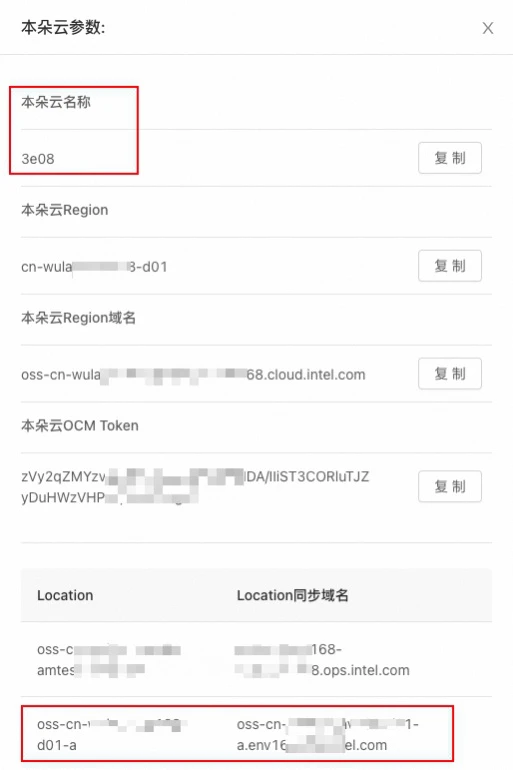
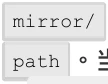
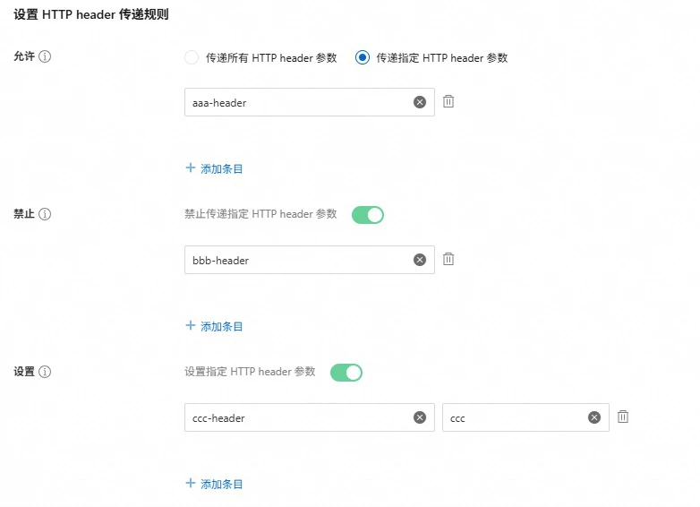

阿里云  
专有云  
对象存储 OSS  
用户指南  
产品版本：v3.18.6  
文档版本：20261023

**目录**

- [1.产品概述](#section-1)
    - [1.1. 什么是对象存储OSS](#section-1-1)
    - [1.2. 使用须知](#section-1-2)
- [2.登录对象存储控制台](#section-2)
- [3.概览](#section-3)
- [4.存储空间](#section-4)
    - [4.1. 创建存储空间](#section-4-1)
    - [4.2. 查看存储空间](#section-4-2)
    - [4.3. 删除存储空间](#section-4-3)
    - [4.4. 修改读写权限](#section-4-4)
    - [4.5. 设置服务端加密](#section-4-5)
    - [4.6. 设置静态网站托管](#section-4-6)
    - [4.7. 设置防盗链](#section-4-7)
    - [4.8. 设置跨域资源共享](#section-4-8)
    - [4.9. 设置生命周期规则](#section-4-9)
    - [4.10. 存储空间标签](#section-4-10)
    - [4.11. 设置容量阈值](#section-4-11)
    - [4.12. 设置跨区域复制](#section-4-12)
    - [4.13. 设置跨云复制](#section-4-13)
    - [4.14. 设置同城容灾](#section-4-14)
    - [4.15. 使用自定义域名访问OSS](#section-4-15)
    - [4.16. 设置TLS版本](#section-4-16)
    - [4.17. 设置回源规则](#section-4-17)
    - [4.18. 设置保留策略](#section-4-18)
    - [4.19. 设置Bucket授权策略](#section-4-19)
    - [4.20. 日志管理](#section-4-20)
        - [4.20.1. 设置日志管理](#section-4-20-1)
        - [4.20.2. 实时日志查询](#section-4-20-2)
    - [4.21. 图片处理](#section-4-21)
        - [4.21.1. 设置图片样式](#section-4-21-1)
        - [4.21.2. 设置原图保护](#section-4-21-2)
    - [4.22. 授权角色](#section-4-22)
- [5.对象（文件）](#section-5)
    - [5.1. 上传文件](#section-5-1)
    - [5.2. 搜索文件](#section-5-2)
    - [5.3. 下载文件](#section-5-3)
    - [5.4. 设置文件ACL](#section-5-4)
    - [5.5. 新建目录](#section-5-5)
    - [5.6. 获取文件访问地址](#section-5-6)
    - [5.7. 通过Bucket Policy授权用户访问指定资源](#section-5-7)
    - [5.8. 删除文件](#section-5-8)
    - [5.9. 管理碎片](#section-5-9)
    - [5.10. 设置对象标签](#section-5-10)
    - [5.11. 设置HTTP头](#section-5-11)
    - [5.12. 设置软链接](#section-5-12)
    - [5.13. 选取内容](#section-5-13)
- [6.我的访问路径](#section-6)
- [7.创建Single Tunnel](#section-7)

<a id="section-1"></a>

# 1.产品概述

<a id="section-1-1"></a>

## 1.1. 什么是对象存储OSS

阿里云对象存储OSS（Object Storage Service ）是阿里云提供的安全、低成本、高可靠的云存储服务。

相比传统自建服务器存储，OSS在可靠性、安全性、成本和数据处理能力方面都有着突出的优势。使用OSS，您可以通过网络随时存储和调用包括文本、图片、音频和视频等在内的各种非结构化数据文件。

OSS将数据文件以对象（Object）的形式上传到存储空间（Bucket）中，提供键值对（Key-Value）形式的对象存储服务。您可以根据Object的名称（Key）获取该Object的内容。

您可以进行以下OSS相关的操作：

- 创建存储空间，并向存储空间中上传文件。

- 获取已上传文件的地址，进行文件的分享和下载。

- 修改存储空间或文件的属性或元信息，为其设置相应的权限。

- 在对象存储OSS控制台进行基础和高级OSS操作。

- 通过开发工具包SDK或直接在应用程序中调用RESTful API，进行基础和高级OSS操作。

<a id="section-1-2"></a>

## 1.2. 使用须知

本文介绍在使用对象存储OSS前，您需要了解的内容。

如果需要让其他用户使用OSS产品部分或全部功能，您需要先创建RAM用户，并为该用户授予相关的RAM权限，从而让该用户具备与其RAM策略相匹配的操作权限，实现对OSS的访问或操作。

使用OSS前，还需要了解以下限制：

<table>
  <tr>
    <th width="90">限制项</th>
    <th>说明</th>
  </tr>
  <tr>
    <td>存储空间</td>
    <td>• 同一用户创建的存储空间总数不能超过100个。<br>• 存储空间一旦创建成功，名称和区域不能修改。</td>
  </tr>
  <tr>
    <td>上传文件</td>
    <td>• 通过控制台上传、简单上传、表单上传、追加上传的文件大小不能超过5 GiB，要上传大小超过5 GiB的文件必须使用分片上传（Multipart Upload）方式。分片上传方式上传的文件大小不能超过48.8 TiB。<br>• OSS 支持上传同名文件，但会覆盖已有文件。</td>
  </tr>
  <tr>
    <td>删除文件</td>
    <td>• 文件删除后无法恢复。<br>• 控制台批量删除文件的上限为100个，更大批量的删除必须通过API或SDK实现。</td>
  </tr>
  <tr>
    <td>生命周期</td>
    <td>每个存储空间的生命周期配置最多可容纳1000条规则。</td>
  </tr>
</table>

<a id="section-2"></a>

# 2.登录对象存储控制台

本文介绍如何登录对象存储OSS的管理控制台。

**前提条件**

- 登录Apsara Uni-manager运营控制台前，确认您已从部署人员处获取Apsara Uni-manager运营控制台的服务域名地址。

- 推荐使用Chrome浏览器。

**操作步骤**

1. 在浏览器地址栏中，输入Apsara Uni-manager运营控制台的服务域名地址，按回车键。

   

   > **说明**
   >
   > - 单击页面右上角的当前语言可以切换其它语言。
   >
   > - 由于浏览器证书过期或环境开启HTTPS认证等出现多次单击继续访问或无Apsara Uni-manager运营控制台地址入口等现象，此时需要安装证书才能正常访问。单击页面右上角的**浏览器证书安装**，可打开浏览器证书安装指南。

2. 输入正确的用户名及密码。

   > **说明**
   >
   > - 请向运营管理员获取登录控制台的用户名和密码。
   >
   > - 首次登录Apsara Uni-manager运营控制台时，需要修改登录用户名的密码，请按照提示完成密码修改。为提高安全性，密码长度必须为10~32位，且包含英文字母大小写、阿拉伯数字和特殊符号（感叹号（!）、at（@）、井号（#）、美元符号（$）、百分号（%）等）。

3. 勾选**我已阅读并同意产品服务协议、隐私协议、用户协议**。

   > **说明**
   >
   > - 登录页展示的链接文字为文档标题，单击链接文字，可查看协议的详细内容。
   >
   > - **产品服务协议**、**隐私协议**和**用户协议**仅在已发布时才会显示。如果三种类型协议都没有发布，则不需要执行该操作。

4. 单击**账号登录**/**授权登录**。

   > **说明**
   >
   > “授权登录”仅第三方认证的全局IdP设置启用时才会显示，且该显示名称可自定义，默认显示名称为“授权登录”。

5. 如果账号已激活MFA多因素认证，请根据以下两种情况进行操作：

   > **说明**
   >
   > 公网场景下，登录入口默认强制开启多因素认证。

   - **开启MFA后的首次登录**

     <ol type="a">

     <li>

     输入账号密码登录后，展示绑定虚拟MFA设备页面。

     </li>

     <li>

     在绑定虚拟MFA设备页面中，按页面提示步骤绑定虚拟MFA设备。

     </li>

     </ol>

     <ol type="i" start="100">

     <li>

     登录成功，进入控制台。

     </li>

     </ol>

   - **已开启并绑定MFA**

     输入6位MFA码后单击**认证**。

6. 在页面上方的菜单栏，选择**产品** > **存储** > **对象存储 OSS**。

<a id="section-3"></a>

# 3.概览

您可以通过OSS概览页面，快速查询实例总览、Bucket总容量、组织排名TOP10、监控排序、报警统计等信息。

1. 登录对象存储控制台。

2. 在左侧导航栏，单击**概览**。

3. 查询OSS概览信息。

   - **实例总览**区域：查询Bucket总数、有限制的Bucket数量、无限制的Bucket数量、未授权的Bucket数量、SingleTunnel。

   - **Bucket总容量**区域：查询分配率和使用率。

   - **组织排名TOP10**区域：查询按容量配额使用率或者按容量配额分配率的资源使用趋势。

   - **监控排序**区域：查询资源名称、资源组织、有效请求率、有效请求数和总请求数。

   - **报警统计**区域：查询严重、警告、提示等不同告警级别的数量，以及实例名称、组织、告警规则ID、告警内容和时间。

<a id="section-4"></a>

# 4.存储空间

<a id="section-4-1"></a>

## 4.1. 创建存储空间

OSS将数据文件（Object）上传到存储空间（Bucket）中进行存储。在上传任何文件到OSS之前，需要先创建Bucket。

**操作步骤**

1. 登录对象存储控制台。

2. 单击**Bucket列表**，之后单击**创建Bucket**。

3. 在**创建Bucket**面板，配置相应的参数。

   各项参数配置说明如下：

   <table>
     <tr>
       <th width="120">配置</th>
       <th>说明</th>
     </tr>
     <tr>
       <td>组织</td>
       <td>下拉选择Bucket所属的组织。</td>
     </tr>
     <tr>
       <td>资源集</td>
       <td>下拉选择Bucket的资源集。</td>
     </tr>
     <tr>
       <td>地域</td>
       <td>选择Bucket所在的数据中心。<br>说明<br>• Bucket创建完成后不支持更换地域。<br>• 如需要通过ECS内网访问OSS，可选择与您的ECS相同的地域。</td>
     </tr>
     <tr>
       <td>域名</td>
       <td>集群的域名。</td>
     </tr>
     <tr>
       <td>集群</td>
       <td>专有云中支持部署两套OSS集群，请指定存储空间所在的集群。</td>
     </tr>
     <tr>
       <td>Bucket名称</td>
       <td>输入Bucket的名称。<br>说明<br>• 存储空间的命名必须符合命名规范。<br>• 必须以小写英文字母或数字开头和结尾，只能包含小写英文字母、数字和短划线（-）。长度限制在3~63个字符之间。<br>• 所选定的存储空间名称在OSS的所有现有存储空间名称中必须具有唯一性。<br>• 创建后不支持更改存储空间名称。</td>
     </tr>
   </table>

   <table>
     <tr>
       <th>存储类型</th>
       <th>目前仅支持<strong>标准存储类型</strong>。</th>
     </tr>
     <tr>
       <td>容量设置</td>
       <td rowspan="3">选择<strong>容量设置</strong>和<strong>容量单位</strong>，然后指定Bucket的容量，<br>• 容量设置：仅支持<strong>指定容量</strong><br>• 容量单位：可选<strong>GiB</strong>、<strong>TiB</strong><br>• 取值范围：1~2000000 TiB或1～2048000000 GiB。</td>
     </tr>
     <tr>
       <td>容量单位</td>
     </tr>
     <tr>
       <td>指定容量</td>
     </tr>
     <tr>
       <td>读写权限</td>
       <td>选择存储空间对应的权限，有以下几种：<br>重要公共读（public）和公共读写（public-read-write）权限可以不通过身份验证直接读取您Bucket中的数据，安全风险高。为保证您的数据安全，不推荐相应配置，建议您选择私有（private）。<br>• <strong>私有</strong>：文件的拥有者和授权用户有该文件的读写权限，其他用户没有权限操作该文件。<br>• <strong>公共读</strong>：只有该存储空间的拥有者可以对该存储空间内的文件进行写操作，任何人（包括匿名访问者）可以对该存储空间中的文件进行读操作。<br>• <strong>公共读写</strong>：任何人（包括匿名访问者）都可以对该存储空间中的文件进行读写操作。所有这些操作产生的费用由该存储空间的拥有者承担，请慎用该权限。<br>说明存储空间创建后，您可以修改存储空间的读写权限。</td>
     </tr>
     <tr>
       <td>服务端加密</td>
       <td>设置服务端加密：<br>• <strong>无</strong>：不加密数据。<br>• <strong>OSS完全托管</strong>：使用OSS完全托管的密钥加密每个Object。<br>• <strong>KMS</strong>：使用KMS平台托管的密钥加密Object。</td>
     </tr>
     <tr>
       <td>加密算法</td>
       <td>根据需要选择加密算法。当<strong>服务端加密</strong>选择<strong>OSS完全托管</strong>或<strong>KMS</strong>时可配置。取值范围如下：<br>• <strong>AES256</strong>：使用AES256加密每个Object，并为每个Object使用不同的密钥进行加密，作为额外的保护，它将使用定期轮转的主密钥对加密密钥本身进行加密。<br>• <strong>SM4</strong>：使用SM4加密每个Object，并为每个Object使用不同的密钥进行加密，作为额外的保护，它将使用定期轮转的主密钥对加密密钥本身进行加密。</td>
     </tr>
     <tr>
       <td>密钥ID</td>
       <td>当<strong>服务端加密</strong>选择<strong>KMS</strong>时可配置。选择指定密钥ID后，OSS将使用指定的KMS密钥加密Object。<br>说明选择密钥ID前，您需要在KMS控制台创建加密密钥。</td>
     </tr>
     <tr>
       <td>关闭同城容灾</td>
       <td>Bucket的数据容灾类型。当<strong>存储冗余类型</strong>选择<strong>本地冗余存储</strong>时可配置。<br>重要同城2AZ容灾场景下部署容灾集群后才会显示该设置项。<br>• 当<strong>关闭同城容灾</strong>选择<strong>否</strong>时，表示开启同城容灾。为Bucket开启同城容灾后，OSS会将主机房Bucket数据同步到备机房OSS集群中的备份Bucket。当主机房整体故障时（如断电、火灾等），仍然能够保障数据的正常访问。<br>• 当<strong>关闭同城容灾</strong>选择<strong>是</strong>时，表示关闭同城容灾。关闭同城容灾后，将以本地冗余LRS（Local-Redundant Storage）的方式存储OSS数据。本地冗余将您的数据冗余存储在同一个可用区的不同存储设备上，可支持两个存储设备并发损坏时，仍维持数据不丢失，可正常访问。</td>
     </tr>
     <tr>
       <td>KMS加密目标对象</td>
       <td>开启同城容灾后，如果Bucket中的Object使用了KMS密钥进行加密，则OSS默认将无法同步KMS加密目标对象到目标Bucket中。为了能同步KMS加密目标对象到目标Bucket中，您可以通过启用该功能，并添加用于加解密的KMS密钥以及绑定具有Object操作和KMS密钥加解密操作权限的角色来实现。当<strong>关闭同城容灾</strong>选择<strong>否</strong>时可配置。具体操作步骤如下：<br>i. 打开<strong>KMS加密目标对象</strong>开关。ii. 选择<strong>使用的KMS密钥</strong>和<strong>授权角色</strong>。</td>
     </tr>
     <tr>
       <td>使用的KMS密钥</td>
       <td>用于为已加密Object加解密的KMS密钥。当打开<strong>KMS加密目标对象</strong>开关时可配置。请确保已通过密钥管理服务KMS控制台创建了KMS密钥。</td>
     </tr>
     <tr>
       <td>授权角色</td>
       <td>授予OSS服务的角色，该角色必须具有对加密Object的操作权限以及对使用的KMS密钥的加解密权限。当打开<strong>KMS加密目标对象</strong>开关时可配置。OSS默认提供了预定义角色AliyunOSSPrivateCloudDrsSyncRole，您可以单击<strong>绑定角色</strong>来绑定预定义角色AliyunOSSPrivateCloudDrsSyncRole。具体操作，请参见授权角色。</td>
     </tr>
   </table>

4. 单击**提交**。

   Bucket创建成功后，在Bucket列表中可查看Bucket信息以及按需查看和管理Bucket。

   单击Bucket名称，可在Bucket详情页进行概览信息查看、文件管理、基础设置、图片处理和日志查询操作。例如在Bucket**概览**页签中查看其详细信息，包括**组织和资源集**、**访问域名**、**基础设置**等。

<a id="section-4-2"></a>

## 4.2. 查看存储空间

在OSS控制台查看已经创建的存储空间的详细信息，例如所属组织、所属资源集、访问域名、容量阈值、使用情况、创建时间等信息。

**操作步骤**

1. 登录对象存储控制台。

2. 单击**Bucket列表**，之后单击目标Bucket名称。

3. 在Bucket的**概览**页签，查看该存储空间的**组织和资源集**、**访问域名**、**基础设置**等信息。

   > **说明**
   >
   > - 通过访问域名操作Bucket时，支持使用HTTP协议或者HTTPS协议。
   >
   > - 在**基础设置**区域，可查看Bucket的容量阈值。更多信息，请参见设置容量阈值。

<a id="section-4-3"></a>

## 4.3. 删除存储空间

在OSS控制台删除不再使用的存储空间（Bucket）。

**前提条件**

已删除存储空间中的所有文件和碎片。具体操作，请参见删除文件和管理碎片。

> **警告**
>
> 文件、碎片、存储空间删除之后均不可恢复，请谨慎操作。

**操作步骤**

1. 登录对象存储控制台。

2. 单击**Bucket列表**，之后单击目标Bucket名称。

3. 单击右上角的**删除Bucket**。

4. 在**删除当前Bucket**对话框中，单击**确定**。

<a id="section-4-4"></a>

## 4.4. 修改读写权限

OSS提供ACL（Access Control List）权限控制方法。存储空间（Bucket）创建后ACL默认为私有权限，您可以在存储空间创建之后修改ACL。

**背景信息**

OSS存储空间目前有三种访问权限：

- 私有：只有该存储空间的拥有者或者授权对象可以对该存储空间内的文件进行读写操作，其他人在未经授权的情况下无法访问该存储空间内的文件。

- 公共读：只有该存储空间的拥有者或者授权对象可以对该存储空间内的文件进行写操作，任何人（包括匿名访问）可以对该存储空间中的文件进行读操作。

- 公共读写：任何人（包括匿名访问）都可以对该存储空间中的文件进行读写操作，请慎用该权限。

> **警告**
>
> 如果将访问权限设置为公共读或公共读写，其他用户可以不通过身份验证直接读取存储空间中的数据，安全风险较高。为保障您的数据安全，建议您将存储空间的访问权限设置为私有。

**操作步骤**

1. 登录对象存储控制台。

2. 单击**Bucket列表**，之后单击目标Bucket名称。

3. 单击**基础设置**页签，在**读写权限**区域单击**设置**。

4. 选择该存储空间的读写权限。

5. 单击**提交**。

<a id="section-4-5"></a>

## 4.5. 设置服务端加密

对象存储OSS支持服务端加密功能。上传文件（Object）时，OSS对收到的文件进行加密，再将得到的加密文件持久化保存；下载文件时，OSS自动将加密文件解密后返回给用户，并在返回的HTTP请求Header中，声明该文件进行了服务端加密。

**背景信息**

OSS支持以下两种数据加密方式：

- 使用KMS托管密钥进行加解密（SSE-KMS）

  使用KMS托管的默认CMK（Customer Master Key）或指定CMK ID加密OSS Object。加密密钥由KMS托管，您无需花费大量成本来保障密钥的保密性、完整性和可用性。

- 使用OSS完全托管加密（SSE-OSS）

  使用OSS托管的密钥加密每个Object，作为额外的保护，OSS会使用定期轮转的主密钥对加密密钥本身进行加密。

您可以通过以下两种方式在OSS控制台上开启服务端加密功能：

- 方式一：创建Bucket时开启服务端加密功能

- 方式二：在基础设置页签开启服务端加密功能

**操作步骤**

**方式一：创建Bucket时开启服务端加密功能**

1. 登录对象存储控制台。

2. 单击**Bucket列表**，之后单击**创建Bucket**。

3. 在**创建OSS bucket** 页面中填写各项参数。

   其他参数配置请参见创建存储空间。

   <table>
     <tr>
       <th width="105">参数</th>
       <th>说明</th>
     </tr>
     <tr>
       <td>服务端加密</td>
       <td>设置服务端加密参数。<br>• <strong>无</strong>：不加密数据。<br>• <strong>OSS完全托管</strong>：使用OSS完全托管的密钥加密每个Object。<br>• <strong>KMS</strong>：使用KMS平台托管的密钥加密Object。</td>
     </tr>
     <tr>
       <td>加密算法</td>
       <td>根据需要选择加密算法。当<strong>服务端加密</strong>选择<strong>OSS完全托管</strong>或<strong>KMS</strong>时可配置。取值范围如下：<br>• <strong>AES256</strong>：使用AES256加密每个Object，并为每个Object使用不同的密钥进行加密，作为额外的保护，它将使用定期轮转的主密钥对加密密钥本身进行加密。<br>• <strong>SM4</strong>：使用SM4加密每个Object，并为每个Object使用不同的密钥进行加密，作为额外的保护，它将使用定期轮转的主密钥对加密密钥本身进行加密。</td>
     </tr>
     <tr>
       <td>密钥ID</td>
       <td>当<strong>服务端加密</strong>选择<strong>KMS</strong>时可配置。选择指定密钥ID后，OSS将使用指定的KMS密钥加密Object。<br>说明选择密钥ID前，您需要在KMS控制台创建加密密钥。</td>
     </tr>
   </table>

4. 单击**提交**。

**方式二：在基础设置页签开启服务端加密功能**

> **重要**
>
> 开启或修改Bucket默认加密方式不会影响Bucket中已有文件的加密配置。

1. 登录对象存储控制台。

2. 单击**Bucket列表**，之后单击目标Bucket名称。

3. 单击**基础设置**页签，在**服务器端加密**区域单击**设置**。

4. 配置服务端加密参数。

   <table>
     <tr>
       <th width="137">参数</th>
       <th>说明</th>
     </tr>
     <tr>
       <td>服务端加密方式</td>
       <td>设置服务端加密参数。<br>• <strong>无</strong>：不加密数据。<br>• <strong>OSS完全托管</strong>：使用OSS托管的密钥加密您的数据。<br>• <strong>KMS</strong>：使用KMS平台托管的密钥加密Object。</td>
     </tr>
     <tr>
       <td>加密算法</td>
       <td>根据需要选择加密算法。当<strong>服务端加密方式</strong>选择<strong>OSS完全托管</strong>或<strong>KMS</strong>时可配置。取值范围如下：<br>• <strong>AES256</strong>：使用AES256加密每个Object，并为每个Object使用不同的密钥进行加密，作为额外的保护，它将使用定期轮转的主密钥对加密密钥本身进行加密。<br>• <strong>SM4</strong>：使用SM4加密每个Object，并为每个Object使用不同的密钥进行加密，作为额外的保护，它将使用定期轮转的主密钥对加密密钥本身进行加密。</td>
     </tr>
     <tr>
       <td>加密密钥</td>
       <td>当<strong>服务端加密方式</strong>选择<strong>KMS</strong>时可配置。选择指定密钥ID后，OSS将使用指定的KMS密钥加密Object。<br>说明选择加密密钥前，您需要在KMS控制台创建加密密钥。</td>
     </tr>
   </table>

5. 单击**提交**。

<a id="section-4-6"></a>

## 4.6. 设置静态网站托管

为存储空间设置静态网站托管后，通过存储空间域名访问该静态网站。

**操作步骤**

1. 登录对象存储控制台。

2. 单击**Bucket列表**，之后单击目标Bucket名称。

3. 单击**基础设置**页签，在**静态页面**区域单击**设置**。

4. 根据下表说明设置参数。

   <table>
     <tr>
       <th width="123">参数</th>
       <th>说明</th>
     </tr>
     <tr>
       <td>默认首页</td>
       <td>设置索引页面（相当于网站的index.html），仅支持HTML格式的文件。如果为空则表示不开启静态网页托管。<br>重要子目录首页功能默认关闭。如需使用，请联系阿里云技术支持评估后在Apsara Uni-manager运维控制台开启。<br>• 若未开通子目录首页：需保证根目录下有该文件，且该文件可读。<br>• 若开通子目录首页：需保证根目录和子目录下有该文件，且该文件可读。<br>说明默认首页仅可以设置一个，若需要使用子目录首页，您可以将子目录首页文件和根目录首页文件的名称设置一致，但内容可以不同。</td>
     </tr>
     <tr>
       <td>默认404页</td>
       <td>即访问错误路径时返回的默认404页，仅支持根目录下HTML、JPG、PNG、BMP、WEBP格式的文件。如果为空则不启用默认404页设置。</td>
     </tr>
     <tr>
       <td>子目录首页</td>
       <td>选择是否开通子目录首页功能。<br>• <strong>不开通</strong>：不开通子目录首页。此时，访问静态网站根域名或者根域名下任何一个以正斜线（/）结尾的URL都会返回根目录默认首页。<br>• <strong>开通</strong>：开通子目录首页。此时，访问静态网站根域名时，返回根目录默认首页；访问以正斜线（/）结尾的URL时会返回对应目录的默认首页。例如访问test.oss-cn-hangzhou.aliyuncs.com/subdir/时。若subdir/目录下有默认首页文件，则返回子目录默认首页。</td>
     </tr>
     <tr>
       <td>文件404规则</td>
       <td>当设置<strong>子目录首页</strong>为<strong>开通</strong>时才能配置此项。设置开通子目录首页后，访问一个没有以正斜线（/）结尾，且不存在的Object时的返回结果。例如访问test.oss-cn-hangzhou.aliyuncs.com/subdir，且subdir不存在时：<br>• <strong>Redirect</strong>（默认值）：检查subdir/默认首页文件是否存在。<br>• 若存在，返回302状态码，Location头为<code> test.oss-cn-</code><code>hangzhou.aliyuncs.com/subdir/ </code>。<br>• 若不存在，返回默认404页。若默认404页也不存在，则返回404状态码。<br>• <strong>NoSuckKey</strong>：直接返回默认404页。若默认404页也不存在，则返回404状态码。<br>• <strong>Index</strong>：检查subdir/默认首页是否存在。<br>• 若存在，直接返回这个文件内容。<br>• 若不存在，则返回默认404页。若默认404页也不存在，则返回404状态码。</td>
     </tr>
   </table>

5. 单击**提交**。

<a id="section-4-7"></a>

## 4.7. 设置防盗链

您可以在OSS控制台为存储空间设置防盗链功能，防止您的数据被他人盗用。

**背景信息**

当浏览器向OSS请求文件时，HTTP请求的Referer标头会标识发起请求的源页面URL。OSS通过校验Referer值来判断请求来源的合法性，基于预设规则允许或拒绝访问。

- Referer白名单：仅允许指定的域名访问OSS资源。

- Referer黑名单：不允许指定的域名访问OSS资源。

- 是否允许空Referer：如果不允许空Referer，则只有HTTP或HTTPS header中包含Referer字段的请求才能访问OSS资源。

仅当通过签名URL或者匿名访问Object时，进行防盗链验证；当请求的Header中包含Authorization字段，不进行防盗链验证。

**操作步骤**

1. 登录对象存储控制台。

2. 单击**Bucket列表**，之后单击目标Bucket名称。

3. 单击**基础设置**页签，在**防盗链**区域单击**设置**。

4. 根据下表说明设置参数。

   <table>
     <tr>
       <th width="141">参数</th>
       <th>说明</th>
     </tr>
     <tr>
       <td>Referer</td>
       <td>设置Referer白名单。单击<strong>添加Referer</strong>并填写域名或IP地址。支持通配符星号（*）和问号（?）。如需添加多个Referer，请多次单击<strong>添加Referer</strong>进行配置。示例如下：<br>• 配置为www.example.com，可匹配如www.example.com/123、www.example.com.cn等以www.example.com为前缀的地址。<br>• 配置为*www.example.com/，可匹配http://www.example.com/和https://www.example.com/的地址。<br>• 通配符星号（*）表示使用星号代替0个或多个字符。例如配置为*.example.com，可匹配如help.example.com、www.example.com等地址。<br>• 通配符问号（?）表示使用问号代替一个字符。例如配置为example?.com，可匹配如examplea.com、exampleb.com等地址。<br>• 支持带端口的域名或IP地址，例如www.example.com:8080、10.10.10.10:8080等地址。</td>
     </tr>
     <tr>
       <td>黑名单Referer</td>
       <td>设置Referer黑名单。单击<strong>添加黑名单Referer</strong>并填写域名或IP地址。支持通配符星号（*）和问号（?）。如需添加多个黑名单Referer，请多次单击<strong>添加黑名单</strong><strong>Referer</strong>进行配置。示例如下：<br>• 配置为www.example.com，可匹配如www.example.com/123、www.example.com.cn等以www.example.com为前缀的地址。<br>• 配置为*www.example.com/，可匹配http://www.example.com/和https://www.example.com/的地址。<br>• 通配符星号（*）表示使用星号代替0个或多个字符。例如配置为*.example.com，可匹配如help.example.com、www.example.com等地址。<br>• 通配符问号（?）表示使用问号代替一个字符。例如配置为example?.com，可匹配如examplea.com、exampleb.com等地址。<br>• 支持带端口的域名或IP地址，例如www.example.com:8080、10.10.10.10:8080等地址。</td>
     </tr>
     <tr>
       <td>空 Referer</td>
       <td>选择是否允许Referer为空。<br>• 空Referer表示HTTP或HTTPS请求中，不带Referer字段或Referer字段为空。<br>• 如果不允许空Referer，则只有HTTP或HTTPS header中包含Referer字段的请求才能访问OSS资源。</td>
     </tr>
   </table>

   > **说明**
   >
   > 当使用OSS的Bucket域名预览MP4文件时，由于浏览器默认会同时发出两个请求，其中一个为带Referer的请求，另一个为空Referer的请求，因此设置防盗链时必须同时满足在Referer中添加Bucket域名，且允许空Referer的条件。当使用OSS的Bucket域名预览非MP4文件时，则仅需允许空Referer。

5. 单击**提交**。

<a id="section-4-8"></a>

## 4.8. 设置跨域资源共享

为存储空间设置跨域资源共享，实现跨域访问。

**背景信息**

OSS提供HTML5协议中的跨域资源共享CORS设置，帮助您实现跨域访问。当OSS收到一个跨域请求（或者OPTIONS请求），会读取存储空间对应的CORS规则，然后进行相应的权限检查。OSS会依次检查每一条规则，使用第一条匹配的规则来允许请求并返回对应的Header。如果所有规则都匹配失败，则不附加任何CORS相关的Header。

**注意事项**

- 单个存储空间最多支持配置10条跨域规则。

- 新配置的跨域规则不能与已存在的跨域规则相同。

**操作步骤**

1. 登录对象存储控制台。

2. 单击**Bucket列表**，之后单击目标Bucket名称。

3. 单击**基础设置**页签，在**跨域设置**区域单击**设置**。

4. 单击**创建规则**，在**创建规则**面板上根据下表说明设置相应参数。

   | 参数 | 是否必选 | 说明 |
   | --- | --- | --- |
   | 来源 | 是 | 指定允许的跨域请求的来源。配置规则如下：<br>• 允许多条匹配规则，多条规则需换行填写。<br>• 域名需包含协议名，例如HTTP、HTTPS。<br>• 支持通配符星号（\*），每条匹配规则允许使用最多一个星号（\*）。<br>• 若域名使用的是非默认端口，还需要携带端口号。例如<code> https://www.example.com:8080 </code>。<br>域名配置示例如下：<br>• 匹配指定域名时，填写完整域名。例如<code> https://www.example.com </code>。<br>• 匹配泛二级域名时，可使用通配符星号（\*）。例如<code> https://*.example.com </code>。<br>• 匹配所有域名，可直接填写通配符星号（\*）。 |
   | 允许Methods | 是 | 指定允许的跨域请求方法，支持同时选中多个请求方法。取值：<br>• GET：获取文件。<br>• POST：表单上传。<br>• PUT：简单上传。<br>• DELETE：删除文件。<br>• HEAD：获取文件元信息。 |
   | 允许Headers | 否 | 指定允许跨域请求的响应头。配置规则如下：<br>• 格式为<code> key:value </code>，例如<code> content-type:text/plain </code>，大小写不敏感。<br>• 允许多条匹配规则，多条规则需换行填写。<br>• 每条匹配规则最多使用一个星号（\*）通配符。建议没有特殊需求的情况下设置为星号（\*）。 |
   | 暴露Headers | 否 | 指定允许用户从应用程序中访问的响应头。例如一个JavaScript的XMLHttpRequest对象。不允许使用星号（\*）通配符。 |
   | 缓存时间（秒） | 否 | 指定浏览器对特定资源的预取（OPTIONS）请求返回结果的缓存时间。单位为秒。 |

5. 单击**确定**。

**相关操作**

创建跨域规则后，可按需编辑或删除规则。

<table>
  <tr>
    <th width="122">操作</th>
    <th>说明</th>
  </tr>
  <tr>
    <td>编辑跨域规则</td>
    <td>修改跨域规则的来源、允许Methods、允许Headers等信息。<br>1. 单击目标规则<strong>操作</strong>列的<strong>编辑</strong>。<br>2. 在<strong>修改规则</strong>面板，按需修改规则参数。<br>3. 单击<strong>确定</strong>。</td>
  </tr>
  <tr>
    <td>删除跨域规则</td>
    <td>选择任一方式删除跨域规则。<br>重要删除跨域规则可能导致外部应用无法访问该 Bucket 的资源，建议确认无相关业务依赖后，在业务低峰期谨慎操作。规则删除后不可恢复，建议提前备份配置。<br>• 单个删除规则：单击目标规则<strong>操作</strong>列的<strong>删除</strong>，在弹出的确认框中单击<strong>确定</strong>。<br>• 清空全部规则：单击<strong>清空全部规则</strong>，在弹出的确认框中单击<strong>确定</strong>。</td>
  </tr>
</table>

<a id="section-4-9"></a>

## 4.9. 设置生命周期规则

通过生命周期规则（Lifecycle）可以定期将存储空间（Bucket）内过期的文件（Object）和碎片（Part）删除，从而节省存储费用。

**前提条件**

已创建存储空间。

**注意事项**

- 生命周期规则配置完成后24小时内会被加载，加载后的24小时内会被执行，请确认无误后再保存规则。

- 删除Object的操作是不可逆的，请根据业务需求合理设置生命周期规则。

- 通过控制台最多支持配置100条生命周期规则，通过SDK最多支持配置1000条生命周期规则。

**操作步骤**

1. 登录对象存储控制台。

2. 单击**Bucket列表**，之后单击目标Bucket名称。

3. 单击**基础设置**页签，在**生命周期**区域单击**设置**。

4. 单击**创建规则**，在**创建生命周期**面板根据下表说明设置相应参数。

   **区域**

   **参数**

   **说明**

   设置生命周期规则的状态，可选择**启用**或**禁用**。

   **状态**

   选择匹配策略的Object，可选择**按前缀匹配**（按照Object名称前缀匹配）或**匹配到整个Bucket**（直接匹配到整个存储空间）。

   **策略**

   > **说明**
   >
   > 选择**按前缀匹配**时，可以配置多条不同前缀的生命周期规则；选择**配置到整个Bucket**时，仅允许配置一条生命周期规则。

   **基础设置**

   如果**策略**选择了**按前缀匹配**，则需要输入Object名称的前缀。例如要匹配

   **前缀**

   名称以img开头的Object，则输入 

   `img`。

   打开**标签**开关后单击**添加标签**并配置正确的标签，可以让规则针对拥有指定标签Object生效。例如选择策略为**按前缀匹配**，设置前缀为img，并设

   **标签**

   置标签的键为a，值为1。则该规则将匹配所有名称以img开头且标签为a=1的Object。关于对象标签的更多信息请参见设置对象标签。

   > **重要**
   >
   > - 每条生命周期规则中，**文件时间策略**和**碎片过期策略**至少设置一项。

   **文件时间策略**

   > - 文件删除后不可恢复，请谨慎操作。

   选择Object过期策略，可选择**指定天数**、**指定日期**和**不启用**。当选择**不启用**时，文件时间策略不生效。

   **清除策略**

   根据**文件时间策略**选择的**指定天数**或**指定日期**设置Object何时过期，Object过期后会被删除。

   - 选择**指定天数**时：选中**删除文件**后的复选框，指定一个过期天数N，Object会在其最后修改时间的N天后过期，并在过期的第二天被删除。例如设置为30，则最后修改日期为2019-01-01的Object会在

   **删除文件**

   2019-02-01被删除。

   - 选择**指定日期**时：选中**删除文件**后的复选框，指定一个过期日期，最后修改时间在该日期之前的Object会被删除。例如设置为2019-01-01，最后修改日期在2019-01-01之前的Object会被删除。

   <table>
     <tr>
       <td rowspan="2">清理碎片</td>
       <td>碎片过期策略</td>
       <td>重要<br>• 每条生命周期规则中，<strong>文件时间策略</strong>和<strong>碎片过期策略</strong>至少设置一项。<br>• 碎片删除后不可恢复，请谨慎操作。<br>设置对过期碎片执行的操作。可选择<strong>指定天数</strong>、<strong>指定日期</strong>和<strong>不启用</strong>。当选择<strong>不启用</strong>时，碎片过期策略不生效。</td>
     </tr>
     <tr>
       <td>删除碎片</td>
       <td>根据<strong>碎片过期策略</strong>选择的<strong>指定天数</strong>或<strong>指定日期</strong>设置碎片何时过期，碎片过期后会被删除。配置方式与删除文件一样。</td>
     </tr>
   </table>

5. 单击**确定**。

**相关操作**

创建生命周期规则后，可按需编辑或删除规则。

| 操作 | 说明 |
| --- | --- |
| 编辑生命周期规则 | 修改生命周期规则的状态、标签、文件清除策略等信息。<br>1. 单击目标规则<strong>操作</strong>列的<strong>编辑</strong>。<br>2. 在<strong>编辑生命周期</strong>面板，按需修改规则参数。<br>3. 单击<strong>确定</strong>。 |
| 删除生命周期规则 | 选择任一方式删除生命周期规则。<br>重要生命周期规则删除后不可恢复，请谨慎操作。如需临时停用，建议先禁用规则，观察业务与存储影响，确认无风险后再执行删除。<br>• 单个删除规则：单击目标规则<strong>操作</strong>列的<strong>删除</strong>，在弹出的确认框中单击<strong>确定</strong>。<br>• 清空全部规则：单击<strong>清空全部规则</strong>，在弹出的确认框中单击<strong>确定</strong>。 |

<a id="section-4-10"></a>

## 4.10. 存储空间标签

通过存储空间（Bucket）的标签功能， 可以对Bucket进行分类管理，例如列举带有指定标签的Bucket、对拥有指定标签的Bucket设置访问权限等。

**背景信息**

Bucket标签使用一组键值对（Key-Value）对标记存储空间，您可以通过Bucket标签标记不同用途的Bucket，并进行分类管理。

- 只有Bucket的拥有者及授权子账户才能为Bucket设置用户标签，否则返回403 Forbidden错误，错误码：AccessDenied。

- 最多可设置20对Bucket用户标签（Key-Value对）。

- Key最大长度为64字符，不能以 `http://` 、 `https://` 、 `Aliyun` 为前缀，且不能为空。

- Value最大长度为128字符，可以为空。

- Key和Value必须为UTF-8编码。

**操作步骤**

1. 登录对象存储控制台。

2. 单击**Bucket列表**，之后单击目标Bucket名称。

3. 单击**基础设置**页签，在**Bucket 标签**区域单击**设置**。

   Bucket默认有一个系统标签，该标签不支持编辑或删除。

4. 单击**添加条目**并输入标签的Key和Value。

   如需添加多个标签，请多次单击**添加条目**进行配置。如需删除某个自定义标签，请单击标签右侧的 

   图标。

5. 单击**提交**。

<a id="section-4-11"></a>

## 4.11. 设置容量阈值

当存储空间（Bucket）容量达到设置的容量阈值后，将禁止写入操作（PutObject、MultipartUpload、CopyObject、PostObject、AppendObject）。本文介绍如何设置已创建Bucket的容量阈值。

**注意事项**

设置容量阈值时，请注意以下事项：

- 配置容量阈值前，请确认超过阈值禁止写入操作不会影响到您的业务。

- 容量超阈值的检测延时通常约1小时，极端情况下，可能会超过1小时。

**操作步骤**

1. 登录对象存储控制台。

2. 单击**Bucket列表**，之后单击目标Bucket名称。

3. 单击**基础设置**页签，在**设置容量阈值**区域单击**设置**。

   > **说明**
   >
   > 您可以在此区域查看目标Bucket的容量阈值。

4. 在**修改OSSBucket**页面，选择单位，拖动容量滑块调整或直接输入容量。

   - 单位：TiB、GiB

   - 取值范围：1~2000000 TiB或1～2048000000 GiB

5. 单击**提交**。

   提交成功后，单击**确定**，即可返回**概览**页面。

6. 查看容量阈值。

   <ol type="i">

   <li>

   单击**Bucket列表**，之后单击已设置容量阈值的目标Bucket名称。

   </li>

   <li>

   在**概览**页签找到**基础设置**区域。

   </li>

   <li>

   查看容量阈值。

   > **说明**
   >
   > 容量阈值信息会显示在**基础设置**标题下方。例如该Bucket已开启容量阈值：2TiB，请确保阈值大于您的使用量。

   </li>

   </ol>

<a id="section-4-12"></a>

## 4.12. 设置跨区域复制

跨区域复制是在不同OSS地域之间自动、异步（近实时）复制文件（Object），将源存储空间（Bucket）中Object的改动（新建、覆盖、删除等操作）同步到目标Bucket中。

**前提条件**

源端和目标端均已创建存储空间。

**背景信息**

跨区域复制功能能够提供Bucket跨区域容灾或满足用户数据复制的需求。目标Bucket中的对象是源Bucket中对象的精确副本，它们具有相同的对象名、元数据以及内容，例如创建时间、拥有者、用户定义的元数据、Object ACL、对象内容等。

**操作步骤**

1. 登录对象存储控制台。

2. 单击**Bucket列表**，之后单击目标Bucket名称。

3. 单击**基础设置**页签，在**跨区域复制**区域单击**开启同步**。

4. 在**跨区域复制**面板，配置跨区域复制功能。

   <table>
     <tr>
       <th width="161">参数</th>
       <th>说明</th>
     </tr>
     <tr>
       <td>源Bucket地域</td>
       <td>显示您当前Bucket所在地域。</td>
     </tr>
     <tr>
       <td>源Bucket</td>
       <td>显示您当前Bucket名称。</td>
     </tr>
     <tr>
       <td>目标地域</td>
       <td>选择目标Bucket所在地域。数据同步的两个Bucket必须分属两个地域，同地域的Bucket之间不能进行数据同步。</td>
     </tr>
     <tr>
       <td>目标Bucket</td>
       <td>选择开启数据同步的目标Bucket。跨区域复制的两个Bucket都不能同时与其他任何Bucket存在互相同步的关系。例如已设置Bucket A的数据同步至Bucket B，则A和B都不能和其他任何Bucket再建立数据同步关系。</td>
     </tr>
     <tr>
       <td>数据同步对象</td>
       <td>选择需要同步的源数据。<br>• <strong>全部文件进行同步</strong>：将该Bucket内所有的文件同步到目标Bucket。<br>• <strong>指定文件名前缀进行同步</strong>：将该Bucket内指定前缀的文件同步到目标Bucket。例如，您的Bucket根目录有一个文件夹management，management下有个文件夹abc，您需要同步abc文件夹中的内容，则填写<br><br><code>management/abc</code>。<br>单击<strong>添加条目</strong>，可添加多个前缀。最多支持添加10个前缀。</td>
     </tr>
     <tr>
       <td>数据同步策略</td>
       <td>选择数据同步的方式。<br>• <strong>增/改 同步</strong>：仅将该Bucket内新增和更新的数据同步到目标Bucket。<br>• <strong>增/删/改 同步</strong>：将该Bucket的所有数据，包括新增、更新、删除操作同步到目标Bucket。</td>
     </tr>
     <tr>
       <td>同步历史数据</td>
       <td>选择是否同步设置跨区域复制前Bucket已有的历史数据。<br>• <strong>同步</strong>：将历史数据同步至目标Bucket。<br>重要历史数据同步时，从源Bucket复制的对象可能会覆盖目标Bucket中同名的对象，复制之前请确保数据的一致性。<br>• <strong>不同步</strong>：仅同步设置跨区域复制后上传或更新的文件。</td>
     </tr>
     <tr>
       <td>KMS加密目标对象</td>
       <td>开启跨区域复制后，如果Bucket中的Object使用了KMS密钥进行加密，则OSS默认将无法同步KMS加密目标对象到目标Bucket中。为了能同步KMS加密目标对象到目标Bucket中，您需要通过创建授权角色来授予OSS操作相应Object以及使用KMS密钥进行加解密的权限。当选择<strong>目标地域</strong>时可配置。<br>说明若您的Bucket使用指定KMS CMK ID的方式加密或上传文件时指定了KMS CMK ID，请务必打开此开关。</td>
     </tr>
     <tr>
       <td>使用的KMS密钥</td>
       <td>用于为已加密Object加解密的KMS密钥。当打开<strong>KMS加密目标对象</strong>开关时可配置。请确保已通过密钥管理服务KMS控制台创建了KMS密钥。</td>
     </tr>
     <tr>
       <td>授权角色</td>
       <td>授予OSS服务的角色，该角色必须具有对加密Object的操作权限以及对使用的KMS密钥的加解密权限。当打开<strong>KMS加密目标对象</strong>开关时可配置。您可以通过如下方式创建所需授权角色。关于授权角色的更多信息，请参见授权角色。<br>• 绑定RAM预定义角色OSS默认提供了预定义角色AliyunOSSPrivateCloudDrsSyncRole，您可以单击<strong>去绑定</strong>来绑定预定义角色AliyunOSSPrivateCloudDrsSyncRole。<br>• 创建自定义角色您也可以通过单击<strong>创建角色</strong>来创建自定义角色进行授权。</td>
     </tr>
   </table>

5. 单击**确定**。

   > **说明**
   >
   > - 配置完成以后，启动需要等待3~5分钟时间。Bucket同步后会显示同步的相关信息。
   >
   > - 由于Bucket跨区域复制采用异步（近实时）复制，数据复制到目标Bucket需要的时间取决于数据的大小，通常几分钟到几小时不等。
   >
   > - 如果源端有待复制的KMS加密Object，则目的地域必须同时有KMS服务，否则数据同步会失败。

<a id="section-4-13"></a>

## 4.13. 设置跨云复制

您可以通过跨云复制在两朵云之间同步OSS数据，本文介绍如何设置跨云复制。

**注意事项**

- 如果源端或目的端为同城容灾局点，开启跨云复制后，会影响容灾切换功能，建议选择ASR-DR产品来实现异地容灾。

- 跨云复制不支持Bucket使用指定KMS CMK ID的方式加密或上传文件时指定KMS CMK ID。

**步骤一：配置目标云（云B）**

在云B上创建一个代理用户，并赋予其操作OSS权限，记录该用户的AccessKey和UID。

1. 登录Apsara Uni-manager运营控制台。

2. 创建RAM角色并授权。

   <ol type="i">

   <li>

   单击页面上方的**企业**，选择**权限管理** > **角色授权**。

   </li>

   <li>

   单击**创建自定义角色**，然后在**高级创建**区域单击**创建RAM授权**。

   </li>

   <li>

   输入角色名称、描述、适用组织和共享范围，然后单击**创建RAM授权并配置**。

   </li>

   <li>

   单击**权限管理**页签，然后单击**添加权限策略**。

   </li>

   <li>

   单击**创建权限策略**，设置策略名称、适用组织、共享范围和以下策略内容，然后单击**确定**。

   ```json
   {
     "Version": "1",
     "Statement": [
       {
         "Effect": "Allow",
         "Action": "oss:*",
         "Resource": [
           "acs:oss:*:*:*"
         ]
       }
     ]
   }
   ```

   </li>

   <li>

   选择权限策略，然后单击**确定**。

   在确认对话框中，单击**确定**。

   </li>

   <li>

   单击**确定**创建RAM角色。

   </li>

   </ol>

3. 创建用户组和用户。

   <ol type="i">

   <li>

   创建用户组：在**用户组管理**页面，单击**创建用户组**，输入用户组名、组织和角色授权，然后单击**确定**。

   > **说明**
   >
   > 角色为步骤2中新建的角色。

   </li>

   <li>

   创建用户：在**用户管理**页面，单击**创建用户**，输入用户名、显示名、角色、组织、手机、Email等信息，然后单击**确定**。在弹出的对话框，记录AK信息。

   > **说明**
   >
   > 角色不能选择步骤2中新建的角色。

   </li>

   <li>

   将用户添加到用户组：在**用户组管理**页面，单击目标用户组**操作**列的**添加用户**，在**添加用户**对话框中选择之前创建的用户，然后单击**确定**。

   </li>

   <li>

   记录用户的UID：选择**资源管理** > **组织管理**，在相应组织的用户列表页签，单击已创建的用户名称，记录UID信息。

   </li>

   </ol>

4. 创建一个Bucket。后续简称BucketB（跨云复制的目标Bucket）。

**步骤二：配置用户**

在目标云（云B）将已创建用户设置为admin，有和syncAdmin类似的权限。

1. 登录OSS赤骥平台控制台。

   <ol type="i">

   <li>

   登录目标云的Apsara Uni-manager运维控制台。

   登录方法，请参见**运维指南**的<strong>“登录Apsara Uni-manager运维控制台”</strong>章节。

   </li>

   <li>

   在顶部菜单栏，选择**产品运维 > 存储运维 > CDS运维·CDS-OPS**。

   </li>

   <li>

   在左侧导航栏中，选择**CDS-对象存储 > OSS-赤骥**。

   </li>

   </ol>

2. 在数据魔方左侧导航栏选择**服务运维-OSS > OCM名单管理**。

3. 单击**添加**，然后输入步骤一中创建用户的UID，将类型设置为as_sync_admin。

4. 在**工作流提交参数确认**对话框，按紧急程度设置执行优先级并确认工作流参数正确后，单击**Yes**。

   工作流提交成功，单击**知道了**。在**我发布的任务**页签，可查看工作流的执行情况。待工作流的**任务完成状态**为**成功**时表示操作成功。

获取目标云（云B）的本朵云参数。

1. 在数据魔方左侧导航栏选择**服务运维-OSS > 同步管理 > 跨云同步配置。**

2. 在**Cluster**下拉菜单内选择集群，单击**查看本朵云参数**，复制获取目标云名称、目标云Location、目标云同步域名。如下图所示。

   

**步骤三：在源端（云A）新增跨云同步配置**

获取到目标云的相关参数后，您需要在源端的数据魔方控制台新增跨云同步配置。

1. 登录源端的Apsara Uni-manager运维控制台。

   登录方法，请参见<strong>《运维指南》</strong>的<strong>《登录Apsara Uni-manager运维控制台》</strong>章节。

2. 在顶部菜单栏，选择**产品运维 > 存储运维 > CDS运维·CDS-OPS**。

3. 在左侧导航栏中，选择**CDS-对象存储 > 同步管理 > 跨云同步边配置**。

   > **说明**
   >
   > 您也可以在左侧导航栏中选择**CDS-对象存储 > OSS-赤骥**进入OSS赤骥进行跨云同步配置。

4. 在右上角单击**新增**，在弹出的**新建跨云同步**对话框添加目标云的相关参数。

   | 配置 | 说明 |
   | --- | --- |
   | 目标云名称 | 目标云（云B）的名称。 |
   | 目标云Region/Location | 目标云Location，同目标Bucket的Location。 |
   | 目标云域名 | 目标云的域名信息。 |
   | 代理账号AccessID | 代理账号的AccessKey ID。 |
   | 代理账号AccessKey | 代理账号的AccessKey Secret。 |

5. 单击**提交**。

   您需要等待几分钟，待跨云同步配置生效。

**步骤四：在源端（云A）的OSS管理控制台配置跨云复制**

跨云同步配置生效后，您需要在OSS管理控制台配置跨云复制。

开通同步之前，登录目标云（云B）的Apsara Uni-manager运营控制台。配置BucketB的Policy，云A通过Bucket Policy写入到BucketB。

```json
{
  "Version": "1",
  "Statement": [
    {
      "Effect": "Allow",
      "Action": "oss:*",
      "Principal": [
        "266808895180*****"    #云B代理账号的uid
      ],
      "Resource": [
        "acs:oss:*:*:bucket-name",     #bucketB的名字
        "acs:oss:*:*:bucket-name/*"    #bucketB的名字
      ]
    },
    {
      "Effect": "Deny",
      "Action": [
        "oss:PutBucket*",
        "oss:DeleteBucket*"
      ],
      "Principal": [
        "266808895180*****"     #云B代理账号的uid
      ],
      "Resource": [
        "acs:oss:*:*:bucket-name",     #bucketB的名字
        "acs:oss:*:*:bucket-name/*"    #bucketB的名字
      ]
    }
  ]
}
```

1. 登录对象存储控制台。

2. 单击**Bucket列表**，之后单击源云（云A）需要开启跨云复制的Bucket（BucketA）。

3. 单击**基础设置**页签，在**跨云复制**区域单击**开启同步**。

4. 在**跨云复制**面板配置数据同步的各项参数。

   <table>
     <tr>
       <th>配置</th>
       <th>说明</th>
     </tr>
     <tr>
       <td>源Bucket地域</td>
       <td>显示源Bucket所在地域。</td>
     </tr>
     <tr>
       <td>源Bucket</td>
       <td>显示源Bucket名称。</td>
     </tr>
     <tr>
       <td>同步目标云</td>
       <td>输入步骤二中获取的目标云名称。</td>
     </tr>
     <tr>
       <td>同步目标云地址</td>
       <td>输入步骤二中获取的目标云Location字段值。</td>
     </tr>
     <tr>
       <td>目标Bucket</td>
       <td>填写目标Bucket名称。</td>
     </tr>
     <tr>
       <td>同步Bucket ak</td>
       <td rowspan="2">输入目标Bucket所在组织的AccessKey（包含AccessKey ID和AccessKey Secret）。</td>
     </tr>
     <tr>
       <td>同步Bucket sk</td>
     </tr>
     <tr>
       <td>同步Bucket所在集群的endpoint</td>
       <td>输入目标Bucket的访问域名。</td>
     </tr>
     <tr>
       <td>数据同步对象</td>
       <td>选择数据同步的对象。<br>• <strong>全部文件进行同步</strong>：同步Bucket内所有文件。<br>• <strong>指定文件名前缀进行同步</strong>：设置指定文件名前缀，可同步包含指定前缀的文件。单击<strong>添加</strong>，可添加最多10个前缀。</td>
     </tr>
     <tr>
       <td>数据同步策略</td>
       <td>选择数据同步的策略。<br>• <strong>增/改 同步</strong>：仅将该Bucket内新增和更新的数据同步到目标Bucket。<br>• <strong>增/删/改 同步</strong>：将该Bucket的所有数据，包括新增、更新、删除操作同步到目标Bucket。</td>
     </tr>
     <tr>
       <td>同步历史数据</td>
       <td>选择是否同步设置跨云复制前Bucket已有的历史数据。<br>• <strong>同步</strong>：将历史数据同步至目标Bucket。<br>• <strong>不同步</strong>：仅同步设置跨云复制后上传或更新的文件。</td>
     </tr>
   </table>

5. 单击**确定**保存配置。

<a id="section-4-14"></a>

## 4.14. 设置同城容灾

同城容灾采用存储空间同名的模式，根据配置自动开启集群级别的容灾。即开启同城容灾后，会自动的创建一个同名的备存储空间，并自动开启主到备存储空间的同步。通过控制台创建的存储空间默认开启该功能。

**背景信息**

开启同城容灾后，如果Bucket中的Object使用了KMS密钥进行加密，则OSS默认将无法同步KMS加密目标对象到目标Bucket中。

为了能同步KMS加密目标对象到目标Bucket中，您需要通过创建授权角色来授予OSS操作相应Object以及使用KMS密钥进行加解密的权限。具体操作，请参见授权角色。

**操作步骤**

1. 登录对象存储控制台。

2. 单击**Bucket列表**，之后单击目标Bucket名称。

3. 单击**基础设置**页签，在**同城容灾**区域单击**设置**。

4. 根据需要执行相应操作。

   - 如果要实现同步KMS加密目标对象到目标Bucket中，请确认已打开**开启同城容灾模式**开关，并打开**KMS加密目标对象**开关，然后选择**使用的KMS密钥**和**授权角色**。

     <table>
       <tr>
         <th width="145">参数</th>
         <th>描述</th>
       </tr>
       <tr>
         <td>使用的KMS密钥</td>
         <td>用于为已加密Object加解密的KMS密钥。当打开<strong>KMS加密目标对象</strong>开关时可配置。请确保已通过密钥管理服务KMS控制台创建了KMS密钥。</td>
       </tr>
       <tr>
         <td>授权角色</td>
         <td>授予OSS服务的角色，该角色必须具有对加密Object的操作权限以及对使用的KMS密钥的加解密权限。当打开<strong>KMS加密目标对象</strong>开关时可配置。您可以通过如下方式创建所需授权角色。关于授权角色的更多信息，请参见授权角色。<br>• 绑定RAM预定义角色OSS默认提供了预定义角色AliyunOSSPrivateCloudDrsSyncRole，您可以单击<strong>去绑定</strong>来绑定预定义角色AliyunOSSPrivateCloudDrsSyncRole。<br>• 创建自定义角色您也可以通过单击<strong>创建角色</strong>来创建自定义角色进行授权。</td>
       </tr>
     </table>

   - 如果要关闭同城容灾，直接关闭**开启同城容灾模式**开关即可。

5. 单击**提交**。

<a id="section-4-15"></a>

## 4.15. 使用自定义域名访问OSS

文件（Object）上传至存储空间（Bucket）后，OSS会自动生成文件URL，您可以直接通过文件URL访问该文件。如果您希望通过自定义域名（自有域名）访问这些文件，需要将自定义域名绑定至文件所在的Bucket。

> **重要**
>
> 绑定自定义域名前，请确保已拥有一个可用域名。如果Bucket位于中国内地且需为公网用户提供服务，绑定的域名必须完成ICP备案。

**背景信息**

自定义域名绑定至OSS Bucket的实现机制基于DNS的CNAME（Canonical Name）记录。通过将域名指向OSS为Bucket提供的访问地址，当用户访问自定义域名时，DNS系统将其解析到对应的OSS Bucket域名，从而实现对OSS资源的直接访问。

**注意事项**

单个Bucket支持绑定多个自定义域名。单个域名仅能绑定到一个Bucket。

**步骤一：绑定自定义域名**

1. 登录对象存储控制台。

2. 单击**Bucket列表**，之后单击目标Bucket名称。

3. 单击**基础设置**页签，在**域名管理**区域单击**设置**。

4. 在**域名管理**页面，单击**绑定域名**。

5. 在**绑定域名**面板，输入域名，并单击**确定**。

   > **说明**
   >
   > 如需解绑自定义域名，请单击域名**操作**列的**解绑**并确认即可。

**步骤二：将自定义域名解析到OSS域名**

将域名绑定至Bucket后，自定义域名尚未生效，需要配置CNAME解析记录将自定义域名指向OSS访问域名，使自定义域名生效。

> **重要**
>
> 在配置自定义域名CNAME指向OSS访问域名前，请务必在控制台将该自定义域名与OSS Bucket 进行绑定，否则会导致以自定义域名访问OSS时无法正确识别出Bucket ，进而返回非预期内容的情况。同时在后续解除绑定关系后，也请务必及时删除自定义域名CNAME到OSS的指向。

1. 获取OSS Bucket访问域名。

   <ol type="i">

   <li>

   登录对象存储控制台。

   </li>

   <li>

   单击**Bucket列表**，之后单击目标Bucket名称。

   </li>

   <li>

   在Bucket**概览**页面的**访问域名**区域，复制相应Bucket域名。

   如果访问仅来自公网，请复制**外网访问**对应的**Bucket域名**；如果访问仅来自内网，请复制**内网访问**对应的**Bucket域名**。

   </li>

   </ol>

2. 根据客户端访问来源配置CNAME解析。

   > **说明**
   >
   > 如果访问来源同时包含公网和内网，涉及复杂的网络路由与域名解析场景，建议联系阿里云技术支持协助评估架构方案并提供专业配置指导。

   **访问仅来自公网**

   以下操作以阿里云云解析DNS为例说明CNAME解析记录的配置方法。

   > **重要**
   >
   > 不同渠道获取的域名，其解析配置方式可能存在差异，请以实际平台操作界面为准。当域名属于其他阿里云账户或其他域名服务商时，需要在相应的域名解析服务商配置CNAME解析。

   <ol type="i">

   <li>

   使用域名归属的阿里云账号登录云解析DNS控制台，单击目标域名操作列的**解析设置**。

   </li>

   <li>

   单击**添加记录**，按照下方配置列表填写记录信息，其余配置项可保持默认设置。

   <table>
     <tr>
       <th width="89">参数</th>
       <th>说明</th>
     </tr>
     <tr>
       <td>记录类型</td>
       <td>选择<strong>CNAME</strong>。</td>
     </tr>
     <tr>
       <td>主机记录</td>
       <td>如果绑定的是主域名，填写<code> @ </code>，如果绑定的是子域名，填写子域名前缀，如绑定<code> image.oss-example.cn </code>，则主机记录填写<code> image </code>。</td>
     </tr>
     <tr>
       <td>记录值</td>
       <td>填写OSS Bucket的外网访问域名，如<code> pub******.oss-cn-</code><code>******.******.com </code>。</td>
     </tr>
   </table>

   </li>

   <li>

   单击**确定**，然后在弹出的**解析变更确认**窗口，再次单击**确定**，完成域名解析配置。

   </li>

   </ol>

   **访问仅来自内网**

   建议由系统管理员在企业内部DNS服务器中，为该自定义域名添加一条指向OSS Bucket内网访问域名的CNAME记录。同时，请确保所有访问客户端已正确配置内网DNS服务器地址。

   不同类型的DNS服务器（如Windows DNS、BIND9等）在配置方式上存在差异，具体操作请参考对应平台的官方配置手册。配置时，请务必使用OSS Bucket提供的内网访问域名作为CNAME的目标地址。

   > **重要**
   >
   > DNS解析的生效时间取决于记录的TTL（生存时间）设置，完全生效通常需要几分钟到几小时。配置后立即访问无效属于正常现象，请耐心等待或尝试清除本地DNS缓存。

**步骤三：验证自定义域名访问**

使用HTTP协议验证使用自定义域名访问OSS Bucket中的文件。完成域名绑定和解析配置后，可根据Bucket的读写权限设置选择相应的验证方式。

> **说明**
>
> 如需使用HTTPS协议访问OSS Bucket中的文件，请启用HTTPS访问后再操作。

**公共读和公共读写Bucket**

在浏览器中通过URL `http://your_domain_name/object_path` 访问OSS中的对象文件，其中 `your_domain_name` 为绑定的自定义域名， `object_path` 为文件在Bucket内的访问路径。例如，文件 `dest.jpg` 存放在Bucket的 `exampledir` 目录下，则 `object_path` 为 `exampledir/dest.jpg` 。

**私有Bucket**

访问读写权限为私有的Bucket时，需要在访问文件的URL中包含签名信息。以下操作说明如何通过控制台获取文件的签名URL。

1. 获取文件访问地址。

2. 将文件URL中的Bucket访问域名替换为该Bucket绑定的自定义域名，然后在浏览器中访问URL。

**（可选）启用HTTPS访问**

为绑定到OSS Bucket的自定义域名启用HTTPS安全访问，实现数据加密传输和身份验证，保障访问安全性。

**（1）准备证书文件**

准备证书文件需先通过数字证书管理控制台为自定义域名创建CSR并下载， 然后使用CSR文件申请制作证书，最后将制作好的证书上传到数字证书管理控制台中。

1. 为Bucket的自定义域名创建CSR并下载。

   <ol type="i">

   <li>

   登录Apsara Uni-manager运营控制台。

   </li>

   <li>

   在页面上方的菜单栏，选择**产品** > **安全** > **数字证书管理服务**。

   </li>

   <li>

   在**SSL证书管理**页面，单击**CSR管理**页签。

   </li>

   <li>

   在**CSR管理**页签，单击**创建CSR**。

   </li>

   <li>

   在**创建CSR**页面，配置地域信息、基本信息和主题信息，单击**提交**。

   <table>
     <tr>
       <th colspan="2">参数</th>
       <th>示例值</th>
       <th>说明</th>
     </tr>
     <tr>
       <td rowspan="3">地域信息</td>
       <td>组织</td>
       <td>test</td>
       <td rowspan="3">与Bucket的所属组织、资源集和地域保持一致。</td>
     </tr>
     <tr>
       <td>资源集</td>
       <td>ResourceSet(t est)</td>
     </tr>
     <tr>
       <td>地域</td>
       <td>cn-beijing-env1-d01</td>
     </tr>
     <tr>
       <td rowspan="5">基本信息</td>
       <td>名称</td>
       <td>mytest</td>
       <td>CSR名称。</td>
     </tr>
     <tr>
       <td>CN</td>
       <td>osstest</td>
       <td>证书标识，可使用服务主域名或自定义字符串赋值。<br>重要现代浏览器和操作系统已不再依赖 CN进行域名验证，根据 RFC 6125（2011）等标准，必须使用SAN字段来指定证书覆盖的所有有效域名。请将全部有效域名配置到SAN字段中。</td>
     </tr>
     <tr>
       <td>SAN</td>
       <td>exampledoc.c om</td>
       <td>OSS Bucket的自定义域名。多个域名之间用半角逗号（,）分隔。</td>
     </tr>
     <tr>
       <td>密钥算法</td>
       <td>RSA</td>
       <td rowspan="2">证书的密钥算法和强度。</td>
     </tr>
     <tr>
       <td>密钥强度</td>
       <td>2048</td>
     </tr>
     <tr>
       <td rowspan="3">主题信息</td>
       <td>国家代码（C）</td>
       <td>CN</td>
       <td>必须使用ISO 3166-1 alpha-2两位字母国家代码。</td>
     </tr>
     <tr>
       <td>省份（ST）</td>
       <td>Beijing</td>
       <td>省份英文全称。</td>
     </tr>
     <tr>
       <td>城市（L）</td>
       <td>Beijing</td>
       <td>城市英文全称。</td>
     </tr>
   </table>

   </li>

   </ol>

2. 提交上一步骤生成的CSR文件给证书颁发机构CA申请制作证书。

3. 收到签发的证书后，将证书文件上传到数字证书管理控制台中。

   <ol type="i">

   <li>

   在数字证书管理控制台的**SSL证书管理**页面，单击**上传证书**页签。

   </li>

   <li>

   在**上传证书**页签，单击**上传证书**。

   </li>

   <li>

   在**上传证书**页面，选择证书标准，输入证书名称并上传证书文件和加密私钥。

   </li>

   <li>

   单击**提交**。

   </li>

   </ol>

**（2）设置证书托管**

1. 登录对象存储控制台。

2. 单击**Bucket列表**，之后单击目标Bucket名称。

3. 单击**基础设置**页签，在**域名管理**区域单击**设置**。

4. 在**域名管理**页面，单击域名**操作**列的**证书托管**。

5. 在**证书托管**面板，选择正确的证书名称，并单击**确定**。

   > **重要**
   >
   > 请确保所选证书的SAN中包含目标域名且证书在有效期内，否则会报错。

   证书托管成功后，单击域名**HTTPS证书**列的**证书详情**，可查看所用证书的信息，例如证书名称、证书ID、证书状态等。

**（3）验证HTTPS访问效果**

证书托管配置完成后，需要等待配置生效。配置生效后，通过浏览器访问资源验证HTTPS加密是否正常工作，确保数据传输安全性得到保障。

1. 获取文件访问地址时打开**使用HTTPS**开关。

2. 将文件URL中的Bucket访问域名替换为该Bucket绑定的自定义域名，然后在浏览器中访问URL。

<a id="section-4-16"></a>

## 4.16. 设置TLS版本

客户端应用程序与OSS之间的通信使用传输层安全TLS（Transport Layer Security）进行加密。 TLS是一种标准的加密协议，可确保通过互联网进行通信的客户端与服务端之间的隐私和数据完整性。通过OSS服务端设置TLS版本后，客户端仅支持使用指定的TLS版本与OSS进行数据的发送和接收，以满足通信链路的安全性要求。

**TLS版本说明**

目前TLS包括1.0、1.1、1.2和1.3四个版本。OSS仅支持TLS1.1、1.2和1.3版本。具体版本使用场景以及支持的主流浏览器说明如下：

| 协议 | 说明 | 适用场景 | 支持的主流浏览器 |
| --- | --- | --- | --- |
| TLS 1.1 | 主要改进了对安全性的支持，去除了部分已知的漏洞，增加了对更强大加密算法的支持，例如AES、RSA、SHA-256等。 | 需要相对较高安全级别的场景，但不需求最新的TLS特性的环境。 | • IE11+<br>• Chrome 22+<br>• Firefox 24+<br>• Safri 7+ |
| TLS 1.2 | 进一步加强了对安全性的支持，并增加了一些新特性例如服务器名称指示（SNI）、扩展握手协议等。支持的加密算法包括AES-GCM、AES-CBC、ECDHE等。 | 大多数常见的安全通信场景，包括Web应用程序、电子商务网站、电子邮件、虚拟专用网络（VPN）等。 | • IE11+<br>• Chrome 30+<br>• Firefox 27+<br>• Safri 7+ |
| TLS 1.3 | 在安全性、性能和隐私方面进行了重大改进。删除了一些不安全的加密算法，增加了更强大的密钥交换算法和加密算法，减少了握手过程的延迟，还提供了更好的前向保密和身份验证机制。 | 对安全性要求较高、希望获得更好性能和隐私保护的场景，如金融机构、大型互联网公司、政府机构等。 | • Chrome 70+<br>• Firefox 63+ |

**注意事项**

- 未开启TLS版本设置时，默认支持TLS 1.1、TLS 1.2、TLS 1.3版本。开启TLS版本设置后，支持选择设置TLS1.1、1.2或1.3版本。

- 降低TLS版本（例如从TLS 1.3降至TLS 1.2）或者关闭TLS版本设置可能会带来安全性问题，建议您谨慎操作。

- 禁用某个TLS版本前，需要确认当前无客户端仅支持使用将被禁用的版本。

**操作步骤**

> **说明**
>
> 还支持通过OSS Java SDK设置TLS版本。

1. 登录对象存储控制台。

2. 单击**Bucket列表**，之后单击目标Bucket名称。

3. 单击**基础设置**页签，在**TLS版本设置**区域单击**设置**。

4. 打开**TLS启用状态**开关，并选择允许的TLS版本。

5. 单击**提交**。

   设置TLS版本后，客户端仅支持使用对应版本TLS与OSS之间发送和接收请求，以满足通信链路的安全性要求。

<a id="section-4-17"></a>

## 4.17. 设置回源规则

当您的用户向您的对象存储OSS请求的数据不存在时，本应返回404错误。若您设置了回源规则，填写了数据的正确地址，用户可以通过回源规则从OSS获取到正确的数据。

**背景信息**

回源类型分为镜像和重定向两种方式，可以满足您对于数据热迁移、特定请求的重定向等需求。

- 镜像回源

  配置了镜像回源后，当对OSS中一个不存在的文件进行GET操作时，OSS会向回源规则指定的地址请求这个文件，在获取到目标文件后返回给您，并将该文件写入OSS。镜像回源主要用于无缝迁移数据到OSS，即服务已在自己建立的源站或者在其他云产品上运行，需要迁移到OSS上，但是又不能停止服务，此时可利用镜像回写功能实现。

- 重定向

  配置了重定向后，当对OSS中一个不存在的文件进行GET操作时，OSS会将您的请求重定向至回源规则指定的地址去获取目标文件。您可以利用这种跳转的功能对文件做重定向以及在此基础之上的各种业务。

**注意事项**

- 单个存储空间最多支持配置20条回源规则，系统将按规则顺序依次执行。

- 源站Bucket必须设置为公共读权限，私有权限的Bucket不支持回源。

- 开启原图保护的Object不支持回源。

**设置镜像回源**

1. 登录对象存储控制台。

2. 单击**Bucket列表**，之后单击目标Bucket名称。

3. 单击**基础设置**页签，在**镜像回源**区域单击**设置**。

4. 单击**创建规则**，之后在**创建规则**对话框配置回源规则。

   | 参数 | 是否必选 | 说明 |
   | --- | --- | --- |
   | 回源类型 | 是 | 选择<strong>镜像</strong>，当请求在OSS中没找到文件时，会自动到源站抓取对应文件保存到OSS，并将内容直接返回给您。 |
   | 回源条件 | 是 | 按需求添加回源规则触发的条件，触发回源规则需同时满足配置的所有回源条件。<br>• <strong>HTTP状态码</strong>：通过HTTP状态码触发回源规则，默认状态码404，即OSS在未找到请求的文件时，返回错误码404，此时就会触发回源规则。选择<strong>镜</strong><strong>像</strong>时，此项默认选中。<br>• <strong>文件名前缀</strong>：通过请求的文件名前缀触发回源规则。例如设置的文件名前缀是abc/，则访问<code> https://bucketname.endpoint/abc/image.jpg </code>时会触发回源规则。<br>• <strong>文件名后缀</strong>：通过请求的文件名后缀触发回源规则。例如设置的文件名后缀是.jpg，则访问<code> https://bucketname.endpoint/image.jpg </code>时会触发回源规则。<br>说明<br>• 文件名前缀和后缀在配置单条回源规则时可选填。<br>• 在配置回源多条规则时，必须设置不同的文件名前缀或后缀来区分不同的回源规则。 |
   | 替换或截取前缀 | 否 | 选中<strong>文件名前缀</strong>且配置前缀参数后可配置此项。OSS在向源站请求时，将<strong>文件</strong><strong>名前缀</strong>的内容替换为<strong>替换或截取前缀</strong>的配置。配置示例：假设希望将回源的文件存放在存储空间根目录下的mirror目录。若目标文件名为path/test/photo.jpg，则配置镜像规则时，<strong>文件名前缀</strong>设为<br><br><code>mirror/</code>，<strong>替换或截取前缀</strong>设为<br><br><code>test/</code>，<strong>回源地址</strong>的第三列填写的目录为<code>path</code>。当访问<code> https://bucketname.endpoint/mirror/photo.jpg </code>时，若photo.jpg不存在，OSS会向<code> https://</code>回源地址<code>/path/test/photo.jpg </code>请求该文件。若OSS获取到正确的文件，会将文件存储在mirror/目录内，并将文件返回给您。 |
   | 回源地址 | 是 | 设置回源的源地址信息。<br>• 第一列：选择<strong>http</strong>或<strong>https</strong>，根据源站支持的访问类型选择。<br>说明若源端开启了SNI，访问类型选择HTTPS会不生效。<br>• 第二列：填写源站域名或IP地址，不支持内网域名和IP。若填写的是IP地址，需保证IP地址对应的源站可以通过IP地址访问。<br>• 第三列：填写目标文件所在目录信息，多级目录需以正斜线（/）隔开。例如<code> abc/123 </code>。 |
   | 检查MD5 | 否 | 选中后表示检查回源文件的MD5。当返回的response中含有Content-MD5时，OSS检查回源文件的MD5值是否与Content-MD5值匹配。<br>• 如果匹配：客户端将获取文件，且OSS保存回源文件。<br>• 如果不匹配：由于计算MD5需要完整的文件数据，而此时文件已经透传回客户端，所以客户端能获取到文件，但OSS不会保存回源文件。 |
   | 透传/到源站 | 否 | OSS不支持以正斜线（/）开头的文件名，所以当请求的目标文件的文件名以正斜线（/）开头时，需要选中此项才能将目标文件回源至OSS。<br>示例：源站为<code> https://www.example.com </code>，目标文件名为/object.txt，OSS Bucket名为examplebucket。选中此项后，访问目标文件的默认外网域名为<code> https://examplebucket.endpoint//object.txt </code>，回源的URL为<code> https://www.example.com//object.txt </code>，此时/object.txt文件将通过OSS回源至客户端并在Bucket中保存为object.txt。 |
   | 回源参数 | 否 | 选中后会将OSS请求中的queryString传递到源站。 |
   | 3xx请求响应策略 | 否 | 选中后会跟随源站3xx重定向请求获取到资源，并将资源保存到OSS上。若不选中，OSS会透传3xx响应，不获取资源。 |
   | 设置HTTP header传递规则 | 否 | 可以通过设置HTTP header传递规则进行自定义透传、过滤或者修改。详情请参见下方HTTP header传递规则配置举例。 |

   HTTP header传递规则配置举例：

   

   根据以上配置，如果您发送到OSS的请求（HTTP header部分）如下：

   ```text
   GET /object
   host : bucket.oss-cn-hangzhou.aliyuncs.com
   aaa-header : aaa
   bbb-header : bbb
   ccc-header : 111
   ```

   则触发镜像回源后，OSS发送给源站的请求如下：

   ```text
   GET /object
   host : source.com
   aaa-header : aaa
   ccc-header : ccc                       
   ```

   以下HTTP header类型不支持设置HTTP header传递规则：

   - 以 `x-oss-` 、 `oss-` 、 `x-drs-` 前缀开头的header。

   - 所有标准HTTP header，例如content-length、authorization2、authorization、range、date。

5. 单击**确定**。

**设置重定向规则**

1. 登录对象存储控制台。

2. 单击**Bucket列表**，之后单击目标Bucket名称。

3. 单击**基础设置**页签，在**镜像回源**区域单击**设置**。

4. 单击**创建规则**，之后在**创建规则**对话框配置回源规则。

   | 参数 | 是否必选 | 说明 |
   | --- | --- | --- |
   | 回源类型 | 是 | 选择<strong>重定向</strong>，满足响应条件的请求会通过HTTP重定向的方式返回重定向的地址，浏览器或客户端再到源站获取内容。 |
   | 回源条件 | 是 | 按需求添加回源规则触发的条件，触发回源规则需同时满足配置的所有回源条件。<br>• <strong>HTTP状态码</strong>：通过HTTP状态码触发回源规则，默认状态码404，即OSS在未找到请求的文件时，返回错误码404，此时就会触发回源规则。<br>• <strong>文件名前缀</strong>：通过请求的文件名前缀触发回源规则。例如设置的文件名前缀是abc/，则访问<code> https://bucketname.endpoint/abc/image.jpg </code>时会触发回源规则。<br>• <strong>文件名后缀</strong>：通过请求的文件名后缀触发回源规则。例如设置的文件名后缀是.jpg，则访问<code> https://bucketname.endpoint/image.jpg </code>时会触发回源规则。<br>说明<br>• 文件名前缀和后缀在配置单条回源规则时可选填。<br>• 在配置回源多条规则时，必须设置不同的文件名前缀或后缀来区分不同的回源规则。 |
   | 替换或截取前缀 | 否 | 选中<strong>文件名前缀</strong>且配置前缀参数后可配置此项。OSS在向源站请求时，将<strong>文件</strong><strong>名前缀</strong>的内容替换为<strong>替换文件名前缀</strong>的配置。<br>说明选中此项后，<strong>回源地址</strong>需要配置为<strong>替换文件名前缀</strong>项。如果配置为<strong>添加</strong><strong>前后缀</strong>或<strong>跳转固定地址</strong>，则无法替换或截取文件名前缀。 |

   <table>
     <tr>
       <td>回源地址</td>
       <td>是</td>
       <td>设置回源的源地址信息，需根据源地址的信息配置重定向的回源地址规则。回源地址配置规则如下：<br>• 第一列：选择<strong>http</strong>或<strong>https</strong>，根据源站支持的访问类型选择。<br>• 第二列：填写源站域名或IP地址。<br>说明填写IP地址时，仅支持可使用IP地址直接访问的源站。<br>• 第三列：根据选择的前后缀规则设置。<br>• <strong>添加前后缀</strong>：会为重定向的地址添加前后缀信息。第三列配置前缀信息，第四列配置后缀信息。一般用于访问地址未添加前后缀时，为重定向的地址配置正确访问信息。例如添加的前缀是123/，后缀是.jpg。当访问<code> https://bucketname.endpoint/image </code>时会自动跳转到<code> https://</code>回源地址<code>/123/image.jpg </code>。<br>• <strong>跳转固定地址</strong>：直接跳转指定的文件。第三列需填写具体文件地址信息，例如<code> abc/myphoto.jpg </code>。<br>说明也可通过重定向跳转到指定的网站。例如重定向设置为<code> https://www.aliyun.com/index.html </code>，即可在访问Bucket域名时，跳转阿里云主页。<br>• <strong>替换文件名前缀</strong>：若您配置了回源条件的<strong>文件名前缀</strong>，此配置可以将重定向链接的文件名前缀替换为第三列的配置；若未配置<strong>文件名前缀</strong>，则此配置会添加重定向链接的文件名前缀。<br>多级目录需以正斜线（/）隔开，目录需以正斜线（/）结尾，不支持星号（*）。</td>
     </tr>
     <tr>
       <td>回源参数</td>
       <td>否</td>
       <td>选中后会将OSS请求中的QueryString传递到源站。</td>
     </tr>
     <tr>
       <td>重定向Code</td>
       <td>是</td>
       <td>下拉选择重定向的Code码。</td>
     </tr>
   </table>

5. 单击**确定**。

**相关操作**

创建回源规则后，可按需编辑或删除回源规则。

| 操作 | 说明 |
| --- | --- |
| 编辑回源规则 | 修改回源规则的回源类型、回源条件、回源地址等信息。<br>1. 单击目标规则<strong>操作</strong>列的<strong>编辑</strong>。<br>2. 在<strong>编辑规则</strong>对话框，按需修改规则参数。<br>3. 单击<strong>确定</strong>。 |
| 调整回源规则的排序 | 回源规则按顺序依次生效，可按需调整规则排序。单击回源规则<strong>操作</strong>列的<strong>上移</strong>或<strong>下移</strong>，调整回源规则的排列顺序。 |
| 删除回源规则 | 选择任一方式删除回源规则。<br>重要删除回源规则后，当请求的文件不存在时，将不再自动拉取或跳转至源站，可能导致访问失败。请确认所有数据已同步，且业务无依赖后，在业务低峰期谨慎操作。规则删除后不可恢复，建议提前备份规则配置。<br>• 单个删除规则：单击目标规则<strong>操作</strong>列的<strong>删除</strong>，在弹出的确认框中单击<strong>确定</strong>。<br>• 清空全部规则：单击<strong>清空全部规则</strong>，在弹出的确认框中单击<strong>确定</strong>。 |

<a id="section-4-18"></a>

## 4.18. 设置保留策略

OSS保留策略具有WORM（Write Once Read Many）特性，满足用户以不可删除、不可篡改方式保存和使用数据。如果您希望指定时间内任何用户（包括资源拥有者）均不能修改和删除OSS某个Bucket中的Object，您可以选择为Bucket配置保留策略。在保留策略指定的Object保留时间到期之前，仅支持在Bucket中上传和读取Object。Object保留时间到期后，才可以修改、覆盖或删除Object。

**操作步骤**

1. 登录对象存储控制台。

2. 在左侧的存储空间列表中，单击目标存储空间名称。

3. 创建保留策略。

   <ol type="i">

   <li>

   在存储空间的详情页面，单击**基础设置**页签，在**保留策略**区域单击**设置**。

   </li>

   <li>

   在**保留策略**页面，单击**创建策略**。

   </li>

   <li>

   在**创建策略**对话框，设置**保留周期**，然后单击**确定**。

   保留周期取值范围为1~25550天。

   > **说明**
   >
   > 如果已创建的锁定保留策略不符合使用需求，可单击其**操作**列的**删除**，在弹出的确认对话框中单击**确定**，即可完成删除。

   </li>

   </ol>

4. 锁定保留策略。

   > **重要**
   >
   > - 当保留策略创建24小时后未提交锁定，则该策略自动失效。
   >
   > - 保留策略被锁定后，您将无法缩短保留周期或者删除保留策略，且在保留周期内无法修改、覆盖或删除Bucket中的数据。

   <ol type="i">

   <li>

   单击保留策略**操作**列的**锁定**。

   </li>

   <li>

   在弹出的对话框中，单击**确定**。

   </li>

   </ol>

5. （可选）锁定保留策略后，可按需延长保留周期。

   <ol type="i">

   <li>

   单击保留策略**操作**列的**编辑**。

   </li>

   <li>

   在**编辑**面板，设置**保留周期**，然后单击**确定**。

   > **重要**
   >
   > 新设置的保留周期不能小于原有的保留周期。保留策略锁定后，无法缩短保留周期。

   </li>

   </ol>

<a id="section-4-19"></a>

## 4.19. 设置Bucket授权策略

OSS支持面向资源的授权方式，允许在Bucket级别而不是用户级别设置权限策略。使用Bucket Policy可以授权当前云账号或者其他阿里云账号下单个或多个RAM用户、RAM角色等访问Bucket内的指定资源。Bucket Policy除提供策略语法的授权方式以外，还提供了图形化界面的授权方式，助力您结合业务场景，快速完成授权。

**操作步骤**

**图形化配置Bucket Policy**

1. 登录对象存储控制台。

2. 单击**Bucket列表**，之后单击目标Bucket名称。

3. 单击**基础设置**页签，在**Bucket授权策略**区域单击**设置**。

4. 单击**图形设置**页签，然后单击**新增授权**。

   > **说明**
   >
   > 您也可以单击**策略语法**页签，编辑策略语法。

5. 在**新增授权**对话框，按以下说明配置各项参数，然后单击**确定**。

   <table>
     <tr>
       <th width="89">配置项</th>
       <th>说明</th>
     </tr>
     <tr>
       <td>授权资源</td>
       <td>授权整个Bucket或Bucket内的部分资源供其他用户访问。<br>• <strong>整个Bucket</strong>：授权策略针对整个Bucket生效。<br>• <strong>指定资源</strong>：授权策略只针对指定的资源生效。您可以配置多条针对指定资源的授权策略。<br>• 针对目录级别授权授权访问目录下的所有子目录和文件时，需在目录结尾处加上通配符星号（*）。例如授权访问abc目录下的所有子目录和文件，则填写为<code> abc/* </code>。<br>• 针对指定文件授权授权访问目录下的指定文件时，需填写不包含Bucket名称在内的文件的完整路径，例如授权访问abc目录下的myphoto.png文件，则填写为<code> abc/myphoto.png </code>。</td>
     </tr>
     <tr>
       <td>授权用户</td>
       <td>通过选择不同类型的账号将资源授权给不同用户进行访问。<br>• <strong>所有账号（*）</strong>：如果您需要给所有用户授权访问指定资源，请选中此项。<br>• <strong>其他账号</strong>：如果您需要给其他阿里云账号、RAM用户以及RAM角色授予访问权限，请选中此项。</td>
     </tr>
     <tr>
       <td>授权操作</td>
       <td>通过<strong>简单设置</strong>和<strong>高级设置</strong>两种方式进行授权操作。<br>• 简单设置选中此项后，您可以结合实际场景按照如下说明配置相应的访问权限。将鼠标悬停在每一种访问权限右侧对应的，可获取各访问权限对应的Action列表。<br>• <strong>只读</strong>：对相关资源拥有查看、列举和下载的权限。<br>• <strong>读/写</strong>：对相关资源有读和写权限。<br>• <strong>完全控制</strong>：对相关资源有读、写、删除等所有操作权限。<br>• <strong>拒绝访问</strong>：拒绝对相关资源的所有操作。<br>• 高级设置选中此项后，您需要根据以下说明完成相关配置。<br>• <strong>效力</strong>：包含允许（Allow）和拒绝（Deny）两种授权效力。<br>• <strong>操作</strong>：支持配置所有OSS支持的Action。</td>
     </tr>
     <tr>
       <td>条件</td>
       <td>可选配置，在基础设置和高级设置模式下选中此项，可用于限定只有满足条件的用户能够访问OSS资源。<br>• <strong>访问方式</strong>：默认支持HTTP和HTTPS两种访问方式。如果您希望当前授权策略通过HTTPS的方式来访问Bucket资源，请选择<strong>HTTPS</strong>。如果您希望当前授权策略通过HTTP的方式来访问Bucket资源，请选择<strong>HTTP</strong>。相对于HTTP，HTTPS具有更高的安全性。如果您需要强制Bucket内资源的所有请求访问方式为其中一种，例如HTTPS，您需要通过策略语法的方式来实现。<br>• <strong>IP =</strong>：设置IP等于某个IP地址或IP地址段。如果有多个IP地址，各个IP地址之间用半角逗号（,）分隔。<br>• <strong>IP ≠</strong>：设置IP不等于某个IP地址或IP地址段。如果有多个IP地址，各个IP地址之间用半角逗号（,）分隔 。<br>• <strong>VPC=</strong>：设置只允许通过某个VPC或者某些VPC访问资源。支持选择当前组织下已创建的专有云网络VPC ID。<br>• <strong>VPC ≠</strong>：设置不允许通过某个VPC访问资源。支持选择当前组织下已创建的专有云网络VPC ID。<br>说明如果Bucket Policy同时选择了VPC（包括等于或者不等于）和IP（包括等于或者不等于）的条件，则VPC和IP之间是and的关系，即Bucket Policy必须同时满足指定的VPC和IP。</td>
     </tr>
   </table>

**通过策略语法配置Bucket Policy**

当图形化方式无法满足使用需求时，请通过编写 Bucket Policy 策略实现精准权限配置。

> **重要**
>
> 通过策略语法的方式配置Bucket Policy前，请先了解OSS Action、Resource以及Condition分类信息。更多信息，请参见附录：权限策略说明。

1. 单击**Bucket列表**，之后单击目标Bucket名称。

2. 单击**基础设置**页签，在**Bucket授权策略**区域单击**设置**。

3. 单击**策略语法**页签，然后单击**编辑**。

4. 在语法策略输入框中，输入Bucket Policy。

   请根据实际使用场景编辑不同的策略语法，用于实现更精细的权限管理。以下为资源拥有者（UID为 `174649585760xxxx` ）在不同授权场景下的Bucket Policy示例配置。

   - 示例1：允许所有用户列举存储空间examplebucket下所有文件的权限

     ```json
     {
         "Version": "1",
         "Statement": [{
             "Effect": "Allow",
             "Action": [
                 "oss:ListObjects",
                 "oss:ListObjectVersions"
             ],
             "Principal": [
                 "*"
             ],
             "Resource": [
                 "acs:oss:*:*:examplebucket"
             ],
             "Condition": {
                 "StringLike": {
                     "oss:Prefix": [
                         "*"
                     ]
                 }
             }
         }]
     }
     ```

   - 示例2：拒绝源IP地址不在 `192.168.0.0/16` 范围内的所有用户对存储空间examplebucket（含其Object）执行任何操作

     ```json
     {
         "Version": "1",
         "Statement": [{
             "Effect": "Deny",
             "Action": [
                 "oss:*"
             ],
             "Principal": [
                 "*"
             ],
             "Resource": [
                 "acs:oss:*:*:examplebucket",
                 "acs:oss:*:*:examplebucket/*"
             ],
             "Condition": {
                 "NotIpAddress": {
                     "acs:SourceIp": [
                         "192.168.0.0/16"
                     ]
                 }
             }
         }]
     }
     ```

   - 示例3：允许指定的RAM用户（UID为 `20214760404935xxxx` ）拥有目标存储空间examplebucket下 `hangzhou/2020` 和 `hangzhou/2015` 目录的只读权限

     ```json
     {
         "Version": "1",
         "Statement": [{
             "Effect": "Allow",
             "Action": [
                 "oss:GetObject",
                 "oss:GetObjectAcl",
                 "oss:GetObjectVersion",
                 "oss:GetObjectVersionAcl"
             ],
             "Principal": [
                 "20214760404935xxxx"
             ],
             "Resource": [
                 "acs:oss:*:*:examplebucket/hangzhou/2020/*",
                 "acs:oss:*:*:examplebucket/hangzhou/2015/*"
             ]
         }, {
             "Effect": "Allow",
             "Action": [
                 "oss:ListObjects",
                 "oss:ListObjectVersions"
             ],
             "Principal": [
                 "20214760404935xxxx"
             ],
             "Resource": [
                 "acs:oss:*:*:examplebucket"
             ],
             "Condition": {
                 "StringLike": {
                     "oss:Prefix": [
                         "hangzhou/2020/",
                         "hangzhou/2015/"
                     ]
                 }
             }
         }]
     }
     ```

5. 单击**保存**后，在弹出的对话框中单击**确定**。

**附录：权限策略说明**

Bucket Policy包含版本号（Version）和授权语句（Statement），每条授权语句又包含授权效力（Effect）、操作（Action）、资源（Resource）以及限制条件（Condition，可选项）。

| 元素名称 | 说明 |
| --- | --- |
| 效果（Effect） | 授权效果包括允许（Allow）和拒绝（Deny）两种。 |
| 操作（Action） | 操作是指对具体资源的操作。更多信息，请参见OSS Action分类。 |
| 资源（Resource） | 资源是指被授权的具体对象。更多信息，请参见OSS Resource说明。 |
| 条件（Condition） | 条件是指授权生效的条件。更多信息，请参见OSS Condition说明。 |

**OSS Action分类**

OSS 的 Action 分为 Bucket 级别 和 Object 级别 两类操作。每个 Action 均以 `oss:` 为前缀，格式为 `oss:<API`名称`>` 。其中  `<API`名称`>` 请替换为对应权限所关联的具体 OSS API 操作名称。例如，授予用户创建 Bucket 的权限，需使用 API PutBucket，对应的 Action 为  `oss:PutBucket` 。

多个 Action 可在策略中以半角逗号（,）分隔列出，并支持使用星号（\*）作为通配符，实现前缀匹配（如oss:Get\*）或后缀匹配（如 oss:\*Object），便于灵活授权。

**OSS Resource说明**

OSS的资源由产品、地域、用户ID、Bucket名和Object名多个字段组成，请根据Resource配置用户能访问的OSS资源。每个字段均支持星号（\*）通配符（包括前缀匹配和后缀匹配）。

Resource格式如下：

- Bucket级别： `acs:oss:{region}:{bucket_owner_id}:{bucket_name}`

- Object级别： `acs:oss:{region}:{bucket_owner_id}:{bucket_name}/{object_name}`

产品固定取值为oss， `[region]` 固定取值为通配符星号（\*）， `{bucket_owner_id}` 取值为阿里云账号ID， `{bucket_name}` 取值为Bucket名称， `{object_name}` 取值为Object名称，请根据实际配置。

**OSS Condition说明**

OSS Condition基本元素用于指定授权生效的限制条件，由条件操作类型、条件关键字和条件值组成。

> **说明**
>
> 此处仅列举了常用的条件操作类型和条件关键字，请根据实际配置。如果有其他条件使用需求，请联系阿里云技术支持协助。

- 常用条件操作类型

  | 条件操作类型 | 支持类型 |
  | --- | --- |
  | 字符串类型（String） | • StringEquals<br>• StringNotEquals<br>• StringEqualsIgnoreCase<br>• StringNotEqualsIgnoreCase<br>• StringLike<br>• StringNotLike |
  | 布尔类型（Boolean） | Bool |
  | IP地址类型（IP address） | • IpAddress<br>• NotIpAddress<br>• IpAddressIncludeBorder |

- 常用条件关键字

  <table>
    <tr>
      <th width="191">条件关键字</th>
      <th>说明</th>
    </tr>
    <tr>
      <td>acs:SourceIp</td>
      <td>指定普通IP网段，支持通配符星号（*）。</td>
    </tr>
    <tr>
      <td>acs:SourceVpc</td>
      <td>指定VPC，支持配置为指定的VPC ID以及vpc-*。<br>重要VPC授权条件需要后端服务支持，配置后可自行验证是否生效，若未生效但需使用此特性，请联系阿里云技术支持。</td>
    </tr>
    <tr>
      <td>acs:SecureTransport</td>
      <td>请求的协议类型。取值范围如下：<br>• true：仅允许HTTPS请求访问。<br>• false：仅允许HTTP请求访问。<br>如果未设置<code> acs:SecureTransport </code>，表示HTTP或者HTTPS请求均可以访问。</td>
    </tr>
    <tr>
      <td>oss:Prefix</td>
      <td>用于ListObjects请求时，列举指定前缀的Object。</td>
    </tr>
    <tr>
      <td>oss:x-oss-acl</td>
      <td>限制Bucket ACL的类型。取值如下：<br>• private：私有。<br>• public-read：公共读。<br>• public-read-write：公共读写。</td>
    </tr>
    <tr>
      <td>oss:x-oss-object-acl</td>
      <td>限制Object ACL的类型。取值如下：<br>• private：私有。<br>• public-read：公共读。<br>• public-read-write：公共读写。<br>• default：继承Bucket ACL。</td>
    </tr>
  </table>

<a id="section-4-20"></a>

## 4.20. 日志管理

<a id="section-4-20-1"></a>

### 4.20.1. 设置日志管理

用户在访问OSS资源时，会产生大量的访问日志。您可以使用日志存储功能，将OSS的访问日志存放到您指定的存储空间中。

**注意事项**

要转存日志到目标Bucket时，需通过配置RAM角色授权并创建角色进行授权。角色权限请根据Bucket的加密方式进行设置。

- 当Bucket使用KMS加密方式时，OSS服务需要具有操作相应Bucket中Object以及使用KMS密钥进行加解密的权限，且KMS密钥必须采用对称加密算法。

- 当Bucket未使用KMS加密方式时，OSS服务需要具有操作相应Bucket中Object的权限。

  未使用KMS加密方式包括Bucket未开启服务端加密和使用了OSS完全托管的加密方式两种。

权限策略示例请参见日志管理场景转存日志权限策略示例。

**操作步骤**

1. 登录对象存储控制台。

2. 单击**Bucket列表**，之后单击目标Bucket名称。

3. 单击**基础设置**页签，在**日志管理**区域单击**设置**。

4. 打开**开启日志存储**开关，并设置日志相关参数。

   <table>
     <tr>
       <th width="121">参数</th>
       <th>说明</th>
     </tr>
     <tr>
       <td>日志存储位置</td>
       <td>下拉选择存储日志记录的存储空间名称，只能选择当前组织下同一资源集内的存储空间。</td>
     </tr>
     <tr>
       <td>日志前缀</td>
       <td>填写生成日志的目录和前缀，日志将被记录到指定的目录下。例如<br><br><code>log/&lt;TargetPrefix&gt;</code>，日志将被记录在log/目录下。</td>
     </tr>
     <tr>
       <td>授权角色</td>
       <td>授予OSS服务的角色。该角色的权限请根据Bucket的加密方式进行配置。配置RAM角色授权并创建角色后，通过如下任一方式配置授权角色。<br>• 选择<strong>默认日志转存授权</strong>。此时角色名称必须固定为AliyunOSSLoggingDefaultRole。<br>• 选择<strong>自定义授权</strong>并选择创建的RAM角色进行授权。此时角色名称可自定义。</td>
     </tr>
   </table>

5. 单击**提交**。

<a id="section-4-20-2"></a>

### 4.20.2. 实时日志查询

访问对象存储OSS的过程中会产生大量的访问日志。实时日志查询功能将OSS与日志服务SLS相结合，允许您在OSS控制台直接查询OSS的访问日志，帮助您完成OSS访问的操作审计、访问统计、异常事件回溯和问题定位等工作，提升您的工作效率并更好地帮助您基于数据进行决策。

**功能优势**

- 3分钟内将日志实时推送到日志服务中，支持在OSS控制台直接查看实时日志。

- 提供日志分析服务，定制了常用的分析报表，数据查询更方便。

- 支持实时查询和分析原始日志，并按照Bucket名称、Object名称、API操作、时间等条件过滤日志。

**前提条件**

已开通日志服务并授权日志服务访问OSS。

**开通实时日志查询**

> **重要**
>
> - 首次开通实时日志查询需等待1分钟左右，刷新页面后才能使用。
>
> - 开通实时日志查询时，系统将自动在日志服务中创建对应的Project和Logstore。

1. 登录对象存储控制台。

2. 单击**Bucket列表**，之后单击目标Bucket名称。

3. 在**日志查询**页签，单击**立即开通**。

   开通日志查询后，可在日志服务中查看对应的Project以及Logstore。Project名称的格式为 `oss-log-<UID>-<RegionID>` 。其中 `<UID>` 为Bucket所属组织的UID， `<RegionID>` 为地域ID。Logstore名称固定为oss-log-store。

   > **重要**
   >
   > 请勿手动删除这些自动生成的Project或Logstore，否则会导致日志查询异常。

**设置日志保存时间**

日志默认保存7天，可按需修改保存时间。

1. 登录对象存储控制台。

2. 单击**Bucket列表**，之后单击目标Bucket名称。

3. 在**日志查询**页签，单击**设置日志保存时间**。

4. 在**设置日志保存时间**对话框，修改保存时间，然后单击**确定**。

   自定义数据保存时间支持7~3000天。

**查询实时日志**

通过实时日志查询，您可以进行OSS操作审计、访问统计、异常事件回溯和问题定位等工作，提升效率并更好地基于数据决策。

- 方式一：通过**原始日志**页面查询

  <ol type="i">

  <li>

  登录对象存储控制台。

  </li>

  <li>

  单击**Bucket列表**，之后单击目标Bucket名称。

  </li>

  <li>

  在**日志查询**页签，选择**原始日志**页签，输入查询条件。

  > **说明**
  >
  > 您也可以单击
  >
  > 图标切换至交互式查询分析，然后在<strong>日志查询（简洁模式）</strong>页签输入查询条件
  >
  > 
  >
  > 查询，或者在**统计分析**页签选择统计分析场景查询。

  

  查询条件由查询语句和分析语句构成，格式为 查询语句`|`分析语句 ，例如 `* | SELECT status, count(*) AS PV GROUP BY status` 。查询语句和分析语句以竖线（|）分割，查询语句的语法为日志服务专有语法。

  查询语句可单独使用，分析语句必须与查询语句一起使用，即分析功能是基于查询结果或全量数据进行的。更多信息，请参见<strong>《CDS用户指南》</strong>中“日志服务”节点下的“查询与分析”章节。

  <table>
    <tr>
      <th width="90">语句类型</th>
      <th>说明</th>
    </tr>
    <tr>
      <td>查询语句</td>
      <td>查询语句用于指定日志查询时的过滤规则，返回符合条件的日志。查询语句可以为关键词、数值、数值范围、空格、星号（*）等。 如果为空格或星号（*），表示无过滤条件。</td>
    </tr>
    <tr>
      <td>分析语句</td>
      <td>分析语句用于对查询结果或全量数据进行计算和统计。</td>
    </tr>
  </table>

  </li>

  <li>

  单击**15分钟（相对）**，设置查询分析的时间范围。

  您可以设置相对时间、整点时间和自定义时间。 此处设置的查询时间最小粒度为分钟。如果需要精确到秒，请在分析语句中指定时间范围，例如 `* | SELECT * FROM log WHERE __time__>1558013658 AND __time__< 1558013660` 。

  </li>

  <li>

  单击**查询/分析**。

  查询结果中包括日志分布直方图、原始日志和统计图表形式展示查询分析结果，并支持设置告警、快速查询等操作。相关功能操作，请参见<strong>《日志服务用户指南》</strong>手册中的“查询和分析日志”章节。

  - 日志分布直方图

    日志分布直方图主要展示查询到的日志在时间上的分布。

  - 原始日志

    在**原始日志**页签中展示当前查询结果，您可单击表格或原始查看日志，快速分析某一字段在一段时间内的分布情况，查看指定日志在原始文件中的上下文信息，实时监控日志内容并提取关键日志信息等。

  - 统计图表

    在**统计图表**页签中查看可视化的查询分析结果，添加图表到仪表盘中展示，通过不同方式下载日志信息、设置交互行为等。

  - 日志聚类

    在**日志聚类**页签中，单击**开启日志聚类**，可实现在采集日志时将相似度高的日志聚合。

  </li>

  </ol>

- 方式二：通过**日志报表**页面查询

  <ol type="i">

  <li>

  登录对象存储控制台。

  </li>

  <li>

  单击**Bucket列表**，之后单击目标Bucket名称。

  </li>

  <li>

  单击**日志查询**页签，之后单击页面左上方**日志报表**页签，查看基于组织级别的日志分析报表。

  日志报表提供了3个开箱即用的报表。

  - **访问中心**：展示总体运营状况信息，包括PV、UV、总流量、流出总量、流入总量、网络运营商流量分布等。

  - **审计中心**：展示文件操作的统计信息，包括文件读取、修改、删除等操作统计。

  - **运维中心**：展示针对访问日志的统计信息，包括Bucket数量、用户请求有效率、PV、UV、用户Bucket访问分布等信息。

  </li>

  </ol>

**关闭实时日志查询**

> **重要**
>
> 关闭实时日志查询时，系统不会删除自动创建的日志服务Project和Logstore，请先在日志服务中删除Project，再关闭关联日志。

1. 登录对象存储控制台。

2. 单击**Bucket列表**，之后单击目标Bucket名称。

3. 在**日志查询**页签，单击**关闭关联日志**。

4. 在**关闭管理日志**对话框，单击**确定**。

<a id="section-4-21"></a>

## 4.21. 图片处理

<a id="section-4-21-1"></a>

### 4.21.1. 设置图片样式

您可以将多个图片处理参数封装在一个样式（Style）中，并通过样式快速实现复杂的图片处理操作。

**背景信息**

一个存储空间（Bucket）最多可创建50个样式，这些样式仅可以作用于该Bucket下的图片文件。

**创建样式**

1. 登录对象存储控制台。

2. 单击**Bucket列表**，之后单击目标Bucket名称。

3. 单击**图片处理**页签，然后单击**新建样式**。

4. 在**新建样式**面板配置样式。

   您可以使用**基础编辑**和**高级编辑**两种方式新建样式：

   - **基础编辑**：通过图形化界面选择需要的图片处理方式，例如缩放图片、添加水印、修改图片格式等。

   - **高级编辑**：使用API代码编辑图片处理方式，格式为 `image/action1,parame_value1/action2,parame_value2/...` 。

     例如 `image/resize,p_63/quality,q_90` 表示先将图片缩放到原图的63%，再设置图片相对质量为90%。

     > **说明**
     >
     > 如果需要在样式中同时包含水印图片和水印文字的操作，请使用**高级编辑**新建样式。

5. 单击**确定**。

**应用样式**

在当前Bucket上使用已创建的样式处理图片文件的操作步骤如下：

1. 在Bucket管理页面，单击**文件管理**页签。

2. 单击目标图片名称。

3. 在**详情**面板的**图片样式**下拉列表中选择图片样式。

   您可以在**详情**面板查看图片处理后的效果。右键单击图片，然后单击**另存为**，可将图片保存到本地。

**简化携带样式参数的图片处理URL**

携带样式的图片处理URL通常包含文件访问URL、样式参数、样式名称，例如 `https://image-demo.oss-cn-qd-ase-d01-a.mytest-inc.com/example.jpg?x-oss-process=style/small` ，您可以通过自定义分隔符代替 `?x-oss-process=style/` 字段以简化图片处理URL。例如自定义分隔符设置为感叹号（!），图片处理URL可替换为 `https://image-demo.oss-cn-qd-ase-d01-a.mytest-inc.com/example.jpg!small` 。

1. 在Bucket管理页面，单击**图片处理**页签。

2. 单击**访问设置**。

3. 在**访问设置**面板中选中所需**自定义分隔符**。

   目前仅支持短划线（-）、下划线（_）、正斜线（/）和感叹号（!）。

4. 单击**确定**。

**管理样式**

创建样式后，可按需导出、编辑或删除样式。

<table>
  <tr>
    <th width="90">操作</th>
    <th>说明</th>
  </tr>
  <tr>
    <td>导出样式</td>
    <td>单击<strong>导出样式</strong>，将Bucket的所有样式配置导出到本地文件。</td>
  </tr>
  <tr>
    <td>编辑样式</td>
    <td>修改样式中的图片处理方式，例如图像格式转换、缩略方式、图片亮度等。<br>1. 单击目标样式<strong>操作</strong>列的<strong>编辑</strong>。<br>2. 在<strong>编辑样式</strong>面板，按需修改图片处理方式参数。<br>3. 单击<strong>确定</strong>。</td>
  </tr>
  <tr>
    <td>删除样式</td>
    <td>选择任一方式删除样式。<br>重要样式删除后不可恢复，请谨慎操作。<br>• 单个删除样式：单击目标样式<strong>操作</strong>列的<strong>删除</strong>，在弹出的确认框中单击<strong>确定</strong>。<br>• 批量删除样式：选中要删除的样式，单击列表下方的<strong>删除</strong>，在弹出的确认框中单击<strong>确定</strong>。</td>
  </tr>
</table>

<a id="section-4-21-2"></a>

### 4.21.2. 设置原图保护

原图保护功能可以防止您OSS内允许匿名访问的图片文件被盗用。开启原图保护后，匿名访问者只能使用携带样式参数的请求或通过签名URL访问原图。

**背景信息**

仅可以通过以下方式访问开启原图保护的图片：

- 使用携带样式参数的文件URL访问，格式为 `https://BucketName.Endpoint/ObjectName?x-oss-process=style/StyleName` 。

- 使用携带签名的文件URL访问，格式为 `https://BucketName.Endpoint/ObjectName?Signature` 。

**操作步骤**

1. 登录对象存储控制台。

2. 单击**图片处理**页签，然后单击**访问设置**。

3. 在**访问设置**面板，打开**原图保护**开关，并设置以下参数：

   <table>
     <tr>
       <th width="121">参数</th>
       <th>说明</th>
     </tr>
     <tr>
       <td>原图保护后缀</td>
       <td>在<strong>原图保护后缀</strong>下拉列表选择文件后缀，Bucket中所有匹配指定后缀的文件都会被保护。</td>
     </tr>
     <tr>
       <td>自定义分隔符</td>
       <td>设置了自定义分隔符后，可使用分隔符代替?x-oss-process=style/内容，进一步简化图片处理URL。系统支持的分隔符包括短划线（-）、下划线（_）、正斜线（/）和半角感叹号（!），请根据需要选中分隔符前的复选框。例如分隔符设置为半角感叹号（!），则图片处理URL为<code> http(s)//:BucketName.Endpoint/ObjectName!StyleName </code>。</td>
     </tr>
   </table>

4. 单击**确定**。

<a id="section-4-22"></a>

## 4.22. 授权角色

在同城容灾场景中同步KMS加密的Object时，需通过RAM角色授予OSS服务对源和目标Bucket中Object的操作权限以及对应的KMS密钥加解密权限；在日志管理场景中执行日志转存时，也需根据源Bucket的加密方式，通过RAM角色授予OSS服务对目标Bucket的写入权限及KMS密钥使用权限。

**背景信息**

请根据所用场景选择相应授权角色创建方式进行操作。

| 场景 | 操作 | 说明 |
| --- | --- | --- |
| 同城容灾 | 选择任意方式进行操作：<br>• 绑定预定义角色AliyunOSSPrivateC loudDrsSyncRole<br>• 配置RAM角色授权并创建角色 | 要同步KMS加密目标对象到目标Bucket中，OSS服务需要具有操作相应Object以及使用KMS密钥进行加解密的权限。 |
| 日志管理 | 配置RAM角色授权并创建角色 | 要转存日志到目标Bucket时，需通过配置RAM角色授权并创建角色进行授权。角色权限请根据Bucket的加密方式进行设置。<br>• 当Bucket使用KMS加密方式时，OSS服务需要具有操作相应Bucket中Object以及使用KMS密钥进行加解密的权限，且KMS密钥必须采用对称加密算法。<br>• 当Bucket未使用KMS加密方式时，OSS服务需要具有操作相应Bucket中Object的权限。未使用KMS加密方式包括Bucket未开启服务端加密和使用了OSS完全托管的加密方式两种。 |

**绑定预定义角色**

通过创建RAM服务角色，绑定对象存储OSS的预定义角色AliyunOSSPrivateCloudDrsSyncRole，授权OSS服务对组织内其他资源进行查看和操作。具体操作如下：

1. 进入**RAM服务角色**页面。

   <ol type="i">

   <li>

   登录Apsara Uni-manager运营控制台。

   </li>

   <li>

   在顶部菜单栏上，单击**配置**。

   </li>

   <li>

   在左侧导航栏中，单击**RAM服务角色**。

   </li>

   </ol>

2. 在**RAM服务角色**页面，单击**创建RAM服务角色**。

3. 在配置页面，选择RAM服务角色授权组织名称，并选择**服务名称**为**对象存储OSS**。

   RAM服务角色所属组织要与待同步KMS加密目标对象的Bucket所属组织相同。

4. 单击**确定**。

   您可以在**RAM服务角色列表**页面，查看RAM服务角色AliyunOSSPrivateCloudDrsSyncRole的信息。

   系统预定义角色AliyunOSSPrivateCloudDrsSyncRole的说明如下。

   - 选择**角色详情**页签，查看如下信息：

     - 角色名称：AliyunOSSPrivateCloudDrsSyncRole

     - 角色信任策略说明：

       ```json
       {
         "Statement": [
           {
             "Action": "sts:AssumeRole",
             "Effect": "Allow",
             "Principal": {
               "Service": [
                 "oss.aliyuncs.com"
               ]
             }
           }
         ],
         "Version": "1"
       }
       ```

   - 选择**角色策略**页签，查看如下信息：

     - 角色权限策略名称：AliyunOSSPrivateCloudDrsSyncRolePolicy

     - 角色权限策略说明：

       ```json
       {
         "Version": "1",
         "Statement": [
           {
               "Action": "oss:*",
               "Effect": "Allow",
               "Resource": "*"
           },
           {
               "Action": "oss:PutBucket*",
               "Effect": "Deny",
               "Resource": "*"
           },
           {
               "Action": [
                    "kms:Encrypt",
                    "kms:Decrypt",
                    "kms:DescribeKey",
                    "kms:GenerateDataKey"],
               "Resource": "*",
               "Effect": "Allow"
           }]
       }
       ```

**配置RAM角色授权并创建角色**

通过创建RAM角色授权，可以实现对用户进行不同粒度权限控制。具体操作如下：

**步骤一：配置RAM角色授权**

1. 进入**角色授权**页面。

   <ol type="i">

   <li>

   登录Apsara Uni-manager运营控制台。

   </li>

   <li>

   在顶部菜单栏上，单击**企业**。

   </li>

   <li>

   在左侧导航栏中，选择**权限管理 > 角色授权**。

   </li>

   </ol>

2. 进入RAM角色授权。

   <ol type="i">

   <li>

   在**角色授权**页面，单击**创建自定义角色**。

   </li>

   <li>

   在**角色授权**页面，单击**高级创建**，然后单击**创建RAM角色授权**。

   </li>

   </ol>

3. 在**角色授权**页面，根据下表配置角色的基础信息，其他参数保持默认，单击**下一步**。

   <table>
     <tr>
       <th width="89">名称</th>
       <th>描述</th>
     </tr>
     <tr>
       <td>角色名称</td>
       <td>角色名称。只可以为中文，英文大小写字母（A~Z、a~z）、阿拉伯数字（0~9），长度限制为64个字符。<br>重要在日志管理场景中，当使用默认日志转存授权方式时，角色名称必须配置为AliyunOSSLoggingDefaultRole。</td>
     </tr>
     <tr>
       <td>描述</td>
       <td>（可选）角色描述信息。只可以为中文、英文大小写字母（A~Z、a~z）、阿拉伯数字（0~9）、半角逗号（,）、半角分号（;）和下划线（_），长度限制为500个字符。</td>
     </tr>
     <tr>
       <td>适用组织</td>
       <td>角色的适用组织，选择为<strong>root</strong>。</td>
     </tr>
     <tr>
       <td>共享范围</td>
       <td>角色的可见范围。取值为<strong>全局共享</strong>，表示该角色可以被所有组织看见并使用。</td>
     </tr>
   </table>

4. 创建权限策略并选中创建的权限策略后，单击**下一步**。

   <ol type="i">

   <li>

   单击**创建权限策略**。

   </li>

   <li>

   在**创建权限策略**对话框，根据下表配置策略名称、共享范围、备注和策略内容。

   <table>
     <tr>
       <th width="89">名称</th>
       <th>描述</th>
     </tr>
     <tr>
       <td>策略名称</td>
       <td>权限策略名称。命名必须为中英文或数字，长度为2~50个字符，并且不允许与系统中已存在策略名称同名。</td>
     </tr>
     <tr>
       <td>适用组织</td>
       <td>角色的适用组织，必须与OSS资源所属组织一致。</td>
     </tr>
     <tr>
       <td>共享范围</td>
       <td>此权限策略的可见范围。取值为<strong>全局共享</strong>，表示该权限策略可以被所有组织看见并使用。</td>
     </tr>
     <tr>
       <td>备注</td>
       <td>权限策略的描述信息。</td>
     </tr>
     <tr>
       <td>策略内容</td>
       <td>该权限策略的权限配置，以JSON格式表示。请根据所用场景进行配置，具体示例请参见权限策略示例。</td>
     </tr>
   </table>

   </li>

   <li>

   单击**确定**。

   </li>

   </ol>

5. 修改信任策略后，单击**下一步**。

   <ol type="i">

   <li>

   单击**修改信任策略**。

   </li>

   <li>

   根据以下示例修改信任策略，信任策略以JSON格式表示。

   ```json
   {
     "Statement": [
       {
         "Action": "sts:AssumeRole",
         "Effect": "Allow",
         "Principal": {
           "Service": [
             "oss.aliyuncs.com"
           ]
         }
       }
     ],
     "Version": "1"
   }
   ```

   </li>

   <li>

   单击**保存修改**。

   </li>

   </ol>

6. 确认信息无误后，单击**创建**。

   您可以在**角色授权**页面，查看该RAM角色授权信息。

   创建RAM角色授权后，当不再使用该RAM角色授权时，在**角色授权**页面，单击RAM角色授权**操作**列的

    >**删除**，即可删除。

**步骤二：为RAM角色授权创建RAM角色**

1. 在**角色授权**页面，找到已创建的RAM角色授权名称并单击角色名称。

2. 在角色详情页面的**RAM角色**页签，单击**新建**。

3. 在**新建**对话框，选择RAM角色所属组织。

   RAM角色所属组织要与目标Bucket所属组织相同。

4. 单击**确定**。

   您可以在**RAM角色**页签，查看该RAM角色的信息。

   创建RAM角色后，当不再使用该RAM角色时，在**RAM角色**页签，单击RAM角色**操作**列的**移除**，即可删除。

**权限策略示例**

根据所用场景选择相应权限策略配置示例。

**同城容灾场景同步KMS加密Object权限策略示例**

```json
{
  "Version": "1",
  "Statement": [
    {
        "Action": "oss:*",
        "Effect": "Allow",
        "Resource": "*"
    },
    {
        "Action": "oss:PutBucket*",
        "Effect": "Deny",
        "Resource": "*"
    },
    {
        "Action": [
             "kms:Encrypt",
             "kms:Decrypt",
             "kms:DescribeKey",
             "kms:GenerateDataKey"],
        "Resource": "*",
        "Effect": "Allow"
    }]
}
```

**日志管理场景转存日志权限策略示例**

Bucket未使用KMS加密与使用KMS加密时所需的权限策略配置存在差异。

> **说明**
>
> 示例中的examplebucket为Bucket名称，请根据实际修改。

- Bucket未使用KMS加密

  ```json
  {
    "Version": "1",
    "Statement": [  
      {
        "Effect": "Allow",
        "Action": [
          "oss:PutObject",
          "oss:AbortMultipartUpload"
        ],
        "Resource": "acs:oss:*:*:examplebucket/*"
      }
    ]
  }
  ```

- Bucket使用KMS加密

  ```json
  {
    "Version": "1",
    "Statement": [
      {
        "Effect": "Allow",
        "Action": [
          "kms:List*",
          "kms:Describe*",
          "kms:GenerateDataKey",
          "kms:Decrypt"
        ],
        "Resource": "*"
      },
      {
        "Effect": "Allow",
        "Action": [
          "oss:PutObject",
          "oss:AbortMultipartUpload"
        ],
        "Resource": "acs:oss:*:*:examplebucket/*"
      }
    ]
  }
  ```

<a id="section-5"></a>

# 5.对象（文件）

<a id="section-5-1"></a>

## 5.1. 上传文件

存储空间创建完成后，即可向存储空间内上传文件（Object）。

**背景信息**

您可以将任意类型的文件上传至存储空间中。通过OSS控制台您可以上传小于5 GiB 的文件。如果您要上传的文件大于5 GiB，您可以通过SDK或API进行上传。

**操作步骤**

1. 登录对象存储控制台。

2. 单击**Bucket列表**，之后单击目标Bucket名称。

3. 在**文件管理**页签，单击**上传文件**。

4. 在**上传文件**面板，设置上传文件的参数。

   <table>
     <tr>
       <th width="92">参数</th>
       <th>说明</th>
     </tr>
     <tr>
       <td>上传到</td>
       <td>设置文件上传到OSS后的存储路径。<br>• <strong>当前目录</strong>：将文件上传到当前目录。<br>• <strong>指定目录</strong>：将文件上传到指定目录，您需要输入目录名称。若输入的目录不存在，OSS将自动创建对应的文件目录并将文件上传到该目录中。目录命名应满足以下要求：<br>• 不允许使用表情符号，请使用符合要求的UTF-8字符。<br>• <code> / </code>用于分割路径，可快速创建子目录，但不要以<code> / </code>或<code> \ </code>开头，不要出现连续的<code> / </code>。<br>• 不允许出现名为<code> .. </code>的子目录。<br>• 总长度控制在1~254个字符。</td>
     </tr>
     <tr>
       <td>文件ACL</td>
       <td>选择文件的读写权限，默认为<strong>继承Bucket</strong>。<br>• <strong>继承Bucket</strong>：文件的读写权限按Bucket的读写权限为准。<br>• <strong>私有</strong>：对文件的所有访问操作需要进行身份验证。<br>• <strong>公共读</strong>：可以对文件进行匿名读，对文件写操作需要进行身份验证。<br>• <strong>公共读写</strong>：所有人都可以对文件进行读写操作。</td>
     </tr>
   </table>

   <table>
     <tr>
       <td>上传文件</td>
       <td>将需要上传的一个或多个文件拖拽到此区域，或单击图标，选择一个或多个要上传<br>的文件。<br>重要<br>• 如果上传的文件与存储空间中已有的文件重名，则会覆盖已有文件。<br>• 如果上传的是文件夹，上传时仅会保留文件，文件夹不会保留，所有文件都会存放在同一目录。<br>• 添加的文件大小不能超过5 GiB，大小超过5 GiB的文件，请使用命令行工具ossutil、OSS SDK或OSS API等方式，通过分片上传的方式进行上传文件操作。<br>• 不同浏览器可能会对上传文件的文件名中某些字符进行转义或替换，请您确认上传文件的文件名是否准确。<br>• 上传文件的命名需要符合以下规范：<br>• 使用UTF-8编码。<br>• 区分大小写。<br>• 长度必须在1~1023字节之间。<br>• 不能以正斜线（/）或反斜线（\）开头。</td>
     </tr>
   </table>

5. 在**上传文件**面板等待任务完成。

   > **重要**
   >
   > 文件上传过程中，请勿刷新或关闭**上传任务**面板，否则上传任务会被中断。

   在**上传文件**面板，按需执行相应操作。

   - **取消上传中的任务**

     在文件上传过程中，单击**取消全部**，取消所有上传中的任务；单击文件**操作**列的**取消**，取消单个文件的上传。

   - **移除已完成的任务**

     文件上传成功后，单击**移除已完成**，移除所有已完成的上传任务；单击文件**操作**列的**移除**，移除单个上传任务。

     > **说明**
     >
     > 此操作不会移除上传失败的任务。如需移除上传失败的任务，请先单击文件**操作**列的**移除**，取消上传任务，再次单击**移除**完成操作。

<a id="section-5-2"></a>

## 5.2. 搜索文件

您可以在OSS控制台搜索存储空间（Bucket）或文件夹中包含特定前缀的文件。

**前提条件**

Bucket中已上传文件。

**背景信息**

按名称前缀进行搜索时，搜索字符串将区分大小写，并且不能包含正斜线（/）。搜索的范围限定为当前Bucket的根目录级别或当前文件夹中的文件，不包括子文件夹及其所包含的文件。

**操作步骤**

1. 登录对象存储控制台。

2. 单击**Bucket列表**，之后单击目标Bucket名称。

3. 在**文件管理**页签，搜索文件。

   - 搜索根目录下的文件或目录

     在搜索框中输入指定的文件名前缀。此时可以查看到Bucket根目录下与指定前缀匹配的文件和目录。

   - 搜索指定目录下的文件或者目录

     单击目标目录，然后在搜索框中输入指定的文件名前缀。此时可以查看到当前目录下与指定前缀匹配的文件和子目录。

<a id="section-5-3"></a>

## 5.3. 下载文件

当文件（Object）上传至存储空间（Bucket）后，您可以将文件下载至浏览器默认路径或本地指定路径。

**操作步骤**

1. 登录对象存储控制台。

2. 单击**Bucket列表**，之后单击目标Bucket名称。

3. 在**文件管理**页签，下载单个或多个文件。

   - 下载单个文件

     方式一：选择目标文件**操作**列的<strong>┅ > 下载</strong>。

     方式二：单击目标文件名称，在文件的**详情**面板单击**URL**对应的**下载**进行操作。

   - 下载多个文件

     选中多个文件，在文件列表下方单击**下载**。通过OSS控制台可一次批量下载最多100个文件。

<a id="section-5-4"></a>

## 5.4. 设置文件ACL

设置文件的ACL，控制用户对文件的访问权限。

**前提条件**

存储空间中已上传文件。

**操作步骤**

1. 登录对象存储控制台。

2. 单击**Bucket列表**，之后单击目标Bucket名称。

3. 在**文件管理**页签，选择目标文件**操作**列的<strong>┅ > 设置读写权限</strong>。

   > **说明**
   >
   > 您也可以单击目标文件名称，在文件的**详情**面板单击**文件ACL**对应的**设置读写权限**进行操作。

4. 在**设置读写权限**面板，设置文件ACL。

   各权限的说明如下：

   - **继承Bucket**：读写权限以Bucket的读写权限为准。

   - **私有**：只有该Object的拥有者可以对该Object进行读写操作，其他人无法访问该Object。

   - **公共读**：只有该Object的拥有者可以对该Object进行写操作，任何人（包括匿名访问者）都可以对该Object进行读操作。

   - **公共读写**：任何人（包括匿名访问者）都可以对该Object进行读写操作，请慎用该权限。

5. 单击**提交**。

<a id="section-5-5"></a>

## 5.5. 新建目录

对象存储OSS通过模拟文件目录的形式在控制台实现类似于Windows文件夹的基本功能，本文介绍如何在OSS控制台创建文件目录。

**背景信息**

OSS内部使用扁平结构存储数据，不使用传统文件系统中的层级结构，所有数据均以对象（Object）的形式保存在存储空间（Bucket）中。为方便您对Object进行分组并简化管理，OSS管理控制台默认将以正斜线（/）结尾的对象作为文件目录的形式展现。该对象同样可以上传及下载，您可以在OSS控制台中使用类似于Windows文件夹的操作方式来使用OSS文件目录。

> **说明**
>
> 对于任何一个以正斜线（/）结尾的对象，不论该对象是否存有数据，在控制台中都以文件目录的方式显示，您只能通过API或SDK的方式来下载该对象。

**操作步骤**

1. 登录对象存储控制台。

2. 单击**Bucket列表**，之后单击目标Bucket名称。

3. 在**文件管理**页签，单击**新建目录**。

4. 在**新建目录**面板，输入目录的名称。

   目录名称需要符合以下规范：

   - 不允许使用表情符号，请使用符合要求的UTF-8字符。

   - 正斜线（/）用于分割路径，可用于快速创建子目录。目录名称中不允许以正斜线（/）或反斜线（\\）开头，不得出现连续的正斜线（/）。例如，创建名为example/test/的目录时，会自动创建主目录example/和子目录test/。

   - 不允许出现 `..` 。

   - 总长度为1~254个字符。

5. 单击**确定**。

   创建目录后，可以单击该目录对应的**彻底删除并确认**，删除目录以及目录下的内容。

   > **重要**
   >
   > 删除目录时，目录中的所有文件的历史版本和当前版本均会被删除，且无法恢复，请慎重操作。

<a id="section-5-6"></a>

## 5.6. 获取文件访问地址

您可以获取已上传至OSS的文件访问URL，并将文件URL分享给其他人，供他人预览或下载。

**前提条件**

存储空间中已上传文件。

**操作步骤**

1. 登录对象存储控制台。

2. 单击**Bucket列表**，之后单击目标Bucket名称。

3. 在**文件管理**页签，获取文件访问URL。

   - 获取单个文件访问URL

     单击目标文件名称，在文件的**详情**面板单击**URL**对应的**复制文件URL**。

   - 批量导出文件URL列表

     选中多个文件，单击文件列表下方的**导出URL列表**。

<a id="section-5-7"></a>

## 5.7. 通过Bucket Policy授权用户访问指定资源

Bucket Policy是阿里云OSS推出的针对Bucket的授权策略，您可以通过Bucket Policy授权其他用户访问您指定的OSS资源。

**背景信息**

您可以添加多条Bucket Policy，但所有Bucket Policy的大小不允许超过16 KB。

**方式一：图形化配置Bucket Policy**

1. 登录对象存储控制台。

2. 单击**Bucket列表**，然后单击目标Bucket名称。

3. 在**文件管理**页签，单击**授权**。

4. 在**图形设置**页面，单击**新增授权**。

5. 在**新增授权**对话框，配置各项参数，然后单击**确定**。

   | 配置项 | 说明 |
   | --- | --- |

   <table>
     <tr>
       <td>授权资源</td>
       <td>授权整个Bucket或Bucket内的部分资源供其他用户访问。<br>• <strong>整个Bucket</strong>：授权策略针对整个Bucket生效。<br>• <strong>指定资源</strong>：授权策略只针对指定的资源生效。您可以配置多条针对指定资源的授权策略。<br>• 针对目录级别授权授权访问目录下的所有子目录和文件时，需在目录结尾处加上星号（*）。例如授权访问<br><br>abc目录下的所有子目录和文件，则填写为<code>abc/*</code>。<br>• 针对指定文件授权授权访问目录下的指定文件时，需填写不包含Bucket名称在内的文件的完整路径，例如授权访问abc目录下的myphoto.png文件，则填写为<br><br><code>abc/myphoto.png</code>。</td>
     </tr>
     <tr>
       <td>资源路径</td>
       <td>授权资源所在路径。</td>
     </tr>
     <tr>
       <td>授权用户</td>
       <td>通过选择不同类型的账号将资源授权给不同用户进行访问。<br>• <strong>所有账号（*）</strong>：如果您需要给所有用户（包括匿名用户）授权访问指定资源，请选中此项。<br>• <strong>其他账号</strong>：如果您需要给其他阿里云账号、RAM用户以及通过STS生成的临时用户授予访问权限，请选中此项。<br>• 当您需要给其他阿里云账号或RAM用户授权时，请输入被授权账号的UID。<br>• 当您需要给STS临时用户授权时，输入格式为<code> arn:sts::</code> <code>{RoleOwnerUid}:assumed-role/{RoleName}/{RoleSessionName} </code>。例如生成临时用户时使用的角色为testrole，角色拥有者的阿里云账号UID为12345，生成临时用户时指定的RoleSessionName为testsession。此时应填写<code> arn:sts::12345:assumed-role/testrole/testsession </code>。当您需要给所有临时用户授权时，请使用通配符星号（*）。例如配置为<code> arn:sts::*:*/*/* </code>。<br>重要当被授权的用户是STS临时用户时，该账号无法通过OSS控制台访问授权资源。</td>
     </tr>
   </table>

   <table>
     <tr>
       <td>授权操作</td>
       <td>您可以通过<strong>简单设置</strong>和<strong>高级设置</strong>两种方式进行授权操作。<br>• 简单设置选中此项后，您可以结合实际场景按照如下说明配置相应的访问权限。将鼠标悬停在每一种访问权限右侧对应的，可获取各访问权限对应的Action列表。<br>• <strong>只读</strong>：对相关资源拥有查看、列举及下载权限。<br>• <strong>读/写</strong>：对相关资源有读和写权限。<br>• <strong>完全控制</strong>：对相关资源有读、写、删除等所有操作权限。<br>• <strong>拒绝访问</strong>：拒绝对相关资源的所有操作。<br>重要若针对某用户同时配置了多条Bucket Policy规则，则该用户所拥有的权限是所有Policy规则的叠加。当这些Bucket Policy中包含<strong>拒绝访问</strong>权限时，遵循<strong>拒绝访问</strong>权限优先原则。例如针对某用户第一次设置了<strong>只读</strong>权限，第二次设置了<strong>读/写</strong>权限，则该用户最终的权限为<strong>读/写</strong>。如果第三次设置了<strong>拒绝访问</strong>权限，则该用户最终的权限为<strong>拒绝</strong><strong>访问</strong>。<br>• 高级设置选中此项后，您需要根据以下说明完成相关配置。<br>• <strong>效力</strong>：包含允许（Allow）和拒绝（Deny）两种授权效力。<br>• <strong>操作</strong>：支持配置所有OSS支持的Action。</td>
     </tr>
     <tr>
       <td><strong>条件</strong>（可选）</td>
       <td>您还可以在基础设置和高级设置模式下选中此项，用于限定只有满足条件的用户能够访问OSS资源。<br>• <strong>访问方式</strong>：选中HTTPS或HTTP的访问方式。<br>• <strong>IP =</strong>：设置IP等于某个IP地址或IP地址段。如有多个IP地址，各个IP地址之间用半角逗号（,）分隔。<br>• <strong>IP ≠</strong>：设置IP不等于某个IP地址或IP地址段。如有多个IP地址，各个IP地址之间用半角逗号（,）分隔 。<br>• <strong>VPC =</strong>：设置VPC等于某个专有网络账号。<br>• <strong>VPC ≠</strong>：设置VPC不等于某个专有网络账号。</td>
     </tr>
   </table>

6. 单击**确定**。

**方式二：通过策略语法配置Bucket Policy**

1. 登录对象存储控制台。

2. 单击**Bucket列表**，然后单击目标Bucket名称。

3. 在**文件管理**页签，单击**授权**。

4. 在**策略语法**页签，单击**编辑**。

   您可以根据实际使用场景，编辑不同的策略语法，用于实现更精细的权限管理。以下为资源拥有者（UID为 `174649585760xxxx` ）为不同授权场景配置的Bucket Policy示例。

   - 示例1：允许匿名用户列举存储空间examplebucket下所有文件的权限。

     ```json
     {
         "Statement": [
             {
                 "Action": [
                     "oss:ListObjects",
                     "oss:ListObjectVersions"

                 ],
                 "Effect": "Allow",            
                 "Principal": [
                     "*"
                 ],            
                 "Resource": [
                     "acs:oss:*:174649585760xxxx:examplebucket"
                 ]
             }
         ],
         "Version": "1"
     }
     ```

   - 示例2：拒绝源IP地址不在 `192.168.0.0/16` 范围内的匿名用户对存储空间examplebucket执行任何操作。

     ```json
     {
         "Version": "1",
         "Statement": [
             {
                 "Effect": "Deny",
                 "Action": "oss:*",
                 
                 "Principal": [
                     "*"
                 ],            
                 "Resource": [
                     "acs:oss:*:174649585760xxxx:examplebucket"
                 ],
                 "Condition":{
                     "NotIpAddress": {
                         "acs:SourceIp": ["192.168.0.0/16"]
                     }
                 }
             }
         ]
     }
     ```

   - 示例3：允许指定的RAM用户（UID为 `20214760404935xxxx` ）拥有目标存储空间examplebucket下 `hanghzou/2020` 和 `hanghzou/2015` 目录的只读权限。

     ```json
     {
         "Statement": [
             {
                 "Action": [
                     "oss:GetObject",
                     "oss:GetObjectAcl",
                     "oss:GetObjectVersion",
                     "oss:GetObjectVersionAcl"

                 ],
                 "Effect": "Allow",             
                 "Principal": [
                     "20214760404935xxxx"
                 ],            
                 "Resource": [
                     "acs:oss:*:174649585760xxxx:examplebucket/hanghzou/2020/*",
                     "acs:oss:*:174649585760xxxx:examplebucket/hangzhou/2015/*"
                 ]
             },
             {
                 "Action": [
                     "oss:ListObjects",
                     "oss:ListObjectVersions"
                 ],
                 "Condition": {
                     "StringLike": {
                         "oss:Prefix": [
                             "hanghzou/2020/*",
                             "hangzhou/2015/*"
                         ]
                     }
                 },
                 "Effect": "Allow",
                 "Principal": [
                     "20214760404935xxxx"
                 ],
                 "Resource": [
                     "acs:oss:*:174649585760xxxx:examplebucket"
                 ]
             }
         ],
         "Version": "1"
     }
     ```

5. 单击**保存**并确认。

   创建的授权也会以图形化方式显示在**图形设置**页签。

**访问授权资源**

Bucket Policy配置完成后，您可以通过以下方式访问授权资源：

- 文件URL（仅当授权对象为匿名用户时）

  在浏览器上，使用Bucket默认域名加文件路径进行访问。例如 `https://mybucket.oss-cn-beijing.aliyuncs.com/file/myphoto.png` 。

- 控制台

  登录OSS控制台，在左侧菜单栏单击**我的访问路径**后的加号（+），添加授权访问Bucket所在的地域和文件路径。具体操作，请参见我的访问路径。

**相关操作**

创建授权后，可按需编辑或删除授权。

<table>
  <tr>
    <th width="90">操作</th>
    <th>说明</th>
  </tr>
  <tr>
    <td>编辑授权</td>
    <td>修改授权的授权资源、授权路径、授权用户等信息。选择任一方式编辑授权配置。<br>说明如果授权策略中含有图形设置中无法编辑的内容，需前往<strong>策略语法</strong>页签进行修改。<br>• 通过图形化方式编辑<br>i. 在<strong>图形设置</strong>页签，单击<strong>授权</strong>操作列的<strong>编辑</strong>。ii. 在<strong>编辑</strong>面板，按需修改授权配置。iii. 单击<strong>确定</strong>。<br>• 通过策略语法编辑<br>i. 在<strong>策略语法</strong>页签，单击<strong>编辑</strong>。ii. 编辑策略语法内容。iii. 单击<strong>保存</strong>并确认。</td>
  </tr>
  <tr>
    <td>删除授权</td>
    <td>选择任一方式删除授权。<br>重要删除授权后，系统不再对相应授权进行限制。授权删除后不可恢复，建议提前备份授权配置。<br>• 通过图形化方式删除在<strong>图形设置</strong>页签，单个或者批量删除授权。<br>• 单个删除：单击<strong>授权</strong>操作列的<strong>删除</strong>并确认。<br>• 批量删除：选中多个授权，单击列表上方的<strong>删除</strong>并确认。<br>• 通过策略语法删除<br>i. 在<strong>策略语法</strong>页签，单击<strong>编辑</strong>。<br>ii. 删除策略语法内容。支持清空策略语法内容（需保留<code> {} </code>内容）或去除部分策略语法配置。iii. 单击<strong>保存</strong>并确认。</td>
  </tr>
</table>

<a id="section-5-8"></a>

## 5.8. 删除文件

当文件不需要继续存储时，您可以删除已上传的文件。

**背景信息**

您可以选择删除单个或多个文件。批量删除文件时，最多可以一次删除100个文件。如果您想删除特定文件，或批量删除更多文件，建议使用SDK或API。

> **重要**
>
> 文件删除后无法恢复，请谨慎操作。

**操作步骤**

1. 登录对象存储控制台。

2. 单击**Bucket列表**，之后单击目标Bucket名称。

3. 在**文件管理**页签，删除单个或者多个文件。

   - 删除单个文件

     选择目标文件**操作**列的。

   - 批量删除文件

     选中多个文件，在文件列表下方单击**彻底删除**。

4. 在弹出的对话框中，单击**确定**。

<a id="section-5-9"></a>

## 5.9. 管理碎片

在进行分片上传时，文件（Object）会被切成若干个Part（碎片）。当您将这些Part上传到OSS服务端后，可以调用CompleteMultipartUpload将这些Part组合成一个完整的Object。

**背景信息**

您也可以通过设置生命周期规则定时清理不需要的Part。具体操作，请参见设置生命周期规则。

**操作步骤**

1. 登录对象存储控制台。

2. 单击**Bucket列表**，之后单击目标Bucket名称。

3. 在**文件管理**页签，单击**碎片管理**。

4. 在<strong>碎片管理（Multipart）</strong>面板，删除Part。

   - 要删除该存储空间所有的Part，请单击**删除所有**。

   - 要删除部分Part，请选择指定Part后，单击**删除**。

5. 在弹出的对话框中，单击**确定**。

<a id="section-5-10"></a>

## 5.10. 设置对象标签

对象存储OSS支持使用对象标签（Object Tagging）对存储的对象（Object）进行分类。对象标签使用一组键值对（Key-Value）标记Object，您可以批量操作拥有相同标签的Object，例如针对拥有相同标签的Object设置生命周期规则。

**背景信息**

对象标签使用一组键值对（Key-Value）标记对象，您可以批量管理拥有相同标签的对象，例如针对相同标签的对象设置生命周期规则、授权RAM用户访问拥有相同标签的对象等。

对象标签使用注意事项如下：

- 单个文件最多可设置10个标签，Key不可重复。

- 每个Key长度不超过128字节，每个Value长度不超过256字节。

- Key和Value区分大小写。

- 标签合法字符集包括大小写字母、数字、空格和以下符号：

  +‑=._:/

- 只有Bucket拥有者和授权用户拥有读写对象标签的权限，该权限不受对象ACL控制。

- 跨区域复制时，对象标签也会复制到目的端。

**操作步骤**

1. 登录对象存储控制台。

2. 单击**Bucket列表**，之后单击目标Bucket名称。

3. 在**文件管理**页签，单击目标文件**操作**列的**标签**。

4. 在**标签**面板，单击**添加条目**，并设置对象标签的**键**和**值**。

   单击**添加条目**可添加多个标签，最多支持添加10个标签。

   > **说明**
   >
   > 如需删除某个标签，请单击该标签右侧的
   >
   > 图标。
   >
   > 

5. 单击**提交**。

<a id="section-5-11"></a>

## 5.11. 设置HTTP头

您可以按需设置HTTP头。

**操作步骤**

1. 登录对象存储控制台。

2. 单击**Bucket列表**，之后单击目标Bucket名称。

3. 在**文件管理**页签，通过以下任意方式打开**设置HTTP头**面板。

   - 批量设置文件的HTTP头

     选中一个或多个文件，然后单击文件列表下方的**设置HTTP头**。

   - 设置单个文件的HTTP头

     方式一：单击目标文件**操作**列的**设置HTTP头**。

     方式二：单击目标文件名称，在文件的**详情**面板单击**类型**对应的**设置HTTP头**。

4. 在**设置HTTP头**面板，根据下表说明配置各项参数。

   <table>
     <tr>
       <th width="206">参数</th>
       <th>说明</th>
     </tr>
     <tr>
       <td>Content-Type</td>
       <td>声明Object的文件类型，浏览器根据文件类型决定Object的默认打开方式。例如GIF类型的图片设置为<br><br><code>image/gif</code>。</td>
     </tr>
     <tr>
       <td>Content-Encoding</td>
       <td>声明Object的编码方式。您需要按照Object 的实际编码类型填写，否则可能造成客户端（浏览器）解析编码失败或Object下载失败。若Object未编码，请置空此项。取值如下：<br>• identity（默认值）：表示Object未经过压缩或编码。<br>• gzip：表示Object采用Lempel-Ziv（LZ77）压缩算法以及32位CRC校验的编码方式。<br>• compress：表示Object采用Lempel-Ziv-Welch（LZW）压缩算法的编码方式。<br>• deflate：表示Object采用zlib结构和deflate压缩算法的编码方式。<br>• br：表示Object采用Brotli算法的编码方式。有关Content-Encoding的更多信息，请参见RFC2616。<br>重要如果您希望访问OSS内常见网页静态文件（HTML、JavaScript、XML、JSON）时进行Gzip压缩，您需要置空此项，并在请求中增加<code> Accept-Encoding: gzip </code>。</td>
     </tr>
     <tr>
       <td>Content-Language</td>
       <td>声明Object内容使用的语言。例如某个Object使用简体中文编写，此项可设置为<br><br><code>zh-CN</code>。</td>
     </tr>
     <tr>
       <td>Content-Disposition</td>
       <td>指定Object的访问形式。取值如下：<br>• inline：直接在浏览器中打开Object。如需确保通过浏览器访问图片或网页文件时是预览行为，除设置Content-Disposition为inline外，您还必须使用Bucket绑定的自定义域名进行访问。<br>• attachment：将Object下载到本地。例如<code> attachment; </code> <code>filename="example.jpg" </code>，表示下载Object到本地并以<code> example.jpg </code>文件名进行保存。<br>有关Content-Disposition的更多信息，请参见RFC2616。</td>
     </tr>
     <tr>
       <td>Cache-Control</td>
       <td>指定Object的缓存配置。取值如下：<br>• no-cache：Object允许被缓存在客户端或代理服务器的浏览器中，但每次访问时需要向OSS验证缓存是否可用。缓存可用时直接访问缓存，缓存不可用时重新向OSS请求。<br>• no-store：所有内容都不会被缓存。<br>• public：所有内容都将被缓存。<br>• private：所有内容只在客户端缓存。有关Cache-Control的更多信息，请参见RFC2616。</td>
     </tr>
     <tr>
       <td>Expires</td>
       <td>缓存内容的绝对过期时间，格式是格林威治时间（GMT）。例如<code> 2022-</code><code>10-12T00:00:00.000Z </code>。若Cache-Control设置了<code> max-age=</code> <code>&lt;seconds&gt; </code>，以<code> max-age=&lt;seconds&gt; </code>为准。</td>
     </tr>
     <tr>
       <td>用户自定义元数据</td>
       <td>用于为Object添加描述信息。您可以单击<strong>添加条目</strong>并设置参数和值，添加多条自定义元数据（User Meta），但所有的自定义元数据总大小不能超过8 KB。添加自定义元数据时，要求以<code> x-oss-meta- </code>为前缀，并为参数赋值，例如<br><br><code>x-oss-meta-last-modified:20200909u</code>。<br>说明批量设置文件的HTTP头时，不支持设置用户自定义元数据。</td>
     </tr>
   </table>

5. 单击**确定**。

<a id="section-5-12"></a>

## 5.12. 设置软链接

软链接功能用于便捷访问Bucket内的常用Object。设置软链接后，您可以使用类似于Windows的快捷方式，通过软链接文件打开Object。

**操作步骤**

1. 登录对象存储控制台。

2. 单击**Bucket列表**，之后单击目标Bucket名称。

3. 在**文件管理**页签，单击目标文件**操作**列的**设置软链接**。

4. 在**设置软链接**面板中，填写**软链接文件目录**，然后单击**确定**。

   文件目录需要符合以下规范：

   - 举例：filename 或 aaa/bbb/filename。

   - 不允许使用表情符号，请使用符合要求的 UTF-8 字符。

   - 正斜线（/） 用于分割路径，可用于快速创建子目录，但是不能以正斜线（/）或反斜线（\\）开头，不得出现连续的正斜线（/）。

   - 不允许出现名为 `..` 的子目录。

   - 总长度控制在 1~254 个字符。

   > **重要**
   >
   > 如果设置的软链接文件名未包含文件扩展名，例如文件myphoto.jpg的软链接文件名为myphoto，通过控制台或URL访问该软链接文件时可正常预览。通过工具或控制台下载该软链接文件时，因文件无文件扩展名，下载后是一个未知文件，无法直接打开。如需打开文件，请添加正确的文件扩展名。

<a id="section-5-13"></a>

## 5.13. 选取内容

对于CSV或JSON格式的文件，您可以通过SQL语句从单个文件中提取和下载文件中的内容。

**操作步骤**

1. 登录对象存储控制台。

2. 单击**Bucket列表**，之后单击目标Bucket名称。

   您可以在搜索框中输入Bucket名称，快速查找所需Bucket。

3. 在**文件管理**页签，选择目标文件**操作**列的<strong>⋯ > 选取内容</strong>。

4. 在**选取内容**面板中，根据下表说明配置各项参数。

   <table>
     <tr>
       <th width="124">参数</th>
       <th>说明</th>
     </tr>
     <tr>
       <td>文件类型</td>
       <td>显示文件类型，支持CSV或JSON格式的文件。</td>
     </tr>
     <tr>
       <td>分隔符</td>
       <td>当文件类型选择CSV时，需设置该项。可选择半角逗号（,）或自定义填写分隔符。</td>
     </tr>
     <tr>
       <td>文件有标题行</td>
       <td>当文件类型选择CSV时，需设置该项。文件第一行包含列标题时，选中此项后提取的数据将去除第一行的内容。</td>
     </tr>
     <tr>
       <td>JSON 格式符</td>
       <td>当文件类型选择JSON时，需设置该项。<br>• JSON_LINES<br>• JSON_DOCUMENT</td>
     </tr>
     <tr>
       <td>压缩格式</td>
       <td>选择文件的压缩格式。<br>• NONE<br>• GZIP</td>
     </tr>
   </table>

5. 配置好参数后，单击**显示文件预览**，预览文件内容。

6. 单击**下一步**，在**SQL 编辑器**中输入SQL语句提取所需的文件内容。

7. 单击**执行**，在**执行结果**中可查看提取的文件内容。

   > **说明**
   >
   > 单击**执行结果**区域下方的**下载**，可将提取的文件内容下载至本地。

<a id="section-6"></a>

# 6.我的访问路径

OSS支持添加访问路径，您可以通过访问路径快速访问目标资源。

**前提条件**

已创建存储空间。具体操作，请参见创建存储空间。

1. 登录对象存储控制台。

2. 单击**我的访问路径**后的加号（+）。

3. 在**添加已授权的访问路径**面板添加路径。参数说明如下：

   - **地域**：选择目标Bucket所在地域。

   - **文件路径**：添加目标资源路径，格式为 `bucket/object-prefix` 。例如，访问的目标资源是名为example的Bucket根目录，则填写 

     `example`；访问目标资源为example根目录下test目录，则填

     写 

     `example/test/`。

4. 单击**确定**。

<a id="section-7"></a>

# 7.创建Single Tunnel

创建一条OSS和VPC之间的Single Tunnel，可以通过VPC来访问OSS资源。

**前提条件**

已创建VPC和交换机。具体操作，请参见<strong>《专有网络VPC用户指南》</strong>中的“创建专有网络”和“创建和管理交换机”章节。

> **说明**
>
> 即使OSS是同城容灾部署形态，Single Tunnel访问方式也没有容灾能力，不支持容灾切换。

**操作步骤**

1. 登录对象存储控制台。

2. 单击**singleTunnel列表**。

3. 在**SingleTunnel列表**页面，单击**创建**。

4. 在**创建Single Tunnel**页面，设置Single Tunnel参数。

   | 参数 | 是否必选 | 说明 |
   | --- | --- | --- |
   | 组织 | 是 | 选择目标VPC所在的组织。 |
   | 资源集 | 是 | 选择组织后，会根据组织自动选择资源集。 |
   | 地域 | 是 | 选择组织后，会根据组织自动选择地域。 |
   | 集群 | 是 | 选择Single Tunnel生效的集群，创建的SingleTunnel只能访问此处指定集群的Bucket。 |
   | 共享范围 | 是 | 选择要共享的范围。取值范围为<strong>本资源集</strong>（默认值）、<strong>本组织及</strong><strong>下级组织</strong>和<strong>本组织</strong>。 |
   | 描述 | 否 | 输入Single Tunnel的描述信息。长度为2～20个字符，必须以大小写英文字母或汉字开头，且只能包含字母、数字、下划线（_）和短划线（-）。 |
   | 协议版本 | 是 | 选择IP协议版本，当前默认选中<strong>IPv4</strong>协议。 |
   | VPC | 是 | 选择已创建的VPC网络。可单击<strong>创建VPC</strong>新建一个VPC网络。 |
   | VSwitch | 是 | 选择已创建的交换机。可单击<strong>创建VSwitch</strong>新建一个交换机。 |

5. 单击**提交**。

6. 单击**确定**。

   Single Tunnel创建成功后，可在**SingleTunnel列表**页面查看创建的Single Tunnel信息。

   如果不再使用某个Single Tunnel，请单击Single Tunnel**操作**列的**删除**并确认，删除该Single Tunnel。
