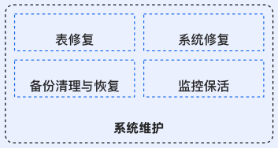
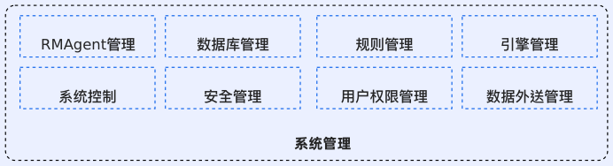
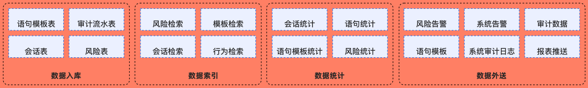
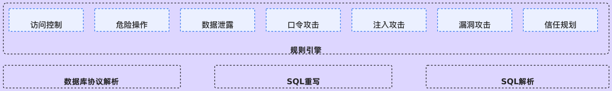

阿里云  
专有云  
数据库审计  
数据库安全审计 产品简介  
产品版本：v3.18.6  
文档版本：20261023

**目录**

- [1.数据库安全审计产品简介](#section-1)
- [2.功能特性](#section-2)
- [3.产品概述](#section-3)
- [4.产品架构](#section-4)
- [5.应用场景](#section-5)
- [6.部署方式](#section-6)

# 1.数据库安全审计产品简介

数据库审计系统实现了云端自建数据库、云数据库服务访问过程和行为的审计，具备应用用户关联审计功能；具备风险状况、运行状况、性能状况、语句分布的实时监控能力。

数据库审计系统通过数据库化的界面语言、智能化的协议识别、可视化的运行状况呈现、可交互可下钻的风险追踪能力，实现快速部署、方便维护的云数据审计产品。

# 2.功能特性

本文介绍数据库安全审计产品的功能特性。

**一级特性**

**二级特性**

**特性描述**

IP地址组

支持创建IP地址组。

对象组

支持创建对象组，可在配置规则时直接引用。

应用用户组

支持创建应用用户组。

分组管理

数据库用户组

支持创建数据库用户组，便于数据库管理。

时间组

支持创建时间组，可在配置规则时直接引用。

支持PolarDB（Mysql）、PolarDB（PostgreSQL）、PolarDB-X（Mysql）、RDSMySQL、RDSSQLServer、RDSPostgreSQL、

云数据库

RDSMariaDB、RDSMongoDB、OceanBase、AnalyticDB（MySQL）、AnalyticDB（PostgreSQL）、MaxCompute、Hologres等云数据库服务。

国产数据库

支持人大金仓、达梦、神通、南大通用、华为Gauss等国产数据库。

协议支持

支持Oracle、SQLServer、Db2、Informix、PostgreSQL、SybaseASE、

国际数据库

SybaseIQ、MySQL、MongoDB、SAPHANA、Teradata、Cache、MariaDB、Percona等国际主流数据库。

支持Hive、HBase、Sentry、Impala、HDFS、ES（Elasticsearch）、

大数据

GP（Greenplum）、Redis等大数据平台的审计。

- 支持会话级检索和详情展现，包括：在线的并发会话、活跃会话、失败登录会话等提供专项的分析界面。

- 提供基于数据库访问来源进行会话统计及检索分析，并对周期内的活跃会话

会话分析

及失败会话进行统计分析。

- 根据指定SQL语句锁定其所属会话，并钻取该会话生命期内的全部SQL展现。

- 三个维度的检索分析：会话维度、语句维度、风险维度。

- 审计操作记录的信息：审计结果中包括告警级别、事件发生时间、客户端

审计信息显示

IP、目标数据库IP、操作类型、客户端MAC地址、目标数据库MAC地址、客户端端口号、响应时间、返回状态、结果信息、SQL语句、SQL参数等详细信息内容。

审计展示检索能力

- 基于全局、分组和单库多个维度进行统计分析。

检索能力

- 支持多数据库统计查询功能，不少于20种检索条件。

可基于会话、风险、语句分布等多维度，进行趋势分析与统计，并以图表结合

统计分析

的方式进行展现。

支持按不同库、不同时间周期性，跨库对统计信息形成环比，直观展现数据库

统计对比

当前客户端访问情况、数据库性能、SQL语句量等。

- 支持审计数据自动备份到本地和远端FTP、SFTP、NFS、OSS服务器。

审计日志备份

审计日志备份

- 支持审计日志、系统配置的导入导出。

和恢复

与恢复

- 支持高性能、高压缩比不同选择模式进行数据备份。

- 会话的终端信息：IP、MAC、Port、工具名称（程序名）、操作系统用户。

- 会话的主机信息：IP、Port、数据库名（实例名）、业务主机群。

- 会话的其它信息：登录时间、会话时长。

- 操作信息：操作类型（DDL、DML、DCL等）、操作时间、执行时长、操

审计信息

作对象（数据库实例、Schema、表）、SQL语句、SQL错误代码。

- 操作影响范围信息：查询、修改、删除操作的影响行数，以及返回行数。

- 支持结果集审计、记录操作成功与失败。

审计能力

- 支持单向请求包审计。

结果集按规则

支持按照策略进行结果集审计，可以指定敏感表审计结果集，降低系统开销。

审计

长语句审计

支持对超长SQL操作语句审计，单条语句长度可达2M。

- 规则类型：访问规则、注入攻击、操作规则、口令攻击。

  审计规则策略配置至少支持20个条件，规则各条件之间支持与或非逻辑关

审计规则策略

系。

- 语句规则：基于单库下，根据语句模板配置对应的信任语句规则，构建语句的黑白名单。

- 支持全局策略设置，基于全局策略可以下发给每个数据库设置规则。

- 支持单库策略配置，信任语句，构建数据库黑白名单。

审计规则管理

- 支持策略的导入、导出设置、优先级设置。

审计风险监控

- 支持增加例外规则完善策略。

能力

- 具有内置规则，并针对不同数据库提供默认规则。

数据库漏洞攻

能对基于数据库漏洞进行攻击行为监测和告警，内置数据库漏洞攻击规则库。

击监测

- 记录风险级别：高、中、低风险。

风险告警

- 告警方式：提供邮件、Syslog等告警行为。

- 系统提供少于40个报表模型，分别基于多库和单库维度进行展现，包括合规性报表、专项报表、综合报表。

- 支持图表结合展现，基于总体概况、性能、会话、语句、风险多层面展现报

报表内容

表。

- 支持风险登录、高危风险、客户端风险等多种类型报表展现。

报表内容

- 支持导出格式：Word、PDF、HTML。

报表展现

提供表格、柱状图、饼状图、折线图等多种展示方式。

报表能力

报表推送、预存、自定义报表。

业务监控

对接CMS监控

CMS可以对系统资源使用及业务指标进行实施监控。

- 采用旁路部署方式对原有网络不造成影响，网络审计产品的故障不影响被审计系统的正常运行。

旁路Agent部署

- 自建数据库（ECS）：直接部署在被审计的系统的数据库端。

- 云服务商提供的数据库（RDS）：需要部署在访问被审计系统的数据库的应用端。

部署模式

支持从数据安全开放平台获取日志，可获取日志的云原生数据库类型：RDS、

数据安全开放

Polardblocal（mysql、oracle、postgres）、Oceanbase、

平台

MaxCompute、ADBPostgreSQL。

# 3.产品概述

数据已成为企业经营决策的新驱动、商品服务贸易的新内容甚至社会全面治理的新手段。保障重要数据安全以及数据库的正常运转的前提，需要数据库安全审计产品作为数据库安全的侦察兵守卫，监测数据安全，洞察数据风险，帮助用户完成安全合规、用户行为分析、运维监控、风险审计、事件追溯与数据库安全相关需求场景的安全审计。

数据库审计系统基于数据库协议解析和SQL解析技术的精准数据库安全审计系统。系统具备数据行为全面审计，数据风险及时发现等能力，可满足数据安全合规、风险监测及追溯、用户行为分析、辅助业务优化等需求。

系统采用B/S架构，用户可通过网络在已连通的终端上登录浏览器对系统进行访问；通过有效的数据库监控方式对访问、操作数据库的行为及返回结果进行全面审计；通过安全监控引擎可以定制不同的审计规则，实现对撞库攻击、高危操作、重要对象查询、数据库漏洞攻击、SQL注入等数据库风险操作产生风险记录与告警，并对信任行为语句添加白名单；通过检索统计能力，可以实现用户行为分析，风险追溯等能力。

# 4.产品架构

数据库审计系统从产品架构上可以分为数据捕获、协议解析、数据处理、系统管理等几个部分。

**系统管理**

**数据处理**

**协议解析**

**数据捕获**

**流量捕获层**

流量捕获层即接入待审计流量，过滤掉不需要审计的流量，捕获需要审计的流量。专有云环境下流量捕获的方式支持探针RMAgent。当环境不能依赖交换机的镜像流量时，需在数据库或直接访问数据库的服务器上安装RMAgent探针，由探针捕获本机数据库流量并发送给审计。

**协议解析层**

协议解析层会调用npp进程对捕获到的数据库流量进行解析；针对协议解析分析出的SQL语句,会进行重写生成语句模板，并对SQL进行解析；针对所有审计元素，NPP会做一次合理的信息整合，来保证审计元素的完善。安华金和数据库安全审计产品的研发团队拥有大型数据库内核产品研发基础，经过十多年的市场打磨，其产品对于数据库的协议解析精准且全面。规则引擎作为NPP的一个重要子功能模块，会对所有风险和信任规则进行识别和处理。

**数据处理层**

会采用多表入库的方式将信息入库到DC数据中心；基于入库后的审计数据会进行定时统计，统计的时间粒度有：分钟统计、小时统计和天统计；采用了全文索引的机制来支撑庞大数据检索需求，亿级数据可在几秒内生成查询结果；通过邮件、syslog、云安全管理中心SOC等方式可进行数据外送。

**系统管理层**

数据库安全审计产品具有多种周边辅助能力，如：表修复、系统修复、数据备份清理恢复、监控保活，进一步确保设备正常运转。Web页面中具有多种系统管理能力，如数据库管理、规则管理等功能。

# 5.应用场景

- **满足合规要求**

  满足等保对数据库行为操作审计、日志留存等相关规定，符合网络安全法、数据安全法等要求。

- **安全事件追查**

  提供语句、会话、IP、数据库用户、业务用户、响应时间、影响行等多种维度的数据库操作记录和事后分析能力，成为安全事件后可靠的追查依据和来源。

  通过SQL行为与业务用户的准确关联，使数据库访问行为有效定位到业务工作人员，可有效追责、定责。

- **数据库性能诊断**

  实时显示数据库的运行状况、数据库访问流量、并发吞吐量、SQL语句的响应速度；提供低效语句、访问量最大语句的分析，帮助运维人员进行性能诊断。

- **发现程序后门**

  系统提供SQL学习和SQL白名单能力，实现对业务系统的SQL建模；通过合法系统行为的建模，使隐藏在软件系统中的后门程序在启动时，提供实时的告警能力，降低数据泄漏损失。

- **数据库攻击响应**

  系统提供数据库风险告警能力，对于SQL注入、数据库漏洞攻击、过量数据下载、危险SQL语句（如No where delete)等风险行为的策略制定能力，提供实时告警能力。

# 6.部署方式

本文介绍数据库审计系统支持的部署方式。

数据库审计系统支持探针式部署，在数据库服务器（或应用系统的服务器）上部署RMAgent组件，采集服务器网卡流量或本地回环口流量完成数据采集，并通过服务器分配的网卡将捕获到的数据库流量传递给指定的审计设备。审计设备内置独立的进程，接收并解析采集到的数据库流量包，从而完成审计操作。系统支持多探针部署，并提供批量安装和统一管理功能。

**使用说明**：

- RMAgent插件部署在应用端服务器，只能审计到应用系统访问数据库的操作。

- RMAgent插件部署在数据库服务器，产品可以采集服务器网卡和本地回环口流量。

- RMAgent插件只进行数据抓取和对外传递，不会对服务器的系统负载产生影响。

- RMAgent具备良好的兼容性，可适用于CentOS、RedHat、Solaris、AIX等主流操作系统。
