阿里云  
专有云  
云盾-DDoS清洗  
公共云版 用户指南  
产品版本：v3.18.6  
文档版本：20261023

**目录**

- [1.登录DDoS高防控制台](#section-1)
- [2.安全总览](#section-2)
- [3.接入管理](#section-3)
    - [3.1. 域名接入](#section-3-1)
        - [3.1.1. 添加网站配置](#section-3-1-1)
        - [3.1.2. 修改网站配置](#section-3-1-2)
            - [3.1.2.1. 自定义服务器端口](#section-3-1-2-1)
            - [3.1.2.2. 更换服务器HTTPS证书](#section-3-1-2-2)
            - [3.1.2.3. 自定义服务器HTTPS证书的TLS安全策略](#section-3-1-2-3)
            - [3.1.2.4. 修改DDoS高防IP自身的HTTPS证书及TLS安全策略](#section-3-1-2-4)
            - [3.1.2.5. 设置流量标记](#section-3-1-2-5)
        - [3.1.3. 其他操作](#section-3-1-3)
    - [3.2. 端口接入](#section-3-2)
        - [3.2.1. 配置端口转发规则](#section-3-2-1)
        - [3.2.2. 修改端口回源设置](#section-3-2-2)
        - [3.2.3. 配置健康检查](#section-3-2-3)
        - [3.2.4. 配置会话保持](#section-3-2-4)
        - [3.2.5. 批量导出](#section-3-2-5)
    - [3.3. 放行DDoS高防回源IP](#section-3-3)
    - [3.4. 本地验证转发配置生效](#section-3-4)
    - [3.5. 业务接入DDoS高防](#section-3-5)
        - [3.5.1. 使用CNAME或IP将网站域名解析到DDoS高防](#section-3-5-1)
        - [3.5.2. CNAME解析接入非网站业务](#section-3-5-2)
- [4.资产管理](#section-4)
    - [4.1. 实例管理](#section-4-1)
- [5.调查分析](#section-5)
    - [5.1. 攻击分析](#section-5-1)
    - [5.2. 系统日志](#section-5-2)
    - [5.3. 操作日志](#section-5-3)
    - [5.4. 抓包分析](#section-5-4)
- [6.防护设置](#section-6)
    - [6.1. 通用防护策略](#section-6-1)
        - [6.1.1. 基础设施DDoS防护](#section-6-1-1)
            - [6.1.1.1. 设置全局防护策略](#section-6-1-1-1)
            - [6.1.1.2. 设置黑白名单（针对高防实例IP）](#section-6-1-1-2)
            - [6.1.1.3. 设置区域封禁](#section-6-1-1-3)
            - [6.1.1.4. 设置UDP反射攻击防护](#section-6-1-1-4)
            - [6.1.1.5. 黑洞解封](#section-6-1-1-5)
            - [6.1.1.6. 设置近源流量压制](#section-6-1-1-6)
        - [6.1.2. 网站业务DDoS防护](#section-6-1-2)
            - [6.1.2.1. 设置AI智能防护](#section-6-1-2-1)
            - [6.1.2.2. 设置DDoS全局防护策略](#section-6-1-2-2)
            - [6.1.2.3. 设置黑白名单（针对域名）](#section-6-1-2-3)
            - [6.1.2.4. 设置区域封禁（针对域名）](#section-6-1-2-4)
            - [6.1.2.5. 设置CC安全防护](#section-6-1-2-5)
        - [6.1.3. 非网站业务DDoS防护](#section-6-1-3)
            - [6.1.3.1. 设置四层AI智能防护](#section-6-1-3-1)
            - [6.1.3.2. 设置DDoS防护策略](#section-6-1-3-2)
    - [6.2. 定制场景策略](#section-6-2)

<a id="section-1"></a>

# 1.登录DDoS高防控制台

本文介绍如何登录DDoS高防控制台。

**前提条件**

- 登录Apsara Uni-manager运营控制台前，确认您已从部署人员处获取Apsara Uni-manager运营控制台的服务域名地址。

- 推荐使用Chrome浏览器。

**操作步骤**

1. 在浏览器地址栏中，输入Apsara Uni-manager运营控制台的服务域名地址，按回车键。

2. 输入正确的用户名及密码。

   请向运营管理员获取登录控制台的用户名和密码。

   > **说明**
   >
   > 首次登录Apsara Uni-manager运营控制台时，需要修改登录用户名的密码，请按照提示完成密码修改。为提高安全性，密码长度必须为8~20位，且至少包含以下两种类型：
   >
   > - 英文大写或小写字母（A~Z、a~z）
   >
   > - 阿拉伯数字（0~9）
   >
   > - 特殊符号（感叹号（！）、at（@）、井号（#）、美元符号（$）、百分号（%）等）

3. 单击**账号登录**。

4. 

5. 在顶部菜单栏，选择**产品**，切换到公共云。本文公共云名称以接入公共云DDoS为例，具体请以实际为准。

   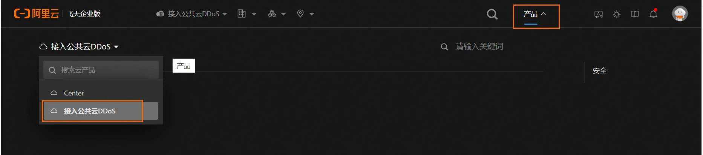

6. 选择**安全 > 云安全 > DDoS高防**。

<a id="section-2"></a>

# 2.安全总览

本文介绍您将业务接入DDoS高防后，如何在控制台查看实例和域名的业务数据以及遭受的DDoS攻击详情，帮助您快速了解资产的DDoS防护情况，以便您可以及时调整DDoS防护策略。

**概述**

DDoS高防最多允许您查看30天内的数据，您可以在**安全总览**页面右上角单击**流量关系说明**，查看并熟悉DDoS高防IP流量的相关概念。

**前提条件**

已将业务接入DDoS高防。具体操作，请参见添加网站配置或配置端口转发规则。

**查看实例的防护总览**

DDoS高防支持按实例维度展示业务的相关信息及遭受的DDoS攻击详情。

1. 登录DDoS高防控制台。

2. 在左侧导航栏，单击**安全总览**，在**安全总览**页面的**实例**页签，您可以查看如下信息。

   | 功能名称 | 说明 |
   | --- | --- |
   | 带宽 | 提供<strong>带宽</strong>趋势图，以<strong>bps</strong>或者<strong>pps</strong>展示指定时间段内实例上的入流量、出流量、攻击流量、限速流量趋势。 |
   | <strong>网络层攻击事件</strong>、<strong>规格超</strong><strong>限告警</strong>、<strong>目的限速事件</strong> | • <strong>网络层攻击事件</strong>：将光标放置在被攻击的IP或端口上，可以查看被攻击的IP和端口信息、攻击的类型和峰值、防护结果。<br>• <strong>规格超限告警</strong>：事件类型包含业务带宽、新建连接数和并发连接数。当事件类型对应规格超过购买的规格时会进行提示，对当前业务无影响，建议扩容升级。具体操作，请参见升级实例。您可以单击<strong>状态</strong>列的<strong>详情</strong>跳转到<strong>系统日志</strong>页面，查看详细信息。<br>说明超限告警数据的更新时间为每周一的10:00（GMT+8），更新后的数据为前一天的规格超限告警数据。如果您配置了站内信、短信或邮件通知，您也将会在每周一的10:00（GMT+8）收到对应通知，且数据为前一天的规格超限告警数据。<br>• 目的限速事件当业务的新建连接数、并发连接数或业务带宽等远超实例规格时，会触发对应的限速策略，对业务产生影响，产生目的限速事件。<br>• 如果是正常业务触发的限速，请尽快扩容升级。具体操作，请参见升级实例。<br>• 如果是遭受了DDoS攻击触发的限速，请及时调整防护策略。具体操作，请参见防护设置。<br>您可以单击<strong>状态</strong>列的<strong>详情</strong>跳转到<strong>系统日志</strong>页面，查看详细信息。 |
   | 连接数 | • <strong>并发连接数</strong>：客户端同一时间与DDoS高防建立的TCP连接数量。<br>• 活跃连接数：当前所有状态为<strong>Established</strong>的TCP连接数量。<br>• 非活跃连接数：当前除了<strong>Established</strong>状态以外，所有其他状态的TCP连接数量。<br>• <strong>新建连接数</strong>：客户端每秒内新增的与DDoS高防通信的TCP连接数。 |
   | <strong>正常业务地区分布</strong>、<strong>正常</strong>业务运营商分布 | • <strong>正常业务地区分布</strong>：正常业务流量的来源地区分布。<br>• <strong>正常业务运营商分布</strong>：正常业务流量的运营商分布。 |

**查看域名的防护总览**

DDoS高防支持按域名维度展示业务的相关信息及遭受的DDoS攻击事件详情。

1. 登录DDoS高防控制台。

2. 在左侧导航栏，单击**安全总览**，在**安全总览**页面的**域名**页签，您可以查看如下信息。

   - 查看实例总QPS

     在**全部域名**选择框，单击**实例总QPS**后勾选独享IP，然后单击**确定**。

     <table>
       <tr>
         <th width="158">功能名称</th>
         <th>说明</th>
       </tr>
       <tr>
         <td>请求速率（QPS）</td>
         <td>按照DDoS高防实例维度展示请求速率趋势图，不同的查询时间间隔对应的展示粒度不同。</td>
       </tr>
       <tr>
         <td>响应码和请求数</td>
         <td>按照DDoS高防实例维度展示DDoS高防的响应码。响应码记录的数量对应展示粒度时间内的累加值。不同响应码的含义如下：<br>• 2XX：表示请求已成功被服务器接收、理解并接受。<br>说明2XX响应码的统计数据包含了200响应码的统计数据。<br>• 3XX：表示需要客户端采取进一步的操作才能完成请求。通常这些状态码用来重定向。<br>• 4XX：表示客户端可能发生了错误，妨碍服务器的处理。<br>• 5XX：表示服务器在处理请求的过程中发生了错误或者出现异常状态。</td>
       </tr>
     </table>

   - 查看精细域名QPS

     在**全部域名**选择框，单击**精细域名QPS**后勾选域名，然后单击**确定**。

     | 功能名称 | 说明 |
     | --- | --- |
     | 请求速率（QPS） | 按照域名维度展示请求速率趋势图，不同的查询时间间隔对应的展示粒度不同。 |
     | 应用层清洗事件 | 应用层发生的清洗事件。将光标放置在域名上，可以展示被攻击的域名信息、攻击的峰值和攻击类型。 |
     | 带宽 | 展示域名出方向和入方向的带宽峰值趋势图。<br>说明仅统计payload字段，和实例级别bps趋势图有偏差。 |
     | 来源地区 | 访问来源地区的分布详情。 |
     | 响应码和请求数 | 分为DDoS高防的响应码以及源站响应码。响应码记录的数量对应展示粒度时间内的累加值。不同响应码的含义如下：<br>• 2XX：表示请求已成功被服务器接收、理解并接受。<br>说明2XX包含200~299的所有状态码。<br>• 200：表示请求成功。<br>• 3XX：表示需要客户端采取进一步的操作才能完成请求。通常这些状态码用来重定向。<br>• 4XX：表示客户端可能发生了错误，妨碍服务器的处理。<br>说明4XX包含400~499的所有状态码。<br>• 403：服务器理解了客户端的请求，但拒绝执行。<br>• 404：服务器无法找到客户端所请求的资源。<br>• 405：服务器理解了客户端请求的资源路径，但对于请求中所使用的HTTP方法（如GET、POST、PUT、DELETE等），该资源不允许使用此方法进行访问。<br>• 410：服务器上的该资源已被删除。<br>• 499：客户端在服务器还没有完成对请求的处理之前取消了请求。<br>• 5XX：表示服务器在处理请求的过程中发生了错误或者出现异常状态。<br>说明5XX包含500~599的所有状态码。<br>• 502：表示DDoS高防作为代理服务器尝试执行请求，但是从上游服务器收到了无效的响应。<br>• 503：表示服务器当前无法处理请求，可能因为临时的服务器维护或者过载。<br>• 504：表示DDoS高防作为代理服务器尝试执行请求，但是未能及时从上游服务器收到响应。 |
     | 缓存命中率 | 适用于已经开启静态页面缓存功能的场景。 |
     | <strong>URI请求次数</strong>、<strong>URI响</strong><strong>应时间</strong>等（图示④） | 展示对应指标的Top5数据，您可以单击<strong>更多</strong>查看更多数据。包含URI请求次数、URI响应时间、User-Agent、Referer、HTTP-Method、客户端指纹、HTTP2.0指纹、JA3指纹、JA4指纹。各指标的详细介绍，请参见附录一：支持设置的HTTP请求字段。<br>说明URI响应时间为DDoS高防从收到客户端请求至处理完成返回响应，整个过程所消耗的时间，单位为毫秒。同一URI有多个响应时间时取最大值。 |

**设置告警阈值**

针对大流量攻击事件，为避免事件太多对您的业务造成干扰，所以DDoS高防默认策略为入流量大于1Gbps，且产生100Mbps的丢弃流量时才会生成流量攻击事件。入流量小于默认策略，则不产生事件。但考虑到您可能业务流量较小，所以提供自定义配置告警阈值。通过配置告警阈值可以解决您在控制台上看到有清洗流量但没有攻击事件的问题。

1. 登录DDoS高防控制台。

2. 在左侧导航栏单击**安全总览**，在页面右上角的**设置告警阈值**区域，您可以自定义配置攻击告警阈值。

   - 针对高防单IP接收入流量带宽总和。

   - 入流量包含攻击流量和业务流量。

   - 当入流量大于或等于自行设置的阈值，且清洗流量大于100Mbps时，产生告警事件。

   - 针对高防实例所有IPV4地址生效，IPV6地址暂不支持自定义调整。

<a id="section-3"></a>

# 3.接入管理

<a id="section-3-1"></a>

## 3.1. 域名接入

<a id="section-3-1-1"></a>

### 3.1.1. 添加网站配置

将网站域名配置到DDoS高防后，DDoS高防会为网站生成一个CNAME地址，您需要将网站域名的DNS解析指向高防CNAME地址，DDoS高防才能转发业务流量为网站防御DDoS攻击。本文介绍如何添加网站配置。

**注意事项**

- 接入DDoS高防（中国内地）的网站必须经过ICP备案。

  > **说明**
  >
  > - DDoS高防（中国内地）会定期查询已接入防护的网站域名的备案状态，备案失效时DDoS高防（中国内地）会停止相关业务的流量转发，并在**域名接入**页面提示“域名未履行ICP备案，请您及时更新备案状态”。出现提示时，如果您需要恢复业务流量转发，必须及时更新域名的备案状态。
  >
  > - 如果您的高防回源站点为阿里云产品时，需要同时满足高防及回源产品的备案要求，否则将影响回源流量转发，具体请查看各云产品的官网文档或咨询技术支持人员。例如源站服务器是ECS时，您需要为ECS开通ICP备案，具体请参见备案服务器检查和ICP备案流程。

**前提条件**

如果网站业务要接入DDoS高防（中国内地）实例，网站域名必须已经完成ICP备案。更多信息，请参见ICP备案流程。

**添加网站配置**

1. 登录DDoS高防控制台。

2. 在**接入管理 > 域名接入**页面，单击**添加网站**。

   > **说明**
   >
   > 您也可以在页面最下方单击**批量导入**，批量导入网站配置。网站配置采用XML文件格式传入，关于文件格式的详细介绍，请参见其他操作。

   <ol type="i">

   <li>

   填写网站接入信息，然后单击**下一步**。

   <table>
     <tr>
       <th width="89">配置项</th>
       <th>说明</th>
     </tr>
     <tr>
       <td>功能套餐</td>
       <td>选择要关联的DDoS高防实例的功能套餐。可选项：<strong>标准功能</strong>、<strong>增强功能</strong>。<br>说明将光标放置在<strong>功能套餐</strong>后的图标上，查看标准功能和增强功能套餐的功能差<br><br>异。</td>
     </tr>
     <tr>
       <td>实例</td>
       <td>选择要关联的DDoS高防实例。一个网站域名最多可以关联8个DDoS高防实例，且只能关联同一种<strong>功能套餐</strong>下的实例。</td>
     </tr>
     <tr>
       <td>网站</td>
       <td>填写要防护的网站域名。具体要求如下：<br>• 域名可以由英文字母（a~z、A~Z，不区分大小写）、数字（0~9）以及短划线（-）组成。域名的首位必须是字母或数字。<br>• 支持填写泛域名，例如，<code> *.aliyundoc.com </code>。使用泛域名时，DDoS高防自动匹配该泛域名对应的子域名。<br>说明<br>• 如果同时存在泛域名和精确域名配置（例如，<code> *.aliyundoc.com </code>和<code> www.aliyundoc.com </code>），DDoS高防优先使用精确域名（即<code> www.aliyundoc.com </code>）所配置的转发规则和防护策略。<br>• 如果您填写的是一级域名，DDoS高防仅防护您的一级域名，不支持对二级域名等子域名进行防护。如果您要防护二级域名，请输入二级域名或者泛域名。<br>• 仅支持配置为域名，不支持填写网站IP。</td>
     </tr>
     <tr>
       <td>协议类型</td>
       <td>选择网站支持的协议类型。可选项：<br>• <strong>HTTP</strong>：默认选中。<br>• <strong>HTTPS</strong>：网站支持HTTPS加密认证时，请勾选该协议并完成以下配置。上传国际标准HTTP证书上传证书后才能使DDoS高防帮助您清洗HTTPS业务流量。<br>• <strong>手动上传</strong>：填写<strong>证书名称</strong>，并将证书文件和私钥文件中的文本内容分别复制粘贴到<strong>证书文件</strong>和<strong>私钥文件</strong>框中。<br>说明<br>• 对于PEM、CER、CRT格式的证书，您可以使用文本编辑器直接打开证书文件，复制其中的文本内容。对于其他格式（例如，PFX、P7B等）的证书，您需要将证书文件转换成PEM格式后，才能用文本编辑器打开并复制其中的文本内容。<br>• 如果该HTTPS证书有多个证书文件（例如，证书链），您需要将证书链中的文本内容拼接合并后粘贴至<strong>证书文件</strong>中。<br>• <strong>选择已有证书</strong>：通过阿里云数字证书管理服务（Certificate Management Service）申请的证书，或者您已将证书上传到数字证书管理服务，可以直接选择证书。自定义TLS安全策略详细介绍，请参见自定义服务器HTTPS证书的TLS安全策略。<br>a. <strong>HTTPS证书TLS版本</strong>：选择国际标准HTTPS证书支持的TLS协议版本。可选项：<br>• <strong>支持TLS1.0及以上版本，兼容性最好，安全性较低</strong>：支持TLS 1.0、TLS 1.1和TLS 1.2。<br>• <strong>支持TLS1.1及以上版本，兼容性较好，安全性较好</strong>：支持TLS 1.1和TLS 1.2。<br>• <strong>支持TLS1.2及以上版本，兼容性较好，安全性很高</strong>：支持TLS 1.2。您也可以根据需要选择<strong>开启支持TLS1.3</strong>。<br>b. <strong>HTTPS证书加密套件</strong>：选择国际标准HTTPS证书支持的加密套件，或自定义加密套件。您可以将光标放置在某个加密套件选项上的图标，查看该选项包含的加密套件。<br>启用双向认证如果您需要在客户端到高防间进行TLS双向认证，请将签发客户端证书的根CA证书或中间CA证书上传至DDoS高防。支持阿里云签发的CA证书以及非阿里云签发的CA证书。<br>• <strong>阿里云签发</strong>：在<strong>选择默认CA证书</strong>下拉框中选择通过阿里云数字证书管理服务（Certificate Management Service）签发的CA证书。<br>• <strong>非阿里云签发</strong>：<br>a. 请先将自签名CA证书上传至数字证书管理服务（Certificate Management Service）。具体操作，请参见上传证书仓库（上传证书）。<br>b. 在<strong>选择默认CA证书</strong>下拉框中选择上传的自签CA证书。<br>说明如果您使用的是非阿里云签发的CA证书，启用双向认证功能时会消耗证书应用仓库的API调用次数。每个阿里云账号有100次免费的证书应用仓库API调用次数，超用后请根据控制台提示购买API次数包。<br>启用OCSP Stapling是否启用OCSP Stapling功能，推荐启用该功能。OCSP表示在线证书状态协议，该协议用于向签发服务端证书的CA（Certificate Authority）中心发起查询请求，检查证书是否被吊销。在与服务器进行TLS握手时，客户端必须同时获取证书和对应的OCSP响应。<br>• <strong>未启用（默认）</strong>：表示由客户端浏览器向CA中心发起OCSP查询。该方式会导致客户端在获得OCSP响应前阻塞后续的事件，在网络情况不佳时，将造成较长时间的页面空白，降低HTTPS的性能。<br>• <strong>启用</strong>：表示由DDoS高防来执行OCSP查询并缓存查询结果（缓存时间为3600秒）。当有客户端向服务器发起TLS握手请求时，DDoS高防将服务端证书的OCSP信息随证书链一起发送给客户端，从而避免了客户端查询会产生的阻塞问题。由于OCSP响应是无法伪造的，因此这一过程不会产生额外的安全问题。国密HTTPS仅DDoS高防（中国内地）实例支持上传国密标准HTTPS证书，证书算法仅支持SM2。<br>说明经过验证DDoS高防（中国内地）支持处理360浏览器和红莲花浏览器发来的国密请求。<br>• <strong>仅支持国密客户端访问</strong>：默认关闭。<br>• 开启：仅处理安装国密标准证书的客户端发来的请求。<br>说明开启后国际标准HTTPS证书对应的TLS套件、双向认证及OCSP Stapling功能配置将不会生效。<br>• 关闭：处理安装国密标准证书的客户端，以及安装国际标准证书的客户端发来的请求。<br>• <strong>国密HTTPS证书</strong>：您需要先将证书上传到数字证书管理服务，才能在此处选择。<br>• <strong>国密HTTPS加密套件</strong>：默认启用如下加密套件，不支持修改。<br>• ECC-SM2-SM4-CBC-SM3<br>• ECC-SM2-SM4-GCM-SM3<br>• ECDHE-SM2-SM4-CBC-SM3<br>• ECDHE-SM2-SM4-GCM-SM3<br>• <strong>Websocket</strong>：选中该协议将自动同时选中<strong>HTTP</strong>协议，不支持单独选中<strong>Websocket</strong>协议。<br>• <strong>Websockets</strong>：选中该协议将自动同时选中<strong>HTTPS</strong>协议，不支持单独选中<strong>Websockets</strong>协议。选中<strong>HTTPS</strong>协议后，可以根据需要开启以下高级设置。<br>• <strong>开启HTTPS的强制跳转</strong>：适用于网站同时支持HTTP和HTTPS协议。开启该设置后，所有HTTP请求将被强制转换为HTTPS请求，且默认跳转到443端口。<br>重要<br>• 只有同时选中<strong>HTTP</strong>和<strong>HTTPS</strong>协议，并且没有选中<strong>Websocket</strong>协议时，才可以开启该设置。<br>• HTTP非标准端口（80以外的端口）访问的场景下，如果开启了HTTPS强制跳转，则访问默认跳转到HTTPS 443端口。<br>• <strong>开启HTTP回源</strong>：如果网站不支持HTTPS回源，请务必开启该设置。开启该设置后，所有HTTPS协议请求将通过HTTP协议回源、所有Websockets协议请求将通过Websocket协议回源，且默认回源端口为80。<br>重要HTTPS非标准端口（443以外的端口）访问的场景下，如果开启了HTTP回源，则访问默认跳转到源站HTTP 80端口。<br>• <strong>HTTP2监听</strong>：开关开启表示允许HTTP 2.0协议客户端接入高防，但此时DDoS高防仍使用HTTP 1.1回源到源站。HTTP 2.0功能规格说明<br>• 连接关闭后的不活动超时时间（http2_idle_timeout）：120s<br>• 单连接最大请求数（http2_max_requests）：1000<br>• 单连接最大并发流（http2_max_concurrent_streams）：4</td>
     </tr>
   </table>

   - HPACK 解压缩后整个请求头列表的最大值（http2_max_header_size）：256K

   - HPACK 压缩的请求头字段的最大值（http2_max_field_size）：64K

   <table>
     <tr>
       <td>服务器地址</td>
       <td>选择源站服务器的地址类型，并填写源站服务器的地址。<br>说明源站可以是阿里云产品，也可以是非阿里云产品。但当源站是阿里云产品时，请确保该源站归属于当前的阿里云账号，如果源站属于其他阿里云账号，请在添加前联系商务经理。<br>• <strong>源站IP</strong>：表示源站服务器的IP地址。最多支持配置20个源站IP地址，多个IP地址间使用半角逗号（,）分隔。<br>• 如果源站在阿里云，一般填写源站ECS的公网IP地址。如果ECS前面部署了SLB，则填写SLB的公网IP地址。<br>• 如果源站在阿里云外的IDC机房或者其他云服务商，您可以使用<code> ping </code>域名<code> </code>命令，查询域名解析到的公网IP地址，并填写获取的公网IP。<br>• <strong>源站域名</strong>：通常适用于源站和高防之间还部署有其他代理服务（例如，Web 应用防火墙 WAF（Web Application Firewall））的场景，表示代理服务的跳转地址。最多支持配置10个源站域名，多个域名间通过换行分隔。例如，您在部署DDoS高防实例后还需要部署WAF，以提升应用安全防护能力，您可以选择<strong>源站域名</strong>，并填写WAF的CNAME地址。<br>重要如果您设置的<strong>源站域名</strong>为OSS存储空间（Bucket）的默认外网访问域名，则对应存储空间必须已绑定自定义域名。</td>
     </tr>
     <tr>
       <td>服务器端口</td>
       <td>根据<strong>协议类型</strong>，设置源站提供对应服务的端口。<br>• <strong>HTTP</strong>协议、<strong>Websocket</strong>协议的端口默认为80。<br>• <strong>HTTPS</strong>协议、<strong>HTTP2</strong>协议、<strong>Websockets</strong>协议的端口默认为443。自定义服务器端口，多个端口间使用半角逗号（,）分隔，具体限制如下。<br>• 自定义端口必须在可选端口范围内。<br>• HTTP协议可选端口范围：80~65535。<br>• HTTPS协议可选端口范围：80~65535。<br>• 所有接入DDoS高防实例防护的网站业务下自定义的不同端口（包含不同协议下的自定义端口）的总数不能超过10个。例如，您有2个网站（A和B），网站A提供HTTP服务、网站B提供HTTPS服务。如果网站A的接入配置中自定义了HTTP 80、8080端口，那么在网站B的接入配置中，最多可以自定义8个不同的HTTPS端口。</td>
     </tr>
     <tr>
       <td>Cname Reuse</td>
       <td>仅DDoS高防（非中国内地）支持配置该参数。选择是否开启CNAME复用。该功能适用于同一台服务器上有多个网站业务的场景。开启CNAME复用后，您只需将同一个服务器上多个域名的解析指向同一个高防CNAME地址，即可将多个域名接入高防，无需为每个域名分别添加高防网站配置。更多信息，请参见CNAME复用。</td>
     </tr>
   </table>

   

   </li>

   <li>

   填写转发配置，然后单击**下一步**。

   <table>
     <tr>
       <th width="121">配置项</th>
       <th>说明</th>
     </tr>
     <tr>
       <td>回源负载算法</td>
       <td>有多个源站服务器地址（源站IP或源站域名）时需要配置。您可以修改回源负载均衡算法或者为不同服务器设置权重。<br>• <strong>轮询</strong>（默认）：所有请求轮流分配给所有服务器地址，默认所有服务器地址具有相同权重。支持修改服务器权重，服务器权重越大，被分配到请求的可能性越高。适用于多源站且对源站负载均匀要求较高的场景。<br>• <strong>IP hash</strong>：支持设置IP hash的同时为服务器设置权重。使用IP hash保证同一客户端的请求在一段时间内被分配到同一台服务器处理，确保会话的一致性。结合权重模式，根据服务器的处理能力进行权重分配，确保更高性能的服务器处理更多的请求，优化资源利用效率。适用于需要保持用户会话一致性的场景，极端情况下可能存在负载不均衡。<br>• <strong>Least time</strong>：通过智能DNS解析能力和Least time回源算法，保证业务流量将从接入防护节点到转发回源站服务器整个链路的时延最短。</td>
     </tr>
     <tr>
       <td>流量标记</td>
       <td>• 客户端真实源端口HTTP Header中客户端真实源端口所在的头部字段名。一般情况下使用<code> X-Forwarded-ClientSrcPort </code>字段记录真实的客户端源端口，如果您的业务使用自定义的字段记录真实的客户端源端口，请将Header字段名称设置为您自定义的字段。您可以从高防转发到源站的请求中解析设置的字段，获取客户端使用的真实端口。<br>• 客户端真实源IP HTTP Header中客户端真实源IP所在的头部字段名。<br>一般情况下使用<code> X-Forwarded-For </code>字段记录真实的客户端源IP，如果您的业务使用自定义的字段记录真实的客户端源IP，请将Header字段名称设置为您自定义的字段。您可以从高防转发到源站的请求中解析设置的字段，获取客户端使用的真实IP。<br>• 自定义Header在请求中增加自定义HTTP Header（包含字段名称和字段值）来标记经过DDoS的请求。高防在代理网站流量时，会在转发到源站的请求中添加对应的字段值，方便您后端的服务进行统计分析。<br>• 请不要使用以下默认字段作为自定义Header：<br>• <code> X-Forwarded-ClientSrcPort </code>：默认被用于获取访问高防七层引擎的客户端端口。<br>• <code> X-Forwarded-ProxyPort </code>：默认被用于获取访问高防七层引擎的监听端口。<br>• <code> X-Forwarded-For </code>：默认被用于获取访问高防七层引擎的客户端IP。<br>• 请不要使用标准HTTP头部字段（例如，host、user-agent、connection、upgrade等）或一些被广泛使用的自定义HTTP头部字段（x-real-ip、x-true-ip、x-client-ip、web-server-type、wl-proxy-client-ip、eagleeye-rpcid、eagleeye-traceid、x-forwarded-cluster、x-forwarded-proto等），否则会导致请求原始头部字段的内容被改写。<br>• 除客户端真实源端口和客户端真实源IP外，您最多支持添加5个自定义Header标签。</td>
     </tr>
     <tr>
       <td>cookie设置</td>
       <td>• 下发状态默认开启。开启状态时DDoS高防将会在客户端（如浏览器）植入Cookie用于区分统计不同客户端或者获取客户端的指纹信息等。详细介绍，请参见设置CC安全防护。<br>重要如需停止DDoS高防向业务植入Cookie的行为，您可以将开关关闭，但同时DDoS高防也将无法通过CC安全防护策略模块对CC攻击进行主动判断和防护。<br>• Secure属性默认关闭。如果开启，Cookie只会在HTTPS连接中被发送，而不会在HTTP连接中发送，有助于保护Cookie不被攻击窃取。当网站业务仅支持HTTPS链接时建议开启。</td>
     </tr>
     <tr>
       <td>其他设置</td>
       <td>• <strong>设置新建连接超时时间</strong>：DDoS高防尝试建立到源站的连接时，超过该时间连接未建立完成，会被认定为失败。支持设置为1~10秒。<br>• <strong>设置读连接超时时间</strong>：DDoS高防成功建立连接并向源站发出读取数据请求之后，等待源站返回响应数据的最长时间。支持设置为10~300秒。<br>• <strong>设置写连接超时时间</strong>：数据从DDoS高防发送出去之后，并由源站开始处理之前，DDoS高防等待的时间长度。超过这段时间，如果DDoS高防还没有成功地将所有数据发送给源站，或者源站没有开始处理数据，会被认定为失败。支持设置为10~300秒。<br>• <strong>回源重试</strong>：当DDoS高防请求的资源在缓存服务器上没有命中时，缓存服务器将尝试从上一级缓存服务器或源站重新获取该资源。<br>• <strong>回源长连接</strong>：在缓存服务器与源站之间，使TCP连接在一段时间内保持活跃，而不是每完成一次请求就关闭。开启后可以减少建立连接的时间和资源消耗，提高请求处理的效率与速度。<br>• <strong>复用长连接的请求个数</strong>：在DDoS高防向源站建立的一个TCP连接中，支持发送的HTTP请求个数，可以减少因频繁建立和关闭连接所带来的延迟和资源消耗。支持设置为10~1000。建议小于等于后端源站（如：WAF、SLB）上配置的长连接请求复用个数，以免长连接关闭造成业务无法访问。<br>• <strong>空闲长连接超时时间</strong>：DDoS高防向源站建立的一个TCP长连接，在没有数据传输之后，在高防的连接池保持开启状态的最长时间。这个时间段内如果没有新的请求，该连接将被关闭，以释放系统资源。支持设置为10~30秒。建议小于等于后端源站（如：WAF、SLB）上配置的超时时长，以免长连接关闭造成业务无法访问。<br>• <strong>设置HTTP2.0 Stream数上限</strong>：仅当启用HTTP2时支持设置，表示客户端与DDoS高防间允许的最大并发流数量。支持设置为16~32，如果您有更高的配置诉求，请联系商务经理。</td>
     </tr>
   </table>

   </li>

   </ol>

**后续配置**

1. （可选）更换源站ECS服务器的公网IP地址。

   如果您的源站是阿里云ECS服务器，且源站IP地址不慎暴露，您需要更换ECS云服务器的公网IP，防止黑客绕过DDoS高防直接攻击源站。具体操作，请参见固定公网IP。

2. 在源站服务器上放行DDoS高防回源IP。

   如果源站服务器上安装了防火墙等安全软件，您需要在源站放行DDoS高防回源IP，避免由高防转发回源站的流量被误拦截。具体操作，请参见放行DDoS高防回源IP。

3. 在本地验证转发配置是否生效。具体操作，请参见本地验证转发配置生效。

   > **警告**
   >
   > 如果转发配置未生效就执行业务切换，将可能导致业务中断。

4. 修改DNS解析将业务流量切换到DDoS高防。

   添加网站配置后，DDoS高防为网站分配一个CNAME地址，您必须将网站域名的DNS解析指向高防CNAME地址，才可以正式将业务流量切换到高防实例进行防护。具体操作，请参见使用CNAME或IP将网站域名解析到DDoS高防。

5. （可选）配置网站业务DDoS防护策略。

   DDoS高防默认为接入防护的网站开启了**DDoS全局防护策略**、**AI智能防护**，您还可以在**网站业务DDoS防护**页签，开启更多防护功能。具体操作，请参见网站业务DDoS防护。

   > **重要**
   >
   > 设置CC安全防护后，可能会被植入Cookie。详细内容，请参见Cookie植入说明。

<a id="section-3-1-2"></a>

### 3.1.2. 修改网站配置

<a id="section-3-1-2-1"></a>

#### 3.1.2.1. 自定义服务器端口

网站业务接入后，DDoS高防默认防护通过80端口（HTTP）、443端口（HTTPS）提供服务的网站业务。如果您的网站业务使用80（HTTP）、443（HTTPS）以外的端口提供服务，需要修改网站配置中的服务器端口。本文介绍如何在网站配置中修改服务器端口。

**自定义端口的限制**

**端口范围限制**

- HTTP协议可选端口范围：80~65535。

- HTTPS协议可选端口范围：80~65535。

> **说明**
>
> 但是，根据当前网络访问验证结果，互联网运营商侧或因部分高危端口存在安全隐患，会拦截针对高危端口的业务流量。相关的高危TCP端口包括：42、135、137、138、139、445、593、1025、1434、1068、3127、3128、3129、3130、4444、5554、5800、5900、9996。
>
> 如果您的Web业务使用了上述高危端口，则业务接入高防后，可能出现业务在部分地域无法被访问的问题。因此，建议您将业务接入高防前，确保Web业务使用其他非高危端口。

**端口数量限制**

一个DDoS高防实例下，所有接入的网站业务的不同端口（包含不同协议下的自定义端口）总数不能超过10个。

例如，您有2个网站（A和B）要接入DDoS高防实例防护，网站A提供HTTP服务，网站B提供HTTPS服务。

如果您在网站A的接入配置中配置了HTTP 80、8080端口，那么在网站B的接入配置中，您最多可以设置8个不同的HTTPS端口。

**操作步骤**

您可以在添加网站时自定义服务器端口，具体操作，请参见添加网站配置。添加网站配置后，也可以参照如下操作修改服务器端口。

1. 登录DDoS高防控制台。

2. 在左侧导航栏，选择**接入管理 > 域名接入**。

3. 定位到要编辑的网站配置，单击**操作**列的**编辑**。

4. 在网站配置页面，定位到**服务器端口**配置项，修改HTTP协议或HTTPS协议的端口，多个端口间使用半角逗号（,）分隔，根据指引单击**下一步**。

   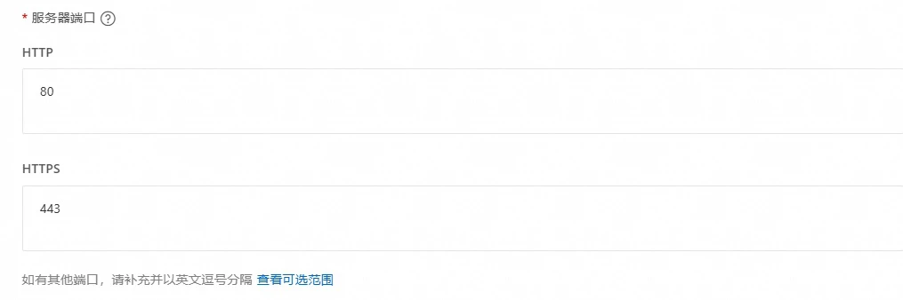

5. 单击**已完成，返回域名列表**后，在对话框确认修改的内容无误后，单击**确定**。

<a id="section-3-1-2-2"></a>

#### 3.1.2.2. 更换服务器HTTPS证书

当网站HTTPS证书已更换时，请及时在DDoS高防更换证书，以避免HTTPS业务解析异常。本文介绍如何更换HTTPS证书。

**注意事项**

- 支持上传国际标准HTTPS证书及国密标准HTTPS证书（仅支持SM2算法）。

  > **说明**
  >
  > 经过验证DDoS高防（中国内地）支持处理360浏览器和红莲花浏览器发来的国密请求。

- 如果您的网站业务既支持国际标准HTTPS证书，又支持国密标准HTTPS证书，需要同时上传两种证书。

- 如果客户端不支持SNI，DDoS高防（中国内地）会返回默认的国密证书，客户端会返回“服务器证书不可信”的提示。

**前提条件**

- 已添加网站配置且网站支持HTTPS协议。更多信息，请参见添加网站配置。

- 已将证书上传到数字证书管理服务。具体操作，请参见上传、同步和共享SSL证书。

**更换HTTPS证书**

1. 登录DDoS高防控制台。

2. 在左侧导航栏，选择**接入管理 > 域名接入**。

3. 在**域名接入**页面定位到目标域名，在**操作**列下单击**编辑**。

4. 更换国际标准HTTPS证书。

   在**编辑网站**页签，单击证书后的**修改**。

   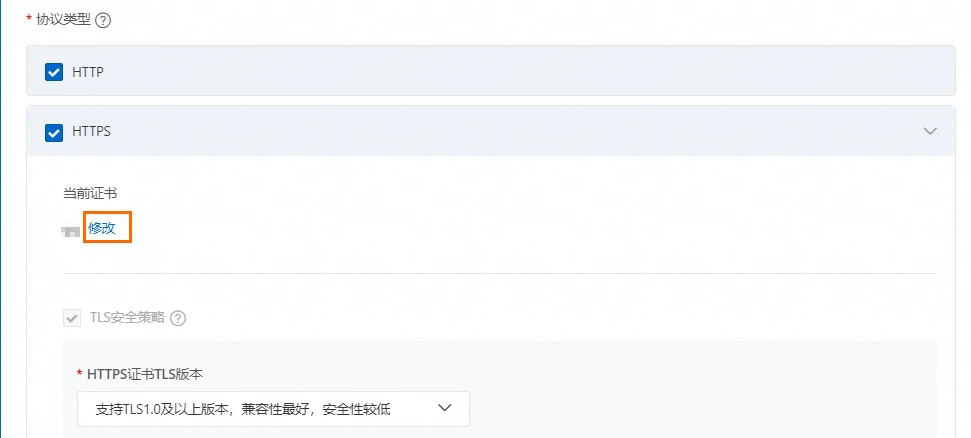

   - **手动上传**：填写**证书名称**，并将证书文件和私钥文件中的文本内容分别复制粘贴到**证书文件**和**私钥文件**框中。

     > **说明**
     >
     > - 对于PEM、CER、CRT格式的证书，您可以使用文本编辑器直接打开证书文件，复制其中的文本内容。对于其他格式（例如，PFX、P7B等）的证书，您需要将证书文件转换成PEM格式后，才能用文本编辑器打开并复制其中的文本内容。关于证书格式的转换方式，请参见证书格式转换或HTTPS证书转换成PEM格式。
     >
     > - 如果该HTTPS证书有多个证书文件（例如，证书链），您需要将证书链中的文本内容拼接合并后粘贴至**证书文件**中。

   - **选择已有证书**：通过阿里云数字证书管理服务（Certificate Management Service）申请的证书，或者您已将证书上传到数字证书管理服务，可以直接选择证书。

5. 更换国密标准HTTPS证书。

   在**编辑网站**页签，在**国密HTTPS**区域完成证书相关配置。

   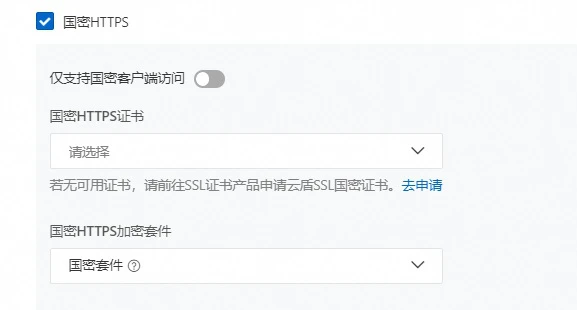

   - **仅支持国密客户端访问**：默认关闭。

     - 开启：仅处理安装国密标准证书的客户端发来的请求。

       > **说明**
       >
       > 开启后国际标准HTTPS证书对应的TLS套件、双向认证及OCSP Stapling功能配置将不会生效。

     - 关闭：处理安装国密标准证书的客户端，以及安装国际标准证书的客户端发来的请求。

   - **国密HTTPS证书**：您需要先将证书上传到数字证书管理服务，才能在此处选择。

   - **国密HTTPS加密套件**：默认启用如下加密套件，不支持修改。

     - ECC-SM2-SM4-CBC-SM3

     - ECC-SM2-SM4-GCM-SM3

     - ECDHE-SM2-SM4-CBC-SM3

     - ECDHE-SM2-SM4-GCM-SM3

6. 单击**下一步**，根据指引完成修改。

<a id="section-3-1-2-3"></a>

#### 3.1.2.3. 自定义服务器HTTPS证书的TLS安全策略

DDoS高防支持TLS安全策略自定义功能，您可以根据实际业务需要，为已接入DDoS高防防护的网站业务设置合适的TLS协议版本、加密算法套件。为网站业务修改TLS安全策略后，DDoS高防实例在处理网站域名的请求流量时，会采用已配置的TLS协议版本、加密套件及国密相关配置，当请求不满足条件时将被丢弃。本文介绍如何自定义TLS安全策略。

**支持的TLS协议版本**

DDoS高防（中国内地）支持上传国际标准HTTPS证书和国密标准HTTPS证书。

上传HTTPS证书后默认支持的TLS版本以及支持调整的TLS协议版本如下表所示。

| 证书类型 | 默认支持的TLS版本 | 支持调整的TLS协议版本 |
| --- | --- | --- |
| 国际标准HTTPS证书 | DDoS高防（中国内地）：默认支持TLS 1.0、TLS 1.1和TLS 1.2版本。DDoS高防（非中国内地）：默认支持TLS 1.1和TLS 1.2版本。 | 支持修改TLS协议版本及对应的加密套件，支持的协议版本如下。<br>• 支持TLS 1.0及以上版本（包含TLS 1.0、TLS 1.1和TLS 1.2）<br>• 支持TLS 1.1及以上版本（包含TLS 1.1和TLS 1.2）<br>• 支持TLS 1.2及以上版本（包含TLS 1.2）<br>说明如果您需要使用TLS 1.3版本，需要单独设置<strong>开启支持TLS1.3</strong>开关。<br>例如，您购买了DDoS高防（中国内地）实例，如果您的业务需要通过PCI DSS 3.2认证，希望禁用TLS 1.0协议，您可以在TLS安全策略配置中修改<strong>HTTPS证书TLS版本</strong>为<strong>支持TLS1.1及以上版本，兼容性较好，</strong><strong>安全性较好</strong>。而您的另一个业务的访问终端需要支持TLS 1.3协议，您可以在TLS安全策略配置中打开<strong>开启支持TLS1.3</strong>开关。 |
| 国密标准HTTPS证书 | 默认支持NTLS 1.1版本。 | 不支持修改TLS协议版本及加密套件。 |

**前提条件**

已添加网站配置，且网站配置的**协议类型**包含**HTTPS**。具体操作，请参见添加网站配置。

**修改国际标准HTTPS证书的TLS安全策略**

1. 登录DDoS高防控制台。

2. 在左侧导航栏，选择**接入管理 > 域名接入**。

3. 在**域名接入**页面定位到目标域名，在**操作**列下单击**编辑**。

4. 在**编辑网站**页签，修改国际标准HTTPS证书的**TLS安全策略**。

   <table>
     <tr>
       <th width="180">配置项</th>
       <th>说明</th>
     </tr>
     <tr>
       <td>HTTPS证书TLS版本</td>
       <td>选择国际标准HTTPS证书支持的TLS协议版本。可选项：<br>• <strong>支持TLS1.0及以上版本，兼容性最好，安全性较低</strong>：支持TLS 1.0、TLS 1.1和TLS 1.2。<br>• <strong>支持TLS1.1及以上版本，兼容性较好，安全性较好</strong>：支持TLS 1.1和TLS 1.2。<br>• <strong>支持TLS1.2及以上版本，兼容性较好，安全性很高</strong>：支持TLS 1.2。您也可以根据需要选择<strong>开启支持TLS1.3</strong>。</td>
     </tr>
     <tr>
       <td>HTTPS证书加密套件</td>
       <td>选择国际标准HTTPS证书支持的加密套件。<br>说明您可以将光标放置在某个加密套件选项上的图标，查看该选项包含的加密套<br><br>件。<br>• <strong>全部加密套件，安全性较低，兼容性较高</strong>（默认）该选项包含以下加密套件：<br>• ECDHE-ECDSA-AES128-GCM-SHA256<br>• ECDHE-ECDSA-AES256-GCM-SHA384<br>• ECDHE-ECDSA-AES128-SHA256<br>• ECDHE-ECDSA-AES256-SHA384<br>• ECDHE-RSA-AES128-GCM-SHA256<br>• ECDHE-RSA-AES256-GCM-SHA384<br>• ECDHE-RSA-AES128-SHA256<br>• ECDHE-RSA-AES256-SHA384<br>• AES128-GCM-SHA256<br>• AES256-GCM-SHA384<br>• AES128-SHA256<br>• AES256-SHA256<br>• ECDHE-ECDSA-AES128-SHA<br>• ECDHE-ECDSA-AES256-SHA<br>• ECDHE-RSA-AES128-SHA<br>• ECDHE-RSA-AES256-SHA<br>• AES128-SHA<br>• AES256-SHA<br>• DES-CBC3-SHA<br>• 增强加密套件，安全性很高，兼容性很低只有在<strong>TLS版本</strong>为<strong>支持TLS1.2及以上版本，兼容性较好，安全性很高</strong>时，支持该选项。该选项包含以下加密套件：<br>• ECDHE-ECDSA-AES256-GCM-SHA384<br>• ECDHE-ECDSA-AES128-SHA256<br>• ECDHE-RSA-AES128-GCM-SHA256<br>• ECDHE-RSA-AES256-GCM-SHA384<br>• 强加密套件，安全性较高，兼容性较低只有在<strong>TLS版本</strong>为<strong>支持TLS1.2及以上版本，兼容性较好，安全性很高</strong>时，支持该选项。该选项包含以下加密套件：<br>• ECDHE-ECDSA-AES128-GCM-SHA256<br>• ECDHE-ECDSA-AES256-GCM-SHA384<br>• ECDHE-ECDSA-AES128-SHA256<br>• ECDHE-ECDSA-AES256-SHA384<br>• ECDHE-RSA-AES128-GCM-SHA256<br>• ECDHE-RSA-AES256-GCM-SHA384<br>• ECDHE-RSA-AES128-SHA256<br>• ECDHE-RSA-AES256-SHA384<br>• ECDHE-ECDSA-AES128-SHA<br>• ECDHE-ECDSA-AES256-SHA<br>• 自定义加密套件选择该选项后，您需要从全部加密套件中选择一个或多个加密套件。<br>• TLS_AES_256_GCM_SHA384<br>• TLS_CHACHA20_POLY1305_SHA256<br>• TLS_AES_128_GCM_SHA256<br>• TLS_AES_128_CCM_8_SHA256<br>• TLS_AES_128_CCM_SHA256</td>
     </tr>
   </table>

5. 单击**下一步**，根据指引完成修改。

<a id="section-3-1-2-4"></a>

#### 3.1.2.4. 修改DDoS高防IP自身的HTTPS证书及TLS安全策略

默认情况下DDoS高防IP会向客户端返回内置的默认HTTPS证书，当您需要更高的业务安全性时，支持您为DDoS高防上传自定义HTTPS证书，并修改TLS安全策略。本文介绍如何为DDoS高防IP上传自定义HTTPS证书并修改TLS安全策略。

**注意事项**

- 仅IPv4高防IP支持修改HTTPS证书和TLS安全策略，IPv6高防IP不支持修改。

  - HTTPS证书：仅支持修改为国际标准证书，不支持修改为国密标准证书。

  - TLS安全策略：除了DDoS高防预设的加密套件选项外，还支持自定义加密套件。但仅增强套餐的高防IP支持自定义加密套件，标准套餐的高防IP不支持。

- 关于各类型的DDoS高防实例，支持的TLS协议版本请参见下表。

  <table>
    <tr>
      <th rowspan="2">TLS协议版本</th>
      <th colspan="2">DDoS高防（中国内地）</th>
      <th colspan="2">DDoS高防（非中国内地）</th>
    </tr>
    <tr>
      <td>标准套餐</td>
      <td>增强套餐</td>
      <td>标准套餐</td>
      <td>增强套餐</td>
    </tr>
    <tr>
      <td>默认TLS协议版本</td>
      <td>TLS 1.0及以上</td>
      <td>TLS 1.0及以上</td>
      <td>TLS 1.1及以上</td>
      <td>TLS 1.1及以上</td>
    </tr>
    <tr>
      <td>支持调整为哪些TLS协议版本</td>
      <td>TLS 1.2及以上</td>
      <td>• TLS 1.1及以上<br>• TLS 1.2及以上<br>• TLS 1.3</td>
      <td>• TLS 1.0及以上<br>• TLS 1.2及以上</td>
      <td>• TLS 1.0及以上<br>• TLS 1.2及以上<br>• TLS 1.3</td>
    </tr>
  </table>

**前提条件**

已将网站业务接入DDoS高防。具体操作，请参见添加网站配置。

**操作步骤**

1. 登录DDoS高防控制台。

2. 在左侧导航栏，选择**接入管理 > 域名接入**。

3. 在页面右上角单击**高防IP默认SSL/TLS设置**，定位到目标高防实例IP地址，单击**操作**列的**修改**，修改高防IP的HTTPS证书以及TLS安全策略。

   - **HTTPS证书**

     - **手动上传**：填写**证书名称**，并将证书文件和私钥文件中的文本内容分别复制粘贴到**证书文件**和**私钥文件**框中。

       > **说明**
       >
       > - 对于PEM、CER、CRT格式的证书，您可以使用文本编辑器直接打开证书文件，复制其中的文本内容。对于其他格式（例如，PFX、P7B等）的证书，您需要将证书文件转换成PEM格式后，才能用文本编辑器打开并复制其中的文本内容。关于证书格式的转换方式，请参见证书格式转换或HTTPS证书转换成PEM格式。
       >
       > - 如果该HTTPS证书有多个证书文件（例如，证书链），您需要将证书链中的文本内容拼接合并后粘贴至**证书文件**中。

     - **选择已有证书**（推荐）：如果您已将证书上传到数字证书管理服务，可以直接选择证书。如何上传证书，请参见上传、同步和共享SSL证书。

   - **TLS安全策略**

     > **重要**
     >
     > 仅当上传了HTTPS证书后，才允许修改TLS安全策略。建议TLS安全策略配置，与您为域名配置的TLS安全策略一致。为域名配置的TLS安全策略，请参见自定义服务器HTTPS证书的TLS安全策略。

     - **TLS协议版本**：根据您的业务需要选择。

     - **https加密套件**：

       - **全部加密套件，安全性较低，兼容性较高**（默认）

         该选项包含以下加密套件：

         - ECDHE-ECDSA-AES128-GCM-SHA256

         - ECDHE-ECDSA-AES256-GCM-SHA384

         - ECDHE-ECDSA-AES128-SHA256

         - ECDHE-ECDSA-AES256-SHA384

         - ECDHE-RSA-AES128-GCM-SHA256

         - ECDHE-RSA-AES256-GCM-SHA384

         - ECDHE-RSA-AES128-SHA256

         - ECDHE-RSA-AES256-SHA384

         - AES128-GCM-SHA256

         - AES256-GCM-SHA384

         - AES128-SHA256

         - AES256-SHA256

         - ECDHE-ECDSA-AES128-SHA

         - ECDHE-ECDSA-AES256-SHA

         - ECDHE-RSA-AES128-SHA

         - ECDHE-RSA-AES256-SHA

         - AES128-SHA

         - AES256-SHA

         - DES-CBC3-SHA

       - **增强加密套件，安全性很高，兼容性很低**

         该选项包含以下加密套件：

         - ECDHE-ECDSA-AES256-GCM-SHA384

         - ECDHE-ECDSA-AES128-SHA256

         - ECDHE-RSA-AES128-GCM-SHA256

         - ECDHE-RSA-AES256-GCM-SHA384

       - **强加密套件，安全性较高，兼容性较低**

         该选项包含以下加密套件：

         - ECDHE-ECDSA-AES128-GCM-SHA256

         - ECDHE-ECDSA-AES256-GCM-SHA384

         - ECDHE-ECDSA-AES128-SHA256

         - ECDHE-ECDSA-AES256-SHA384

         - ECDHE-RSA-AES128-GCM-SHA256

         - ECDHE-RSA-AES256-GCM-SHA384

         - ECDHE-RSA-AES128-SHA256

         - ECDHE-RSA-AES256-SHA384

         - ECDHE-ECDSA-AES128-SHA

         - ECDHE-ECDSA-AES256-SHA

       - **自定义加密套件**

         选择该选项后，您需要从全部加密套件中选择一个或多个加密套件。

         > **说明**
         >
         > 仅增强套餐的DDoS高防实例支持自定义加密套件，标准套餐的DDoS高防实例不支持。

   修改完成后，**证书配置状态**会显示为**自定义证书**。您可以单击**恢复默认**将证书以及TLS安全策略恢复到默认配置。

<a id="section-3-1-2-5"></a>

#### 3.1.2.5. 设置流量标记

网站业务接入DDoS高防后，您可以通过设置高防流量标记，使高防转发到源站的流量中包含客户端真实源端口、客户端真实源IP或自定义的Header字段值，方便您的后端服务器对高防转发的流量进行统计分析。本文介绍如何设置高防流量标记。

**前提条件**

已添加网站配置。更多信息，请参见添加网站配置。

**操作步骤**

1. 登录DDoS高防控制台。

2. 在左侧导航栏，选择**接入管理 > 域名接入**。

3. 定位到要操作的网站配置，单击**操作**列下的**编辑**。

4. 在转发配置中，设置启用流量标记。

   - **客户端真实源端口**

     HTTP Header中客户端真实源端口所在的头部字段名。

     一般情况下使用 `X-Forwarded-ClientSrcPort` 字段记录真实的客户端源端口，如果您的业务使用自定义的字段记录真实的客户端源端口，请将Header字段名称设置为您自定义的字段。您可以从高防转发到源站的请求中解析设置的字段，获取客户端使用的真实端口。

   - **客户端真实源IP**

     HTTP Header中客户端真实源IP所在的头部字段名。

     一般情况下使用 `X-Forwarded-For` 字段记录真实的客户端源IP，如果您的业务使用自定义的字段记录真实的客户端源IP，请将Header字段名称设置为您自定义的字段。您可以从高防转发到源站的请求中解析设置的字段，获取客户端使用的真实IP。

   - **自定义Header**

     在请求中增加自定义HTTP Header（包含字段名称和字段值）来标记经过DDoS的请求。高防在代理网站流量时，会在转发到源站的请求中添加对应的字段值，方便您后端的服务进行统计分析。

     - 请不要使用以下默认字段作为自定义Header：

       - `X-Forwarded-ClientSrcPort` ：默认被用于获取访问高防七层引擎的客户端端口。

       - `X-Forwarded-ProxyPort` ：默认被用于获取访问高防七层引擎的监听端口。

       - `X-Forwarded-For` ：默认被用于获取访问高防七层引擎的客户端IP。

     - 请不要使用标准HTTP头部字段（例如，host、user-agent、connection、upgrade等）或一些被广泛使用的自定义HTTP头部字段（x-real-ip、x-true-ip、x-client-ip、web-server-type、wl-proxy-client-ip、eagleeye-rpcid、eagleeye-traceid、x-forwarded-cluster、x-forwarded-proto等），否则会导致请求原始头部字段的内容被改写。

     - 除客户端真实源端口和客户端真实源IP外，您最多支持添加5个自定义Header标签。

5. 单击**下一步**，根据指引完成修改。

<a id="section-3-1-3"></a>

### 3.1.3. 其他操作

本文介绍如何删除网站配置、批量导出网站配置。

**删除网站配置**

> **警告**
>
> - 若您的网站不再需要接入DDoS高防，必须先为其恢复域名解析，即确保域名的DNS解析中不再使用高防IP、高防CNAME、流量调度器CNAME作为记录值，然后删除对应的网站配置。若您未恢复网站域名解析就删除网站配置，可能导致业务中断。
>
> - 您同个阿里云账号下所有DDoS高防实例释放一个月后，高防会自动清空该账号下所有高防的域名及端口转发配置。如果您有多个高防实例，以最后一个实例释放时间开始计算。

1. 登录DDoS高防控制台。

2. 在左侧导航栏，选择**接入管理 > 域名接入**。

3. 在**域名接入**页面，定位到目标网站配置，单击**操作**列的**删除**。

4. 在删除提示对话框中，确认要删除后，单击**删除**。

   > **说明**
   >
   > 如果您有多个网站配置需要删除，也可以勾选后单击网站列表下方的**批量删除**。

**批量导出网站配置**

您可以将DDoS高防的全部网站配置以XML格式导出并下载到本地。批量导出的网站配置格式与批量导入、修改网站配置保持一致。

1. 登录DDoS高防控制台。

2. 在左侧导航栏，选择**接入管理 > 域名接入**。

3. 在网站列表下方，单击**批量导出**，下发导出任务，然后单击**确定**。

4. 单击页面右上角的**任务管理**，查看导出进展。

   

5. 导出任务完成后，在**任务列表**面板，单击**操作**的**下载**，导出文件到本地。

   > **说明**
   >
   > 如果当前任务状态为**待执行**状态，请耐心等待导出任务完成。

   下载导出文件到本地后，您可以使用文本编辑工具打开下载的.xml文件，查看网站配置内容。

   > **说明**
   >
   > 使用DDoS高防（中国内地）服务，导出文件的名称以DDoSCoo_开头。

6. （可选）在**任务列表**面板，定位到不再需要的任务，单击**操作**列的**删除**。

**附录：网站配置XML格式说明**

批量操作DDoS高防网站配置时（例如批量导入、修改、导出），网站配置按照固定的XML格式传递。

**参数说明**

网站配置参数内容必须以 `<DomainList>` 开始， `</DomainList>` 结束，中间部分是网站配置的参数信息。其中，每个网站的配置参数均以 `<DomainConfig>` 开始， `</DomainConfig>` 结束，中间部分为与该网站配置相关的具体参数，详见下表。

> **说明**
>
> 每多添加一个网站配置，则增加一个 `<DomainConfig>……</DomainConfig>` 数据结构体。

| 网站配置具体参数 | 说明 |
| --- | --- |
| <code>&lt;Domain&gt;example.aliyundoc.com&lt;/D</code><br><code>omain&gt;</code> | 待配置的域名。只能设置一个域名。 |
| <code>&lt;ProtocolConfig&gt;  &lt;ProtocolLis</code><br><code>t&gt;http,https&lt;/ProtocolList&gt;  &lt;/</code><br><code>ProtocolConfig&gt;</code> | 域名协议类型。多个协议类型间以半角逗号（,）隔开。本示例表示该域名的协议类型为HTTP和HTTPS。 |
| <code>&lt;InstanceConfig&gt;  &lt;InstanceLis</code><br><code>t&gt;ddoscoo-cn-zvp2eibz****</code><br><code>&lt;/InstanceList&gt;  &lt;/InstanceConfi</code><br><code>g&gt;</code> | 网站关联的DDoS高防实例。<br>说明由于每个DDoS高防实例对应一个ID，所以只需填写DDoS高防实例ID即可。多个实例ID间以半角逗号（,）隔开。 |

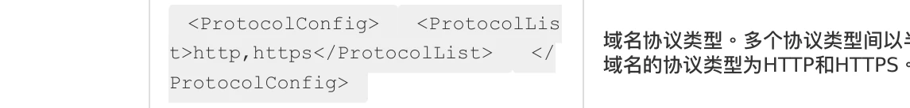

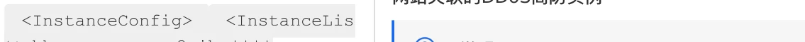

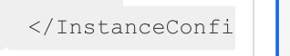

<table>
  <tr>
    <td><code>&lt;RealServerConfig&gt;  &lt;ServerTyp</code><br><code>e&gt;0&lt;/ServerType&gt;  &lt;ServerList&gt;19</code><br><code>2.0.XX.XX&lt;/ServerList&gt;  &lt;/RealSe</code><br><code>rverConfig&gt;</code></td>
    <td>源站信息。结构说明如下：<br>• <code> &lt;ServerType&gt;0&lt;/ServerType&gt; </code>：表示源站IP。<br>• <code> &lt;ServerType&gt;1&lt;/ServerType&gt; </code>：表示源站域名。<br><code> &lt;ServerList&gt;192.0.XX.XX&lt;/ServerList&gt; </code>表示源站地址，多个地址间以半角逗号（,）隔开。<br>说明配置某个域名的源站信息时，只能是源站IP或源站域名信息，两者不能同时存在。</td>
  </tr>
</table>

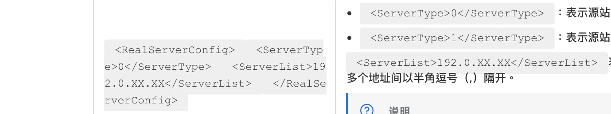

**示例**

```xml
<DomainList>
 <DomainConfig>
 <Domain>example.aliyundoc.com</Domain>
 <ProtocolConfig>
 <ProtocolList>http,https</ProtocolList>
 </ProtocolConfig>
 <InstanceConfig>
 <InstanceList>ddoscoo-cn-zvp2eibz****</InstanceList>
 </InstanceConfig>
 <RealServerConfig>
 <ServerType>0</ServerType>
 <ServerList>192.0.XX.XX</ServerList>
 </RealServerConfig>
 </DomainConfig>
 <DomainConfig>
 <Domain>demo.aliyundoc.com</Domain>
 <ProtocolConfig>
 <ProtocolList>http,websocket,websockets</ProtocolList>
 </ProtocolConfig>
 <InstanceConfig>
 <InstanceList>ddoscoo-cn-7pp2e74f****, ddoscoo-cn-2r42e12c****</InstanceList>
 </InstanceConfig>
 <RealServerConfig>
 <ServerType>1</ServerType>
 <ServerList>learn.aliyundoc.com</ServerList>
 </RealServerConfig>
 </DomainConfig>
 </DomainList>
```

该示例表示添加以下两条网站配置：

- 网站一：域名是example.aliyundoc.com，协议类型是HTTP和HTTPS，关联高防实例ddoscoo-cn-zvp2eibz\*\*\*\*，对应源站IP是192.0.XX.XX。

- 网站二：域名demo.aliyundoc.com，协议类型是HTTP、WebSocket和WebSockets，关联高防实例ddoscoo-cn-7pp2e74f\*\*\*\*和ddoscoo-cn-2r42e12c\*\*\*\*，对应源站域名learn.aliyundoc.com。

<a id="section-3-2"></a>

## 3.2. 端口接入

<a id="section-3-2-1"></a>

### 3.2.1. 配置端口转发规则

非网站业务（例如客户端应用程序）接入DDoS高防时，需要配置端口转发规则，使业务流量先经过DDoS高防清洗，再转发到源站服务器。本文介绍如何为非网站业务配置端口转发规则。

**注意事项**

- 阿里云账号下所有DDoS高防实例释放一个月后，DDoS高防会彻底删除该账号下所有高防的实例配置，不可恢复。如果您有多个DDoS高防实例，以最后一个实例释放时间开始计算。

- 购买**增强功能**套餐的DDoS高防实例时，在您设置完UDP端口转发规则后，DDoS高防会默认屏蔽一些常见的用于UDP反射攻击的端口。通常情况下屏蔽这些端口不会影响正常业务，但如果您的业务涉及其中某个端口，请手动解除屏蔽。详细信息，请参见设置UDP反射攻击防护。

  > **说明**
  >
  > 如果您曾经自定义设置过UDP反射攻击防护端口，仍以您自定义的端口为准。

**新增端口转发规则**

**新增单个端口转发规则**

1. 登录DDoS高防控制台。

2. 在左侧导航栏，选择**接入管理 > 端口接入**。

3. 选择DDoS高防实例后，单击**添加规则**，完成规则配置后单击**确定**。

   > **说明**
   >
   > **转发协议**后有
   >
   > 图标的规则表示配置网站业务时自动生成的规则，用来转发网站业务的流量。不支
   >
   > 
   >
   > 持手动编辑和删除，当使用该转发规则的所有网站配置取消与当前DDoS高防实例的关联后，规则将会被自动删除。关于如何配置网站业务，请参见添加网站配置。
   >
   > - 如果网站信息中的服务器端口为80，则自动生成一条转发协议为TCP、转发端口为80的规则。
   >
   > - 如果网站信息中的服务器端口为443，则自动生成一条转发协议为TCP、转发端口为443的规则。

   | 配置项 | 说明 |
   | --- | --- |
   | 转发协议 | 转发协议类型，可选值：TCP、UDP。<br>重要安全加速线路不支持UDP端口接入。 |
   | 转发端口 | DDoS高防实例使用的转发端口。<br>说明<br>• 为了便于管理，建议您将<strong>转发端口</strong>与<strong>源站端口</strong>保持一致。<br>• 根据中国国家监管政策要求，为了防止未通过备案的域名业务接入防护，DDoS高防不支持80、8080、443、8443端口接入配置。关于上述接口的防护，建议您使用域名接入。更多信息，请参见添加网站配置。<br>• 为了防止私自搭建DNS防护服务器，DDoS高防不支持53端口接入配置。<br>• 同一DDoS高防实例和转发协议下，每条规则的转发端口必须唯一。当您尝试添加同协议+同转发端口的规则时，系统将提示规则冲突。<br>• 请避免与通过网站配置自动生成的规则冲突。 |
   | 源站端口 | 源站使用的业务端口。 |
   | 回源转发模式 | 默认为轮询模式，不支持修改。 |
   | 应用层防护增强端口 | 仅购买了DDoS高防增强版实例且TCP协议的业务支持开启，防护针对非HTTP/HTTPS的应用层协议攻击。<br>• 设置回源新建连接超时时间：取值1~3秒。DDoS高防在尝试与后端源站建立新连接时，如果在规定时间内无法成功建立连接，则会认为连接超时。设置该值可以避免攻击者通过海量虚假HTTP请求（如CC攻击）与后端源站建立TCP连接但长期不发送有效数据。<br>• 设置回源读写连接超时时间：取值60~600秒。<br>• 读超时时间：DDoS高防发出请求后，等待后端源站响应的时间。如果在这个时间内没有收到后端源站的数据响应，则认为连接超时。<br>• 写超时时间：DDoS高防向后端源站发送数据的操作中，如果在规定时间内没有成功发送数据，则连接超时。<br>设置该值可以避免攻击者建立合法连接后，以极低速率发送或接收数据，长时间占用后端源站资源。 |
   | 源站IP | 源站的IP地址。<br>说明<br>• 源站可以是阿里云产品，也可以是非阿里云产品。但当源站是阿里云产品时，请确保该源站归属于当前的阿里云账号，如果源站属于其他阿里云账号，请在添加前联系商务经理。<br>• 支持添加多个源站IP以实现自动负载均衡。多个IP间以半角逗号（,）分隔。最多可配置20个源站IP。 |

**批量新增端口转发规则**

批量添加端口转发规则时，不支持开启**应用层防护增强端口**，如需开启，请先批量新增端口转发规则后，再批量修改**应用层防护增强端口**开关。

1. 在**端口接入**页面下方，单击**批量操作 > 添加规则**。

2. 在**添加规则**对话框，按照格式要求填入要添加的规则配置，并单击**确定**。

   每行对应一条规则，每条规则包含四个字段，从左到右依次是协议、转发端口、源站端口、源站IP，字段间以空格分隔。

3. 在**添加规则**对话框，选中要上传的规则，并单击**上传**。

**后续操作**

添加规则后，您还需要放行DDoS高防回源IP、验证本地转发配置生效、将非网站业务的业务流量切换到DDoS高防实例，才能完成非网站业务的接入。

1. 在源站服务器上设置放行DDoS高防的回源IP，避免DDoS高防转发回源站的流量被源站服务器上的安全软件拦截。具体操作，请参见放行DDoS高防回源IP。

2. 通过本地计算机验证规则配置已经生效，避免规则配置不正确导致业务异常。具体操作，请参见本地验证转发配置生效。

   > **警告**
   >
   > 如果规则未生效就执行业务切换，将可能导致业务中断。

3. 将非网站业务的业务流量切换到DDoS高防实例。

   通常您只需将业务IP替换为DDoS高防实例的独享IP，即可正式将业务流量切换至DDoS高防实例，具体操作请以业务开发平台实际情况为准。

   > **说明**
   >
   > - 如果您的业务同时使用域名来指定服务器地址（例如，游戏客户端中设置example.com域名作为服务器地址，或该域名已经写在客户端程序中），您无需配置域名接入，但需要在域名的DNS解析服务提供商处修改DNS解析，将该域名的A记录指向DDoS高防实例的独享IP。具体操作，请参见修改DNS解析。
   >
   > - 在某些场景下，您可能需要用域名来接入四层业务，并实现业务关联多高防IP且多高防IP间自动切换流量。这种情况下，推荐您通过添加域名并修改CNAME解析来接入非网站业务。具体操作，请参见CNAME解析接入非网站业务。

**更多操作**

**修改源站IP**

下图中①为修改单条规则中的源站IP入口，②为批量修改源站IP的入口。

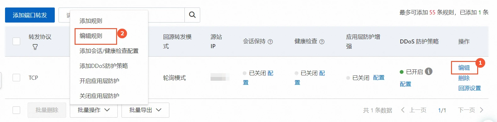

**修改应用层防护增强端口开关**

下图中①为修改单条规则中的开关入口，②为批量修改开关的入口。请勿单击**应用层防护增强**下的**配置**，该按钮为防护策略的入口。

批量开启时，回源新建连接超时时间默认取值为3秒，回源读写连接超时时间默认取值为600秒。

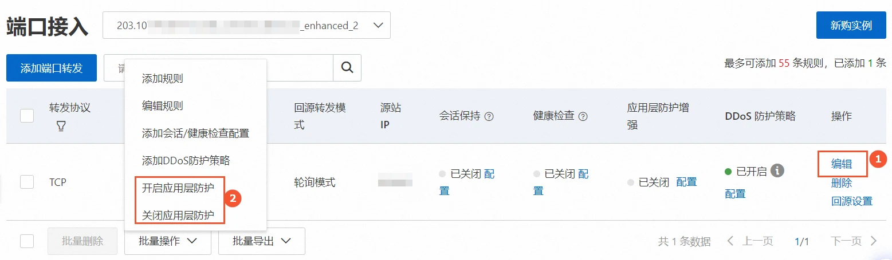

**删除端口转发规则**

> **警告**
>
> 对于手动添加的规则，如果您不再需要DDoS高防IP对业务进行转发，您必须先恢复实际业务IP，即确保实际业务没有使用高防IP，然后删除对应的规则。如果您未恢复实际业务IP就删除规则，那么可能导致业务中断。

下图中①为删除单条规则的入口，②为批量删除规则的入口。

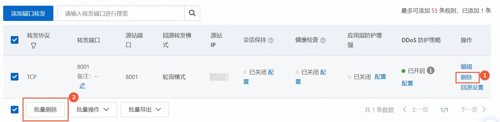

<a id="section-3-2-2"></a>

### 3.2.2. 修改端口回源设置

您可以通过回源设置，为已添加的端口转发规则开启主备回源功能，增强DDoS高防回源链路的容灾能力。本文介绍如何修改端口回源设置。

**背景信息**

主备回源允许您预先设置主源站、备源站IP地址集合，并可随时切换选用主源站回源、备源站回源，使DDoS高防实例转发端口业务流量到您设置的主源站IP、备源站IP。当某条回源线路出现故障时，您可以手动快速切换到备用回源线路，确保业务访问正常。

**使用限制**

- 如果您的源站部署在阿里云上，设置主备源站时仅支持添加当前阿里云账号下的源站。

- 开启主备回源后，对应的端口转发规则不再支持编辑。

**前提条件**

已将非网站业务接入DDoS高防。具体操作，请参见配置端口转发规则。

**开启主备回源**

1. 登录DDoS高防控制台。

2. 在左侧导航栏，选择**接入管理 > 端口接入**。

3. 在转发规则列表上方，选择要操作的DDoS高防实例，定位到目标端口转发规则，单击**操作**列的**回源设置**。

4. 在**回源设置**对话框，配置完成后单击**确定**。

   <ol type="i">

   <li>

   打开**主备回源**开关，在**提示**对话框中单击**确定**。

   > **说明**
   >
   > 开启主备回源时，默认使用端口转发规则里的源站IP为主源站地址，并启用主源站回源。

   </li>

   <li>

   填写主源站和备源站的IP地址，并选中要启用的源站。

   主源站、备源站均支持设置最多20个不同的IP地址，多个IP地址间使用半角逗号（,）分隔。

   </li>

   </ol>

当您的主回源线路发生故障时，您可以在回源设置中，勾选<strong>启用源站（备）</strong>切换到备用回源线路。

**关闭主备回源**

当您不再使用主备回源功能时，可以在**回源设置**中，关闭**主备回源**开关。关闭主备回源后，您可以通过编辑转发规则来修改源站IP。相关操作，请参见配置端口转发规则。

> **说明**
>
> 关闭主备回源后，默认以当前启用的源站地址作为转发规则的源站IP。例如，当前启用了源站（备），关闭主备回源功能后，转发规则以源站（备）地址作为源站IP，继续执行业务流量转发。

<a id="section-3-2-3"></a>

### 3.2.3. 配置健康检查

DDoS高防为已接入防护的非网站业务提供网络四层和七层健康检查功能，适用于业务有多个源站IP的场景。DDoS高防在转发业务流量回源时，通过健康检查判断源服务器的业务可用性，将流量优先转发到状态健康的源服务器，保证业务正常响应。本文介绍如何配置健康检查。

**注意事项**

- 端口转发规则中仅配置了一个源站IP时，请不要开启健康检查。

- 端口转发配置中开启**应用层防护增强端口**时，不支持配置健康检查。

- 端口转发配置中未开启**应用层防护增强端口**时，支持配置健康检查。如果后续开启了**应用层防护增强端口**，则已配置的健康检查不生效，但会保留该配置。

- DDoS高防使用回源IP对源站进行主动探测，探测行为仅为确认源站的健康状态，对源站不会产生任何影响。为确保健康检查功能正常工作，请在源站的访问控制策略中放行这些IP。具体操作，请参见放行DDoS高防回源IP。

**前提条件**

已将非网站业务接入DDoS高防，并配置了多个源站IP地址。具体操作，请参见配置端口转发规则。

**为单个端口配置健康检查**

1. 登录DDoS高防控制台。

2. 在左侧导航栏，选择**接入管理 > 端口接入**。

3. 选择DDoS高防实例，并定位到要操作的转发规则，单击**健康检查**下的**配置**。

4. 开启**健康检查**，完成健康检查配置，然后单击**确定**。

   DDoS高防支持网络四层和七层健康检查配置，具体参数描述如下表所示。

   > **说明**
   >
   > 四层健康检查和七层健康检查均支持高级设置。高级设置仅在展开**高级设置**后显示。一般情况下，建议您不要修改高级设置。

   **类型**

   **参数**

   **说明**

   健康检查服务访问后端服务器时的探测端口。取值范围：1~65535。默认值为端口转发规则中的源站端口。

   **四层健康检**

   **检查端口**

   **查**

   > **说明**
   >
   > 适用于TCP和UDP协议规则。

   七层健康检查通过高防向您预设的检查路径发送HTTP HEAD请求，以此评估源站健康状态。

   > **说明**
   >
   > 仅适用TCP协议规则（HTTP业务）。

   **域名**、**检查**

   - 域名：当源站对HTTP HEAD请求限定了host字段时，无需填写域名，默认

   **路径**

   为源站IP。其他场景下，必须填写域名。

   **七层健康检**

   - 检查路径：必填，用于健康检查页面文件的URI。

   **查**

   例如：域名填写 `example.aliyundoc.com` ，检查路径填写 `/healthcheck.html` ，表示高防会向 `http://example.aliyundoc.com/healthcheck.html` 发送HTTP HEAD请求。

   健康检查服务访问后端服务器时的探测端口。取值范围：1~65535。默认值

   **检查端口**

   为端口转发规则中的源站端口。

   每次健康检查响应的最大超时时间。取值范围：1~30，单位：秒。

   **响应超时时间**

   如果后端服务器在指定的时间内没有正确响应，则判定为健康检查失败。

   进行健康检查的时间间隔。取值范围：1~30，单位：秒。

   > **说明**

   **检查间隔**

   > 高防集群内所有节点都会独立、并行地遵循该属性对后端服务器进行健康检查。由于各高防节点的检查时间并不同步，如果从后端某一服务器上进行单独统计，会发现来自高防IP的健康检查请求在时间上没有遵循指定的时间间隔。

   **高级设置**

   同一高防节点服务器针对同一后端服务器，在健康检查状态为成功时，连续多

   **不健康阈值**

   少次健康检查失败后，状态判定为失败。取值范围：1~10，单位：次。

   同一高防节点服务器针对同一后端服务器，在健康检查状态为失败时，连续多

   **健康阈值**

   少次健康检查成功，状态判定为成功。取值范围：1~10，单位：次。

   成功开启健康检查后，端口转发规则的**健康检查**状态更新为**已开启**。

**批量配置健康检查和会话保持**

批量配置时，健康检查和会话保持为同一控制台操作入口，因此合并进行描述。

1. 登录DDoS高防控制台。

2. 在左侧导航栏，选择**接入管理 > 端口接入**。

3. 选择要操作的DDoS高防实例，并在规则列表下方选择**批量操作 > 添加会话/健康检查配置**。

4. 在**添加会话/健康检查配置**对话框，按照格式要求输入要添加的会话保持和健康检查配置内容，并单击**确定**。

   > **说明**
   >
   > 您也可以先批量导出当前会话和健康检查配置，在导出的TXT文件中统一调整后再将内容复制粘贴进来。更多信息，请参见批量导出。

   会话保持、健康检查配置的格式要求如下：

   - 每行对应一条转发规则的会话保持和健康配置。

   - 每条会话保持和健康检查配置从左到右包含以下字段：转发协议端口、转发协议（取值：TCP、HTTP、UDP）、会话保持超时时间（单位：秒，取值范围：30~3600）、健康检查类型、检查端口、检查超时时间、检查间隔、不健康阈值、健康阈值、检查路径（转发协议为HTTP时必选）、域名（转发协议为HTTP时可选）。字段间以空格分隔。

   - 转发协议端口必须是已添加规则的端口。

   - 转发规则协议为UDP时，建议配置UDP健康检查。转发规则协议为TCP时，建议配置TCP（四层）或HTTP（七层）健康检查。

   - 转发协议为HTTP时，检查路径必选，域名可选。

**相关文档**

关于健康检查的更多介绍，请参见负载均衡健康检查概述。

<a id="section-3-2-4"></a>

### 3.2.4. 配置会话保持

如果您的非网站业务接入DDoS高防后存在登录超时需要重新登录、上传数据断开等问题，您可以开启会话保持功能。会话保持可以在指定的时间范围内将同一客户端的请求转发至同一台后端服务器上。本文介绍如何配置会话保持。

**注意事项**

- 端口转发配置中开启**应用层防护增强端口**时，不支持配置会话保持。

- 端口转发配置中未开启**应用层防护增强端口**时，支持配置会话保持。如果后续开启了**应用层防护增强端口**，则已配置的会话保持不生效，但会保留该配置。

**前提条件**

已将非网站业务接入DDoS高防。具体操作，请参见配置端口转发规则。

**为单个端口配置会话保持**

1. 登录DDoS高防控制台。

2. 在左侧导航栏，选择**接入管理 > 端口接入**。

3. 选择DDoS高防实例，定位到要操作的转发规则，单击**会话保持**下的**配置**。

4. 开启**会话保持**并设置**超时时间**（单位：秒，取值范围：30~3600），然后单击**确定**。

   成功开启会话保持后，转发规则的**会话保持**状态会更新为**已开启**。

**批量配置健康检查和会话保持**

批量配置时，健康检查和会话保持为同一控制台操作入口，因此合并进行描述。

1. 登录DDoS高防控制台。

2. 在左侧导航栏，选择**接入管理 > 端口接入**。

3. 选择要操作的DDoS高防实例，并在规则列表下方选择**批量操作 > 添加会话/健康检查配置**。

4. 在**添加会话/健康检查配置**对话框，按照格式要求输入要添加的会话保持和健康检查配置内容，并单击**确定**。

   > **说明**
   >
   > 您也可以先批量导出当前会话和健康检查配置，在导出的TXT文件中统一调整后再将内容复制粘贴进来。更多信息，请参见批量导出。

   会话保持、健康检查配置的格式要求如下：

   - 每行对应一条转发规则的会话保持和健康配置。

   - 每条会话保持和健康检查配置从左到右包含以下字段：转发协议端口、转发协议（取值：TCP、HTTP、UDP）、会话保持超时时间（单位：秒，取值范围：30~3600）、健康检查类型、检查端口、检查超时时间、检查间隔、不健康阈值、健康阈值、检查路径（转发协议为HTTP时必选）、域名（转发协议为HTTP时可选）。字段间以空格分隔。

   - 转发协议端口必须是已添加规则的端口。

   - 转发规则协议为UDP时，建议配置UDP健康检查。转发规则协议为TCP时，建议配置TCP（四层）或HTTP（七层）健康检查。

   - 转发协议为HTTP时，检查路径必选，域名可选。

<a id="section-3-2-5"></a>

### 3.2.5. 批量导出

DDoS高防端口配置支持批量导出。您可以将DDoS高防下的全部端口转发规则（仅限手动添加的规则）、会话/健康配置、DDoS防护策略以txt格式导出并下载到本地。批量导出的配置格式与批量添加时保持一致。本文介绍如何批量导出DDoS高防端口相关配置。

**操作步骤**

1. 登录DDoS高防控制台。

2. 在左侧导航栏，选择**接入管理 > 端口接入**。

3. 在**端口接入**页面，选择要操作的DDoS高防实例，在端口转发规则列表的最下方，选择**批量导出 > 导出规则**、**批量导出 > 导出会话/健康配置**或**批量导出 > 导出DDoS防护策略**，下发相应导出任务。

4. 单击**确定**后，单击页面右上角的**任务管理**，等待任务完成后，单击**下载**，下载导出文件到本地。

   > **说明**
   >
   > 如果当前任务状态为**待执行**状态，请耐心等待导出任务完成。

   下载完成后，您可以打开下载的txt文件，查看规则或配置内容。关于txt文件中配置内容的格式，请参见下文**导出格式说明**。

5. （可选）在**任务列表**页面，定位到不再需要的任务，单击**删除**。

**导出格式说明**

导出的文件均为txt格式，根据批量导出类型的不同，导出内容的格式也有区别，具体说明如下。

> **说明**
>
> 使用DDoS高防（中国内地）服务，导出文件的名称以DDoSCoo_开头。

- 规则文件

  每行对应一条端口转发规则，每条规则包含四个字段，从左到右依次是协议、转发端口、源站端口、源站IP。更多信息，请参见配置端口转发规则。

  ```text
  tcp 8001 8888 118.178.XX.XX
  tcp 8002 8888 118.178.XX.XX
  tcp 8003 8888 118.178.XX.XX
  ```

- 会话/健康配置文件

  每行对应一个规则的配置，每条配置从左到右为以下字段：转发协议端口、转发协议、会话保持超时时间（若为0则表示未开启会话保持）、健康检查类型（若为空则表示未开启健康检查，且后续字段均为空）、检查端口、检查超时时间、检查间隔、不健康阈值、健康阈值、检查路径（HTTP类型下存在）、域名（HTTP类型下存在）。更多信息，请参见配置会话保持和配置健康检查。

  ```text
  8001 tcp 0 
  8002 tcp 0 
  8003 tcp 900 tcp 8003 5 15 3 3 
  ```

- DDoS防护策略文件

  每行对应一个规则的配置，每条配置从左到右为以下字段：转发协议端口、转发协议、源新建连接限速、源并发连接限速、目的新建连接限速、目的并发连接限速、包长度最小值、包长度最大值、虚假源与空连接（仅TCP协议时生效，空连接开启前需要先开启虚假源）。更多信息，请参见批量添加DDoS防护策略。

  ```text
  8001 tcp 20000 50000 100000 0 0 6000 on off 
  8002 tcp 0 0 100000 0 0 6000 on on 
  8003 tcp 0 0 100000 0 0 6000 on off 
  ```

<a id="section-3-3"></a>

## 3.3. 放行DDoS高防回源IP

如果源站服务器上设置了IP白名单访问控制（如安全软件、安全组），由于设置了DDoS高防后，回源IP是高防回源IP段，您需要将DDoS高防的回源IP段的地址加入安全软件和安全组的白名单中，避免DDoS高防的回源流量被误拦截。本文介绍如何放行DDoS高防回源IP。

**背景信息**

> **警告**
>
> 业务接入DDoS高防进行防护后，正常访问流量将会经过DDoS高防实例清洗，并由DDoS高防回源IP地址转发至源站服务器。因此，如果DDoS高防的回源地址不在源站安全软件的白名单中，访问流量可能被错误拦截，导致业务无法访问。

DDoS高防作为一个反向代理，其中包含了一个Full NAT的架构。没有使用DDoS高防代理时，对于源站来说真实客户端的地址非常分散，且正常情况下每个源IP的请求量都不大。使用DDoS高防代理后，由于高防回源的IP段固定且有限，对于源站来说所有的请求都来自高防回源IP段，且分摊到每个回源IP上的请求量会增大很多，这种情况可能会被误认为回源IP在攻击源站。如果源站有其他防御DDoS攻击的安全策略，很可能对回源IP的请求进行拦截或者限速。

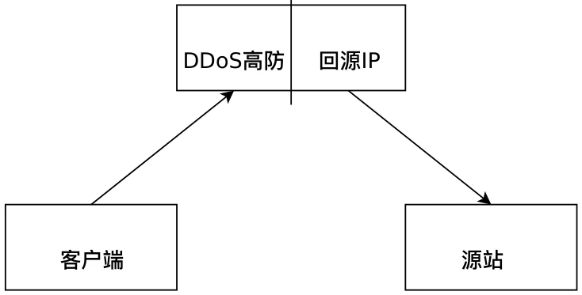

例如，最常见的502错误，即表示DDoS高防转发请求到源站，但源站却没有响应，因为回源IP可能被源站的防火墙拦截。

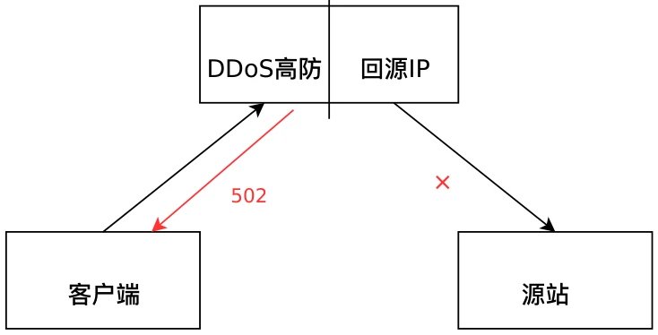

所以，在修改DNS解析接入网站业务前，请在源站服务器的安全软件中放行DDoS高防的回源IP地址。

**操作步骤**

1. 登录DDoS高防控制台。

2. 在左侧导航栏，选择**接入管理 > 域名接入**。

3. 在**域名接入**页面的右上方，单击**查看回源IP网段**，复制DDoS高防的回源IP网段。

4. 打开源站服务器上的安全软件，将回源IP网段添加到白名单。

<a id="section-3-4"></a>

## 3.4. 本地验证转发配置生效

成功添加DDoS高防网站或端口配置后，DDoS高防预期会把请求高防IP对应端口的报文转发到源站（真实服务器）的对应端口。为了保证业务的稳定，我们建议您在进行业务接入高防配置前先完成本地验证，确保转发配置已经生效。本文将指导您完成本地验证。

**前提条件**

- 已在DDoS高防控制台添加网站或端口配置。更多信息，请参见添加网站配置、配置端口转发规则。

- 已在源站服务器上设置放行DDoS高防回源IP。更多信息，请参见放行DDoS高防回源IP。

**背景信息**

对于需要通过域名访问的业务（例如客户端中使用的服务器地址是域名而不是IP），在为该类型业务接入DDoS高防时，您需要添加网站配置。添加网站配置后，您可以通过修改本地hosts文件或者使用高防CNAME地址访问服务器的方式验证转发配置生效。

有的四层业务（例如游戏业务）可能不需要域名，直接通过IP进行交互。在为该类型业务接入DDoS高防时，您需要添加端口转发规则。添加转发规则后，您可以通过使用高防IP访问服务器的方式验证转发配置生效。

> **重要**
>
> 如果转发配置未生效就执行业务切换，将可能导致业务中断。

**修改本地hosts文件**

1. 修改本地hosts文件，使本地对于被防护站点的请求经过高防。以Windows操作系统为例，操作步骤如下。

   <ol type="i">

   <li>

   定位到hosts文件。一般hosts文件存储在C:\\Windows\\System32\\drivers\\etc\\文件夹下。

   </li>

   <li>

   使用文本编辑器打开hosts文件。

   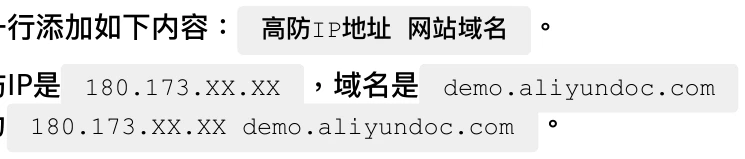

   </li>

   <li>

   在最后一行添加如下内容： 高防`IP`地址 网站域名 。

   例如高防IP是 `180.173.XX.XX` ，域名是 `demo.aliyundoc.com` ，则在hosts文件最后一行添加的内容为 `180.173.XX.XX demo.aliyundoc.com` 。

   </li>

   <li>

   保存修改后的hosts文件。

   </li>

   </ol>

2. 在本地计算机对被防护的域名运行Ping命令。

   预期解析到的IP地址是在hosts文件中绑定的高防IP地址。如果依然是源站地址，请尝试刷新本地的DNS缓存（在Windows的命令提示符中运行 `ipconfig/flushdns` 命令。）

3. 确认本地解析已经切换到高防IP以后，使用原来的域名进行测试，如果能正常访问则说明配置已经生效。

**使用高防CNAME地址访问服务器**

如果客户端支持填写服务器域名，您可以把原来的域名替换成DDoS高防服务分配的CNAME地址，测试访问是否正常。

> **说明**
>
> 成功添加网站配置后，DDoS高防为域名分配一个CNAME地址，用于业务接入配置。您可以在域名接入配置列表中查看域名对应的CNAME地址。

如果无法正常访问，请确认前提条件中的配置正确。如问题依然存在，请联系阿里云售后技术支持。

**使用高防IP访问服务器**

假设高防IP是99.99.XX.XX，配置了端口1234的转发，源站IP是11.11.XX.XX，对应服务端口也是1234。

添加端口配置后，您可以直接在本地通过telnet命令访问高防IP 99.99.XX.XX的1234端口，telnet命令能连通则说明转发成功。

如果本地客户端支持直接填写服务器IP，您也可以直接填入高防IP进行测试。

<a id="section-3-5"></a>

## 3.5. 业务接入DDoS高防

<a id="section-3-5-1"></a>

### 3.5.1. 使用CNAME或IP将网站域名解析到DDoS高防

在DDoS高防添加域名配置后，您需要将域名解析到高防CNAME地址或高防IP，才能使用户访问网站的流量切换到DDoS高防实例进行防护。本文以网站域名解析托管在阿里云云解析DNS（免费版）为例，介绍如何修改域名DNS解析。

**接入方式说明**

支持两种接入方式，推荐您使用CNAME方式接入，仅在CNAME解析不被支持或与别的记录存在冲突时，再选择A记录解析方式接入。

- **方式一：CNAME解析（推荐）**

  将网站域名的解析指向高防CNAME地址。只需完成一次解析修改，即使后续网站的关联高防IP发生变化，也无需重新修改解析，DDoS高防将通过CNAME自动完成调度。在网站关联多个高防IP时，DDoS高防自动在多IP间切换流量。

- **方式二：A记录解析**

  将网站域名的解析指向关联高防IP。当网站的关联高防IP发生变化时，您必须重新修改解析。在网站关联多个高防IP时，您必须手动在多IP间切换流量。

**注意事项**

DNS解析地址必须与域名接入配置中的CNAME地址或关联高防IP保持一致，业务才能转发成功。

**前提条件**

- 网站已接入DDoS高防。更多信息，请参见添加网站配置。

- 源站服务器已放行DDoS高防回源IP。如果您的源站服务器上部署了非阿里云安全软件（例如，第三方防火墙），请将DDoS高防的回源IP地址加入安全软件的白名单，避免DDoS高防的回源流量被源站服务器上的安全软件误拦截。更多信息，请参见放行DDoS高防回源IP。

- 已验证转发配置生效。强烈建议您在切换网站访问流量前，在本地验证DDoS高防实例的业务转发配置已经生效。更多信息，请参见本地验证转发配置生效。

  > **警告**
  >
  > 如果转发配置未生效就执行业务切换，将可能导致业务中断。

**操作步骤**

以域名DNS托管在阿里云云解析DNS阿里云云解析DNS阿里云云解析DNS为例介绍，当您使用其他DNS服务商的域名解析服务时仅供参考。

1. 登录阿里云云解析DNS控制台。

2. 在**域名解析**页面，定位到目标域名，单击**操作**列下的**解析设置**。

3. 在**解析设置**页面，定位到要修改的解析记录，单击**操作**列下的**修改**。

   > **说明**
   >
   > 如果要操作的解析记录不在记录列表中，您可以单击**添加记录**。

4. 在**修改记录**（或**添加记录**）页面，选择一种接入方式，修改解析记录。

   - （推荐）CNAME解析：选择**记录类型**为**CNAME**，并将**记录值**修改为域名对应的DDoS高防CNAME地址。

   - A记录解析：选择**记录类型**为**A**，并将**记录值**修改为域名的关联高防IP。

   > **说明**
   >
   > 您可以在DDoS高防控制台的**接入管理 > 域名接入**页面查询域名对应的DDoS高防CNAME地址以及关联高防IP。

5. 单击**确认**，等待修改后的解析设置生效。

6. 使用浏览器测试网站访问是否正常。

<a id="section-3-5-2"></a>

### 3.5.2. CNAME解析接入非网站业务

非网站（四层）业务接入DDoS高防时，您在端口配置中添加转发规则，并将业务地址设置为高防IP即可。但在某些场景下，您可能需要用域名来接入四层业务，并实现业务关联多高防IP且多高防IP间自动切换流量。这种情况下，推荐您通过添加域名并修改CNAME解析来接入非网站业务。

**背景信息**

假设您要为游戏业务接入DDoS高防，并希望用户通过解析游戏服务器的域名（demo.aliyundoc.com）来获取服务器IP（也就是DDoS高防IP），游戏的TCP端口为1234和5678，源站为1.1.XX.XX。

**操作步骤**

1. 在网站配置中添加网站，获取CNAME地址。

   <ol type="i">

   <li>

   登录DDoS高防控制台。

   </li>

   <li>

   在左侧导航栏，选择**接入管理 > 域名接入**。

   </li>

   <li>

   在**域名接入**页面，单击**添加网站**，填写网站信息后单击**添加**。

   要添加的配置描述如下：

   - **功能套餐**和**实例**：选择要关联的DDoS高防实例。本示例中假设关联增强功能下的两个实例。

   - **网站**：填写业务域名。本示例中是demo.aliyundoc.com。

   - **协议类型**和**服务器端口**：保持默认。

   - **服务器地址**：选择**源站IP**，并根据实际情况填写。

     - 如果业务域名下有真实的网站业务，则必须提供正确的协议类型和源站IP。

     - 否则，您可以随意填写源站IP，因为该网站配置不用于实际业务转发。实际业务转发通过在步骤2中添加的端口转发规则实现。

   更多信息，请参见添加网站配置。

   </li>

   </ol>

   成功添加网站后，DDoS高防为域名分配一个CNAME地址。

2. 在端口配置中添加转发规则。

   <ol type="i">

   <li>

   在左侧导航栏，选择**接入管理 > 端口接入**。

   </li>

   <li>

   在**端口接入**页面，选择要操作的DDoS高防IP，并单击**添加规则**。

   > **说明**
   >
   > 此处的DDoS高防IP即步骤1为域名关联的高防IP。本示例中有两个，选择其中任意一个。

   </li>

   <li>

   在**添加规则**对话框，根据您的实际业务情况完成规则配置，并单击**确定**。

   要添加的配置描述如下：

   - <strong>转发协议：</strong>本示例中选择TCP。

   - <strong>转发端口：</strong>本示例中填写1234。

   - <strong>源站端口：</strong>本示例中填写1234。

   - <strong>源站 IP：</strong>填写真实源站IP，本示例中是1.1.XX.XX。

   更多信息，请参见配置端口转发规则。

   </li>

   <li>

   重复上述两个步骤，在当前DDoS高防IP下再添加一个转发规则，将转发端口和源站端口设置为5678。

   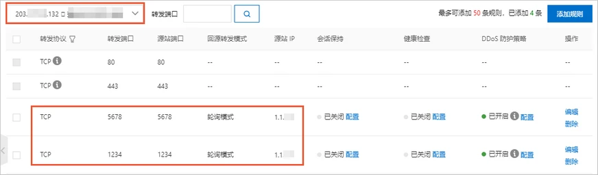

   </li>

   <li>

   参照上述三个步骤，为其他DDoS高防IP配置同样的转发规则。

   

   </li>

   </ol>

3. 前往域名（demo.aliyundoc.com）的DNS解析服务商，手动修改域名的DNS解析，启用CNAME解析并将解析指向步骤1中获得的CNAME地址。

   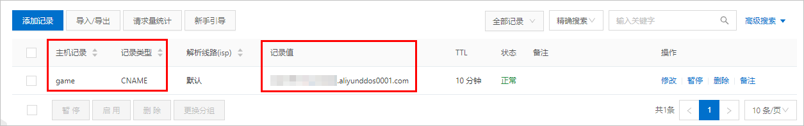

   更多信息，请参见使用CNAME或IP将网站域名解析到DDoS高防。

<a id="section-4"></a>

# 4.资产管理

<a id="section-4-1"></a>

## 4.1. 实例管理

本文介绍如何修改弹性防护带宽、设置弹性业务带宽、设置弹性QPS、升级及续费实例等实例管理操作。

**修改弹性防护带宽**

DDoS高防（中国内地）实例可以设置保底防护带宽、弹性防护带宽，且弹性防护带宽不低于保底防护带宽。

如果未设置弹性防护带宽，那么保底防护带宽即DDoS实例能够抵御的DDoS攻击的最大峰值带宽，如果设置了弹性防护带宽，那么弹性防护带宽即DDoS实例能够抵御的DDoS攻击的最大峰值带宽。

> **说明**
>
> 保底防护带宽只能通过升级DDoS高防（中国内地）实例进行调整，弹性防护带宽可以随时在DDoS高防（中国内地）控制台修改或者通过升级DDoS高防（中国内地）实例进行调整。

1. 登录DDoS高防控制台。

2. 在左侧导航栏，选择**资产管理 > 实例管理**。

3. 定位到要操作的实例，在**实例状态**列，单击<strong>防护带宽：</strong>后的  图标。

4. 在**修改弹性带宽**对话框，为该实例选择一个弹性防护带宽，并单击**确定**。

   实例的保底防护带宽不同，支持设置的最大弹性防护带宽也不同。如果可以设置的最大弹性防护带宽仍不能满足您的业务需求，请您升级实例的保底防护带宽。

**设置弹性业务带宽**

如果您的正常业务流量波动较大或有短期访问突增等特征，建议您为DDoS高防实例启用弹性业务带宽，避免实际业务流量峰值超出实例的业务带宽规格，产生丢包风险。

**注意事项**

- **各实例版本支持的业务带宽阈值**

  - DDoS高防（中国内地）：专业版（20 Gbps）、高级版（20 Gbps）

- **带宽增加量说明**

  开启弹性业务带宽后，带宽增加量默认为保底业务带宽的9倍，且两者总和不超过业务带宽阈值。

  例如：您购买了DDoS高防（中国内地）专业版实例，保底业务带宽选择3 Gbps，启用弹性业务带宽且计费模式为日95模式。由于业务带宽阈值为20 Gbps，所以带宽增加量为17 Gbps。

**操作步骤**

1. 登录DDoS高防控制台。

2. 在左侧导航栏，选择**资产管理 > 实例管理**。

3. 在目标实例的**实例规格**列，单击**弹性带宽增加**后的

   图标。

   

4. 在**弹性业务带宽**对话框设置配置项，并单击**确定**。

   <table>
     <tr>
       <th width="154">操作类型</th>
       <th>操作步骤</th>
     </tr>
     <tr>
       <td>启用弹性业务带宽</td>
       <td>打开<strong>启用弹性业务带宽</strong>开关，并设置<strong>计费模式</strong>及<strong>弹性带宽增加</strong>。</td>
     </tr>
     <tr>
       <td>修改弹性业务带宽</td>
       <td>• 修改<strong>计费模式</strong>修改完成后<strong>计费模式</strong>会显示您修改后的模式，并提示<strong>（已修改，次月即将生</strong><strong>效）</strong>，修改后的计费模式于次月的01日的00:00生效。每个自然月支持修改3次计费模式，次月生效模式为最后一次的修改结果。每个自然月的最后一天不允许切换计费模式。<br>• 修改<strong>弹性带宽增加</strong></td>
     </tr>
     <tr>
       <td>关闭弹性业务带宽</td>
       <td>关闭<strong>启用弹性业务带宽</strong>开关。弹性业务带宽每月仅支持关闭一次。</td>
     </tr>
   </table>

   > **重要**
   >
   > 发生以下情况时，弹性业务带宽功能会自动关闭：
   >
   > - 您的DDoS高防实例已过期（实例过期会导致DDoS高防服务不可用）。
   >
   > - 您的阿里云账号发生欠费（账号欠费会导致所有按量计费服务不可用）。
   >
   > 弹性业务带宽功能自动关闭后，您必须在完成实例续费或者补缴欠费后，手动重新启用弹性业务带宽，才可以继续使用该功能。

**设置弹性QPS**

如果您的正常业务QPS波动较为频繁或有短期访问突增等特征，建议您为DDoS高防实例启用弹性QPS，避免实际业务QPS超出规格，产生丢包风险。

开启弹性QPS后，弹性QPS为保底业务QPS的3倍，但弹性QPS不能超过如下取值。如果您的保底业务QPS已超过如下取值，则不支持开启弹性QPS。

- DDoS高防（中国内地）：IPv4高防IP的弹性QPS不超过300,000，IPv6高防IP的弹性QPS不超过100,000。

**QPS规格与连接数对应关系**

DDoS高防实例的QPS规格与连接数存在对应关系，具体如下表所示。如果您开启了弹性QPS，在查看连接数时，请查看弹性QPS所对应的连接数。

| QPS | 新建连接数 | 并发连接数 |
| --- | --- | --- |
| 0&lt;QPS≤5,000 | 5,000 | 100,000 |
| 5,000&lt;QPS≤10,000 | 10,000 | 200,000 |
| 10,000&lt;QPS≤30,000 | 30,000 | 500,000 |
| 30,000&lt;QPS≤50,000 | 50,000 | 1,000,000 |
| 50,000&lt;QPS≤100,000 | 80,000 | 1,500,000 |
| 100,000&lt;QPS≤150,000 | 100,000 | 2,000,000 |
| 150,000&lt;QPS≤200,000<br>说明仅DDoS高防（中国内地）支持。 | 150,000 | 3,000,000 |
| 200,000&lt;QPS≤300,000<br>说明仅DDoS高防（中国内地）支持。 | 200,000 | 4,000,000 |

1. 登录DDoS高防控制台。

2. 在左侧导航栏，选择**资产管理 > 实例管理**。

3. 在目标实例的**实例规格**列，单击**弹性QPS**后的

   图标。

   

4. 在**弹性QPS**对话框设置配置项，并单击**确定**。

   <table>
     <tr>
       <th width="123">操作类型</th>
       <th>操作步骤</th>
     </tr>
     <tr>
       <td>启用弹性QPS</td>
       <td>打开<strong>启用弹性QPS</strong>开关，并设置<strong>计费模式</strong>。<strong>弹性QPS规格</strong>不支持设置。</td>
     </tr>
     <tr>
       <td>修改弹性QPS</td>
       <td>仅支持修改<strong>计费模式。</strong>修改后会选中您修改后的计费模式，并提示<strong>（已修改，次月即将生效）</strong>，修改后的计费模式于次月的01日的00:00生效。每个自然月的最后一天不允许切换计费模式。</td>
     </tr>
     <tr>
       <td>关闭弹性QPS</td>
       <td>关闭<strong>启用弹性QPS</strong>开关。弹性QPS每月仅支持关闭一次。</td>
     </tr>
   </table>

   > **重要**
   >
   > 发生以下情况时，弹性QPS功能会自动关闭：
   >
   > - 您的DDoS高防实例已过期（实例过期会导致DDoS高防服务不可用）。
   >
   > - 您的阿里云账号发生欠费（账号欠费会导致所有按量计费服务不可用）。
   >
   > 弹性QPS功能自动关闭后，您必须在完成实例续费或者补缴欠费后，手动重新启用弹性QPS，才可以继续使用该功能。

**升级实例**

升级实例表示提升当前DDoS高防实例的规格配置，您需要补齐实例在剩余有效期内对应的规格差价。

> **重要**
>
> DDoS高防实例仅支持升级，不支持降配（即降低当前DDoS高防实例的规格配置），也不支持升级后的实例降配到原先配置。

**操作步骤**

1. 登录DDoS高防控制台。

2. 在左侧导航栏，选择**资产管理 > 实例管理**。

3. 定位到要升级的DDoS高防实例，单击**操作**列的**升级**。

4. 在**升级**页面根据需要提升当前实例的配置，仔细阅读**服务协议**后，单击**立即购买**完成支付。

**续费实例**

在DDoS高防实例被释放前，您可以通过手动续费，延长实例的有效期。同时为了避免因忘记及时续费导致影响业务，您也可以在实例到期前开启自动续费，由阿里云在实例即将到期时自动为实例续费。

在DDoS高防实例被释放前，您可以为实例手动续费，并继续使用实例的原有配置。如果DDoS高防实例已经被释放，则不支持手动续费。

关于手动续费时间的建议如下：

DDoS高防（中国内地）实例：建议您在实例到期前，最晚不超过实例到期后的7个自然日内，为DDoS高防（中国内地）实例续费，避免影响业务流量转发。

1. 登录DDoS高防控制台。

2. 在左侧导航栏，选择**资产管理 > 实例管理**。

3. 定位到要续费的DDoS高防实例，单击**操作**列的**续费**。

4. 在**续费**页面，设置**购买时长**（表示续费时长）、仔细阅读并选中**服务协议**后，单击**立即购买**完成支付。

**管理实例标签**

实例标签由一对键值对（Key-Value）组成，通过设置标签可以对实例快速分类和检索。

1. 登录DDoS高防控制台。

2. 在左侧导航栏，选择**资产管理 > 实例管理**。

3. 在**实例管理**页面，您可以执行如下操作。

   <table>
     <tr>
       <th width="154">可执行的操作</th>
       <th>操作步骤</th>
     </tr>
     <tr>
       <td>为实例设置标签</td>
       <td>i. 在<strong>实例管理</strong>页面，定位到目标实例，单击<strong>标签</strong>列的图标。<br>ii. 在<strong>编辑标签</strong>对话框，为实例设置标签后单击<strong>确定</strong>。支持以下设置方式：<br>• <strong>选择已有标签</strong>：从已有标签列表中选择要使用的标签键和标签值。<br>• <strong>新增标签</strong>：设置新的<strong>标签键</strong>和<strong>标签值</strong>，并单击<strong>确定</strong>。<br>说明一个实例最多可以绑定20个标签，一个实例上的每个标签的标签键必须唯一，相同标签键的标签值会被覆盖。</td>
     </tr>
     <tr>
       <td>通过标签搜索实例</td>
       <td>在<strong>实例管理</strong>页面，在标签筛选框中选择标签键和标签值。</td>
     </tr>
     <tr>
       <td>删除标签</td>
       <td>您只能单独对某一个实例进行标签删除操作，不支持批量删除多个实例的标签。<br>i. 在<strong>实例管理</strong>页面，定位到目标实例，单击<strong>标签</strong>列的图标。<br>ii. 在<strong>编辑标签</strong>对话框，单击要移除的标签的图标，并单击<strong>确定</strong>。<br>说明当一个标签从一个实例上移除后，如果该标签键没有和其他实例绑定，系统将自动删除该标签。</td>
     </tr>
   </table>

<a id="section-5"></a>

# 5.调查分析

<a id="section-5-1"></a>

## 5.1. 攻击分析

业务接入DDoS高防实例进行防护后，您可以查询DDoS高防实例上发生的攻击事件记录和详情，帮助您了解攻击来源IP、攻击类型分布、攻击来源地区分布等信息，实现攻击防护流程的透明化，提升防护分析体验，还可以针对性地进行防护配置。本文介绍如何查询攻击事件。

**攻击事件类型**

<table>
  <tr>
    <th width="167">攻击事件类型</th>
    <th>说明</th>
  </tr>
  <tr>
    <td>HTTP 攻击</td>
    <td>攻击方以业务域名为攻击目标，通过模拟正常用户请求，频繁访问Web服务中资源消耗较大的页面，大量消耗服务器资源，导致服务器资源耗尽，无法响应正常业务请求。如果多个业务域名在同一时间遭受攻击，则产生多个Web资源耗尽型攻击事件。</td>
  </tr>
  <tr>
    <td>高级TCP/UDP攻击</td>
    <td>攻击方以业务端口为攻击目标，通过非法占用服务器的TCP、UDP连接通道，大量消耗服务器连接数资源，使服务器无法处理新的连接请求，导致正常业务无法运行。如果一个DDoS高防IP下的多个业务端口在同一时间遭受攻击，则产生多个连接型攻击事件。</td>
  </tr>
  <tr>
    <td>流量型攻击</td>
    <td>攻击方以DDoS高防IP为攻击目标，通常利用大量傀儡机同时发起大量业务请求，通过大流量压垮网络设备和服务器，导致带宽拥塞，服务无法响应。如果多个DDoS高防IP在同一时间遭受攻击，则产生多个流量型攻击事件。<br>说明为避免事件太多对您的业务造成干扰，所以高防默认策略为入流量大于1Gbps，且产生100Mbps的丢弃流量时才会生成攻击事件。入流量小于默认策略，则不产生事件。但考虑到您可能业务流量较小，所以提供自定义配置告警阈值，您可在<strong>安全</strong><strong>总览</strong>页面单击<strong>设置告警阈值</strong>区域自行配置。通过配置告警阈值可以解决您在控制台上看到有清洗流量但没有攻击事件的问题。</td>
  </tr>
</table>

**前提条件**

已将网站业务或非网站业务接入DDoS高防。具体操作，请参见添加网站配置或配置端口转发规则。

**查询攻击事件记录**

1. 登录DDoS高防控制台。

2. 在左侧导航栏，选择**调查分析 > 攻击分析**。

3. 在**攻击分析**页面，选择要查询的攻击事件类型及事件范围，查询相关的攻击记录。

   > **说明**
   >
   > 最多允许查询最近180天内的攻击事件。

4. （可选）单击**操作**列的**查看详情**，查看攻击事件详情。

   您可以在**事件详情**页面的右上角，单击**导出报表**并选择**导出图片**、**导出pdf**，将当前事件详情页面另存为本地文件（PNG格式、PDF格式）。

如果您对某个攻击事件的防护效果有任何建议或疑问，可以通过单击事件**操作**列下的**效果反馈**向我们反馈，我们会根据您的宝贵意见持续优化和改进防护效果。

**攻击事件详情介绍**

**Web资源耗尽型**

您可以查看事件详情并对域名进行针对性的防护配置。

<table>
  <tr>
    <th width="168">支持查看的事件内容</th>
    <th>说明</th>
  </tr>
  <tr>
    <td>攻击事件基本信息</td>
    <td>• <strong>攻击时间</strong>：遭受攻击的时间。<br>• <strong>攻击目标</strong>：遭受攻击的域名。单击<strong>攻击目标</strong>后的<strong>防护设置</strong>，前往<strong>网站业务DDoS防护</strong>页签，为被攻击域名配置防护策略。具体操作，请参见网站业务DDoS防护。<br>• <strong>请求数峰值</strong>：遭受攻击期间，请求数的峰值。<br>• <strong>总接收请求数</strong>：统计遭受攻击前后一段时间内，总的请求数。统计时间范围遵循如下逻辑：<br>• <strong>开始时间</strong>：请取DDoS攻击实际开始时间，最邻近的上一个整点或半点时刻，并从该时刻起向前再推算半小时。例如，如果攻击开始于11:20，最近的整点或半点时间是11:00，再向前推半小时即为10:30。如果攻击开始于11:40，最近的整点或半点时间是11:30，再向前推半小时即为11:00。<br>• <strong>结束时间</strong>：请取DDoS攻击实际结束时间，最邻近的下一个整点或半点时刻，并从该时刻起向后再推算半小时。例如，如果攻击结束于12:20，最近的整点或半点时间是12:30，再向后推半小时即为13:00。如果攻击结束于12:40，最近的整点或半点时间是13:00，再向后推半小时即为13:30。<br>• <strong>总拦截请求数</strong>：本次攻击事件，DDoS高防拦截的请求数。</td>
  </tr>
  <tr>
    <td>攻击防护详情</td>
    <td>入方向总QPS和触发不同模块下防护策略的QPS的变化趋势图，以及触发的防护策略的<strong>策略生效时间</strong>和<strong>拦截次数</strong>信息。您也可以在该区域的右上角，设置要查询的时间范围。网站业务防护模块包括<strong>黑名单</strong>、<strong>区域封禁</strong>、<strong>频率控制</strong>、<strong>精准访问控制</strong>、<strong>其他</strong>（例如人机校验失败等）。关于不同防护模块的配置方法，请参见网站业务DDoS防护。</td>
  </tr>
  <tr>
    <td>防护模块过滤分布</td>
    <td>展示了不同防护模块拦截的攻击请求的数量分布。您可以单击区域下方的<strong>防护设置</strong>，为不同防护模块配置防护策略。关于不同防护模块的配置方法，请参见网站业务DDoS防护。</td>
  </tr>
  <tr>
    <td>Top10攻防策略</td>
    <td>展示了被命中次数最多的10条防护策略及其占比。单击<strong>更多</strong>可以查看Top 100攻防策略及不同策略的占比。您可以单击区域下方的<strong>防护设置</strong>，为不同防护模块配置防护策略。关于不同防护模块的配置方法，请参见网站业务DDoS防护。</td>
  </tr>
  <tr>
    <td>来源地区</td>
    <td>展示了攻击请求的来源地区分布，支持查看<strong>全球</strong>分布（国家维度）、<strong>中国内地</strong>分布（省市区维度）。单击<strong>更多</strong>可以查看不同来源地区的请求占比数据。如果您需要封禁某个攻击来源地区的流量，可以单击区域下方的<strong>防护设置</strong>，为被攻击域名配置<strong>区域封禁</strong>。具体操作，请参见网站业务DDoS防护。</td>
  </tr>
  <tr>
    <td>URL</td>
    <td>展示了被请求次数最多的5条URL。按照被请求次数由高到低排序。单击<strong>更多</strong>查看所有被请求的URL（即URI和所属域名）及不同URL的占比。如果您需要针对具体URI配置访问限速策略，可以单击区域下方的<strong>防护设置</strong>，为被攻击域名配置<strong>频率控制</strong>。具体操作，请参见设置CC安全防护。</td>
  </tr>
  <tr>
    <td>URI响应时间</td>
    <td>展示了URI响应时间最长的5个URI。URI响应时间是指从客户端发出请求获取特定URI代表的资源，到接收完服务端响应并处理完毕的总时间。您可以基于该数据设置CC安全防护策略。具体操作，请参见设置CC安全防护。</td>
  </tr>
  <tr>
    <td>攻击源IP</td>
    <td>展示了发起异常连接次数最多的10个IP及IP所属地区。单击<strong>更多</strong>可以查看Top 100来源IP的信息。<br>说明攻击来源IP全部为攻击IP，不包含正常请求IP。<br>如果您需要封禁某个IP的流量，可以单击区域下方的<strong>防护设置</strong>，为被攻击域名配置<strong>黑／</strong><strong>白名单</strong>。具体操作，请参见设置黑白名单（针对域名）。</td>
  </tr>
  <tr>
    <td>User-Agent</td>
    <td>展示了请求数最多的5条User-Agent。User-Agent即发起访问请求的客户端的浏览器标识、渲染引擎标识和版本信息等浏览器相关信息。您可以基于该数据设置CC安全防护策略。具体操作，请参见设置CC安全防护。</td>
  </tr>
  <tr>
    <td>Referer</td>
    <td>展示了访问请求中最多的5条Referer信息。Referer即访问请求的来源网址。您可以基于该数据设置CC安全防护策略。具体操作，请参见设置CC安全防护。</td>
  </tr>
  <tr>
    <td>HTTP-Method</td>
    <td>展示了访问请求中最多的5条访问请求方法信息。您可以基于该数据设置CC安全防护策略。具体操作，请参见设置CC安全防护。</td>
  </tr>
  <tr>
    <td>客户端TLS指纹</td>
    <td>展示了访问请求中最多的5条客户端指纹信息。客户端指纹即基于发起访问请求的客户端TLS指纹，通过阿里云自研算法识别和计算得出的客户端指纹值，用于访问请求的匹配和防护。您可以基于该数据设置CC安全防护策略。具体操作，请参见设置CC安全防护。</td>
  </tr>
  <tr>
    <td>HTTP2.0指纹</td>
    <td>展示了访问请求中最多的5条HTTP2.0指纹。用于HTTP2访问请求的匹配和防护。您可以基于该数据设置CC安全防护策略。具体操作，请参见设置CC安全防护。</td>
  </tr>
  <tr>
    <td>JA3指纹</td>
    <td>展示了访问请求中最多的5条JA3指纹。用于识别和区分不同类型的TLS客户端，例如Web浏览器、移动应用程序、恶意软件等。您可以基于该数据设置CC安全防护策略。具体操作，请参见设置CC安全防护。</td>
  </tr>
  <tr>
    <td>JA4指纹</td>
    <td>展示了访问请求中最多的5条JA4指纹。JA4指纹通过引入更多的上下文信息和算法，例如浏览器的版本、操作系统等，减少了JA3指纹可能导致的重复性问题，能够更准确地鉴别出真实的用户与伪装者，降低误识率。您可以基于该数据设置CC安全防护策略。具体操作，请参见设置CC安全防护。</td>
  </tr>
</table>

**连接型**

您可以查看事件详情并对DDoS高防实例进行针对性的防护配置。

<table>
  <tr>
    <th width="168">支持查看的事件内容</th>
    <th>说明</th>
  </tr>
  <tr>
    <td>攻击时间</td>
    <td>被攻击的时间。</td>
  </tr>
  <tr>
    <td>攻击目标</td>
    <td>被攻击的DDoS高防实例的IP及端口。单击<strong>攻击目标</strong>后的<strong>防护设置</strong>，前往<strong>基础设施DDoS防护</strong>页签，为被攻击实例配置防护策略。具体操作，请参见基础设施DDoS防护。</td>
  </tr>
  <tr>
    <td>攻击防护详情</td>
    <td>展示了攻击期间，<strong>新建连接数</strong>和<strong>并发连接数</strong>的变化趋势图。您可以在该区域的右上角，设置要查询的时间范围。新建连接数趋势图包含不同防护策略拦截的异常连接数据，例如，<strong>黑名单</strong>、<strong>区域封</strong><strong>禁</strong>、<strong>源限速</strong>（具体分为<strong>源新建连接限速</strong>、<strong>源并发连接限速</strong>、<strong>源PPS限速</strong>、<strong>源带宽限</strong><strong>速</strong>）。关于以上防护策略的配置方法，请参见设置黑白名单（针对高防实例IP）、设置区域封禁、设置DDoS防护策略。并发连接数趋势图包含<strong>活跃</strong>连接数和<strong>非活跃</strong>连接数的数据。</td>
  </tr>
  <tr>
    <td>攻击来源IP</td>
    <td>展示了发起异常连接次数最多的5个IP及IP所属地区。单击<strong>更多</strong>可以查看Top 100攻击来源IP的信息。<br>说明攻击来源IP全部为攻击IP，不包含正常请求IP。<br>如果您需要封禁某个IP的流量，可以为被攻击实例配置<strong>黑 / 白名单（针对高防实例</strong><strong>IP）</strong>。具体操作，请参见设置黑白名单（针对高防实例IP）。</td>
  </tr>
  <tr>
    <td>攻击类型</td>
    <td>展示了攻击流量的协议类型分布。单击<strong>更多</strong>可以查看不同攻击类型的请求占比数据。</td>
  </tr>
  <tr>
    <td>攻击来源地区</td>
    <td>展示了攻击请求的来源地区分布。单击<strong>更多</strong>可以查看不同来源地区的请求占比数据。如果您需要封禁某个攻击来源地区的流量，可以为被攻击实例配置<strong>区域封禁</strong>。具体操作，请参见设置区域封禁。</td>
  </tr>
</table>

**流量型**

您可以查看事件详情并对DDoS高防实例进行针对性的防护配置。

<table>
  <tr>
    <th width="168">支持查看的事件内容</th>
    <th>说明</th>
  </tr>
  <tr>
    <td>攻击时间</td>
    <td>被攻击的时间。</td>
  </tr>
  <tr>
    <td>攻击目标</td>
    <td>被攻击的DDoS高防实例的IP。单击<strong>攻击目标</strong>后的<strong>防护设置</strong>，前往<strong>基础设施DDoS防护</strong>页签，为被攻击实例配置防护策略。相关操作，请参见基础设施DDoS防护。</td>
  </tr>
  <tr>
    <td>攻击防护详情</td>
    <td>bps：攻击期间，入方向、出方向流量和清洗流量的带宽的变化趋势图。pps：攻击期间，入方向、出方向流量和清洗流量的报文的变化趋势图。<br>说明当<strong>入流量 &gt; =1Gbps</strong>且<strong>清洗流量 &gt; 100Mbps</strong>时，产生告警事件。</td>
  </tr>
  <tr>
    <td>来源IP</td>
    <td>展示了发起请求次数最多的10个IP及IP所属地区。单击<strong>更多</strong>可以查看Top 100来源IP的信息。<br>说明来源IP仅包含攻击IP。<br>如果您需要封禁某个IP的流量，可以单击列表下的<strong>黑名单设置</strong>，设置<strong>黑 / 白名单（针对</strong><strong>高防实例IP）</strong>。具体操作，请参见设置黑白名单（针对高防实例IP）。</td>
  </tr>
  <tr>
    <td>攻击来源运营商</td>
    <td>展示了攻击流量的来源运营商分布。单击<strong>更多</strong>可以查看不同运营商的请求占比数据。<br>说明<br>• 流量仅包含攻击流量。</td>
  </tr>
  <tr>
    <td>攻击来源地区</td>
    <td>展示了攻击流量的来源地区分布。单击<strong>更多</strong>可以查看不同来源地区的请求占比数据。如果您需要封禁某个攻击来源地区的流量，可以单击区域下方的<strong>区域封禁设置</strong>，为被攻击实例配置<strong>区域封禁</strong>。具体操作，请参见设置区域封禁。<br>说明流量仅包含攻击流量。</td>
  </tr>
  <tr>
    <td>攻击类型</td>
    <td>展示了入方向流量的协议类型分布。单击<strong>更多</strong>可以查看不同类型的请求占比数据。<br>说明入方向流量包含攻击流量和正常业务流量。</td>
  </tr>
  <tr>
    <td>目的端口</td>
    <td>展示了入方向流量各目的端口的占比。单击<strong>更多</strong>查看各端口的占比数据。<br>说明入方向流量包含攻击流量和正常业务流量。</td>
  </tr>
</table>

<a id="section-5-2"></a>

## 5.2. 系统日志

本文介绍如何查询DDoS高防实例90天内的弹性业务带宽账单、弹性QPS账单、规格超限告警以及目的限速事件。

**查看弹性业务带宽账单**

**出账及结算时间**

| 计费模式 | 出账时间 | 结算时间 |
| --- | --- | --- |
| 日95模式 | 次日14:00，DDoS高防会通过<strong>系统日志</strong>页面，为您推送上个自然日的弹性业务带宽账单，并通过短信、邮件和站内信邮件的方式，向您的阿里云账号联系人发送推账通知。 | 次日17:00，阿里云会从您的账号余额中扣除相应费用以结算账单。 |
| 月95模式 | 次月01日的10:00，DDoS高防会通过<strong>系统日志</strong>页面，为您推送上个自然月的弹性业务带宽账单，并通过短信、邮件和站内信邮件的方式，向您的阿里云账号联系人发送推账通知。 | 次月03日的10:00，阿里云会从您的账号余额中扣除相应费用以结算账单。 |

**操作步骤**

1. 登录DDoS高防控制台。

2. 在左侧导航栏，选择**调查分析 > 系统日志**。

3. 在**系统日志**页面，选择**月95弹性业务带宽**或**日95弹性业务带宽**，设置要查询的IP、查询时间范围后，

   单击  查看对应的弹性业务带宽账单。

   **说明**列和**状态**列的详细信息如下：

   - **说明**

     <table>
       <tr>
         <th width="95">计费模式</th>
         <th>说明列各个取值含义</th>
       </tr>
       <tr>
         <td>月95模式</td>
         <td>• <strong>流量峰值</strong>：当月的业务流量峰值。<br>• <strong>超出业务带宽</strong>：业务流量峰值-自然月内开启弹性业务带宽的最后一天对应的<strong>业务</strong><strong>带宽</strong>规格。<br>• <strong>弹性业务带宽计量</strong>：弹性业务带宽用量，为月95带宽计量值-自然月内开启弹性业务带宽的最后一天对应的<strong>业务带宽</strong>规格。</td>
       </tr>
       <tr>
         <td>日95模式</td>
         <td>• <strong>流量峰值</strong>：自然日的日95带宽峰值。<br>• <strong>超出业务带宽</strong>：自然日的日95带宽峰值-当日生效的<strong>业务带宽</strong>规格。<br>• <strong>弹性业务带宽计量</strong>：弹性业务带宽用量，为自然日的日95带宽计量值-当日生效的<strong>业务带宽</strong>规格。</td>
       </tr>
     </table>

   - **状态**

     <table>
       <tr>
         <th width="89">状态</th>
         <th>说明</th>
       </tr>
       <tr>
         <td>待出帐</td>
         <td>表示只是统计了弹性业务带宽的相关使用情况，未正式出账。您可以单击<strong>详</strong><strong>情</strong>列的<strong>查看</strong>，通过<strong>详情</strong>对话框查询实际业务流量详情。<br>说明如果您对实际带宽用量有疑问，请联系技术支持人员。如果经核实，账单出具的用量与您的实际用量有出入，DDoS高防会<strong>终止出账</strong>（即结束该账单，不产生实际费用）。</td>
       </tr>
       <tr>
         <td>已出账</td>
         <td>表示该账单已按照弹性业务带宽用量正式出账。阿里云将从您的账号余额中扣除实际出账的费用。请保证您的阿里云账号余额充足，避免因账号欠费导致按量计费服务无法使用。</td>
       </tr>
       <tr>
         <td>终止出账</td>
         <td>表示该账单已结束出账，不产生费用。</td>
       </tr>
     </table>

**查看弹性QPS账单**

**出账及结算时间**

| 计费模式 | 出账时间 | 结算时间 |
| --- | --- | --- |
| 日95模式 | 次日10:00，DDoS高防会通过<strong>系统日志</strong>页面，为您推送上个自然日的弹性QPS账单，并通过短信、邮件和站内信邮件的方式，向您的阿里云账号联系人发送推账通知。 | 次日16:00，阿里云会从您的账号余额中扣除相应费用以结算账单。 |
| 月95模式 | 次月01日的11:00，DDoS高防会通过<strong>系统日志</strong>页面，为您推送上个自然月的弹性QPS账单，并通过短信、邮件和站内信邮件的方式，向您的阿里云账号联系人发送推账通知。 | 次月03日的11:00，阿里云会从您的账号余额中扣除相应费用以结算账单。 |

**操作步骤**

1. 登录DDoS高防控制台。

2. 在左侧导航栏，选择**调查分析 > 系统日志**。

3. 在**系统日志**页面，选择**月95弹性QPS**或**日95弹性QPS**，设置要查询的IP、查询时间范围后，查看对应的弹性QPS账单。

   说明列和状态列的详细信息如下：

   - **说明**

     <table>
       <tr>
         <th width="95">计费模式</th>
         <th>说明列各个取值含义</th>
       </tr>
       <tr>
         <td>日95模式</td>
         <td>• <strong>QPS运行峰值</strong>：自然日的日95QPS峰值。<br>• <strong>超出实例QPS规格</strong>：自然日的日95QPS峰值-当日生效的<strong>业务QPS</strong>规格。<br>• <strong>弹性QPS计量</strong>：弹性QPS用量，为自然日的日95QPS计量值-当日生效的<strong>业务</strong><strong>QPS</strong>规格。</td>
       </tr>
       <tr>
         <td>月95模式</td>
         <td>• <strong>QPS运行峰值</strong>：当月的QPS实际运行峰值。<br>• <strong>超出实例QPS规格</strong>：QPS运行峰值-自然月内开启弹性QPS的最后一天对应的<strong>业务</strong><strong>QPS</strong>规格。<br>• <strong>弹性QPS计量</strong>：弹性QPS用量，为月95QPS计量值-自然月内开启弹性QPS的最后一天对应的<strong>业务QPS</strong>规格。</td>
       </tr>
     </table>

   - **状态**

     <table>
       <tr>
         <th width="89">状态</th>
         <th>说明</th>
       </tr>
       <tr>
         <td>待出帐</td>
         <td>表示只是统计了弹性QPS的相关使用情况，未正式出账。您可以单击<strong>详情</strong>列的<strong>查看</strong>，通过<strong>详情</strong>对话框查询实际业务QPS详情。<br>说明如果您对实际业务QPS用量有疑问，请联系技术支持人员。如果经核实，账单出具的用量与您的实际用量有出入，DDoS<strong>终止出账</strong>（即结束该账单，不产生费用）。</td>
       </tr>
       <tr>
         <td>已出账</td>
         <td>表示该账单已按照弹性QPS用量正式出账。阿里云将从您的账号余额中扣除实际出账的费用。请保证您的阿里云账号余额充足，避免因账号欠费导致按量计费服务无法使用。</td>
       </tr>
       <tr>
         <td>终止出账</td>
         <td>表示该账单已结束出账，且不产生费用。</td>
       </tr>
     </table>

**查看规格超限告警**

1. 登录DDoS高防控制台。

2. 在左侧导航栏，选择**调查分析 > 系统日志**。

3. 在**系统日志**页面选择**规格超限告警**，设置要查询的IP、查询时间范围后，查看对应的规格超限告警。

   **说明**列和**详情**列的具体信息如下：

   - **说明**产生规格超限告警的高防IP及事件类型。规格超限告警的事件类型包含业务带宽、新建连接数和并发连接数。当事件类型对应规格超过购买的规格时会产生告警。

   - **详情**

     单击目标告警**详情**列的**查看**，查看告警的详细信息。

     以并发连接数超用告警为例，通过图示您可以看到活跃连接数已经超过并发连接数规格，因此产生了告警。

     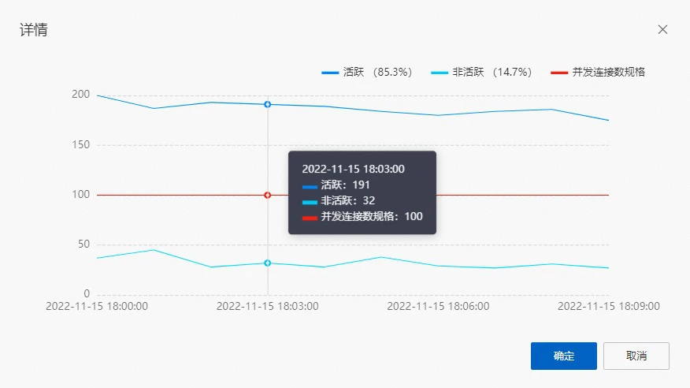

**查看目的限速事件**

当业务的新建连接数、并发连接数或业务带宽等远超实例规格时，会触发对应的限速策略，对业务产生影响，产生目的限速事件。

- 如果是正常业务触发的限速，请尽快扩容升级。

- 如果是遭受了DDoS攻击触发的限速，请及时调整防护策略。

  1. 登录DDoS高防控制台。

  2. 在左侧导航栏，选择**调查分析 > 系统日志**。

  3. 在**系统日志**页面选择**目的限速事件**，设置要查询的IP、查询时间范围后，查看对应的信息。

     您可以单击目的限速事件**详情**列的**查看**，查看目的限速事件的具体信息。

<a id="section-5-3"></a>

## 5.3. 操作日志

本文介绍如何查看DDoS高防实例180天内的重要操作记录。

**支持查看的操作记录**

操作日志只记录重要操作，并非用户的所有操作行为，具体分类及包含的记录请参见下表。

<table>
  <tr>
    <th width="122">分类</th>
    <th>包含的记录</th>
  </tr>
  <tr>
    <td>IP</td>
    <td>• 实例购买和释放<br>• 黑洞解封<br>• 流量封禁和解封<br>• 四层流量清洗模式变更<br>• CC防护模式变更<br>• 弹性防护带宽变更</td>
  </tr>
  <tr>
    <td>抗D包</td>
    <td>抗D包抵扣</td>
  </tr>
  <tr>
    <td>ECS</td>
    <td>释放ECS实例IP</td>
  </tr>
  <tr>
    <td>弹性业务带宽</td>
    <td>• 启用或关闭弹性业务带宽<br>• 修改计费模式<br>• 修改弹性业务带宽取值</td>
  </tr>
  <tr>
    <td>弹性QPS</td>
    <td>• 启用或关闭弹性QPS<br>• 修改计费模式</td>
  </tr>
  <tr>
    <td>抓包分析</td>
    <td>• 创建抓包任务<br>• 删除抓包任务<br>• 删除抓包文件<br>• 到期自动删除抓包文件</td>
  </tr>
</table>

**操作步骤**

1. 登录DDoS高防控制台。

2. 在左侧导航栏，选择**调查分析 > 操作日志**。

3. 在**操作日志**页面，选择要查看的分类和时间范围，单击  查看对应操作记录。

<a id="section-5-4"></a>

## 5.4. 抓包分析

DDoS高防可以通过流量抓包获取报文及会话明细，满足攻击分析和问题排查场景的需求。您可以创建手动抓包任务立即抓包，抓包后会生成pcap文件，通过分析抓包文件针对性的设置防护策略。本文介绍如何创建抓包任务。

**抓包范围**

抓包的范围为客户端IP和高防IP之间的流量，不包含高防IP和源站之间的流量。但需要注意的是，如果客户端IP是阿里云上的资源，抓包时不会统计这部分流量。

DDoS高防（中国内地）：实例均支持抓包，抓包区域为中国内地各清洗节点。

> **说明**
>
> 对于深圳电信，抓包数据为经过清洗后的数据，不包含清洗前的数据。

**注意事项**

- **采样比**：采样比默认为1:1，流量越小采样准确率越高，如果在超大流量的情况下会自动转化为采样抓包，流量越大采样比越大。

- **包大小限制**：中国内地地域，每个抓包任务的数据包大小不超过300 MB。

- **抓包次数限制**：每个阿里云账号每自然月，限制抓包任务次数50次。

- **抓包文件限制**：每个阿里云账号，当前只能有20个抓包文件，超限后请先删除旧的抓包文件。

- **抓包文件保留时长**：最长保留30天，30天后自动删除。

- **高防实例过期场景**：抓包任务标识为**失效**状态，已释放的实例不支持抓包。

- **跨境抓包场景**：客户端在非中国内地，访问中国内地高防IP，或者客户端在中国内地，访问非中国内地的高防IP的场景下，抓包可能会失败。

**创建抓包任务**

1. 开通抓包分析。

   首次访问**抓包分析**页面时，请单击**确认授权**，授权将抓包文件存储在OSS共享资源池中。

   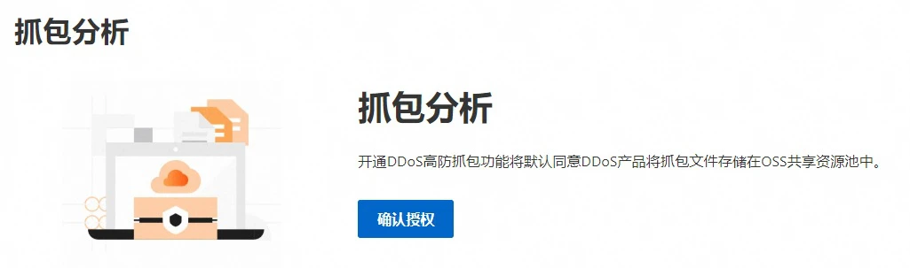

2. 创建抓包任务。

   <ol type="i">

   <li>

   在**抓包任务**页签，单击**创建抓包**。

   > **说明**
   >
   > 手动抓包任务同一时间只能进行一个。

   <table>
     <tr>
       <th width="89">配置项</th>
       <th>说明</th>
     </tr>
     <tr>
       <td>任务类型</td>
       <td>手动抓包：抓包任务创建后，启动抓包。</td>
     </tr>
     <tr>
       <td>协议类型</td>
       <td>取值为TCP、UDP、ICMP、ALL。默认为ALL。</td>
     </tr>
     <tr>
       <td>目的IP</td>
       <td>高防实例的IP。安全加速线路不支持抓包，因此不支持选择对应的实例IP。</td>
     </tr>
     <tr>
       <td>目的端口</td>
       <td>取值：0~65535，设置为0表示所有端口。</td>
     </tr>
     <tr>
       <td>源IP</td>
       <td>支持IP地址和IP掩码，*表示所有IP。</td>
     </tr>
     <tr>
       <td>源端口</td>
       <td>取值：0~65535，设置为0表示所有端口。</td>
     </tr>
     <tr>
       <td>抓包时长</td>
       <td>取值：5~60，单位为秒。</td>
     </tr>
     <tr>
       <td>抓包方向</td>
       <td>• 双向：客户端IP和高防IP之间的所有请求。<br>• 内到外：高防IP发给客户端IP的请求。<br>• 外到内：客户端IP发给高防IP的请求。</td>
     </tr>
   </table>

   </li>

   </ol>

3. 在抓包任务列表，单击**操作**列的**抓包文件**，您可以下载或删除该文件。

4. （可选）单击**再次下发**，创建一个新的抓包任务。

**相关文档**

- 查看抓包任务的操作日志。具体操作，请参见操作日志。

- 分析抓包文件，针对性的设置防护策略，提升防护效果。详细内容，请参见防护设置。

<a id="section-6"></a>

# 6.防护设置

<a id="section-6-1"></a>

## 6.1. 通用防护策略

<a id="section-6-1-1"></a>

### 6.1.1. 基础设施DDoS防护

<a id="section-6-1-1-1"></a>

#### 6.1.1.1. 设置全局防护策略

业务接入DDoS高防实例后，实例会默认绑定全局防护策略，策略可以在攻击发生的瞬间有效减少攻击透过所带来的危害。本文介绍全局防护策略的防护等级，以及如何调整防护等级。

**什么是全局防护策略**

全局防护策略是DDoS防护引擎在日常海量攻防事件中沉淀的通用防护策略，可以缓解已知特征的流量型攻击，在攻击发生时即刻生效，减少已知特征攻击发生瞬间出现的攻击透过的危害。

全局防护策略是在一个高防实例上应用的统一防护规则，这些规则对实例上所有绑定的业务资源生效。无论是多个网站、应用服务还是跨地区的业务节点，只要它们通过同一个高防实例进行保护，都会受到全局防护策略的保护。

> **说明**
>
> 全局防护策略仅在DDoS高防实例IP处于被攻击状态时生效。

**防护等级介绍**

默认防护策略包括正常、宽松、严格三个防护等级，购买DDoS高防实例后，全局防护策略的防护等级默认为**正常**。如果默认防护策略不满足您的要求，请联系您的商务经理定制防护策略。

| 防护等级 | 防护操作 | 说明 |
| --- | --- | --- |
| 宽松 | • 过滤不符合协议规范的畸形报文<br>• 过滤明确攻击特征的TCP/UDP/ICMP报文<br>• 过滤IP分片报文及非TCP/非UDP/非ICMP的协议<br>• 过滤不满足转发端口协议的全部流量 | 仅防护明显攻击特征报文，存在部分复杂攻击透传风险，建议仅在出现业务误拦截情况下选择和开启。 |
| 正常 | • 过滤不符合协议规范的畸形报文<br>• 过滤明确攻击特征的TCP/UDP/ICMP报文<br>• 过滤IP分片报文及非TCP/非UDP/非ICMP的协议<br>• 过滤不满足转发端口协议的全部流量<br>• 对部分异常访问源IP进行校验及限速<br>• 对UDP报文进行校验及限制 | 兼顾业务可用性和防护效果，适用于绝大多数业务，可有效防护常见DDoS攻击。 |
| 严格 | • 过滤不符合协议规范的畸形报文<br>• 过滤明确攻击特征的TCP/UDP/ICMP报文<br>• 过滤IP分片报文及非TCP/非UDP/非ICMP的协议<br>• 过滤不满足转发端口协议的全部流量<br>• 对部分访问源IP进行严格的校验及限速<br>• 对UDP报文进行严格校验及限制 | 防护策略较严格，极端情况下存在误拦截风险，建议仅在出现攻击透传情况下选择和开启。 |

**前提条件**

已将网站业务或非网站业务接入DDoS高防。具体操作，请参见添加网站配置或配置端口转发规则。

**设置全局防护策略模板**

1. 登录DDoS高防控制台。

2. 在左侧导航栏，选择**防护设置 > 通用防护策略**。

3. 在**基础设施DDoS防护**页签的**DDoS全局防护策略**区域，调整**防护策略**，支持调整为宽松、正常、严格。

<a id="section-6-1-1-2"></a>

#### 6.1.1.2. 设置黑白名单（针对高防实例IP）

DDoS高防支持针对高防实例设置黑名单和白名单，以拦截或放行指定IP的访问请求，配置后对该实例所有的业务生效。本文介绍如何配置黑白名单。

**功能介绍**

黑名单IP的访问流量将被DDoS高防实例直接丢弃。白名单IP的访问流量将被DDoS高防实例直接放行。黑名单和白名单中的IP出现冲突，遵循**白名单优先**原则。

DDoS高防支持**针对DDoS高防实例**的黑白名单和**针对域名**的黑白名单。

- 针对DDoS高防实例的黑白名单：即本文介绍的内容，对DDoS高防实例防护的所有业务生效。

- 针对域名的黑白名单：仅对域名生效，详细信息，请参见设置黑白名单（针对域名）。

**策略生效时长**

- 黑名单：

  - 自定义的黑名单：永久生效。

  - 智能防御算法下发的黑名单：DDoS高防智能防御算法标记的恶意IP，有效期由智能防御算法动态计算，最短5分钟，最长1小时。如果恶意IP在有效期内有持续的恶意攻击行为，DDoS高防将自动延长有效期。

- 白名单：仅支持自定义的白名单，永久生效。

**注意事项**

- 每个阿里云账号下，所有针对DDoS高防实例的黑名单，添加的IP和IP段总数不超过2000个。

- 每个阿里云账号下，所有针对DDoS高防实例的白名单，添加的IP和IP段总数不超过2000个。

- 如果某个IP已经在白名单中，则无法被添加到黑名单中；这种情况下，您必须先将该IP从白名单中移除，才能将该IP添加到黑名单中。

- 黑白名单配置限制：

  - IPv4的DDoS高防实例仅支持配置IPv4格式的IP或网段，IPv6的DDoS高防实例仅支持配置IPv6格式的IP或网段。

  - IPv4的网段支持/8~/32，IPv6网段支持/32~/128。

  - IPv4地址不支持配置为0.0.0.0和255.255.255.255。IPv6地址不支持配置为::和ffff:ffff:ffff:ffff:ffff:ffff:ffff:ffff。

**操作步骤**

1. 登录DDoS高防控制台。

2. 在左侧导航栏，选择**防护设置 > 通用防护策略**。

3. 在**基础设施DDoS防护**页签，从左侧实例列表中选择要设置的DDoS高防实例。

   您可以使用实例ID、实例备注搜索目标实例。

4. 定位到<strong>黑 / 白名单（针对高防实例IP）</strong>区域，单击**设置**。

5. 在**设置黑／白名单**面板，单击**黑名单**或**白名单**，分别管理黑名单、白名单。

   支持IP或IP/掩码格式，之间用英文逗号（,）分隔。设置完成后您可以批量删除、下载、清空黑白名单。

<a id="section-6-1-1-3"></a>

#### 6.1.1.3. 设置区域封禁

区域封禁即在DDoS高防清洗机房对指定地域的访问流量进行一键封禁，达到阻断非法请求的目的。本文介绍如何设置区域封禁。

**功能介绍**

DDoS高防支持两种区域封禁策略，针对DDoS高防实例的区域封禁和针对域名的区域封禁。

- 针对DDoS高防实例的区域封禁：即本文介绍的内容，封禁策略对DDoS高防实例防护的所有业务生效。

- 针对域名的区域封禁：封禁策略仅对域名生效，详细信息，请参见设置区域封禁（针对域名）。

一般情况下，端口业务请配置针对DDoS高防实例的区域封禁，网站业务请配置针对域名的区域封禁。同时配置时，针对DDoS高防实例的区域封禁优先生效。

例如，您为DDoS高防实例配置了区域封禁，封禁海外地域流量，无论该DDoS高防实例绑定的域名，是否配置了区域封禁（针对域名），海外用户都不能访问该域名。

**应用场景**

假设访问DDoS高防实例的正常用户均来自中国，您可以为DDoS高防实例设置区域封禁，封禁来自海外地域的访问请求。

**策略生效时长**

区域封禁策略配置后长期有效。

**区域封禁VS近源流量压制**

区域封禁在DDoS高防清洗机房内部实现，在靠近被攻击目标的位置丢弃特定区域的流量（近目的流量封禁）。区域封禁根据源IP的归属地域在DDoS高防中识别过滤，并不能减少进入高防网络的攻击流量，适用于防护连接资源消耗型攻击。

相比于区域封禁，近源流量压制一般通过运营商骨干网核心路由器，在靠近攻击源的位置丢弃特定区域的流量（例如海外流量）。更多信息，请参见设置近源流量压制。

**使用限制**

该功能不支持批操作。如果您需要对多个DDoS高防实例开启区域封禁，需要分别设置。

**操作步骤**

1. 登录DDoS高防控制台。

2. 在左侧导航栏，选择**防护设置 > 通用防护策略**。

3. 在**基础设施DDoS防护**页签下，从左侧实例列表中选择要设置的DDoS高防实例。

   > **说明**
   >
   > 您可以使用实例ID、实例备注搜索目标实例。

4. 定位到**区域封禁**配置区域，单击**设置**。

5. 在**封禁区域设置**页面，勾选要封禁的访问请求的来源地区，并单击**确定**。

6. 回到**区域封禁**配置区域，开启区域封禁的**状态**开关，为DDoS高防实例应用区域封禁设置。

<a id="section-6-1-1-4"></a>

#### 6.1.1.4. 设置UDP反射攻击防护

配置完UDP端口转发规则后，DDoS高防会默认屏蔽一些常见的用于UDP反射攻击的端口。如果这些被屏蔽的端口与业务相冲突，或您希望自定义屏蔽其他UDP端口，可以手动调整需要屏蔽的端口列表。本文将指导您如何设置需屏蔽的UDP端口。

**注意事项**

- 仅购买了**增强功能**套餐的DDoS高防实例，支持设置UDP反射攻击防护。

- 如果您未在**端口接入**页面添加任何端口转发规则，或者只添加了TCP协议转发规则，则DDoS高防默认丢弃所有UDP协议流量，此时您无需设置UDP反射攻击防护。即只有配置了UDP端口转发规则后，才需要设置UDP反射攻击防护。

- UDP反射攻击防护针对DDoS高防实例生效，DDoS高防实例上配置的所有UDP端口转发规则都应用此处的过滤策略。

- DDoS高防默认屏蔽的UDP端口为**一键过滤策略**中的所有端口，包含17、19、69、111、123、137、161、389、1194、1900、3389、3702、11211。

**策略生效时长**

配置后永久生效。

**前提条件**

- 已购买**增强功能**套餐的DDoS高防实例。

- 已在**端口接入**页面添加了UDP协议的转发规则。相关操作，请参见配置端口转发规则。

**操作步骤**

1. 登录DDoS高防控制台。

2. 在左侧导航栏，选择**防护设置 > 通用防护策略**。

3. 在**基础设施DDoS防护**页签，从左侧实例列表中选择要设置的DDoS高防实例。

   您可以使用实例ID、实例备注搜索目标实例。

4. 定位到<strong>UDP反射攻击防护（针对高防实例IP）</strong>区域，单击**设置**。

5. 在**设置UDP反射攻击防护**面板，设置过滤策略（即要过滤的UDP反射源端口），然后单击**确定**。

   - **一键过滤策略**：列表中为常见的UDP反射攻击类型，以及被用于发动对应反射攻击的反射源端口。DDoS高防默认屏蔽此处的所有端口。

   - **自定义过滤策略**：输入要过滤的其他UDP反射源端口（范围：0~65535）。最多支持设置20个端口，多个端口间使用英文逗号（,）分隔。

     该方式适用于一键过滤策略列表中未涵盖的端口，不支持添加与一键过滤策略列表中相同的端口。

<a id="section-6-1-1-5"></a>

#### 6.1.1.5. 黑洞解封

对于已接入DDoS高防的业务，当攻击流量超过DDoS高防实例的防护带宽时，DDoS高防实例会进入黑洞，您可以手动解除黑洞来快速恢复业务。本文介绍如何解除DDoS高防实例的黑洞状态。

**黑洞后的处理建议**

DDoS高防实例的防护能力，由实例的保底防护带宽和弹性防护带宽决定。建议您在解除黑洞前先提升防护能力，避免解封后DDoS高防实例再次被攻击到进入黑洞状态。

**黑洞解封次数**

每个阿里云账号每天有5次黑洞解封的机会，每天零点自动恢复为5次，不支持增加解封次数。

> **说明**
>
> - 只有成功解除黑洞状态才会消耗一次解封机会。
>
> - 当天第一次解封一般可以即刻解除黑洞状态，如果同一天内连续使用黑洞解封，则相邻两次解封操作的间隔必须大于10分钟。

**操作步骤**

1. 登录DDoS高防控制台。

2. 在左侧导航栏，选择**防护设置 > 通用防护策略**。

3. 在**基础设施DDoS防护**页签下，从左侧实例列表中选择需要解封的DDoS高防实例。

   您可以使用实例ID、实例备注搜索目标实例。

4. 定位到**黑洞解封**区域，根据当前实例状态，执行黑洞解封。

   - 如果实例处于**黑洞**状态，且您不希望等待黑洞自动解封，您可以单击**解封**，耐心等待黑洞状态成功解除。

   - 如果实例是**正常**状态，则**解封**按钮不可操作。

   相邻两次解封操作的间隔时间必须大于10分钟。

**执行结果**

- 由于黑洞解封涉及阿里云后台系统的风控管理策略，黑洞解封可能失败（解封失败不会扣减您的解封次数）。如果黑洞解封失败，您会收到失败提示信息，请耐心等待一段时间后再尝试。

- 如果系统提示“受机房风控影响，暂时无法解封，请10分钟后再尝试”，则请您耐心等待后再尝试。

- 如果无任何提示信息，则表示解封成功，您可以刷新线路状态确认该DDoS高防线路是否已恢复正常。

<a id="section-6-1-1-6"></a>

#### 6.1.1.6. 设置近源流量压制

近源流量压制是指对业务中电信、联通线路的非中国内地流量进行封禁，在靠近攻击源的位置丢弃流量，降低DDoS高防进入黑洞的可能性，封禁期间支持随时解除。本文介绍如何设置近源流量压制。

**应用场景**

当您的DDoS高防实例遭遇特大流量攻击，并且发现攻击流量有超过实例最大防护能力的趋势时，建议您考虑使用近源流量压制。一般情况下，假如海外攻击流量占比30%左右，通过封禁海外流量即可大大缓解防御压力，将攻击规模控制在实例最大防护能力范围内。

**区域封禁VS近源流量压制**

区域封禁在DDoS高防清洗机房内部实现，在靠近被攻击目标的位置丢弃特定区域的流量（近目的流量封禁）。区域封禁根据源IP的归属地域在DDoS高防中识别过滤，并不能减少进入高防网络的攻击流量，适用于防护连接资源消耗型攻击。更多信息，请参见设置区域封禁。

相比于区域封禁，近源流量压制一般通过运营商骨干网核心路由器，在靠近攻击源的位置丢弃特定区域的流量，降低DDoS高防进入黑洞的可能性。

**策略生效时长**

由您自定义，支持15分钟~24小时。

**使用限制**

封禁一次电信或联通海外流量都会消耗一次额度，不同套餐实例拥有的封禁次数不同。

- 标准功能套餐实例：10次/阿里云账号，不支持增加封禁次数。

- 增强功能套餐实例：10次/月/阿里云账号，每月初自动重置。

**操作步骤**

1. 登录DDoS高防控制台。

2. 在左侧导航栏，选择**防护设置 > 通用防护策略**。

3. 在**基础设施DDoS防护**页签下，从左侧实例列表中选择要设置的DDoS高防实例。

   > **说明**
   >
   > 您可以使用实例ID、实例备注搜索目标实例。

4. 定位到**近源流量压制**区域，根据需要执行以下封禁操作：

   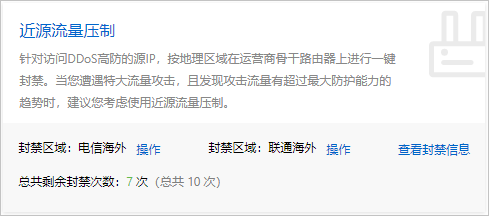

   - 封禁电信海外流量：单击**电信海外**后的**操作**，设置**封禁时长**后单击**确定**。

   - 封禁联通海外流量：单击**联通海外**后的**操作**，设置**封禁时长**后单击**确定**。

   > **说明**
   >
   > 建议您优先封禁电信海外流量，并观察攻击规模的变化趋势。如果攻击流量还是很大，超过当前防护能力，则可以考虑再封禁联通海外流量。

   您可以单击**查看封禁信息**，查看本次封禁的区域和时间范围。流量封禁期间，您可以单击**解封**，提前解除对应线路的海外流量封禁。

**执行结果**

如果近源流量压制失败，您会收到失败提示信息，请根据提示排查问题后再次尝试。如果未出现任何提示信息，则表示近源流量压制已成功。

<a id="section-6-1-2"></a>

### 6.1.2. 网站业务DDoS防护

<a id="section-6-1-2-1"></a>

#### 6.1.2.1. 设置AI智能防护

DDoS高防为已接入防护的网站业务默认开启AI智能防护功能，自学习业务流量基线，发现并阻断新型CC攻击。本文介绍了AI智能防护的使用方法。

**什么是AI智能防护**

面对多种多样的业务形态和频繁变化的攻击场景，DDoS高防在传统防护手段的基础上推陈出新，提供AI智能防护，基于阿里云的大数据能力，能够自学习网站业务流量基线，结合算法分析攻击异常，并自动下发精准访问控制规则，动态调整业务防护模型，帮助您及时发现并阻断恶意Web攻击，例如恶意Bot、HTTP Flood攻击。

**支持的模式和等级**

AI智能防护支持设置为以下模式和等级。网站业务接入DDoS高防后，默认开启AI智能防护策略（模式为防护，等级为正常）。

- **模式**

  <ol type="i">

  <li>

  **预警**：检测发现恶意请求时，仅记录攻击预警日志，不会阻断任何访问请求，帮助您了解AI智能防护的效果。

  </li>

  <li>

  **防护**：检测发现恶意请求时，直接下发能够阻断恶意请求的精确访问控制规则，拦截恶意请求。

  </li>

  </ol>

- **等级**

  | 防护等级 | 防护效果 | 应用场景 |
  | --- | --- | --- |
  | 宽松 | 仅拦截已知的特定恶意攻击，不会对正常请求造成误拦截。 | 适合于比较大型的网站且自身处理性能比较强劲的用户，适用于大促等特定场景。 |
  | <strong>正常</strong>（推荐） | 一般情况下，不对请求进行任何处置。当检测到流量对网站造成威胁时，对恶意攻击进行智能防御，对网站的正常业务影响极低。 | 适合请求量平稳且服务器处理性能在处理正常流量的基础上尚有冗余的场景。 |
  | 严格 | 对恶意攻击进行严格的智能防御，可能存在部分误拦截的现象。 | 适合网站性能较差或防护效果不佳的场景。 |

**前提条件**

已将网站业务接入DDoS高防。具体操作，请参见添加网站配置。

**调整AI智能防护的模式或等级**

当业务存在特殊场景时，建议调整AI智能防护策略，以确保AI策略得到充分学习，防止误拦截。

场景：网站接入DDoS高防前，源站配置了常规限速策略或频繁出现大量客户端同时重连，业务正常情况下返回大量4XX或5XX状态码。

处理建议：

1. 在**网站业务DDoS防护**页签，单击**AI智能防护**模块下的**设置**。

2. 在**AI智能防护**对话框，将**模式**调整为**预警**。

3. 等待3天后，再将**模式**修改为**防护**。

> **说明**
>
> 如果业务网站即将进行大促或压测，源站返回大量4XX或5XX状态码。建议您使用定制场景策略，具体请参见定制场景策略。

**查看AI智能防护规则**

开启AI智能防护后，DDoS高防在检测到恶意攻击行为时，会自动生成精准访问控制规则，规则的名称均以 `smartcc_` 开头且规则存在有效期。与自定义的精确访问控制规则不同，AI智能防护规则具有以下特性：

- 规则动作可能是预警：在预警模式下，AI智能防护自动生成的精准防护规则的动作均是预警（只记录攻击日志，不进行拦截）。

- 具有时效性：AI智能防护下发的规则存在有效期，超过有效期，防护规则自动失效并清除。

- 不支持手动删除：您无法手动删除，但如果您关闭AI智能防护，则所有AI智能防护规则立即清空。

  1. 登录DDoS高防控制台。

  2. 在左侧导航栏，选择**防护设置 > 通用防护策略**。

  3. 在**通用防护策略**页面，单击**网站业务DDoS防护**页签，在左侧域名列表中选择目标域名。

  4. 在**CC安全防护**区域，单击**设置**，查看名称以 `smartcc_` 开头的规则。

<a id="section-6-1-2-2"></a>

#### 6.1.2.2. 设置DDoS全局防护策略

DDoS全局防护策略即阿里云DDoS防护引擎基于海量历史攻防经验，结合实时攻防态势沉淀的通用防护规则，设置后可以减少攻击发生瞬间出现攻击透过的危害。本文介绍了DDoS全局防护策略的设置方法。

**全局防护策略介绍**

**防护模式**

DDoS全局防护策略提供**宽松**、**正常**、**严格**三种防护模式，详细介绍请参见下表。当您为域名设置完转发规则时，DDoS高防会默认开启全局防护策略，防护模式为**正常**，支持您手动调整防护模式。

| 模式 | 防护效果 | 应用场景 |
| --- | --- | --- |
| 宽松 | 只拦截已知的特定恶意攻击，不会对正常请求造成误拦截。 | • 适合网站规模较大且自身处理性能较强劲的业务防护场景。<br>• 需要降低流量清洗力度时（例如，业务大促期间），推荐使用<strong>宽松</strong>模式。 |
| <strong>正常</strong>（推荐） | 拦截在历史正常业务流量中不存在，但在全网恶意攻击中出现概率高的已知恶意攻击，对网站正常业务影响低。 | 适合请求量平稳、业务属性及用户来源不会有大幅变化的业务防护场景。 |
| 严格 | 对恶意攻击进行严格防御，可能存在部分误拦截。<br>重要使用<strong>严格</strong>模式前，建议您先联系阿里云技术支持进行咨询，避免策略调整对业务造成误伤。 | • 适合网站自身处理性能较差的业务防护场景。<br>• 需要加强流量清洗力度时（例如，已有策略防护效果不佳的情形），推荐使用该模式。 |

**防护模式包含的防护规则**

每种防护模式包含不同数量的防护规则，目前DDoS高防共支持下表中的几类防护规则，每个类别包含多个防护规则。当您通过攻击分析报表或者全量日志，识别到某个规则出现误判对您的正常业务造成影响，您无需对防护模式进行调整，仅需将特定的防护规则予以关闭，或者对其处置动作加以适当调整即可。

| 防护规则类别 | 说明 |
| --- | --- |
| 不合法请求 | 由于编码错误等原因，HTTP Header等内容包含不合法特征。 |
| 模拟浏览器请求 | 伪造浏览器发起的HTTP请求，一般触发挑战动作进行校验。 |
| 模拟爬虫请求 | 伪造爬虫发起的HTTP请求。 |
| 攻击工具请求 | 常见攻击工具发起的HTTP请求。 |
| 高频攻击请求 | 攻击者发起的高频HTTP请求。 |
| 恶意攻击请求 | 基于阿里云全网攻防沉淀的恶意攻击特征。 |

**不同防护模式支持的防护规则**

下表中√表示该模式支持该规则，×表示该模式不支持该规则。

不同防护规则的处置动作不同，处置动作支持您手动修改调整。

- **观察**：对命中观察规则的请求进行日志记录，并放行该访问请求。

- **挑战**：通过挑战算法对访问请求的源IP地址发起校验。

- **拦截**：阻断该访问请求。

| 规则名称 | 规则ID | 规则描述 | 默认处置动作 | 宽松 | 正常 | 严格 |
| --- | --- | --- | --- | --- | --- | --- |
| 不合法请求 | global_01 | HTTP请求Accept包含不合法特征#1 | 拦截 | √ | √ | √ |
| 不合法请求 | global_02 | HTTP请求Accept-Language包含不合法特征#1 | 拦截 | √ | √ | √ |
| 不合法请求 | global_0_1 | HTTP请求Accept-Encoding包含不合法特征#1 | 拦截 | × | √ | √ |
| 不合法请求 | global_15 | HTTP请求Accept包含不合法特征#2 | 拦截 | √ | √ | √ |
| 不合法请求 | global_ge_05f8a7600 96d29cee4 62a63ab41 8e5c3_B_t | HTTP请求Accept包含不合法特征#3 | 拦截 | √ | √ | √ |
| 不合法请求 | global_ge_0_B_t | HTTP请求Accept-Encoding包含不合法特征#2 | 拦截 | × | √ | √ |
| 不合法请求 | global_ge_0d4dbd808 0c85462ea 5395d1d82 51da8_B_t | HTTP请求Referer包含不合法特征#1 | 拦截 | × | √ | √ |
| 不合法请求 | global_ge_0e2130d0b 87abe84bd 74735ec45 86ab1_B_t | HTTP请求Accept包含不合法特征#4 | 拦截 | √ | √ | √ |
| 不合法请求 | global_ge_1_B_t | HTTP请求Accept-Language包含不合法特征#2 | 拦截 | × | √ | √ |
| 不合法请求 | global_ge_2cfc5256bf 5be8892b9 356d8db40 d0e3_B_t | HTTP请求Cache-Control包含不合法特征#1 | 拦截 | √ | √ | √ |
| 不合法请求 | global_ge_aba03cde2 fc06dd322 ad0a1a46b c47d8_B_t | HTTP请求Connection包含不合法特征#1 | 拦截 | √ | √ | √ |
| 不合法请求 | global_onli ne_03 | HTTP请求Referer包含不合法特征#2 | 拦截 | √ | √ | √ |
| 不合法请求 | global_spv_3adcd517f 14ef4295d bcb65f2b5 44621_B_t | HTTP请求Accept-Language包含不合法特征#3 | 拦截 | × | √ | √ |
| 不合法请求 | global_spv_a69fdbd25 ac2da2984 809fdc051 e9d4e_B_t | HTTP请求User-Agent包含不合法特征#1 | 拦截 | × | × | √ |
| 模拟浏览器请求 | global_03 | HTTP请求疑似模拟浏览器，校验浏览器Header等组合特征#1 | 挑战 | × | √ | × |
| 模拟浏览器请求 | global_2_3 | HTTP请求疑似模拟浏览器，校验浏览器Header等组合特征#2 | 挑战 | × | √ | × |
| 模拟浏览器请求 | global_2_4 | HTTP请求疑似模拟浏览器，校验浏览器Header等组合特征#3 | 挑战 | × | √ | × |
| 模拟浏览器请求 | global_r_1_C | HTTP请求疑似模拟浏览器，校验浏览器Header等组合特征#4 | 挑战 | × | √ | × |
| 模拟浏览器请求 | global_r_2_C_t | HTTP请求疑似模拟浏览器，校验浏览器Header等组合特征#5 | 挑战 | × | √ | × |
| 模拟浏览器请求 | global_th_0 0922977ec c39f015bd d94e54e3f 08c8_C_t | HTTP请求疑似模拟浏览器，校验浏览器Header等组合特征#6 | 挑战 | × | √ | × |
| 模拟浏览器请求 | global_th_1 0_C_t | HTTP请求疑似模拟浏览器，校验浏览器Header等组合特征#7 | 挑战 | × | √ | × |
| 模拟浏览器请求 | global_th_1 db36a8678 3775fb36ff 65e9a9471 293_C_t | HTTP请求疑似模拟浏览器，校验浏览器Header等组合特征#8 | 挑战 | × | √ | × |
| 模拟浏览器请求 | global_th_4 _C_t | HTTP请求疑似模拟浏览器，校验浏览器Header等组合特征#9 | 挑战 | × | √ | × |
| 模拟浏览器请求 | global_th_5 _C_t | HTTP请求疑似模拟浏览器，校验浏览器Header等组合特征#10 | 挑战 | × | √ | × |
| 模拟浏览器请求 | global_th_6 _C_t | HTTP请求疑似模拟浏览器，校验浏览器Header等组合特征#11 | 挑战 | × | √ | × |
| 模拟浏览器请求 | global_th_7 _C_t | HTTP请求疑似模拟浏览器，校验浏览器Header等组合特征#12 | 挑战 | × | √ | × |
| 模拟浏览器请求 | global_th_8 _C_t | HTTP请求疑似模拟浏览器，校验浏览器Header等组合特征#13 | 挑战 | × | √ | × |
| 模拟浏览器请求 | global_th_9 _C_t | HTTP请求疑似模拟浏览器，校验浏览器Header等组合特征#14 | 挑战 | × | √ | × |
| 模拟浏览器请求 | global_th_a 256dec6c8 0b7c953a9 d5cf21b19 3e93_C_t | HTTP请求疑似模拟浏览器，强校验浏览器Header等组合特征#1 | 挑战 | × | × | √ |
| 模拟浏览器请求 | global_th_e 353aae960 559269a51 46aca4106 0c60_C_t | HTTP请求疑似模拟浏览器，校验浏览器Header等组合特征#15 | 挑战 | × | √ | × |
| 模拟爬虫请求 | global_d_6 587d6a0e3 adb13d494 9cdb59a31 67c3_B_t | HTTP请求模拟Google爬虫#1 | 拦截 | × | × | √ |
| 模拟爬虫请求 | global_d_9 7a08ec7a4 a0d131194 c4fd40802 dd98_B_t | HTTP请求模拟百度爬虫#1 | 拦截 | × | × | √ |
| 模拟爬虫请求 | global_d_d 51505ef3d e38efe92bf f2163a3b4 d38_B_t | HTTP请求模拟Google爬虫#2 | 拦截 | × | × | √ |
| 攻击工具请求 | global_d_0 ac87637e9 fccf60e9af be18ad6af 1d9_C_t | HTTP请求疑似由已知攻击工具发起，校验Header等组合特征#1 | 挑战 | × | √ | × |
| 攻击工具请求 | global_d_0 d0fc1037e 2239562d3 1473e11d4 0909_B_t | HTTP请求User-Agent包含已知攻击工具请求特征#1 | 拦截 | × | √ | √ |
| 攻击工具请求 | global_d_4 36c6492db ef6f8d43ee c0c3caa86 652_C_t | HTTP请求疑似由已知攻击工具发起，校验Header等组合特征#2 | 挑战 | × | √ | √ |
| 攻击工具请求 | global_d_5 2d72f8b80 d5877e107 63d451cc0 5479_C_t | HTTP请求疑似由已知攻击工具发起，校验Header等组合特征#3 | 挑战 | × | √ | √ |
| 攻击工具请求 | global_d_5 e65a8ca4a 9ea2339f2 4d93c7b2f a819_C_t | HTTP请求疑似由已知攻击工具发起，校验Header等组合特征#4 | 挑战 | × | √ | √ |
| 攻击工具请求 | global_d_5f dc132caf6 3121890cb 733ad4c24 63e_B_t | HTTP请求User-Agent包含已知攻击工具请求特征#2 | 拦截 | × | √ | √ |
| 攻击工具请求 | global_d_6 58fef4f5d1 39461f713 5b89f5d9d d6d_C_t | HTTP请求疑似由已知攻击工具发起，校验Header等组合特征#5 | 挑战 | × | √ | √ |
| 攻击工具请求 | global_d_8 39574bd00 cc6f9f2a25 6a599829d b04_B_t | HTTP请求User-Agent包含已知攻击工具请求特征#3 | 拦截 | × | √ | √ |
| 攻击工具请求 | global_d_8 917da6c5c 8a6aba6ab 9156cc9f8 9d35_B_t | HTTP请求User-Agent包含已知攻击工具请求特征#4 | 拦截 | × | √ | √ |
| 攻击工具请求 | global_d_a dc8a089ad 050bd9e2e d1aed2b99 1526_C_t | HTTP请求疑似由已知攻击工具发起，校验Header等组合特征#6 | 挑战 | × | √ | √ |
| 攻击工具请求 | global_d_b ec67b0fe8 d26adb09f 375c67e35 5a88_C_t | HTTP请求疑似由已知攻击工具发起，校验Header等组合特征#7 | 挑战 | × | √ | × |
| 攻击工具请求 | global_d_c 660088d7e 2385d949f bf594461b 06ac_B_t | HTTP请求User-Agent包含已知攻击工具请求特征#5 | 拦截 | × | √ | √ |
| 攻击工具请求 | global_d_d c71e4b0d5 3ef00f0631 b0db72e95 fb7_B_t | HTTP请求User-Agent包含已知攻击工具请求特征#6 | 拦截 | × | √ | √ |
| 攻击工具请求 | global_d_fc 1c525466a af12d4580 ad03763da af4_B_t | HTTP请求User-Agent包含已知攻击工具请求特征#7 | 拦截 | × | √ | √ |
| 攻击工具请求 | global_spv_2bdf9b3b1 4f1277aac cc38ae2b2 e8a23_B_t | HTTP请求Referer包含已知攻击工具请求特征#1 | 拦截 | × | √ | √ |
| 攻击工具请求 | global_spv_507e04114 6fa3a0d8a bc61b0bb0 ba1bf_B_t | HTTP请求Referer包含已知攻击工具请求特征#2 | 拦截 | × | √ | √ |
| 攻击工具请求 | global_spv_b980df608 6a5b9bded 374883531 ceb9a_B_t | HTTP请求Referer包含已知攻击工具请求特征#3 | 拦截 | × | √ | √ |
| 高频攻击请求 | global_cc_1 321b42f09 67324a458 1f7df931b4 b64_C_t | HTTP请求首页高频攻击#1 | 挑战 | × | × | √ |
| 高频攻击请求 | global_cc_3 ed2a1a380 1ce62eee6 7a1804dc2 682a_C_t | HTTP请求Header高频遍历攻击#1 | 挑战 | × | × | √ |
| 高频攻击请求 | global_cc_5 d4f4eacd0 d2e37f0a8 2ab247bcd cc50_C_t | HTTP请求特殊User-Agent高频攻击#1 | 挑战 | × | √ | √ |
| 高频攻击请求 | global_cc_9 58593f854 099089cde c7638c111 16f4_C_t | HTTP请求URI高频遍历攻击#1 | 挑战 | × | × | √ |
| 高频攻击请求 | global_cc_c 5d86db096 688b00f8a d8cb4c3a3 d363_C_t | HTTP请求Header高频遍历攻击#2 | 挑战 | × | √ | √ |
| 恶意攻击请求 | global_1_1 | HTTP请求Ping-To为恶意攻击源#1 | 拦截 | × | √ | √ |
| 恶意攻击请求 | global_1_3 | HTTP请求Referer包含恶意特征#1 | 拦截 | × | √ | √ |
| 恶意攻击请求 | global_1_4 | HTTP请求Accept包含恶意特征#1 | 拦截 | × | √ | × |
| 恶意攻击请求 | global_d_0 226f8975a 3bb985c7c 069fff282b bdc_B_t | HTTP请求User-Agent包含恶意特征#1 | 拦截 | √ | √ | × |
| 恶意攻击请求 | global_d_3 4f692ae67 98abe9fc8 22912cfcd 4cc5_B_t | HTTP请求User-Agent包含恶意特征#2 | 拦截 | × | × | √ |
| 恶意攻击请求 | global_d_c 310e80978 11299b9f3 d968fe771 ebc9_B_t | HTTP请求User-Agent包含恶意特征#3 | 拦截 | × | √ | √ |
| 恶意攻击请求 | global_ge_e397de51d 53a70ad1e f6daaf332d e446_B_t | HTTP请求Accept-Language包含恶意特征#1 | 拦截 | √ | √ | √ |
| 恶意攻击请求 | global_hm_9c0017d9c 9b1aa12ea 2df4503d8f ae29_B_t | HTTP请求方法包含恶意特征#1 | 拦截 | × | √ | √ |
| 恶意攻击请求 | global_hm_c1db5bd6d 4f9da9739 224ca848b 60e62_B_t | HTTP请求方法包含恶意特征#2 | 拦截 | × | √ | √ |
| 恶意攻击请求 | global_onli ne_01 | HTTP请求User-Agent包含恶意特征#4 | 拦截 | √ | √ | √ |
| 恶意攻击请求 | global_onli ne_02 | HTTP请求Accept-Language包含恶意特征#2 | 拦截 | × | √ | √ |
| 恶意攻击请求 | global_spv_0_B_t | HTTP请求Accept-Language包含恶意特征#3 | 拦截 | × | √ | √ |
| 恶意攻击请求 | global_spv_1926afcce 4ce00198e ca856aaaf 6fe38_B_t | HTTP请求User-Agent包含恶意特征#5 | 拦截 | × | √ | √ |
| 恶意攻击请求 | global_spv_1_B_t | HTTP请求URI包含恶意特征#1 | 拦截 | × | √ | √ |
| 恶意攻击请求 | global_spv_2_B_t | HTTP请求Referer包含恶意特征#2 | 拦截 | × | √ | √ |
| 恶意攻击请求 | global_spv_4957fd08a a78f6e640f 2364b087c d117_B_t | HTTP请求User-Agent包含恶意特征#6 | 拦截 | × | × | √ |
| 恶意攻击请求 | global_spv_4e580d90c 3df0d19e7 1fb6947caf 5489_C_t | HTTP请求Accept包含恶意特征#2 | 挑战 | × | √ | × |

**如何判断是调整防护模式还是修改防护规则**

您可以从以下几个方面进行分析。

- 分析业务受影响的范围和频率。

  - 如果业务受影响范围广，多种正常的用户行为都被阻止，例如用户登录、上传下载等多个功能频繁出现问题，可能是因为防护模式过于严格，此时可以考虑调整防护模式。

  - 如果只是某一特定类型的用户行为（如某一类特定客户端访问、网站首页刷新频率限制）被误判，而其他大部分业务正常，那么可能只是个别防护规则出现问题，此时调整防护规则即可。

- 分析业务变更情况。

  - 如果业务进行了重大的更新，例如新增了对外访问的接口或改变了网络架构，此时出现业务受影响的情况，可能是现有的防护模式不适应新的业务形态，需要调整防护模式。

  - 如果业务基本保持稳定，只是偶尔某个功能出现问题，可能是个别防护规则的设置未适配这部分业务，此时调整防护规则即可。

- 测试正常业务流量是否符合防护规则。

  - 可以通过模拟正常业务流量来测试现有防护规则和防护模式。如果模拟的正常业务流量在通过防护系统时被大量拦截，此时可能需要调整防护模式。

  - 若模拟的正常业务流量只有在触及某个特定规则时才出现问题，比如一个关于异常请求频率的规则对正常的高频率查询业务产生误判，此时调整防护规则即可。

**如何判断需要修改哪条防护规则**

以防护规则ID为 `global_cc_1321b42f0967324a4581f7df931b4b64_C_t` 举例。该规则主要是用于防御HTTP请求首页高频攻击，但在以下场景中可能会出现误判：

- 大型促销活动场景，活动开始时很多用户可能会在一分钟内频繁刷新首页，这种情况下可能会导致系统误判。

- 网站技术故障修复后的场景，网站管理员需要测试网站的性能和功能是否恢复正常。为了快速进行测试，管理员可能会使用自动化测试工具对网站首页进行频繁的访问，以检查页面加载速度、链接可用性等多个方面，该行为可能会导致系统误判。

您可以通过攻击分析报表查看具体是哪个防护规则导致了系统误判。此时可以关闭该防护策略，或者将规则处置动作改为观察。

攻击分析报表：

您可以在**攻击分析**页面，找到Web资源耗尽型攻击详情，通过**Top10攻防策略**中查看生效的防护规则ID。

**注意事项**

- 2021年11月24日及之后接入DDoS高防的域名：默认开启了DDoS全局防护策略（**正常**模式）。

- 2021年11月24日前接入DDoS高防的域名：DDoS全局防护策略默认关闭，建议您手动为域名开启该功能。

**前提条件**

已将网站业务接入DDoS高防。具体操作，请参见添加网站配置。

**修改防护规则**

1. 登录DDoS高防控制台。

2. 在左侧导航栏，选择**防护配置 > 通用防护配置**。

3. 单击**网站业务DDoS防护**页签，并从左侧域名列表中选择要设置的域名。

4. 定位到**DDoS全局防护策略**区域，修改防护模式或单击**设置**修改防护模式中的具体防护规则。

<a id="section-6-1-2-3"></a>

#### 6.1.2.3. 设置黑白名单（针对域名）

DDoS高防支持针对域名设置黑名单和白名单，以拦截或放行指定IP的访问请求，且不经过任何防护策略过滤。本文介绍如何设置针对域名的黑白名单。

**功能介绍**

网站业务接入DDoS高防后，若存在对网站业务访问量较大的恶意IP，您可以将这些IP添加至针对域名的黑名单，拦截其访问请求。对于企业内部办公网的IP段、业务接口调用IP或其它已确认正常的IP，您可以将这些IP添加至针对域名的白名单予以放行，来自白名单IP的访问请求不会被拦截。黑名单和白名单中的IP出现冲突，遵循**白名单优先**原则。

DDoS高防支持两种黑白名单，针对DDoS高防实例的黑白名单和针对域名的黑白名单。

- 针对DDoS高防实例的黑白名单：对DDoS高防实例防护的所有业务生效，端口业务可以设置该黑白名单。详细信息，请参见设置黑白名单（针对高防实例IP）。

- 针对域名的黑白名单：即本文介绍的内容，仅对指定域名生效。

**策略生效时长**

永久生效。

**注意事项**

- IP和IP段数量限制：

  - **标准功能**套餐实例

    - 每个阿里云账号下，所有针对域名的黑名单，添加的IP和IP段总数不超过200个。

    - 每个阿里云账号下，所有针对域名的白名单，添加的IP和IP段总数不超过200个。

  - **增强功能**套餐实例

    - 每个阿里云账号下，所有针对域名的黑名单，添加的IP和IP段总数不超过2000个。

    - 每个阿里云账号下，所有针对域名的白名单，添加的IP和IP段总数不超过2000个。

- 开启针对域名的黑白名单后，黑白名单设置将应用到所有与域名关联的DDoS高防实例，针对域名的访问流量即刻生效。

  > **说明**
  >
  > 在部分情况下，可能需要经过一些访问流量和时间后，黑白名单（针对域名）设置才会真正生效。如果黑白名单（针对域名）开启后，设置未立即生效，请尝试继续访问域名数次。

- 黑白名单配置限制：

  - IPv4的DDoS高防实例仅支持配置IPv4格式的IP或网段，IPv6的DDoS高防实例仅支持配置IPv6格式的IP或网段。

  - IPv4的网段支持/8~/32，IPv6网段支持/32~/128。

  - IPv4地址不支持配置为0.0.0.0和255.255.255.255。IPv6地址不支持配置为::和ffff:ffff:ffff:ffff:ffff:ffff:ffff:ffff。

**前提条件**

已将网站业务接入DDoS高防。具体操作，请参见添加网站配置。

**操作步骤**

1. 登录DDoS高防控制台。

2. 在左侧导航栏，选择**防护设置 > 通用防护策略**。

3. 在**通用防护策略**页面，单击**网站业务DDoS防护**页签，并在左侧域名列表选择要设置的域名。

4. 在**黑／白名单**区域，单击右下角的**设置**。

5. 在**设置黑／白名单**对话框中，分别设置黑名单和白名单，并单击**确定**。

   支持IP或IP/掩码格式，多个IP或IP段之间用英文逗号（,）分隔。

6. 在**黑／白名单**区域，开启**状态**开关，是黑白名单设置生效。

**相关文档**

您可以在**攻击分析**页面，查看异常的来源IP，并将其添加到黑名单中。详细信息，请参见攻击分析。

<a id="section-6-1-2-4"></a>

#### 6.1.2.4. 设置区域封禁（针对域名）

DDoS高防支持对已接入防护的网站业务设置基于地理区域的访问请求封禁策略。开启针对域名的区域封禁功能后，您可以一键阻断指定区域来源IP对网站业务的所有访问请求。本文介绍了设置针对域名的区域封禁的方法。

**背景信息**

您可以在以下场景中设置区域封禁：

- 如果您的网站业务仅针对某个区域开放，接入DDoS高防后，您可以将其他区域设置为封禁区域。例如，假设您的网站业务仅针对中国区域用户开放，您可以将非中国区域设置为封禁区域。

- 如果您的网站业务频繁受到来自某个区域的DDoS攻击，接入DDoS高防后，您可以将该区域设置为封禁区域。

**注意事项**

- 区域封禁（针对域名）仅支持防护网站业务。对于非网站业务若有类似需求，建议您设置基础设施DDoS防护策略下的流量封禁。更多信息，请参见设置近源流量压制、设置区域封禁。

- 系统不支持批量设置多个域名的区域封禁，如果需要为多个域名设置区域封禁，则您需要分别设置。

- 区域封禁（针对域名）根据源IP的归属区域在DDoS高防中识别过滤，并不能减小进入高防网络的攻击流量。

**前提条件**

已将网站业务接入DDoS高防。具体操作，请参见添加网站配置。

**操作步骤**

1. 登录DDoS高防控制台。

2. 在左侧导航栏，选择**防护设置 > 通用防护策略**。

3. 在**通用防护策略**页面，单击**网站业务DDoS防护**页签，并从左侧域名列表中选择要设置的域名。

4. 在<strong>区域封禁（针对域名）</strong>区域，单击**设置**。

5. 在**封禁区域设置**页面，选择要封禁的区域，并单击**确定**。

6. 回到<strong>区域封禁（针对域名）</strong>区域，开启**状态**开关，应用针对域名的区域封禁设置。

**执行结果**

成功开启针对域名的区域封禁后，区域封禁设置将应用到所有与域名关联的DDoS高防实例，并针对域名的访问流量即刻生效。

<a id="section-6-1-2-5"></a>

#### 6.1.2.5. 设置CC安全防护

网站业务接入DDoS防护后，如果遭受了CC攻击，可以通过对HTTP字段进行针对性的特征分析及规则配置，增强CC攻击的识别拦截效力，用于盗链防护、网站管理后台保护等场景。本文介绍如何设置CC防护策略。

**CC攻击防御产品介绍**

CC攻击（Challenge Collapsar）是分布式拒绝服务（DDoS）攻击的一种类型，通常情况下指应用层攻击（Application Layer Attack）。通过控制某些主机向目标网络服务器不停地发送伪造的HTTP/HTTPS请求，比如频繁请求一个需要消耗大量服务器资源的搜索页面或者登录页面，以消耗服务器的资源或网络带宽，导致网站响应变慢，无法处理正常用户的访问请求。

与传统的网络层DDoS攻击不同，CC攻击更加隐蔽，因为它模仿的是正常的用户请求。为了提升网站业务安全性，阿里云提供了DDoS高防和Web应用防火墙产品用于防御CC攻击。

**DDoS高防**

DDoS高防侧重于防护大流量攻击，目的是确保网络基础设施不受带宽耗尽和资源耗尽的影响，通常部署在网络边缘。DDoS高防提供AI智能防护、自定义CC安全防护策略，用于防御CC攻击。

- AI智能防护：即基于阿里云的大数据能力，能够自学习网站业务流量基线，结合算法分析攻击异常并自动下发精准访问控制规则，动态调整业务防护模型，帮助您及时发现并阻断恶意Web攻击，例如恶意Bot、HTTP Flood攻击。将网站接入DDoS高防后，默认开启AI智能防护。关于AI智能防护的详细介绍，请参见设置AI智能防护。

- 自定义CC防护策略：即本文介绍的内容。您可以在网站遭受CC攻击后，通过分析HTTP请求的字段特征，为网站设置精准访问控制规则或频率控制规则，通过频率控制、行为分析、IP黑名单等措施，更好的防御DDoS攻击。

**Web应用防火墙（WAF）**

WAF主要是分析进入应用层的HTTP/HTTPS流量，对网站或者App的业务流量进行恶意特征识别及防护，避免网站服务器被恶意入侵导致性能异常等问题。WAF采用多种手段来识别和防御应用层攻击，包括输入验证、针对特定漏洞的规则集、会话跟踪和防护机制（如验证码、JS挑战、Cookie验证等）。WAF通常部署在网络接近服务器端的位置，可以更紧密地监控到达服务器的流量，并执行应用层的安全策略。

两种产品的防护侧重点不同，如果仅针对CC攻击，如果您的CC攻击水位很高，例如网站已无法正常访问，优先建议DDoS高防。如果CC攻击水位不是很高，例如网站只是响应变慢，优先建议Web应用防火墙。但为达到最佳的保护效果，建议您同时部署两种产品，以确保网站业务不受到恶意流量和攻击者的破坏。

**CC防护策略配置建议**

建议在网站遭受CC攻击时配置，通过本功能加强防御，放行或者过滤指定特征的流量。日常防护不推荐使用本功能。

您可以通过如下方式查看HTTP请求中是否存在明显特征，例如来源IP一样、URI中包含相同字段等，根据特征配置CC防护策略。

在**攻击分析**页面，查看DDoS高防记录的**HTTP 攻击**事件，事件详情中包含了攻击源IP、User-Agent、Referer、HTTP-Method、客户端指纹等信息。详细介绍，请参见攻击分析。

**CC防护策略介绍**

- 根据设置规则时是否开启**频率设置**，分为**精准访问控制规则**和**频率控制规则**。匹配原则是先匹配精准访问控制规则，再匹配频率控制规则，只要匹配某一个规则，则不再向后匹配。

  > **说明**
  >
  > DDoS高防的AI智能防护自动下发的精准访问控制规则，即 `smartcc_` 开头的规则，也遵循该匹配逻辑。

- 为了提升CC攻击默认防护效果，产品防护引擎内置了两条频次控制规则，具体规则内容已展示在**频率控制规则**配置区域，规则名称为**内置CC防护规则-基于客户端频次**、<strong>内置CC防护规则-基于源站响应码。</strong>当前仅支持规则的**查看**和**删除**操作。

| 规则名称 | 精准访问控制规则 | 频率控制规则 |
| --- | --- | --- |
| 说明 | 满足相关匹配条件即执行动作。<br>说明<br>如果您在精准访问控制规则中查看到<code> smartcc_ </code>开头的规则，表示该规则由DDoS高防的AI智能防护自动下发，规则过期后自动删除，无需您手动处理。 | 在统计时长内，当统计对象满足匹配条件并达到阈值，才执行动作。<br>重要内置CC防护规则删除操作后无法恢复，请您谨慎操作。如您确认要删除该规则，建议您在删除内置CC防护规则后，结合您需要防护的重要业务域名或接口业务访问频次和特征，自定义配置频次防护规则，从而提升CC攻击防护效果。 |
| 规则生效时长 | 由您设置，可以设置为永久或自定义时长（5~120分钟）。<br>说明自定义时长时，到期后该规则会自动删除。 | 永久生效。 |
| 匹配原则 | 匹配所有规则，当访问请求命中多条规则时，执行列表中排名靠前的规则的动作。例如，如果访问请求同时命中①和②，则执行①对应的动作。<br>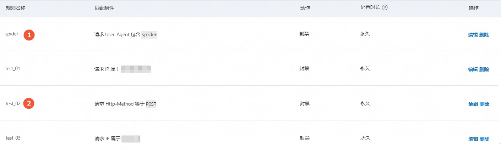 | 匹配所有规则，当访问请求命中多条规则时，随机执行某一条规则的动作。 |
| 限制条件 | 每个域名最多设置的精准访问控制规则数量。<br>• 标准功能套餐实例：20个。<br>• 增强功能套餐实例：100个。 | 每个域名最多设置的频率控制规则数量。<br>• 标准功能套餐实例：20个。<br>• 增强功能套餐实例：100个。 |

**Cookie植入说明**

七层接入的业务会在以下两种情况下被植入Cookie。

- 场景1：域名的网站业务DDoS防护策略，开启CC安全防护功能。

  启用CC安全防护策略后，DDoS高防产品将会在客户端（如浏览器）植入Cookie用于区分统计不同客户端，用户在访问网站时会在HTTP报文中带上植入的Cookie信息，DDoS高防将结合统计结果判断业务流量中是否存在CC攻击行为，并启动CC攻击清洗策略。

- 场景2：CC防护策略规则动作开启“挑战”模式。

  CC防护策略启用“挑战”规则动作后，将会在HTTP报文的Header中植入Cookie用于获取客户端浏览器的指纹信息，收集的指纹信息包括HTTP报文的host字段、浏览器高度和宽度。当访问流量命中规则后，DDoS高防将对客户端发起挑战探测，并结合浏览器的指纹统计信息判断客户端是否有异常，识别异常客户端的CC攻击行为。

如需停止DDoS高防向业务植入Cookie的行为，您可以在控制台的**接入管理 > 域名接入**页面单击**操作**列的**编辑**，将网站配置中的**cookie设置**开关关闭，但同时DDoS高防也将无法通过CC安全防护策略模块对CC攻击进行主动判断和防护。

**配置CC安全防护策略**

**前提条件**

已将网站业务接入DDoS高防。具体操作，请参见添加网站配置。

**操作步骤**

1. 登录DDoS高防控制台。

2. 在左侧导航栏，选择**防护设置 > 通用防护策略**。

3. 在**通用防护策略**页面，单击**网站业务DDoS防护**页签，并从左侧域名列表中选择要设置的域名。

4. 定位到**CC安全防护**配置区域，单击**设置**后，在右上角单击**新增规则**，配置完成后单击**确定**。

   <table>
     <tr>
       <th width="89">参数</th>
       <th>描述</th>
     </tr>
     <tr>
       <td>规则名称</td>
       <td>规则的名称。由英文字母、数字和下划线（_）组成，不超过128个字符。</td>
     </tr>
     <tr>
       <td>匹配条件</td>
       <td>规则的匹配条件。字段详细介绍，请参见附录一：支持设置的HTTP请求字段。<br>说明<br>• <strong>匹配内容</strong>不允许设置为空值。精准访问控制规则的匹配内容区分大小写，频率控制规则的匹配内容不区分大小写。<br>• 最多可以设置5个匹配条件。若添加多个匹配条件，只有当访问请求满足所有条件时才算命中。</td>
     </tr>
     <tr>
       <td>频率设置</td>
       <td>设置是否启动频率设置校验。<br>• 开关关闭：表示该规则为精准访问控制规则。<br>• 开关打开：表示该规则为频率控制规则。开启后您需要配置<strong>统计对象</strong>（只支持IP、自定义Header）、<strong>统计时长（秒）</strong>、<strong>阈值（次）</strong>，您也可以结合响应码的数量或比例设置更细致的规则。</td>
     </tr>
   </table>

   <table>
     <tr>
       <td>规则动作</td>
       <td>当访问请求命中匹配条件时，对请求执行的操作。取值 ：<br>• <strong>放行</strong>：放行该访问请求。<br>• <strong>拦截</strong>：阻断该访问请求。<br>• <strong>挑战</strong>：通过挑战算法对访问请求的源IP地址发起校验。<br>• <strong>观察</strong>：对命中观察规则的请求进行日志记录，并放行该访问请求。<br>说明开启频率设置时，<strong>规则动作</strong>仅支持<strong>拦截</strong>、<strong>挑战</strong>、<strong>观察</strong>。</td>
     </tr>
     <tr>
       <td>处置时长</td>
       <td>• 频率设置开关关闭时：表示精准访问规则的生效时长，支持永久生效、自定义时长（5~120分钟）。<br>说明自定义时长时，到期后该规则会自动删除。<br>• 频率设置开关打开时：表示满足频率控制规则时，执行多长时间的规则动作，只支持自定义时长（1~1440分钟）。</td>
     </tr>
     <tr>
       <td>高级设置</td>
       <td>开启频率设置时，支持配置统计时去重。统计对象可以设置为IP、Header、URI。<br>• 场景一：开启去重模式以下图为例，满足匹配条件的场景下，当同一源IP地址在30秒内访问不同的URI大于等于200种时，执行规定动作，拦截来自该IP的请求。由于开启了去重模式，当同一源IP使用相同的URI访问多次时，访问次数统计为1次。<br>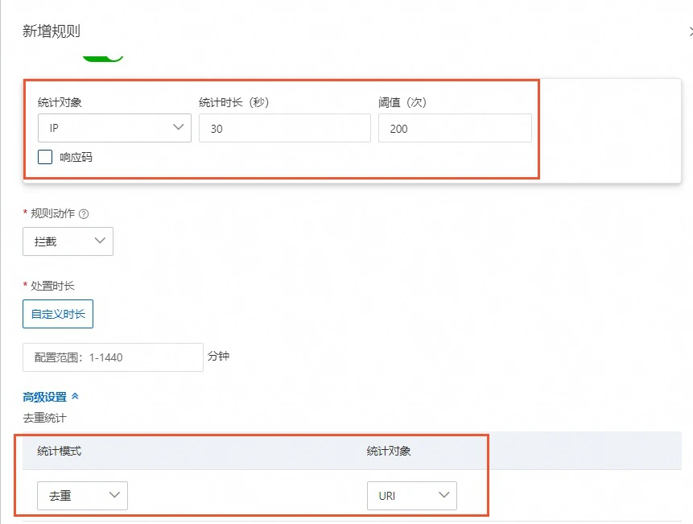<br>• 场景二：未开启去重模式以下图为例，满足匹配条件的场景下，当同一源IP地址在30秒内访问次数大于等于200次时，执行规定动作，拦截来自该IP的请求。未开启去重模式，假如同一源IP使用相同的URI访问10次时，访问次数统计为10次。<br>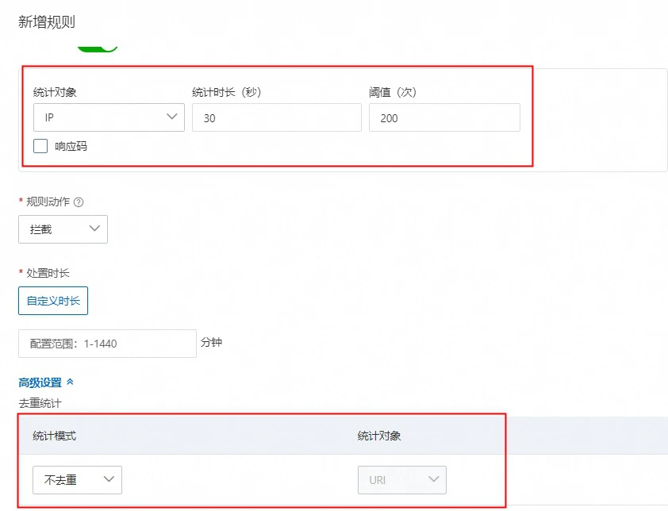</td>
     </tr>
   </table>

5. 返回**CC安全防护**区域，开启**状态**开关。

**附录一：支持设置的HTTP请求字段**

| 匹配字段 | 字段描述 | 逻辑符 | 字段示例 |
| --- | --- | --- | --- |
| IP | 访问请求的来源IP。取值支持多个IP或IP/掩码。 | 包含、不包含 | 10.10.10.10 |
| URI | 访问请求的URI地址。例如：<code> /action/member/id.php?</code> <code>id=1&amp;td=2 </code>。 | 包含、不包含、 等于、不等于、长度小于、长度等于、长度大于、前缀匹配、等于多值之一、不等于多值之一<br>说明逻辑符为等于、不等于时，输入的字符应以<code> / </code>开头。 | /action/member/id.ph p?id=1&amp;td=2 |
| User-Agent | 发起访问请求的客户端的浏览器标识、渲染引擎标识和版本信息等浏览器相关信息。 | 包含、不包含、等于、不等于、长度小于、长度等于、长度大于、等于多值之一、不等于多值之一 | Mozilla/5.0 (Windows NT 10.0; Win64; x64) AppleWebKit/537.36 (KHTML, like Gecko) Chrome/119.0.XX.XX Safari/537.36 |
| Cookie | 访问请求中携带的Cookie信息。 | 包含、不包含 、等于、不等于、长度小于、长度等于、长度大于、不存在、等于多值之一、不等于多值之一 | cna=Z87DHXX/jXIBA SQBsYAimToU; sca=234ea940; yunpk=177699790\*\* \*\* |
| Referer | 访问请求的来源网址，即该访问请求是从哪个页面跳转产生的。 | 包含、不包含 、等于、不等于、长度小于、长度等于、长度大于、不存在、等于多值之一、不等于多值之一 | https://example.aliyu ndoc.com/ |
| Content-Type | 访问请求指定的响应HTTP内容类型，即MIME类型信息。 | 包含、不包含 、等于、不等于、长度小于、长度等于、长度大于、等于多值之一、不等于多值之一 | text/plain;charset=U TF-8 |
| X-Forwarded-For | 访问请求的客户端真实IP。格式为：<code> &lt;client&gt;, &lt;proxy1&gt;, </code> <code>&lt;proxy2&gt;</code> | 包含、不包含 、等于、不等于、长度小于、长度等于、长度大于、不存在、等于多值之一、不等于多值之一 | 36.18.XX.XX,192.18.XX.XX |
| Content-Length | 访问请求包含的字节数。 | 值小于、值等于、值大于 | 806 |
| Post-Body | 访问请求的内容信息。 | 包含、不包含、等于、不等于、等于多值之一、不等于多值之一 | Content-Type: application/x-www-form-urlencoded<br>name=John&amp;age=25 &amp;email=\*\*\*\* |
| Http-Method | 访问请求的方法。取值为：GET、POST、DELETE、PUT、OPTIONS、CONNECT、HEAD、TRACE。 | 等于、不等于、等于多值之一、不等于多值之一 | POST |
| Header | 访问请求的头部信息，用于自定义HTTP头部字段及匹配内容。 | 包含、不包含、等于、不等于 、长度小于、长度等于、长度大于、不存在、等于多值之一、不等于多值之一 | \*text/html,application/xhtml+xml,applicati on/xml;q=0.9,image/webp,image/\*\*\*\* |
| Params | 访问请求的URL地址中的参数部分，通常指URL中<code> ? </code>后面的部分。例如，<code> example.aliyundoc.com/in</code> <code>dex.html?action=login </code>中的<code> action=login </code>就是参数部分。 | 包含、不包含 、等于、不等于、长度小于、长度等于、长度大于、等于多值之一、不等于多值之一 | action=login |
| Raw-URI | 未经过编码的URI，即保留了原始的字符序列。Raw-URI可以包含特殊字符和空格，但在使用时需要进行编码处理，以确保在网络传输和解析过程中不会引起歧义或错误。 | 包含、不包含、等于、不等于、长度小于、长度等于、长度大于、正则匹配、字节包含、字节等于、等于多值之一、不等于多值之一 | GET/images/logo.png HTTP/1.1 |
| Tls-Fingerprint | 基于发起访问请求的客户端TLS指纹，通过阿里云自研算法识别和计算得出的客户端指纹值，用于访问请求的匹配和防护。客户端指纹查看方式：在<strong>安全总览</strong>页面，单击<strong>域名</strong>页签，在页面最下方查看<strong>客户端TLS指纹</strong>。 | 等于、不等于 | 74dcbf6b790160370 bb6b7bea98d5978 |
| HTTP/HTTP S | 访问请求的协议类型，支持设置为HTTP和HTTPS。 | 等于、不等于 | HTTP |
| HTTP版本 | HTTP协议的版本，支持设置为HTTP/1.0，HTTP/1.1，HTTP/2.0版本。 | 等于、不等于、等于多值之一、不等于多值之一 | HTTP/1.0 |
| HTTP2.0指纹 | 根据HTTP2客户端的原始指纹，利用MD5算法处理后生成的HTTP2.0指纹。用来分析和识别不同的客户端，实现更安全和高效的通信。 | 等于、不等于 | ad8424af1cc590e09f 7b0c499bf7fcdb |
| JA3指纹 | DDoS高防通过将TLS握手过程中的关键参数（包括TLS版本、密码套件、压缩算法和TLS扩展等信息）进行MD5哈希处理，生成一个字符串用来表示客户端的TLS配置，该字符串即JA3指纹。JA3指纹可以用于识别和区分不同类型的TLS客户端，例如Web浏览器、移动应用程序、恶意软件等。 | 等于、不等于、等于多值之一、不等于多值之一 | eb6f49e8db7ad1809f 885d12232f4855 |
| JA4指纹 | JA4指纹通过引入更多的上下文信息和算法，例如浏览器的版本、操作系统等，减少了JA3指纹可能导致的重复性问题。JA4指纹能够更准确地鉴别出真实的用户与伪装者，降低误识率。 | 等于、不等于、等于多值之一、不等于多值之一 | f436b9416f37d134ca dd04886327d3e8 |
| 大洲/国家 | 表示来源IP的地理位置。 | 区域封禁选择 | 欧洲 |

**附录二：配置示例**

> **说明**
>
> 下述示例给出常见的适配业务场景的配置建议，具体请以您业务实际需求为准，示例仅做规则配置展示。

**拦截特定攻击请求**

一般情况下，正常业务不存在POST根目录的请求信息。如果网站业务上发生CC攻击，且您发现客户端的请求中存在大量的POST根目录请求，则可以评估请求的合法性。如果确认其为非正常业务请求，可以配置如下规则。

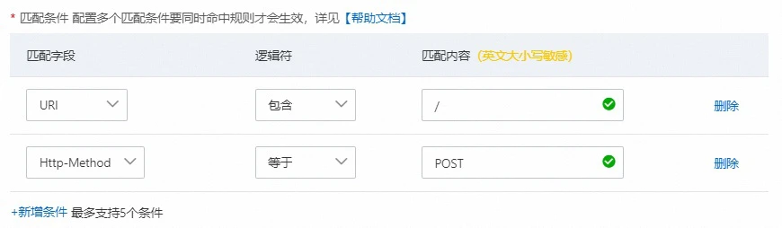

**拦截爬虫**

如果在某段时间内，您发现网站的访问流量中有大量爬虫请求，若不排除是攻击傀儡机模拟爬虫进行CC攻击，则可以对爬虫的请求执行拦截操作。规则配置示例如下。

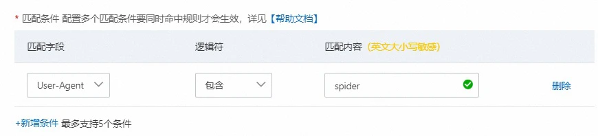

**防盗链**

当浏览器访问某个网页时，会带上Referer字段，告诉服务器该请求是从哪个页面链接过来的。通过配置Referer字段的访问控制规则，可以阻断特定网站的盗链。例如，您发现“https://example.aliyundoc.com”大量盗用本站的图片，您可以配置如下。

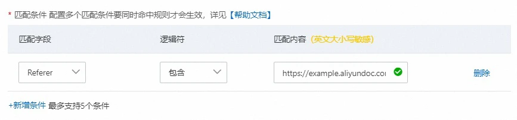

**针对User-Agent设置访问频率限制**

例如，某一UA在10秒内访问 `/game/all_` 前缀的URI超过30次，就对该UA的请求执行挑战动作。

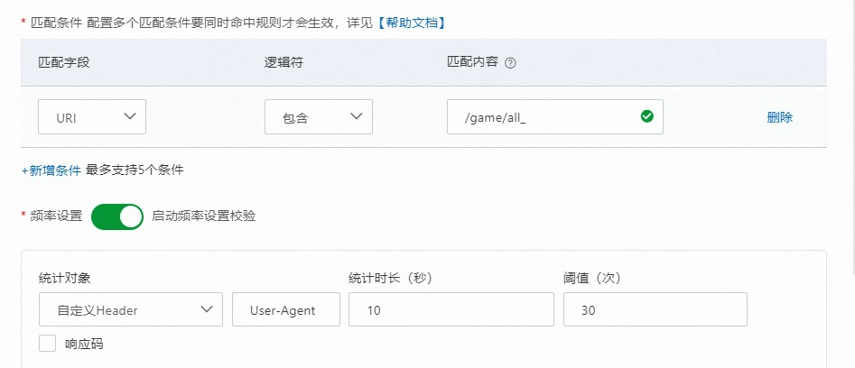

**设置登录频率限制**

例如，为了预防登录接口受到恶意高频撞库攻击，可以配置登录接口的地址，设置60秒内超过20次请求则进行拦截。

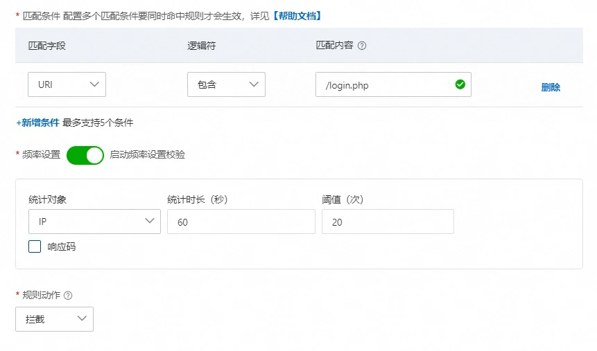

**结合源站响应码设置频率限制规则**

通过配置源站响应码数量或比例的触发条件，在原有频率防护策略的基础上进一步提高防护准确性，降低对正常业务的误伤风险。当统计对象在统计时长内请求数超过阈值，且配置的源站响应码超过指定数量或比例，则触发对应的处置动作。

**200**

当源站处理能力较强时，对于攻击者的高频请求响应依旧正常，此时可根据业务自身特征，处置超出业务正常请求频率的IP，起到一定限速限流的效果，保护源站和业务可用性。可以参考如下配置：

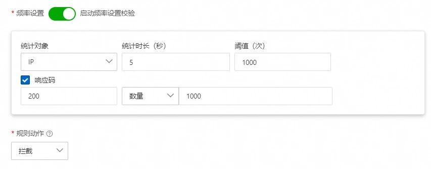

**404**

当攻击者发起URI扫描攻击或持续请求源站实际不存在的路径时，源站经常会响应大量404状态码，可配置策略拉黑攻击IP。请参考如下配置：

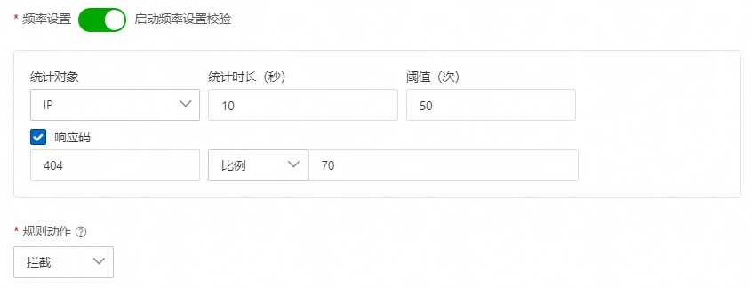

**403**

当攻击者发起Web类攻击，且高防后端为WAF等防护产品时，可依据其他防护产品拦截响应码进行对应规则配置。例如，阿里云WAF会拦截Web攻击并响应403，可配置策略在高防侧提前拉黑攻击IP。可以参考如下配置：

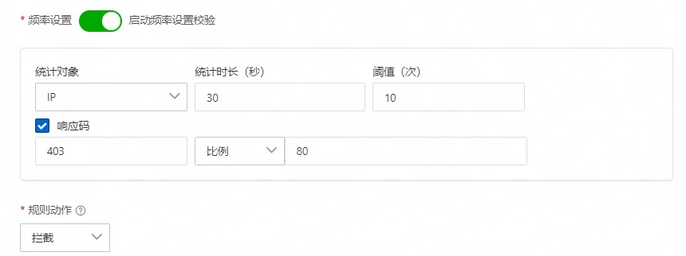

**429**

由于源站自身存在限流或业务校验等配置，当攻击者请求命中此类源站限速或校验规则时，源站会响应429 Too Many Requests或客户自定义响应码，可配置策略拉黑攻击IP，缓解源站压力。可以参考如下配置：

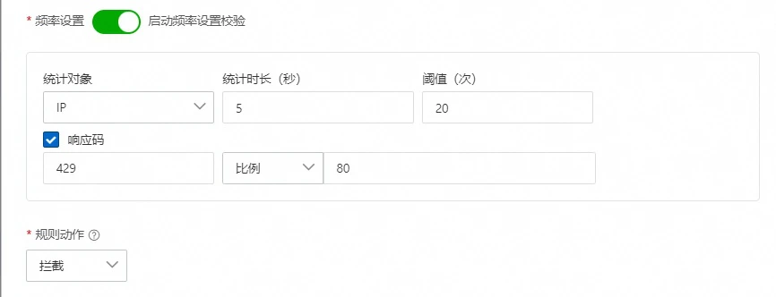

**502**

当源站由于请求突增等原因导致请求处理时间较长，出现异常502响应时，可配置策略拉黑高频请求的IP，保证源站可用性。可以参考如下配置：

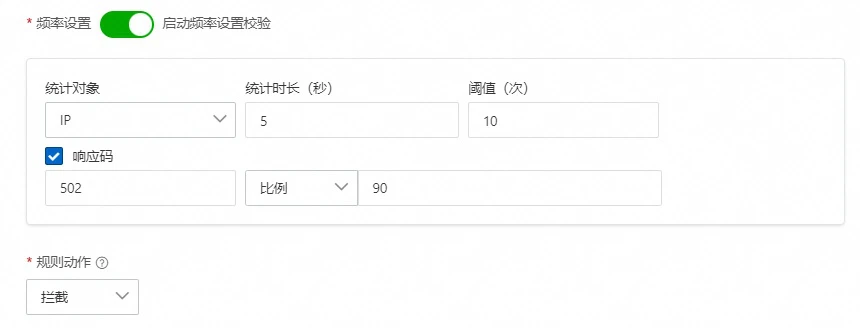

**555**

当源站存在业务自身的特殊逻辑，对非预期的请求响应诸如555等自定义状态码，可在高防侧根据该特征，处置发起非预期请求的IP。可以参考如下配置：

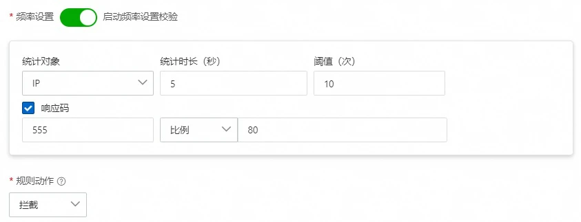

**拦截非法的客户端指纹**

攻击者通过伪造客户端指纹，模拟真实的客户端以尝试建立大量的连接或HTTP请求，从而导致服务器崩溃或者拒绝服务。您可以通过检查并识别客户端指纹拒绝连接。

例如：遭受大流量CC攻击时，如果攻击者使用相同的脚本或工具，包含相同指纹值的请求数或请求数占比会突增。您可以在**安全总览**页面的**域名**页签，查看**客户端TLS指纹**Top数据，分析请求的行为，及时发现可疑的指纹值并设置策略。

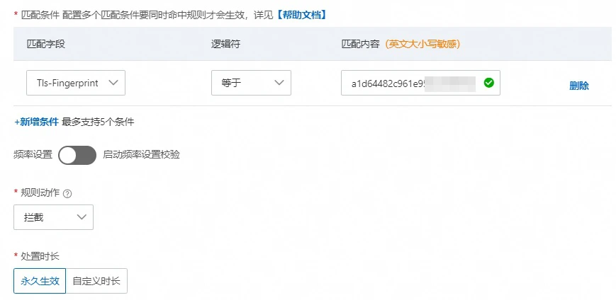

<a id="section-6-1-3"></a>

### 6.1.3. 非网站业务DDoS防护

<a id="section-6-1-3-1"></a>

#### 6.1.3.1. 设置四层AI智能防护

DDoS高防实例默认启用智能防护功能，通过算法自主学习接入业务的历史流量，自适应调整四层流量清洗策略，提供符合业务场景的防御效果。业务接入DDoS高防后，将直接获得正常等级的智能防护能力，无需您手动设置。若正常等级的防御效果不够理想，您可以根据实际需求选择更宽松或严格的智能防护等级。

**背景信息**

针对网络四层DDoS攻击，DDoS高防智能防护结合历史业务流量和阿里云攻防安全专家的经验，提供宽松、正常、严格三种智能防护等级供您选择。 默认情况下，您所购买的DDoS高防实例自动开启四层AI智能防护，并选用正常防护等级。您可以根据实际情况自由调整智能防护等级。

由于智能防护功能通过算法学习您的历史业务流量，因此业务初次接入DDoS高防进行防护时，系统需要三天左右时间完成对您业务流量的学习和训练，从而达到符合业务场景的防御效果。

对于带有明显攻击特征的恶意IP，智能防护算法将根据需要自动将其添加到针对DDoS高防实例的流量黑名单中，在一定时间内丢弃其全部访问请求。您可以随时查看或删除黑名单中的IP，也可以在黑名单中手动添加其他恶意IP进行防御。同时，您还可以将特定的IP添加至流量白名单，系统将直接放行来自这些IP的业务访问流量。更多信息，请参见设置黑白名单（针对高防实例IP）。

**操作步骤**

1. 登录DDoS高防控制台。

2. 在左侧导航栏，选择**防护设置 > 通用防护策略**。

3. 在**通用防护策略**页面，单击**非网站业务DDoS防护**页签，并在页面上方选择要设置的DDoS高防实例。

   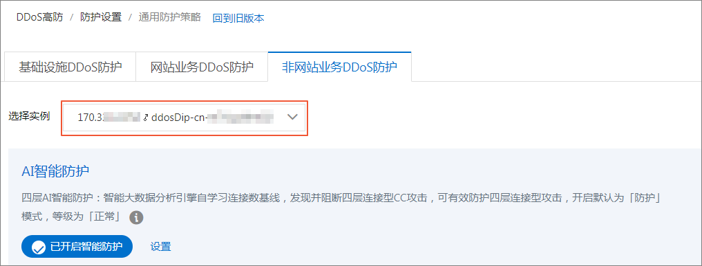

4. 定位到**AI智能防护**区域，单击**设置**。

5. 在**AI智能防护**对话框，根据攻击情况选择要应用的防护**等级**，并单击**确定**。

   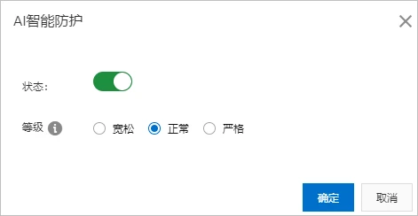

   不同防护等级的说明如下：

   - **宽松**：对来自带有明显攻击特征的恶意IP的流量进行自动清洗。该等级可能无法拦截所有四层流量攻击，但误杀率低。

   - **正常**：对来自带有明显攻击特征的恶意IP和疑似恶意IP的流量进行自动清洗。该等级默认启用，能够充分平衡防护效果和误杀率，建议您在一般情况下选择该等级。

   - **严格**：对当前正在发生的攻击行为进行严格地防御，但可能存在一定误杀。

   成功修改智能防护等级后，目标DDoS高防实例将按照调整后的防护等级工作。

<a id="section-6-1-3-2"></a>

#### 6.1.3.2. 设置DDoS防护策略

DDoS高防提供针对网络四层DDoS攻击的防护策略设置功能，例如虚假源和空连接检测、源限速、目的限速，适用于优化调整非网站业务的DDoS防护策略。本文介绍如何添加DDoS防护策略。

**功能介绍**

非网站业务的DDoS防护策略是基于“IP地址+端口”级别的防护，对于已接入DDoS高防实例的非网站业务的“IP+端口”的连接速度、包长度等参数进行限制，实现缓解小流量的连接型攻击的防护能力。DDoS防护策略配置针对端口级别生效。

DDoS高防为已接入的非网站业务提供以下DDoS防护策略。

- **虚假源**：针对虚假IP发起的DDoS攻击进行校验过滤。

- **高级攻击防护**：针对基于Mirai等僵尸网络建立TCP三次握手后，短时间内发送海量异常报文的DDoS攻击行为进行识别和拦截。

  > **说明**
  >
  > IPv4高防IP支持配置，IPv6高防IP不支持配置。

- **会话特征过滤**：基于会话报文payload特征，对正常业务特征或攻击报文特征进行精准识别和防护，也可基于应用层协议进行相关的匹配策略配置。

  > **说明**
  >
  > 仅DDoS高防（中国内地）的增强版套餐的IPv4高防IP支持配置。

- **白名单**：基于端口维度设置白名单，来自白名单IP的访问请求直接放行，不会被拦截。

- **源限速**：以当前高防IP、端口为统计对象，对访问频率超出阈值的源IP地址进行限速。访问速率未超出阈值的源IP地址，访问不受影响。源限速支持黑名单控制，对于60秒内5次超限的源IP，您可以开启将源IP加入黑名单的策略，并设置黑名单的有效时长。

- **目的限速**：以当前高防IP、端口为统计对象，当每秒访问频率超出阈值时，对当前高防IP的端口进行限速，其余端口不受限速影响。

- **包长度过滤**：设置允许通过的包最小和最大长度，小于最小长度或者大于最大长度的包会被丢弃。

**前提条件**

已将非网站业务接入DDoS高防。具体操作，请参见配置端口转发规则。

**设置单条DDoS防护策略**

1. 登录DDoS高防控制台。

2. 在左侧导航栏，选择**防护设置 > 通用防护策略**。

3. 在**通用防护策略**页面，单击**非网站业务DDoS防护**页签，并在页面上方选择要设置的DDoS高防实例。

4. 从左侧转发规则列表中单击要设置的转发规则，配置防护策略。

   - **虚假源**：仅适用于TCP端口转发规则。

     | 参数 | 描述 |
     | --- | --- |
     | 虚假源 | 开启后将自动过滤虚假源IP地址的连接请求。<br>• 关闭<strong>虚假源</strong>时，会同步关闭<strong>空连接</strong>。<br>• 关闭<strong>虚假源</strong>，<strong>空连接</strong>和<strong>高级攻击防护</strong>均不生效。 |
     | 空连接 | 开启后将自动过滤空连接请求，必须先开启<strong>虚假源</strong>才能开启<strong>空连接</strong>。 |

   - **高级攻击防护**：仅适用于TCP端口转发规则，开启后防护等级默认为正常模式。开启**高级攻击防护**，必须先开启**虚假源**。

     | 防护等级 | 防护效果 | 应用场景 |
     | --- | --- | --- |
     | 宽松 | 对有明显攻击特征的请求进行拦截，可能存在少量漏过，但误杀率极低。 | 适合于直播、流媒体、下载等具备单向大量传输的业务或者源站带宽较大的业务。 |
     | 正常（推荐） | 一般情况下，不会对正常业务造成影响，能够充分平衡防护效果和误杀率，建议您在一般情况下选择该等级。 | 适用于绝大多数业务场景。 |
     | 严格 | 对恶意攻击进行严格校验，但可能存在一定误杀。 | 适合源站带宽较小或防护效果不佳的场景。 |

   - **会话特征过滤**：基于会话报文（payload），设置自定义的精准访问控制规则。单条规则下如果配置了多个匹配条件，必须同时满足才执行对应动作。

     > **说明**
     >
     > AI智能防护下发的智能精准访问控制规则，也在此处显示。

     <table>
       <tr>
         <th width="89">参数</th>
         <th>描述</th>
       </tr>
       <tr>
         <td>规则名称</td>
         <td>自定义的规则名称。</td>
       </tr>
       <tr>
         <td>匹配条件</td>
         <td>• <strong>匹配条件</strong>：会话报文（payload）的格式，支持选择 <strong>字符串</strong>、<strong>十六进制</strong>。<br>• <strong>区间匹配</strong>：匹配的payload开始、结束位置。开始位置、结束位置取值：0~1499，单位为Byte，开始位置&lt;=结束位置。<br>• <strong>逻辑符</strong>：取值为<strong>包含</strong>、<strong>不包含</strong>。<br>• <strong>匹配内容</strong>：<br>• <strong>匹配条件</strong>为<strong>字符串</strong>时，匹配内容长度不大于1500，匹配内容长度&lt;=结束位置-开始位置+1 。<strong>匹配条件</strong>为<strong>十六进制</strong>时，匹配内容必须是十六进制字符，长度不大于3000，且必须是偶数，匹配内容长度/2&lt;= 结束位置-开始位置+1 。</td>
       </tr>
       <tr>
         <td>动作</td>
         <td>• <strong>观察</strong>：命中观察规则，放行该访问请求。<br>• <strong>阻断</strong>：命中阻断规则，拒绝该访问请求。<br>• <strong>阻断并拉黑</strong>：命中阻断规则，拒绝该访问请求，并将源IP拉黑。拉黑处置时长支持设置300秒~600秒。</td>
       </tr>
     </table>

   - **白名单**：每个白名单中最多支持手动添加2000个IP或IP段。

     - IPv4的DDoS高防实例仅支持配置IPv4格式的IP或网段，IPv6的DDoS高防实例仅支持配置IPv6格式的IP或网段。

     - IPv4的网段支持/8~/32，IPv6网段支持/32~/128。

     - IPv4地址不支持配置为0.0.0.0和255.255.255.255。IPv6地址不支持配置为::和ffff:ffff:ffff:ffff:ffff:ffff:ffff:ffff。

   - **源限速**：

     <table>
       <tr>
         <th width="137">参数</th>
         <th>描述</th>
       </tr>
       <tr>
         <td>源新建连接限速</td>
         <td>限制单一源IP的每秒新建连接数量，取值范围：1~50000（个）。超过限制的新建连接将被丢弃。<br>• <strong>自动</strong>：系统将动态自动计算源新建连接限速阈值，无需手动设置。<br>• <strong>手动</strong>：需要手动设置源新建连接限速阈值。<br>说明由于防护设备为集群化部署，新建连接限速存在一定误差。<br>黑名单策略 ：<br>• 支持<strong>源新建连接60秒内5次超限，将该源IP加入黑名单</strong>选项，源IP若进入黑名单，则其连接请求都将被丢弃。<br>• 开启黑名单策略时，需要设置<strong>黑名单有效时长</strong>，取值范围：1~10080（分钟），默认为30分钟。源IP被加入黑名单时，经有效时长后自动被释放。</td>
       </tr>
       <tr>
         <td>源并发连接限速</td>
         <td>限制单一源IP的并发连接数量，取值范围：1~50000（个）。超过限制的并发连接将被丢弃。黑名单策略：<br>• 支持<strong>源并发连接60秒内5次超限，将该源IP加入黑名单</strong>选项，源IP若进入黑名单，则其连接请求都将被丢弃。<br>• 开启黑名单策略时，需要设置<strong>黑名单有效时长</strong>，取值范围：1~10080（分钟），默认为30分钟。源IP被加入黑名单时，经有效时长后自动被释放。</td>
       </tr>
       <tr>
         <td>源PPS限速</td>
         <td>限制单一源IP的包转发数量，取值范围：1~100000（Packet/s）。超过限制的数据包将被丢弃。黑名单策略 ：<br>• 支持<strong>源PPS连接60秒内5次超限，将该源IP加入黑名单</strong>选项，源IP若进入黑名单，则其连接请求都将被丢弃。<br>• 开启黑名单策略时，需要设置<strong>黑名单有效时长</strong>，取值范围：1~10080（分钟），默认为30分钟。源IP被加入黑名单时，经有效时长后自动被释放。</td>
       </tr>
       <tr>
         <td>源带宽限速</td>
         <td>限制单一源IP的源请求带宽，取值范围：1024~268435456（Byte/s）。黑名单策略：<br>• 支持<strong>源带宽连接60秒内5次超限，将该源IP加入黑名单</strong>选项，源IP若进入黑名单，则其连接请求都将被丢弃。<br>• 开启黑名单策略时，需要设置<strong>黑名单有效时长</strong>，取值范围：1~10080（分钟），默认为30分钟。源IP被加入黑名单时，经有效时长后自动被释放。</td>
       </tr>
     </table>

   - **目的限速**：TCP端口转发规则和UDP端口转发规则的默认设置不同。

     - TCP端口转发规则

       <table>
         <tr>
           <th width="152">参数</th>
           <th>描述</th>
         </tr>
         <tr>
           <td>目的新建连接限速</td>
           <td>限制高防IP端口每秒最大新建连接数，超过限制的新建连接将被丢弃。 取值范围：100~100,000（个）。<br>• 默认开启，取值为100,000。<br>• 不支持关闭，如果您执行关闭操作，取值会恢复为默认值100,000。<br>说明由于防护设备为集群化部署，新建连接限速存在一定误差。</td>
         </tr>
         <tr>
           <td>目的并发连接限速</td>
           <td>限制高防IP端口的最大并发连接数量，超过限制的并发连接将被丢弃。取值范围：1000~2,000,000（个）。<br>• 默认开启，取值为2,000,000。<br>• 不支持关闭，如果您执行关闭操作，取值会恢复为默认值2,000,000。</td>
         </tr>
       </table>

     - UDP端口转发规则

       <table>
         <tr>
           <th width="152">参数</th>
           <th>描述</th>
         </tr>
         <tr>
           <td>目的新建连接限速</td>
           <td>限制高防IP端口每秒最大新建连接数，超过限制的新建连接将被丢弃。默认关闭。取值范围：100~50,000（个）。<br>说明由于防护设备为集群化部署，新建连接限速存在一定误差。</td>
         </tr>
         <tr>
           <td>目的并发连接限速</td>
           <td>限制高防IP端口的最大并发连接数量，超过限制的并发连接将被丢弃。取值范围：1,000~200,000（个）。<br>• 默认开启，取值为200,000。<br>• 不支持关闭，如果您执行关闭操作，会恢复为默认值200,000。</td>
         </tr>
       </table>

   - **包长度过滤**：单击**包长度过滤**下的**设置**，设置允许通过高防IP端口的报文所含payload的最小和最大长度，取值范围：0~1500（Byte），并单击**确定**。

**批量添加DDoS防护策略**

1. 登录DDoS高防控制台。

2. 在左侧导航栏，选择**接入管理 > 端口接入**。

3. 在**端口接入**页面，选择DDoS高防实例，并单击规则列表下方的**批量操作 > 添加DDoS防护策略**。

4. 在**添加DDoS防护策略**对话框，按照格式要求输入要添加的防护策略内容，并单击确定。

   > **说明**
   >
   > 您也可以先批量导出当前DDoS防护策略，在导出的txt文件中统一调整后再将内容复制粘贴进来。导出文件中的DDoS防护策略格式和批量添加DDoS防护策略的格式要求一致。更多信息，请参见批量导出。

   - 每行对应一条转发规则的DDoS防护策略。

   - 每条DDoS防护策略从左到右包含以下字段：转发协议端口、转发协议（tcp、udp）、源新建连接限速、源并发连接限速、目的新建连接限速、目的并发连接限速、包长度最小值、包长度最大值、虚假源开关、空连接开关。字段间以空格分隔。

   - 转发协议端口必须是已配置转发规则的端口。

   - 虚假源开关和空连接开关的取值是：on、off。若为空则表示关闭（即off）。

<a id="section-6-2"></a>

## 6.2. 定制场景策略

DDoS高防的定制场景策略允许您在特定的业务突增时段（例如新业务上线、双11大促销、业务压测场景等），选择应用独立于通用防护策略的定制防护策略模板，保证适应业务需求的防护效果。您可以根据需要设置定制场景策略。

**背景信息**

定制场景策略提供基于业务场景定制的DDoS防护策略模板供您选择。创建定制场景策略时，您只需根据业务场景类型选择要应用的模板，并配置要应用策略的活动对象（支持域名和高防IP）。定制场景策略在有效时间段内生效。策略生效期间，域名或高防IP的DDoS防护策略以防护策略模板的定义为准，暂时忽略通用防护策略配置。

> **重要**
>
> 如果业务无明显突增且容易遭受攻击，建议您采用通用防护策略，不要启用定制场景防护策略。

**支持的策略模板**

目前仅提供**重大活动**策略模板，后续将开放其他基于场景定制的策略模板。

**应用示例**

当网站有重大活动时，网站整体请求量较大，流量表现会与平时差异较大。这种情况下，如果使用正常业务模式的DDoS防护策略，可能带来误杀。建议您使用**定制场景策略**的**重大活动**模板，该模板会在指定的活动期间自动调整DDoS防护策略。自动调整策略的逻辑如下：

- 活动开始时，自动记录**AI智能防护**、**频率控制**的开关配置，并自动将这两个功能的开关设置为关闭，避免误伤。

- 活动结束时，自动将这两个功能的开关恢复为先前配置。

- 如果您在活动期间手动开启这两个功能的开关，则以手动配置为准。

**操作步骤**

1. 登录DDoS高防控制台。

2. 在左侧导航栏，选择**防护设置 > 定制场景策略**。

3. 单击**创建场景策略**。

4. 在**创建场景策略**对话框，完成以下配置，并单击**确定**。

   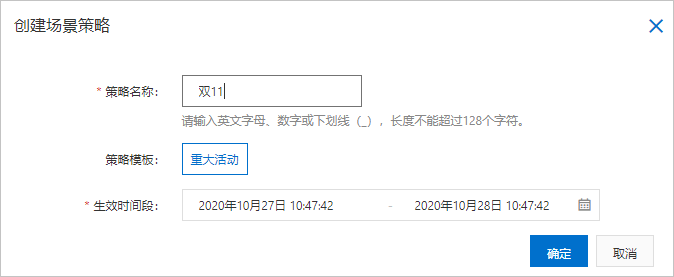

   <table>
     <tr>
       <th width="105">参数</th>
       <th>说明</th>
     </tr>
     <tr>
       <td>策略名称</td>
       <td>为策略命名。</td>
     </tr>
     <tr>
       <td>策略模板</td>
       <td>选择要应用的定制策略模板，目前仅支持<strong>重大活动</strong>。</td>
     </tr>
     <tr>
       <td>生效时间段</td>
       <td>选择策略的生效时间段。<br>说明如果同一个策略模板下存在多个策略，则这些策略的<strong>生效时间段</strong>不允许重合。</td>
     </tr>
   </table>

   成功添加策略后，策略默认开启。您可以在策略列表中查看新建的策略，并通过策略的**状态**了解策略是否生效。不同策略状态的说明如下：

   - **等待生效**：当前时间还未到活动生效时间段。

   - **生效中**：活动策略下发生效中，需要1~2分钟完成。

   - **运行生效**：当前时间处于活动生效时间段。

   - **过期失效**：当前时间晚于活动生效时间段。

   - **已被禁用**：策略被禁用。即使当前时间处于活动生效时间段内，活动策略也不会生效。

5. 在策略列表中，定位到新建的策略，单击其操作列下的**配置对象**。

   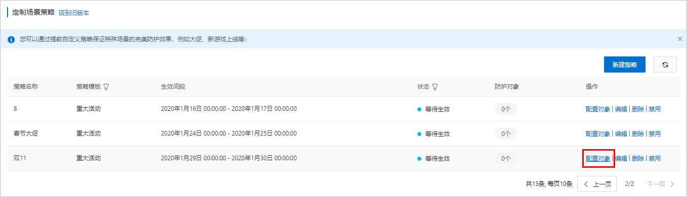

6. 从已接入DDoS高防的域名或DDoS高防IP中选择要应用当前策略的域名或IP，并单击**确定**。

   > **说明**
   >
   > 如果您的业务是网站业务且通过域名接入DDoS高防，建议您为对应域名应用策略；如果您的业务是四层业务，且不是通过域名接入DDoS高防，建议您为对应IP应用策略。

   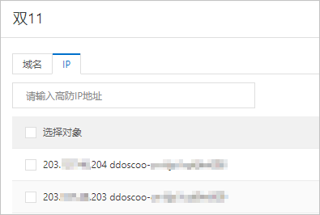

   成功应用策略后，策略的**防护对象**信息将会自动更新。您可以将光标放置在防护对象信息上，查看应用当前策略的域名或IP。

   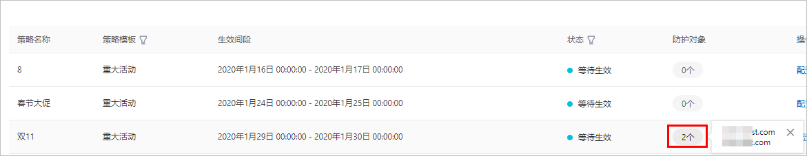
