阿里云  
专有云  
应用身份服务  
租户侧应用身份服务 开发指南  
产品版本：v3.18.6  
文档版本：20261023

**目录**

- [1.OpenAPI参考指南](#section-1)
    - [1.1. API概览](#section-1-1)
    - [1.2. 服务接入点](#section-1-2)
    - [1.3. 授权信息](#section-1-3)
    - [1.4. API目录](#section-1-4)
        - [1.4.1. 实例管理](#section-1-4-1)
            - [1.4.1.1. 设置实例语言、时区信息](#section-1-4-1-1)
            - [1.4.1.2. 开启EIAM实例由初始化域名自动跳转到默认域名](#section-1-4-1-2)
            - [1.4.1.3. 关闭EIAM实例由初始化域名自动跳转到默认域名](#section-1-4-1-3)
            - [1.4.1.4. 修改实例描述](#section-1-4-1-4)
            - [1.4.1.5. 删除实例](#section-1-4-1-5)
            - [1.4.1.6. 创建实例](#section-1-4-1-6)
            - [1.4.1.7. 修改实例规格](#section-1-4-1-7)
            - [1.4.1.8. 查询实例列表](#section-1-4-1-8)
            - [1.4.1.9. 查询实例的License信息](#section-1-4-1-9)
            - [1.4.1.10. 获取实例语言、时区信息](#section-1-4-1-10)
        - [1.4.2. 应用管理](#section-1-4-2)
            - [1.4.2.1. 应用基本信息管理](#section-1-4-2-1)
                - [1.4.2.1.1. 创建一个EIAM应用](#section-1-4-2-1-1)
                - [1.4.2.1.2. 删除一个EIAM应用](#section-1-4-2-1-2)
                - [1.4.2.1.3. 更新一个EIAM应用的描述信息](#section-1-4-2-1-3)
                - [1.4.2.1.4. 启用一个EIAM应用](#section-1-4-2-1-4)
                - [1.4.2.1.5. 禁用一个EIAM应用](#section-1-4-2-1-5)
                - [1.4.2.1.6. 查询一个EIAM应用的详细信息](#section-1-4-2-1-6)
                - [1.4.2.1.7. 列表查询EIAM应用](#section-1-4-2-1-7)
                - [1.4.2.1.8. 获取网络域关联的应用列表。](#section-1-4-2-1-8)
                - [1.4.2.1.9. 查询一个EIAM组可访问的应用列表。](#section-1-4-2-1-9)
                - [1.4.2.1.10. 获取应用模板信息](#section-1-4-2-1-10)
                - [1.4.2.1.11. 更新应用基本信息](#section-1-4-2-1-11)
                - [1.4.2.1.12. 获取网络访问端点下的App信息](#section-1-4-2-1-12)
            - [1.4.2.2. 应用SSO配置管理](#section-1-4-2-2)
                - [1.4.2.2.1. 更新模板应用的SSO参数](#section-1-4-2-2-1)
                - [1.4.2.2.2. 启用一个EIAM应用SSO功能](#section-1-4-2-2-2)
                - [1.4.2.2.3. 禁用一个EIAM应用的SSO功能](#section-1-4-2-2-3)
                - [1.4.2.2.4. 查询一个EIAM应用的单点登录SSO配置](#section-1-4-2-2-4)
                - [1.4.2.2.5. 设置一个EIAM应用的单点登录SSO配置](#section-1-4-2-2-5)
            - [1.4.2.3. 应用授权管理](#section-1-4-2-3)
                - [1.4.2.3.1. 授予多个EIAM账户访问一个应用的权限](#section-1-4-2-3-1)
                - [1.4.2.3.2. 授予多个EIAM组织访问一个应用的权限](#section-1-4-2-3-2)
                - [1.4.2.3.3. 授予多个EIAM组访问一个应用的权限](#section-1-4-2-3-3)
                - [1.4.2.3.4. 取消多个EIAM账户访问一个应用的权限](#section-1-4-2-3-4)
                - [1.4.2.3.5. 取消多个EIAM组织访问一个应用的权限](#section-1-4-2-3-5)
                - [1.4.2.3.6. 取消多个EIAM组访问一个应用的权限](#section-1-4-2-3-6)
                - [1.4.2.3.7. 更改一个应用的访问授权类型](#section-1-4-2-3-7)
                - [1.4.2.3.8. 查询一个EIAM应用被授权访问的账户列表](#section-1-4-2-3-8)
                - [1.4.2.3.9. 查询一个EIAM应用被授权访问的组织列表](#section-1-4-2-3-9)
                - [1.4.2.3.10. 查询一个EIAM应用被授权访问的组列表](#section-1-4-2-3-10)
                - [1.4.2.3.11. 查询一个EIAM组织可访问的应用列表信息](#section-1-4-2-3-11)
                - [1.4.2.3.12. 查询一个EIAM账户可访问的应用列表信息](#section-1-4-2-3-12)
            - [1.4.2.4. 应用联邦凭证管理](#section-1-4-2-4)
                - [1.4.2.4.1. 更新应用联邦凭证](#section-1-4-2-4-1)
                - [1.4.2.4.2. 启用应用联邦凭证](#section-1-4-2-4-2)
                - [1.4.2.4.3. 查询应用联邦凭证列表](#section-1-4-2-4-3)
                - [1.4.2.4.4. 更新应用联邦凭证描述](#section-1-4-2-4-4)
                - [1.4.2.4.5. 删除应用联邦凭证](#section-1-4-2-4-5)
                - [1.4.2.4.6. 创建应用联邦凭证](#section-1-4-2-4-6)
                - [1.4.2.4.7. 获取应用联邦凭证](#section-1-4-2-4-7)
                - [1.4.2.4.8. 禁用应用联邦凭证](#section-1-4-2-4-8)
            - [1.4.2.5. 应用ClientSecret管理](#section-1-4-2-5)
                - [1.4.2.5.1. 创建一个EIAM应用的客户端密钥](#section-1-4-2-5-1)
                - [1.4.2.5.2. 删除一个EIAM应用的客户端密钥](#section-1-4-2-5-2)
                - [1.4.2.5.3. 禁用一个EIAM应用的客户端密钥](#section-1-4-2-5-3)
                - [1.4.2.5.4. 启用一个EIAM应用的客户端密钥](#section-1-4-2-5-4)
                - [1.4.2.5.5. 查询一个EIAM应用所属的全部客户端密钥](#section-1-4-2-5-5)
                - [1.4.2.5.6. 查询一个EIAM应用的客户端密钥](#section-1-4-2-5-6)
                - [1.4.2.5.7. 更新一个EIAM应用的客户端密钥有效期](#section-1-4-2-5-7)
            - [1.4.2.6. 应用Token管理](#section-1-4-2-6)
                - [1.4.2.6.1. 创建应用Token](#section-1-4-2-6-1)
                - [1.4.2.6.2. 启用应用Token](#section-1-4-2-6-2)
                - [1.4.2.6.3. 禁用应用Token](#section-1-4-2-6-3)
                - [1.4.2.6.4. 更新ApplicationToken过期时间](#section-1-4-2-6-4)
                - [1.4.2.6.5. 获取应用Token列表](#section-1-4-2-6-5)
                - [1.4.2.6.6. 查询指定应用Token](#section-1-4-2-6-6)
                - [1.4.2.6.7. 删除应用Token](#section-1-4-2-6-7)
            - [1.4.2.7. 应用子账号管理](#section-1-4-2-7)
                - [1.4.2.7.1. 在当前应用下给指定员工添加一个应用账号](#section-1-4-2-7-1)
                - [1.4.2.7.2. 分页查询应用下的应用账户列表](#section-1-4-2-7-2)
                - [1.4.2.7.3. 查询当前应用下指定用户的所有账号](#section-1-4-2-7-3)
                - [1.4.2.7.4. 删除一个当前应用下的指定员工的应用账号](#section-1-4-2-7-4)
            - [1.4.2.8. 应用API开放](#section-1-4-2-8)
                - [1.4.2.8.1. 启用一个EIAM应用的Developer API调用功能](#section-1-4-2-8-1)
                - [1.4.2.8.2. 禁用一个EIAM应用的Developer API调用能力](#section-1-4-2-8-2)
                - [1.4.2.8.3. 设置一个EIAM应用的Developer API授权范围](#section-1-4-2-8-3)
                - [1.4.2.8.4. 查询一个EIAM应用的Developer API授权范围](#section-1-4-2-8-4)
            - [1.4.2.9. 应用账户同步](#section-1-4-2-9)
                - [1.4.2.9.1. 配置应用同步用户主组织](#section-1-4-2-9-1)
                - [1.4.2.9.2. 查询指定应用同步配置](#section-1-4-2-9-2)
                - [1.4.2.9.3. 检查应用同步主组织是否在应用同步范围](#section-1-4-2-9-3)
                - [1.4.2.9.4. 禁用一个EIAM应用的账户同步功能](#section-1-4-2-9-4)
                - [1.4.2.9.5. 启用一个EIAM应用的账户同步功能](#section-1-4-2-9-5)
                - [1.4.2.9.6. 设置一个EIAM应用的账户同步功能配置](#section-1-4-2-9-6)
                - [1.4.2.9.7. 设置一个EIAM应用的账户同步范围](#section-1-4-2-9-7)
                - [1.4.2.9.8. 查询一个EIAM应用的账户同步范围](#section-1-4-2-9-8)
                - [1.4.2.9.9. 查询一个EIAM应用的账户同步功能配置](#section-1-4-2-9-9)
            - [1.4.2.10. 应用高阶配置](#section-1-4-2-10)
                - [1.4.2.10.1. 修改应用高阶配置](#section-1-4-2-10-1)
                - [1.4.2.10.2. 获取应用高阶配置](#section-1-4-2-10-2)
            - [1.4.2.11. 应用角色管理](#section-1-4-2-11)
                - [1.4.2.11.1. 删除应用角色](#section-1-4-2-11-1)
                - [1.4.2.11.2. 创建应用角色](#section-1-4-2-11-2)
                - [1.4.2.11.3. 获取应用角色信息](#section-1-4-2-11-3)
                - [1.4.2.11.4. 查询应用角色列表](#section-1-4-2-11-4)
                - [1.4.2.11.5. 修改应用角色描述](#section-1-4-2-11-5)
                - [1.4.2.11.6. 修改应用角色](#section-1-4-2-11-6)
        - [1.4.3. M2M管理](#section-1-4-3)
            - [1.4.3.1. 基础能力管理](#section-1-4-3-1)
                - [1.4.3.1.1. 启用应用的M2M客户端能力](#section-1-4-3-1-1)
                - [1.4.3.1.2. 禁用应用M2M客户端能力](#section-1-4-3-1-2)
            - [1.4.3.2. 应用ClientPublicKey管理](#section-1-4-3-2)
                - [1.4.3.2.1. 创建应用ClientPublicKey](#section-1-4-3-2-1)
                - [1.4.3.2.2. 查询指定应用ClientPublicKey](#section-1-4-3-2-2)
                - [1.4.3.2.3. 启用指定的应用ClientPublicKey](#section-1-4-3-2-3)
                - [1.4.3.2.4. 禁用指定的应用ClientPublicKey](#section-1-4-3-2-4)
                - [1.4.3.2.5. 设置指定的应用ClientPublicKey优先使用](#section-1-4-3-2-5)
                - [1.4.3.2.6. 查询指定应用的ClientPublicKey列表](#section-1-4-3-2-6)
                - [1.4.3.2.7. 删除指定的应用ClientPublicKey](#section-1-4-3-2-7)
        - [1.4.4. 联邦信任源管理](#section-1-4-4)
            - [1.4.4.1. 查询联邦信任源列表](#section-1-4-4-1)
            - [1.4.4.2. 根据联邦信任源ID查询应用联邦凭证列表](#section-1-4-4-2)
            - [1.4.4.3. 获取联邦信任源](#section-1-4-4-3)
            - [1.4.4.4. 启用联邦信任源](#section-1-4-4-4)
            - [1.4.4.5. 禁用联邦信任源](#section-1-4-4-5)
            - [1.4.4.6. 创建联邦信任源](#section-1-4-4-6)
            - [1.4.4.7. 更新联邦信任源](#section-1-4-4-7)
            - [1.4.4.8. 更新联邦信任源描述](#section-1-4-4-8)
            - [1.4.4.9. 删除联邦信任源](#section-1-4-4-9)
        - [1.4.5. 账户管理](#section-1-4-5)
            - [1.4.5.1. 管理三方登录账户](#section-1-4-5-1)
                - [1.4.5.1.1. 绑定三方登录账户](#section-1-4-5-1-1)
                - [1.4.5.1.2. 查询三方登录账户绑定关系](#section-1-4-5-1-2)
                - [1.4.5.1.3. 解绑三方登录账户](#section-1-4-5-1-3)
            - [1.4.5.2. 创建一个EIAM账户](#section-1-4-5-2)
            - [1.4.5.3. 将一个EIAM账户加入到多个EIAM组织](#section-1-4-5-3)
            - [1.4.5.4. 禁用一个EIAM账号](#section-1-4-5-4)
            - [1.4.5.5. 删除一个EIAM账户](#section-1-4-5-5)
            - [1.4.5.6. 解锁一个EIAM账户](#section-1-4-5-6)
            - [1.4.5.7. 设置指定EIAM账户的主组织](#section-1-4-5-7)
            - [1.4.5.8. 将一个EIAM账户从多个EIAM组织中移除](#section-1-4-5-8)
            - [1.4.5.9. 列表查询EIAM账户信息](#section-1-4-5-9)
            - [1.4.5.10. 查询一个EIAM账户信息](#section-1-4-5-10)
            - [1.4.5.11. 更新一个EIAM账户密码](#section-1-4-5-11)
            - [1.4.5.12. 更新一个EIAM账户描述信息](#section-1-4-5-12)
            - [1.4.5.13. 更新一个EIAM账户基本信息](#section-1-4-5-13)
            - [1.4.5.14. 启用一个EIAM账号](#section-1-4-5-14)
            - [1.4.5.15. 批量删除账户](#section-1-4-5-15)
        - [1.4.6. 组织管理](#section-1-4-6)
            - [1.4.6.1. 创建一个EIAM组织](#section-1-4-6-1)
            - [1.4.6.2. 删除一个EIAM组织](#section-1-4-6-2)
            - [1.4.6.3. 更新一个EIAM组织基本信息](#section-1-4-6-3)
            - [1.4.6.4. 删除组织及下面的所有账户和子组织](#section-1-4-6-4)
            - [1.4.6.5. 更新一个EIAM组织的父组织ID](#section-1-4-6-5)
            - [1.4.6.6. 更新一个EIAM组织描述信息](#section-1-4-6-6)
            - [1.4.6.7. 查询EIAM根组织信息](#section-1-4-6-7)
            - [1.4.6.8. 查询一个EIAM组织信息](#section-1-4-6-8)
            - [1.4.6.9. 列表查询EIAM组织信息](#section-1-4-6-9)
            - [1.4.6.10. 列表查询一个EIAM组织的所有先代组织](#section-1-4-6-10)
        - [1.4.7. 账户组管理](#section-1-4-7)
            - [1.4.7.1. 创建一个EIAM账户组](#section-1-4-7-1)
            - [1.4.7.2. 将多个EIAM账户添加到指定EIAM账户组](#section-1-4-7-2)
            - [1.4.7.3. 删除一个EIAM账户组](#section-1-4-7-3)
            - [1.4.7.4. 将多个EIAM账户从指定EIAM账户组中移除](#section-1-4-7-4)
            - [1.4.7.5. 更新一个EIAM账户组](#section-1-4-7-5)
            - [1.4.7.6. 更新一个EIAM账户组描述](#section-1-4-7-6)
            - [1.4.7.7. 查询一个EIAM账户组](#section-1-4-7-7)
            - [1.4.7.8. 列表查询EIAM账户组信息](#section-1-4-7-8)
            - [1.4.7.9. 列表查询一个EIAM账户组下的账户信息](#section-1-4-7-9)
            - [1.4.7.10. 列表查询一个EIAM账户的所属账户组信息](#section-1-4-7-10)
        - [1.4.8. 身份提供方管理](#section-1-4-8)
            - [1.4.8.1. 获取网络端点下的IdP信息](#section-1-4-8-1)
            - [1.4.8.2. 创建身份提供方](#section-1-4-8-2)
            - [1.4.8.3. 删除身份提供方](#section-1-4-8-3)
            - [1.4.8.4. 更新身份提供方基础配置](#section-1-4-8-4)
            - [1.4.8.5. 获取身份提供方](#section-1-4-8-5)
            - [1.4.8.6. 获取身份提供方列表](#section-1-4-8-6)
            - [1.4.8.7. 禁用身份提供方同步入](#section-1-4-8-7)
            - [1.4.8.8. 启用身份提供方同步入](#section-1-4-8-8)
            - [1.4.8.9. 设置IdP同步入配置信息](#section-1-4-8-9)
            - [1.4.8.10. 获取IdP同步入配置信息](#section-1-4-8-10)
            - [1.4.8.11. 禁用认证](#section-1-4-8-11)
            - [1.4.8.12. 启用认证](#section-1-4-8-12)
            - [1.4.8.13. 解析IdP Metadata信息](#section-1-4-8-13)
            - [1.4.8.14. 获取IdP同步出配置](#section-1-4-8-14)
            - [1.4.8.15. 获取IdP检查任务](#section-1-4-8-15)
            - [1.4.8.16. 创建IdP状态检查任务](#section-1-4-8-16)
            - [1.4.8.17. 禁用高级配置](#section-1-4-8-17)
            - [1.4.8.18. 获取高级配置信息](#section-1-4-8-18)
            - [1.4.8.19. 启用高级配置](#section-1-4-8-19)
            - [1.4.8.20. 修改IdP同步出配置](#section-1-4-8-20)
            - [1.4.8.21. 修改认证信息](#section-1-4-8-21)
        - [1.4.9. 密码策略](#section-1-4-9)
            - [1.4.9.1. 设置EIAM密码初始化策略](#section-1-4-9-1)
            - [1.4.9.2. 设置EIAM密码过期策略](#section-1-4-9-2)
            - [1.4.9.3. 查询EIAM忘记密码策略](#section-1-4-9-3)
            - [1.4.9.4. 设置EIAM密码历史策略](#section-1-4-9-4)
            - [1.4.9.5. 设置EIAM密码复杂度策略](#section-1-4-9-5)
            - [1.4.9.6. 设置EIAM忘记密码策略](#section-1-4-9-6)
            - [1.4.9.7. 查询EIAM密码初始化策略](#section-1-4-9-7)
            - [1.4.9.8. 查询EIAM密码历史策略](#section-1-4-9-8)
            - [1.4.9.9. 查询EIAM密码过期策略](#section-1-4-9-9)
            - [1.4.9.10. 查询EIAM密码复杂度策略](#section-1-4-9-10)
        - [1.4.10. 同步](#section-1-4-10)
            - [1.4.10.1. 列表查询同步任务信息](#section-1-4-10-1)
            - [1.4.10.2. 运行同步任务](#section-1-4-10-2)
            - [1.4.10.3. 查询单个同步任务信息](#section-1-4-10-3)
        - [1.4.11. 品牌](#section-1-4-11)
            - [1.4.11.1. 创建品牌](#section-1-4-11-1)
            - [1.4.11.2. 删除品牌](#section-1-4-11-2)
            - [1.4.11.3. 更新品牌](#section-1-4-11-3)
            - [1.4.11.4. 禁用品牌](#section-1-4-11-4)
            - [1.4.11.5. 启用品牌](#section-1-4-11-5)
            - [1.4.11.6. 查询一个品牌的信息](#section-1-4-11-6)
            - [1.4.11.7. 为品牌设置登录跳转应用](#section-1-4-11-7)
            - [1.4.11.8. 查询品牌列表](#section-1-4-11-8)
            - [1.4.11.9. 获取品牌登录跳转应用](#section-1-4-11-9)
            - [1.4.11.10. 修改域名品牌](#section-1-4-11-10)
        - [1.4.12. 自定义条款](#section-1-4-12)
            - [1.4.12.1. 获取自定义条款](#section-1-4-12-1)
            - [1.4.12.2. 启用自定义条款](#section-1-4-12-2)
            - [1.4.12.3. 禁用自定义条款](#section-1-4-12-3)
            - [1.4.12.4. 查询品牌关联的自定义条款列表](#section-1-4-12-4)
            - [1.4.12.5. 查询自定义条款列表](#section-1-4-12-5)
            - [1.4.12.6. 更新自定义条款信息](#section-1-4-12-6)
            - [1.4.12.7. 移除品牌关联条款](#section-1-4-12-7)
            - [1.4.12.8. 删除自定义条款](#section-1-4-12-8)
            - [1.4.12.9. 创建自定义条款](#section-1-4-12-9)
            - [1.4.12.10. 添加条款到品牌](#section-1-4-12-10)
        - [1.4.13. 网络端点](#section-1-4-13)
            - [1.4.13.1. 创建一个网络端点](#section-1-4-13-1)
            - [1.4.13.2. 删除一个专属网络端点](#section-1-4-13-2)
            - [1.4.13.3. 更新网络端点名称](#section-1-4-13-3)
            - [1.4.13.4. 查询网络端点支持地域列表](#section-1-4-13-4)
            - [1.4.13.5. 查询网络端点支持的可用区列表](#section-1-4-13-5)
            - [1.4.13.6. 查询一个网络端点信息](#section-1-4-13-6)
            - [1.4.13.7. 查询网络端点列表](#section-1-4-13-7)
            - [1.4.13.8. 查询网络端点的访问路径列表](#section-1-4-13-8)
            - [1.4.13.9. 校验服务关联角色是否存在](#section-1-4-13-9)
            - [1.4.13.10. 创建服务关联角色](#section-1-4-13-10)
        - [1.4.14. 网络区域](#section-1-4-14)
            - [1.4.14.1. 创建网络区域对象。](#section-1-4-14-1)
            - [1.4.14.2. 删除网络区域对象。](#section-1-4-14-2)
            - [1.4.14.3. 更新网络区域对象](#section-1-4-14-3)
            - [1.4.14.4. 更新网络区域对象描述](#section-1-4-14-4)
            - [1.4.14.5. 查询网络区域对象列表。](#section-1-4-14-5)
            - [1.4.14.6. 获取网络区域对象](#section-1-4-14-6)
        - [1.4.15. 认证源](#section-1-4-15)
            - [1.4.15.1. 启用内部认证源](#section-1-4-15-1)
            - [1.4.15.2. 禁用内部认证源](#section-1-4-15-2)
        - [1.4.16. 认证器](#section-1-4-16)
            - [1.4.16.1. 设置WebAuthn配置](#section-1-4-16-1)
            - [1.4.16.2. 删除指定WebAuthn认证器名称](#section-1-4-16-2)
            - [1.4.16.3. 解绑指定用户TOTP](#section-1-4-16-3)
        - [1.4.17. 数据权限管理](#section-1-4-17)
            - [1.4.17.1. 启用授权规则](#section-1-4-17-1)
            - [1.4.17.2. 列表查询授权规则关联的账户](#section-1-4-17-2)
            - [1.4.17.3. 将账户添加到授权规则](#section-1-4-17-3)
            - [1.4.17.4. 将组添加到授权规则](#section-1-4-17-4)
            - [1.4.17.5. 将应用添加到授权规则](#section-1-4-17-5)
            - [1.4.17.6. 查询授权规则](#section-1-4-17-6)
            - [1.4.17.7. 禁用授权规则](#section-1-4-17-7)
            - [1.4.17.8. 将账户从授权规则中移除](#section-1-4-17-8)
            - [1.4.17.9. 将组从授权规则中移除](#section-1-4-17-9)
            - [1.4.17.10. 将应用从授权规则中移除](#section-1-4-17-10)
            - [1.4.17.11. 列表查询授权规则关联的组](#section-1-4-17-11)
            - [1.4.17.12. 列表查询账户关联的授权规则](#section-1-4-17-12)
            - [1.4.17.13. 列表查询组关联的授权规则](#section-1-4-17-13)
            - [1.4.17.14. 列表查询应用关联的授权规则](#section-1-4-17-14)
            - [1.4.17.15. 列表查询授权规则](#section-1-4-17-15)
            - [1.4.17.16. 列表查询授权资源信息](#section-1-4-17-16)
            - [1.4.17.17. 列表查询授权规则关联的应用](#section-1-4-17-17)
            - [1.4.17.18. 更新授权规则与账户的关系属性信息](#section-1-4-17-18)
            - [1.4.17.19. 更新授权规则与组的关系属性信息](#section-1-4-17-19)
            - [1.4.17.20. 更新授权规则描述信息](#section-1-4-17-20)
            - [1.4.17.21. 更新授权规则与应用的关系属性信息](#section-1-4-17-21)
            - [1.4.17.22. 更新授权规则基本信息](#section-1-4-17-22)
            - [1.4.17.23. 创建授权规则](#section-1-4-17-23)
            - [1.4.17.24. 删除授权规则](#section-1-4-17-24)
        - [1.4.18. 导入文件](#section-1-4-18)
            - [1.4.18.1. 获取上传认证](#section-1-4-18-1)
            - [1.4.18.2. 生成文件导入模板](#section-1-4-18-2)
            - [1.4.18.3. 生成文件导入结果下载地址](#section-1-4-18-3)
        - [1.4.19. OAuth Token](#section-1-4-19)
            - [1.4.19.1. 生成 OAuth Token](#section-1-4-19-1)
        - [1.4.20. 扩展属性](#section-1-4-20)
            - [1.4.20.1. 创建扩展字段](#section-1-4-20-1)
            - [1.4.20.2. 获取扩展字段信息](#section-1-4-20-2)
            - [1.4.20.3. 启用扩展字段](#section-1-4-20-3)
            - [1.4.20.4. 禁用扩展字段](#section-1-4-20-4)
            - [1.4.20.5. 删除扩展字段](#section-1-4-20-5)
        - [1.4.21. 事件](#section-1-4-21)
            - [1.4.21.1. 查看事件列表](#section-1-4-21-1)
            - [1.4.21.2. 查看调用事件列表](#section-1-4-21-2)
        - [1.4.22. 其他](#section-1-4-22)
            - [1.4.22.1. 列表查询应用支持的账户同步类型](#section-1-4-22-1)
            - [1.4.22.2. 生成WebAuthn认证器注册URL](#section-1-4-22-2)
    - [1.5. 版本说明](#section-1-5)
- [2.DeveloperAPI参考指南](#section-2)
    - [2.1. API概览](#section-2-1)
    - [2.2. 服务接入点](#section-2-2)
    - [2.3. API目录](#section-2-3)
        - [2.3.1. OIDC API](#section-2-3-1)
            - [2.3.1.1. GenerateToken - 生成应用认证token](#section-2-3-1-1)
            - [2.3.1.2. GetUserInfo - 获取账户信息](#section-2-3-1-2)
            - [2.3.1.3. RevokeToken - 吊销指定的token](#section-2-3-1-3)
        - [2.3.2. 授权范围 API](#section-2-3-2)
            - [2.3.2.1. GetApplicationProvisioningScope - 获取应用同步范围信息](#section-2-3-2-1)
        - [2.3.3. 组织管理 API](#section-2-3-3)
            - [2.3.3.1. CreateOrganizationalUnit - 创建一个EIAM组织](#section-2-3-3-1)
            - [2.3.3.2. PatchOrganizationalUnit - 更新一个EIAM组织](#section-2-3-3-2)
            - [2.3.3.3. GetOrganizationalUnit - 查询一个EIAM组织信息](#section-2-3-3-3)
            - [2.3.3.4. DeleteOrganizationalUnit - 删除一个EIAM组织](#section-2-3-3-4)
            - [2.3.3.5. ListOrganizationalUnits - 列表查询EIAM组织列表信息](#section-2-3-3-5)
            - [2.3.3.6. ListOrganizationalUnitParentIds - 列表查询组织先代节点](#section-2-3-3-6)
            - [2.3.3.7. GetOrganizationalUnitIdByExternalId - 通过组织外部ID获取组织ID](#section-2-3-3-7)
        - [2.3.4. 账户管理 API](#section-2-3-4)
            - [2.3.4.1. CreateUser - 创建一个EIAM账户](#section-2-3-4-1)
            - [2.3.4.2. PatchUser - 更新一个EIAM账户信息](#section-2-3-4-2)
            - [2.3.4.3. GetUser - 查询一个EIAM账户详细信息](#section-2-3-4-3)
            - [2.3.4.4. UpdateUserPassword - 更新一个EIAM账户的密码](#section-2-3-4-4)
            - [2.3.4.5. DeleteUser - 删除一个EIAM账户](#section-2-3-4-5)
            - [2.3.4.6. ListUsers - 列表查询EIAM账户](#section-2-3-4-6)
            - [2.3.4.7. EnableUser - 启用一个EIAM账户](#section-2-3-4-7)
            - [2.3.4.8. DisableUser - 禁用一个EIAM账户](#section-2-3-4-8)
            - [2.3.4.9. GetUserIdByEmail - 通过邮箱获取EIAM账户ID](#section-2-3-4-9)
            - [2.3.4.10. GetUserIdByPhoneNumber - 通过手机号获取EIAM账户ID](#section-2-3-4-10)
            - [2.3.4.11. GetUserIdByUserExternalId - 通过账户外部ID获取EIAM账户ID](#section-2-3-4-11)
            - [2.3.4.12. GetUserIdByUsername - 通过账户名获取EIAM账户ID](#section-2-3-4-12)
            - [2.3.4.13. SetUserPrimaryOrganizationalUnit - 设置一个EIAM账户所属主组织](#section-2-3-4-13)
            - [2.3.4.14. AddUserToOrganizationalUnits - 将一个EIAM账户加入到多个EIAM组织中](#section-2-3-4-14)
            - [2.3.4.15. RemoveUserFromOrganizationalUnits - 将一个EIAM账户从多个EIAM组织中移除](#section-2-3-4-15)
            - [2.3.4.16. ListGroupsForUser - 查询一个EIAM账户的组列表](#section-2-3-4-16)
        - [2.3.5. 账户组管理 API](#section-2-3-5)
            - [2.3.5.1. GetGroup - 查询一个EIAM组信息](#section-2-3-5-1)
            - [2.3.5.2. CreateGroup - 创建一个EIAM组](#section-2-3-5-2)
            - [2.3.5.3. PatchGroup - 更新一个EIAM组](#section-2-3-5-3)
            - [2.3.5.4. DeleteGroup - 删除一个EIAM组](#section-2-3-5-4)
            - [2.3.5.5. ListGroups - 列表查询EIAM组信息](#section-2-3-5-5)
            - [2.3.5.6. AddUsersToGroup - 将多个EIAM账户加入到一个EIAM组中](#section-2-3-5-6)
            - [2.3.5.7. RemoveUsersFromGroup - 将多个EIAM账户从一个EIAM组中移除](#section-2-3-5-7)
            - [2.3.5.8. ListUsersForGroup - 查询一个EIAM组下的账户列表](#section-2-3-5-8)
- [3.版本说明](#section-3)
- [4.自研应用接入参考](#section-4)
    - [4.1. 接入单点登录](#section-4-1)
        - [4.1.1. 自研应用接入 SSO](#section-4-1-1)
        - [4.1.2. Java SpringBoot 自研应用接入 SSO 示例](#section-4-1-2)
    - [4.2. 接入账户同步](#section-4-2)
        - [4.2.1. 账户同步接入概述](#section-4-2-1)
        - [4.2.2. 通讯录事件](#section-4-2-2)
        - [4.2.3. Java 应用接入账户同步示例](#section-4-2-3)
        - [4.2.4. EIAM支持的SCIM 2.0接口](#section-4-2-4)
    - [4.3. 应用开发 API 参考](#section-4-3)
        - [4.3.1. 应用开发 API 说明](#section-4-3-1)
    - [4.4. 开源代码参考](#section-4-4)

<a id="section-1"></a>

# 1.OpenAPI参考指南

<a id="section-1-1"></a>

## 1.1. API概览

本产品OpenAPI请使用阿里云的SDK进行调用，示例如下：

**增加pom依赖**

```xml
<dependency>
  <groupId>com.aliyun</groupId>
  <artifactId>aliyun-java-sdk-core</artifactId>
  <version>4.5.0</version>
</dependency>
```

**调用接口**

```java
package org.example;

public class CommoRequestTest {
    public static void main(String[] args) throws ClientException {
        DefaultProfile profile = DefaultProfile.getProfile(
            // 当前环境的区域ID
            "${regionId}",
            // 已授权ASCM账号的AK
            "${ak}",
            // 已授权ASCM账号的SK
            "${sk}");
        // 域名端点，格式为：api-idaas-biz.${global:region}.${global:internet-domain}
        String domain = "${domain}";
        // 代理的IP以及端⼝
        String proxy = "HTTP://${proxyIp}:${proxyPort}";
        String method = "GET";
        String version = "2021-12-01";
        String action = "ListLanguages";
        Map<String, String> headerParam = new HashMap<>();
        Map<String, String> pathParam = new HashMap<>();
        Map<String, String> queryParam = new HashMap<>();
        Map<String, String> bodyParam = new HashMap<>();
        queryParam.put("InstanceId","123");
        queryParam.put("Action",action);
        doRpcRequest(profile, domain, proxy, version, action, method, headerParam, path
Param, queryParam, bodyParam);
    }

    public static void doRpcRequest(IClientProfile profile, String domain, String proxy, String version, String action, String method,
                                    Map<String, String> headerParam,
                                    Map<String, String> pathParam,
                                    Map<String, String> queryParam,
                                    Map<String, String> bodyParam) {

        HttpClientConfig clientConfig = HttpClientConfig.getDefault();
        clientConfig.setReadTimeoutMillis(100 * 1000);
        clientConfig.setHttpProxy(proxy);
        clientConfig.setIgnoreSSLCerts( true);
        profile.setHttpClientConfig(clientConfig);
        DefaultAcsClient client = new DefaultAcsClient(profile);
        CommonRequest request = new CommonRequest();
        request.setSysDomain(domain);
        request.setSysVersion(version);
        request.setSysAction(action);
        request.setSysMethod(MethodType.valueOf(method));
        request.setSysProtocol(ProtocolType.HTTPS);

        for (Map.Entry<String, String> entry : headerParam.entrySet()) {
            request.putHeadParameter(entry.getKey(), entry.getValue());
        }

        for (Map.Entry<String, String> entry : pathParam.entrySet()) {
            request.putPathParameter(entry.getKey(), entry.getValue());
        }

        for (Map.Entry<String, String> entry : queryParam.entrySet()) {
            request.putQueryParameter(entry.getKey(), entry.getValue());
        }

        for (Map.Entry<String, String> entry : bodyParam.entrySet()) {
            request.putBodyParameter(entry.getKey(), entry.getValue());
        }

        try {
            CommonResponse response = client.getCommonResponse(request);
            System.out.println(response.getData());
        } catch (ServerException e) {
            // 这⾥可以添加您⾃⼰的错误处理逻辑
            // 例如，打印具体的错误信息
            System.out.println("ErrorCode=" + e.getErrCode());
            System.out.println("ErrorMessage=" + e.getErrMsg());
            // 如果遇上棘⼿问题，可以提交⼯单，并将RequestId提供给我们
            System.out.println("ResponseId=" + e.getRequestId());
        } catch (ClientException e) {
            // 这⾥可以添加您⾃⼰的错误处理逻辑
            // 例如，打印具体的错误信息
            System.out.println("ErrorCode=" + e.getErrCode());
            System.out.println("ErrorMessage=" + e.getErrMsg());
            System.out.println("ResponseId=" + e.getRequestId());
        }
    }
}
```

1. 接口列表

**1.1. 实例管理**

<table>
  <tr>
    <td>序号</td>
    <td>API</td>
    <td>标题</td>
    <td>API概述</td>
  </tr>
  <tr>
    <td>1</td>
    <td>CreateApsaraEiamInstance</td>
    <td>创建实例</td>
    <td>创建一个实例，EIAM所有产品能力都基于实例来提供。</td>
  </tr>
  <tr>
    <td>2</td>
    <td>DeleteApsaraEiamInstance</td>
    <td>删除实例</td>
    <td>删除一个您不再使用的EIAM实例。</td>
  </tr>
  <tr>
    <td>3</td>
    <td>UpdateApsaraEiamInstance Description</td>
    <td>修改实例描述</td>
    <td>修改指定EIAM实例的描述信息。</td>
  </tr>
  <tr>
    <td>4</td>
    <td>ListApsaraEiamInstances</td>
    <td>查询实例列表</td>
    <td>查询一个或者多个EIAM实例信息。</td>
  </tr>
  <tr>
    <td>5</td>
    <td>UpdateApsaraEiamInstance Quota</td>
    <td>修改实例规格</td>
    <td>查询一个EIAM实例的详细信息。</td>
  </tr>
  <tr>
    <td>6</td>
    <td>GetInstanceLicense</td>
    <td>查询实例的License信息</td>
    <td>查询实例当前生效的 License 信息。</td>
  </tr>
  <tr>
    <td>7</td>
    <td>EnableInitDomainAutoRedir ect</td>
    <td>开启EIAM实例由初始化域名自动跳转到默认域名</td>
    <td>开启EIAM实例由初始化域名自动跳转到默认域名，开启后，通过初始化域名访问门户业会跳转到默认域名地址。</td>
  </tr>
  <tr>
    <td>8</td>
    <td>DisableInitDomainAutoRedir ect</td>
    <td>关闭EIAM实例由初始化域名自动跳转到默认域名</td>
    <td>关闭EIAM实例由初始化域名自动跳转到默认域名，关闭后，通过初始化域名访问门户业不会跳转到默认域名。</td>
  </tr>
</table>

**1.2. 应用管理**

| 序号 | API | 标题 | API概述 |
| --- | --- | --- | --- |
| - | 应用基本信息管理 | 应用基本信息管理 |  |
| 1 | CreateApplication | 创建一个EIAM应用 | 在指定EIAM实例下创建一个应用资源。 |
| 2 | DeleteApplication | 删除一个EIAM应用 | 删除一个EIAM应用资源。 |
| 3 | UpdateApplicationDescripti on | 更新一个EIAM应用的描述信息 | 更新一个EIAM应用的描述信息。 |
| 4 | EnableApplication | 启用一个EIAM应用 | 将一个应用从禁用状态变为启用状态。 |
| 5 | DisableApplication | 禁用一个EIAM应用 | 将一个应用从启用状态变为禁用状态，此时应用全部能力不可用。 |
| 6 | GetApplication | 查询一个EIAM应用的详细信息 | 获取指定EIAM应用的详细信息。 |
| 7 | ListApplications | 列表查询EIAM应用 | 分页查询一个或者多个EIAM应用信息。 |
| 8 | GetApplicationTemplate | 获取应用模板信息 | 获取应用模板信息。 |
| 9 | UpdateApplicationInfo | 更新应用基本信息 | 更新应用基本信息。 |
| 10 | ListApplicationsForNetwork AccessEndpoint | 获取网络访问端点下的App信息 | 获取网络访问端点下的App信息。 |
| 11 | ListApplicationsForNetwork Zone | 获取网络域关联的应用列表。 | 获取网络域关联的应用列表。 |
| 12 | ListApplicationsForGroup | 查询一个EIAM组可访问的应用列表。 | 查询一个EIAM组可访问的应用列表 |
| - | 应用SSO配置管理 | 应用SSO配置管理 |  |
| 1 | EnableApplicationSso | 启用一个EIAM应用SSO功能 | 启用一个EIAM应用的SSO功能。 |
| 2 | DisableApplicationSso | 禁用一个EIAM应用的SSO功能 | 禁用一个EIAM应用的SSO单点登录功能，此时应用不支持员工单点登录。 |
| 3 | SetApplicationSsoConfig | 设置一个EIAM应用的单点登录SSO配置 | 设置一个EIAM应用的单点登录SSO配置属性。 |
| 4 | GetApplicationSsoConfig | 查询一个EIAM应用的单点登录SSO配置 | 查询一个EIAM应用的单点登录SSO配置属性。 |
| 5 | UpdateApplicationSsoForm Params | 更新模板应用的SSO参数 | 更新模板应用的SSO参数 |
| - | 应用授权管理 | 应用授权管理 |  |
| 1 | AuthorizeApplicationToUser s | 授予多个EIAM账户访问一个应用的权限 | 批量授予多个EIAM账户访问一个应用的权限。 |
| 2 | AuthorizeApplicationToOrg anizationalUnits | 授予多个EIAM组织访问一个应用的权限 | 批量授予多个EIAM组织访问一个应用的权限。 |
| 3 | AuthorizeApplicationToGro ups | 授予多个EIAM组访问一个应用的权限 | 批量授予多个EIAM组访问一个应用的权限。 |
| 4 | RevokeApplicationFromUse rs | 取消多个EIAM账户访问一个应用的权限 | 批量取消多个EIAM账户访问一个应用的权限。 |
| 5 | RevokeApplicationFromOrg anizationalUnits | 取消多个EIAM组织访问一个应用的权限 | 批量取消多个EIAM组织访问一个应用的权限。 |
| 6 | RevokeApplicationFromGro ups | 取消多个EIAM组访问一个应用的权限 | 批量取消多个EIAM组访问一个应用的权限。 |
| 7 | UpdateApplicationAuthoriz ationType | 更改一个应用的访问授权类型 | 更改指定EIAM应用的访问授权类型。 |
| 8 | ListUsersForApplication | 查询一个EIAM应用被授权访问的账户列表 | 分页查询一个应用被授权访问的账户列表，返回的结果中，包含账户ID信息，如需获取账户详细信息，请调用GetUser接口。 |
| 9 | ListOrganizationalUnitsForA pplication | 查询一个EIAM应用被授权访问的组织列表 | 分页查询一个应用被授权访问的组织列表，返回的结果中，包含组织ID信息，如需获取组织详细信息，请调用GetOrganizationalUnit接口。 |
| 10 | ListGroupsForApplication | 查询一个EIAM应用被授权访问的组列表 | 分页查询一个应用被授权访问的组列表，返回的结果中，包含组ID信息，如需获取组详细信息，请调用GetGroup接口。 |
| 11 | ListApplicationsForUser | 查询一个EIAM账户可访问的应用列表信息 | 分页查询一个EIAM账户可访问的应用列表。返回的结果中，包含应用ID信息，如需获取应用详细信息，请调用GetApplication接口。 |
| 12 | ListApplicationsForOrganiz ationalUnit | 查询一个EIAM组织可访问的应用列表信息 | 分页查询一个EIAM组织可访问的应用列表，返回的结果中，包含应用ID信息，如需获取应用详细信息，请调用GetApplication接口。 |
| - | 应用ClientSecret管理 | 应用ClientSecret管理 |  |
| 1 | CreateApplicationClientSec ret | 创建一个EIAM应用的客户端密钥 | 创建一个EIAM应用的客户端密钥，一个EIAM应用下，最多只能创建两个应用的客户端密钥。 |
| 2 | DeleteApplicationClientSec ret | 删除一个EIAM应用的客户端密钥 | 删除一个EIAM应用的客户端密钥。 |
| 3 | DisableApplicationClientSe cret | 禁用一个EIAM应用的客户端密钥 | 禁用一个EIAM应用的客户端密钥。 |
| 4 | EnableApplicationClientSec ret | 启用一个EIAM应用的客户端密钥 | 启用一个EIAM应用的客户端密钥。 |
| 5 | ListApplicationClientSecret s | 查询一个EIAM应用所属的全部客户端密钥 | 查询一个EIAM应用所属的全部客户端密钥，返回的密钥数据已脱敏，若需要获取未脱敏密钥，请调用ObtainApplicationClientSecret接口。 |
| 6 | ObtainApplicationClientSec ret | 查询一个EIAM应用的客户端密钥 | 获取EIAM应用的客户端密钥，返回的密钥未脱敏。若需要获取已脱敏密钥，请调用ListApplicationClientSecrets接口。 |
| 7 | UpdateApplicationClientSec retExpirationTime | 更新一个EIAM应用的客户端密钥有效期 | 更新应用的指定ClientSecret的到期时间。 |
| - | 应用Token管理 | 应用Token管理 |  |
| 1 | CreateApplicationToken | 创建应用Token | 创建应用Token。 |
| 2 | EnableApplicationToken | 启用应用Token | 启用应用Token。 |
| 3 | DisableApplicationToken | 禁用应用Token | 禁用应用Token。 |
| 4 | UpdateApplicationTokenEx pirationTime | 更新ApplicationToken过期时间 | 更新ApplicationToken过期时间。 |
| 5 | ListApplicationTokens | 获取应用Token列表 | 获取应用Token列表。 |
| 6 | ObtainApplicationToken | 查询指定应用Token | 查询指定应用Token。 |
| 7 | DeleteApplicationToken | 删除应用Token | 删除ApplicationToken。 |
| - | 应用子账号管理 | 应用子账号管理 |  |
| 1 | AddApplicationAccountToU ser | 在当前应用下给指定员工添加一个应用账号 | 在当前应用下给指定员工添加一个应用账号。 |
| 2 | ListApplicationAccounts | 分页查询应用下的应用账户列表 | 分页查询应用下的应用账户列表。 |
| 3 | ListApplicationAccountsFor User | 查询当前应用下指定用户的所有账号 | 查询当前应用下指定用户的所有账号。 |
| 4 | RemoveApplicationAccount FromUser | 删除一个当前应用下的指定员工的应用账号 | 删除一个当前应用下的指定员工的应用账号。 |
| - | 应用API开放 | 应用API开放 |  |
| 1 | EnableApplicationApiInvok e | 启用一个EIAM应用的Developer API调用功能 | 调用EnabledApplicationApiInvoke接口启用一个EIAM应用的Developer API调用功能。 |
| 2 | DisableApplicationApiInvok e | 禁用一个EIAM应用的Developer API调用能力 | 禁用一个EIAM应用的Developer API调用功能。 |
| 3 | SetApplicationGrantScope | 设置一个EIAM应用的Developer API授权范围 | 设置一个EIAM应用的Developer API授权范围。 |
| 4 | GetApplicationGrantScope | 查询一个EIAM应用的Developer API授权范围 | 查询一个EIAM应用的Developer API授权范围。 |
| - | 应用账户同步 | 应用账户同步 |  |
| 1 | DisableApplicationProvision ing | 禁用一个EIAM应用的账户同步功能 | 禁用一个EIAM应用的账户同步功能。 |
| 2 | EnableApplicationProvisioni ng | 启用一个EIAM应用的账户同步功能 | 启用一个EIAM应用的账户同步功能。 |
| 3 | SetApplicationProvisioning Config | 设置一个EIAM应用的账户同步功能配置 | 设置一个EIAM应用的账户同步功能配置。 |
| 4 | SetApplicationProvisioning Scope | 设置一个EIAM应用的账户同步范围 | 设置一个EIAM应用的账户同步范围，该账户同步范围同时为DeveloperAPI可以查询和管理的账户范围。 |
| 5 | GetApplicationProvisioning Config | 查询一个EIAM应用的账户同步功能配置 | 查询一个EIAM应用的账户同步功能配置。 |
| 6 | GetApplicationProvisioning Scope | 查询一个EIAM应用的账户同步范围 | 查询EIAM应用的账户同步范围，该账户同步范围同时为DeveloperAPI可以查询和管理的账户范围。 |

**1.3. 联邦信任源管理**

| 序号 | API | 标题 | API概述 |
| --- | --- | --- | --- |
| 1 | DeleteFederatedCredentialP rovider | 删除联邦信任源 | 删除联邦信任源。 |
| 2 | UpdateFederatedCredential ProviderDescription | 更新联邦信任源描述 | 更新联邦信任源描述。 |
| 3 | UpdateFederatedCredential Provider | 更新联邦信任源 | 更新联邦信任源。 |
| 4 | ListFederatedCredentialPro viders | 查询联邦信任源列表 | 查询联邦信任源列表。 |
| 5 | ListApplicationFederatedCre dentialsForProvider | 根据联邦信任源ID查询应用联邦凭证列表 | 根据联邦信任源ID查询应用联邦凭证列表。 |
| 6 | GetFederatedCredentialPro vider | 获取联邦信任源 | 获取联邦信任源。 |
| 7 | EnableFederatedCredential Provider | 启用联邦信任源 | 启用联邦信任源。 |
| 8 | DisableFederatedCredential Provider | 禁用联邦信任源 | 禁用联邦信任源。 |
| 9 | CreateFederatedCredential Provider | 创建联邦信任源 | 创建联邦信任源。 |

**1.4. 账户管理**

| 序号 | API | 标题 | API概述 |
| --- | --- | --- | --- |
| 1 | CreateUser | 创建一个EIAM账户 | 在指定EIAM实例下创建一个EIAM账户。 |
| 2 | AddUserToOrganizationalUn its | 将一个EIAM账户加入到多个EIAM组织 | 将指定EIAM账户加入到多个EIAM组织中，如果该账户已在该组织中，则直接返回成功。 |
| 3 | DeleteUser | 删除一个EIAM账户 | 删除一个指定的EIAM账户，会清除账户相关的所有信息。 |
| 4 | RemoveUserFromOrganizati onalUnts | 将一个EIAM账户从多个EIAM组织中移除 | 将指定EIAM账户从多个EIAM组织中移除，若该组织为EIAM的主组织，则不支持移除操作。 |
| 5 | UpdateUser | 更新一个EIAM账户基本信息 | 更新一个EIAM账户基本信息。 |
| 6 | UpdateUserPassword | 更新一个EIAM账户密码 | 更新一个指定EIAM账户的密码，密码需符合控制台密码策略的规则要求。 |
| 7 | UpdateUserDescription | 更新一个EIAM账户描述信息 | 更新账户标签或描述。 |
| 8 | DisableUser | 禁用一个EIAM账号 | 将账号状态设置为禁用状态，若账户已处于禁用状态，则直接返回成功。 |
| 9 | EnableUser | 启用一个EIAM账号 | 将账号设置为启用状态。 |
| 10 | UnlockUser | 解锁一个EIAM账户 | 将处于锁定的EIAM账户进行解锁操作。 |
| 11 | SetUserPrimaryOrganizatio nalUnit | 设置指定EIAM账户的主组织 | 设置指定EIAM账户的主组织，账户将从旧主组织移除，加入到新主组织中。 |
| 12 | GetUser | 查询一个EIAM账户信息 | 查询一个EIAM账户详情信息。 |
| 13 | ListUsers | 列表查询EIAM账户信息 | 分页查询EIAM账户信息。 |
| - | 管理三方登录账户 | 管理三方登录账户 |  |
| 1 | BindUserAuthnSourceMappi ng | 绑定三方登录账户 | 绑定三方登录账户 |
| 2 | UnbindUserAuthnSourceMa pping | 解绑三方登录账户 | 解绑三方登录账户 |
| 3 | ListUserAuthnSourceMappin gs | 查询三方账户绑定列表 | 查询三方登录账户绑定关系 |

**1.5. 组织管理**

| 序号 | API | 标题 | API概述 |
| --- | --- | --- | --- |
| 1 | CreateOrganizationalUnit | 创建一个EIAM组织 | 在指定组织下创建一个新的EIAM组织。 |
| 2 | DeleteOrganizationalUnit | 删除一个EIAM组织 | 删除一个指定的EIAM组织，若该组织下含有EIAM账户或子组织，则会删除失败。 |
| 3 | DeleteOrganizationalUnitChil dren | 删除组织及下面的所有账户和子组织 | 删除指定组织的所有数据，可以强制删除指定组织下所有账户和子组织。 |
| 4 | UpdateOrganizationalUnit | 更新一个EIAM组织基本信息 | 更新一个EIAM组织基本信息，如果参数不传，则默认不更新。 |
| 5 | UpdateOrganizationalUnitDe scription | 更新一个EIAM组织描述信息 | 更新一个EIAM组织描述信息，来标记或备注打标。 |
| 6 | UpdateOrganizationalUnitPar entId | 更新一个EIAM组织的父组织ID | 更新一个EIAM组织的父组织ID，相当于将指定的EIAM组织从一个父节点移动到新节点下。 |
| 7 | GetRootOrganizationalUnit | 查询EIAM根组织信息 | 查询EIAM根组织信息。 |
| 8 | GetOrganizationalUnit | 查询一个EIAM组织信息 | 查询一个EIAM组织信息。 |
| 9 | ListOrganizationalUnits | 列表查询EIAM组织信息 | 分页查询EIAM组织信息。 |
| 10 | ListOrganizationalUnitParent s | 列表查询一个EIAM组织的所有先代组织 | 列表查询指定EIAM组织的所有先代组织信息，结果的组织列表以顶级到底级的层级顺序排列。 |

**1.6. 账户组管理**

| 序号 | API | 标题 | API概述 |
| --- | --- | --- | --- |
| 1 | CreateGroup | 创建一个EIAM账户组 | 创建一个EIAM账户组。 |
| 2 | AddUsersToGroup | 将多个EIAM账户添加到指定EIAM账户组 | 将多个EIAM账户添加到指定EIAM账户组。 |
| 3 | DeleteGroup | 删除一个EIAM账户组 | 删除一个EIAM账户组信息。 |
| 4 | RemoveUsersFromGroup | 将多个EIAM账户从指定EIAM账户组中移除 | 将多个EIAM账户从指定EIAM账户组中移除。 |
| 5 | UpdateGroup | 更新一个EIAM账户组 | 更新一个EIAM账户组信息，如果信息为空，则默认不更新。 |
| 6 | UpdateGroupDescription | 更新一个EIAM账户组描述 | 更新一个EIAM账户组描述信息，可作为备注或标记。 |
| 7 | GetGroup | 查询一个EIAM账户组 | 查询一个EIAM账户组详情信息。 |
| 8 | ListGroups | 列表查询EIAM账户组信息 | 列表查询EIAM账户组列表信息。 |
| 9 | ListUsersForGroup | 列表查询一个EIAM账户组下的账户信息 | 查询指定EIAM账户组下的账户列表。 |
| 10 | ListGroupsForUser | 列表查询一个EIAM账户的所属账户组信息 | 查询指定EIAM账户的所属账户组列表。 |

**1.7. 身份提供方管理**

| 序号 | API | 标题 | API概述 |
| --- | --- | --- | --- |
| 1 | CreateIdentityProvider | 创建身份提供方 | 创建身份提供方。 |
| 2 | DeleteIdentityProvider | 删除身份提供方 | 删除身份提供方。 |
| 3 | UpdateIdentityProvider | 更新身份提供方基础配置 | 更新身份提供方基础配置信息。 |
| 4 | GetIdentityProvider | 获取身份提供方 | 获取身份提供方。 |
| 5 | ListIdentityProviders | 获取身份提供方列表 | 查询身份提供方列表。 |
| 6 | EnableIdentityProviderUdPull | 启用身份提供方同步入 | 启用身份提供方同步入功能。 |
| 7 | DisableIdentityProviderUdPul l | 禁用身份提供方同步入 | 禁用身份提供方同步入功能。 |
| 8 | SetIdentityProviderUdPullCon figuration | 设置IdP同步入配置信息 | 修改IdP同步入方向配置信息。 |
| 9 | GetIdentityProviderUdPullCo nfiguration | 获取IdP同步入配置信息 | 获取IdP同步入配置信息。 |
| 10 | ListIdentityProvidersForNetw orkAccessEndpoint | 获取网络端点下的IdP信息 | 获取网络端点下的IdP信息。 |
| 11 | DisableIdentityProviderAuthn | 禁用认证 | 禁用认证。 |
| 12 | EnableIdentityProviderAuthn | 启用认证 | 启用认证。 |

**1.8. 密码策略**

| 序号 | API | 标题 | API概述 |
| --- | --- | --- | --- |
| 1 | SetForgetPasswordConfigur ation | 设置EIAM忘记密码策略 | 设置EIAM忘记密码策略。 |
| 2 | SetPasswordInitializationCo nfiguration | 设置EIAM密码初始化策略 | 设置指定EIAM实例下密码初始化策略。 |
| 3 | SetPasswordHistoryConfigur ation | 设置EIAM密码历史策略 | 设置指定EIAM实例下的密码历史策略。 |
| 4 | SetPasswordExpirationConfi guration | 设置EIAM密码过期策略 | 设置指定EIAM实例下密码过期策略。 |
| 5 | SetPasswordComplexityCon figuration | 设置EIAM密码复杂度策略 | 设置指定EIAM实例下密码复杂度策略。 |
| 6 | GetForgetPasswordConfigur ation | 查询EIAM忘记密码策略 | 查询指定EIAM实例下忘记密码策略。 |
| 7 | GetPasswordInitializationCo nfiguration | 查询EIAM密码初始化策略 | 查询EIAM密码初始化策略。 |
| 8 | GetPasswordHistoryConfigur ation | 查询EIAM密码历史策略 | 查询指定EIAM实例下的密码历史策略。 |
| 9 | GetPasswordExpirationConfi guration | 查询EIAM密码过期策略 | 查询指定EIAM实例下密码过期策略。 |
| 10 | GetPasswordComplexityCon figuration | 查询EIAM密码复杂度策略 | 查询指定EIAM实例下密码复杂度策略。 |

**1.9. 同步**

| 序号 | API | 标题 | API概述 |
| --- | --- | --- | --- |
| 1 | ListSynchronizationJobs | 列表查询同步任务信息 | 列表查询同步任务详情信息。 |
| 2 | RunSynchronizationJob | 运行同步任务 | 运行一个同步任务，会创建一个新的同步任务并立刻执行该任务。 |
| 3 | GetSynchronizationJob | 查询单个同步任务信息 | 获取单个同步任务详情信息。 |

**1.10. 品牌化**

| 序号 | API | 标题 | API概述 |
| --- | --- | --- | --- |
| 1 | CreateBrand | 创建品牌 | 创建品牌。 |
| 2 | GetBrand | 查询一个品牌的信息 | 获取品牌详情 |
| 3 | EnableBrand | 启用品牌 | 启用品牌 |
| 4 | DisableBrand | 禁用品牌 | 禁用品牌 |
| 5 | UpdateBrand | 更新品牌 | 更新品牌 |
| 6 | DeleteBrand | 删除品牌 | 删除品牌 |
| 7 | ListBrands | 查询品牌列表 | 获取品牌列表 |
| 8 | SetLoginRedirectApplicationFor Brand | 为品牌设置登录跳转应用 | 为品牌设置登录后跳转应用 |
| 9 | GetLoginRedirectApplicationFor Brand | 获取品牌登录跳转应用 | 为品牌设置登录后跳转应用 |

**1.11. 自定义条款**

| 序号 | API | 标题 | API概述 |
| --- | --- | --- | --- |
| 1 | CreateCustomPrivacyPolicy | 创建自定义条款 | 创建自定义条款 |
| 2 | GetCustomPrivacyPolicy | 获取自定义条款 | 获取自定义条款 |
| 3 | EnableCustomPrivacyPolicy | 启用自定义条款 | 启用自定义条款 |
| 4 | DisableCustomPrivacyPolicy | 禁用自定义条款 | 禁用自定义条款 |
| 5 | UpdateCustomPrivacyPolicy | 更新自定义条款信息 | 更新自定义条款 |
| 6 | DeleteCustomPrivacyPolicy | 删除自定义条款 | 删除自定义条款 |
| 7 | ListCustomPrivacyPolicies | 查询自定义条款列表 | 自定义条款列表查询。 |
| 8 | AddCustomPrivacyPoliciesT oBrand | 添加自定义条款到品牌 | 添加条款到品牌 |
| 9 | RemoveCustomPrivacyPolici esFromBrand | 从品牌移除自定义条款 | 移除品牌关联条款 |
| 10 | ListCustomPrivacyPoliciesFo rBrand | 查询品牌关联的自定义条款列表 | 获取品牌关联资源的资源 |

**1.12. 网络端点**

| 序号 | API | 标题 | API概述 |
| --- | --- | --- | --- |
| 1 | CreateNetworkAccessEndpo int | 创建一个网络端点 | 创建一个专属网络端点。 |
| 2 | DeleteNetworkAccessEndpoi nt | 删除一个专属网络端点 | 删除一个专属类型的网络端点。 |
| 3 | UpdateNetworkAccessEndp ointName | 更新网络端点名称 | 修改一个专属类型的网络端点名称。 |
| 4 | ListNetworkAccessEndpoint AvailableRegions | 查询网络端点支持地域列表 | 查询IDaaS EIAM支持创建网络端点的地域列表。 |
| 5 | ListNetworkAccessEndpoint AvailableZones | 查询网络端点支持的可用区列表 | 查询IDaaS EIAM指定地域支持创建网络端点的可用区列表。 |
| 6 | GetNetworkAccessEndpoint | 查询一个网络端点信息 | 查询指定的网络端点信息。 |
| 7 | ListNetworkAccessEndpoints | 查询网络端点列表 | 查询IDaaS EIAM实例下的网络端点列表。 |
| 8 | ListNetworkAccessPaths | 查询网络端点的访问路径列表 | 查询指定网络端点下的访问路径列表。 |
| 9 | ListVpcs | 创建网络端点时，查询用户账号下的 VPC 列表 | 查询 VPC 列表 |
| 10 | ListVSwitches | 建网络端点时，查询指定 VPC 下的 vSwitch 列表 | 查询指定 VPC 下的 vSwitch 列表 |
| 11 | ListNatGateways | 查询网络端点的公网出口 IP 地址 | 查询网络端点的公网出口 IP 地址 |
| 12 | ListNetworkInterfaces | 查询网络端点关联到弹性网卡（ENI）列表 | 查询网络端点关联到弹性网卡（ENI）列表 |
| 13 | CheckServiceLinkedRoleExis tence | 校验服务关联角色是否存在 | 校验服务关联角色是否存在 |
| 14 | CreateServiceLinkedRole | 创建服务关联角色 | 创建服务关联角色 |

**1.13. 网络区域**

| 序号 | API | 标题 | API概述 |
| --- | --- | --- | --- |
| 1 | CreateNetworkZone | 创建网络区域对象。 | 创建网络区域对象。 |
| 2 | DeleteNetworkZone | 删除网络区域对象。 | 删除网络区域对象。 |
| 3 | UpdateNetworkZone | 更新网络区域对象 | 更新网络区域对象。 |
| 4 | UpdateNetworkZoneDescripti on | 更新网络区域对象描述 | 更新网络区域对象描述。 |
| 5 | ListNetworkZones | 查询网络区域对象列表。 | 查询网络区域对象列表。 |
| 6 | GetNetworkZone | 获取网络区域对象 | 获取网络区域对象。 |

**1.14. 其他**

<table>
  <tr>
    <td>序号</td>
    <td>API</td>
    <td>标题</td>
    <td>API概述</td>
  </tr>
  <tr>
    <td>1</td>
    <td>ListApplicationSupportedPro visionProtocolTypes</td>
    <td>列表查询应用支持的账户同步类型</td>
    <td>调用ListApplicationSupportedProvisi onProtocolTypes 接口查询应用支持的账户同步类型列表。</td>
  </tr>
</table>

<a id="section-1-2"></a>

## 1.2. 服务接入点

IDaaS 对外提供 OpenAPI 接口能力，业务系统可通过 API 方式管理IDaaS后台，具体域名格式如下：

api-idaas-biz.${global_region}.${internet_domain}

其中 global_region、internet_domain 查看方式，进入**ASCM控制台 -> 安全 -> 应用身份服务-> 进入实例 -> 快速入门**，查看 **门户地址** ：

global_region = cn-ece-entity121-d01

internet_domain = cloud.ece-group-121.com

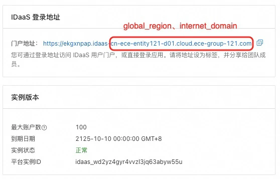

<a id="section-1-3"></a>

## 1.3. 授权信息

访问控制（RAM）是阿里云提供的管理用户身份与资源访问权限的服务。使用 RAM 可以让您避免与其他用户共享阿里云账号密钥，并可按需为用户授予最小权限。RAM 中使用权限策略描述授权的具体内容。

本文为您介绍<em>应用身份服务 (IDaaS)</em>为 RAM 权限策略定义的操作（Action）、资源（Resource）和条件（Condition）。<em>应用身份服务 (IDaaS)</em>的 RAM 代码（RamCode）为*eiam*，支持的授权粒度为*资源级*。

**权限策略通用结构**

权限策略支持 JSON 格式，其通用结构如下：

```json
{
  "Version": "1",
  "Statement": [
    {
      "Effect": "<Effect>",
      "Action": "<Action>",
      "Resource": "<Resource>",
      "Condition": {
        "<Condition_operator>": {
          "<Condition_key>": [
            "<Condition_value>"
          ]
        }
      }
    }
  ]
}        
```

各字段含义如下：

- Effect：权限策略效果。取值：Allow（允许）、Deny（拒绝）。

- Action：授予允许或拒绝权限的具体操作。具体信息，请参见操作（Action）。

- Resource：受操作影响的具体对象，您可以使用资源 ARN 来描述指定资源。具体信息，请参见资源（Resource）。

- Condition：指授权生效的条件。可选字段。具体信息，请参见条件（Condition）。

  - Condition_operator：条件运算符，不同类型的条件对应不同的条件运算符。具体信息，请参见权限策略基本元素。

  - Condition_key：条件关键字。

  - Condition_value：条件关键字对应的值。

**操作（Action）**

下表是<em>应用身份服务 (IDaaS)</em>定义的操作，这些操作可以在 RAM 权限策略语句的 `Action` 元素中使用，用来授予执行该操作的权限。下面对表中的具体项提供说明：

- 操作：是指具体的权限点。

- API：是指操作对应的 API 接口。

- 访问级别：是指每个操作的访问级别，取值为写入（Write）、读取（Read）或列出（List）。

- 资源类型：是指操作中支持授权的资源类型。具体说明如下：

  - 对于必选的资源类型，用前面加 \* 表示。

    

  - 对于不支持资源级授权的操作，用 全部资源 表示。

- 条件关键字：是指云产品自身定义的条件关键字。该列不体现适用于任何操作的通用条件关键字。

- 关联操作：是指成功执行操作所需要的其他权限。操作者必须同时具备关联操作的权限，操作才能成功。

| 操作 | API | 访问级别 | 资源类型 | 条件关键字 | 关联操作 |
| --- | --- | --- | --- | --- | --- |
| eiam:GetFeder atedCredential Provider | GetFederatedCr edentialProvide r | get | \*FederatedCreden tialProvider<br><code> </code><strong>acs:eiam:</strong> {#regionId}: {#accountId}:in stance/{#Instan ceId}/federated credentialprovi der/{#Federate dCredentialProv <strong>iderId}</strong><code> </code> | 无 | 无 |
| eiam:DisableBr and | DisableBrand | update | \*Brand<br><code> </code><strong>acs:eiam:</strong> {#regionId}: {#accountId}:in stance/{#Instan ceId}/brand/{# <strong>BrandId}</strong><code> </code> | 无 | 无 |
| eiam:UpdateFe deratedCreden tialProvider | UpdateFederate dCredentialProv ider | update | \*FederatedCreden tialProvider<br><code> </code><strong>acs:eiam:</strong> {#regionId}: {#accountId}:in stance/{#Instan ceId}/federated credentialprovi der/{#Federate dCredentialProv <strong>iderId}</strong><code> </code> | 无 | 无 |
| eiam:UpdateAp plicationDescri ption | UpdateApplicati onDescription | update | \*Application<br><code> </code><strong>acs:eiam:</strong> {#regionId}: {#accountId}:in stance/{#Instan ceId}/applicatio n/{#Application <strong>Id}</strong><code> </code> | 无 | 无 |
| eiam:RemoveU serFromOrgani zationalUnits | RemoveUserFro mOrganizationa lUnits | delete | \*User<br><code> </code><strong>acs:eiam:</strong> {#regionId}: {#accountId}:in stance/{#Instan ceId}/user/{#Us <strong>erId}</strong><code> </code> | 无 | 无 |
| eiam:ListDomai ns | ListDomains | list | \*Domain<br><code> </code><strong>acs:eiam:</strong> {#regionId}: {#accountId}:in stance/{#Instan ceId}/domain/\* | 无 | 无 |
| eiam:EnableIde ntityProviderAu thn | EnableIdentityP roviderAuthn | update | \*IdentityProvider<br><code> </code><strong>acs:eiam:</strong> {#regionId}: {#accountId}:in stance/{#Instan ceId}/identitypr ovider/{#Identi <strong>tyProviderId}</strong><code> </code> | 无 | 无 |
| eiam:RevokeAp plicationFromO rganizationalUn its | RevokeApplicati onFromOrganiz ationalUnits | delete | \*Application<br><code> </code><strong>acs:eiam:</strong> {#regionId}: {#accountId}:in stance/{#Instan ceId}/applicatio n/{#Application <strong>Id}</strong><code> </code> | 无 | 无 |
| eiam:GetIdentit yProviderUdPul lConfiguration | GetIdentityProvi derUdPullConfig uration | get | \*IdentityProvider<br><code> </code><strong>acs:eiam:</strong> {#regionId}: {#accountId}:in stance/{#Instan ceId}/identitypr ovider/{#Identi <strong>tyProviderId}</strong><code> </code> | 无 | 无 |
| eiam:ListApplic ationAccounts | ListApplicationA ccounts | list | \*ApplicationAccou nt<br><code> </code><strong>acs:eiam:</strong> {#regionId}: {#accountId}:in stance/{#Instan ceId}/applicatio n/{#Application Id}/applicationa <strong>ccount/\*</strong><code> </code> | 无 | 无 |
| eiam:UpdateDo mainIcpNumbe r | UpdateDomainI cpNumber | update | \*Domain<br><code> </code><strong>acs:eiam:</strong> {#regionId}: {#accountId}:in stance/{#Instan ceId}/domain/{<strong>#DomainId}</strong><code> </code> | 无 | 无 |
| eiam:UpdateUs er | UpdateUser | update | \*User<br><code> </code><strong>acs:eiam:</strong> {#regionId}: {#accountId}:in stance/{#Instan ceId}/user/{#Us <strong>erId}</strong><code> </code> | 无 | 无 |
| eiam:Authorize ApplicationToO rganizationalUn its | AuthorizeApplic ationToOrganiz ationalUnits | create | \*Application<br><code> </code><strong>acs:eiam:</strong> {#regionId}: {#accountId}:in stance/{#Instan ceId}/applicatio n/{#Application <strong>Id}</strong><code> </code> | 无 | 无 |
| eiam:DisableAp plicationApiInv oke | DisableApplicati onApiInvoke | update | \*Application<br><code> </code><strong>acs:eiam:</strong> {#regionId}: {#accountId}:in stance/{#Instan ceId}/applicatio n/{#Application <strong>Id}</strong><code> </code> | 无 | 无 |
| eiam:CreateIde ntityProvider | CreateIdentityP rovider | create | \*IdentityProvider<br><code> </code><strong>acs:eiam:</strong> {#regionId}: {#accountId}:in stance/{#Instan ceId}/identitypr <strong>ovider/\*</strong><code> </code> | 无 | 无 |
| eiam:DisableId entityProviderU dPull | DisableIdentityP roviderUdPull | update | \*IdentityProvider<br><code> </code><strong>acs:eiam:</strong> {#regionId}: {#accountId}:in stance/{#Instan ceId}/identitypr ovider/{#Identi <strong>tyProviderId}</strong><code> </code> | 无 | 无 |
| eiam:ListRegio ns | ListRegions | get | \*全部资源<br><code> </code><strong>\*</strong><code> </code> | 无 | 无 |
| eiam:GetForget PasswordConfi guration | GetForgetPassw ordConfiguratio n | get | \*AuthenticationSo urce<br><code> </code><strong>acs:eiam:</strong> {#regionId}: {#accountId}:in stance/{#Instan <strong>ceId}</strong><code> </code> | 无 | 无 |
| eiam:GetPassw ordInitialization Configuration | GetPasswordInit ializationConfig uration | get | \*Instance<br><code> </code><strong>acs:eiam:</strong> {#regionId}: {#accountId}:in stance/{#Instan <strong>ceId}</strong><code> </code> | 无 | 无 |
| eiam:CreateNe tworkAccessEn dpoint | CreateNetwork AccessEndpoint | create | \*NetworkAccessE ndpoint<br><code> </code><strong>acs:eiam:</strong> {#regionId}: {#accountId}:in stance/{#Instan ceId}/networkac cessendpoint/\* | 无 | 无 |
| eiam:UpdateOr ganizationalUni tParentId | UpdateOrganiza tionalUnitParent Id | update | \*OrganizationalUn it<br><code> </code><strong>acs:eiam:</strong> {#regionId}: {#accountId}:in stance/{#Instan ceId}/organizati onalunit/{#Org anizationalUnitI <strong>d}</strong><code> </code> | 无 | 无 |


<table>
  <tr>
    <td>eiam:Authorize ApplicationToU sers</td>
    <td>AuthorizeApplic ationToUsers</td>
    <td>update</td>
    <td>*Application<br><code> </code><strong>acs:eiam:</strong> {#regionId}: {#accountId}:in stance/{#Instan ceId}/applicatio n/{#Application <strong>Id}</strong><code> </code></td>
    <td>无</td>
    <td>无</td>
  </tr>
  <tr>
    <td>eiam:EnableCo nditionalAccess Policy</td>
    <td>EnableCondition alAccessPolicy</td>
    <td>update</td>
    <td>*ConditionalAcces sPolicy<br><code> </code><strong>acs:eiam:</strong> {#regionId}: {#accountId}:in stance/{#Instan ceId}/condition alaccesspolicy/{#ConditionalAcc <strong>essPolicyId}</strong><code> </code></td>
    <td>无</td>
    <td>无</td>
  </tr>
  <tr>
    <td>eiam:EnableAp plicationClientS ecret</td>
    <td>EnableApplicati onClientSecret</td>
    <td>update</td>
    <td>*Secret<br><code> </code><strong>acs:eiam:</strong> {#regionId}: {#accountId}:in stance/{#Instan ceId}/applicatio n/{#Application Id}/secret/{#Se <strong>cretId}</strong><code> </code></td>
    <td>无</td>
    <td>无</td>
  </tr>
  <tr>
    <td>eiam:DeleteIde ntityProvider</td>
    <td>DeleteIdentityPr ovider</td>
    <td>delete</td>
    <td>*IdentityProvider<br><code> </code><strong>acs:eiam:</strong> {#regionId}: {#accountId}:in stance/{#Instan ceId}/identitypr ovider/{#Identi <strong>tyProviderId}</strong><code> </code></td>
    <td>无</td>
    <td>无</td>
  </tr>
  <tr>
    <td>eiam:DeleteCo nditionalAccess Policy</td>
    <td>DeleteCondition alAccessPolicy</td>
    <td>delete</td>
    <td>*ConditionalAcces sPolicy<br><code> </code><strong>acs:eiam:</strong> {#regionId}: {#accountId}:in stance/{#Instan ceId}/condition alaccesspolicy/{#ConditionalAcc <strong>essPolicyId}</strong><code> </code></td>
    <td>无</td>
    <td>无</td>
  </tr>
  <tr>
    <td>eiam:UpdateGr oup</td>
    <td>UpdateGroup</td>
    <td>update</td>
    <td>*Group<br><code> </code><strong>acs:eiam:</strong> {#regionId}: {#accountId}:in stance/{#Instan ceId}/group/{# <strong>GroupId}</strong><code> </code></td>
    <td>无</td>
    <td>无</td>
  </tr>
  <tr>
    <td>eiam:SetForget PasswordConfi guration</td>
    <td>SetForgetPassw ordConfiguratio n</td>
    <td>update</td>
    <td>*Instance<br><code> </code><strong>acs:eiam:</strong> {#regionId}: {#accountId}:in stance/{#Instan <strong>ceId}</strong><code> </code></td>
    <td>无</td>
    <td>无</td>
  </tr>
  <tr>
    <td>eiam:UpdateNe tworkZoneDesc ription</td>
    <td>UpdateNetwork ZoneDescriptio n</td>
    <td>update</td>
    <td>*NetworkZone<br><code> </code><strong>acs:eiam:</strong> {#regionId}: {#accountId}:in stance/{#Instan ceId}/networkz one/{#Network <strong>ZoneId}</strong><code> </code></td>
    <td>无</td>
    <td>无</td>
  </tr>
</table>


<table>
  <tr>
    <td>eiam:EnableDo mainProxyToke n</td>
    <td>EnableDomainP roxyToken</td>
    <td>update</td>
    <td>*DomainProxyTok en<br><code> </code><strong>acs:eiam:</strong> {#regionId}: {#accountId}:in stance/{#Instan ceId}/domain/{#DomainId}/do mainproxytoken/{#DomainProx <strong>yTokenId}</strong><code> </code></td>
    <td>无</td>
    <td>无</td>
  </tr>
  <tr>
    <td>eiam:DeleteFe deratedCreden tialProvider</td>
    <td>DeleteFederate dCredentialProv ider</td>
    <td>delete</td>
    <td>*FederatedCreden tialProvider<br><code> </code><strong>acs:eiam:</strong> {#regionId}: {#accountId}:in stance/{#Instan ceId}/federated credentialprovi der/{#Federate dCredentialProv <strong>iderId}</strong><code> </code></td>
    <td>无</td>
    <td>无</td>
  </tr>
  <tr>
    <td>eiam:UpdateOr ganizationalUni t</td>
    <td>UpdateOrganiza tionalUnit</td>
    <td>update</td>
    <td>*OrganizationalUn it<br><code> </code><strong>acs:eiam:</strong> {#regionId}: {#accountId}:in stance/{#Instan ceId}/organizati onalunit/{#Org anizationalUnitI <strong>d}</strong><code> </code></td>
    <td>无</td>
    <td>无</td>
  </tr>
</table>

<table>
  <tr>
    <td>eiam:UpdateNe tworkZone</td>
    <td>UpdateNetwork Zone</td>
    <td>update</td>
    <td>*NetworkZone<br><code> </code><strong>acs:eiam:</strong> {#regionId}: {#accountId}:in stance/{#Instan ceId}/networkz one/{#Network <strong>ZoneId}</strong><code> </code></td>
    <td>无</td>
    <td>无</td>
  </tr>
  <tr>
    <td>eiam:AddApplic ationAccountTo User</td>
    <td>AddApplication AccountToUser</td>
    <td>create</td>
    <td>*User<br><code> </code><strong>acs:eiam:</strong> {#regionId}: {#accountId}:in stance/{#Instan ceId}/user/{#Us <strong>erId}</strong><code> </code><br>*ApplicationAccou nt<br><code> </code><strong>acs:eiam:</strong> {#regionId}: {#accountId}:in stance/{#Instan ceId}/applicatio n/{#Application Id}/applicationa <strong>ccount/*</strong><code> </code></td>
    <td>无</td>
    <td>无</td>
  </tr>
  <tr>
    <td>eiam:EnableAp plicationFedera tedCredential</td>
    <td>EnableApplicati onFederatedCre dential</td>
    <td>update</td>
    <td>*ApplicationFeder atedCredential<br><code> </code><strong>acs:eiam:</strong> {#regionId}: {#accountId}:in stance/{#Instan ceId}/applicatio n/{#Application Id}/applicationf ederatedcreden tial/{#Applicati onFederatedCre <strong>dentialId}</strong><code> </code></td>
    <td>无</td>
    <td>无</td>
  </tr>
  <tr>
    <td>eiam:GetPassw ordComplexity Configuration</td>
    <td>GetPasswordCo mplexityConfig uration</td>
    <td>get</td>
    <td>*Instance<br><code> </code><strong>acs:eiam:</strong> {#regionId}: {#accountId}:in stance/{#Instan <strong>ceId}</strong><code> </code></td>
    <td>无</td>
    <td>无</td>
  </tr>
  <tr>
    <td>eiam:UpdateUs erPassword</td>
    <td>UpdateUserPass word</td>
    <td>update</td>
    <td>*User<br><code> </code><strong>acs:eiam:</strong> {#regionId}: {#accountId}:in stance/{#Instan ceId}/user/{#Us <strong>erId}</strong><code> </code></td>
    <td>无</td>
    <td>无</td>
  </tr>
  <tr>
    <td>eiam:ObtainDo mainProxyToke n</td>
    <td>ObtainDomainP roxyToken</td>
    <td>get</td>
    <td>*DomainProxyTok en<br><code> </code><strong>acs:eiam:</strong> {#regionId}: {#accountId}:in stance/{#Instan ceId}/domain/{#DomainId}/do mainproxytoken/{#DomainProx <strong>yTokenId}</strong><code> </code></td>
    <td>无</td>
    <td>无</td>
  </tr>
  <tr>
    <td>eiam:ListNetwo rkAccessEndpoi ntAvailableRegi ons</td>
    <td>ListNetworkAcc essEndpointAva ilableRegions</td>
    <td>get</td>
    <td>*全部资源<br><code> </code><strong>*</strong><code> </code></td>
    <td>无</td>
    <td>无</td>
  </tr>
  <tr>
    <td>eiam:DeleteGr oup</td>
    <td>DeleteGroup</td>
    <td>delete</td>
    <td>*Group<br><code> </code><strong>acs:eiam:</strong> {#regionId}: {#accountId}:in stance/{#Instan ceId}/group/{# <strong>GroupId}</strong><code> </code></td>
    <td>无</td>
    <td>无</td>
  </tr>
</table>


<table>
  <tr>
    <td>eiam:CreateDo mainProxyToke n</td>
    <td>CreateDomainP roxyToken</td>
    <td>create</td>
    <td>*DomainProxyTok en<br><code> </code><strong>acs:eiam:</strong> {#regionId}: {#accountId}:in stance/{#Instan ceId}/domain/{#DomainId}/do mainproxytoken<strong>/*</strong><code> </code></td>
    <td>无</td>
    <td>无</td>
  </tr>
  <tr>
    <td>eiam:ListApplic ationsForOrgan izationalUnit</td>
    <td>ListApplications ForOrganization alUnit</td>
    <td>list</td>
    <td>*OrganizationalUn it<br><code> </code><strong>acs:eiam:</strong> {#regionId}: {#accountId}:in stance/{#Instan ceId}/organizati onalunit/{#Org anizationalUnitI <strong>d}</strong><code> </code></td>
    <td>无</td>
    <td>无</td>
  </tr>
  <tr>
    <td>eiam:GetPassw ordHistoryConfi guration</td>
    <td>GetPasswordHis toryConfiguratio n</td>
    <td>get</td>
    <td>*Instance<br><code> </code><strong>acs:eiam:</strong> {#regionId}: {#accountId}:in stance/{#Instan <strong>ceId}</strong><code> </code></td>
    <td>无</td>
    <td>无</td>
  </tr>
  <tr>
    <td>eiam:GetGroup</td>
    <td>GetGroup</td>
    <td>get</td>
    <td>*Group<br><code> </code><strong>acs:eiam:</strong> {#regionId}: {#accountId}:in stance/{#Instan ceId}/group/{# <strong>GroupId}</strong><code> </code></td>
    <td>无</td>
    <td>无</td>
  </tr>
  <tr>
    <td>eiam:UpdateUs erDescription</td>
    <td>UpdateUserDes cription</td>
    <td>update</td>
    <td>*User<br><code> </code><strong>acs:eiam:</strong> {#regionId}: {#accountId}:in stance/{#Instan ceId}/user/{#Us <strong>erId}</strong><code> </code></td>
    <td>无</td>
    <td>无</td>
  </tr>
</table>


<table>
  <tr>
    <td>eiam:UpdateGr oupDescription</td>
    <td>UpdateGroupDe scription</td>
    <td>update</td>
    <td>*Group<br><code> </code><strong>acs:eiam:</strong> {#regionId}: {#accountId}:in stance/{#Instan ceId}/group/{# <strong>GroupId}</strong><code> </code></td>
    <td>无</td>
    <td>无</td>
  </tr>
  <tr>
    <td>eiam:GetNetwo rkAccessEndpoi nt</td>
    <td>GetNetworkAcc essEndpoint</td>
    <td>get</td>
    <td>*NetworkAccessE ndpoint<br><code> </code><strong>acs:eiam:</strong> {#regionId}: {#accountId}:in stance/{#Instan ceId}/networkac cessendpoint/{#NetworkAcces <strong>sEndpointId}</strong><code> </code></td>
    <td>无</td>
    <td>无</td>
  </tr>
  <tr>
    <td>eiam:DeleteAp saraEiamInstan ce</td>
    <td>DeleteApsaraEi amInstance</td>
    <td>delete</td>
    <td>*Instance<br><code> </code><strong>acs:eiam:</strong> {#regionId}: {#accountId}:in stance/{#Instan <strong>ceId}</strong><code> </code></td>
    <td>无</td>
    <td>无</td>
  </tr>
  <tr>
    <td>eiam:CreateAp saraEiamInstan ce</td>
    <td>CreateApsaraEi amInstance</td>
    <td>create</td>
    <td>*Instance<br><code> </code><strong>acs:eiam:</strong> {#regionId}: {#accountId}:in <strong>stance/*</strong><code> </code></td>
    <td>无</td>
    <td>无</td>
  </tr>
  <tr>
    <td>eiam:EnableAp plicationApiInv oke</td>
    <td>EnableApplicati onApiInvoke</td>
    <td>update</td>
    <td>*Application<br><code> </code><strong>acs:eiam:</strong> {#regionId}: {#accountId}:in stance/{#Instan ceId}/applicatio n/{#Application <strong>Id}</strong><code> </code></td>
    <td>无</td>
    <td>无</td>
  </tr>
</table>


<table>
  <tr>
    <td>eiam:DisableFe deratedCreden tialProvider</td>
    <td>DisableFederate dCredentialProv ider</td>
    <td>update</td>
    <td>*FederatedCreden tialProvider<br><code> </code><strong>acs:eiam:</strong> {#regionId}: {#accountId}:in stance/{#Instan ceId}/federated credentialprovi der/{#Federate dCredentialProv <strong>iderId}</strong><code> </code></td>
    <td>无</td>
    <td>无</td>
  </tr>
  <tr>
    <td>eiam:ListApplic ationTokens</td>
    <td>ListApplicationT okens</td>
    <td>list</td>
    <td>*ApplicationToken<br><code> </code><strong>acs:eiam:</strong> {#regionId}: {#accountId}:in stance/{#Instan ceId}/applicatio n/{#Application Id}/applicationt <strong>oken/*</strong><code> </code></td>
    <td>无</td>
    <td>无</td>
  </tr>
  <tr>
    <td>eiam:ListSynch ronizationJobs</td>
    <td>ListSynchroniza tionJobs</td>
    <td>list</td>
    <td>*SynchronizationJ ob<br><code> </code><strong>acs:eiam:</strong> {#regionId}: {#accountId}:in stance/{#Instan ceId}/synchroni <strong>zationjob/*</strong><code> </code></td>
    <td>无</td>
    <td>无</td>
  </tr>
  <tr>
    <td>eiam:DisableCo nditionalAccess Policy</td>
    <td>DisableConditio nalAccessPolicy</td>
    <td>update</td>
    <td>*ConditionalAcces sPolicy<br><code> </code><strong>acs:eiam:</strong> {#regionId}: {#accountId}:in stance/{#Instan ceId}/condition alaccesspolicy/{#ConditionalAcc <strong>essPolicyId}</strong><code> </code></td>
    <td>无</td>
    <td>无</td>
  </tr>
  <tr>
    <td>eiam:DeleteOr ganizationalUni t</td>
    <td>DeleteOrganizat ionalUnit</td>
    <td>delete</td>
    <td>*OrganizationalUn it<br><code> </code><strong>acs:eiam:</strong> {#regionId}: {#accountId}:in stance/{#Instan ceId}/organizati onalunit/{#Org anizationalUnitI <strong>d}</strong><code> </code></td>
    <td>无</td>
    <td>无</td>
  </tr>
  <tr>
    <td>eiam:ListApsar aEiamInstances</td>
    <td>ListApsaraEiamI nstances</td>
    <td>get</td>
    <td>*Instance<br><code> </code><strong>acs:eiam:</strong> {#regionId}: {#accountId}:in <strong>stance/*</strong><code> </code></td>
    <td>无</td>
    <td>无</td>
  </tr>
  <tr>
    <td>eiam:DeleteAp plicationClientS ecret</td>
    <td>DeleteApplicati onClientSecret</td>
    <td>delete</td>
    <td>*Secret<br><code> </code><strong>acs:eiam:</strong> {#regionId}: {#accountId}:in stance/{#Instan ceId}/applicatio n/{#Application Id}/secret/{#Se <strong>cretId}</strong><code> </code></td>
    <td>无</td>
    <td>无</td>
  </tr>
  <tr>
    <td>eiam:ListOrgan izationalUnits</td>
    <td>ListOrganization alUnits</td>
    <td>list</td>
    <td>*OrganizationalUn it<br><code> </code><strong>acs:eiam:</strong> {#regionId}: {#accountId}:in stance/{#Instan ceId}/organizati <strong>onalunit/*</strong><code> </code></td>
    <td>无</td>
    <td>无</td>
  </tr>
</table>


<table>
  <tr>
    <td>eiam:GetCondit ionalAccessPoli cy</td>
    <td>GetConditionalA ccessPolicy</td>
    <td>get</td>
    <td>*ConditionalAcces sPolicy<br><code> </code><strong>acs:eiam:</strong> {#regionId}: {#accountId}:in stance/{#Instan ceId}/condition alaccesspolicy/{#ConditionalAcc <strong>essPolicyId}</strong><code> </code></td>
    <td>无</td>
    <td>无</td>
  </tr>
  <tr>
    <td>eiam:CreateAp plicationFedera tedCredential</td>
    <td>CreateApplicati onFederatedCre dential</td>
    <td>create</td>
    <td>*ApplicationFeder atedCredential<br><code> </code><strong>acs:eiam:</strong> {#regionId}: {#accountId}:in stance/{#Instan ceId}/applicatio n/{#Application Id}/applicationf ederatedcreden <strong>tial/*</strong><code> </code></td>
    <td>无</td>
    <td>无</td>
  </tr>
  <tr>
    <td>eiam:EnableIde ntityProviderUd Pull</td>
    <td>EnableIdentityP roviderUdPull</td>
    <td>update</td>
    <td>*IdentityProvider<br><code> </code><strong>acs:eiam:</strong> {#regionId}: {#accountId}:in stance/{#Instan ceId}/identitypr ovider/{#Identi <strong>tyProviderId}</strong><code> </code></td>
    <td>无</td>
    <td>无</td>
  </tr>
  <tr>
    <td>eiam:ListApplic ationFederated Credentials</td>
    <td>ListApplicationF ederatedCreden tials</td>
    <td>list</td>
    <td>*ApplicationFeder atedCredential<br><code> </code><strong>acs:eiam:</strong> {#regionId}: {#accountId}:in stance/{#Instan ceId}/applicatio n/{#Application Id}/applicationf ederatedcreden <strong>tial/*</strong><code> </code></td>
    <td>无</td>
    <td>无</td>
  </tr>
  <tr>
    <td>eiam:UpdateCo nditionalAccess Policy</td>
    <td>UpdateConditio nalAccessPolicy</td>
    <td>update</td>
    <td>*ConditionalAcces sPolicy<br><code> </code><strong>acs:eiam:</strong> {#regionId}: {#accountId}:in stance/{#Instan ceId}/condition alaccesspolicy/{#ConditionalAcc <strong>essPolicyId}</strong><code> </code></td>
    <td>无</td>
    <td>无</td>
  </tr>
  <tr>
    <td>eiam:DisableAp plicationSso</td>
    <td>DisableApplicati onSso</td>
    <td>update</td>
    <td>*Application<br><code> </code><strong>acs:eiam:</strong> {#regionId}: {#accountId}:in stance/{#Instan ceId}/applicatio n/{#Application <strong>Id}</strong><code> </code></td>
    <td>无</td>
    <td>无</td>
  </tr>
  <tr>
    <td>eiam:CreateCo nditionalAccess Policy</td>
    <td>CreateCondition alAccessPolicy</td>
    <td>create</td>
    <td>*ConditionalAcces sPolicy<br><code> </code><strong>acs:eiam:</strong> {#regionId}: {#accountId}:in stance/{#Instan ceId}/condition alaccesspolicy/*</td>
    <td>无</td>
    <td>无</td>
  </tr>
  <tr>
    <td>eiam:DeleteOr ganizationalUni tChildren</td>
    <td>DeleteOrganizat ionalUnitChildre n</td>
    <td>delete</td>
    <td>*OrganizationalUn it<br><code> </code><strong>acs:eiam:</strong> {#regionId}: {#accountId}:in stance/{#Instan ceId}/organizati onalunit/{#Org anizationalUnitI <strong>d}</strong><code> </code></td>
    <td>无</td>
    <td>无</td>
  </tr>
  <tr>
    <td>eiam:GetApplic ationGrantScop e</td>
    <td>GetApplicationG rantScope</td>
    <td>get</td>
    <td>*Application<br><code> </code><strong>acs:eiam:</strong> {#regionId}: {#accountId}:in stance/{#Instan ceId}/applicatio n/{#Application <strong>Id}</strong><code> </code></td>
    <td>无</td>
    <td>无</td>
  </tr>
  <tr>
    <td>eiam:ListOrgan izationalUnitsF orApplication</td>
    <td>ListOrganization alUnitsForApplic ation</td>
    <td>list</td>
    <td>*Application<br><code> </code><strong>acs:eiam:</strong> {#regionId}: {#accountId}:in stance/{#Instan ceId}/applicatio n/{#Application <strong>Id}</strong><code> </code></td>
    <td>无</td>
    <td>无</td>
  </tr>
  <tr>
    <td>eiam:GetNetwo rkZone</td>
    <td>GetNetworkZon e</td>
    <td>get</td>
    <td>*NetworkZone<br><code> </code><strong>acs:eiam:</strong> {#regionId}: {#accountId}:in stance/{#Instan ceId}/networkz one/{#Network <strong>ZoneId}</strong><code> </code></td>
    <td>无</td>
    <td>无</td>
  </tr>
  <tr>
    <td>eiam:UpdateBr and</td>
    <td>UpdateBrand</td>
    <td>update</td>
    <td>*Brand<br><code> </code><strong>acs:eiam:</strong> {#regionId}: {#accountId}:in stance/{#Instan ceId}/brand/{# <strong>BrandId}</strong><code> </code></td>
    <td>无</td>
    <td>无</td>
  </tr>
  <tr>
    <td>eiam:GetApplic ationTemplate</td>
    <td>GetApplicationT emplate</td>
    <td>get</td>
    <td>*ApplicationTempl ate<br><code> </code><strong>acs:eiam:</strong> {#regionId}: {#accountId}:a pplicationtempl ate/{#Applicati onTemplateId}</td>
    <td>无</td>
    <td>无</td>
  </tr>
  <tr>
    <td>eiam:ListBrand s</td>
    <td>ListBrands</td>
    <td>list</td>
    <td>*Brand<br><code> </code><strong>acs:eiam:</strong> {#regionId}: {#accountId}:in stance/{#Instan <strong>ceId}/brand/*</strong><code> </code></td>
    <td>无</td>
    <td>无</td>
  </tr>
  <tr>
    <td>eiam:ListCondit ionalAccessPoli ciesForApplicat ion</td>
    <td>ListConditionalA ccessPoliciesFor Application</td>
    <td>list</td>
    <td>*Application<br><code> </code><strong>acs:eiam:</strong> {#regionId}: {#accountId}:in stance/{#Instan ceId}/applicatio n/{#Application <strong>Id}</strong><code> </code><br>*ConditionalAcces sPolicy<br><code> </code><strong>acs:eiam:</strong> {#regionId}: {#accountId}:in stance/{#Instan ceId}/condition alaccesspolicy/*</td>
    <td>无</td>
    <td>无</td>
  </tr>
</table>


<table>
  <tr>
    <td>eiam:UpdateFe deratedCreden tialProviderDes cription</td>
    <td>UpdateFederate dCredentialProv iderDescription</td>
    <td>update</td>
    <td>*FederatedCreden tialProvider<br><code> </code><strong>acs:eiam:</strong> {#regionId}: {#accountId}:in stance/{#Instan ceId}/federated credentialprovi der/{#Federate dCredentialProv <strong>iderId}</strong><code> </code></td>
    <td>无</td>
    <td>无</td>
  </tr>
  <tr>
    <td>eiam:DeleteDo mainProxyToke n</td>
    <td>DeleteDomainPr oxyToken</td>
    <td>delete</td>
    <td>*DomainProxyTok en<br><code> </code><strong>acs:eiam:</strong> {#regionId}: {#accountId}:in stance/{#Instan ceId}/domain/{#DomainId}/do mainproxytoken/{#DomainProx <strong>yTokenId}</strong><code> </code></td>
    <td>无</td>
    <td>无</td>
  </tr>
</table>

<table>
  <tr>
    <td>eiam:ListApplic ationsForNetwo rkZone</td>
    <td>ListApplications ForNetworkZon e</td>
    <td>list</td>
    <td>*NetworkZone<br><code> </code><strong>acs:eiam:</strong> {#regionId}: {#accountId}:in stance/{#Instan ceId}/networkz one/{#Network <strong>ZoneId}</strong><code> </code><br>*Application<br><code> </code><strong>acs:eiam:</strong> {#regionId}: {#accountId}:in stance/{#Instan ceId}/applicatio <strong>n/*</strong><code> </code></td>
    <td>无</td>
    <td>无</td>
  </tr>
  <tr>
    <td>eiam:RemoveU sersFromGroup</td>
    <td>RemoveUsersFr omGroup</td>
    <td>delete</td>
    <td>*Group<br><code> </code><strong>acs:eiam:</strong> {#regionId}: {#accountId}:in stance/{#Instan ceId}/group/{# <strong>GroupId}</strong><code> </code></td>
    <td>无</td>
    <td>无</td>
  </tr>
  <tr>
    <td>eiam:ListNetwo rkAccessPaths</td>
    <td>ListNetworkAcc essPaths</td>
    <td>list</td>
    <td>*NetworkAccessP ath<br><code> </code><strong>acs:eiam:</strong> {#regionId}: {#accountId}:in stance/{#Instan ceId}/networkac cessendpoint/{#NetworkAcces sEndpointId}/ne tworkaccesspat <strong>h/*</strong><code> </code></td>
    <td>无</td>
    <td>无</td>
  </tr>
</table>

<table>
  <tr>
    <td>eiam:ListOrgan izationalUnitPar ents</td>
    <td>ListOrganization alUnitParents</td>
    <td>get</td>
    <td>*OrganizationalUn it<br><code> </code><strong>acs:eiam:</strong> {#regionId}: {#accountId}:in stance/{#Instan ceId}/organizati onalunit/{#Org anizationalUnitI <strong>d}</strong><code> </code></td>
    <td>无</td>
    <td>无</td>
  </tr>
  <tr>
    <td>eiam:GetApplic ationFederated Credential</td>
    <td>GetApplicationF ederatedCreden tial</td>
    <td>get</td>
    <td>*ApplicationFeder atedCredential<br><code> </code><strong>acs:eiam:</strong> {#regionId}: {#accountId}:in stance/{#Instan ceId}/applicatio n/{#Application Id}/applicationf ederatedcreden tial/{#Applicati onFederatedCre <strong>dentialId}</strong><code> </code></td>
    <td>无</td>
    <td>无</td>
  </tr>
  <tr>
    <td>eiam:SetApplic ationGrantScop e</td>
    <td>SetApplicationG rantScope</td>
    <td>update</td>
    <td>*Application<br><code> </code><strong>acs:eiam:</strong> {#regionId}: {#accountId}:in stance/{#Instan ceId}/applicatio n/{#Application <strong>Id}</strong><code> </code></td>
    <td>无</td>
    <td>无</td>
  </tr>
  <tr>
    <td>eiam:ListApplic ationsForNetwo rkAccessEndpoi nt</td>
    <td>ListApplications ForNetworkAcce ssEndpoint</td>
    <td>get</td>
    <td>*NetworkAccessE ndpoint<br><code> </code><strong>acs:eiam:</strong> {#regionId}: {#accountId}:in stance/{#Instan ceId}/networkac cessendpoint/{#NetworkAcces <strong>sEndpointId}</strong><code> </code></td>
    <td>无</td>
    <td>无</td>
  </tr>
  <tr>
    <td>eiam:DeleteAp plicationToken</td>
    <td>DeleteApplicati onToken</td>
    <td>delete</td>
    <td>*ApplicationToken<br><code> </code><strong>acs:eiam:</strong> {#regionId}: {#accountId}:in stance/{#Instan ceId}/applicatio n/{#Application Id}/applicationt oken/{#Applica <strong>tionTokenId}</strong><code> </code></td>
    <td>无</td>
    <td>无</td>
  </tr>
  <tr>
    <td>eiam:ListNetwo rkAccessEndpoi ntAvailableZon es</td>
    <td>ListNetworkAcc essEndpointAva ilableZones</td>
    <td>get</td>
    <td>*全部资源<br><code> </code><strong>*</strong><code> </code></td>
    <td>无</td>
    <td>无</td>
  </tr>
  <tr>
    <td>eiam:EnableInit DomainAutoRe direct</td>
    <td>EnableInitDoma inAutoRedirect</td>
    <td>update</td>
    <td>*Domain<br><code> </code><strong>acs:eiam:</strong> {#regionId}: {#accountId}:in stance/{#Instan ceId}/domain/*</td>
    <td>无</td>
    <td>无</td>
  </tr>
  <tr>
    <td>eiam:SetLoginR edirectApplicati onForBrand</td>
    <td>SetLoginRedirec tApplicationFor Brand</td>
    <td>update</td>
    <td>*Brand<br><code> </code><strong>acs:eiam:</strong> {#regionId}: {#accountId}:in stance/{#Instan ceId}/brand/{# <strong>BrandId}</strong><code> </code><br>*Application<br><code> </code><strong>acs:eiam:</strong> {#regionId}: {#accountId}:in stance/{#Instan ceId}/applicatio n/{#Application <strong>Id}</strong><code> </code></td>
    <td>无</td>
    <td>无</td>
  </tr>
  <tr>
    <td>eiam:AddUsers ToGroup</td>
    <td>AddUsersToGro up</td>
    <td>create</td>
    <td>*Group<br><code> </code><strong>acs:eiam:</strong> {#regionId}: {#accountId}:in stance/{#Instan ceId}/group/{# <strong>GroupId}</strong><code> </code></td>
    <td>无</td>
    <td>无</td>
  </tr>
  <tr>
    <td>eiam:SetApplic ationProvisioni ngConfig</td>
    <td>SetApplicationP rovisioningConfi g</td>
    <td>update</td>
    <td>*Application<br><code> </code><strong>acs:eiam:</strong> {#regionId}: {#accountId}:in stance/{#Instan ceId}/applicatio n/{#Application <strong>Id}</strong><code> </code></td>
    <td>无</td>
    <td>无</td>
  </tr>
  <tr>
    <td>eiam:GetOrgan izationalUnit</td>
    <td>GetOrganizatio nalUnit</td>
    <td>get</td>
    <td>*OrganizationalUn it<br><code> </code><strong>acs:eiam:</strong> {#regionId}: {#accountId}:in stance/{#Instan ceId}/organizati onalunit/{#Org anizationalUnitI <strong>d}</strong><code> </code></td>
    <td>无</td>
    <td>无</td>
  </tr>
  <tr>
    <td>eiam:DisableAp plicationClientS ecret</td>
    <td>DisableApplicati onClientSecret</td>
    <td>update</td>
    <td>*Secret<br><code> </code><strong>acs:eiam:</strong> {#regionId}: {#accountId}:in stance/{#Instan ceId}/applicatio n/{#Application Id}/secret/{#Se <strong>cretId}</strong><code> </code></td>
    <td>无</td>
    <td>无</td>
  </tr>
  <tr>
    <td>eiam:DeleteNet workAccessEnd point</td>
    <td>DeleteNetworkA ccessEndpoint</td>
    <td>delete</td>
    <td>*NetworkAccessE ndpoint<br><code> </code><strong>acs:eiam:</strong> {#regionId}: {#accountId}:in stance/{#Instan ceId}/networkac cessendpoint/{#NetworkAcces <strong>sEndpointId}</strong><code> </code></td>
    <td>无</td>
    <td>无</td>
  </tr>
  <tr>
    <td>eiam:CreateGr oup</td>
    <td>CreateGroup</td>
    <td>create</td>
    <td>*Group<br><code> </code><strong>acs:eiam:</strong> {#regionId}: {#accountId}:in stance/{#Instan <strong>ceId}/group/*</strong><code> </code></td>
    <td>无</td>
    <td>无</td>
  </tr>
  <tr>
    <td>eiam:UpdateAp plicationToken ExpirationTime</td>
    <td>UpdateApplicati onTokenExpirati onTime</td>
    <td>update</td>
    <td>*ApplicationToken<br><code> </code><strong>acs:eiam:</strong> {#regionId}: {#accountId}:in stance/{#Instan ceId}/applicatio n/{#Application Id}/applicationt oken/{#Applica <strong>tionTokenId}</strong><code> </code></td>
    <td>无</td>
    <td>无</td>
  </tr>
  <tr>
    <td>eiam:DisableAp plicationToken</td>
    <td>DisableApplicati onToken</td>
    <td>update</td>
    <td>*ApplicationToken<br><code> </code><strong>acs:eiam:</strong> {#regionId}: {#accountId}:in stance/{#Instan ceId}/applicatio n/{#Application Id}/applicationt oken/{#Applica <strong>tionTokenId}</strong><code> </code></td>
    <td>无</td>
    <td>无</td>
  </tr>
</table>


<table>
  <tr>
    <td>eiam:ListCondit ionalAccessPoli ciesForNetwork Zone</td>
    <td>ListConditionalA ccessPoliciesFor NetworkZone</td>
    <td>list</td>
    <td>*ConditionalAcces sPolicy<br><code> </code><strong>acs:eiam:</strong> {#regionId}: {#accountId}:in stance/{#Instan ceId}/condition alaccesspolicy/*<br>*NetworkZone<br><code> </code><strong>acs:eiam:</strong> {#regionId}: {#accountId}:in stance/{#Instan ceId}/networkz one/{#Network <strong>ZoneId}</strong><code> </code></td>
    <td>无</td>
    <td>无</td>
  </tr>
  <tr>
    <td>eiam:CreateBra nd</td>
    <td>CreateBrand</td>
    <td>create</td>
    <td>*Brand<br><code> </code><strong>acs:eiam:</strong> {#regionId}: {#accountId}:in stance/{#Instan <strong>ceId}/brand/*</strong><code> </code></td>
    <td>无</td>
    <td>无</td>
  </tr>
  <tr>
    <td>eiam:UpdateDo mainBrand</td>
    <td>UpdateDomain Brand</td>
    <td>update</td>
    <td>*Domain<br><code> </code><strong>acs:eiam:</strong> {#regionId}: {#accountId}:in stance/{#Instan ceId}/domain/{<strong>#DomainId}</strong><code> </code></td>
    <td>无</td>
    <td>无</td>
  </tr>
  <tr>
    <td>eiam:DisableAp plication</td>
    <td>DisableApplicati on</td>
    <td>update</td>
    <td>*Application<br><code> </code><strong>acs:eiam:</strong> {#regionId}: {#accountId}:in stance/{#Instan ceId}/applicatio n/{#Application <strong>Id}</strong><code> </code></td>
    <td>无</td>
    <td>无</td>
  </tr>
</table>


<table>
  <tr>
    <td>eiam:EnableAp plicationToken</td>
    <td>EnableApplicati onToken</td>
    <td>update</td>
    <td>*ApplicationToken<br><code> </code><strong>acs:eiam:</strong> {#regionId}: {#accountId}:in stance/{#Instan ceId}/applicatio n/{#Application Id}/applicationt oken/{#Applica <strong>tionTokenId}</strong><code> </code></td>
    <td>无</td>
    <td>无</td>
  </tr>
  <tr>
    <td>eiam:GetDomai n</td>
    <td>GetDomain</td>
    <td>get</td>
    <td>*Domain<br><code> </code><strong>acs:eiam:</strong> {#regionId}: {#accountId}:in stance/{#Instan ceId}/domain/{<strong>#DomainId}</strong><code> </code></td>
    <td>无</td>
    <td>无</td>
  </tr>
  <tr>
    <td>eiam:GetLogin RedirectApplica tionForBrand</td>
    <td>GetLoginRedire ctApplicationFor Brand</td>
    <td>get</td>
    <td>*Brand<br><code> </code><strong>acs:eiam:</strong> {#regionId}: {#accountId}:in stance/{#Instan ceId}/brand/{# <strong>BrandId}</strong><code> </code></td>
    <td>无</td>
    <td>无</td>
  </tr>
  <tr>
    <td>eiam:DisableD omainProxyTok en</td>
    <td>DisableDomain ProxyToken</td>
    <td>update</td>
    <td>*DomainProxyTok en<br><code> </code><strong>acs:eiam:</strong> {#regionId}: {#accountId}:in stance/{#Instan ceId}/domain/{#DomainId}/do mainproxytoken/{#DomainProx <strong>yTokenId}</strong><code> </code></td>
    <td>无</td>
    <td>无</td>
  </tr>
  <tr>
    <td>eiam:ListGroup sForApplication</td>
    <td>ListGroupsForA pplication</td>
    <td>list</td>
    <td>*Application<br><code> </code><strong>acs:eiam:</strong> {#regionId}: {#accountId}:in stance/{#Instan ceId}/applicatio n/{#Application <strong>Id}</strong><code> </code></td>
    <td>无</td>
    <td>无</td>
  </tr>
  <tr>
    <td>eiam:UpdateAp plicationFedera tedCredential</td>
    <td>UpdateApplicati onFederatedCre dential</td>
    <td>update</td>
    <td>*ApplicationFeder atedCredential<br><code> </code><strong>acs:eiam:</strong> {#regionId}: {#accountId}:in stance/{#Instan ceId}/applicatio n/{#Application Id}/applicationf ederatedcreden tial/{#Applicati onFederatedCre <strong>dentialId}</strong><code> </code></td>
    <td>无</td>
    <td>无</td>
  </tr>
  <tr>
    <td>eiam:GetApplic ationProvisioni ngScope</td>
    <td>GetApplicationP rovisioningScop e</td>
    <td>get</td>
    <td>*Application<br><code> </code><strong>acs:eiam:</strong> {#regionId}: {#accountId}:in stance/{#Instan ceId}/applicatio n/{#Application <strong>Id}</strong><code> </code></td>
    <td>无</td>
    <td>无</td>
  </tr>
  <tr>
    <td>eiam:DisableIni tDomainAutoR edirect</td>
    <td>DisableInitDom ainAutoRedirect</td>
    <td>update</td>
    <td>*Domain<br><code> </code><strong>acs:eiam:</strong> {#regionId}: {#accountId}:in stance/{#Instan ceId}/domain/*</td>
    <td>无</td>
    <td>无</td>
  </tr>
  <tr>
    <td>eiam:DeleteBra nd</td>
    <td>DeleteBrand</td>
    <td>delete</td>
    <td>*Brand<br><code> </code><strong>acs:eiam:</strong> {#regionId}: {#accountId}:in stance/{#Instan ceId}/brand/{# <strong>BrandId}</strong><code> </code></td>
    <td>无</td>
    <td>无</td>
  </tr>
  <tr>
    <td>eiam:UpdateNe tworkAccessEn dpointName</td>
    <td>UpdateNetwork AccessEndpoint Name</td>
    <td>update</td>
    <td>*NetworkAccessE ndpoint<br><code> </code><strong>acs:eiam:</strong> {#regionId}: {#accountId}:in stance/{#Instan ceId}/networkac cessendpoint/{#NetworkAcces <strong>sEndpointId}</strong><code> </code></td>
    <td>无</td>
    <td>无</td>
  </tr>
  <tr>
    <td>eiam:ObtainAp plicationClientS ecret</td>
    <td>ObtainApplicati onClientSecret</td>
    <td>get</td>
    <td>*Secret<br><code> </code><strong>acs:eiam:</strong> {#regionId}: {#accountId}:in stance/{#Instan ceId}/applicatio n/{#Application Id}/secret/{#Se <strong>cretId}</strong><code> </code></td>
    <td>无</td>
    <td>无</td>
  </tr>
  <tr>
    <td>eiam:UpdateId entityProvider</td>
    <td>UpdateIdentityP rovider</td>
    <td>update</td>
    <td>*IdentityProvider<br><code> </code><strong>acs:eiam:</strong> {#regionId}: {#accountId}:in stance/{#Instan ceId}/identitypr ovider/{#Identi <strong>tyProviderId}</strong><code> </code></td>
    <td>无</td>
    <td>无</td>
  </tr>
  <tr>
    <td>eiam:SetUserPr imaryOrganizat ionalUnit</td>
    <td>SetUserPrimary OrganizationalU nit</td>
    <td>update</td>
    <td>*User<br><code> </code><strong>acs:eiam:</strong> {#regionId}: {#accountId}:in stance/{#Instan ceId}/user/{#Us <strong>erId}</strong><code> </code></td>
    <td>无</td>
    <td>无</td>
  </tr>
  <tr>
    <td>eiam:EnableAp plication</td>
    <td>EnableApplicati on</td>
    <td>update</td>
    <td>*Application<br><code> </code><strong>acs:eiam:</strong> {#regionId}: {#accountId}:in stance/{#Instan ceId}/applicatio n/{#Application <strong>Id}</strong><code> </code></td>
    <td>无</td>
    <td>无</td>
  </tr>
  <tr>
    <td>eiam:GetApplic ationSsoConfig</td>
    <td>GetApplicationS soConfig</td>
    <td>get</td>
    <td>*Application<br><code> </code><strong>acs:eiam:</strong> {#regionId}: {#accountId}:in stance/{#Instan ceId}/applicatio n/{#Application <strong>Id}</strong><code> </code></td>
    <td>无</td>
    <td>无</td>
  </tr>
  <tr>
    <td>eiam:EnableBr and</td>
    <td>EnableBrand</td>
    <td>update</td>
    <td>*Brand<br><code> </code><strong>acs:eiam:</strong> {#regionId}: {#accountId}:in stance/{#Instan ceId}/brand/{# <strong>BrandId}</strong><code> </code></td>
    <td>无</td>
    <td>无</td>
  </tr>
  <tr>
    <td>eiam:GetInstan ceLicense</td>
    <td>GetInstanceLice nse</td>
    <td>get</td>
    <td>*Instance<br><code> </code><strong>acs:eiam:</strong> {#regionId}: {#accountId}:in stance/{#Instan <strong>ceId}</strong><code> </code></td>
    <td>无</td>
    <td>无</td>
  </tr>
</table>


<table>
  <tr>
    <td>eiam:ListNetwo rkAccessEndpoi nts</td>
    <td>ListNetworkAcc essEndpoints</td>
    <td>get</td>
    <td>*NetworkAccessE ndpoint<br><code> </code><strong>acs:eiam:</strong> {#regionId}: {#accountId}:in stance/{#Instan ceId}/networkac cessendpoint/*</td>
    <td>无</td>
    <td>无</td>
  </tr>
  <tr>
    <td>eiam:ListFeder atedCredential Providers</td>
    <td>ListFederatedCr edentialProvide rs</td>
    <td>list</td>
    <td>*FederatedCreden tialProvider<br><code> </code><strong>acs:eiam:</strong> {#regionId}: {#accountId}:in stance/{#Instan ceId}/federated credentialprovi <strong>der/*</strong><code> </code></td>
    <td>无</td>
    <td>无</td>
  </tr>
  <tr>
    <td>eiam:EnableUs er</td>
    <td>EnableUser</td>
    <td>update</td>
    <td>*User<br><code> </code><strong>acs:eiam:</strong> {#regionId}: {#accountId}:in stance/{#Instan ceId}/user/{#Us <strong>erId}</strong><code> </code></td>
    <td>无</td>
    <td>无</td>
  </tr>
  <tr>
    <td>eiam:DisableUs er</td>
    <td>DisableUser</td>
    <td>update</td>
    <td>*User<br><code> </code><strong>acs:eiam:</strong> {#regionId}: {#accountId}:in stance/{#Instan ceId}/user/{#Us <strong>erId}</strong><code> </code></td>
    <td>无</td>
    <td>无</td>
  </tr>
  <tr>
    <td>eiam:CreateNe tworkZone</td>
    <td>CreateNetwork Zone</td>
    <td>create</td>
    <td>*NetworkZone<br><code> </code><strong>acs:eiam:</strong> {#regionId}: {#accountId}:in stance/{#Instan ceId}/networkz <strong>one/*</strong><code> </code></td>
    <td>无</td>
    <td>无</td>
  </tr>
  <tr>
    <td>eiam:DeleteAp plication</td>
    <td>DeleteApplicati on</td>
    <td>delete</td>
    <td>*Application<br><code> </code><strong>acs:eiam:</strong> {#regionId}: {#accountId}:in stance/{#Instan ceId}/applicatio n/{#Application <strong>Id}</strong><code> </code></td>
    <td>无</td>
    <td>无</td>
  </tr>
  <tr>
    <td>eiam:GetBrand</td>
    <td>GetBrand</td>
    <td>get</td>
    <td>*Brand<br><code> </code><strong>acs:eiam:</strong> {#regionId}: {#accountId}:in stance/{#Instan ceId}/brand/{# <strong>BrandId}</strong><code> </code></td>
    <td>无</td>
    <td>无</td>
  </tr>
  <tr>
    <td>eiam:DisableAp plicationFedera tedCredential</td>
    <td>DisableApplicati onFederatedCre dential</td>
    <td>update</td>
    <td>*ApplicationFeder atedCredential<br><code> </code><strong>acs:eiam:</strong> {#regionId}: {#accountId}:in stance/{#Instan ceId}/applicatio n/{#Application Id}/applicationf ederatedcreden tial/{#Applicati onFederatedCre <strong>dentialId}</strong><code> </code></td>
    <td>无</td>
    <td>无</td>
  </tr>
  <tr>
    <td>eiam:ListIdentit yProviders</td>
    <td>ListIdentityProvi ders</td>
    <td>list</td>
    <td>*IdentityProvider<br><code> </code><strong>acs:eiam:</strong> {#regionId}: {#accountId}:in stance/{#Instan ceId}/identitypr <strong>ovider/*</strong><code> </code></td>
    <td>无</td>
    <td>无</td>
  </tr>
  <tr>
    <td>eiam:ListUsers ForApplication</td>
    <td>ListUsersForApp lication</td>
    <td>list</td>
    <td>*Application<br><code> </code><strong>acs:eiam:</strong> {#regionId}: {#accountId}:in stance/{#Instan ceId}/applicatio n/{#Application <strong>Id}</strong><code> </code></td>
    <td>无</td>
    <td>无</td>
  </tr>
  <tr>
    <td>eiam:RemoveA pplicationAcco untFromUser</td>
    <td>RemoveApplicat ionAccountFrom User</td>
    <td>delete</td>
    <td>*User<br><code> </code><strong>acs:eiam:</strong> {#regionId}: {#accountId}:in stance/{#Instan ceId}/user/{#Us <strong>erId}</strong><code> </code><br>*ApplicationAccou nt<br><code> </code><strong>acs:eiam:</strong> {#regionId}: {#accountId}:in stance/{#Instan ceId}/applicatio n/{#Application Id}/applicationa ccount/{#Applic ationAccountId}</td>
    <td>无</td>
    <td>无</td>
  </tr>
  <tr>
    <td>eiam:ListUsers ForGroup</td>
    <td>ListUsersForGro up</td>
    <td>get</td>
    <td>*Group<br><code> </code><strong>acs:eiam:</strong> {#regionId}: {#accountId}:in stance/{#Instan ceId}/group/{# <strong>GroupId}</strong><code> </code></td>
    <td>无</td>
    <td>无</td>
  </tr>
  <tr>
    <td>eiam:SetIdentit yProviderUdPul lConfiguration</td>
    <td>SetIdentityProvi derUdPullConfig uration</td>
    <td>update</td>
    <td>*IdentityProvider<br><code> </code><strong>acs:eiam:</strong> {#regionId}: {#accountId}:in stance/{#Instan ceId}/identitypr ovider/{#Identi <strong>tyProviderId}</strong><code> </code></td>
    <td>无</td>
    <td>无</td>
  </tr>
  <tr>
    <td>eiam:AddUserT oOrganizationa lUnits</td>
    <td>AddUserToOrga nizationalUnits</td>
    <td>create</td>
    <td>*User<br><code> </code><strong>acs:eiam:</strong> {#regionId}: {#accountId}:in stance/{#Instan ceId}/user/{#Us <strong>erId}</strong><code> </code></td>
    <td>无</td>
    <td>无</td>
  </tr>
  <tr>
    <td>eiam:CreateAp plication</td>
    <td>CreateApplicati on</td>
    <td>create</td>
    <td>*Application<br><code> </code><strong>acs:eiam:</strong> {#regionId}: {#accountId}:in stance/{#Instan ceId}/applicatio <strong>n/*</strong><code> </code></td>
    <td>无</td>
    <td>无</td>
  </tr>
  <tr>
    <td>eiam:RunSynch ronizationJob</td>
    <td>RunSynchroniza tionJob</td>
    <td>create</td>
    <td>*SynchronizationJ ob<br><code> </code><strong>acs:eiam:</strong> {#regionId}: {#accountId}:in stance/{#Instan ceId}/synchroni <strong>zationjob/*</strong><code> </code></td>
    <td>无</td>
    <td>无</td>
  </tr>
  <tr>
    <td>eiam:UpdateAp plicationInfo</td>
    <td>UpdateApplicati onInfo</td>
    <td>update</td>
    <td>*Application<br><code> </code><strong>acs:eiam:</strong> {#regionId}: {#accountId}:in stance/{#Instan ceId}/applicatio n/{#Application <strong>Id}</strong><code> </code></td>
    <td>无</td>
    <td>无</td>
  </tr>
  <tr>
    <td>eiam:UpdateCo nditionalAccess PolicyDescripti on</td>
    <td>UpdateConditio nalAccessPolicy Description</td>
    <td>update</td>
    <td>*ConditionalAcces sPolicy<br><code> </code><strong>acs:eiam:</strong> {#regionId}: {#accountId}:in stance/{#Instan ceId}/condition alaccesspolicy/{#ConditionalAcc <strong>essPolicyId}</strong><code> </code></td>
    <td>无</td>
    <td>无</td>
  </tr>
  <tr>
    <td>eiam:SetApplic ationSsoConfig</td>
    <td>SetApplicationS soConfig</td>
    <td>create</td>
    <td>*Application<br><code> </code><strong>acs:eiam:</strong> {#regionId}: {#accountId}:in stance/{#Instan ceId}/applicatio n/{#Application <strong>Id}</strong><code> </code></td>
    <td>无</td>
    <td>无</td>
  </tr>
  <tr>
    <td>eiam:ListGroup sForUser</td>
    <td>ListGroupsForUs er</td>
    <td>get</td>
    <td>*User<br><code> </code><strong>acs:eiam:</strong> {#regionId}: {#accountId}:in stance/{#Instan ceId}/user/{#Us <strong>erId}</strong><code> </code></td>
    <td>无</td>
    <td>无</td>
  </tr>
  <tr>
    <td>eiam:GetIdentit yProvider</td>
    <td>GetIdentityProvi der</td>
    <td>get</td>
    <td>*IdentityProvider<br><code> </code><strong>acs:eiam:</strong> {#regionId}: {#accountId}:in stance/{#Instan ceId}/identitypr ovider/{#Identi <strong>tyProviderId}</strong><code> </code></td>
    <td>无</td>
    <td>无</td>
  </tr>
  <tr>
    <td>eiam:ListUsers</td>
    <td>ListUsers</td>
    <td>list</td>
    <td>*User<br><code> </code><strong>acs:eiam:</strong> {#regionId}: {#accountId}:in stance/{#Instan <strong>ceId}/user/*</strong><code> </code></td>
    <td>无</td>
    <td>无</td>
  </tr>
  <tr>
    <td>eiam:ObtainAp plicationToken</td>
    <td>ObtainApplicati onToken</td>
    <td>get</td>
    <td>*ApplicationToken<br><code> </code><strong>acs:eiam:</strong> {#regionId}: {#accountId}:in stance/{#Instan ceId}/applicatio n/{#Application Id}/applicationt oken/{#Applica <strong>tionTokenId}</strong><code> </code></td>
    <td>无</td>
    <td>无</td>
  </tr>
  <tr>
    <td>eiam:GetSynch ronizationJob</td>
    <td>GetSynchroniza tionJob</td>
    <td>get</td>
    <td>*SynchronizationJ ob<br><code> </code><strong>acs:eiam:</strong> {#regionId}: {#accountId}:in stance/{#Instan ceId}/synchroni zationjob/{#Syn chronizationJobI <strong>d}</strong><code> </code></td>
    <td>无</td>
    <td>无</td>
  </tr>
</table>


<table>
  <tr>
    <td>eiam:SetApplic ationProvisioni ngScope</td>
    <td>SetApplicationP rovisioningScop e</td>
    <td>update</td>
    <td>*Application<br><code> </code><strong>acs:eiam:</strong> {#regionId}: {#accountId}:in stance/{#Instan ceId}/applicatio n/{#Application <strong>Id}</strong><code> </code></td>
    <td>无</td>
    <td>无</td>
  </tr>
  <tr>
    <td>eiam:DeleteAp plicationFedera tedCredential</td>
    <td>DeleteApplicati onFederatedCre dential</td>
    <td>delete</td>
    <td>*ApplicationFeder atedCredential<br><code> </code><strong>acs:eiam:</strong> {#regionId}: {#accountId}:in stance/{#Instan ceId}/applicatio n/{#Application Id}/applicationf ederatedcreden tial/{#Applicati onFederatedCre <strong>dentialId}</strong><code> </code></td>
    <td>无</td>
    <td>无</td>
  </tr>
  <tr>
    <td>eiam:DisableAp plicationProvisi oning</td>
    <td>DisableApplicati onProvisioning</td>
    <td>update</td>
    <td>*Application<br><code> </code><strong>acs:eiam:</strong> {#regionId}: {#accountId}:in stance/{#Instan ceId}/applicatio n/{#Application <strong>Id}</strong><code> </code></td>
    <td>无</td>
    <td>无</td>
  </tr>
  <tr>
    <td>eiam:CreateUs er</td>
    <td>CreateUser</td>
    <td>create</td>
    <td>*User<br><code> </code><strong>acs:eiam:</strong> {#regionId}: {#accountId}:in stance/{#Instan <strong>ceId}/user/*</strong><code> </code></td>
    <td>无</td>
    <td>无</td>
  </tr>
  <tr>
    <td>eiam:SetPassw ordInitialization Configuration</td>
    <td>SetPasswordInit ializationConfig uration</td>
    <td>update</td>
    <td>*Instance<br><code> </code><strong>acs:eiam:</strong> {#regionId}: {#accountId}:in stance/{#Instan <strong>ceId}</strong><code> </code></td>
    <td>无</td>
    <td>无</td>
  </tr>
</table>


<table>
  <tr>
    <td>eiam:ListApplic ationsForUser</td>
    <td>ListApplications ForUser</td>
    <td>list</td>
    <td>*User<br><code> </code><strong>acs:eiam:</strong> {#regionId}: {#accountId}:in stance/{#Instan ceId}/user/{#Us <strong>erId}</strong><code> </code></td>
    <td>无</td>
    <td>无</td>
  </tr>
  <tr>
    <td>eiam:GetInstan ce</td>
    <td>GetInstance</td>
    <td>get</td>
    <td>*Instance<br><code> </code><strong>acs:eiam:</strong> {#regionId}: {#accountId}:in stance/{#Instan <strong>ceId}</strong><code> </code></td>
    <td>无</td>
    <td>无</td>
  </tr>
  <tr>
    <td>eiam:ListApplic ationFederated CredentialsForP rovider</td>
    <td>ListApplicationF ederatedCreden tialsForProvider</td>
    <td>list</td>
    <td>*ApplicationFeder atedCredential<br><code> </code><strong>acs:eiam:</strong> {#regionId}: {#accountId}:in stance/{#Instan ceId}/applicatio n/*/applicationf ederatedcreden <strong>tial/*</strong><code> </code></td>
    <td>无</td>
    <td>无</td>
  </tr>
  <tr>
    <td>eiam:DisableId entityProviderA uthn</td>
    <td>DisableIdentityP roviderAuthn</td>
    <td>update</td>
    <td>*IdentityProvider<br><code> </code><strong>acs:eiam:</strong> {#regionId}: {#accountId}:in stance/{#Instan ceId}/identitypr ovider/{#Identi <strong>tyProviderId}</strong><code> </code></td>
    <td>无</td>
    <td>无</td>
  </tr>
  <tr>
    <td>eiam:ListGroup s</td>
    <td>ListGroups</td>
    <td>list</td>
    <td>*Group<br><code> </code><strong>acs:eiam:</strong> {#regionId}: {#accountId}:in stance/{#Instan <strong>ceId}/group/*</strong><code> </code></td>
    <td>无</td>
    <td>无</td>
  </tr>
</table>


<table>
  <tr>
    <td>eiam:DeleteNet workZone</td>
    <td>DeleteNetworkZ one</td>
    <td>delete</td>
    <td>*NetworkZone<br><code> </code><strong>acs:eiam:</strong> {#regionId}: {#accountId}:in stance/{#Instan ceId}/networkz one/{#Network <strong>ZoneId}</strong><code> </code></td>
    <td>无</td>
    <td>无</td>
  </tr>
  <tr>
    <td>eiam:GetRootO rganizationalUn it</td>
    <td>GetRootOrganiz ationalUnit</td>
    <td>get</td>
    <td>*Instance<br><code> </code><strong>acs:eiam:</strong> {#regionId}: {#accountId}:in stance/{#Instan <strong>ceId}</strong><code> </code></td>
    <td>无</td>
    <td>无</td>
  </tr>
  <tr>
    <td>eiam:GetApplic ation</td>
    <td>GetApplication</td>
    <td>get</td>
    <td>*Application<br><code> </code><strong>acs:eiam:</strong> {#regionId}: {#accountId}:in stance/{#Instan ceId}/applicatio n/{#Application <strong>Id}</strong><code> </code></td>
    <td>无</td>
    <td>无</td>
  </tr>
  <tr>
    <td>eiam:GetPassw ordExpirationC onfiguration</td>
    <td>GetPasswordEx pirationConfigur ation</td>
    <td>get</td>
    <td>*Instance<br><code> </code><strong>acs:eiam:</strong> {#regionId}: {#accountId}:in stance/{#Instan <strong>ceId}</strong><code> </code></td>
    <td>无</td>
    <td>无</td>
  </tr>
  <tr>
    <td>eiam:SetPassw ordHistoryConfi guration</td>
    <td>SetPasswordHis toryConfiguratio n</td>
    <td>get</td>
    <td>*Instance<br><code> </code><strong>acs:eiam:</strong> {#regionId}: {#accountId}:in stance/{#Instan <strong>ceId}</strong><code> </code></td>
    <td>无</td>
    <td>无</td>
  </tr>
</table>


<table>
  <tr>
    <td>eiam:GetUser</td>
    <td>GetUser</td>
    <td>get</td>
    <td>*User<br><code> </code><strong>acs:eiam:</strong> {#regionId}: {#accountId}:in stance/{#Instan ceId}/user/{#Us <strong>erId}</strong><code> </code></td>
    <td>无</td>
    <td>无</td>
  </tr>
  <tr>
    <td>eiam:ListNetwo rkZones</td>
    <td>ListNetworkZon es</td>
    <td>list</td>
    <td>*NetworkZone<br><code> </code><strong>acs:eiam:</strong> {#regionId}: {#accountId}:in stance/{#Instan ceId}/networkz <strong>one/*</strong><code> </code></td>
    <td>无</td>
    <td>无</td>
  </tr>
  <tr>
    <td>eiam:CreateDo main</td>
    <td>CreateDomain</td>
    <td>create</td>
    <td>*Domain<br><code> </code><strong>acs:eiam:</strong> {#regionId}: {#accountId}:in stance/{#Instan ceId}/domain/*</td>
    <td>无</td>
    <td>无</td>
  </tr>
  <tr>
    <td>eiam:SetPassw ordExpirationC onfiguration</td>
    <td>SetPasswordEx pirationConfigur ation</td>
    <td>update</td>
    <td>*Instance<br><code> </code><strong>acs:eiam:</strong> {#regionId}: {#accountId}:in stance/{#Instan <strong>ceId}</strong><code> </code></td>
    <td>无</td>
    <td>无</td>
  </tr>
  <tr>
    <td>eiam:SetPassw ordComplexity Configuration</td>
    <td>SetPasswordCo mplexityConfig uration</td>
    <td>update</td>
    <td>*Instance<br><code> </code><strong>acs:eiam:</strong> {#regionId}: {#accountId}:in stance/{#Instan <strong>ceId}</strong><code> </code></td>
    <td>无</td>
    <td>无</td>
  </tr>
</table>


<table>
  <tr>
    <td>eiam:UnlockUs er</td>
    <td>UnlockUser</td>
    <td>update</td>
    <td>*User<br><code> </code><strong>acs:eiam:</strong> {#regionId}: {#accountId}:in stance/{#Instan ceId}/user/{#Us <strong>erId}</strong><code> </code></td>
    <td>无</td>
    <td>无</td>
  </tr>
  <tr>
    <td>eiam:EnableAp plicationSso</td>
    <td>EnableApplicati onSso</td>
    <td>update</td>
    <td>*Application<br><code> </code><strong>acs:eiam:</strong> {#regionId}: {#accountId}:in stance/{#Instan ceId}/applicatio n/{#Application <strong>Id}</strong><code> </code></td>
    <td>无</td>
    <td>无</td>
  </tr>
  <tr>
    <td>eiam:CreateFe deratedCreden tialProvider</td>
    <td>CreateFederate dCredentialProv ider</td>
    <td>create</td>
    <td>*FederatedCreden tialProvider<br><code> </code><strong>acs:eiam:</strong> {#regionId}: {#accountId}:in stance/{#Instan ceId}/federated credentialprovi <strong>der/*</strong><code> </code></td>
    <td>无</td>
    <td>无</td>
  </tr>
  <tr>
    <td>eiam:Authorize ApplicationToG roups</td>
    <td>AuthorizeApplic ationToGroups</td>
    <td>create</td>
    <td>*Application<br><code> </code><strong>acs:eiam:</strong> {#regionId}: {#accountId}:in stance/{#Instan ceId}/applicatio n/{#Application <strong>Id}</strong><code> </code></td>
    <td>无</td>
    <td>无</td>
  </tr>
</table>

<table>
  <tr>
    <td>eiam:UpdateOr ganizationalUni tDescription</td>
    <td>UpdateOrganiza tionalUnitDescri ption</td>
    <td>update</td>
    <td>*OrganizationalUn it<br><code> </code><strong>acs:eiam:</strong> {#regionId}: {#accountId}:in stance/{#Instan ceId}/organizati onalunit/{#Org anizationalUnitI <strong>d}</strong><code> </code></td>
    <td>无</td>
    <td>无</td>
  </tr>
  <tr>
    <td>eiam:ListCondit ionalAccessPoli cies</td>
    <td>ListConditionalA ccessPolicies</td>
    <td>list</td>
    <td>*ConditionalAcces sPolicy<br><code> </code><strong>acs:eiam:</strong> {#regionId}: {#accountId}:in stance/{#Instan ceId}/condition alaccesspolicy/*</td>
    <td>无</td>
    <td>无</td>
  </tr>
  <tr>
    <td>eiam:ListApplic ationsForGroup</td>
    <td>ListApplications ForGroup</td>
    <td>get</td>
    <td>*Group<br><code> </code><strong>acs:eiam:</strong> {#regionId}: {#accountId}:in stance/{#Instan ceId}/group/{# <strong>GroupId}</strong><code> </code></td>
    <td>无</td>
    <td>无</td>
  </tr>
  <tr>
    <td>eiam:CreateAp plicationToken</td>
    <td>CreateApplicati onToken</td>
    <td>create</td>
    <td>*ApplicationToken<br><code> </code><strong>acs:eiam:</strong> {#regionId}: {#accountId}:in stance/{#Instan ceId}/applicatio n/{#Application Id}/applicationt <strong>oken/*</strong><code> </code></td>
    <td>无</td>
    <td>无</td>
  </tr>
  <tr>
    <td>eiam:CreateOr ganizationalUni t</td>
    <td>CreateOrganiza tionalUnit</td>
    <td>create</td>
    <td>*OrganizationalUn it<br><code> </code><strong>acs:eiam:</strong> {#regionId}: {#accountId}:in stance/{#Instan ceId}/organizati <strong>onalunit/*</strong><code> </code></td>
    <td>无</td>
    <td>无</td>
  </tr>
  <tr>
    <td>eiam:ListDomai nProxyTokens</td>
    <td>ListDomainProx yTokens</td>
    <td>list</td>
    <td>*DomainProxyTok en<br><code> </code><strong>acs:eiam:</strong> {#regionId}: {#accountId}:in stance/{#Instan ceId}/domain/{#DomainId}/do mainproxytoken<strong>/*</strong><code> </code></td>
    <td>无</td>
    <td>无</td>
  </tr>
</table>

<table>
  <tr>
    <td>eiam:ListApplic ationAccountsF orUser</td>
    <td>ListApplicationA ccountsForUser</td>
    <td>get</td>
    <td>*User<br><code> </code><strong>acs:eiam:</strong> {#regionId}: {#accountId}:in stance/{#Instan ceId}/user/{#Us <strong>erId}</strong><code> </code><br>*ApplicationAccou nt<br><code> </code><strong>acs:eiam:</strong> {#regionId}: {#accountId}:in stance/{#Instan ceId}/applicatio n/{#Application Id}/applicationa <strong>ccount/*</strong><code> </code></td>
    <td>无</td>
    <td>无</td>
  </tr>
  <tr>
    <td>eiam:EnableAp plicationProvisi oning</td>
    <td>EnableApplicati onProvisioning</td>
    <td>update</td>
    <td>*Application<br><code> </code><strong>acs:eiam:</strong> {#regionId}: {#accountId}:in stance/{#Instan ceId}/applicatio n/{#Application <strong>Id}</strong><code> </code></td>
    <td>无</td>
    <td>无</td>
  </tr>
  <tr>
    <td>eiam:RevokeAp plicationFromG roups</td>
    <td>RevokeApplicati onFromGroups</td>
    <td>delete</td>
    <td>*Application<br><code> </code><strong>acs:eiam:</strong> {#regionId}: {#accountId}:in stance/{#Instan ceId}/applicatio n/{#Application <strong>Id}</strong><code> </code></td>
    <td>无</td>
    <td>无</td>
  </tr>
  <tr>
    <td>eiam:ListIdentit yProvidersForN etworkAccessE ndpoint</td>
    <td>ListIdentityProvi dersForNetwork AccessEndpoint</td>
    <td>get</td>
    <td>*NetworkAccessE ndpoint<br><code> </code><strong>acs:eiam:</strong> {#regionId}: {#accountId}:in stance/{#Instan ceId}/networkac cessendpoint/{#NetworkAcces <strong>sEndpointId}</strong><code> </code></td>
    <td>无</td>
    <td>无</td>
  </tr>
  <tr>
    <td>eiam:RevokeAp plicationFromU sers</td>
    <td>RevokeApplicati onFromUsers</td>
    <td>delete</td>
    <td>*Application<br><code> </code><strong>acs:eiam:</strong> {#regionId}: {#accountId}:in stance/{#Instan ceId}/applicatio n/{#Application <strong>Id}</strong><code> </code></td>
    <td>无</td>
    <td>无</td>
  </tr>
  <tr>
    <td>eiam:ListApplic ationSupported ProvisionProtoc olTypes</td>
    <td>ListApplicationS upportedProvisi onProtocolType s</td>
    <td>list</td>
    <td>*Application<br><code> </code><strong>acs:eiam:</strong> {#regionId}: {#accountId}:in stance/{#Instan ceId}/applicatio n/{#Application <strong>Id}</strong><code> </code></td>
    <td>无</td>
    <td>无</td>
  </tr>
  <tr>
    <td>eiam:UpdateAp plicationAuthor izationType</td>
    <td>UpdateApplicati onAuthorization Type</td>
    <td>update</td>
    <td>*Application<br><code> </code><strong>acs:eiam:</strong> {#regionId}: {#accountId}:in stance/{#Instan ceId}/applicatio n/{#Application <strong>Id}</strong><code> </code></td>
    <td>无</td>
    <td>无</td>
  </tr>
  <tr>
    <td>eiam:EnableFe deratedCreden tialProvider</td>
    <td>EnableFederate dCredentialProv ider</td>
    <td>update</td>
    <td>*FederatedCreden tialProvider<br><code> </code><strong>acs:eiam:</strong> {#regionId}: {#accountId}:in stance/{#Instan ceId}/federated credentialprovi der/{#Federate dCredentialProv <strong>iderId}</strong><code> </code></td>
    <td>无</td>
    <td>无</td>
  </tr>
  <tr>
    <td>eiam:UpdateAp plicationFedera tedCredentialD escription</td>
    <td>UpdateApplicati onFederatedCre dentialDescripti on</td>
    <td>update</td>
    <td>*ApplicationFeder atedCredential<br><code> </code><strong>acs:eiam:</strong> {#regionId}: {#accountId}:in stance/{#Instan ceId}/applicatio n/{#Application Id}/applicationf ederatedcreden tial/{#Applicati onFederatedCre <strong>dentialId}</strong><code> </code></td>
    <td>无</td>
    <td>无</td>
  </tr>
  <tr>
    <td>eiam:DeleteUs er</td>
    <td>DeleteUser</td>
    <td>delete</td>
    <td>*User<br><code> </code><strong>acs:eiam:</strong> {#regionId}: {#accountId}:in stance/{#Instan ceId}/user/{#Us <strong>erId}</strong><code> </code></td>
    <td>无</td>
    <td>无</td>
  </tr>
  <tr>
    <td>eiam:GetApplic ationProvisioni ngConfig</td>
    <td>GetApplicationP rovisioningConfi g</td>
    <td>get</td>
    <td>*Application<br><code> </code><strong>acs:eiam:</strong> {#regionId}: {#accountId}:in stance/{#Instan ceId}/applicatio n/{#Application <strong>Id}</strong><code> </code></td>
    <td>无</td>
    <td>无</td>
  </tr>
  <tr>
    <td>eiam:UpdateAp plicationClientS ecretExpiration Time</td>
    <td>UpdateApplicati onClientSecretE xpirationTime</td>
    <td>update</td>
    <td>*Secret<br><code> </code><strong>acs:eiam:</strong> {#regionId}: {#accountId}:in stance/{#Instan ceId}/applicatio n/{#Application Id}/secret/{#Se <strong>cretId}</strong><code> </code></td>
    <td>无</td>
    <td>无</td>
  </tr>
  <tr>
    <td>eiam:ListApplic ationClientSecr ets</td>
    <td>ListApplicationC lientSecrets</td>
    <td>list</td>
    <td>*Secret<br><code> </code><strong>acs:eiam:</strong> {#regionId}: {#accountId}:in stance/{#Instan ceId}/applicatio n/{#Application <strong>Id}/secret/*</strong><code> </code></td>
    <td>无</td>
    <td>无</td>
  </tr>
  <tr>
    <td>eiam:DeleteDo main</td>
    <td>DeleteDomain</td>
    <td>delete</td>
    <td>*Domain<br><code> </code><strong>acs:eiam:</strong> {#regionId}: {#accountId}:in stance/{#Instan ceId}/domain/{<strong>#DomainId}</strong><code> </code></td>
    <td>无</td>
    <td>无</td>
  </tr>
  <tr>
    <td>eiam:SetDefaul tDomain</td>
    <td>SetDefaultDom ain</td>
    <td>update</td>
    <td>*Domain<br><code> </code><strong>acs:eiam:</strong> {#regionId}: {#accountId}:in stance/{#Instan ceId}/domain/{<strong>#DomainId}</strong><code> </code></td>
    <td>无</td>
    <td>无</td>
  </tr>
</table>

<table>
  <tr>
    <td>eiam:UpdateAp saraEiamInstan ceDescription</td>
    <td>UpdateApsaraEi amInstanceDes cription</td>
    <td>update</td>
    <td>*Instance<br><code> </code><strong>acs:eiam:</strong> {#regionId}: {#accountId}:in stance/{#instan <strong>ceId}</strong><code> </code></td>
    <td>无</td>
    <td>无</td>
  </tr>
  <tr>
    <td>eiam:UpdateAp saraEiamInstan ceQuota</td>
    <td>UpdateApsaraEi amInstanceQuo ta</td>
    <td>update</td>
    <td>*Instance<br><code> </code><strong>acs:eiam:</strong> {#regionId}: {#accountId}:in stance/{#instan <strong>ceId}</strong><code> </code></td>
    <td>无</td>
    <td>无</td>
  </tr>
  <tr>
    <td>eiam:CreateAp plicationClientS ecret</td>
    <td>CreateApplicati onClientSecret</td>
    <td>create</td>
    <td>*Secret<br><code> </code><strong>acs:eiam:</strong> {#regionId}: {#accountId}:in stance/{#Instan ceId}/applicatio n/{#Application <strong>Id}/secret/*</strong><code> </code></td>
    <td>无</td>
    <td>无</td>
  </tr>
  <tr>
    <td>eiam:ListApplic ations</td>
    <td>ListApplications</td>
    <td>list</td>
    <td>*Application<br><code> </code><strong>acs:eiam:</strong> {#regionId}: {#accountId}:in stance/{#Instan ceId}/applicatio <strong>n/*</strong><code> </code></td>
    <td>无</td>
    <td>无</td>
  </tr>
  <tr>
    <td>eiam:GetDomai nDnsChallenge</td>
    <td>GetDomainDns Challenge</td>
    <td>get</td>
    <td>*Domain<br><code> </code><strong>acs:eiam:</strong> {#regionId}: {#accountId}:in stance/{#Instan ceId}/domain/*</td>
    <td>无</td>
    <td>无</td>
  </tr>
</table>


<table>
  <tr>
    <td>eiam:ListCondit ionalAccessPoli ciesForUser</td>
    <td>ListConditionalA ccessPoliciesFor User</td>
    <td>list</td>
    <td>*ConditionalAcces sPolicy<br><code> </code><strong>acs:eiam:</strong> {#regionId}: {#accountId}:in stance/{#Instan ceId}/condition alaccesspolicy/*</td>
    <td>无</td>
    <td>无</td>
  </tr>
</table>

**资源（Resource）**

下表是<em>应用身份服务 (IDaaS)</em>定义的资源，这些资源可以在 RAM 权限策略语句的 `Resource` 元素中使用，用来授予对该资源执行具体操作的权限。 其中，资源 ARN 是资源在阿里云上的唯一标识。具体说明如下：

- `{#}` 为变量标识，需要您替换为实际值。例如： `{#ramcode}` 需要您替换为实际的云服务RAM代码。

- `*` 表示全部。例如：

  - `{#resourceType}` 为 `*` 时：表示全部资源。

  - `{#regionId}` 为 `*` 时：表示全部地域。

  - `{#accountId}` 为 `*` 时：表示全部阿里云账号。

| 资源类型 | 资源 ARN |
| --- | --- |
| FederatedCrede ntialProvider | • acs:eiam:{#regionId}: {#accountId}:instance/{#InstanceId}/federatedcredentialprovider/{#Federated CredentialProviderId}<br>• acs:eiam:{#regionId}: {#accountId}:instance/{#InstanceId}/federatedcredentialprovider/\* |
| Brand | • acs:eiam:{#regionId}:{#accountId}:instance/{#InstanceId}/brand/{#BrandId}<br>• acs:eiam:{#regionId}:{#accountId}:instance/{#InstanceId}/brand/\* |
| Application | • acs:eiam:{#regionId}: {#accountId}:instance/{#InstanceId}/application/{#ApplicationId}<br>• acs:eiam:{#regionId}:{#accountId}:instance/{#InstanceId}/application/\* |
| User | • acs:eiam:{#regionId}:{#accountId}:instance/{#InstanceId}/user/{#UserId}<br>• acs:eiam:{#regionId}:{#accountId}:instance/{#InstanceId}/user/\* |
| Domain | • acs:eiam:{#regionId}:{#accountId}:instance/{#InstanceId}/domain/\*<br>• acs:eiam:{#regionId}: {#accountId}:instance/{#InstanceId}/domain/{#DomainId} |
| IdentityProvider | • acs:eiam:{#regionId}: {#accountId}:instance/{#InstanceId}/identityprovider/{#IdentityProviderId}<br>• acs:eiam:{#regionId}:{#accountId}:instance/{#InstanceId}/identityprovider/\* |
| ApplicationAcco unt | • acs:eiam:{#regionId}: {#accountId}:instance/{#InstanceId}/application/{#ApplicationId}/applicationa ccount/\*<br>• acs:eiam:{#regionId}: {#accountId}:instance/{#InstanceId}/application/{#ApplicationId}/applicationa ccount/{#ApplicationAccountId} |
| AuthenticationS ource | • acs:eiam:{#regionId}:{#accountId}:instance/{#InstanceId} |
| Instance | • acs:eiam:{#regionId}:{#accountId}:instance/{#InstanceId}<br>• acs:eiam:{#regionId}:{#accountId}:instance/\* |
| NetworkAccessE ndpoint | • acs:eiam:{#regionId}: {#accountId}:instance/{#InstanceId}/networkaccessendpoint/\*<br>• acs:eiam:{#regionId}: {#accountId}:instance/{#InstanceId}/networkaccessendpoint/{#NetworkAcces sEndpointId} |
| OrganizationalU nit | • acs:eiam:{#regionId}: {#accountId}:instance/{#InstanceId}/organizationalunit/{#OrganizationalUnitI d}<br>• acs:eiam:{#regionId}: {#accountId}:instance/{#InstanceId}/organizationalunit/\* |
| ConditionalAcce ssPolicy | • acs:eiam:{#regionId}: {#accountId}:instance/{#InstanceId}/conditionalaccesspolicy/{#ConditionalAcc essPolicyId}<br>• acs:eiam:{#regionId}: {#accountId}:instance/{#InstanceId}/conditionalaccesspolicy/\* |
| Secret | • acs:eiam:{#regionId}: {#accountId}:instance/{#InstanceId}/application/{#ApplicationId}/secret/{#Se cretId}<br>• acs:eiam:{#regionId}: {#accountId}:instance/{#InstanceId}/application/{#ApplicationId}/secret/\* |
| Group | • acs:eiam:{#regionId}:{#accountId}:instance/{#InstanceId}/group/{#GroupId}<br>• acs:eiam:{#regionId}:{#accountId}:instance/{#InstanceId}/group/\* |
| NetworkZone | • acs:eiam:{#regionId}: {#accountId}:instance/{#InstanceId}/networkzone/{#NetworkZoneId}<br>• acs:eiam:{#regionId}:{#accountId}:instance/{#InstanceId}/networkzone/\* |
| DomainProxyTo ken | • acs:eiam:{#regionId}: {#accountId}:instance/{#InstanceId}/domain/{#DomainId}/domainproxytoken/{#DomainProxyTokenId}<br>• acs:eiam:{#regionId}: {#accountId}:instance/{#InstanceId}/domain/{#DomainId}/domainproxytoken/\* |
| ApplicationFede ratedCredential | • acs:eiam:{#regionId}: {#accountId}:instance/{#InstanceId}/application/{#ApplicationId}/applicationf ederatedcredential/{#ApplicationFederatedCredentialId}<br>• acs:eiam:{#regionId}: {#accountId}:instance/{#InstanceId}/application/{#ApplicationId}/applicationf ederatedcredential/\*<br>• acs:eiam:{#regionId}: {#accountId}:instance/{#InstanceId}/application/\*/applicationfederatedcredent ial/\* |
| ApplicationToke n | • acs:eiam:{#regionId}: {#accountId}:instance/{#InstanceId}/application/{#ApplicationId}/applicationt oken/\*<br>• acs:eiam:{#regionId}: {#accountId}:instance/{#InstanceId}/application/{#ApplicationId}/applicationt oken/{#ApplicationTokenId} |
| SynchronizationJ ob | • acs:eiam:{#regionId}: {#accountId}:instance/{#InstanceId}/synchronizationjob/\*<br>• acs:eiam:{#regionId}: {#accountId}:instance/{#InstanceId}/synchronizationjob/{#SynchronizationJob Id} |
| ApplicationTem plate | • acs:eiam:{#regionId}: {#accountId}:applicationtemplate/{#ApplicationTemplateId} |
| NetworkAccessP ath | • acs:eiam:{#regionId}: {#accountId}:instance/{#InstanceId}/networkaccessendpoint/{#NetworkAcces sEndpointId}/networkaccesspath/\* |

**条件（Condition）**

<em>应用身份服务 (IDaaS)</em>未定义产品级别的条件关键字。如需查看适用于所有云产品的通用条件关键字，请参见通用条件关键字。

**相关操作**

您可以创建自定义权限策略，并将权限策略授予 RAM 用户、RAM 用户组或 RAM 角色。具体操作如下：

- 创建自定义权限策略

- 为 RAM 用户授权

- 为 RAM 用户组授权

- 为 RAM 角色授权

<a id="section-1-4"></a>

## 1.4. API目录

<a id="section-1-4-1"></a>

### 1.4.1. 实例管理

<a id="section-1-4-1-1"></a>

#### 1.4.1.1. 设置实例语言、时区信息

设置实例语言、时区信息。

**请求头**

该接口使用公共请求头，无特殊请求头。请参见公共请求参数文档。

**请求参数**

| 参数名称 | 类型 | 位置 | 是否必选 | 示例 | 说明 |
| --- | --- | --- | --- | --- | --- |
| InstanceId | Strin g | Query | 是 | idaas_ue2jvisn35ea5lmt hk267xxxxx | 实例ID |
| Language | Strin g | Query | 是 | zh-Hans-CN | 语言类型 |
| TimeZone | Strin g | Query | 是 | Asia/Shanghai | 时区 |
| RegionId | Strin g | Host | 否 | cn-hangzhou | 地域ID。 |

**返回数据**

| 参数名称 | 类型 | 示例 | 说明 |
| --- | --- | --- | --- |
| RequestId | String | 0441BD79-92F3-53AA-8657-F8CE4A2B912A | 请求ID。 |

**示例**

**请求示例**

```text
https://[Endpoint]/?Action=SetInstanceGlobalizationConfig
&InstanceId=idaas_ue2jvisn35ea5lmthk267xxxxx
&Language=zh-Hans-CN
&TimeZone=Asia/Shanghai
&公共请求参数
```

**正常返回示例** **`JSON`**  **格式**

```json
{
 "RequestId":"0441BD79-92F3-53AA-8657-F8CE4A2B912A"
}
```

<a id="section-1-4-1-2"></a>

#### 1.4.1.2. 开启EIAM实例由初始化域名自动跳转到默认域名

开启EIAM实例由初始化域名自动跳转到默认域名

**请求头**

该接口使用公共请求头，无特殊请求头。请参见公共请求参数文档。

**请求参数**

| 参数名称 | 类型 | 位置 | 是否必选 | 示例 | 说明 |
| --- | --- | --- | --- | --- | --- |
| InstanceId | Strin g | Query | 是 | idaas_ue2jvisn35ea5lmt hk267xxxxx | 实例ID。 |
| RegionId | Strin g | Host | 否 | cn-wulan-env\*\*\*-d01 | 地域ID。 |

**返回数据**

| 参数名称 | 类型 | 示例 | 说明 |
| --- | --- | --- | --- |
| RequestId | String | 0441BD79-92F3-53AA-8657-F8CE4A2B912A | 请求ID。 |

**示例**

**请求示例**

```text
https://[Endpoint]/?Action=EnableInitDomainAutoRedirect
&InstanceId=idaas_ue2jvisn35ea5lmthk267xxxxx
&公共请求参数
```

**正常返回示例**

**`JSON`**  **格式**

```json
{
 "RequestId":"0441BD79-92F3-53AA-8657-F8CE4A2B912A"
}
```

<a id="section-1-4-1-3"></a>

#### 1.4.1.3. 关闭EIAM实例由初始化域名自动跳转到默认域名

关闭EIAM实例由初始化域名自动跳转到默认域名

**请求头**

该接口使用公共请求头，无特殊请求头。请参见公共请求参数文档。

**请求参数**

| 参数名称 | 类型 | 位置 | 是否必选 | 示例 | 说明 |
| --- | --- | --- | --- | --- | --- |
| InstanceId | Strin g | Query | 是 | idaas_ue2jvisn35ea5lmt hk267xxxxx | 实例ID。 |
| RegionId | Strin g | Host | 否 | cn-wulan-env\*\*\*-d01 | 地域ID。 |

**返回数据**

| 参数名称 | 类型 | 示例 | 说明 |
| --- | --- | --- | --- |
| RequestId | String | 0441BD79-92F3-53AA-8657-F8CE4A2B912A | 请求ID。 |

**示例**

**请求示例**

```text
https://[Endpoint]/?Action=DisableInitDomainAutoRedirect
&InstanceId=idaas_ue2jvisn35ea5lmthk267xxxxx
&公共请求参数
```

**正常返回示例**

**`JSON`**  **格式**

```json
{
 "RequestId":"0441BD79-92F3-53AA-8657-F8CE4A2B912A"
}
```

<a id="section-1-4-1-4"></a>

#### 1.4.1.4. 修改实例描述

修改实例描述

**请求头**

该接口使用公共请求头，无特殊请求头。请参见公共请求参数文档。

**请求参数**

| 参数名称 | 类型 | 位置 | 是否必选 | 示例 | 说明 |
| --- | --- | --- | --- | --- | --- |
| RegionId | Strin g | Host | 否 | cn-hangzhou | 地域ID。 |
| InstanceId | Strin g | Query | 是 | idaas_ue2jvisn35ea5lmt hk267xxxxx | 实例ID。 |
| Descriptio n | Strin g | Query | 否 | 生产环境使用。 | 描述信息。 |

**返回数据**

| 参数名称 | 类型 | 示例 | 说明 |
| --- | --- | --- | --- |
| RequestId | String | 0441BD79-92F3-53AA-8657-F8CE4A2B912A | 请求ID。 |

**示例**

请求示例

```text
http(s)://[Endpoint]/?Action=UpdateApsaraEiamInstanceDescription
&InstanceId=idaas_ue2jvisn35ea5lmthk267xxxxx
&公共请求参数
```

正常返回示例

`JSON`  格式

```json
{
 "RequestId":"0441BD79-92F3-53AA-8657-F8CE4A2B912A"
}
```

<a id="section-1-4-1-5"></a>

#### 1.4.1.5. 删除实例

删除实例

**请求头**

该接口使用公共请求头，无特殊请求头。请参见公共请求参数文档。

**请求参数**

| 参数名称 | 类型 | 位置 | 是否必选 | 示例 | 说明 |
| --- | --- | --- | --- | --- | --- |
| RegionId | Strin g | Host | 否 | cn-hangzhou | 地域ID。 |
| InstanceId | Strin g | Query | 是 | idaas_ue2jvisn35ea5lmt hk267xxxxx | 实例ID。 |

**返回数据**

| 参数名称 | 类型 | 示例 | 说明 |
| --- | --- | --- | --- |
| RequestId | String | 0441BD79-92F3-53AA-8657-F8CE4A2B912A | 请求ID。 |

**示例**

请求示例

```text
http(s)://[Endpoint]/?Action=DeleteApsaraEiamInstance
&InstanceId=idaas_ue2jvisn35ea5lmthk267xxxxx
&公共请求参数
```

正常返回示例

`JSON`  格式

```json
{
 "RequestId":"0441BD79-92F3-53AA-8657-F8CE4A2B912A"
}
```

<a id="section-1-4-1-6"></a>

#### 1.4.1.6. 创建实例

创建实例

**请求头**

该接口使用公共请求头，无特殊请求头。请参见公共请求参数文档。

**请求参数**

| 参数名称 | 类型 | 位置 | 是否必选 | 示例 | 说明 |
| --- | --- | --- | --- | --- | --- |
| RegionId | Strin g | Host | 否 | cn-hangzhou | 地域ID。 |
| Descriptio n | Strin g | Query | 否 | Demo实例-用于测试使用 | 描述信息，最大限制长度256字符。 |
| UserQuota | Long | Query | 否 | 1000 | 用户配额 |
| Applicatio nQuota | Long | Query | 否 | 100 | 表示应用配额。 |
| IdentityPr oviderQuo ta | Long | Query | 否 | 100 | 表示身份提供商配额。 |

**返回数据**

| 参数名称 | 类型 | 示例 | 说明 |
| --- | --- | --- | --- |
| RequestId | String | 0441BD79-92F3-53AA-8657-F8CE4A2B912A | 请求ID。 |
| InstanceId | String | idaas_ue2jvisn35e a5lmthk267xxxxx | 实例ID。 |

**示例**

请求示例

```text
http(s)://[Endpoint]/?Action=CreateApsaraEiamInstance
&公共请求参数
```

正常返回示例

`JSON`  格式

```json
{
 "RequestId":"0441BD79-92F3-53AA-8657-F8CE4A2B912A",
 "InstanceId":"idaas_ue2jvisn35ea5lmthk267xxxxx"
}
```

<a id="section-1-4-1-7"></a>

#### 1.4.1.7. 修改实例规格

修改实例规格

**请求头**

该接口使用公共请求头，无特殊请求头。请参见公共请求参数文档。

**请求参数**

| 参数名称 | 类型 | 位置 | 是否必选 | 示例 | 说明 |
| --- | --- | --- | --- | --- | --- |
| RegionId | Strin g | Host | 否 | cn-hangzhou | 地域ID。 |
| InstanceId | Strin g | Query | 是 | idaas_ue2jvisn35ea5lmt hk267xxxxx | 实例ID。 |
| UserQuota | Long | Query | 否 | 1000 | 用户配额。 |
| Applicatio nQuota | Long | Query | 否 | 100 | 表示可创建应用配额。 |
| IdentityPr oviderQuo ta | Long | Query | 否 | 1000 | 表示可创建身份提供商配额 |

**返回数据**

| 参数名称 | 类型 | 示例 | 说明 |
| --- | --- | --- | --- |
| RequestId | String | 0441BD79-92F3-53AA-8657-F8CE4A2B912A | 请求ID。 |

**示例**

请求示例

```text
http(s)://[Endpoint]/?Action=UpdateApsaraEiamInstanceQuota
&InstanceId=idaas_ue2jvisn35ea5lmthk267xxxxx
&公共请求参数
```

正常返回示例

`JSON`  格式

```json
{
 "RequestId":"0441BD79-92F3-53AA-8657-F8CE4A2B912A"
}
```

<a id="section-1-4-1-8"></a>

#### 1.4.1.8. 查询实例列表

查询实例列表

**请求头**

该接口使用公共请求头，无特殊请求头。请参见公共请求参数文档。

**请求参数**

| 参数名称 | 类型 | 位置 | 是否必选 | 示例 | 说明 |
| --- | --- | --- | --- | --- | --- |
| RegionId | Strin g | Host | 否 | cn-hangzhou | 地域ID。 |
| PageNum ber | Long | Query | 否 | 1 | 列表页码。 |
| PageSize | Long | Query | 否 | 10 | 列表大小。 |
| Status | Strin g | Query | 否 | running | 实例状态，取值可选范围：<br>• creating：创建中。<br>• running：运行中。 |
| InstanceId s | Array | Query | 否 | \["idaas_ue2jvisn35eaaat hk267xxxxx", "idaas_ue2jvisbb5ea5lm thk267xxxxx"\] | 实例ID集合。 |

**返回数据**

| 参数名称 | 类型 | 示例 | 说明 |
| --- | --- | --- | --- |
| Instances | Array | 实例列表 | 实例列表。 |
| -InstanceId | String | idaas_ue2jvisn35e a5lmthk267xxxxx | 实例ID。 |
| -CreateTime | Long | 1652085686179 | 组创建时间, Unix时间戳格式，单位为毫秒。 |
| -Status | String | running | 实例状态，取值可选范围：<br>• creating：创建中。<br>• running：运行中。 |
| -Description | String | 线上环境使用 | 实例描述信息。 |
| -DefaultEndpoi nt | Struct | Object | 实例默认域名。 |
| --Endpoint | String | example-xxx.aliyunidaas.co m | 实例域名地址。 |
| --Status | String | resolved | 网络端点的状态，取值可选范围： resolved：已解析。 unresolved：未解析。 |
| -UserStock | Struct | 用户配额 | 用户配额 |
| --StockTotal | Long | 1000 | 用户可创建总量 |
| --StockUsed | Long | 200 | 已创建用户量 |
| --StockRemainin g | Long | 800 | 剩余可常见用户数量 |
| -ApplicationSto ck | Struct | 应用配额 | 应用配额 |
| --StockTotal | Long | 100 | 应用可创建总量 |
| --StockUsed | Long | 20 | 已创建应用数量 |
| --StockRemainin g | Long | 80 | 剩余可创建应用数量 |
| -IdentityProvid erStock | Struct | 身份服务商配额 | 身份提供服务商配额 |
| --StockTotal | Long | 100 | 身份提供服务商可创建总量 |
| --StockUsed | Long | 20 | 已创建身份提供服务商数量 |
| --StockRemainin g | Long | 80 | 剩余可创建身份提供服务商数量 |
| RequestId | String | 0441BD79-92F3-53AA-8657-F8CE4A2B912A | 请求ID。 |
| TotalCount | Long | 100 | 实例总数 |

**示例**

请求示例

```text
http(s)://[Endpoint]/?Action=ListApsaraEiamInstances
&公共请求参数
```

正常返回示例

`JSON`  格式

```json
{
 "Instances":[
  {
   "Status":"running",
   "UserStock":[
    {
     "StockUsed":200,
     "StockTotal":1000,
     "StockRemaining":800
    }
   ],
   "ApplicationStock":[
    {
     "StockUsed":20,
     "StockTotal":100,
     "StockRemaining":80
    }
   ],
   "IdentityProviderStock":[
    {
     "StockUsed":20,
     "StockTotal":100,
     "StockRemaining":80
    }
   ],
   "Description":"线上环境使⽤",
   "InstanceId":"idaas_ue2jvisn35ea5lmthk267xxxxx",
   "CreateTime":1652085686179,
   "DefaultEndpoint":[
    {
     "Status":"resolved",
     "Endpoint":"example-xxx.aliyunidaas.com"
    }
   ]
  }
 ],
 "TotalCount":100,
 "RequestId":"0441BD79-92F3-53AA-8657-F8CE4A2B912A"
}
```

<a id="section-1-4-1-9"></a>

#### 1.4.1.9. 查询实例的License信息

查询实例当前生效的 License 信息。

**请求头**

该接口使用公共请求头，无特殊请求头。请参见公共请求参数文档。

**请求参数**

| 参数名称 | 类型 | 位置 | 是否必选 | 示例 | 说明 |
| --- | --- | --- | --- | --- | --- |
| InstanceId | Strin g | Query | 是 | idaas_ue2jvisn35ea5lmt hk2676xxxx | 实例Id |
| RegionId | Strin g | Host | 否 | cn-hangzhou | 地域ID。 |

**返回数据**

| 参数名称 | 类型 | 示例 | 说明 |
| --- | --- | --- | --- |
| RequestId | String | 0441BD79-92F3-53AA-8657-F8CE4A2B912A | 请求Id |
| License | Struct | Struct | 返回结果。 |
| -LicenseId | String | license_1234xxxx | License 的唯一标识 |
| -LicenseStatus | String | valid | License 的状态 |
| -LicenseCharge Type | String | prepay | License 的付费类型 |
| -LicenseConfigJ son | String | {"modules": \[{"features": \[{"name":"urn:alib aba:idaas:license: module:ud:custom Field","status":"ena bled"}\]…… {"name":"urn:aliba ba:idaas:license:ta g:enterprise","stat us":"enabled"}\],"v ersion":"1.0"} | License 详细配置JSON字符串 |
| -LicenseCreate Time | Long | 1720509699000 | License 的创建时间，时间戳 |
| -PurchaseChan nel | String | alibaba_cloud | License 的购买渠道 |
| -PurchaseInsta nceId | String | eiam-cn-xxxxx | License 对应的外部商品唯一标识 |
| -Edition | String | free | License 的版本型号 |
| -UserQuota | Long | 100 | License 的用户配额 |
|  |  |  |  |
| 参数名称 | 类型 | 示例 | 说明 |

<table>
  <tr>
    <td>-StartTime</td>
    <td>Long</td>
    <td>1720509699000</td>
    <td>License 的有效期开始日期，时间戳</td>
  </tr>
  <tr>
    <td>-EndTime</td>
    <td>Long</td>
    <td>1723996800000</td>
    <td>License 的有效期终止日期，时间戳</td>
  </tr>
</table>

**示例**

请求示例

```text
http(s)://[Endpoint]/?Action=GetInstanceLicense
&InstanceId=idaas_ue2jvisn35ea5lmthk2676xxxx
&公共请求参数
```

正常返回示例

`JSON`  格式

```json
{
 "RequestId":"0441BD79-92F3-53AA-8657-F8CE4A2B912A",
 "License":{
  "EndTime":1723996800000,
  "LicenseConfigJson":"{\"modules\":[{\"features\":
[{\"name\":\"urn:alibaba:idaas:license:module:ud:customField\",\"status\":\"enabled\"}]
……
{\"name\":\"urn:alibaba:idaas:license:tag:enterprise\",\"status\":\"enabled\"}],\"version
:\"1.0\"}",
  "LicenseCreateTime":1720509699000,
  "PurchaseInstanceId":"eiam-cn-xxxxx",
  "LicenseChargeType":"prepay",
  "LicenseStatus":"valid",
  "UserQuota":100,
  "StartTime":1720509699000,
  "PurchaseChannel":"alibaba_cloud",
  "LicenseId":"license_1234xxxx",
  "Edition":"free"
 }
}
```

<a id="section-1-4-1-10"></a>

#### 1.4.1.10. 获取实例语言、时区信息

获取实例语言、时区信息

**请求头**

该接口使用公共请求头，无特殊请求头。请参见公共请求参数文档。

**请求参数**

| 参数名称 | 类型 | 位置 | 是否必选 | 示例 | 说明 |
| --- | --- | --- | --- | --- | --- |
| InstanceId | Strin g | Query | 是 | idaas_ue2jvisn35ea5lmt hk267xxxxx | 实例ID。 |
| RegionId | Strin g | Host | 否 | cn-hangzhou | 地域ID。 |

**返回数据**

| 参数名称 | 类型 | 示例 | 说明 |
| --- | --- | --- | --- |
| RequestId | String | 0441BD79-92F3-53AA-8657-F8CE4A2B912A | 请求ID。 |
| −Globalization Config | Struct | {} | 实例语言时区配置信息。 |
| Language | String | zh-Hans-CN | 语言。 |
| TimeZone | String | Asia/Shanghai | 时区。 |

**示例**

**请求示例**

```text
https://[Endpoint]/?Action=GetInstanceGlobalizationConfig
&InstanceId=idaas_ue2jvisn35ea5lmthk267xxxxx
&公共请求参数
```

**正常返回示例**

**`JSON`**  **格式**

```json
{
 "RequestId":"0441BD79-92F3-53AA-8657-F8CE4A2B912A",
 "GlobalizationConfig":{
  "TimeZone":"Asia/Shanghai",
  "Language":"zh-Hans-CN"
 }
}
```

<a id="section-1-4-2"></a>

### 1.4.2. 应用管理

<a id="section-1-4-2-1"></a>

#### 1.4.2.1. 应用基本信息管理

<a id="section-1-4-2-1-1"></a>

##### 1.4.2.1.1. 创建一个EIAM应用

在指定EIAM实例下创建一个应用资源。

**请求头**

该接口使用公共请求头，无特殊请求头。请参见公共请求参数文档。

**请求参数**

| 参数名称 | 类型 | 位置 | 是否必选 | 示例 | 说明 |
| --- | --- | --- | --- | --- | --- |
| InstanceId | Strin g | Query | 是 | idaas_ue2jvisn35ea5lmt hk2676xxxx | 实例ID。 |
| Applicatio nName | Strin g | Query | 是 | Ram Account SSO | 应用名称。 |
| Descriptio n | Strin g | Query | 否 | RAM账号SSO应用 | 应用描述。 |
| LogoUrl | Strin g | Query | 否 | https://oss.cn-hangzhou.aliyuncs.com/l ogo.png | 应用Logo地址。 |
| Applicatio nSourceTy pe | Strin g | Query | 是 | urn:alibaba:idaas:app:so urce:standard | 应用创建来源，取值可选范围：<br>• urn:alibaba:idaas:app: source:template：应用模板。<br>• urn:alibaba:idaas:app: source:standard：标准协议。 |
| SsoType | Strin g | Query | 是 | saml2 | 单点登录协议，取值可选范围：<br>• saml2：SAML 2.0 协议。<br>• oidc：OpenID Connect协议。 |
| Applicatio nTemplat eId | Strin g | Query | 否 | template_cloud_ram | 应用模板ID，当ApplicationSourceType参数指定为urn:alibaba:idaas:app:so urce:template时必填。 |
| RegionId | Strin g | Host | 否 | cn-hangzhou | 地域ID。 |

**返回数据**

| 参数名称 | 类型 | 示例 | 说明 |
| --- | --- | --- | --- |
| RequestId | String | 0441BD79-92F3-53AA-8657-F8CE4A2B912A | 请求ID。 |
| ApplicationId | String | app_mkv7rgt4d7i4 u7zqtzev2xxxx | 应用ID。 |

**示例**

请求示例

```text
http(s)://[Endpoint]/?Action=CreateApplication
&InstanceId=idaas_ue2jvisn35ea5lmthk2676xxxx
&ApplicationName=Ram Account SSO
&ApplicationSourceType=urn:alibaba:idaas:app:source:standard
&SsoType=saml2
&公共请求参数
```

正常返回示例

`JSON`  格式

```json
{
 "RequestId":"0441BD79-92F3-53AA-8657-F8CE4A2B912A",
 "ApplicationId":"app_mkv7rgt4d7i4u7zqtzev2xxxx"
}
```

<a id="section-1-4-2-1-2"></a>

##### 1.4.2.1.2. 删除一个EIAM应用

删除一个EIAM应用资源。

**请求头**

该接口使用公共请求头，无特殊请求头。请参见公共请求参数文档。

**请求参数**

| 参数名称 | 类型 | 位置 | 是否必选 | 示例 | 说明 |
| --- | --- | --- | --- | --- | --- |
| InstanceId | Strin g | Query | 是 | idaas_ue2jvisn35ea5lmt hk267xxxxx | 实例ID。 |
| Applicatio nId | Strin g | Query | 是 | app_mkv7rgt4d7i4u7zqt zev2mxxxx | 应用ID。 |
| RegionId | Strin g | Host | 否 | cn-hangzhou | 地域ID。 |

**返回数据**

| 参数名称 | 类型 | 示例 | 说明 |
| --- | --- | --- | --- |
| RequestId | String | 0441BD79-92F3-53AA-8657-F8CE4A2B912A | 请求ID。 |

**示例**

请求示例

```text
http(s)://[Endpoint]/?Action=DeleteApplication
&InstanceId=idaas_ue2jvisn35ea5lmthk267xxxxx
&ApplicationId=app_mkv7rgt4d7i4u7zqtzev2mxxxx
&公共请求参数
```

正常返回示例

`JSON`  格式

```json
{
 "RequestId":"0441BD79-92F3-53AA-8657-F8CE4A2B912A"
}
```

<a id="section-1-4-2-1-3"></a>

##### 1.4.2.1.3. 更新一个EIAM应用的描述信息

更新一个EIAM应用的描述信息。

**请求头**

该接口使用公共请求头，无特殊请求头。请参见公共请求参数文档。

**请求参数**

| 参数名称 | 类型 | 位置 | 是否必选 | 示例 | 说明 |
| --- | --- | --- | --- | --- | --- |
| InstanceId | Strin g | Query | 是 | idaas_ue2jvisn35ea5lmt hk2676xxxx | 实例ID。 |
| Applicatio nId | Strin g | Query | 是 | app_mkv7rgt4d7i4u7zqt zev2mxxxx | 应用ID。 |
| Descriptio n | Strin g | Query | 否 | Demo应用-用于测试使用 | 应用描述信息。 |
| RegionId | Strin g | Host | 否 | cn-hangzhou | 地域ID。 |

**返回数据**

| 参数名称 | 类型 | 示例 | 说明 |
| --- | --- | --- | --- |
| RequestId | String | 0441BD79-92F3-53AA-8657-F8CE4A2B912A | 请求ID。 |

**示例**

请求示例

```text
http(s)://[Endpoint]/?Action=UpdateApplicationDescription
&InstanceId=idaas_ue2jvisn35ea5lmthk2676xxxx
&ApplicationId=app_mkv7rgt4d7i4u7zqtzev2mxxxx
&公共请求参数
```

正常返回示例

`JSON`  格式

```json
{
 "RequestId":"0441BD79-92F3-53AA-8657-F8CE4A2B912A"
}
```

<a id="section-1-4-2-1-4"></a>

##### 1.4.2.1.4. 启用一个EIAM应用

将一个应用从禁用状态变为启用状态。

**请求头**

该接口使用公共请求头，无特殊请求头。请参见公共请求参数文档。

**请求参数**

| 参数名称 | 类型 | 位置 | 是否必选 | 示例 | 说明 |
| --- | --- | --- | --- | --- | --- |
| InstanceId | Strin g | Query | 是 | idaas_ue2jvisn35ea5lmt hk267xxxxx | 实例ID。 |
| Applicatio nId | Strin g | Query | 是 | app_mkv7rgt4d7i4u7zqt zev2mxxxx | 应用ID。 |
| RegionId | Strin g | Host | 否 | cn-hangzhou | 地域ID。 |

**返回数据**

| 参数名称 | 类型 | 示例 | 说明 |
| --- | --- | --- | --- |
| RequestId | String | 0441BD79-92F3-53AA-8657-F8CE4A2B912A | 请求ID。 |

**示例**

请求示例

```text
http(s)://[Endpoint]/?Action=EnableApplication
&InstanceId=idaas_ue2jvisn35ea5lmthk267xxxxx
&ApplicationId=app_mkv7rgt4d7i4u7zqtzev2mxxxx
&公共请求参数
```

正常返回示例

`JSON`  格式

```json
{
 "RequestId":"0441BD79-92F3-53AA-8657-F8CE4A2B912A"
}
```

<a id="section-1-4-2-1-5"></a>

##### 1.4.2.1.5. 禁用一个EIAM应用

将一个应用从启用状态变为禁用状态，此时应用全部能力不可用。

**请求头**

该接口使用公共请求头，无特殊请求头。请参见公共请求参数文档。

**请求参数**

| 参数名称 | 类型 | 位置 | 是否必选 | 示例 | 说明 |
| --- | --- | --- | --- | --- | --- |
| InstanceId | Strin g | Query | 是 | idaas_ue2jvisn35ea5lmt hk267xxxxx | 实例ID。 |
| Applicatio nId | Strin g | Query | 是 | app_mkv7rgt4d7i4u7zqt zev2mxxxx | 应用ID。 |
| RegionId | Strin g | Host | 否 | cn-hangzhou | 地域ID。 |

**返回数据**

| 参数名称 | 类型 | 示例 | 说明 |
| --- | --- | --- | --- |
| RequestId | String | 0441BD79-92F3-53AA-8657-F8CE4A2B912A | 请求ID。 |

**示例**

请求示例

```text
http(s)://[Endpoint]/?Action=DisableApplication
&InstanceId=idaas_ue2jvisn35ea5lmthk267xxxxx
&ApplicationId=app_mkv7rgt4d7i4u7zqtzev2mxxxx
&公共请求参数
```

正常返回示例

`JSON`  格式

```json
{
 "RequestId":"0441BD79-92F3-53AA-8657-F8CE4A2B912A"
}
```

<a id="section-1-4-2-1-6"></a>

##### 1.4.2.1.6. 查询一个EIAM应用的详细信息

获取指定EIAM应用的详细信息。

**请求头**

该接口使用公共请求头，无特殊请求头。请参见公共请求参数文档。

**请求参数**

| 参数名称 | 类型 | 位置 | 是否必选 | 示例 | 说明 |
| --- | --- | --- | --- | --- | --- |
| InstanceId | Strin g | Query | 是 | idaas_ue2jvisn35ea5lmt hk267xxxxx | 实例ID。 |
| Applicatio nId | Strin g | Query | 是 | app_mkv7rgt4d7i4u7zqt zev2mxxxx | 应用ID。 |
| RegionId | Strin g | Host | 否 | cn-hangzhou | 地域ID。 |

**返回数据**

| 参数名称 | 类型 | 示例 | 说明 |
| --- | --- | --- | --- |
| RequestId | String | 0441BD79-92F3-53AA-8657-F8CE4A2B912A | 请求ID。 |
| Application | Struct | Struct | 返回的应用信息。 |
| -ApiInvokeStat us | String | disabled | 应用DeveloperAPI功能状态，取值可选范围：<br>• enabled：启用中。<br>• disabled：禁用中 |
| -ApplicationId | String | app_mkv7rgt4d7i4 u7zqtzev2mxxxx | 应用ID。 |
| -ApplicationNa me | String | SAML 应用 | 应用名称。 |
| -ApplicationSou rceType | String | urn:alibaba:idaas:a pp:source:template | 应用创建来源，取值可选范围：<br>• urn:alibaba:idaas:app:source:template：应用模板。<br>• urn:alibaba:idaas:app:source:standard：标准协议。 |
| -ApplicationTe mplateId | String | apt_rpa_tdsxxx | 创建时关联的应用模板ID。当且仅当应用的创建来源为应用模板方式才会返回该值。 |
| -AuthorizationT ype | String | authorize_required | 应用访问授权类型，取值可选范围：<br>• authorize_required：需要显式授权才可访问。<br>• default_all：默认所有成员具备访问权限。 |
| -ClientId | String | app_mkv7rgt4d7i4 u7zqtzev2mxxxx | 应用的客户端ID。 |
| -CreateTime | Long | 1649830226000 | 应用创建时间，Unix时间戳格式，单位为毫秒。 |
| -Description | String | 某个应用，测试环境使用 | 应用描述信息。 |
| -Features | String | \["sso", "provision"\] | 应用支持的功能特性，JSON数组格式字符串返回。取值可选范围：<br>• sso：单点登录。<br>• provision：账户同步。<br>• api_invoke：API开放。 |
| -InstanceId | String | idaas_ue2jvisn35e a5lmthk267xxxxx | 实例ID。 |
| -LogoUrl | String | https://img.alicdn.c om/imgextra/i4/O1 CN01lvYwpv1aGow QXDML9_!!600000 0003303-0-tps-580-580.jpg | 应用图标URL地址。 |
| -ManagedServi ceCode | String | rpa | 托管应用模板的云产品ServiceCode。 |
| -ServiceManag ed | Boolean | true | 应用模板是否被云产品托管。 |
| -SsoType | String | saml2 | 单点登录协议，可选范围：<br>• saml2：SAML 2.0 协议。<br>• oidc：OpenID Connect 协议。 |
| -Status | String | enabled | 应用状态，取值可选范围：<br>• enabled：启用中。<br>• disabled：禁用中。 |
| -UpdateTime | Long | 1649830226000 | 应用最近更新时间，Unix时间戳格式，单位为毫秒。 |
| -ApplicationVisi bility | String | Hidden | 是否可见。 |

**示例**

请求示例

```text
http(s)://[Endpoint]/?Action=GetApplication
&InstanceId=idaas_ue2jvisn35ea5lmthk267xxxxx
&ApplicationId=app_mkv7rgt4d7i4u7zqtzev2mxxxx
&公共请求参数
```

正常返回示例

`JSON`  格式

```json
{
 "RequestId":"0441BD79-92F3-53AA-8657-F8CE4A2B912A",
 "Application":{
  "Status":"enabled",
  "ApplicationVisibility":"",
  "ApplicationName":"SAML 应⽤",
  "ApplicationTemplateId":"apt_rpa_tdsxxx",
  "Description":"某个应⽤，测试环境使⽤",
  "ServiceManaged":true,
  "InstanceId":"idaas_ue2jvisn35ea5lmthk267xxxxx",
  
"LogoUrl":"https://img.alicdn.com/imgextra/i4/O1CN01lvYwpv1aGowQXDML9_!!6000000003303-0-tps-580-580.jpg",
  "CreateTime":1649830226000,
  "ApplicationSourceType":"urn:alibaba:idaas:app:source:template",
  "SsoType":"saml2",
  "ApiInvokeStatus":"disabled",
  "ManagedServiceCode":"rpa",
  "UpdateTime":1649830226000,
  "ClientId":"app_mkv7rgt4d7i4u7zqtzev2mxxxx",
  "Features":"[\"sso\", \"provision\"]",
  "ApplicationId":"app_mkv7rgt4d7i4u7zqtzev2mxxxx",
  "AuthorizationType":"authorize_required"
 }
}
```

<a id="section-1-4-2-1-7"></a>

##### 1.4.2.1.7. 列表查询EIAM应用

分页查询一个或者多个EIAM应用信息。

**请求头**

该接口使用公共请求头，无特殊请求头。请参见公共请求参数文档。

**请求参数**

| 参数名称 | 类型 | 位置 | 是否必选 | 示例 | 说明 |
| --- | --- | --- | --- | --- | --- |
| InstanceId | Strin g | Query | 是 | idaas_ue2jvisn35ea5lmt hk267xxxxx | 实例ID。 |
| PageNum ber | Long | Query | 否 | 1 | 列表页码。 |
| PageSize | Long | Query | 否 | 20 | 列表大小。 |
| Applicatio nIds | Array | Query | 否 | Ram Account SSO | 应用ID列表。 |
| Applicatio nName | Strin g | Query | 否 | Ram Account SSO | 应用名称，只支持左模糊匹配。 |
| Authorizat ionType | Strin g | Query | 否 | authorize_required | 应用访问授权类型，取值可选范围：<br>• authorize_required：需要显式授权才可访问。<br>• default_all：默认所有成员具备访问权限。 |
| Status | Strin g | Query | 否 | enabled | 应用状态，取值可选范围：<br>• enabled：启用中。<br>• disabled：禁用中。 |
| RegionId | Strin g | Host | 否 | cn-hangzhou | 地域ID。 |

**返回数据**

| 参数名称 | 类型 | 示例 | 说明 |
| --- | --- | --- | --- |
| TotalCount | Long | 100 | 列表总条数目。 |
| RequestId | String | 0441BD79-92F3-53AA-8657-F8CE4A2B912A | 请求ID。 |
| Applications | Array | Array | 应用信息列表。 |
| -InstanceId | String | idaas_ue2jvisn35e a5lmthk267xxxxx | 实例ID。 |
| -ApplicationId | String | app_mkv7rgt4d7i4 u7zqtzev2mxxxx | 应用ID。 |
| -ClientId | String | app_mkv7rgt4d7i4 u7zqtzev2mxxxx | 应用的客户端ID。 |
| -LogoUrl | String | https://img.alicdn.c om/imgextra/i4/O1 CN01lvYwpv1aGow QXDML9_!!600000 0003303-0-tps-580-580.jpg | 应用图标URL地址。 |
| -ApplicationNa me | String | SAML 应用 | 应用名称。 |
| -Description | String | 单个应用 代码为pkces | 应用描述信息。 |
| -SsoType | String | saml2 | 单点登录协议，取值可选范围：<br>• saml2：SAML 2.0 协议。<br>• oidc：OpenID Connect 协议。 |
| -ApplicationSou rceType | String | urn:alibaba:idaas:a pp:source:standard | 应用创建来源，取值可选范围：<br>• urn:alibaba:idaas:app:source:template：应用模板。<br>• urn:alibaba:idaas:app:source:standard：标准协议。 |
| -Features | String | \["sso", "provision"\] | 应用支持的功能特性，JSON数组格式字符串返回。取值可选范围：<br>• sso：单点登录。<br>• provision：账户同步。<br>• api_invoke：API开放。 |
| -Status | String | enabled | 应用状态，取值可选范围：<br>• enabled：启用中。<br>• disabled：禁用中。 |
| -CreateTime | Long | 1649830226000 | 应用创建时间，Unix时间戳格式，单位为毫秒。 |
| -UpdateTime | Long | 1649830226000 | 应用最近更新时间，Unix时间戳格式，单位为毫秒。 |
| -ServiceManag ed | Boolean | true | 应用模板是否被云产品托管。 |
| -ManagedServi ceCode | String | rpa | 托管应用模板的云产品ServiceCode。 |
| -ApplicationTe mplateId | String | apt_rpa_tdsxxx | 创建时关联的应用模板ID。 |

**示例**

请求示例

```text
http(s)://[Endpoint]/?Action=ListApplications
&InstanceId=idaas_ue2jvisn35ea5lmthk267xxxxx
&公共请求参数
```

正常返回示例

`JSON`  格式

```json
{
 "TotalCount":100,
 "RequestId":"0441BD79-92F3-53AA-8657-F8CE4A2B912A",
 "Applications":[
  {
   "Status":"enabled",
   "ApplicationName":"SAML 应⽤",
   "Description":"单个应⽤ 代码为pkces",
   "ApplicationTemplateId":"",
   "ServiceManaged":true,
   "InstanceId":"idaas_ue2jvisn35ea5lmthk267xxxxx",
   
"LogoUrl":"https://img.alicdn.com/imgextra/i4/O1CN01lvYwpv1aGowQXDML9_!!6000000003303-0-tps-580-580.jpg",
   "CreateTime":1649830226000,
   "ApplicationSourceType":"urn:alibaba:idaas:app:source:standard",
   "SsoType":"saml2",
   "ManagedServiceCode":"rpa",
   "UpdateTime":1649830226000,
   "ClientId":"app_mkv7rgt4d7i4u7zqtzev2mxxxx",
   "Features":"[\"sso\", \"provision\"]",
   "ApplicationId":"app_mkv7rgt4d7i4u7zqtzev2mxxxx"
  }
 ]
}
```

<a id="section-1-4-2-1-8"></a>

##### 1.4.2.1.8. 获取网络域关联的应用列表。

获取网络域关联的应用列表。

**请求头**

该接口使用公共请求头，无特殊请求头。请参见公共请求参数文档。

**请求参数**

| 参数名称 | 类型 | 位置 | 是否必选 | 示例 | 说明 |
| --- | --- | --- | --- | --- | --- |
| RegionId | Strin g | Host | 否 | cn-hangzhou | 地域ID。 |
| InstanceId | Strin g | Query | 是 | idaas_ue2jvisn35ea5lmt hk267xxxxx | IDaaS EIAM实例的ID。 |
| NextToke n | Strin g | Query | 否 | NTxxxxxexample | 查询凭证（Token），取值为上一次API调用返回的NextToken参数值。 |
| PreviousT oken | Strin g | Query | 否 | test | 查询上一页凭证（Token），取值为上一次API调用返回的previousToken参数值。 |
| MaxResult s | Integ er | Query | 否 | 10 | 分页查询时每页行数。默认值为20，最大值为100。 |
| NetworkZ oneId | Strin g | Query | 是 | zone123456 | 应用关联的网络范围ID。 |

**返回数据**

| 参数名称 | 类型 | 示例 | 说明 |
| --- | --- | --- | --- |
| Applications | Array | Array | 应用信息列表。 |
| -InstanceId | String | idaas_ue2jvisn35e a5lmthk267xxxxx | IDaaS EIAM 实例ID。 |
| -ApplicationId | String | app_mkv7rgt4d7i4 u7zqtzev2mxxxx | 应用ID。 |
| -ApplicationNa me | String | SAML 应用 | 应用名称。 |
| RequestId | String | 0441BD79-92F3-53AA-8657-F8CE4A2B912A | 请求ID。 |
| TotalCount | Long | 100 | 列表总条数目。 |
| NextToken | String | NTxxxexample | 查询凭证（Token），取值为上一次API调用返回的NextToken参数值。 |
| PreviousToken | String | test | 查询上一页凭证（Token），取值为上一次API调用返回的previousToken参数值。 |
| MaxResults | Integer | 10 | 分页查询时每页行数。 |

**示例**

请求示例

```text
http(s)://[Endpoint]/?Action=ListApplicationsForNetworkZone
&InstanceId=idaas_ue2jvisn35ea5lmthk267xxxxx
&NetworkZoneId=zone123456
&公共请求参数
```

正常返回示例

`JSON`  格式

```json
{
 "TotalCount":100,
 "PreviousToken":"test",
 "Applications":[
  {
   "ApplicationName":"SAML 应⽤",
   "InstanceId":"idaas_ue2jvisn35ea5lmthk267xxxxx",
   "ApplicationId":"app_mkv7rgt4d7i4u7zqtzev2mxxxx"
  }
 ],
 "RequestId":"0441BD79-92F3-53AA-8657-F8CE4A2B912A",
 "NextToken":"NTxxxexample",
 "MaxResults":10
}
```

<a id="section-1-4-2-1-9"></a>

##### 1.4.2.1.9. 查询一个EIAM组可访问的应用列表。

查询一个EIAM组可访问的应用列表

**请求头**

该接口使用公共请求头，无特殊请求头。请参见公共请求参数文档。

**请求参数**

| 参数名称 | 类型 | 位置 | 是否必选 | 示例 | 说明 |
| --- | --- | --- | --- | --- | --- |
| InstanceId | Strin g | Query | 是 | idaas_ue2jvisn35ea5lmt hk267xxxxx | 实例ID。 |
| PageNum ber | Long | Query | 否 | 1 | 列表页码。 |
| PageSize | Long | Query | 否 | 20 | 列表大小。 |
| Applicatio nIds | Array | Query | 否 | app_mkv7rgt4d7i4u7zqt zev2mxxxx | 应用ID列表，最多支持100个应用ID。 |
| GroupId | Strin g | Query | 是 | group_miu8e4t4d7i4u7u wezgr54xxxx | 组ID。 |
| RegionId | Strin g | Host | 否 | cn-hangzhou | 地域ID。 |

**返回数据**

| 参数名称 | 类型 | 示例 | 说明 |
| --- | --- | --- | --- |
| TotalCount | Long | 100 | 列表总条数目。 |
| RequestId | String | 0441BD79-92F3-53AA-8657-F8CE4A2B912A | 请求ID。 |
| Applications | Array | Array | 被授权访问的应用列表。 |
| -ApplicationId | String | app_mkv7rgt4d7i4 u7zqtzev2mxxxx | 应用ID。 |
| -HasDirectAuth orization | Boolean | true | 是否存在直属授权，取值范围：<br>• true： 应用与组存在直接的赋权关系记录。<br>• false： 应用与组不存在直接的赋权关系记录。 |
| -HasInheritAuth orization | Boolean | false | 是否存在继承授权。 |

**示例**

请求示例

```text
http(s)://[Endpoint]/?Action=ListApplicationsForGroup
&InstanceId=idaas_ue2jvisn35ea5lmthk267xxxxx
&GroupId=group_miu8e4t4d7i4u7uwezgr54xxxx
&公共请求参数
```

正常返回示例

`JSON`  格式

```json
{
 "TotalCount":100,
 "RequestId":"0441BD79-92F3-53AA-8657-F8CE4A2B912A",
 "Applications":[
  {
   "HasDirectAuthorization":true,
   "ApplicationId":"app_mkv7rgt4d7i4u7zqtzev2mxxxx",
   "HasInheritAuthorization":false
  }
 ]
}
```

<a id="section-1-4-2-1-10"></a>

##### 1.4.2.1.10. 获取应用模板信息

获取应用模板信息。

**请求头**

该接口使用公共请求头，无特殊请求头。请参见公共请求参数文档。

**请求参数**

| 参数名称 | 类型 | 位置 | 是否必选 | 示例 | 说明 |
| --- | --- | --- | --- | --- | --- |
| Applicatio nTemplat eId | Strin g | Query | 是 | apt_ramuser_xxxx | 应用模板id 默认值：无 |
| RegionId | Strin g | Host | 否 | cn-hangzhou | 地域ID。 默认值：无 |

**返回数据**

| 参数名称 | 类型 | 示例 | 说明 |
| --- | --- | --- | --- |
| RequestId | String | 0441BD79-92F3-53AA-8657-F8CE4A2B912A | 请求Id。 |
| ApplicationTe mplate | Struct | object | 应用模板信息。 |
| -SsoTypes | String | saml2 | 支持 SSO 协议类型。枚举值： saml2 : saml2<br>oidc : oidc |
| -ApplicationTe mplateId | String | apt_ramintlrole_ixx xxx | 应用模板Id。 |
| -ApplicationTe mplateName | String | 应用模版1 | 应用模板名称。 |
| -Description | String | OIDC应用模版 | 应用模板描述信息。 |
| -LogoUrl | String | https://example.co m/imgextra/i4/O1C N01xTLxLb1WtyKk sHW1H_!!6000000 002847-2-tps-xxx-xxx.png | 应用模板Logo地址。 |
| -HelpDocument Url | String | https://example.co m/document_detail/409xxx.html | 应用模板对应帮助文档地址。 |
| -CreateTime | Long | 1730341123000 | 应用模板创建时间。 |
| -UpdateTime | Long | 1730341124000 | 应用模板更新时间。 |
| -ServiceManag ed | Boolean | true | 应用模板是否被云产品托管。 |
| -ManagedServi ceCode | String | bastionhost | 托管应用模板的云产品ServiceCode。 |
| -ServiceConsol eUrl | String | https://example.co m/?p=bastion | 托管应用模板的云产品控制台地址。 |
| -SaleInfo | Struct | object | 应用模板售卖信息。 |
| --AlwaysFree | Boolean | true | 是否永久免费。 |

**示例**

请求示例

```text
https://[Endpoint]/?Action=GetApplicationTemplate
&ApplicationTemplateId=apt_ramuser_xxxx
&公共请求参数
```

正常返回示例

`JSON`  格式

```json
{
 "ApplicationTemplate":{
  "HelpDocumentUrl":"https://example.com/document_detail/409xxx.html",
  "ManagedServiceCode":"bastionhost",
  "SaleInfo":{
   "AlwaysFree":""
  },
  "ApplicationTemplateId":"apt_ramintlrole_ixxxxx",
  "Description":"OIDC应⽤模版",
  "ServiceManaged":true,
  "ServiceConsoleUrl":"https://example.com/?p=bastion",
  "LogoUrl":"https://example.com/imgextra/i4/O1CN01xTLxLb1WtyKksHW1H_!!6000000002847-2-tps-xxx-xxx.png",
  "CreateTime":1730341123000,
  "UpdateTime":1730341124000,
  "ApplicationTemplateName":"应⽤模版1",
  "SsoTypes":"saml2"
 },
 "RequestId":"0441BD79-92F3-53AA-8657-F8CE4A2B912A"
}
```

<a id="section-1-4-2-1-11"></a>

##### 1.4.2.1.11. 更新应用基本信息

更新应用基本信息。

**请求头**

该接口使用公共请求头，无特殊请求头。请参见公共请求参数文档。

**请求参数**

| 参数名称 | 类型 | 位置 | 是否必选 | 示例 | 说明 |
| --- | --- | --- | --- | --- | --- |
| InstanceId | Strin g | Query | 是 | idaas_ue2jvisn35ea5lmt hk267xxxxx | 实例Id |
| Applicatio nId | Strin g | Query | 是 | app_mkv7rgt4d7i4u7zqt zev2mxxxx | 应用ID |
| Applicatio nName | Strin g | Query | 是 | Ram Account SSO | 应用名称 |
| LogoUrl | Strin g | Query | 否 | https://example.aliyuncs.com/logo.png | 应用Logo地址 |
| Applicatio nVisibility | Array | Query | 否 | web | 应用可见性集合。 |
| ClientToke n | Strin g | Query | 否 | client-token-example | 幂等Token。 |
| RegionId | Strin g | Host | 否 | cn-hangzhou | 地域ID。 |

**返回数据**

| 参数名称 | 类型 | 示例 | 说明 |
| --- | --- | --- | --- |
| RequestId | String | 0441BD79-92F3-53AA-8657-F8CE4A2B912A | 请求Id |

**示例**

请求示例

```text
https://[Endpoint]/?Action=UpdateApplicationInfo
&InstanceId=idaas_ue2jvisn35ea5lmthk267xxxxx
&ApplicationId=app_mkv7rgt4d7i4u7zqtzev2mxxxx
&ApplicationName=Ram Account SSO
&公共请求参数
```

正常返回示例

`JSON`  格式

```json
{
 "RequestId":"0441BD79-92F3-53AA-8657-F8CE4A2B912A"
}
```

<a id="section-1-4-2-1-12"></a>

##### 1.4.2.1.12. 获取网络访问端点下的App信息

获取网络访问端点下的App信息。

**请求头**

该接口使用公共请求头，无特殊请求头。请参见公共请求参数文档。

**请求参数**

| 参数名称 | 类型 | 位置 | 是否必选 | 示例 | 说明 |
| --- | --- | --- | --- | --- | --- |
| InstanceId | Strin g | Query | 是 | idaas_ue2jvisn35ea5lmt hk267xxxxx | 实例ID。 |
| NextToke n | Strin g | Query | 否 | NTxxxxxexample | 查询凭证（Token）。 |
| MaxResult s | Long | Query | 否 | 20 | 分页查询时每页行数。 |
| NetworkA ccessEndp ointId | Strin g | Query | 是 | nae_mxzj4c44ctyectkggt g4mxxxxx | 网络端点ID。 |
| RegionId | Strin g | Host | 否 | cn-hangzhou | 地域ID。 |

**返回数据**

| 参数名称 | 类型 | 示例 | 说明 |
| --- | --- | --- | --- |
| ApplicationsFo rNetworkAcces sEndpoint | Array | object | 网络访问端点下的App集合。 |
| -InstanceId | String | idaas_6ed5syotlwd rgmbzn7qn5xxxxx | 实例ID |
| -ApplicationId | String | app_m5nzr3kk4njk co2nnc4wjxxxxx | 应用ID。 |
| -ApplicationNa me | String | cloudSSO | 应用名称。 |
| RequestId | String | 0441BD79-92F3-53AA-8657-F8CE4A2B912A | 请求ID。 |
| TotalCount | Long | 100 | 列表总条数目。 |
| NextToken | String | NTxxxexample | 本次调用返回的查询凭证（Token）值。 |

**示例**

请求示例

```text
https://[Endpoint]/?Action=ListApplicationsForNetworkAccessEndpoint
&InstanceId=idaas_ue2jvisn35ea5lmthk267xxxxx
&NetworkAccessEndpointId=nae_mxzj4c44ctyectkggtg4mxxxxx
&公共请求参数
```

正常返回示例

`JSON`  格式

```json
{
 "TotalCount":100,
 "RequestId":"0441BD79-92F3-53AA-8657-F8CE4A2B912A",
 "NextToken":"NTxxxexample",
 "ApplicationsForNetworkAccessEndpoint":[
  {
   "ApplicationName":"cloudSSO",
   "InstanceId":"idaas_6ed5syotlwdrgmbzn7qn5xxxxx",
   "ApplicationId":"app_m5nzr3kk4njkco2nnc4wjxxxxx"
  }
 ]
}
```

<a id="section-1-4-2-2"></a>

#### 1.4.2.2. 应用SSO配置管理

<a id="section-1-4-2-2-1"></a>

##### 1.4.2.2.1. 更新模板应用的SSO参数

更新模板应用的SSO参数

**请求头**

该接口使用公共请求头，无特殊请求头。请参见公共请求参数文档。

**请求参数**

| 参数名称 | 类型 | 位置 | 是否必选 | 示例 | 说明 |
| --- | --- | --- | --- | --- | --- |
| RegionId | Strin g | Host | 否 | cn-hangzhou | 地域ID。 |
| InstanceId | Strin g | Query | 是 | idaas_ue2jvisn35ea5lmt hk267xxxxx | 实例ID。 |
| Applicatio nId | Strin g | Query | 是 | app_mkv7rgt4d7i4u7zqt zev2mxxxx | 应用ID。 |
| Applicatio nTemplat eParams | Array | Query | 是 | \[\] | 应用模版参数详情 |

**返回数据**

| 参数名称 | 类型 | 示例 | 说明 |
| --- | --- | --- | --- |
| RequestId | String | 0441BD79-92F3-53AA-8657-F8CE4A2B912A | 请求ID。 |

**示例**

**请求示例**

```text
https://[Endpoint]/?Action=UpdateApplicationSsoFormParams
&InstanceId=idaas_ue2jvisn35ea5lmthk267xxxxx
&ApplicationId=app_mkv7rgt4d7i4u7zqtzev2mxxxx
&ApplicationTemplateParams=[]
&公共请求参数
```

**正常返回示例**

**`JSON`**  **格式**

```json
{
 "RequestId":"0441BD79-92F3-53AA-8657-F8CE4A2B912A"
}
```

<a id="section-1-4-2-2-2"></a>

##### 1.4.2.2.2. 启用一个EIAM应用SSO功能

启用一个EIAM应用的SSO功能。

**请求头**

该接口使用公共请求头，无特殊请求头。请参见公共请求参数文档。

**请求参数**

| 参数名称 | 类型 | 位置 | 是否必选 | 示例 | 说明 |
| --- | --- | --- | --- | --- | --- |
| InstanceId | Strin g | Query | 是 | idaas_ue2jvisn35ea5lmt hk267xxxxx | 实例ID。 |
| Applicatio nId | Strin g | Query | 是 | app_mkv7rgt4d7i4u7zqt zev2mxxxx | 应用ID。 |
| RegionId | Strin g | Host | 否 | cn-hangzhou | 地域ID。 |

**返回数据**

| 参数名称 | 类型 | 示例 | 说明 |
| --- | --- | --- | --- |
| RequestId | String | 0441BD79-92F3-53AA-8657-F8CE4A2B912A | 请求ID。 |

**示例**

请求示例

```text
http(s)://[Endpoint]/?Action=EnableApplicationSso
&InstanceId=idaas_ue2jvisn35ea5lmthk267xxxxx
&ApplicationId=app_mkv7rgt4d7i4u7zqtzev2mxxxx
&公共请求参数
```

正常返回示例

`JSON`  格式

```json
{
 "RequestId":"0441BD79-92F3-53AA-8657-F8CE4A2B912A"
}
```

<a id="section-1-4-2-2-3"></a>

##### 1.4.2.2.3. 禁用一个EIAM应用的SSO功能

禁用一个EIAM应用的SSO单点登录功能，此时应用不支持员工单点登录。

**请求头**

该接口使用公共请求头，无特殊请求头。请参见公共请求参数文档。

**请求参数**

| 参数名称 | 类型 | 位置 | 是否必选 | 示例 | 说明 |
| --- | --- | --- | --- | --- | --- |
| InstanceId | Strin g | Query | 是 | idaas_ue2jvisn35ea5lmt hk267xxxxx | 实例ID。 |
| Applicatio nId | Strin g | Query | 是 | app_mkv7rgt4d7i4u7zqt zev2mxxxx | 应用ID。 |
| RegionId | Strin g | Host | 否 | cn-hangzhou | 地域ID。 |

**返回数据**

| 参数名称 | 类型 | 示例 | 说明 |
| --- | --- | --- | --- |
| RequestId | String | 0441BD79-92F3-53AA-8657-F8CE4A2B912A | 请求ID。 |

**示例**

请求示例

```text
http(s)://[Endpoint]/?Action=DisableApplicationSso
&InstanceId=idaas_ue2jvisn35ea5lmthk267xxxxx
&ApplicationId=app_mkv7rgt4d7i4u7zqtzev2mxxxx
&公共请求参数
```

正常返回示例 `JSON`  格式

```json
{
 "RequestId":"0441BD79-92F3-53AA-8657-F8CE4A2B912A"
}
```

<a id="section-1-4-2-2-4"></a>

##### 1.4.2.2.4. 查询一个EIAM应用的单点登录SSO配置

查询一个EIAM应用的单点登录SSO配置属性。

**请求头**

该接口使用公共请求头，无特殊请求头。请参见公共请求参数文档。

**请求参数**

| 参数名称 | 类型 | 位置 | 是否必选 | 示例 | 说明 |
| --- | --- | --- | --- | --- | --- |
| InstanceId | Strin g | Query | 是 | idaas_ue2jvisn35ea5lmt hk267xxxxx | 实例ID。 |
| Applicatio nId | Strin g | Query | 是 | app_mkv7rgt4d7i4u7zqt zev2mxxxx | 应用ID。 |
| RegionId | Strin g | Host | 否 | cn-hangzhou | 地域ID。 |

**返回数据**

| 参数名称 | 类型 | 示例 | 说明 |
| --- | --- | --- | --- |
| RequestId | String | 0441BD79-92F3-53AA-8657-F8CE4A2B912A | 请求ID。 |
| ApplicationSso Config | Struct | Struct | 应用单点登录SSO配置信息。 |
| -SsoStatus | String | enabled | 应用 SSO 功能启用状态，取值可选范围：<br>• enabled：应用中。<br>• disabled：禁用中。 |
| -InitLoginType | String | only_app_init_sso | 初始化单点登录SSO方式，取值可选范围：<br>• only_app_init_sso：仅应用发起SSO，OIDC协议应用默认取值。当SAML应用指定为该方式时，InitLoginUrl必须指定。<br>• idaas_or_app_init_sso：支持IDaaS门户或者应用发起SSO，SAML协议应用默认取值范围。当OIDC协议指定为该方式时，InitLoginUrl必须指定。 |
| -InitLoginUrl | String | http://127.0.0.1:80 00/start_login? enterprise_code=A BCDEF | 初始化单点登录SSO触发地址，当OIDC协议应用InitLoginType为idaas_or_app_init_sso，必须指定；当SAML协议应用InitLoginType为only_app_init_sso时，必须指定。 |
| -SamlSsoConfig | Struct | Struct | SAML协议的应用SSO属性配置参数。当且仅当应用SSO协议为SAML 2.0时返回。 |
| --SpSsoAcsUrl | String | https://signin.aliyu n.com/saml-role/sso | 应用（SP）的SAML断言消费地址。 |
| --SpEntityId | String | urn:alibaba:cloudc omputing | 应用（SP）的SAML的EntityId。 |
| --NameIdFormat | String | urn:oasis:names:tc:SAML:1.1:nameid-format:unspecified | SAML协议标准的NameID格式。 |
| --NameIdValueE xpression | String | user.username | SAML协议的NameID真实取值生成表达式。 |
| --DefaultRelaySt ate | String | https://home.conso le.aliyun.com | 默认RelayState取值。当用户的单点登录SSO请求是由EIAM发起时，EIAM提供的SAML Response会指定RelayState为当前值。 |
| --SignatureAlgor ithm | String | RSA-SHA256 | SAML断言签名算法。 |
| --ResponseSign ed | Boolean | true | Response是否需要签名。ResponseSigned和AssertionSigned不能同时为false。<br>• true：需要签名。<br>• false：不需要签名。 |
| --AssertionSigne d | Boolean | true | Assertion是否需要签名。ResponseSigned和AssertionSigned不能同时为false。<br>• true：需要签名。<br>• false：不需要签名。 |
| --IdPEntityId | String | http://test\*\*\*\*.cn/a dfs/services/trust | IdP元数据文件解析后获得的entityID值。 |
| --AttributeState ments | Array | Array | 在SAML断言中包含的额外用户属性配置。 |
| ---AttributeName | String | https://www.aliyun.com/SAML-Role/Attributes/Rol eSessionName | SAML断言中属性的Name。 |
| ---AttributeValue Expression | String | user.username | SAML断言中的属性取值表达式。 |
| --OptionalRelay States | Array | Array | 可选relay状态 |
| ---RelayState | String | https://cloudsso.co nsole.aliyun.com | relay状态 |
| ---DisplayName | String | test | 显示名称。 |
| -OidcSsoConfig | Struct | struct | OIDC协议的应用SSO属性配置参数。当且仅当应用SSO协议为OIDC类型时返回。 |
| --PasswordTotp MfaRequired | Boolean | true | 密码模式是否强制需要TOTP二次认证，当且仅当OIDC协议应用指定的GrantTypes包含password模式才生效。 |
| --PasswordAuth enticationSour ceId | String | ia_password | 密码模式使用的身份认证源ID，当且仅当OIDC协议应用指定的GrantTypes包含password模式才生效。 |
| --PkceRequired | Boolean | true | 应用SSO是否强制要求PKCE（RFC 7636）。 |
| --AccessTokenEf fectiveTime | Long | 1200 | 签发的access token有效时间，单位为秒，默认1200秒（20分钟）。 |
| --CodeEffective Time | Long | 60 | 签发的code有效时间，单位为秒，默认为60秒（1分钟）。 |
| --IdTokenEffecti veTime | Long | 1200 | 签发的id token有效时间，单位为秒，默认为300秒（5分钟）。 |
| --RefreshTokenE ffective | Long | 86400 | 签发的refresh token有效时间，单位为秒，默认为86400秒（1天）。 |
| --SubjectIdExpr ession | String | user.userid | 自定义id token返回的sub取值表达式。 |
| --CustomClaims | Array | Array | 自定义id token返回包含的用户信息。 |
| ---ClaimName | String | userOuIds | 返回的claim名称。 |
| ---ClaimValueExp ression | String | ObjectToJsonString (user.organizationa lUnits) | 返回的claim取值表达式。 |
| --RedirectUris | String | https://www.examp le.com | 应用支持的RedirectUri列表。 |
| --PostLogoutRed irectUris | String | https://www.examp le.com/uri | 应用支持Logout登出回调地址列表。 |
| --GrantTypes | String | authorization_code | 支持的OIDC协议授权模式列表。 |
| --ResponseType s | String | token id_token | 当OidcSsoConfig.GrantTypes包含指定implicit隐式模式后，应用支持的返回类型。 |
| --GrantScopes | String | profile，email | API授权范围集合。 |
| --PkceChallenge Methods | String | S256 | PKCE中计算Code Challenge的算法。 |
| -ProtocolEndpoi ntDomain | Struct | Struct | 应用提供的Metadata 端点配置信息。 |
| --SamlSsoEndpo int | String | https://l1seshcn.ali yunidaas.com/login/app/app_mltuxdw d4lq4eer6tmtlmax m5e/saml2/sso | SAML协议AuthnRequest请求接受地址。当且仅当应用SSO协议为SAML 2.0时返回。 |
| --SamlMetaEndp oint | String | https://l1seshcn.ali yunidaas.com/api/v 2/app_mltuxdwd4l q4eer6tmtlmaxm5 e/saml2/meta | SAML协议的Metadata元数据地址。当且仅当应用SSO协议为SAML 2.0时返回。 |
| --OidcIssuer | String | https://eiam-api-cn-hangzhou.aliyuncs.com/v2/idaas_ue2j visn35ea5lmthk26 76rypm/app_mltta 64q65enci54slingv vsgq/oidc | OIDC issuer信息。当且仅当应用SSO协议为OIDC类型时返回。 |
| --OidcJwksEndp oint | String | https://eiam-api-cn-hangzhou.aliyuncs.com/v2/idaas_ue2j visn35ea5lmthk26 76rypm/app_mltta 64q65enci54slingv vsgq/oidc/jwks | OIDC jwks地址。当且仅当应用SSO协议为OIDC类型时返回。 |
| --Oauth2Authori zationEndpoint | String | https://l1seshcn.ali yunidaas.com/login/app/app_mltta64q 65enci54slingvvsg q/oauth2/authorize | oAuth2 授权端点。当且仅当应用SSO协议为OIDC类型时返回。 |
| --Oauth2Revoke Endpoint | String | https://eiam-api-cn-hangzhou.aliyuncs.com/v2/idaas_ue2j visn35ea5lmthk26 76rypm/app_mltta 64q65enci54slingv vsgq/oauth2/revok e | oAuth2 Token吊销端点。当且仅当应用SSO协议为OIDC类型时返回。 |
| --Oauth2TokenE ndpoint | String | https://eiam-api-cn-hangzhou.aliyuncs.com/v2/idaas_ue2j visn35ea5lmthk26 76rypm/app_mltta 64q65enci54slingv vsgq/oauth2/token | oAuth2 Token端点。当且仅当应用SSO协议为OIDC类型时返回。 |
| --Oauth2Device AuthorizationE ndpoint | String | https://eiam-api-cn-hangzhou.aliyuncs.com/v2/idaas_ue2j visn35ea5lmthk26 76rypm/app_mltta 64q65enci54slingv vsgq/oauth2/devic e/code | oAuth2 Device 授权端点。当且仅当应用SSO协议为OIDC类型时返回。 |
| --Oauth2Userinf oEndpoint | String | https://eiam-api-cn-hangzhou.aliyuncs.com/v2/idaas_ue2j visn35ea5lmthk26 76rypm/app_mltta 64q65enci54slingv vsgq/oauth2/userin fo | OIDC 获取用户信息端点。当且仅当应用SSO协议为OIDC类型时返回。 |
| --OidcLogoutEn dpoint | String | https://l1seshcn.ali yunidaas.com/login/app/app_mltta64q 65enci54slingvvsg q/oauth2/logout | OIDC RP-initiated Logout Endpoint。当且仅当应用SSO协议为OIDC类型时返回。 |

**示例**

请求示例

```text
http(s)://[Endpoint]/?Action=GetApplicationSsoConfig
&InstanceId=idaas_ue2jvisn35ea5lmthk267xxxxx
&ApplicationId=app_mkv7rgt4d7i4u7zqtzev2mxxxx
&公共请求参数
```

正常返回示例

`JSON`  格式

```json
{
 "RequestId":"0441BD79-92F3-53AA-8657-F8CE4A2B912A",
 "ApplicationSsoConfig":{
  "ProtocolEndpointDomain":{
   "SamlMetaEndpoint":"",
   "OidcIssuer":"",
   "Oauth2DeviceAuthorizationEndpoint":"",
   "Oauth2UserinfoEndpoint":"",
   "OidcJwksEndpoint":"",
   "Oauth2RevokeEndpoint":"",
   "Oauth2TokenEndpoint":"",
   "OidcLogoutEndpoint":"",
   "Oauth2AuthorizationEndpoint":"",
   "SamlSsoEndpoint":""
  },
  "SamlSsoConfig":{
   "AttributeStatements":[
    {
     "AttributeValueExpression":"",
     "AttributeName":""
    }
   ],
   "NameIdValueExpression":"",
   "ResponseSigned":"",
   "OptionalRelayStates":[
    {
     "RelayState":"",
     "DisplayName":""
    }
   ],
   "SpEntityId":"",
   "SpSsoAcsUrl":"",
   "DefaultRelayState":"",
   "SignatureAlgorithm":"",
   "AssertionSigned":"",
   "NameIdFormat":"",
   "IdPEntityId":""
  },
  "SsoStatus":"enabled",
  "InitLoginType":"only_app_init_sso",
  "InitLoginUrl":"http://127.0.0.1:8000/start_login?enterprise_code=ABCDEF",
  "OidcSsoConfig":{
   "ResponseTypes":"",
   "PasswordAuthenticationSourceId":"",
   "PasswordTotpMfaRequired":"",
   "SubjectIdExpression":"",
   "PkceChallengeMethods":"",
   "RefreshTokenEffective":"",
   "CustomClaims":[
    {
     "ClaimName":"",
     "ClaimValueExpression":""
    }
   ],
   "PostLogoutRedirectUris":"",
   "PkceRequired":"",
   "AccessTokenEffectiveTime":"",
   "GrantScopes":"",
   "IdTokenEffectiveTime":"",
   "RedirectUris":"",
   "CodeEffectiveTime":"",
   "GrantTypes":""
  }
 }
}
```

<a id="section-1-4-2-2-5"></a>

##### 1.4.2.2.5. 设置一个EIAM应用的单点登录SSO配置

设置一个EIAM应用的单点登录SSO配置属性。

**请求头**

该接口使用公共请求头，无特殊请求头。请参见公共请求参数文档。

**请求参数**

| 参数名称 | 类型 | 位置 | 是否必选 | 示例 | 说明 |
| --- | --- | --- | --- | --- | --- |
| InstanceId | Strin g | Query | 是 | idaas_ue2jvisn35ea5lmt hk267xxxxx | 实例ID。 |
| Applicatio nId | Strin g | Query | 是 | app_mkv7rgt4d7i4u7zqt zev2mxxxx | 应用ID。 |
| SamlSsoC onfig | Struc t | Query | 否 | Object | SAML协议的应用SSO属性配置参数。 |
| -SpSsoAcs Url | Strin g |  | 否 | https://signin.aliyun.com/saml-role/sso | 应用（SP）的SAML断言消费地址。 |
| -SpEntityId | Strin g |  | 否 | urn:alibaba:cloudcomput ing | 应用（SP）的SAML的EntityId。 |
| -NameIdFo rmat | Strin g |  | 否 | urn:oasis:names:tc:SAM L:1.1:nameid-format:unspecified | SAML协议标准的NameID格式，取值可选范围：<br>urn:oasis:names:tc:SAM L:1.1:nameid-format:unspecified：未指定的，由应用自行决定解析NameID。urn:oasis:names:tc:SAM L:1.1:nameid-format:emailAddress：Email地址格式。urn:oasis:names:tc:SAM L:2.0:nameid-format:persistent：持久化的NameID。urn:oasis:names:tc:SAM L:2.0:nameid-format:transient：瞬时的NameID。 |
| -NameIdVa lueExpres sion | Strin g |  | 否 | user.email | SAML协议的NameID真实取值生成表达式。 |
| -DefaultRel ayState | Strin g |  | 否 | https://home.console.ali yun.com | 默认RelayState取值。当用户的单点登录SSO请求是由EIAM发起时，EIAM提供的SAML Response会指定RelayState为当前值。 |
| -Signature Algorithm | Strin g |  | 否 | RSA-SHA256 | SAML断言签名算法。 |
| -Response Signed | Boole an |  | 否 | true | Response是否需要签名。ResponseSigned和AssertionSigned不能同时为false。true：需要签名。 false：不需要签名。 |
| -AssertionS igned | Boole an |  | 否 | true | Assertion是否需要签名。ResponseSigned和AssertionSigned不能同时为false。true：需要签名。 false：不需要签名。 |
| -AttributeS tatements | Array |  | 否 | Array | 在SAML断言中包含的额外用户属性配置。 |
| --AttributeS tatements Item | Struc t |  | 否 | Object | 条目 |
| ---AttributeN ame | Strin g |  | 否 | https://www.aliyun.com/SAML-Role/Attributes/RoleSess ionName | SAML断言中属性的Name。 |
| ---AttributeV alueExpre ssion | Strin g |  | 否 | user.username | SAML断言中的属性取值表达式。 |
| -IdPEntityId | Strin g |  | 否 | https://example.com/ | SAML协议中代表IdP身份的Entity Id。支持URL格式和URN格式。 |
| -OptionalR elayStates | Array |  | 否 | Array | 可选的RelayState配置。 |
| --OptionalR elayStates Item | Struc t |  | 否 | Object | 条目 |
| ---RelayStat e | Strin g |  | 否 | https://ram.console.aliyu n.com/ | RelayState取值。 |
| ---DisplayNa me | Strin g |  | 否 | Ram | RelayState的显示名称。 |
| OidcSsoC onfig | Struc t | Query | 否 | struct | OIDC协议的应用SSO属性配置参数。 |
| -RedirectU ris | Array |  | 否 | \["https://example.com/oi dc/login/callback","https://example.com/oidc/logi n/callback1 "\] | 应用支持的RedirectUri列表。 |
| -PostLogou tRedirectU ris | Array |  | 否 | \["https://example.com/oi dc/login/callback","https://example.com/oidc/logi n/callback1 "\] | 应用支持Logout登出回调地址列表。 |
| -GrantType s | Array |  | 否 | \["authorization_code"\] | 支持的OIDC协议授权模式，取值可选范围：authorization_code：授权码模式。 implicit：隐式模式。 refresh_token：令牌刷新模式。urn:ietf:params:oauth:gr ant-type:device_code：设备模式。 password：密码模式。 |
| -Response Types | Array |  | 否 | \["token id_token"\] | OIDC协议标准参数ResponseType，只有指定了GrantTypes包含implicit隐式模式才生效，取值可选范围：token：只返回access token。 id_token：只返回id token。 token id_token：同时返回access token和id token。 |
| -GrantScop es | Array |  | 否 | \["openid"\] | OIDC协议标准参数scope，用于指定userinfo端点或者id_token可以返回的用户属性范围，取值可选范围：openid：OIDC标准参数，用户唯一id。 profile：用户详细信息。 email：用户邮箱信息。 phone：用户手机信息。 |
| -Password TotpMfaR equired | Boole an |  | 否 | true | 密码模式是否强制需要TOTP二次认证，当且仅当OIDC协议应用指定的GrantTypes包含password模式才生效。 |
| -Password Authentic ationSour ceId | Strin g |  | 否 | ia_password | 密码模式使用的身份认证源ID，当且仅当OIDC协议应用指定的GrantTypes包含password模式才生效。 |
| -PkceRequi red | Boole an |  | 否 | true | 应用SSO是否强制要求PKCE（RFC 7636）。 |
| -PkceChall engeMeth ods | Array |  | 否 | S256 | PKCE中计算Code Challenge的算法，取值可选范围：plain：原文。 S256：SHA 256算法。 |
| -AccessTok enEffectiv eTime | Long |  | 否 | 1200 | 签发的access token有效时间，单位为秒，默认1200秒（20分钟）。 |
| -CodeEffec tiveTime | Long |  | 否 | 60 | 签发的code有效时间，单位为秒，默认为60秒（1分钟）。 |
| -IdTokenEff ectiveTim e | Long |  | 否 | 300 | 签发的id token有效时间，单位为秒，默认为300秒（5分钟）。 |
| -RefreshTo kenEffecti ve | Long |  | 否 | 86400 | 签发的refresh token有效时间，单位为秒，默认为86400秒（1天）。 |
| -CustomCl aims | Array |  | 否 | Array | 自定义id token返回包含的用户信息。 |
| --CustomCl aimsItem | Struc t |  | 否 | object | 具体条目 |
| ---ClaimNam e | Strin g |  | 否 | "Role" | 返回的claim名称。 |
| ---ClaimValu eExpressi on | Strin g |  | 否 | user.dict.applicationRole | 返回的claim取值表达式。 |
| -SubjectIdE xpression | Strin g |  | 否 | user.userid | 自定义id token返回的sub取值表达式。 |
| InitLoginT ype | Strin g | Query | 否 | only_app_init_sso | 初始化单点登录SSO方式，取值可选范围：<br>• only_app_init_sso：仅应用发起SSO，OIDC协议应用默认取值。当SAML应用指定为该方式时，InitLoginUrl必须指定。<br>• idaas_or_app_init_sso：支持IDaaS门户或者应用发起SSO，SAML协议应用默认取值范围。当OIDC协议指定为该方式时，InitLoginUrl必须指定。 |
| InitLoginU rl | Strin g | Query | 否 | http://127.0.0.1:8000/st art_login? enterprise_code=ABCDE F | 初始化单点登录SSO触发地址。 当OIDC协议类型应用设置InitLoginType为idaas_or_app_init_sso时，必须指定该参数。 当SAML协议类型应用设置InitLoginType为only_app_init_sso时，必须指定该参数。 |
| ClientToke n | Strin g | Query | 否 | client-examplexxx | 保证请求幂等性。从您的客户端生成一个参数值，确保不同请求间该参数值唯一。只支持ASCII字符，且不能超过64个字符。更多信息，请参见如何保证幂等性。 |
| RegionId | Strin g | Host | 否 | cn-hangzhou | 地域ID。 |

**返回数据**

| 参数名称 | 类型 | 示例 | 说明 |
| --- | --- | --- | --- |
| RequestId | String | 0441BD79-92F3-53AA-8657-F8CE4A2B912A | 请求ID。 |

**示例**

请求示例

```text
http(s)://[Endpoint]/?Action=SetApplicationSsoConfig
&InstanceId=idaas_ue2jvisn35ea5lmthk267xxxxx
&ApplicationId=app_mkv7rgt4d7i4u7zqtzev2mxxxx
&公共请求参数
```

正常返回示例 `JSON`  格式

```json
{
 "RequestId":"0441BD79-92F3-53AA-8657-F8CE4A2B912A"
}
```

<a id="section-1-4-2-3"></a>

#### 1.4.2.3. 应用授权管理

<a id="section-1-4-2-3-1"></a>

##### 1.4.2.3.1. 授予多个EIAM账户访问一个应用的权限

批量授予多个EIAM账户访问一个应用的权限。

**请求头**

该接口使用公共请求头，无特殊请求头。请参见公共请求参数文档。

**请求参数**

| 参数名称 | 类型 | 位置 | 是否必选 | 示例 | 说明 |
| --- | --- | --- | --- | --- | --- |
| InstanceId | Strin g | Query | 是 | idaas_ue2jvisn35ea5lmt hk2676xxxx | 实例ID。 |
| Applicatio nId | Strin g | Query | 是 | app_mkv7rgt4d7i4u7zqt zev2mxxxx | 应用ID。 |
| UserIds | Array | Query | 是 | user_d6sbsuumeta4h66 ec3il7yxxxx | 账户ID列表，单次操作最多支持100个账户ID。 |
| RegionId | Strin g | Host | 否 | cn-hangzhou | 地域ID。 |

**返回数据**

| 参数名称 | 类型 | 示例 | 说明 |
| --- | --- | --- | --- |
| RequestId | String | 0441BD79-92F3-53AA-8657-F8CE4A2B912A | 请求ID。 |

**示例**

请求示例

```text
http(s)://[Endpoint]/?Action=AuthorizeApplicationToUsers
&InstanceId=idaas_ue2jvisn35ea5lmthk2676xxxx
&ApplicationId=app_mkv7rgt4d7i4u7zqtzev2mxxxx
&UserIds=user_d6sbsuumeta4h66ec3il7yxxxx
&公共请求参数
```

正常返回示例

`JSON`  格式

```json
{
 "RequestId":"0441BD79-92F3-53AA-8657-F8CE4A2B912A"
}
```

<a id="section-1-4-2-3-2"></a>

##### 1.4.2.3.2. 授予多个EIAM组织访问一个应用的权限

批量授予多个EIAM组织访问一个应用的权限。

**请求头**

该接口使用公共请求头，无特殊请求头。请参见公共请求参数文档。

**请求参数**

| 参数名称 | 类型 | 位置 | 是否必选 | 示例 | 说明 |
| --- | --- | --- | --- | --- | --- |
| InstanceId | Strin g | Query | 是 | idaas_ue2jvisn35ea5lmt hk2676xxxx | 实例ID。 |
| Applicatio nId | Strin g | Query | 是 | app_mkv7rgt4d7i4u7zqt zev2mxxxx | 应用ID。 |
| Organizati onalUnitId s | Array | Query | 是 | ou_wovwffm62xifdziem7 an7xxxxx | 组织ID列表，单次操作最多支持100个组织ID。 |
| RegionId | Strin g | Host | 否 | cn-hangzhou | 地域ID。 |

**返回数据**

| 参数名称 | 类型 | 示例 | 说明 |
| --- | --- | --- | --- |
| RequestId | String | 0441BD79-92F3-53AA-8657-F8CE4A2B912A | 请求ID。 |

**示例**

请求示例

```text
http(s)://[Endpoint]/?Action=AuthorizeApplicationToOrganizationalUnits
&InstanceId=idaas_ue2jvisn35ea5lmthk2676xxxx
&ApplicationId=app_mkv7rgt4d7i4u7zqtzev2mxxxx
&OrganizationalUnitIds=ou_wovwffm62xifdziem7an7xxxxx
&公共请求参数
```

正常返回示例

`JSON`  格式

```json
{
 "RequestId":"0441BD79-92F3-53AA-8657-F8CE4A2B912A"
}
```

<a id="section-1-4-2-3-3"></a>

##### 1.4.2.3.3. 授予多个EIAM组访问一个应用的权限

批量授予多个EIAM组访问一个应用的权限。

**请求头**

该接口使用公共请求头，无特殊请求头。请参见公共请求参数文档。

**请求参数**

| 参数名称 | 类型 | 位置 | 是否必选 | 示例 | 说明 |
| --- | --- | --- | --- | --- | --- |
| InstanceId | Strin g | Query | 是 | idaas_ue2jvisn35ea5lmt hk2676xxxx | 实例ID。 |
| Applicatio nId | Strin g | Query | 是 | app_mkv7rgt4d7i4u7zqt zev2mxxxx | 应用ID。 |
| GroupIds | Array | Query | 是 | group_miu8e4t4d7i4u7u wezgr54xxxx | 组ID列表，单次操作最多支持100个组ID。 |
| RegionId | Strin g | Host | 否 | cn-hangzhou | 地域ID。 |

**返回数据**

| 参数名称 | 类型 | 示例 | 说明 |
| --- | --- | --- | --- |
| RequestId | String | 0441BD79-92F3-53AA-8657-F8CE4A2B912A | 请求ID。 |

**示例**

请求示例

```text
http(s)://[Endpoint]/?Action=AuthorizeApplicationToGroups
&InstanceId=idaas_ue2jvisn35ea5lmthk2676xxxx
&ApplicationId=app_mkv7rgt4d7i4u7zqtzev2mxxxx
&GroupIds=group_miu8e4t4d7i4u7uwezgr54xxxx
&公共请求参数
```

正常返回示例

`JSON`  格式

```json
{
 "RequestId":"0441BD79-92F3-53AA-8657-F8CE4A2B912A"
}
```

<a id="section-1-4-2-3-4"></a>

##### 1.4.2.3.4. 取消多个EIAM账户访问一个应用的权限

批量取消多个EIAM账户访问一个应用的权限。

**请求头**

该接口使用公共请求头，无特殊请求头。请参见公共请求参数文档。

**请求参数**

| 参数名称 | 类型 | 位置 | 是否必选 | 示例 | 说明 |
| --- | --- | --- | --- | --- | --- |
| InstanceId | Strin g | Query | 是 | idaas_ue2jvisn35ea5lmt hk267xxxxx | 实例ID。 |
| Applicatio nId | Strin g | Query | 是 | app_mkv7rgt4d7i4u7zqt zev2mxxxx | 应用ID。 |
| UserIds | Array | Query | 是 | user_d6sbsuumeta4h66 ec3il7yxxxx | 账户ID列表，单次操作最多支持100个账户ID。 |
| RegionId | Strin g | Host | 否 | cn-hangzhou | 地域ID。 |

**返回数据**

| 参数名称 | 类型 | 示例 | 说明 |
| --- | --- | --- | --- |
| RequestId | String | 0441BD79-92F3-53AA-8657-F8CE4A2B912A | 请求ID。 |

**示例**

请求示例

```text
http(s)://[Endpoint]/?Action=RevokeApplicationFromUsers
&InstanceId=idaas_ue2jvisn35ea5lmthk267xxxxx
&ApplicationId=app_mkv7rgt4d7i4u7zqtzev2mxxxx
&UserIds=user_d6sbsuumeta4h66ec3il7yxxxx
&公共请求参数
```

正常返回示例

`JSON`  格式

```json
{
 "RequestId":"0441BD79-92F3-53AA-8657-F8CE4A2B912A"
}
```

<a id="section-1-4-2-3-5"></a>

##### 1.4.2.3.5. 取消多个EIAM组织访问一个应用的权限

批量取消多个EIAM组织访问一个应用的权限。

**请求头**

该接口使用公共请求头，无特殊请求头。请参见公共请求参数文档。

**请求参数**

| 参数名称 | 类型 | 位置 | 是否必选 | 示例 | 说明 |
| --- | --- | --- | --- | --- | --- |
| InstanceId | Strin g | Query | 是 | idaas_ue2jvisn35ea5lmt hk267xxxxx | 实例ID。 |
| Applicatio nId | Strin g | Query | 是 | app_mkv7rgt4d7i4u7zqt zev2mxxxx | 应用ID。 |
| Organizati onalUnitId s | Array | Query | 是 | ou_wovwffm62xifdziem7 an7xxxxx | 组织ID列表，单次操作最多支持100个组织ID。 |
| RegionId | Strin g | Host | 否 | cn-hangzhou | 地域ID。 |

**返回数据**

| 参数名称 | 类型 | 示例 | 说明 |
| --- | --- | --- | --- |
| RequestId | String | 0441BD79-92F3-53AA-8657-F8CE4A2B912A | 请求ID。 |

**示例**

请求示例

```text
http(s)://[Endpoint]/?Action=RevokeApplicationFromOrganizationalUnits
&InstanceId=idaas_ue2jvisn35ea5lmthk267xxxxx
&ApplicationId=app_mkv7rgt4d7i4u7zqtzev2mxxxx
&OrganizationalUnitIds=ou_wovwffm62xifdziem7an7xxxxx
&公共请求参数
```

正常返回示例

`JSON`  格式

```json
{
 "RequestId":"0441BD79-92F3-53AA-8657-F8CE4A2B912A"
}
```

<a id="section-1-4-2-3-6"></a>

##### 1.4.2.3.6. 取消多个EIAM组访问一个应用的权限

批量取消多个EIAM组访问一个应用的权限。

**请求头**

该接口使用公共请求头，无特殊请求头。请参见公共请求参数文档。

**请求参数**

| 参数名称 | 类型 | 位置 | 是否必选 | 示例 | 说明 |
| --- | --- | --- | --- | --- | --- |
| InstanceId | Strin g | Query | 是 | idaas_ue2jvisn35ea5lmt hk267xxxxx | 实例ID。 |
| Applicatio nId | Strin g | Query | 是 | app_mkv7rgt4d7i4u7zqt zev2mxxxx | 应用ID。 |
| GroupIds | Array | Query | 是 | group_miu8e4t4d7i4u7u wezgr54xxxx | 组ID列表，单次操作最多支持100个组ID。 |
| RegionId | Strin g | Host | 否 | cn-hangzhou | 地域ID。 |

**返回数据**

| 参数名称 | 类型 | 示例 | 说明 |
| --- | --- | --- | --- |
| RequestId | String | 0441BD79-92F3-53AA-8657-F8CE4A2B912A | 请求ID。 |

**示例**

请求示例

```text
http(s)://[Endpoint]/?Action=RevokeApplicationFromGroups
&InstanceId=idaas_ue2jvisn35ea5lmthk267xxxxx
&ApplicationId=app_mkv7rgt4d7i4u7zqtzev2mxxxx
&GroupIds=group_miu8e4t4d7i4u7uwezgr54xxxx
&公共请求参数
```

正常返回示例

`JSON`  格式

```json
{
 "RequestId":"0441BD79-92F3-53AA-8657-F8CE4A2B912A"
}
```

<a id="section-1-4-2-3-7"></a>

##### 1.4.2.3.7. 更改一个应用的访问授权类型

更改指定EIAM应用的访问授权类型。

**请求头**

该接口使用公共请求头，无特殊请求头。请参见公共请求参数文档。

**请求参数**

| 参数名称 | 类型 | 位置 | 是否必选 | 示例 | 说明 |
| --- | --- | --- | --- | --- | --- |
| InstanceId | Strin g | Query | 是 | idaas_ue2jvisn35ea5lmt hk267xxxxx | 实例ID。 |
| Applicatio nId | Strin g | Query | 是 | app_mkv7rgt4d7i4u7zqt zev2mxxxx | 应用ID。 |
| Authorizat ionType | Strin g | Query | 是 | authorize_required | 应用访问授权类型，取值可选范围：<br>• authorize_required：需要显式授权才可访问。<br>• default_all：默认所有成员具备访问权限。 |
| RegionId | Strin g | Host | 否 | cn-hangzhou | 地域ID。 |

**返回数据**

| 参数名称 | 类型 | 示例 | 说明 |
| --- | --- | --- | --- |
| RequestId | String | 0441BD79-92F3-53AA-8657-F8CE4A2B912A | 请求ID。 |

**示例**

请求示例

```text
http(s)://[Endpoint]/?Action=UpdateApplicationAuthorizationType
&InstanceId=idaas_ue2jvisn35ea5lmthk267xxxxx
&ApplicationId=app_mkv7rgt4d7i4u7zqtzev2mxxxx
&AuthorizationType=authorize_required
&公共请求参数
```

正常返回示例

`JSON`  格式

```json
{
 "RequestId":"0441BD79-92F3-53AA-8657-F8CE4A2B912A"
}
```

<a id="section-1-4-2-3-8"></a>

##### 1.4.2.3.8. 查询一个EIAM应用被授权访问的账户列表

分页查询一个应用被授权访问的账户列表，返回的结果中，包含账户ID信息，如需获取账户详细信息，请调用GetUser接口。

**请求头**

该接口使用公共请求头，无特殊请求头。请参见公共请求参数文档。

**请求参数**

| 参数名称 | 类型 | 位置 | 是否必选 | 示例 | 说明 |
| --- | --- | --- | --- | --- | --- |
| InstanceId | Strin g | Query | 是 | idaas_ue2jvisn35ea5lmt hk267xxxxx | 实例ID。 |
| PageNum ber | Long | Query | 否 | 1 | 列表页码。 |
| PageSize | Long | Query | 否 | 20 | 列表大小。 |
| Applicatio nId | Strin g | Query | 是 | app_mkv7rgt4d7i4u7zqt zev2mxxxx | 应用ID。 |
| UserIds | Array | Query | 否 | user_d6sbsuumeta4h66 ec3il7yxxxx | 账户ID列表，单次操作最多支持100个账户ID。 |
| RegionId | Strin g | Host | 否 | cn-hangzhou | 地域ID。 |

**返回数据**

| 参数名称 | 类型 | 示例 | 说明 |
| --- | --- | --- | --- |
| TotalCount | Long | 100 | 列表总条数目。 |
| RequestId | String | 0441BD79-92F3-53AA-8657-F8CE4A2B912A | 请求ID。 |
| Users | Array | Struct | 账户ID列表。 |
| -UserId | String | user_d6sbsuumeta 4h66ec3il7yxxxx | 账户ID。 |

**示例**

请求示例

```text
http(s)://[Endpoint]/?Action=ListUsersForApplication
&InstanceId=idaas_ue2jvisn35ea5lmthk267xxxxx
&ApplicationId=app_mkv7rgt4d7i4u7zqtzev2mxxxx
&公共请求参数
```

正常返回示例

`JSON`  格式

```json
{
 "TotalCount":100,
 "RequestId":"0441BD79-92F3-53AA-8657-F8CE4A2B912A",
 "Users":[
  {
   "UserId":"user_d6sbsuumeta4h66ec3il7yxxxx"
  }
 ]
}
```

<a id="section-1-4-2-3-9"></a>

##### 1.4.2.3.9. 查询一个EIAM应用被授权访问的组织列表

分页查询一个应用被授权访问的组织列表，返回的结果中，包含组织ID信息，如需获取组织详细信息，请调用GetOrganizationalUnit接口。

**请求头**

该接口使用公共请求头，无特殊请求头。请参见公共请求参数文档。

**请求参数**

| 参数名称 | 类型 | 位置 | 是否必选 | 示例 | 说明 |
| --- | --- | --- | --- | --- | --- |
| InstanceId | Strin g | Query | 是 | idaas_ue2jvisn35ea5lmt hk267xxxxx | 实例ID。 |
| PageNum ber | Long | Query | 否 | 1 | 列表页码。 |
| PageSize | Long | Query | 否 | 20 | 列表大小。 |
| Applicatio nId | Strin g | Query | 是 | app_mkv7rgt4d7i4u7zqt zev2mxxxx | 应用ID。 |
| Organizati onalUnitId s | Array | Query | 否 | ou_wovwffm62xifdziem7 an7xxxxx | 组织ID列表，单次操作最多支持100个组织ID。 |
| RegionId | Strin g | Host | 否 | cn-hangzhou | 地域ID。 |

**返回数据**

| 参数名称 | 类型 | 示例 | 说明 |
| --- | --- | --- | --- |
| TotalCount | Long | 100 | 列表总条数目。 |
| RequestId | String | 0441BD79-92F3-53AA-8657-F8CE4A2B912A | 请求ID。 |
| Organizational Units | Array | Array | 组织ID列表。 |
| -Organizational UnitId | String | ou_wovwffm62xifd ziem7an7xxxxx | 组织ID。 |

**示例**

请求示例

```text
http(s)://[Endpoint]/?Action=ListOrganizationalUnitsForApplication
&InstanceId=idaas_ue2jvisn35ea5lmthk267xxxxx
&ApplicationId=app_mkv7rgt4d7i4u7zqtzev2mxxxx
&公共请求参数
```

正常返回示例

`JSON`  格式

```json
{
 "TotalCount":100,
 "RequestId":"0441BD79-92F3-53AA-8657-F8CE4A2B912A",
 "OrganizationalUnits":[
  {
   "OrganizationalUnitId":"ou_wovwffm62xifdziem7an7xxxxx"
  }
 ]
}
```

<a id="section-1-4-2-3-10"></a>

##### 1.4.2.3.10. 查询一个EIAM应用被授权访问的组列表

分页查询一个应用被授权访问的组列表，返回的结果中，包含组ID信息，如需获取组详细信息，请调用GetGroup接口。

**请求头**

该接口使用公共请求头，无特殊请求头。请参见公共请求参数文档。

**请求参数**

| 参数名称 | 类型 | 位置 | 是否必选 | 示例 | 说明 |
| --- | --- | --- | --- | --- | --- |
| InstanceId | Strin g | Query | 是 | idaas_ue2jvisn35ea5lmt hk267xxxxx | 实例ID。 |
| PageNum ber | Long | Query | 否 | 1 | 列表页码。 |
| PageSize | Long | Query | 否 | 20 | 列表大小。 |
| Applicatio nId | Strin g | Query | 是 | app_mkv7rgt4d7i4u7zqt zev2mxxxx | 应用ID。 |
| GroupIds | Array | Query | 否 | group_miu8e4t4d7i4u7u wezgr54xxxx | 组ID列表，单次操作最多支持100个组ID。 |
| RegionId | Strin g | Host | 否 | cn-hangzhou | 地域ID。 |

**返回数据**

| 参数名称 | 类型 | 示例 | 说明 |
| --- | --- | --- | --- |
| TotalCount | Long | 100 | 列表总条数目。 |
| RequestId | String | 0441BD79-92F3-53AA-8657-F8CE4A2B912A | 请求ID。 |
| Groups | Array | Array | 组ID列表。 |
| -GroupId | String | group_miu8e4t4d7i 4u7uwezgr54xxxx | 组ID。 |

**示例**

请求示例

```text
http(s)://[Endpoint]/?Action=ListGroupsForApplication
&InstanceId=idaas_ue2jvisn35ea5lmthk267xxxxx
&ApplicationId=app_mkv7rgt4d7i4u7zqtzev2mxxxx
&公共请求参数
```

正常返回示例

`JSON`  格式

```json
{
 "TotalCount":100,
 "RequestId":"0441BD79-92F3-53AA-8657-F8CE4A2B912A",
 "Groups":[
  {
   "GroupId":"group_miu8e4t4d7i4u7uwezgr54xxxx"
  }
 ]
}
```

<a id="section-1-4-2-3-11"></a>

##### 1.4.2.3.11. 查询一个EIAM组织可访问的应用列表信息

分页查询一个EIAM组织可访问的应用列表，返回的结果中，包含应用ID信息，如需获取应用详细信息，请调用GetApplication接口。

**请求头**

该接口使用公共请求头，无特殊请求头。请参见公共请求参数文档。

**请求参数**

| 参数名称 | 类型 | 位置 | 是否必选 | 示例 | 说明 |
| --- | --- | --- | --- | --- | --- |
| InstanceId | Strin g | Query | 是 | idaas_ue2jvisn35ea5lmt hk267xxxxx | 实例ID。 |
| PageNum ber | Long | Query | 否 | 1 | 列表页码。 |
| PageSize | Long | Query | 否 | 20 | 列表大小。 |
| Applicatio nIds | Array | Query | 否 | app_mkv7rgt4d7i4u7zqt zev2mxxxx | 应用ID列表，单次操作最多支持100个应用ID。 |
| Organizati onalUnitId | Strin g | Query | 是 | ou_wovwffm62xifdziem7 an7xxxxx | 组织ID。 |
| RegionId | Strin g | Host | 否 | cn-hangzhou | 地域ID。 |

**返回数据**

| 参数名称 | 类型 | 示例 | 说明 |
| --- | --- | --- | --- |
| TotalCount | Long | 100 | 列表总条数目。 |
| RequestId | String | 0441BD79-92F3-53AA-8657-F8CE4A2B912A | 请求ID。 |
| Applications | Array | Struct | 被授权访问的应用列表。 |
| -ApplicationId | String | app_mkv7rgt4d7i4 u7zqtzev2mxxxx | 应用ID。 |
| -HasDirectAuth orization | Boolean | true | 是否存在直属授权。 |
| -HasInheritAuth orization | Boolean | false | 是否存在继承授权。 |

**示例**

请求示例

```text
http(s)://[Endpoint]/?Action=ListApplicationsForOrganizationalUnit
&InstanceId=idaas_ue2jvisn35ea5lmthk267xxxxx
&OrganizationalUnitId=ou_wovwffm62xifdziem7an7xxxxx
&公共请求参数
```

正常返回示例

`JSON`  格式

```json
{
 "TotalCount":100,
 "RequestId":"0441BD79-92F3-53AA-8657-F8CE4A2B912A",
 "Applications":[
  {
   "HasDirectAuthorization":"",
   "ApplicationId":"app_mkv7rgt4d7i4u7zqtzev2mxxxx",
   "HasInheritAuthorization":""
  }
 ]
}
```

<a id="section-1-4-2-3-12"></a>

##### 1.4.2.3.12. 查询一个EIAM账户可访问的应用列表信息

分页查询一个EIAM账户可访问的应用列表，返回的结果中，包含应用ID信息，如需获取应用详细信息，请调用GetApplication接口。

**请求头**

该接口使用公共请求头，无特殊请求头。请参见公共请求参数文档。

**请求参数**

| 参数名称 | 类型 | 位置 | 是否必选 | 示例 | 说明 |
| --- | --- | --- | --- | --- | --- |
| InstanceId | Strin g | Query | 是 | idaas_ue2jvisn35ea5lmt hk267xxxxx | 实例ID。 |
| PageNum ber | Long | Query | 否 | 1 | 列表页码。 |
| PageSize | Long | Query | 否 | 20 | 列表大小。 |
| Applicatio nIds | Array | Query | 否 | app_mkv7rgt4d7i4u7zqt zev2mxxxx | 应用ID列表，单次操作最多支持100个应用ID。 |
| UserId | Strin g | Query | 是 | user_d6sbsuumeta4h66 ec3il7yxxxx | 账户ID。 |
| QueryMod e | Strin g | Query | 否 | OnlyDirect | 查询模式，默认为OnlyDirect，取值可选范围：<br>• OnlyDirect：代表只查询账户的直属权限，即直接分配给账户的应用。<br>• IncludeInherit：代表既查询账户的直属权限，也查询账户的继承权限。继承权限是指账户通过其父级组织（或者其隶属的组）继承的权限。 |
| RegionId | Strin g | Host | 否 | cn-hangzhou | 地域ID。 |

**返回数据**

| 参数名称 | 类型 | 示例 | 说明 |
| --- | --- | --- | --- |
| TotalCount | Long | 100 | 列表总条数目。 |
| RequestId | String | 0441BD79-92F3-53AA-8657-F8CE4A2B912A | 请求ID。 |
| Applications | Array | Array | 被授权访问的应用列表。 |
| -ApplicationId | String | app_mkv7rgt4d7i4 u7zqtzev2mxxxx | 应用ID。 |
| -HasDirectAuth orization | Boolean | true | 是否存在直属授权，取值范围：<br>• true： 应用与账户存在直接的赋权关系记录。<br>• false： 应用与账户不存在直接的赋权关系记录。 |
| -HasInheritAuth orization | Boolean | false | 是否存在继承授权，取值范围：<br>• true：应用与账户的任意一个父级组织（或者账户隶属的组）存在直接的赋权关系记录。<br>• false：应用与账户的所有父级组织（或者账户隶属的组）都不存在直接的赋权关系记录。 |

**示例**

请求示例

```text
http(s)://[Endpoint]/?Action=ListApplicationsForUser
&InstanceId=idaas_ue2jvisn35ea5lmthk267xxxxx
&UserId=user_d6sbsuumeta4h66ec3il7yxxxx
&公共请求参数
```

正常返回示例

`JSON`  格式

```json
{
 "TotalCount":100,
 "RequestId":"0441BD79-92F3-53AA-8657-F8CE4A2B912A",
 "Applications":[
  {
   "HasDirectAuthorization":true,
   "ApplicationId":"app_mkv7rgt4d7i4u7zqtzev2mxxxx",
   "HasInheritAuthorization":false
  }
 ]
}
```

<a id="section-1-4-2-4"></a>

#### 1.4.2.4. 应用联邦凭证管理

<a id="section-1-4-2-4-1"></a>

##### 1.4.2.4.1. 更新应用联邦凭证

更新应用联邦凭证。

**请求头**

该接口使用公共请求头，无特殊请求头。请参见公共请求参数文档。

**请求参数**

| 参数名称 | 类型 | 位置 | 是否必选 | 示例 | 说明 |
| --- | --- | --- | --- | --- | --- |
| InstanceId | Strin g | Query | 是 | idaas_ue2jvisn35ea5lmt hk267xxxxx | 实例ID |
| Applicatio nId | Strin g | Query | 是 | app_mkv7rgt4d7i4u7zqt zev2mxxxx | 应用ID |
| Applicatio nFederate dCredenti alId | Strin g | Query | 是 | afc_aaaaa1111 | 应用联邦凭证ID |
| Verificatio nConditio n | Strin g | Query | 否 | IsNullOrEmpty("") | 校验条件 |
| AttributeM appings | Array | Query | 否 | object | 属性映射 |
| RegionId | Strin g | Host | 否 | cn-hangzhou | 地域ID。 |

**返回数据**

| 参数名称 | 类型 | 示例 | 说明 |
| --- | --- | --- | --- |
| RequestId | String | 0441BD79-92F3-53AA-8657-F8CE4A2B912A | 请求ID |

**示例**

请求示例

```text
https://[Endpoint]/?Action=UpdateApplicationFederatedCredential
&InstanceId=idaas_ue2jvisn35ea5lmthk267xxxxx
&ApplicationId=app_mkv7rgt4d7i4u7zqtzev2mxxxx
&ApplicationFederatedCredentialId=afc_aaaaa1111
&公共请求参数
```

正常返回示例

`JSON`  格式

```json
{
 "RequestId":"0441BD79-92F3-53AA-8657-F8CE4A2B912A"
}
```

<a id="section-1-4-2-4-2"></a>

##### 1.4.2.4.2. 启用应用联邦凭证

启用应用联邦凭证。

**请求头**

该接口使用公共请求头，无特殊请求头。请参见公共请求参数文档。

**请求参数**

| 参数名称 | 类型 | 位置 | 是否必选 | 示例 | 说明 |
| --- | --- | --- | --- | --- | --- |
| InstanceId | Strin g | Query | 是 | idaas_ue2jvisn35ea5lmt hk267xxxxx | 实例ID |
| Applicatio nId | Strin g | Query | 是 | app_mkv7rgt4d7i4u7zqt zev2mxxxx | 应用ID |
| Applicatio nFederate dCredenti alId | Strin g | Query | 是 | afc_aaaaa1111 | 应用联邦凭证ID |
| RegionId | Strin g | Host | 否 | cn-hangzhou | 地域ID。 |

**返回数据**

| 参数名称 | 类型 | 示例 | 说明 |
| --- | --- | --- | --- |
| RequestId | String | 0441BD79-92F3-53AA-8657-F8CE4A2B912A | 请求ID |

**示例**

请求示例

```text
https://[Endpoint]/?Action=EnableApplicationFederatedCredential
&InstanceId=idaas_ue2jvisn35ea5lmthk267xxxxx
&ApplicationId=app_mkv7rgt4d7i4u7zqtzev2mxxxx
&ApplicationFederatedCredentialId=afc_aaaaa1111
&公共请求参数
```

正常返回示例

`JSON`  格式

```json
{
 "RequestId":"0441BD79-92F3-53AA-8657-F8CE4A2B912A"
}
```

<a id="section-1-4-2-4-3"></a>

##### 1.4.2.4.3. 查询应用联邦凭证列表

查询应用联邦凭证列表。

**请求头**

该接口使用公共请求头，无特殊请求头。请参见公共请求参数文档。

**请求参数**

| 参数名称 | 类型 | 位置 | 是否必选 | 示例 | 说明 |
| --- | --- | --- | --- | --- | --- |
| InstanceId | Strin g | Query | 是 | idaas_ue2jvisn35ea5lmt hk267xxxxx | 实例ID |
| NextToke n | Strin g | Query | 否 | NTxxxxxexample | 查询凭证（Token） |
| PreviousT oken | Strin g | Query | 否 | PTxxxxxexample | 查询上一页凭证（Token） |
| MaxResult s | Integ er | Query | 否 | 20 | 分页查询时每页行数 |
| Applicatio nId | Strin g | Query | 是 | app_xxxasda1 | 应用ID |
| Applicatio nFederate dCredenti alType | Strin g | Query | 否 | oidc | 应用联邦凭证提供者类型 |
| RegionId | Strin g | Host | 否 | cn-hangzhou | 地域ID。 |

**返回数据**

| 参数名称 | 类型 | 示例 | 说明 |
| --- | --- | --- | --- |
| ApplicationFed eratedCredent ials | Array | object | 应用联邦凭证列表 |
| -Status | String | enabled | 应用联邦凭证状态 |
| -Description | String | test | 应用联邦凭证描述 |
| -InstanceId | String | idaas_ue2jvisn35e a5lmthk267xxxxx | 实例ID |
| -ApplicationFed eratedCredent ialType | String | oidc | 应用联邦凭证类型 |
| -CreateTime | Long | 1758785994982 | 创建时间 |
| -LastUsedTime | Long | 1758785994982 | 最近使用时间 |
| -UpdateTime | Long | 1758785994982 | 更新时间 |
| -ApplicationFed eratedCredent ialName | String | test | 应用联邦凭证名称 |
| -ApplicationId | String | app_xxxasda1 | 应用ID |
| -FederatedCred entialProviderI d | String | fcp_das1asda1xxxx | 联邦信任源ID |
| -ApplicationFed eratedCredent ialId | String | afc_adsa1sdaxxxxx | 应用联邦凭证ID |
| RequestId | String | 0441BD79-92F3-53AA-8657-F8CE4A2B912A | 请求ID |
| TotalCount | Long | 100 | 列表总条数目 |
| NextToken | String | NTxxxexample | 本次调用返回的查询凭证（Token）值 |
| PreviousToken | String | PTxxxexample | 本次调用返回的查询凭证（Token）值 |
| MaxResults | Integer | 20 | 分页查询时每页行数 |

**示例**

请求示例

```text
https://[Endpoint]/?Action=ListApplicationFederatedCredentials
&InstanceId=idaas_ue2jvisn35ea5lmthk267xxxxx
&ApplicationId=app_xxxasda1
&公共请求参数
```

正常返回示例

`JSON`  格式

```json
{
 "TotalCount":100,
 "PreviousToken":"PTxxxexample",
 "RequestId":"0441BD79-92F3-53AA-8657-F8CE4A2B912A",
 "NextToken":"NTxxxexample",
 "ApplicationFederatedCredentials":[
  {
   "Status":"enabled",
   "Description":"test",
   "InstanceId":"idaas_ue2jvisn35ea5lmthk267xxxxx",
   "ApplicationFederatedCredentialType":"oidc",
   "CreateTime":1758785994982,
   "LastUsedTime":1758785994982,
   "UpdateTime":1758785994982,
   "ApplicationFederatedCredentialName":"test",
   "ApplicationId":"app_xxxasda1",
   "FederatedCredentialProviderId":"fcp_das1asda1xxxx",
   "ApplicationFederatedCredentialId":"afc_adsa1sdaxxxxx"
  }
 ],
 "MaxResults":20
}
```

<a id="section-1-4-2-4-4"></a>

##### 1.4.2.4.4. 更新应用联邦凭证描述

更新应用联邦凭证描述。

**请求头**

该接口使用公共请求头，无特殊请求头。请参见公共请求参数文档。

**请求参数**

| 参数名称 | 类型 | 位置 | 是否必选 | 示例 | 说明 |
| --- | --- | --- | --- | --- | --- |
| InstanceId | Strin g | Query | 是 | idaas_ue2jvisn35ea5lmt hk267xxxxx | 实例ID |
| Applicatio nId | Strin g | Query | 是 | app_mkv7rgt4d7i4u7zqt zev2mxxxx | 应用ID |
| Applicatio nFederate dCredenti alId | Strin g | Query | 是 | afc_aaaaa1111 | 应用联邦凭证ID |
| Descriptio n | Strin g | Query | 否 | test | 联邦凭证描述 |
| RegionId | Strin g | Host | 否 | cn-hangzhou | 地域ID。 |

**返回数据**

| 参数名称 | 类型 | 示例 | 说明 |
| --- | --- | --- | --- |
| RequestId | String | 0441BD79-92F3-53AA-8657-F8CE4A2B912A | 请求ID |

**示例**

请求示例

```text
https://[Endpoint]/?Action=UpdateApplicationFederatedCredentialDescription
&InstanceId=idaas_ue2jvisn35ea5lmthk267xxxxx
&ApplicationId=app_mkv7rgt4d7i4u7zqtzev2mxxxx
&ApplicationFederatedCredentialId=afc_aaaaa1111
&公共请求参数
```

正常返回示例

`JSON`  格式

```json
{
 "RequestId":"0441BD79-92F3-53AA-8657-F8CE4A2B912A"
}
```

<a id="section-1-4-2-4-5"></a>

##### 1.4.2.4.5. 删除应用联邦凭证

删除应用联邦凭证。

**请求头**

该接口使用公共请求头，无特殊请求头。请参见公共请求参数文档。

**请求参数**

| 参数名称 | 类型 | 位置 | 是否必选 | 示例 | 说明 |
| --- | --- | --- | --- | --- | --- |
| InstanceId | Strin g | Query | 是 | idaas_ue2jvisn35ea5lmt hk267xxxxx | 实例ID |
| Applicatio nId | Strin g | Query | 是 | app_mkv7rgt4d7i4u7zqt zev2mxxxx | 应用ID |
| Applicatio nFederate dCredenti alId | Strin g | Query | 是 | afc_aaaaa1111 | 应用联邦凭证ID |
| RegionId | Strin g | Host | 否 | cn-hangzhou | 地域ID。 |

**返回数据**

| 参数名称 | 类型 | 示例 | 说明 |
| --- | --- | --- | --- |
| RequestId | String | 0441BD79-92F3-53AA-8657-F8CE4A2B912A | 请求ID |

**示例**

请求示例

```text
https://[Endpoint]/?Action=DeleteApplicationFederatedCredential
&InstanceId=idaas_ue2jvisn35ea5lmthk267xxxxx
&ApplicationId=app_mkv7rgt4d7i4u7zqtzev2mxxxx
&ApplicationFederatedCredentialId=afc_aaaaa1111
&公共请求参数
```

正常返回示例

`JSON`  格式

```json
{
 "RequestId":"0441BD79-92F3-53AA-8657-F8CE4A2B912A"
}
```

<a id="section-1-4-2-4-6"></a>

##### 1.4.2.4.6. 创建应用联邦凭证

创建应用联邦凭证。

**请求头**

该接口使用公共请求头，无特殊请求头。请参见公共请求参数文档。

**请求参数**

| 参数名称 | 类型 | 位置 | 是否必选 | 示例 | 说明 |
| --- | --- | --- | --- | --- | --- |
| InstanceId | Strin g | Query | 是 | idaas_ue2jvisn35ea5lmt hk267xxxxx | 实例ID |
| Applicatio nId | Strin g | Query | 是 | app_mkv7rgt4d7i4u7zqt zev2mxxxx | 应用ID |
| Federated Credential ProviderId | Strin g | Query | 是 | fcp_adasd | 联邦凭证提供方ID |
| Applicatio nFederate dCredenti alType | Strin g | Query | 是 | oidc | 应用联邦凭证类型 |
| Applicatio nFederate dCredenti alName | Strin g | Query | 是 | example_name | 应用联邦凭证名称 |
| Verificatio nConditio n | Strin g | Query | 否 | IsNullOrEmpty("jwt.issue r") | 校验条件 |
| Descriptio n | Strin g | Query | 否 | 描述 | 描述 |
| AttributeM appings | Array | Query | 否 | object | 属性映射 |
| RegionId | Strin g | Host | 否 | cn-hangzhou | 地域ID。 |

**返回数据**

| 参数名称 | 类型 | 示例 | 说明 |
| --- | --- | --- | --- |
| RequestId | String | 0441BD79-92F3-53AA-8657-F8CE4A2B912A | 请求ID |
| ApplicationFed eratedCredent ialId | String | afc_asd123daxxxx | 应用联邦凭证ID |

**示例**

请求示例

```text
https://[Endpoint]/?Action=CreateApplicationFederatedCredential
&InstanceId=idaas_ue2jvisn35ea5lmthk267xxxxx
&ApplicationId=app_mkv7rgt4d7i4u7zqtzev2mxxxx
&FederatedCredentialProviderId=fcp_adasd
&ApplicationFederatedCredentialType=oidc
&ApplicationFederatedCredentialName=example_name
&公共请求参数
```

正常返回示例

`JSON`  格式

```json
{
 "RequestId":"0441BD79-92F3-53AA-8657-F8CE4A2B912A",
 "ApplicationFederatedCredentialId":"afc_asd123daxxxx"
}
```

<a id="section-1-4-2-4-7"></a>

##### 1.4.2.4.7. 获取应用联邦凭证

获取应用联邦凭证。

**请求头**

该接口使用公共请求头，无特殊请求头。请参见公共请求参数文档。

**请求参数**

| 参数名称 | 类型 | 位置 | 是否必选 | 示例 | 说明 |
| --- | --- | --- | --- | --- | --- |
| InstanceId | Strin g | Query | 是 | idaas_ue2jvisn35ea5lmt hk267xxxxx | 实例ID。 |
| Applicatio nId | Strin g | Query | 是 | app_mkv7rgt4d7i4u7zqt zev2mxxxx | 应用ID。 |
| Applicatio nFederate dCredenti alId | Strin g | Query | 是 | afc_aaaaa1111 | 应用联邦凭证ID。 |
| RegionId | Strin g | Host | 否 | cn-hangzhou | 地域ID。 |

**返回数据**

| 参数名称 | 类型 | 示例 | 说明 |
| --- | --- | --- | --- |
| RequestId | String | 0441BD79-92F3-53AA-8657-F8CE4A2B912A | 请求ID。 |
| ApplicationFed eratedCredent ial | Struct | object | 应用联邦凭证对象 |
| -AttributeMappi ngs | Array | object | 属性映射 |
| --SourceValueEx pression | String | Append(client.appli cationFederatedCr edentialId, ":", cert.subject.CN, ":", cert.serialNumber) | 源值表达式 |
| --TargetField | String | client.activeSubjec tUrn | 目标字段 |
| -InstanceId | String | idaas_ue2jvisn35e a5lmthk267xxxxx | 实例ID |
| -ApplicationFed eratedCredent ialId | String | afc_aaaaa1111 | 应用联邦凭证ID |
| -ApplicationId | String | app_mkv7rgt4d7i4 u7zqtzev2mxxxx | 应用ID |
| -FederatedCred entialProviderI d | String | fcp_asda1dasdxxxx | 联邦信任源ID |
| -ApplicationFed eratedCredent ialType | String | oidc | 应用联邦凭证类型 |
| -ApplicationFed eratedCredent ialName | String | test | 应用联邦凭证名称 |
| -Status | String | enabled | 应用联邦凭证状态 |
| -Description | String | test | 应用联邦凭证描述 |
| -CreateTime | Long | 1758785994982 | 创建时间 |
| -UpdateTime | Long | 1758785994982 | 更新时间 |
| -LastUsedTime | Long | 1758785994982 | 最近使用时间 |
| -VerificationCo ndition | String | Equals(cert.subject.CN, "test") | 验证条件 |

**示例**

请求示例

```text
https://[Endpoint]/?Action=GetApplicationFederatedCredential
&InstanceId=idaas_ue2jvisn35ea5lmthk267xxxxx
&ApplicationId=app_mkv7rgt4d7i4u7zqtzev2mxxxx
&ApplicationFederatedCredentialId=afc_aaaaa1111
&公共请求参数
```

正常返回示例

`JSON`  格式

```json
{
 "RequestId":"0441BD79-92F3-53AA-8657-F8CE4A2B912A",
 "ApplicationFederatedCredential":{
  "Status":"enabled",
  "Description":"test",
  "InstanceId":"idaas_ue2jvisn35ea5lmthk267xxxxx",
  "ApplicationFederatedCredentialType":"oidc",
  "VerificationCondition":"Equals(cert.subject.CN, \"test\")",
  "CreateTime":1758785994982,
  "ApplicationFederatedCredentialName":"test",
  "ApplicationFederatedCredentialId":"afc_aaaaa1111",
  "LastUsedTime":1758785994982,
  "UpdateTime":1758785994982,
  "ApplicationId":"app_mkv7rgt4d7i4u7zqtzev2mxxxx",
  "FederatedCredentialProviderId":"fcp_asda1dasdxxxx",
  "AttributeMappings":[
   {
    "SourceValueExpression":"",
    "TargetField":""
   }
  ]
 }
}
```

<a id="section-1-4-2-4-8"></a>

##### 1.4.2.4.8. 禁用应用联邦凭证

禁用应用联邦凭证。

**请求头**

该接口使用公共请求头，无特殊请求头。请参见公共请求参数文档。

**请求参数**

| 参数名称 | 类型 | 位置 | 是否必选 | 示例 | 说明 |
| --- | --- | --- | --- | --- | --- |
| InstanceId | Strin g | Query | 是 | idaas_ue2jvisn35ea5lmt hk267xxxxx | 实例ID |
| Applicatio nId | Strin g | Query | 是 | app_mkv7rgt4d7i4u7zqt zev2mxxxx | 应用ID |
| Applicatio nFederate dCredenti alId | Strin g | Query | 是 | afc_aaaaa1111 | 应用联邦凭证ID |
| RegionId | Strin g | Host | 否 | cn-hangzhou | 地域ID。 |

**返回数据**

| 参数名称 | 类型 | 示例 | 说明 |
| --- | --- | --- | --- |
| RequestId | String | 0441BD79-92F3-53AA-8657-F8CE4A2B912A | 请求ID |

**示例**

请求示例

```text
https://[Endpoint]/?Action=DisableApplicationFederatedCredential
&InstanceId=idaas_ue2jvisn35ea5lmthk267xxxxx
&ApplicationId=app_mkv7rgt4d7i4u7zqtzev2mxxxx
&ApplicationFederatedCredentialId=afc_aaaaa1111
&公共请求参数
```

正常返回示例

`JSON`  格式

```json
{
 "RequestId":"0441BD79-92F3-53AA-8657-F8CE4A2B912A"
}
```

<a id="section-1-4-2-5"></a>

#### 1.4.2.5. 应用ClientSecret管理

<a id="section-1-4-2-5-1"></a>

##### 1.4.2.5.1. 创建一个EIAM应用的客户端密钥

创建一个EIAM应用的客户端密钥，一个EIAM应用下，最多只能创建两个应用的客户端密钥。

**请求头**

该接口使用公共请求头，无特殊请求头。请参见公共请求参数文档。

**请求参数**

| 参数名称 | 类型 | 位置 | 是否必选 | 示例 | 说明 |
| --- | --- | --- | --- | --- | --- |
| InstanceId | Strin g | Query | 是 | idaas_ue2jvisn35ea5lmt hk267xxxxx | 实例ID。 |
| Applicatio nId | Strin g | Query | 是 | app_mkv7rgt4d7i4u7zqt zev2mxxxx | 应用ID。 |
| RegionId | Strin g | Host | 否 | cn-hangzhou | 地域ID。 |

**返回数据**

| 参数名称 | 类型 | 示例 | 说明 |
| --- | --- | --- | --- |
| RequestId | String | 0441BD79-92F3-53AA-8657-F8CE4A2B912A | 请求ID。 |
| ApplicationClie ntSecret | Struct | Struct | 密钥信息。 |
| -ClientId | String | app_mkv7rgt4d7i4 u7zqtzev2mxxxx | 应用的客户端ID。 |
| -SecretId | String | sci_k52x2ru63rlkfli na5utgkxxxx | 应用的客户端密钥ID。 |
| -ClientSecret | String | CSEHDcHcrUKHw1 CuxkJEHPveWRXBG qVqRsxxxx | 应用的客户端密钥secret。 |

**示例**

请求示例

```text
http(s)://[Endpoint]/?Action=CreateApplicationClientSecret
&InstanceId=idaas_ue2jvisn35ea5lmthk267xxxxx
&ApplicationId=app_mkv7rgt4d7i4u7zqtzev2mxxxx
&公共请求参数
```

正常返回示例

`JSON`  格式

```json
{
 "RequestId":"0441BD79-92F3-53AA-8657-F8CE4A2B912A",
 "ApplicationClientSecret":{
  "ClientSecret":"CSEHDcHcrUKHw1CuxkJEHPveWRXBGqVqRsxxxx",
  "SecretId":" sci_k52x2ru63rlkflina5utgkxxxx",
  "ClientId":"app_mkv7rgt4d7i4u7zqtzev2mxxxx"
 }
}
```

<a id="section-1-4-2-5-2"></a>

##### 1.4.2.5.2. 删除一个EIAM应用的客户端密钥

删除一个EIAM应用的客户端密钥。

**请求头**

该接口使用公共请求头，无特殊请求头。请参见公共请求参数文档。

**请求参数**

| 参数名称 | 类型 | 位置 | 是否必选 | 示例 | 说明 |
| --- | --- | --- | --- | --- | --- |
| InstanceId | Strin g | Query | 是 | idaas_ue2jvisn35ea5lmt hk267xxxxx | 实例ID。 |
| Applicatio nId | Strin g | Query | 是 | app_mkv7rgt4d7i4u7zqt zev2mxxxx | 应用ID。 |
| SecretId | Strin g | Query | 是 | sci_k52x2ru63rlkflina5ut gkxxxx | 应用的客户端密钥ID。 |
| RegionId | Strin g | Host | 否 | cn-hangzhou | 地域ID。 |

**返回数据**

| 参数名称 | 类型 | 示例 | 说明 |
| --- | --- | --- | --- |
| RequestId | String | 0441BD79-92F3-53AA-8657-F8CE4A2B912A | 请求ID。 |

**示例**

请求示例

```text
http(s)://[Endpoint]/?Action=DeleteApplicationClientSecret
&InstanceId=idaas_ue2jvisn35ea5lmthk267xxxxx
&ApplicationId=app_mkv7rgt4d7i4u7zqtzev2mxxxx
&SecretId= sci_k52x2ru63rlkflina5utgkxxxx
&公共请求参数
```

正常返回示例

`JSON`  格式

```json
{
 "RequestId":"0441BD79-92F3-53AA-8657-F8CE4A2B912A"
}
```

<a id="section-1-4-2-5-3"></a>

##### 1.4.2.5.3. 禁用一个EIAM应用的客户端密钥

禁用一个EIAM应用的客户端密钥。

**请求头**

该接口使用公共请求头，无特殊请求头。请参见公共请求参数文档。

**请求参数**

| 参数名称 | 类型 | 位置 | 是否必选 | 示例 | 说明 |
| --- | --- | --- | --- | --- | --- |
| InstanceId | Strin g | Query | 是 | idaas_ue2jvisn35ea5lmt hk267xxxxx | 实例ID。 |
| Applicatio nId | Strin g | Query | 是 | app_mkv7rgt4d7i4u7zqt zev2mxxxx | 应用ID。 |
| SecretId | Strin g | Query | 是 | sci_k52x2ru63rlkflina5ut gkxxxx | 应用的客户端密钥ID。 |
| RegionId | Strin g | Host | 否 | cn-hangzhou | 地域ID。 |

**返回数据**

| 参数名称 | 类型 | 示例 | 说明 |
| --- | --- | --- | --- |
| RequestId | String | 0441BD79-92F3-53AA-8657-F8CE4A2B912A | 请求ID。 |

**示例**

请求示例

```text
http(s)://[Endpoint]/?Action=DisableApplicationClientSecret
&InstanceId=idaas_ue2jvisn35ea5lmthk267xxxxx

&ApplicationId=app_mkv7rgt4d7i4u7zqtzev2mxxxx

&SecretId=sci_k52x2ru63rlkflina5utgkxxxx
&公共请求参数
```

正常返回示例

`JSON`  格式

```json
{
 "RequestId":"0441BD79-92F3-53AA-8657-F8CE4A2B912A"
}
```

<a id="section-1-4-2-5-4"></a>

##### 1.4.2.5.4. 启用一个EIAM应用的客户端密钥

启用一个EIAM应用的客户端密钥。

**请求头**

该接口使用公共请求头，无特殊请求头。请参见公共请求参数文档。

**请求参数**

| 参数名称 | 类型 | 位置 | 是否必选 | 示例 | 说明 |
| --- | --- | --- | --- | --- | --- |
| InstanceId | Strin g | Query | 是 | idaas_ue2jvisn35ea5lmt hk267xxxxx | 实例ID。 |
| Applicatio nId | Strin g | Query | 是 | app_mkv7rgt4d7i4u7zqt zev2mxxxx | 应用ID。 |
| SecretId | Strin g | Query | 是 | sci_k52x2ru63rlkflina5ut gkxxxx | 应用的客户端密钥ID。 |
| RegionId | Strin g | Host | 否 | cn-hangzhou | 地域ID。 |

**返回数据**

| 参数名称 | 类型 | 示例 | 说明 |
| --- | --- | --- | --- |
| RequestId | String | 0441BD79-92F3-53AA-8657-F8CE4A2B912A | 请求ID。 |

**示例**

请求示例

```text
http(s)://[Endpoint]/?Action=EnableApplicationClientSecret
&InstanceId=idaas_ue2jvisn35ea5lmthk267xxxxx
&ApplicationId=app_mkv7rgt4d7i4u7zqtzev2mxxxx

&SecretId=sci_k52x2ru63rlkflina5utgkxxxx
&公共请求参数
```

正常返回示例

`JSON`  格式

```json
{
 "RequestId":"0441BD79-92F3-53AA-8657-F8CE4A2B912A"
}
```

<a id="section-1-4-2-5-5"></a>

##### 1.4.2.5.5. 查询一个EIAM应用所属的全部客户端密钥

查询一个EIAM应用所属的全部客户端密钥，返回的密钥数据已脱敏，若需要获取未脱敏密钥，请调用ObtainApplicationClientSecret接口。

**请求头**

该接口使用公共请求头，无特殊请求头。请参见公共请求参数文档。

**请求参数**

| 参数名称 | 类型 | 位置 | 是否必选 | 示例 | 说明 |
| --- | --- | --- | --- | --- | --- |
| InstanceId | Strin g | Query | 是 | idaas_ue2jvisn35ea5lmt hk267xxxxx | 实例ID。 |
| Applicatio nId | Strin g | Query | 是 | app_mkv7rgt4d7i4u7zqt zev2mxxxx | 应用ID。 |
| RegionId | Strin g | Host | 否 | cn-hangzhou | 地域ID。 |

**返回数据**

| 参数名称 | 类型 | 示例 | 说明 |
| --- | --- | --- | --- |
| TotalCount | Long | 100 | 列表条数目。 |
| RequestId | String | 0441BD79-92F3-53AA-8657-F8CE4A2B912A | 请求ID。 |
| ApplicationClie ntSecrets | Array | Array | 密钥信息。 |
| -InstanceId | String | idaas_wdziy4vnjt33 ehhf7z2o2nxxxx | 实例ID。 |
| -ApplicationId | String | app_mkv7rgt4d7i4 u7zqtzev2mxxxx | 应用ID。 |
| -ClientId | String | app_mkv7rgt4d7i4 u7zqtzev2mxxxx | 应用的客户端ID。 |
| -SecretId | String | sci_k52x2ru63rlkfli na5utgkxxxx | 应用的客户端密钥ID。 |
| -ClientSecret | String | eyJh\*\*\*\*\*\*\*\*\*\*\*\*\*\*\* \*\*\*\*\*\*\*\*\*\*\*\*\*\*\*\*\*\*\* \*\*\*\*\*\*\*\*\*\*\*\*\*\*\*\*\*\*\* \*\*\*\*\*\*\*\*\*\*\*\*\*\*\*\*\*\*\* \*\*\*\*\*\*\*\*\*\*\*\*\*\*\*\*\*\*\* \*\*\*\*\*\*\*\*\*\*OQ | 应用的客户端密钥secret（返回的ClientSecret已被脱敏）。 |
| -Status | String | enabled | 客户端密钥状态，取值可选范围：<br>• enabled：启用中。<br>• disabled：禁用中。 |
| -LastUsedTime | Long | 1649830226000 | 客户端密钥最近使用时间，Unix时间戳格式，单位为毫秒。 |

**示例**

请求示例

```text
http(s)://[Endpoint]/?Action=ListApplicationClientSecrets
&InstanceId=idaas_ue2jvisn35ea5lmthk267xxxxx
&ApplicationId=app_mkv7rgt4d7i4u7zqtzev2mxxxx
&公共请求参数
```

正常返回示例

`JSON`  格式

```json
{
 "TotalCount":100,
 "RequestId":"0441BD79-92F3-53AA-8657-F8CE4A2B912A",
 "ApplicationClientSecrets":[
  {
   "Status":"enabled",
   "InstanceId":"idaas_wdziy4vnjt33ehhf7z2o2nxxxx",
   
"ClientSecret":"eyJh*********************************************************************
******************************OQ",
   "SecretId":"sci_k52x2ru63rlkflina5utgkxxxx",
   "LastUsedTime":1649830226000,
   "ClientId":"app_mkv7rgt4d7i4u7zqtzev2mxxxx",
   "ApplicationId":"app_mkv7rgt4d7i4u7zqtzev2mxxxx"
  }
 ]
}
```

<a id="section-1-4-2-5-6"></a>

##### 1.4.2.5.6. 查询一个EIAM应用的客户端密钥

获取EIAM应用的客户端密钥，返回的密钥未脱敏。若需要获取已脱敏密钥，请调用ListApplicationClientSecrets接口。

**请求头**

该接口使用公共请求头，无特殊请求头。请参见公共请求参数文档。

**请求参数**

| 参数名称 | 类型 | 位置 | 是否必选 | 示例 | 说明 |
| --- | --- | --- | --- | --- | --- |
| InstanceId | Strin g | Query | 是 | idaas_ue2jvisn35ea5lmt hk267xxxxx | 实例ID。 |
| Applicatio nId | Strin g | Query | 是 | app_mkv7rgt4d7i4u7zqt zev2mxxxx | 应用ID。 |
| SecretId | Strin g | Query | 是 | sci_k52x2ru63rlkflina5ut gkxxxx | 应用的客户端密钥ID。 |
| RegionId | Strin g | Host | 否 | cn-hangzhou | 地域ID。 |

**返回数据**

| 参数名称 | 类型 | 示例 | 说明 |
| --- | --- | --- | --- |
| RequestId | String | 0441BD79-92F3-53AA-8657-F8CE4A2B912A | 请求ID。 |
| ApplicationClie ntSecret | Struct | Struct | 密钥信息。 |
| -InstanceId | String | idaas_ue2jvisn35e a5lmthk267xxxxx | 实例ID。 |
| -ApplicationId | String | app_mkv7rgt4d7i4 u7zqtzev2mxxxx | 应用ID。 |
| -ClientId | String | app_mkv7rgt4d7i4 u7zqtzev2mxxxx | 应用的客户端ID。 |
| -SecretId | String | sci_k52x2ru63rlkfli na5utgkxxxx | 应用的客户端密钥ID。 |
| -ClientSecret | String | CSEHDcHcrUKHw1 CuxkJEHPveWRXBG qVqRsxxxx | 应用的客户端密钥secret。 |
| -Status | String | enabled | 客户端密钥状态，取值可选范围：<br>• enabled：启用中。<br>• disabled：禁用中。 |
| -LastUsedTime | Long | 1649830226000 | 客户端密钥最近使用时间，Unix时间戳格式，单位为毫秒。 |

**示例**

请求示例

```text
http(s)://[Endpoint]/?Action=ObtainApplicationClientSecret
&InstanceId=idaas_ue2jvisn35ea5lmthk267xxxxx
&ApplicationId=app_mkv7rgt4d7i4u7zqtzev2mxxxx
&SecretId= sci_k52x2ru63rlkflina5utgkxxxx
&公共请求参数
```

正常返回示例

`JSON`  格式

```json
{
 "RequestId":"0441BD79-92F3-53AA-8657-F8CE4A2B912A",
 "ApplicationClientSecret":{
  "Status":"enabled",
  "InstanceId":"idaas_ue2jvisn35ea5lmthk267xxxxx",
  "ClientSecret":"CSEHDcHcrUKHw1CuxkJEHPveWRXBGqVqRsxxxx",
  "SecretId":" sci_k52x2ru63rlkflina5utgkxxxx",
  "LastUsedTime":1649830226000,
  "ClientId":"app_mkv7rgt4d7i4u7zqtzev2mxxxx",
  "ApplicationId":"app_mkv7rgt4d7i4u7zqtzev2mxxxx"
 }
}
```

<a id="section-1-4-2-5-7"></a>

##### 1.4.2.5.7. 更新一个EIAM应用的客户端密钥有效期

更新应用的指定ClientSecret的到期时间。

**请求头**

该接口使用公共请求头，无特殊请求头。请参见公共请求参数文档。

**请求参数**

| 参数名称 | 类型 | 位置 | 是否必选 | 示例 | 说明 |
| --- | --- | --- | --- | --- | --- |
| RegionId | Strin g | Host | 否 | cn-hangzhou | 地域ID。 |
| InstanceId | Strin g | Query | 是 | idaas_ue2jvisn35ea5lmt hk267xxxxx | 实例ID。 |
| Applicatio nId | Strin g | Query | 是 | app_mkv7rgt4d7i4u7zqt zev2mxxxx | IDaaS的应用资源ID。 |
| SecretId | Strin g | Query | 是 | sci_k52x2ru63rlkflina5ut gkxxxx | 客户端密钥。 |
| Expiration Time | Long | Query | 是 | 86400 | client secret的有效期时间，Unix时间戳格式，单位为毫秒。 |

**返回数据**

| 参数名称 | 类型 | 示例 | 说明 |
| --- | --- | --- | --- |
| RequestId | String | 0441BD79-92F3-53AA-8657-F8CE4A2B912A | 请求ID。 |

**示例**

请求示例

```text
http(s)://[Endpoint]/?Action=UpdateApplicationClientSecretExpirationTime
&InstanceId=idaas_ue2jvisn35ea5lmthk267xxxxx
&ApplicationId=app_mkv7rgt4d7i4u7zqtzev2mxxxx
&SecretId=sci_k52x2ru63rlkflina5utgkxxxx
&ExpirationTime=86400
&公共请求参数
```

正常返回示例

`JSON`  格式

```json
{
 "RequestId":"0441BD79-92F3-53AA-8657-F8CE4A2B912A"
}
```

<a id="section-1-4-2-6"></a>

#### 1.4.2.6. 应用Token管理

<a id="section-1-4-2-6-1"></a>

##### 1.4.2.6.1. 创建应用Token

创建应用Token。

**请求头**

该接口使用公共请求头，无特殊请求头。请参见公共请求参数文档。

**请求参数**

| 参数名称 | 类型 | 位置 | 是否必选 | 示例 | 说明 |
| --- | --- | --- | --- | --- | --- |
| InstanceId | Strin g | Query | 是 | idaas_ue2jvisn35ea5lmt hk267xxxxx | 实例ID。 |
| Applicatio nId | Strin g | Query | 是 | app_mkv7rgt4d7i4u7zqt zev2mxxxx | 应用ID。 |
| Applicatio nTokenTy pe | Strin g | Query | 是 | bearer_token | 应用token类型。 |
| Expiration Time | Long | Query | 否 | 1735530123762 | 过期时间。 |
| RegionId | Strin g | Host | 否 | cn-hangzhou | 地域ID。 |

**返回数据**

| 参数名称 | 类型 | 示例 | 说明 |
| --- | --- | --- | --- |
| ApplicationTok ens | Struct | object | 应用token。 |
| -ApplicationTok enId | String | token_ndfxxigahelf ne2y2hodehrxxxx | 应用token ID。 |
| -ApplicationTok en | String | SATFwqX8zxGf83pJ cJw78KFGjmrft4er WeZYBGS8oE7NN6 qoE217yaJpUdMb1 UuuGqhDiF43sCA4 CF91CTL5iGntqwyL uaAcS9FJ9HfGadE5 a7TjiwVafwrBYkt3X XX | 应用token。 |
| -ApplicationTok enType | String | bearer_token | 应用token类型。 |
| RequestId | String | 0441BD79-92F3-53AA-8657-F8CE4A2B912A | 请求ID。 |

**示例**

请求示例

```text
https://[Endpoint]/?Action=CreateApplicationToken
&InstanceId=idaas_ue2jvisn35ea5lmthk267xxxxx
&ApplicationId=app_mkv7rgt4d7i4u7zqtzev2mxxxx
&ApplicationTokenType=bearer_token
&公共请求参数
```

正常返回示例

`JSON`  格式

```json
{
 "ApplicationTokens":{
  "ApplicationTokenId":"token_ndfxxigahelfne2y2hodehrxxxx",
  "ApplicationTokenType":"bearer_token",
  
"ApplicationToken":"SATFwqX8zxGf83pJcJw78KFGjmrft4erWeZYBGS8oE7NN6qoE217yaJpUdMb1UuuGqhDi
3sCA4CF91CTL5iGntqwyLuaAcS9FJ9HfGadE5a7TjiwVafwrBYkt3XXX"
 },
 "RequestId":"0441BD79-92F3-53AA-8657-F8CE4A2B912A"
}
```

<a id="section-1-4-2-6-2"></a>

##### 1.4.2.6.2. 启用应用Token

启用应用Token。

**请求头**

该接口使用公共请求头，无特殊请求头。请参见公共请求参数文档。

**请求参数**

| 参数名称 | 类型 | 位置 | 是否必选 | 示例 | 说明 |
| --- | --- | --- | --- | --- | --- |
| InstanceId | Strin g | Query | 是 | idaas_ue2jvisn35ea5lmt hk267xxxxx | 实例ID。 |
| Applicatio nId | Strin g | Query | 是 | app_mkv7rgt4d7i4u7zqt zev2mxxxx | 应用ID。 |
| Applicatio nTokenId | Strin g | Query | 是 | token_sfrwerxxxxxxxxxx xxxx | 应用TokenID。 |
| RegionId | Strin g | Host | 否 | cn-hangzhou | 地域ID。 |

**返回数据**

| 参数名称 | 类型 | 示例 | 说明 |
| --- | --- | --- | --- |
| RequestId | String | 0441BD79-92F3-53AA-8657-F8CE4A2B912A | 请求ID。 |

**示例**

请求示例

```text
https://[Endpoint]/?Action=EnableApplicationToken
&InstanceId=idaas_ue2jvisn35ea5lmthk267xxxxx
&ApplicationId=app_mkv7rgt4d7i4u7zqtzev2mxxxx
&ApplicationTokenId=token_sfrwerxxxxxxxxxxxxxx
&公共请求参数
```

正常返回示例

`JSON`  格式

```json
{
 "RequestId":"0441BD79-92F3-53AA-8657-F8CE4A2B912A"
}
```

<a id="section-1-4-2-6-3"></a>

##### 1.4.2.6.3. 禁用应用Token

禁用应用Token。

**请求头**

该接口使用公共请求头，无特殊请求头。请参见公共请求参数文档。

**请求参数**

| 参数名称 | 类型 | 位置 | 是否必选 | 示例 | 说明 |
| --- | --- | --- | --- | --- | --- |
| InstanceId | Strin g | Query | 是 | idaas_ue2jvisn35ea5lmt hk267xxxxx | 实例ID。 |
| Applicatio nId | Strin g | Query | 是 | app_mkv7rgt4d7i4u7zqt zev2mxxxx | 应用ID。 |
| Applicatio nTokenId | Strin g | Query | 是 | token_sfrwerxxxxxxxxxx xxxx | 应用TokenID。 |
| RegionId | Strin g | Host | 否 | cn-hangzhou | 地域ID。 |

**返回数据**

| 参数名称 | 类型 | 示例 | 说明 |
| --- | --- | --- | --- |
| RequestId | String | 0441BD79-92F3-53AA-8657-F8CE4A2B912A | 请求ID。 |

**示例**

请求示例

```text
https://[Endpoint]/?Action=DisableApplicationToken
&InstanceId=idaas_ue2jvisn35ea5lmthk267xxxxx
&ApplicationId=app_mkv7rgt4d7i4u7zqtzev2mxxxx
&ApplicationTokenId=token_sfrwerxxxxxxxxxxxxxx
&公共请求参数
```

正常返回示例

`JSON`  格式

```json
{
 "RequestId":"0441BD79-92F3-53AA-8657-F8CE4A2B912A"
}
```

<a id="section-1-4-2-6-4"></a>

##### 1.4.2.6.4. 更新ApplicationToken过期时间

更新ApplicationToken过期时间。

**请求头**

该接口使用公共请求头，无特殊请求头。请参见公共请求参数文档。

**请求参数**

| 参数名称 | 类型 | 位置 | 是否必选 | 示例 | 说明 |
| --- | --- | --- | --- | --- | --- |
| InstanceId | Strin g | Query | 是 | idaas_ue2jvisn35ea5lmt hk267xxxxx | 实例ID。 |
| Applicatio nId | Strin g | Query | 是 | app_mkv7rgt4d7i4u7zqt zev2mxxxx | 应用ID。 |
| Applicatio nTokenId | Strin g | Query | 是 | token_sfrwerxxxxxxxxxx xxxx | 应用TokenID。 |
| Expiration Time | Long | Query | 是 | 1735530123762 | 过期时间。 |
| RegionId | Strin g | Host | 否 | cn-hangzhou | 地域ID。 |

**返回数据**

| 参数名称 | 类型 | 示例 | 说明 |
| --- | --- | --- | --- |
| RequestId | String | 0441BD79-92F3-53AA-8657-F8CE4A2B912A | 请求ID。 |

**示例**

请求示例

```text
https://[Endpoint]/?Action=UpdateApplicationTokenExpirationTime
&InstanceId=idaas_ue2jvisn35ea5lmthk267xxxxx
&ApplicationId=app_mkv7rgt4d7i4u7zqtzev2mxxxx
&ApplicationTokenId=token_sfrwerxxxxxxxxxxxxxx
&ExpirationTime=1735530123762
&公共请求参数
```

正常返回示例

`JSON`  格式

```json
{
 "RequestId":"0441BD79-92F3-53AA-8657-F8CE4A2B912A"
}
```

<a id="section-1-4-2-6-5"></a>

##### 1.4.2.6.5. 获取应用Token列表

获取应用Token列表。

**请求头**

该接口使用公共请求头，无特殊请求头。请参见公共请求参数文档。

**请求参数**

| 参数名称 | 类型 | 位置 | 是否必选 | 示例 | 说明 |
| --- | --- | --- | --- | --- | --- |
| InstanceId | Strin g | Query | 是 | idaas_ue2jvisn35ea5lmt hk267xxxxx | 实例ID。 |
| Applicatio nId | Strin g | Query | 是 | app_mkv7rgt4d7i4u7zqt zev2mxxxx | 应用ID。 |
| Applicatio nTokenTy pe | Strin g | Query | 是 | bearer_token | 应用Token类型。 |
| RegionId | Strin g | Host | 否 | cn-hangzhou | 地域ID。 |

**返回数据**

| 参数名称 | 类型 | 示例 | 说明 |
| --- | --- | --- | --- |
| ApplicationTok ens | Array | array | 应用token。 |
| -AliUid | Long | 1973166921975 | aliUid。 |
| -InstanceId | String | idaas_ki6hd7ihir4y bawogqk6kqxxxx | IDaaS EIAM实例ID。 |
| -ApplicationId | String | app_m7ar5tms4dw tggavalk3j3mxxxx | 应用ID。 |
| -ApplicationTok enId | String | token_ndfxxigahelf ne2y2hodehrxxxx | 应用token ID。 |
| -ApplicationTok enType | String | bearer_token | 应用token类型。 |
| -ApplicationTok en | String | SATFwqX8zxGf83pJ cJw78KFGjmrft4er WeZYBGS8oE7NN6 qoE217yaJpUdMb1 UuuGqhDiF43sCA4 CF91CTL5iGntqwyL uaAcS9FJ9HfGadE5 a7TjiwVafwrBYktxx xx | 应用token。 |
| -Status | String | enabled | 启用状态。 |
| -Description | String | jwqtts-0430 | 应用token描述。 |
| -ExpirationTim e | Long | 1747796654000 | 到期时间。 |
| -LastUsedTime | Long | 1747796654000 | 最后使用时间。 |
| -CreateTime | Long | 1747796654000 | 创建时间。 |
| RequestId | String | 0441BD79-92F3-53AA-8657-F8CE4A2B912A | 请求ID。 |

**示例**

请求示例

```text
https://[Endpoint]/?Action=ListApplicationTokens
&InstanceId=idaas_ue2jvisn35ea5lmthk267xxxxx
&ApplicationId=app_mkv7rgt4d7i4u7zqtzev2mxxxx
&ApplicationTokenType=bearer_token
&公共请求参数
```

正常返回示例

`JSON`  格式

```json
{
 "ApplicationTokens":[
  {
   "Status":"enabled",
   "ApplicationTokenId":"token_ndfxxigahelfne2y2hodehrxxxx",
   "Description":"jwqtts-0430",
   "InstanceId":"idaas_ki6hd7ihir4ybawogqk6kqxxxx",
   "LastUsedTime":1747796654000,
   "CreateTime":1747796654000,
   "ApplicationTokenType":"bearer_token",
   
"ApplicationToken":"SATFwqX8zxGf83pJcJw78KFGjmrft4erWeZYBGS8oE7NN6qoE217yaJpUdMb1UuuGqhDi
3sCA4CF91CTL5iGntqwyLuaAcS9FJ9HfGadE5a7TjiwVafwrBYktxxxx",
   "ApplicationId":"app_m7ar5tms4dwtggavalk3j3mxxxx",
   "ExpirationTime":1747796654000,
   "AliUid":1973166921975
  }
 ],
 "RequestId":"0441BD79-92F3-53AA-8657-F8CE4A2B912A"
}
```

<a id="section-1-4-2-6-6"></a>

##### 1.4.2.6.6. 查询指定应用Token

查询指定应用Token。

**请求头**

该接口使用公共请求头，无特殊请求头。请参见公共请求参数文档。

**请求参数**

| 参数名称 | 类型 | 位置 | 是否必选 | 示例 | 说明 |
| --- | --- | --- | --- | --- | --- |
| InstanceId | Strin g | Query | 是 | idaas_ue2jvisn35ea5lmt hk267xxxxx | 实例ID。 |
| Applicatio nId | Strin g | Query | 是 | app_mkv7rgt4d7i4u7zqt zev2mxxxx | 应用ID。 |
| Applicatio nTokenId | Strin g | Query | 是 | token_sfrwerxxxxxxxxxx xxxx | 应用tokenID。 |
| RegionId | Strin g | Host | 否 | cn-hangzhou | 地域ID。 |

**返回数据**

| 参数名称 | 类型 | 示例 | 说明 |
| --- | --- | --- | --- |
| RequestId | String | 0441BD79-92F3-53AA-8657-F8CE4A2B912A | 请求ID。 |
| ApplicationTok en | Struct | object | 应用token。 |
| -InstanceId | String | idaas_ki6hd7ihir4y bawogqk6kqxxxx | IDaaS EIAM实例ID。 |
| -ApplicationId | String | app_na2r73a65s7o 4zbs7nj5gxxxx | 应用ID。 |
| -ApplicationTok enId | String | token_m7aso6v4ef vu2otfq3jdzxxxx | 应用tokenID。 |
| -ApplicationTok enType | String | bearer_token | 应用token类型。 |
| -ApplicationTok en | String | SATFwqX8zxGf83pJ cJw78KFGjmrft4er WeZYBGS8oE7NN6 qoE217yaJpUdMb1 UuuGqhDiF43sCA4 CF91CTL5iGntqwyL uaAcS9FJ9HfGadE5 a7TjiwVafwrBxxxxx | 应用token。 |
| -Status | String | enabled | 启用状态。 |
| -ExpirationTim e | Long | 1735610950000 | 过期时间。 |
| -LastUsedTime | Long | 1735610930000 | 最后使用时间。 |
| -CreateTime | Long | 1735610930000 | 应用Token创建时间。 |

**示例**

请求示例

```text
https://[Endpoint]/?Action=ObtainApplicationToken
&InstanceId=idaas_ue2jvisn35ea5lmthk267xxxxx
&ApplicationId=app_mkv7rgt4d7i4u7zqtzev2mxxxx
&ApplicationTokenId=token_sfrwerxxxxxxxxxxxxxx
&公共请求参数
```

正常返回示例 `JSON`  格式

```json
{
 "RequestId":"0441BD79-92F3-53AA-8657-F8CE4A2B912A",
 "ApplicationToken":{
  "Status":"enabled",
  "ApplicationTokenId":"token_m7aso6v4efvu2otfq3jdzxxxx",
  "InstanceId":"idaas_ki6hd7ihir4ybawogqk6kqxxxx",
  "LastUsedTime":1735610930000,
  "CreateTime":1735610930000,
  "ApplicationTokenType":"bearer_token",
  
"ApplicationToken":"SATFwqX8zxGf83pJcJw78KFGjmrft4erWeZYBGS8oE7NN6qoE217yaJpUdMb1UuuGqhDi
3sCA4CF91CTL5iGntqwyLuaAcS9FJ9HfGadE5a7TjiwVafwrBxxxxx",
  "ApplicationId":"app_na2r73a65s7o4zbs7nj5gxxxx",
  "ExpirationTime":1735610950000
 }
}
```

<a id="section-1-4-2-6-7"></a>

##### 1.4.2.6.7. 删除应用Token

删除ApplicationToken。

**请求头**

该接口使用公共请求头，无特殊请求头。请参见公共请求参数文档。

**请求参数**

| 参数名称 | 类型 | 位置 | 是否必选 | 示例 | 说明 |
| --- | --- | --- | --- | --- | --- |
| InstanceId | Strin g | Query | 是 | idaas_ue2jvisn35ea5lmt hk267xxxxx | 实例ID。 |
| Applicatio nId | Strin g | Query | 是 | app_mkv7rgt4d7i4u7zqt zev2mxxxx | 应用ID。 |
| Applicatio nTokenId | Strin g | Query | 是 | token_sfrwerxxxxxxxxxx xxxx | 应用TokenID。 |
| RegionId | Strin g | Host | 否 | cn-hangzhou | 地域ID。 |

**返回数据**

| 参数名称 | 类型 | 示例 | 说明 |
| --- | --- | --- | --- |
| RequestId | String | 0441BD79-92F3-53AA-8657-F8CE4A2B912A | 请求ID。 |

**示例**

请求示例

```text
https://[Endpoint]/?Action=DeleteApplicationToken
&InstanceId=idaas_ue2jvisn35ea5lmthk267xxxxx
&ApplicationId=app_mkv7rgt4d7i4u7zqtzev2mxxxx
&ApplicationTokenId=token_sfrwerxxxxxxxxxxxxxx
&公共请求参数
```

正常返回示例

`JSON`  格式

```json
{
 "RequestId":"0441BD79-92F3-53AA-8657-F8CE4A2B912A"
}
```

<a id="section-1-4-2-7"></a>

#### 1.4.2.7. 应用子账号管理

<a id="section-1-4-2-7-1"></a>

##### 1.4.2.7.1. 在当前应用下给指定员工添加一个应用账号

在当前应用下给指定员工添加一个应用账号。

**请求头**

该接口使用公共请求头，无特殊请求头。请参见公共请求参数文档。

**请求参数**

| 参数名称 | 类型 | 位置 | 是否必选 | 示例 | 说明 |
| --- | --- | --- | --- | --- | --- |
| InstanceId | Strin g | Query | 是 | eiam-111ccc1111 | 实例Id |
| Applicatio nId | Strin g | Query | 是 | app_11111 | 应用ID |
| UserId | Strin g | Query | 是 | user_example | 用户Id |
| Applicatio nUsernam e | Strin g | Query | 是 | zhangsan | 应用账号名称 |
| RegionId | Strin g | Host | 否 | cn-hangzhou | 地域ID。 |

**返回数据**

| 参数名称 | 类型 | 示例 | 说明 |
| --- | --- | --- | --- |
| RequestId | String | 0441BD79-92F3-53AA-8657-F8CE4A2B912A | 请求Id |
| ApplicationAcc ountId | String | aac_m6z7awz5kres i2ezgajsbkxxxx | 应用账号Id |

**示例**

请求示例

```text
https://[Endpoint]/?Action=AddApplicationAccountToUser
&InstanceId=eiam-111ccc1111
&ApplicationId=app_11111
&UserId=user_example
&ApplicationUsername=zhangsan
&公共请求参数
```

正常返回示例

`JSON`  格式

```json
{
 "RequestId":"0441BD79-92F3-53AA-8657-F8CE4A2B912A",
 "ApplicationAccountId":"aac_m6z7awz5kresi2ezgajsbkxxxx"
}
```

<a id="section-1-4-2-7-2"></a>

##### 1.4.2.7.2. 分页查询应用下的应用账户列表

分页查询应用下的应用账户列表。

**请求头**

该接口使用公共请求头，无特殊请求头。请参见公共请求参数文档。

**请求参数**

| 参数名称 | 类型 | 位置 | 是否必选 | 示例 | 说明 |
| --- | --- | --- | --- | --- | --- |
| InstanceId | Strin g | Query | 是 | eiam-111ccc1111 | 实例Id |
| PageNum ber | Long | Query | 否 | 1 | 列表页码 |
| PageSize | Long | Query | 否 | 20 | 列表大小 |
| Applicatio nId | Strin g | Query | 是 | app_11111 | 应用ID |
| RegionId | Strin g | Host | 否 | cn-hangzhou | 地域ID。 |

**返回数据**

| 参数名称 | 类型 | 示例 | 说明 |
| --- | --- | --- | --- |
| TotalCount | Long | 100 | 列表条数目 |
| RequestId | String | 0441BD79-92F3-53AA-8657-F8CE4A2B912A | 请求Id |
| ApplicationAcc ounts | Array | object | 账号信息列表。 |
| -InstanceId | String | idaas_eznwtkkauclj izh6qqu7ptxxxx | IDaaS EIAM实例Id |
| -ApplicationId | String | app_m43o4h5adeo 5klvbbxgxxxxx | 应用Id |
| -ApplicationAcc ountId | String | aac_m66smhbq5kr ept7nza54hxxxx | 应用账号Id |
| -UserId | String | user_tkmboufpnvp bitdpzrlngxzxxxx | 用户Id |
| -ApplicationUse rname | String | test | 应用账号名称 |
| -CreateTime | Long | 1737510353000 | 创建时间 |
| -ApplicationUse rAttributes | Array | object | 用户属性 |
| --AttributeName | String | sex | 属性名称 |
| --AttributeType | String | 女 | 属性类型 |
| --AttributeValue Expression | String | user.username | 用户属性 |

**示例**

请求示例

```text
https://[Endpoint]/?Action=ListApplicationAccounts
&InstanceId=eiam-111ccc1111
&ApplicationId=app_11111
&公共请求参数
```

正常返回示例

`JSON`  格式

```json
{
 "TotalCount":100,
 "RequestId":"0441BD79-92F3-53AA-8657-F8CE4A2B912A",
 "ApplicationAccounts":[
  {
   "InstanceId":"idaas_eznwtkkaucljizh6qqu7ptxxxx",
   "UserId":"user_tkmboufpnvpbitdpzrlngxzxxxx",
   "CreateTime":1737510353000,
   "ApplicationUserAttributes":[
    {
     "AttributeValueExpression":"",
     "AttributeType":"",
     "AttributeName":""
    }
   ],
   "ApplicationId":"app_m43o4h5adeo5klvbbxgxxxxx",
   "ApplicationAccountId":"aac_m66smhbq5krept7nza54hxxxx",
   "ApplicationUsername":"test"
  }
 ]
}
```

<a id="section-1-4-2-7-3"></a>

##### 1.4.2.7.3. 查询当前应用下指定用户的所有账号

查询当前应用下指定用户的所有账号。

**请求头**

该接口使用公共请求头，无特殊请求头。请参见公共请求参数文档。

**请求参数**

| 参数名称 | 类型 | 位置 | 是否必选 | 示例 | 说明 |
| --- | --- | --- | --- | --- | --- |
| InstanceId | Strin g | Query | 是 | eiam-111ccc1111 | 实例Id |
| Applicatio nId | Strin g | Query | 是 | app_11111 | 应用ID |
| UserId | Strin g | Query | 是 | user_example | 用户Id |
| RegionId | Strin g | Host | 否 | cn-hangzhou | 地域ID。 |

**返回数据**

| 参数名称 | 类型 | 示例 | 说明 |
| --- | --- | --- | --- |
| TotalCount | Long | 100 | 列表条数目 |
| RequestId | String | 0441BD79-92F3-53AA-8657-F8CE4A2B912A | 请求Id |
| ApplicationAcc ounts | Array | object | 成员账号信息。 |
| -InstanceId | String | idaas_ki6hd7ihir4y bawogqk6xxxxx | IDaaS EIAM实例Id |
| -ApplicationId | String | app_na2r76irswrwf gpkz7xvcj7xxxxx | 应用Id |
| -ApplicationAcc ountId | String | aac_m6e3ukegwvb cb2fne7j32xxxxxx | 应用账号Id |
| -UserId | String | user_tkmboufpnvp bitdpzrlng6mxxxxx | 用户Id |
| -ApplicationUse rname | String | test | 应用账号名称 |
| -CreateTime | Long | 1754359439000 | 创建时间 |
| -ApplicationUse rAttributes | Array | object | 账号属性 |
| --AttributeName | String | sex | 属性名称 |
| --AttributeType | String | 身份证号 | 属性类型 |
| --AttributeValue Expression | String | user.username | SAML断言中的属性取值表达式。 |

**示例**

请求示例

```text
https://[Endpoint]/?Action=ListApplicationAccountsForUser
&InstanceId=eiam-111ccc1111
&ApplicationId=app_11111
&UserId=user_example
&公共请求参数
```

正常返回示例

`JSON`  格式

```json
{
 "TotalCount":100,
 "RequestId":"0441BD79-92F3-53AA-8657-F8CE4A2B912A",
 "ApplicationAccounts":[
  {
   "InstanceId":"idaas_ki6hd7ihir4ybawogqk6xxxxx",
   "UserId":"user_tkmboufpnvpbitdpzrlng6mxxxxx",
   "CreateTime":1754359439000,
   "ApplicationUserAttributes":[
    {
     "AttributeValueExpression":"",
     "AttributeType":"",
     "AttributeName":""
    }
   ],
   "ApplicationId":"app_na2r76irswrwfgpkz7xvcj7xxxxx",
   "ApplicationAccountId":"aac_m6e3ukegwvbcb2fne7j32xxxxxx",
   "ApplicationUsername":"test"
  }
 ]
}
```

<a id="section-1-4-2-7-4"></a>

##### 1.4.2.7.4. 删除一个当前应用下的指定员工的应用账号

删除一个当前应用下的指定员工的应用账号。

**请求头**

该接口使用公共请求头，无特殊请求头。请参见公共请求参数文档。

**请求参数**

| 参数名称 | 类型 | 位置 | 是否必选 | 示例 | 说明 |
| --- | --- | --- | --- | --- | --- |
| InstanceId | Strin g | Query | 是 | eiam-111ccc1111 | 实例Id |
| Applicatio nId | Strin g | Query | 是 | app_11111 | 应用ID |
| UserId | Strin g | Query | 是 | user_example | 用户Id |
| Applicatio nAccountI d | Strin g | Query | 是 | act_example | 应用账号Id |
| RegionId | Strin g | Host | 否 | cn-hangzhou | 地域ID。 |

**返回数据**

| 参数名称 | 类型 | 示例 | 说明 |
| --- | --- | --- | --- |
| RequestId | String | 0441BD79-92F3-53AA-8657-F8CE4A2B912A | 请求Id |

**示例**

请求示例

```text
https://[Endpoint]/?Action=RemoveApplicationAccountFromUser
&InstanceId=eiam-111ccc1111
&ApplicationId=app_11111
&UserId=user_example
&ApplicationAccountId=act_example
&公共请求参数
```

正常返回示例

`JSON`  格式

```json
{
 "RequestId":"0441BD79-92F3-53AA-8657-F8CE4A2B912A"
}
```

<a id="section-1-4-2-8"></a>

#### 1.4.2.8. 应用API开放

<a id="section-1-4-2-8-1"></a>

##### 1.4.2.8.1. 启用一个EIAM应用的Developer API调用功能

调用EnabledApplicationApiInvoke接口启用一个EIAM应用的Developer API调用功能。

**请求头**

该接口使用公共请求头，无特殊请求头。请参见公共请求参数文档。

**请求参数**

| 参数名称 | 类型 | 位置 | 是否必选 | 示例 | 说明 |
| --- | --- | --- | --- | --- | --- |
| InstanceId | Strin g | Query | 是 | idaas_ue2jvisn35ea5lmt hk267xxxxx | 实例ID。 |
| Applicatio nId | Strin g | Query | 是 | app_mkv7rgt4d7i4u7zqt zev2mxxxx | 应用ID。 |
| RegionId | Strin g | Host | 否 | cn-hangzhou | 地域ID。 |

**返回数据**

| 参数名称 | 类型 | 示例 | 说明 |
| --- | --- | --- | --- |
| RequestId | String | 0441BD79-92F3-53AA-8657-F8CE4A2B912A | 请求ID。 |

**示例**

请求示例

```text
http(s)://[Endpoint]/?Action=EnableApplicationApiInvoke
&InstanceId= idaas_ue2jvisn35ea5lmthk267xxxxx
&ApplicationId=app_mkv7rgt4d7i4u7zqtzev2mxxxx
&公共请求参数
```

正常返回示例

`JSON`  格式

```json
{
 "RequestId":"0441BD79-92F3-53AA-8657-F8CE4A2B912A"
}
```

<a id="section-1-4-2-8-2"></a>

##### 1.4.2.8.2. 禁用一个EIAM应用的Developer API调用能力

禁用一个EIAM应用的Developer API调用功能。

**请求头**

该接口使用公共请求头，无特殊请求头。请参见公共请求参数文档。

**请求参数**

| 参数名称 | 类型 | 位置 | 是否必选 | 示例 | 说明 |
| --- | --- | --- | --- | --- | --- |
| InstanceId | Strin g | Query | 是 | idaas_ue2jvisn35ea5lmt hk267xxxxx | 实例ID。 |
| Applicatio nId | Strin g | Query | 是 | app_mkv7rgt4d7i4u7zqt zev2mxxxx | 应用ID。 |
| RegionId | Strin g | Host | 否 | cn-hangzhou | 地域ID。 |

**返回数据**

| 参数名称 | 类型 | 示例 | 说明 |
| --- | --- | --- | --- |
| RequestId | String | 0441BD79-92F3-53AA-8657-F8CE4A2B912A | 请求ID。 |

**示例**

请求示例

```text
http(s)://[Endpoint]/?Action=DisableApplicationApiInvoke
&InstanceId=idaas_ue2jvisn35ea5lmthk267xxxxx
&ApplicationId=app_mkv7rgt4d7i4u7zqtzev2mxxxx
&公共请求参数
```

正常返回示例

`JSON`  格式

```json
{
 "RequestId":"0441BD79-92F3-53AA-8657-F8CE4A2B912A"
}
```

<a id="section-1-4-2-8-3"></a>

##### 1.4.2.8.3. 设置一个EIAM应用的Developer API授权范围

设置一个EIAM应用的Developer API授权范围。

**请求头**

该接口使用公共请求头，无特殊请求头。请参见公共请求参数文档。

**请求参数**

| 参数名称 | 类型 | 位置 | 是否必选 | 示例 | 说明 |
| --- | --- | --- | --- | --- | --- |
| InstanceId | Strin g | Query | 是 | idaas_ue2jvisn35ea5lmt hk267xxxxx | 实例ID。 |
| Applicatio nId | Strin g | Query | 是 | app_mkv7rgt4d7i4u7zqt zev2mxxxx | 应用ID。 |
| GrantScop es | Array | Query | 否 | urn:alibaba:idaas:scope: user:read_all | API授权范围集合。 |
| RegionId | Strin g | Host | 否 | cn-hangzhou | 地域ID。 |

**返回数据**

| 参数名称 | 类型 | 示例 | 说明 |
| --- | --- | --- | --- |
| RequestId | String | 0441BD79-92F3-53AA-8657-F8CE4A2B912A | 请求ID。 |

**示例**

请求示例

```text
http(s)://[Endpoint]/?Action=SetApplicationGrantScope
&InstanceId=idaas_ue2jvisn35ea5lmthk267xxxxx
&ApplicationId=app_mkv7rgt4d7i4u7zqtzev2mxxxx

&公共请求参数
```

正常返回示例

`JSON`  格式

```json
{
 "RequestId":"0441BD79-92F3-53AA-8657-F8CE4A2B912A"
}
```

<a id="section-1-4-2-8-4"></a>

##### 1.4.2.8.4. 查询一个EIAM应用的Developer API授权范围

查询一个EIAM应用的Developer API授权范围。

**请求头**

该接口使用公共请求头，无特殊请求头。请参见公共请求参数文档。

**请求参数**

| 参数名称 | 类型 | 位置 | 是否必选 | 示例 | 说明 |
| --- | --- | --- | --- | --- | --- |
| InstanceId | Strin g | Query | 是 | idaas_ue2jvisn35ea5lmt hk267xxxxx | 实例ID。 |
| Applicatio nId | Strin g | Query | 是 | app_mkv7rgt4d7i4u7zqt zev2mxxxx | 应用ID。 |
| RegionId | Strin g | Host | 否 | cn-hangzhou | 地域ID。 |

**返回数据**

| 参数名称 | 类型 | 示例 | 说明 |
| --- | --- | --- | --- |
| RequestId | String | 0441BD79-92F3-53AA-8657-F8CE4A2B912A | 请求ID。 |
| ApplicationGra ntScope | Struct | 无 | 授权范围。 |
| -GrantScopes | String | \["urn:alibaba:idaas:scope:user:read_al l","urn:alibaba:idaa s:scope:user:mana geall"\] | API 授权范围，取值可选范围：urn:alibaba:idaas:scope:user:read_all -查询所有用户的权限。urn:alibaba:idaas:scope:user:manage_all -管理所有用户的权限。urn:alibaba:idaas:scope:organizational_uni t:read_all -查询所有组织机构的权限。urn:alibaba:idaas:scope:organizational_uni t:manage_all -管理所有组织机构的权限。 |

**示例**

请求示例

```text
http(s)://[Endpoint]/?Action=GetApplicationGrantScope
&InstanceId=idaas_ue2jvisn35ea5lmthk267xxxxx
&ApplicationId=app_mkv7rgt4d7i4u7zqtzev2mxxxx
&公共请求参数
```

正常返回示例

`JSON`  格式

```json
{
 "RequestId":"0441BD79-92F3-53AA-8657-F8CE4A2B912A",
 "ApplicationGrantScope":{
  "GrantScopes":"
[\"urn:alibaba:idaas:scope:user:read_all\",\"urn:alibaba:idaas:scope:user:manageall\"]"
 }
}
```

<a id="section-1-4-2-9"></a>

#### 1.4.2.9. 应用账户同步

<a id="section-1-4-2-9-1"></a>

##### 1.4.2.9.1. 配置应用同步用户主组织

配置应用同步用户主组织

**请求头**

该接口使用公共请求头，无特殊请求头。请参见公共请求参数文档。

**请求参数**

| 参数名称 | 类型 | 位置 | 是否必选 | 示例 | 说明 |
| --- | --- | --- | --- | --- | --- |
| RegionId | Strin g | Host | 否 | cn-hangzhou | 地域ID。 |
| InstanceId | Strin g | Query | 是 | idaas_ue2jvisn35ea5lmt hk267xxxxx | 实例ID。 |
| Applicatio nId | Strin g | Query | 是 | app_mkv7rgt4d7i4u7zqt zev2mxxxx | 应用ID。 |
| UserPrima ryOrganiz ationalUni tId | Strin g | Query | 是 | ou_wovwffm62xifdziem7 an7xxxxx | 组织 ID。 |

**返回数据**

| 参数名称 | 类型 | 示例 | 说明 |
| --- | --- | --- | --- |
| RequestId | String | 0441BD79-92F3-53AA-8657-F8CE4A2B912A | 请求ID。 |

**示例请求示例**

```text
https://[Endpoint]/?Action=SetApplicationProvisioningUserPrimaryOrganizationalUnit
&InstanceId=idaas_ue2jvisn35ea5lmthk267xxxxx
&ApplicationId=app_mkv7rgt4d7i4u7zqtzev2mxxxx
&UserPrimaryOrganizationalUnitId=ou_wovwffm62xifdziem7an7xxxxx
&公共请求参数
```

**正常返回示例**

**`JSON`**  **格式**

```json
{
 "RequestId":"0441BD79-92F3-53AA-8657-F8CE4A2B912A"
}
```

<a id="section-1-4-2-9-2"></a>

##### 1.4.2.9.2. 查询指定应用同步配置

查询指定应用同步配置

**请求头**

该接口使用公共请求头，无特殊请求头。请参见公共请求参数文档。

**请求参数**

| 参数名称 | 类型 | 位置 | 是否必选 | 示例 | 说明 |
| --- | --- | --- | --- | --- | --- |
| InstanceId | Strin g | Query | 是 | idaas_ue2jvisn35ea5lmt hk267xxxxx | 实例ID。 |
| Applicatio nId | Strin g | Query | 是 | app_mkv7rgt4d7i4u7zqt zev2mxxxx | 应用ID。 |
| RegionId | Strin g | Host | 否 | cn-hangzhou | 地域ID。 |

**返回数据**

| 参数名称 | 类型 | 示例 | 说明 |
| --- | --- | --- | --- |
| RequestId | String | 0441BD79-92F3-53AA-8657-F8CE4A2B912A | 请求ID。 |
| UserPrimaryOr ganizationalUn itId | String | ou_12121xxxxxx | 应用同步用户主组织 |

**示例**

请求示例

```text
https://[Endpoint]/?Action=GetApplicationProvisioningUserPrimaryOrganizationalUnit
&InstanceId=idaas_ue2jvisn35ea5lmthk267xxxxx
&ApplicationId=app_mkv7rgt4d7i4u7zqtzev2mxxxx
&公共请求参数
```

正常返回示例

`JSON`  格式

```json
{
 "RequestId":"0441BD79-92F3-53AA-8657-F8CE4A2B912A",
 "UserPrimaryOrganizationalUnitId":"ou_12121xxxxxx"
}
```

<a id="section-1-4-2-9-3"></a>

##### 1.4.2.9.3. 检查应用同步主组织是否在应用同步范围

检查应用同步主组织是否在应用同步范围

**请求头**

该接口使用公共请求头，无特殊请求头。请参见公共请求参数文档。

**请求参数**

| 参数名称 | 类型 | 位置 | 是否必选 | 示例 | 说明 |
| --- | --- | --- | --- | --- | --- |
| InstanceId | Strin g | Query | 是 | idaas_ue2jvisn35ea5lmt hk267xxxxx | 实例ID。 |
| Applicatio nId | Strin g | Query | 是 | app_mkv7rgt4d7i4u7zqt zev2mxxxx | 应用ID。 |
| UserPrima ryOrganiz ationalUni tId | Strin g | Query | 是 | ou_wovwffm62xifdziem7 an7xxxxx | 组织ID。 |
| RegionId | Strin g | Host | 否 | cn-hangzhou | 地域ID。 |

**返回数据**

| 参数名称 | 类型 | 示例 | 说明 |
| --- | --- | --- | --- |
| RequestId | String | 0441BD79-92F3-53AA-8657-F8CE4A2B912A | 请求ID。 |
| CheckApplicati onProvisioning UserPrimaryO uResult | Struct | {} | 授权信息 |
| -InstanceId | String | idaas_ue2jvisn35e a5lmthk267xxxxx | IDaaS EIAM 实例ID。 |
| -ApplicationId | String | app_mkv7rgt4d7i4 u7zqtzev2mxxxx | 应用ID。 |
| -AllowAuthoriza tion | Boolean | false | 是否授权 |

**示例**

请求示例

```text
https://[Endpoint]/?Action=CheckApplicationProvisioningUserPrimaryOrganizationalUnit
&InstanceId=idaas_ue2jvisn35ea5lmthk267xxxxx
&ApplicationId=app_mkv7rgt4d7i4u7zqtzev2mxxxx
&UserPrimaryOrganizationalUnitId=ou_wovwffm62xifdziem7an7xxxxx
&公共请求参数
```

正常返回示例

`JSON`  格式

```json
{
 "RequestId":"0441BD79-92F3-53AA-8657-F8CE4A2B912A",
 "CheckApplicationProvisioningUserPrimaryOuResult":{
  "AllowAuthorization":false,
  "InstanceId":"idaas_ue2jvisn35ea5lmthk267xxxxx",
  "ApplicationId":"app_mkv7rgt4d7i4u7zqtzev2mxxxx"
 }
}
```

<a id="section-1-4-2-9-4"></a>

##### 1.4.2.9.4. 禁用一个EIAM应用的账户同步功能

禁用一个EIAM应用的账户同步功能。

**请求头**

该接口使用公共请求头，无特殊请求头。请参见公共请求参数文档。

**请求参数**

| 参数名称 | 类型 | 位置 | 是否必选 | 示例 | 说明 |
| --- | --- | --- | --- | --- | --- |
| InstanceId | Strin g | Query | 是 | idaas_ue2jvisn35ea5lmt hk267xxxxx | 实例ID。 |
| Applicatio nId | Strin g | Query | 是 | app_mkv7rgt4d7i4u7zqt zev2mxxxx | 应用ID。 |
| RegionId | Strin g | Host | 否 | cn-hangzhou | 地域ID。 |

**返回数据**

| 参数名称 | 类型 | 示例 | 说明 |
| --- | --- | --- | --- |
| RequestId | String | 0441BD79-92F3-53AA-8657-F8CE4A2B912A | 请求ID。 |

**示例**

请求示例

```text
http(s)://[Endpoint]/?Action=DisableApplicationProvisioning
&InstanceId=idaas_ue2jvisn35ea5lmthk267xxxxx
&ApplicationId=app_mkv7rgt4d7i4u7zqtzev2mxxxx
&公共请求参数
```

正常返回示例

`JSON`  格式

```json
{
 "RequestId":"0441BD79-92F3-53AA-8657-F8CE4A2B912A"
}
```

<a id="section-1-4-2-9-5"></a>

##### 1.4.2.9.5. 启用一个EIAM应用的账户同步功能

启用一个EIAM应用的账户同步功能。

**请求头**

该接口使用公共请求头，无特殊请求头。请参见公共请求参数文档。

**请求参数**

| 参数名称 | 类型 | 位置 | 是否必选 | 示例 | 说明 |
| --- | --- | --- | --- | --- | --- |
| InstanceId | Strin g | Query | 是 | idaas_ue2jvisn35ea5lmt hk267xxxxx | 实例ID。 |
| Applicatio nId | Strin g | Query | 是 | app_mkv7rgt4d7i4u7zqt zev2mxxxx | 应用ID。 |
| RegionId | Strin g | Host | 否 | cn-hangzhou | 地域ID。 |

**返回数据**

| 参数名称 | 类型 | 示例 | 说明 |
| --- | --- | --- | --- |
| RequestId | String | 0441BD79-92F3-53AA-8657-F8CE4A2B912A | 请求ID。 |

**示例**

请求示例

```text
http(s)://[Endpoint]/?Action=EnableApplicationProvisioning
&InstanceId=idaas_ue2jvisn35ea5lmthk267xxxxx
&ApplicationId=app_mkv7rgt4d7i4u7zqtzev2mxxxx
&公共请求参数
```

正常返回示例

`JSON`  格式

```json
{
 "RequestId":"0441BD79-92F3-53AA-8657-F8CE4A2B912A"
}
```

<a id="section-1-4-2-9-6"></a>

##### 1.4.2.9.6. 设置一个EIAM应用的账户同步功能配置

设置一个EIAM应用的账户同步功能配置。

**请求头**

该接口使用公共请求头，无特殊请求头。请参见公共请求参数文档。

**请求参数**

| 参数名称 | 类型 | 位置 | 是否必选 | 示例 | 说明 |
| --- | --- | --- | --- | --- | --- |
| InstanceId | Strin g | Query | 是 | idaas_ue2jvisn35ea5lmt hk267xxxxx | 实例ID。 |
| Applicatio nId | Strin g | Query | 是 | app_mkv7rgt4d7i4u7zqt zev2mxxxx | 应用ID。 |
| ProvisionP rotocolTyp e | Strin g | Query | 是 | idaas_callback | 账户同步协议类型，取值可选范围：<br>• idaas_callback：IDaaS自定义事件回调账号同步方式。<br>• scim2：SCIM协议同步方式。 |
| CallbackPr ovisioning Config | Struc t | Query | 否 | Struct | 应用事件回调同步配置，当ProvisionProtocolType为idaas_callback时，必须填写。 |
| -CallbackU rl | Strin g |  | 否 | https://example.com/eve nt/callback | 应用接收IDaaS事件回调的目标地址。 |
| -EncryptKe y | Strin g |  | 否 | ad3b248\*\*\*\*\*\*\*\*\*\*\*\*\*\*\*\* \*\*\*\*\*\*\*\*\*\*b3561a73d7 | IDaaS事件回调对称加解密密钥。 |
| -EncryptRe quired | Boole an |  | 否 | true | IDaaS事件回调消息是否加密，取值可选范围：<br>• true：加密。<br>• false：不加密，明文传递。 |
| -ListenEve ntScopes | Array |  | 否 | system_error | IDaaS事件回调监听消息类型列表。 |
| ScimProvi sioningCo nfig | Struc t | Query | 否 | Struct | IDaaS SCIM协议同步配置参数。当ProvisionProtocolType为scim2时，必须填写。 |
| -ScimBase Url | Strin g |  | 否 | https://example.com/sci m | 应用接受IDaaS同步SCIM协议的Base地址。 |
| -AuthnConf iguration | Struc t |  | 否 | Struct | SCIM协议同步相关配置参数。 |
| --AuthnMod e | Strin g |  | 否 | oauth2 | SCIM协议接口授权模式。 |
| --GrantType | Strin g |  | 否 | bearer_token | SCIM协议授权模式。 |
| --AuthnPara m | Struc t |  | 否 | Struct | 授权相关配置参数。 |
| ---AccessTok en | Strin g |  | 否 | k52x2ru63rlkflina5utgkx xxx | 访问令牌。 |
| ---TokenEnd point | Strin g |  | 否 | https://www.example.co m/oauth/token | 令牌端点。 |
| ---ClientId | Strin g |  | 否 | mkv7rgt4d7i4u7zqtzev2 mxxxx | 应用的客户端ID。 |
| ---ClientSecr et | Strin g |  | 否 | CSEHDcHcrUKHw1CuxkJ EHPveWRXBGqVqRsxxx x | 应用的客户端密钥secret。 |
| ---AuthnMet hod | Strin g |  | 否 | client_secret_basic | SCIM协议认证模式. |
| -Provisioni ngActions | Array |  | 否 | rollback | SCIM协议目标资源操作行为。 |
| -FullPushS copes | Array |  | 否 | User:Read | SCIM协议全量推送范围。 |
| ProvisionP assword | Boole an | Query | 否 | true | IDaaS用户事件回调是否同步密码，取值可选范围：<br>• true：同步密码。<br>• false：不同步密码。 |
| RegionId | Strin g | Host | 否 | cn-hangzhou | 地域ID。 |

**返回数据**

| 参数名称 | 类型 | 示例 | 说明 |
| --- | --- | --- | --- |
| RequestId | String | 0441BD79-92F3-53AA-8657-F8CE4A2B912A | 请求ID。 |

**示例**

请求示例

```text
http(s)://[Endpoint]/?Action=SetApplicationProvisioningConfig
&InstanceId=idaas_ue2jvisn35ea5lmthk267xxxxx
&ApplicationId=app_mkv7rgt4d7i4u7zqtzev2mxxxx
&ProvisionProtocolType=idaas_callback
&公共请求参数
```

正常返回示例

`JSON`  格式

```json
{
 "RequestId":"0441BD79-92F3-53AA-8657-F8CE4A2B912A"
}
```

<a id="section-1-4-2-9-7"></a>

##### 1.4.2.9.7. 设置一个EIAM应用的账户同步范围

设置一个EIAM应用的账户同步范围，该账户同步范围同时为DeveloperAPI可以查询和管理的账户范围。

**请求头**

该接口使用公共请求头，无特殊请求头。请参见公共请求参数文档。

**请求参数**

| 参数名称 | 类型 | 位置 | 是否必选 | 示例 | 说明 |
| --- | --- | --- | --- | --- | --- |
| InstanceId | Strin g | Query | 是 | idaas_ue2jvisn35ea5lmt hk267xxxxx | 实例ID。 |
|  |  |  |  |  |  |
| 参数名称 | 类型 | 位置 | 是否必选 | 示例 | 说明 |

<table>
  <tr>
    <td>Applicatio nId</td>
    <td>Strin g</td>
    <td>Query</td>
    <td>是</td>
    <td>app_mkv7rgt4d7i4u7zqt zev2mxxxx</td>
    <td>应用ID。</td>
  </tr>
  <tr>
    <td>Organizati onalUnitId s</td>
    <td>Array</td>
    <td>Query</td>
    <td>否</td>
    <td>[ou_wovwffm62xifdziem 7an7xxxxx]</td>
    <td>账户同步授权的组织机构范围列表。</td>
  </tr>
  <tr>
    <td>RegionId</td>
    <td>Strin g</td>
    <td>Host</td>
    <td>否</td>
    <td>cn-hangzhou</td>
    <td>地域ID。</td>
  </tr>
  <tr>
    <td>GroupIds</td>
    <td>Array</td>
    <td>Query</td>
    <td>否</td>
    <td>group_miu8e4t4d7i4u7u wezgr54xxxx</td>
    <td>组ID列表。</td>
  </tr>
</table>

**返回数据**

| 参数名称 | 类型 | 示例 | 说明 |
| --- | --- | --- | --- |
| RequestId | String | 0441BD79-92F3-53AA-8657-F8CE4A2B912A | 请求ID。 |

**示例**

请求示例

```text
http(s)://[Endpoint]/?Action=SetApplicationProvisioningScope
&InstanceId=idaas_ue2jvisn35ea5lmthk267xxxxx
&ApplicationId=app_mkv7rgt4d7i4u7zqtzev2mxxxx
&公共请求参数
```

正常返回示例

`JSON`  格式

```json
{
 "RequestId":"0441BD79-92F3-53AA-8657-F8CE4A2B912A"
}
```

<a id="section-1-4-2-9-8"></a>

##### 1.4.2.9.8. 查询一个EIAM应用的账户同步范围

查询EIAM应用的账户同步范围，该账户同步范围同时为DeveloperAPI可以查询和管理的账户范围。

**请求头**

该接口使用公共请求头，无特殊请求头。请参见公共请求参数文档。

**请求参数**

| 参数名称 | 类型 | 位置 | 是否必选 | 示例 | 说明 |
| --- | --- | --- | --- | --- | --- |
| InstanceId | Strin g | Query | 是 | idaas_ue2jvisn35ea5lmt hk267xxxxx | 实例ID。 |
| Applicatio nId | Strin g | Query | 是 | app_mkv7rgt4d7i4u7zqt zev2mxxxx | 应用ID。 |
| RegionId | Strin g | Host | 否 | cn-hangzhou | 地域ID。 |

**返回数据**

| 参数名称 | 类型 | 示例 | 说明 |
| --- | --- | --- | --- |
| RequestId | String | 0441BD79-92F3-53AA-8657-F8CE4A2B912A | 请求ID。 |
| ApplicationPro visioningScope | Struct | Struct | 账户同步范围。 |
| -UsedQuota | Integer | 150 | 已使用的配额。 |
| -MaxQuota | Integer | 100 | 表示系统或资源的最大配额限制为100单位，例如最大允许创建100个用户、分配100GB存储空间等。 |
| -Organizational UnitIds | String | \[ou_xxx001\] | 账户同步授权的组织机构范围列表。 |
| -GroupIds | String | pg-0000000000001,p g-0000000000002 | 组ID列表。 |

**示例**

请求示例

```text
http(s)://[Endpoint]/?Action=GetApplicationProvisioningScope
&InstanceId=idaas_ue2jvisn35ea5lmthk267xxxxx
&ApplicationId=app_mkv7rgt4d7i4u7zqtzev2mxxxx
&公共请求参数
```

正常返回示例

`JSON`  格式

```json
{
 "RequestId":"0441BD79-92F3-53AA-8657-F8CE4A2B912A",
 "ApplicationProvisioningScope":{
  "GroupIds":"",
  "MaxQuota":"",
  "UsedQuota":"",
  "OrganizationalUnitIds":""
 }
}
```

<a id="section-1-4-2-9-9"></a>

##### 1.4.2.9.9. 查询一个EIAM应用的账户同步功能配置

查询一个EIAM应用的账户同步功能配置。

**请求头**

该接口使用公共请求头，无特殊请求头。请参见公共请求参数文档。

**请求参数**

| 参数名称 | 类型 | 位置 | 是否必选 | 示例 | 说明 |
| --- | --- | --- | --- | --- | --- |
| InstanceId | Strin g | Query | 是 | idaas_ue2jvisn35ea5lmt hk267xxxxx | 实例ID。 |
| Applicatio nId | Strin g | Query | 是 | app_mkv7rgt4d7i4u7zqt zev2mxxxx | 应用ID。 |
| RegionId | Strin g | Host | 否 | cn-hangzhou | 地域ID。 |

**返回数据**

| 参数名称 | 类型 | 示例 | 说明 |
| --- | --- | --- | --- |
| ApplicationPro visioningConfi g | Struct | Struct | 应用的账户同步功能配置。 |
| -InstanceId | String | idaas_ue2jvisn35e a5lmthk267xxxxx | 实例ID。 |
| -ApplicationId | String | app_mkv7rgt4d7i4 u7zqtzev2mxxxx | 应用ID。 |
| -ProvisionProto colType | String | idaas_callback | 应用同步协议类型，取值范围可选：<br>• idaas_callback ： IDaaS自定义事件回调协议。<br>• scim2: SCIM协议。 |
| -ProvisionJwksE ndpoint | String | https://eiam-api-cn-hangzhou.aliyuncs.com/v2/idaas_ue2j visn35ea5lmthk26 7xxxxx/app_mkv7r gt4d7i4u7zqtzev2 mxxxx/provisioning/jwks | 应用同步回调信息验签公钥端点。 |
| -ProvisionPass word | Boolean | true | IDaaS用户事件回调是否同步密码，取值可选范围：<br>• true：同步密码。<br>• false：不同步密码。 |
| -Status | String | enabled | IDaaS账户同步功能启用状态，取值可选范围：<br>• enabled：启用中。<br>• disabled：禁用中。 |
| -ConfigOperate Mode | String | standard | 账户同步页面渲染方式， 取值可选范围：<br>• standard：标准模式。<br>• template：模版模式。 |
| -CallbackProvisi oningConfig | Struct | Struct | IDaaS自定义事件回调协议配置参数。 |
| --CallbackUrl | String | https://example.co m/event/callback | 应用接受IDaaS事件回调的目标地址。 |
| --EncryptKey | String | 1adfdfdfd\*\*\*\*\*\*111 | IDaaS事件回调对称加解密密钥。 |
| --EncryptRequir ed | Boolean | true | IDaaS事件回调消息是否加密，取值可选范围：<br>• true：加密。<br>• false：不加密，明文传递。 |
| --ListenEventSc opes | String | deviceStatus | IDaaS事件回调监听消息类型列表。 |
| -ScimProvisioni ngConfig | Struct | Struct | IDaaS SCIM协议同步配置参数。 |
| --ScimBaseUrl | String | https://example.co m/scim | 应用接受IDaaS同步SCIM协议的Base地址。 |
| --ProvisioningAc tions | String | Detach | SCIM协议目标资源操作行为。 |
| --FullPushScope s | String | exampleValue | SCIM协议全量推送范围。 |
| --AuthnConfigur ation | Struct | Struct | SCIM协议同步相关配置参数。 |
| ---AuthnMode | String | oauth2 | SCIM协议接口授权模式。 |
| ---GrantType | String | bearer_token | SCIM协议授权模式。 |
| ---AuthnParam | Struct | Struct | 授权相关配置参数。 |
| ----AccessToken | String | k52x2ru63rlkflina5 utgkxxxx | 访问令牌。 |
| ----TokenEndpoint | String | https://www.examp le.com/oauth/token | 令牌端点。 |
| ----ClientId | String | app_mkv7rgt4d7i4 u7zqtzev2mxxxx | 应用的客户端ID。 |
| ----ClientSecret | String | CSEHDcHcrUKHw1 CuxkJEHPveWRXBG qVqRsxxxx | 应用的客户端密钥secret。 |
| ----AuthnMethod | String | client_secret_basic | SCIM协议认证模式。 |
| RequestId | String | 0441BD79-92F3-53AA-8657-F8CE4A2B912A | 请求ID。 |

**示例**

请求示例

```text
http(s)://[Endpoint]/?Action=GetApplicationProvisioningConfig
&InstanceId=idaas_ue2jvisn35ea5lmthk267xxxxx
&ApplicationId=app_mkv7rgt4d7i4u7zqtzev2mxxxx
&公共请求参数
```

正常返回示例

`JSON`  格式

```json
{
 "ApplicationProvisioningConfig":{
  "ProvisionJwksEndpoint":"https://eiam-api-cn-
hangzhou.aliyuncs.com/v2/idaas_ue2jvisn35ea5lmthk267xxxxx/app_mkv7rgt4d7i4u7zqtzev2mxxxx/
ovisioning/jwks",
  "Status":"enabled",
  "ProvisionPassword":true,
  "CallbackProvisioningConfig":{
   "CallbackUrl":"",
   "EncryptKey":"",
   "ListenEventScopes":"",
   "EncryptRequired":""
  },
  "InstanceId":"idaas_ue2jvisn35ea5lmthk267xxxxx",
  "ScimProvisioningConfig":{
   "ScimBaseUrl":"",
   "ProvisioningActions":"",
   "AuthnConfiguration":{
    "AuthnParam":{
     "TokenEndpoint":"",
     "AuthnMethod":"",
     "AccessToken":"",
     "ClientSecret":"",
     "ClientId":""
    },
    "GrantType":"",
    "AuthnMode":""
   },
   "FullPushScopes":""
  },
  "ConfigOperateMode":"standard",
  "ApplicationId":"app_mkv7rgt4d7i4u7zqtzev2mxxxx",
  "ProvisionProtocolType":"idaas_callback"
 },
 "RequestId":"0441BD79-92F3-53AA-8657-F8CE4A2B912A"
}
```

<a id="section-1-4-2-10"></a>

#### 1.4.2.10. 应用高阶配置

<a id="section-1-4-2-10-1"></a>

##### 1.4.2.10.1. 修改应用高阶配置

修改应用高阶配置

**请求头**

该接口使用公共请求头，无特殊请求头。请参见公共请求参数文档。

**请求参数**

| 参数名称 | 类型 | 位置 | 是否必选 | 示例 | 说明 |
| --- | --- | --- | --- | --- | --- |
| RegionId | Strin g | Host | 否 | cn-hangzhou | 地域ID。 |
| InstanceId | Strin g | Query | 是 | idaas_ue2jvisn35ea5lmt hk267xxxxx | 实例ID。 |
| Applicatio nId | Strin g | Query | 是 | app_mkv7rgt4d7i4u7zqt zev2mxxxx | 应用ID。 |
| − ScimServe rAdvance dConfig | Struc t | Query | 否 | {} | SCIM Server 高阶配置。 |
| UserCu stomFi eldNa mespa ce | Strin g |  | 否 | urn:ietf:params:scim:sch emas:extension:customf ield:2.0:User | 用户扩展字段的命名空间。 |
| Suppor tedUse rCusto mFieldI ds | Array |  | 否 | \[ufd_ymjguxxxxxxxx\] | 支持的用户的自定义字段ID。 |

**返回数据**

| 参数名称 | 类型 | 示例 | 说明 |
| --- | --- | --- | --- |
| RequestId | String | 0441BD79-92F3-53AA-8657-F8CE4A2B912A | 请求ID。 |

**示例**

**请求示例**

```text
https://[Endpoint]/?Action=UpdateApplicationAdvancedConfig
&InstanceId=idaas_ue2jvisn35ea5lmthk267xxxxx
&ApplicationId=app_mkv7rgt4d7i4u7zqtzev2mxxxx
&公共请求参数
```

**正常返回示例**

**`JSON`**  **格式**

```json
{
 "RequestId":"0441BD79-92F3-53AA-8657-F8CE4A2B912A"
}
```

<a id="section-1-4-2-10-2"></a>

##### 1.4.2.10.2. 获取应用高阶配置

获取应用高阶配置。

**请求头**

该接口使用公共请求头，无特殊请求头。请参见公共请求参数文档。

**请求参数**

| 参数名称 | 类型 | 位置 | 是否必选 | 示例 | 说明 |
| --- | --- | --- | --- | --- | --- |
| RegionId | Strin g | Host | 否 | cn-hangzhou | 地域ID。 |
| InstanceId | Strin g | Query | 是 | idaas_ue2jvisn35ea5lmt hk267xxxxx | 实例ID。 |
| Applicatio nId | Strin g | Query | 是 | app_mkv7rgt4d7i4u7zqt zev2mxxxx | 应用ID。 |

**返回数据**

| 参数名称 | 类型 | 示例 | 说明 |
| --- | --- | --- | --- |
| RequestId | String | 0441BD79-92F3-53AA-8657-F8CE4A2B912A | 请求ID。 |
| −ApplicationA dvancedConfig | Struct | {} | 应用高阶配置。 |
| InstanceId | String | idaas_ue2jvisn35e a5lmthk267xxxxx | 实例ID。 |
| ApplicationI d | String | app_mkv7rgt4d7i4 u7zqtzev2mxxxx | 应用ID。 |
| −ScimServ erAdvance dConfig | Struct | {} | SCIM Server 高阶配置。 |
| UserCus tomFiel dNames pace | String | urn:ietf:params:sci m:schemas:extensi on:customfield:2.0: User | 用户扩展字段的命名空间。 |
| Support edUser Custom FieldIds | List | \[ufd_ymjguxxxxxxx x\] | 支持的用户自定义字段 ID 列表。 |

**示例**

**请求示例**

```text
https://[Endpoint]/?Action=GetApplicationAdvancedConfig
&InstanceId=idaas_ue2jvisn35ea5lmthk267xxxxx
&ApplicationId=app_mkv7rgt4d7i4u7zqtzev2mxxxx
&公共请求参数
```

**正常返回示例**

**`JSON`**  **格式**

```json
{
 "ApplicationAdvancedConfig":{
  "InstanceId":"idaas_ue2jvisn35ea5lmthk267xxxxx",
  "ApplicationId":"app_mkv7rgt4d7i4u7zqtzev2mxxxx",
  "ScimServerAdvancedConfig":{
   
"UserCustomFieldNamespace":"urn:ietf:params:scim:schemas:extension:customfield:2.0:User",

   "SupportedUserCustomFieldIds":"[ufd_ymjguxxxxxxxx]"
  }
 },
 "RequestId":"0441BD79-92F3-53AA-8657-F8CE4A2B912A"
}
```

<a id="section-1-4-2-11"></a>

#### 1.4.2.11. 应用角色管理

<a id="section-1-4-2-11-1"></a>

##### 1.4.2.11.1. 删除应用角色

删除应用角色

**请求头**

该接口使用公共请求头，无特殊请求头。请参见公共请求参数文档。

**请求参数**

| 参数名称 | 类型 | 位置 | 是否必选 | 示例 | 说明 |
| --- | --- | --- | --- | --- | --- |
| RegionId | Strin g | Host | 否 | cn-hangzhou | 地域ID。 |
| InstanceId | Strin g | Query | 是 | idaas_ue2jvisn35ea5lmt hk267xxxxx | IDaaS EIAM实例的ID。 |
| Applicatio nId | Strin g | Query | 是 | app_mkv7rgt4d7i4u7zqt zev2mxxxx | 应用ID。 |
| Applicatio nRoleId | Strin g | Query | 是 | approle_01kh2vuo8v9sp lv8maak1d22rxxxx | 应用角色 ID。 |

**返回数据**

| 参数名称 | 类型 | 示例 | 说明 |
| --- | --- | --- | --- |
| RequestId | String | F0A8A039-930D-5EC1-97C8-\*\*\*\*\*\*\*\*\*\*\*\* | 请求ID。 |

**示例**

请求示例

```text
https://[Endpoint]/?Action=DeleteApplicationRole
&InstanceId=idaas_ue2jvisn35ea5lmthk267xxxxx
&ApplicationId=app_mkv7rgt4d7i4u7zqtzev2mxxxx
&ApplicationRoleId=approle_01kh2vuo8v9splv8maak1d22rxxxx
&公共请求参数
```

正常返回示例

`JSON`  格式

```json
{
 "RequestId":"F0A8A039-930D-5EC1-97C8-************"
}
```

<a id="section-1-4-2-11-2"></a>

##### 1.4.2.11.2. 创建应用角色

创建应用角色

**请求头**

该接口使用公共请求头，无特殊请求头。请参见公共请求参数文档。

**请求参数**

| 参数名称 | 类型 | 位置 | 是否必选 | 示例 | 说明 |
| --- | --- | --- | --- | --- | --- |
| RegionId | Strin g | Host | 否 | cn-hangzhou | 地域ID。 |
| InstanceId | Strin g | Query | 是 | idaas_ue2jvisn35ea5lmt hk267xxxxx | IDaaS EIAM实例的ID。 |
| Applicatio nId | Strin g | Query | 是 | app_mkv7rgt4d7i4u7zqt zev2mxxxx | 应用ID。 |
| Applicatio nRoleNam e | Strin g | Query | 是 | Admin Role | 应用角色名称。 |
| Applicatio nRoleValu e | Strin g | Query | 是 | admin_role | 应用角色值。 |
| ClientToke n | Strin g | Query | 是 | client-token-example | 保证请求幂等性。从您的客户端生成一个参数值，确保不同请求间该参数值唯一。ClientToken 只支持 ASCII字符，且不能超过 64 个字符。更多信息，请参考文档《如何保证幂等性》。 |

**返回数据**

| 参数名称 | 类型 | 示例 | 说明 |
| --- | --- | --- | --- |
| RequestId | String | 0441BD79-92F3-53AA-8657-F8CE4A2B912A | 请求ID。 |
| ApplicationRol eId | String | approle_01kghbvo ptu5262q35aalvq7 cxxxx | 应用角色 ID。 |

**示例**

请求示例

```text
https://[Endpoint]/?Action=CreateApplicationRole
&InstanceId=idaas_ue2jvisn35ea5lmthk267xxxxx
&ApplicationId=app_mkv7rgt4d7i4u7zqtzev2mxxxx
&ApplicationRoleName=Admin Role
&ApplicationRoleValue=admin_role
&ClientToken=client-token-example
&公共请求参数
```

正常返回示例

`JSON`  格式

```json
{
 "RequestId":"0441BD79-92F3-53AA-8657-F8CE4A2B912A",
 "ApplicationRoleId":"approle_01kghbvoptu5262q35aalvq7cxxxx"
}
```

<a id="section-1-4-2-11-3"></a>

##### 1.4.2.11.3. 获取应用角色信息

获取应用角色信息

**请求头**

该接口使用公共请求头，无特殊请求头。请参见公共请求参数文档。

**请求参数**

| 参数名称 | 类型 | 位置 | 是否必选 | 示例 | 说明 |
| --- | --- | --- | --- | --- | --- |
| RegionId | Strin g | Host | 否 | cn-hangzhou | 地域ID。 |
| InstanceId | Strin g | Query | 是 | idaas_ue2jvisn35ea5lmt hk267xxxxx | IDaaS EIAM实例的ID。 |
| Applicatio nId | Strin g | Query | 是 | app_mkv7rgt4d7i4u7zqt zev2mxxxx | 应用ID。 |
| Applicatio nRoleId | Strin g | Query | 是 | approle_01kh2vuo8v9sp lv8maak1d22rxxxx | 应用角色 ID。 |

**返回数据**

| 参数名称 | 类型 | 示例 | 说明 |
| --- | --- | --- | --- |
| RequestId | String | 0441BD79-92F3-53AA-8657-F8CE4A2B912A | 请求ID。 |
| ApplicationRol e | Struct | 应用角色信息。 | 应用角色信息。 |
| -InstanceId | String | idaas_ue2jvisn35e a5lmthk267xxxxx | IDaaS EIAM 实例ID。 |
| -ApplicationId | String | app_mkv7rgt4d7i4 u7zqtzev2mxxxx | 应用 ID。 |
| -ApplicationRol eId | String | approle_01kh2vuo 8v9splv8maak1d2 2rxxxx | 应用角色 ID。 |
| -ApplicationRol eName | String | Admin Role | 应用角色名称。 |
| -ApplicationRol eValue | String | admin_role | 应用角色值。 |
| -Description | String | Admin Role Description | 应用角色描述。 |

**示例**

请求示例

```text
https://[Endpoint]/?Action=GetApplicationRole
&InstanceId=idaas_ue2jvisn35ea5lmthk267xxxxx
&ApplicationId=app_mkv7rgt4d7i4u7zqtzev2mxxxx
&ApplicationRoleId=approle_01kh2vuo8v9splv8maak1d22rxxxx
&公共请求参数
```

正常返回示例

`JSON`  格式

```json
{
 "RequestId":"0441BD79-92F3-53AA-8657-F8CE4A2B912A",
 "ApplicationRole":{
  "Description":"Admin Role Description",
  "InstanceId":"idaas_ue2jvisn35ea5lmthk267xxxxx",
  "ApplicationRoleValue":"admin_role",
  "ApplicationRoleName":"Admin Role",
  "ApplicationId":"app_mkv7rgt4d7i4u7zqtzev2mxxxx",
  "ApplicationRoleId":"approle_01kh2vuo8v9splv8maak1d22rxxxx"
 }
}
```

<a id="section-1-4-2-11-4"></a>

##### 1.4.2.11.4. 查询应用角色列表

查询应用角色列表

**请求头**

该接口使用公共请求头，无特殊请求头。请参见公共请求参数文档。

**请求参数**

| 参数名称 | 类型 | 位置 | 是否必选 | 示例 | 说明 |
| --- | --- | --- | --- | --- | --- |
| RegionId | Strin g | Host | 否 | cn-hangzhou | 地域ID。 |
| InstanceId | Strin g | Query | 是 | idaas_ue2jvisn35ea5lmt hk267xxxxx | IDaaS EIAM实例的ID。 |
| NextToke n | Strin g | Query | 否 | NTxxxxexample | 下一页查询凭证（Token），取值为上一次API 调用返回的NextToken 参数值。首次查询为空。 |
| Applicatio nId | Strin g | Query | 是 | app_mkv7rgt4d7i4u7zqt zev2mxxxx | 应用 ID。 |
| MaxResult s | Integ er | Query | 否 | 20 | 分页查询时每页行数。 默认值：20取值范围：&lt;0, 500&gt; |
| Filter | Array | Query | 否 | 过滤条件列表。 | 过滤条件列表。 |

**返回数据**

| 参数名称 | 类型 | 示例 | 说明 |
| --- | --- | --- | --- |
| RequestId | String | 0441BD79-92F3-53AA-8657-F8CE4A2B912A | 请求ID。 |
| TotalCount | Integer | 10 | 列表总条数目。 |
| NextToken | String | NTxxxxexample | 下一页查询凭证（Token）。 |
| MaxResults | Integer | 20 | 分页查询时每页行数。 |
| ApplicationRol es | Array | array | 应用角色列表。 |
| -InstanceId | String | idaas_ue2jvisn35e a5lmthk267xxxxx | 实例ID。 |
| -ApplicationId | String | app_mkv7rgt4d7i4 u7zqtzev2mxxxx | 应用ID。 |
| -ApplicationRol eId | String | approle_01kh2vuo 8v9splv8maak1d2 2rxxxx | 应用角色 ID。 |
| -ApplicationRol eName | String | Admin Role | 应用角色名称。 |
| -ApplicationRol eValue | String | admin_role | 应用角色值。 |
| -Description | String | Admin Role Description | 应用角色描述。 |

**示例**

请求示例

```text
https://[Endpoint]/?Action=ListApplicationRoles
&InstanceId=idaas_ue2jvisn35ea5lmthk267xxxxx
&ApplicationId=app_mkv7rgt4d7i4u7zqtzev2mxxxx
&公共请求参数
```

正常返回示例

<a id="section-1-4-2-11-5"></a>

##### 1.4.2.11.5. 修改应用角色描述

修改应用角色描述

**请求头**

该接口使用公共请求头，无特殊请求头。请参见公共请求参数文档。

**请求参数**

| 参数名称 | 类型 | 位置 | 是否必选 | 示例 | 说明 |
| --- | --- | --- | --- | --- | --- |
| RegionId | Strin g | Host | 否 | cn-hangzhou | 地域ID。 |
| InstanceId | Strin g | Query | 是 | idaas_ue2jvisn35ea5lmt hk267xxxxx | IDaaS EIAM实例的ID。 |
| Applicatio nId | Strin g | Query | 是 | app_mkv7rgt4d7i4u7zqt zev2mxxxx | 应用ID。 |
| Applicatio nRoleId | Strin g | Query | 是 | approle_01kh2vuo8v9sp lv8maak1d22rxxxx | 应用角色 ID。 |
| Descriptio n | Strin g | Query | 否 | Admin Role Description | 应用角色描述。 |

**返回数据**

| 参数名称 | 类型 | 示例 | 说明 |
| --- | --- | --- | --- |
| RequestId | String | F0A8A039-930D-5EC1-97C8-\*\*\*\*\*\*\*\*\*\*\*\* | 请求ID。 |

**示例**

请求示例

```text
https://[Endpoint]/?Action=UpdateApplicationRoleDescription
&InstanceId=idaas_ue2jvisn35ea5lmthk267xxxxx
&ApplicationId=app_mkv7rgt4d7i4u7zqtzev2mxxxx
&ApplicationRoleId=approle_01kh2vuo8v9splv8maak1d22rxxxx
&公共请求参数
```

正常返回示例

`JSON`  格式

```json
{
 "RequestId":"F0A8A039-930D-5EC1-97C8-************"
}
```

<a id="section-1-4-2-11-6"></a>

##### 1.4.2.11.6. 修改应用角色

修改应用角色

**请求头**

该接口使用公共请求头，无特殊请求头。请参见公共请求参数文档。

**请求参数**

| 参数名称 | 类型 | 位置 | 是否必选 | 示例 | 说明 |
| --- | --- | --- | --- | --- | --- |
| RegionId | Strin g | Host | 否 | cn-hangzhou | 地域ID。 |
| InstanceId | Strin g | Query | 是 | idaas_ue2jvisn35ea5lmt hk267xxxxx | IDaaS EIAM实例的ID。 |
| Applicatio nId | Strin g | Query | 是 | app_mkv7rgt4d7i4u7zqt zev2mxxxx | 应用ID。 |
| Applicatio nRoleNam e | Strin g | Query | 是 | Admin Role | 应用角色名称。 |
| Applicatio nRoleId | Strin g | Query | 是 | approle_01kh2vuo8v9sp lv8maak1d22rxxxx | 应用角色 ID。 |
| ClientToke n | Strin g | Query | 是 | client-token-example | 保证请求幂等性。从您的客户端生成一个参数值，确保不同请求间该参数值唯一。ClientToken 只支持 ASCII字符，且不能超过 64 个字符。更多信息，请参考文档《如何保证幂等性》。 |

**返回数据**

| 参数名称 | 类型 | 示例 | 说明 |
| --- | --- | --- | --- |
| RequestId | String | 0441BD79-92F3-53AA-8657-F8CE4A2B912A | 请求ID。 |

**示例**

请求示例

```text
https://[Endpoint]/?Action=UpdateApplicationRole
&InstanceId=idaas_ue2jvisn35ea5lmthk267xxxxx
&ApplicationId=app_mkv7rgt4d7i4u7zqtzev2mxxxx
&ApplicationRoleName=Admin Role
&ApplicationRoleId=approle_01kh2vuo8v9splv8maak1d22rxxxx
&ClientToken=client-token-example
&公共请求参数
```

正常返回示例

`JSON`  格式

```json
{
 "RequestId":"0441BD79-92F3-53AA-8657-F8CE4A2B912A"
}
```

<a id="section-1-4-3"></a>

### 1.4.3. M2M管理

<a id="section-1-4-3-1"></a>

#### 1.4.3.1. 基础能力管理

<a id="section-1-4-3-1-1"></a>

##### 1.4.3.1.1. 启用应用的M2M客户端能力

启用应用的M2M客户端能力

**请求头**

该接口使用公共请求头，无特殊请求头。请参见公共请求参数文档。

**请求参数**

| 参数名称 | 类型 | 位置 | 是否必选 | 示例 | 说明 |
| --- | --- | --- | --- | --- | --- |
| InstanceId | Strin g | Query | 是 | idaas_ue2jvisn35ea5lmt hk267xxxxx | 实例ID。 |
| Applicatio nId | Strin g | Query | 是 | app_mkv7rgt4d7i4u7zqt zev2mxxxx | 应用ID。 |
| RegionId | Strin g | Host | 否 | cn-hangzhou | 地域ID。 |

**返回数据**

| 参数名称 | 类型 | 示例 | 说明 |
| --- | --- | --- | --- |
| RequestId | String | 0441BD79-92F3-53AA-8657-F8CE4A2B912A | 请求ID。 |

**示例**

请求示例

```text
https://[Endpoint]/?Action=EnableApplicationM2MClient
&InstanceId=idaas_ue2jvisn35ea5lmthk267xxxxx
&ApplicationId=app_mkv7rgt4d7i4u7zqtzev2mxxxx
&公共请求参数
```

正常返回示例

`JSON`  格式

```json
{
 "RequestId":"0441BD79-92F3-53AA-8657-F8CE4A2B912A"
}
```

<a id="section-1-4-3-1-2"></a>

##### 1.4.3.1.2. 禁用应用M2M客户端能力

禁用应用M2M客户端能力

**请求头**

该接口使用公共请求头，无特殊请求头。请参见公共请求参数文档。

**请求参数**

| 参数名称 | 类型 | 位置 | 是否必选 | 示例 | 说明 |
| --- | --- | --- | --- | --- | --- |
| InstanceId | Strin g | Query | 是 | idaas_ue2jvisn35ea5lmt hk267xxxxx | 实例ID。 |
| Applicatio nId | Strin g | Query | 是 | app_mkv7rgt4d7i4u7zqt zev2mxxxx | 应用ID。 |
| RegionId | Strin g | Host | 否 | cn-hangzhou | 地域ID。 |

**返回数据**

| 参数名称 | 类型 | 示例 | 说明 |
| --- | --- | --- | --- |
| RequestId | String | 0441BD79-92F3-53AA-8657-F8CE4A2B912A | 请求ID。 |

**示例**

请求示例

```text
https://[Endpoint]/?Action=DisableApplicationM2MClient
&InstanceId=idaas_ue2jvisn35ea5lmthk267xxxxx
&ApplicationId=app_mkv7rgt4d7i4u7zqtzev2mxxxx
&公共请求参数
```

正常返回示例

`JSON`  格式

```json
{
 "RequestId":"0441BD79-92F3-53AA-8657-F8CE4A2B912A"
}
```

<a id="section-1-4-3-2"></a>

#### 1.4.3.2. 应用ClientPublicKey管理

<a id="section-1-4-3-2-1"></a>

##### 1.4.3.2.1. 创建应用ClientPublicKey

创建应用ClientPublicKey

**请求头**

该接口使用公共请求头，无特殊请求头。请参见公共请求参数文档。

**请求参数**

| 参数名称 | 类型 | 位置 | 是否必选 | 示例 | 说明 |
| --- | --- | --- | --- | --- | --- |
| InstanceId | Strin g | Query | 是 | idaas_ue2jvisn35ea5lmt hk267xxxxx | 实例ID。 |
| Applicatio nId | Strin g | Query | 是 | app_mkv7rgt4d7i4u7zqt zev2mxxxx | 应用ID。 |
| PublicKey | Strin g | Query | 是 | -----BEGIN PUBLIC KEY-----MIIBIjANBgkqhkiG9w0BA QEFAAOCAQ8AMIIBCgKC AQEAmnWMdp9FU3vXlje IqpgR 05E6jEgzIfKsFaLkv+07e 2Lg8luTaJh8Q2nkbxdNp TfqBnMMyTgml88WktP4 5F78 La7hQtR3vz0Eu1yA92gX wD5Oob7ay4JYQZ0C80o 2tB3FsbXG2jUvr31MNkf/0oBY qUKK5Hnlk1TdrnZ5Vkzg LGHKlj+NJHHF/57DbT64 C2qpAWeKHAr9umJ8++ 0hKqG/oRSOpb7oWK4t5c39ulp 1j5JJ6cwqrKVCXvsHfWHy wOHkcyus+ZNPTQvpwjR nEmRz Vy3NWrjT7JlIa8vS1aUU+ FxeFd2MLQzxFxquFLwi0 5su2faRexaeYwWW6IWA I3tX twxxxxxx -----END PUBLIC KEY----- | 公钥（PEM公钥格式：SPKI类型，以“-----BEGIN PUBLIC KEY-----”开头，以“-----END PUBLIC KEY-----”结尾）。 |
| Algorithm Type | Strin g | Query | 是 | RSA-2048 | 算法类型。 |
| ClientToke n | Strin g | Query | 是 | client-token-example | 保证请求幂等性。从您的客户端生成一个参数值，确保不同请求间该参数值唯一。ClientToken 只支持 ASCII字符，且不能超过 64 个字符。更多信息，请参考文档《如何保证幂等性》。 |
| RegionId | Strin g | Host | 否 | cn-hangzhou | 地域ID。 |

**返回数据**

| 参数名称 | 类型 | 示例 | 说明 |
| --- | --- | --- | --- |
| RequestId | String | 0441BD79-92F3-53AA-8657-F8CE4A2B912A | 请求ID。 |
| ClientPublicKe yId | String | KEYCKmEYW9byW TdjuRbmCjd2Bhg6 VpkAxxxx | 应用 ClientPublicKey 的 ID。 |

**示例**

请求示例

```text
https://[Endpoint]/?Action=CreateClientPublicKey
&InstanceId=idaas_ue2jvisn35ea5lmthk267xxxxx
&ApplicationId=app_mkv7rgt4d7i4u7zqtzev2mxxxx
&PublicKey=-----BEGIN PUBLIC KEY-----
MIIBIjANBgkqhkiG9w0BAQEFAAOCAQ8AMIIBCgKCAQEAmnWMdp9FU3vXljeIqpgR
05E6jEgzIfKsFaLkv+07e2Lg8luTaJh8Q2nkbxdNpTfqBnMMyTgml88WktP45F78
La7hQtR3vz0Eu1yA92gXwD5Oob7ay4JYQZ0C80o2tB3FsbXG2jUvr31MNkf/0oBY
qUKK5Hnlk1TdrnZ5VkzgLGHKlj+NJHHF/57DbT64C2qpAWeKHAr9umJ8++0hKqG/
oRSOpb7oWK4t5c39ulp1j5JJ6cwqrKVCXvsHfWHywOHkcyus+ZNPTQvpwjRnEmRz
Vy3NWrjT7JlIa8vS1aUU+FxeFd2MLQzxFxquFLwi05su2faRexaeYwWW6IWAI3tX
twxxxxxx
-----END PUBLIC KEY-----
&AlgorithmType=RSA-2048
&ClientToken=client-token-example
&公共请求参数
```

正常返回示例

`JSON`  格式

```json
{
 "RequestId":"0441BD79-92F3-53AA-8657-F8CE4A2B912A",
 "ClientPublicKeyId":"KEYCKmEYW9byWTdjuRbmCjd2Bhg6VpkAxxxx"
}
```

<a id="section-1-4-3-2-2"></a>

##### 1.4.3.2.2. 查询指定应用ClientPublicKey

查询指定应用ClientPublicKey

**请求头**

该接口使用公共请求头，无特殊请求头。请参见公共请求参数文档。

**请求参数**

| 参数名称 | 类型 | 位置 | 是否必选 | 示例 | 说明 |
| --- | --- | --- | --- | --- | --- |
| InstanceId | Strin g | Query | 是 | idaas_ue2jvisn35ea5lmt hk267xxxxx | 实例ID。 |
| Applicatio nId | Strin g | Query | 是 | app_mkv7rgt4d7i4u7zqt zev2mxxxx | 应用ID。 |
| ClientPubli cKeyId | Strin g | Query | 是 | KEYEqDnDJhztiEAwSin7 MZoxGcihzCAuxxxx | 应用ClientPublicKey的ID。 |
| RegionId | Strin g | Host | 否 | cn-hangzhou | 地域ID。 |

**返回数据**

| 参数名称 | 类型 | 示例 | 说明 |
| --- | --- | --- | --- |
| RequestId | String | 0441BD79-92F3-53AA-8657-F8CE4A2B912A | 请求ID。 |
| ClientPublicKe y | Struct | {} | 应用 ClientPublicKey 信息。 |
| -InstanceId | String | idaas_ue2jvisn35e a5lmthk267xxxxx | 实例ID。 |
| -ApplicationId | String | app_mkv7rgt4d7i4 u7zqtzev2mxxxx | 应用ID。 |
| -ClientPublicKe yId | String | KEYEqDnDJhztiEAw Sin7MZoxGcihzCAu xxxx | 应用 ClientPublicKey 的 ID。 |
| -PublicKey | String | -----BEGIN PUBLIC KEY-----MIIBIjANBgkqhkiG9 w0BAQEFAAOCAQ8 AMIIBCgKCAQEAm nWMdp9FU3vXljeIq pgR 05E6jEgzIfKsFaLkv +07e2Lg8luTaJh8Q 2nkbxdNpTfqBnMM yTgml88WktP45F7 8 La7hQtR3vz0Eu1y A92gXwD5Oob7ay 4JYQZ0C80o2tB3Fs bXG2jUvr31MNkf/0 oBY qUKK5Hnlk1TdrnZ5 VkzgLGHKlj+NJHHF/57DbT64C2qpAWe KHAr9umJ8++0hK qG/oRSOpb7oWK4t5c3 9ulp1j5JJ6cwqrKVC XvsHfWHywOHkcy us+ZNPTQvpwjRnE mRz Vy3NWrjT7JlIa8vS1 aUU+FxeFd2MLQz xFxquFLwi05su2fa RexaeYwWW6IWAI 3tX twxxxxxx -----END PUBLIC KEY----- | 公钥。 |
| -AlgorithmType | String | RSA-2048 | 算法类型。枚举值：<br>RSA-2048 : RSA-2048 |
| -Status | String | enabled | 状态。枚举值：disabled : 禁用enabled : 启用 |
| -CreateTime | Long | 1652085686179 | 创建时间，Unix时间戳格式，单位为毫秒。 |
| -Primary | Boolean | true | 是否优先使用。枚举值：true : 是false : 否 |
| -LastUsedTime | Long | 1649830226000 | 最后使用时间。 |

**示例**

请求示例

```text
https://[Endpoint]/?Action=GetClientPublicKey
&InstanceId=idaas_ue2jvisn35ea5lmthk267xxxxx
&ApplicationId=app_mkv7rgt4d7i4u7zqtzev2mxxxx
&ClientPublicKeyId=KEYEqDnDJhztiEAwSin7MZoxGcihzCAuxxxx
&公共请求参数
```

正常返回示例

`JSON`  格式

```json
{
 "RequestId":"0441BD79-92F3-53AA-8657-F8CE4A2B912A",
 "ClientPublicKey":{
  "Status":"enabled",
  "AlgorithmType":"RSA-2048",
  "ClientPublicKeyId":"KEYEqDnDJhztiEAwSin7MZoxGcihzCAuxxxx",
  "InstanceId":"idaas_ue2jvisn35ea5lmthk267xxxxx",
  "PublicKey":"-----BEGIN PUBLIC KEY----- 
MIIBIjANBgkqhkiG9w0BAQEFAAOCAQ8AMIIBCgKCAQEAmnWMdp9FU3vXljeIqpgR 
05E6jEgzIfKsFaLkv+07e2Lg8luTaJh8Q2nkbxdNpTfqBnMMyTgml88WktP45F78 
La7hQtR3vz0Eu1yA92gXwD5Oob7ay4JYQZ0C80o2tB3FsbXG2jUvr31MNkf/0oBY 
qUKK5Hnlk1TdrnZ5VkzgLGHKlj+NJHHF/57DbT64C2qpAWeKHAr9umJ8++0hKqG/ 
oRSOpb7oWK4t5c39ulp1j5JJ6cwqrKVCXvsHfWHywOHkcyus+ZNPTQvpwjRnEmRz 
Vy3NWrjT7JlIa8vS1aUU+FxeFd2MLQzxFxquFLwi05su2faRexaeYwWW6IWAI3tX twxxxxxx -----END PUBL
IC KEY-----",
  "CreateTime":1652085686179,
  "Primary":true,
  "LastUsedTime":1649830226000,
  "ApplicationId":"app_mkv7rgt4d7i4u7zqtzev2mxxxx"
 }
}
```

<a id="section-1-4-3-2-3"></a>

##### 1.4.3.2.3. 启用指定的应用ClientPublicKey

启用指定的应用ClientPublicKey

**请求头**

该接口使用公共请求头，无特殊请求头。请参见公共请求参数文档。

**请求参数**

| 参数名称 | 类型 | 位置 | 是否必选 | 示例 | 说明 |
| --- | --- | --- | --- | --- | --- |
| InstanceId | Strin g | Query | 是 | idaas_ue2jvisn35ea5lmt hk267xxxxx | 实例ID。 |
| Applicatio nId | Strin g | Query | 是 | app_mkv7rgt4d7i4u7zqt zev2mxxxx | 应用ID。 |
| ClientPubli cKeyId | Strin g | Query | 是 | KEYEqDnDJhztiEAwSin7 MZoxGcihzCAuxxxx | 应用ClientPublicKey的ID。 |
| ClientToke n | Strin g | Query | 是 | client-token-example | 保证请求幂等性。从您的客户端生成一个参数值，确保不同请求间该参数值唯一。ClientToken 只支持 ASCII字符，且不能超过 64 个字符。更多信息，请参考文档《如何保证幂等性》。 |
| RegionId | Strin g | Host | 否 | cn-hangzhou | 地域ID。 |

**返回数据**

| 参数名称 | 类型 | 示例 | 说明 |
| --- | --- | --- | --- |
| RequestId | String | 0441BD79-92F3-53AA-8657-F8CE4A2B912A | 请求ID。 |

**示例**

请求示例

```text
https://[Endpoint]/?Action=EnableClientPublicKey
&InstanceId=idaas_ue2jvisn35ea5lmthk267xxxxx
&ApplicationId=app_mkv7rgt4d7i4u7zqtzev2mxxxx
&ClientPublicKeyId=KEYEqDnDJhztiEAwSin7MZoxGcihzCAuxxxx
&ClientToken=client-token-example
&公共请求参数
```

正常返回示例

`JSON`  格式

```json
{
 "RequestId":"0441BD79-92F3-53AA-8657-F8CE4A2B912A"
}
```

<a id="section-1-4-3-2-4"></a>

##### 1.4.3.2.4. 禁用指定的应用ClientPublicKey

禁用指定的应用ClientPublicKey

**请求头**

该接口使用公共请求头，无特殊请求头。请参见公共请求参数文档。

**请求参数**

| 参数名称 | 类型 | 位置 | 是否必选 | 示例 | 说明 |
| --- | --- | --- | --- | --- | --- |
| InstanceId | Strin g | Query | 是 | idaas_ue2jvisn35ea5lmt hk267xxxxx | 实例ID。 |
| Applicatio nId | Strin g | Query | 是 | app_mkv7rgt4d7i4u7zqt zev2mxxxx | 应用ID。 |
| ClientPubli cKeyId | Strin g | Query | 是 | KEYEqDnDJhztiEAwSin7 MZoxGcihzCAuxxxx | 应用ClientPublicKey的ID。 |
| ClientToke n | Strin g | Query | 是 | client-token-example | 保证请求幂等性。从您的客户端生成一个参数值，确保不同请求间该参数值唯一。ClientToken 只支持 ASCII字符，且不能超过 64 个字符。更多信息，请参考文档《如何保证幂等性》。 |
| RegionId | Strin g | Host | 否 | cn-hangzhou | 地域ID。 |

**返回数据**

| 参数名称 | 类型 | 示例 | 说明 |
| --- | --- | --- | --- |
| RequestId | String | 0441BD79-92F3-53AA-8657-F8CE4A2B912A | 请求ID。 |

<a id="section-1-4-3-2-5"></a>

##### 1.4.3.2.5. 设置指定的应用ClientPublicKey优先使用

设置指定的应用ClientPublicKey优先使用

**请求头**

该接口使用公共请求头，无特殊请求头。请参见公共请求参数文档。

**请求参数**

| 参数名称 | 类型 | 位置 | 是否必选 | 示例 | 说明 |
| --- | --- | --- | --- | --- | --- |
| InstanceId | Strin g | Query | 是 | idaas_ue2jvisn35ea5lmt hk267xxxxx | 实例ID。 |
| Applicatio nId | Strin g | Query | 是 | app_mkv7rgt4d7i4u7zqt zev2mxxxx | 应用ID。 |
| ClientPubli cKeyId | Strin g | Query | 是 | KEYEqDnDJhztiEAwSin7 MZoxGcihzCAuxxxx | 应用ClientPublicKey的ID。 |
| ClientToke n | Strin g | Query | 是 | client-token-example | 保证请求幂等性。从您的客户端生成一个参数值，确保不同请求间该参数值唯一。ClientToken 只支持 ASCII字符，且不能超过 64 个字符。更多信息，请参考文档《如何保证幂等性》。 |
| RegionId | Strin g | Host | 否 | cn-hangzhou | 地域ID。 |

**返回数据**

| 参数名称 | 类型 | 示例 | 说明 |
| --- | --- | --- | --- |
| RequestId | String | 0441BD79-92F3-53AA-8657-F8CE4A2B912A | 请求ID。 |

**示例**

请求示例

```text
https://[Endpoint]/?Action=SetPrimaryClientPublicKey
&InstanceId=idaas_ue2jvisn35ea5lmthk267xxxxx
&ApplicationId=app_mkv7rgt4d7i4u7zqtzev2mxxxx
&ClientPublicKeyId=KEYEqDnDJhztiEAwSin7MZoxGcihzCAuxxxx
&ClientToken=client-token-example
&公共请求参数
```

正常返回示例

`JSON`  格式

```json
{
 "RequestId":"0441BD79-92F3-53AA-8657-F8CE4A2B912A"
}
```

<a id="section-1-4-3-2-6"></a>

##### 1.4.3.2.6. 查询指定应用的ClientPublicKey列表

查询指定应用的ClientPublicKey列表

**请求头**

该接口使用公共请求头，无特殊请求头。请参见公共请求参数文档。

**请求参数**

| 参数名称 | 类型 | 位置 | 是否必选 | 示例 | 说明 |
| --- | --- | --- | --- | --- | --- |
| InstanceId | Strin g | Query | 是 | idaas_ue2jvisn35ea5lmt hk267xxxxx | 实例ID。 |
| NextToke n | Strin g | Query | 否 | NTxxxxxexample | 下一页查询凭证（Token），取值为上一次API 调用返回的NextToken 参数值。首次查询为空。 |
| Applicatio nId | Strin g | Query | 是 | app_mkv7rgt4d7i4u7zqt zev2mxxxx | 应用ID。 |
| MaxResult s | Integ er | Query | 否 | 20 | 分页查询时每页行数。 |
| RegionId | Strin g | Host | 否 | cn-hangzhou | 地域ID。 |

**返回数据**

| 参数名称 | 类型 | 示例 | 说明 |
| --- | --- | --- | --- |
| RequestId | String | 0441BD79-92F3-53AA-8657-F8CE4A2B912A | 请求ID。 |
| TotalCount | Long | 100 | 列表总条数目。 |
| NextToken | String | NTxxxexample | 下一页查询凭证（Token）。 |
| MaxResults | Integer | 20 | 分页查询时每页行数。 |
| ClientPublicKe ys | Array | 应用ClientPublicKey 列表。 | 应用 ClientPublicKey 列表。 |
| -InstanceId | String | idaas_ue2jvisn35e a5lmthk267xxxxx | 实例ID。 |
| -ApplicationId | String | app_mkv7rgt4d7i4 u7zqtzev2mxxxx | 应用ID。 |
| -ClientPublicKe yId | String | KEYEqDnDJhztiEAw Sin7MZoxGcihzCAu xxxx | 应用 ClientPublicKey 的 ID。 |
| -PublicKey | String | -----BEGIN PUBLIC KEY-----MIIBIjANBgkqhkiG9 w0BAQEFAAOCAQ8 AMIIBCgKCAQEAm nWMdp9FU3vXljeIq pgR 05E6jEgzIfKsFaLkv +07e2Lg8luTaJh8Q 2nkbxdNpTfqBnMM yTgml88WktP45F7 8 La7hQtR3vz0Eu1y A92gXwD5Oob7ay 4JYQZ0C80o2tB3Fs bXG2jUvr31MNkf/0 oBY qUKK5Hnlk1TdrnZ5 VkzgLGHKlj+NJHHF/57DbT64C2qpAWe KHAr9umJ8++0hK qG/oRSOpb7oWK4t5c3 9ulp1j5JJ6cwqrKVC XvsHfWHywOHkcy us+ZNPTQvpwjRnE mRz Vy3NWrjT7JlIa8vS1 aUU+FxeFd2MLQz xFxquFLwi05su2fa RexaeYwWW6IWAI 3tX twxxxxxx -----END PUBLIC KEY----- | 公钥。 |
| -AlgorithmType | String | RSA-2048 | 算法类型。枚举值：<br>RSA-2048 : RSA-2048 |
| -Status | String | enabled | 状态。枚举值：disabled : 禁用enabled : 启用 |
| -Primary | Boolean | true | 是否优先使用。枚举值：true : 是false : 否 |
| -CreateTime | Long | 1649830226000 | 创建时间，Unix时间戳格式，单位为毫秒。 |
| -LastUsedTime | Long | 1762006052000 | 最后使用时间。 |

**示例**

请求示例

```text
https://[Endpoint]/?Action=ListClientPublicKeys
&InstanceId=idaas_ue2jvisn35ea5lmthk267xxxxx
&ApplicationId=app_mkv7rgt4d7i4u7zqtzev2mxxxx
&公共请求参数
```

正常返回示例

`JSON`  格式

```json
{
 "TotalCount":100,
 "RequestId":"0441BD79-92F3-53AA-8657-F8CE4A2B912A",
 "NextToken":"NTxxxexample",
 "MaxResults":20,
 "ClientPublicKeys":[
  {
   "Status":"enabled",
   "AlgorithmType":"RSA-2048",
   "ClientPublicKeyId":"KEYEqDnDJhztiEAwSin7MZoxGcihzCAuxxxx",
   "InstanceId":"idaas_ue2jvisn35ea5lmthk267xxxxx",
   "PublicKey":"-----BEGIN PUBLIC KEY----- 
MIIBIjANBgkqhkiG9w0BAQEFAAOCAQ8AMIIBCgKCAQEAmnWMdp9FU3vXljeIqpgR 
05E6jEgzIfKsFaLkv+07e2Lg8luTaJh8Q2nkbxdNpTfqBnMMyTgml88WktP45F78 
La7hQtR3vz0Eu1yA92gXwD5Oob7ay4JYQZ0C80o2tB3FsbXG2jUvr31MNkf/0oBY 
qUKK5Hnlk1TdrnZ5VkzgLGHKlj+NJHHF/57DbT64C2qpAWeKHAr9umJ8++0hKqG/ 
oRSOpb7oWK4t5c39ulp1j5JJ6cwqrKVCXvsHfWHywOHkcyus+ZNPTQvpwjRnEmRz 
Vy3NWrjT7JlIa8vS1aUU+FxeFd2MLQzxFxquFLwi05su2faRexaeYwWW6IWAI3tX twxxxxxx -----END PUBL
IC KEY-----",
   "Primary":true,
   "CreateTime":1649830226000,
   "LastUsedTime":1762006052000,
   "ApplicationId":"app_mkv7rgt4d7i4u7zqtzev2mxxxx"
  }
 ]
}
```

<a id="section-1-4-3-2-7"></a>

##### 1.4.3.2.7. 删除指定的应用ClientPublicKey

删除指定的应用ClientPublicKey

**请求头**

该接口使用公共请求头，无特殊请求头。请参见公共请求参数文档。

**请求参数**

| 参数名称 | 类型 | 位置 | 是否必选 | 示例 | 说明 |
| --- | --- | --- | --- | --- | --- |
| InstanceId | Strin g | Query | 是 | idaas_ue2jvisn35ea5lmt hk267xxxxx | 实例ID。 |
| Applicatio nId | Strin g | Query | 是 | app_mkv7rgt4d7i4u7zqt zev2mxxxx | 应用ID。 |
| ClientPubli cKeyId | Strin g | Query | 是 | KEYEqDnDJhztiEAwSin7 MZoxGcihzCAuxxxx | 应用ClientPublicKey的ID。 |
| RegionId | Strin g | Host | 否 | cn-hangzhou | 地域ID。 |

**返回数据**

| 参数名称 | 类型 | 示例 | 说明 |
| --- | --- | --- | --- |
| RequestId | String | 0441BD79-92F3-53AA-8657-F8CE4A2B912A | 请求ID。 |

**示例**

请求示例

```text
https://[Endpoint]/?Action=DeleteClientPublicKey
&InstanceId=idaas_ue2jvisn35ea5lmthk267xxxxx
&ApplicationId=app_mkv7rgt4d7i4u7zqtzev2mxxxx
&ClientPublicKeyId=KEYEqDnDJhztiEAwSin7MZoxGcihzCAuxxxx
&公共请求参数
```

正常返回示例

`JSON`  格式

```json
{
 "RequestId":"0441BD79-92F3-53AA-8657-F8CE4A2B912A"
}
```

<a id="section-1-4-4"></a>

### 1.4.4. 联邦信任源管理

<a id="section-1-4-4-1"></a>

#### 1.4.4.1. 查询联邦信任源列表

查询联邦信任源列表。

**请求头**

该接口使用公共请求头，无特殊请求头。请参见公共请求参数文档。

**请求参数**

| 参数名称 | 类型 | 位置 | 是否必选 | 示例 | 说明 |
| --- | --- | --- | --- | --- | --- |
| InstanceId | Strin g | Query | 是 | idaas_ue2jvisn35ea5lmt hk267xxxxx | 实例ID |
| NextToke n | Strin g | Query | 否 | NTxxxxxexample | 查询凭证（Token） |
| PreviousT oken | Strin g | Query | 否 | PTxxxxxexample | 查询上一页凭证（Token） |
| MaxResult s | Integ er | Query | 否 | 20 | 分页查询时每页行数 |
| Federated Credential ProviderN ame | Strin g | Query | 否 | test | 联邦信任源名称 |
| Federated Credential ProviderT ype | Strin g | Query | 否 | pkcs7 | 联邦信任源类型 |
| RegionId | Strin g | Host | 否 | cn-hangzhou | 地域ID。 |

**返回数据**

| 参数名称 | 类型 | 示例 | 说明 |
| --- | --- | --- | --- |
| TotalCount | Integer | 100 | 列表总条数目 |
| PreviousToken | String | PTxxxexample | 本次调用返回的查询凭证（Token）值 |
| FederatedCred entialProviders | Array | array | 联邦信任源列表 |
| -Status | String | enabled | 状态 |
| -Description | String | test | 描述 |
| -InstanceId | String | idaas_dd4n3rnknyb jjxuu5gq6ovqxXXX | 实例ID |
| -CreateTime | Long | 1729061324000 | 创建时间 |
| -UpdateTime | Long | 1729061324000 | 更新时间 |
| -FederatedCred entialProvider Type | String | pkcs7 | 联邦信任源类型 |
| -NetworkAcces sEndpointId | String | inae_public | 网络访问端点ID |
| -FederatedCred entialProvider Name | String | pkcs7test | 联邦信任源名称 |
| -FederatedCred entialProviderI d | String | fcp_asda123XXX | 联邦信任源ID |
| -PrivateCaProvi derConfig | Struct | object | 私有CA配置 |
| --TrustAnchorSo urce | String | custom | Root 证书获取方式 |
| --TrustCondition | String | IsNullOrEmpty("cer tNo") | 信任条件 |
| --Certificates | Array | array | Root证书 |
| ---Fingerprint | String | 2b18947a6a9fc776 4fd8b5fb18a863b0 c6daxxx | Root 证书指纹 |
| ---Content | String | -----BEGIN CERTIFICATE-----MIIE+zCCA0egAwI BAgIJAJZY0ZY0ZY0 Z -----END CERTIFICATE----- | Root 证书内容 |
| ---CertificateMet adata | Struct | object | 证书元数据 |
| ----NotBefore | Long | 1729061324000 | 证书生效时间 |
| ----NotAfter | Long | 1729061324000 | 证书过期时间 |
| -OidcProviderC onfig | Struct | object | OIDC配置 |
| --JwksUri | String | https://example.co m | JWKS 端点 |
| --Issuer | String | https://example.co m | Issuer |
| --JwksLastObtai nedTime | Long | 1729061324000 | JWKS 最后获取时间 |
| --StaticJwks | String | { "keys": \[ { "kty": "RSA", "e": "AQAB", "use": "sig", "kid": "KEY2RzsjRrimRASi AhCjBo18YwDoxpY HnHtv", "n": "qrsfFfSZngqKOxV E29ZIR4SXkwKq02 9B3HLDAZui_Pwax wn8FssR9QdwsljZS 06BTDp10vhPgqM B7s7TmHulL3I4Wu SB-l4uXTXXXX" } \]} | 静态获取的 JWKS |
| --JwksSource | String | static | JWKS 来源 |
| --TrustCondition | String | IsNullOrEmpty("jwt.issuer") | 信任条件 |
| --DynamicJwks | String | { "keys": \[ { "kty": "RSA", "e": "AQAB", "use": "sig", "kid": "KEY2RzsjRrimRASi AhCjBo18YwDoxpY HnHtv", "n": "qrsfFfSZngqKOxV E29ZIR4SXkwKq02 9B3HLDAZui_Pwax wn8FssR9QdwsljZS 06BTDp10vhPgqM B7s7TmHulL3I4Wu SB-l4uXTXXXX" } \]} | 动态获取的 JWKS |
| --Audiences | String | \[https://example.co m\] | OIDC <strong>凭证的受众列表</strong> |
| -Pkcs7Provider Config | Struct | object | PKCS7配置 |
| --SignatureEffec tiveTime | Long | 3600 | 签名有效时间 |
| --TrustAnchorSo urce | String | alibaba_cloud | 证书信任锚点来源 |
| --CmsVerificatio nMode | String | cert | CMS 验证模式 |
| --SigningTimeVa lueExpression | String | pkcs7.payload.json Data.audience.sign ingTime | 获取签名时间的表达式 |
| --TrustCondition | String | IsNullOrEmpty("cer tNo") | 信任条件 |
| --Certificates | Array | array | PKCS7 证书列表 |
| ---Fingerprint | String | 2b18947a6a9fc776 4fd8b5fb18a863b0 c6daxxx | 证书指纹 |
| ---Content | String | -----BEGIN CERTIFICATE-----MIIE+zCCA0egAwI BAgIJAJZY0ZY0ZY0 Z -----END CERTIFICATE----- | 证书内容 |
| ---CertificateMet adata | Struct | object | 证书元数据 |
| ----NotBefore | Long | 1729061324000 | 证书生效时间 |
| ----NotAfter | Long | 1729061324000 | 证书过期时间 |
| RequestId | String | 0441BD79-92F3-53AA-8657-F8CE4A2B912A | 请求ID |
| NextToken | String | NTxxxexample | 本次调用返回的查询凭证（Token）值 |
| MaxResults | Integer | 20 | 分页查询时每页行数 |

**示例**

请求示例

```text
https://[Endpoint]/?Action=ListFederatedCredentialProviders
&InstanceId=idaas_ue2jvisn35ea5lmthk267xxxxx
&公共请求参数
```

正常返回示例

`JSON`  格式

```json
{
 "TotalCount":100,
 "PreviousToken":"PTxxxexample",
 "FederatedCredentialProviders":[
  {
   "Status":"enabled",
   "Description":"test",
   "InstanceId":"idaas_dd4n3rnknybjjxuu5gq6ovqxXXX",
   "CreateTime":1729061324000,
   "OidcProviderConfig":[
    {
     "JwksUri":"",
     "Issuer":"",
     "Audiences":"",
     "JwksLastObtainedTime":"",
     "StaticJwks":"",
     "JwksSource":"",
     "TrustCondition":"",
     "DynamicJwks":""
    }
   ],
   "UpdateTime":1729061324000,
   "FederatedCredentialProviderType":"pkcs7",
   "NetworkAccessEndpointId":"inae_public",
   "Pkcs7ProviderConfig":[
    {
     "SignatureEffectiveTime":"",
     "TrustAnchorSource":"",
     "CmsVerificationMode":"",
     "Certificates":[
      {
       "Fingerprint":"",
       "Content":"",
       "CertificateMetadata":[
        {
         "NotBefore":"",
         "NotAfter":""
        }
       ]
      }
     ],
     "SigningTimeValueExpression":"",
     "TrustCondition":""
    }
   ],
   "PrivateCaProviderConfig":[
    {
     "TrustAnchorSource":"",
     "Certificates":[
      {
       "Fingerprint":"",
       "Content":"",
       "CertificateMetadata":[
        {
         "NotBefore":"",
         "NotAfter":""
        }
       ]
      }
     ],
     "TrustCondition":""
    }
   ],
   "FederatedCredentialProviderName":"pkcs7test",
   "FederatedCredentialProviderId":"fcp_asda123XXX"
  }
 ],
 "RequestId":"0441BD79-92F3-53AA-8657-F8CE4A2B912A",
 "NextToken":"NTxxxexample",
 "MaxResults":20
}
```

<a id="section-1-4-4-2"></a>

#### 1.4.4.2. 根据联邦信任源ID查询应用联邦凭证列表

根据联邦信任源ID查询应用联邦凭证列表。

**请求头**

该接口使用公共请求头，无特殊请求头。请参见公共请求参数文档。

**请求参数**

| 参数名称 | 类型 | 位置 | 是否必选 | 示例 | 说明 |
| --- | --- | --- | --- | --- | --- |
| InstanceId | Strin g | Query | 是 | idaas_ue2jvisn35ea5lmt hk267xxxxx | 实例ID |
| NextToke n | Strin g | Query | 否 | NTxxxxxexample | 查询凭证（Token） |
| PreviousT oken | Strin g | Query | 否 | PTxxxxxexample | 查询上一页凭证（Token） |
| MaxResult s | Integ er | Query | 否 | 20 | 分页查询时每页行数 |
| Federated Credential ProviderId | Strin g | Query | 否 | fcp_adasd12dxxxxx | 联邦信任源ID |
| RegionId | Strin g | Host | 否 | cn-hangzhou | 地域ID。 |

**返回数据**

| 参数名称 | 类型 | 示例 | 说明 |
| --- | --- | --- | --- |
| ApplicationFed eratedCredent ials | Array | object | 应用联邦凭证列表 |
| -Status | String | enabled | 应用联邦凭证状态 |
| -Description | String | test | 应用联邦凭证描述 |
| -InstanceId | String | idaas_ue2jvisn35e a5lmthk267xxxxx | 实例ID |
| -ApplicationFed eratedCredent ialType | String | oidc | 应用联邦凭证类型 |
| -CreateTime | Long | 1758785994982 | 创建时间 |
| -LastUsedTime | Long | 1758785994982 | 最近使用时间 |
| -UpdateTime | Long | 1758785994982 | 更新时间 |
| -ApplicationFed eratedCredent ialName | String | test | 应用联邦凭证名称 |
| -ApplicationId | String | app_asda1dsadxxx xx | 应用ID |
| -FederatedCred entialProviderI d | String | fcp_adasd12dxxxx x | 联邦信任源ID |
| -ApplicationFed eratedCredent ialId | String | afc_dads12sadxxxx x | 应用联邦凭证ID |
| RequestId | String | 0441BD79-92F3-53AA-8657-F8CE4A2B912A | 请求ID |
| TotalCount | Integer | 100 | 列表总条数目 |
| NextToken | String | NTxxxexample | 本次调用返回的查询凭证（Token）值 |
| PreviousToken | String | PTxxxexample | 本次调用返回的查询凭证（Token）值 |
| MaxResults | Integer | 20 | 分页查询时每页行数 |

**示例**

请求示例

```text
https://[Endpoint]/?Action=ListApplicationFederatedCredentialsForProvider
&InstanceId=idaas_ue2jvisn35ea5lmthk267xxxxx
&公共请求参数
```

正常返回示例

`JSON`  格式

```json
{
 "TotalCount":100,
 "PreviousToken":"PTxxxexample",
 "RequestId":"0441BD79-92F3-53AA-8657-F8CE4A2B912A",
 "NextToken":"NTxxxexample",
 "ApplicationFederatedCredentials":[
  {
   "Status":"enabled",
   "Description":"test",
   "InstanceId":"idaas_ue2jvisn35ea5lmthk267xxxxx",
   "ApplicationFederatedCredentialType":"oidc",
   "CreateTime":1758785994982,
   "LastUsedTime":1758785994982,
   "UpdateTime":1758785994982,
   "ApplicationFederatedCredentialName":"test",
   "ApplicationId":"app_asda1dsadxxxxx",
   "FederatedCredentialProviderId":"fcp_adasd12dxxxxx",
   "ApplicationFederatedCredentialId":"afc_dads12sadxxxxx"
  }
 ],
 "MaxResults":20
}
```

<a id="section-1-4-4-3"></a>

#### 1.4.4.3. 获取联邦信任源

获取联邦信任源。

**请求头**

该接口使用公共请求头，无特殊请求头。请参见公共请求参数文档。

**请求参数**

| 参数名称 | 类型 | 位置 | 是否必选 | 示例 | 说明 |
| --- | --- | --- | --- | --- | --- |
| InstanceId | Strin g | Query | 是 | idaas_ue2jvisn35ea5lmt hk267xxxxx | 实例ID |
| Federated Credential ProviderId | Strin g | Query | 是 | fcp_mkv7rgt4d7i4u7zqtz ev2mxxxx | 联邦信任源ID |
| RegionId | Strin g | Host | 否 | cn-hangzhou | 地域ID。 |

**返回数据**

| 参数名称 | 类型 | 示例 | 说明 |
| --- | --- | --- | --- |
| FederatedCred entialProvider | Struct | object | 联邦信任源对象 |
| -InstanceId | String | idaas_qlbbighyxbu 42xl7eninojXXX | EIAM 实例ID |
| -FederatedCred entialProviderI d | String | fcp_asd123XXX | 联邦信任源ID |
| -FederatedCred entialProvider Name | String | test | 联邦信任源名称 |
| -FederatedCred entialProvider Type | String | pkcs7 | 联邦信任源类型 |
| -Description | String | test | 描述 |
| -NetworkAcces sEndpointId | String | inae_public | 网络访问端点ID |
| -Status | String | enabled | 状态 |
| -CreateTime | Long | 1729061324000 | 创建时间 |
| -UpdateTime | Long | 1728502020000 | 更新时间 |
| -OidcProviderC onfig | Struct | object | OIDC配置 |
| --JwksSource | String | static | JWKS 来源 |
| --JwksUri | String | https://example.co m | JWKS 端点 |
| --StaticJwks | String | { "keys": \[ { "kty": "RSA", "e": "AQAB", "use": "sig", "kid": "KEY2RzsjRrimRASi AhCjBo18YwDoxpY HnHtv", "n": "qrsfFfSZngqKOxV E29ZIR4SXkwKq02 9B3HLDAZui_Pwax wn8FssR9QdwsljZS 06BTDp10vhPgqM B7s7TmHulL3I4Wu SB-l4uXTXXXX" } \]} | 静态获取的 JWKS |
| --Issuer | String | http://test.idaas.co m/v2/oauth | Issuer |
| --TrustCondition | String | IsNullOrEmpty("jwt.issuer") | 信任条件 |
| --DynamicJwks | String | https://example.co m | 动态获取的 JWKS |
| --JwksLastObtai nedTime | Long | 1729061324000 | JWKS 最后获取时间 |
| --Audiences | String | \[https://example.co m\] | OIDC 凭证的受众列表 |
| -Pkcs7Provider Config | Struct | object | PKCS7配置 |
| --TrustAnchorSo urce | String | alibaba_cloud | 证书信任锚点来源 |
| --TrustCondition | String | IsNullOrEmpty("cer tNo") | 信任条件 |
| --CmsVerificatio nMode | String | cert | CMS 验证模式 |
| --SigningTimeVa lueExpression | String | pkcs7.payload.json Data.audience.sign ingTime | 签名时间 |
| --SignatureEffec tiveTime | Long | 3600 | 签名有效时间 |
| --Certificates | Array | array | Root 证书 |
| ---Fingerprint | String | 2b18947a6a9fc776 4fd8b5fb18a863b0 c6daxxx | Root 证书指纹 |
| ---Content | String | -----BEGIN CERTIFICATE-----MIIE+zCCA0egAwI BAgIJAJZY0ZY0ZY0 Z -----END CERTIFICATE----- | Root 证书内容 |
| ---CertificateMet adata | Struct | object | 证书元数据 |
| ----NotBefore | Long | 1729061324000 | 证书生效时间 |
| ----NotAfter | Long | 1729061324000 | 证书过期时间 |
| -PrivateCaProvi derConfig | Struct | object | 私有CA配置 |
| --TrustAnchorSo urce | String | custom | Root 证书获取方式 |
| --TrustCondition | String | IsNullOrEmpty("cer tNo") | Root 证书的信任条件 |
| --Certificates | Array | array | Root 证书 |
| ---Fingerprint | String | 2b18947a6a9fc776 4fd8b5fb18a863b0 c6daxxx | Root 证书指纹 |
| ---Content | String | -----BEGIN CERTIFICATE-----MIIE+zCCA0egAwI BAgIJAJZY0ZY0ZY0 Z -----END CERTIFICATE----- | Root 证书内容 |
| ---CertificateMet adata | Struct | object | 证书元数据 |
| ----NotBefore | Long | 1729061324000 | 证书生效时间 |
| ----NotAfter | Long | 1729061324000 | 证书过期时间 |
| RequestId | String | 0441BD79-92F3-53AA-8657-F8CE4A2B912A | 请求ID |
|  |  |  |  |
| 参数名称 | 类型 | 示例 | 说明 |

**示例**

`JSON`  格式

```json
{
 "FederatedCredentialProvider":{
  "Status":"enabled",
  "Description":"test",
  "InstanceId":"idaas_qlbbighyxbu42xl7eninojXXX",
  "CreateTime":1729061324000,
  "OidcProviderConfig":{
   "JwksUri":"",
   "Issuer":"",
   "Audiences":"",
   "JwksLastObtainedTime":"",
   "StaticJwks":"",
   "JwksSource":"",
   "TrustCondition":"",
   "DynamicJwks":""
  },
  "FederatedCredentialProviderType":"pkcs7",
  "UpdateTime":1728502020000,
  "NetworkAccessEndpointId":"inae_public",
  "Pkcs7ProviderConfig":{
   "SignatureEffectiveTime":"",
   "TrustAnchorSource":"",
   "CmsVerificationMode":"",
   "Certificates":[
    {
     "Fingerprint":"",
     "Content":"",
     "CertificateMetadata":[
      {
       "NotBefore":"",
       "NotAfter":""
      }
     ]
    }
   ],
   "SigningTimeValueExpression":"",
   "TrustCondition":""
  },
  "PrivateCaProviderConfig":{
   "TrustAnchorSource":"",
   "Certificates":[
    {
     "Fingerprint":"",
     "Content":"",
     CertificateMetadata:[
      {
       "NotBefore":"",
       "NotAfter":""
      }
     ]
    }
   ],
   "TrustCondition":""
  },
  "FederatedCredentialProviderName":"test",
  "FederatedCredentialProviderId":"fcp_asd123XXX"
 },
 "RequestId":"0441BD79-92F3-53AA-8657-F8CE4A2B912A"
}
```

<a id="section-1-4-4-4"></a>

#### 1.4.4.4. 启用联邦信任源

启用联邦信任源。

**请求头**

该接口使用公共请求头，无特殊请求头。请参见公共请求参数文档。

**请求参数**

| 参数名称 | 类型 | 位置 | 是否必选 | 示例 | 说明 |
| --- | --- | --- | --- | --- | --- |
| InstanceId | Strin g | Query | 是 | idaas_ue2jvisn35ea5lmt hk267xxxxx | 实例ID |
| Federated Credential ProviderId | Strin g | Query | 是 | fcp_mkv7rgt4d7i4u7zqtz ev2mxxxx | 联邦信任源ID |
| RegionId | Strin g | Host | 否 | cn-hangzhou | 地域ID。 |

**返回数据**

| 参数名称 | 类型 | 示例 | 说明 |
| --- | --- | --- | --- |
| RequestId | String | 0441BD79-92F3-53AA-8657-F8CE4A2B912A | 请求ID |

**示例**

请求示例

```text
https://[Endpoint]/?Action=EnableFederatedCredentialProvider
&InstanceId=idaas_ue2jvisn35ea5lmthk267xxxxx
&FederatedCredentialProviderId=fcp_mkv7rgt4d7i4u7zqtzev2mxxxx
&公共请求参数
```

正常返回示例

`JSON`  格式

```json
{
 "RequestId":"0441BD79-92F3-53AA-8657-F8CE4A2B912A"
}
```

<a id="section-1-4-4-5"></a>

#### 1.4.4.5. 禁用联邦信任源

禁用联邦信任源。

**请求头**

该接口使用公共请求头，无特殊请求头。请参见公共请求参数文档。

**请求参数**

| 参数名称 | 类型 | 位置 | 是否必选 | 示例 | 说明 |
| --- | --- | --- | --- | --- | --- |
| InstanceId | Strin g | Query | 是 | idaas_ue2jvisn35ea5lmt hk267xxxxx | 实例ID |
| Federated Credential ProviderId | Strin g | Query | 是 | fcp_mkv7rgt4d7i4u7zqtz ev2mxxxx | 联邦联邦信任源ID |
| RegionId | Strin g | Host | 否 | cn-hangzhou | 地域ID。 |

**返回数据**

| 参数名称 | 类型 | 示例 | 说明 |
| --- | --- | --- | --- |
| RequestId | String | 0441BD79-92F3-53AA-8657-F8CE4A2B912A | 请求ID |

**示例**

请求示例

```text
https://[Endpoint]/?Action=DisableFederatedCredentialProvider
&InstanceId=idaas_ue2jvisn35ea5lmthk267xxxxx
&FederatedCredentialProviderId=fcp_mkv7rgt4d7i4u7zqtzev2mxxxx
&公共请求参数
```

正常返回示例

`JSON`  格式

```json
{
 "RequestId":"0441BD79-92F3-53AA-8657-F8CE4A2B912A"
}
```

<a id="section-1-4-4-6"></a>

#### 1.4.4.6. 创建联邦信任源

创建联邦信任源。

**请求头**

该接口使用公共请求头，无特殊请求头。请参见公共请求参数文档。

**请求参数**

| 参数名称 | 类型 | 位置 | 是否必选 | 示例 | 说明 |
| --- | --- | --- | --- | --- | --- |
| InstanceId | Strin g | Query | 是 | idaas_ue2jvisn35ea5lmt hk267xxxxx | 实例ID |
| Federated Credential ProviderN ame | Strin g | Query | 是 | test | 联邦信任源名称 |
| Federated Credential ProviderT ype | Strin g | Query | 是 | pkcs7 | 联邦信任源类型 |
| NetworkA ccessEndp ointId | Strin g | Query | 否 | nae_example_id | 网络访问端点ID |
| Descriptio n | Strin g | Query | 否 | test | 联邦信任源描述 |
| PrivateCa ProviderC onfig | Struc t | Query | 否 | object | 私有CA配置 |
| -TrustAnch orSource | Strin g |  | 否 | custom | Root 证书获取方式 |
| -Certificate s | Array |  | 否 | array | Root证书列表 |
| --Certificate sItem | Struc t |  | 否 | object | 条目 |
| ---Content | Strin g |  | 否 | -----BEGIN CERTIFICATE-----MIIE+zCCA0egAwIBAgIJA JZY0ZY0ZY0Z -----END CERTIFICATE----- | 证书内容 |
| -TrustCond ition | Strin g |  | 否 | IsNullOrEmpty("jwt.issue r") | Root 证书的信任条件 |
| OidcProvi derConfig | Struc t | Query | 否 | object | OIDC配置 |
| -JwksSourc e | Strin g |  | 否 | static | JWKS 来源 |
| -JwksUri | Strin g |  | 否 | https://example.com/jwk s | JWKS 端点 |
| -StaticJwks | Strin g |  | 否 | { "keys": \[ { "kty": "RSA", "e": "AQAB", "use": "sig", "kid": "KEY2RzsjRrimRASiAhCj Bo18YwDoxpYHnHtv", "n": "qrsfFfSZngqKOxVE29ZI R4SXkwKq029B3HLDAZ ui_Pwaxwn8FssR9Qdwslj ZS06BTDp10vhPgqMB7s 7TmHulL3I4WuSB-l4uXXXXX" } \] } | 静态获取的 JWKS |
| -Audiences | Array |  | 否 | \[https://www.example.co m\] | 受众列表 |
| -TrustCond ition | Strin g |  | 否 | IsNullOrEmpty("jwt.issue r") | 信任条件 |
| -Issuer | Strin g |  | 否 | https://example.com | Issuer |
| Pkcs7Prov iderConfig | Struc t | Query | 否 | object | PKCS7配置 |
| -TrustAnch orSource | Strin g |  | 否 | custom | 证书信任锚点来源 |
| -Certificate s | Array |  | 否 | array | PKCS7 证书列表 |
| --Certificate sItem | Struc t |  | 否 | object | 条目 |
| ---Content | Strin g |  | 否 | -----BEGIN CERTIFICATE-----MIIE+zCCA0egAwIBAgIJA JZY0ZY0ZY0Z -----END CERTIFICATE----- | 证书内容 |
| -TrustCond ition | Strin g |  | 否 | IsNullOrEmpty("jwt.issue r") | 信任条件 |
| -CmsVerifi cationMod e | Strin g |  | 否 | cert_chain | CMS 验证模式 |
| -SigningTi meValueE xpression | Strin g |  | 否 | pkcs7.signingTime | 获取签名时间的表达式 |
| -Signature EffectiveTi me | Long |  | 否 | 1200 | 签名有效期 |
| RegionId | Strin g | Host | 否 | cn-hangzhou | 地域ID。 |

**返回数据**

| 参数名称 | 类型 | 示例 | 说明 |
| --- | --- | --- | --- |
| RequestId | String | 0441BD79-92F3-53AA-8657-F8CE4A2B912A | 请求ID |
| FederatedCred entialProviderI d | String | fcp_sada123XXXX | 联邦信任源ID |

**示例**

请求示例

```text
https://[Endpoint]/?Action=CreateFederatedCredentialProvider
&InstanceId=idaas_ue2jvisn35ea5lmthk267xxxxx
&FederatedCredentialProviderName=test
&FederatedCredentialProviderType=pkcs7
&公共请求参数
```

正常返回示例

`JSON`  格式

```json
{
 "RequestId":"0441BD79-92F3-53AA-8657-F8CE4A2B912A",
 "FederatedCredentialProviderId":"fcp_sada123XXXX"
}
```

<a id="section-1-4-4-7"></a>

#### 1.4.4.7. 更新联邦信任源

更新联邦信任源。

**请求头**

该接口使用公共请求头，无特殊请求头。请参见公共请求参数文档。

**请求参数**

| 参数名称 | 类型 | 位置 | 是否必选 | 示例 | 说明 |
| --- | --- | --- | --- | --- | --- |
| InstanceId | Strin g | Query | 是 | idaas_ue2jvisn35ea5lmt hk267xxxxx | 实例ID |
| Federated Credential ProviderId | Strin g | Query | 是 | fcp_mkv7rgt4d7i4u7zqtz ev2mxxxx | 联邦信任源ID |
| Federated Credential ProviderN ame | Strin g | Query | 是 | test | 联邦信任源名称 |
| NetworkA ccessEndp ointId | Strin g | Query | 否 | nae_public | 网络访问端点ID |
| PrivateCa ProviderC onfig | Struc t | Query | 否 | object | 私有CA配置 |
| -TrustAnch orSource | Strin g |  | 是 | custom | Root 证书获取方式 |
| -Certificate s | Array |  | 否 | array | Root 证书列表 |
| --Certificate sItem | Struc t |  | 否 | object | 表示一个具体的证书条目，通常包含证书名称、颁发机构、有效期等信息，用于身份验证或加密通信 |
| ---Content | Strin g |  | 否 | -----BEGIN CERTIFICATE-----MIIE+zCCA0egAwIBAgIJA JZY0ZY0ZY0Z -----END CERTIFICATE----- | 证书内容 |
| -TrustCond ition | Strin g |  | 否 | IsNullOrEmpty("jwt.issue r") | Root证书的信任条件 |
| OidcProvi derConfig | Struc t | Query | 否 | object | OIDC配置 |
| -JwksSourc e | Strin g |  | 是 | static | JWKS的来源 |
| -JwksUri | Strin g |  | 否 | https://example.com/jwk s | JWKS 端点 |
| -StaticJwks | Strin g |  | 否 | { "keys": \[ { "kty": "RSA", "e": "AQAB", "use": "sig", "kid": "KEY2RzsjRrimRASiAhCj Bo18YwDoxpYHnHtv", "n": "qrsfFfSZngqKOxVE29ZI R4SXkwKq029B3HLDAZ ui_Pwaxwn8FssR9Qdwslj ZS06BTDp10vhPgqMB7s 7TmHulL3I4WuSB-l4uXTXXXX" } \] } | 静态获取的 JWKS |
| -Audiences | Array |  | 否 | \[https://example.com\] | 受众列表 |
| -TrustCond ition | Strin g |  | 否 | IsNullOrEmpty("jwt.issue r") | 信任条件 |
| Pkcs7Prov iderConfig | Struc t | Query | 否 | object | PKCS7配置 |
| -TrustAnch orSource | Strin g |  | 是 | custom | 证书信任锚点来源 |
| -Certificate s | Array |  | 否 | array | PKCS7 证书列表 |
| --Certificate sItem | Struc t |  | 否 | object | 具体条目 |
| ---Content | Strin g |  | 否 | -----BEGIN CERTIFICATE-----MIIE+zCCA0egAwIBAgIJA JZY0ZY0ZY0Z -----END CERTIFICATE---- | Root 证书内容 |
| -TrustCond ition | Strin g |  | 否 | IsNullOrEmpty("jwt.issue r") | 信任条件 |
| -CmsVerifi cationMod e | Strin g |  | 否 | cert | CMS 验证模式 |
| -Signature EffectiveTi me | Long |  | 否 | 1200 | 签名有效期 |
| -SigningTi meValueE xpression | Strin g |  | 否 | pkcs7.signingTime | 获取签名时间的表达式 |
| RegionId | Strin g | Host | 否 | cn-hangzhou | 地域ID。 |

**返回数据**

| 参数名称 | 类型 | 示例 | 说明 |
| --- | --- | --- | --- |
| RequestId | String | 0441BD79-92F3-53AA-8657-F8CE4A2B912A | 请求ID |

**示例**

请求示例

```text
https://[Endpoint]/?Action=UpdateFederatedCredentialProvider
&InstanceId=idaas_ue2jvisn35ea5lmthk267xxxxx
&FederatedCredentialProviderId=fcp_mkv7rgt4d7i4u7zqtzev2mxxxx
&FederatedCredentialProviderName=test
&公共请求参数
```

正常返回示例

`JSON`  格式

```json
{
 "RequestId":"0441BD79-92F3-53AA-8657-F8CE4A2B912A"
}
```

<a id="section-1-4-4-8"></a>

#### 1.4.4.8. 更新联邦信任源描述

更新联邦信任源描述。

**请求头**

该接口使用公共请求头，无特殊请求头。请参见公共请求参数文档。

**请求参数**

| 参数名称 | 类型 | 位置 | 是否必选 | 示例 | 说明 |
| --- | --- | --- | --- | --- | --- |
| InstanceId | Strin g | Query | 是 | idaas_ue2jvisn35ea5lmt hk267xxxxx | 实例ID |
| Federated Credential ProviderId | Strin g | Query | 是 | fcp_mkv7rgt4d7i4u7zqtz ev2mxxxx | 联邦信任源ID |
| Descriptio n | Strin g | Query | 否 | test | 联邦信任源描述 |
| RegionId | Strin g | Host | 否 | cn-hangzhou | 地域ID。 |

**返回数据**

| 参数名称 | 类型 | 示例 | 说明 |
| --- | --- | --- | --- |
| RequestId | String | 0441BD79-92F3-53AA-8657-F8CE4A2B912A | 请求ID |

**示例**

请求示例

```text
https://[Endpoint]/?Action=UpdateFederatedCredentialProviderDescription
&InstanceId=idaas_ue2jvisn35ea5lmthk267xxxxx
&FederatedCredentialProviderId=fcp_mkv7rgt4d7i4u7zqtzev2mxxxx
&公共请求参数
```

正常返回示例

`JSON`  格式

```json
{
 "RequestId":"0441BD79-92F3-53AA-8657-F8CE4A2B912A"
}
```

<a id="section-1-4-4-9"></a>

#### 1.4.4.9. 删除联邦信任源

删除联邦信任源。

**请求头**

该接口使用公共请求头，无特殊请求头。请参见公共请求参数文档。

**请求参数**

| 参数名称 | 类型 | 位置 | 是否必选 | 示例 | 说明 |
| --- | --- | --- | --- | --- | --- |
| InstanceId | Strin g | Query | 是 | idaas_ue2jvisn35ea5lmt hk267xxxxx | 实例ID |
| Federated Credential ProviderId | Strin g | Query | 是 | fcp_mkv7rgt4d7i4u7zqtz ev2mxxxx | 联邦信任源ID |
| RegionId | Strin g | Host | 否 | cn-hangzhou | 地域ID。 |

**返回数据**

| 参数名称 | 类型 | 示例 | 说明 |
| --- | --- | --- | --- |
| RequestId | String | 0441BD79-92F3-53AA-8657-F8CE4A2B912A | 请求ID |

**示例**

请求示例

```text
https://[Endpoint]/?Action=DeleteFederatedCredentialProvider
&InstanceId=idaas_ue2jvisn35ea5lmthk267xxxxx
&FederatedCredentialProviderId=fcp_mkv7rgt4d7i4u7zqtzev2mxxxx
&公共请求参数
```

正常返回示例

`JSON`  格式

```json
{
 "RequestId":"0441BD79-92F3-53AA-8657-F8CE4A2B912A"
}
```

<a id="section-1-4-5"></a>

### 1.4.5. 账户管理

<a id="section-1-4-5-1"></a>

#### 1.4.5.1. 管理三方登录账户

<a id="section-1-4-5-1-1"></a>

##### 1.4.5.1.1. 绑定三方登录账户

绑定三方登录账户

**请求头**

该接口使用公共请求头，无特殊请求头。请参见公共请求参数文档。

**请求参数**

| 参数名称 | 类型 | 位置 | 是否必选 | 示例 | 说明 |
| --- | --- | --- | --- | --- | --- |
| RegionId | Strin g | Host | 否 | cn-hangzhou | 地域ID。 |
| InstanceId | Strin g | Query | 是 | idaas_ue2jvisn35ea5lmt hk267xxxxx | 实例ID。 |
| UserId | Strin g | Query | 是 | user_d6sbsuumeta4h66 ec3il7yxxxx | 用户ID。 |
| IdentityPr oviderId | Strin g | Query | 是 | idp_my664lwkhpicbyziro g3xxxxx | 身份提供方ID。 |
| UserExter nalId | Strin g | Query | 是 | xxx001 | 外部关联 ID。 |

**返回数据**

| 参数名称 | 类型 | 示例 | 说明 |
| --- | --- | --- | --- |
| RequestId | String | 0441BD79-92F3-53AA-8657-F8CE4A2B912A | 请求ID。 |

**示例**

请求示例

```text
https://[Endpoint]/?Action=BindUserAuthnSourceMapping
&InstanceId=idaas_ue2jvisn35ea5lmthk267xxxxx
&UserId=user_d6sbsuumeta4h66ec3il7yxxxx
&IdentityProviderId=idp_my664lwkhpicbyzirog3xxxxx
&UserExternalId=xxx001
&公共请求参数
```

正常返回示例

`JSON`  格式

```json
{
 "RequestId":"0441BD79-92F3-53AA-8657-F8CE4A2B912A"
}
```

<a id="section-1-4-5-1-2"></a>

##### 1.4.5.1.2. 查询三方登录账户绑定关系

查询三方登录账户绑定关系。

**请求头**

该接口使用公共请求头，无特殊请求头。请参见公共请求参数文档。

**请求参数**

| 参数名称 | 类型 | 位置 | 是否必选 | 示例 | 说明 |
| --- | --- | --- | --- | --- | --- |
| RegionId | Strin g | Host | 否 | cn-hangzhou | 地域ID。 |
| InstanceId | Strin g | Query | 是 | idaas_ue2jvisn35ea5lmt hk267xxxxx | 实例ID。 |
| NextToke n | Strin g | Query | 否 | NTxxxxxexample | 查询凭证（Token）。 |
| PreviousT oken | Strin g | Query | 否 | PTxxxxxexample | 上一页查询凭证（Token）。 |
| MaxResult s | Integ er | Query | 否 | 20 | 分页查询时每页行数。 默认值：20取值范围：&lt;0, 100&gt; |
| UserId | Strin g | Query | 是 | user_d6sbsuumeta4h66 ec3il7yxxxx | 用户ID。 |
| IdentityPr oviderId | Strin g | Query | 否 | idp_my664lwkhpicbyziro g3xxxxx | 来源IdP ID。 |
| UserExter nalId | Strin g | Query | 否 | xxx001 | 外部关联ID。 |

**返回数据**

| 参数名称 | 类型 | 示例 | 说明 |
| --- | --- | --- | --- |
| RequestId | String | 0441BD79-92F3-53AA-8657-F8CE4A2B912A | 请求 ID。 |
| TotalCount | Integer | 100 | 列表总条数目。 |
| NextToken | String | NTxxxexample | 本次调用返回的查询凭证（Token）值。 |
| PreviousToken | String | PTxxxxxexample | 本次调用返回的查询凭证（Token）值。 |
| MaxResults | Integer | 20 | 分页查询时每页行数。 |
| −UserAuthnSo urceMappings | Array | \[\] | 三方账户登录绑定列表。 |
| InstanceId | String | idaas_ue2jvisn35e a5lmthk267xxxxx | 实例ID。 |
| UserId | String | user_d6sbsuumeta 4h66ec3il7yxxxx | 用户ID。 |
| UserExtern alId | String | xxx001 | 账户外部ID。 |
| AuthnSourc eType | String | urn:alibaba:idaas:a uthntype:oidc | 来源 IdP Authn Source 类型 |
| IdentityPro viderId | String | idp_my664lwkhpic byzirog3xxxxx | 来源 IdP ID |
| CreateTime | Long | 1652085686179 | 创建时间。 |
| UpdateTim e | Long | 1712561597000 | 最近一次更新时间。 |
| ExternalDa ta | String | {\\"userId\\":\\"xxxx\\",\\"name\\":\\"xxx\\",\\" bindTime\\":\\"17660 50298872\\",\\"descr iption\\":\\"bind request id: reqpre_xxx\\"} | 三方账户关联信息 |

**示例**

**请求示例**

```text
https://[Endpoint]/?Action=ListUserAuthnSourceMappings
&InstanceId=idaas_ue2jvisn35ea5lmthk267xxxxx
&UserId=user_d6sbsuumeta4h66ec3il7yxxxx
&公共请求参数
```

**正常返回示例**

**`JSON`**  **格式**

```json
{
 "TotalCount":100,
 "PreviousToken":"PTxxxxxexample",
 "RequestId":"0441BD79-92F3-53AA-8657-F8CE4A2B912A",
 "NextToken":"NTxxxexample",
 "UserAuthnSourceMappings":[
  {
   "IdentityProviderId":"idp_my664lwkhpicbyzirog3xxxxx",
   "InstanceId":"idaas_ue2jvisn35ea5lmthk267xxxxx",
   "UserId":"user_d6sbsuumeta4h66ec3il7yxxxx",
   "CreateTime":1652085686179,
   "UpdateTime":1712561597000,
   "ExternalData":"
{\\\"userId\\\":\\\"xxxx\\\",\\\"name\\\":\\\"xxx\\\",\\\"bindTime\\\":\\\"1766050298872\
",\\\"description\\\":\\\"bind request id: reqpre_xxx\\\"}",
   "UserExternalId":"xxx001",
   "AuthnSourceType":"urn:alibaba:idaas:authntype:oidc"
  }
 ],
 "MaxResults":20
}
```

<a id="section-1-4-5-1-3"></a>

##### 1.4.5.1.3. 解绑三方登录账户

解绑三方登录账户

**请求头**

该接口使用公共请求头，无特殊请求头。请参见公共请求参数文档。

**请求参数**

| 参数名称 | 类型 | 位置 | 是否必选 | 示例 | 说明 |
| --- | --- | --- | --- | --- | --- |
| RegionId | Strin g | Host | 否 | cn-hangzhou | 地域ID。 |
| InstanceId | Strin g | Query | 是 | idaas_ue2jvisn35ea5lmt hk267xxxxx | 实例Id |
| UserId | Strin g | Query | 是 | user_example | 用户Id |
| IdentityPr oviderId | Strin g | Query | 是 | idp_my664lwkhpicbyziro g3xxxxx | 身份提供方ID。 |
| UserExter nalId | Strin g | Query | 是 | xxx001 | 账户外部ID。 |

**返回数据**

| 参数名称 | 类型 | 示例 | 说明 |
| --- | --- | --- | --- |
| RequestId | String | 0441BD79-92F3-53AA-8657-F8CE4A2B912A | 请求Id |

**示例**

**请求示例**

```text
https://[Endpoint]/?Action=UnbindUserAuthnSourceMapping
&InstanceId=idaas_ue2jvisn35ea5lmthk267xxxxx
&UserId=user_example
&IdentityProviderId=idp_my664lwkhpicbyzirog3xxxxx
&UserExternalId=xxx001
&公共请求参数
```

**正常返回示例**

**`JSON`**  **格式**

```json
{
 "RequestId":"0441BD79-92F3-53AA-8657-F8CE4A2B912A"
}
```

<a id="section-1-4-5-2"></a>

#### 1.4.5.2. 创建一个EIAM账户

在指定EIAM实例下创建一个EIAM账户。

**请求头**

该接口使用公共请求头，无特殊请求头。请参见公共请求参数文档。

**请求参数**

| 参数名称 | 类型 | 位置 | 是否必选 | 示例 | 说明 |
| --- | --- | --- | --- | --- | --- |
| InstanceId | Strin g | Query | 是 | idaas_ue2jvisn35ea5lmt hk267xxxxx | 实例ID。 |
| Username | Strin g | Query | 是 | user_001 | 账户名称，可包含英文字母、数字、符号“_” 、“ .”、“@”、“-”，长度最大限制64字符。 |
| DisplayNa me | Strin g | Query | 否 | name_001 | 账户展示名称，长度最大限制64字符。 |
| Password | Strin g | Query | 否 | 123456 | 密码，具体格式要求参考密码策略。 |
| PhoneRegi on | Strin g | Query | 否 | 86 | 手机区号，格式为1～6位数字，不含"+"。 |
| PhoneNu mber | Strin g | Query | 否 | 12345678901 | 手机号，格式为6～15位数字。 |
| PhoneNu mberVerifi ed | Boole an | Query | 否 | true | 手机号是否验证，为可信手机号，手机号若设置此字段必须设置，无特殊业务可直接设置为true。 |
| Email | Strin g | Query | 否 | example@example.com | 邮箱，邮箱前缀可包含大写英文字母、小写英文字母、数字、点、下划线或中划线，长度限制最长为64字符。 |
| EmailVerif ied | Boole an | Query | 否 | true | 邮箱是否已验证，为可信邮箱，邮箱若设置此字段必须设置，无特殊业务可直接设置为true。 |
| UserExter nalId | Strin g | Query | 否 | user_d6sbsuumeta4h66 ec3il7yxxxx | 账户外部ID，用于与外部系统的关联，最大长度限制64字符，若不设置，默认设置为账户ID。 |
| PrimaryOr ganization alUnitId | Strin g | Query | 是 | ou_wovwffm62xifdziem7 an7xxxxx | 主组织ID。 |
| Organizati onalUnitId s | Array | Query | 否 | \[ou_wovwffm62xifdziem 7an7xxxxx\] | 从属组织ID列表，账户可从属于多个组织。 |
| Descriptio n | Strin g | Query | 否 | description text | 描述，最大长度限制256字符。 |
| CustomFie lds | Array | Query | 否 | description | 扩展字段列表。 |
| PasswordI nitializatio nConfig | Struc t | Query | 否 | Struct | 密码初始化配置。 |
| -PasswordI nitializatio nPolicyPri ority | Strin g |  | 否 | true | 密码初始化策略优先级。 |
| -PasswordF orcedUpd ateStatus | Strin g |  | 否 | false | 强制修改密码状态。 |
| -UserNotifi cationCha nnels | Array |  | 否 | sms | 密码通知渠道列表。 |
| -PasswordI nitializatio nType | Strin g |  | 否 | random | 密码初始化方式。 |
| RegionId | Strin g | Host | 否 | cn-hangzhou | 地域ID。 |

**返回数据**

| 参数名称 | 类型 | 示例 | 说明 |
| --- | --- | --- | --- |
| RequestId | String | 0441BD79-92F3-53AA-8657-F8CE4A2B912A | 请求ID。 |
| UserId | String | user_d6sbsuumeta 4h66ec3il7yxxxx | 账户ID。 |

**示例**

请求示例

```text
http(s)://[Endpoint]/?Action=CreateUser
&InstanceId=idaas_ue2jvisn35ea5lmthk267xxxxx
&Username=user_001
&PrimaryOrganizationalUnitId=ou_wovwffm62xifdziem7an7xxxxx
&公共请求参数
```

正常返回示例

`JSON`  格式

```json
{
 "RequestId":"0441BD79-92F3-53AA-8657-F8CE4A2B912A",
 "UserId":"user_d6sbsuumeta4h66ec3il7yxxxx"
}
```

<a id="section-1-4-5-3"></a>

#### 1.4.5.3. 将一个EIAM账户加入到多个EIAM组织

将指定EIAM账户加入到多个EIAM组织中，如果该账户已在该组织中，则直接返回成功。

**请求头**

该接口使用公共请求头，无特殊请求头。请参见公共请求参数文档。

**请求参数**

| 参数名称 | 类型 | 位置 | 是否必选 | 示例 | 说明 |
| --- | --- | --- | --- | --- | --- |
| InstanceId | Strin g | Query | 是 | idaas_ue2jvisn35ea5lmt hk267xxxxx | 实例ID。 |
| UserId | Strin g | Query | 是 | user_d6sbsuumeta4h66 ec3il7yxxxx | 账户ID |
| Organizati onalUnitId s | Array | Query | 是 | \[ou_wovwffm62xifdziem 7an7xxxxx\] | 组织ID列表，列表元素数量不超过100。 |
| RegionId | Strin g | Host | 否 | cn-hangzhou | 地域ID。 |

**返回数据**

| 参数名称 | 类型 | 示例 | 说明 |
| --- | --- | --- | --- |
| RequestId | String | 0441BD79-92F3-53AA-8657-F8CE4A2B912A | 请求ID。 |

**示例**

请求示例

```text
http(s)://[Endpoint]/?Action=AddUserToOrganizationalUnits
&InstanceId=idaas_ue2jvisn35ea5lmthk267xxxxx
&UserId=user_d6sbsuumeta4h66ec3il7yxxxx
&OrganizationalUnitIds=
&公共请求参数
```

正常返回示例

`JSON`  格式

```json
{
 "RequestId":"0441BD79-92F3-53AA-8657-F8CE4A2B912A"
}
```

<a id="section-1-4-5-4"></a>

#### 1.4.5.4. 禁用一个EIAM账号

将账号状态设置为禁用状态，若账户已处于禁用状态，则直接返回成功。

**请求头**

该接口使用公共请求头，无特殊请求头。请参见公共请求参数文档。

**请求参数**

| 参数名称 | 类型 | 位置 | 是否必选 | 示例 | 说明 |
| --- | --- | --- | --- | --- | --- |
| InstanceId | Strin g | Query | 是 | idaas_ue2jvisn35ea5lmt hk267xxxxx | 实例ID。 |
| UserId | Strin g | Query | 是 | user_d6sbsuumeta4h66 ec3il7yxxxx | 账户ID。 |
| RegionId | Strin g | Host | 否 | cn-hangzhou | 地域ID。 |

**返回数据**

| 参数名称 | 类型 | 示例 | 说明 |
| --- | --- | --- | --- |
| RequestId | String | 0441BD79-92F3-53AA-8657-F8CE4A2B912A | 请求ID。 |

**示例**

请求示例

```text
http(s)://[Endpoint]/?Action=DisableUser
&InstanceId=idaas_ue2jvisn35ea5lmthk267xxxxx
&UserId=user_d6sbsuumeta4h66ec3il7yxxxx
&公共请求参数
```

正常返回示例 `JSON`  格式

```json
{
 "RequestId":"0441BD79-92F3-53AA-8657-F8CE4A2B912A"
}
```

<a id="section-1-4-5-5"></a>

#### 1.4.5.5. 删除一个EIAM账户

删除一个指定的EIAM账户，会清除账户相关的所有信息。

**请求头**

该接口使用公共请求头，无特殊请求头。请参见公共请求参数文档。

**请求参数**

| 参数名称 | 类型 | 位置 | 是否必选 | 示例 | 说明 |
| --- | --- | --- | --- | --- | --- |
| InstanceId | Strin g | Query | 是 | idaas_ue2jvisn35ea5lmt hk267xxxxx | 实例ID。 |
| UserId | Strin g | Query | 是 | user_d6sbsuumeta4h66 ec3il7yxxxx | 账户ID。 |
| RegionId | Strin g | Host | 否 | cn-hangzhou | 地域ID。 |

**返回数据**

| 参数名称 | 类型 | 示例 | 说明 |
| --- | --- | --- | --- |
| RequestId | String | 0441BD79-92F3-53AA-8657-F8CE4A2B912A | 请求ID。 |

**示例**

请求示例

```text
http(s)://[Endpoint]/?Action=DeleteUser
&InstanceId=idaas_ue2jvisn35ea5lmthk267xxxxx
&UserId=user_d6sbsuumeta4h66ec3il7yxxxx
&公共请求参数
```

正常返回示例

`JSON`  格式

```json
{
 "RequestId":"0441BD79-92F3-53AA-8657-F8CE4A2B912A"
}
```

<a id="section-1-4-5-6"></a>

#### 1.4.5.6. 解锁一个EIAM账户

将处于锁定的EIAM账户进行解锁操作。

**请求头**

该接口使用公共请求头，无特殊请求头。请参见公共请求参数文档。

**请求参数**

| 参数名称 | 类型 | 位置 | 是否必选 | 示例 | 说明 |
| --- | --- | --- | --- | --- | --- |
| InstanceId | Strin g | Query | 是 | idaas_ue2jvisn35ea5lmt hk267xxxxx | 实例ID。 |
| UserId | Strin g | Query | 是 | user_d6sbsuumeta4h66 ec3il7yxxxx | 账户ID。 |
| RegionId | Strin g | Host | 否 | cn-hangzhou | 地域ID。 |

**返回数据**

| 参数名称 | 类型 | 示例 | 说明 |
| --- | --- | --- | --- |
| RequestId | String | 0441BD79-92F3-53AA-8657-F8CE4A2B912A | 请求ID。 |

**示例**

请求示例

```text
http(s)://[Endpoint]/?Action=UnlockUser
&InstanceId=idaas_ue2jvisn35ea5lmthk267xxxxx
&UserId=user_d6sbsuumeta4h66ec3il7yxxxx
&公共请求参数
```

正常返回示例

`JSON`  格式

```json
{
 "RequestId":"0441BD79-92F3-53AA-8657-F8CE4A2B912A"
}
```

<a id="section-1-4-5-7"></a>

#### 1.4.5.7. 设置指定EIAM账户的主组织

设置指定EIAM账户的主组织，账户将从旧主组织移除，加入到新主组织中。

**请求头**

该接口使用公共请求头，无特殊请求头。请参见公共请求参数文档。

**请求参数**

| 参数名称 | 类型 | 位置 | 是否必选 | 示例 | 说明 |
| --- | --- | --- | --- | --- | --- |
| InstanceId | Strin g | Query | 是 | idaas_ue2jvisn35ea5lmt hk267xxxxx | 实例ID。 |
| UserId | Strin g | Query | 是 | user_d6sbsuumeta4h66 ec3il7yxxxx | 账户ID。 |
| Organizati onalUnitId | Strin g | Query | 是 | ou_wovwffm62xifdziem7 an7xxxxx | 主组织ID |
| RegionId | Strin g | Host | 否 | cn-hangzhou | 地域ID。 |

**返回数据**

| 参数名称 | 类型 | 示例 | 说明 |
| --- | --- | --- | --- |
| RequestId | String | 0441BD79-92F3-53AA-8657-F8CE4A2B912A | 请求ID。 |

**示例**

请求示例

```text
http(s)://[Endpoint]/?Action=SetUserPrimaryOrganizationalUnit
&InstanceId=idaas_ue2jvisn35ea5lmthk267xxxxx
&UserId=user_d6sbsuumeta4h66ec3il7yxxxx
&OrganizationalUnitId=ou_wovwffm62xifdziem7an7xxxxx
&公共请求参数
```

正常返回示例

`JSON`  格式

```json
{
 "RequestId":"0441BD79-92F3-53AA-8657-F8CE4A2B912A"
}
```

<a id="section-1-4-5-8"></a>

#### 1.4.5.8. 将一个EIAM账户从多个EIAM组织中移除

将指定EIAM账户从多个EIAM组织中移除，若该组织为EIAM的主组织，则不支持移除操作。

**请求头**

该接口使用公共请求头，无特殊请求头。请参见公共请求参数文档。

**请求参数**

| 参数名称 | 类型 | 位置 | 是否必选 | 示例 | 说明 |
| --- | --- | --- | --- | --- | --- |
| InstanceId | Strin g | Query | 是 | idaas_ue2jvisn35ea5lmt hk267xxxxx | 实例ID。 |
| UserId | Strin g | Query | 是 | user_d6sbsuumeta4h66 ec3il7yxxxx | 账户ID。 |
| Organizati onalUnitId s | Array | Query | 是 | \[ou_wovwffm62xifdziem 7an7xxxxx\] | 组织ID列表，列表元素数量不超过100。 |
| RegionId | Strin g | Host | 否 | cn-wulan-env\*\*\*-d01 | 地域ID。 |

**返回数据**

| 参数名称 | 类型 | 示例 | 说明 |
| --- | --- | --- | --- |
| RequestId | String | 0441BD79-92F3-53AA-8657-F8CE4A2B912A | 请求ID。 |

**示例**

请求示例

```text
http(s)://[Endpoint]/?Action=RemoveUserFromOrganizationalUnits
&InstanceId=idaas_ue2jvisn35ea5lmthk267xxxxx
&UserId=user_d6sbsuumeta4h66ec3il7yxxxx
&OrganizationalUnitIds=
&公共请求参数
```

正常返回示例

`JSON`  格式

```json
{
 "RequestId":"0441BD79-92F3-53AA-8657-F8CE4A2B912A"
}
```

<a id="section-1-4-5-9"></a>

#### 1.4.5.9. 列表查询EIAM账户信息

分页查询EIAM账户信息。

**请求头**

该接口使用公共请求头，无特殊请求头。请参见公共请求参数文档。

**请求参数**

| 参数名称 | 类型 | 位置 | 是否必选 | 示例 | 说明 |
| --- | --- | --- | --- | --- | --- |
| InstanceId | Strin g | Query | 是 | idaas_ue2jvisn35ea5lmt hk267xxxxx | 实例ID。 |
| PageNum ber | Long | Query | 否 | 1 | 列表页码，默认1。 |
| PageSize | Long | Query | 否 | 20 | 列表大小，默认20，最大不超过100。 |
| UserIds | Array | Query | 否 | user_d6sbsuumeta4h66 ec3il7yxxxx | 账户ID列表。 |
| Username StartsWith | Strin g | Query | 否 | name_001 | 账户名前缀，采用左匹配查询。 |
| DisplayNa meStarts With | Strin g | Query | 否 | name | 账户展示名前缀，采用左匹配查询。 |
| PhoneRegi on | Strin g | Query | 否 | 86 | 手机地区编号,示例：中国大陆手区号为86，不带 00 或+。 |
| PhoneNu mber | Strin g | Query | 否 | 156xxxxxxx | 账户手机号。 |
| Email | Strin g | Query | 否 | user@example.com | 账户邮箱。 |
| UserExter nalId | Strin g | Query | 否 | id_wovwffm62xifdziem7 an7xxxxx | 外部ID，用于外部数据与IDaaS账户的数据关联映射。说明：外部ID在同一来源类型和来源ID下唯一。 |
| UserSourc eId | Strin g | Query | 否 | idaas_ue2jvisn35ea5lmt hk267xxxxx | 账户来源ID。自建类型默认为实例ID，其他类型，分别对应不同来源的企业ID，比如钉钉来源对应钉钉企业的corpId。 |
| UserSourc eType | Strin g | Query | 否 | build_in | 账户来源类型，取值可选范围：<br>• build_in：自建。<br>• ding_talk：钉钉导入。<br>• ad：AD导入。<br>• ldap：LDAP导入<br>• we_com：企业微信导入。 |
| Status | Strin g | Query | 否 | enable | 账户状态，取值可选范围：<br>• enabled： 启用中。<br>• disabled： 禁用中。 |
| Organizati onalUnitId | Strin g | Query | 否 | ou_wovwffm62xifdziem7 an7xxxxx | 组织ID。 |
| RegionId | Strin g | Host | 否 | cn-hangzhou | 地域ID。 |

**返回数据**

| 参数名称 | 类型 | 示例 | 说明 |
| --- | --- | --- | --- |
| TotalCount | Long | 100 | 列表条数目。 |
| RequestId | String | 0441BD79-92F3-53AA-8657-F8CE4A2B912A | 请求ID。 |
| Users | Array | Array | 账户数据列表。 |
| -UserId | String | user_d6sbsuumeta 4h66ec3il7yxxxx | 账户ID。 |
| -Username | String | name001 | 账户名。 |
| -DisplayName | String | display_name001 | 账户显示名。 |
| -PasswordSet | Boolean | false | 密码是否已设置 |
| -PhoneRegion | String | 86 | 手机地区编号,示例：中国大陆手区号为86，不带 00 或 +。 |
| -PhoneNumber | String | 156xxxxxxx | 账户手机号码。 |
| -PhoneNumber Verified | Boolean | true | 手机号是否已验证，true表示手机号已经过用户验证或被管理员设置为已验证，false表示未验证。 |
| -Email | String | user@example.co m | 账户邮箱。 |
| -EmailVerified | Boolean | true | 邮箱是否已验证，true表示邮箱已经过用户的验证或被管理员设置为已验证，false表示未验证。 |
| -UserExternalId | String | user_d6sbsuumeta 4h66ec3il7yxxxx | 账户外部ID，用于外部数据与IDaaS账户的数据关联映射，默认为IDaaS账户ID。说明：外部ID在同一来源类型和来源ID下唯一。 |
| -UserSourceTy pe | String | build_in | 账户来源类型，取值可选范围：<br>• build_in：自建。<br>• ding_talk：钉钉导入。<br>• ad：AD导入。<br>• ldap：LDAP导入 |
| -UserSourceId | String | idaas_ue2jvisn35e a5lmthk267xxxxx | 账户来源ID。自建类型默认为实例ID，其他类型，分别对应不同来源的企业ID，比如钉钉来源对应钉钉企业的corpId。 |
| -Status | String | enabled | 账户状态，取值可选范围：<br>• enabled： 启用中。<br>• disabled：禁用中。 |
| -AccountExpire Time | Long | 1652085686179 | 账户过期时间，Unix时间戳格式，单位为毫秒。 |
| -PasswordExpir eTime | Long | 1652085686179 | 密码过期时间，Unix时间戳格式，单位为毫秒。 |
| -RegisterTime | Long | 1652085686179 | 账户注册时间，Unix时间戳格式，单位为毫秒。 |
| -LockExpireTim e | Long | 1652085686179 | 账户锁定过期时间，Unix时间戳格式，单位为毫秒。 |
| -CreateTime | Long | 1652085686179 | 账户创建时间，Unix时间戳格式，单位为毫秒。 |
| -UpdateTime | Long | 1652085686179 | 账户最近一次更新时间，Unix时间戳格式，单位为毫秒。 |
| -Description | String | 测试组织 | 账户描述。 |
| -InstanceId | String | idaas_ue2jvisn35e a5lmthk267xxxxx | 实例ID。 |
| -Locked | Boolean | false | 是否锁定。 |

**示例**

请求示例

```text
http(s)://[Endpoint]/?Action=ListUsers
&InstanceId=idaas_ue2jvisn35ea5lmthk267xxxxx
&公共请求参数
```

正常返回示例

`JSON`  格式

```json
{
 "TotalCount":100,
 "RequestId":"0441BD79-92F3-53AA-8657-F8CE4A2B912A",
 "Users":[
  {
   "UserSourceType":"build_in",
   "Status":"enabled",
   "Email":"user@example.com",
   "Description":null,
   "PhoneNumberVerified":true,
   "InstanceId":"idaas_ue2jvisn35ea5lmthk267xxxxx",
   "CreateTime":1652085686179,
   "AccountExpireTime":1652085686179,
   "EmailVerified":true,
   "PasswordExpireTime":1652085686179,
   "RegisterTime":1652085686179,
   "Locked":"",
   "PasswordSet":false,
   "Username":"name001",
   "LockExpireTime":1652085686179,
   "UserId":"user_d6sbsuumeta4h66ec3il7yxxxx",
   "DisplayName":"display_name001",
   "UpdateTime":1652085686179,
   "PhoneNumber":"156xxxxxxx",
   "UserSourceId":"idaas_ue2jvisn35ea5lmthk267xxxxx",
   "UserExternalId":"user_d6sbsuumeta4h66ec3il7yxxxx",
   "PhoneRegion":"86"
  }
 ]
}
```

<a id="section-1-4-5-10"></a>

#### 1.4.5.10. 查询一个EIAM账户信息

查询一个EIAM账户详情信息。

**请求头**

该接口使用公共请求头，无特殊请求头。请参见公共请求参数文档。

**请求参数**

| 参数名称 | 类型 | 位置 | 是否必选 | 示例 | 说明 |
| --- | --- | --- | --- | --- | --- |
| InstanceId | Strin g | Query | 是 | idaas_ue2jvisn35ea5lmt hk267xxxxx | 实例ID。 |
| UserId | Strin g | Query | 是 | user_d6sbsuumeta4h66 ec3il7yxxxx | 账户ID。 |
| RegionId | Strin g | Host | 否 | cn-hangzhou | 地域ID。 |

**返回数据**

| 参数名称 | 类型 | 示例 | 说明 |
| --- | --- | --- | --- |
| User | Struct | Struct | 账户对象数据。 |
| -UserId | String | user_d6sbsuumeta 4h66ec3il7yxxxx | 账户ID。 |
| -Username | String | name001 | 账户名。 |
| -DisplayName | String | display_name001 | 账户显示名。 |
| -PasswordSet | Boolean | false | 密码是否已设置 |
| -PhoneRegion | String | 86 | 手机地区编号，示例：中国大陆手区号为86，不带 00 或 +。 |
| -PhoneNumber | String | 156xxxxxxx | 账户手机号码。 |
| -PhoneNumber Verified | Boolean | true | 手机号是否已验证，true表示手机号已经过用户验证或被管理员设置为已验证，false表示未验证。 |
| -Email | String | user@example.co m | 账户邮箱。 |
| -EmailVerified | Boolean | true | 邮箱是否已验证，true表示邮箱已经过用户的验证或被管理员设置为已验证，false表示未验证。 |
| -UserExternalId | String | user_d6sbsuumeta 4h66ec3il7yxxxx | 账户外部ID，用于外部数据与IDaaS账户的数据关联映射，默认为IDaaS账户ID。说明：外部ID在同一来源类型和来源ID下唯一。 |
| -UserSourceTy pe | String | build_in | 账户来源类型，取值可选范围：<br>• build_in：自建。<br>• ding_talk：钉钉导入。<br>• ad：AD导入。<br>• ldap：LDAP导入。<br>• we_com：企业微信导入。 |
| -UserSourceId | String | idaas_ue2jvisn35e a5lmthk267xxxxx | 账户来源ID。自建类型默认为实例ID，其他类型，分别对应不同来源的企业ID，比如钉钉来源对应钉钉企业的corpId。 |
| -Status | String | enabled | 账户状态，取值可选范围：<br>• enabled：启用中。<br>• disabled：禁用中。 |
| -AccountExpire Time | Long | 1652085686179 | 账户过期时间，Unix时间戳格式，单位为毫秒。 |
| -PasswordExpir eTime | Long | 1652085686179 | 密码过期时间，Unix时间戳格式，单位为毫秒。<br>• 当返回值为-1时表示密码不过期<br>• 当无返回值时表示密码不过期<br>• 当返回值为具体的时间戳格式时表示具体的密码过期时间 |
| -RegisterTime | Long | 1652085686179 | 账户注册时间，Unix时间戳格式，单位为毫秒。 |
| -LockExpireTim e | Long | 1652085686179 | 锁定过期时间，Unix时间戳格式，单位为毫秒。 |
| -CreateTime | Long | 1652085686179 | 账户创建时间，Unix时间戳格式，单位为毫秒。 |
| -UpdateTime | Long | 1652085686179 | 账户最近一次更新时间，Unix时间戳格式，单位为毫秒。 |
| -Description | String | 测试账户 | 账户描述信息。 |
| -PrimaryOrgani zationalUnitId | String | ou_wovwffm62xifd ziem7an7xxxxx | 账户所属主组织ID。 |
| -InstanceId | String | idaas_ue2jvisn35e a5lmthk267xxxxx | 实例ID。 |
| -Locked | Boolean | false | 角色是否被锁定。 |
| -ExtensionAttri butes | Map | test | 扩展信息 |
| -PreferredLang uage | String | es | 用户偏好的语言为。 |
| -Organizational Units | Array | Array | 账户所属组织列表。 |
| --Organizational UnitId | String | ou_wovwffm62xifd ziem7an7xxxxx | 组织ID。 |
| --Organizational UnitName | String | test_organizational Unit_name | 组织名称。 |
| --Primary | Boolean | true | 是否主组织。 |
| -CustomFields | Array | Array | 账户扩展字段列表 |
| --FieldName | String | age | 扩展字段标识。 |
| --FieldValue | String | 10 | 扩展字段数据值。 |
| -Groups | Array | Array | 账户所属组对象列表。 |
| --GroupId | String | group_d6sbsuumet a4h66ec3il7yxxxx | 组ID。 |
| --GroupName | String | 测试组织 | 组名称。 |
| --Description | String | 测试组织 | 组描述。 |
| RequestId | String | 0441BD79-92F3-53AA-8657-F8CE4A2B912A | 请求ID。 |

**示例**

请求示例

```text
http(s)://[Endpoint]/?Action=GetUser
&InstanceId=idaas_ue2jvisn35ea5lmthk267xxxxx
&UserId=user_d6sbsuumeta4h66ec3il7yxxxx
&公共请求参数
```

正常返回示例

`JSON`  格式

```json
{
 "User":{
  "UserSourceType":"build_in",
  "Email":"user@example.com",
  "Description":"测试账户",
  "AccountExpireTime":1652085686179,
  "PasswordExpireTime":1652085686179,
  "Locked":"",
  "ExtensionAttributes":"",
  "DisplayName":"display_name001",
  "PrimaryOrganizationalUnitId":"ou_wovwffm62xifdziem7an7xxxxx",
  "PreferredLanguage":"",
  "PhoneRegion":"86",
  "Status":"enabled",
  "PhoneNumberVerified":true,
  "InstanceId":"idaas_ue2jvisn35ea5lmthk267xxxxx",
  "CreateTime":1652085686179,
  "EmailVerified":true,
  "RegisterTime":1652085686179,
  "PasswordSet":false,
  "Username":"name001",
  "LockExpireTime":1652085686179,
  "UserId":"user_d6sbsuumeta4h66ec3il7yxxxx",
  "OrganizationalUnits":[
   {
    "OrganizationalUnitId":"",
    "Primary":"",
    "OrganizationalUnitName":""
   }
  ],
  "CustomFields":[
   {
    "FieldValue":"",
    "FieldName":""
   }
  ],
  "UpdateTime":1652085686179,
  "PhoneNumber":"156xxxxxxx",
  "Groups":[
   {
    "GroupName":"",
    "Description":"",
    "GroupId":""
   }
  ],
  "UserSourceId":"idaas_ue2jvisn35ea5lmthk267xxxxx",
  "UserExternalId":"user_d6sbsuumeta4h66ec3il7yxxxx"
 },
 "RequestId":"0441BD79-92F3-53AA-8657-F8CE4A2B912A"
}
```

<a id="section-1-4-5-11"></a>

#### 1.4.5.11. 更新一个EIAM账户密码

更新一个指定EIAM账户的密码，密码需符合控制台密码策略的规则要求。

**请求头**

该接口使用公共请求头，无特殊请求头。请参见公共请求参数文档。

**请求参数**

| 参数名称 | 类型 | 位置 | 是否必选 | 示例 | 说明 |
| --- | --- | --- | --- | --- | --- |
| InstanceId | Strin g | Query | 是 | idaas_ue2jvisn35ea5lmt hk267xxxxx | 实例ID。 |
| UserId | Strin g | Query | 是 | user_d6sbsuumeta4h66 ec3il7yxxxx | 账户ID。 |
| Password | Strin g | Query | 是 | 123456 | 账户新密码，密码格式参考密码策略。 |
| PasswordF orcedUpd ateStatus | Strin g | Query | 否 | enabled | 强制修改密码状态，默认不启用，取值可选范围：<br>• enabled：开启。<br>• disabled：禁用。 |
| UserNotifi cationCha nnels | Array | Query | 否 | sms | 密码通知渠道列表。密码通知渠道取值可选范围：<br>• email：邮件。<br>• sms：短信。 |
| RegionId | Strin g | Host | 否 | cn-hangzhou | 地域ID。 |

**返回数据**

| 参数名称 | 类型 | 示例 | 说明 |
| --- | --- | --- | --- |
| RequestId | String | 0441BD79-92F3-53AA-8657-F8CE4A2B912A | 请求ID。 |

**示例**

请求示例

```text
http(s)://[Endpoint]/?Action=UpdateUserPassword
&InstanceId=idaas_ue2jvisn35ea5lmthk267xxxxx
&UserId=user_d6sbsuumeta4h66ec3il7yxxxx
&Password=123456
&公共请求参数
```

正常返回示例 `JSON`  格式

```json
{
 "RequestId":"0441BD79-92F3-53AA-8657-F8CE4A2B912A"
}
```

<a id="section-1-4-5-12"></a>

#### 1.4.5.12. 更新一个EIAM账户描述信息

更新账户标签或描述。

**请求头**

该接口使用公共请求头，无特殊请求头。请参见公共请求参数文档。

**请求参数**

| 参数名称 | 类型 | 位置 | 是否必选 | 示例 | 说明 |
| --- | --- | --- | --- | --- | --- |
| InstanceId | Strin g | Query | 是 | idaas_ue2jvisn35ea5lmt hk267xxxxx | 实例ID。 |
| UserId | Strin g | Query | 是 | user_d6sbsuumeta4h66 ec3il7yxxxx | 账户ID。 |
| Descriptio n | Strin g | Query | 否 | this is a test. | 描述信息，最大限制长度256字符。 |
| RegionId | Strin g | Host | 否 | cn-hangzhou | 地域ID。 |

**返回数据**

| 参数名称 | 类型 | 示例 | 说明 |
| --- | --- | --- | --- |
| RequestId | String | 0441BD79-92F3-53AA-8657-F8CE4A2B912A | 请求ID。 |

**示例**

请求示例

```text
http(s)://[Endpoint]/?Action=UpdateUserDescription
&InstanceId=idaas_ue2jvisn35ea5lmthk267xxxxx
&UserId=user_d6sbsuumeta4h66ec3il7yxxxx
&公共请求参数
```

正常返回示例

`JSON`  格式

```json
{
 "RequestId":"0441BD79-92F3-53AA-8657-F8CE4A2B912A"
}
```

<a id="section-1-4-5-13"></a>

#### 1.4.5.13. 更新一个EIAM账户基本信息

更新一个EIAM账户基本信息。

**请求头**

该接口使用公共请求头，无特殊请求头。请参见公共请求参数文档。

**请求参数**

| 参数名称 | 类型 | 位置 | 是否必选 | 示例 | 说明 |
| --- | --- | --- | --- | --- | --- |
| InstanceId | Strin g | Query | 是 | idaas_ue2jvisn35ea5lmt hk267xxxxx | 实例ID。 |
| UserId | Strin g | Query | 是 | user_d6sbsuumeta4h66 ec3il7yxxxx | 账户ID。 |
| Username | Strin g | Query | 否 | username_test | 账户名称，可包含英文字母、数字、符号“_” 、“ .”、“@”、“-”，长度最大限制64。 |
| DisplayNa me | Strin g | Query | 否 | test_name | 账户展示名称，长度最大限制64字符。 |
| PhoneRegi on | Strin g | Query | 否 | 86 | 手机地区编号,示例：中国大陆手区号为86，不带 00 或+, 手机号若设置，此参数必填。 |
| PhoneNu mber | Strin g | Query | 否 | 156xxxxxxxxx | 手机号，格式为6～15位数字。 |
| PhoneNu mberVerifi ed | Boole an | Query | 否 | true | 手机号是否验证，为可信手机号，手机号若设置此字段必须设置，无特殊业务可直接设置为true。 |
| Email | Strin g | Query | 否 | example@example.com | 邮箱，邮箱前缀可包含大写英文字母、小写英文字母、数字、点、下划线或中划线。 |
| EmailVerif ied | Boole an | Query | 否 | true | 邮箱是否验证，邮箱若设置此字段必须设置，无特殊业务可直接设置为true。 |
| CustomFie lds | Array | Query | 否 | {'StartTime':true, 'RuleName':true} | 扩展字段对象列表。 |
| RegionId | Strin g | Host | 否 | cn-hangzhou | 地域ID。 |

**返回数据**

| 参数名称 | 类型 | 示例 | 说明 |
| --- | --- | --- | --- |
| RequestId | String | 0441BD79-92F3-53AA-8657-F8CE4A2B912A | 请求ID。 |

**示例**

请求示例

```text
http(s)://[Endpoint]/?Action=UpdateUser
&InstanceId=idaas_ue2jvisn35ea5lmthk267xxxxx
&UserId=user_d6sbsuumeta4h66ec3il7yxxxx
&公共请求参数
```

正常返回示例

`JSON`  格式

```json
{
 "RequestId":"0441BD79-92F3-53AA-8657-F8CE4A2B912A"
}
```

<a id="section-1-4-5-14"></a>

#### 1.4.5.14. 启用一个EIAM账号

将账号设置为启用状态。

**请求头**

该接口使用公共请求头，无特殊请求头。请参见公共请求参数文档。

**请求参数**

| 参数名称 | 类型 | 位置 | 是否必选 | 示例 | 说明 |
| --- | --- | --- | --- | --- | --- |
| InstanceId | Strin g | Query | 是 | idaas_ue2jvisn35ea5lmt hk267xxxxx | 实例ID。 |
| UserId | Strin g | Query | 是 | user_d6sbsuumeta4h66 ec3il7yxxxx | 账户ID。 |
| RegionId | Strin g | Host | 否 | cn-hangzhou | 地域ID。 |

**返回数据**

| 参数名称 | 类型 | 示例 | 说明 |
| --- | --- | --- | --- |
| RequestId | String | 0441BD79-92F3-53AA-8657-F8CE4A2B912A | 请求ID。 |

**示例**

请求示例

```text
http(s)://[Endpoint]/?Action=EnableUser
&InstanceId=idaas_ue2jvisn35ea5lmthk267xxxxx
&UserId=user_d6sbsuumeta4h66ec3il7yxxxx
&公共请求参数
```

正常返回示例

`JSON`  格式

```json
{
 "RequestId":"0441BD79-92F3-53AA-8657-F8CE4A2B912A"
}
```

<a id="section-1-4-5-15"></a>

#### 1.4.5.15. 批量删除账户

批量删除账户

**请求头**

该接口使用公共请求头，无特殊请求头。请参见公共请求参数文档。

**请求参数**

| 参数名称 | 类型 | 位置 | 是否必选 | 示例 | 说明 |
| --- | --- | --- | --- | --- | --- |
| InstanceId | Strin g | Query | 是 | idaas_ue2jvisn35ea5lmt hk267xxxxx | 实例ID |
| UserIds | Array | Query | 是 | u_001 | 账号ID列表 |
| RegionId | Strin g | Host | 否 | cn-wulan-env\*\*\*-d01 | 地域ID。 |

**返回数据**

| 参数名称 | 类型 | 示例 | 说明 |
| --- | --- | --- | --- |
| RequestId | String | 0441BD79-92F3-53AA-8657-F8CE4A2B912A | 请求ID。 |

**示例**

请求示例

```text
https://[Endpoint]/?Action=DeleteUsers
&InstanceId=idaas_ue2jvisn35ea5lmthk267xxxxx
&UserIds=u_001
&公共请求参数
```

正常返回示例

`JSON`  格式

```json
{
 "RequestId":""
}
```

<a id="section-1-4-6"></a>

### 1.4.6. 组织管理

<a id="section-1-4-6-1"></a>

#### 1.4.6.1. 创建一个EIAM组织

在指定组织下创建一个新的EIAM组织。

**请求头**

该接口使用公共请求头，无特殊请求头。请参见公共请求参数文档。

**请求参数**

| 参数名称 | 类型 | 位置 | 是否必选 | 示例 | 说明 |
| --- | --- | --- | --- | --- | --- |
| InstanceId | Strin g | Query | 是 | idaas_ue2jvisn35ea5lmt hk267xxxxx | 实例ID。 |
| Organizati onalUnitN ame | Strin g | Query | 是 | test_ou_name | 组织名称，最大长度限制64字符。 |
| ParentId | Strin g | Query | 是 | ou_wovwffm62xifdziem7 an7xxxxx | 父组织ID。 |
| Organizati onalUnitE xternalId | Strin g | Query | 否 | ou_wovwffm62xifdziem7 an7xxxxx | 组织外部ID，用于与外部系统关联，默认为组织ID，最大长度限制64字符。 |
| Descriptio n | Strin g | Query | 否 | description | 描述信息，最大限制长度256字符。 |
| RegionId | Strin g | Host | 否 | cn-hangzhou | 地域ID。 |

**返回数据**

| 参数名称 | 类型 | 示例 | 说明 |
| --- | --- | --- | --- |
| Organizational UnitId | String | ou_wovwffm62xifd ziem7an7xxxxx | 组织ID。 |
| RequestId | String | 0441BD79-92F3-53AA-8657-F8CE4A2B912A | 请求ID。 |

**示例**

请求示例

```text
http(s)://[Endpoint]/?Action=CreateOrganizationalUnit
&InstanceId=idaas_ue2jvisn35ea5lmthk267xxxxx
&OrganizationalUnitName=test_ou_name
&ParentId=ou_wovwffm62xifdziem7an7xxxxx
&公共请求参数
```

正常返回示例

`JSON`  格式

```json
{
 "OrganizationalUnitId":"ou_wovwffm62xifdziem7an7xxxxx",
 "RequestId":"0441BD79-92F3-53AA-8657-F8CE4A2B912A"
}
```

<a id="section-1-4-6-2"></a>

#### 1.4.6.2. 删除一个EIAM组织

删除一个指定的EIAM组织，若该组织下含有EIAM账户或子组织，则会删除失败。

**请求头**

该接口使用公共请求头，无特殊请求头。请参见公共请求参数文档。

**请求参数**

| 参数名称 | 类型 | 位置 | 是否必选 | 示例 | 说明 |
| --- | --- | --- | --- | --- | --- |
| InstanceId | Strin g | Query | 是 | idaas_ue2jvisn35ea5lmt hk267xxxxx | 实例ID。 |
| Organizati onalUnitId | Strin g | Query | 是 | ou_wovwffm62xifdziem7 an7xxxxx | 组织ID。 |
| RegionId | Strin g | Host | 否 | cn-hangzhou | 地域ID。 |

**返回数据**

| 参数名称 | 类型 | 示例 | 说明 |
| --- | --- | --- | --- |
| RequestId | String | 0441BD79-92F3-53AA-8657-F8CE4A2B912A | 请求ID。 |

**示例**

请求示例

```text
http(s)://[Endpoint]/?Action=DeleteOrganizationalUnit
&InstanceId=idaas_ue2jvisn35ea5lmthk267xxxxx
&OrganizationalUnitId=ou_wovwffm62xifdziem7an7xxxxx
&公共请求参数
```

正常返回示例

`JSON`  格式

```json
{
 "RequestId":"0441BD79-92F3-53AA-8657-F8CE4A2B912A"
}
```

<a id="section-1-4-6-3"></a>

#### 1.4.6.3. 更新一个EIAM组织基本信息

更新一个EIAM组织基本信息，如果参数不传，则默认不更新。

**请求头**

该接口使用公共请求头，无特殊请求头。请参见公共请求参数文档。

**请求参数**

| 参数名称 | 类型 | 位置 | 是否必选 | 示例 | 说明 |
| --- | --- | --- | --- | --- | --- |
| InstanceId | Strin g | Query | 是 | idaas_ue2jvisn35ea5lmt hk267xxxxx | 实例ID。 |
| Organizati onalUnitId | Strin g | Query | 是 | ou_wovwffm62xifdziem7 an7xxxxx | 组织ID。 |
| Organizati onalUnitN ame | Strin g | Query | 否 | ou_name | 组织名称，最大长度限制64字符，且同一父组织下，组织名称不能相同。 |
| RegionId | Strin g | Host | 否 | cn-hangzhou | 地域ID。 |

**返回数据**

| 参数名称 | 类型 | 示例 | 说明 |
| --- | --- | --- | --- |
| RequestId | String | 0441BD79-92F3-53AA-8657-F8CE4A2B912A | 请求ID。 |

**示例**

请求示例

```text
http(s)://[Endpoint]/?Action=UpdateOrganizationalUnit
&InstanceId=idaas_ue2jvisn35ea5lmthk267xxxxx
&OrganizationalUnitId=ou_wovwffm62xifdziem7an7xxxxx
&公共请求参数
```

正常返回示例

`JSON`  格式

```json
{
 "RequestId":"0441BD79-92F3-53AA-8657-F8CE4A2B912A"
}
```

<a id="section-1-4-6-4"></a>

#### 1.4.6.4. 删除组织及下面的所有账户和子组织

删除指定组织的所有数据，可以强制删除指定组织下所有账户和子组织。

**请求头**

该接口使用公共请求头，无特殊请求头。请参见公共请求参数文档。

**请求参数**

| 参数名称 | 类型 | 位置 | 是否必选 | 示例 | 说明 |
| --- | --- | --- | --- | --- | --- |
| InstanceId | Strin g | Query | 是 | idaas_ue2jvisn35ea5lmt hk267xxxxx | 实例ID。 |
| Organizati onalUnitId | Strin g | Query | 是 | ou_wovwffm62xifdziem7 an7xxxxx | 组织ID。 |
| RegionId | Strin g | Host | 否 | cn-hangzhou | 地域ID。 |

**返回数据**

| 参数名称 | 类型 | 示例 | 说明 |
| --- | --- | --- | --- |
| RequestId | String | 0441BD79-92F3-53AA-8657-F8CE4A2B912A | 请求ID。 |

**示例**

请求示例

```text
http(s)://[Endpoint]/?Action=DeleteOrganizationalUnitChildren
&InstanceId=idaas_ue2jvisn35ea5lmthk267xxxxx
&OrganizationalUnitId=ou_wovwffm62xifdziem7an7xxxxx
&公共请求参数
```

正常返回示例

`JSON`  格式

```json
{
 "RequestId":"0441BD79-92F3-53AA-8657-F8CE4A2B912A"
}
```

<a id="section-1-4-6-5"></a>

#### 1.4.6.5. 更新一个EIAM组织的父组织ID

更新一个EIAM组织的父组织ID，相当于将指定的EIAM组织从一个父节点移动到新节点下。

**请求头**

该接口使用公共请求头，无特殊请求头。请参见公共请求参数文档。

**请求参数**

| 参数名称 | 类型 | 位置 | 是否必选 | 示例 | 说明 |
| --- | --- | --- | --- | --- | --- |
| InstanceId | Strin g | Query | 是 | idaas_ue2jvisn35ea5lmt hk267xxxxx | 实例ID。 |
| Organizati onalUnitId | Strin g | Query | 是 | ou_wovwffm62xifdziem7 an7xxxxx | 组织ID。 |
| ParentId | Strin g | Query | 是 | ou_wovwffm62xifdziem7 an7xxxxx | 父组织ID。 |
| RegionId | Strin g | Host | 否 | cn-hangzhou | 地域ID。 |

**返回数据**

| 参数名称 | 类型 | 示例 | 说明 |
| --- | --- | --- | --- |
| RequestId | String | 0441BD79-92F3-53AA-8657-F8CE4A2B912A | 请求ID。 |

**示例**

请求示例

```text
http(s)://[Endpoint]/?Action=UpdateOrganizationalUnitParentId
&InstanceId=idaas_ue2jvisn35ea5lmthk267xxxxx
&OrganizationalUnitId=ou_wovwffm62xifdziem7an7xxxxx
&ParentId=ou_wovwffm62xifdziem7an7xxxxx
&公共请求参数
```

正常返回示例

`JSON`  格式

```json
{
 "RequestId":"0441BD79-92F3-53AA-8657-F8CE4A2B912A"
}
```

<a id="section-1-4-6-6"></a>

#### 1.4.6.6. 更新一个EIAM组织描述信息

更新一个EIAM组织描述信息，来标记或备注打标。

**请求头**

该接口使用公共请求头，无特殊请求头。请参见公共请求参数文档。

**请求参数**

| 参数名称 | 类型 | 位置 | 是否必选 | 示例 | 说明 |
| --- | --- | --- | --- | --- | --- |
| InstanceId | Strin g | Query | 是 | idaas_ue2jvisn35ea5lmt hk267xxxxx | 实例ID。 |
| Organizati onalUnitId | Strin g | Query | 是 | ou_wovwffm62xifdziem7 an7xxxxx | 组织ID。 |
| Descriptio n | Strin g | Query | 否 | organizationalUnit_test | 组织描述，长度最大限制256字符。 |
| RegionId | Strin g | Host | 否 | cn-hangzhou | 地域ID。 |

**返回数据**

| 参数名称 | 类型 | 示例 | 说明 |
| --- | --- | --- | --- |
| RequestId | String | 0441BD79-92F3-53AA-8657-F8CE4A2B912A | 请求ID。 |

**示例**

请求示例

```text
http(s)://[Endpoint]/?Action=UpdateOrganizationalUnitDescription
&InstanceId=idaas_ue2jvisn35ea5lmthk267xxxxx
&OrganizationalUnitId=ou_wovwffm62xifdziem7an7xxxxx
&公共请求参数
```

正常返回示例

`JSON`  格式

```json
{
 "RequestId":"0441BD79-92F3-53AA-8657-F8CE4A2B912A"
}
```

<a id="section-1-4-6-7"></a>

#### 1.4.6.7. 查询EIAM根组织信息

查询EIAM根组织信息。

**请求头**

该接口使用公共请求头，无特殊请求头。请参见公共请求参数文档。

**请求参数**

| 参数名称 | 类型 | 位置 | 是否必选 | 示例 | 说明 |
| --- | --- | --- | --- | --- | --- |
| InstanceId | Strin g | Query | 是 | idaas_ue2jvisn35ea5lmt hk267xxxxx | 实例ID。 |
| RegionId | Strin g | Host | 否 | cn-hangzhou | 地域ID。 |

**返回数据**

| 参数名称 | 类型 | 示例 | 说明 |
| --- | --- | --- | --- |
| Organizational Unit | Struct | Struct | 组织数据对象。 |
| -InstanceId | String | idaas_ue2jvisn35e a5lmthk267xxxxx | 实例ID。 |
| -Organizational UnitId | String | ou_wovwffm62xifd ziem7an7xxxxx | 组织ID。 |
| -Organizational UnitName | String | name001 | 组织名称。 |
| -CreateTime | Long | 1652085686179 | 组织创建时间，Unix时间戳格式，单位为毫秒。 |
| -UpdateTime | Long | 1652085686179 | 组织最近一次更新时间，Unix时间戳格式，单位为毫秒。 |
| -Description | String | 测试组织 | 组织描述。 |
| RequestId | String | 0441BD79-92F3-53AA-8657-F8CE4A2B912A | 请求ID。 |

**示例**

请求示例

```text
http(s)://[Endpoint]/?Action=GetRootOrganizationalUnit
&InstanceId=idaas_ue2jvisn35ea5lmthk267xxxxx
&公共请求参数
```

正常返回示例

`JSON`  格式

```json
{
 "OrganizationalUnit":{
  "OrganizationalUnitId":"ou_wovwffm62xifdziem7an7xxxxx",
  "Description":"测试组织",
  "InstanceId":"idaas_ue2jvisn35ea5lmthk267xxxxx",
  "CreateTime":1652085686179,
  "UpdateTime":1652085686179,
  "OrganizationalUnitName":"name001"
 },
 "RequestId":"0441BD79-92F3-53AA-8657-F8CE4A2B912A"
}
```

<a id="section-1-4-6-8"></a>

#### 1.4.6.8. 查询一个EIAM组织信息

查询一个EIAM组织信息。

**请求头**

该接口使用公共请求头，无特殊请求头。请参见公共请求参数文档。

**请求参数**

| 参数名称 | 类型 | 位置 | 是否必选 | 示例 | 说明 |
| --- | --- | --- | --- | --- | --- |
| InstanceId | Strin g | Query | 是 | idaas_ue2jvisn35ea5lmt hk267xxxxx | 实例ID。 |
| Organizati onalUnitId | Strin g | Query | 是 | ou_wovwffm62xifdziem7 an7xxxxx | 组织ID。 |
| RegionId | Strin g | Host | 否 | cn-hangzhou | 地域ID。 |

**返回数据**

| 参数名称 | 类型 | 示例 | 说明 |
| --- | --- | --- | --- |
| Organizational Unit | Struct | Struct | 组织数据对象。 |
| -Organizational UnitId | String | ou_wovwffm62xifd ziem7an7xxxxx | 组织ID。 |
| -Organizational UnitName | String | test_organizational Unit_name | 组织名称。 |
|  |  |  |  |
| 参数名称 | 类型 | 示例 | 说明 |

<table>
  <tr>
    <td>-ParentId</td>
    <td>String</td>
    <td>ou_wovwffm62xifd ziem7an7xxxxx</td>
    <td>父组织ID。</td>
  </tr>
  <tr>
    <td>-Organizational UnitExternalId</td>
    <td>String</td>
    <td>ou_wovwffm62xifd ziem7an7xxxxx</td>
    <td>组织外部ID，用于外部数据与IDaaS组织的数据关联映射，默认为IDaaS组织ID。说明：外部ID在同一来源类型和来源ID下唯一。</td>
  </tr>
  <tr>
    <td>-Organizational UnitSourceTyp e</td>
    <td>String</td>
    <td>build_in</td>
    <td>账户来源类型，取值可选范围：<br>• build_in：自建。<br>• ding_talk：钉钉导入。<br>• ad：AD导入。<br>• ldap：LDAP导入。<br>• we_com：企业微信导入。</td>
  </tr>
  <tr>
    <td>-Organizational UnitSourceId</td>
    <td>String</td>
    <td>idaas_ue2jvisn35e a5lmthk267xxxxx</td>
    <td>组织来源ID。自建类型默认为实例ID，其他类型，分别对应不同来源的企业ID，比如钉钉来源对应钉钉企业的corpId。</td>
  </tr>
  <tr>
    <td>-CreateTime</td>
    <td>Long</td>
    <td>1652085686179</td>
    <td>组织创建时间，Unix时间戳格式，单位为毫秒。</td>
  </tr>
  <tr>
    <td>-UpdateTime</td>
    <td>Long</td>
    <td>1652085686179</td>
    <td>最近一次更新时间，Unix时间戳格式，单位为毫秒。</td>
  </tr>
  <tr>
    <td>-Description</td>
    <td>String</td>
    <td>测试组织</td>
    <td>组织描述信息。</td>
  </tr>
  <tr>
    <td>-InstanceId</td>
    <td>String</td>
    <td>idaas_ue2jvisn35e a5lmthk267xxxxx</td>
    <td>实例ID。</td>
  </tr>
  <tr>
    <td>-Leaf</td>
    <td>Boolean</td>
    <td>false</td>
    <td>是否叶子节点，true表示该组织没有子节点，false表示该组织下存在子节点。</td>
  </tr>
  <tr>
    <td>RequestId</td>
    <td>String</td>
    <td>0441BD79-92F3-53AA-8657-F8CE4A2B912A</td>
    <td>请求ID。</td>
  </tr>
</table>

**示例**

请求示例

```text
http(s)://[Endpoint]/?Action=GetOrganizationalUnit
&InstanceId=idaas_ue2jvisn35ea5lmthk267xxxxx
&OrganizationalUnitId=ou_wovwffm62xifdziem7an7xxxxx
&公共请求参数
```

正常返回示例

`JSON`  格式

```json
{
 "OrganizationalUnit":{
  "OrganizationalUnitId":"ou_wovwffm62xifdziem7an7xxxxx",
  "ParentId":"ou_wovwffm62xifdziem7an7xxxxx",
  "Description":"测试组织",
  "InstanceId":"idaas_ue2jvisn35ea5lmthk267xxxxx",
  "CreateTime":1652085686179,
  "UpdateTime":1652085686179,
  "OrganizationalUnitSourceId":"idaas_ue2jvisn35ea5lmthk267xxxxx",
  "Leaf":false,
  "OrganizationalUnitName":"test_organizationalUnit_name",
  "OrganizationalUnitExternalId":"ou_wovwffm62xifdziem7an7xxxxx",
  "OrganizationalUnitSourceType":"build_in"
 },
 "RequestId":"0441BD79-92F3-53AA-8657-F8CE4A2B912A"
}
```

<a id="section-1-4-6-9"></a>

#### 1.4.6.9. 列表查询EIAM组织信息

分页查询EIAM组织信息。

**请求头**

该接口使用公共请求头，无特殊请求头。请参见公共请求参数文档。

**请求参数**

| 参数名称 | 类型 | 位置 | 是否必选 | 示例 | 说明 |
| --- | --- | --- | --- | --- | --- |
| InstanceId | Strin g | Query | 是 | idaas_ue2jvisn35ea5lmt hk267xxxxx | 实例ID。 |
| PageNum ber | Long | Query | 否 | 1 | 列表页码，默认1。 |
| PageSize | Long | Query | 否 | 20 | 列表大小，默认20，最大不超过100。 |
| Organizati onalUnitId s | Array | Query | 否 | \[ou_wovwffm62xifdziem 7an7xxxxx\] | 组织ID列表，列表元素数量最多不超过100。 |
| Organizati onalUnitN ame | Strin g | Query | 否 | name_001 | 组织名称，查询为精确匹配查询。 |
| Organizati onalUnitN ameStarts With | Strin g | Query | 否 | name | 组织名称前缀，查询为左匹配查询。 |
| ParentId | Strin g | Query | 否 | ou_wovwffm62xifdziem7 an7xxxxx | 父组织ID。 |
| RegionId | Strin g | Host | 否 | cn-hangzhou | 地域ID。 |

**返回数据**

| 参数名称 | 类型 | 示例 | 说明 |
| --- | --- | --- | --- |
| TotalCount | Long | 1000 | 数据总条数目，为匹配到的总数量，单次返回最大数量以pageSize为准。 |
| RequestId | String | 0441BD79-92F3-53AA-8657-F8CE4A2B912A | 请求ID。 |
| Organizational Units | Array | Struct | 组织数据列表。 |
| -Organizational UnitId | String | ou_wovwffm62xifd ziem7an7xxxxx | 组织ID。 |
| -Organizational UnitName | String | test_organizational Unit_name | 组织单元名称。 |
| -ParentId | String | ou_wovwffm62xifd ziem7an7xxxxx | 父组织ID。 |
| -Organizational UnitExternalId | String | ou_wovwffm62xifd ziem7an7xxxxx | 组织外部ID，用于外部数据与IDaaS组织的数据关联映射，默认为IDaaS组织ID。说明：外部ID在同一来源类型和来源ID下唯一。 |
| -Organizational UnitSourceTyp e | String | build_in | 组织来源类型，取值可选范围：<br>• build_in：自建。<br>• ding_talk：钉钉导入。<br>• ad：AD导入。<br>• ldap：LDAP导入。<br>• we_com：企业微信导入。 |
| -Organizational UnitSourceId | String | idaas_ue2jvisn35e a5lmthk267xxxxx | 组织来源ID。 |
| -CreateTime | Long | 1652085686179 | 组织创建时间，格式为Unix时间戳，单位为毫秒。 |
| -UpdateTime | Long | 1652085686179 | 组织最近一次更新时间，格式为Unix时间戳，单位为毫秒。 |
| -Description | String | 测试组织 | 组织描述。 |
| -InstanceId | String | idaas_ue2jvisn35e a5lmthk267xxxxx | 实例ID。 |
| -Leaf | Boolean | false | 是否叶子节点，true表示该组织没有子节点，false表示该组织下存在子节点。 |

**示例**

请求示例

```text
http(s)://[Endpoint]/?Action=ListOrganizationalUnits
&InstanceId=idaas_ue2jvisn35ea5lmthk267xxxxx
&公共请求参数
```

正常返回示例

`JSON`  格式

```json
{
 "TotalCount":1000,
 "RequestId":"0441BD79-92F3-53AA-8657-F8CE4A2B912A",
 "OrganizationalUnits":[
  {
   "OrganizationalUnitId":"ou_wovwffm62xifdziem7an7xxxxx",
   "ParentId":"ou_wovwffm62xifdziem7an7xxxxx",
   "Description":"测试组织",
   "InstanceId":"idaas_ue2jvisn35ea5lmthk267xxxxx",
   "CreateTime":1652085686179,
   "UpdateTime":1652085686179,
   "OrganizationalUnitSourceId":"idaas_ue2jvisn35ea5lmthk267xxxxx",
   "Leaf":false,
   "OrganizationalUnitName":"test_organizationalUnit_name",
   "OrganizationalUnitExternalId":"ou_wovwffm62xifdziem7an7xxxxx",
   "OrganizationalUnitSourceType":"build_in"
  }
 ]
}
```

<a id="section-1-4-6-10"></a>

#### 1.4.6.10. 列表查询一个EIAM组织的所有先代组织

列表查询指定EIAM组织的所有先代组织信息，结果的组织列表以顶级到底级的层级顺序排列。

**请求头**

该接口使用公共请求头，无特殊请求头。请参见公共请求参数文档。

**请求参数**

| 参数名称 | 类型 | 位置 | 是否必选 | 示例 | 说明 |
| --- | --- | --- | --- | --- | --- |
| InstanceId | Strin g | Query | 是 | idaas_ue2jvisn35ea5lmt hk267xxxxx | 实例ID。 |
| Organizati onalUnitId | Strin g | Query | 是 | ou_wovwffm62xifdziem7 an7xxxxx | 组织ID。 |
| RegionId | Strin g | Host | 否 | cn-hangzhou | 地域ID。 |

**返回数据**

| 参数名称 | 类型 | 示例 | 说明 |
| --- | --- | --- | --- |
| RequestId | String | 0441BD79-92F3-53AA-8657-F8CE4A2B912A | 请求ID。 |
| Parents | Array | Array | 父组织列表。 |
| -Organizational UnitId | String | ou_4lag76zc2km5s sg5vsmm2lznvu | 组织ID。 |
| -ParentId | String | ou_x3beoyepv2ls5i wuge3xhjkwbm | 父组织ID。 |

**示例**

请求示例

```text
http(s)://[Endpoint]/?Action=ListOrganizationalUnitParents
&InstanceId=idaas_ue2jvisn35ea5lmthk267xxxxx
&OrganizationalUnitId=ou_wovwffm62xifdziem7an7xxxxx
&公共请求参数
```

正常返回示例

`JSON`  格式

```json
{
 "RequestId":"0441BD79-92F3-53AA-8657-F8CE4A2B912A",
 "Parents":[
  {
   "OrganizationalUnitId":"ou_4lag76zc2km5ssg5vsmm2lznvu",
   "ParentId":"ou_x3beoyepv2ls5iwuge3xhjkwbm"
  }
 ]
}
```

<a id="section-1-4-7"></a>

### 1.4.7. 账户组管理

<a id="section-1-4-7-1"></a>

#### 1.4.7.1. 创建一个EIAM账户组

创建一个EIAM账户组。

**请求头**

该接口使用公共请求头，无特殊请求头。请参见公共请求参数文档。

**请求参数**

| 参数名称 | 类型 | 位置 | 是否必选 | 示例 | 说明 |
| --- | --- | --- | --- | --- | --- |
| InstanceId | Strin g | Query | 是 | idaas_ue2jvisn35ea5lmt hk267xxxxx | 实例ID。 |
| GroupNa me | Strin g | Query | 是 | name_test | 组名称，最大长度限制64字符。 |
| GroupExte rnalId | Strin g | Query | 否 | group_d6sbsuumeta4h6 6ec3il7yxxxx | 组外部ID，用于与外部系统关联，默认为组ID，最大长度限制64字符。 |
| Descriptio n | Strin g | Query | 否 | this is a test. | 描述信息，最大限制长度256字符。 |
| RegionId | Strin g | Host | 否 | cn-hangzhou | 地域ID。 |

**返回数据**

| 参数名称 | 类型 | 示例 | 说明 |
| --- | --- | --- | --- |
| RequestId | String | 0441BD79-92F3-53AA-8657-F8CE4A2B912A | 请求ID。 |
| GroupId | String | group_d6sbsuumet a4h66ec3il7yxxxx | 组ID。 |

**示例**

请求示例

```text
http(s)://[Endpoint]/?Action=CreateGroup
&InstanceId=idaas_ue2jvisn35ea5lmthk267xxxxx
&GroupName=name_test
&公共请求参数
```

正常返回示例

`JSON`  格式

```json
{
 "RequestId":"0441BD79-92F3-53AA-8657-F8CE4A2B912A",
 "GroupId":"group_d6sbsuumeta4h66ec3il7yxxxx"
}
```

<a id="section-1-4-7-2"></a>

#### 1.4.7.2. 将多个EIAM账户添加到指定EIAM账户组

将多个EIAM账户添加到指定EIAM账户组。

**请求头**

该接口使用公共请求头，无特殊请求头。请参见公共请求参数文档。

**请求参数**

| 参数名称 | 类型 | 位置 | 是否必选 | 示例 | 说明 |
| --- | --- | --- | --- | --- | --- |
| InstanceId | Strin g | Query | 是 | idaas_ue2jvisn35ea5lmt hk267xxxxx | 实例ID。 |
| GroupId | Strin g | Query | 是 | group_d6sbsuumeta4h6 6ec3il7yxxxx | 组ID。 |
| UserIds | Array | Query | 是 | \[ou_001\] | 账户ID列表，列表元素个数不超过100。 |
| RegionId | Strin g | Host | 否 | cn-hangzhou | 地域ID。 |

**返回数据**

| 参数名称 | 类型 | 示例 | 说明 |
| --- | --- | --- | --- |
| RequestId | String | 0441BD79-92F3-53AA-8657-F8CE4A2B912A | 请求ID。 |

**示例**

请求示例

```text
http(s)://[Endpoint]/?Action=AddUsersToGroup
&InstanceId=idaas_ue2jvisn35ea5lmthk267xxxxx
&GroupId=group_d6sbsuumeta4h66ec3il7yxxxx
&UserIds=[ou_001]
&公共请求参数
```

正常返回示例

`JSON`  格式

```json
{
 "RequestId":"0441BD79-92F3-53AA-8657-F8CE4A2B912A"
}
```

<a id="section-1-4-7-3"></a>

#### 1.4.7.3. 删除一个EIAM账户组

删除一个EIAM账户组信息。

**请求头**

该接口使用公共请求头，无特殊请求头。请参见公共请求参数文档。

**请求参数**

| 参数名称 | 类型 | 位置 | 是否必选 | 示例 | 说明 |
| --- | --- | --- | --- | --- | --- |
| InstanceId | Strin g | Query | 是 | idaas_ue2jvisn35ea5lmt hk267xxxxx | 实例ID。 |
| GroupId | Strin g | Query | 是 | group_d6sbsuumeta4h6 6ec3il7yxxxx | 组ID。 |
| RegionId | Strin g | Host | 否 | cn-hangzhou | 地域ID。 |

**返回数据**

| 参数名称 | 类型 | 示例 | 说明 |
| --- | --- | --- | --- |
| RequestId | String | 0441BD79-92F3-53AA-8657-F8CE4A2B912A | 请求ID。 |

**示例**

请求示例

```text
http(s)://[Endpoint]/?Action=DeleteGroup
&InstanceId=idaas_ue2jvisn35ea5lmthk267xxxxx
&GroupId=group_d6sbsuumeta4h66ec3il7yxxxx
&公共请求参数
```

正常返回示例 `JSON`  格式

```json
{
 "RequestId":"0441BD79-92F3-53AA-8657-F8CE4A2B912A"
}
```

<a id="section-1-4-7-4"></a>

#### 1.4.7.4. 将多个EIAM账户从指定EIAM账户组中移除

将多个EIAM账户从指定EIAM账户组中移除。

**请求头**

该接口使用公共请求头，无特殊请求头。请参见公共请求参数文档。

**请求参数**

| 参数名称 | 类型 | 位置 | 是否必选 | 示例 | 说明 |
| --- | --- | --- | --- | --- | --- |
| InstanceId | Strin g | Query | 是 | idaas_ue2jvisn35ea5lmt hk267xxxxx | 实例ID。 |
| GroupId | Strin g | Query | 是 | group_d6sbsuumeta4h6 6ec3il7yxxxx | 组ID。 |
| UserIds | Array | Query | 是 | \[ou_001\] | 账户ID列表，列表元素个数不超过100。 |
| RegionId | Strin g | Host | 否 | cn-hangzhou | 地域ID。 |

**返回数据**

| 参数名称 | 类型 | 示例 | 说明 |
| --- | --- | --- | --- |
| RequestId | String | 0441BD79-92F3-53AA-8657-F8CE4A2B912A | 请求ID。 |

**示例**

请求示例

```text
http(s)://[Endpoint]/?Action=RemoveUsersFromGroup
&InstanceId=idaas_ue2jvisn35ea5lmthk267xxxxx
&GroupId=group_d6sbsuumeta4h66ec3il7yxxxx
&UserIds=[ou_001]
&公共请求参数
```

正常返回示例

`JSON`  格式

```json
{
 "RequestId":"0441BD79-92F3-53AA-8657-F8CE4A2B912A"
}
```

<a id="section-1-4-7-5"></a>

#### 1.4.7.5. 更新一个EIAM账户组

更新一个EIAM账户组信息，如果信息为空，则默认不更新。

**请求头**

该接口使用公共请求头，无特殊请求头。请参见公共请求参数文档。

**请求参数**

| 参数名称 | 类型 | 位置 | 是否必选 | 示例 | 说明 |
| --- | --- | --- | --- | --- | --- |
| InstanceId | Strin g | Query | 是 | idaas_ue2jvisn35ea5lmt hk267xxxxx | 实例ID。 |
| GroupId | Strin g | Query | 是 | group_d6sbsuumeta4h6 6ec3il7yxxxx | 组ID。 |
| GroupNa me | Strin g | Query | 否 | name_test | 组名称。 |
| GroupExte rnalId | Strin g | Query | 否 | group_d6sbsuumeta4h6 6ec3il7yxxxx | 组外部ID。 |
| RegionId | Strin g | Host | 否 | cn-hangzhou | 地域ID。 |

**返回数据**

| 参数名称 | 类型 | 示例 | 说明 |
| --- | --- | --- | --- |
| RequestId | String | 0441BD79-92F3-53AA-8657-F8CE4A2B912A | 请求ID。 |

**示例**

请求示例

```text
http(s)://[Endpoint]/?Action=UpdateGroup
&InstanceId=idaas_ue2jvisn35ea5lmthk267xxxxx
&GroupId=group_d6sbsuumeta4h66ec3il7yxxxx
&公共请求参数
```

正常返回示例

`JSON`  格式

```json
{
 "RequestId":"0441BD79-92F3-53AA-8657-F8CE4A2B912A"
}
```

<a id="section-1-4-7-6"></a>

#### 1.4.7.6. 更新一个EIAM账户组描述

更新一个EIAM账户组描述信息，可作为备注或标记。

**请求头**

该接口使用公共请求头，无特殊请求头。请参见公共请求参数文档。

**请求参数**

| 参数名称 | 类型 | 位置 | 是否必选 | 示例 | 说明 |
| --- | --- | --- | --- | --- | --- |
| InstanceId | Strin g | Query | 是 | idaas_ue2jvisn35ea5lmt hk267xxxxx | 实例ID。 |
| GroupId | Strin g | Query | 是 | group_d6sbsuumeta4h6 6ec3il7yxxxx | 组ID。 |
| Descriptio n | Strin g | Query | 否 | group_d6sbsuumeta4h6 6ec3il7yxxxx | 组描述，最大长度限制256。 |
| RegionId | Strin g | Host | 否 | cn-hangzhou | 地域ID。 |

**返回数据**

| 参数名称 | 类型 | 示例 | 说明 |
| --- | --- | --- | --- |
| RequestId | String | 0441BD79-92F3-53AA-8657-F8CE4A2B912A | 请求ID。 |

**示例**

请求示例

```text
http(s)://[Endpoint]/?Action=UpdateGroupDescription
&InstanceId=idaas_ue2jvisn35ea5lmthk267xxxxx
&GroupId=group_d6sbsuumeta4h66ec3il7yxxxx
&公共请求参数
```

正常返回示例

`JSON`  格式

```json
{
 "RequestId":"0441BD79-92F3-53AA-8657-F8CE4A2B912A"
}
```

<a id="section-1-4-7-7"></a>

#### 1.4.7.7. 查询一个EIAM账户组

查询一个EIAM账户组详情信息。

**请求头**

该接口使用公共请求头，无特殊请求头。请参见公共请求参数文档。

**请求参数**

| 参数名称 | 类型 | 位置 | 是否必选 | 示例 | 说明 |
| --- | --- | --- | --- | --- | --- |
| InstanceId | Strin g | Query | 是 | idaas_ue2jvisn35ea5lmt hk267xxxxx | 实例ID。 |
| GroupId | Strin g | Query | 是 | group_d6sbsuumeta4h6 6ec3il7yxxxx | 组ID。 |
| RegionId | Strin g | Host | 否 | cn-hangzhou | 地域ID。 |

**返回数据**

| 参数名称 | 类型 | 示例 | 说明 |
| --- | --- | --- | --- |
| Group | Struct | Struct | 账户组对象信息。 |
| -GroupId | String | group_d6sbsuumet a4h66ec3il7yxxxx | 组ID。 |
| -GroupName | String | group_name | 组名称。 |
| -Description | String | test_group | 组描述。 |
| -GroupExternalI d | String | group_d6sbsuumet a4h66ec3il7yxxxx | 组外部标识，用于与外部系统关联，默认为账户组ID。 |
| -GroupSourceT ype | String | build_in | 组来源类型，目前只支持自建，取值可选范围：<br>• build_in：自建。 |
| -GroupSourceId | String | idaas_ue2jvisn35e a5lmthk267xxxxx | 组来源ID，默认为实例ID。 |
| -CreateTime | Long | 1652085686179 | 组创建时间, Unix时间戳格式，单位为毫秒。 |
| -UpdateTime | Long | 1652085686179 | 组最近一次更新时间，Unix时间戳格式，单位为毫秒。 |
| -InstanceId | String | idaas_ue2jvisn35e a5lmthk267xxxxx | 实例ID。 |
| RequestId | String | 0441BD79-92F3-53AA-8657-F8CE4A2B912A | 请求ID。 |

**示例**

请求示例

```text
http(s)://[Endpoint]/?Action=GetGroup
&InstanceId=idaas_ue2jvisn35ea5lmthk267xxxxx
&GroupId=group_d6sbsuumeta4h66ec3il7yxxxx
&公共请求参数
```

正常返回示例

`JSON`  格式

```json
{
 "Group":{
  "GroupName":"group_name",
  "Description":"test_group",
  "InstanceId":"idaas_ue2jvisn35ea5lmthk267xxxxx",
  "CreateTime":1652085686179,
  "UpdateTime":1652085686179,
  "GroupExternalId":"group_d6sbsuumeta4h66ec3il7yxxxx",
  "GroupSourceType":"build_in",
  "GroupSourceId":"idaas_ue2jvisn35ea5lmthk267xxxxx",
  "GroupId":"group_d6sbsuumeta4h66ec3il7yxxxx"
 },
 "RequestId":"0441BD79-92F3-53AA-8657-F8CE4A2B912A"
}
```

<a id="section-1-4-7-8"></a>

#### 1.4.7.8. 列表查询EIAM账户组信息

列表查询EIAM账户组列表信息。

**请求头**

该接口使用公共请求头，无特殊请求头。请参见公共请求参数文档。

**请求参数**

| 参数名称 | 类型 | 位置 | 是否必选 | 示例 | 说明 |
| --- | --- | --- | --- | --- | --- |
| InstanceId | Strin g | Query | 是 | idaas_ue2jvisn35ea5lmt hk267xxxxx | 实例ID。 |
| PageNum ber | Long | Query | 否 | 1 | 列表页码。 |
| PageSize | Long | Query | 否 | 20 | 列表大小。 |
| GroupIds | Array | Query | 否 | \[group_miu8e4t4d7i4u7 uwezgr54xxxx\] | 组ID列表。 |
| GroupNa me | Strin g | Query | 否 | name_test | 组名称，查询为精确匹配查询。 |
| GroupNa meStarts With | Strin g | Query | 否 | name | 组名称前缀，查询为左匹配查询。 |
| GroupExte rnalId | Strin g | Query | 否 | group_external_id | 组外部ID。 |
| RegionId | Strin g | Host | 否 | cn-hangzhou | 地域ID。 |

**返回数据**

| 参数名称 | 类型 | 示例 | 说明 |
| --- | --- | --- | --- |
| TotalCount | Long | 100 | 数据总条数目，为匹配到的总数量，单次返回最大数量以pageSize为准。 |
| RequestId | String | 0441BD79-92F3-53AA-8657-F8CE4A2B912A | 请求ID。 |
| Groups | Array | Array | 账户组列表对象。 |
| -GroupId | String | group_d6sbsuumet a4h66ec3il7yxxxx | 组ID。 |
| -GroupName | String | group_name | 组名称。 |
| -Description | String | test group | 组描述。 |
| -GroupExternalI d | String | group_d6sbsuumet a4h66ec3il7yxxxx | 组外部标识，用于与外部系统关联，默认为账户组ID。 |
| -GroupSourceT ype | String | build_in | 组来源类型，目前只支持自建，取值可选范围：<br>• build_in：自建。 |
| -GroupSourceId | String | idaas_ue2jvisn35e a5lmthk267xxxxx | 组来源ID，若通过其他方式导入创建，此为外部来源ID，默认为实例ID。 |
| -CreateTime | Long | 1652085686179 | 组创建时间, Unix时间戳格式，单位为毫秒。 |
| -UpdateTime | Long | 1652085686179 | 组最近一次更新时间，Unix时间戳格式，单位为毫秒。 |
| -InstanceId | String | idaas_ue2jvisn35e a5lmthk267xxxxx | 实例ID。 |

**示例**

请求示例

```text
http(s)://[Endpoint]/?Action=ListGroups
&InstanceId=idaas_ue2jvisn35ea5lmthk267xxxxx
&公共请求参数
```

正常返回示例

`JSON`  格式

```json
{
 "TotalCount":100,
 "RequestId":"0441BD79-92F3-53AA-8657-F8CE4A2B912A",
 "Groups":[
  {
   "GroupName":"group_name",
   "Description":"test group",
   "InstanceId":"idaas_ue2jvisn35ea5lmthk267xxxxx",
   "CreateTime":1652085686179,
   "UpdateTime":1652085686179,
   "GroupExternalId":"group_d6sbsuumeta4h66ec3il7yxxxx",
   "GroupSourceType":"build_in",
   "GroupSourceId":"idaas_ue2jvisn35ea5lmthk267xxxxx",
   "GroupId":"group_d6sbsuumeta4h66ec3il7yxxxx"
  }
 ]
}
```

<a id="section-1-4-7-9"></a>

#### 1.4.7.9. 列表查询一个EIAM账户组下的账户信息

查询指定EIAM账户组下的账户列表。

**请求头**

该接口使用公共请求头，无特殊请求头。请参见公共请求参数文档。

**请求参数**

| 参数名称 | 类型 | 位置 | 是否必选 | 示例 | 说明 |
| --- | --- | --- | --- | --- | --- |
| InstanceId | Strin g | Query | 是 | idaas_ue2jvisn35ea5lmt hk267xxxxx | 实例ID。 |
| PageNum ber | Long | Query | 否 | 1 | 列表页码，默认1。 |
| PageSize | Long | Query | 否 | 20 | 列表大小，默认20，最大不超过100。 |
| GroupId | Strin g | Query | 是 | group_d6sbsuumeta4h6 6ec3il7yxxxx | 组ID。 |
| UserIds | Array | Query | 否 | \[ou_001\] | 账户ID列表，列表元素最大数量不超过100。 |
| RegionId | Strin g | Host | 否 | cn-hangzhou | 地域ID。 |

**返回数据**

| 参数名称 | 类型 | 示例 | 说明 |
| --- | --- | --- | --- |
| TotalCount | Long | 1000 | 总数总条数目，为匹配到的总数量，单次返回最大数量以pageSize为准。 |
| RequestId | String | 0441BD79-92F3-53AA-8657-F8CE4A2B912A | 请求ID。 |
| Users | Array | Array | 账户对象信息列表。 |
| -UserId | String | user_d6sbsuumeta 4h66ec3il7yxxxx | 账户ID。 |
| -GroupMember RelationSourc eId | String | 1001 | 表示系统自动生成的群成员关系来源标识 |
| -GroupMember RelationSourc eType | String | USER_ADDED | 系统自动生成的成员关系（如默认分组） |

**示例**

请求示例

```text
http(s)://[Endpoint]/?Action=ListUsersForGroup
&InstanceId=idaas_ue2jvisn35ea5lmthk267xxxxx
&GroupId=group_d6sbsuumeta4h66ec3il7yxxxx
&公共请求参数
```

正常返回示例

`JSON`  格式

```json
{
 "TotalCount":1000,
 "RequestId":"0441BD79-92F3-53AA-8657-F8CE4A2B912A",
 "Users":[
  {
   "UserId":"user_d6sbsuumeta4h66ec3il7yxxxx",
   "GroupMemberRelationSourceId":"",
   "GroupMemberRelationSourceType":""
  }
 ]
}
```

<a id="section-1-4-7-10"></a>

#### 1.4.7.10. 列表查询一个EIAM账户的所属账户组信息

查询指定EIAM账户的所属账户组列表。

**请求头**

该接口使用公共请求头，无特殊请求头。请参见公共请求参数文档。

**请求参数**

| 参数名称 | 类型 | 位置 | 是否必选 | 示例 | 说明 |
| --- | --- | --- | --- | --- | --- |
| InstanceId | Strin g | Query | 是 | idaas_ue2jvisn35ea5lmt hk267xxxxx | 实例ID。 |
| PageNum ber | Long | Query | 否 | 1 | 列表页码，默认1。 |
| PageSize | Long | Query | 否 | 20 | 列表大小，默认20，最大不超过100。 |
| UserId | Strin g | Query | 是 | user_d6sbsuumeta4h66 ec3il7yxxxx | 账户ID。 |
| RegionId | Strin g | Host | 否 | cn-hangzhou | 地域ID。 |

**返回数据**

| 参数名称 | 类型 | 示例 | 说明 |
| --- | --- | --- | --- |
| TotalCount | Long | 1000 | 数据总条数目，为匹配到的总数量，单次返回最大数量以pageSize为准。 |
| RequestId | String | 0441BD79-92F3-53AA-8657-F8CE4A2B912A | 请求ID。 |
| Groups | Array | Array | 账户组列表。 |
| -GroupId | String | group_d6sbsuumet a4h66ec3il7yxxxx | 账户组ID。 |
| -GroupMember RelationSourc eId | String | idaas_igc5glpu2ye 7x5iyagkppizxxx | 表示群组成员关系的来源ID。 |
| -GroupMember RelationSourc eType | String | build_in | 组成员来源类型。 |

**示例**

请求示例

```text
http(s)://[Endpoint]/?Action=ListGroupsForUser
&InstanceId=idaas_ue2jvisn35ea5lmthk267xxxxx
&UserId=user_d6sbsuumeta4h66ec3il7yxxxx
&公共请求参数
```

正常返回示例

`JSON`  格式

```json
{
 "TotalCount":1000,
 "RequestId":"0441BD79-92F3-53AA-8657-F8CE4A2B912A",
 "Groups":[
  {
   "GroupMemberRelationSourceId":"",
   "GroupMemberRelationSourceType":"",
   "GroupId":"group_d6sbsuumeta4h66ec3il7yxxxx"
  }
 ]
}
```

<a id="section-1-4-8"></a>

### 1.4.8. 身份提供方管理

<a id="section-1-4-8-1"></a>

#### 1.4.8.1. 获取网络端点下的IdP信息

获取网络端点下的IdP信息

**请求头**

该接口使用公共请求头，无特殊请求头。请参见公共请求参数文档。

**请求参数**

| 参数名称 | 类型 | 位置 | 是否必选 | 示例 | 说明 |
| --- | --- | --- | --- | --- | --- |
| InstanceId | Strin g | Query | 是 | idaas_ue2jvisn35ea5lmt hk267xxxxx | 实例ID。 |
| NextToke n | Strin g | Query | 否 | NTxxxxxexample | 查询凭证（Token）。 |
| MaxResult s | Long | Query | 否 | 20 | 分页查询时每页行数。 |
| NetworkA ccessEndp ointId | Strin g | Query | 是 | nae_ms5ewjcjzed3ysaau 5t5kxxxxx | 网络端点ID。 |
| RegionId | Strin g | Host | 否 | cn-wulan-env\*\*\*-d01 | 地域ID。 |

**返回数据**

| 参数名称 | 类型 | 示例 | 说明 |
| --- | --- | --- | --- |
| −IdentityProvi dersForNetwor kAccessEndpoi nt | Array | \[\] | 网络端点下的 IdP 集合。 |
| InstanceId | String | idaas_ue2jvisn35e a5lmthk267xxxxx | IDaaS EIAM 实例ID。 |
| IdentityPro viderId | String | idp_mwpcwnhrimlr 2horx7xgg7pp7y | 身份提供方ID。 |
| IdentityPro viderName | String | JWT | 身份提供方名称。 |
| RequestId | String | 0441BD79-92F3-53AA-8657-F8CE4A2B912A | 请求ID。 |
| TotalCount | Long | 100 | 列表总条数目。 |
| NextToken | String | NTxxxexample | 下一个查询开始的Token，NextToken为空表示没有下一个。 |

**示例**

**请求示例**

```text
https://[Endpoint]/?Action=ListIdentityProvidersForNetworkAccessEndpoint
&InstanceId=idaas_ue2jvisn35ea5lmthk267xxxxx
&NetworkAccessEndpointId=nae_ms5ewjcjzed3ysaau5t5kxxxxx
&公共请求参数
```

**正常返回示例**

**`JSON`**  **格式**

```json
{
 "TotalCount":100,
 "RequestId":"0441BD79-92F3-53AA-8657-F8CE4A2B912A",
 "NextToken":"NTxxxexample",
 "IdentityProvidersForNetworkAccessEndpoint":[
  {
   "IdentityProviderId":"idp_mwpcwnhrimlr2horx7xgg7pp7y",
   "InstanceId":"idaas_ue2jvisn35ea5lmthk267xxxxx",
   "IdentityProviderName":"JWT"
  }
 ]
}
```

<a id="section-1-4-8-2"></a>

#### 1.4.8.2. 创建身份提供方

创建身份提供方。

**请求头**

该接口使用公共请求头，无特殊请求头。请参见公共请求参数文档。

**请求参数**

| 参数名称 | 类型 | 位置 | 是否必选 | 示例 | 说明 |
| --- | --- | --- | --- | --- | --- |
| InstanceId | Strin g | Query | 是 | idaas_ue2jvisn35ea5lmt hk267xxxxx | 实例ID。 |
| IdentityPr oviderNa me | Strin g | Query | 是 | test | 身份提供方名称。 |
| IdentityPr oviderTyp e | Strin g | Query | 是 | urn:alibaba:idaas:idp:ali baba:dingtalk:push | 身份提供方同步类型。<br>• 入方向钉钉：urn:alibaba:idaas:idp: alibaba:dingtalk:pull<br>• 出方向钉钉：urn:alibaba:idaas:idp: alibaba:dingtalk:push<br>• 入方向企业微信：urn:alibaba:idaas:idp: tencent:wecom:pull<br>• 入方向飞书：urn:alibaba:idaas:idp: bytedance:lark:pull<br>• 入方向AD：urn:alibaba:idaas:idp: microsoft:ad:pull<br>• 入方向LDAP：urn:alibaba:idaas:idp: unknown:ldap:pull<br>• 标准OIDC：urn:alibaba:idaas:idp: standard:oidc<br>• SASE定制OIDC：urn:alibaba:idaas:idp: alibaba:sase |
| UdPushCo nfig | Struc t | Query | 否 | Struct | 同步出配置信息。 |
| -Increment alCallback Status | Strin g |  | 否 | enabled | 增量回调状态。 |
| -PeriodicSy ncStatus | Strin g |  | 否 | disabled | 定时同步状态。 |
| -UdSyncSc opeConfig s | Array |  | 否 | Array | UD同步范围设置。 |
| --UdSyncSc opeConfig sItem | Struc t |  | 否 | Struct | UD同步配置项目。 |
| ---SourceSco pes | Array |  | 否 | OU=test,DC=idaas,DC= com | 来源范围。 |
| ---TargetSco pe | Strin g |  | 否 | ou_6zczfw67fqqpxwcoqa 27nuhxxx | 目标范围。 |
| UdPullCon fig | Struc t | Query | 否 | Struct | 同步入配置信息。 |
| -GroupSyn cStatus | Strin g |  | 否 | disabled | 组同步状态。 |
| -Increment alCallback Status | Strin g |  | 否 | disabled | 增量同步状态。 |
| -PeriodicSy ncStatus | Strin g |  | 否 | disabled | 定时同步状态。 |
| -UdSyncSc opeConfig | Struc t |  | 是 | Struct | UD同步范围设置。 |
| --SourceSco pes | Array |  | 否 | OU=test,DC=idaas,DC= com | 来源范围。 |
| --TargetSco pe | Strin g |  | 否 | ou_6zczfw67fqqpxwcoqa 27nuhxxx | 目标范围。 |
| AuthnConf ig | Struc t | Query | 否 | Struct | 认证配置信息。 |
| -AuthnStat us | Strin g |  | 是 | enabled | 认证状态。 |
| -AutoUpda tePasswor dStatus | Strin g |  | 否 | enabled | 自动更新密码状态。 |
| BindingCo nfig | Struc t | Query | 否 | Struct | OIDC身份提供方账户绑定规则配置。 |
| -AutoMatc hUserProfi leExpressi ons | Array |  | 否 | Struct | 用于自动匹配用户个人资料的表达式。 |
| --AutoMatc hUserProfi leExpressi onsItem | Struc t |  | 否 | Struct | 用于匹配用户资料的表达式。 |
| ---Expressio nMapping Type | Strin g |  | 是 | expression | 表达式类型。 |
| ---SourceVal ueExpress ion | Strin g |  | 是 | appUser.username | 映射属性取值表达式。 |
| ---TargetFiel d | Strin g |  | 是 | username | 映射目标属性名称。 |
| ---TargetFiel dDescripti on | Strin g |  | 否 | 更新时间 | 映射目标属性描述。 |
| -AutoMatc hUserStat us | Strin g |  | 否 | enabled | 自动匹配账户是否开启。 |
| -MappingBi ndingStat us | Strin g |  | 否 | enabled | 用户手动绑定账户功能是否开启。 |
| DingtalkA ppConfig | Struc t | Query | 否 | Struct | 钉钉配置信息。 |
| -AppKey | Strin g |  | 否 | rX7zNFbJbGnneg1H2DdI oS73y\*\*\*\*\*\* | AppKey信息。 |
| -AppSecret | Strin g |  | 否 | 1r0ElNPFqLI6qgY08\*\*\*\*\* \*\*\*\*\*\*\*\*\*\*\*\*\*\*\*\*\*\*\*\*\*\*\*\*\* \*9TIK3RN_5fk9SEMO | 应用AppSecret。 |
| -CorpId | Strin g |  | 否 | 10001 | 租户ID。 |
| -DingtalkV ersion | Strin g |  | 否 | 6.0.0 | 表示钉钉应用的当前版本号。 |
| LdapConfi g | Struc t | Query | 否 | Struct | AD/LDAP配置信息。 |
| -Administr atorPassw ord | Strin g |  | 否 | Admin@123xxx | 管理员账户的登录密码。 |
| -Administr atorUsern ame | Strin g |  | 否 | admin | 系统管理员账户名称。 |
| -Certificate Fingerprin tStatus | Strin g |  | 否 | disabled | 是否验证指纹证书。 |
| -Certificate Fingerprin ts | Array |  | 否 | A1:B2:C3:D4:E5:F6:G7:H 8:I9:J0 | 证书指纹列表。 |
| -GroupMe mberAttri buteName | Strin g |  | 否 | memberId | 组成员标识。 |
| -GroupObj ectClass | Strin g |  | 否 | top,group | 组objectClass。 |
| -GroupObj ectClassC ustomFilte r | Strin g |  | 否 | test=123 | 组自定义Filter。 |
| -LdapProto col | Strin g |  | 否 | ldap://internal.example.c om:3890 | 用于访问LDAP目录服务的标准协议，通常用于身份验证和目录查询。 |
| -LdapServe rHost | Strin g |  | 否 | ldap.example.com | 指定LDAP服务器的主机名或IP地址，用于建立与LDAP服务的连接。 |
| -LdapServe rPort | Integ er |  | 否 | 389 | LDAP协议默认使用的端口号。 |
| -Organizati onUnitObj ectClass | Strin g |  | 否 | top | 组织objectClass。 |
| -StartTlsSt atus | Strin g |  | 否 | disabled | startTls是否开启。 |
| -UserLoginI dentifier | Strin g |  | 否 | test | 用户登录标识。 |
| -UserObjec tClass | Strin g |  | 否 | User001 | 用户objectClass。 |
| -UserObjec tClassCust omFilter | Strin g |  | 否 | test=123 | 用户自定义Filter。 |
|  |  |  |  |  |  |
| 参数名称 | 类型 | 位置 | 是否必选 | 示例 | 说明 |

<table>
  <tr>
    <td>WeComCo nfig</td>
    <td>Struc t</td>
    <td>Query</td>
    <td>否</td>
    <td>Struct</td>
    <td>企业微信配置信息。</td>
  </tr>
  <tr>
    <td>-AgentId</td>
    <td>Strin g</td>
    <td></td>
    <td>否</td>
    <td>agent@ccc-test</td>
    <td>客户端ID。</td>
  </tr>
  <tr>
    <td>-Authorize CallbackD omain</td>
    <td>Strin g</td>
    <td></td>
    <td>否</td>
    <td>https://callback.example.com/callback</td>
    <td>授权回调域。</td>
  </tr>
  <tr>
    <td>-CorpId</td>
    <td>Strin g</td>
    <td></td>
    <td>否</td>
    <td>10001</td>
    <td>租户ID。</td>
  </tr>
  <tr>
    <td>-CorpSecre t</td>
    <td>Strin g</td>
    <td></td>
    <td>否</td>
    <td>8h3nF9kLmQxPxxx</td>
    <td>企业微信应用的凭证密钥。</td>
  </tr>
  <tr>
    <td>-Trustable Domain</td>
    <td>Strin g</td>
    <td></td>
    <td>否</td>
    <td>example.com</td>
    <td>用于表示可信任的域名示例。</td>
  </tr>
  <tr>
    <td>OidcConfi g</td>
    <td>Struc t</td>
    <td>Query</td>
    <td>否</td>
    <td>Struct</td>
    <td>OIDC IdP配置。</td>
  </tr>
  <tr>
    <td>-AuthnPara m</td>
    <td>Struc t</td>
    <td></td>
    <td>否</td>
    <td>Struct</td>
    <td>认证参数。</td>
  </tr>
  <tr>
    <td>--AuthnMet hod</td>
    <td>Strin g</td>
    <td></td>
    <td>否</td>
    <td>client_secret_basic</td>
    <td>支持的client_secret认证方法。client_secret_basic、client_secret_post。</td>
  </tr>
  <tr>
    <td>--ClientId</td>
    <td>Strin g</td>
    <td></td>
    <td>否</td>
    <td>mkv7rgt4d7i4u7zqtzev2 mxxxx</td>
    <td>应用的客户端ID。</td>
  </tr>
  <tr>
    <td>--ClientSecr et</td>
    <td>Strin g</td>
    <td></td>
    <td>否</td>
    <td>CSEHDcHcrUKHw1CuxkJ EHPveWRXBGqVqRsxxx x</td>
    <td>应用的客户端密钥secret。</td>
  </tr>
  <tr>
    <td>-EndpointC onfig</td>
    <td>Struc t</td>
    <td></td>
    <td>否</td>
    <td>Struct</td>
    <td>端点设置。</td>
  </tr>
  <tr>
    <td>--Authorizat ionEndpoi nt</td>
    <td>Strin g</td>
    <td></td>
    <td>否</td>
    <td>http://example.com/auth</td>
    <td>授权的终端节点地址。</td>
  </tr>
  <tr>
    <td>--Issuer</td>
    <td>Strin g</td>
    <td></td>
    <td>否</td>
    <td>test</td>
    <td>签发者。</td>
  </tr>
</table>

| 参数名称 | 类型 | 位置 | 是否必选 | 示例 | 说明 |
| --- | --- | --- | --- | --- | --- |
| --JwksUri | Strin g |  | 否 | http://example.com/jwks | OIDC jwks地址。 |
| --TokenEnd point | Strin g |  | 否 | https://www.example.co m/oauth/token | 令牌端点。 |
| --UserinfoE ndpoint | Strin g |  | 否 | https://api.example.com/userinfo | 用户信息端点。 |
| -GrantScop es | Array |  | 否 | profile，email | 有效的授权Scope，取值以OIDC标准为准，逗号分离。 |
| -GrantType | Strin g |  | 否 | token | 隐式流支持的返回类型，OIDC标准参数，如token id_token。 |
| -PkceChall engeMeth od | Strin g |  | 否 | S256 | 支持的PKCE算法类型。 |
| -PkceRequi red | Boole an |  | 否 | true | 是否强制PKCE。 |
| NetworkA ccessEndp ointId | Strin g | Query | 否 | nae_examplexxxx | 网络端点ID。 |
| AutoCreat eUserConf ig | Struc t | Query | 否 | Struct | 自动创建账户规则配置。 |
| -AutoCreat eUserStat us | Strin g |  | 否 | disabled | 是否自动创建用户。 |
| -TargetOrg anizationa lUnitIds | Array |  | 否 | OU123456 | 自动创建账户目标节点。 |
| AutoUpda teUserCon fig | Struc t | Query | 否 | Struct | 自动更新账户规则配置。 |
| -AutoUpda teUserStat us | Strin g |  | 否 | disabled | 自动更新账户是否开启。 |
| LarkConfi g | Struc t | Query | 否 | Struct | 飞书配置信息。 |
| -AppId | Strin g |  | 否 | 2dfea044-479f-464a-b374-f14d32\*\*\*\*\*\* | 应用ID。 |
| -AppSecret | Strin g |  | 否 | 1r0ElNPFqLI6qgY08\*\*\*\*\* \*\*\*\*\*\*\*\*\*\*\*\*\*\*\*\*\*\*\*\*\*\*\*\*\* \*9TIK3RN_5fk9SEMO | 应用AppSecret。 |
| -Enterprise Number | Strin g |  | 否 | test | 飞书自建应用的企业编号。 |
| LogoUrl | Strin g | Query | 否 | xxxx-image://xxxx_23aqr2ye5 54csg33dqpch5eu3q/tm p/d17d9adc-a943-45e7-ba0c-2838dddea678 | 应用Logo地址。 |
| RegionId | Strin g | Host | 否 | cn-hangzhou | 地域ID。 |

**返回数据**

| 参数名称 | 类型 | 示例 | 说明 |
| --- | --- | --- | --- |
| IdentityProvid erId | String | idp_mwpcwnhrimlr 2horxXXXX | 身份提供商ID。 |
| RequestId | String | 0441BD79-92F3-53AA-8657-F8CE4A2B912A | 请求ID。 |

**示例**

请求示例

```text
http(s)://[Endpoint]/?Action=CreateIdentityProvider
&InstanceId=idaas_ue2jvisn35ea5lmthk267xxxxx
&IdentityProviderName=test
&IdentityProviderType=urn:alibaba:idaas:idp:alibaba:dingtalk:push
&公共请求参数
```

正常返回示例

`JSON`  格式

```json
{
 "IdentityProviderId":"idp_mwpcwnhrimlr2horxXXXX",
 "RequestId":"0441BD79-92F3-53AA-8657-F8CE4A2B912A"
}
```

<a id="section-1-4-8-3"></a>

#### 1.4.8.3. 删除身份提供方

删除身份提供方。

**请求头**

该接口使用公共请求头，无特殊请求头。请参见公共请求参数文档。

**请求参数**

| 参数名称 | 类型 | 位置 | 是否必选 | 示例 | 说明 |
| --- | --- | --- | --- | --- | --- |
| InstanceId | Strin g | Query | 是 | idaas_ue2jvisn35ea5lmt hk267xxxxx | 实例ID。 |
| IdentityPr oviderId | Strin g | Query | 是 | idp_my664lwkhpicbyziro g3xxxxx | 身份提供方ID。 |
| RegionId | Strin g | Host | 否 | cn-hangzhou | 地域ID。 |

**返回数据**

| 参数名称 | 类型 | 示例 | 说明 |
| --- | --- | --- | --- |
| RequestId | String | 0441BD79-92F3-53AA-8657-F8CE4A2B912A | 请求ID。 |

**示例**

请求示例

```text
http(s)://[Endpoint]/?Action=DeleteIdentityProvider
&InstanceId=idaas_ue2jvisn35ea5lmthk267xxxxx

&IdentityProviderId=idp_my664lwkhpicbyzirog3xxxxx
&公共请求参数
```

正常返回示例

`JSON`  格式

```json
{
 "RequestId":"0441BD79-92F3-53AA-8657-F8CE4A2B912A"
}
```

<a id="section-1-4-8-4"></a>

#### 1.4.8.4. 更新身份提供方基础配置

更新身份提供方基础配置信息。

**请求头**

该接口使用公共请求头，无特殊请求头。请参见公共请求参数文档。

**请求参数**

| 参数名称 | 类型 | 位置 | 是否必选 | 示例 | 说明 |
| --- | --- | --- | --- | --- | --- |
| InstanceId | Strin g | Query | 是 | idaas_ue2jvisn35ea5lmt hk267xxxxx | 实例ID。 |
| IdentityPr oviderId | Strin g | Query | 是 | idp_my664lwkhpicbyziro g3xxxxx | 身份提供方ID。 |
| IdentityPr oviderNa me | Strin g | Query | 否 | test | 身份提供方名称。 |
| LdapConfi g | Struc t | Query | 否 | Struct | AD/LDAP基本信息。 |
| -Administr atorPassw ord | Strin g |  | 否 | Admin@123xxx | 管理员账户的登录密码。 |
| -Administr atorUsern ame | Strin g |  | 否 | admin | 系统管理员的默认登录名称。 |
| -Certificate Fingerprin tStatus | Strin g |  | 否 | test | 证书指纹状态。 |
| -Certificate Fingerprin ts | Array |  | 否 | A1:B2:C3:D4:E5:F6:G7:H 8:I9:J0 | 证书指纹。 |
| -LdapProto col | Strin g |  | 否 | ldap://example.com:389 | 用于访问LDAP目录服务的协议。 |
| -LdapServe rHost | Strin g |  | 否 | ldap.example.com | LDAP服务器的主机名或IP地址。 |
| -LdapServe rPort | Integ er |  | 否 | 389 | LDAP协议默认使用的端口号。 |
| -StartTlsSt atus | Strin g |  | 否 | false | 是否开启TLS。 |
| DingtalkA ppConfig | Struc t | Query | 否 | Struct | 钉钉配置基本信息。 |
| -AppKey | Strin g |  | 是 | rX7zNFbJbGnneg1H2DdI oS73y\*\*\*\*\*\* | AppKey信息。 |
| -AppSecret | Strin g |  | 是 | 1r0ElNPFqLI6qgY08\*\*\*\*\* \*\*\*\*\*\*\*\*\*\*\*\*\*\*\*\*\*\*\*\*\*\*\*\*\* \*9TIK3RN_5fk9SEMO | 应用AppSecret |
| WeComCo nfig | Struc t | Query | 否 | Struct | 企业微信基本信息。 |
| -AgentId | Strin g |  | 否 | 202526561358712105 | 客户端ID |
| -Authorize CallbackD omain | Strin g |  | 否 | example.com | 用于接收授权回调的域名。 |
| -CorpSecre t | Strin g |  | 否 | 8h3nF9kLmxxx | 企业内部使用的加密密钥。 |
| -Trustable Domain | Strin g |  | 否 | example.com | 该域名为受信任的域名。 |
| OidcConfi g | Struc t | Query | 否 | Struct | OIDC相关配置。 |
| -AuthnPara m | Struc t |  | 否 | Struct | 认证参数。 |
| --AuthnMet hod | Strin g |  | 否 | client_secret_basic | 认证方法。 |
| --ClientSecr et | Strin g |  | 否 | CSEHDcHcrUKHw1CuxkJ EHPveWRXBGqVqRsxxx x | 应用的客户端密钥secret。 |
| -EndpointC onfig | Struc t |  | 否 | Struct | 端点配置。 |
| --Authorizat ionEndpoi nt | Strin g |  | 否 | http://localhost:8080/oa uth/token | 认证端点。 |
| --Issuer | Strin g |  | 否 | test | 签发者。 |
| --JwksUri | Strin g |  | 否 | test | Jwk端点。 |
| --TokenEnd point | Strin g |  | 否 | https://www.example.co m/oauth/token | Token端点。 |
| --UserinfoE ndpoint | Strin g |  | 否 | https://api.example.com/userinfo | 用户信息端点。 |
| -GrantScop es | Array |  | 否 | \["urn:alibaba:idaas:scop e:user:read_all","urn:alib aba:idaas:scope:user:m anageall"\] | API授权范围集合。 |
| -GrantType | Strin g |  | 否 | bearer_token | 授权类型。 |
| -PkceChall engeMeth od | Strin g |  | 否 | test | PKCE挑战方法。 |
| -PkceRequi red | Boole an |  | 否 | true | 应用SSO是否强制要求PKCE。 |
| NetworkA ccessEndp ointId | Strin g | Query | 否 | nae_examplexxxx | 网络端点ID。 |
| LarkConfi g | Struc t | Query | 否 | Struct | 飞书配置信息。 |
| -AppId | Strin g |  | 否 | 2dfea044-479f-464a-b374-f14d32\*\*\*\*\*\* | 应用ID。 |
| -AppSecret | Strin g |  | 否 | 1r0ElNPFqLI6qgY08\*\*\*\*\* \*\*\*\*\*\*\*\*\*\*\*\*\*\*\*\*\*\*\*\*\*\*\*\*\* \*9TIK3RN_5fk9SEMO | 应用AppSecret。 |
| LogoUrl | Strin g | Query | 否 | idaas-image://idaas_23aqr2ye 554csg33dqpch5exxxx/t mp/d17d9adc-a943-45e7-ba0c-2838dddea678xxxx | 应用Logo地址。 |
| RegionId | Strin g | Host | 否 | cn-hangzhou | 地域ID。 |

**返回数据**

| 参数名称 | 类型 | 示例 | 说明 |
| --- | --- | --- | --- |
| RequestId | String | 0441BD79-92F3-53AA-8657-F8CE4A2B912A | 请求ID。 |

**示例**

请求示例

```text
http(s)://[Endpoint]/?Action=UpdateIdentityProvider
&InstanceId=idaas_ue2jvisn35ea5lmthk267xxxxx
&IdentityProviderId=idp_my664lwkhpicbyzirog3xxxxx
&公共请求参数
```

正常返回示例

`JSON`  格式

```json
{
 "RequestId":"0441BD79-92F3-53AA-8657-F8CE4A2B912A"
}
```

<a id="section-1-4-8-5"></a>

#### 1.4.8.5. 获取身份提供方

获取身份提供方。

**请求头**

该接口使用公共请求头，无特殊请求头。请参见公共请求参数文档。

**请求参数**

| 参数名称 | 类型 | 位置 | 是否必选 | 示例 | 说明 |
| --- | --- | --- | --- | --- | --- |
| InstanceId | Strin g | Query | 是 | idaas_ue2jvisn35ea5lmt hk267xxxxx | 实例ID。 |
| IdentityPr oviderId | Strin g | Query | 是 | idp_my664lwkhpicbyziro g3xxxxx | 身份提供方ID。 |
| RegionId | Strin g | Host | 否 | cn-hangzhou | 地域ID。 |

**返回数据**

| 参数名称 | 类型 | 示例 | 说明 |
| --- | --- | --- | --- |
| RequestId | String | 0441BD79-92F3-53AA-8657-F8CE4A2B912A | 请求ID。 |
| IdentityProvid erDetail | Struct | Struct | 身份提供商信息。 |
| -AdvancedStat us | String | disabled | 高阶配置能力。取值范围：<br>• 禁用：disabled<br>• 启用：enabled |
| -AuthnSourceS upplier | String | urn:alibaba:idaas:i dp:bytedance:lark | 对应的认证来源产品，okta or google or azure ad。 取值范围：<br>• 钉钉：urn:alibaba:idaas:idp:alibaba:dingtalk<br>• LDAP：urn:alibaba:idaas:idp:unknown:ldap<br>• 阿里云IDaaS：urn:alibaba:idaas:idp:alibaba:idaas<br>• 企业微信：urn:alibaba:idaas:idp:tencent:wecom<br>• 飞书：urn:alibaba:idaas:idp:bytedance:lark<br>• Active Directory：urn:alibaba:idaas:idp:microsoft:ad<br>• Azure Active Directory：urn:alibaba:idaas:idp:microsoft:aad<br>• 阿里云SASE：urn:alibaba:idaas:idp:alibaba:sase |
| -AuthnSourceT ype | String | urn:alibaba:idaas:a uthntype:oidc | 认证方式类型 oidc or saml，取值范围：<br>• OIDC：urn:alibaba:idaas:authntype:oidc<br>• SAML：urn:alibaba:idaas:authntype:saml2 |
| -AuthnStatus | String | disabled | 对应IdP是否支持认证，取值范围：<br>• 禁用：disabled<br>• 启用：enabled |
| -CreateTime | Long | 1726021079000 | 创建时间，unix时间戳，单位毫秒。 |
| -Description | String | for poc test | 身份提供方描述。 |
| -IdentityProvid erExternalId | String | idp_xxxx | 身份提供方外部ID。 |
| -IdentityProvid erId | String | idp_mwpcwnhrimlr 2horx7xgg7pp7y | 身份提供方ID。 |
| -IdentityProvid erName | String | test | 身份提供方名称。 |
| -IdentityProvid erType | String | urn:alibaba:idaas:i dp:alibaba:dingtalk:push | 身份提供方同步类型。<br>• 入方向钉钉：urn:alibaba:idaas:idp:alibaba:dingtalk:p ull<br>• 出方向钉钉：urn:alibaba:idaas:idp:alibaba:dingtalk:p ush<br>• 入方向企业微信：urn:alibaba:idaas:idp:tencent:wecom:pu ll<br>• 入方向飞书：urn:alibaba:idaas:idp:bytedance:lark:pul l<br>• 入方向AD：urn:alibaba:idaas:idp:microsoft:ad:pull<br>• 入方向LDAP：urn:alibaba:idaas:idp:unknown:ldap:pull<br>• 标准OIDC：urn:alibaba:idaas:idp:standard:oidc<br>• SASE定制OIDC：urn:alibaba:idaas:idp:alibaba:sase |
| -InstanceId | String | idaas_x2df3bak3u wnapqm6xxxx | 实例ID。 |
| -LastStatusChe ckJobResult | String | success | 最后一次状态检查结果。 |
| -LockReason | String | financial | 锁定原因。 |
| -NetworkAcces sEndpointId | String | nae_mx4vsadfe6go vkqkwckxxxx | 网络端点ID。 |
| -UdPullStatus | String | disabled | 是否支持同步入功能。取值范围：<br>• 禁用：disabled<br>• 启用：enabled |
| -UdPushStatus | String | disabled | 是否启用同步出能力。取值范围：<br>• 禁用：disabled<br>• 启用：enabled |
| -UpdateTime | Long | 1726021079000 | 更新时间,unix时间戳，单位毫秒。 |
| -LogoUrl | String | https://img.alicdn.c om/imgextra/i4/O1 CN01lvYwpv1aGow QXDML9_!!600000 0003303-0-tps-580-580.jpg | 身份提供商的自定义 Logo 地址 |
| -DingtalkAppCo nfig | Struct | 钉钉基本配置 | 钉钉基础配置。 |
| --AppKey | String | 41reopmwoy9s | 钉钉一方应用的appKey。 |
| --AppSecret | String | REOQ6Cl55kriOd8 NOBeqWYLKpHR4p 6fdZxxxx | 钉钉一方应用的appSecret。 |
| --CorpId | String | 375604363323769 0761 | 钉钉一方应用的corpId。 |
| --DingtalkVersio n | String | public_dingtalk | 钉钉版本，取值范围：标准钉：public_dingtalk专属钉：private_dingtalk |
| -DingtalkProvisi oningConfig | Struct | 授权的钉钉部门。 | 授权的钉钉部门。 |
| --CorpId | String | ding_xxxxx | 钉钉企业corpId。 |
| --CorpName | String | 测试企业 | 钉钉企业名称。 |
| --AuthedDepart mentIds | Array | 授权的钉钉部门。 | 授权的钉钉部门。 |
| ---DeptId | String | 123xxx444 | 钉钉部门ID。 |
| ---DeptName | String | 测试部门 | 钉钉部门名称。 |
| --AuthedUsers | Array | 授权的钉钉账户列表。 | 授权的钉钉账户列表。 |
| ---Name | String | 张XX | 钉钉用户名称。 |
| ---UserId | String | 130308333929200 479 | 钉钉用户userId。 |
| -LarkConfig | Struct | 飞书配置 | 飞书配置。 |
| --AppId | String | cli_a7a99f53a3171 00c | 飞书自建应用的corpId。 |
| --AppSecret | String | \*\*\* | 飞书自建应用的AppSecret。 |
| --EnterpriseNum ber | String | FX1231xxxx | 飞书企业编码。 |
| -LdapConfig | Struct | AD/LDAP身份提供方相关信息。 | AD/LDAP身份提供方相关信息。 |
| --AdministratorP assword | String | Admin@123 | AD/LDAP管理员密码。 |
| --Administrator Username | String | admin | AD/LDAP管理员账号。 |
| --CertificateFing erprintStatus | String | enable | 是否验证指纹证书，取值范围：禁用：disabled启用：enabled |
| --LdapProtocol | String | ldap | AD/LDAP的通信协议。 |
| --LdapServerHo st | String | 127.xx.xx.100 | AD/LDAP服务器地址。 |
| --LdapServerPor t | Integer | 389 | AD/LDAP服务端口 |
| --StartTlsStatus | String | enable | startTLS是否开启，取值范围：禁用：disabled启用：enabled |
| --CertificateFing erprints | String | \["sdfsadfasdfk","as dsadaasd"\] | 证书指纹列表。 |
| -OidcConfig | Struct | OIDC IdP配置。 | OIDC IdP配置。 |
| --GrantType | String | authorization_code | OIDC授权类型。 |
| --PkceChallenge Method | String | S256 | PKCE算法，取值范围：SHA256：S256明文：plain |
| --PkceRequired | Boolean | true | AuthorizationCode授权模式下是否使用PKCE。 |
| --GrantScopes | String | \["ou_asdaq1addsxz dq1xxxx","ou_abcd efghdsxzdq1xxxx"\] | OIDC授权范围。 |
| --AuthnParam | Struct | OIDC客户端认证配置。 | OIDC客户端认证配置。 |
| ---AuthnMethod | String | client_secret_post | OIDC认证方法。 |
| ---ClientId | String | mkv7rgt4d7i4u7zq tzev2mxxxx | OIDC客户端ID。 |
| ---ClientSecret | String | CSEHDddddddxxxx uxkJEHPveWRXBGq VqRsxxxx | OIDC客户端密钥。 |
| --EndpointConfi g | Struct | OIDC 端点配置。 | OIDC 端点配置。 |
| ---AuthorizationE ndpoint | String | https://example.co m/oauth/authorize | OIDC授权端点。 |
| ---Issuer | String | https://example.co m/oauth | OIDC issuer信息。 |
| ---JwksUri | String | https://example.co m/oauth/jwks | OIDC jwks地址。 |
| ---TokenEndpoint | String | https://example.co m/oauth/token | OIDC Token端点。 |
| ---UserinfoEndpo int | String | https://example.co m/oauth/userinfo | OIDC 用户信息端点。 |
| -UdPullConfig | Struct | 同步入配置。 | 同步入配置。 |
| --GroupSyncStat us | String | enabled | 是否开启组同步。取值范围：禁用：disabled启用：enabled |
| --IncrementalCa llbackStatus | String | enabled | 增量回调状态，是否处理来自IdP的增量回调数据。取值范围：禁用：disabled启用：enabled |
| --UdSyncScopeC onfig | Struct | 同步范围配置信息。 | 同步范围配置信息。 |
| ---TargetScope | String | ou_123xxxx | 同步目标节点。 |
| ---SourceScopes | String | \["ou_123xxxx","ou_123xxxx"\] | 同步来源节点列表。 |
| -UdPushConfig | Struct | 同步出配置。 | 同步出配置。 |
| --IncrementalCa llbackStatus | String | disabled | 该字段暂未启用，请忽略。 |
| --UdSyncScopeC onfigs | Array | 同步范围配置列表。 | 同步范围配置列表。 |
| ---TargetScope | String | ou_123xxxx | 同步目标节点。 |
| ---SourceScopes | String | \[""ou_xxx,"ou_xxxx "\] | 同步来源节点列表。 |
| -WeComConfig | Struct | 企业微信配置信息。 | 企业微信配置信息。 |
| --AgentId | String | 1242350 | 企业微信自建应用的Id。 |
| --AuthorizeCallb ackDomain | String | https://example.co m/xxxx | 授权回调域。 |
| --CorpId | String | 356201295345457 7801 | 企业微信自建应用的corpId。 |
| --CorpSecret | String | weaseiszjskejskaj1 2sjeszojxxxx | 企业微信自建应用的corpSecret。 |
| --TrustableDom ain | String | https://example.co m | 可信域名。 |

**示例**

请求示例

```text
http(s)://[Endpoint]/?Action=GetIdentityProvider
&InstanceId=idaas_ue2jvisn35ea5lmthk267xxxxx
&IdentityProviderId=idp_my664lwkhpicbyzirog3xxxxx
&公共请求参数
```

正常返回示例

`JSON`  格式

```json
{
 "RequestId":"0441BD79-92F3-53AA-8657-F8CE4A2B912A",
 "IdentityProviderDetail":{
  "AuthnSourceSupplier":"urn:alibaba:idaas:idp:bytedance:lark",
  "Description":"for poc test",
  "IdentityProviderId":"idp_mwpcwnhrimlr2horx7xgg7pp7y",
  "AuthnStatus":"disabled",
  
"LogoUrl":"https://img.alicdn.com/imgextra/i4/O1CN01lvYwpv1aGowQXDML9_!!6000000003303-0-tps-580-580.jpg",
  "IdentityProviderName":"test",
  "LarkConfig":{
   "AppId":"cli_a7a99f53a317100c",
   "EnterpriseNumber":"FX1231xxxx",
   "AppSecret":"***"
  },
  "AuthnSourceType":"urn:alibaba:idaas:authntype:oidc",
  "AdvancedStatus":"disabled",
  "UdPushStatus":"disabled",
  "OidcConfig":{
   "PkceRequired":true,
   "AuthnParam":{
    "AuthnMethod":"client_secret_post",
    "ClientSecret":"CSEHDddddddxxxxuxkJEHPveWRXBGqVqRsxxxx",
    "ClientId":"mkv7rgt4d7i4u7zqtzev2mxxxx"
   },
   "GrantScopes":"[\"ou_asdaq1addsxzdq1xxxx\",\"ou_abcdefghdsxzdq1xxxx\"]",
   "EndpointConfig":{
    "JwksUri":"https://example.com/oauth/jwks",
    "TokenEndpoint":"https://example.com/oauth/token",
    "Issuer":"https://example.com/oauth",
    "UserinfoEndpoint":"https://example.com/oauth/userinfo",
    "AuthorizationEndpoint":"https://example.com/oauth/authorize"
   },
   "GrantType":"authorization_code",
   "PkceChallengeMethod":"S256"
  },
  "IdentityProviderType":"urn:alibaba:idaas:idp:alibaba:dingtalk:push",
  "LockReason":"financial",
  "UdPushConfig":{
   "UdSyncScopeConfigs":[
    {
     "SourceScopes":"[\"\"ou_xxx,\"ou_xxxx\"]",
     "TargetScope":"ou_123xxxx"
    }
   ],
   "IncrementalCallbackStatus":"disabled"
  },
  "InstanceId":"idaas_x2df3bak3uwnapqm6xxxx",
  "CreateTime":1726021079000,
  "NetworkAccessEndpointId":"nae_mx4vsadfe6govkqkwckxxxx",
  "WeComConfig":{
   "TrustableDomain":"https://example.com",
   "CorpId":"3562012953454577801",
   "AgentId":"1242350",
   "CorpSecret":"weaseiszjskejskaj12sjeszojxxxx",
   "AuthorizeCallbackDomain":"https://example.com/xxxx"
  },
  "LastStatusCheckJobResult":"success",
  "DingtalkAppConfig":{
   "CorpId":"3756043633237690761",
   "AppKey":"41reopmwoy9s",
   "DingtalkVersion":"public_dingtalk",
   "AppSecret":"REOQ6Cl55kriOd8NOBeqWYLKpHR4p6fdZxxxx"
  },
  "DingtalkProvisioningConfig":{
   "AuthedDepartmentIds":[
    {
     "DeptName":"测试部⻔",
     "DeptId":"123xxx444"
    }
   ],
   "CorpId":"ding_xxxxx",
   "CorpName":"测试企业",
   "AuthedUsers":[
    {
     "UserId":"130308333929200479",
     "Name":"张XX"
    }
   ]
  },
  "UdPullStatus":"disabled",
  "UpdateTime":1726021079000,
  "LdapConfig":{
   "CertificateFingerprints":"[\"sdfsadfasdfk\",\"asdsadaasd\"]",
   "LdapProtocol":"ldap",
   "StartTlsStatus":"enable",
   "LdapServerPort":389,
   "CertificateFingerprintStatus":"enable",
   "AdministratorPassword":"Admin@123",
   "LdapServerHost":"127.xx.xx.100",
   "AdministratorUsername":"admin"
  },
  "UdPullConfig":{
   "UdSyncScopeConfig":{
    "SourceScopes":"[\"ou_123xxxx\",\"ou_123xxxx\"]",
    "TargetScope":"ou_123xxxx"
   },
   "GroupSyncStatus":"enabled",
   "IncrementalCallbackStatus":"enabled"
  },
  "IdentityProviderExternalId":"idp_xxxx"
 }
}
```

<a id="section-1-4-8-6"></a>

#### 1.4.8.6. 获取身份提供方列表

查询身份提供方列表。

**请求头**

该接口使用公共请求头，无特殊请求头。请参见公共请求参数文档。

**请求参数**

| 参数名称 | 类型 | 位置 | 是否必选 | 示例 | 说明 |
| --- | --- | --- | --- | --- | --- |
| InstanceId | Strin g | Query | 是 | idaas_ue2jvisn35ea5lmt hk267xxxxx | 实例ID。 |
| PageNum ber | Long | Query | 否 | 1 | 列表页码。 |
| PageSize | Long | Query | 否 | 20 | 列表大小。 |
| RegionId | Strin g | Host | 否 | cn-hangzhou | 地域ID。 |

**返回数据**

| 参数名称 | 类型 | 示例 | 说明 |
| --- | --- | --- | --- |
| TotalCount | Long | 100 | 列表总条数目。 |
| RequestId | String | 0441BD79-92F3-53AA-8657-F8CE4A2B912A | 请求ID。 |
| IdentityProvid ers | Array | Array | 身份提供商信息列表。 |
| -InstanceId | String | idaas_pbf4dth34l2 qb7mydpntXXX | 实例ID。 |
| -IdentityProvid erId | String | idp_m5b5wd5s2hp q4t6iaehhXXX | 身份提供方ID。 |
| -IdentityProvid erExternalId | String | test_123 | 身份提供方外部ID。 |
| -Description | String | 测试组织 | 身份提供方描述。 |
| -IdentityProvid erName | String | JWT | 身份提供方名称。 |
| -UdPullStatus | String | disabled | 是否支持同步入功能。取值范围：<br>• 禁用：disabled<br>• 启用：enabled |
| -AuthnSourceT ype | String | urn:alibaba:idaas:a uthntype:oidc | 认证方式类型 oidc or saml，取值范围：<br>• OIDC：urn:alibaba:idaas:authntype:oidc<br>• SAML：urn:alibaba:idaas:authntype:saml2 |
| -AuthnSourceS upplier | String | urn:alibaba:idaas:i dp:bytedance:lark | 对应的认证来源产品，okta or google or azure ad。 取值范围：<br>• 钉钉：urn:alibaba:idaas:idp:alibaba:dingtalk<br>• LDAP：urn:alibaba:idaas:idp:unknown:ldap<br>• 阿里云IDaaS：urn:alibaba:idaas:idp:alibaba:idaas<br>• 企业微信：urn:alibaba:idaas:idp:tencent:wecom<br>• 飞书：urn:alibaba:idaas:idp:bytedance:lark<br>• Active Directory：urn:alibaba:idaas:idp:microsoft:ad<br>• Azure Active Directory：urn:alibaba:idaas:idp:microsoft:aad<br>• 阿里云SASE：urn:alibaba:idaas:idp:alibaba:sase |
| -AuthnStatus | String | disabled | 对应IdP是否支持认证，取值范围：<br>• 禁用：disabled<br>• 启用：enabled |
| -IncrementalCa llbackStatus | String | enabled | 增量回调状态，是否处理来自IdP的增量回调数据，取值范围：<br>• 禁用：disabled<br>• 启用：enabled |
| -UdPullTargetS cope | String | ou_2buqmxsa3ltyq kjgpwfijurXXX | 同步目标节点。 |
| -IdentityProvid erType | String | urn:alibaba:idaas:i dp:bytedance:lark: pull | 身份提供方同步类型。<br>• 入方向钉钉：urn:alibaba:idaas:idp:alibaba:dingtalk:p ull<br>• 出方向钉钉：urn:alibaba:idaas:idp:alibaba:dingtalk:p ush<br>• 入方向企业微信：urn:alibaba:idaas:idp:tencent:wecom:pu ll<br>• 入方向飞书：urn:alibaba:idaas:idp:bytedance:lark:pul l<br>• 入方向AD：urn:alibaba:idaas:idp:microsoft:ad:pull<br>• 入方向LDAP：urn:alibaba:idaas:idp:unknown:ldap:pull<br>• 标准OIDC：urn:alibaba:idaas:idp:standard:oidc<br>• SASE定制OIDC：urn:alibaba:idaas:idp:alibaba:sase |
| -AdvancedStat us | String | disabled | 是否开启高阶配置能力，取值范围：<br>• 禁用：disabled<br>• 启用：enabled |
| -UdPushStatus | String | disabled | 是否启用同步出能力，取值范围：<br>• 禁用：disabled<br>• 启用：enabled |
| -LockReason | String | financial | 锁定原因。 |
| -LastStatusChe ckJobResult | String | success | 最后状态检查结果。同步前，身份提供方状态检查结果为success时，才能触发同步任务。 |
| -CreateTime | Long | 1712561597000 | 创建时间，Unix时间戳格式，单位为毫秒。 |
| -UpdateTime | Long | 1712561597000 | 更新时间，Unix时间戳格式，单位为毫秒。 |
| -LogoUrl | String | https://cdn-cn-hangzhou.aliyunida as.com/xx/logos/xx | 身份提供商的自定义 Logo 地址 |

**示例**

请求示例

```text
http(s)://[Endpoint]/?Action=ListIdentityProviders
&InstanceId=idaas_ue2jvisn35ea5lmthk267xxxxx
&公共请求参数
```

正常返回示例

`JSON`  格式

```json
{
 "TotalCount":100,
 "RequestId":"0441BD79-92F3-53AA-8657-F8CE4A2B912A",
 "IdentityProviders":[
  {
   "IdentityProviderId":"idp_m5b5wd5s2hpq4t6iaehhXXX",
   "Description":null,
   "AuthnSourceSupplier":"urn:alibaba:idaas:idp:bytedance:lark",
   "InstanceId":"idaas_pbf4dth34l2qb7mydpntXXX",
   "AuthnStatus":"disabled",
   "LogoUrl":"https://cdn-cn-hangzhou.aliyunidaas.com/xx/logos/xx",
   "CreateTime":1712561597000,
   "IdentityProviderName":"",
   "UdPullTargetScope":"ou_2buqmxsa3ltyqkjgpwfijurXXX",
   "AuthnSourceType":"urn:alibaba:idaas:authntype:oidc",
   "LastStatusCheckJobResult":"success",
   "AdvancedStatus":"disabled",
   "UdPushStatus":"disabled",
   "UdPullStatus":"disabled",
   "UpdateTime":1712561597000,
   "IdentityProviderExternalId":"test_123",
   "IdentityProviderType":"urn:alibaba:idaas:idp:bytedance:lark:pull",
   "LockReason":"financial",
   "IncrementalCallbackStatus":"enabled"
  }
 ]
}
```

<a id="section-1-4-8-7"></a>

#### 1.4.8.7. 禁用身份提供方同步入

禁用身份提供方同步入功能。

**请求头**

该接口使用公共请求头，无特殊请求头。请参见公共请求参数文档。

**请求参数**

| 参数名称 | 类型 | 位置 | 是否必选 | 示例 | 说明 |
| --- | --- | --- | --- | --- | --- |
| InstanceId | Strin g | Query | 是 | idaas_ue2jvisn35ea5lmt hk267xxxxx | 实例ID。 |
| IdentityPr oviderId | Strin g | Query | 是 | idp_my664lwkhpicbyziro g3xxxxx | 身份提供方ID。 |
| RegionId | Strin g | Host | 否 | cn-hangzhou | 地域ID。 |

**返回数据**

| 参数名称 | 类型 | 示例 | 说明 |
| --- | --- | --- | --- |
| RequestId | String | 0441BD79-92F3-53AA-8657-F8CE4A2B912A | 请求ID。 |

**示例**

请求示例

```text
http(s)://[Endpoint]/?Action=DisableIdentityProviderUdPull
&InstanceId=idaas_ue2jvisn35ea5lmthk267xxxxx
&IdentityProviderId=idp_my664lwkhpicbyzirog3xxxxx
&公共请求参数
```

正常返回示例

`JSON`  格式

```json
{
 "RequestId":"0441BD79-92F3-53AA-8657-F8CE4A2B912A"
}
```

<a id="section-1-4-8-8"></a>

#### 1.4.8.8. 启用身份提供方同步入

启用身份提供方同步入功能。

**请求头**

该接口使用公共请求头，无特殊请求头。请参见公共请求参数文档。

**请求参数**

| 参数名称 | 类型 | 位置 | 是否必选 | 示例 | 说明 |
| --- | --- | --- | --- | --- | --- |
| InstanceId | Strin g | Query | 是 | idaas_ue2jvisn35ea5lmt hk267xxxxx | 实例ID。 |
| IdentityPr oviderId | Strin g | Query | 是 | idp_my664lwkhpicbyziro g3xxxxx | 身份提供方ID。 |
|  |  |  |  |  |  |
| 参数名称 | 类型 | 位置 | 是否必选 | 示例 | 说明 |

<table>
  <tr>
    <td>RegionId</td>
    <td>Strin g</td>
    <td>Host</td>
    <td>否</td>
    <td>cn-hangzhou</td>
    <td>地域ID。</td>
  </tr>
</table>

**返回数据**

| 参数名称 | 类型 | 示例 | 说明 |
| --- | --- | --- | --- |
| RequestId | String | 0441BD79-92F3-53AA-8657-F8CE4A2B912A | 请求ID。 |

**示例**

请求示例

```text
http(s)://[Endpoint]/?Action=EnableIdentityProviderUdPull
&InstanceId=idaas_ue2jvisn35ea5lmthk267xxxxx
&IdentityProviderId=idp_my664lwkhpicbyzirog3xxxxx
&公共请求参数
```

正常返回示例

`JSON`  格式

```json
{
 "RequestId":"0441BD79-92F3-53AA-8657-F8CE4A2B912A"
}
```

<a id="section-1-4-8-9"></a>

#### 1.4.8.9. 设置IdP同步入配置信息

修改IdP同步入方向配置信息。

**请求头**

该接口使用公共请求头，无特殊请求头。请参见公共请求参数文档。

**请求参数**

| 参数名称 | 类型 | 位置 | 是否必选 | 示例 | 说明 |
| --- | --- | --- | --- | --- | --- |
| InstanceId | Strin g | Query | 是 | idaas_ue2jvisn35ea5lmt hk267xxxxx | 实例ID。 |
| IdentityPr oviderId | Strin g | Query | 是 | idp_my664lwkhpicbyziro g3xxxxx | 身份提供方ID。 |
| Increment alCallback Status | Strin g | Query | 是 | disabled | 增量回调状态，是否处理来自IdP的增量回调数据。取值范围：<br>• 禁用：disabled<br>• 启用：enabled |
| GroupSyn cStatus | Strin g | Query | 否 | disabled | 组同步状态。取值范围：<br>• 禁用：disabled<br>• 启用：enabled |
| UdSyncSc opeConfig | Struc t | Query | 否 | object | 同步入配置信息。 |
| -SourceSco pes | Array |  | 否 | \["ou_asdaq1addsxzdq1X XX","ou_asdaq1addsxzd q1XXX"\] | 同步来源节点列表。 |
| -TargetSco pe | Strin g |  | 否 | ou_asdaq1addsxzdq1XX X | 同步目标节点。 |
| PullProtec tedRule | Struc t | Query | 否 | object | 同步入保护规则。 |
| -UserDelet edThresho ld | Integ er |  | 否 | 30 | 删除账户数量阈值，删除用户数量超过该值，同步任务终止。 |
| -Organizati onalUnitD eletedThr eshold | Integ er |  | 否 | 10 | 删除组织数量阈值，删除组织数量超过该值，同步任务终止。 |
| -GroupDel etedThres hold | Integ er |  | 否 | 10 | 删除组数量阈值，删除组数量超过该值，同步任务终止。 |
| LdapUdPul lConfig | Struc t | Query | 否 | object | LDAP同步侧相关配置信息。 |
| -UserObjec tClass | Strin g |  | 否 | userPrincipalName, mail | 用户ObjectClass。 |
| -Organizati onUnitObj ectClass | Strin g |  | 否 | organizationUnit,top | 组织ObjectClass。 |
| -UserObjec tClassCust omFilter | Strin g |  | 否 | (\|(cn=test) (mail=test@test.com)) | 用户自定义Filter。 |
| -GroupObj ectClass | Strin g |  | 否 | group | 组ObjectClass。 |
| -GroupMe mberAttri buteName | Strin g |  | 否 | member | 组成员标识。 |
| -GroupObj ectClassC ustomFilte r | Strin g |  | 否 | (\|(cn=test) (group=test@test.com)) | 组自定义Filter。 |
| PeriodicSy ncStatus | Strin g | Query | 否 | disabled | 定时校验状态，是否定时校验IDaaS与身份提供方的数据差异。取值范围：<br>• 禁用：disabled<br>• 启用：enabled |
| RegionId | Strin g | Host | 否 | cn-hangzhou | 地域ID。 |

**返回数据**

| 参数名称 | 类型 | 示例 | 说明 |
| --- | --- | --- | --- |
| RequestId | String | 0441BD79-92F3-53AA-8657-F8CE4A2B912A | 请求ID。 |

**示例**

请求示例

```text
http(s)://[Endpoint]/?Action=SetIdentityProviderUdPullConfiguration
&InstanceId=idaas_ue2jvisn35ea5lmthk267xxxxx
&IdentityProviderId=idp_my664lwkhpicbyzirog3xxxxx
&IncrementalCallbackStatus=disabled
&公共请求参数
```

正常返回示例

`JSON`  格式

```json
{
 "RequestId":"0441BD79-92F3-53AA-8657-F8CE4A2B912A"
}
```

<a id="section-1-4-8-10"></a>

#### 1.4.8.10. 获取IdP同步入配置信息

获取IdP同步入配置信息。

**请求头**

该接口使用公共请求头，无特殊请求头。请参见公共请求参数文档。

**请求参数**

| 参数名称 | 类型 | 位置 | 是否必选 | 示例 | 说明 |
| --- | --- | --- | --- | --- | --- |
| InstanceId | Strin g | Query | 是 | idaas_ue2jvisn35ea5lmt hk267xxxxx | 实例ID。 |
| IdentityPr oviderId | Strin g | Query | 是 | idp_my664lwkhpicbyziro g3xxxxx | 身份提供方ID。 |
| RegionId | Strin g | Host | 否 | cn-hangzhou | 地域ID。 |

**返回数据**

| 参数名称 | 类型 | 示例 | 说明 |
| --- | --- | --- | --- |
| UdPullConfigur ation | Struct | Struct | 同步入配置信息。 |
| -InstanceId | String | idaas_ue2jvisn35e a5lmthk267xxxxx | 实例ID。 |
| -IdentityProvid erId | String | idp_my664lwkhpic byzirog3xxxxx | 身份提供方ID。 |
| -IncrementalCa llbackStatus | String | enabled | 增量回调状态，是否处理来自IdP的增量回调数据。取值范围：<br>• 禁用：disabled<br>• 启用：enabled |
| -PeriodicSyncSt atus | String | enabled | 定时校验状态，是否定时校验IDaaS与身份提供方的数据差异。取值范围：<br>• 禁用：disabled<br>• 启用：enabled |
| -GroupSyncStat us | String | enabled | 组同步状态。<br>• 禁用：disabled<br>• 启用：enabled |
| -UdSyncScopeC onfig | Struct | Struct | 同步范围配置信息。 |
| --TargetScope | String | ou_6zczfw67fqqpx wcoqa27nuhxxx | 目标范围。 |
| --SourceScopes | String | OU=test,DC=idaas,DC=com | 来源范围。 |
| -PullProtectedR ule | Struct | Struct | 同步入保护规则配置。 |
| --UserDeletedTh reshold | Integer | 30 | 表示用户删除数据后保留的天数阈值，超过该天数则自动清除相关数据 |
| --Organizational UnitDeletedTh reshold | Integer | 30 | 表示组织单元删除后保留的天数阈值，超过该天数后相关数据将被彻底清除。 |
| --GroupDeleted Threshold | Integer | 30 | 表示在30天内未活动的群组将被视为可删除的候选对象。 |
| -LdapUdPullCon fig | Struct | Struct | LDAP同步侧相关配置信息。 |
| --UserObjectCla ss | String | top,person,organiz ationalPerson,user | 用户对象类型。 |
| --OrganizationU nitObjectClass | String | top,organizationalU nit | 组织对象类型。 |
| --UserObjectCla ssCustomFilter | String | test=123 | 过滤用户的筛选条件。 |
| --GroupObjectCl ass | String | UserGroup | 组对象类型。 |
| --GroupMember AttributeName | String | member | 组成员标识。 |
| --GroupObjectCl assCustomFilt er | String | test=123 | 过滤组的筛选条件。 |
| RequestId | String | 0441BD79-92F3-53AA-8657-F8CE4A2B912A | 请求ID。 |

**示例**

请求示例

```text
http(s)://[Endpoint]/?Action=GetIdentityProviderUdPullConfiguration
&InstanceId=idaas_ue2jvisn35ea5lmthk267xxxxx
&IdentityProviderId=idp_my664lwkhpicbyzirog3xxxxx
&公共请求参数
```

正常返回示例

`JSON`  格式

```json
{
 "UdPullConfiguration":{
  "LdapUdPullConfig":{
   "GroupObjectClass":"",
   "UserObjectClassCustomFilter":"",
   "GroupObjectClassCustomFilter":"",
   "OrganizationUnitObjectClass":"",
   "UserObjectClass":"",
   "GroupMemberAttributeName":""
  },
  "PeriodicSyncStatus":"enabled",
  "IdentityProviderId":"idp_my664lwkhpicbyzirog3xxxxx",
  "InstanceId":"idaas_ue2jvisn35ea5lmthk267xxxxx",
  "PullProtectedRule":{
   "UserDeletedThreshold":"",
   "OrganizationalUnitDeletedThreshold":"",
   "GroupDeletedThreshold":""
  },
  "UdSyncScopeConfig":{
   "SourceScopes":"",
   "TargetScope":""
  },
  "GroupSyncStatus":"enabled",
  "IncrementalCallbackStatus":"enabled"
 },
 "RequestId":"0441BD79-92F3-53AA-8657-F8CE4A2B912A"
}
```

<a id="section-1-4-8-11"></a>

#### 1.4.8.11. 禁用认证

禁用认证。

**请求头**

该接口使用公共请求头，无特殊请求头。请参见公共请求参数文档。

**请求参数**

| 参数名称 | 类型 | 位置 | 是否必选 | 示例 | 说明 |
| --- | --- | --- | --- | --- | --- |
| InstanceId | Strin g | Query | 是 | eiam-111ccc1111 | 实例ID。 |
| IdentityPr oviderId | Strin g | Query | 是 | idp_11111 | 身份提供方ID。 |
| RegionId | Strin g | Host | 否 | cn-hangzhou | 地域ID。 |

**返回数据**

| 参数名称 | 类型 | 示例 | 说明 |
| --- | --- | --- | --- |
| RequestId | String | 0441BD79-92F3-53AA-8657-F8CE4A2B912A | 请求ID。 |

**示例**

请求示例

```text
https://[Endpoint]/?Action=DisableIdentityProviderAuthn
&InstanceId=eiam-111ccc1111
&IdentityProviderId=idp_11111
&公共请求参数
```

正常返回示例

`JSON`  格式

```json
{
 "RequestId":"0441BD79-92F3-53AA-8657-F8CE4A2B912A"
}
```

<a id="section-1-4-8-12"></a>

#### 1.4.8.12. 启用认证

启用认证。

**请求头**

该接口使用公共请求头，无特殊请求头。请参见公共请求参数文档。

**请求参数**

| 参数名称 | 类型 | 位置 | 是否必选 | 示例 | 说明 |
| --- | --- | --- | --- | --- | --- |
| InstanceId | Strin g | Query | 是 | eiam-111ccc1111 | 实例Id |
| IdentityPr oviderId | Strin g | Query | 是 | idp_11111 | 身份提供方ID |
| RegionId | Strin g | Host | 否 | cn-hangzhou | 地域ID。 |

**返回数据**

| 参数名称 | 类型 | 示例 | 说明 |
| --- | --- | --- | --- |
| RequestId | String | 0441BD79-92F3-53AA-8657-F8CE4A2B912A | 请求Id |

**示例**

请求示例

```text
https://[Endpoint]/?Action=EnableIdentityProviderAuthn
&InstanceId=eiam-111ccc1111
&IdentityProviderId=idp_11111
&公共请求参数
```

正常返回示例

`JSON`  格式

```json
{
 "RequestId":"0441BD79-92F3-53AA-8657-F8CE4A2B912A"
}
```

<a id="section-1-4-8-13"></a>

#### 1.4.8.13. 解析IdP Metadata信息

解析IdP Metadata信息

**请求头**

该接口使用公共请求头，无特殊请求头。请参见公共请求参数文档。

**请求参数**

| 参数名称 | 类型 | 位置 | 是否必选 | 示例 | 说明 |
| --- | --- | --- | --- | --- | --- |
| InstanceId | Strin g | Query | 是 | idaas_ue2jvisn35ea5lmt hk267xxxxx | 实例ID。 |
| OidcIssuer | Strin g | Query | 是 | https://login.example.co m/.well-known/openid-configuration | OIDC Issuer地址。 |
| NetworkA ccessEndp ointId | Strin g | Query | 否 | inae_public | 网络端点ID。 |
| IdentityPr oviderId | Strin g | Query | 否 | idp_mwpcwnhrimlr2horx XXXX | IDaaS的身份提供方ID。 |
| RegionId | Strin g | Host | 否 | cn-wulan-env\*\*\*-d01 | 地域ID。 |

**返回数据**

| 参数名称 | 类型 | 示例 | 说明 |
| --- | --- | --- | --- |
| RequestId | String | 0441BD79-92F3-53AA-8657-F8CE4A2B912A | 请求ID。 |
| IdentityProvid erMetadata | Struct | {} | 身份提供方的 Meta 信息。 |
| -OidcOpenIdCo nfiguration | Struct | {} | OIDC IdP 的 Meta 信息。 |
| --Issuer | String | https://demo.com/f e974231-3454-4b70-9326-70fb71e41bce/v2.0/ | OIDC issuer 信息。 |
| --AuthorizationE ndpoint | String | https://demo.com/o auth2/default/v1/a uthorize | oAuth2 授权端点。 |
| --JwksUri | String | https://demo.com/o auth2/v1/keys | OIDC jwks 地址。 |
| --TokenEndpoint | String | https://demo.com/a pi/bff/v1.2/develop er/oidc/token | oAuth2 Token 端点。 |
| --UserinfoEndpo int | String | https://demo.com/a pi/bff/v1.2/develop er/oidc/userinfo | OIDC 用户信息端点。 |

**示例**

`JSON`  格式

```json
{
 "RequestId":"0441BD79-92F3-53AA-8657-F8CE4A2B912A",
 "IdentityProviderMetadata":{
  "OidcOpenIdConfiguration":{
   "JwksUri":"https://demo.com/oauth2/v1/keys",
   "TokenEndpoint":"https://demo.com/api/bff/v1.2/developer/oidc/token",
   "Issuer":"https://demo.com/fe974231-3454-4b70-9326-70fb71e41bce/v2.0/",
   "UserinfoEndpoint":"https://demo.com/api/bff/v1.2/developer/oidc/userinfo",
   "AuthorizationEndpoint":"https://demo.com/oauth2/default/v1/authorize"
  }
 }
}
```

<a id="section-1-4-8-14"></a>

#### 1.4.8.14. 获取IdP同步出配置

获取IdP同步出配置

**请求头**

该接口使用公共请求头，无特殊请求头。请参见公共请求参数文档。

**请求参数**

| 参数名称 | 类型 | 位置 | 是否必选 | 示例 | 说明 |
| --- | --- | --- | --- | --- | --- |
| InstanceId | Strin g | Query | 是 | eiam-111ccc1111 | 实例Id |
| IdentityPr oviderId | Strin g | Query | 是 | idp_11111 | 身份提供方ID |
| RegionId | Strin g | Host | 否 | cn-wulan-env\*\*\*-d01 | 地域ID。 |

**返回数据**

| 参数名称 | 类型 | 示例 | 说明 |
| --- | --- | --- | --- |
| RequestId | String | 0441BD79-92F3-53AA-8657-F8CE4A2B912A | 请求ID。 |
| UdPushConfig uration | Struct | {} | 同步出配置 |
| -UdSyncScopeC onfigs | Array | \[\] | 同步出配置信息 |
| --SourceScopes | List | \["ou_12121xxxx"\] | 同步来源节点 |
| --TargetScope | String | 604352338 | 同步目标节点 |
| -InstanceId | String | idaas_ue2jvisn35e a5lmthk267xxxxx | 实例ID。 |
| -IdentityProvid erId | String | idp_m5b5wd5s2hp q4t6iaehhXXX | 身份提供方ID。 |
| -IncrementalCa llbackStatus | String | enabled | 增量回调状态，是否处理来自 IdP 的增量回调数据 |

**示例**

请求示例

```text
https://[Endpoint]/?Action=GetIdentityProviderUdPushConfiguration
&InstanceId=eiam-111ccc1111
&IdentityProviderId=idp_11111
&公共请求参数
```

正常返回示例 `JSON`  格式

```json
{
 "RequestId":"0441BD79-92F3-53AA-8657-F8CE4A2B912A",
 "UdPushConfiguration":{
  "IdentityProviderId":"idp_m5b5wd5s2hpq4t6iaehhXXX",
  "InstanceId":"idaas_ue2jvisn35ea5lmthk267xxxxx",
  "UdSyncScopeConfigs":[
   {
    "SourceScopes":"",
    "TargetScope":""
   }
  ],
  "IncrementalCallbackStatus":"enabled"
 }
}
```

<a id="section-1-4-8-15"></a>

#### 1.4.8.15. 获取IdP检查任务

获取IdP检查任务

**请求头**

该接口使用公共请求头，无特殊请求头。请参见公共请求参数文档。

**请求参数**

| 参数名称 | 类型 | 位置 | 是否必选 | 示例 | 说明 |
| --- | --- | --- | --- | --- | --- |
| InstanceId | Strin g | Query | 是 | idaas_ue2jvisn35ea5lmt hk267xxxxx | 实例ID。 |
| IdentityPr oviderId | Strin g | Query | 是 | idp_11111 | 身份提供方ID |
| IdentityPr oviderStat usCheckJo bId | Strin g | Query | 是 | async_000xxxx | 任务ID |
| RegionId | Strin g | Host | 否 | cn-wulan-env\*\*\*-d01 | 地域ID。 |

**返回数据**

| 参数名称 | 类型 | 示例 | 说明 |
| --- | --- | --- | --- |
| RequestId | String | 0441BD79-92F3-53AA-8657-F8CE4A2B912A | 请求ID。 |
| IdentityProvid erStatusCheck Job | Struct | {} | IdP 状态检查信息 |
| -JobCheckItems | Array | \[\] | 状态检查子项任务结果信息 |
| --MajorCheckIte m | String | network_check | 主要检查项 |
| --MinorCheckIte m | String | network_access_st atus | 次要检查项 |
| --Result | String | success | 结果 |
| --ErrorReason | Struct | {} | 错误原因 |
| ---ErrorLevel | String | high | 错误级别 |
| ---ErrorCode | String | NetworkAccessPoin tWarning.SingleNet workAccessPath | 错误码 |
| ---ErrorMessage | String | There is only one path in the current network access endpoint. | 错误信息 |
| -InstanceId | String | idaas_ki6hd7ihir4y bawogqk6kqsfxxx | 实例 Id |
| -IdentityProvid erId | String | idp_ncehkms65fief obrvwy2blrxxx | IdP 身份提供方 |
| -IdentityProvid erStatusCheck JobId | String | async_000036tfu8c gngmakngrr2rk75q gf87pf3rxxx | IdP 状态检查任务 Id |
| -Status | String | success | 任务检查状态 |
| -CheckResult | String | success | 任务检查结果 |
| -StartTime | Long | 1763776265757 | 开始时间 |
| -EndTime | Long | 1763776265757 | 结束时间 |

**示例**

请求示例

```text
https://[Endpoint]/?Action=GetIdentityProviderStatusCheckJob
&InstanceId=idaas_ue2jvisn35ea5lmthk267xxxxx
&IdentityProviderId=idp_11111
&IdentityProviderStatusCheckJobId=async_000xxxx
&公共请求参数
```

正常返回示例

`JSON`  格式

```json
{
 "RequestId":"0441BD79-92F3-53AA-8657-F8CE4A2B912A",
 "IdentityProviderStatusCheckJob":{
  "Status":"success",
  "IdentityProviderId":"idp_ncehkms65fiefobrvwy2blrxxx",
  "EndTime":1763776265757,
  "InstanceId":"idaas_ki6hd7ihir4ybawogqk6kqsfxxx",
  "CheckResult":"success",
  "StartTime":1763776265757,
  "IdentityProviderStatusCheckJobId":"async_000036tfu8cgngmakngrr2rk75qgf87pf3rxxx",
  "JobCheckItems":[
   {
    "MinorCheckItem":"network_access_status",
    "MajorCheckItem":"network_check",
    "ErrorReason":[
     {
      "ErrorLevel":"high",
      "ErrorCode":"NetworkAccessPointWarning.SingleNetworkAccessPath",
      "ErrorMessage":"There is only one path in the current network access endpoint."
     }
    ],
    "Result":"success"
   }
  ]
 }
}
```

<a id="section-1-4-8-16"></a>

#### 1.4.8.16. 创建IdP状态检查任务

创建IdP状态检查任务

**请求头**

该接口使用公共请求头，无特殊请求头。请参见公共请求参数文档。

**请求参数**

| 参数名称 | 类型 | 位置 | 是否必选 | 示例 | 说明 |
| --- | --- | --- | --- | --- | --- |
| InstanceId | Strin g | Query | 是 | idaas_ue2jvisn35ea5lmt hk267xxxxx | 实例ID |
| IdentityPr oviderId | Strin g | Query | 是 | idp_11111 | 身份提供方ID |
| RegionId | Strin g | Host | 否 | cn-wulan-env\*\*\*-d01 | 地域ID。 |

**返回数据**

| 参数名称 | 类型 | 示例 | 说明 |
| --- | --- | --- | --- |
| RequestId | String | 0441BD79-92F3-53AA-8657-F8CE4A2B912A | 请求ID。 |
| IdentityProvid erStatusCheck JobId | String | async_000xxxx | 任务 ID |

**示例**

请求示例

```text
https://[Endpoint]/?Action=CreateIdentityProviderStatusCheckJob
&InstanceId=idaas_ue2jvisn35ea5lmthk267xxxxx
&IdentityProviderId=idp_11111
&公共请求参数
```

正常返回示例

`JSON`  格式

```json
{
 "RequestId":"0441BD79-92F3-53AA-8657-F8CE4A2B912A",
 "IdentityProviderStatusCheckJobId":"async_000xxxx"
}
```

<a id="section-1-4-8-17"></a>

#### 1.4.8.17. 禁用高级配置

禁用高级配置

**请求头**

该接口使用公共请求头，无特殊请求头。请参见公共请求参数文档。

**请求参数**

| 参数名称 | 类型 | 位置 | 是否必选 | 示例 | 说明 |
| --- | --- | --- | --- | --- | --- |
| InstanceId | Strin g | Query | 是 | idaas_12323131xzxxx | 实例ID |
| IdentityPr oviderId | Strin g | Query | 是 | idp_11111 | 身份提供方ID |
| RegionId | Strin g | Host | 否 | cn-wulan-env\*\*\*-d01 | 地域ID。 |

**返回数据**

| 参数名称 | 类型 | 示例 | 说明 |
| --- | --- | --- | --- |
| RequestId | String | 0441BD79-92F3-53AA-8657-F8CE4A2B912A | 请求ID。 |

**示例**

请求示例

```text
https://[Endpoint]/?Action=DisableIdentityProviderAdvancedAbility
&InstanceId=idaas_12323131xzxxx
&IdentityProviderId=idp_11111
&公共请求参数
```

正常返回示例

`JSON`  格式

```json
{
 "RequestId":"0441BD79-92F3-53AA-8657-F8CE4A2B912A"
}
```

<a id="section-1-4-8-18"></a>

#### 1.4.8.18. 获取高级配置信息

获取高级配置信息

**请求头**

该接口使用公共请求头，无特殊请求头。请参见公共请求参数文档。

**请求参数**

| 参数名称 | 类型 | 位置 | 是否必选 | 示例 | 说明 |
| --- | --- | --- | --- | --- | --- |
| InstanceId | Strin g | Query | 是 | eiam-111ccc1111 | 实例Id |
| IdentityPr oviderId | Strin g | Query | 是 | idp_11111 | 身份提供方ID |
| RegionId | Strin g | Host | 否 | cn-wulan-env\*\*\*-d01 | 地域ID。 |

**返回数据**

| 参数名称 | 类型 | 示例 | 说明 |
| --- | --- | --- | --- |
| RequestId | String | 0441BD79-92F3-53AA-8657-F8CE4A2B912A | 请求ID。 |
| AdvancedConfi guration | Struct | {} | 高级配置信息 |
| -InstanceId | String | idaas_ue2jvisn35e a5lmthk267xxxxx | 实例 Id |
| -IdentityProvid erId | String | idp_m5b5wd5s2hp q4t6iaehhXXX | 身份提供方 Id |
| -DingtalkAdvan cedConfig | Struct | {} | 钉钉高阶配置 |
| --AppKey | String | ding5xo9rg0csw3f 6xxx | 钉钉一方应用的 appKey |
| --AppSecret | String | \*\*\* | 钉钉一方应用的 app_secret |

**示例**

请求示例

```text
https://[Endpoint]/?Action=GetIdentityProviderAdvancedConfiguration
&InstanceId=eiam-111ccc1111
&IdentityProviderId=idp_11111
&公共请求参数
```

正常返回示例

`JSON`  格式

```json
{
 "RequestId":"0441BD79-92F3-53AA-8657-F8CE4A2B912A",
 "AdvancedConfiguration":{
  "IdentityProviderId":"idp_m5b5wd5s2hpq4t6iaehhXXX",
  "InstanceId":"idaas_ue2jvisn35ea5lmthk267xxxxx",
  "DingtalkAdvancedConfig":{
   "AppKey":"ding5xo9rg0csw3f6xxx",
   "AppSecret":"***"
  }
 }
}
```

<a id="section-1-4-8-19"></a>

#### 1.4.8.19. 启用高级配置

启用高级配置

**请求头**

该接口使用公共请求头，无特殊请求头。请参见公共请求参数文档。

**请求参数**

| 参数名称 | 类型 | 位置 | 是否必选 | 示例 | 说明 |
| --- | --- | --- | --- | --- | --- |
| InstanceId | Strin g | Query | 是 | idaas_111ccc111xx | 实例ID |
| IdentityPr oviderId | Strin g | Query | 是 | idp_11111 | 身份提供方ID |
| RegionId | Strin g | Host | 否 | cn-wulan-env\*\*\*-d01 | 地域ID。 |

**返回数据**

| 参数名称 | 类型 | 示例 | 说明 |
| --- | --- | --- | --- |
| RequestId | String | 0441BD79-92F3-53AA-8657-F8CE4A2B912A | 请求ID。 |

**示例**

请求示例

```text
https://[Endpoint]/?Action=EnableIdentityProviderAdvancedAbility
&InstanceId=idaas_111ccc111xx
&IdentityProviderId=idp_11111
&公共请求参数
```

正常返回示例

`JSON`  格式

```json
{
 "RequestId":"0441BD79-92F3-53AA-8657-F8CE4A2B912A"
}
```

<a id="section-1-4-8-20"></a>

#### 1.4.8.20. 修改IdP同步出配置

修改IdP同步出配置

**请求头**

该接口使用公共请求头，无特殊请求头。请参见公共请求参数文档。

**请求参数**

| 参数名称 | 类型 | 位置 | 是否必选 | 示例 | 说明 |
| --- | --- | --- | --- | --- | --- |
| InstanceId | Strin g | Query | 是 | eiam-111ccc1111 | 实例Id |
| IdentityPr oviderId | Strin g | Query | 是 | idp_11111 | 身份提供方ID |
| Increment alCallback Status | Strin g | Query | 是 | disabled | 增量回调状态，是否处理来自IdP的增量回调数据 |
| UdSyncSc opeConfig s | Array | Query | 否 | Array | 同步出配置信息 |
| RegionId | Strin g | Host | 否 | cn-wulan-env\*\*\*-d01 | 地域ID。 |

**返回数据**

| 参数名称 | 类型 | 示例 | 说明 |
| --- | --- | --- | --- |
| RequestId | String | 0441BD79-92F3-53AA-8657-F8CE4A2B912A | 请求ID。 |

**示例**

请求示例

```text
https://[Endpoint]/?Action=SetIdentityProviderUdPushConfiguration
&InstanceId=eiam-111ccc1111
&IdentityProviderId=idp_11111
&IncrementalCallbackStatus=disabled
&公共请求参数
```

正常返回示例

<a id="section-1-4-8-21"></a>

#### 1.4.8.21. 修改认证信息

修改认证信息

**请求头**

该接口使用公共请求头，无特殊请求头。请参见公共请求参数文档。

**请求参数**

| 参数名称 | 类型 | 位置 | 是否必选 | 示例 | 说明 |
| --- | --- | --- | --- | --- | --- |
| InstanceId | Strin g | Query | 是 | idaas_ue2jvisn35ea5lmt hk267xxxxx | 实例ID |
| IdentityPr oviderId | Strin g | Query | 是 | idp_11111 | 身份提供方ID |
| BindingCo nfig | Struc t | Query | 否 | {} | 账户绑定规则配置 |
| -MappingBi ndingStat us | Strin g |  | 否 | enabled | 用户手动绑定账户功能是否开启 |
| -AutoMatc hUserStat us | Strin g |  | 否 | enabled | 自动匹配账户是否开启 |
| -AutoMatc hUserProfi leExpressi ons | Array |  | 否 | \[\] | 自动匹配账户的规则 |
| --AutoMatc hUserProfi leExpressi onsItem | Struc t |  | 否 | {} | 自动匹配账户的规则 |
| ---TargetFiel d | Strin g |  | 是 | user.username | 映射目标属性名称 |
| ---SourceVal ueExpress ion | Strin g |  | 是 | idpUser.userId | 映射属性取值表达式 |
| ---Expressio nMapping Type | Strin g |  | 是 | field | 表达式的类型 |
| ---TargetFiel dDescripti on | Strin g |  | 否 | username | 映射目标属性名称 |
| LdapAuth nConfig | Struc t | Query | 否 | {} | AD/LDAP认证配置 |
| -AutoUpda tePasswor dStatus | Strin g |  | 否 | enabled | 是否支持自动更新密码 |
| -UserObjec tClass | Strin g |  | 否 | posixAccount | 用户 ObjectClass |
| -UserLoginI dentifier | Strin g |  | 否 | email | 用户登录标识 |
| AutoCreat eUserConf ig | Struc t | Query | 否 | {} | 自动创建账户规则配置。 |
| -AutoCreat eUserStat us | Strin g |  | 否 | disabled | 自动创建账户是否开启 |
| -TargetOrg anizationa lUnitIds | Array |  | 否 | ou_122xxxx | 组织 ID |
| AutoUpda teUserCon fig | Struc t | Query | 否 | {} | 自动更新账户配置 |
| -AutoUpda teUserStat us | Strin g |  | 否 | disabled | 自动更新账户是否开启 |
| RegionId | Strin g | Host | 否 | cn-wulan-env\*\*\*-d01 | 地域ID。 |

**返回数据**

| 参数名称 | 类型 | 示例 | 说明 |
| --- | --- | --- | --- |
| RequestId | String | 0441BD79-92F3-53AA-8657-F8CE4A2B912A | 请求ID。 |

**示例**

请求示例

```text
https://[Endpoint]/?Action=SetIdentityProviderAuthnConfiguration
&InstanceId=idaas_ue2jvisn35ea5lmthk267xxxxx
&IdentityProviderId=idp_11111
&公共请求参数
```

正常返回示例

`JSON`  格式

```json
{
 "RequestId":"0441BD79-92F3-53AA-8657-F8CE4A2B912A"
}
```

<a id="section-1-4-9"></a>

### 1.4.9. 密码策略

<a id="section-1-4-9-1"></a>

#### 1.4.9.1. 设置EIAM密码初始化策略

设置指定EIAM实例下密码初始化策略。

**请求头**

该接口使用公共请求头，无特殊请求头。请参见公共请求参数文档。

**请求参数**

| 参数名称 | 类型 | 位置 | 是否必选 | 示例 | 说明 |
| --- | --- | --- | --- | --- | --- |
| InstanceId | Strin g | Query | 是 | idaas_ue2jvisn35ea5lmt hk267xxxxx | 实例ID。 |
| PasswordI nitializatio nStatus | Strin g | Query | 是 | enabled | 密码初始化配置状态，取值可选范围：<br>• enabled：开启。<br>• disabled：禁用。 |
| PasswordI nitializatio nType | Strin g | Query | 否 | random | 密码初始化方式。当PasswordInitializationSta tus取值为enabled时必传，取值可选范围：<br>• random：随机。 |
| PasswordF orcedUpd ateStatus | Strin g | Query | 否 | enabled | 密码强制更新状态，取值可选范围：<br>• enabled：开启。<br>• disabled：禁用。 |
| PasswordI nitializatio nNotificati onChanne ls | Array | Query | 否 | email | 密码初始化通知渠道列表。 |
| RegionId | Strin g | Host | 否 | cn-hangzhou | 地域ID。 |

**返回数据**

| 参数名称 | 类型 | 示例 | 说明 |
| --- | --- | --- | --- |
| RequestId | String | 0441BD79-92F3-53AA-8657-F8CE4A2B912A | 请求ID。 |

**示例**

请求示例

```text
http(s)://[Endpoint]/?Action=SetPasswordInitializationConfiguration
&InstanceId=idaas_ue2jvisn35ea5lmthk267xxxxx
&PasswordInitializationStatus=enabled
&公共请求参数
```

正常返回示例

`JSON`  格式

```json
{
 "RequestId":"0441BD79-92F3-53AA-8657-F8CE4A2B912A"
}
```

<a id="section-1-4-9-2"></a>

#### 1.4.9.2. 设置EIAM密码过期策略

设置指定EIAM实例下密码过期策略。

**请求头**

该接口使用公共请求头，无特殊请求头。请参见公共请求参数文档。

**请求参数**

| 参数名称 | 类型 | 位置 | 是否必选 | 示例 | 说明 |
| --- | --- | --- | --- | --- | --- |
| InstanceId | Strin g | Query | 是 | idaas_ue2jvisn35ea5lmt hk267xxxxx | 实例ID。 |
| Password Expiration Status | Strin g | Query | 是 | enabled | 密码过期配置状态，取值可选范围：<br>• enabled：开启。<br>• disabled：禁用。 |
| Password ValidMaxD ay | Integ er | Query | 否 | 180 | 密码有效时长，单位是天。当PasswordExpirationStatu s取值为enabled时必传。 |
| Password Expiration Action | Strin g | Query | 否 | force_update_password | 密码过期动作。当PasswordExpirationStatu s取值为enabled时必传，取值可选范围：<br>• forbid_login：禁止登录。<br>• force_update_passwor d：强制修改密码。<br>• remind_update_passw ord：提醒修改密码。 |
| Password Expiration Notificatio nStatus | Strin g | Query | 否 | enabled | 密码过期通知状态，取值可选范围：<br>• enabled：开启。<br>• disabled：禁用。 |
| Password Expiration Notificatio nChannels | Array | Query | 否 | login | 密码过期通知渠道列表，当PasswordExpirationNotifi cationStatus取值为enabled时必传。 |
| Password Expiration Notificatio nDuration | Integ er | Query | 否 | 7 | 密码过期通知时间，单位是天。当PasswordExpirationNotifi cationStatus取值为enabled时必传。 |
| PasswordF orcedUpd ateDurati on | Integ er | Query | 否 | 7 | 密码强制修改时间，单位是天。当前字段取值要比PasswordExpirationNotifi cationDuration大。 |
| EffectiveA uthenticat ionSourceI ds | Array | Query | 否 | test | 生效的认证源ID列表 |
| RegionId | Strin g | Host | 否 | cn-hangzhou | 地域ID。 |

**返回数据**

| 参数名称 | 类型 | 示例 | 说明 |
| --- | --- | --- | --- |
| RequestId | String | 0441BD79-92F3-53AA-8657-F8CE4A2B912A | 请求ID。 |

**示例**

请求示例

```text
http(s)://[Endpoint]/?Action=SetPasswordExpirationConfiguration
&InstanceId=idaas_ue2jvisn35ea5lmthk267xxxxx
&PasswordExpirationStatus=enabled
&公共请求参数
```

正常返回示例

`JSON`  格式

```json
{
 "RequestId":"0441BD79-92F3-53AA-8657-F8CE4A2B912A"
}
```

<a id="section-1-4-9-3"></a>

#### 1.4.9.3. 查询EIAM忘记密码策略

查询指定EIAM实例下忘记密码策略。

**请求头**

该接口使用公共请求头，无特殊请求头。请参见公共请求参数文档。

**请求参数**

| 参数名称 | 类型 | 位置 | 是否必选 | 示例 | 说明 |
| --- | --- | --- | --- | --- | --- |
| InstanceId | Strin g | Query | 是 | idaas_ue2jvisn35ea5lmt hk267xxxxx | 实例ID。 |
| RegionId | Strin g | Host | 否 | cn-hangzhou | 地域ID。 |

**返回数据**

| 参数名称 | 类型 | 示例 | 说明 |
| --- | --- | --- | --- |
| RequestId | String | 0441BD79-92F3-53AA-8657-F8CE4A2B912A | 请求ID。 |
| OpenForgetPa sswordConfigu ration | Struct | Struct | 忘记密码配置。 |
| -Enable | Boolean | true | 是否开启忘记密码，已废弃，参考使用forgetPasswordStatus参数。 |
| -EnableSms | Boolean | true | 表示是否开启SMS做为忘记密码的认证方法，已废弃，请参考使用authenticationChannels。 |
| -EnableEmail | Boolean | false | 是否开启邮件做为忘记密码的认证方法，已废弃，请参考使用authenticationChannels。 |
| -ForgetPasswor dStatus | String | enabled | 忘记密码配置状态。枚举取值:enabled(开启)、disabled(禁用) |
| -Authentication Channels | String | SocialMedia | 认证通道。 |

**示例**

请求示例

```text
http(s)://[Endpoint]/?Action=GetForgetPasswordConfiguration
&InstanceId=idaas_ue2jvisn35ea5lmthk267xxxxx
&公共请求参数
```

正常返回示例

`JSON`  格式

```json
{
 "RequestId":"0441BD79-92F3-53AA-8657-F8CE4A2B912A",
 "OpenForgetPasswordConfiguration":{
  "EnableEmail":false,
  "ForgetPasswordStatus":"enabled",
  "Enable":true,
  "AuthenticationChannels":"",
  "EnableSms":true
 }
}
```

<a id="section-1-4-9-4"></a>

#### 1.4.9.4. 设置EIAM密码历史策略

设置指定EIAM实例下的密码历史策略。

**请求头**

该接口使用公共请求头，无特殊请求头。请参见公共请求参数文档。

**请求参数**

| 参数名称 | 类型 | 位置 | 是否必选 | 示例 | 说明 |
| --- | --- | --- | --- | --- | --- |
| InstanceId | Strin g | Query | 是 | idaas_ue2jvisn35ea5lmt hk267xxxxx | 实例ID。 |
| Password HistorySta tus | Strin g | Query | 是 | enabled | 密码历史配置状态，取值可选范围：<br>• enabled：开启。<br>• disabled：禁用。 |
| Password HistoryMa xRetentio n | Integ er | Query | 否 | 3 | 保留最近密码记录数。当PasswordHistoryStatus取值为enabled时必传。 |
| RegionId | Strin g | Host | 否 | cn-hangzhou | 地域ID。 |

**返回数据**

| 参数名称 | 类型 | 示例 | 说明 |
| --- | --- | --- | --- |
| RequestId | String | 0441BD79-92F3-53AA-8657-F8CE4A2B912A | 请求ID。 |

**示例**

请求示例

```text
http(s)://[Endpoint]/?Action=SetPasswordHistoryConfiguration
&InstanceId=idaas_ue2jvisn35ea5lmthk267xxxxx
&PasswordHistoryStatus=enabled
&公共请求参数
```

正常返回示例

`JSON`  格式

```json
{
 "RequestId":"0441BD79-92F3-53AA-8657-F8CE4A2B912A"
}
```

<a id="section-1-4-9-5"></a>

#### 1.4.9.5. 设置EIAM密码复杂度策略

设置指定EIAM实例下密码复杂度策略。

**请求头**

该接口使用公共请求头，无特殊请求头。请参见公共请求参数文档。

**请求参数**

| 参数名称 | 类型 | 位置 | 是否必选 | 示例 | 说明 |
| --- | --- | --- | --- | --- | --- |
| InstanceId | Strin g | Query | 是 | idaas_ue2jvisn35ea5lmt hk267xxxxx | 实例ID。 |
| Password MinLength | Integ er | Query | 是 | 10 | 密码最小长度 |
| Password Complexit yRules | Array | Query | 否 | test | 密码复杂度规则列表。 |
| RegionId | Strin g | Host | 否 | cn-hangzhou | 地域ID。 |

**返回数据**

| 参数名称 | 类型 | 示例 | 说明 |
| --- | --- | --- | --- |
| RequestId | String | 0441BD79-92F3-53AA-8657-F8CE4A2B912A | 请求ID。 |

**示例**

请求示例

```text
http(s)://[Endpoint]/?Action=SetPasswordComplexityConfiguration
&InstanceId=idaas_ue2jvisn35ea5lmthk267xxxxx
&PasswordMinLength=10
&公共请求参数
```

正常返回示例

`JSON`  格式

```json
{
 "RequestId":"0441BD79-92F3-53AA-8657-F8CE4A2B912A"
}
```

<a id="section-1-4-9-6"></a>

#### 1.4.9.6. 设置EIAM忘记密码策略

设置EIAM忘记密码策略。

**请求头**

该接口使用公共请求头，无特殊请求头。请参见公共请求参数文档。

**请求参数**

| 参数名称 | 类型 | 位置 | 是否必选 | 示例 | 说明 |
| --- | --- | --- | --- | --- | --- |
| InstanceId | Strin g | Query | 是 | eiam-111ccc1111 | 实例ID。 |
| ForgetPas swordStat us | Strin g | Query | 是 | enabled | 忘记密码配置状态。枚举取值：enabled（开启）、disabled（禁用） |
| Authentic ationChan nels | Array | Query | 否 | email | 身份认证渠道列表。枚举取值：email（邮件）、sms（短信） |
| RegionId | Strin g | Host | 否 | cn-hangzhou | 地域ID。 |

**返回数据**

| 参数名称 | 类型 | 示例 | 说明 |
| --- | --- | --- | --- |
| RequestId | String | 0441BD79-92F3-53AA-8657-F8CE4A2B912A | 请求ID。 |

**示例**

请求示例

```text
http(s)://[Endpoint]/?Action=SetForgetPasswordConfiguration
&InstanceId=eiam-111ccc1111
&ForgetPasswordStatus=enabled
&公共请求参数
```

正常返回示例

`JSON`  格式

```json
{
 "RequestId":"0441BD79-92F3-53AA-8657-F8CE4A2B912A"
}
```

<a id="section-1-4-9-7"></a>

#### 1.4.9.7. 查询EIAM密码初始化策略

查询EIAM密码初始化策略。

**请求头**

该接口使用公共请求头，无特殊请求头。请参见公共请求参数文档。

**请求参数**

| 参数名称 | 类型 | 位置 | 是否必选 | 示例 | 说明 |
| --- | --- | --- | --- | --- | --- |
| InstanceId | Strin g | Query | 是 | idaas_ue2jvisn35ea5lmt hk267xxxxx | 实例ID。 |
| RegionId | Strin g | Host | 否 | cn-hangzhou | 地域ID。 |

**返回数据**

| 参数名称 | 类型 | 示例 | 说明 |
| --- | --- | --- | --- |
| RequestId | String | 0441BD79-92F3-53AA-8657-F8CE4A2B912A | 请求ID。 |
| PasswordInitial izationConfigu ration | Struct | Struct | 密码初始化配置。 |
| -PasswordInitial izationStatus | String | enabled | 密码初始化配置状态，取值可选范围：<br>• enabled：开启。<br>• disabled：禁用。 |
| -PasswordInitial izationType | String | random | 密码初始化方式，取值可选范围：<br>• random：随机。 |
| -PasswordForce dUpdateStatus | String | enabled | 密码强制更新状态，取值可选范围：<br>• enabled：开启。<br>• disabled：禁用。 |
| -PasswordInitial izationNotifica tionChannels | String | email | 密码初始化通知渠道列表。 |

**示例**

请求示例

```text
http(s)://[Endpoint]/?Action=GetPasswordInitializationConfiguration
&InstanceId=idaas_ue2jvisn35ea5lmthk267xxxxx
&公共请求参数
```

正常返回示例

`JSON`  格式

```json
{
 "RequestId":"0441BD79-92F3-53AA-8657-F8CE4A2B912A",
 "PasswordInitializationConfiguration":{
  "PasswordInitializationType":"random",
  "PasswordForcedUpdateStatus":"enabled",
  "PasswordInitializationNotificationChannels":"",
  "PasswordInitializationStatus":"enabled"
 }
}
```

<a id="section-1-4-9-8"></a>

#### 1.4.9.8. 查询EIAM密码历史策略

查询指定EIAM实例下的密码历史策略。

**请求头**

该接口使用公共请求头，无特殊请求头。请参见公共请求参数文档。

**请求参数**

| 参数名称 | 类型 | 位置 | 是否必选 | 示例 | 说明 |
| --- | --- | --- | --- | --- | --- |
| InstanceId | Strin g | Query | 是 | idaas_ue2jvisn35ea5lmt hk267xxxxx | 实例ID。 |
| RegionId | Strin g | Host | 否 | cn-hangzhou | 地域ID。 |

**返回数据**

| 参数名称 | 类型 | 示例 | 说明 |
| --- | --- | --- | --- |
| RequestId | String | 0441BD79-92F3-53AA-8657-F8CE4A2B912A | 请求ID。 |
| PasswordHisto ryConfiguratio n | Struct | Struct | 密码历史检查配置。 |
| -PasswordHisto ryStatus | String | enabled | 密码历史配置状态，取值可选范围：<br>• enabled：开启。<br>• disabled：禁用。 |
| -PasswordHisto ryMaxRetentio n | Integer | 3 | 保留最近密码记录数。 |

**示例**

请求示例

```text
http(s)://[Endpoint]/?Action=GetPasswordHistoryConfiguration
&InstanceId=idaas_ue2jvisn35ea5lmthk267xxxxx
&公共请求参数
```

正常返回示例

`JSON`  格式

```json
{
 "RequestId":"0441BD79-92F3-53AA-8657-F8CE4A2B912A",
 "PasswordHistoryConfiguration":{
  "PasswordHistoryStatus":"enabled",
  "PasswordHistoryMaxRetention":3
 }
}
```

<a id="section-1-4-9-9"></a>

#### 1.4.9.9. 查询EIAM密码过期策略

查询指定EIAM实例下密码过期策略。

**请求头**

该接口使用公共请求头，无特殊请求头。请参见公共请求参数文档。

**请求参数**

| 参数名称 | 类型 | 位置 | 是否必选 | 示例 | 说明 |
| --- | --- | --- | --- | --- | --- |
| InstanceId | Strin g | Query | 是 | idaas_ue2jvisn35ea5lmt hk267xxxxx | 实例ID。 |
| RegionId | Strin g | Host | 否 | cn-hangzhou | 地域ID。 |

**返回数据**

| 参数名称 | 类型 | 示例 | 说明 |
| --- | --- | --- | --- |
| PasswordExpir ationConfigura tion | Struct | Struct | 密码过期配置。 |
| -PasswordExpir ationStatus | String | enabled | 密码过期配置状态，取值可选范围：<br>• enabled：开启。<br>• disabled：禁用。 |
| -PasswordValid MaxDay | Integer | 180 | 密码有效时长，单位是天。 |
| -PasswordExpir ationAction | String | forbid_login | 密码过期动作，取值可选范围：<br>• forbid_login：禁止登录。<br>• force_update_password：强制修改密码。<br>• remind_update_password：提醒修改密码。 |
| -PasswordExpir ationNotificati onStatus | String | enabled | 密码过期通知状态，取值可选范围：<br>• enabled：开启。<br>• disabled：禁用。 |
| -PasswordExpir ationNotificati onDuration | Integer | 7 | 密码过期通知时间，单位是天。 |
| -PasswordForce dUpdateDurati on | Integer | 3 | 密码强制修改时间，单位是天。 |
| -PasswordExpir ationNotificati onChannels | String | login | 密码过期通知渠道列表。 |
| -EffectiveAuthe nticationSourc eIds | String | effectiveSource123 | 表示系统中启用的有效身份验证源的唯一标识符列表，用于指定哪些身份验证源被激活并可用于用户认证流程。 |
| RequestId | String | 0441BD79-92F3-53AA-8657-F8CE4A2B912A | 请求ID。 |

**示例**

请求示例

```text
http(s)://[Endpoint]/?Action=GetPasswordExpirationConfiguration
&InstanceId=idaas_ue2jvisn35ea5lmthk267xxxxx
&公共请求参数
```

正常返回示例

`JSON`  格式

```json
{
 "PasswordExpirationConfiguration":{
  "PasswordExpirationStatus":"enabled",
  "EffectiveAuthenticationSourceIds":"",
  "PasswordExpirationNotificationChannels":"",
  "PasswordForcedUpdateDuration":3,
  "PasswordValidMaxDay":180,
  "PasswordExpirationNotificationDuration":7,
  "PasswordExpirationAction":"forbid_login",
  "PasswordExpirationNotificationStatus":"enabled"
 },
 "RequestId":"0441BD79-92F3-53AA-8657-F8CE4A2B912A"
}
```

<a id="section-1-4-9-10"></a>

#### 1.4.9.10. 查询EIAM密码复杂度策略

查询指定EIAM实例下密码复杂度策略。

**请求头**

该接口使用公共请求头，无特殊请求头。请参见公共请求参数文档。

**请求参数**

| 参数名称 | 类型 | 位置 | 是否必选 | 示例 | 说明 |
| --- | --- | --- | --- | --- | --- |
| InstanceId | Strin g | Query | 是 | idaas_ue2jvisn35ea5lmt hk267xxxxx | 实例ID。 |
| RegionId | Strin g | Host | 否 | cn-hangzhou | 地域ID。 |

**返回数据**

| 参数名称 | 类型 | 示例 | 说明 |
| --- | --- | --- | --- |
| RequestId | String | 0441BD79-92F3-53AA-8657-F8CE4A2B912A | 请求ID。 |
| PasswordCom plexityConfigu ration | Struct | Struct | 密码复杂度策略配置。 |
| -PasswordMinL ength | Integer | 3 | 密码最短长度。 |
| -PasswordCom plexityRules | Array | Array | 密码复杂度规则列表。 |
| --PasswordChec kType | String | inclusion_upper_ca se | 密码检查类型，取值可选范围：<br>• inclusion_upper_case：包含英文大写字母。<br>• inclusion_lower_case：包含英文小写字母。<br>• inclusion_special_case：包含特殊字符 ( @ % + \\ / ' ! # $ ^ ? : , ( ) { } \[ \] ~ - _ . )。<br>• inclusion_number：包含数字。<br>• exclusion_username：不能包含账户名。<br>• exclusion_email：不能包含邮箱。<br>• exclusion_phone_number：不能包含手机号。<br>• exclusion_display_name：不能包含显示名。 |

**示例**

请求示例

```text
http(s)://[Endpoint]/?Action=GetPasswordComplexityConfiguration
&InstanceId=idaas_ue2jvisn35ea5lmthk267xxxxx
&公共请求参数
```

正常返回示例

`JSON`  格式

```json
{
 "RequestId":"0441BD79-92F3-53AA-8657-F8CE4A2B912A",
 "PasswordComplexityConfiguration":{
  "PasswordComplexityRules":[
   {
    "PasswordCheckType":""
   }
  ],
  "PasswordMinLength":3
 }
}
```

<a id="section-1-4-10"></a>

### 1.4.10. 同步

<a id="section-1-4-10-1"></a>

#### 1.4.10.1. 列表查询同步任务信息

列表查询同步任务详情信息。

**请求头**

该接口使用公共请求头，无特殊请求头。请参见公共请求参数文档。

**请求参数**

| 参数名称 | 类型 | 位置 | 是否必选 | 示例 | 说明 |
| --- | --- | --- | --- | --- | --- |
| InstanceId | Strin g | Query | 是 | idaas_ue2jvisn35ea5lmt hk267xxxxx | 实例ID。 |
| PageNum ber | Long | Query | 否 | 1 | 列表页码，从1开始。 |
| PageSize | Long | Query | 否 | 10 | 列表大小，最大值100。 |
| NextToke n | Strin g | Query | 否 | NTxxxxxexample | 查询下一页凭证（Token），如果没有下一页时，该参数不再返回。 |
| MaxResult s | Long | Query | 否 | 20 | 分页查询时每页行数，最大值100。 |
| TargetTyp e | Strin g | Query | 否 | identity_provider | 同步目标类型，取值可选范围：<br>• identity_provider：身份提供方<br>• application：应用 |
| TargetIds | Array | Query | 否 | target_001 | 同步目标ID列表。\[idp_111XXXX,idp_222X XXX\] |
| StartTime | Long | Query | 否 | 1649830226000 | 同步开始时间，Unix时间戳格式，单位为毫秒。 |
| EndTime | Long | Query | 否 | 1649830226000 | 同步结束时间，Unix时间戳格式，单位为毫秒。 |
| Direction | Strin g | Query | 否 | ingress | 同步任务方向，取值可选范围：<br>• ingress：入方向<br>• egress：出方向 |
| Status | Strin g | Query | 否 | running | 同步任务状态，取值可选范围：<br>• pending：初始状态<br>• running：运行中<br>• failed：失败<br>• partial_success：部分成功<br>• success：成功 |
| Filters | Array | Query | 否 | test=123 | 过滤参数 |
| RegionId | Strin g | Host | 否 | cn-hangzhou | 地域ID。 |

**返回数据**

| 参数名称 | 类型 | 示例 | 说明 |
| --- | --- | --- | --- |
| TotalCount | Long | 100 | 列表总条数目。 |
| RequestId | String | 0441BD79-92F3-53AA-8657-F8CE4A2B912A | 请求ID。 |
| NextToken | String | NTxxxexample | 本次调用返回的查询凭证（Token）值。 |
| Synchronizatio nJobs | Array | Array | 同步任务信息列表 |
| -Synchronizatio nJobId | String | sync_0000347vjovt cf41li0fgsd98gn24 q9njxxxxx | 同步任务ID |
| -TargetType | String | identity_provider | 同步目标类型，取值可选范围：<br>• identity_provider：身份提供方<br>• application：应用 |
| -TargetId | String | idp_my664lwkhpic byzirog3xxxxx | 同步目标ID |
| -Direction | String | ingress | 同步任务方向，取值可选范围：<br>• ingress：入方向<br>• egress：出方向 |
| -StartTime | Long | 1649830226000 | 同步开始时间，Unix时间戳格式，单位为毫秒。 |
| -EndTime | Long | 1649830226000 | 同步结束时间，Unix时间戳格式，单位为毫秒。 |
| -TriggerType | String | auto | 同步触发类型，取值可选范围：<br>• auto：自动触发<br>• manual：手动触发 |
| -Status | String | success | 同步任务状态，取值可选范围：<br>• pending：初始状态<br>• running：运行中<br>• failed：失败<br>• partial_success：部分成功<br>• success：成功 |
| -Description | String | 描述 | 同步任务描述 |
| -Result | Struct | Struct | 同步任务结果 |
| --ErrorMessage | String | 请求参数错误 | 同步结果错误信息描述 |
| --ErrorCode | String | ErrorCodeNotFoun d | 同步结果错误码 |
| --UserStatistics | Struct | object | 用户同步结果统计 |
| ---Created | Struct | object | 创建结果统计 |
| ----Total | Long | 3 | 总共数目 |
| ----Success | Long | 1 | 成功数目 |
| ----Failed | Long | 1 | 失败数目 |
| ----Skipped | Long | 1 | 跳过数目 |
| ---Updated | Struct | object | 更新结果统计 |
| ----Total | Long | 3 | 总共数目 |
| ----Success | Long | 1 | 成功数目 |
| ----Failed | Long | 1 | 失败数目 |
| ----Skipped | Long | 1 | 跳过数目 |
| ---Binded | Struct | object | 绑定结果统计 |
| ----Total | Long | 3 | 总共数目 |
| ----Success | Long | 1 | 成功数目 |
| ----Failed | Long | 1 | 失败数目 |
| ----Skipped | Long | 1 | 跳过数目 |
| ---Deleted | Struct | object | 删除结果统计 |
| ----Total | Long | 3 | 总共数目 |
| ----Success | Long | 1 | 成功数目 |
| ----Failed | Long | 1 | 失败数目 |
| ----Skipped | Long | 1 | 跳过数目 |
| ---Same | Struct | object | 相同结果统计 |
| ----Total | Long | 3 | 总共数目 |
| ----Success | Long | 1 | 成功数目 |
| ----Failed | Long | 1 | 失败数目 |
| ----Skipped | Long | 1 | 跳过数目 |
| ---Pushed | Struct | object | 推送结果统计 |
| ----Total | Long | 3 | 总共数目 |
| ----Success | Long | 1 | 成功数目 |
| ----Failed | Long | 1 | 失败数目 |
| ----Skipped | Long | 1 | 跳过数目 |
| ---Exported | Struct | object | 导出结果统计 |
| ----Total | Long | 5 | 总共数目 |
| ----Success | Long | 2 | 成功数目 |
| ----Failed | Long | 3 | 失败数目 |
| ----Skipped | Long | 1 | 跳过数目 |
| --Organizational UnitStatistics | Struct | object | 组织同步结果统计 |
| ---Created | Struct | object | 创建结果统计 |
| ----Total | Long | 3 | 总共数目 |
| ----Success | Long | 1 | 成功数目 |
| ----Failed | Long | 1 | 失败数目 |
| ----Skipped | Long | 1 | 跳过数目 |
| ---Updated | Struct | object | 更新结果统计 |
| ----Total | Long | 3 | 总共数目 |
| ----Success | Long | 1 | 成功数目 |
| ----Failed | Long | 1 | 失败数目 |
| ----Skipped | Long | 1 | 跳过数目 |
| ---Binded | Struct | object | 绑定结果统计 |
| ----Total | Long | 3 | 总共数目 |
| ----Success | Long | 1 | 成功数目 |
| ----Failed | Long | 1 | 失败数目 |
| ----Skipped | Long | 1 | 跳过数目 |
| ---Deleted | Struct | object | 删除结果统计 |
| ----Total | Long | 3 | 总共数目 |
| ----Success | Long | 1 | 成功数目 |
| ----Failed | Long | 1 | 失败数目 |
| ----Skipped | Long | 1 | 跳过数目 |
| ---Same | Struct | object | 相同结果统计 |
| ----Total | Long | 3 | 总共数目 |
| ----Success | Long | 1 | 成功数目 |
| ----Failed | Long | 1 | 失败数目 |
| ----Skipped | Long | 1 | 跳过数目 |
| ---Pushed | Struct | object | 推送结果统计 |
| ----Total | Long | 3 | 总共数目 |
| ----Success | Long | 1 | 成功数目 |
| ----Failed | Long | 1 | 失败数目 |
| ----Skipped | Long | 1 | 跳过数目 |
| --GroupStatistic s | Struct | object | 组同步结果统计 |
| ---Created | Struct | object | 创建结果统计 |
| ----Total | Long | 3 | 总共数目 |
| ----Success | Long | 1 | 成功数目 |
| ----Failed | Long | 1 | 失败数目 |
| ----Skipped | Long | 1 | 跳过数目 |
| ---Updated | Struct | object | 更新结果统计 |
| ----Total | Long | 3 | 总共数目 |
| ----Success | Long | 1 | 成功数目 |
| ----Failed | Long | 1 | 失败数目 |
| ----Skipped | Long | 1 | 跳过数目 |
| ---Binded | Struct | object | 绑定结果统计 |
| ----Total | Long | 3 | 总共数目 |
| ----Success | Long | 1 | 成功数目 |
| ----Failed | Long | 1 | 失败数目 |
| ----Skipped | Long | 1 | 跳过数目 |
| ---Deleted | Struct | object | 删除结果统计 |
| ----Total | Long | 3 | 总共数目 |
| ----Success | Long | 1 | 成功数目 |
| ----Failed | Long | 1 | 失败数目 |
| ----Skipped | Long | 1 | 跳过数目 |
| ---Same | Struct | object | 相同结果统计 |
| ----Total | Long | 3 | 总共条目 |
| ----Success | Long | 1 | 成功数目 |
| ----Failed | Long | 1 | 失败数目 |
| ----Skipped | Long | 1 | 跳过数目 |
| ---Pushed | Struct | object | 推送结果统计 |
| ----Total | Long | 3 | 总共数目 |
| ----Success | Long | 1 | 成功数目 |
| ----Failed | Long | 1 | 失败数目 |
| ----Skipped | Long | 1 | 跳过数目 |
| --GroupMember Statistics | Struct | object | 组成员同步结果统计 |
| ---Created | Struct | object | 创建结果统计 |
| ----Total | Long | 3 | 总共数目 |
| ----Success | Long | 1 | 成功数目 |
| ----Failed | Long | 1 | 失败数目 |
| ----Skipped | Long | 1 | 跳过数目 |
| ---Updated | Struct | object | 更新结果统计 |
| ----Total | Long | 3 | 总共数目 |
| ----Success | Long | 1 | 成功数目 |
| ----Failed | Long | 1 | 失败数目 |
| ----Skipped | Long | 1 | 跳过数目 |
| ---Binded | Struct | object | 绑定结果统计 |
| ----Total | Long | 3 | 总共数目 |
| ----Success | Long | 1 | 成功数目 |
| ----Failed | Long | 1 | 失败数目 |
| ----Skipped | Long | 1 | 跳过数目 |
| ---Deleted | Struct | object | 删除结果统计 |
| ----Total | Long | 3 | 总共数目 |
| ----Success | Long | 1 | 成功数目 |
| ----Failed | Long | 1 | 失败数目 |
| ----Skipped | Long | 1 | 跳过数目 |
| ---Same | Struct | object | 相同结果统计 |
| ----Total | Long | 3 | 总共数目 |
| ----Success | Long | 1 | 成功数目 |
| ----Failed | Long | 1 | 失败数目 |
| ----Skipped | Long | 1 | 跳过数目 |
| ---Pushed | Struct | object | 推送结果统计 |
| ----Total | Long | 3 | 总共数目 |
| ----Success | Long | 1 | 成功数目 |
| ----Failed | Long | 1 | 失败数目 |
| ----Skipped | Long | 1 | 跳过数目 |

**示例**

请求示例

```text
http(s)://[Endpoint]/?Action=ListSynchronizationJobs
&InstanceId=idaas_ue2jvisn35ea5lmthk267xxxxx
&公共请求参数
```

正常返回示例

`JSON`  格式

```json
{
 "TotalCount":100,
 "RequestId":"0441BD79-92F3-53AA-8657-F8CE4A2B912A",
 "NextToken":"NTxxxexample",
 "SynchronizationJobs":[
  {
   "Status":"success",
   "TriggerType":"auto",
   "Result":[
    {
     "GroupMemberStatistics":[
      {
       "Same":[
        {
         "Failed":1,
         "Total":3,
         "Skipped":1,
         "Success":1
        }
       ],
       "Deleted":[
        {
         "Failed":1,
         "Total":3,
         "Skipped":1,
         "Success":1
        }
       ],
       "Binded":[
        {
         "Failed":1,
         "Total":3,
         "Skipped":1,
         "Success":1
        }
       ],
       "Created":[
        {
         "Failed":1,
         "Total":3,
         "Skipped":1,
         "Success":1
        }
       ],
       "Pushed":[
        {
         "Failed":1,
         "Total":3,
         "Skipped":1,
         "Success":1
        }
       ],
       "Updated":[
        {
         "Failed":1,
         "Total":3,
         "Skipped":1,
         "Success":1
        }
       ]
      }
     ],
     "GroupStatistics":[
      {
       "Same":[
        {
         "Failed":1,
         "Total":3,
         "Skipped":1,
         "Success":1
        }
       ],
       "Deleted":[
        {
         "Failed":1,
         "Total":3,
         "Skipped":1,
         "Success":1
        }
       ],
       "Binded":[
        {
         "Failed":1,
         "Total":3,
         "Skipped":1,
         "Success":1
        }
       ],
       "Created":[
        {
         "Failed":1,
         "Total":3,
         "Skipped":1,
         "Success":1
        }
       ],
       "Pushed":[
        {
         "Failed":1,
         "Total":3,
         "Skipped":1,
         "Success":1
        }
       ],
       "Updated":[
        {
         "Failed":1,
         "Total":3,
         "Skipped":1,
         "Success":1
        }
       ]
      }
     ],
     "ErrorCode":"ErrorCodeNotFound",
     "ErrorMessage":"请求参数错误",
     "OrganizationalUnitStatistics":[
      {
       "Same":[
        {
         "Failed":1,
         "Total":3,
         "Skipped":1,
         "Success":1
        }
       ],
       "Deleted":[
        {
         "Failed":1,
         "Total":3,
         "Skipped":1,
         "Success":1
        }
       ],
       "Binded":[
        {
         "Failed":1,
         "Total":3,
         "Skipped":1,
         "Success":1
        }
       ],
       "Created":[
        {
         "Failed":1,
         "Total":3,
         "Skipped":1,
         "Success":1
        }
       ],
       "Pushed":[
        {
         "Failed":1,
         "Total":3,
         "Skipped":1,
         "Success":1
        }
       ],
       "Updated":[
        {
         "Failed":1,
         "Total":3,
         "Skipped":1,
         "Success":1
        }
       ]
      }
     ],
     "UserStatistics":[
      {
       "Same":[
        {
         "Failed":1,
         "Total":3,
         "Skipped":1,
         "Success":1
        }
       ],
       "Exported":[
        {
         "Failed":3,
         "Total":5,
         "Skipped":1,
         "Success":2
        }
       ],
       "Deleted":[
        {
         "Failed":1,
         "Total":3,
         "Skipped":1,
         "Success":1
        }
       ],
       "Binded":[
        {
         "Failed":1,
         "Total":3,
         "Skipped":1,
         "Success":1
        }
       ],
       "Created":[
        {
         "Failed":1,
         "Total":3,
         "Skipped":1,
         "Success":1
        }
       ],
       "Pushed":[
        {
         "Failed":1,
         "Total":3,
         "Skipped":1,
         "Success":1
        }
       ],
       "Updated":[
        {
         "Failed":1,
         "Total":3,
         "Skipped":1,
         "Success":1
        }
       ]
      }
     ]
    }
   ],
   "SynchronizationJobId":"sync_0000347vjovtcf41li0fgsd98gn24q9njxxxxx",
   "Description":"描述",
   "EndTime":1649830226000,
   "TargetType":"identity_provider",
   "StartTime":1649830226000,
   "Direction":"ingress",
   "TargetId":"idp_my664lwkhpicbyzirog3xxxxx"
  }
 ]
}
```

<a id="section-1-4-10-2"></a>

#### 1.4.10.2. 运行同步任务

运行一个同步任务，会创建一个新的同步任务并立刻执行该任务。

**请求头**

该接口使用公共请求头，无特殊请求头。请参见公共请求参数文档。

**请求参数**

| 参数名称 | 类型 | 位置 | 是否必选 | 示例 | 说明 |
| --- | --- | --- | --- | --- | --- |
| InstanceId | Strin g | Query | 是 | idaas_ue2jvisn35ea5lmt hk267xxxxx | 实例ID。 |
| TargetId | Strin g | Query | 是 | idp_my664lwkhpicbyziro g3ngxxxxx | 同步目标ID |
| TargetTyp e | Strin g | Query | 是 | identity_provider | 同步目标类型，取值可选范围：<br>• identity_provider：身份提供方<br>• application：应用 |
| Descriptio n | Strin g | Query | 否 | 描述 | 同步任务描述 |
| UserIdenti tyTypes | Array | Query | 否 | 5 | 用户唯一标识列表 |
| Synchroni zationSco peConfig | Struc t | Query | 否 | Struct | 同步范围配置 |
| -Organizati onalUnitId s | Array |  | 否 | \[ou_wovwffm62xifdziem 7an7xxxxx\] | 组织ID列表。 |
| -GroupIds | Array |  | 否 | \[group_miu8e4t4d7i4u7 uwezgr54xxxx\] | 组ID列表。 |
| -UserIds | Array |  | 否 | \[user_d6sbsuumeta4h66 ec3il7yxxxx\] | 账户ID列表。 |
| PasswordI nitializatio n | Boole an | Query | 否 | true | 是否初始化密码 |
| RegionId | Strin g | Host | 否 | cn-hangzhou | 地域ID。 |

**返回数据**

| 参数名称 | 类型 | 示例 | 说明 |
| --- | --- | --- | --- |
| Synchronizatio nJobId | String | sync_0000347vjovt cf41li0fgsd98gn24 q9nj9xxxxx | 同步任务ID |
| RequestId | String | 0441BD79-92F3-53AA-8657-F8CE4A2B912A | 请求ID。 |

**示例**

请求示例

```text
http(s)://[Endpoint]/?Action=RunSynchronizationJob
&InstanceId=idaas_ue2jvisn35ea5lmthk267xxxxx
&TargetId=idp_my664lwkhpicbyzirog3ngxxxxx

&TargetType=identity_provider
&公共请求参数
```

正常返回示例

`JSON`  格式

```json
{
 "SynchronizationJobId":"sync_0000347vjovtcf41li0fgsd98gn24q9nj9xxxxx",
 "RequestId":"0441BD79-92F3-53AA-8657-F8CE4A2B912A"
}
```

<a id="section-1-4-10-3"></a>

#### 1.4.10.3. 查询单个同步任务信息

获取单个同步任务详情信息。

**请求头**

该接口使用公共请求头，无特殊请求头。请参见公共请求参数文档。

**请求参数**

| 参数名称 | 类型 | 位置 | 是否必选 | 示例 | 说明 |
| --- | --- | --- | --- | --- | --- |
| InstanceId | Strin g | Query | 是 | idaas_ue2jvisn35ea5lmt hk267xxxxx | 实例ID。 |
| Synchroni zationJobI d | Strin g | Query | 是 | sync_0000347vjovtcf41li 0fgsd98gn24q9njxxxxx | 同步任务ID |
| RegionId | Strin g | Host | 否 | cn-hangzhou | 地域ID。 |

**返回数据**

| 参数名称 | 类型 | 示例 | 说明 |
| --- | --- | --- | --- |
| RequestId | String | 0441BD79-92F3-53AA-8657-F8CE4A2B912A | 请求ID。 |
| Synchronizatio nJob | Struct | Struct | 同步任务信息对象 |
| -Synchronizatio nJobId | String | sync_0000347vjovt cf41li0fgsd98gn24 q9nj9xxxxx | 同步任务ID |
| -TargetType | String | identity_provider | 同步目标类型，取值可选范围：<br>• identity_provider：身份提供方<br>• application：应用 |
| -TargetId | String | idp_my664lwkhpic byzirog3nxxxxx | 同步目标ID |
| -Direction | String | ingress | 同步任务方向，取值可选范围：<br>• ingress：入方向<br>• egress：出方向 |
| -StartTime | Long | 1649830226000 | 同步开始时间，Unix时间戳格式，单位为毫秒。 |
| -EndTime | Long | 1649830226000 | 同步结束时间，Unix时间戳格式，单位为毫秒。 |
| -TriggerType | String | auto | 同步触发类型，取值可选范围：<br>• auto：自动触发<br>• manual：手动触发 |
| -Status | String | running | 同步任务状态，取值可选范围：<br>• pending：初始状态<br>• running：运行中<br>• failed：失败<br>• partial_success：部分成功<br>• success：成功 |
| -Result | Struct | Struct | 同步任务结果 |
| --ErrorMessage | String | 内部错误 | 同步结果错误信息描述 |
| --ErrorCode | String | ErrorCodeNotFoun d | 同步结果错误码 |
| --UserStatistics | Struct | object | 用户同步结果统计 |
| ---Created | Struct | object | 创建结果统计 |
| ----Total | Long | 30 | 总共数目 |
| ----Success | Long | 10 | 成功数目 |
| ----Failed | Long | 10 | 失败数目 |
| ----Skipped | Long | 10 | 跳过数目 |
| ---Updated | Struct | object | 更新结果统计 |
| ----Total | Long | 30 | 总共数目 |
| ----Success | Long | 10 | 成功数目 |
| ----Failed | Long | 10 | 失败数目 |
| ----Skipped | Long | 10 | 跳过数目 |
| ---Binded | Struct | object | 绑定结果统计 |
| ----Total | Long | 30 | 总共数目 |
| ----Success | Long | 10 | 成功数目 |
| ----Failed | Long | 10 | 失败数目 |
| ----Skipped | Long | 10 | 跳过数目 |
| ---Deleted | Struct | object | 删除结果统计 |
| ----Total | Long | 30 | 总共数目 |
| ----Success | Long | 10 | 成功数目 |
| ----Failed | Long | 10 | 失败数目 |
| ----Skipped | Long | 10 | 跳过数目 |
| ---Same | Struct | object | 相同结果统计 |
| ----Total | Long | 30 | 总共数目 |
| ----Success | Long | 10 | 成功数目 |
| ----Failed | Long | 10 | 失败数目 |
| ----Skipped | Long | 10 | 跳过数目 |
| ---Pushed | Struct | object | 推送结果统计 |
| ----Total | Long | 30 | 总共数目 |
| ----Success | Long | 10 | 成功数目 |
| ----Failed | Long | 10 | 失败数目 |
| ----Skipped | Long | 10 | 跳过数目 |
| --Organizational UnitStatistics | Struct | object | 组织同步结果统计 |
| ---Created | Struct | object | 创建结果统计 |
| ----Total | Long | 30 | 总共数目 |
| ----Success | Long | 10 | 成功数目 |
| ----Failed | Long | 10 | 失败数目 |
| ----Skipped | Long | 10 | 跳过数目 |
| ---Updated | Struct | object | 更新结果统计 |
| ----Total | Long | 30 | 总共数目 |
| ----Success | Long | 10 | 成功数目 |
| ----Failed | Long | 10 | 失败数目 |
| ----Skipped | Long | 10 | 跳过数目 |
| ---Binded | Struct | object | 绑定结果统计 |
| ----Total | Long | 30 | 总共数目 |
| ----Success | Long | 10 | 成功数目 |
| ----Failed | Long | 10 | 失败数目 |
| ----Skipped | Long | 10 | 跳过数目 |
| ---Deleted | Struct | object | 删除结果统计 |
| ----Total | Long | 30 | 总共数目 |
| ----Success | Long | 10 | 成功数目 |
| ----Failed | Long | 10 | 失败数目 |
| ----Skipped | Long | 10 | 跳过数目 |
| ---Same | Struct | object | 相同结果统计 |
| ----Total | Long | 30 | 总共数目 |
| ----Success | Long | 10 | 成功数目 |
| ----Failed | Long | 10 | 失败数目 |
| ----Skipped | Long | 10 | 跳过数目 |
| ---Pushed | Struct | object | 推送结果统计 |
| ----Total | Long | 30 | 总共数目 |
| ----Success | Long | 10 | 成功数目 |
| ----Failed | Long | 10 | 失败数目 |
| ----Skipped | Long | 10 | 跳过数目 |
| --GroupStatistic s | Struct | object | 组同步结果统计 |
| ---Created | Struct | object | 创建结果统计 |
| ----Total | Long | 30 | 总共数目 |
| ----Success | Long | 10 | 成功数目 |
| ----Failed | Long | 10 | 失败数目 |
| ----Skipped | Long | 10 | 跳过数目 |
| ---Updated | Struct | object | 更新结果统计 |
| ----Total | Long | 30 | 总共数目 |
| ----Success | Long | 10 | 成功数目 |
| ----Failed | Long | 10 | 失败数目 |
| ----Skipped | Long | 10 | 跳过数目 |
| ---Binded | Struct | object | 绑定结果统计 |
| ----Total | Long | 30 | 总共数目 |
| ----Success | Long | 10 | 成功数目 |
| ----Failed | Long | 10 | 失败数目 |
| ----Skipped | Long | 10 | 跳过数目 |
| ---Deleted | Struct | object | 删除结果统计 |
| ----Total | Long | 30 | 总共数目 |
| ----Success | Long | 10 | 成功数目 |
| ----Failed | Long | 10 | 失败数目 |
| ----Skipped | Long | 10 | 跳过数目 |
| ---Same | Struct | object | 相同结果统计 |
| ----Total | Long | 30 | 总共数目 |
| ----Success | Long | 10 | 成功数目 |
| ----Failed | Long | 10 | 失败数目 |
| ----Skipped | Long | 10 | 跳过数目 |
| ---Pushed | Struct | object | 推送结果统计 |
| ----Total | Long | 30 | 总共数目 |
| ----Success | Long | 10 | 成功数目 |
| ----Failed | Long | 10 | 失败数目 |
| ----Skipped | Long | 10 | 跳过数目 |
| --GroupMember Statistics | Struct | object | 组成员同步结果统计 |
| ---Created | Struct | object | 创建结果统计 |
| ----Total | Long | 30 | 总共数目 |
| ----Success | Long | 10 | 成功数目 |
| ----Failed | Long | 10 | 失败数目 |
| ----Skipped | Long | 10 | 跳过数目 |
| ---Updated | Struct | object | 更新结果统计 |
| ----Total | Long | 30 | 总共数目 |
| ----Success | Long | 10 | 成功数目 |
| ----Failed | Long | 10 | 失败数目 |
| ----Skipped | Long | 10 | 跳过数目 |
| ---Binded | Struct | object | 绑定结果统计 |
| ----Total | Long | 30 | 总共数目 |
| ----Success | Long | 10 | 成功数目 |
| ----Failed | Long | 10 | 失败数目 |
| ----Skipped | Long | 10 | 跳过数目 |
| ---Deleted | Struct | object | 删除结果统计 |
| ----Total | Long | 30 | 总共数目 |
| ----Success | Long | 10 | 成功数目 |
| ----Failed | Long | 10 | 失败数目 |
| ----Skipped | Long | 10 | 跳过数目 |
| ---Same | Struct | object | 相同结果统计 |
| ----Total | Long | 30 | 总共数目 |
| ----Success | Long | 10 | 成功数目 |
| ----Failed | Long | 10 | 失败数目 |
| ----Skipped | Long | 10 | 跳过数目 |
| ---Pushed | Struct | object | 推送结果统计 |
| ----Total | Long | 30 | 总共数目 |
| ----Success | Long | 10 | 成功数目 |
| ----Failed | Long | 10 | 失败数目 |
| ----Skipped | Long | 10 | 跳过数目 |

**示例**

请求示例

```text
http(s)://[Endpoint]/?Action=GetSynchronizationJob
&InstanceId=idaas_ue2jvisn35ea5lmthk267xxxxx
&SynchronizationJobId=sync_0000347vjovtcf41li0fgsd98gn24q9njxxxxx

&公共请求参数
```

正常返回示例

`JSON`  格式

```json
{
 "RequestId":"0441BD79-92F3-53AA-8657-F8CE4A2B912A",
 "SynchronizationJob":{
  "Status":"running",
  "TriggerType":"auto",
  "Result":{
   "GroupMemberStatistics":{
    "Same":{
     "Failed":10,
     "Total":30,
     "Skipped":10,
     "Success":10
    },
    "Deleted":{
     "Failed":10,
     "Total":30,
     "Skipped":10,
     "Success":10
    },
    "Binded":{
     "Failed":10,
     "Total":30,
     "Skipped":10,
     "Success":10
    },
    "Created":{
     "Failed":10,
     "Total":30,
     "Skipped":10,
     "Success":10
    },
    "Pushed":{
     "Failed":10,
     "Total":30,
     "Skipped":10,
     "Success":10
    },
    "Updated":{
     "Failed":10,
     "Total":30,
     "Skipped":10,
     "Success":10
    }
   },
   "GroupStatistics":{
    "Same":{
     "Failed":10,
     "Total":30,
     "Skipped":10,
     "Success":10
    },
    "Deleted":{
     "Failed":10,
     "Total":30,
     "Skipped":10,
     "Success":10
    },
    "Binded":{
     "Failed":10,
     "Total":30,
     "Skipped":10,
     "Success":10
    },
    "Created":{
     "Failed":10,
     "Total":30,
     "Skipped":10,
     "Success":10
    },
    "Pushed":{
     "Failed":10,
     "Total":30,
     "Skipped":10,
     "Success":10
    },
    "Updated":{
     "Failed":10,
     "Total":30,
     "Skipped":10,
     "Success":10
    }
   },
   "ErrorCode":"ErrorCodeNotFound",
   "ErrorMessage":"内部错误",
   "OrganizationalUnitStatistics":{
    "Same":{
     "Failed":10,
     "Total":30,
     "Skipped":10,
     "Success":10
    },
    "Deleted":{
     "Failed":10,
     "Total":30,
     "Skipped":10,
     "Success":10
    },
    "Binded":{
     "Failed":10,
     "Total":30,
     "Skipped":10,
     "Success":10
    },
    "Created":{
     "Failed":10,
     "Total":30,
     "Skipped":10,
     "Success":10
    },
    "Pushed":{
     "Failed":10,
     "Total":30,
     "Skipped":10,
     "Success":10
    },
    "Updated":{
     "Failed":10,
     "Total":30,
     "Skipped":10,
     "Success":10
    }
   },
   "UserStatistics":{
    "Same":{
     "Failed":10,
     "Total":30,
     "Skipped":10,
     "Success":10
    },
    "Deleted":{
     "Failed":10,
     "Total":30,
     "Skipped":10,
     "Success":10
    },
    Binded:{
     "Failed":10,
     "Total":30,
     "Skipped":10,
     "Success":10
    },
    "Created":{
     "Failed":10,
     "Total":30,
     "Skipped":10,
     "Success":10
    },
    "Pushed":{
     "Failed":10,
     "Total":30,
     "Skipped":10,
     "Success":10
    },
    "Updated":{
     "Failed":10,
     "Total":30,
     "Skipped":10,
     "Success":10
    }
   }
  },
  "SynchronizationJobId":"sync_0000347vjovtcf41li0fgsd98gn24q9nj9xxxxx",
  "EndTime":1649830226000,
  "TargetType":"identity_provider",
  "StartTime":1649830226000,
  "Direction":"ingress",
  "TargetId":"idp_my664lwkhpicbyzirog3nxxxxx"
 }
}
```

`XML`  格式

```xml
<RequestId>0441BD79-92F3-53AA-8657-F8CE4A2B912A</RequestId>
<SynchronizationJob>
 <Status>running</Status>
 <TriggerType>auto</TriggerType>
 <Result>
  <GroupMemberStatistics>
   <Same>
    <Failed  />
    <Total  />
    <Skipped  />
    <Success  />
   </Same>
   <Deleted>
    <Failed  />
    <Total  />
    <Skipped  />
    <Success  />
   </Deleted>
   <Binded>
    <Failed  />
    <Total  />
    <Skipped  />
    <Success  />
   </Binded>
   <Created>
    <Failed  />
    <Total  />
    <Skipped  />
    <Success  />
   </Created>
   <Pushed>
    <Failed  />
    <Total  />
    <Skipped  />
    <Success  />
   </Pushed>
   <Updated>
    <Failed  />
    <Total  />
    <Skipped  />
    <Success  />
   </Updated>
  </GroupMemberStatistics>
  <GroupStatistics>
   <Same>
    <Failed  />
    <Total  />
    <Skipped  />
    <Success  />
   </Same>
   <Deleted>
    <Failed  />
    <Total  />
    <Skipped  />
    <Success  />
   </Deleted>
   <Binded>
    <Failed  />
    <Total  />
    <Skipped  />
    <Success  />
   </Binded>
   <Created>
    <Failed  />
    <Total  />
    <Skipped  />
    <Success  />
   </Created>
   <Pushed>
    <Failed  />
    <Total  />
    <Skipped  />
    <Success  />
   </Pushed>
   <Updated>
    <Failed  />
    <Total  />
    <Skipped  />
    <Success  />
   </Updated>
  </GroupStatistics>
  <ErrorCode  />
  <ErrorMessage  />
  <OrganizationalUnitStatistics>
   <Same>
    <Failed  />
    <Total  />
    <Skipped  />
    <Success  />
   </Same>
   <Deleted>
    <Failed  />
    <Total  />
    <Skipped  />
    <Success  />
   </Deleted>
   <Binded>
    <Failed  />
    <Total  />
    <Skipped  />
    <Success  />
   </Binded>
   <Created>
    <Failed  />
    <Total  />
    <Skipped  />
    <Success  />
   </Created>
   <Pushed>
    <Failed  />
    <Total  />
    <Skipped  />
    <Success  />
   </Pushed>
   <Updated>
    <Failed  />
    <Total  />
    <Skipped  />
    <Success  />
   </Updated>
  </OrganizationalUnitStatistics>
  <UserStatistics>
   <Same>
    <Failed  />
    <Total  />
    <Skipped  />
    <Success  />
   </Same>
   <Deleted>
    <Failed  />
    <Total  />
    <Skipped  />
    <Success  />
   </Deleted>
   <Binded>
    <Failed  />
    <Total  />
    <Skipped  />
    <Success  />
   </Binded>
   <Created>
    <Failed  />
    <Total  />
    <Skipped  />
    <Success  />
   </Created>
   <Pushed>
    <Failed  />
    <Total  />
    <Skipped  />
    <Success  />
   </Pushed>
   <Updated>
    <Failed  />
    <Total  />
    <Skipped  />
    <Success  />
   </Updated>
  </UserStatistics>
 </Result>
 <SynchronizationJobId>sync_0000347vjovtcf41li0fgsd98gn24q9nj9xxxxx
 </SynchronizationJobId>
 <EndTime>1649830226000</EndTime>
 <TargetType>identity_provider</TargetType>
 <StartTime>1649830226000</StartTime>
 <Direction>ingress</Direction>
 <TargetId>idp_my664lwkhpicbyzirog3nxxxxx
 </TargetId>
</SynchronizationJob>
```

<a id="section-1-4-11"></a>

### 1.4.11. 品牌

<a id="section-1-4-11-1"></a>

#### 1.4.11.1. 创建品牌

创建品牌。

**请求头**

该接口使用公共请求头，无特殊请求头。请参见公共请求参数文档。

**请求参数**

| 参数名称 | 类型 | 位置 | 是否必选 | 示例 | 说明 |
| --- | --- | --- | --- | --- | --- |
| InstanceId | Strin g | Query | 是 | idaas_ue2jvisn35ea5lmt hk267xxxxx | 实例ID。 |
| BrandNam e | Strin g | Query | 是 | Custom Brand | 品牌化名称。 |
| RegionId | Strin g | Host | 否 | cn-hangzhou | 地域ID。 |

**返回数据**

| 参数名称 | 类型 | 示例 | 说明 |
| --- | --- | --- | --- |
| RequestId | String | 0441BD79-92F3-53AA-8657-F8CE4A2B912A | 请求ID。 |
| BrandId | String | brand_xxxx | 品牌ID。 |

**示例**

请求示例

```text
https://[Endpoint]/?Action=CreateBrand
&InstanceId=idaas_ue2jvisn35ea5lmthk267xxxxx
&BrandName=Custom Brand
&公共请求参数
```

正常返回示例

`JSON`  格式

```json
{
 "RequestId":"0441BD79-92F3-53AA-8657-F8CE4A2B912A",
 "BrandId":"brand_xxxx"
}
```

<a id="section-1-4-11-2"></a>

#### 1.4.11.2. 删除品牌

删除品牌

**请求头**

该接口使用公共请求头，无特殊请求头。请参见公共请求参数文档。

**请求参数**

| 参数名称 | 类型 | 位置 | 是否必选 | 示例 | 说明 |
| --- | --- | --- | --- | --- | --- |
| InstanceId | Strin g | Query | 是 | idaas_ue2jvisn35ea5lmt hk267xxxxx | 实例ID。 |
| BrandId | Strin g | Query | 是 | brand_xxxx | 品牌ID。 |
| RegionId | Strin g | Host | 否 | cn-hangzhou | 地域ID。 |

**返回数据**

| 参数名称 | 类型 | 示例 | 说明 |
| --- | --- | --- | --- |
| RequestId | String | 0441BD79-92F3-53AA-8657-F8CE4A2B912A | 请求ID。 |

**示例**

请求示例

```text
https://[Endpoint]/?Action=DeleteBrand
&InstanceId=idaas_ue2jvisn35ea5lmthk267xxxxx
&BrandId=brand_xxxx
&公共请求参数
```

正常返回示例

`JSON`  格式

```json
{
 "RequestId":"0441BD79-92F3-53AA-8657-F8CE4A2B912A"
}
```

<a id="section-1-4-11-3"></a>

#### 1.4.11.3. 更新品牌

修改品牌

**请求头**

该接口使用公共请求头，无特殊请求头。请参见公共请求参数文档。

**请求参数**

| 参数名称 | 类型 | 位置 | 是否必选 | 示例 | 说明 |
| --- | --- | --- | --- | --- | --- |
| InstanceId | Strin g | Query | 是 | idaas_ue2jvisn35ea5lmt hk267xxxxx | 实例ID。 |
| BrandId | Strin g | Query | 是 | brand_xxxx | 品牌化Id |
| BrandNam e | Strin g | Query | 是 | Custom Brand | 品牌名称。 |
| RegionId | Strin g | Host | 否 | cn-hangzhou | 地域ID。 |

**返回数据**

| 参数名称 | 类型 | 示例 | 说明 |
| --- | --- | --- | --- |
| RequestId | String | 0441BD79-92F3-53AA-8657-F8CE4A2B912A | 请求ID。 |

**示例**

请求示例

```text
https://[Endpoint]/?Action=UpdateBrand
&InstanceId=idaas_ue2jvisn35ea5lmthk267xxxxx
&BrandId=brand_xxxx
&BrandName=Custom Brand
&公共请求参数
```

正常返回示例

`JSON`  格式

```json
{
 "RequestId":"0441BD79-92F3-53AA-8657-F8CE4A2B912A"
}
```

<a id="section-1-4-11-4"></a>

#### 1.4.11.4. 禁用品牌

禁用品牌

**请求头**

该接口使用公共请求头，无特殊请求头。请参见公共请求参数文档。

**请求参数**

| 参数名称 | 类型 | 位置 | 是否必选 | 示例 | 说明 |
| --- | --- | --- | --- | --- | --- |
| InstanceId | Strin g | Query | 是 | idaas_ue2jvisn35ea5lmt hk267xxxxx | 实例ID。 |
| BrandId | Strin g | Query | 是 | brand_xxxx | 品牌化Id。 |
| RegionId | Strin g | Host | 否 | cn-hangzhou | 地域ID。 |

**返回数据**

| 参数名称 | 类型 | 示例 | 说明 |
| --- | --- | --- | --- |
| RequestId | String | 0441BD79-92F3-53AA-8657-F8CE4A2B912A | 请求ID。 |

**示例**

请求示例

```text
https://[Endpoint]/?Action=DisableBrand
&InstanceId=idaas_ue2jvisn35ea5lmthk267xxxxx
&BrandId=brand_xxxx
&公共请求参数
```

正常返回示例

`JSON`  格式

```json
{
 "RequestId":"0441BD79-92F3-53AA-8657-F8CE4A2B912A"
}
```

<a id="section-1-4-11-5"></a>

#### 1.4.11.5. 启用品牌

启用品牌

**请求头**

该接口使用公共请求头，无特殊请求头。请参见公共请求参数文档。

**请求参数**

| 参数名称 | 类型 | 位置 | 是否必选 | 示例 | 说明 |
| --- | --- | --- | --- | --- | --- |
| InstanceId | Strin g | Query | 是 | idaas_ue2jvisn35ea5lmt hk267xxxxx | 实例ID。 |
| BrandId | Strin g | Query | 是 | brand_xxxx | 品牌化Id。 |
| RegionId | Strin g | Host | 否 | cn-hangzhou | 地域ID。 |

**返回数据**

| 参数名称 | 类型 | 示例 | 说明 |
| --- | --- | --- | --- |
| RequestId | String | 0441BD79-92F3-53AA-8657-F8CE4A2B912A | 请求ID。 |

**示例**

请求示例

```text
https://[Endpoint]/?Action=EnableBrand
&InstanceId=idaas_ue2jvisn35ea5lmthk267xxxxx
&BrandId=brand_xxxx
&公共请求参数
```

正常返回示例

`JSON`  格式

```json
{
 "RequestId":"0441BD79-92F3-53AA-8657-F8CE4A2B912A"
}
```

<a id="section-1-4-11-6"></a>

#### 1.4.11.6. 查询一个品牌的信息

获取品牌详情

**请求头**

该接口使用公共请求头，无特殊请求头。请参见公共请求参数文档。

**请求参数**

| 参数名称 | 类型 | 位置 | 是否必选 | 示例 | 说明 |
| --- | --- | --- | --- | --- | --- |
| InstanceId | Strin g | Query | 是 | idaas_ue2jvisn35ea5lmt hk267xxxxx | 实例ID。 |
| BrandId | Strin g | Query | 是 | brand_xxxx | 品牌ID。 |
| RegionId | Strin g | Host | 否 | cn-hangzhou | 地域ID。 |

**返回数据**

| 参数名称 | 类型 | 示例 | 说明 |
| --- | --- | --- | --- |
| Brand | Struct | object | 品牌。 |
| -InstanceId | String | idaas_ue2jvisn35e a5lmthk267xxxxx | 实例ID。 |
| -BrandId | String | brand_xxxx | 品牌ID。 |
| -BrandName | String | Custom Brand | 品牌名称。 |
| -BrandType | String | user_custom | 品牌类型。 |
| -Status | String | enabled | 品牌状态。 |
| RequestId | String | 0441BD79-92F3-53AA-8657-F8CE4A2B912A | 请求ID。 |

**示例**

请求示例

```text
https://[Endpoint]/?Action=GetBrand
&InstanceId=idaas_ue2jvisn35ea5lmthk267xxxxx
&BrandId=brand_xxxx
&公共请求参数
```

正常返回示例

`JSON`  格式

```json
{
 "Brand":{
  "BrandName":"Custom Brand",
  "Status":"enabled",
  "BrandType":"user_custom",
  "InstanceId":"idaas_ue2jvisn35ea5lmthk267xxxxx",
  "BrandId":"brand_xxxx"
 },
 "RequestId":"0441BD79-92F3-53AA-8657-F8CE4A2B912A"
}
```

<a id="section-1-4-11-7"></a>

#### 1.4.11.7. 为品牌设置登录跳转应用

为品牌设置登录后跳转应用

**请求头**

该接口使用公共请求头，无特殊请求头。请参见公共请求参数文档。

**请求参数**

| 参数名称 | 类型 | 位置 | 是否必选 | 示例 | 说明 |
| --- | --- | --- | --- | --- | --- |
| InstanceId | Strin g | Query | 是 | idaas_ue2jvisn35ea5lmt hk267xxxxx | 实例ID。 |
| BrandId | Strin g | Query | 是 | brand_xxxx | 品牌ID。 |
| Applicatio nId | Strin g | Query | 是 | app_xxxx | 应用ID。 |
| RegionId | Strin g | Host | 否 | cn-hangzhou | 地域ID。 |

**返回数据**

| 参数名称 | 类型 | 示例 | 说明 |
| --- | --- | --- | --- |
| RequestId | String | 0441BD79-92F3-53AA-8657-F8CE4A2B912A | 请求ID。 |

**示例**

请求示例

```text
https://[Endpoint]/?Action=SetLoginRedirectApplicationForBrand
&InstanceId=idaas_ue2jvisn35ea5lmthk267xxxxx
&BrandId=brand_xxxx
&ApplicationId=app_xxxx
&公共请求参数
```

正常返回示例

`JSON`  格式

```json
{
 "RequestId":"0441BD79-92F3-53AA-8657-F8CE4A2B912A"
}
```

<a id="section-1-4-11-8"></a>

#### 1.4.11.8. 查询品牌列表

获取品牌列表

**请求头**

该接口使用公共请求头，无特殊请求头。请参见公共请求参数文档。

**请求参数**

| 参数名称 | 类型 | 位置 | 是否必选 | 示例 | 说明 |
| --- | --- | --- | --- | --- | --- |
| InstanceId | Strin g | Query | 是 | idaas_ue2jvisn35ea5lmt hk267xxxxx | 实例ID。 |
| NextToke n | Strin g | Query | 否 | NTxxxxxexample | 查询凭证（Token）。 |
| PreviousT oken | Strin g | Query | 否 | PTxxxxxexample | 查询上一页凭证（Token）。 |
| MaxResult s | Long | Query | 否 | 20 | 分页查询时每页行数。 |
| RegionId | Strin g | Host | 否 | cn-hangzhou | 地域ID。 |

**返回数据**

| 参数名称 | 类型 | 示例 | 说明 |
| --- | --- | --- | --- |
| TotalCount | Long | 100 | 列表总条数目。 |
| PreviousToken | String | PTxxxexample | 本次调用返回的查询凭证（Token）值。 |
| RequestId | String | 0441BD79-92F3-53AA-8657-F8CE4A2B912A | 请求ID。 |
| NextToken | String | NTxxxexample | 本次调用返回的查询凭证（Token）值。 |
| MaxResults | Long | 20 | 分页查询时每页行数。 |
| Brands | Array | array | 品牌数据列表。 |
| -InstanceId | String | idaas_ue2jvisn35e a5lmthk267xxxxx | 实例ID。 |
| -BrandId | String | brand_xxxx | 品牌ID。 |
| -BrandName | String | Custom Brand | 品牌名称。 |
| -BrandType | String | user_custom | 品牌类型。 |
| -Status | String | enabled | 品牌状态。 |

**示例**

请求示例

```text
https://[Endpoint]/?Action=ListBrands
&InstanceId=idaas_ue2jvisn35ea5lmthk267xxxxx
&公共请求参数
```

正常返回示例

`JSON`  格式

```json
{
 "TotalCount":100,
 "PreviousToken":"PTxxxexample",
 "RequestId":"0441BD79-92F3-53AA-8657-F8CE4A2B912A",
 "NextToken":"NTxxxexample",
 "MaxResults":20,
 "Brands":[
  {
   "BrandName":"Custom Brand",
   "Status":"enabled",
   "BrandType":"user_custom",
   "InstanceId":"idaas_ue2jvisn35ea5lmthk267xxxxx",
   "BrandId":"brand_xxxx"
  }
 ]
}
```

<a id="section-1-4-11-9"></a>

#### 1.4.11.9. 获取品牌登录跳转应用

为品牌设置登录后跳转应用

**请求头**

该接口使用公共请求头，无特殊请求头。请参见公共请求参数文档。

**请求参数**

| 参数名称 | 类型 | 位置 | 是否必选 | 示例 | 说明 |
| --- | --- | --- | --- | --- | --- |
| InstanceId | Strin g | Query | 是 | idaas_ue2jvisn35ea5lmt hk267xxxxx | 实例ID。 |
| BrandId | Strin g | Query | 是 | brand_xxxx | 品牌ID。 |
| RegionId | Strin g | Host | 否 | cn-hangzhou | 地域ID。 |

**返回数据**

| 参数名称 | 类型 | 示例 | 说明 |
| --- | --- | --- | --- |
| BrandLoginRe directApplicati on | Struct | object | 品牌登录跳转应用信息。 |
| -InstanceId | String | idaas_ue2jvisn35e a5lmthk267xxxxx | 实例ID。 |
| -BrandId | String | brand_xxxx | 品牌ID。 |
| -ApplicationId | String | app_xxxx | 应用ID。 |
| RequestId | String | 0441BD79-92F3-53AA-8657-F8CE4A2B912A | 请求ID。 |

**示例**

请求示例

```text
https://[Endpoint]/?Action=GetLoginRedirectApplicationForBrand
&InstanceId=idaas_ue2jvisn35ea5lmthk267xxxxx
&BrandId=brand_xxxx
&公共请求参数
```

正常返回示例

`JSON`  格式

```json
{
 "BrandLoginRedirectApplication":{
  "InstanceId":"idaas_ue2jvisn35ea5lmthk267xxxxx",
  "BrandId":"brand_xxxx",
  "ApplicationId":"app_xxxx"
 },
 "RequestId":"0441BD79-92F3-53AA-8657-F8CE4A2B912A"
}
```

<a id="section-1-4-11-10"></a>

#### 1.4.11.10. 修改域名品牌

修改域名关联的品牌。

**请求头**

该接口使用公共请求头，无特殊请求头。请参见公共请求参数文档。

**请求参数**

| 参数名称 | 类型 | 位置 | 是否必选 | 示例 | 说明 |
| --- | --- | --- | --- | --- | --- |
| InstanceId | Strin g | Query | 是 | idaas_ue2jvisn35ea5lmt hk267xxxxx | 实例ID。 |
| DomainId | Strin g | Query | 是 | dm_examplexxxxx | 域名ID。 |
| BrandId | Strin g | Query | 是 | brand_xxxx | 品牌ID。 |
| RegionId | Strin g | Host | 否 | cn-hangzhou | 地域ID。 |

**返回数据**

| 参数名称 | 类型 | 示例 | 说明 |
| --- | --- | --- | --- |
| RequestId | String | 0441BD79-92F3-53AA-8657-F8CE4A2B912A | 请求ID。 |

**示例**

请求示例

```text
https://[Endpoint]/?Action=UpdateDomainBrand
&InstanceId=idaas_ue2jvisn35ea5lmthk267xxxxx
&DomainId=dm_examplexxxxx
&BrandId=brand_xxxx
&公共请求参数
```

正常返回示例

`JSON`  格式

```json
{
 "RequestId":"0441BD79-92F3-53AA-8657-F8CE4A2B912A"
}
```

<a id="section-1-4-12"></a>

### 1.4.12. 自定义条款

<a id="section-1-4-12-1"></a>

#### 1.4.12.1. 获取自定义条款

获取自定义条款。

**请求头**

该接口使用公共请求头，无特殊请求头。请参见公共请求参数文档。

**请求参数**

| 参数名称 | 类型 | 位置 | 是否必选 | 示例 | 说明 |
| --- | --- | --- | --- | --- | --- |
| RegionId | Strin g | Host | 否 | cn-hangzhou | 地域ID。 |
| InstanceId | Strin g | Query | 是 | idaas_ue2jvisn35ea5lmt hk267xxxxx | 实例ID。 |
| CustomPri vacyPolicy Id | Strin g | Query | 是 | pp_xxxxx | 自定义条款 ID。 |

**返回数据**

| 参数名称 | 类型 | 示例 | 说明 |
| --- | --- | --- | --- |
| RequestId | String | 0441BD79-92F3-53AA-8657-F8CE4A2B912A | 请求ID。 |
| −CustomPriva cyPolicy | Struct | {} | 自定义条款。 |
| CustomPriv acyPolicyId | String | pp_xxxxx | 自定义条款 ID。 |
| CustomPriv acyPolicyN ame | String | Custom Privacy Policy Name | 自定义条款名称。 |
| Status | String | enabled | 账户状态，取值可选范围：enabled： 启用。disabled： 禁用。枚举值：disabled : 禁用enabled : 启用 |
| DefaultLan guageCode | String | zh-Hans-CN | 自定义条款所属语言,具体的值来自ListLanguages 接口的返回值LanguageCode。 |
| UserConse ntType | String | implied_consent | 同意条款类型。枚举值：explicit_consent : 手动勾选同意implied_consent : 默认同意 |
| InstanceId | String | idaas_ue2jvisn35e a5lmthk267xxxxx | 实例 ID。 |
| −CustomPr ivacyPolicy Contents | Array | \[\] | 自定义条款内容详情。 |
| Custom Privacy PolicyTi p | String | Please read and agree： | 自定义条款内容提示。 |
| Langua geCode | String | zh-Hans-CN | 自定义条款所属语言,具体的值来自ListLanguages 接口的返回值LanguageCode。 |
| −Custo mPrivac yPolicyIt ems | Array | \[\] | 自定义条款项。 |
| Cust omP rivac yPoli cyIte mNa me | String | item name | 自定义条款项名称。 |
| Cust omP rivac yPoli cyIte mUrl | String | https://example.co m | 自定义条款项访问地址，必须 https://开头。 |

**示例**

**请求示例**

```text
https://[Endpoint]/?Action=GetCustomPrivacyPolicy
&InstanceId=idaas_ue2jvisn35ea5lmthk267xxxxx
&CustomPrivacyPolicyId=pp_xxxxx
&公共请求参数
```

**正常返回示例**

**`JSON`**  **格式**

```json
{
 "CustomPrivacyPolicy":{
  "Status":"enabled",
  "CustomPrivacyPolicyId":"pp_xxxxx",
  "CustomPrivacyPolicyContents":[
   {
    "LanguageCode":"zh-Hans-CN",
    "CustomPrivacyPolicyItems":[
     {
      "CustomPrivacyPolicyItemName":"item name",
      "CustomPrivacyPolicyItemUrl":"https://example.com"
     }
    ],
    "CustomPrivacyPolicyTip":"Please read and agree："
   }
  ],
  "CustomPrivacyPolicyName":"Custom Privacy Policy Name",
  "InstanceId":"idaas_ue2jvisn35ea5lmthk267xxxxx",
  "UserConsentType":"implied_consent",
  "DefaultLanguageCode":"zh-Hans-CN"
 },
 "RequestId":"0441BD79-92F3-53AA-8657-F8CE4A2B912A"
}
```

<a id="section-1-4-12-2"></a>

#### 1.4.12.2. 启用自定义条款

启用自定义条款。

**请求头**

该接口使用公共请求头，无特殊请求头。请参见公共请求参数文档。

**请求参数**

| 参数名称 | 类型 | 位置 | 是否必选 | 示例 | 说明 |
| --- | --- | --- | --- | --- | --- |
| RegionId | Strin g | Host | 否 | cn-hangzhou | 地域ID。 |
| InstanceId | Strin g | Query | 是 | idaas_ue2jvisn35ea5lmt hk267xxxxx | 实例ID。 |
| CustomPri vacyPolicy Id | Strin g | Query | 是 | pp_neagxpoznsjdtxxxxx | 自定义条款 ID。 |

**返回数据**

| 参数名称 | 类型 | 示例 | 说明 |
| --- | --- | --- | --- |
| RequestId | String | 0441BD79-92F3-53AA-8657-F8CE4A2B912A | 请求ID。 |

**示例**

**请求示例**

```text
https://[Endpoint]/?Action=EnableCustomPrivacyPolicy
&InstanceId=idaas_ue2jvisn35ea5lmthk267xxxxx
&CustomPrivacyPolicyId=pp_neagxpoznsjdtxxxxx
&公共请求参数
```

**正常返回示例**

**`JSON`**  **格式**

```json
{
 "RequestId":"0441BD79-92F3-53AA-8657-F8CE4A2B912A"
}
```

<a id="section-1-4-12-3"></a>

#### 1.4.12.3. 禁用自定义条款

禁用自定义条款。

**请求头**

该接口使用公共请求头，无特殊请求头。请参见公共请求参数文档。

**请求参数**

| 参数名称 | 类型 | 位置 | 是否必选 | 示例 | 说明 |
| --- | --- | --- | --- | --- | --- |
| RegionId | Strin g | Host | 否 | cn-hangzhou | 地域ID。 |
| InstanceId | Strin g | Query | 是 | idaas_ue2jvisn35ea5lmt hk267xxxxx | 实例ID。 |
| CustomPri vacyPolicy Id | Strin g | Query | 是 | pp_xxxx | 自定义条款 ID。 |

**返回数据**

| 参数名称 | 类型 | 示例 | 说明 |
| --- | --- | --- | --- |
| RequestId | String | F0A8A039-930D-5EC1-97C8-\*\*\*\*\*\*\*\*\*\*\*\* | 请求ID。 |

**示例**

**请求示例**

```text
https://[Endpoint]/?Action=DisableCustomPrivacyPolicy
&InstanceId=idaas_ue2jvisn35ea5lmthk267xxxxx
&CustomPrivacyPolicyId=pp_xxxx
&公共请求参数
```

**正常返回示例**

**`JSON`**  **格式**

```json
{
 "RequestId":"F0A8A039-930D-5EC1-97C8-************"
}
```

<a id="section-1-4-12-4"></a>

#### 1.4.12.4. 查询品牌关联的自定义条款列表

查询品牌关联的自定义条款列表

**请求头**

该接口使用公共请求头，无特殊请求头。请参见公共请求参数文档。

**请求参数**

| 参数名称 | 类型 | 位置 | 是否必选 | 示例 | 说明 |
| --- | --- | --- | --- | --- | --- |
| RegionId | Strin g | Host | 否 | cn-hangzhou | 地域ID。 |
| InstanceId | Strin g | Query | 是 | idaas_ue2jvisn35ea5lmt hk267xxxxx | 实例ID。 |
| NextToke n | Strin g | Query | 否 | NTxxxxxexample | 查询凭证（Token），取值为上一次API调用返回的NextToken参数值。首次查询为空。 |
| PreviousT oken | Strin g | Query | 否 | PTxxxxxexample | 查询上一页凭证（Token），取值为上一次API调用返回的previousToken参数值。 |
| MaxResult s | Long | Query | 否 | 50 | 分页查询时每页行数。 默认值：20 |
| BrandId | Strin g | Query | 是 | brand_xxxx | 品牌 ID。 |

**返回数据**

| 参数名称 | 类型 | 示例 | 说明 |
| --- | --- | --- | --- |
| RequestId | String | 0441BD79-92F3-53AA-8657-F8CE4A2B912A | 请求ID。 |
| TotalCount | Long | 100 | 列表总条数目。 |
| NextToken | String | NTxxxexample | 下一个查询开始的Token，NextToken为空表示没有下一个。 |
| PreviousToken | String | PTxxxxxexample | 本次调用返回的查询凭证（Token）值。 |
| MaxResults | Long | 50 | 分页查询时每页行数。 |
| −BrandCusto mPrivacyPolici es | Array | \[\] | 品牌关联的自定义条款列表 |
| CustomPriv acyPolicyId | String | pp_xxxx | 条款 ID |

**示例**

**请求示例**

```text
https://[Endpoint]/?Action=ListCustomPrivacyPoliciesForBrand
&InstanceId=idaas_ue2jvisn35ea5lmthk267xxxxx
&BrandId=brand_xxxx
&公共请求参数
```

**正常返回示例**

**`JSON`**  **格式**

```json
{
 "TotalCount":100,
 "PreviousToken":"PTxxxxxexample",
 "BrandCustomPrivacyPolicies":[
  {
   "CustomPrivacyPolicyId":"pp_xxxx"
  }
 ],
 "RequestId":"0441BD79-92F3-53AA-8657-F8CE4A2B912A",
 "NextToken":"NTxxxexample",
 "MaxResults":50
}
```

<a id="section-1-4-12-5"></a>

#### 1.4.12.5. 查询自定义条款列表

查询自定义条款列表

**请求头**

该接口使用公共请求头，无特殊请求头。请参见公共请求参数文档。

**请求参数**

| 参数名称 | 类型 | 位置 | 是否必选 | 示例 | 说明 |
| --- | --- | --- | --- | --- | --- |
| RegionId | Strin g | Host | 否 | cn-hangzhou | 地域ID。 |
| InstanceId | Strin g | Query | 是 | idaas_ue2jvisn35ea5lmt hk267xxxxx | 实例ID。 |
| NextToke n | Strin g | Query | 否 | NTxxxxxexample | 查询凭证（Token）。 |
| PreviousT oken | Strin g | Query | 否 | PTxxxxxexample | 查询上一页凭证（Token）。 |
| MaxResult s | Long | Query | 否 | 20 | 分页查询时每页行数。 默认值：20 |
| CustomPri vacyPolicy NameStar tsWith | Strin g | Query | 否 | Custom | 自定义条款名称，左模糊匹配。 |

**返回数据**

| 参数名称 | 类型 | 示例 | 说明 |
| --- | --- | --- | --- |
| RequestId | String | 0441BD79-92F3-53AA-8657-F8CE4A2B912A | 请求ID。 |
| TotalCount | Long | 100 | 列表总条数目。 |
| NextToken | String | NTxxxexample | 本次调用返回的查询凭证（Token）值。 |
| PreviousToken | String | PTxxxxxexample | 本次调用返回的查询凭证（Token）值。 |
| MaxResults | Long | 20 | 分页查询时每页行数。 |
| −CustomPriva cyPolicies | Array | \[\] | 自定义条款列表。 |
| InstanceId | String | idaas_ue2jvisn35e a5lmthk267xxxxx | 实例 ID。 |
| CustomPriv acyPolicyId | String | PP20231001A | 自定义条款 Id |
| CustomPriv acyPolicyN ame | String | Custom Privacy Policy Name | 自定义条款名称 |
| Status | String | enabled | 自定义条款状态 |
| UserConse ntType | String | implied_consent | 自定义条款同意类型 |
| DefaultLan guageCode | String | zh-Hans-CN | 默认语言条款项。具体的值来自 ListLanguages接口的返回值 LanguageCode。 |

**示例**

**请求示例**

```text
https://[Endpoint]/?Action=ListCustomPrivacyPolicies
&InstanceId=idaas_ue2jvisn35ea5lmthk267xxxxx
&公共请求参数
```

**正常返回示例**

**`JSON`**  **格式**

```json
{
 "TotalCount":100,
 "PreviousToken":"PTxxxxxexample",
 "CustomPrivacyPolicies":[
  {
   "Status":"enabled",
   "CustomPrivacyPolicyId":"PP20231001A",
   "InstanceId":"idaas_ue2jvisn35ea5lmthk267xxxxx",
   "CustomPrivacyPolicyName":"Custom Privacy Policy Name",
   "UserConsentType":"implied_consent",
   "DefaultLanguageCode":"zh-Hans-CN"
  }
 ],
 "RequestId":"0441BD79-92F3-53AA-8657-F8CE4A2B912A",
 "NextToken":"NTxxxexample",
 "MaxResults":20
}
```

<a id="section-1-4-12-6"></a>

#### 1.4.12.6. 更新自定义条款信息

更新自定义条款信息

**请求头**

该接口使用公共请求头，无特殊请求头。请参见公共请求参数文档。

**请求参数**

| 参数名称 | 类型 | 位置 | 是否必选 | 示例 | 说明 |
| --- | --- | --- | --- | --- | --- |
| RegionId | Strin g | Host | 否 | cn-hangzhou | 地域ID。 |
| InstanceId | Strin g | Query | 是 | idaas_ue2jvisn35ea5lmt hk267xxxxx | 实例ID。 |
| CustomPri vacyPolicy Name | Strin g | Query | 否 | Custom Privacy Policy Name | 自定义条款名称。 |
| UserCons entType | Strin g | Query | 否 | implied_consent | 自定义条款同意类型。枚举值：explicit_consent : 手动勾选同意implied_consent : 默认同意 |
| CustomPri vacyPolicy Id | Strin g | Query | 是 | pp_neagxpoznsjdtxxxxx | 自定义条款 ID。 |
| DefaultLa nguageCo de | Strin g | Query | 否 | zh-Hans-CN | 默认语言条款项。具体的值来自 ListLanguages 接口的返回值LanguageCode。 |
| CustomPri vacyPolicy Contents | Array | Query | 否 | \[\] | 自定义条款内容详情。 |

**返回数据**

| 参数名称 | 类型 | 示例 | 说明 |
| --- | --- | --- | --- |
| RequestId | String | 0441BD79-92F3-53AA-8657-F8CE4A2B912A | 请求ID。 |

**示例**

**请求示例**

```text
https://[Endpoint]/?Action=UpdateCustomPrivacyPolicy
&InstanceId=idaas_ue2jvisn35ea5lmthk267xxxxx
&CustomPrivacyPolicyId=pp_neagxpoznsjdtxxxxx
&公共请求参数
```

**正常返回示例**

**`JSON`**  **格式**

```json
{
 "RequestId":"0441BD79-92F3-53AA-8657-F8CE4A2B912A"
}
```

<a id="section-1-4-12-7"></a>

#### 1.4.12.7. 移除品牌关联条款

移除品牌关联条款

**请求头**

该接口使用公共请求头，无特殊请求头。请参见公共请求参数文档。

**请求参数**

| 参数名称 | 类型 | 位置 | 是否必选 | 示例 | 说明 |
| --- | --- | --- | --- | --- | --- |
| RegionId | Strin g | Host | 否 | cn-hangzhou | 地域ID。 |
| InstanceId | Strin g | Query | 是 | idaas_ue2jvisn35ea5lmt hk267xxxxx | 实例ID。 |
| BrandId | Strin g | Query | 是 | brand_xxxxx | 品牌ID |
| CustomPri vacyPolicy Ids | Array | Query | 是 | pp_xxxx | 条款 ID 列表。 |

**返回数据**

| 参数名称 | 类型 | 示例 | 说明 |
| --- | --- | --- | --- |
| RequestId | String | 0441BD79-92F3-53AA-8657-F8CE4A2B912A | 请求ID。 |

**示例**

**请求示例**

```text
https://[Endpoint]/?Action=RemoveCustomPrivacyPoliciesFromBrand
&InstanceId=idaas_ue2jvisn35ea5lmthk267xxxxx
&BrandId=brand_xxxxx
&CustomPrivacyPolicyIds=pp_xxxx
&公共请求参数
```

**正常返回示例**

**`JSON`**  **格式**

```json
{
 "RequestId":"0441BD79-92F3-53AA-8657-F8CE4A2B912A"
}
```

<a id="section-1-4-12-8"></a>

#### 1.4.12.8. 删除自定义条款

删除自定义条款

**请求头**

该接口使用公共请求头，无特殊请求头。请参见公共请求参数文档。

**请求参数**

| 参数名称 | 类型 | 位置 | 是否必选 | 示例 | 说明 |
| --- | --- | --- | --- | --- | --- |
| RegionId | Strin g | Host | 否 | cn-hangzhou | 地域ID。 |
| InstanceId | Strin g | Query | 是 | idaas_ue2jvisn35ea5lmt hk267xxxxx | 实例ID。 |
| CustomPri vacyPolicy Id | Strin g | Query | 是 | pp_xxxxx | 自定义条款 ID。 |

**返回数据**

| 参数名称 | 类型 | 示例 | 说明 |
| --- | --- | --- | --- |
| RequestId | String | 0441BD79-92F3-53AA-8657-F8CE4A2B912A | 请求ID。 |

**示例**

请求示例

```text
https://[Endpoint]/?Action=DeleteCustomPrivacyPolicy
&InstanceId=idaas_ue2jvisn35ea5lmthk267xxxxx
&CustomPrivacyPolicyId=pp_xxxxx
&公共请求参数
```

正常返回示例

`JSON`  格式

```json
{
 "RequestId":"0441BD79-92F3-53AA-8657-F8CE4A2B912A"
}
```

<a id="section-1-4-12-9"></a>

#### 1.4.12.9. 创建自定义条款

创建自定义条款

**请求头**

该接口使用公共请求头，无特殊请求头。请参见公共请求参数文档。

**请求参数**

| 参数名称 | 类型 | 位置 | 是否必选 | 示例 | 说明 |
| --- | --- | --- | --- | --- | --- |
| RegionId | Strin g | Host | 否 | cn-hangzhou | 地域ID。 |
| InstanceId | Strin g | Query | 是 | idaas_ue2jvisn35ea5lmt hk267xxxxx | 实例ID。 |
| CustomPri vacyPolicy Name | Strin g | Query | 是 | Custom Privacy Policy Name | 自定义条款名称。 |
| Status | Strin g | Query | 否 | enabled | 自定义条款状态。 |
| UserCons entType | Strin g | Query | 否 | implied_consent | 同意条款类型。 枚举值:<br>• explicit_consent(手动勾选同意)<br>• implied_consent(默认同意) |
| DefaultLa nguageCo de | Strin g | Query | 否 | zh-Hans-CN | 默认条款语言 |
| ClientToke n | Strin g | Query | 否 | client-token-example | 用于保证请求的幂等性。由客户端生成该参数值，要保证在不同请求间唯一，最大值不超过 64 个 ASCII 字符，且该参数值中不能包含非 ASCII 字符。 |
| CustomPri vacyPolicy Contents | Array | Query | 否 | \[\] | 自定义条款内容详情 |

**返回数据**

| 参数名称 | 类型 | 示例 | 说明 |
| --- | --- | --- | --- |
| RequestId | String | 0441BD79-92F3-53AA-8657-F8CE4A2B912A | 请求ID。 |
| CustomPrivacy PolicyId | String | pp_neagxpoznsjdtx xxxx | 自定义条款 ID。 |

**示例**

请求示例

```text
https://[Endpoint]/?Action=CreateCustomPrivacyPolicy
&InstanceId=idaas_ue2jvisn35ea5lmthk267xxxxx
&CustomPrivacyPolicyName=Custom Privacy Policy Name
&公共请求参数
```

正常返回示例

`JSON`  格式

```json
{
 "CustomPrivacyPolicyId":"pp_neagxpoznsjdtxxxxx",
 "RequestId":"0441BD79-92F3-53AA-8657-F8CE4A2B912A"
}
```

<a id="section-1-4-12-10"></a>

#### 1.4.12.10. 添加条款到品牌

添加条款到品牌

**请求头**

该接口使用公共请求头，无特殊请求头。请参见公共请求参数文档。

**请求参数**

| 参数名称 | 类型 | 位置 | 是否必选 | 示例 | 说明 |
| --- | --- | --- | --- | --- | --- |
| RegionId | Strin g | Host | 否 | cn-hangzhou | 地域ID。 |
| InstanceId | Strin g | Query | 是 | idaas_ue2jvisn35ea5lmt hk267xxxxx | 实例ID。 |
| BrandId | Strin g | Query | 是 | brand_xxxxx | 品牌ID |
| CustomPri vacyPolicy Ids | Array | Query | 是 | pp_xxxxx | 条款 ID 列表。 |

**返回数据**

| 参数名称 | 类型 | 示例 | 说明 |
| --- | --- | --- | --- |
| RequestId | String | 0441BD79-92F3-53AA-8657-F8CE4A2B912A | 请求ID。 |

{ "RequestId": "0441BD79-92F3-53AA-8657-F8CE4A2B912A" }

**示例**

请求示例

```text
https://[Endpoint]/?Action=AddCustomPrivacyPoliciesToBrand
&InstanceId=idaas_ue2jvisn35ea5lmthk267xxxxx
&BrandId=brand_xxxxx
&CustomPrivacyPolicyIds=pp_xxxxx
&公共请求参数
```

正常返回示例

`JSON`  格式

```json
{
 "RequestId":"0441BD79-92F3-53AA-8657-F8CE4A2B912A"
}
```

<a id="section-1-4-13"></a>

### 1.4.13. 网络端点

<a id="section-1-4-13-1"></a>

#### 1.4.13.1. 创建一个网络端点

创建一个专属网络端点。

**请求头**

该接口使用公共请求头，无特殊请求头。请参见公共请求参数文档。

**请求参数**

| 参数名称 | 类型 | 位置 | 是否必选 | 示例 | 说明 |
| --- | --- | --- | --- | --- | --- |
| InstanceId | Strin g | Query | 是 | idaas_ue2jvisn35ea5lmt hk267xxxxx | 实例ID。 |
| NetworkA ccessEndp ointName | Strin g | Query | 是 | xx业务VPC访问端点 | 专属网络端点名称。 |
| VpcId | Strin g | Query | 是 | vpc-examplexxx | 专属网络端点连接的VPC ID。 |
| VpcRegio nId | Strin g | Query | 是 | cn-hangzhou | 专属网络端点连接的VPC ID所属地域。 |
| VSwitchId s | Array | Query | 否 | vsw-examplexxx | 专属网络端点连接的指定vSwitch列表。 |
| ClientToke n | Strin g | Query | 否 | client-token-example | 保证请求幂等性。从您的客户端生成一个参数值，确保不同请求间该参数值唯一。ClientToken只支持ASCII字符，且不能超过64个字符。更多信息，请参考文档《如何保证幂等性》。 |
| RegionId | Strin g | Host | 否 | cn-hangzhou | 地域ID。 |

**返回数据**

| 参数名称 | 类型 | 示例 | 说明 |
| --- | --- | --- | --- |
| RequestId | String | 0441BD79-92F3-53AA-8657-F8CE4A2B912A | 请求ID。 |
| NetworkAcces sEndpointId | String | nae_examplexxxx | 网络端点ID。 |

**示例**

请求示例

```text
http(s)://[Endpoint]/?Action=CreateNetworkAccessEndpoint
&InstanceId=idaas_ue2jvisn35ea5lmthk267xxxxx
&NetworkAccessEndpointName=xx业务VPC访问端点
&VpcId=vpc-examplexxx
&VpcRegionId=cn-hangzhou
&公共请求参数
```

正常返回示例

`JSON`  格式

```json
{
 "RequestId":"0441BD79-92F3-53AA-8657-F8CE4A2B912A",
 "NetworkAccessEndpointId":"nae_examplexxxx"
}
```

<a id="section-1-4-13-2"></a>

#### 1.4.13.2. 删除一个专属网络端点

删除一个专属类型的网络端点。

**请求头**

该接口使用公共请求头，无特殊请求头。请参见公共请求参数文档。

**请求参数**

| 参数名称 | 类型 | 位置 | 是否必选 | 示例 | 说明 |
| --- | --- | --- | --- | --- | --- |
| InstanceId | Strin g | Query | 是 | idaas_ue2jvisn35ea5lmt hk267xxxxx | 实例ID。 |
| NetworkA ccessEndp ointId | Strin g | Query | 是 | nae_examplexxxx | 专属网络端点ID。仅可删除NetworkEndpointType为专属类型（private）的网络端点。 |
| RegionId | Strin g | Host | 否 | cn-hangzhou | 地域ID。 |

**返回数据**

| 参数名称 | 类型 | 示例 | 说明 |
| --- | --- | --- | --- |
| RequestId | String | 0441BD79-92F3-53AA-8657-F8CE4A2B912A | 请求ID。 |

**示例**

请求示例

```text
http(s)://[Endpoint]/?Action=DeleteNetworkAccessEndpoint
&InstanceId=idaas_ue2jvisn35ea5lmthk267xxxxx
&NetworkAccessEndpointId=nae_examplexxxx
&公共请求参数
```

正常返回示例

`JSON`  格式

```json
{
 "RequestId":"0441BD79-92F3-53AA-8657-F8CE4A2B912A"
}
```

<a id="section-1-4-13-3"></a>

#### 1.4.13.3. 更新网络端点名称

修改一个专属类型的网络端点名称。

**请求头**

该接口使用公共请求头，无特殊请求头。请参见公共请求参数文档。

**请求参数**

| 参数名称 | 类型 | 位置 | 是否必选 | 示例 | 说明 |
| --- | --- | --- | --- | --- | --- |
| InstanceId | Strin g | Query | 是 | idaas_ue2jvisn35ea5lmt hk267xxxxx | 实例ID。 |
| NetworkA ccessEndp ointId | Strin g | Query | 是 | nae_examplexxxx | 专属网络端点ID。 |
| NetworkA ccessEndp ointName | Strin g | Query | 是 | xx业务VPC访问端点 | 专属网络端点名称。仅可更新NetworkEndpointType为专属类型（private）的网络端点。xx业务VPC访问端点。 |
| RegionId | Strin g | Host | 否 | cn-hangzhou | 地域ID。 |

**返回数据**

| 参数名称 | 类型 | 示例 | 说明 |
| --- | --- | --- | --- |
| RequestId | String | 0441BD79-92F3-53AA-8657-F8CE4A2B912A | 请求ID。 |

**示例**

请求示例

```text
http(s)://[Endpoint]/?Action=UpdateNetworkAccessEndpointName
&InstanceId=idaas_ue2jvisn35ea5lmthk267xxxxx
&NetworkAccessEndpointId=nae_examplexxxx
&NetworkAccessEndpointName=xx业务VPC访问端点
&公共请求参数
```

正常返回示例

`JSON`  格式

```json
{
 "RequestId":"0441BD79-92F3-53AA-8657-F8CE4A2B912A"
}
```

<a id="section-1-4-13-4"></a>

#### 1.4.13.4. 查询网络端点支持地域列表

查询IDaaS EIAM支持创建网络端点的地域列表。

**请求头**

该接口使用公共请求头，无特殊请求头。请参见公共请求参数文档。

**请求参数**

| 参数名称 | 类型 | 位置 | 是否必选 | 示例 | 说明 |
| --- | --- | --- | --- | --- | --- |
| RegionId | Strin g | Host | 否 | cn-hangzhou | 地域ID。 |

**返回数据**

| 参数名称 | 类型 | 示例 | 说明 |
| --- | --- | --- | --- |
| RequestId | String | 0441BD79-92F3-53AA-8657-F8CE4A2B912A | 请求ID。 |
| Regions | Array | Array | 可用地域集合。 |
| -RegionId | String | cn-hangzhou | 地域ID。 |
| -LocalName | String | 华东1（杭州） | 地域名称。 |

**示例**

请求示例

```text
http(s)://[Endpoint]/?Action=ListNetworkAccessEndpointAvailableRegions
&公共请求参数
```

正常返回示例 `JSON`  格式

```json
{
 "RequestId":"0441BD79-92F3-53AA-8657-F8CE4A2B912A",
 "Regions":[
  {
   "RegionId":"cn-hangzhou",
   "LocalName":"华东1（杭州）"
  }
 ]
}
```

<a id="section-1-4-13-5"></a>

#### 1.4.13.5. 查询网络端点支持的可用区列表

查询IDaaS EIAM指定地域支持创建网络端点的可用区列表。

**请求头**

该接口使用公共请求头，无特殊请求头。请参见公共请求参数文档。

**请求参数**

| 参数名称 | 类型 | 位置 | 是否必选 | 示例 | 说明 |
| --- | --- | --- | --- | --- | --- |
| NaeRegio nId | Strin g | Query | 是 | cn-hangzhou | 专属网络端点支持的地域ID。 |
| RegionId | Strin g | Host | 否 | cn-hangzhou | 地域ID。 |

**返回数据**

| 参数名称 | 类型 | 示例 | 说明 |
| --- | --- | --- | --- |
| RequestId | String | 0441BD79-92F3-53AA-8657-F8CE4A2B912A | 请求ID。 |
| Zones | Array | Array | 当前地域支持的网络端点可用区列表。 |
| -ZoneId | String | cn-hangzhou-j | 可用区ID。 |
| -LocalName | String | 华东1（杭州）可用区J | 可用区名称。 |

**示例**

请求示例

```text
http(s)://[Endpoint]/?Action=ListNetworkAccessEndpointAvailableZones
&NaeRegionId=cn-hangzhou
&公共请求参数
```

正常返回示例

`JSON`  格式

```json
{
 "RequestId":"0441BD79-92F3-53AA-8657-F8CE4A2B912A",
 "Zones":[
  {
   "ZoneId":"cn-hangzhou-j",
   "LocalName":"华东1（杭州）可⽤区J"
  }
 ]
}
```

<a id="section-1-4-13-6"></a>

#### 1.4.13.6. 查询一个网络端点信息

查询指定的网络端点信息。

**请求头**

该接口使用公共请求头，无特殊请求头。请参见公共请求参数文档。

**请求参数**

| 参数名称 | 类型 | 位置 | 是否必选 | 示例 | 说明 |
| --- | --- | --- | --- | --- | --- |
| InstanceId | Strin g | Query | 是 | idaas_ue2jvisn35ea5lmt hk267xxxxx | 实例ID。 |
| NetworkA ccessEndp ointId | Strin g | Query | 是 | nae-examplexxxx | 专属网络端点ID。 |
| RegionId | Strin g | Host | 否 | cn-hangzhou | 地域ID。 |

**返回数据**

| 参数名称 | 类型 | 示例 | 说明 |
| --- | --- | --- | --- |
| RequestId | String | 0441BD79-92F3-53AA-8657-F8CE4A2B912A | 请求ID。 |
| NetworkAcces sEndpoint | Struct | Struct | 网络端点信息。 |
| -InstanceId | String | idaas_ue2jvisn35e a5lmthk267xxxxx | 实例ID。 |
| -NetworkAcces sEndpointId | String | nae_examplexxx | 专属网络端点ID。 |
| -NetworkAcces sEndpointNam e | String | xx业务VPC访问端点 | 专属网络端点名称。 |
| -VpcId | String | vpc-examplexxx | 专属网络端点连接的VPC ID。 |
| -VpcRegionId | String | cn-hangzhou | 专属网络端点连接的VPC所属地域。 |
| -SecurityGroupI d | String | sg-examplexxx | 专属网络端点使用的安全组ID。 |
| -Status | String | running | 网络端点的状态，取值可选范围：<br>• pending：待初始化。<br>• creating：创建中。<br>• running：运行中。<br>• deleting：删除中。 |
| -NetworkAcces sEndpointType | String | private | 网络端点的类型，取值可选范围：<br>• shared：共享网络端点。<br>• private：专属网络端点。 |
| -CreateTime | Long | 1649830226000 | 网络端点创建时间，Unix时间戳格式，单位为毫秒。 |
| -UpdateTime | Long | 1649830226000 | 专属网络端点最近更新时间，Unix时间戳格式，单位为毫秒。 |
| -VSwitchIds | String | vsw-examplexxx | 专属网络端点连接的指定vSwitch列表。 |
| -EgressPublicIp Addresses | String | 8.xx.xx.xxx/27 | 共享网络端点公网出口IP地址段，当且仅当NetworkEndpointType为共享网络端点（shared）时有返回值。 |
| -EgressPrivateI pAddresses | String | 172.168.x.x | 专属网络端点公网出口IP地址段，当且仅当NetworkEndpointType为专属网络端点（private）时有返回值。 |

**示例**

请求示例

```text
http(s)://[Endpoint]/?Action=GetNetworkAccessEndpoint
&InstanceId=idaas_ue2jvisn35ea5lmthk267xxxxx
&NetworkAccessEndpointId=nae-examplexxxx
&公共请求参数
```

正常返回示例

`JSON`  格式

```json
{
 "RequestId":"0441BD79-92F3-53AA-8657-F8CE4A2B912A",
 "NetworkAccessEndpoint":{
  "Status":"running",
  "InstanceId":"idaas_ue2jvisn35ea5lmthk267xxxxx",
  "VSwitchIds":"",
  "SecurityGroupId":"sg-examplexxx",
  "CreateTime":1649830226000,
  "NetworkAccessEndpointId":"nae_examplexxx",
  "NetworkAccessEndpointName":"xx业务VPC访问端点",
  "EgressPrivateIpAddresses":"",
  "VpcId":"vpc-examplexxx",
  "UpdateTime":1649830226000,
  "VpcRegionId":"cn-hangzhou",
  "NetworkAccessEndpointType":"private",
  "EgressPublicIpAddresses":""
 }
}
```

<a id="section-1-4-13-7"></a>

#### 1.4.13.7. 查询网络端点列表

查询IDaaS EIAM实例下的网络端点列表。

**请求头**

该接口使用公共请求头，无特殊请求头。请参见公共请求参数文档。

**请求参数**

| 参数名称 | 类型 | 位置 | 是否必选 | 示例 | 说明 |
| --- | --- | --- | --- | --- | --- |
| InstanceId | Strin g | Query | 是 | idaas_ue2jvisn35ea5lmt hk267xxxxx | 实例ID。 |
| NextToke n | Strin g | Query | 否 | NTxxxxxexample | 查询凭证（Token），取值为上一次API调用返回的NextToken参数值。首次查询为空。 |
| MaxResult s | Long | Query | 否 | 20 | 分页查询时每页行数。最大值为100。 |
| NetworkA ccessEndp ointType | Strin g | Query | 否 | private | 网络端点的类型，取值可选范围：<br>• shared：共享网络端点；<br>• private：专属网络端点；默认值为private。 |
| VpcId | Strin g | Query | 否 | vpc-examplexxx | 专属网络端点连接的VPC ID。NetworkAccessEndpoint Type取值为shared时不生效。 |
| VpcRegio nId | Strin g | Query | 否 | cn-hangzhou | 专属网络端点连接的VPC所属地域，该地域取值必须在ListNetworkAccessEndp ointAvailableRegions接口中返回。NetworkAccessEndpoint Type取值为shared时不生效。 |
| NetworkA ccessEndp ointStatus | Strin g | Query | 否 | running | 网络端点的状态，取值可选范围：<br>• pending：待初始化。<br>• creating：创建中。<br>• running：运行中。<br>• deleting：删除中。<br>NetworkAccessEndpoint Type取值为shared时，当前筛选参数不生效。 |
| RegionId | Strin g | Host | 否 | cn-hangzhou | 地域ID。 |

**返回数据**

| 参数名称 | 类型 | 示例 | 说明 |
| --- | --- | --- | --- |
| TotalCount | Long | 100 | 列表总条数目。 |
| RequestId | String | 0441BD79-92F3-53AA-8657-F8CE4A2B912A | 请求ID。 |
| NextToken | String | NTxxxexample | 本次调用返回的查询凭证（Token）值。 |
| NetworkAcces sEndpoints | Array | Struct | 网络端点集合。 |
| -InstanceId | String | idaas_ue2jvisn35e a5lmthk267xxxxx | 实例ID。 |
| -NetworkAcces sEndpointId | String | nae_examplexxx | 网络端点ID。 |
| -NetworkAcces sEndpointNam e | String | xx业务VPC访问端点 | 网络端点名称。xx业务VPC访问端点。 |
| -VpcId | String | vpc-examplexxx | 专属网络端点连接的VPC ID。 |
| -VpcRegionId | String | cn-hangzhou | 专属网络端点连接的VPC所属地域。 |
| -SecurityGroupI d | String | sg-examplexxx | 专属网络端点使用的安全组ID。 |
| -Status | String | running | 网络端点的状态，取值可选范围：<br>• pending：待初始化。<br>• creating：创建中。<br>• running：运行中。<br>• deleting：删除中。 |
| -NetworkAcces sEndpointType | String | private | 网络端点的类型，取值可选范围：<br>• shared：共享网络端点。<br>• private：专属网络端点。 |
| -CreateTime | Long | 1649830226000 | 网络端点创建时间。Unix时间戳格式，单位为毫秒。 |
| -UpdateTime | Long | 1649830226000 | 网络端点最近更新时间。Unix时间戳格式，单位为毫秒。 |
| -VSwitchIds | String | vsw-examplexxx | 专属网络端点连接的指定vSwitch列表。 |

**示例**

请求示例

```text
http(s)://[Endpoint]/?Action=ListNetworkAccessEndpoints
&InstanceId=idaas_ue2jvisn35ea5lmthk267xxxxx
&公共请求参数
```

正常返回示例

`JSON`  格式

```json
{
 "TotalCount":100,
 "RequestId":"0441BD79-92F3-53AA-8657-F8CE4A2B912A",
 "NextToken":"NTxxxexample",
 "NetworkAccessEndpoints":[
  {
   "Status":"running",
   "VpcId":"vpc-examplexxx",
   "InstanceId":"idaas_ue2jvisn35ea5lmthk267xxxxx",
   "VSwitchIds":"",
   "SecurityGroupId":"sg-examplexxx",
   "CreateTime":1649830226000,
   "UpdateTime":1649830226000,
   "NetworkAccessEndpointId":"nae_examplexxx",
   "VpcRegionId":"cn-hangzhou",
   "NetworkAccessEndpointName":"xx业务VPC访问端点",
   "NetworkAccessEndpointType":"private"
  }
 ]
}
```

<a id="section-1-4-13-8"></a>

#### 1.4.13.8. 查询网络端点的访问路径列表

查询指定网络端点下的访问路径列表。

**请求头**

该接口使用公共请求头，无特殊请求头。请参见公共请求参数文档。

**请求参数**

| 参数名称 | 类型 | 位置 | 是否必选 | 示例 | 说明 |
| --- | --- | --- | --- | --- | --- |
| InstanceId | Strin g | Query | 是 | idaas_ue2jvisn35ea5lmt hk267xxxxx | 实例ID。 |
| NetworkA ccessEndp ointId | Strin g | Query | 是 | nae_examplexxxx | 专属网络端点ID。 |
| RegionId | Strin g | Host | 否 | cn-hangzhou | 地域ID。 |

**返回数据**

| 参数名称 | 类型 | 示例 | 说明 |
| --- | --- | --- | --- |
| RequestId | String | 0441BD79-92F3-53AA-8657-F8CE4A2B912A | 请求ID。 |
| NetworkAcces sPaths | Array | Struct | 网络端点访问路径列表。 |
| -InstanceId | String | idaas_ue2jvisn35e a5lmthk267xxxxx | 实例ID。 |
| -NetworkAcces sEndpointId | String | nae_examplexxx | 专属网络端点ID。 |
| -NetworkAcces sPathId | String | nap_examplexxx | 专属网络端点访问路径ID。 |
| -NetworkInterfa ceId | String | eni-examplexxx | 专属网络端点访问路径使用的ENI ID。 |
| -VSwitchId | String | vsw-examplexxx | 专属网络端点访问路径的ENI归属的交换机ID。 |
| -PrivateIpAddre ss | String | cn-hangzhou | 专属网络端点访问路径使用的ENI私网地址。 |
| -Status | String | running | 专属网络端点访问路径状态，取值可选范围：<br>• pending：待初始化。<br>• creating：创建中。<br>• running：运行中。<br>• deleting：删除中。 |
| -CreateTime | Long | 1649830226000 | 专属网络端点访问路径创建时间，Unix时间戳格式，单位为毫秒。 |
| -UpdateTime | Long | 1649830226000 | 专属网络端点访问路径最近更新时间，Unix时间戳格式，单位为毫秒。 |

**示例**

请求示例

```text
http(s)://[Endpoint]/?Action=ListNetworkAccessPaths
&InstanceId=idaas_ue2jvisn35ea5lmthk267xxxxx
&NetworkAccessEndpointId=nae_examplexxxx
&公共请求参数
```

正常返回示例

`JSON`  格式

```json
{
 "RequestId":"0441BD79-92F3-53AA-8657-F8CE4A2B912A",
 "NetworkAccessPaths":[
  {
   "Status":"running",
   "NetworkAccessPathId":"nap_examplexxx",
   "PrivateIpAddress":"cn-hangzhou",
   "InstanceId":"idaas_ue2jvisn35ea5lmthk267xxxxx",
   "VSwitchId":"vsw-examplexxx",
   "CreateTime":1649830226000,
   "UpdateTime":1649830226000,
   "NetworkAccessEndpointId":"nae_examplexxx",
   "NetworkInterfaceId":"eni-examplexxx"
  }
 ]
}
```

<a id="section-1-4-13-9"></a>

#### 1.4.13.9. 校验服务关联角色是否存在

校验服务关联角色是否存在

**请求头**

该接口使用公共请求头，无特殊请求头。请参见公共请求参数文档。

**请求参数**

| 参数名称 | 类型 | 位置 | 是否必选 | 示例 | 说明 |
| --- | --- | --- | --- | --- | --- |
| RegionId | Strin g | Host | 否 | cn-hangzhou | 地域ID。 |

**返回数据**

| 参数名称 | 类型 | 示例 | 说明 |
| --- | --- | --- | --- |
| RequestId | String | 0441BD79-92F3-53AA-8657-F8CE4A2B912A | 请求ID。 |
| Exists | Boolean | true | 是否存在 |

**示例**

请求示例

```text
http(s)://[Endpoint]/?Action=CheckServiceLinkedRoleExistence
&公共请求参数
```

正常返回示例

`JSON`  格式

```json
{
 "RequestId":"0441BD79-92F3-53AA-8657-F8CE4A2B912A",
 "Exists":true
}
```

<a id="section-1-4-13-10"></a>

#### 1.4.13.10. 创建服务关联角色

创建服务关联角色

**请求头**

该接口使用公共请求头，无特殊请求头。请参见公共请求参数文档。

**请求参数**

| 参数名称 | 类型 | 位置 | 是否必选 | 示例 | 说明 |
| --- | --- | --- | --- | --- | --- |
| RegionId | Strin g | Host | 否 | cn-hangzhou | 地域ID。 |

**返回数据**

| 参数名称 | 类型 | 示例 | 说明 |
| --- | --- | --- | --- |
| RequestId | String | 0441BD79-92F3-53AA-8657-F8CE4A2B912A | 请求ID。 |

**示例**

请求示例

```text
http(s)://[Endpoint]/?Action=CreateServiceLinkedRole
&公共请求参数
```

正常返回示例

`JSON`  格式

```json
{
 "RequestId":"0441BD79-92F3-53AA-8657-F8CE4A2B912A"
}
```

<a id="section-1-4-14"></a>

### 1.4.14. 网络区域

<a id="section-1-4-14-1"></a>

#### 1.4.14.1. 创建网络区域对象。

创建网络区域对象。

**请求头**

该接口使用公共请求头，无特殊请求头。请参见公共请求参数文档。

**请求参数**

| 参数名称 | 类型 | 位置 | 是否必选 | 示例 | 说明 |
| --- | --- | --- | --- | --- | --- |
| InstanceId | Strin g | Query | 是 | idaas_ue2jvisn35ea5lmt hk267xxxxx | 实例ID。 |
| NetworkZ oneName | Strin g | Query | 是 | IPV4Test | 网络区域名称 |
| Descriptio n | Strin g | Query | 否 | 测试描述 | 网络区域描述 |
| NetworkZ oneType | Strin g | Query | 是 | arn:alibaba:idaas:networ k:zone:classic | 网络区域类型 |
| Ipv4Cidrs | Array | Query | 否 | 0.0.0.0/0 | 网络区域ip4Cidr |
| Ipv6Cidrs | Array | Query | 否 | ::/0 | 网络区域ipv6Cidr |
| VpcId | Strin g | Query | 否 | vpc_xxxxx | 专有网络VpcId |
| ClientToke n | Strin g | Query | 否 | client-token-example | 幂等Token。 |
| RegionId | Strin g | Host | 否 | cn-hangzhou | 地域ID。 |

**返回数据**

| 参数名称 | 类型 | 示例 | 说明 |
| --- | --- | --- | --- |
| NetworkZoneI d | String | network_m6a57vre 4g3h7m725yrq6px xxx | 网络区域ID |
| RequestId | String | 0441BD79-92F3-53AA-8657-F8CE4A2B912A | 请求ID。 |

**示例**

请求示例

```text
http(s)://[Endpoint]/?Action=CreateNetworkZone
&InstanceId=idaas_ue2jvisn35ea5lmthk267xxxxx
&NetworkZoneName=IPV4Test
&NetworkZoneType=arn:alibaba:idaas:network:zone:classic
&公共请求参数
```

正常返回示例

`JSON`  格式

```json
{
 "NetworkZoneId":"network_m6a57vre4g3h7m725yrq6pxxxx",
 "RequestId":"0441BD79-92F3-53AA-8657-F8CE4A2B912A"
}
```

<a id="section-1-4-14-2"></a>

#### 1.4.14.2. 删除网络区域对象。

删除网络区域对象。

**请求头**

该接口使用公共请求头，无特殊请求头。请参见公共请求参数文档。

**请求参数**

| 参数名称 | 类型 | 位置 | 是否必选 | 示例 | 说明 |
| --- | --- | --- | --- | --- | --- |
| InstanceId | Strin g | Query | 是 | idaas_ue2jvisn35ea5lmt hk267xxxxx | 实例ID。 |
| NetworkZ oneId | Strin g | Query | 是 | network_11111 | 网络区域Id |
| RegionId | Strin g | Host | 否 | cn-hangzhou | 地域ID。 |

**返回数据**

| 参数名称 | 类型 | 示例 | 说明 |
| --- | --- | --- | --- |
| RequestId | String | 0441BD79-92F3-53AA-8657-F8CE4A2B912A | 请求ID。 |

**示例**

请求示例

```text
http(s)://[Endpoint]/?Action=DeleteNetworkZone
&InstanceId=idaas_ue2jvisn35ea5lmthk267xxxxx
&NetworkZoneId=network_11111
&公共请求参数
```

正常返回示例

`JSON`  格式

```json
{
 "RequestId":"0441BD79-92F3-53AA-8657-F8CE4A2B912A"
}
```

<a id="section-1-4-14-3"></a>

#### 1.4.14.3. 更新网络区域对象

更新网络区域对象。

**请求头**

该接口使用公共请求头，无特殊请求头。请参见公共请求参数文档。

**请求参数**

| 参数名称 | 类型 | 位置 | 是否必选 | 示例 | 说明 |
| --- | --- | --- | --- | --- | --- |
| InstanceId | Strin g | Query | 是 | idaas_ue2jvisn35ea5lmt hk267xxxxx | 实例ID。 |
| NetworkZ oneId | Strin g | Query | 是 | network_11111 | 网络区域Id |
| NetworkZ oneName | Strin g | Query | 是 | IPV4Test | 网络区域名称 |
| Ipv4Cidrs | Array | Query | 否 | 192.168.1.0/24 | ipv4Cidr网络区域。 |
| Ipv6Cidrs | Array | Query | 否 | 2001:db8::/32 | ipv6Cidr网络区域。 |
| VpcId | Strin g | Query | 否 | vpc_xxxxx | 专有网络VpcId。 |
| ClientToke n | Strin g | Query | 否 | client-token-examplexxxx | 幂等Token。 |
| RegionId | Strin g | Host | 否 | cn-hangzhou | 地域ID。 |

**返回数据**

| 参数名称 | 类型 | 示例 | 说明 |
| --- | --- | --- | --- |
| RequestId | String | 0441BD79-92F3-53AA-8657-F8CE4A2B912A | 请求ID。 |

**示例**

请求示例

```text
https://[Endpoint]/?Action=UpdateNetworkZone
&InstanceId=idaas_ue2jvisn35ea5lmthk267xxxxx
&NetworkZoneId=network_11111
&NetworkZoneName=IPV4Test
&公共请求参数
```

正常返回示例

`JSON`  格式

```json
{
 "RequestId":"0441BD79-92F3-53AA-8657-F8CE4A2B912A"
}
```

<a id="section-1-4-14-4"></a>

#### 1.4.14.4. 更新网络区域对象描述

更新网络区域对象描述。

**请求头**

该接口使用公共请求头，无特殊请求头。请参见公共请求参数文档。

**请求参数**

| 参数名称 | 类型 | 位置 | 是否必选 | 示例 | 说明 |
| --- | --- | --- | --- | --- | --- |
| InstanceId | Strin g | Query | 是 | idaas_ue2jvisn35ea5lmt hk267xxxxx | 实例ID。 |
| NetworkZ oneId | Strin g | Query | 是 | network_m5wsaclfvfrf56 23xnirgxxxxx | 网络区域Id |
| Descriptio n | Strin g | Query | 是 | 测试描述 | 网络区域描述 |
| ClientToke n | Strin g | Query | 否 | client-token-examplexxxx | 幂等Token。 |
| RegionId | Strin g | Host | 否 | cn-hangzhou | 地域ID。 |

**返回数据**

| 参数名称 | 类型 | 示例 | 说明 |
| --- | --- | --- | --- |
| RequestId | String | 0441BD79-92F3-53AA-8657-F8CE4A2B912A | 请求ID。 |

**示例**

请求示例

```text
https://[Endpoint]/?Action=UpdateNetworkZoneDescription
&InstanceId=idaas_ue2jvisn35ea5lmthk267xxxxx
&NetworkZoneId=network_m5wsaclfvfrf5623xnirgxxxxx
&Description=测试描述
&公共请求参数
```

正常返回示例

`JSON`  格式

```json
{
 "RequestId":"0441BD79-92F3-53AA-8657-F8CE4A2B912A"
}
```

<a id="section-1-4-14-5"></a>

#### 1.4.14.5. 查询网络区域对象列表。

查询网络区域对象列表。

**请求头**

该接口使用公共请求头，无特殊请求头。请参见公共请求参数文档。

**请求参数**

| 参数名称 | 类型 | 位置 | 是否必选 | 示例 | 说明 |
| --- | --- | --- | --- | --- | --- |
| InstanceId | Strin g | Query | 是 | idaas_ue2jvisn35ea5lmt hk267xxxxx | 实例ID。 |
| NextToke n | Strin g | Query | 否 | NTxxxxxexample | 查询凭证（Token）。 |
| MaxResult s | Long | Query | 否 | 20 | 分页查询时每页行数。 |
| PreviousT oken | Strin g | Query | 否 | PTxxxxxexample | 上一页查询凭证（Token）。 |
| NetworkZ oneIds | Array | Query | 否 | \["zone1", "zone2"\] | 网络ID集合 |
| RegionId | Strin g | Host | 否 | cn-hangzhou | 地域ID。 |

**返回数据**

| 参数名称 | 类型 | 示例 | 说明 |
| --- | --- | --- | --- |
| NetworkZones | Array | Struct | 网络区域列表。 |
| -InstanceId | String | idaas_ue2jvisn35e a5lmthk267xxxxx | 实例ID。 |
| -NetworkZoneI d | String | network_m223wbv c3sn3uakfnxvhbxx xxx | 网络区域Id |
| -NetworkZoneN ame | String | test_name | 网络区域名称 |
| -Description | String | test | 网络区域描述 |
| -NetworkZoneT ype | String | arn:alibaba:idaas:n etwork:zone:classic | 网络区域类型 |
| -VpcId | String | vpc-bp1usdmfqcgoy5e bxxxxx | 专有网络VpcId |
| -Ipv4Cidrs | String | 192.168.1.0/24 | 网络区域ipv4Cidr。 |
| -Ipv6Cidrs | String | 2001:db8::/32 | 网络区域ipv6Cidr。 |
| TotalCount | Long | 100 | 列表总条数目。 |
| PreviousToken | String | PTxxxxxexample | 上一页查询凭证（Token）。 |
| RequestId | String | 0441BD79-92F3-53AA-8657-F8CE4A2B912A | 请求ID。 |
| NextToken | String | NTxxxexample | 本次调用返回的查询凭证（Token）值。 |

**示例**

请求示例

```text
http(s)://[Endpoint]/?Action=ListNetworkZones
&InstanceId=idaas_ue2jvisn35ea5lmthk267xxxxx
&公共请求参数
```

正常返回示例

`JSON`  格式

```json
{
 "NetworkZones":[
  {
   "NetworkZoneId":"network_m223wbvc3sn3uakfnxvhbxxxxx",
   "Description":"test",
   "VpcId":"vpc-bp1usdmfqcgoy5ebxxxxx",
   "InstanceId":"idaas_ue2jvisn35ea5lmthk267xxxxx",
   "Ipv6Cidrs":"",
   "NetworkZoneName":"test_name",
   "NetworkZoneType":"arn:alibaba:idaas:network:zone:classic",
   "Ipv4Cidrs":""
  }
 ],
 "TotalCount":100,
 "PreviousToken":"PTxxxxxexample",
 "RequestId":"0441BD79-92F3-53AA-8657-F8CE4A2B912A",
 "NextToken":"NTxxxexample"
}
```

<a id="section-1-4-14-6"></a>

#### 1.4.14.6. 获取网络区域对象

获取网络区域对象。

**请求头**

该接口使用公共请求头，无特殊请求头。请参见公共请求参数文档。

**请求参数**

| 参数名称 | 类型 | 位置 | 是否必选 | 示例 | 说明 |
| --- | --- | --- | --- | --- | --- |
| InstanceId | Strin g | Query | 是 | idaas_ue2jvisn35ea5lmt hk267xxxxx | 实例ID。 |
| NetworkZ oneId | Strin g | Query | 是 | network_11111 | 网络区域Id |
| RegionId | Strin g | Host | 否 | cn-hangzhou | 地域ID。 |

**返回数据**

| 参数名称 | 类型 | 示例 | 说明 |
| --- | --- | --- | --- |
| RequestId | String | 0441BD79-92F3-53AA-8657-F8CE4A2B912A | 请求ID。 |
| NetworkZone | Struct | object | 网络区域对象。 |
| -InstanceId | String | idaas_ue2jvisn35e a5lmthk267xxxxx | 实例ID。 |
| -NetworkZoneI d | String | network_m6fbr2bc bcadu3bcdpgzcxxx xx | 网络区域Id。 |
| -NetworkZoneN ame | String | test4_name | 网络区域名称。 |
| -Description | String | test_description | 网络区域描述。 |
| -NetworkZoneT ype | String | arn:alibaba:idaas:n etwork:zone:classic | 网络区域类型。 |
| -VpcId | String | vpc-25w8wxxxx | 专有网络VpcId。 |
| -Ipv4Cidrs | String | 192.168.1.0/24 | 网络区域ipv4Cidr。 |
| -Ipv6Cidrs | String | 2001:db8::/32 | 网络区域ipv6Cidr。 |

**示例**

请求示例

```text
https://[Endpoint]/?Action=GetNetworkZone
&InstanceId=idaas_ue2jvisn35ea5lmthk267xxxxx
&NetworkZoneId=network_11111
&公共请求参数
```

正常返回示例

`JSON`  格式

```json
{
 "RequestId":"0441BD79-92F3-53AA-8657-F8CE4A2B912A",
 "NetworkZone":{
  "NetworkZoneId":"network_m6fbr2bcbcadu3bcdpgzcxxxxx",
  "Description":"test_description",
  "VpcId":"vpc-25w8wxxxx",
  "InstanceId":"idaas_ue2jvisn35ea5lmthk267xxxxx",
  "Ipv6Cidrs":"",
  "NetworkZoneName":"test4_name",
  "NetworkZoneType":"arn:alibaba:idaas:network:zone:classic",
  "Ipv4Cidrs":""
 }
}
```

<a id="section-1-4-15"></a>

### 1.4.15. 认证源

<a id="section-1-4-15-1"></a>

#### 1.4.15.1. 启用内部认证源

启用内部认证源

**请求头**

该接口使用公共请求头，无特殊请求头。请参见公共请求参数文档。

**请求参数**

| 参数名称 | 类型 | 位置 | 是否必选 | 示例 | 说明 |
| --- | --- | --- | --- | --- | --- |
| RegionId | Strin g | Host | 否 | cn-hangzhou | 地域ID。 |
| InstanceId | Strin g | Query | 是 | idaas_ue2jvisn35ea5lmt hk267xxxxx | 实例ID。 |
| Authentic ationSour ceId | Strin g | Query | 否 | ia_password | 内部认证源 ID |

**返回数据**

| 参数名称 | 类型 | 示例 | 说明 |
| --- | --- | --- | --- |
| RequestId | String | 0441BD79-92F3-53AA-8657-F8CE4A2B912A | 请求ID。 |

**示例**

请求示例

```text
https://[Endpoint]/?Action=EnableInternalAuthenticationSource
&InstanceId=idaas_ue2jvisn35ea5lmthk267xxxxx
&公共请求参数
```

正常返回示例

`JSON`  格式

```json
{
 "RequestId":"0441BD79-92F3-53AA-8657-F8CE4A2B912A"
}
```

<a id="section-1-4-15-2"></a>

#### 1.4.15.2. 禁用内部认证源

禁用内部认证源

**请求头**

该接口使用公共请求头，无特殊请求头。请参见公共请求参数文档。

**请求参数**

| 参数名称 | 类型 | 位置 | 是否必选 | 示例 | 说明 |
| --- | --- | --- | --- | --- | --- |
| RegionId | Strin g | Host | 否 | cn-hangzhou | 地域ID。 |
| InstanceId | Strin g | Query | 是 | idaas_ue2jvisn35ea5lmt hk267xxxxx | 实例ID。 |
| Authentic ationSour ceId | Strin g | Query | 否 | ia_password | 内部认证源 ID |

**返回数据**

| 参数名称 | 类型 | 示例 | 说明 |
| --- | --- | --- | --- |
| RequestId | String | 0441BD79-92F3-53AA-8657-F8CE4A2B912A | 请求ID。 |

**示例**

请求示例

```text
https://[Endpoint]/?Action=DisableInternalAuthenticationSource
&InstanceId=idaas_ue2jvisn35ea5lmthk267xxxxx
&公共请求参数
```

正常返回示例

`JSON`  格式

```json
{
 "RequestId":"0441BD79-92F3-53AA-8657-F8CE4A2B912A"
}
```

<a id="section-1-4-16"></a>

### 1.4.16. 认证器

<a id="section-1-4-16-1"></a>

#### 1.4.16.1. 设置WebAuthn配置

设置WebAuthn配置

**请求头**

该接口使用公共请求头，无特殊请求头。请参见公共请求参数文档。

**请求参数**

| 参数名称 | 类型 | 位置 | 是否必选 | 示例 | 说明 |
| --- | --- | --- | --- | --- | --- |
| InstanceId | Strin g | Query | 是 | idaas_ue2jvisn35ea5lmt hk267xxxxx | 实例ID |
| EnableUse rSelfRegis tration | Boole an | Query | 是 | true | 是否允许用户自注册WebAuthn认证器 |
| EnableMet adataServ iceVerifica tion | Boole an | Query | 否 | true | 是否开启WebAuthn认证器MDS校验 |
| EnableAa guidVerifi cation | Boole an | Query | 否 | true | 是否开启AAGUID校验 |
| Aaguids | Array | Query | 否 | \[\] | AAGUID 及其名称列表 |
| RegionId | Strin g | Host | 否 | cn-wulan-env\*\*\*-d01 | 地域ID。 |

**返回数据**

| 参数名称 | 类型 | 示例 | 说明 |
| --- | --- | --- | --- |
| RequestId | String | 0441BD79-92F3-53AA-8657-F8CE4A2B912A | 请求ID。 |

**示例**

请求示例

```text
https://[Endpoint]/?Action=SetWebAuthnConfiguration
&InstanceId=idaas_ue2jvisn35ea5lmthk267xxxxx
&EnableUserSelfRegistration=true
&公共请求参数
```

正常返回示例

`JSON`  格式

```json
{
 "RequestId":"0441BD79-92F3-53AA-8657-F8CE4A2B912A"
}
```

<a id="section-1-4-16-2"></a>

#### 1.4.16.2. 删除指定WebAuthn认证器名称

删除指定WebAuthn认证器名称

**请求头**

该接口使用公共请求头，无特殊请求头。请参见公共请求参数文档。

**请求参数**

| 参数名称 | 类型 | 位置 | 是否必选 | 示例 | 说明 |
| --- | --- | --- | --- | --- | --- |
| RegionId | Strin g | Host | 否 | cn-hangzhou | 地域ID。 |
| InstanceId | Strin g | Query | 是 | idaas_ue2jvisn35ea5lmt hk267xxxxx | 实例ID。 |
| UserId | Strin g | Query | 是 | user_d6sbsuumeta4h66 ec3il7yxxxx | UserID |
| Authentic atorId | Strin g | Query | 是 | authn_h4x5etphqdasydr 67lxxxxx | 认证器 ID |

**返回数据**

| 参数名称 | 类型 | 示例 | 说明 |
| --- | --- | --- | --- |
| RequestId | String | 0441BD79-92F3-53AA-8657-F8CE4A2B912A | 请求ID。 |

**示例**

请求示例

```text
https://[Endpoint]/?Action=DeleteWebAuthnAuthenticator
&InstanceId=idaas_ue2jvisn35ea5lmthk267xxxxx
&UserId=user_d6sbsuumeta4h66ec3il7yxxxx
&AuthenticatorId=authn_h4x5etphqdasydr67lxxxxx
&公共请求参数
```

正常返回示例

`JSON`  格式

```json
{
 "RequestId":"0441BD79-92F3-53AA-8657-F8CE4A2B912A"
}
```

<a id="section-1-4-16-3"></a>

#### 1.4.16.3. 解绑指定用户TOTP

解绑指定用户TOTP

**请求头**

该接口使用公共请求头，无特殊请求头。请参见公共请求参数文档。

**请求参数**

| 参数名称 | 类型 | 位置 | 是否必选 | 示例 | 说明 |
| --- | --- | --- | --- | --- | --- |
| InstanceId | Strin g | Query | 是 | idaas_ue2jvisn35ea5lmt hk267xxxxx | 实例ID |
| UserId | Strin g | Query | 是 | user_1asdfghjmnbcxxxx x | UserID |
| RegionId | Strin g | Host | 否 | cn-wulan-env\*\*\*-d01 | 地域ID。 |

**返回数据**

| 参数名称 | 类型 | 示例 | 说明 |
| --- | --- | --- | --- |
| RequestId | String | 0441BD79-92F3-53AA-8657-F8CE4A2B912A | 请求ID。 |

**示例**

请求示例

```text
https://[Endpoint]/?Action=UnbindTotpAuthenticator
&InstanceId=idaas_ue2jvisn35ea5lmthk267xxxxx
&UserId=user_1asdfghjmnbcxxxxx
&公共请求参数
```

正常返回示例

`JSON`  格式

```json
{
 "RequestId":"0441BD79-92F3-53AA-8657-F8CE4A2B912A"
}
```

<a id="section-1-4-17"></a>

### 1.4.17. 数据权限管理

<a id="section-1-4-17-1"></a>

#### 1.4.17.1. 启用授权规则

启用一个授权规则

**请求头**

该接口使用公共请求头，无特殊请求头。请参见公共请求参数文档。

**请求参数**

| 参数名称 | 类型 | 位置 | 是否必选 | 示例 | 说明 |
| --- | --- | --- | --- | --- | --- |
| InstanceId | Strin g | Query | 是 | idaas_ue2jvisn35ea5lmt hk267xxxxx | 实例ID。 |
| Authorizat ionRuleId | Strin g | Query | 是 | arrule_01kf143ug06fg7 m9f43u7vahxxxx | 授权规则 ID。 |
| ClientToke n | Strin g | Body | 是 | client-token-example | 保证请求幂等性。从您的客户端生成一个参数值，确保不同请求间该参数值唯一。ClientToken 只支持 ASCII字符，且不能超过 64 个字符。更多信息，请参考文档《如何保证幂等性》。 |
| RegionId | Strin g | Host | 否 | cn-wulan-env\*\*\*-d01 | 地域ID。 |

**返回数据**

| 参数名称 | 类型 | 示例 | 说明 |
| --- | --- | --- | --- |
| RequestId | String | 0441BD79-92F3-53AA-8657-F8CE4A2B912A | 请求ID。 |

**示例**

请求示例

```text
https://[Endpoint]/?Action=EnableAuthorizationRule
&InstanceId=idaas_ue2jvisn35ea5lmthk267xxxxx
&AuthorizationRuleId=arrule_01kf143ug06fg7m9f43u7vahxxxx
&ClientToken=client-token-example
&公共请求参数
```

正常返回示例

`JSON`  格式

```json
{
 "RequestId":"0441BD79-92F3-53AA-8657-F8CE4A2B912A"
}
```

<a id="section-1-4-17-2"></a>

#### 1.4.17.2. 列表查询授权规则关联的账户

列表查询一个授权规则关联的账户。

**授权信息**

下表是API对应的授权信息，可以在RAM权限策略语句的Action元素中使用，用来给RAM用户或RAM角色授予调用此API的权限。

| 操作 | 访问级别 | 资源类型 | 条件关键字 | 关联操作 |
| --- | --- | --- | --- | --- |
| eiam:ListUsersFo rAuthorizationRul e | List | AuthorizationRul e <code> acs:eiam:</code> <code>{#regionId}:</code><br><code>{#accountId}:in</code><br><code>stance/{#Instan</code><br><code>ceId}/authoriza</code><br><code>tionRule/{#Auth</code><br><code>orizationRuleId</code><br><code>}</code> | 无 | 无 |

**请求头**

该接口使用公共请求头，无特殊请求头。请参见公共请求参数文档。

**请求参数**

| 参数名称 | 类型 | 位置 | 是否必选 | 示例 | 说明 |
| --- | --- | --- | --- | --- | --- |
| RegionId | Strin g | Host | 否 | cn-wulan-env\*\*\*-d01 | 地域ID。 |
| InstanceId | Strin g | Query | 是 | idaas_ue2jvisn35ea5lmt hk267xxxxx | 实例 ID。 |
| NextToke n | Strin g | Query | 否 | NTxxxxxexample | 用于标识下一个分页的起始位置的 Token。当不传时，默认从第一页开始查询。 |
| MaxResult s | Integ er | Query | 否 | 20 | 分页的最大记录数。当不传递时默认为 20，限制最大值不超过 100。 默认值：20 |
| Authorizat ionRuleId | Strin g | Query | 是 | arrule_01kf143ug06fg7 m9f43u7vahxxxx | 授权规则 ID。 |
| Filter | Array | Query | 否 | \[\] | 过滤条件。 |

**返回数据**

| 参数名称 | 类型 | 示例 | 说明 |
| --- | --- | --- | --- |
| RequestId | String | 0441BD79-92F3-53AA-8657-F8CE4A2B912A | 请求 ID。 |
| TotalCount | Long | 100 | 列表总条数目。 |
| NextToken | String | NTxxxexample | 本次调用返回的查询凭证（Token）值，用于下一次翻页查询。 |
| MaxResults | Integer | 20 | 分页查询时每页行数。 |
| Users | Array | \[\] | 账户数据列表。 |
| -InstanceId | String | idaas_ue2jvisn35e a5lmthk267xxxxx | 实例 ID。 |
| -UserId | String | user_d6sbsuumeta 4h66ec3il7yxxxx | 账户 ID。 |
| -ValidityType | String | permanent | 关系有效期类型。取值：permanent（永久），time_bound（自定义时间范围）。 |
| -ValidityPeriod | Struct | {} | 有效周期的时间范围，当 ValidityType 为time_bound 时生效。 |
| --StartTime | Long | 1704042061000 | 生效开始时间，Unix 时间戳格式，单位为毫秒。 |
| --EndTime | Long | 1704042061000 | 生效结束时间，Unix 时间戳格式，单位为毫秒。 |

**示例**

请求示例

```text
https://[Endpoint]/?Action=ListUsersForAuthorizationRule
&InstanceId=idaas_ue2jvisn35ea5lmthk267xxxxx
&AuthorizationRuleId=arrule_01kf143ug06fg7m9f43u7vahxxxx
&公共请求参数
```

正常返回示例

`JSON`  格式

```json
{
 "TotalCount":100,
 "RequestId":"0441BD79-92F3-53AA-8657-F8CE4A2B912A",
 "NextToken":"NTxxxexample",
 "MaxResults":20,
 "Users":[
  {
   "InstanceId":"idaas_ue2jvisn35ea5lmthk267xxxxx",
   "ValidityType":"permanent",
   "UserId":"user_d6sbsuumeta4h66ec3il7yxxxx",
   "ValidityPeriod":[
    {
     "EndTime":1704042061000,
     "StartTime":1704042061000
    }
   ]
  }
 ]
}
```

<a id="section-1-4-17-3"></a>

#### 1.4.17.3. 将账户添加到授权规则

将一个账户添加到授权规则

**请求头**

该接口使用公共请求头，无特殊请求头。请参见公共请求参数文档。

**请求参数**

| 参数名称 | 类型 | 位置 | 是否必选 | 示例 | 说明 |
| --- | --- | --- | --- | --- | --- |
| InstanceId | Strin g | Query | 是 | idaas_ue2jvisn35ea5lmt hk267xxxxx | 实例ID。 |
| Authorizat ionRuleId | Strin g | Query | 是 | arrule_01kf143ug06fg7 m9f43u7vahxxxx | 授权规则 ID。 |
| UserId | Strin g | Query | 是 | user_d6sbsuumeta4h66 ec3il7yxxxx | 账户ID。 |
| ValidityTy pe | Strin g | Query | 是 | permanent | 关系有效期类型，取值可选范围：<br>• permanent：永久<br>• time_bound：自定义时间范围 |
| ValidityPe riod | Struc t | Query | 否 | {} | 有效周期的时间范围，当<strong>ValidityType</strong>为<strong>tim</strong>时生效。e_bound |
| -EndTime | Long |  | 否 | 1649830226000 | 生效结束时间，Unix 时间戳格式，单位为毫秒。 |
| -StartTime | Long |  | 否 | 1649830226000 | 生效开始时间，Unix 时间戳格式，单位为毫秒。 |
| ClientToke n | Strin g | Body | 是 | client-token-example | 保证请求幂等性。从您的客户端生成一个参数值，确保不同请求间该参数值唯一。ClientToken 只支持 ASCII字符，且不能超过 64 个字符。更多信息，请参考文档《如何保证幂等性》。 |
| RegionId | Strin g | Host | 否 | cn-wulan-env\*\*\*-d01 | 地域ID。 |

**返回数据**

| 参数名称 | 类型 | 示例 | 说明 |
| --- | --- | --- | --- |
| RequestId | String | 0441BD79-92F3-53AA-8657-F8CE4A2B912A | 请求ID。 |

**示例**

请求示例

```text
https://[Endpoint]/?Action=AddUserToAuthorizationRule
&InstanceId=idaas_ue2jvisn35ea5lmthk267xxxxx
&AuthorizationRuleId=arrule_01kf143ug06fg7m9f43u7vahxxxx
&UserId=user_d6sbsuumeta4h66ec3il7yxxxx
&ValidityType=permanent
&ClientToken=client-token-example
&公共请求参数
```

正常返回示例

`JSON`  格式

```json
{
 "RequestId":"0441BD79-92F3-53AA-8657-F8CE4A2B912A"
}
```

<a id="section-1-4-17-4"></a>

#### 1.4.17.4. 将组添加到授权规则

将一个组添加到授权规则

**请求头**

该接口使用公共请求头，无特殊请求头。请参见公共请求参数文档。

**请求参数**

| 参数名称 | 类型 | 位置 | 是否必选 | 示例 | 说明 |
| --- | --- | --- | --- | --- | --- |
| InstanceId | Strin g | Query | 是 | idaas_ue2jvisn35ea5lmt hk267xxxxx | 实例ID。 |
| Authorizat ionRuleId | Strin g | Query | 是 | arrule_01kf143ug06fg7 m9f43u7vahxxxx | 授权规则 ID。 |
| GroupId | Strin g | Query | 是 | group_miu8e4t4d7i4u7u wezgr54xxxx | 组ID。 |
| ValidityTy pe | Strin g | Query | 是 | permanent | 关系有效期类型，取值可选范围：<br>• permanent：永久<br>• time_bound：自定义时间范围 |
| ValidityPe riod | Struc t | Query | 否 | {} | 有效周期的时间范围，当<strong>ValidityType</strong>为<strong>tim</strong>时生效。e_bound |
| -EndTime | Long |  | 否 | 1649830226000 | 生效结束时间，Unix 时间戳格式，单位为毫秒。 |
| -StartTime | Long |  | 否 | 1649830226000 | 生效开始时间，Unix 时间戳格式，单位为毫秒。 |
| ClientToke n | Strin g | Body | 是 | client-token-example | 保证请求幂等性。从您的客户端生成一个参数值，确保不同请求间该参数值唯一。ClientToken 只支持 ASCII字符，且不能超过 64 个字符。更多信息，请参考文档《如何保证幂等性》。 |
| RegionId | Strin g | Host | 否 | cn-wulan-env\*\*\*-d01 | 地域ID。 |

**返回数据**

| 参数名称 | 类型 | 示例 | 说明 |
| --- | --- | --- | --- |
| RequestId | String | 0441BD79-92F3-53AA-8657-F8CE4A2B912A | 请求ID。 |

**示例**

请求示例

```text
https://[Endpoint]/?Action=AddGroupToAuthorizationRule
&InstanceId=idaas_ue2jvisn35ea5lmthk267xxxxx
&AuthorizationRuleId=arrule_01kf143ug06fg7m9f43u7vahxxxx
&GroupId=group_miu8e4t4d7i4u7uwezgr54xxxx
&ValidityType=permanent
&ClientToken=client-token-example
&公共请求参数
```

正常返回示例

`JSON`  格式

```json
{
 "RequestId":"0441BD79-92F3-53AA-8657-F8CE4A2B912A"
}
```

<a id="section-1-4-17-5"></a>

#### 1.4.17.5. 将应用添加到授权规则

将一个应用添加到授权规则

**请求头**

该接口使用公共请求头，无特殊请求头。请参见公共请求参数文档。

**请求参数**

| 参数名称 | 类型 | 位置 | 是否必选 | 示例 | 说明 |
| --- | --- | --- | --- | --- | --- |
| InstanceId | Strin g | Query | 是 | idaas_ue2jvisn35ea5lmt hk267xxxxx | 实例ID。 |
| Authorizat ionRuleId | Strin g | Query | 是 | arrule_01kf143ug06fg7 m9f43u7vahxxxx | 授权规则 ID。 |
| Applicatio nId | Strin g | Query | 是 | app_mkv7rgt4d7i4u7zqt zev2mxxxx | 应用 ID。 |
| ValidityTy pe | Strin g | Query | 是 | permanent | 关系有效期类型，取值可选范围：<br>• permanent：永久<br>• time_bound：自定义时间范围 |
| ValidityPe riod | Struc t | Query | 否 | {} | 有效周期的时间范围，当<strong>ValidityType</strong>为<strong>tim</strong>时生效。e_bound |
| -EndTime | Long |  | 否 | 1649830226000 | 生效结束时间，Unix 时间戳格式，单位为毫秒。 |
| -StartTime | Long |  | 否 | 1649830226000 | 生效开始时间，Unix 时间戳格式，单位为毫秒。 |
| ClientToke n | Strin g | Body | 是 | client-token-example | 保证请求幂等性。从您的客户端生成一个参数值，确保不同请求间该参数值唯一。ClientToken 只支持 ASCII字符，且不能超过 64 个字符。更多信息，请参考文档《如何保证幂等性》。 |
| RegionId | Strin g | Host | 否 | cn-wulan-env\*\*\*-d01 | 地域ID。 |

**返回数据**

| 参数名称 | 类型 | 示例 | 说明 |
| --- | --- | --- | --- |
| RequestId | String | 0441BD79-92F3-53AA-8657-F8CE4A2B912A | 请求ID。 |

**示例**

请求示例

```text
https://[Endpoint]/?Action=AddApplicationToAuthorizationRule
&InstanceId=idaas_ue2jvisn35ea5lmthk267xxxxx
&AuthorizationRuleId=arrule_01kf143ug06fg7m9f43u7vahxxxx
&ApplicationId=app_mkv7rgt4d7i4u7zqtzev2mxxxx
&ValidityType=permanent
&ClientToken=client-token-example
&公共请求参数
```

正常返回示例

`JSON`  格式

```json
{
 "RequestId":"0441BD79-92F3-53AA-8657-F8CE4A2B912A"
}
```

<a id="section-1-4-17-6"></a>

#### 1.4.17.6. 查询授权规则

查询一个授权规则信息。

**授权信息**

下表是API对应的授权信息，可以在RAM权限策略语句的Action元素中使用，用来给RAM用户或RAM角色授予调用此API的权限。具体说明如下：

- 操作：是指具体的权限点。

- 访问级别：是指每个操作的访问级别，取值为写入（Write）、读取（Read）或列出（List）。

- 资源类型：是指操作中支持授权的资源类型。对于必选的资源类型，用前面加  `*`  表示；对于不支持资源级授权的操作，用全部资源表示。

- 条件关键字：是指云产品自身定义的条件关键字。该列不体现适用于任何操作的通用条件关键字。

- 关联操作：是指成功执行操作所需要的其他权限。操作者必须同时具备关联操作的权限，操作才能成功。

| 操作 | 访问级别 | 资源类型 | 条件关键字 | 关联操作 |
| --- | --- | --- | --- | --- |
| eiam:GetAuthoriz ationRule | Get | AuthorizationRul e <code> acs:eiam:</code> <code>{#regionId}:</code><br><code>{#accountId}:in</code><br><code>stance/{#Instan</code><br><code>ceId}/authoriza</code><br><code>tionrule/{#Auth</code><br><code>orizationRuleId</code><br><code>}</code> | 无 | 无 |

**请求头**

该接口使用公共请求头，无特殊请求头。请参见公共请求参数文档。

**请求参数**

| 参数名称 | 类型 | 位置 | 是否必选 | 示例 | 说明 |
| --- | --- | --- | --- | --- | --- |
| RegionId | Strin g | Host | 否 | cn-wulan-env\*\*\*-d01 | 地域ID。 |
| InstanceId | Strin g | Query | 是 | idaas_ue2jvisn35ea5lmt hk267xxxxx | 实例 ID。 |
| Authorizat ionRuleId | Strin g | Query | 是 | arrule_01kf143ug06fg7 m9f43u7vahxxxx | 授权规则 ID。 |

**返回数据**

| 参数名称 | 类型 | 示例 | 说明 |
| --- | --- | --- | --- |
| RequestId | String | 0441BD79-92F3-53AA-8657-F8CE4A2B912A | 请求 ID。 |
| AuthorizationR ule | Struct | {} | 授权规则对象。 |
| -InstanceId | String | idaas_ue2jvisn35e a5lmthk267xxxxx | 实例 ID。 |
| -AuthorizationR uleId | String | arrule_01kf143ug0 6fg7m9f43u7vahxx xx | 授权规则 ID。 |
| -AuthorizationR uleName | String | test-name | 授权规则名称。 |
| -Status | String | enabled | 授权规则状态。取值：enabled（启用），disabled（禁用）。 |
| -ProjectId | String | iprj_system_default | 授权规则关联的项目 ID。 |
| -AuthorizationR esourceScope | String | global | 授权资源范围。取值：global（项目下全局资源），custom（指定项目范围下的资源）。 |
| -AuthorizationR uleCreationTy pe | String | user_custom | 授权规则的创建类型。取值：system_init（系统创建），user_custom（用户创建）。 |
| -AuthorizationR uleSubjectSco pe | String | shared | 授权规则主体范围。取值：shared（共享型，支持所有主体包括账户和应用），exclusive（专属类型）。 |
| -AuthorizationR uleSubjectTyp e | String | user | 授权规则关联的主体类型，在授权规则主体范围为 exclusive（专属类型）时有效。取值：application（应用），user（账户）。 |
| -AuthorizationR uleSubjectId | String | user_d6sbsuumeta 4h66ec3il7yxxxx | 授权规则关联的主体 ID。 |
| -AuthorizationR uleScenarioLa bel | String | xxxx | 生产环境下的授权规则场景，用于正式上线系统中严格的安全访问控制 |
| -Description | String | this is a test | 授权规则描述。 |
| -CreateTime | Long | 1652085686179 | 创建时间，Unix 时间戳格式，单位为毫秒。 |
| -UpdateTime | Long | 1652085686179 | 最近一次更新时间，Unix 时间戳格式，单位为毫秒。 |

**示例**

请求示例

```text
https://[Endpoint]/?Action=GetAuthorizationRule
&InstanceId=idaas_ue2jvisn35ea5lmthk267xxxxx
&AuthorizationRuleId=arrule_01kf143ug06fg7m9f43u7vahxxxx
&公共请求参数
```

正常返回示例 `JSON`  格式

```json
{
 "RequestId":"0441BD79-92F3-53AA-8657-F8CE4A2B912A",
 "AuthorizationRule":{
  "Status":"enabled",
  "AuthorizationRuleCreationType":"user_custom",
  "AuthorizationRuleSubjectScope":"shared",
  "Description":"this is a test",
  "InstanceId":"idaas_ue2jvisn35ea5lmthk267xxxxx",
  "CreateTime":1652085686179,
  "AuthorizationRuleId":"arrule_01kf143ug06fg7m9f43u7vahxxxx",
  "ProjectId":"iprj_system_default",
  "AuthorizationResourceScope":"global",
  "AuthorizationRuleSubjectType":"user",
  "AuthorizationRuleSubjectId":"user_d6sbsuumeta4h66ec3il7yxxxx",
  "UpdateTime":1652085686179,
  "AuthorizationRuleScenarioLabel":"xxxx",
  "AuthorizationRuleName":"test-name"
 }
}
```

<a id="section-1-4-17-7"></a>

#### 1.4.17.7. 禁用授权规则

禁用一个授权规则

**请求头**

该接口使用公共请求头，无特殊请求头。请参见公共请求参数文档。

**请求参数**

| 参数名称 | 类型 | 位置 | 是否必选 | 示例 | 说明 |
| --- | --- | --- | --- | --- | --- |
| InstanceId | Strin g | Query | 是 | idaas_ue2jvisn35ea5lmt hk267xxxxx | 实例ID。 |
| Authorizat ionRuleId | Strin g | Query | 是 | arrule_01kf143ug06fg7 m9f43u7vahxxxx | 授权规则 ID。 |
| ClientToke n | Strin g | Body | 是 | client-token-example | 保证请求幂等性。从您的客户端生成一个参数值，确保不同请求间该参数值唯一。ClientToken 只支持 ASCII字符，且不能超过 64 个字符。更多信息，请参考文档《如何保证幂等性》。 |
| RegionId | Strin g | Host | 否 | cn-wulan-env\*\*\*-d01 | 地域ID。 |

**返回数据**

| 参数名称 | 类型 | 示例 | 说明 |
| --- | --- | --- | --- |
| RequestId | String | 0441BD79-92F3-53AA-8657-F8CE4A2B912A | 请求ID。 |

**示例**

请求示例

```text
https://[Endpoint]/?Action=DisableAuthorizationRule
&InstanceId=idaas_ue2jvisn35ea5lmthk267xxxxx
&AuthorizationRuleId=arrule_01kf143ug06fg7m9f43u7vahxxxx
&ClientToken=client-token-example
&公共请求参数
```

正常返回示例

`JSON`  格式

```json
{
 "RequestId":"0441BD79-92F3-53AA-8657-F8CE4A2B912A"
}
```

<a id="section-1-4-17-8"></a>

#### 1.4.17.8. 将账户从授权规则中移除

将一个账户从授权规则中移除

**请求头**

该接口使用公共请求头，无特殊请求头。请参见公共请求参数文档。

**请求参数**

| 参数名称 | 类型 | 位置 | 是否必选 | 示例 | 说明 |
| --- | --- | --- | --- | --- | --- |
| InstanceId | Strin g | Query | 是 | idaas_ue2jvisn35ea5lmt hk267xxxxx | 实例ID。 |
| Authorizat ionRuleId | Strin g | Query | 是 | arrule_01kf143ug06fg7 m9f43u7vahxxxx | 授权规则 ID。 |
| UserId | Strin g | Query | 是 | user_d6sbsuumeta4h66 ec3il7yxxxx | 账户ID。 |
| RegionId | Strin g | Host | 否 | cn-wulan-env\*\*\*-d01 | 地域ID。 |

**返回数据**

| 参数名称 | 类型 | 示例 | 说明 |
| --- | --- | --- | --- |
| RequestId | String | 0441BD79-92F3-53AA-8657-F8CE4A2B912A | 请求ID。 |

**示例**

请求示例

```text
https://[Endpoint]/?Action=RemoveUserFromAuthorizationRule
&InstanceId=idaas_ue2jvisn35ea5lmthk267xxxxx
&AuthorizationRuleId=arrule_01kf143ug06fg7m9f43u7vahxxxx
&UserId=user_d6sbsuumeta4h66ec3il7yxxxx
&公共请求参数
```

正常返回示例

`JSON`  格式

```json
{
 "RequestId":"0441BD79-92F3-53AA-8657-F8CE4A2B912A"
}
```

<a id="section-1-4-17-9"></a>

#### 1.4.17.9. 将组从授权规则中移除

将一个组从授权规则中移除

**请求头**

该接口使用公共请求头，无特殊请求头。请参见公共请求参数文档。

**请求参数**

| 参数名称 | 类型 | 位置 | 是否必选 | 示例 | 说明 |
| --- | --- | --- | --- | --- | --- |
| InstanceId | Strin g | Query | 是 | idaas_ue2jvisn35ea5lmt hk267xxxxx | 实例ID。 |
| Authorizat ionRuleId | Strin g | Query | 是 | arrule_01kf143ug06fg7 m9f43u7vahxxxx | 授权规则 ID。 |
| GroupId | Strin g | Query | 是 | group_miu8e4t4d7i4u7u wezgr54xxxx | 组ID。 |
| RegionId | Strin g | Host | 否 | cn-wulan-env\*\*\*-d01 | 地域ID。 |

**返回数据**

| 参数名称 | 类型 | 示例 | 说明 |
| --- | --- | --- | --- |
| RequestId | String | 0441BD79-92F3-53AA-8657-F8CE4A2B912A | 请求ID。 |

**示例**

请求示例

```text
https://[Endpoint]/?Action=RemoveGroupFromAuthorizationRule
&InstanceId=idaas_ue2jvisn35ea5lmthk267xxxxx
&AuthorizationRuleId=arrule_01kf143ug06fg7m9f43u7vahxxxx
&GroupId=group_miu8e4t4d7i4u7uwezgr54xxxx
&公共请求参数
```

正常返回示例

`JSON`  格式

```json
{
 "RequestId":"0441BD79-92F3-53AA-8657-F8CE4A2B912A"
}
```

<a id="section-1-4-17-10"></a>

#### 1.4.17.10. 将应用从授权规则中移除

将一个应用从授权规则中移除

**请求头**

该接口使用公共请求头，无特殊请求头。请参见公共请求参数文档。

**请求参数**

| 参数名称 | 类型 | 位置 | 是否必选 | 示例 | 说明 |
| --- | --- | --- | --- | --- | --- |
| InstanceId | Strin g | Query | 是 | idaas_ue2jvisn35ea5lmt hk267xxxxx | 实例ID。 |
| Authorizat ionRuleId | Strin g | Query | 是 | arrule_01kf143ug06fg7 m9f43u7vahxxxx | 授权规则 ID。 |
| Applicatio nId | Strin g | Query | 是 | app_mkv7rgt4d7i4u7zqt zev2mxxxx | 应用 ID。 |
| RegionId | Strin g | Host | 否 | cn-wulan-env\*\*\*-d01 | 地域ID。 |

**返回数据**

| 参数名称 | 类型 | 示例 | 说明 |
| --- | --- | --- | --- |
| RequestId | String | 0441BD79-92F3-53AA-8657-F8CE4A2B912A | 请求ID。 |

**示例**

请求示例

```text
https://[Endpoint]/?Action=RemoveApplicationFromAuthorizationRule
&InstanceId=idaas_ue2jvisn35ea5lmthk267xxxxx
&AuthorizationRuleId=arrule_01kf143ug06fg7m9f43u7vahxxxx
&ApplicationId=app_mkv7rgt4d7i4u7zqtzev2mxxxx
&公共请求参数
```

正常返回示例

`JSON`  格式

```json
{
 "RequestId":"0441BD79-92F3-53AA-8657-F8CE4A2B912A"
}
```

<a id="section-1-4-17-11"></a>

#### 1.4.17.11. 列表查询授权规则关联的组

列表查询一个授权规则关联的组。

**授权信息**

下表是API对应的授权信息，可以在RAM权限策略语句的Action元素中使用，用来给RAM用户或RAM角色授予调用此API的权限。

| 操作 | 访问级别 | 资源类型 | 条件关键字 | 关联操作 |
| --- | --- | --- | --- | --- |
| eiam:ListGroupsF orAuthorizationR ule | List | AuthorizationRul e <code> acs:eiam:</code> <code>{#regionId}:</code><br><code>{#accountId}:in</code><br><code>stance/{#Instan</code><br><code>ceId}/Authoriza</code><br><code>tionRule/{#Auth</code><br><code>orizationRuleId</code><br><code>}</code> | 无 | 无 |

**请求头**

该接口使用公共请求头，无特殊请求头。请参见公共请求参数文档。

**请求参数**

| 参数名称 | 类型 | 位置 | 是否必选 | 示例 | 说明 |
| --- | --- | --- | --- | --- | --- |
| RegionId | Strin g | Host | 否 | cn-wulan-env\*\*\*-d01 | 地域ID。 |
| InstanceId | Strin g | Query | 是 | idaas_ue2jvisn35ea5lmt hk267xxxxx | 实例 ID。 |
| NextToke n | Strin g | Query | 否 | NTxxxxxexample | 用于标识下一个分页的起始位置的 Token。当不传时，默认从第一页开始查询。 |
| MaxResult s | Integ er | Query | 否 | 20 | 分页的最大记录数。当不传递时默认为 20，限制最大值不超过 100。 默认值：20 |
| Authorizat ionRuleId | Strin g | Query | 是 | arrule_01kf143ug06fg7 m9f43u7vahxxxx | 授权规则 ID。 |
| Filter | Array | Query | 否 | \[\] | 过滤条件。 |

**返回数据**

| 参数名称 | 类型 | 示例 | 说明 |
| --- | --- | --- | --- |
| RequestId | String | 0441BD79-92F3-53AA-8657-F8CE4A2B912A | 请求 ID。 |
| TotalCount | Long | 100 | 列表总条数目。 |
| NextToken | String | NTxxxexample | 本次调用返回的查询凭证（Token）值，用于下一次翻页查询。 |
| MaxResults | Integer | 20 | 分页查询时每页行数。 |
| Groups | Array | \[\] | 组列表。 |
| -InstanceId | String | idaas_ue2jvisn35e a5lmthk267xxxxx | 实例 ID。 |
| -GroupId | String | group_d6sbsuumet a4h66ec3il7yxxxx | 组 ID。 |
| -ValidityType | String | permanent | 关系有效期类型。取值：permanent（永久），time_bound（自定义时间范围）。 |
| -ValidityPeriod | Struct | {} | 有效周期的时间范围，当 ValidityType 为time_bound 时生效。 |
| --StartTime | Long | 1704042061000 | 生效开始时间，Unix 时间戳格式，单位为毫秒。 |
| --EndTime | Long | 1704042061000 | 生效结束时间，Unix 时间戳格式，单位为毫秒。 |

**示例**

请求示例

```text
https://[Endpoint]/?Action=ListGroupsForAuthorizationRule
&InstanceId=idaas_ue2jvisn35ea5lmthk267xxxxx
&AuthorizationRuleId=arrule_01kf143ug06fg7m9f43u7vahxxxx
&公共请求参数
```

正常返回示例

`JSON`  格式

```json
{
 "TotalCount":100,
 "RequestId":"0441BD79-92F3-53AA-8657-F8CE4A2B912A",
 "NextToken":"NTxxxexample",
 "Groups":[
  {
   "InstanceId":"idaas_ue2jvisn35ea5lmthk267xxxxx",
   "ValidityType":"permanent",
   "ValidityPeriod":[
    {
     "EndTime":1704042061000,
     "StartTime":1704042061000
    }
   ],
   "GroupId":"group_d6sbsuumeta4h66ec3il7yxxxx"
  }
 ],
 "MaxResults":20
}
```

<a id="section-1-4-17-12"></a>

#### 1.4.17.12. 列表查询账户关联的授权规则

列表查询一个账户关联的授权规则。

**授权信息**

下表是API对应的授权信息，可以在RAM权限策略语句的Action元素中使用，用来给RAM用户或RAM角色授予调用此API的权限。具体说明如下：

- 操作：是指具体的权限点。

- 访问级别：是指每个操作的访问级别，取值为写入（Write）、读取（Read）或列出（List）。

- 资源类型：是指操作中支持授权的资源类型。对于必选的资源类型，用前面加  `*`  表示；对于不支持资源级授权的操作，用全部资源表示。

- 条件关键字：是指云产品自身定义的条件关键字。该列不体现适用于任何操作的通用条件关键字。

- 关联操作：是指成功执行操作所需要的其他权限。操作者必须同时具备关联操作的权限，操作才能成功。

| 操作 | 访问级别 | 资源类型 | 条件关键字 | 关联操作 |
| --- | --- | --- | --- | --- |
| eiam:ListAuthoriz ationRulesForUse r | List | User <code>acs:eiam:</code><br><code>{#regionId}:</code><br><code>{#accountId}:in</code><br><code>stance/{#Instan</code><br><code>ceId}/user/{#Us</code><br><code>erId}</code> | 无 | 无 |

**请求头**

该接口使用公共请求头，无特殊请求头。请参见公共请求参数文档。

**请求参数**

| 参数名称 | 类型 | 位置 | 是否必选 | 示例 | 说明 |
| --- | --- | --- | --- | --- | --- |
| RegionId | Strin g | Host | 否 | cn-wulan-env\*\*\*-d01 | 地域ID。 |
| InstanceId | Strin g | Query | 是 | idaas_ue2jvisn35ea5lmt hk267xxxxx | 实例 ID。 |
| NextToke n | Strin g | Query | 否 | NTxxxxxexample | 用于标识下一个分页的起始位置的 Token。当不传时，默认从第一页开始查询。 |
| MaxResult s | Integ er | Query | 否 | 20 | 分页的最大记录数。当不传递时默认为 20，限制最大值不超过 100。 默认值：20 |
| UserId | Strin g | Query | 是 | user_d6sbsuumeta4h66 ec3il7yxxxx | 账户标识。 |

**返回数据**

| 参数名称 | 类型 | 示例 | 说明 |
| --- | --- | --- | --- |
| RequestId | String | 0441BD79-92F3-53AA-8657-F8CE4A2B912A | 请求 ID。 |
| TotalCount | Long | 100 | 列表总条数目。 |
| NextToken | String | NTxxxexample | 本次调用返回的查询凭证（Token）值，用于下一次翻页查询。 |
| MaxResults | Integer | 20 | 分页查询时每页行数。 |
| AuthorizationR ules | Array | \[\] | 授权规则列表。 |
| -InstanceId | String | idaas_ue2jvisn35e a5lmthk267xxxxx | 实例 ID。 |
| -AuthorizationR uleId | String | arrule_01kf143ug0 6fg7m9f43u7vahxx xx | 授权规则 ID。 |
| -ValidityType | String | permanent | 关系有效期类型。取值：permanent（永久），time_bound（自定义时间范围）。 |
| -ValidityPeriod | Struct | {} | 有效周期的时间范围，当 ValidityType 为time_bound 时生效。 |
| --StartTime | Long | 1704042061000 | 生效开始时间，Unix 时间戳格式，单位为毫秒。 |
| --EndTime | Long | 1704042061000 | 生效结束时间，Unix 时间戳格式，单位为毫秒。 |

**示例**

请求示例

```text
https://[Endpoint]/?Action=ListAuthorizationRulesForUser
&InstanceId=idaas_ue2jvisn35ea5lmthk267xxxxx
&UserId=user_d6sbsuumeta4h66ec3il7yxxxx
&公共请求参数
```

正常返回示例

`JSON`  格式

```json
{
 "TotalCount":100,
 "RequestId":"0441BD79-92F3-53AA-8657-F8CE4A2B912A",
 "NextToken":"NTxxxexample",
 "AuthorizationRules":[
  {
   "InstanceId":"idaas_ue2jvisn35ea5lmthk267xxxxx",
   "ValidityType":"permanent",
   "AuthorizationRuleId":"arrule_01kf143ug06fg7m9f43u7vahxxxx",
   "ValidityPeriod":[
    {
     "EndTime":1704042061000,
     "StartTime":1704042061000
    }
   ]
  }
 ],
 "MaxResults":20
}
```

<a id="section-1-4-17-13"></a>

#### 1.4.17.13. 列表查询组关联的授权规则

列表查询一个组关联的授权规则。

**授权信息**

下表是API对应的授权信息，可以在RAM权限策略语句的Action元素中使用，用来给RAM用户或RAM角色授予调用此API的权限。具体说明如下：

- 操作：是指具体的权限点。

- 访问级别：是指每个操作的访问级别，取值为写入（Write）、读取（Read）或列出（List）。

- 资源类型：是指操作中支持授权的资源类型。对于必选的资源类型，用前面加  `*`  表示；对于不支持资源级授权的操作，用全部资源表示。

- 条件关键字：是指云产品自身定义的条件关键字。该列不体现适用于任何操作的通用条件关键字。

- 关联操作：是指成功执行操作所需要的其他权限。操作者必须同时具备关联操作的权限，操作才能成功。

| 操作 | 访问级别 | 资源类型 | 条件关键字 | 关联操作 |
| --- | --- | --- | --- | --- |
| eiam:ListAuthoriz ationRulesForGro up | List | Group <code>acs:eiam:</code><br><code>{#regionId}:</code><br><code>{#accountId}:in</code><br><code>stance/{#Instan</code><br><code>ceId}/group/{#G</code><br><code>roupId}</code> | 无 | 无 |

**请求头**

该接口使用公共请求头，无特殊请求头。请参见公共请求参数文档。

**请求参数**

| 参数名称 | 类型 | 位置 | 是否必选 | 示例 | 说明 |
| --- | --- | --- | --- | --- | --- |
| RegionId | Strin g | Host | 否 | cn-wulan-env\*\*\*-d01 | 地域ID。 |
| InstanceId | Strin g | Query | 是 | idaas_ue2jvisn35ea5lmt hk267xxxxx | 实例 ID。 |
| NextToke n | Strin g | Query | 否 | NTxxxxxexample | 用于标识下一个分页的起始位置的 Token。当不传时，默认从第一页开始查询。 |
| MaxResult s | Integ er | Query | 否 | 20 | 分页的最大记录数。当不传递时默认为 20，限制最大值不超过 100。 默认值：20 |
| GroupId | Strin g | Query | 是 | group_d6sbsuumeta4h6 6ec3il7yxxxx | 组 ID。 |

**返回数据**

| 参数名称 | 类型 | 示例 | 说明 |
| --- | --- | --- | --- |
| RequestId | String | 0441BD79-92F3-53AA-8657-F8CE4A2B912A | 请求 ID。 |
| TotalCount | Long | 100 | 列表总条数目。 |
| NextToken | String | NTxxxexample | 本次调用返回的查询凭证（Token）值，用于下一次翻页查询。 |
| MaxResults | Integer | 20 | 分页查询时每页行数。 |
| AuthorizationR ules | Array | \[\] | 授权规则列表。 |
| -InstanceId | String | idaas_ue2jvisn35e a5lmthk267xxxxx | 实例 ID。 |
| -AuthorizationR uleId | String | arrule_01kf143ug0 6fg7m9f43u7vahxx xx | 授权规则 ID。 |
| -ValidityType | String | permanent | 关系有效期类型。取值：permanent（永久），time_bound（自定义时间范围）。 |
| -ValidityPeriod | Struct | {} | 有效周期的时间范围，当 ValidityType 为time_bound 时生效。 |
| --StartTime | Long | 1704042061000 | 生效开始时间，Unix 时间戳格式，单位为毫秒。 |
| --EndTime | Long | 1704042061000 | 生效结束时间，Unix 时间戳格式，单位为毫秒。 |

**示例**

请求示例

```text
https://[Endpoint]/?Action=ListAuthorizationRulesForGroup
&InstanceId=idaas_ue2jvisn35ea5lmthk267xxxxx
&GroupId=group_d6sbsuumeta4h66ec3il7yxxxx
&公共请求参数
```

正常返回示例

`JSON`  格式

```json
{
 "TotalCount":100,
 "RequestId":"0441BD79-92F3-53AA-8657-F8CE4A2B912A",
 "NextToken":"NTxxxexample",
 "AuthorizationRules":[
  {
   "InstanceId":"idaas_ue2jvisn35ea5lmthk267xxxxx",
   "ValidityType":"permanent",
   "AuthorizationRuleId":"arrule_01kf143ug06fg7m9f43u7vahxxxx",
   "ValidityPeriod":[
    {
     "EndTime":1704042061000,
     "StartTime":1704042061000
    }
   ]
  }
 ],
 "MaxResults":20
}
```

<a id="section-1-4-17-14"></a>

#### 1.4.17.14. 列表查询应用关联的授权规则

列表查询一个应用关联的授权规则。

**授权信息**

下表是API对应的授权信息，可以在RAM权限策略语句的Action元素中使用，用来给RAM用户或RAM角色授予调用此API的权限。具体说明如下：

- 操作：是指具体的权限点。

- 访问级别：是指每个操作的访问级别，取值为写入（Write）、读取（Read）或列出（List）。

- 资源类型：是指操作中支持授权的资源类型。对于必选的资源类型，用前面加  `*`  表示；对于不支持资源级授权的操作，用全部资源表示。

- 条件关键字：是指云产品自身定义的条件关键字。该列不体现适用于任何操作的通用条件关键字。

- 关联操作：是指成功执行操作所需要的其他权限。操作者必须同时具备关联操作的权限，操作才能成功。

| 操作 | 访问级别 | 资源类型 | 条件关键字 | 关联操作 |
| --- | --- | --- | --- | --- |
| eiam:ListAuthoriz ationRulesForApp lication | List | Application <code>acs:eiam:</code><br><code>{#regionId}:</code><br><code>{#accountId}:in</code><br><code>stance/{#Instan</code><br><code>ceId}/applicati</code><br><code>on/{#Applicatio</code><br><code>nId}</code> | 无 | 无 |

**请求头**

该接口使用公共请求头，无特殊请求头。请参见公共请求参数文档。

**请求参数**

| 参数名称 | 类型 | 位置 | 是否必选 | 示例 | 说明 |
| --- | --- | --- | --- | --- | --- |
| RegionId | Strin g | Host | 否 | cn-wulan-env\*\*\*-d01 | 地域ID。 |
| InstanceId | Strin g | Query | 是 | idaas_ue2jvisn35ea5lmt hk267xxxxx | 实例 ID。 |
| NextToke n | Strin g | Query | 否 | NTxxxxxexample | 用于标识下一个分页的起始位置的 Token。当不传时，默认从第一页开始查询。 |
| MaxResult s | Integ er | Query | 否 | 20 | 分页的最大记录数。当不传递时默认为 20，限制最大值不超过 100。 默认值：20 |
| Applicatio nId | Strin g | Query | 是 | app_mkv7rgt4d7i4u7zqt zev2mxxxx | 应用 ID。 |

**返回数据**

| 参数名称 | 类型 | 示例 | 说明 |
| --- | --- | --- | --- |
| RequestId | String | 0441BD79-92F3-53AA-8657-F8CE4A2B912A | 请求 ID。 |
| TotalCount | Long | 100 | 列表总条数目。 |
| NextToken | String | NTxxxexample | 本次调用返回的查询凭证（Token）值，用于下一次翻页查询。 |
| MaxResults | Integer | 20 | 分页查询时每页行数。 |
| AuthorizationR ules | Array | \[\] | 授权规则列表。 |
| -InstanceId | String | idaas_ue2jvisn35e a5lmthk267xxxxx | 实例 ID。 |
| -AuthorizationR uleId | String | arrule_01kf143ug0 6fg7m9f43u7vahxx xx | 授权规则 ID。 |
| -ValidityType | String | permanent | 关系有效期类型。取值：permanent（永久），time_bound（自定义时间范围）。 |
| -ValidityPeriod | Struct | {} | 有效周期的时间范围，当 ValidityType 为time_bound 时生效。 |
| --StartTime | Long | 1704042061000 | 生效开始时间，Unix 时间戳格式，单位为毫秒。 |
| --EndTime | Long | 1704042061000 | 生效结束时间，Unix 时间戳格式，单位为毫秒。 |

**示例**

请求示例

```text
https://[Endpoint]/?Action=ListAuthorizationRulesForApplication
&InstanceId=idaas_ue2jvisn35ea5lmthk267xxxxx
&ApplicationId=app_mkv7rgt4d7i4u7zqtzev2mxxxx
&公共请求参数
```

正常返回示例

`JSON`  格式

```json
{
 "TotalCount":100,
 "RequestId":"0441BD79-92F3-53AA-8657-F8CE4A2B912A",
 "NextToken":"NTxxxexample",
 "AuthorizationRules":[
  {
   "InstanceId":"idaas_ue2jvisn35ea5lmthk267xxxxx",
   "ValidityType":"permanent",
   "AuthorizationRuleId":"arrule_01kf143ug06fg7m9f43u7vahxxxx",
   "ValidityPeriod":[
    {
     "EndTime":1704042061000,
     "StartTime":1704042061000
    }
   ]
  }
 ],
 "MaxResults":20
}
```

<a id="section-1-4-17-15"></a>

#### 1.4.17.15. 列表查询授权规则

列表查询授权规则。

**授权信息**

下表是API对应的授权信息，可以在RAM权限策略语句的Action元素中使用，用来给RAM用户或RAM角色授予调用此API的权限。

| 操作 | 访问级别 | 资源类型 | 条件关键字 | 关联操作 |
| --- | --- | --- | --- | --- |
| eiam:ListAuthoriz ationRules | List | AuthorizationRul e <code> acs:eiam:</code> <code>{#regionId}:</code><br><code>{#accountId}:in</code><br><code>stance/{#Instan</code><br><code>ceId}/authoriza</code><br><code>tionrule/*</code> | 无 | 无 |

**请求头**

该接口使用公共请求头，无特殊请求头。请参见公共请求参数文档。

**请求参数**

| 参数名称 | 类型 | 位置 | 是否必选 | 示例 | 说明 |
| --- | --- | --- | --- | --- | --- |
| RegionId | Strin g | Host | 否 | cn-wulan-env\*\*\*-d01 | 地域ID。 |
| InstanceId | Strin g | Query | 是 | idaas_ue2jvisn35ea5lmt hk267xxxxx | 实例 ID。 |
| NextToke n | Strin g | Query | 否 | NTxxxxxexample | 用于标识下一个分页的起始位置的 Token。当不传时，默认从第一页开始查询。 |
| MaxResult s | Integ er | Query | 否 | 20 | 分页的最大记录数。当不传递时默认为 20，限制最大值不超过 100。 默认值：20 |
| Filter | Array | Query | 否 | \[\] | 过滤条件。 |

**返回数据**

| 参数名称 | 类型 | 示例 | 说明 |
| --- | --- | --- | --- |
| RequestId | String | 0441BD79-92F3-53AA-8657-F8CE4A2B912A | 请求 ID。 |
| TotalCount | Long | 100 | 列表总条数目。 |
| NextToken | String | NTxxxexample | 本次调用返回的查询凭证（Token）值，用于下一次翻页查询。 |
| MaxResults | Integer | 20 | 分页查询时每页行数。 |
| AuthorizationR ules | Array | \[\] | 授权规则列表。 |
| -InstanceId | String | idaas_ue2jvisn35e a5lmthk267xxxxx | 实例 ID。 |
| -AuthorizationR uleId | String | arrule_01kf143ug0 6fg7m9f43u7vahxx xx | 授权规则 ID。 |
| -AuthorizationR uleName | String | test-name | 授权规则名称。 |
| -Status | String | enabled | 授权规则状态。取值：enabled（启用），disabled（禁用）。 |
| -ProjectId | String | iprj_system_default | 授权规则关联的项目 ID。 |
| -AuthorizationR esourceScope | String | global | 授权资源范围。取值：global（项目下全局资源），custom（指定项目范围下的资源）。 |
| -AuthorizationR uleCreationTy pe | String | user_custom | 授权规则的创建类型。取值：system_init（系统创建），user_custom（用户创建）。 |
| -AuthorizationR uleSubjectSco pe | String | shared | 授权规则主体范围。取值：shared（共享型，支持所有主体包括账户和应用），exclusive（专属类型）。 |
| -AuthorizationR uleSubjectTyp e | String | user | 授权规则关联的主体类型，在主体范围为exclusive 时有效。取值：application（应用），user（账户）。 |
| -AuthorizationR uleSubjectId | String | user_d6sbsuumeta 4h66ec3il7yxxxx | 授权规则关联的主体 ID。 |
| -AuthorizationR uleScenarioLa bel | String | xxxx | 授权规则场景标签。 |
| -Description | String | this is a test | 授权规则描述。 |
| -CreateTime | Long | 1652085686179 | 创建时间，Unix 时间戳格式，单位为毫秒。 |
| -UpdateTime | Long | 1652085686179 | 最近一次更新时间，Unix 时间戳格式，单位为毫秒。 |

**示例**

请求示例

```text
https://[Endpoint]/?Action=ListAuthorizationRules
&InstanceId=idaas_ue2jvisn35ea5lmthk267xxxxx
&公共请求参数
```

正常返回示例

`JSON`  格式

```json
{
 "TotalCount":100,
 "RequestId":"0441BD79-92F3-53AA-8657-F8CE4A2B912A",
 "NextToken":"NTxxxexample",
 "AuthorizationRules":[
  {
   "Status":"enabled",
   "AuthorizationRuleCreationType":"user_custom",
   "AuthorizationRuleSubjectScope":"shared",
   "Description":"this is a test",
   "InstanceId":"idaas_ue2jvisn35ea5lmthk267xxxxx",
   "CreateTime":1652085686179,
   "AuthorizationRuleId":"arrule_01kf143ug06fg7m9f43u7vahxxxx",
   "ProjectId":"iprj_system_default",
   "AuthorizationResourceScope":"global",
   "AuthorizationRuleSubjectType":"user",
   "AuthorizationRuleSubjectId":"user_d6sbsuumeta4h66ec3il7yxxxx",
   "UpdateTime":1652085686179,
   "AuthorizationRuleScenarioLabel":"",
   "AuthorizationRuleName":"test-name"
  }
 ],
 "MaxResults":20
}
```

<a id="section-1-4-17-16"></a>

#### 1.4.17.16. 列表查询授权资源信息

列表查询授权资源信息。

**授权信息**

下表是API对应的授权信息，可以在RAM权限策略语句的Action元素中使用，用来给RAM用户或RAM角色授予调用此API的权限。具体说明如下：

- 操作：是指具体的权限点。

- 访问级别：是指每个操作的访问级别，取值为写入（Write）、读取（Read）或列出（List）。

- 资源类型：是指操作中支持授权的资源类型。对于必选的资源类型，用前面加  `*`  表示；对于不支持资源级授权的操作，用全部资源表示。

- 条件关键字：是指云产品自身定义的条件关键字。该列不体现适用于任何操作的通用条件关键字。

- 关联操作：是指成功执行操作所需要的其他权限。操作者必须同时具备关联操作的权限，操作才能成功。

| 操作 | 访问级别 | 资源类型 | 条件关键字 | 关联操作 |
| --- | --- | --- | --- | --- |
| eiam:ListAuthoriz ationResources | List | Instance <code>acs:eiam:</code><br><code>{#regionId}:</code><br><code>{#accountId}:in</code><br><code>stance/{#Instan</code><br><code>ceId}</code> | 无 | 无 |

**请求头**

该接口使用公共请求头，无特殊请求头。请参见公共请求参数文档。

**请求参数**

| 参数名称 | 类型 | 位置 | 是否必选 | 示例 | 说明 |
| --- | --- | --- | --- | --- | --- |
| RegionId | Strin g | Host | 否 | cn-wulan-env\*\*\*-d01 | 地域ID。 |
| InstanceId | Strin g | Query | 是 | idaas_ue2jvisn35ea5lmt hk267xxxxx | 实例 ID。 |
| NextToke n | Strin g | Query | 否 | NTxxxxxexample | 用于标识下一个分页的起始位置的 Token。当不传时，默认从第一页开始查询。 |
| MaxResult s | Integ er | Query | 否 | 20 | 分页的最大记录数。当不传递时默认为 20，限制最大值不超过 100。 默认值：20 |
| Authorizat ionRuleId | Strin g | Query | 是 | arrule_01kf143ug06fg7 m9f43u7vahxxxx | 授权规则 ID。 |
| Filter | Array | Query | 否 | \[\] | 过滤条件。 |

**返回数据**

| 参数名称 | 类型 | 示例 | 说明 |
| --- | --- | --- | --- |
| RequestId | String | 0441BD79-92F3-53AA-8657-F8CE4A2B912A | 请求 ID。 |
| TotalCount | Long | 100 | 列表总条数目。 |
| NextToken | String | NTxxxexample | 本次调用返回的查询凭证（Token）值，用于下一次翻页查询。 |
| MaxResults | Integer | 20 | 分页查询时每页行数。 |
| AuthorizationR esources | Array | \[\] | 授权资源列表。 |
| -InstanceId | String | idaas_ue2jvisn35e a5lmthk267xxxxx | 实例 ID。 |
| -AuthorizationR uleId | String | arrule_01kf143ug0 6fg7m9f43u7vahxx xx | 授权规则 ID。 |
| -AuthorizationR esourceId | String | arres_01kgh3jvt7p k093rv6giu0c0qxx xx | 授权资源 ID。 |
| -AuthorizationR esourceEntityT ype | String | cloud_account_role | 授权资源关联的资源实体类型，取值可选范围：cloud_account_role（云角色）。 |
| -AuthorizationR esourceEntityI d | String | carole_01kmek49a qxxxx | 授权资源关联的资源实体 ID。 |
| -CloudAccountI d | String | ca_01kmegjc11qa1 txxxxx | 授权资源关联的资源实体归属的云账号 ID。 |
| -CreateTime | Long | 1652085686179 | 创建时间。 |
| -UpdateTime | Long | 1652085686179 | 更新时间。 |
| -Condition | Struct | {} | 条件信息。 |
| --CredentialCon dition | Struct | {} | 凭证条件。 |
| ---SupportedSam eNameIdentity | Boolean | true | 是否支持同名身份。 |

**示例**

请求示例

```text
https://[Endpoint]/?Action=ListAuthorizationResources
&InstanceId=idaas_ue2jvisn35ea5lmthk267xxxxx
&AuthorizationRuleId=arrule_01kf143ug06fg7m9f43u7vahxxxx
&公共请求参数
```

正常返回示例

`JSON`  格式

```json
{
 "TotalCount":100,
 "RequestId":"0441BD79-92F3-53AA-8657-F8CE4A2B912A",
 "NextToken":"NTxxxexample",
 "MaxResults":20,
 "AuthorizationResources":[
  {
   "InstanceId":"idaas_ue2jvisn35ea5lmthk267xxxxx",
   "AuthorizationResourceEntityId":"carole_01kmek49aqxxxx",
   "AuthorizationResourceId":"arres_01kgh3jvt7pk093rv6giu0c0qxxxx",
   "CreateTime":1652085686179,
   "AuthorizationRuleId":"arrule_01kf143ug06fg7m9f43u7vahxxxx",
   "UpdateTime":1652085686179,
   "CloudAccountId":"ca_01kmegjc11qa1txxxxx",
   "Condition":[
    {
     "CredentialCondition":[
      {
       "SupportedSameNameIdentity":true
      }
     ]
    }
   ],
   "AuthorizationResourceEntityType":"cloud_account_role"
  }
 ]
}
```

<a id="section-1-4-17-17"></a>

#### 1.4.17.17. 列表查询授权规则关联的应用

列表查询一个授权规则关联的应用。

**授权信息**

下表是API对应的授权信息，可以在RAM权限策略语句的Action元素中使用，用来给RAM用户或RAM角色授予调用此API的权限。具体说明如下：

- 操作：是指具体的权限点。

- 访问级别：是指每个操作的访问级别，取值为写入（Write）、读取（Read）或列出（List）。

- 资源类型：是指操作中支持授权的资源类型。对于必选的资源类型，用前面加  `*`  表示；对于不支持资源级授权的操作，用全部资源表示。

- 条件关键字：是指云产品自身定义的条件关键字。该列不体现适用于任何操作的通用条件关键字。

- 关联操作：是指成功执行操作所需要的其他权限。操作者必须同时具备关联操作的权限，操作才能成功。

| 操作 | 访问级别 | 资源类型 | 条件关键字 | 关联操作 |
| --- | --- | --- | --- | --- |
| eiam:ListApplicat ionsForAuthorizat ionRule | List | AuthorizationRul e <code> acs:eiam:</code> <code>{#regionId}:</code><br><code>{#accountId}:in</code><br><code>stance/{#Instan</code><br><code>ceId}/Authoriza</code><br><code>tionRule/{#Auth</code><br><code>orizationRuleId</code><br><code>}</code> | 无 | 无 |

**请求头**

该接口使用公共请求头，无特殊请求头。请参见公共请求参数文档。

**请求参数**

| 参数名称 | 类型 | 位置 | 是否必选 | 示例 | 说明 |
| --- | --- | --- | --- | --- | --- |
| RegionId | Strin g | Host | 否 | cn-wulan-env\*\*\*-d01 | 地域ID。 |
| InstanceId | Strin g | Query | 是 | idaas_ue2jvisn35ea5lmt hk267xxxxx | 实例 ID。 |
| NextToke n | Strin g | Query | 否 | NTxxxxxexample | 用于标识下一个分页的起始位置的 Token。当不传时，默认从第一页开始查询。 |
| MaxResult s | Integ er | Query | 否 | 20 | 分页的最大记录数。当不传递时默认为 20，限制最大值不超过 100。 默认值：20 |
| Authorizat ionRuleId | Strin g | Query | 是 | arrule_01kf143ug06fg7 m9f43u7vahxxxx | 授权规则 ID。 |
| Filter | Array | Query | 否 | \[\] | 过滤条件。 |

**返回数据**

| 参数名称 | 类型 | 示例 | 说明 |
| --- | --- | --- | --- |
| RequestId | String | 0441BD79-92F3-53AA-8657-F8CE4A2B912A | 请求 ID。 |
| TotalCount | Long | 100 | 列表总条数目。 |
| NextToken | String | NTxxxexample | 本次调用返回的查询凭证（Token）值，用于下一次翻页查询。 |
| MaxResults | Integer | 20 | 分页查询时每页行数。 |
| Applications | Array | \[\] | 应用列表。 |
| -InstanceId | String | idaas_ue2jvisn35e a5lmthk267xxxxx | 实例 ID。 |
| -ApplicationId | String | app_mkv7rgt4d7i4 u7zqtzev2mxxxx | 应用 ID。 |
| -ValidityType | String | permanent | 关系有效期类型。取值：permanent（永久），time_bound（自定义时间范围）。 |
| -ValidityPeriod | Struct | {} | 有效周期的时间范围，当 ValidityType 为time_bound 时生效。 |
| --StartTime | Long | 1704042061000 | 生效开始时间，Unix 时间戳格式，单位为毫秒。 |
| --EndTime | Long | 1704042061000 | 生效结束时间，Unix 时间戳格式，单位为毫秒。 |

**示例**

请求示例

```text
https://[Endpoint]/?Action=ListApplicationsForAuthorizationRule
&InstanceId=idaas_ue2jvisn35ea5lmthk267xxxxx
&AuthorizationRuleId=arrule_01kf143ug06fg7m9f43u7vahxxxx
&公共请求参数
```

正常返回示例

`JSON`  格式

```json
{
 "TotalCount":100,
 "RequestId":"0441BD79-92F3-53AA-8657-F8CE4A2B912A",
 "NextToken":"NTxxxexample",
 "Applications":[
  {
   "InstanceId":"idaas_ue2jvisn35ea5lmthk267xxxxx",
   "ValidityType":"permanent",
   "ApplicationId":"app_mkv7rgt4d7i4u7zqtzev2mxxxx",
   "ValidityPeriod":[
    {
     "EndTime":1704042061000,
     "StartTime":1704042061000
    }
   ]
  }
 ],
 "MaxResults":20
}
```

<a id="section-1-4-17-18"></a>

#### 1.4.17.18. 更新授权规则与账户的关系属性信息

更新授权规则与账户的关系属性信息

**请求头**

该接口使用公共请求头，无特殊请求头。请参见公共请求参数文档。

**请求参数**

| 参数名称 | 类型 | 位置 | 是否必选 | 示例 | 说明 |
| --- | --- | --- | --- | --- | --- |
| InstanceId | Strin g | Query | 是 | idaas_ue2jvisn35ea5lmt hk267xxxxx | 实例ID。 |
| Authorizat ionRuleId | Strin g | Query | 是 | arrule_01kf143ug06fg7 m9f43u7vahxxxx | 授权规则 ID。 |
| UserId | Strin g | Query | 是 | user_d6sbsuumeta4h66 ec3il7yxxxx | 账户ID。 |
| ValidityTy pe | Strin g | Query | 是 | permanent | 关系有效期类型，取值可选范围：<br>• permanent：永久<br>• time_bound：自定义时间范围 |
| ValidityPe riod | Struc t | Query | 否 | {} | 有效周期的时间范围，当<strong>ValidityType</strong>为<strong>tim</strong>时生效。e_bound |
| -EndTime | Long |  | 否 | 1649830226000 | 生效结束时间，Unix 时间戳格式，单位为毫秒。 |
| -StartTime | Long |  | 否 | 1649830226000 | 生效开始时间，Unix 时间戳格式，单位为毫秒。 |
| ClientToke n | Strin g | Body | 是 | client-token-example | 保证请求幂等性。从您的客户端生成一个参数值，确保不同请求间该参数值唯一。ClientToken 只支持 ASCII字符，且不能超过 64 个字符。更多信息，请参考文档《如何保证幂等性》。 |
| RegionId | Strin g | Host | 否 | cn-wulan-env\*\*\*-d01 | 地域ID。 |

**返回数据**

| 参数名称 | 类型 | 示例 | 说明 |
| --- | --- | --- | --- |
| RequestId | String | 0441BD79-92F3-53AA-8657-F8CE4A2B912A | 请求ID。 |

**示例**

请求示例

```text
https://[Endpoint]/?Action=UpdateAuthorizationRuleUserAttachment
&InstanceId=idaas_ue2jvisn35ea5lmthk267xxxxx
&AuthorizationRuleId=arrule_01kf143ug06fg7m9f43u7vahxxxx
&UserId=user_d6sbsuumeta4h66ec3il7yxxxx
&ValidityType=permanent
&ClientToken=client-token-example
&公共请求参数
```

正常返回示例

`JSON`  格式

```json
{
 "RequestId":"0441BD79-92F3-53AA-8657-F8CE4A2B912A"
}
```

<a id="section-1-4-17-19"></a>

#### 1.4.17.19. 更新授权规则与组的关系属性信息

更新授权规则与组的关系属性信息

**请求头**

该接口使用公共请求头，无特殊请求头。请参见公共请求参数文档。

**请求参数**

| 参数名称 | 类型 | 位置 | 是否必选 | 示例 | 说明 |
| --- | --- | --- | --- | --- | --- |
| InstanceId | Strin g | Query | 是 | idaas_ue2jvisn35ea5lmt hk267xxxxx | 实例ID。 |
| Authorizat ionRuleId | Strin g | Query | 是 | arrule_01kf143ug06fg7 m9f43u7vahxxxx | 授权规则 ID。 |
| GroupId | Strin g | Query | 是 | group_miu8e4t4d7i4u7u wezgr54xxxx | 组 ID。 |
| ValidityTy pe | Strin g | Query | 是 | permanent | 关系有效期类型，取值可选范围：<br>• permanent：永久<br>• time_bound：自定义时间范围 |
| ValidityPe riod | Struc t | Query | 否 | {} | 有效周期的时间范围，当<strong>ValidityType</strong>为<strong>tim</strong>时生效。e_bound |
| -EndTime | Long |  | 否 | 1649830226000 | 生效结束时间，Unix 时间戳格式，单位为毫秒。 |
| -StartTime | Long |  | 否 | 1649830226000 | 生效开始时间，Unix 时间戳格式，单位为毫秒。 |
| ClientToke n | Strin g | Body | 是 | client-token-example | 保证请求幂等性。从您的客户端生成一个参数值，确保不同请求间该参数值唯一。ClientToken 只支持 ASCII字符，且不能超过 64 个字符。更多信息，请参考文档《如何保证幂等性》。 |
| RegionId | Strin g | Host | 否 | cn-wulan-env\*\*\*-d01 | 地域ID。 |

**返回数据**

| 参数名称 | 类型 | 示例 | 说明 |
| --- | --- | --- | --- |
| RequestId | String | 0441BD79-92F3-53AA-8657-F8CE4A2B912A | 请求ID。 |

**示例**

请求示例

```text
https://[Endpoint]/?Action=UpdateAuthorizationRuleGroupAttachment
&InstanceId=idaas_ue2jvisn35ea5lmthk267xxxxx
&AuthorizationRuleId=arrule_01kf143ug06fg7m9f43u7vahxxxx
&GroupId=group_miu8e4t4d7i4u7uwezgr54xxxx
&ValidityType=permanent
&ClientToken=client-token-example
&公共请求参数
```

正常返回示例

`JSON`  格式

```json
{
 "RequestId":"0441BD79-92F3-53AA-8657-F8CE4A2B912A"
}
```

<a id="section-1-4-17-20"></a>

#### 1.4.17.20. 更新授权规则描述信息

更新一个授权规则描述信息

**请求头**

该接口使用公共请求头，无特殊请求头。请参见公共请求参数文档。

**请求参数**

| 参数名称 | 类型 | 位置 | 是否必选 | 示例 | 说明 |
| --- | --- | --- | --- | --- | --- |
| InstanceId | Strin g | Query | 是 | idaas_ue2jvisn35ea5lmt hk267xxxxx | 实例ID。 |
| Authorizat ionRuleId | Strin g | Query | 是 | arrule_01kf143ug06fg7 m9f43u7vahxxxx | 授权规则 ID。 |
| Descriptio n | Strin g | Query | 否 | this is a test rule | 授权规则备注描述，长度限制最大128个字符。 |
| ClientToke n | Strin g | Body | 是 | client-token-example | 保证请求幂等性。从您的客户端生成一个参数值，确保不同请求间该参数值唯一。ClientToken 只支持 ASCII字符，且不能超过 64 个字符。更多信息，请参考文档《如何保证幂等性》。 |
| RegionId | Strin g | Host | 否 | cn-wulan-env\*\*\*-d01 | 地域ID。 |

**返回数据**

| 参数名称 | 类型 | 示例 | 说明 |
| --- | --- | --- | --- |
| RequestId | String | 0441BD79-92F3-53AA-8657-F8CE4A2B912A | 请求ID。 |

**示例**

请求示例

```text
https://[Endpoint]/?Action=UpdateAuthorizationRuleDescription
&InstanceId=idaas_ue2jvisn35ea5lmthk267xxxxx
&AuthorizationRuleId=arrule_01kf143ug06fg7m9f43u7vahxxxx
&ClientToken=client-token-example
&公共请求参数
```

正常返回示例

`JSON`  格式

```json
{
 "RequestId":"0441BD79-92F3-53AA-8657-F8CE4A2B912A"
}
```

<a id="section-1-4-17-21"></a>

#### 1.4.17.21. 更新授权规则与应用的关系属性信息

更新授权规则与应用的关系属性信息

**请求头**

该接口使用公共请求头，无特殊请求头。请参见公共请求参数文档。

**请求参数**

| 参数名称 | 类型 | 位置 | 是否必选 | 示例 | 说明 |
| --- | --- | --- | --- | --- | --- |
| InstanceId | Strin g | Query | 是 | idaas_ue2jvisn35ea5lmt hk267xxxxx | 实例ID。 |
| Authorizat ionRuleId | Strin g | Query | 是 | arrule_01kf143ug06fg7 m9f43u7vahxxxx | 授权规则 ID。 |
| Applicatio nId | Strin g | Query | 是 | app_mkv7rgt4d7i4u7zqt zev2mxxxx | 应用 ID。 |
| ValidityTy pe | Strin g | Query | 是 | permanent | 关系有效期类型，取值可选范围：<br>• permanent：永久<br>• time_bound：自定义时间范围 |
| ValidityPe riod | Struc t | Query | 否 | {} | 有效周期的时间范围，当<strong>ValidityType</strong>为<strong>tim</strong> e_bound时生效。 |
| -EndTime | Long |  | 否 | 1649830226000 | 生效结束时间，Unix 时间戳格式，单位为毫秒。 |
| -StartTime | Long |  | 否 | 1649830226000 | 生效开始时间，Unix 时间戳格式，单位为毫秒。 |
| ClientToke n | Strin g | Body | 是 | client-token-example | 保证请求幂等性。从您的客户端生成一个参数值，确保不同请求间该参数值唯一。ClientToken 只支持 ASCII字符，且不能超过 64 个字符。更多信息，请参考文档《如何保证幂等性》。 |
| RegionId | Strin g | Host | 否 | cn-wulan-env\*\*\*-d01 | 地域ID。 |

**返回数据**

| 参数名称 | 类型 | 示例 | 说明 |
| --- | --- | --- | --- |
| RequestId | String | 0441BD79-92F3-53AA-8657-F8CE4A2B912A | 请求ID。 |

**示例**

请求示例

```text
https://[Endpoint]/?Action=UpdateAuthorizationRuleApplicationAttachment
&InstanceId=idaas_ue2jvisn35ea5lmthk267xxxxx
&AuthorizationRuleId=arrule_01kf143ug06fg7m9f43u7vahxxxx
&ApplicationId=app_mkv7rgt4d7i4u7zqtzev2mxxxx
&ValidityType=permanent
&ClientToken=client-token-example
&公共请求参数
```

正常返回示例

`JSON`  格式

```json
{
 "RequestId":"0441BD79-92F3-53AA-8657-F8CE4A2B912A"
}
```

<a id="section-1-4-17-22"></a>

#### 1.4.17.22. 更新授权规则基本信息

更新一个授权规则基本信息

**请求头**

该接口使用公共请求头，无特殊请求头。请参见公共请求参数文档。

**请求参数**

| 参数名称 | 类型 | 位置 | 是否必选 | 示例 | 说明 |
| --- | --- | --- | --- | --- | --- |
| InstanceId | Strin g | Query | 是 | idaas_ue2jvisn35ea5lmt hk267xxxxx | 实例ID。 |
| Authorizat ionRuleId | Strin g | Query | 是 | arrule_01kf143ug06fg7 m9f43u7vahxxxx | 授权规则 ID。 |
| Authorizat ionRuleNa me | Strin g | Query | 否 | test_rule | 授权规则名称，长度限制最大 64 个字符。 |
| Authorizat ionResour ceScope | Strin g | Query | 否 | global | 授权资源范围。取值可选范围：<br>• global：项目下全局资源<br>• custom：指定项目范围下的资源 |
| ClientToke n | Strin g | Body | 是 | client-token-example | 保证请求幂等性。从您的客户端生成一个参数值，确保不同请求间该参数值唯一。ClientToken 只支持 ASCII字符，且不能超过 64 个字符。更多信息，请参考文档《如何保证幂等性》。 |
| RegionId | Strin g | Host | 否 | cn-wulan-env\*\*\*-d01 | 地域ID。 |

**返回数据**

| 参数名称 | 类型 | 示例 | 说明 |
| --- | --- | --- | --- |
| RequestId | String | 0441BD79-92F3-53AA-8657-F8CE4A2B912A | 请求ID。 |

**示例**

请求示例

```text
https://[Endpoint]/?Action=UpdateAuthorizationRule
&InstanceId=idaas_ue2jvisn35ea5lmthk267xxxxx
&AuthorizationRuleId=arrule_01kf143ug06fg7m9f43u7vahxxxx
&ClientToken=client-token-example
&公共请求参数
```

正常返回示例

`JSON`  格式

```json
{
 "RequestId":"0441BD79-92F3-53AA-8657-F8CE4A2B912A"
}
```

<a id="section-1-4-17-23"></a>

#### 1.4.17.23. 创建授权规则

创建一个授权规则

**请求头**

该接口使用公共请求头，无特殊请求头。请参见公共请求参数文档。

**请求参数**

| 参数名称 | 类型 | 位置 | 是否必选 | 示例 | 说明 |
| --- | --- | --- | --- | --- | --- |
| InstanceId | Strin g | Query | 是 | idaas_ue2jvisn35ea5lmt hk267xxxxx | 实例ID。 |
| Authorizat ionRuleNa me | Strin g | Query | 是 | test_rule | 授权规则名称，长度限制最大64个字符。 |
| ProjectId | Strin g | Query | 是 | iprj_system_default | 授权规则关联的项目ID，当不确定关联项目时，可关联默认项目，默认项目为iprj_system_default。 |
| Authorizat ionResour ceScope | Strin g | Query | 否 | global | 授权资源范围。取值可选范围：<br>• global：项目下全局资源<br>• custom：指定项目范围下的资源 |
| Descriptio n | Strin g | Query | 否 | this is a test rule | 授权规则描述，长度限制最大128个字符。 |
| ClientToke n | Strin g | Body | 是 | client-token-example | 保证请求幂等性。从您的客户端生成一个参数值，确保不同请求间该参数值唯一。ClientToken 只支持 ASCII字符，且不能超过 64 个字符。更多信息，请参考文档《如何保证幂等性》。 |
| RegionId | Strin g | Host | 否 | cn-wulan-env\*\*\*-d01 | 地域ID。 |

**返回数据**

| 参数名称 | 类型 | 示例 | 说明 |
| --- | --- | --- | --- |
| RequestId | String | 0441BD79-92F3-53AA-8657-F8CE4A2B912A | 请求ID。 |
| AuthorizationR uleId | String | arrule_01kf143ug0 6fg7m9f43u7vahxx xx | 授权规则ID。 |

**示例**

请求示例

```text
https://[Endpoint]/?Action=CreateAuthorizationRule
&InstanceId=idaas_ue2jvisn35ea5lmthk267xxxxx
&AuthorizationRuleName=test_rule
&ProjectId=iprj_system_default
&ClientToken=client-token-example
&公共请求参数
```

正常返回示例

`JSON`  格式

```json
{
 "RequestId":"0441BD79-92F3-53AA-8657-F8CE4A2B912A",
 "AuthorizationRuleId":"arrule_01kf143ug06fg7m9f43u7vahxxxx"
}
```

<a id="section-1-4-17-24"></a>

#### 1.4.17.24. 删除授权规则

删除一个授权规则

**请求头**

该接口使用公共请求头，无特殊请求头。请参见公共请求参数文档。

**请求参数**

| 参数名称 | 类型 | 位置 | 是否必选 | 示例 | 说明 |
| --- | --- | --- | --- | --- | --- |
| InstanceId | Strin g | Query | 是 | idaas_ue2jvisn35ea5lmt hk267xxxxx | 实例ID。 |
| Authorizat ionRuleId | Strin g | Query | 是 | arrule_01kf143ug06fg7 m9f43u7vahxxxx | 授权规则 ID。 |
| RegionId | Strin g | Host | 否 | cn-wulan-env\*\*\*-d01 | 地域ID。 |

**返回数据**

| 参数名称 | 类型 | 示例 | 说明 |
| --- | --- | --- | --- |
| RequestId | String | 0441BD79-92F3-53AA-8657-F8CE4A2B912A | 请求ID。 |

**示例**

请求示例

```text
https://[Endpoint]/?Action=DeleteAuthorizationRule
&InstanceId=idaas_ue2jvisn35ea5lmthk267xxxxx
&AuthorizationRuleId=arrule_01kf143ug06fg7m9f43u7vahxxxx
&公共请求参数
```

正常返回示例

`JSON`  格式

```json
{
 "RequestId":"0441BD79-92F3-53AA-8657-F8CE4A2B912A"
}
```

<a id="section-1-4-18"></a>

### 1.4.18. 导入文件

<a id="section-1-4-18-1"></a>

#### 1.4.18.1. 获取上传认证

获取上传认证

**请求头**

该接口使用公共请求头，无特殊请求头。请参见公共请求参数文档。

**请求参数**

| 参数名称 | 类型 | 位置 | 是否必选 | 示例 | 说明 |
| --- | --- | --- | --- | --- | --- |
| RegionId | Strin g | Host | 否 | cn-hangzhou | 地域ID。 |
| InstanceId | Strin g | Query | 是 | idaas_ue2jvisn35ea5lmt hk267xxxxx | 实例ID。 |
| Type | Strin g | Query | 否 | image | 文件类型 |
| Purpose | Strin g | Query | 否 | user_import | 文件用途 |

**返回数据**

| 参数名称 | 类型 | 示例 | 说明 |
| --- | --- | --- | --- |
| RequestId | String | 0441BD79-92F3-53AA-8657-F8CE4A2B912A | 请求ID。 |
| AccessId | String | STS.NYgAmE3cyPo MDxtWgtwG3xxxx | 认证的 AccessId |
| Policy | String | eyJleHBpcmF\*\*\*\* | 认证的 policy |
| Signature | String | t3JyykEKg3kHQuUr haXYxtboUxxxxx | 认证的签名 |
| Key | String | idaas-csv://idaas_ly77wa 2oexrciw5v672vizx xxx/file_import/68866d 21-0ab7-450d-b9e6-5b1eafxxxx" | 认证对应的 key |
| Host | String | https://temp.oss.ali yuncs.com | bucket 地址 host |
| Expire | Long | 1766470716 | 过期时间 |
| DownLoadUrl | String | https://temp.oss.ali yuncs.com/idaas_ly 77wa2oexrciw5v67 2vizxxxx/file_impor t/68866d21-0ab7-450d-b9e6-5b1eafe06xxxx | 预下载地址 |
| SecurityToken | String | CAISzgJ1q6Ft5B2yf SjIr5rSCtfx3rxY562 mRl7Fs2che8gfpbL g1zz2IHhMfXVpAxx xxxxxx | STS 认证访问凭证 |
| EncryptedKey | String | eyJhbGciOiJkaXIiLCJ lbmMiOiJBMjU2R0N NIiwia2lkIjoia2V5X 3Z1ZWhjbmh2NWp pcGhmZGJwcWpqd 3dsemFhIn0..Yetpx sPdqdLvAy6G.0Zy5 meoTzvCuNfA_0w7 E9ItY2uGu1v1BxR9 i98KeHXv_P-sm9w1q0XPf5Fw.5 5V_jFq2t2ZHdjg5c7 uxxxx | 实例加密后的文件加密配置 Key |
| PlaintextKey | String | fBLqWEvq3SbCj1cX/rtZoSPDVduOWdlo OO2VN2+5Sxxxx | 加密配置明文 Key |

**示例**

请求示例

```text
https://[Endpoint]/?Action=GenerateUploadAuth
&InstanceId=idaas_ue2jvisn35ea5lmthk267xxxxx
&公共请求参数
```

正常返回示例

`JSON`  格式

```json
{
 "Policy":"eyJleHBpcmF****",
 
"SecurityToken":"CAISzgJ1q6Ft5B2yfSjIr5rSCtfx3rxY562mRl7Fs2che8gfpbLg1zz2IHhMfXVpAxxxxxxx
,
 "Expire":1766470716,
 "RequestId":"0441BD79-92F3-53AA-8657-F8CE4A2B912A",
 "AccessId":"STS.NYgAmE3cyPoMDxtWgtwG3xxxx",
 
"EncryptedKey":"eyJhbGciOiJkaXIiLCJlbmMiOiJBMjU2R0NNIiwia2lkIjoia2V5X3Z1ZWhjbmh2NWppcGhmZ
wcWpqd3dsemFhIn0..YetpxsPdqdLvAy6G.0Zy5meoTzvCuNfA_0w7E9ItY2uGu1v1BxR9i98KeHXv_P-sm9w1q0XPf5Fw.55V_jFq2t2ZHdjg5c7uxxxx",
 
"DownLoadUrl":"https://temp.oss.aliyuncs.com/idaas_ly77wa2oexrciw5v672vizxxxx/file_import
8866d21-0ab7-450d-b9e6-5b1eafe06xxxx",
 "Signature":"t3JyykEKg3kHQuUrhaXYxtboUxxxxx",
 "Host":"https://temp.oss.aliyuncs.com",
 "PlaintextKey":"fBLqWEvq3SbCj1cX/rtZoSPDVduOWdloOO2VN2+5Sxxxx",
 "Key":"idaas-csv://idaas_ly77wa2oexrciw5v672vizxxxx /file_import/68866d21-0ab7-450d-b9e6-5b1eafxxxx\""
}
```

<a id="section-1-4-18-2"></a>

#### 1.4.18.2. 生成文件导入模板

生成文件导入模板

**请求头**

该接口使用公共请求头，无特殊请求头。请参见公共请求参数文档。

**请求参数**

| 参数名称 | 类型 | 位置 | 是否必选 | 示例 | 说明 |
| --- | --- | --- | --- | --- | --- |
| RegionId | Strin g | Host | 否 | cn-hangzhou | 地域ID。 |
| InstanceId | Strin g | Query | 是 | idaas_ue2jvisn35ea5lmt hk267xxxxx | 实例ID。 |
| TargetTyp e | Strin g | Query | 是 | identity_provider | 同步目标类型，取值可选范围：<br>• identity_provider：身份提供方<br>• application：应用<br>• eiam_v2_user_import: idaas2.0 用户导入 |

**返回数据**

| 参数名称 | 类型 | 示例 | 说明 |
| --- | --- | --- | --- |
| RequestId | String | 0441BD79-92F3-53AA-8657-F8CE4A2B912A | 请求ID。 |
| FileDownloadU rl | String | https://test.oss-cn-hangzhou.aliyuncs.com/idaas_ly77wa 2oexrciw5v672vxx xx/tmp/eiam_v2_us er_import_1766469 463365.csv | 模板下载地址 |

**示例**

请求示例

```text
https://[Endpoint]/?Action=GenerateFileImportTemplate
&InstanceId=idaas_ue2jvisn35ea5lmthk267xxxxx
&TargetType=identity_provider
&公共请求参数
```

正常返回示例

`JSON`  格式

```json
{
 "RequestId":"0441BD79-92F3-53AA-8657-F8CE4A2B912A",
 "FileDownloadUrl":"https://test.oss-cn-
hangzhou.aliyuncs.com/idaas_ly77wa2oexrciw5v672vxxxx/tmp/eiam_v2_user_import_176646946336
csv"
}
```

<a id="section-1-4-18-3"></a>

#### 1.4.18.3. 生成文件导入结果下载地址

生成文件导入结果下载地址

**请求头**

该接口使用公共请求头，无特殊请求头。请参见公共请求参数文档。

**请求参数**

| 参数名称 | 类型 | 位置 | 是否必选 | 示例 | 说明 |
| --- | --- | --- | --- | --- | --- |
| RegionId | Strin g | Host | 否 | cn-hangzhou | 地域ID。 |
| InstanceId | Strin g | Query | 是 | idaas_ue2jvisn35ea5lmt hk267xxxxx | 实例ID。 |
| Synchroni zationJobI d | Strin g | Query | 是 | sync_0000347vjovtcf41li 0fgsd98gn24q9njxxxxx | 同步任务ID |

**返回数据**

| 参数名称 | 类型 | 示例 | 说明 |
| --- | --- | --- | --- |
| RequestId | String | 0441BD79-92F3-53AA-8657-F8CE4A2B912A | 请求ID。 |
| FileDownloadU rl | String | https://test.oss.aliy uncs.com/idaas_ly7 7wa2oexrciw5v672 vxxxx/tmp/eiam_us er_export_1766469 463365.csv | 文件下载链接 |

**示例**

请求示例

```text
https://[Endpoint]/?Action=GenerateDownloadUrlForSynchronizationJob
&InstanceId=idaas_ue2jvisn35ea5lmthk267xxxxx
&SynchronizationJobId=sync_0000347vjovtcf41li0fgsd98gn24q9njxxxxx

&公共请求参数
```

正常返回示例 `JSON`  格式

```json
{
 "RequestId":"0441BD79-92F3-53AA-8657-F8CE4A2B912A",
 
"FileDownloadUrl":"https://test.oss.aliyuncs.com/idaas_ly77wa2oexrciw5v672vxxxx/tmp/eiam_
er_export_1766469463365.csv"
}
```

<a id="section-1-4-19"></a>

### 1.4.19. OAuth Token

<a id="section-1-4-19-1"></a>

#### 1.4.19.1. 生成 OAuth Token

以指定应用作为客户端身份获取访问资源服务器的 Access Token。

**授权信息**

下表是API对应的授权信息，可以在RAM权限策略语句的Action元素中使用，用来给RAM用户或RAM角色授予调用此API的权限。

| 操作 | 访问级别 | 资源类型 | 条件关键字 | 关联操作 |
| --- | --- | --- | --- | --- |
| eiam:GenerateOa uthToken | None | Application <code>acs:eiam:</code><br><code>{#regionId}:</code><br><code>{#accountId}:in</code><br><code>stance/{#Instan</code><br><code>ceId}/applicati</code><br><code>on/{#Applicatio</code><br><code>nId}</code> | 无 | 无 |

**请求头**

该接口使用公共请求头，无特殊请求头。请参见公共请求参数文档。

**请求参数**

| 参数名称 | 类型 | 位置 | 是否必选 | 示例 | 说明 |
| --- | --- | --- | --- | --- | --- |
| RegionId | Strin g | Host | 否 | cn-wulan-env\*\*\*-d01 | 地域 ID。 |
| InstanceId | Strin g | Query | 是 | idaas_ue2jvisn35ea5lmt hk267xxxxx | 实例 ID。 |
| Applicatio nId | Strin g | Query | 是 | app_mkv7rgt4d7i4u7zqt zev2mxxxx | 应用 ID。 |
| Audience | Strin g | Query | 是 | https://example.com | 资源服务器的受众标识。 |
| ScopeValu es | Array | Query | 是 | \["openid"\] | 权限范围。 |

**返回数据**

| 参数名称 | 类型 | 示例 | 说明 |
| --- | --- | --- | --- |
| RequestId | String | 0441BD79-92F3-53AA-8657-F8CE4XXXXXXX | 请求 ID。 |
| TokenRespons e | Struct | {} | Token 响应。 |
| -TokenType | String | Bearer | Token 类型，当前只有 Bearer。 |
| -AccessToken | String | \*\*\* | Access Token。 |
| -ExpiresIn | Long | 1200 | 有效时长，单位秒。 |
| -ExpiresAt | Long | 1770186372 | 失效时间，格式为 Unix 时间戳，单位为秒。 |

**示例**

请求示例

```text
https://[Endpoint]/?Action=GenerateOauthToken
&InstanceId=idaas_ue2jvisn35ea5lmthk267xxxxx
&ApplicationId=app_mkv7rgt4d7i4u7zqtzev2mxxxx
&Audience=https://example.com
&ScopeValues=["openid"]
&公共请求参数
```

正常返回示例

`JSON`  格式

```json
{
 "RequestId":"0441BD79-92F3-53AA-8657-F8CE4XXXXXXX",
 "TokenResponse":{
  "TokenType":"Bearer",
  "ExpiresIn":1200,
  "AccessToken":"***",
  "ExpiresAt":1770186372
 }
}
```

<a id="section-1-4-20"></a>

### 1.4.20. 扩展属性

<a id="section-1-4-20-1"></a>

#### 1.4.20.1. 创建扩展字段

创建扩展字段。

**授权信息**

下表是API对应的授权信息，可以在RAM权限策略语句的Action元素中使用，用来给RAM用户或RAM角色授予调用此API的权限。具体说明如下：

- 操作：是指具体的权限点。

- 访问级别：是指每个操作的访问级别，取值为写入（Write）、读取（Read）或列出（List）。

- 资源类型：是指操作中支持授权的资源类型。对于必选的资源类型，用前面加  `*`  表示；对于不支持资源级授权的操作，用全部资源表示。

- 条件关键字：是指云产品自身定义的条件关键字。该列不体现适用于任何操作的通用条件关键字。

- 关联操作：是指成功执行操作所需要的其他权限。操作者必须同时具备关联操作的权限，操作才能成功。

| 操作 | 访问级别 | 资源类型 | 条件关键字 | 关联操作 |
| --- | --- | --- | --- | --- |
| eiam:CreateCust omField | Create | CustomField <code>acs:eiam:</code><br><code>{#regionId}:</code><br><code>{#accountId}:in</code><br><code>stance/{#Instan</code><br><code>ceId}/customfie</code><br><code>ld/*</code> | 无 | 无 |

**请求头**

该接口使用公共请求头，无特殊请求头。请参见公共请求参数文档。

**请求参数**

| 参数名称 | 类型 | 位置 | 是否必选 | 示例 | 说明 |
| --- | --- | --- | --- | --- | --- |
| RegionId | Strin g | Host | 否 | cn-wulan-env\*\*\*-d01 | 地域ID。 |
| InstanceId | Strin g | Query | 是 | idaas_ue2jvisn35ea5lmt hk267xxxxx | 实例 ID。 |
| EntityTyp e | Strin g | Query | 是 | user | 字段归属实体，取值可选范围：user（账户）。 |
| FieldNam e | Strin g | Query | 是 | field_001 | 字段标识名。最大长度限制为 40，内容格式可包含英文小写字母和下划线，不能以下划线开头。 |
| FieldDispl ayName | Strin g | Query | 是 | name_001 | 字段展示名。最大长度限制为 64。 |
| FieldDispl ayType | Strin g | Query | 是 | input | 字段展示类型，取值可选范围：input（文本输入框，对应可选数据类型：string、number），select（下拉框，对应可选数据类型：string、boolean），checkbox（多选框，对应可选数据类型：string）。 |
| FieldData Type | Strin g | Query | 是 | string | 字段数据类型，取值可选范围：string（字符串），number（数字，最大长度限制 32，支持正整数和小数），boolean（布尔）。 |
| DefaultVal ue | Strin g | Query | 否 | string | 字段默认值。若类型存在配置项，则默认值必须在配置项中且处于启用状态，最大长度限制为 1024。 |
| Unique | Boole an | Query | 否 | false | 字段值是否唯一。设置为true，则该字段的值在对应实体类型中唯一存在，不可重复。 |
| Encrypted | Boole an | Query | 否 | false | 是否加密。设置为 true，则底层会对数据值进行加密存储。 |
| Required | Boole an | Query | 否 | false | 是否必填。 |
| UserPermi ssion | Strin g | Query | 否 | false | portal 侧字段权限，取值可选范围：hide（portal 侧不可见），read_only（portal侧可见，不能编辑更新），read_write（portal侧可见且可编辑更新）。 |
| Descriptio n | Strin g | Query | 否 | 字段测试 | 字段描述。长度限制 512。 |
| FieldData Config | Struc t | Query | 否 | {} | 字段值配置项。 |
| -Items | Array |  | 否 | \[\] | 字段配置项列表。列表项最大限制数 100。 |
| --ItemsItem | Struc t |  | 否 | {} | 字段配置项列表。列表项最大限制数 100。 |
| ---DisplayNa me | Strin g |  | 否 | string | 配置项展示名。 最大长度限制为 128。 |
| ---Value | Strin g |  | 否 | string | 配置项展示值。 最大长度限制为 64。 |
| ---Status | Strin g |  | 否 | enabled | 配置项状态，取值可选范围：enabled：启用。disabled：禁用。 配置项禁用，在创建和更新实体字段值时，该配置项不可用。 |

**返回数据**

| 参数名称 | 类型 | 示例 | 说明 |
| --- | --- | --- | --- |
| RequestId | String | 0441BD79-92F3-53AA-8657-F8CE4A2B912A | 请求 ID。 |
| FieldId | String | ufd_001 | 字段 ID。 |

**示例**

请求示例

```text
https://[Endpoint]/?Action=CreateCustomField
&InstanceId=idaas_ue2jvisn35ea5lmthk267xxxxx
&EntityType=user
&FieldName=field_001
&FieldDisplayName=name_001
&FieldDisplayType=input
&FieldDataType=string
&公共请求参数
```

正常返回示例

`JSON`  格式

```json
{
 "RequestId":"0441BD79-92F3-53AA-8657-F8CE4A2B912A",
 "FieldId":"ufd_001"
}
```

<a id="section-1-4-20-2"></a>

#### 1.4.20.2. 获取扩展字段信息

获取扩展字段信息。

**授权信息**

下表是API对应的授权信息，可以在RAM权限策略语句的Action元素中使用，用来给RAM用户或RAM角色授予调用此API的权限。

| 操作 | 访问级别 | 资源类型 | 条件关键字 | 关联操作 |
| --- | --- | --- | --- | --- |
| eiam:GetCustom Field | Get | CustomField <code>acs:eiam:</code><br><code>{#regionId}:</code><br><code>{#accountId}:in</code><br><code>stance/{#Instan</code><br><code>ceId}/customfie</code><br><code>ld/{#FieldId}</code> | 无 | 无 |

**请求头**

该接口使用公共请求头，无特殊请求头。请参见公共请求参数文档。

**请求参数**

| 参数名称 | 类型 | 位置 | 是否必选 | 示例 | 说明 |
| --- | --- | --- | --- | --- | --- |
| RegionId | Strin g | Host | 否 | cn-wulan-env\*\*\*-d01 | 地域ID。 |
| InstanceId | Strin g | Query | 是 | idaas_ue2jvisn35ea5lmt hk267xxxxx | 实例 ID。 |
| FieldId | Strin g | Query | 是 | ufd_001 | 字段 ID。 |

**返回数据**

| 参数名称 | 类型 | 示例 | 说明 |
| --- | --- | --- | --- |
| RequestId | String | 0441BD79-92F3-53AA-8657-F8CE4A2B912A | 请求 ID。 |
| CustomField | Struct | {} | 自定义字段信息。 |
| -InstanceId | String | idaas_z4pwq7v5an kdimdelzo2zbmzo4 | 实例 ID。 |
| -FieldId | String | ufd_ncvy5trszg3zaj aal5iofauy2q | 字段 ID。 |
| -EntityType | String | user | 字段所属实体类型。 |
| -FieldName | String | userId | 字段标识。 |
| -FieldDisplayNa me | String | userId | 字段展示名。 |
| -FieldDisplayTy pe | String | input | 字段展示类型。取值：input，number，select，checkbox。 |
| -FieldDataType | String | string | 数据类型。取值：number，boolean，string。 |
| -DefaultValue | String | test | 字段默认值。 |
| -Unique | Boolean | false | 是否唯一。 |
| -Encrypted | Boolean | false | 是否加密。 |
| -Required | Boolean | false | 是否必填。 |
| -UserPermissio n | String | read_only | 用户端（portal 侧）权限。取值：read_write（可编辑），hide（不可见），read_only（可见）。 |
| -CreateTime | Long | 17642960730 | 扩展字段创建时间，Unix 时间戳格式，单位为毫秒。 |
| -UpdateTime | Long | 17642960730 | 扩展字段最近一次更新时间，Unix 时间戳格式，单位为毫秒。 |
| -Status | String | enabled | 扩展字段状态。取值：disabled（禁用），enabled（启用）。 |
| -Description | String | test | 扩展字段描述。 |
| -FieldDataConfi g | Struct | {} | 字段值配置项。 |
| --Items | Array | \[\] | 字段配置项列表。 |
| ---DisplayName | String | hobby | 配置项展示名。 |
| ---Value | String | game | 配置项值。 |
| ---Status | String | enabled | 配置项状态。取值：disabled（禁用），enabled（启用）。 |

**示例**

请求示例

```text
https://[Endpoint]/?Action=GetCustomField
&InstanceId=idaas_ue2jvisn35ea5lmthk267xxxxx
&FieldId=ufd_001
&公共请求参数
```

正常返回示例

`JSON`  格式

```json
{
 "RequestId":"0441BD79-92F3-53AA-8657-F8CE4A2B912A",
 "CustomField":{
  "Status":"enabled",
  "FieldDataType":"string",
  "Description":"test",
  "InstanceId":"idaas_z4pwq7v5ankdimdelzo2zbmzo4",
  "Encrypted":false,
  "FieldDisplayType":"input",
  "CreateTime":17642960730,
  "EntityType":"user",
  "FieldDisplayName":"userId",
  "DefaultValue":"test",
  "Required":false,
  "FieldDataConfig":{
   "Items":[
    {
     "Status":"enabled",
     "DisplayName":"hobby",
     "Value":"game"
    }
   ]
  },
  "FieldId":"ufd_ncvy5trszg3zajaal5iofauy2q",
  "UpdateTime":17642960730,
  "Unique":false,
  "FieldName":"userId",
  "UserPermission":"read_only"
 }
}
```

<a id="section-1-4-20-3"></a>

#### 1.4.20.3. 启用扩展字段

启用扩展字段

**请求头**

该接口使用公共请求头，无特殊请求头。请参见公共请求参数文档。

**请求参数**

| 参数名称 | 类型 | 位置 | 是否必选 | 示例 | 说明 |
| --- | --- | --- | --- | --- | --- |
| InstanceId | Strin g | Query | 是 | idaas_ue2jvisn35ea5lmt hk267xxxxx | 实例ID |
| FieldId | Strin g | Query | 是 | ufd_001 | 字段ID |
| RegionId | Strin g | Host | 否 | cn-wulan-env\*\*\*-d01 | 地域ID。 |

**返回数据**

| 参数名称 | 类型 | 示例 | 说明 |
| --- | --- | --- | --- |
| RequestId | String | 0441BD79-92F3-53AA-8657-F8CE4A2B912A | 请求ID。 |

**示例**

请求示例

```text
https://[Endpoint]/?Action=EnableCustomField
&InstanceId=idaas_ue2jvisn35ea5lmthk267xxxxx
&FieldId=ufd_001
&公共请求参数
```

正常返回示例

`JSON`  格式

```json
{
 "RequestId":"0441BD79-92F3-53AA-8657-F8CE4A2B912A"
}
```

<a id="section-1-4-20-4"></a>

#### 1.4.20.4. 禁用扩展字段

禁用扩展字段

**请求头**

该接口使用公共请求头，无特殊请求头。请参见公共请求参数文档。

**请求参数**

| 参数名称 | 类型 | 位置 | 是否必选 | 示例 | 说明 |
| --- | --- | --- | --- | --- | --- |
| InstanceId | Strin g | Query | 是 | idaas_ue2jvisn35ea5lmt hk267xxxxx | 实例ID |
| FieldId | Strin g | Query | 是 | ufd_001 | 字段ID |
| RegionId | Strin g | Host | 否 | cn-wulan-env\*\*\*-d01 | 地域ID。 |

**返回数据**

| 参数名称 | 类型 | 示例 | 说明 |
| --- | --- | --- | --- |
| RequestId | String | 0441BD79-92F3-53AA-8657-F8CE4A2B912A | 请求ID。 |

**示例**

请求示例

```text
https://[Endpoint]/?Action=DisableCustomField
&InstanceId=idaas_ue2jvisn35ea5lmthk267xxxxx
&FieldId=ufd_001
&公共请求参数
```

正常返回示例

`JSON`  格式

```json
{
 "RequestId":"0441BD79-92F3-53AA-8657-F8CE4A2B912A"
}
```

<a id="section-1-4-20-5"></a>

#### 1.4.20.5. 删除扩展字段

删除扩展字段

**请求头**

该接口使用公共请求头，无特殊请求头。请参见公共请求参数文档。

**请求参数**

| 参数名称 | 类型 | 位置 | 是否必选 | 示例 | 说明 |
| --- | --- | --- | --- | --- | --- |
| InstanceId | Strin g | Query | 是 | idaas_ue2jvisn35ea5lmt hk267xxxxx | 实例ID |
| FieldId | Strin g | Query | 是 | ufd_001 | 字段ID |
| RegionId | Strin g | Host | 否 | cn-wulan-env\*\*\*-d01 | 地域ID。 |

**返回数据**

| 参数名称 | 类型 | 示例 | 说明 |
| --- | --- | --- | --- |
| RequestId | String | 0441BD79-92F3-53AA-8657-F8CE4A2B912A | 请求ID。 |

**示例**

请求示例

```text
https://[Endpoint]/?Action=DeleteCustomField
&InstanceId=idaas_ue2jvisn35ea5lmthk267xxxxx
&FieldId=ufd_001
&公共请求参数
```

正常返回示例

`JSON`  格式

```json
{
 "RequestId":"0441BD79-92F3-53AA-8657-F8CE4A2B912A"
}
```

<a id="section-1-4-21"></a>

### 1.4.21. 事件

<a id="section-1-4-21-1"></a>

#### 1.4.21.1. 查看事件列表

查看事件列表

**请求头**

该接口使用公共请求头，无特殊请求头。请参见公共请求参数文档。

**请求参数**

| 参数名称 | 类型 | 位置 | 是否必选 | 示例 | 说明 |
| --- | --- | --- | --- | --- | --- |
| PageNum ber | Integ er | Query | 否 | 1 | 查询分页页码 |
| PageSize | Integ er | Query | 否 | 10 | 分页大小 |
| RegionId | Strin g | Host | 否 | cn-wulan-env\*\*\*-d01 | 地域ID。 |

**返回数据**

| 参数名称 | 类型 | 示例 | 说明 |
| --- | --- | --- | --- |
| EventTypes | Array | \["urn:alibaba:idaas:event:user:create"\] | 事件类型列表。 |
| -EventType | String | urn:alibaba:idaas:e vent:user:create | 事件类型 |
| RequestId | String | 0441BD79-92F3-53AA-8657-F8CE4A2B912A | 请求ID。 |
| TotalCount | Long | 100 | 列表总条数目。 |

**示例**

请求示例

```text
https://[Endpoint]/?Action=ListEventTypes
&公共请求参数
```

正常返回示例

`JSON`  格式

```json
{
 "TotalCount":100,
 "RequestId":"0441BD79-92F3-53AA-8657-F8CE4A2B912A",
 "EventTypes":[
  {
   "EventType":"urn:alibaba:idaas:event:user:create"
  }
 ]
}
```

<a id="section-1-4-21-2"></a>

#### 1.4.21.2. 查看调用事件列表

查看调用事件列表

**请求头**

该接口使用公共请求头，无特殊请求头。请参见公共请求参数文档。

**请求参数**

| 参数名称 | 类型 | 位置 | 是否必选 | 示例 | 说明 |
| --- | --- | --- | --- | --- | --- |
| InstanceId | Strin g | Query | 是 | idaas_ue2jvisn35ea5lmt hk267xxxxx | 实例ID。 |
| NextToke n | Strin g | Query | 否 | NTxxxxxexample | 查询凭证（Token）。 |
| PreviousT oken | Strin g | Query | 否 | PTxxxxxexample | 查询上一页凭证（Token）。 |
| MaxResult s | Long | Query | 否 | 100 | 分页查询时每页行数。 |
| RegionId | Strin g | Host | 否 | cn-wulan-env\*\*\*-d01 | 地域ID。 |

**返回数据**

| 参数名称 | 类型 | 示例 | 说明 |
| --- | --- | --- | --- |
| EventTypes | Array | \["urn:alibaba:idaas:event:user:create"\] | 事件类型列表。 |
| -EventType | String | urn:alibaba:idaas:e vent:user:create | 事件类型 |
| RequestId | String | 0441BD79-92F3-53AA-8657-F8CE4A2B912A | 请求ID。 |
| TotalCount | Long | 100 | 列表总条数目。 |
| NextToken | String | NTxxxexample | 本次调用返回的查询凭证（Token）值。 |
| PreviousToken | String | PTxxxxxexample | 查询上一页凭证（Token），取值为上一次API调用返回的previousToken参数值。 |
| MaxResults | Long | 10 | 分批次查询时每次显示的条目数。 |

**示例**

请求示例

```text
https://[Endpoint]/?Action=ListActionTrackEventTypes
&InstanceId=idaas_ue2jvisn35ea5lmthk267xxxxx
&公共请求参数
```

正常返回示例

`JSON`  格式

```json
{
 "TotalCount":100,
 "PreviousToken":"PTxxxxxexample",
 "RequestId":"0441BD79-92F3-53AA-8657-F8CE4A2B912A",
 "NextToken":"NTxxxexample",
 "MaxResults":10,
 "EventTypes":[
  {
   "EventType":"urn:alibaba:idaas:event:user:create"
  }
 ]
}
```

<a id="section-1-4-22"></a>

### 1.4.22. 其他

<a id="section-1-4-22-1"></a>

#### 1.4.22.1. 列表查询应用支持的账户同步类型

调用 ListApplicationSupportedProvisionProtocolTypes 接口查询应用支持的账户同步类型列表。

**请求头**

该接口使用公共请求头，无特殊请求头。请参见公共请求参数文档。

**请求参数**

| 参数名称 | 类型 | 位置 | 是否必选 | 示例 | 说明 |
| --- | --- | --- | --- | --- | --- |
| InstanceId | Strin g | Query | 是 | idaas_ue2jvisn35ea5lmt hk267xxxxx | 实例ID。 |
| Applicatio nId | Strin g | Query | 是 | app_mkv7rgt4d7i4u7zqt zev2mxxxx | 应用ID。 |
| RegionId | Strin g | Host | 否 | cn-hangzhou | 地域ID。 |

**返回数据**

| 参数名称 | 类型 | 示例 | 说明 |
| --- | --- | --- | --- |
| ApplicationSup portedProvisio nProtocolType | Struct | object | 应用支持的同步类型列表信息。 |
| -ProvisionProto colType | String | 应用账户同步支持类型。取值可选范围：idaas_callback： 事件回调类型。scim2：SCIM 协议类型。 | 类型 |
| RequestId | String | 0441BD79-92F3-53AA-8657-F8CE4A2B912A | 请求ID。 |

**示例**

请求示例

```text
https://[Endpoint]/?Action=ListApplicationSupportedProvisionProtocolTypes
&InstanceId=idaas_ue2jvisn35ea5lmthk267xxxxx

&ApplicationId=app_mkv7rgt4d7i4u7zqtzev2mxxxx
&公共请求参数
```

正常返回示例

`JSON`  格式

```json
{
 "ApplicationSupportedProvisionProtocolType":{
  "ProvisionProtocolType":""
 },
 "RequestId":"0441BD79-92F3-53AA-8657-F8CE4A2B912A"
}
```

<a id="section-1-4-22-2"></a>

#### 1.4.22.2. 生成WebAuthn认证器注册URL

生成WebAuthn认证器注册URL

**请求头**

该接口使用公共请求头，无特殊请求头。请参见公共请求参数文档。

**请求参数**

| 参数名称 | 类型 | 位置 | 是否必选 | 示例 | 说明 |
| --- | --- | --- | --- | --- | --- |
| InstanceId | Strin g | Query | 是 | idaas_ue2jvisn35ea5lmt hk267xxxxx | 实例ID。 |
| UserId | Strin g | Query | 是 | user_e2jvisn35ea5lmthk 267xx | UserID |
| DomainId | Strin g | Query | 否 | dm_nfplcagj5cguo2267b kjxxxx | 域名 ID |
| RegionId | Strin g | Host | 否 | cn-wulan-env\*\*\*-d01 | 地域ID。 |

**返回数据**

| 参数名称 | 类型 | 示例 | 说明 |
| --- | --- | --- | --- |
| RequestId | String | 0441BD79-92F3-53AA-8657-F8CE4A2B912A | 请求ID。 |
| WebAuthnAut henticatorRegi strationUrl | Struct | {} | 注册 WebAuthn 认证器 URL 信息 |
| -RegistrationUrl | String | https://012cnaliyun idaas..com./login/w ebauthn/registratio n | 注册 WebAuthn 认证器 URL |
| -RegistrationUrl Parameters | String | eyJhbGciOiJkaXIiLCJ lbmMiOiJBMjU2R0N NIiwia2lkIjoia2V5X 29ueWNzbXNib3Y1 bmV2anlncHgyZnls bjdhIn0 | 注册 WebAuthn 认证器 URL 参数 |

**示例**

请求示例

```text
https://[Endpoint]/?Action=GenerateWebAuthnAuthenticatorRegistrationUrl
&InstanceId=idaas_ue2jvisn35ea5lmthk267xxxxx
&UserId=user_e2jvisn35ea5lmthk267xx
&公共请求参数
```

正常返回示例

`JSON`  格式

```json
{
 "RequestId":"0441BD79-92F3-53AA-8657-F8CE4A2B912A",
 "WebAuthnAuthenticatorRegistrationUrl":{
  
"RegistrationUrlParameters":"eyJhbGciOiJkaXIiLCJlbmMiOiJBMjU2R0NNIiwia2lkIjoia2V5X29ueWNz
Nib3Y1bmV2anlncHgyZnlsbjdhIn0",
  "RegistrationUrl":"https://012cnaliyunidaas..com./login/webauthn/registration"
 }
}
```

<a id="section-1-5"></a>

## 1.5. 版本说明

**变更时间：2025-10-23**

变更集发布说明：产品首次下沉专有云，相关所有接口全量输出。

1. 接口列表

**1.1. 实例管理**

<table>
  <tr>
    <td>序号</td>
    <td>API</td>
    <td>标题</td>
    <td>API概述</td>
  </tr>
  <tr>
    <td>1</td>
    <td>CreateApsaraEiamInstance</td>
    <td>创建一个EIAM实例</td>
    <td>创建一个实例，EIAM所有产品能力都基于实例来提供。</td>
  </tr>
  <tr>
    <td>2</td>
    <td>DeleteApsaraEiamInstance</td>
    <td>删除一个EIAM实例</td>
    <td>删除一个您不再使用的EIAM实例。</td>
  </tr>
  <tr>
    <td>3</td>
    <td>UpdateApsaraEiamInstance Description</td>
    <td>更新EIAM实例描述信息</td>
    <td>修改指定EIAM实例的描述信息。</td>
  </tr>
  <tr>
    <td>4</td>
    <td>ListApsaraEiamInstances</td>
    <td>列表查询EIAM实例</td>
    <td>查询一个或者多个EIAM实例信息。</td>
  </tr>
  <tr>
    <td>5</td>
    <td>UpdateApsaraEiamInstance Quota</td>
    <td>提高EIAM实例Quota数量</td>
    <td>查询一个EIAM实例的详细信息。</td>
  </tr>
  <tr>
    <td>6</td>
    <td>GetInstanceLicense</td>
    <td>查询实例的License信息</td>
    <td>查询实例当前生效的 License 信息。</td>
  </tr>
</table>

**1.2. 应用管理**

| 序号 | API | 标题 | API概述 |
| --- | --- | --- | --- |
| ç | 应用基本信息管理 | 应用基本信息管理 |  |
| 1 | CreateApplication | 创建一个EIAM应用 | 在指定EIAM实例下创建一个应用资源。 |
| 2 | DeleteApplication | 删除一个EIAM应用 | 删除一个EIAM应用资源。 |
| 3 | UpdateApplicationDescriptio n | 更新一个EIAM应用的描述信息 | 更新一个EIAM应用的描述信息。 |
| 4 | EnableApplication | 启用一个EIAM应用 | 将一个应用从禁用状态变为启用状态。 |
| 5 | DisableApplication | 禁用一个EIAM应用 | 将一个应用从启用状态变为禁用状态，此时应用全部能力不可用。 |
| 6 | GetApplication | 查询一个EIAM应用的详细信息 | 获取指定EIAM应用的详细信息。 |
| 7 | ListApplications | 列表查询EIAM应用 | 分页查询一个或者多个EIAM应用信息。 |
| 8 | GetApplicationTemplate | 获取应用模板信息 | 获取应用模板信息。 |
| 9 | UpdateApplicationInfo | 更新应用基本信息 | 更新应用基本信息。 |
| 10 | ListApplicationsForNetworkA ccessEndpoint | 获取网络访问端点下的App信息 | 获取网络访问端点下的App信息。 |
| 11 | ListApplicationsForNetworkZ one | 获取网络域关联的应用列表。 | 获取网络域关联的应用列表。 |
| 12 | ListApplicationsForGroup | 查询一个EIAM组可访问的应用列表。 | 查询一个EIAM组可访问的应用列表 |
| - | 应用SSO配置管理 | 应用SSO配置管理 |  |
| 1 | EnableApplicationSso | 启用一个EIAM应用SSO功能 | 启用一个EIAM应用的SSO功能。 |
| 2 | DisableApplicationSso | 禁用一个EIAM应用的SSO功能 | 禁用一个EIAM应用的SSO单点登录功能，此时应用不支持员工单点登录。 |
| 3 | SetApplicationSsoConfig | 设置一个EIAM应用的单点登录SSO配置 | 设置一个EIAM应用的单点登录SSO配置属性。 |
| 4 | GetApplicationSsoConfig | 查询一个EIAM应用的单点登录SSO配置 | 查询一个EIAM应用的单点登录SSO配置属性。 |
| - | 应用授权管理 | 应用授权管理 |  |
| 1 | AuthorizeApplicationToUsers | 授予多个EIAM账户访问一个应用的权限 | 批量授予多个EIAM账户访问一个应用的权限。 |
| 2 | AuthorizeApplicationToOrga nizationalUnits | 授予多个EIAM组织访问一个应用的权限 | 批量授予多个EIAM组织访问一个应用的权限。 |
| 3 | AuthorizeApplicationToGrou ps | 授予多个EIAM组访问一个应用的权限 | 批量授予多个EIAM组访问一个应用的权限。 |
| 4 | RevokeApplicationFromUser s | 取消多个EIAM账户访问一个应用的权限 | 批量取消多个EIAM账户访问一个应用的权限。 |
| 5 | RevokeApplicationFromOrga nizationalUnits | 取消多个EIAM组织访问一个应用的权限 | 批量取消多个EIAM组织访问一个应用的权限。 |
| 6 | RevokeApplicationFromGrou ps | 取消多个EIAM组访问一个应用的权限 | 批量取消多个EIAM组访问一个应用的权限。 |
| 7 | UpdateApplicationAuthorizat ionType | 更改一个应用的访问授权类型 | 更改指定EIAM应用的访问授权类型。 |
| 8 | ListUsersForApplication | 查询一个EIAM应用被授权访问的账户列表 | 分页查询一个应用被授权访问的账户列表，返回的结果中，包含账户ID信息，如需获取账户详细信息，请调用GetUser接口。 |
| 9 | ListOrganizationalUnitsForA pplication | 查询一个EIAM应用被授权访问的组织列表 | 分页查询一个应用被授权访问的组织列表，返回的结果中，包含组织ID信息，如需获取组织详细信息，请调用GetOrganizationalUnit接口。 |
| 10 | ListGroupsForApplication | 查询一个EIAM应用被授权访问的组列表 | 分页查询一个应用被授权访问的组列表，返回的结果中，包含组ID信息，如需获取组详细信息，请调用GetGroup接口。 |
| 11 | ListApplicationsForUser | 查询一个EIAM账户可访问的应用列表信息 | 分页查询一个EIAM账户可访问的应用列表。返回的结果中，包含应用ID信息，如需获取应用详细信息，请调用GetApplication接口。 |
| 12 | ListApplicationsForOrganizat ionalUnit | 查询一个EIAM组织可访问的应用列表信息 | 分页查询一个EIAM组织可访问的应用列表，返回的结果中，包含应用ID信息，如需获取应用详细信息，请调用GetApplication接口。 |
| - | 应用联邦凭证管理 | 应用联邦凭证管理 |  |
| 1 | UpdateApplicationFederated CredentialDescription | 更新应用联邦凭证描述 | 更新应用联邦凭证描述。 |
| 2 | UpdateApplicationFederated Credential | 更新应用联邦凭证 | 更新应用联邦凭证。 |
| 3 | ListApplicationFederatedCre dentials | 查询应用联邦凭证列表 | 查询应用联邦凭证列表。 |
| 4 | GetApplicationFederatedCre dential | 获取应用联邦凭证 | 获取应用联邦凭证。 |
| 5 | EnableApplicationFederated Credential | 启用应用联邦凭证 | 启用应用联邦凭证。 |
| 6 | DisableApplicationFederated Credential | 禁用应用联邦凭证 | 禁用应用联邦凭证。 |
| 7 | DeleteApplicationFederated Credential | 删除应用联邦凭证 | 删除应用联邦凭证。 |
| 8 | CreateApplicationFederated Credential | 创建应用联邦凭证 | 创建应用联邦凭证。 |
| - | 应用ClientSecret管理 | 应用ClientSecret管理 |  |
| 1 | CreateApplicationClientSecr et | 创建一个EIAM应用的客户端密钥 | 创建一个EIAM应用的客户端密钥，一个EIAM应用下，最多只能创建两个应用的客户端密钥。 |
| 2 | DeleteApplicationClientSecr et | 删除一个EIAM应用的客户端密钥 | 删除一个EIAM应用的客户端密钥。 |
| 3 | DisableApplicationClientSecr et | 禁用一个EIAM应用的客户端密钥 | 禁用一个EIAM应用的客户端密钥。 |
| 4 | EnableApplicationClientSecr et | 启用一个EIAM应用的客户端密钥 | 启用一个EIAM应用的客户端密钥。 |
| 5 | ListApplicationClientSecrets | 查询一个EIAM应用所属的全部客户端密钥 | 查询一个EIAM应用所属的全部客户端密钥，返回的密钥数据已脱敏，若需要获取未脱敏密钥，请调用ObtainApplicationClientSecre t接口。 |
| 6 | ObtainApplicationClientSecr et | 查询一个EIAM应用的客户端密钥 | 获取EIAM应用的客户端密钥，返回的密钥未脱敏。若需要获取已脱敏密钥，请调用ListApplicationClientSecrets接口。 |
| 7 | UpdateApplicationClientSecr etExpirationTime | 更新一个EIAM应用的客户端密钥有效期 | 更新应用的指定ClientSecret的到期时间。 |
| - | 应用Token管理 | 应用Token管理 |  |
| 1 | CreateApplicationToken | 创建应用Token | 创建应用Token。 |
| 2 | EnableApplicationToken | 启用应用Token | 启用应用Token。 |
| 3 | DisableApplicationToken | 禁用应用Token | 禁用应用Token。 |
| 4 | UpdateApplicationTokenExpi rationTime | 更新ApplicationToken过期时间 | 更新ApplicationToken过期时间。 |
| 5 | ListApplicationTokens | 获取应用Token列表 | 获取应用Token列表。 |
| 6 | ObtainApplicationToken | 查询指定应用Token | 查询指定应用Token。 |
| 7 | DeleteApplicationToken | 删除应用Token | 删除ApplicationToken。 |
| - | 应用子账号管理 | 应用子账号管理 |  |
| 1 | AddApplicationAccountToUs er | 在当前应用下给指定员工添加一个应用账号 | 在当前应用下给指定员工添加一个应用账号。 |
| 2 | ListApplicationAccounts | 分页查询应用下的应用账户列表 | 分页查询应用下的应用账户列表。 |
| 3 | ListApplicationAccountsForU ser | 查询当前应用下指定用户的所有账号 | 查询当前应用下指定用户的所有账号。 |
| 4 | RemoveApplicationAccountF romUser | 删除一个当前应用下的指定员工的应用账号 | 删除一个当前应用下的指定员工的应用账号。 |
| - | 应用API开放 | 应用API开放 |  |
| 1 | EnableApplicationApiInvoke | 启用一个EIAM应用的Developer API调用功能 | 调用EnabledApplicationApiInvoke接口启用一个EIAM应用的Developer API调用功能。 |
| 2 | DisableApplicationApiInvoke | 禁用一个EIAM应用的Developer API调用能力 | 禁用一个EIAM应用的Developer API调用功能。 |
| 3 | SetApplicationGrantScope | 设置一个EIAM应用的Developer API授权范围 | 设置一个EIAM应用的Developer API授权范围。 |
| 4 | GetApplicationGrantScope | 查询一个EIAM应用的Developer API授权范围 | 查询一个EIAM应用的Developer API授权范围。 |
| - | 应用账户同步 | 应用账户同步 |  |
| 1 | DisableApplicationProvisioni ng | 禁用一个EIAM应用的账户同步功能 | 禁用一个EIAM应用的账户同步功能。 |
| 2 | EnableApplicationProvisionin g | 启用一个EIAM应用的账户同步功能 | 启用一个EIAM应用的账户同步功能。 |
| 3 | SetApplicationProvisioningC onfig | 设置一个EIAM应用的账户同步功能配置 | 设置一个EIAM应用的账户同步功能配置。 |
| 4 | SetApplicationProvisioningS cope | 设置一个EIAM应用的账户同步范围 | 设置一个EIAM应用的账户同步范围，该账户同步范围同时为DeveloperAPI可以查询和管理的账户范围。 |
| 5 | GetApplicationProvisioningC onfig | 查询一个EIAM应用的账户同步功能配置 | 查询一个EIAM应用的账户同步功能配置。 |
| 6 | GetApplicationProvisioningS cope | 查询一个EIAM应用的账户同步范围 | 查询EIAM应用的账户同步范围，该账户同步范围同时为DeveloperAPI可以查询和管理的账户范围。 |

**1.3. 账户管理**

| 序号 | API | 标题 | API概述 |
| --- | --- | --- | --- |
| 1 | CreateUser | 创建一个EIAM账户 | 在指定EIAM实例下创建一个EIAM账户。 |
| 2 | AddUserToOrganizationalUnit s | 将一个EIAM账户加入到多个EIAM组织 | 将指定EIAM账户加入到多个EIAM组织中，如果该账户已在该组织中，则直接返回成功。 |
| 3 | DeleteUser | 删除一个EIAM账户 | 删除一个指定的EIAM账户，会清除账户相关的所有信息。 |
| 4 | RemoveUserFromOrganizatio nalUnts | 将一个EIAM账户从多个EIAM组织中移除 | 将指定EIAM账户从多个EIAM组织中移除，若该组织为EIAM的主组织，则不支持移除操作。 |
| 5 | UpdateUser | 更新一个EIAM账户基本信息 | 更新一个EIAM账户基本信息。 |
| 6 | UpdateUserPassword | 更新一个EIAM账户密码 | 更新一个指定EIAM账户的密码，密码需符合控制台密码策略的规则要求。 |
| 7 | UpdateUserDescription | 更新一个EIAM账户描述信息 | 更新账户标签或描述。 |
| 8 | DisableUser | 禁用一个EIAM账号 | 将账号状态设置为禁用状态，若账户已处于禁用状态，则直接返回成功。 |
| 9 | EnableUser | 启用一个EIAM账号 | 将账号设置为启用状态。 |
| 10 | UnlockUser | 解锁一个EIAM账户 | 将处于锁定的EIAM账户进行解锁操作。 |
| 11 | SetUserPrimaryOrganizationa lUnit | 设置指定EIAM账户的主组织 | 设置指定EIAM账户的主组织，账户将从旧主组织移除，加入到新主组织中。 |
| 12 | GetUser | 查询一个EIAM账户信息 | 查询一个EIAM账户详情信息。 |
| 13 | ListUsers | 列表查询EIAM账户信息 | 分页查询EIAM账户信息。 |

**1.4. 组织管理**

| 序号 | API | 标题 | API概述 |
| --- | --- | --- | --- |
| 1 | CreateOrganizationalUnit | 创建一个EIAM组织 | 在指定组织下创建一个新的EIAM组织。 |
| 2 | DeleteOrganizationalUnit | 删除一个EIAM组织 | 删除一个指定的EIAM组织，若该组织下含有EIAM账户或子组织，则会删除失败。 |
| 3 | DeleteOrganizationalUnitChil dren | 删除组织及下面的所有账户和子组织 | 删除指定组织的所有数据，可以强制删除指定组织下所有账户和子组织。 |
| 4 | UpdateOrganizationalUnit | 更新一个EIAM组织基本信息 | 更新一个EIAM组织基本信息，如果参数不传，则默认不更新。 |
| 5 | UpdateOrganizationalUnitDes cription | 更新一个EIAM组织描述信息 | 更新一个EIAM组织描述信息，来标记或备注打标。 |
| 6 | UpdateOrganizationalUnitPar entId | 更新一个EIAM组织的父组织ID | 更新一个EIAM组织的父组织ID，相当于将指定的EIAM组织从一个父节点移动到新节点下。 |
| 7 | GetRootOrganizationalUnit | 查询EIAM根组织信息 | 查询EIAM根组织信息。 |
| 8 | GetOrganizationalUnit | 查询一个EIAM组织信息 | 查询一个EIAM组织信息。 |
| 9 | ListOrganizationalUnits | 列表查询EIAM组织信息 | 分页查询EIAM组织信息。 |
| 10 | ListOrganizationalUnitParents | 列表查询一个EIAM组织的所有先代组织 | 列表查询指定EIAM组织的所有先代组织信息，结果的组织列表以顶级到底级的层级顺序排列。 |

**1.5. 账户组管理**

| 序号 | API | 标题 | API概述 |
| --- | --- | --- | --- |
| 1 | CreateGroup | 创建一个EIAM账户组 | 创建一个EIAM账户组。 |
| 2 | AddUsersToGroup | 将多个EIAM账户添加到指定EIAM账户组 | 将多个EIAM账户添加到指定EIAM账户组。 |
| 3 | DeleteGroup | 删除一个EIAM账户组 | 删除一个EIAM账户组信息。 |
| 4 | RemoveUsersFromGro up | 将多个EIAM账户从指定EIAM账户组中移除 | 将多个EIAM账户从指定EIAM账户组中移除。 |
| 5 | UpdateGroup | 更新一个EIAM账户组 | 更新一个EIAM账户组信息，如果信息为空，则默认不更新。 |
| 6 | UpdateGroupDescripti on | 更新一个EIAM账户组描述 | 更新一个EIAM账户组描述信息，可作为备注或标记。 |
| 7 | GetGroup | 查询一个EIAM账户组 | 查询一个EIAM账户组详情信息。 |
| 8 | ListGroups | 列表查询EIAM账户组信息 | 列表查询EIAM账户组列表信息。 |
| 9 | ListUsersForGroup | 列表查询一个EIAM账户组下的账户信息 | 查询指定EIAM账户组下的账户列表。 |
| 10 | ListGroupsForUser | 列表查询一个EIAM账户的所属账户组信息 | 查询指定EIAM账户的所属账户组列表。 |

**1.6. 身份提供方管理**

| 序号 | API | 标题 | API概述 |
| --- | --- | --- | --- |
| 1 | CreateIdentityProvider | 创建身份提供方 | 创建身份提供方。 |
| 2 | DeleteIdentityProvider | 删除身份提供方 | 删除身份提供方。 |
| 3 | UpdateIdentityProvider | 更新身份提供方基础配置 | 更新身份提供方基础配置信息。 |
| 4 | GetIdentityProvider | 获取身份提供方 | 获取身份提供方。 |
| 5 | ListIdentityProviders | 获取身份提供方列表 | 查询身份提供方列表。 |
| 6 | EnableIdentityProviderUdPull | 启用身份提供方同步入 | 启用身份提供方同步入功能。 |
| 7 | DisableIdentityProviderUdPull | 禁用身份提供方同步入 | 禁用身份提供方同步入功能。 |
| 8 | SetIdentityProviderUdPullCon figuration | 设置IdP同步入配置信息 | 修改IdP同步入方向配置信息。 |
| 9 | GetIdentityProviderUdPullCon figuration | 获取IdP同步入配置信息 | 获取IdP同步入配置信息。 |

**1.7 密码策略**

| 序号 | API | 标题 | API概述 |
| --- | --- | --- | --- |
| 1 | SetForgetPasswordConfigurati on | 设置EIAM忘记密码策略 | 设置EIAM忘记密码策略。 |
| 2 | SetPasswordInitializationConfi guration | 设置EIAM密码初始化策略 | 设置指定EIAM实例下密码初始化策略。 |
| 3 | SetPasswordHistoryConfigurati on | 设置EIAM密码历史策略 | 设置指定EIAM实例下的密码历史策略。 |
| 4 | SetPasswordExpirationConfigu ration | 设置EIAM密码过期策略 | 设置指定EIAM实例下密码过期策略。 |
| 5 | SetPasswordComplexityConfig uration | 设置EIAM密码复杂度策略 | 设置指定EIAM实例下密码复杂度策略。 |
| 6 | GetForgetPasswordConfigurati on | 查询EIAM忘记密码策略 | 查询指定EIAM实例下忘记密码策略。 |
| 7 | GetPasswordInitializationConfi guration | 查询EIAM密码初始化策略 | 查询EIAM密码初始化策略。 |
| 8 | GetPasswordHistoryConfigurat ion | 查询EIAM密码历史策略 | 查询指定EIAM实例下的密码历史策略。 |
| 9 | GetPasswordExpirationConfigu ration | 查询EIAM密码过期策略 | 查询指定EIAM实例下密码过期策略。 |
| 10 | GetPasswordComplexityConfig uration | 查询EIAM密码复杂度策略 | 查询指定EIAM实例下密码复杂度策略。 |

**1.8. 同步**

| 序号 | API | 标题 | API概述 |
| --- | --- | --- | --- |
| 1 | ListSynchronizationJobs | 列表查询同步任务信息 | 列表查询同步任务详情信息。 |
| 2 | RunSynchronizationJob | 运行同步任务 | 运行一个同步任务，会创建一个新的同步任务并立刻执行该任务。 |
| 3 | GetSynchronizationJob | 查询单个同步任务信息 | 获取单个同步任务详情信息。 |

**1.9. 品牌**

<table>
  <tr>
    <td>序号</td>
    <td>API</td>
    <td>标题</td>
    <td>API概述</td>
  </tr>
  <tr>
    <td>1</td>
    <td>CreateBrand</td>
    <td>创建品牌</td>
    <td>创建品牌。</td>
  </tr>
  <tr>
    <td>2</td>
    <td>UpdateBrand</td>
    <td>更新品牌</td>
    <td>修改品牌</td>
  </tr>
</table>

**1.10. 网络端点**

| 序号 | API | 标题 | API概述 |
| --- | --- | --- | --- |
| 1 | CreateNetworkAccessEn dpoint | 创建一个网络端点 | 创建一个专属网络端点。 |
| 2 | DeleteNetworkAccessEnd point | 删除一个专属网络端点 | 删除一个专属类型的网络端点。 |
| 3 | UpdateNetworkAccessEn dpointName | 更新网络端点名称 | 修改一个专属类型的网络端点名称。 |
| 4 | ListNetworkAccessEndpoi ntAvailableRegions | 查询网络端点支持地域列表 | 查询IDaaS EIAM支持创建网络端点的地域列表。 |
| 5 | ListNetworkAccessEndpoi ntAvailableZones | 查询网络端点支持的可用区列表 | 查询IDaaS EIAM指定地域支持创建网络端点的可用区列表。 |
| 6 | GetNetworkAccessEndpoi nt | 查询一个网络端点信息 | 查询指定的网络端点信息。 |
| 7 | ListNetworkAccessEndpoi nts | 查询网络端点列表 | 查询IDaaS EIAM实例下的网络端点列表。 |
| 8 | ListNetworkAccessPaths | 查询网络端点的访问路径列表 | 查询指定网络端点下的访问路径列表。 |
| 9 | ListNetworkInterfaces | 查询网络端点关联到弹性网卡（ENI）列表 | 查询网络端点关联到弹性网卡（ENI）列表 |
| 10 | CheckServiceLinkedRole Existence | 校验服务关联角色是否存在 | 校验服务关联角色是否存在 |
| 11 | ListNatGateways | 查询网络端点的公网出口 IP 地址 | 查询网络端点的公网出口 IP 地址 |
| 12 | CreateServiceLinkedRole | 创建服务关联角色 | 创建服务关联角色 |
| 13 | ListVSwitches | 查询指定 VPC 下的 vSwitch 列表 | 查询指定 VPC 下的 vSwitch 列表 |
| 14 | ListVpcs | 查询 VPC 列表 | 查询 VPC 列表 |

**1.11. 网络区域**

| 序号 | API | 标题 | API概述 |
| --- | --- | --- | --- |
| 1 | CreateNetworkZone | 创建网络区域对象。 | 创建网络区域对象。 |
| 2 | DeleteNetworkZone | 删除网络区域对象。 | 删除网络区域对象。 |
| 3 | UpdateNetworkZone | 更新网络区域对象 | 更新网络区域对象。 |
| 4 | UpdateNetworkZoneDescri ption | 更新网络区域对象描述 | 更新网络区域对象描述。 |
| 5 | ListNetworkZones | 查询网络区域对象列表。 | 查询网络区域对象列表。 |
| 6 | GetNetworkZone | 获取网络区域对象 | 获取网络区域对象。 |

**1.12. 其他**

| 序号 | API | 标题 | API概述 |
| --- | --- | --- | --- |
| 1 | DisableIdentityProviderAuth n | 禁用认证 | 禁用认证。 |
| 2 | EnableIdentityProviderAuthn | 启用认证 | 启用认证。 |
| 3 | ListApplicationSupportedPro visionProtocolTypes | 列表查询应用支持的账户同步类型 | 调用ListApplicationSupportedProvisi onProtocolTypes 接口查询应用支持的账户同步类型列表。 |
| 4 | DeleteBrand | 删除品牌 | 删除品牌 |
| 5 | DisableBrand | 禁用品牌 | 禁用品牌 |
| 6 | EnableBrand | 启用品牌 | 启用品牌 |
| 7 | GetBrand | 查询一个品牌的信息 | 获取品牌详情 |
| 8 | GetLoginRedirectApplication ForBrand | 获取品牌登录跳转应用 | 为品牌设置登录后跳转应用 |
| 9 | ListBrands | 查询品牌列表 | 获取品牌列表 |
| 10 | SetLoginRedirectApplication ForBrand | 为品牌设置登录跳转应用 | 为品牌设置登录后跳转应用 |
| 11 | UpdateDomainBrand | 修改域名品牌 | 修改域名关联的品牌。 |

<a id="section-2"></a>

# 2.DeveloperAPI参考指南

<a id="section-2-1"></a>

## 2.1. API概览

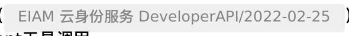

本产品（ EIAM 云身份服务 DeveloperAPI/2022-02-25 ）的OpenAPI采用**RestFul**风格，开发者可根据HttpClient工具调用。

**OIDC API**

| API | 标题 | API概述 |
| --- | --- | --- |
| GenerateToken - 生成应用认证token | 生成应用认证token | 使用凭证信息，生成指定IDaaS EIAM实例下的某个应用的access token。 |
| GetUserInfo - 获取账户信息 | 获取账户信息 | 调用GetUserInfo接口，通过用户token获取账户信息。 |
| RevokeToken - 吊销指定的token | 吊销指定的token | 调用RevokeToken接口，吊销指定的access_token或refresh_token。 |

**授权范围 API**

| API | 标题 | API概述 |
| --- | --- | --- |
| GetApplicationProvisioningScop e - 获取应用同步范围信息 | 获取应用同步范围信息 | 调用GetApplicationProvisioningScop e接口，获取指定实例下对应应用的同步范围信息。 |

**组织管理 API**

| API | 标题 | API概述 |
| --- | --- | --- |
| CreateOrganizationalUnit - 创建一个EIAM组织 | 创建一个EIAM组织 | 调用CreateOrganizationalUnit接口，在指定组织下创建新组织资源。 |
| PatchOrganizationalUnit - 更新一个EIAM组织 | 更新一个EIAM组织 | 调用PatchOrganizationalUnit接口，更新一个EIAM组织信息。 |
| GetOrganizationalUnit - 查询一个EIAM组织信息 | 查询一个EIAM组织信息 | 调用GetOrganizationalUnit接口，获取指定组织的详细信息。 |
| DeleteOrganizationalUnit - 删除一个EIAM组织 | 删除一个EIAM组织 | 调用DeleteOrganizationalUnit接口，删除指定组织。 |
| ListOrganizationalUnits - 列表查询EIAM组织列表信息 | 列表查询EIAM组织列表信息 | 分页查询EIAM组织信息。 |
| ListOrganizationalUnitParentIds<br>- 列表查询组织先代节点 | 列表查询组织先代节点 | 调用ListOrganizationalUnitParentIds接口，查询指定组织所有先代节点信息。 |
| GetOrganizationalUnitIdByExter nalId - 通过组织外部ID获取组织ID | 通过组织外部ID获取组织ID | 调用GetOrganizationalUnitIdByExter nalId接口，通过组织外部ID获取组织内部ID。 |

**账户管理 API**

| API | 标题 | API概述 |
| --- | --- | --- |
| CreateUser - 创建一个EIAM账户 | 创建一个EIAM账户 | 调用CreateUser接口在指定组织下，创建新的EIAM的账户资源。 |
| PatchUser - 更新一个EIAM账户信息 | 更新一个EIAM账户信息 | 调用PatchUser接口，更新一个EIAM账户信息。 |
| GetUser - 查询一个EIAM账户详细信息 | 查询一个EIAM账户详细信息 | 调用GetUser接口，查询一个EIAM账户详细信息。 |
| UpdateUserPassword - 更新一个EIAM账户的密码 | 更新一个EIAM账户的密码 | 更新指定EIAM账户的密码信息。 |
| DeleteUser - 删除一个EIAM账户 | 删除一个EIAM账户 | 调用DeleteUser接口，删除一个EIAM账户信息。 |
| ListUsers - 列表查询EIAM账户 | 列表查询EIAM账户 | 调用ListUsers接口，分页查询EIAM账户信息。 |
| EnableUser - 启用一个EIAM账户 | 启用一个EIAM账户 | 调用EnableUser接口，启用指定的EIAM账户。 |
| DisableUser - 禁用一个EIAM账户 | 禁用一个EIAM账户 | 调用DisableUser接口，禁用指定的EIAM账户。 |
| GetUserIdByEmail - 通过邮箱获取EIAM账户ID | 通过邮箱获取EIAM账户ID | 调用GetUserIdByEmail接口，通过邮箱获取EIAM对应账户ID。 |
| GetUserIdByPhoneNumber - 通过手机号获取EIAM账户ID | 通过手机号获取EIAM账户ID | 调用GetUserIdByPhoneNumber接口，通过手机号获取EIAM对应账户ID。 |
| GetUserIdByUserExternalId - 通过账户外部ID获取EIAM账户ID | 通过账户外部ID获取EIAM账户ID | 调用GetUserIdByUserExternalId接口，通过账户外部ID获取EIAM账户ID。 |
| GetUserIdByUsername - 通过账户名获取EIAM账户ID | 通过账户名获取EIAM账户ID | 调用GetUserIdByUsername接口，通过账户名获取EIAM对应账户ID。 |
| SetUserPrimaryOrganizationalU nit - 设置一个EIAM账户所属主组织 | 设置一个EIAM账户所属主组织 | 设置一个EIAM账户的所属主组织，账户会从旧主组织移除，并加入到新的组织下。 |
| AddUserToOrganizationalUnits -将一个EIAM账户加入到多个EIAM组织中 | 将一个EIAM账户加入到多个EIAM组织中 | 将一个EIAM账户加入到多个EIAM组织中，这些组织作为账户的从属组织，如果账户已属于相关组织，则不做更新。 |
| RemoveUserFromOrganizationa lUnits - 将一个EIAM账户从多个EIAM组织中移除 | 将一个EIAM账户从多个EIAM组织中移除 | 将一个EIAM账户从多个EIAM组织中移除，如果账户已不属于这些组织，则默认成功。 |
| ListGroupsForUser - 查询一个EIAM账户的组列表 | 查询一个EIAM账户的组列表 | 查询一个EIAM账户所属的组列表。 |

**账户组管理 API**

| API | 标题 | API概述 |
| --- | --- | --- |
| GetGroup - 查询一个EIAM组信息 | 查询一个EIAM组信息 | 调用GetGroup接口，获取指定组的详细信息。 |
| CreateGroup - 创建一个EIAM组 | 创建一个EIAM组 | 调用CreateGroup接口，创建组资源。 |
| PatchGroup - 更新一个EIAM组 | 更新一个EIAM组 | 调用PatchGroup接口，更新一个EIAM组信息。 |
| DeleteGroup - 删除一个EIAM组 | 删除一个EIAM组 | 调用DeleteGroup接口，删除指定组。 |
| ListGroups - 列表查询EIAM组信息 | 列表查询EIAM组信息 | 调用ListGroups接口，分页查询EIAM组信息。 |
| AddUsersToGroup - 将多个EIAM账户加入到一个EIAM组中 | 将多个EIAM账户加入到一个EIAM组中 | 将多个EIAM账户加入到一个EIAM组中，如果账户已属于相关组，则不做更新。 |
| RemoveUsersFromGroup - 将多个EIAM账户从一个EIAM组中移除 | 将多个EIAM账户从一个EIAM组中移除 | 将多个EIAM账户从一个EIAM组中移除，如果账户已不属于组，则默认成功。 |
| ListUsersForGroup - 查询一个EIAM组下的账户列表 | 查询一个EIAM组下的账户列表 | 查询一个EIAM组下的账户列表。 |

<a id="section-2-2"></a>

## 2.2. 服务接入点

IDaaS 对外提供 DeveloperAPI 接口能力，实现用户 VPC 与 IDaaS 之间的网络连通性，域名格式如下：

developerapi-idaas-${global_region}.${internet_domain}

其中 global_region、internet_domain 查看方式，进入<strong>ASCM控制台 -> 应用身份服务-> 进入实例->快速入门，</strong>查看 **门户地址** ：

global_region = cn-ece-entity121-d01

internet_domain = cloud.ece-group-121.com


<a id="section-2-3"></a>

## 2.3. API目录

<a id="section-2-3-1"></a>

### 2.3.1. OIDC API

<a id="section-2-3-1-1"></a>

#### 2.3.1.1. GenerateToken - 生成应用认证token

使用凭证信息，生成指定IDaaS EIAM实例下某个应用的access token。

**请求语法**

```http
POST /v2/{instanceId}/{applicationId}/oauth2/token HTTP/1.1
```

**请求参数**

| 名称 | 类型 | 必填 | 描述 | 示例值 |
| --- | --- | --- | --- | --- |
| instanceId | string | 是 | 实例 ID。 | idaas_ue2jvisn35ea5l mthk267xxxxx |
| applicationId | string | 是 | 应用 ID。 | app_mkv7rgt4d7i4u7 zqtzev2mxxxx |
| client_id | string | 否 | 客户端 ID。 | app_mkv7rgt4d7i4u7 zqtzev2mxxxx |
| client_secret | string | 否 | 客户端密钥，赋值场景：当 grant_type 为client_credentials"，采用client_secret_post 方式时，需填写此值。 | CSEHDcHcrUKHw1Cu xkJEHPveWRXBGqVq Rsxxxx |
| grant_type | string | 是 | 授权类型，目前支持的类型如下：<br>• client_credentials 客户端模式，需要传入 client_id 和client_secret<br>• refresh_token 刷新令牌<br>• authorization_code 授权码模式<br>• urn:ietf:params:oauth:gra nt-type:device_code 设备流模式<br>• password 帐密模式 | client_credentials |
| code | string | 否 | 授权 code 码，传入场景：<br>grant_type=authorization_co de 授权码模式时，必填参数。 | xxxx |
| username | string | 否 | 账户名，在帐密模式下，必填参数。 | uesrname_001 |
| password | string | 否 | 账户名，在帐密模式下，必填参数。 | xxxxxx |
| device_code | string | 否 | 设备 code 码，传入场景：<br>grant_type=urn:ietf:params: oauth:grant-type:device_code 即设备流模式时，必填参数。 | xxxx |
| redirect_uri | string | 否 | 重定向 URI，传入场景：<br>grant_type=authorization_co de 授权码模式时，必须参数，与获取授权码请求中的重定向 URI必须是一致的。 | xxx |
| refresh_token | string | 否 | 刷新 token，传入场景：grant_type=refresh_token 即刷新令牌模式时，必填参数。 | ATxxx |
| code_verifier | string | 否 | 授权码模式下，开启 PKCE 能力时，对应的验证 code。 | xxx |
| exclusive_tag | string | 否 | 排除的 tag。 | ATxxx |
| scope | string | 否 | scope 范围，非必须，支持多选，多个取值以空格分隔。可选取值：<br>• openid<br>• email<br>• phone<br>• profile | xxxx |

**返回参数**

| 名称 | 类型 | 描述 | 示例值 |
| --- | --- | --- | --- |
|  | object | 响应结果。 |  |

<table>
  <tr>
    <td>token_type</td>
    <td>string</td>
    <td>token 类型，取值可选范围：Basic - Basic 类型Bearer - Bearer 类型<br>枚举值：<br>• Basic :<br>Basic<br>• Bearer :<br>Bearer</td>
    <td>Bearer</td>
  </tr>
  <tr>
    <td>access_token</td>
    <td>string</td>
    <td>access_token。</td>
    <td>ATxxx</td>
  </tr>
  <tr>
    <td>refresh_token</td>
    <td>string</td>
    <td>refresh_token。</td>
    <td>RTxxx</td>
  </tr>
  <tr>
    <td>expires_in</td>
    <td>integer</td>
    <td>有效时长，单位秒。</td>
    <td>1200</td>
  </tr>
  <tr>
    <td>expires_at</td>
    <td>integer</td>
    <td>失效时间，格式为 Unix 时间戳，单位为秒。</td>
    <td>1653288641</td>
  </tr>
  <tr>
    <td>id_token</td>
    <td>string</td>
    <td>id_token。</td>
    <td>xxxxx</td>
  </tr>
</table>

**示例**

正常返回示例

`JSON` 格式

```json
{
  "token_type": "Bearer",
  "access_token": "ATxxx",
  "refresh_token": "RTxxx",
  "expires_in": 1200,
  "expires_at": 1653288641,
  "id_token": "xxxxx"
}
```

<a id="section-2-3-1-2"></a>

#### 2.3.1.2. GetUserInfo - 获取账户信息

调用GetUserInfo接口，通过用户token获取账户信息。

**请求语法**

```http
GET /v2/{instanceId}/{applicationId}/oauth2/userinfo HTTP/1.1
```

**请求参数**

| 名称 | 类型 | 必填 | 描述 | 示例值 |
| --- | --- | --- | --- | --- |
| instanceId | string | 是 | 实例 ID。 | idaas_ue2jvisn35 ea5lmthk267xxx xx |
| applicationId | string | 是 | 应用 ID。 | app_mkv7rgt4d7i 4u7zqtzev2mxxx x |
| Authorization | string | 是 | 认证信息。 格式：Bearer ${access_token}。 示例：Bearer ATxxxx。 | Bearer xxxx |

**返回参数**

| 名称 | 类型 | 描述 | 示例值 |
| --- | --- | --- | --- |
|  | object | 响应结果。 |  |
|  | any | 账户信息 | 无 |

**示例**

正常返回示例

`JSON` 格式

```json
{
  "key": "无"
}
```

**错误码**

| HttpCode | Error Code | 错误信息 | 说明 |
| --- | --- | --- | --- |
| 400 | invalid_request | Application is not OIDC application | 非 OIDC 应用 |
| 400 | invalid_token | Invalid token | token 无效 |
| 404 | application_not_found | Application id not found: app_mkv7rgt4d7i4u7z qtzev2mxxxx | 应用不存在 |
| 500 | Internal Server Error | Internal Server Error | 服务器内部错误 |

<a id="section-2-3-1-3"></a>

#### 2.3.1.3. RevokeToken - 吊销指定的token

调用RevokeToken接口，吊销指定的access_token或refresh_token。

**请求语法**

```http
POST /v2/{instanceId}/{applicationId}/oauth2/revoke HTTP/1.1
```

**请求参数**

| 名称 | 类型 | 必填 | 描述 | 示例值 |
| --- | --- | --- | --- | --- |
| instanceId | string | 是 | 实例 ID。 | idaas_ue2jvisn35 ea5lmthk267xxx xx |
| applicationId | string | 是 | 应用 ID。 | app_mkv7rgt4d7i 4u7zqtzev2mxxx x |
| client_id | string | 否 | 客户端 ID。 | app_mkv7rgt4d7i 4u7zqtzev2mxxx x |
| client_secret | string | 否 | 客户端密钥。 | CSEHDcHcrUKHw 1CuxkJEHPveWR XBGqVqRsxxxx |
| token | string | 是 | 待撤销的 token。 | ATxxxx |
| token_type_hint | string | 否 | token 类型，取值可选范围：access_token refresh_token<br>枚举值：<br>• access_token：access_token。<br>• refresh_token：refresh_token。 | access_token |

**返回参数**

| 名称 | 类型 | 描述 | 示例值 |
| --- | --- | --- | --- |
|  | object | 响应结果。 |  |

**示例**

正常返回示例

`JSON` 格式

```json
{
  "test": "test",
  "test2": 1
}
```

<a id="section-2-3-2"></a>

### 2.3.2. 授权范围 API

<a id="section-2-3-2-1"></a>

#### 2.3.2.1. GetApplicationProvisioningScope - 获取应用同步范围信息

调用GetApplicationProvisioningScope接口，获取指定实例下对应应用的同步范围信息。

**请求语法**

```http
GET /v2/{instanceId}/{applicationId}/provisioningScope HTTP/1.1
```

**请求参数**

| 名称 | 类型 | 必填 | 描述 | 示例值 |
| --- | --- | --- | --- | --- |
| Authorization | string | 是 | 认证信息。 格式：Bearer ${access_token}。 示例：Bearer ATxxxx。 | Bearer AT8csE2seYxxxx xij |
| instanceId | string | 是 | 实例 ID。 | idaas_ue2jvisn35 ea5lmthk267xxx xx |
| applicationId | string | 是 | 应用 ID。 | app_mkv7rgt4d7i 4u7zqtzev2mxxx x |

**返回参数**

| 名称 | 类型 | 描述 | 示例值 |
| --- | --- | --- | --- |
|  | object | 响应结果。 |  |
| organizationalUnitIds | array | 组织 ID 列表。 |  |
| organizationalUnitId | string | 组织 ID。 | ou_wovwffm62xifdzie m7an7xxxxx |
| groupIds | array | 组 ID 列表。 |  |
| groupIds | string | 组 ID。 | group_wovwffm62xifdz iem7an7xxxxx |

**示例**

正常返回示例

`JSON` 格式

```json
{
  "organizationalUnitIds": [
    "ou_wovwffm62xifdziem7an7xxxxx"
  ],
  "groupIds": [
    "group_wovwffm62xifdziem7an7xxxxx"
  ]
}
```

**错误码**

| HttpCode | Error Code | 错误信息 | 说明 |
| --- | --- | --- | --- |
| 400 | invalid_token | Access token is not valid | token 无效 |
| 404 | application_not_found | Application id not found: app_001 | 应用不存在 |
| 403 | application_disabled | Application is disabled | 应用处于禁用状态 |
| 403 | application_api_disable d | Application api invoke disabled | 应用 API 未开放 |
| 403 | permission_denied | Require scopes: \[urn:alibaba:idaas:sco pe:user:read_all\] | 缺少 API 授权信息 |
| 500 | Internal Server Error | Internal Server Error | 服务器内部错误 |

<a id="section-2-3-3"></a>

### 2.3.3. 组织管理 API

<a id="section-2-3-3-1"></a>

#### 2.3.3.1. CreateOrganizationalUnit - 创建一个EIAM组织

调用CreateOrganizationalUnit接口，在指定组织下创建新组织资源。

**请求语法**

```http
POST /v2/{instanceId}/{applicationId}/organizationalUnits HTTP/1.1
```

**请求参数**

| 名称 | 类型 | 必填 | 描述 | 示例值 |
| --- | --- | --- | --- | --- |
| Authorization | string | 是 | 认证信息。 格式：Bearer ${access_token}。 示例：Bearer ATxxxx。 | Bearer AT8csE2seYxxxx xij |
| instanceId | string | 是 | 实例 ID。 | idaas_ue2jvisn35 ea5lmthk267xxx xx |
| applicationId | string | 是 | 应用 ID。 | app_mkv7rgt4d7i 4u7zqtzev2mxxx x |
| body | object | 否 | 请求 body。 |  |
| organizationalUni tName | string | 是 | 组织名称，长度限制最长为 64 字符。 | name001 |
| parentId | string | 是 | 父组织 ID。 | ou_wovwffm62xif dziem7an7xxxxx |
| organizationalUni tExternalId | string | 否 | 组织外部 ID，用于外部数据与 IDaaS组织的数据关联映射，默认为 IDaaS组织 ID，长度限制最长为 64 字符。 | ou_wovwffm62xif dziem7an7xxxxx |
| description | string | 否 | 组织描述，长度限制最长为 128 字符。 | 测试组织 |

**返回参数**

| 名称 | 类型 | 描述 | 示例值 |
| --- | --- | --- | --- |
|  | object | 响应结果。 |  |
| organizationalUnitId | string | 组织 ID。 | ou_wovwffm62xifdzie m7an7xxxxx |

**示例**

正常返回示例

`JSON` 格式

```json
{
  "organizationalUnitId": "ou_wovwffm62xifdziem7an7xxxxx"
}
```

**错误码**

<table>
  <tr>
    <td>HttpCode</td>
    <td>Error Code</td>
    <td>错误信息</td>
    <td>说明</td>
  </tr>
  <tr>
    <td>400</td>
    <td>invalid_token</td>
    <td>Access token is not valid</td>
    <td>token 无效</td>
  </tr>
  <tr>
    <td>400</td>
    <td>OrganizationUnitIdNotI nScopes</td>
    <td>organizationUnitId : ou_wovwffm62xifdzie m7an7xxxxx not in provisioning scope!</td>
    <td>组织不在同步范围内</td>
  </tr>
  <tr>
    <td>400</td>
    <td>MissingParameter.Org anizationalUnitName</td>
    <td>The specified parameter:Organizatio nalUnitName is required!</td>
    <td>缺少组织名称参数</td>
  </tr>
  <tr>
    <td>404</td>
    <td>application_not_found</td>
    <td>Application id not found: app_mkv7rgt4d7i4u7z qtzev2mxxxx</td>
    <td>应用不存在</td>
  </tr>
  <tr>
    <td>403</td>
    <td>application_disabled</td>
    <td>Application is disabled</td>
    <td>应用处于禁用状态</td>
  </tr>
  <tr>
    <td>403</td>
    <td>application_api_disable d</td>
    <td>Application api invoke disabled</td>
    <td>应用 API 未开放</td>
  </tr>
  <tr>
    <td>403</td>
    <td>permission_denied</td>
    <td>Require scopes: [urn:alibaba:idaas:sco pe:organizational_unit: manage_all]</td>
    <td>缺少 API 授权信息</td>
  </tr>
  <tr>
    <td>500</td>
    <td>Internal Server Error</td>
    <td>Internal Server Error</td>
    <td>服务器内部错误</td>
  </tr>
</table>

<a id="section-2-3-3-2"></a>

#### 2.3.3.2. PatchOrganizationalUnit - 更新一个EIAM组织

调用PatchOrganizationalUnit接口，更新一个EIAM组织信息。

**接口说明**

接口符合 HTTP Patch 方法语义，只修改传入的参数值，不传则默认不修改。

**请求语法**

```http
PATCH /v2/{instanceId}/{applicationId}/organizationalUnits/{organizationalUnitId} HTTP/1.1
```

**请求参数**

| 名称 | 类型 | 必填 | 描述 | 示例值 |
| --- | --- | --- | --- | --- |
| Authorization | string | 是 | 认证信息。 格式：Bearer ${access_token}。 示例：Bearer ATxxxx。 | Bearer AT8csE2seYxxxx xij |
| instanceId | string | 是 | 实例 ID。 | idaas_ue2jvisn35 ea5lmthk267xxx xx |
| applicationId | string | 是 | 应用 ID。 | app_mkv7rgt4d7i 4u7zqtzev2mxxx x |
| organizationalUni tId | string | 是 | 组织 ID。 | ou_wovwffm62xif dziem7an7xxxxx |
| body | object | 否 | 请求体参数。 |  |
| organizationalUni tName | string | 否 | 组织名称，长度限制最长为 64 字符。 | name001 |
| description | string | 否 | 组织描述，长度限制最长为 128 字符。 | 测试组织 |

**返回参数**

| 名称 | 类型 | 描述 | 示例值 |
| --- | --- | --- | --- |

当前API暂无返回参数

**说明** 成功则，默认返回 http code 为 200

**示例**

正常返回示例

`JSON` 格式

```json
{}
```

**错误码**

<table>
  <tr>
    <td>HttpCode</td>
    <td>Error Code</td>
    <td>错误信息</td>
    <td>说明</td>
  </tr>
  <tr>
    <td>400</td>
    <td>invalid_token</td>
    <td>Access token is not valid</td>
    <td>token 无效</td>
  </tr>
  <tr>
    <td>400</td>
    <td>OrganizationUnitIdNotI nScopes</td>
    <td>organizationUnitId : ou_wovwffm62xifdzie m7an7xxxxx not in provisioning scope!</td>
    <td>组织不在同步范围内</td>
  </tr>
  <tr>
    <td>400</td>
    <td>ResourceDuplicated.Or ganizationalUnitName</td>
    <td>The specified OrganizationalUnitNa me resource: xxx already exist!</td>
    <td>组织名称已存在</td>
  </tr>
  <tr>
    <td>404</td>
    <td>application_not_found</td>
    <td>Application id not found: app_mkv7rgt4d7i4u7z qtzev2mxxxx</td>
    <td>应用不存在</td>
  </tr>
  <tr>
    <td>403</td>
    <td>application_disabled</td>
    <td>Application is disabled</td>
    <td>应用处于禁用状态</td>
  </tr>
  <tr>
    <td>403</td>
    <td>application_api_disable d</td>
    <td>Application api invoke disabled</td>
    <td>应用 API 未开放</td>
  </tr>
  <tr>
    <td>403</td>
    <td>permission_denied</td>
    <td>Require scopes: [urn:alibaba:idaas:sco pe:organizational_unit: manage_all]</td>
    <td>缺少 API 授权信息</td>
  </tr>
  <tr>
    <td>500</td>
    <td>Internal Server Error</td>
    <td>Internal Server Error</td>
    <td>服务器内部错误</td>
  </tr>
</table>

<a id="section-2-3-3-3"></a>

#### 2.3.3.3. GetOrganizationalUnit - 查询一个EIAM组织信息

调用GetOrganizationalUnit接口，获取指定组织的详细信息。

**请求语法**

```http
GET /v2/{instanceId}/{applicationId}/organizationalUnits/{organizationalUnitId} HTTP/1.1
```

**请求参数**

| 名称 | 类型 | 必填 | 描述 | 示例值 |
| --- | --- | --- | --- | --- |
| Authorization | string | 是 | 认证信息。 格式：Bearer ${access_token}。 示例：Bearer ATxxxx。 | Bearer AT8csE2seYxxxx xij |
| instanceId | string | 是 | 实例 ID。 | idaas_ue2jvisn35 ea5lmthk267xxx xx |
| applicationId | string | 是 | 应用 ID。 | app_mkv7rgt4d7i 4u7zqtzev2mxxx x |
| organizationalUni tId | string | 是 | 组织 ID。 | ou_wovwffm62xif dziem7an7xxxxx |

**返回参数**

| 名称 | 类型 | 描述 | 示例值 |
| --- | --- | --- | --- |
|  | object | 响应结果。 |  |
| instanceId | string | 实例 ID。 | idaas_ue2jvisn35ea5l mthk267xxxxx |
| organizationalUnitId | string | 组织 ID。 | ou_wovwffm62xifdzie m7an7xxxxx |
| organizationalUnitNam e | string | 组织名称。 | name001 |
| parentId | string | 父组织 ID。 | ou_wovwffm62xifdzie m7an7xxxxx |
| organizationalUnitExte rnalId | string | 外部 ID。 | id_wovwffm62xifdziem 7an7xxxxx |
| organizationalUnitSour ceType | string | 来源类型，取值可选范围：<br>• build_in - 自建。<br>• ding_talk - 钉钉导入。<br>• ad - AD 导入。<br>• ldap - LDAP 导入。 | build_in |
| organizationalUnitSour ceId | string | 来源 ID。 | id_wovwffm62xifdziem 7an7xxxxx |
| createTime | long | 创建时间，格式为 Unix时间戳，单位为毫秒。 | 1652083425923 |
| updateTime | long | 最近更新时间，格式为Unix 时间戳，单位为毫秒。 | 1652083425923 |
| description | string | 描述。 | xxxxx |

**示例**

正常返回示例

`JSON` 格式

```json
{
  "instanceId": "idaas_ue2jvisn35ea5lmthk267xxxxx",
  "organizationalUnitId": "ou_wovwffm62xifdziem7an7xxxxx",
  "organizationalUnitName": "name001",
  "parentId": "ou_wovwffm62xifdziem7an7xxxxx",
  "organizationalUnitExternalId": "id_wovwffm62xifdziem7an7xxxxx",
  "organizationalUnitSourceType": "build_in",
  "organizationalUnitSourceId": "id_wovwffm62xifdziem7an7xxxxx",
  "createTime": 1652083425923,
  "updateTime": 1652083425923,
  "description": "xxxxx"
}
```

**错误码**

| HttpCode | Error Code | 错误信息 | 说明 |
| --- | --- | --- | --- |
| 400 | invalid_token | Access token is not valid | token 无效 |
| 400 | OrganizationUnitIdNotI nScopes | organizationUnitId : ou_wovwffm62xifdzie m7an7xxxxx not in provisioning scope! | 组织不在同步范围内 |
| 404 | application_not_found | Application id not found: app_mkv7rgt4d7i4u7z qtzev2mxxxx | 应用不存在 |
| 403 | application_disabled | Application is disabled | 应用处于禁用状态 |
| 403 | application_api_disable d | Application api invoke disabled | 应用 API 未开放 |
| 403 | permission_denied | Require scopes: \[urn:alibaba:idaas:sco pe:organizational_unit: read_all\] | 缺少 API 授权信息 |
| 500 | Internal Server Error | Internal Server Error | 服务器内部错误 |

<a id="section-2-3-3-4"></a>

#### 2.3.3.4. DeleteOrganizationalUnit - 删除一个EIAM组织

调用DeleteOrganizationalUnit接口，删除指定组织。

**授权信息**

当前API暂无授权信息透出。

**请求语法**

```http
DELETE /v2/{instanceId}/{applicationId}/organizationalUnits/{organizationalUnitId} HTTP/1.1
```

**请求参数**

| 名称 | 类型 | 必填 | 描述 | 示例值 |
| --- | --- | --- | --- | --- |
| Authorization | string | 是 | 认证信息。 格式：Bearer ${access_token}。 示例：Bearer ATxxxx。 | Bearer AT8csE2seYxxxx xij |
| instanceId | string | 是 | 实例 ID。 | idaas_ue2jvisn35 ea5lmthk267xxx xx |
| applicationId | string | 是 | 应用 ID。 | app_mkv7rgt4d7i 4u7zqtzev2mxxx x |
| organizationalUni tId | string | 是 | 组织 ID。 | ou_wovwffm62xif dziem7an7xxxxx |

**返回参数**

| 名称 | 类型 | 描述 | 示例值 |
| --- | --- | --- | --- |

当前API暂无返回参数

**示例**

正常返回示例

`JSON` 格式

```json
{}
```

**错误码**

| HttpCode | Error Code | 错误信息 | 说明 |
| --- | --- | --- | --- |
| 400 | invalid_token | Access token is not valid | token 无效 |
| 400 | OrganizationUnitIdNotI nScopes | organizationUnitId : ou_wovwffm62xifdzie m7an7xxxxx not in provisioning scope! | 组织不在同步范围内或不存在 |
| 404 | application_not_found | Application id not found: app_mkv7rgt4d7i4u7z qtzev2mxxxx | 应用不存在 |
| 403 | application_disabled | Application is disabled | 应用处于禁用状态 |
| 403 | application_api_disable d | Application api invoke disabled | 应用 API 未开放 |
| 403 | permission_denied | Require scopes: \[urn:alibaba:idaas:sco pe:organizational_unit: manage_all\] | 缺少 API 授权信息 |
| 500 | Internal Server Error | Internal Server Error | 服务器内部错误 |

<a id="section-2-3-3-5"></a>

#### 2.3.3.5. ListOrganizationalUnits - 列表查询EIAM组织列表信息

分页查询EIAM组织信息。

**接口说明**

当您需要获取根组织下的直接子组织时，请求参数应设置为：

```json
{
  "parentOrganizationalUnitId": "ou_root"
}
```

**请求语法**

```http
GET /v2/{instanceId}/{applicationId}/organizationalUnits HTTP/1.1
```

**请求参数**

| 名称 | 类型 | 必填 | 描述 | 示例值 |
| --- | --- | --- | --- | --- |
| Authorization | string | 是 | 认证信息。 格式：Bearer ${access_token}。 示例：Bearer ATxxxx。 | Bearer AT8csE2seYxxxx xij |
| instanceId | string | 是 | 实例 ID。 | idaas_ue2jvisn35 ea5lmthk267xxx xx |
| applicationId | string | 是 | 应用 ID。 | app_mkv7rgt4d7i 4u7zqtzev2mxxx x |
| parentId | string | 是 | 父组织 ID。 | ou_wovwffm62xif dziem7an7xxxxx |
| pageNumber | integer | 否 | 页码，默认 1。 | 1 |
| pageSize | integer | 否 | 单页大小读取记录数，默认 20，范围为 1～100。 | 20 |

**返回参数**

| 名称 | 类型 | 描述 | 示例值 |
| --- | --- | --- | --- |
|  | object | 响应结果。 |  |
| totalCount | long | 数据总记录数。 | 1000 |
| data | array&lt;object&gt; | 返回数据对象列表。 |  |
| data | object | 返回数据对象。 |  |
| instanceId | string | 实例 ID。 | idaas_ue2jvisn35ea5l mthk267xxxxx |
| organizationalUnitId | string | 组织 ID。 | ou_wovwffm62xifdzie m7an7xxxxx |
| organizationalUnitNam e | string | 组织名称。 | name001 |
| parentId | string | 父组织 ID。 | ou_wovwffm62xifdzie m7an7xxxxx |
| organizationalUnitExte rnalId | string | 组织外部 ID，用于外部数据与 IDaaS 组织的数据关联映射，默认为 IDaaS 组织 ID。说明：外部 ID 在同一来源类型和来源 ID 下唯一。 | ou_wovwffm62xifdzie m7an7xxxxx |
| organizationalUnitSour ceType | string | 组织来源类型，取值可选范围：<br>• build_in：自建。<br>• ding_talk：钉钉导入。<br>• ad：AD 导入。<br>• ldap：LDAP 导入。 | build_in |
| organizationalUnitSour ceId | string | 组织来源 ID。自建类型默认为实例 ID，其他类型，分别对应不同来源的企业 ID，比如钉钉来源对应钉钉企业的corpId。 | idaas_ue2jvisn35ea5l mthk267xxxxx |
| createTime | long | 组织创建时间，Unix 时间戳格式，单位为毫秒。 | 1652083425923 |
| updateTime | long | 组织最近更新时间，Unix时间戳格式，单位为毫秒。 | 1652083425923 |
| description | string | 组织描述。 | 测试组织 |

**示例**

正常返回示例

`JSON` 格式

```json
{
  "totalCount": 1000,
  "data": [
    {
      "instanceId": "idaas_ue2jvisn35ea5lmthk267xxxxx",
      "organizationalUnitId": "ou_wovwffm62xifdziem7an7xxxxx",
      "organizationalUnitName": "name001",
      "parentId": "ou_wovwffm62xifdziem7an7xxxxx",
      "organizationalUnitExternalId": "ou_wovwffm62xifdziem7an7xxxxx",
      "organizationalUnitSourceType": "build_in",
      "organizationalUnitSourceId": "idaas_ue2jvisn35ea5lmthk267xxxxx",
      "createTime": 1652083425923,
      "updateTime": 1652083425923,
      "description": "测试组织"
    }
  ]
}
```

**错误码**

| HttpCode | Error Code | 错误信息 | 说明 |
| --- | --- | --- | --- |
| 400 | invalid_token | Access token is not valid | token 无效 |
| 400 | OrganizationUnitIdNotI nScopes | organizationUnitId : ou_wovwffm62xifdzie m7an7xxxxx not in provisioning scope! | 组织不在同步范围内 |
| 404 | application_not_found | Application id not found: app_mkv7rgt4d7i4u7z qtzev2mxxxx | 应用不存在 |
| 403 | application_disabled | Application is disabled | 应用处于禁用状态 |
| 403 | application_api_disable d | Application api invoke disabled | 应用 API 未开放 |
| 403 | permission_denied | Require scopes: \[urn:alibaba:idaas:sco pe:organizational_unit: read_all\] | 缺少 API 授权信息 |
| 500 | Internal Server Error | Internal Server Error | 服务器内部错误 |

<a id="section-2-3-3-6"></a>

#### 2.3.3.6. ListOrganizationalUnitParentIds - 列表查询组织先代节点

调用ListOrganizationalUnitParentIds接口，查询指定组织所有先代节点信息。

**请求语法**

```text
GET 
/v2/{instanceId}/{applicationId}/organizationalUnits/{organizationalUnitId}/parentIds H
TTP/1.1
```

**请求参数**

| 名称 | 类型 | 必填 | 描述 | 示例值 |
| --- | --- | --- | --- | --- |
| Authorization | string | 是 | 认证信息。 格式：Bearer ${access_token}。 示例：Bearer ATxxxx。 | Bearer AT8csE2seYxxxx xij |
| instanceId | string | 是 | 实例 ID。 | idaas_ue2jvisn35 ea5lmthk267xxx xx |
| applicationId | string | 是 | 应用 ID。 | app_mkv7rgt4d7i 4u7zqtzev2mxxx x |
| organizationalUni tId | string | 是 | 组织 ID。 | ou_wovwffm62xif dziem7an7xxxxx |

**返回参数**

| 名称 | 类型 | 描述 | 示例值 |
| --- | --- | --- | --- |
|  | object | 响应结果。 |  |
| parentIds | array | 先代组织 ID 列表，顺序层级从上到下，只展示在授权范围内的组织 ID。 |  |
| parentId | string | 组织 ID。 | ou_wovwffm62xifdzie m7an7xxxxx |

**示例**

正常返回示例

`JSON` 格式

```json
{
  "parentIds": [
    "ou_wovwffm62xifdziem7an7xxxxx"
  ]
}
```

**错误码**

| HttpCode | Error Code | 错误信息 | 说明 |
| --- | --- | --- | --- |
| 400 | invalid_token | Access token is not valid | token 无效 |
| 400 | OrganizationUnitIdNotI nScopes | organizationUnitId : ou_wovwffm62xifdzie m7an7xxxxx not in provisioning scope! | 组织不在同步范围内 |
| 404 | application_not_found | Application id not found: app_mkv7rgt4d7i4u7z qtzev2mxxxx | 应用不存在 |
| 403 | application_disabled | Application is disabled | 应用处于禁用状态 |
| 403 | application_api_disable d | Application api invoke disabled | 应用 API 未开放 |
| 403 | permission_denied | Require scopes: \[urn:alibaba:idaas:sco pe:organizational_unit: read_all\] | 缺少 API 授权信息 |
| 500 | Internal Server Error | Internal Server Error | 服务器内部错误 |

<a id="section-2-3-3-7"></a>

#### 2.3.3.7. GetOrganizationalUnitIdByExternalId - 通过组织外部ID获取组织ID

调用GetOrganizationalUnitIdByExternalId接口，通过组织外部ID获取组织内部ID。

**请求语法**

```text
POST 
/v2/{instanceId}/{applicationId}/organizationalUnits/_/actions/getOrganizationalUnitIdByE
ernalId HTTP/1.1
```

**请求参数**

| 名称 | 类型 | 必填 | 描述 | 示例值 |
| --- | --- | --- | --- | --- |
| Authorization | string | 是 | 认证信息。 格式：Bearer ${access_token}。 示例：Bearer ATxxxx。 | Bearer AT8csE2seYxxxx xij |
| instanceId | string | 是 | 实例 ID。 | idaas_ue2jvisn35 ea5lmthk267xxx xx |
| applicationId | string | 是 | 应用 ID。 | app_mkv7rgt4d7i 4u7zqtzev2mxxx x |
| body | object | 否 | 请求 body。 |  |
| organizationalUni tExternalId | string | 是 | 组织外部 ID，用于外部数据与 IDaaS组织的数据关联映射，默认为 IDaaS组织 ID。说明：外部 ID 在同一来源类型和来源ID 下唯一。 | ou_wovwffm62xif dziem7an7xxxxx |
| organizationalUni tSourceType | string | 是 | 组织来源类型，取值可选范围：<br>• build_in：自建。<br>• ding_talk：钉钉导入。<br>• ad：AD 导入。<br>• ldap：LDAP 导入。 | build_in |
| organizationalUni tSourceId | string | 是 | 组织来源 ID。自建类型默认为实例 ID，其他类型，分别对应不同来源的企业 ID，比如钉钉来源对应钉钉企业的 corpId。 | idaas_ue2jvisn35 ea5lmthk267xxx xx |

**返回参数**

| 名称 | 类型 | 描述 | 示例值 |
| --- | --- | --- | --- |
|  | object | OrganizationalUnitIdO bject |  |
| organizationalUnitId | string | 组织 ID。 | ou_wovwffm62xifdzie m7an7xxxxx |

**示例**

正常返回示例

`JSON` 格式

```json
{
  "organizationalUnitId": "ou_wovwffm62xifdziem7an7xxxxx"
}
```

<a id="section-2-3-4"></a>

### 2.3.4. 账户管理 API

<a id="section-2-3-4-1"></a>

#### 2.3.4.1. CreateUser - 创建一个EIAM账户

调用CreateUser接口在指定组织下，创建新的EIAM的账户资源。

**请求语法**

```http
POST /v2/{instanceId}/{applicationId}/users HTTP/1.1
```

**请求参数**

| 名称 | 类型 | 必填 | 描述 | 示例值 |
| --- | --- | --- | --- | --- |
| Authorization | string | 是 | 认证信息。 格式：Bearer ${access_token}。 示例：Bearer ATxxxx。 | Bearer AT8csE2seYxxxx xij |
| instanceId | string | 是 | 实例 ID。 | idaas_ue2jvisn35 ea5lmthk267xxx xx |
| applicationId | string | 是 | 应用 ID。 | app_mkv7rgt4d7i 4u7zqtzev2mxxx x |
| body | object | 否 | 请求 body。 |  |
| username | string | 是 | 账户名称，可包含英文字母、数字、符号“_” 、“ .”、“@”、“-”，长度最大限制 64 字符。 | name001 |
| displayName | string | 否 | 账户展示名。长度限制最长为 64 字符。 | display_name001 |
| password | string | 否 | 账户密码，密码规则参考 IDaaS 控制台密码策略。 | xxxxx |
| phoneRegion | string | 否 | 手机地区编号,示例：中国大陆手区号为 86，不带 00或 +, 手机号若设置，此参数必填。 | 86 |
| phoneNumber | string | 否 | 账户手机号，格式为 6～15 位数字。 | 156xxxxxxx |
| phoneNumberVer ified | boolean | 否 | 手机号是否验证，手机号若设置此字段必须设置，无特殊业务可直接设置为 true。 | true |
| email | string | 否 | 邮箱，邮箱前缀可包含大写英文字母、小写英文字母、数字、点、下划线或中划线，长度限制最长为 64 字符。 | example@examp le.com |
| emailVerified | boolean | 否 | 邮箱是否验证，邮箱若设置此字段必须设置，无特殊业务可直接设置为true。 | true |
| userExternalId | string | 否 | 账户外部 ID，用于与外部系统的关联，最大长度限制64 字符，若不设置，默认设置为账户 ID。 | user_d6sbsuumet a4h66ec3il7yxxx x |
| primaryOrganizat ionalUnitId | string | 是 | 主组织 ID。 | ou_wovwffm62xif dziem7an7xxxxx |
| description | string | 否 | 账户描述，长度限制最长为 256 字符。 | 测试账户 |
| passwordInitializa tionConfig | object | 否 | 密码初始化配置。 |  |
| passwordInitializa tionPolicyPriority | string | 否 | 密码初始化策略优先级，默认不生效，取值可选范围：<br>• global：全局优先，采用实例级别的密码初始化策略，即本次设置的密码初始化策略均无效，参考密码相关策略的密码初始化策略。<br>• custom：自定义优先，以当前定义的密码初始化策略为准，包括是否开启强制改密、密码初始化方式以及通知渠道。 | global |
| passwordForcedU pdateStatus | string | 否 | 强制修改密码状态,默认不启用，取值可选范围：<br>• enabled：开启。<br>• disabled：禁用。 | enabled |
| userNotificationC hannels | array | 否 | 密码通知渠道，取值可选范围：<br>• email：邮件。<br>• sms：短信。 |  |
| userNotificationC hannel | string | 否 | 密码通知渠道。 | email |
| passwordInitializa tionType | string | 否 | 密码初始化方式，取值可选范围：<br>• random：随机。 | random |
| customFields | array&lt;object&gt; | 否 | 账户扩展字段列表。 |  |
| customField | object | 否 | 扩展字段标识和值对象。 |  |
| fieldName | string | 否 | 扩展字段标识。类型和值域可通过控制台查看对应扩展字段值的详细信息。 | age |
| fieldValue | string | 否 | 扩展字段值。 | fieldValue_001 |

**返回参数**

| 名称 | 类型 | 描述 | 示例值 |
| --- | --- | --- | --- |
|  | object | 响应结果。 |  |
| userId | string | 账户 ID。 | user_d6sbsuumeta4h6 6ec3il7yxxxx |

**示例**

正常返回示例

`JSON` 格式

```json
{
  "userId": "user_d6sbsuumeta4h66ec3il7yxxxx"
}
```

**错误码**

| HttpCode | Error Code | 错误信息 | 说明 |
| --- | --- | --- | --- |
| 400 | invalid_token | Access token is not valid | token 无效 |
| 400 | invalid_request | Access token application id not match | 请求无效，token 信息与参数应用 ID 不一致 |
| 400 | OrganizationUnitIdNotI nScopes | organizationUnitId : ou_wovwffm62xifdzie m7an7xxxxx not in provisioning scope! | 组织不存在或组织不在同步范围内 |
| 404 | instance_not_found | Instance id not found: idaas_ue2jvisn35ea5l mthk267xxxxx | 实例不存在 |
| 404 | application_not_found | Application id not found: app_mkv7rgt4d7i4u7z qtzev2mxxxx | 应用不存在 |
| 403 | application_disabled | Application is disabled | 应用处于禁用状态 |
| 403 | application_api_disable d | Application api invoke disabled | 应用 API 未开放 |
| 403 | permission_denied | Require scopes: \[urn:alibaba:idaas:sco pe:user:manager_all\] | 缺少 API 授权信息 |
| 400 | MissingParameter.User name | The specified parameter:Username is required! | 缺少账户名参数 |
| 400 | MissingParameter.Pho neRegion | The specified parameter:PhoneRegio n is required! | 缺少手机区号参数，若已设置手机号，此为必填项 |
| 400 | MissingParameter.Pho neNumberVerified | The specified parameter:PhoneRegio n is required! | 缺少手机区号是否已验证参数，若已设置手机号，此为必填项 |
| 400 | MissingParameter.Ema il | The specified parameter:Email is required! | 缺少邮箱是否已验证参数，若已设置邮箱，此为必填项 |
| 400 | MissingParameter.User name | The specified parameter:Username is required! | 缺少账户名参数 |
| 400 | MissingParameter.Prim aryOrganizationalUnitI d | The specified parameter:PrimaryOrg anizationalUnitId is required! | 缺少主组织参数 |
| 400 | InvalidParameter.Phon eNumber | The specified parameter:PhoneNum ber is invalid. | 无效的手机号 |
| 400 | InvalidParameter.Phon eRegion | The specified parameter:PhoneRegio n is invalid. | 无效的手机区号 |
| 400 | InvalidParameter.Pass word | The specified parameter:Password is invalid. | 密码不符合规则，请参考IDaaS 控制台密码规则 |
| 400 | InvalidParameter.Emai l | The specified parameter:Email is invalid. | 无效的邮箱 |
| 400 | InvalidParameter.Displ ayName | The specified parameter:DisplayNa me is invalid. | 账户显示名过长 |
| 400 | InvalidParameter.Desc ription | The specified parameter:Description is invalid. | 账户描述过长 |
| 500 | Internal Server Error | Internal Server Error | 服务器内部错误 |

<a id="section-2-3-4-2"></a>

#### 2.3.4.2. PatchUser - 更新一个EIAM账户信息

调用PatchUser接口，更新一个EIAM账户信息。

**接口说明**

接口符合 HTTP Patch 方法语义，只修改传入的参数值，不传则默认不修改。

**请求语法**

```http
PATCH /v2/{instanceId}/{applicationId}/users/{userId} HTTP/1.1
```

**请求参数**

| 名称 | 类型 | 必填 | 描述 | 示例值 |
| --- | --- | --- | --- | --- |
| Authorization | string | 是 | 认证信息。 格式：Bearer ${access_token}。 示例：Bearer ATxxxx。 | Bearer AT8csE2seYxxxx xij |
| instanceId | string | 是 | 实例 ID。 | idaas_ue2jvisn35 ea5lmthk267xxx xx |
| applicationId | string | 是 | 应用 ID。 | app_mkv7rgt4d7i 4u7zqtzev2mxxx x |
| userId | string | 是 | 账户 ID。 | user_d6sbsuumet a4h66ec3il7yxxx x |
| body | object | 否 | 请求 body。 |  |
| username | string | 否 | 账户名。 | name001 |
| displayName | string | 否 | 账户展示名。 | display_name001 |
| phoneRegion | string | 否 | 手机地区编号,示例：中国大陆手区号为 86，不带 00或 +, 手机号若设置，此参数必填。 | 86 |
| phoneNumber | string | 否 | 账户手机号。 | 156xxxxxxx |
| phoneNumberVer ified | boolean | 否 | 手机号是否验证，手机号若设置此字段必须设置，无特殊业务可直接设置为 true。 | true |
| email | string | 否 | 账户邮箱。 | example@examp le.com |
| emailVerified | boolean | 否 | 邮箱是否验证，邮箱若设置此字段必须设置，无特殊业务可直接设置为true。 | true |
| customFields | array&lt;object&gt; | 否 | 账户扩展字段列表。 |  |
| customField | object | 否 | 扩展字段更新操作对象。 |  |
| operator<code> </code><strong>depre</strong> <strong>cated</strong><code> </code> | string | 否 | 字段操作类型，已废弃，请采用operation 替换使用。 | replace |


<table>
  <tr>
    <td>fieldName</td>
    <td>string</td>
    <td>否</td>
    <td>扩展字段标识，类型和值域可通过控制台查看对应扩展字段值的详细信息。</td>
    <td>age</td>
  </tr>
  <tr>
    <td>fieldValue</td>
    <td>string</td>
    <td>否</td>
    <td>扩展字段值。</td>
    <td>test_value</td>
  </tr>
  <tr>
    <td>operation</td>
    <td>string</td>
    <td>否</td>
    <td>字段操作类型，取值可选范围：<br>• add：添加。<br>• replace：替换。若对应扩展字段无设置值，会转换为 add 操作。<br>• remove：移除。</td>
    <td>replace</td>
  </tr>
</table>

**返回参数**

| 名称 | 类型 | 描述 | 示例值 |
| --- | --- | --- | --- |

当前API暂无返回参数

**示例**

正常返回示例

`JSON` 格式

```json
{}
```

**错误码**

| HttpCode | Error Code | 错误信息 | 说明 |
| --- | --- | --- | --- |
| 400 | invalid_token | Access token is not valid | token 无效 |
| 400 | MissingParameter.xxx x | The specified parameter:xxx is required! | 缺少 xxxx 参数 |
| 400 | InvalidParameter.xxxx | The specified parameter:xxxx is required! | xxxx 参数无效 |
| 404 | ResourceNotFound.Us er | The specified User resource: user_d6sbsuumeta4h6 6ec3il7yxxxx not found. | 账户不存在 |
| 404 | application_not_found | Application id not found: app_mkv7rgt4d7i4u7z qtzev2mxxxx | 应用不存在 |
| 403 | application_disabled | Application is disabled | 应用处于禁用状态 |
| 403 | application_api_disable d | Application api invoke disabled | 应用 API 未开放 |
| 403 | permission_denied | Require scopes: \[urn:alibaba:idaas:sco pe:user:manager_all\] | 缺少 API 授权信息 |
| 500 | Internal Server Error | Internal Server Error | 服务器内部错误 |

<a id="section-2-3-4-3"></a>

#### 2.3.4.3. GetUser - 查询一个EIAM账户详细信息

调用GetUser接口，查询一个EIAM账户详细信息。

**请求语法**

```http
GET /v2/{instanceId}/{applicationId}/users/{userId} HTTP/1.1
```

**请求参数**

| 名称 | 类型 | 必填 | 描述 | 示例值 |
| --- | --- | --- | --- | --- |
| Authorization | string | 是 | 认证信息。 格式：Bearer ${access_token}。 示例：Bearer ATxxxx。 | Bearer AT8csE2seYxxxx xij |
| instanceId | string | 是 | 实例 ID。 | idaas_ue2jvisn35 ea5lmthk267xxx xx |
| applicationId | string | 是 | 应用 ID。 | app_mkv7rgt4d7i 4u7zqtzev2mxxx x |
| userId | string | 是 | 账户 ID。 | user_d6sbsuumet a4h66ec3il7yxxx x |

**返回参数**

| 名称 | 类型 | 描述 | 示例值 |
| --- | --- | --- | --- |
|  | object | 响应结果。 |  |
| instanceId | string | 实例 ID。 | idaas_ue2jvisn35ea5l mthk267xxxxx |
| organizationalUnits | array&lt;object&gt; | 账户所属组织列表。 |  |
| organizationalUnit | object | 组织对象。 |  |
| organizationalUnitId | string | 组织 ID。 | ou_wovwffm62xifdzie m7an7xxxxx |
| organizationalUnitNam e | string | 组织名称。 | name001 |
| primary | boolean | 是否主组织。 | true |
| primaryOrganizational UnitId | string | 账户主组织 ID。 | ou_wovwffm62xifdzie m7an7xxxxx |
| customFields | array&lt;object&gt; | 账户扩展字段列表。 |  |
| customField | object | 扩展字段数据对象。 |  |
| fieldName | string | 扩展字段标识。 | xxxx |
| fieldValue | string | 字段数据值。 任何数据类型的字段值均以字符串的方式返回。比如布尔类型返回的值为"true"或"false" | 字段数据值 |
| userId | string | 账户 ID。 | user_d6sbsuumeta4h6 6ec3il7yxxxx |
| username | string | 账户名。 | name001 |
| displayName | string | 账户显示名。 | display_name001 |
| passwordSet | boolean | 密码是否已设置。 | true |
| phoneRegion | string | 手机地区编号,示例：中国大陆手区号为 86，不带00 或 +。 | 86 |
| phoneNumber | string | 账户手机号。 | 156xxxxxxx |
| phoneNumberVerified | boolean | 手机号是否已验证，true表示手机号已经过用户验证或被管理员设置为已验证，false 表示未验证。 | true |
| email | string | 邮箱。 | example@example.co m |
| emailVerified | boolean | 邮箱是否已验证，true 表示邮箱已经过用户的验证或被管理员设置为已验证，false 表示未验证。 | true |
| userExternalId | string | 账户外部 ID，用于外部数据与 IDaaS 账户的数据关联映射，默认为 IDaaS 账户 ID。说明：外部 ID 在同一来源类型和来源 ID 下唯一。 | user_d6sbsuumeta4h6 6ec3il7yxxxx |
| userSourceType | string | 账户来源类型，取值可选范围：<br>• build_in：自建。<br>• ding_talk：钉钉导入。<br>• ad：AD 导入。<br>• ldap：LDAP 导入 | build_in |
| userSourceId | string | 账户来源 ID。自建类型默认为实例 ID，其他类型，分别对应不同来源的企业 ID，比如钉钉来源对应钉钉企业的corpId。 | idaas_ue2jvisn35ea5l mthk267xxxxx |
| status | string | 账户状态，取值可选范围： enabled - 启用中。disabled - 禁用中。 | enabled |
| accountExpireTime | long | 账户过期时间，Unix 时间戳格式，单位为毫秒。 | 1652085686179 |
| registerTime | long | 账户注册时间，Unix 时间戳格式，单位为毫秒。 | 1652085686179 |
| lockExpireTime | long | 账户锁定过期时间，Unix时间戳格式，单位为毫秒。 | 1652085686179 |
| createTime | long | 账户创建时间，Unix 时间戳格式，单位为毫秒。 | 1652085686179 |
| updateTime | long | 账户最近一次更新时间，Unix 时间戳格式，单位为毫秒。 | 1652085686179 |
| description | string | 账户描述。 | 测试账户 |
| groups | array&lt;object&gt; | 账户所属组列表。 |  |
| group | object | 账户所属组对象。 |  |
| groupId | string | 组 ID。 | group_ufdsasn35ea5l mthk267xxxxx |
| groupName | string | 组名称。 | name_test |
| description | string | 组描述。 | description_demo |

**示例**

正常返回示例

`JSON` 格式

```json
{
  "instanceId": "idaas_ue2jvisn35ea5lmthk267xxxxx",
  "organizationalUnits": [
    {
      "organizationalUnitId": "ou_wovwffm62xifdziem7an7xxxxx",
      "organizationalUnitName": "name001",
      "primary": true
    }
  ],
  "primaryOrganizationalUnitId": "ou_wovwffm62xifdziem7an7xxxxx",
  "customFields": [
    {
      "fieldName": "xxxx",
      "fieldValue": "字段数据值"
    }
  ],
  "userId": "user_d6sbsuumeta4h66ec3il7yxxxx",
  "username": "name001",
  "displayName": "display_name001",
  "passwordSet": true,
  "phoneRegion": 86,
  "phoneNumber": "156xxxxxxx",
  "phoneNumberVerified": true,
  "email": "example@example.com",
  "emailVerified": true,
  "userExternalId": "user_d6sbsuumeta4h66ec3il7yxxxx",
  "userSourceType": "build_in",
  "userSourceId": "idaas_ue2jvisn35ea5lmthk267xxxxx",
  "status": "enabled",
  "accountExpireTime": 1652085686179,
  "registerTime": 1652085686179,
  "lockExpireTime": 1652085686179,
  "createTime": 1652085686179,
  "updateTime": 1652085686179,
  "description": "测试账户",
  "groups": [
    {
      "groupId": "group_ufdsasn35ea5lmthk267xxxxx",
      "groupName": "name_test",
      "description": "description_demo"
    }
  ]
}
```

**错误码**

| HttpCode | Error Code | 错误信息 | 说明 |
| --- | --- | --- | --- |
| 400 | invalid_token | Access token is not valid | token 无效 |
| 400 | MissingParameter.xxx x | The specified parameter:xxx is required! | 缺少 xxxx 参数 |
| 400 | InvalidParameter.xxxx | The specified parameter:xxxx is required! | xxxx 参数无效 |
| 404 | ResourceNotFound.Us er | The specified User resource: user_d6sbsuumeta4h6 6ec3il7yxxxx not found. | 账户不存在 |
| 404 | application_not_found | Application id not found: app_mkv7rgt4d7i4u7z qtzev2mxxxx | 应用不存在 |
| 403 | application_disabled | Application is disabled | 应用处于禁用状态 |
| 403 | application_api_disable d | Application api invoke disabled | 应用 API 未开放 |
| 403 | permission_denied | Require scopes: \[urn:alibaba:idaas:sco pe:user:read_all\] | 缺少 API 授权信息 |
| 500 | Internal Server Error | Internal Server Error | 服务器内部错误 |

<a id="section-2-3-4-4"></a>

#### 2.3.4.4. UpdateUserPassword - 更新一个EIAM账户的密码

更新指定EIAM账户的密码信息。

**请求语法**

```http
POST /v2/{instanceId}/{applicationId}/users/{userId}/actions/updateUserPassword HTTP/1.1
```

**请求参数**

| 名称 | 类型 | 必填 | 描述 | 示例值 |
| --- | --- | --- | --- | --- |
| Authorization | string | 是 | 认证信息。 格式：Bearer ${access_token}。 示例：Bearer ATxxxx。 | Bearer xxxx |
| instanceId | string | 是 | 实例 ID。 | idaas_ue2jvisn35 ea5lmthk267xxx xx |
| applicationId | string | 是 | 应用 ID。 | app_mkv7rgt4d7i 4u7zqtzev2mxxx x |
| userId | string | 是 | 账户 ID。 | user_d6sbsuumet a4h66ec3il7yxxx x |
| body | object | 否 | 请求 body。 |  |
| password | string | 否 | 新密码，相关规则参考控制台密码策略说明。 | xxxx |

**返回参数**

| 名称 | 类型 | 描述 | 示例值 |
| --- | --- | --- | --- |

当前API暂无返回参数

**示例**

正常返回示例

`JSON` 格式

```json
{}
```

<a id="section-2-3-4-5"></a>

#### 2.3.4.5. DeleteUser - 删除一个EIAM账户

调用DeleteUser接口，删除一个EIAM账户信息。

**请求语法**

```http
DELETE /v2/{instanceId}/{applicationId}/users/{userId} HTTP/1.1
```

**请求参数**

| 名称 | 类型 | 必填 | 描述 | 示例值 |
| --- | --- | --- | --- | --- |
| Authorization | string | 是 | 认证信息。 格式：Bearer ${access_token}。 示例：Bearer ATxxxx。 | Bearer AT8csE2seYxxxx xij |
| instanceId | string | 是 | 实例 ID。 | idaas_ue2jvisn35 ea5lmthk267xxx xx |
| applicationId | string | 是 | 应用 ID。 | app_mkv7rgt4d7i 4u7zqtzev2mxxx x |
| userId | string | 是 | 账户 ID。 | user_d6sbsuumet a4h66ec3il7yxxx x |

**返回参数**

| 名称 | 类型 | 描述 | 示例值 |
| --- | --- | --- | --- |

当前API暂无返回参数

**示例**

正常返回示例

`JSON` 格式

```json
{}
```

**错误码**

| HttpCode | Error Code | 错误信息 | 说明 |
| --- | --- | --- | --- |
| 400 | invalid_token | Access token is not valid | token 无效 |
| 404 | ResourceNotFound.Us er | The specified User resource: user_d6sbsuumeta4h6 6ec3il7yxxxx not found. | 账户不存在 |
| 404 | application_not_found | Application id not found: app_mkv7rgt4d7i4u7z qtzev2mxxxx | 应用不存在 |
| 403 | application_disabled | Application is disabled | 应用处于禁用状态 |
| 403 | application_api_disable d | Application api invoke disabled | 应用 API 未开放 |
| 403 | permission_denied | Require scopes: \[urn:alibaba:idaas:sco pe:user:manager_all\] | 缺少 API 授权信息 |
| 500 | Internal Server Error | Internal Server Error | 服务器内部错误 |

<a id="section-2-3-4-6"></a>

#### 2.3.4.6. ListUsers - 列表查询EIAM账户

调用ListUsers接口，分页查询EIAM账户信息。

**请求语法**

```http
GET /v2/{instanceId}/{applicationId}/users HTTP/1.1
```

**请求参数**

| 名称 | 类型 | 必填 | 描述 | 示例值 |
| --- | --- | --- | --- | --- |
| Authorization | string | 是 | 认证信息。 格式：Bearer ${access_token}。 示例：Bearer ATxxxx。 | Bearer AT8csE2seYxxxx xij |
| instanceId | string | 是 | 实例 ID。 | idaas_ue2jvisn35 ea5lmthk267xxx xx |
| applicationId | string | 是 | 应用 ID。 | app_mkv7rgt4d7i 4u7zqtzev2mxxx x |
| organizationalUni tId | string | 否 | 组织 ID。 | ou_wovwffm62xif dziem7an7xxxxx |
| pageNumber | integer | 否 | 页码，默认 1。 | 1 |
| pageSize | integer | 否 | 单页大小读取记录数，默认 20，范围为 1～100。 | 20 |

**返回参数**

| 名称 | 类型 | 描述 | 示例值 |
| --- | --- | --- | --- |
|  | object | 响应结果。 |  |
| totalCount | long | 数据总记录数。 | 1000 |
| data | array&lt;object&gt; | 返回数据对象列表。 |  |
| data | object | 返回数据对象。 |  |
| instanceId | string | 实例 ID。 | idaas_ue2jvisn35ea5l mthk267xxxxx |
| userId | string | 账户 ID。 | user_d6sbsuumeta4h6 6ec3il7yxxxx |
| username | string | 账户名。 | name001 |
| displayName | string | 账户显示名。 | display_name001 |
| passwordSet | boolean | 密码是否已设置 | true |
| phoneRegion | string | 手机地区编号,示例：中国大陆手区号为 86，不带00 或 +。 | 86 |
| phoneNumber | string | 账户手机号。 | 156xxxxxxx |
| phoneNumberVerified | boolean | 手机号是否已验证，true表示手机号已经过用户验证或被管理员设置为已验证，false 表示未验证。 | true |
| email | string | 账户邮箱。 | example@example.co m |
| emailVerified | boolean | 邮箱是否已验证，true 表示邮箱已经过用户的验证或被管理员设置为已验证，false 表示未验证 | true |
| userExternalId | string | 账户外部 ID，用于外部数据与 IDaaS 账户的数据关联映射，默认为 IDaaS 账户 ID。说明：外部 ID 在同一来源类型和来源 ID 下唯一。 | user_d6sbsuumeta4h6 6ec3il7yxxxx |
| userSourceType | string | 账户来源类型，取值可选范围：<br>• build_in：自建。<br>• ding_talk：钉钉导入。<br>• ad：AD 导入。<br>• ldap：LDAP 导入 | build_in |
| userSourceId | string | 账户来源 ID。自建类型默认为实例 ID，其他类型，分别对应不同来源的企业 ID，比如钉钉来源对应钉钉企业的corpId。 | idaas_ue2jvisn35ea5l mthk267xxxxx |
| status | string | 账户状态，取值可选范围： enabled - 启用中。disabled - 禁用中。 | enabled |
| accountExpireTime | long | 账户过期时间，Unix 时间戳格式，单位为毫秒。 | 1652085686179 |
| registerTime | long | 账户注册时间，Unix 时间戳格式，单位为毫秒。 | 1652085686179 |
| lockExpireTime | long | 账户锁定过期时间，Unix时间戳格式，单位为毫秒。 | 1652085686179 |
| createTime | long | 账户创建时间，Unix 时间戳格式，单位为毫秒。 | 1652085686179 |
| updateTime | long | 账户最近一次更新时间，Unix 时间戳格式，单位为毫秒。 | 1652085686179 |
| description | string | 账户描述。 | 测试账户 |

**示例**

正常返回示例

`JSON` 格式

```json
{
  "totalCount": 1000,
  "data": [
    {
      "instanceId": "idaas_ue2jvisn35ea5lmthk267xxxxx",
      "userId": "user_d6sbsuumeta4h66ec3il7yxxxx",
      "username": "name001",
      "displayName": "display_name001",
      "passwordSet": true,
      "phoneRegion": 86,
      "phoneNumber": "156xxxxxxx",
      "phoneNumberVerified": true,
      "email": "example@example.com",
      "emailVerified": true,
      "userExternalId": "user_d6sbsuumeta4h66ec3il7yxxxx",
      "userSourceType": "build_in",
      "userSourceId": "idaas_ue2jvisn35ea5lmthk267xxxxx",
      "status": "enabled",
      "accountExpireTime": 1652085686179,
      "registerTime": 1652085686179,
      "lockExpireTime": 1652085686179,
      "createTime": 1652085686179,
      "updateTime": 1652085686179,
      "description": "测试账户"
    }
  ]
}
```

**错误码**

| HttpCode | Error Code | 错误信息 | 说明 |
| --- | --- | --- | --- |
| 400 | invalid_token | Access token is not valid | token 无效 |
| 404 | application_not_found | Application id not found: app_001 | 应用不存在 |
| 403 | application_disabled | Application is disabled | 应用处于禁用状态 |
| 403 | application_api_disable d | Application api invoke disabled | 应用 API 未开放 |
| 403 | permission_denied | Require scopes: \[urn:alibaba:idaas:sco pe:user:read_all\] | 缺少 API 授权信息 |
| 500 | Internal Server Error | Internal Server Error | 服务器内部错误 |

<a id="section-2-3-4-7"></a>

#### 2.3.4.7. EnableUser - 启用一个EIAM账户

调用EnableUser接口，启用指定的EIAM账户。

**请求语法**

```http
POST /v2/{instanceId}/{applicationId}/users/{userId}/actions/enable HTTP/1.1
```

**请求参数**

| 名称 | 类型 | 必填 | 描述 | 示例值 |
| --- | --- | --- | --- | --- |
| Authorization | string | 是 | 认证信息。 格式：Bearer ${access_token}。 示例：Bearer ATxxxx。 | Bearer xxxx |
| instanceId | string | 是 | 实例 ID。 | idaas_ue2jvisn35 ea5lmthk267xxx xx |
| applicationId | string | 是 | 应用 ID。 | app_mkv7rgt4d7i 4u7zqtzev2mxxx x |
| userId | string | 是 | 账户 ID | user_001 |

**返回参数**

| 名称 | 类型 | 描述 | 示例值 |
| --- | --- | --- | --- |

当前API暂无返回参数

**示例**

正常返回示例

`JSON` 格式

```json
{}
```

**错误码**

| HttpCode | Error Code | 错误信息 | 说明 |
| --- | --- | --- | --- |
| 400 | invalid_token | Access token is not valid |  |
| 404 | ResourceNotFound.Us er | The specified User resource: user_xxxx not found. |  |
| 404 | application_not_found | Application id not found: app_mkv7rgt4d7i4u7z qtzev2mxxxx |  |
| 403 | application_disabled | Application is disabled |  |
| 403 | application_api_disable d | Application api invoke disabled |  |
| 403 | permission_denied | Require scopes: \[urn:alibaba:idaas:sco pe:user:manager_all\] |  |
| 500 | Internal Server Error | Internal Server Error |  |

<a id="section-2-3-4-8"></a>

#### 2.3.4.8. DisableUser - 禁用一个EIAM账户

调用DisableUser接口，禁用指定的EIAM账户。

**请求语法**

```http
POST /v2/{instanceId}/{applicationId}/users/{userId}/actions/disable HTTP/1.1
```

**请求参数**

| 名称 | 类型 | 必填 | 描述 | 示例值 |
| --- | --- | --- | --- | --- |
| Authorization | string | 是 | 认证信息。 格式：Bearer ${access_token}。 示例：Bearer ATxxxx。 | Bearer xxxx |
| instanceId | string | 是 | 实例 ID。 | idaas_ue2jvisn35 ea5lmthk267xxx xx |
| applicationId | string | 是 | 应用 ID。 | app_mkv7rgt4d7i 4u7zqtzev2mxxx x |
| userId | string | 是 | 账户 ID | user_001 |

**返回参数**

| 名称 | 类型 | 描述 | 示例值 |
| --- | --- | --- | --- |

当前API暂无返回参数

**示例**

正常返回示例

`JSON` 格式

```json
{}
```

**错误码**

| HttpCode | Error Code | 错误信息 | 说明 |
| --- | --- | --- | --- |
| 400 | invalid_token | Access token is not valid |  |
| 404 | ResourceNotFound.Us er | The specified User resource: user_xxxx not found. |  |
| 404 | application_not_found | Application id not found: app_mkv7rgt4d7i4u7z qtzev2mxxxx |  |
| 403 | application_disabled | Application is disabled |  |
| 403 | application_api_disable d | Application api invoke disabled |  |
| 403 | permission_denied | Require scopes: \[urn:alibaba:idaas:sco pe:user:manager_all\] |  |
| 500 | Internal Server Error | Internal Server Error |  |

<a id="section-2-3-4-9"></a>

#### 2.3.4.9. GetUserIdByEmail - 通过邮箱获取EIAM账户ID

调用GetUserIdByEmail接口，通过邮箱获取EIAM对应账户ID。

**请求语法**

```http
POST /v2/{instanceId}/{applicationId}/users/_/actions/getUserIdByEmail HTTP/1.1
```

**请求参数**

| 名称 | 类型 | 必填 | 描述 | 示例值 |
| --- | --- | --- | --- | --- |
| Authorization | string | 是 | 认证信息。 格式：Bearer ${access_token}。 示例：Bearer ATxxxx。 | Bearer AT8csE2seYxxxx xij |
| instanceId | string | 是 | 实例 ID。 | idaas_ue2jvisn35 ea5lmthk267xxx xx |
| applicationId | string | 是 | 应用 ID。 | app_mkv7rgt4d7i 4u7zqtzev2mxxx x |
| body | object | 否 | 请求 body。 |  |
| email | string | 是 | 账户邮箱。 | example@examp le.com |

**返回参数**

| 名称 | 类型 | 描述 | 示例值 |
| --- | --- | --- | --- |
|  | object | 响应结果。 |  |
| userId | string | 账户 ID。 | user_d6sbsuumeta4h6 6ec3il7yxxxx |

**示例**

正常返回示例

`JSON` 格式

```json
{
  "userId": "user_d6sbsuumeta4h66ec3il7yxxxx"
}
```

**错误码**

| HttpCode | Error Code | 错误信息 | 说明 |
| --- | --- | --- | --- |
| 400 | invalid_token | Access token is not valid | token 无效 |
| 404 | application_not_found | Application id not found: app_mkv7rgt4d7i4u7z qtzev2mxxxx | 应用不存在 |
| 403 | application_disabled | Application is disabled | 应用处于禁用状态 |
| 403 | application_api_disable d | Application api invoke disabled | 应用 API 未开放 |
| 403 | permission_denied | Require scopes: \[urn:alibaba:idaas:sco pe:user:manager_all\] | 缺少 API 授权信息 |
| 400 | MissingParameter.Ema il | The specified parameter: Email is required! | 缺少 Email 参数 |
| 400 | ResourceNotFound.Us erId | The specified UserId resource: %s not found. | 账户 ID 不存在 |
| 500 | Internal Server Error | Internal Server Error | 服务器内部错误 |

<a id="section-2-3-4-10"></a>

#### 2.3.4.10. GetUserIdByPhoneNumber - 通过手机号获取EIAM账户ID

调用GetUserIdByPhoneNumber接口，通过手机号获取EIAM对应账户ID。

**请求语法**

```http
POST /v2/{instanceId}/{applicationId}/users/_/actions/getUserIdByPhoneNumber HTTP/1.1
```

**请求参数**

| 名称 | 类型 | 必填 | 描述 | 示例值 |
| --- | --- | --- | --- | --- |
| Authorization | string | 是 | 认证信息。 格式：Bearer ${access_token}。 示例：Bearer ATxxxx。 | Bearer AT8csE2seYxxxx xij |
| instanceId | string | 是 | 实例 ID。 | idaas_ue2jvisn35 ea5lmthk267xxx xx |
| applicationId | string | 是 | 应用 ID | app_mkv7rgt4d7i 4u7zqtzev2mxxx x |
| body | object | 否 | 请求 body。 |  |
| phoneNumber | string | 是 | 账户手机号。 | 156xxxxxxx |

**返回参数**

| 名称 | 类型 | 描述 | 示例值 |
| --- | --- | --- | --- |
|  | object | 响应结果。 |  |
| userId | string | 账户 ID。 | user_d6sbsuumeta4h6 6ec3il7yxxxx |

**示例**

正常返回示例

`JSON` 格式

```json
{
  "userId": "user_d6sbsuumeta4h66ec3il7yxxxx"
}
```

**错误码**

| HttpCode | Error Code | 错误信息 | 说明 |
| --- | --- | --- | --- |
| 400 | invalid_token | Access token is not valid | token 无效 |
| 404 | application_not_found | Application id not found: app_mkv7rgt4d7i4u7z qtzev2mxxxx | 应用不存在 |
| 403 | application_disabled | Application is disabled | 应用处于禁用状态 |
| 403 | application_api_disable d | Application api invoke disabled | 应用 API 未开放 |
| 403 | permission_denied | Require scopes: \[urn:alibaba:idaas:sco pe:user:manager_all\] | 缺少 API 授权信息 |
| 400 | MissingParameter.Pho neNumber | The specified parameter: PhoneNumber is required! | 缺少 Email 参数 |
| 400 | ResourceNotFound.Us erId | The specified UserId resource: %s not found. | 账户 ID 不存在 |
| 500 | Internal Server Error | Internal Server Error | 服务器内部错误 |

<a id="section-2-3-4-11"></a>

#### 2.3.4.11. GetUserIdByUserExternalId - 通过账户外部ID获取EIAM账户ID

调用GetUserIdByUserExternalId接口，通过账户外部ID获取EIAM账户ID。

**请求语法**

```http
POST /v2/{instanceId}/{applicationId}/users/_/actions/getUserIdByExternalId HTTP/1.1
```

**请求参数**

| 名称 | 类型 | 必填 | 描述 | 示例值 |
| --- | --- | --- | --- | --- |
| Authorization | string | 是 | 认证信息。 格式：Bearer ${access_token}。 示例：Bearer ATxxxx。 | Bearer AT8csE2seYxxxx xij |
| instanceId | string | 是 | 实例 ID。 | idaas_ue2jvisn35 ea5lmthk267xxx xx |
| applicationId | string | 是 | 应用 ID | app_mkv7rgt4d7i 4u7zqtzev2mxxx x |
| body | object | 否 | 请求 body。 |  |
| userExternalId | string | 是 | 账户外部 ID。 | xxx001 |
| userSourceType | string | 是 | 账户来源类型，取值可选范围：<br>• build_in：自建。<br>• ding_talk：钉钉导入。<br>• ad：AD 导入。<br>• ldap：LDAP 导入 | build_in |
| userSourceId | string | 是 | 账户来源 ID。 自建类型(build_in)值为实例 ID，非自建类型，为对应企业ID，比如钉钉，对应的 corpId。 | idaas_ue2jvisn35 ea5lmthk267xxx xx |

**返回参数**

| 名称 | 类型 | 描述 | 示例值 |
| --- | --- | --- | --- |
|  | object | 响应结果。 |  |
| userId | string | 账户 ID。 | user_d6sbsuumeta4h6 6ec3il7yxxxx |

**示例**

正常返回示例

`JSON` 格式

```json
{
  "userId": "user_d6sbsuumeta4h66ec3il7yxxxx"
}
```

**错误码**

| HttpCode | Error Code | 错误信息 | 说明 |
| --- | --- | --- | --- |
| 400 | invalid_token | Access token is not valid | token 无效 |
| 404 | application_not_found | Application id not found: app_mkv7rgt4d7i4u7z qtzev2mxxxx | 应用不存在 |
| 403 | application_disabled | Application is disabled | 应用处于禁用状态 |
| 403 | application_api_disable d | Application api invoke disabled | 应用 API 未开放 |
| 403 | permission_denied | Require scopes: \[urn:alibaba:idaas:sco pe:user:manager_all\] | 缺少 API 授权信息 |
| 400 | MissingParameter.User ExternalId | The specified parameter: UserExternalId is required! | 缺少 UserExternalId 参数 |
| 400 | MissingParameter.User SourceType | The specified parameter: UserSourceType is required! | 缺少 UserSourceType参数 |
| 400 | MissingParameter.User SourceId | The specified parameter: UserSourceId is required! | 缺少 UserSourceId 参数 |
| 400 | ResourceNotFound.Us erId | The specified UserId resource: %s not found. | 账户 ID 不存在 |
| 500 | Internal Server Error | Internal Server Error | 服务器内部错误 |

<a id="section-2-3-4-12"></a>

#### 2.3.4.12. GetUserIdByUsername - 通过账户名获取EIAM账户ID

调用GetUserIdByUsername接口，通过账户名获取EIAM对应账户ID。

**请求语法**

```http
POST /v2/{instanceId}/{applicationId}/users/_/actions/getUserIdByUsername HTTP/1.1
```

**请求参数**

| 名称 | 类型 | 必填 | 描述 | 示例值 |
| --- | --- | --- | --- | --- |
| Authorization | string | 是 | 认证信息。 格式：Bearer ${access_token}。 示例：Bearer ATxxxx。 | Bearer xxxx |
| instanceId | string | 是 | 实例 ID。 | idaas_ue2jvisn35 ea5lmthk267xxx xx |
| applicationId | string | 是 | 应用 ID。 | app_mkv7rgt4d7i 4u7zqtzev2mxxx x |
| body | object | 否 | 请求 body。 |  |
| username | string | 是 | 账户名。 | username_001 |

**返回参数**

| 名称 | 类型 | 描述 | 示例值 |
| --- | --- | --- | --- |
|  | object | 响应结果。 |  |
| userId | string | 账户 ID。 | user_d6sbsuumeta4h6 6ec3il7yxxxx |

**示例**

正常返回示例

`JSON` 格式

```json
{
  "userId": "user_d6sbsuumeta4h66ec3il7yxxxx"
}
```

<a id="section-2-3-4-13"></a>

#### 2.3.4.13. SetUserPrimaryOrganizationalUnit - 设置一个EIAM账户所属主组织

设置一个EIAM账户的所属主组织，账户会从旧主组织移除，并加入到新的组织下。

**请求语法**

```text
POST 
/v2/{instanceId}/{applicationId}/users/{userId}/actions/setUserPrimaryOrganizationalUnit
HTTP/1.1
```

**请求参数**

| 名称 | 类型 | 必填 | 描述 | 示例值 |
| --- | --- | --- | --- | --- |
| Authorization | string | 是 | 认证信息。 格式：Bearer ${access_token}。 示例：Bearer ATxxxx。 | Bearer xxxx |
| instanceId | string | 是 | 实例 ID。 | idaas_ue2jvisn35 ea5lmthk267xxx xx |
| applicationId | string | 是 | 应用 ID。 | app_mkv7rgt4d7i 4u7zqtzev2mxxx x |
| userId | string | 是 | 账户 ID | user_d6sbsuumet a4h66ec3il7yxxx x |
| body | object | 否 | 请求 body。 |  |
| organizationalUni tId | string | 是 | 主组织 ID。 | ou_wovwffm62xif dziem7an7xxxxx |

**返回参数**

| 名称 | 类型 | 描述 | 示例值 |
| --- | --- | --- | --- |

当前API暂无返回参数

**示例**

正常返回示例

`JSON` 格式

```json
{}
```

<a id="section-2-3-4-14"></a>

#### 2.3.4.14. AddUserToOrganizationalUnits - 将一个EIAM账户加入到多个EIAM组织中

将一个EIAM账户加入到多个EIAM组织中，这些组织作为账户的从属组织，如果账户已属于相关组织，则不做更新。

**请求语法**

```text
POST 
/v2/{instanceId}/{applicationId}/users/{userId}/actions/addUserToOrganizationalUnits HT
TP/1.1
```

**请求参数**

| 名称 | 类型 | 必填 | 描述 | 示例值 |
| --- | --- | --- | --- | --- |
| Authorization | string | 是 | 认证信息。 格式：Bearer ${access_token}。 示例：Bearer ATxxxx。 | Bearer xxxx |
| instanceId | string | 是 | 实例 ID。 | idaas_ue2jvisn35 ea5lmthk267xxx xx |
| applicationId | string | 是 | 应用 ID。 | app_mkv7rgt4d7i 4u7zqtzev2mxxx x |
| userId | string | 是 | 账户 ID。 | user_d6sbsuumet a4h66ec3il7yxxx x |
| body | object | 否 | 请求 body。 |  |
| organizationalUni tIds | array | 是 | 组织 ID 列表。 |  |
| organizationalUni tId | string | 否 | 组织 ID。 | ou_wovwffm62xif dziem7an7xxxxx |

**返回参数**

| 名称 | 类型 | 描述 | 示例值 |
| --- | --- | --- | --- |

当前API暂无返回参数

**示例**

正常返回示例

`JSON` 格式

```json
{}
```

<a id="section-2-3-4-15"></a>

#### 2.3.4.15. RemoveUserFromOrganizationalUnits - 将一个EIAM账户从多个EIAM组织中移除

将一个EIAM账户从多个EIAM组织中移除，如果账户已不属于这些组织，则默认成功。

**请求语法**

```text
POST 
/v2/{instanceId}/{applicationId}/users/{userId}/actions/removeUserFromOrganizationalUnits
HTTP/1.1
```

**请求参数**

| 名称 | 类型 | 必填 | 描述 | 示例值 |
| --- | --- | --- | --- | --- |
| Authorization | string | 是 | 认证信息。 格式：Bearer ${access_token}。 示例：Bearer ATxxxx。 | Bearer xxxx |
| instanceId | string | 是 | 实例 ID。 | idaas_ue2jvisn35 ea5lmthk267xxx xx |
| applicationId | string | 是 | 应用 ID。 | app_mkv7rgt4d7i 4u7zqtzev2mxxx x |
| userId | string | 是 | 账户 ID | user_d6sbsuumet a4h66ec3il7yxxx x |
| body | object | 否 | 请求 body。 |  |
| organizationalUni tIds | array | 是 | 组织 ID 列表。 |  |
| organizationalUni tId | string | 否 | 组织 ID。 | ou_wovwffm62xif dziem7an7xxxxx |

**返回参数**

| 名称 | 类型 | 描述 | 示例值 |
| --- | --- | --- | --- |

当前API暂无返回参数

**示例**

正常返回示例

`JSON` 格式

```json
{}
```

<a id="section-2-3-4-16"></a>

#### 2.3.4.16. ListGroupsForUser - 查询一个EIAM账户的组列表

查询一个EIAM账户所属的组列表。

**请求语法**

```http
GET /v2/{instanceId}/{applicationId}/users/{userId}/actions/listGroupsForUser HTTP/1.1
```

**请求参数**

| 名称 | 类型 | 必填 | 描述 | 示例值 |
| --- | --- | --- | --- | --- |
| Authorization | string | 是 | 认证信息。 格式：Bearer ${access_token}。 示例：Bearer ATxxxx。 | Bearer xxxx |
| instanceId | string | 是 | 实例 ID。 | idaas_ue2jvisn35 ea5lmthk267xxx xx |
| applicationId | string | 是 | 应用 ID。 | app_mkv7rgt4d7i 4u7zqtzev2mxxx x |
| userId | string | 是 | 组 ID。 | user_d6sbsuumet a4h66ec3il7yxxx x |
| nextToken | string | 否 | nextToken | NTxxx |
| maxResults | integer | 否 | 单页大小，默认 20 | 20 |

**返回参数**

| 名称 | 类型 | 描述 | 示例值 |
| --- | --- | --- | --- |
|  | object | DeveloperNextTokenR esponse |  |
| totalCount | long | 数据总记录数。 | 1000 |
| data | array&lt;object&gt; | 返回数据对象。 |  |
| data | object | 返回数据对象。 |  |
| instanceId | string | 实例 ID | idaas_ue2jvisn35ea5l mthk267xxxxx |
| groupId | string | 账户 ID | user_d6sbsuumeta4h6 6ec3il7yxxxx |
| groupMemberRelation SourceType | string | 账户成员关系来源类型 | build_in |
| groupMemberRelation SourceId | string | 账户成员关系来源 ID | idaas_ue2jvisn35ea5l mthk267xxxxx |
| nextToken | string | 下一次查询的 token，为空表示最后一页 | NTxxx |
| maxResults | long | 一次获取的最大记录数。 | 20 |

**示例**

正常返回示例

`JSON` 格式

```json
{
  "totalCount": 1000,
  "data": [
    {
      "instanceId": "idaas_ue2jvisn35ea5lmthk267xxxxx",
      "groupId": "user_d6sbsuumeta4h66ec3il7yxxxx",
      "groupMemberRelationSourceType": "build_in",
      "groupMemberRelationSourceId": "idaas_ue2jvisn35ea5lmthk267xxxxx"
    }
  ],
  "nextToken": "NTxxx",
  "maxResults": 20
}
```

<a id="section-2-3-5"></a>

### 2.3.5. 账户组管理 API

<a id="section-2-3-5-1"></a>

#### 2.3.5.1. GetGroup - 查询一个EIAM组信息

调用GetGroup接口，获取指定组的详细信息。

**请求语法**

```http
GET /v2/{instanceId}/{applicationId}/groups/{groupId} HTTP/1.1
```

**请求参数**

| 名称 | 类型 | 必填 | 描述 | 示例值 |
| --- | --- | --- | --- | --- |
| Authorization | string | 是 | 认证信息。 格式：Bearer ${access_token}。 示例：Bearer ATxxxx。 | Bearer xxxx |
| instanceId | string | 是 | 实例 ID。 | idaas_ue2jvisn35 ea5lmthk267xxx xx |
| applicationId | string | 是 | 应用 ID。 | app_mkv7rgt4d7i 4u7zqtzev2mxxx x |
| groupId | string | 是 | 组 ID。 | group_wovwffm6 2xifdziem7an7xx xxx |

**返回参数**

| 名称 | 类型 | 描述 | 示例值 |
| --- | --- | --- | --- |
|  | object | DeveloperGroupDTO |  |
| instanceId | string | 实例 ID。 | idaas_ue2jvisn35ea5l mthk267xxxxx |
| groupId | string | 组 ID。 | group_ufdsasn35ea5l mthk267xxxxx |
| groupName | string | 组名称。 | name_test |
| description | string | 组描述。 | description_demo |
| groupExternalId | string | 组外部标识。 | group_ufdsasn35ea5l mthk267xxxxx |
| groupSourceType | string | 组来源类型，build_in\[自建\],ding_talk\[钉钉导入\],ad\[AD 导入\],ldap\[LDAP 导入\]。 | build_in |
| groupSourceId | string | 组来源 ID。 | idaas_ue2jvisn35ea5l mthk267xxxxx |
| createTime | long | 组创建时间, Unix 时间戳格式，单位为毫秒。 | 1652085686179 |
| updateTime | long | 组最近一次更新时间，Unix 时间戳格式，单位为毫秒。 | 1652085686179 |

**示例**

正常返回示例

`JSON` 格式

```json
{
  "instanceId": "idaas_ue2jvisn35ea5lmthk267xxxxx",
  "groupId": "group_ufdsasn35ea5lmthk267xxxxx",
  "groupName": "name_test",
  "description": "description_demo",
  "groupExternalId": "group_ufdsasn35ea5lmthk267xxxxx",
  "groupSourceType": "build_in",
  "groupSourceId": "idaas_ue2jvisn35ea5lmthk267xxxxx",
  "createTime": 1652085686179,
  "updateTime": 1652085686179
}
```

<a id="section-2-3-5-2"></a>

#### 2.3.5.2. CreateGroup - 创建一个EIAM组

调用CreateGroup接口，创建组资源。

**请求语法**

```http
POST /v2/{instanceId}/{applicationId}/groups HTTP/1.1
```

**请求参数**

| 名称 | 类型 | 必填 | 描述 | 示例值 |
| --- | --- | --- | --- | --- |
| Authorization | string | 是 | 认证信息。 格式：Bearer ${access_token}。 示例：Bearer ATxxxx。 | Bearer xxxx |
| instanceId | string | 是 | 实例 ID。 | idaas_ue2jvisn35 ea5lmthk267xxx xx |
| applicationId | string | 是 | 应用 ID。 | app_mkv7rgt4d7i 4u7zqtzev2mxxx x |
| body | object | 否 | 请求 body。 |  |
| groupName | string | 是 | 组织名称。 | name001 |
| groupExternalId | string | 否 | 外部 ID。 | group_2bo6lefce wdausyyxxxx |

**返回参数**

| 名称 | 类型 | 描述 | 示例值 |
| --- | --- | --- | --- |
|  | object | GroupIdObject |  |
| groupId | string | 组 ID。 | group_wovwffm62xifdz iem7an7xxxxx |

**示例**

正常返回示例

`JSON` 格式

```json
{
  "groupId": "group_wovwffm62xifdziem7an7xxxxx"
}
```

<a id="section-2-3-5-3"></a>

#### 2.3.5.3. PatchGroup - 更新一个EIAM组

调用PatchGroup接口，更新一个EIAM组信息

**请求语法**

```http
PATCH /v2/{instanceId}/{applicationId}/groups/{groupId} HTTP/1.1
```

**请求参数**

| 名称 | 类型 | 必填 | 描述 | 示例值 |
| --- | --- | --- | --- | --- |
| Authorization | string | 是 | 认证信息。 格式：Bearer ${access_token}。 示例：Bearer ATxxxx。 | Bearer xxxx |
| instanceId | string | 是 | 实例 ID。 | idaas_ue2jvisn35 ea5lmthk267xxx xx |
| applicationId | string | 是 | 应用 ID。 | app_mkv7rgt4d7i 4u7zqtzev2mxxx x |
| groupId | string | 是 | 组 ID | group_xxx001 |
| body | object | 否 | 请求 body。 |  |
| groupName | string | 否 | 组名称 | name001 |

**返回参数**

| 名称 | 类型 | 描述 | 示例值 |
| --- | --- | --- | --- |

当前API暂无返回参数

**示例**

正常返回示例

`JSON` 格式

```json
{}
```

<a id="section-2-3-5-4"></a>

#### 2.3.5.4. DeleteGroup - 删除一个EIAM组

调用DeleteGroup接口，删除指定组。

**请求语法**

```http
DELETE /v2/{instanceId}/{applicationId}/groups/{groupId} HTTP/1.1
```

**请求参数**

| 名称 | 类型 | 必填 | 描述 | 示例值 |
| --- | --- | --- | --- | --- |
| Authorization | string | 是 | 认证信息。 格式：Bearer ${access_token}。 示例：Bearer ATxxxx。 | Bearer xxxx |
| instanceId | string | 是 | 实例 ID。 | idaas_ue2jvisn35 ea5lmthk267xxx xx |
| applicationId | string | 是 | 应用 ID。 | app_mkv7rgt4d7i 4u7zqtzev2mxxx x |
| groupId | string | 是 | 组 ID。 | group_wovwffm6 2xifdziem7an7xx xxx |

**返回参数**

| 名称 | 类型 | 描述 | 示例值 |
| --- | --- | --- | --- |

当前API暂无返回参数

**示例**

正常返回示例

`JSON` 格式

```json
{}
```

<a id="section-2-3-5-5"></a>

#### 2.3.5.5. ListGroups - 列表查询EIAM组信息

调用ListGroups接口，分页查询EIAM组信息。

**请求语法**

```http
GET /v2/{instanceId}/{applicationId}/groups HTTP/1.1
```

**请求参数**

| 名称 | 类型 | 必填 | 描述 | 示例值 |
| --- | --- | --- | --- | --- |
| Authorization | string | 是 | 认证信息。 格式：Bearer ${access_token}。 示例：Bearer ATxxxx。 | Bearer xxxx |
| instanceId | string | 是 | 实例 ID。 | idaas_ue2jvisn35 ea5lmthk267xxx xx |
| applicationId | string | 是 | 应用 ID。 | app_mkv7rgt4d7i 4u7zqtzev2mxxx x |
| groupNameStart With | string | 否 | 组名称前缀 | group_xxx |
| nextToken | string | 否 | nextToken | NTxxx |
| maxResults | integer | 否 | 单页大小，默认 20 | 20 |

**返回参数**

| 名称 | 类型 | 描述 | 示例值 |
| --- | --- | --- | --- |
|  | object | DeveloperNextTokenR esponse |  |
| totalCount | long | 数据总记录数。 | 1000 |
| data | array&lt;object&gt; | 返回数据对象。 |  |
| data | object | 返回数据对象。 |  |
| groupName | string | 组名称。 | name_test |
| instanceId | string | 实例 ID。 | idaas_ue2jvisn35ea5l mthk267xxxxx |
| createTime | long | 组创建时间, Unix 时间戳格式，单位为毫秒。 | 1652085686179 |
| groupId | string | 组 ID。 | group_ufdsasn35ea5l mthk267xxxxx |
| groupSourceType | string | 组来源类型，build_in\[自建\],ding_talk\[钉钉导入\],ad\[AD 导入\],ldap\[LDAP 导入\]。 | build_in |
| description | string | 组描述。 | description_demo |
| groupSourceId | string | 组来源 ID。 | idaas_ue2jvisn35ea5l mthk267xxxxx |
| updateTime | long | 组最近一次更新时间，Unix 时间戳格式，单位为毫秒。 | 1652085686179 |
| groupExternalId | string | 组外部标识。 | group_ufdsasn35ea5l mthk267xxxxx |
| nextToken | string | 用来标记当前开始读取的位置，置空表示从头开始 | NTxxx |
| maxResults | integer | 一次获取的最大记录数。 | 20 |

**示例**

正常返回示例

`JSON` 格式

```json
{
  "totalCount": 1000,
  "data": [
    {
      "groupName": "name_test",
      "instanceId": "idaas_ue2jvisn35ea5lmthk267xxxxx",
      "createTime": 1652085686179,
      "groupId": "group_ufdsasn35ea5lmthk267xxxxx",
      "groupSourceType": "build_in",
      "description": "description_demo",
      "groupSourceId": "idaas_ue2jvisn35ea5lmthk267xxxxx",
      "updateTime": 1652085686179,
      "groupExternalId": "group_ufdsasn35ea5lmthk267xxxxx"
    }
  ],
  "nextToken": "NTxxx",
  "maxResults": 20
}
```

<a id="section-2-3-5-6"></a>

#### 2.3.5.6. AddUsersToGroup - 将多个EIAM账户加入到一个EIAM组中

将多个EIAM账户加入到一个EIAM组中，如果账户已属于相关组，则不做更新。

**请求语法**

```http
POST /v2/{instanceId}/{applicationId}/groups/{groupId}/actions/addUsersToGroup HTTP/1.1
```

**请求参数**

| 名称 | 类型 | 必填 | 描述 | 示例值 |
| --- | --- | --- | --- | --- |
| Authorization | string | 是 | 认证信息。 格式：Bearer ${access_token}。 示例：Bearer ATxxxx。 | Bearer xxxx |
| instanceId | string | 是 | 实例 ID。 | idaas_ue2jvisn35 ea5lmthk267xxx xx |
| applicationId | string | 是 | 应用 ID。 | app_mkv7rgt4d7i 4u7zqtzev2mxxx x |
| groupId | string | 是 | 组 ID。 | group_wovwffm6 2xifdziem7an7xx xxx |
| body | object | 否 | 请求 body。 |  |
| userIds | array | 是 | 账户 ID 列表 |  |
| userId | string | 否 | 账户 ID。 | user_d6sbsuumet a4h66ec3il7yxxx x |

**返回参数**

| 名称 | 类型 | 描述 | 示例值 |
| --- | --- | --- | --- |

当前API暂无返回参数

**示例**

正常返回示例

`JSON` 格式

```json
{}
```

<a id="section-2-3-5-7"></a>

#### 2.3.5.7. RemoveUsersFromGroup - 将多个EIAM账户从一个EIAM组中移除

将多个EIAM账户从一个EIAM组中移除，如果账户已不属于组，则默认成功。

**请求语法**

```text
POST /v2/{instanceId}/{applicationId}/groups/{groupId}/actions/removeUsersFromGroup HTT
P/1.1
```

**请求参数**

| 名称 | 类型 | 必填 | 描述 | 示例值 |
| --- | --- | --- | --- | --- |
| Authorization | string | 是 | 认证信息。 格式：Bearer ${access_token}。 示例：Bearer ATxxxx。 | Bearer xxxx |
| instanceId | string | 是 | 实例 ID。 | idaas_ue2jvisn35 ea5lmthk267xxx xx |
| applicationId | string | 是 | 应用 ID。 | app_mkv7rgt4d7i 4u7zqtzev2mxxx x |
| groupId | string | 是 | 组 ID。 | group_wovwffm6 2xifdziem7an7xx xxx |
| body | object | 否 | 请求 body。 |  |
| userIds | array | 是 | 账户 ID 列表 |  |
| userId | string | 否 | 账户 ID。 | user_d6sbsuumet a4h66ec3il7yxxx x |

**返回参数**

| 名称 | 类型 | 描述 | 示例值 |
| --- | --- | --- | --- |

当前API暂无返回参数

**示例**

正常返回示例

`JSON` 格式

```json
{}
```

<a id="section-2-3-5-8"></a>

#### 2.3.5.8. ListUsersForGroup - 查询一个EIAM组下的账户列表

查询一个EIAM组下的账户列表。

**请求语法**

```http
GET /v2/{instanceId}/{applicationId}/groups/{groupId}/actions/listUsersForGroup HTTP/1.1
```

**请求参数**

| 名称 | 类型 | 必填 | 描述 | 示例值 |
| --- | --- | --- | --- | --- |
| Authorization | string | 是 | 认证信息。 格式：Bearer ${access_token}。 示例：Bearer ATxxxx。 | Bearer xxxx |
| instanceId | string | 是 | 实例 ID。 | idaas_ue2jvisn35 ea5lmthk267xxx xx |
| applicationId | string | 是 | 应用 ID。 | app_mkv7rgt4d7i 4u7zqtzev2mxxx x |
| groupId | string | 是 | 组 ID。 | group_wovwffm6 2xifdziem7an7xx xxx |
| nextToken | string | 否 | nextToken | NTxxx |
| maxResults | integer | 否 | 单页大小，默认 20 | 20 |

如果 groupId 传入参数 igroup_all，则查询所有组下用户。

**返回参数**

| 名称 | 类型 | 描述 | 示例值 |
| --- | --- | --- | --- |
|  | object | DeveloperNextTokenR esponse |  |
| totalCount | long | 数据总记录数。 | 1000 |
| data | array&lt;object&gt; | 返回数据对象。 |  |
| data | object | 返回数据对象。 |  |
| instanceId | string | 实例 ID | idaas_ue2jvisn35ea5l mthk267xxxxx |
| userId | string | 账户 ID | user_001 |
| nextToken | string | 分页 token,为空表示没有下一页 | NTxxx |
| maxResults | integer | 一次获取的最大记录数。 | 20 |

**示例**

正常返回示例

`JSON` 格式

```json
{
  "totalCount": 1000,
  "data": [
    {
      "instanceId": "idaas_ue2jvisn35ea5lmthk267xxxxx",
      "userId": "user_001"
    }
  ],
  "nextToken": "NTxxx",
  "maxResults": 20
}
```

<a id="section-3"></a>

# 3.版本说明

**变更时间：2025-09-15**

变更集发布说明：产品首次下沉专有云，相关所有接口全量输出

**OIDC API**

| API | 标题 | API概述 |
| --- | --- | --- |
| GenerateToken - 生成应用认证token | 生成应用认证token | 使用凭证信息，生成指定IDaaS EIAM实例下的某个应用的access token。 |
| GetUserInfo - 获取账户信息 | 获取账户信息 | 调用GetUserInfo接口，通过用户token获取账户信息。 |
| RevokeToken - 吊销指定的token | 吊销指定的token | 调用RevokeToken接口，吊销指定的access_token或refresh_token。 |

**授权范围 API**

| API | 标题 | API概述 |
| --- | --- | --- |
| GetApplicationProvisioningScop e - 获取应用同步范围信息 | 获取应用同步范围信息 | 调用GetApplicationProvisioningScop e接口，获取指定实例下对应应用的同步范围信息。 |

**组织管理 API**

| API | 标题 | API概述 |
| --- | --- | --- |
| CreateOrganizationalUnit - 创建一个EIAM组织 | 创建一个EIAM组织 | 调用CreateOrganizationalUnit接口，在指定组织下创建新组织资源。 |
| PatchOrganizationalUnit - 更新一个EIAM组织 | 更新一个EIAM组织 | 调用PatchOrganizationalUnit接口，更新一个EIAM组织信息。 |
| GetOrganizationalUnit - 查询一个EIAM组织信息 | 查询一个EIAM组织信息 | 调用GetOrganizationalUnit接口，获取指定组织的详细信息。 |
| DeleteOrganizationalUnit - 删除一个EIAM组织 | 删除一个EIAM组织 | 调用DeleteOrganizationalUnit接口，删除指定组织。 |
| ListOrganizationalUnits - 列表查询EIAM组织列表信息 | 列表查询EIAM组织列表信息 | 分页查询EIAM组织信息。 |
| ListOrganizationalUnitParentIds<br>- 列表查询组织先代节点 | 列表查询组织先代节点 | 调用ListOrganizationalUnitParentIds接口，查询指定组织所有先代节点信息。 |
| GetOrganizationalUnitIdByExter nalId - 通过组织外部ID获取组织ID | 通过组织外部ID获取组织ID | 调用GetOrganizationalUnitIdByExter nalId接口，通过组织外部ID获取组织内部ID。 |

**账户管理 API**

| API | 标题 | API概述 |
| --- | --- | --- |
| CreateUser - 创建一个EIAM账户 | 创建一个EIAM账户 | 调用CreateUser接口在指定组织下，创建新的EIAM的账户资源。 |
| PatchUser - 更新一个EIAM账户信息 | 更新一个EIAM账户信息 | 调用PatchUser接口，更新一个EIAM账户信息。 |
| GetUser - 查询一个EIAM账户详细信息 | 查询一个EIAM账户详细信息 | 调用GetUser接口，查询一个EIAM账户详细信息。 |
| UpdateUserPassword - 更新一个EIAM账户的密码 | 更新一个EIAM账户的密码 | 更新指定EIAM账户的密码信息。 |
| DeleteUser - 删除一个EIAM账户 | 删除一个EIAM账户 | 调用DeleteUser接口，删除一个EIAM账户信息。 |
| ListUsers - 列表查询EIAM账户 | 列表查询EIAM账户 | 调用ListUsers接口，分页查询EIAM账户信息。 |
| EnableUser - 启用一个EIAM账户 | 启用一个EIAM账户 | 调用EnableUser接口，启用指定的EIAM账户。 |
| DisableUser - 禁用一个EIAM账户 | 禁用一个EIAM账户 | 调用DisableUser接口，禁用指定的EIAM账户。 |
| GetUserIdByEmail - 通过邮箱获取EIAM账户ID | 通过邮箱获取EIAM账户ID | 调用GetUserIdByEmail接口，通过邮箱获取EIAM对应账户ID。 |
| GetUserIdByPhoneNumber - 通过手机号获取EIAM账户ID | 通过手机号获取EIAM账户ID | 调用GetUserIdByPhoneNumber接口，通过手机号获取EIAM对应账户ID。 |
| GetUserIdByUserExternalId - 通过账户外部ID获取EIAM账户ID | 通过账户外部ID获取EIAM账户ID | 调用GetUserIdByUserExternalId接口，通过账户外部ID获取EIAM账户ID。 |
| GetUserIdByUsername - 通过账户名获取EIAM账户ID | 通过账户名获取EIAM账户ID | 调用GetUserIdByUsername接口，通过账户名获取EIAM对应账户ID。 |
| SetUserPrimaryOrganizationalU nit - 设置一个EIAM账户所属主组织 | 设置一个EIAM账户所属主组织 | 设置一个EIAM账户的所属主组织，账户会从旧主组织移除，并加入到新的组织下。 |
| AddUserToOrganizationalUnits -将一个EIAM账户加入到多个EIAM组织中 | 将一个EIAM账户加入到多个EIAM组织中 | 将一个EIAM账户加入到多个EIAM组织中，这些组织作为账户的从属组织，如果账户已属于相关组织，则不做更新。 |
| RemoveUserFromOrganizationa lUnits - 将一个EIAM账户从多个EIAM组织中移除 | 将一个EIAM账户从多个EIAM组织中移除 | 将一个EIAM账户从多个EIAM组织中移除，如果账户已不属于这些组织，则默认成功。 |
| ListGroupsForUser - 查询一个EIAM账户的组列表 | 查询一个EIAM账户的组列表 | 查询一个EIAM账户所属的组列表。 |

**账户组管理 API**

| API | 标题 | API概述 |
| --- | --- | --- |
| GetGroup - 查询一个EIAM组信息 | 查询一个EIAM组信息 | 调用GetGroup接口，获取指定组的详细信息。 |
| CreateGroup - 创建一个EIAM组 | 创建一个EIAM组 | 调用CreateGroup接口，创建组资源。 |
| PatchGroup - 更新一个EIAM组 | 更新一个EIAM组 | 调用PatchGroup接口，更新一个EIAM组信息。 |
| DeleteGroup - 删除一个EIAM组 | 删除一个EIAM组 | 调用DeleteGroup接口，删除指定组。 |
| ListGroups - 列表查询EIAM组信息 | 列表查询EIAM组信息 | 调用ListGroups接口，分页查询EIAM组信息。 |
| AddUsersToGroup - 将多个EIAM账户加入到一个EIAM组中 | 将多个EIAM账户加入到一个EIAM组中 | 将多个EIAM账户加入到一个EIAM组中，如果账户已属于相关组，则不做更新。 |
| RemoveUsersFromGroup - 将多个EIAM账户从一个EIAM组中移除 | 将多个EIAM账户从一个EIAM组中移除 | 将多个EIAM账户从一个EIAM组中移除，如果账户已不属于组，则默认成功。 |
| ListUsersForGroup - 查询一个EIAM组下的账户列表 | 查询一个EIAM组下的账户列表 | 查询一个EIAM组下的账户列表。 |

<a id="section-4"></a>

# 4.自研应用接入参考

<a id="section-4-1"></a>

## 4.1. 接入单点登录

<a id="section-4-1-1"></a>

### 4.1.1. 自研应用接入 SSO

本文介绍如何使用OIDC协议授权码模式，将自研应用接入IDaaS的单点登录（SSO）服务。帮助开发者轻松实现应用的SSO功能，提升用户体验和管理效率。

**背景介绍**

IDaaS 采用标准的 OIDC 协议授权码模式来支持常规企业自研应用接入。钉钉、微信等社交身份均采用OAuth 协议实现扫码登录。IDaaS 采用的 OIDC 协议是 OAuth 协议的升级版。

> **说明**
>
> **兼容 OAuth**：OIDC(OpenID Connect) 1.0 协议在 OAuth2.0 协议之上建立了用户身份层，OIDC协议也因此兼容 OAuth2.0 协议。OIDC 授权码模式和 OAuth2.0 授权码模式流程一致，区别是OIDC 对用户信息端点进行了标准化，并在 Token 端点会返回用户的 ID Token。

**授权码流程介绍**

自研应用 SSO 对接采用 OIDC 授权码模式。您的应用只需要完成与 IDaaS 之间的两个接口交互（授权端点、令牌端点），即可完成 SSO 的主体流程。登录将由 IDaaS 完全托管，您的应用只需解析登录结果即可。

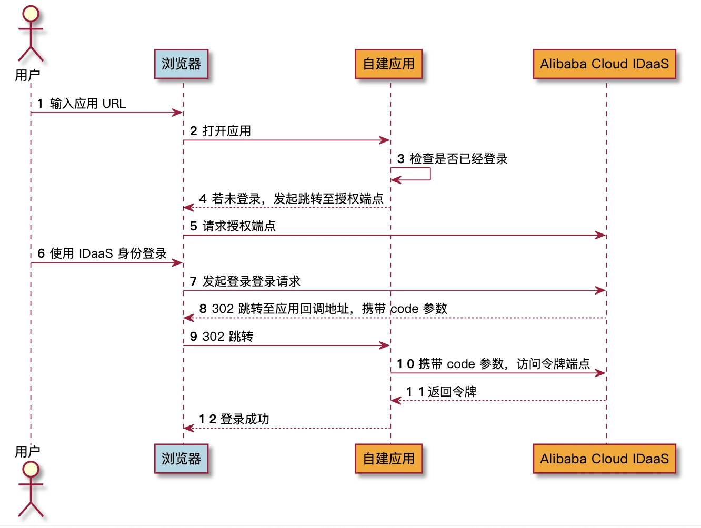

**对接 SSO**

1. **创建自研（或 OIDC 协议）应用**

   您需要在 IDaaS 中创建一个自研应用或标准协议（OIDC）应用，并获取应用密钥。若您已经获取到，可以跳过这个步骤。请参考 **用户指南（租户侧）-> 应用 -> 开通应用 -> 3.自研应用** 完成应用创建。

   在该应用的**通用配置**标签页中，即可获取到 **client_id** 和 **client_secret**。这对密钥将用于后续接口请求。

   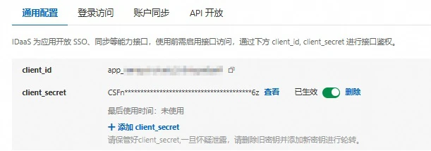

   若希望对密钥进行管理或替换，请参考应用的 **用户指南（租户侧）-> 应用 -> 应用管理 -> 基本配置**。

2. **请求授权端点 Authorization Endpoint**

   下面步骤需要应用开发者处理。

   在用户尝试访问您的应用时，应用需要判断当前是否有可用的已登录身份。

   若用户需要登录，您需要向 IDaaS 发起授权登录的请求。您可以在**应用 > 登录访问**标签页，下方的**应用配置信息**中获取应用的授权端点。

   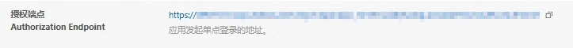

   请参照如下示例，在授权端点地址的基础上，拼装出完整的授权请求访问地址，并在浏览器中发起 302跳转。

   ```text
   {{授权端点 Authorization Endpoint}}?
     client_id=app_***&
     redirect_uri=http%3A%2F%2Flocalhost%3A3000%2F***&
     response_type=code&
     scope=openid&
     state=525f49cc-***
   ```

   | 字段 | 必填 | 示例 | 说明 |
   | --- | --- | --- | --- |
   | client_id | 是 | app_michs7r\*\*\*\*6pye | 上一步骤获取到的 client_id。 |
   | scope | 是 | openid email profile | 自研应用默认配置为 openid email profile，意味着应用可获取到已登录账户的 ID、用户名、邮箱信息。若您使用 OIDC 标准模板应用，管理员还可在配置页选择 phone。scope 对应的字段范围，可见文档末尾说明。 |
   | respons e_type | 是 | code | 此值固定为 code，代表采用授权码模式。 |
   | redirect_uri | 是 | http://localhost:3000/user/oauth2/aliyunida as/callback | 用户登录完成后，IDaaS 向应用返回登录结果的重定向地址。该地址应该为应用接收 IDaaS 参数的中继地址，并能接收授权码 <code> code </code>。 |
   | state | 否 | 525f49cc-87c4-4655-b79c-4c4f971b1ad1 | state 是由应用生成的随机字符串，建议长度 32 位以上。该 state 值会在后续步骤返回给应用，应用届时应验证 state 值是否与发起传入的一致，以确保同一会话，以规避 XSRF 安全漏洞。非必填，但强烈建议填写。 |

3. **用户自助登录**

   若请求顺利，向应用授权端点的请求，会跳转到 IDaaS 登录页。

   用户可以通过任意已配置的登录方式，完成身份验证。IDaaS 提供了多样的、不同安全级别的登录能力，包括钉钉扫码登录、短信登录等。详情参考：**用户指南（租户侧）-> 登录 -> 通用配置**。

   登录成功后，浏览器会 302 跳转回应用指定的 redirect_uri，并在 URL 参数中携带 code 和 state参数。

   参考示例：

   ```text
   {{redirect_uri}}?
     code=CO***&
     state=525f49cc-***
   ```

   | 字段 | 示例 | 说明 |
   | --- | --- | --- |
   | code | COE59pkCTm4A9nmowJUsfsfarGEaiS hj3TuDc7NCzLCYu9 | 即授权码。在获取令牌的请求中使用。 |
   | state | 525f49cc-87c4-4655-b79c-4c4f971b1ad1 | 应用接收到后，应确保与调用授权端点时传入的 <code> state </code> 一致。 |

4. **请求令牌端点 Token Endpoint**

   上一步接收到 code 授权码后，应用应使用获得的 code 向令牌端点（Token Endpoint）发起 POST请求。

   与上述授权端点一样，令牌端点也可以在**应用 > 登录访问**标签页下方的**应用配置信息**中获取到。

   

   请求示例如下：

   ```http
   POST /v2/<instance_id>/<app_id>/oauth2/token HTTP/1.0
   Host: eiam-api-cn-hangzhou.aliyuncs.com
   Content-Type: application/x-www-form-urlencoded

   grant_type=authorization_code
     &code=n0esc3N*****5acc3f0ogp4
     &client_id=s6BhdR*****kqt3
     &client_secret=7Fjfp0ZBr1*****KtDRbnfVdmIw
     &redirect_uri=http%3A%2F%2Fwww.example.com%2Fsso%2Fcallback
   ```

   响应结果如下：

   ```json
   {
     "token_type": "Bearer",
     "access_token": "ATM4SoVDqWgUq***********wk3ZS5mtn6fcSp8NH8",
     "expires_in": 1200,
     "expires_at": 1644843164,
     "id_token": "eyJraWQiOiJLRVkyV************gRIadj-frOIRFChA"
   }
   ```

   至此，您的用户已经成功完成登录。您可以选择以下两种方式，进一步获取当前登录身份信息，并完成应用侧登录态的创建：

   <ol type="i">

   <li>

   使用响应结果中的 id_token，经过验证后，直接拿到用户标识。

   </li>

   <li>

   使用响应结果中的 access_token，调用 IDaaS 用户端点，获取当前已登录用户信息。

   </li>

   </ol>

   具体获取方式请参考下面章节。

   > **重要**
   >
   > 可以获取到的用户数据范围，由第一步授权端点请求中的 scope 参数指定。

5. **通过程序解析id_token**

   `id_token` 是一个包含身份信息的签名令牌信息（JWT 格式）。IDaaS 签发的id_token中，包含着解码即明文可见的用户数据，以及签名Signature。

   为了方便理解，您可以将 `id_token` 完整内容，粘贴到JWT 解码网站中，查看其包含的内容。

   内容示例如下：

   ```json
   {
     "kid": "KEY2Ty1qL6u21NGKmccv3jwfd2ndmgtQPnag",
     "alg": "RS256"
   }.{
     "sub": "user_uyvefotjn7kpbejfmxoos3rtmm",
     "jti": "jwt_aaaac7xyhclac6aqkgtjaxsthw5yotn5d77pmki",
     "iss": "https://pre-eiam-api-cn-hangzhou.aliyun-inc.com/v2/********/oidc",
     "iat": 1644841965,
     "nbf": 1644841965,
     "exp": 1644842265,
     "aud": "app_mhylgo3iairjqjdx5eop6uaf34",
     "at_hash": "XHEaGpMooM9zvQXaMzCNEA",
     "name": "testuser",
     "preferred_username": "testuser",
   }.[Signature]
   ```

   在使用其中内容进行应用登录前，您需要对签名 [Signature] 进行验证，以确保令牌是 IDaaS 签发，而非任何其他三方，以保障登录的安全性。这一安全性是必须的。

   <ol type="i">

   <li>

   **获取验签公钥**

   在进行签名验证之前，需要首先获得 IDaaS 公开的验签公钥端点。

   仍然在**应用 > 登录访问**标签页下方的**应用配置信息**中获取，我们可以看到应用的验签公钥端点。

   

   应用可通过访问这一端点，获取到当前的公钥信息。您也可以直接将此地址在浏览器中打开，即可展示公钥信息。

   示例如下：

   ```json
   {
     "keys": [
       {
         "kty": "RSA",
         "e": "AQAB",
         "use": "sig",
         "kid": "KEYkYnc55G********CTvT7So44RGDYdbfs",
         "n": "pXmYkIpy1vaNjTMclU86BQjfmDhjlqMAX8ySVvh9gO-nae4ayvG_*********-v4gP27
   T7u6bUy0GXTlh3eKE0v1LYB81nfqjF2uazlPwPR5yYOhhWcK-gMNByLfE3CnkDc1YGwA3dZmIz-
   ZjOCKy8xLaBuqjrvwn5tpMpAoYEEaH4jIm7unTdhbKEKspNR-
   UXKD8q9RppMh5Tn2sB6oPHlQANudJDgqSwEOevIrdmHU0Zqxrb9cscGH9hH0QjmYEu72yI8BVeliPo3jK
   IoqCIcj5K_t8BJlFQ9QLJ8_o9tmd3BFv5_LVsh4BKGw"
       }
     ]
   }
   ```

   接下来您即可以通过代码完成验签并获取  `id_token`  中的内容了。

   </li>

   <li>

   **验签并登录**

   您可以通过JWT官方库列表找到对应语言的工具，并在代码中使用工具对  `id_token`  进行验签与解析。

   下面以 Java 库：org.bitbucket.b_c:jose4j 为例。

   首先加入对应的 Maven 依赖：

   ```xml
   <dependency>
     <groupId>org.bitbucket.b_c</groupId>
     <artifactId>jose4j</artifactId>
     <version>0.7.12</version>
   </dependency>
   ```

   代码示例如下：

   ```java
   import org.jose4j.jwk.JsonWebKey;
   import org.jose4j.jwk.JsonWebKeySet;
   import org.jose4j.jwt.JwtClaims;
   import org.jose4j.jwt.consumer.JwtConsumer;
   import org.jose4j.jwt.consumer.JwtConsumerBuilder;

   public class IdTokenTest {

       public static void main(String[] args) throws Exception {
           // EIAM的Issuer标识（OIDC签发者URL）
           String issuer = "https://eiam-api-cn-
   hangzhou.aliyuncs.com/v2/idaas_padyrlux3mphrlsex4uonyqhxu/**********/oidc";
           // 当前应⽤的唯⼀标识（从EIAM获取）
           String appId = "app_mkif4*****pxpzbasqmu";
           // 请参照如下⽅式，设定解析⽤的应⽤公钥（JSON格式，⽤于验证JWT签名）
           String jwkJson = "{\n" + "  \"keys\": [\n" + "    {\n" + "      \"kty\":
   \"RSA\",\n" + "      \"e\": \"AQAB\",\n" + "      \"use\": \"sig\",\n" + "      
   \"kid\": \"KEY2H82C2at57itnW4onT3p1ySjwH4nirjCk\",\n" + "      \"n\": 
   \"w7Jl3fAUJp_9GuxV*****QsOA4lnXR5OD4kF4QbIeBiDiH8_MThrFi9k2MB6YMkSzf5JfIkpAS3JCqZ
   6Wooydp4pzaZNZAk3SGzdsa022RmAT" + "-Iayi4Yj6J9tSdTQCjwh2XkzzsIxA_Hla8rWiQ8Vhw1" 
   +
               "-
   ```

   ```text
   7QArgObfe67nSR7LxD55MFLxk9FU0*****RlGhrQGE_0LUuGWtCJG1r1e6aKquyswfxxAr3Rvj8QGIeJrG
   ```

   ```text
   R1Pv8m8d1_5OdULhB7149VqjM6D98WFjab0U2SNv0UlREZXTcS4p-
   2QNm_1egYRRpJEY_00FZqNSYsmErMGepYhO_61KoGqd8cphWQ\"\n" + "    }\n" + "  ]\n" + 
   "}";
           String jwt = 
   "eyJraWQiOiJLRVkySDgyQzJhdD*****uaXJqQ2siLCJhbGciOiJSUzI1NiJ9.eyJzdWIiOiJ1c2Vy***
   ```

   ```text
   lmNjRjZjR3amFrbnBieGpjd3V1IiwianRpIjoiand0X2FhYWFkYWllYTc2eWg1cW0zcm11bnoyeGg0eHd5
   TJzZHBoNjR6aSIsImlzcyI6Imh0dHBzOi8vZWlhbS1hcGktY24taGFuZ3pob3UuYWxpeXVuY3MuY29tL3Y
   L2lkYWFzX3BhZHlybHV4M21waHJsc2V4NHVvbnlxaHh1L2FwcF9ta2lmNGR3bHBlaDZkbnM0cHhwemJhc3
   tdS9vaWRjIiwiaWF0IjoxNjUzNjMwMDQxLCJuYmYiOjE2NTM2MzAwNDEsImV4cCI6MTY1MzYzMDM0MSwiY
   ```

   ```text
   VkIjoiYXBwX21raWY0ZHdscGVoNmRuczRweHB6YmFzcW11IiwibmFtZSI6InRlc3QiLCJwcmVmZXJyZWR
   XNlcm5hbWUiOiJ0ZXN0IiwidXBkYXRlZF9hdCI6MTY1MzYyODU5MH0.pAsUNB8OkdpIxJMZRfLJ7Pa31t
   yl44a1jVIlvdQxwOtPULAwrFxnB0X3eQx89hUGCdvYWl9FO9o-5kT7L-
   RER0wJYz9YNKqrVNBnaRwINRZyeYLRVurWMMzODQz-
   ```

   ```text
   V0ULd9raM1M_i2f_SoWFs1gPFtYh_ijUARHISi7Q3q93ZfAuY8Lq2Nq07QunmDbosvioUd5wJG7WCxW5XX
   ```

   ```java
   YDUQe9p5IEYd1MSvnWuTOLbg7rKn0Vm4dNYGWjz1WuoAyCsc_QxOCqpmQ_2czoqPeN-
   SvPJAQ2CykLk7DSnGpABw1aNrjDidLS9Beqsga9VDCth86sk_0lyTZOaORtUrfVTtQ";
           //解析JWK公钥集合
           JsonWebKeySet jsonWebKeySet = new JsonWebKeySet(jwkJson);
           //创建JWT验证器
           JwtConsumer jwtConsumer = createJwtConsumer(jsonWebKeySet, issuer, appId
   );
           //执⾏验签并解析claims
           JwtClaims jwtClaims = jwtConsumer.processToClaims(jwt);
           // 已经验签完成，打印输出 id_token 中包含的⽤户信息
           System.out.println(jwtClaims);
       }

       // 验签⼯具⽅法
       public static JwtConsumer createJwtConsumer(JsonWebKeySet jsonWebKeySet, String issuer, String appId) {
           // 使⽤建造者模式配置JWT验证器
           final JwtConsumerBuilder jwtConsumerBuilder = new JwtConsumerBuilder();
           // 必须验证的字段配置
           jwtConsumerBuilder.setExpectedIssuer(issuer);
           jwtConsumerBuilder.setRequireIssuedAt();
           jwtConsumerBuilder.setRequireExpirationTime();
           jwtConsumerBuilder.setAllowedClockSkewInSeconds(60);
           jwtConsumerBuilder.setExpectedAudience(appId);
           // 设置公钥解析器（通过kid匹配JWK）
           jwtConsumerBuilder.setVerificationKeyResolver((jws, nestingContext) - > 
   {
               // 从JWT头部获取kid
               final String signKeyId = jws.getKeyIdHeaderValue();
               // 遍历JWK集合查找匹配的密钥
               for (JsonWebKey jsonWebKey: jsonWebKeySet.getJsonWebKeys()) {
                   if (signKeyId.equals(jsonWebKey.getKeyId())) {
                       return jsonWebKey.getKey();
                   }
               }
               throw new RuntimeException("Cannot find verification key: " + signKe
   yId);
           });
           // 构建验证器实例
           return jwtConsumerBuilder.build();
       }
   }
   ```

   > **重要**
   >
   > 请将代码中的issuer、appId、jwkJson和jwt部分替换为您从EIAM获取的实际信息。

   输出示例如下：

   ```text
   JWT Claims Set:{sub=user_dt6kj6yf64cf4wjaknpbxjcwuu, 
                   jti=jwt_aaaadaiea76yh5qm3rmunz2xh4xwyi2sdph64zi, 
                   iss=https://eiam-api-cn-
   hangzhou.aliyuncs.com/v2/idaas_padyrlux3mphrlsex4uonyqhxu/app_**********/oidc, 
                   iat=1653630041, 
                   nbf=1653630041, 
                   exp=1653630341, 
                   aud=app_**********, 
                   name=test, 
                   preferred_username=test, 
                   updated_at=1653628590
                  }
   ```

   由此获取到 IDaaS 中已登录身份信息，应用可用其顺利登录。

   </li>

   </ol>

6. **通过UserInfo端点获取用户信息**

   除了可以通过解析 id_token 获取用户信息外，还可以通过 UserInfo 端点（用户信息端点）获取用户信息。

   仍然在**应用 > 登录访问**标签页下方的**应用配置信息**中获取，我们可以看到应用的验签公钥端点。

   

   UserInfo请求遵循标准 RFC6750，请求示例如下：

   ```http
   GET /v2/<instance_id>/<app_id>/oauth2/userinfo HTTP/1.0
   Host: eiam-api-cn-hangzhou.aliyuncs.com
   Authorization: Bearer <AccessToken>

   返回参数示例：
   {
       "sub": "user_dt6kj6yf64cf4wjaknpbxjcwuu",
       "name": "test",
       "preferred_username": "test",
       "updated_at": 1653899948
   }
   ```

   > **说明**
   >
   > UserInfo 端点返回的业务字符与 id_token 中的字段是保持一致的，即在 “扩展 id_token” 中配置的字段也会在 UserInfo 端点中返回。

**其他高级设置**

若您对 OIDC 协议有深入了解，您可能会用到下列概念或能力，供参考。

1. **OIDC Discovery 应用发现端点说明**

   OIDC 应用的  `issuer`  是对令牌发行方（即 IDaaS）的唯一标识，格式如下：

   ```text
    https://<idaas-api-domain>/v2/<instance_id>/<application_id>/oidc 
   ```

   尖括号中的参数如下：

   | 字段 | 说明 | 示例 |
   | --- | --- | --- |
   | idaas-api-domain | 用户门户地址 | https://\*\*\*\*\*\*.aliyunidaas.com |
   | instance_id | 实例 ID | idaas_m\*\*\*\*\*\*\*\*r2ed22e6m |
   | application_id | 应用 ID | app_m\*\*\*\*\*\*\*\*jy6rbau |

   IDaaS 支持 OpenID Connect Discovery 1.0 标准，在  `issuer`  后再加上  `/.well-known/openid-configuration`  就是该应用的 OIDC 发现端点地址。

   通过请求发现端点，您可以自动发现如下端点信息。所有的请求端点都可以直接从**应用配置信息**中获取。

   | 端点 | 说明 |
   | --- | --- |
   | authorization_endpoint | 授权端点 |
   | device_authorization_endpoin t | <br><code> </code>设备模式<code> </code> 需要标准OIDC应用支持该功能，自研应用暂时不支持设备码流登录 |
   | token_endpoint | 令牌端点 |
   | revocation_endpoint | 令牌吊销端点 |
   | userinfo_endpoint | 用户信息端点 |
   | jwks_uri | JWK公钥端点 |

2. **Scope 与字段权限的对应关系**

   OIDC 中 id_token 中包含的用户信息与 scope 的对应关系如下：

   | 字段 | scope | 说明 |
   | --- | --- | --- |
   | sub | openid | 用户的 <code> userId </code> |
   | jti | openid | JWT 令牌ID，辅助字段 |
   | iss | openid | JWT 签发的 <code> issuer </code>，辅助字段 |
   | iat | openid | JWT 签发时间，辅助字段 |
   | nbf | openid | JWT 令牌有效开始时间，辅助字段 |
   | exp | openid | JWT 令牌过期时间，辅助字段 |
   | aud | openid | 即应用的 ClientID，辅助字段 |
   | at_hash | openid | AccessToken 哈希值，辅助字段 |
   | phone_number | phone | 电话号码，比如 <code> +86 130****5678 </code> |
   | phone_number_verifi ed | phone | 电话号码是否被验证过，目前默认电话号码是已验证 |
   | email | email | 电子邮箱，比如 <code> al***@example.com </code> |
   | email_verified | email | 电子邮箱是否被验证过，目前默认电子邮箱是已验证 |
   | name | profile | 用户显示名 |
   | preferred_username | profile | 用户的 <code> username </code> |
   | updated_at | profile | 用户资料最后更新时间 |

3. **令牌端点支持的认证方式**

   根据 OIDC 协议指明，IDaaS 提供灵活性，允许以下 4 种不同方式进行身份验证。

   在发现端点中返回的字段  `token_endpoint_auth_methods_supported`  指定了支持的认证方法。

   <table>
     <tr>
       <th width="177">取值</th>
       <th>说明</th>
     </tr>
     <tr>
       <td>none</td>
       <td>用于 Public 客户端，通过 <code> none </code> 认证方式认证时 <code> grant_type </code>不能是 <code> client_credentials </code></td>
     </tr>
     <tr>
       <td>client_secret_basic</td>
       <td>按规范 RFC 6749 - The OAuth 2.0 Authorization Framework 实现</td>
     </tr>
     <tr>
       <td>client_secret_post</td>
       <td>按规范 RFC 6749 - The OAuth 2.0 Authorization Framework 实现</td>
     </tr>
     <tr>
       <td>client_secret_jwt</td>
       <td>按规范 OpenID Connect Core 1.0 实现</td>
     </tr>
   </table>

   上一步接收到 code 授权码，并验证请求合法（验证 state 与发起请求传入的一致）后，应用的后端服务，应使用获得的 code 向令牌端点（Token Endpoint）发起 POST 请求，请求示例如下：

   以  `client_secret_basic`  为例，令牌端点请求样例为：

   ```http
   POST /token HTTP/1.0
   Host: api.aliyunidaas.com
   Authorization: Basic YXBwX21pY2hzN3I0*******cHllOkNTKioqKioq

   grant_type=authorization_code&
   code=COE59pkCTm4J*******arGEaiShj7NCzLCYu9
   ```

   更多说明参看 OIDC Core 1.0 规范。

4. **应用 Client Secret 轮转**

   请参考 **用户指南（租户侧）-> 应用 -> 应用管理 -> 基本配置** 中密钥轮转章节说明。

**相关标准**

- RFC6749 - The OAuth 2.0 Authorization Framework

- RFC6750 - The OAuth 2.0 Authorization Framework: Bearer Token Usage

- RFC7009 - OAuth 2.0 Token Revocation

- RFC7515 - JSON Web Signature (JWS)

- RFC7517 - JSON Web Key (JWK)

- RFC7518 - JSON Web Algorithms (JWA)

- RFC7519 - JSON Web Token (JWT)

- RFC7636 - Proof Key for Code Exchange by OAuth Public Clients

- RFC8252 - OAuth 2.0 for Native Apps

- RFC8628 - OAuth 2.0 Device Authorization Grant

- OpenID Connect Core 1.0

- OpenID Connect Discovery 1.0

<a id="section-4-1-2"></a>

### 4.1.2. Java SpringBoot 自研应用接入 SSO 示例

本文以 Java SpringBoot 为例，向您介绍自研应用与 IDaaS 的对接。

**前言**

> **说明**
>
> 阅读本篇前，请确认您已了解：自研应用接入 SSO。

IDaaS 自研应用采用 OIDC 授权码模式，该模式向下兼容 OAuth 2.0 协议授权码模式，所以可以采用OAuth 工具包 `spring-boot-starter-oauth2-client` 完成对接开发。

该工具包封装了所有的 OIDC 授权码模式调用流程和 id_token 解析过程，使用起来非常简单。

**操作步骤**

**引入工具包**

在 `pom.xml` 中增加依赖： `spring-boot-starter-oauth2-client` ，示例如下：

```xml
<parent>
    <groupId>org.springframework.boot</groupId>
    <artifactId>spring-boot-starter-parent</artifactId>
    <version>2.4.1</version>
</parent>

<properties>
    <java.version>8</java.version>
</properties>

<dependencies>
    <dependency>
        <groupId>org.springframework.boot</groupId>
        <artifactId>spring-boot-starter-web</artifactId>
    </dependency>
    <dependency>
        <groupId>org.springframework.boot</groupId>
        <artifactId>spring-boot-starter-oauth2-client</artifactId>
    </dependency>
</dependencies>
```

**配置 IDaaS 信息**

在 `application.properties` 文件中配置 `client_id` , `client_secret` 及 `issuer-uri` 。

```text
spring.security.oauth2.client.registration.aliyunidaas.client-id=app_***
spring.security.oauth2.client.registration.aliyunidaas.client-secret=CS***
spring.security.oauth2.client.provider.aliyunidaas.issuer-uri=<issuer>
```

上述信息，均可在应用创建后获取，请参考自研应用接入 SSO。

**配置 Security 需要 OAuth 认证**

```java
import org.springframework.security.config.annotation.web.builders.HttpSecurity;
import 
org.springframework.security.config.annotation.web.configuration.EnableWebSecurity;
import 
org.springframework.security.config.annotation.web.configuration.WebSecurityConfigurerAda
er;

@EnableWebSecurity
public class SecurityConfig extends WebSecurityConfigurerAdapter {
    @Override
    protected void configure(HttpSecurity http) throws Exception {
        http.authorizeRequests()
            .anyRequest().authenticated()
            .and()
            .oauth2Login();
    }
}
```

**获取 User 信息**

工具包会自动完成所有的授权调用，以及 id_token 验证。通过注入 `@AuthenticationPrincipal OAuth2User user` 即可获得最终的用户信息：

```java
import org.springframework.security.core.annotation.AuthenticationPrincipal;
import org.springframework.security.oauth2.core.user.OAuth2User;
import org.springframework.web.bind.annotation.GetMapping;
import org.springframework.web.bind.annotation.RestController;

@RestController
public class SampleController {

    @GetMapping("/user")
    public OAuth2User user(@AuthenticationPrincipal OAuth2User user) {
        return user;
    }
}
```

最后可尝试在 /user 端点输出用户信息：

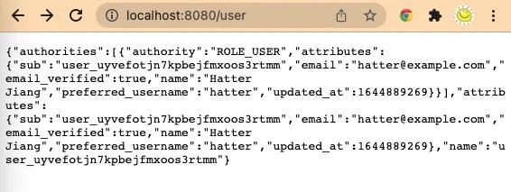

使用这些用户信息，直接将用户登录，即可完成 SSO 过程。

**包含代理服务时的配置**

如果将应用部署在代理后面，如阿里云SLB、Nginx等，过程中可能发生如下情况：

- 用户访问 https://www.example.com

- OIDC登录跳转时产生的  `redirect_uri`  变成了http://127.0.0.1:8080/oauth2/authorization/aliyunidaas，会导致无法登录。

想要解决这个问题，您必须修改 SpringBoot 生成  `redirect_uri`  的配置，具体方法是：

1. 在 SpringBoot 配置文件中增加配置项：

   ```text
   server.forward-headers-strategy = NATIVE
   ```

2. 如果您使用了阿里云SLB，则需要在SLB的高级配置中，勾选**通过 X-Forwarded-Proto 头字段获取SLB 的监听协议**，如下图所示：

   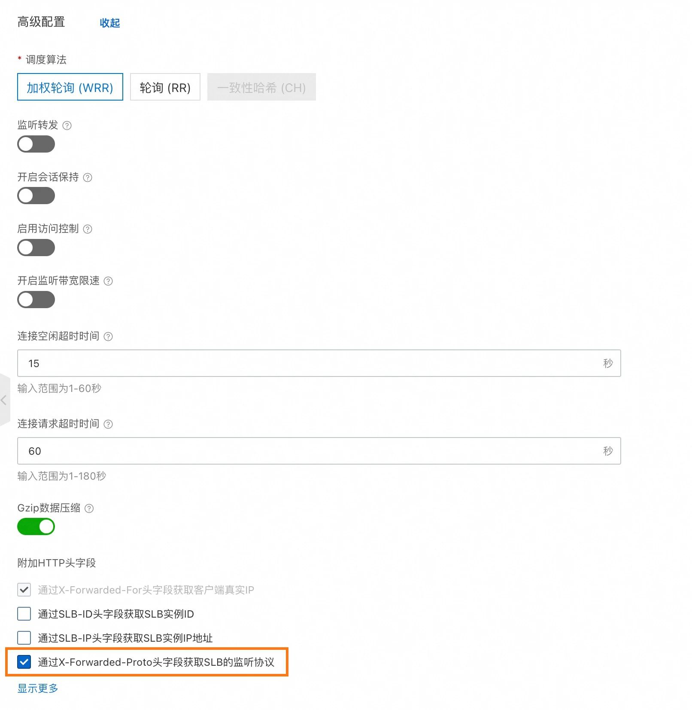

3. 如果您在SLB与应用之间有Nginx代理，则需要在代理上配置：

   ```text
   proxy_set_header Host $host;
   proxy_set_header X-Forwarded-Proto $proxy_x_forwarded_proto;
   ```

4. 如果用户直接通过Nginx以HTTPS方式提供服务，则需要配置：

   ```text
   proxy_set_header Host $host;
   proxy_set_header X-Forwarded-Proto https;
   ```

> **说明**
>
> 如果您使用了其他代理类服务或软件，需要自行查找配置，最终需要确保SpringBoot收到的请求中传入了正确的  `Host`  及  `X-forwarded-Proto`  这两个HTTP Header。

**相关参考资料**

https://datatracker.ietf.org/doc/html/rfc7239

https://docs.nginx.com/nginx/admin-guide/web-server/reverse-proxy/

https://docs.spring.io/spring-boot/docs/current/reference/html/howto.html#howto.webserver.use-behind-a-proxy-server

<a id="section-4-2"></a>

## 4.2. 接入账户同步

<a id="section-4-2-1"></a>

### 4.2.1. 账户同步接入概述

本文概述了阿里云应用身份服务（EIAM）的开发参考，涵盖核心功能、使用场景及接入指南，帮助开发者快速集成统一身份管理与单点登录能力。

**背景介绍**

IDaaS支持自研应用对接，实现IDaaS到应用的组织/账户同步。若希望实现应用到IDaaS的账户同步，请参考 应用开发 API 说明

应用同步配置请参考：**用户指南（租户侧）-> 应用 -> 应用管理 -> 账户同步-事件回调**。本篇文档介绍应用按照IDaaS规范完成账户同步对接。

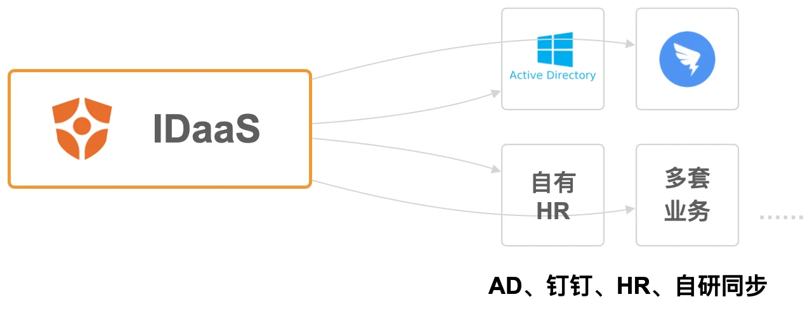

- **一致性依赖**：可能有一系列相关方，依赖于您的应用中的身份数据，进行营销或验证，由此希望能够及时地从IDaaS同步账户的变化。例如在用户入职时，在IDaaS中创建账户，HR应用需要近乎同时创建账户，才不会耽搁入职流程。可以通过订阅**账户创建**事件实现。

- **实时性要求**：您的应用需要及时响应用户的操作。例如用户登录系统后修改了手机后，你的应用需要及时更新该用户的手机号，可以通过订阅**账户更新**事件实现。

**事件回调机制说明**

以上是两个简单的使用场景，开发者可以根据不同需求，订阅不同的事件，进行不同的处理。

为了满足客户的快速对接需求，我们提供了一套由IDaaS定义的、集成便捷、传输安全的IDaaS到应用同步方式，应用可以快速对接，接收同步请求。

这套机制通过事件回调机制实现。

在IDaaS中，您需要配置关注的事件（例如账户创建），当对应事件触发后，将自动向事件订阅者通过 `HTTP POST` 发送同步请求。

事件分为两个部分：

- **订阅事件**：在IDaaS管理控制台完成，配置关注的IDaaS事件。

- **接收事件**：需要开发者按照要求，进行对接。

**订阅事件**

在IDaaS中创建应用后，可以前往**账户同步**菜单，进行应用账户同步配置。


具体配置方式，请参考 **用户指南（租户侧）-> 应用 -> 应用管理 -> IDaaS同步到应用-SCIM**。

在下方配置中，您可以勾选当前应用关注的回调事件。

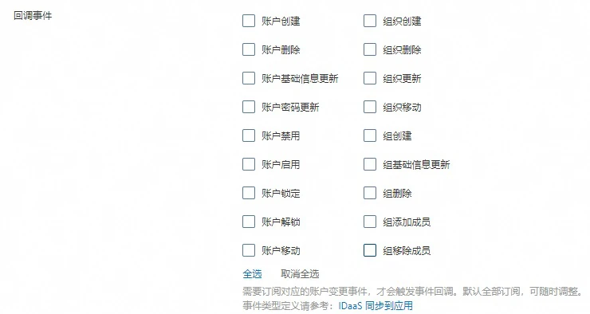

当事件发生时，IDaaS将向应用发出请求。

**接收回调**

当事件发生时，IDaaS会向配置的**同步接收地址**发送 `POST` 请求。

请求参数参考如下：

```text
Content-Type: application/json;charset=utf-8

//IDaaS post 请求body体示例。应⽤拿到参数后进⾏验签
{
 
"event":"eyJhbGciOiJIUzI1NiIsInR5cCI6IkpXVCJ9.eyJzdWIiOiIxMjM0NTY3ODkwIiwibmFtZSI6IkpvaG4
G9lIiwiaWF0IjoxNTE2MjM5MDIyfQ.SflKxwRJSMeKKF2QT4fwpMeJf36POk6yJV_adQssw5c"
}
```

所有参数均在 `event` 字段中传递，传递的内容是包含签名的JWT格式（参考 RFC 7515 JWS)，

**事件格式**

您需要使用各语言的通用开源工具，对JWT信息进行解析。

出于测试目的，您也可以将JWT格式值粘贴到https://jwt.io/，以直接查看其包含内容。

`event`  值包含两大部分， `header` 和 `payload` .

`header`  举例：

```json
{
    "kid": "KEYH1zR7XLCGcHw1hzhkCqVjnuyaAJUf6yMR",
    "typ": "JWT",
    "alg": "RS256"
}
```

`payload`  举例：

```json
{
  "iss":"urn:alibaba:idaas:app:event", 
  "sub":"idaas-121313", 
  "aud":"app_12131313",
  "exp":1640966400, 
  "iat":1640966400, 
  "jti": "cNetm9OD5bXqfVfdvqGMYw",
  "dataEncrypted":false,
  "cipherData":"",    
  "plainData":{
    "aliUid":1231313,  //阿⾥云账号Uid
    "instanceId":"实例ID",  //实例id
    "eventVersion":"V1.0",  //版本号
    "eventData":[
      {
        "eventId":"",     //事件id
        "eventType":"",   //事件类型
        "eventTime":121313,  //事件实际发⽣的时间
        "bizId":"业务数据id",  //业务数据id。若是组织，则为组织id
        "bizData":{}       //具体的数据详情，不同事件类型该字段不同。可参考通讯录事件
      }
    ]   
  }
}
```

其中包含的字段具体如下：

**参数名称**

**参数位置**

**参数类型**

**参数说明**

固定值：RS256

alg

header

String

代表采用SHA-256的RSA签名

header

IDaaS颁发的公私钥对key ID。

验签时需要使用该 `kid` 应的公钥。

kid

header

String

IDaaS暂不支持同步用公私钥轮转，同步公私钥信息不会变化。

固定值： `urn:alibaba:idaas:app:event`

iss

payload

String

代表是由IDaaS发起的事件订阅通知。

客户的IDaaS实例ID

sub

payload

String

客户的IDaaS应用ID

aud

payload

String

`event` 的过期时间，单位/ms，默认为创建时间之后30分钟。

exp

payload

Long

若当前时间超过过期时间，应用解析时应该报错，判断过期。

payload

`event` 的创建时间，单位/ms。若当前时间早于创建时间，应用解析时应该报错，判断无

iat

payload

Long

效。

data_encry

事件数据是否为加密传输。

payload

Boolean

pted

开启加密时不为空。该字段是加密后密文事件数

cipher_dat

payload

String

据，需解密后查看内容。

a

关闭加密时不为空。包含所有事件数据。

plain_data

payload

Object

**数据验签**

请先对JWT验签，确认对应 `event` 事件信息是由IDaaS签发。若不进行验证，任何人都将可以仿造请求。

您可以通过同步菜单中的**验证公钥断点**，获取到验签JWT使用的公钥信息，并使用其对发送给应用的事件内容进行有效来源验证。我们推荐您使用对应开发语言的开源JWT工具包进行验签工作。

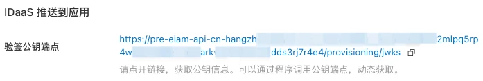

**数据解密（可选）**

IDaaS支持对推送的事件数据进行加密传输，加密后字段将在 `payload` 中 `cipher_data` 字段传递。

```text
{
    ...
    "cipher_data": 
"ZePq7ckODWnL54vqZc3kTw0vF7tjvIRZjqqy/gZm9oTEt71WMufD9swlmHzZkniSqyDGQpkmMRLCXz9gzRJ4BY2R
LUPQW8ZDPSfmJKEf2m2w6wY1twoRlnHLoFCVhravsvN0afBqmxd3eK5tHd05Ze6MLOXS3fqxqH61dGAm2mwecvAFP
KVeg6JXBYUvA2Uu6dmCOP3y938kFdhodD13O05MBIqWghq569wYvVjKMFMcnsZqmGGKXN0vRFhg+SR16sr24b1X/g
bNqyMDICB9k3QMe09dOodwNEwvgxbf1v4PbyCRX1P9UO74nDQaWROWZFplE7qP/JMy3pBr0pxW+hJS9u/Zpvj/hvL
BTAZkmhAKDKxlrYztqrgJbr4VOUv8mlqxWjDK4I7VZugODJMSwi1HdjXL+wlMzPMOeH8rkDFU+b5VH3dsxg3hZ64U
7exB62QyyeIJpfk0d57xw8UACiSsXadexQYpJPDycVdmJ7FAmIhxbJ8I6w9Kcv9U5sKybUz1YA8tONAw=="
    ...
}
```

开启该特性后，您可以自主填写加密密钥，也可由IDaaS生成密钥。IDaaS发出事件回调请求前，会使用该密钥将请求数据全部加密后传输。

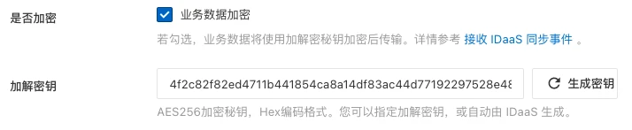

IDaaS会使用AES-256算法对称加密，并采用JWE格式对事件进行加密。

应用需要使用同样的密钥解密，才能获取同步数据。

开发对接可以参考 Java 应用接入账户同步示例。

**响应返回**

应用需负责按照IDaaS规范，返回事件处理结果。IDaaS将记录结果，并依照返回信息进行后续处理。

**执行成功**

若请求处理一切正常，必须返回 `eventId` 及对应的结果，格式如下：

| 返回字段 | 数据类型 | 描述 |
| --- | --- | --- |
| successEvents | Array | 同步成功，返回该事件 |
| skippedEvents | Array | 同步跳过（场景举例：应用接收到删除账户事件，但账户在应用系统中已不存在，则可以返回跳过。） |
| failedEvents | Array | 同步失败，返回该事件 |
| retriedEvents | Array | 同步重试，若返回，该事件将重试。最大重试次数5次 |
| -eventId | String | 事件ID，必须返回IDaaS当次事件ID。不发送或传输错误<code> eventId </code>将触发重试。 |
| -eventCode | String | 错误码，IDaaS将记录结果，便于排查问题。您可自定义<code> eventcode </code>。 |
| -eventMessage | String | 错误描述，IDaaS将记录结果原因，便于排查问题。您可自定义<code> eventmessage </code>。 |

正常返回结果示例：

```json
{
    "successEvents": [
        {
            "eventId": "事件ID",
            "eventCode": "SUCCESS",
            "eventMessage": "SUCCESS"
        }
    ],
    "skippedEvents": [
        {
            "eventId": "事件ID",
            "eventCode": "跳过code",
            "eventMessage": "跳过描述"
        }
    ],
    "failedEvents": [
        {
            "eventId": "事件ID",
            "eventCode": "错误code",
            "eventMessage": "错误描述"
        }
    ],
    "retriedEvents": [
        {
            "eventId": "事件ID",
            "eventCode": "错误code",
            "eventMessage": "错误描述"
        }
    ]
}
```

> **重要**
>
> 收到请求后，需要在10秒内以 `HTTP 200` 状态码响应该请求，否则IDaaS会视此次推送失败并以1s、5s、10s、10s、10s的间隔重新推送事件，最多重试5次。

**执行失败**

若处理失败，返回 `HTTP` 状态码必须是4XX或者5XX。

处理失败后返回的参数如下：

| 参数名称 | 数据类型 | 描述 |
| --- | --- | --- |
| error | String | 错误码 |
| error_description | String | 错误描述 |

针对通用，建议参考如下错误码返回：

| 错误码 | HTTP状态码 | 描述 |
| --- | --- | --- |
| invalid_token | 403 | <code> jws token </code>校验不合法 |
| too_many_request | 429 | 业务方处理繁忙返回该错误后，idaas会进行流控策略进行降级处理 |
| internal_error | 500 | 内部错误，idaas会自动重试 |

异常返回结果示例

```json
{
     "error": "invalid_token",
     "error_description": "jws token校验不合法"
}
```

<a id="section-4-2-2"></a>

### 4.2.2. 通讯录事件

本文档详细阐述阿里云IDaaS（EIAM）的事件回调机制，为开发者提供应用同步功能对接的完整指导方案。通过理解事件参数分类及处理流程，开发者可实现高效的系统集成。

**基础说明**

以下是关于事件参数及分类的具体说明。若需了解更深入的对接原理和调用流程，请参阅账户同步接入概述。

1. **测试事件**

   当管理员完成应用同步配置后，可通过点击**测试连接**按钮来验证配置的有效性。此过程会触发特殊的测试事件，以便应用能够接收到并进行相应的处理，确保配置无误。

2. **增量事件**

   增量事件是由IDaaS内部通讯录发生变更时自动触发的操作类型。这类事件主要用于在IDaaS与第三方应用之间实现数据的持续更新与同步。通过监听此类事件，可以有效地保持两端数据的一致性，特别适用于实时或近实时的数据同步需求。

3. **全量事件**

   全量事件是指由管理员手动从IDaaS界面触发的一种同步操作，目的是将IDaaS中的所有数据一次性导入到目标应用中。这种类型的同步通常用于初次集成或是需要对数据进行全面更新的场景。

**事件清单**

**事件模块**

**事件类型**

**类型代码**

测试事件

测试连接

urn:alibaba:idaas:app:event:common:test

账户创建

urn:alibaba:idaas:app:event:ud:user:create

账户删除

urn:alibaba:idaas:app:event:ud:user:delete

账户基础信息更新

urn:alibaba:idaas:app:event:ud:user:update_info

urn:alibaba:idaas:app:event:ud:user:update_pass

账户密码更新

word

账户禁用

urn:alibaba:idaas:app:event:ud:user:disable

账户启用

urn:alibaba:idaas:app:event:ud:user:enable

账户锁定

urn:alibaba:idaas:app:event:ud:user:lock

账户解锁

urn:alibaba:idaas:app:event:ud:user:unlock

urn:alibaba:idaas:app:event:ud:user:update_prim

账户移动

ary_ou

通讯录

urn:alibaba:idaas:app:event:ud:organizational_un

组织创建

增量事件

it:create

urn:alibaba:idaas:app:event:ud:organizational_un

通讯录事件

it:delete

urn:alibaba:idaas:app:event:ud:organizational_un

组织更新

it:update

urn:alibaba:idaas:app:event:ud:organizational_un

组织移动

it:update_parent_organizational_unit

组创建

urn:alibaba:idaas:app:event:ud:group:create

组基础信息更新

urn:alibaba:idaas:app:event:ud:group:update

组删除

urn:alibaba:idaas:app:event:ud:group:delete

组添加成员

urn:alibaba:idaas:app:event:ud:group:add_user

urn:alibaba:idaas:app:event:ud:group:remove_us

组移除成员

er

<table>
  <tr>
    <td rowspan="3">通讯录全量事件</td>
    <td>全量推送组织机构</td>
    <td>urn:alibaba:idaas:app:event:ud:organizational_un it:push</td>
  </tr>
  <tr>
    <td>全量推送账户</td>
    <td>urn:alibaba:idaas:app:event:ud:user:push</td>
  </tr>
  <tr>
    <td>全量推送组</td>
    <td>urn:alibaba:idaas:app:event:ud:group:push</td>
  </tr>
</table>

所有的账户/组织事件，IDaaS均会将完整的账户/组织信息作为参数，传递给事件监听方。若数据中有敏感信息，推荐通过HTTPS加密通道或勾选**业务数据加密**，对传输过程进行保护。

**测试事件**

**测试连接**

测试配置信息的连通性，验证验签和加密能力。

测试事件使用独立的事件订阅类型：urn:alibaba:idaas:app:event:common:test。

> **说明**
>
> 该事件仅支持在控制台中通过一键测试使用，不支持接口调用。

请求参数验签后 `payload` 示例：

```json
{
  "iss": "urn:alibaba:idaas:app:event",
  "sub": "idaas_rhhoqmlnyu3cv7ow657gyvurky",
  "aud": "app_mjavzivahje6zxkbc4i2bierdu",
  "exp": 1648711369,
  "iat": 1648709570,
  "jti": "bNRrCYrqXjqe8B1xweqlZw",
  "dataEncrypted": false,
  "cipherData": "",
  "plainData": {
    "instanceId": "idaas_rhhoqmlnyu3cv7ow657gyvurky",
    "aliUid": 151971404963****,
    "eventVersion": "V1.0",
    "eventData": [
         {
          "eventId":"evnt_aaaac766x2somw2ptotoyk6ag6bmfkt5xpqprpq",
          "eventType":"urn:alibaba:idaas:app:event:common:test",
          "eventTime":"1648709509849",
          "bizId":"evnt_aaaac766x2somw2ptotoyk6ag6bmfkt5xpqprpq",
          "bizData":"{\"bizData\":\"req_xxxxxxxxxxsdfsdfsfd\"}"
         }
     ]
  }
}
```

应用成功接收后，应用侧必须在返回请求，并确保字段  `successEvents`  中  `eventId`  与请求中保持一致。

否则测试请求将失败。

```json
{
  "successEvents": [
    {
      "eventId": "evnt_aaaac766x2somw2ptotoyk6ag6bmfkt5xpqprpq",
      "eventCode": "SUCCESS",
      "eventMessage": "SUCCESS"
    }
  ],
  "skippedEvents": [
    {
      "eventId": "",
      "eventCode": "",
      "eventMessage": ""
    }
  ],
  "failedEvents": [
    {
      "eventId": "",
      "eventCode": "",
      "eventMessage": ""
    }
  ],
  "retriedEvents": [
    {
      "eventId": "",
      "eventCode": "",
      "eventMessage": ""
    }
  ]
}
```

**通讯录增量事件**

**用户事件**

1. **账户创建**

   通过该事件订阅员工入职。

   事件类型：urn:alibaba:idaas:app:event:ud:user:create。

   解析后的 `bizData` 示例：

   ```json
   {
       "password": "ssGp96", 
       "userId": "user_4alcbywzc7jyl23lu2srljsw7i", 
       "username": "zhangsan", 
       "displayName": "张三", 
       "passwordSet": true, 
       "phoneRegion": "", 
      "phoneNumber": "155****5620",
       "phoneVerified": false, 
       "email":"zh***@163.com",
       "emailVerified": false, 
       "userExternalId": "user_4alcbywzc7jyl23lu2srljsw7i", 
       "userSourceType": "build_in", 
       "userSourceId": "idaas_rhhoqmlnyu3cv7ow657gyvurky", 
       "status": "enabled", 
       "accountExpireTime": "-1", 
       "registerTime": "1648531553621", 
       "lockExpireTime": "-1", 
       "createTime": "1648531553621", 
       "updateTime": "1648531553621", 
       "description": "", 
       "customFields": [
           {
               "fieldName": "test_custom_field", 
               "fieldValue": "test_value"
           }
       ],
       "primaryOrganizationalUnitId": "ou_bvluxnp2ef36uupdwob6km34a4",
       "organizationalUnits": [
           {
               "organizationalUnitId": "ou_bvluxnp2ef36uupdwob6km34a4", 
               "organizationalUnitName": "研发部", 
               "primary": true
           }
       ]
   }
   ```

   **参数说明：**

   | 参数 | 字段类型 | 说明 |
   | --- | --- | --- |
   | userId | String | 用户唯一id |
   | username | String | 用户名 |
   | displayName | String | 显示名称，一般为用户姓名。 |
   | passwordSet | boolean | 是否设置密码 |
   | phoneRegion | String | 手机号区号 |
   | phoneNumber | String | 手机号 |
   | phoneVerified | boolean | 手机号是否验证过，暂时不进行验证。 |
   | email | String | 邮箱 |
   | emailVerified | boolean | 邮箱是否验证过，暂时不进行验证。 |
   | userExternalId | String | 外部id。若是自建账户则和 userId 一致；若是外部同步的账户，则为来源的用户id。如来源是钉钉，则为钉钉的userId。 |
   | userSourceType | String | 来源类型，若为自建账户，则为 "build_id"。 |
   | userSourceId | String | 来源类型 id |
   | password | String | 密码。若同步应用开启同步密码，且用户设置密码，会传该值。 |
   | status | String | 状态：enabled-启用，disabled-禁用。 |
   | accountExpireTime | Long | 用户过期时间 |
   | registerTime | Long | 注册时间 |
   | lockExpireTime | Long | 锁定到期时间，即到该时间点则解锁。 |
   | createTime | Long | 创建时间 |
   | updateTime | Long | 修改时间 |
   | description | String | 描述 |
   | customFields | List | 扩展字段列表 |
   | -fieldName | String | 字段名称标识 |
   | -fieldValue | String | 字段值 |
   | primaryOrganizationa lUnitId | String | 所属主组织机构 |
   | organizationalUnits | List | 所属组织机构列表 |
   | -organizationalUnitId | String | 所属组织机构唯一id |
   | -organizationalUnitNa me | String | 所属组织机构名称。 |
   | -primary | boolean | 所属主组织机构。true-所属主组织机构，false-非主组织机构。 |

2. **账户删除**

   当员工离职时，通讯录发生变更，可订阅该事件。

   事件类型：urn:alibaba:idaas:app:event:ud:user:delete。

   解析后的 `bizData` 示例：同账户创建。

3. **账户基础信息更新**

   若员工基本信息发生变更。如手机号，邮箱，姓名等发生变更，应用需要及时收到变更的信息，可通过订阅该事件。

   事件类型：urn:alibaba:idaas:app:event:ud:user:update_info。

   解析后的 `bizData` 示例：同账户创建。

4. **账户密码更新**

   当账户密码发生变更时，如：管理员重置密码，用户修改密码。应用可通过订阅此事件，收到账户最新密码。

   > **重要**
   >
   > 注意：在订阅该事件时，同时还需要配置同步范围，才会生效。否则不同步。请参考 **应用->应用管理->账户同步-事件回调**。

   事件类型：urn:alibaba:idaas:app:event:ud:user:update_password。

   解析后的 `bizData` 示例：同账户创建。

5. **账户启用**

   账户状态发生变更，从禁用状态修改为启用状态，可订阅该事件。

   事件类型：urn:alibaba:idaas:app:event:ud:user:enable。

   解析后的 `bizData` 示例：同账户创建。

6. **账户禁用**

   账户状态发生变更，从启用状态修改为禁用状态，可订阅该事件。

   事件类型：urn:alibaba:idaas:app:event:ud:user:disable。

   解析后的 `bizData` 示例：同账户创建。

7. **账户锁定**

   账户状态发生变更，如输错多次密码，导致账号锁定，暂不可用，可订阅该事件。

   事件类型：urn:alibaba:idaas:app:event:ud:user:lock。

   解析后的 `bizData` 示例：同账户创建。

8. **账户解锁**

   账户状态发生变更，由锁定状态变为正常状态，可订阅该事件。

   事件类型：urn:alibaba:idaas:app:event:ud:user:unlock。

   解析后的 `bizData` 示例：同账户创建。

9. **账户移动**

   账户所属主组织机构变更，可订阅该事件。

   事件类型：urn:alibaba:idaas:app:event:ud:user:update_primary_ou。

   解析后的 `bizData` 示例：同账户创建。

**组织单元(OU)事件**

1. **组织创建**

   可通过该事件订阅创建组织机构。

   事件类型：urn:alibaba:idaas:app:event:ud:organizational_unit:create。

   解析后的 `bizData` 示例：

   ```json
   {
       "organizationalUnitId": "ou_dqdvxesykpfhig2kvgrzpeoeyu", 
       "organizationalUnitName": "组织部", 
       "parentId": "ou_dqdvxesykpdfasdfaseoeyu", 
       "organizationalUnitExternalId": "ou_dqdvxesykpfhig2kvgrzpeoeyu", 
       "organizationalUnitSourceType": "build_in", 
       "organizationalUnitSourceId": "idaas_rhhoqmlnyu3cv7ow657gyvurky", 
       "createTime": "1648451475209", 
       "updateTime": "1648451475209",
       "description":"⾃建"
   }
   ```

   **参数说明：**

   | 参数 | 字段类型 | 说明 |
   | --- | --- | --- |
   | organizationalUnitId | String | 组织唯一id |
   | organizationalUnitNa me | String | 组织名称。 |
   | parentId | String | 父级组织机构id |
   | organizationalUnitExt ernalId | String | 外部id，若组织是自建的则是organizationalUnitId。若是外部同步进来的，如来源于钉钉，则是钉钉的部门id。 |
   | organizationalUnitSou rceType | String | 来源类型 |
   | organizationalUnitSou rceId | String | 来源类型id |
   | createTime | Long | 创建时间 |
   | updateTime | Long | 修改时间，同lastUpdatedTime |
   | description | String | 描述 |

2. **组织删除**

   可通过该事件订阅删除组织机构。

   事件类型：urn:alibaba:idaas:app:event:ud:organizational_unit:delete。

   解析后的 `bizData` 示例：同组织创建。

3. **组织更新**

   可通过该事件订阅修改组织机构基础信息，如组织机构名称。

   事件类型：urn:alibaba:idaas:app:event:ud:organizational_unit:update。

   解析后的 `bizData` 示例：同组织创建。

4. 组织移动

   可通过该事件订阅组织机构更新父组织机构。

   事件类型：urn:alibaba:idaas:app:event:ud:organizational_unit:update_parent_organizational_unit。

   解析后的 `bizData` 示例：同组织创建。

**组（Group）事件**

1. **组创建**

   可通过该事件订阅组创建。

   事件类型：urn:alibaba:idaas:app:event:ud:group:create。

   解析后的  `bizData`  示例：

   ```json
   {
       "groupId": "group_yvx3ugdi3yzaehnsd3uqzb4xha",
       "groupName": "test_2024",
       "groupExternalId": "test_2024"
   }
   ```

   参数说明：

   | 参数 | 字段类型 | 说明 |
   | --- | --- | --- |
   | groupId | String | 组唯一标识 |
   | groupName | String | 组显示名称 |
   | groupExternalId | String | 组外部Id |
   | allMembers | List | 组当前全部成员 |
   | memberId | String | 用户唯一标识 |
   | memberName | String | 用户显示名称 |

2. **组基础信息更新**

   可通过该事件订阅组基础信息更新。

   事件类型：urn:alibaba:idaas:app:event:ud:group:update。

   解析后的  `bizData`  示例：同组创建。

3. **组删除**

   可通过该事件订阅组删除。

   事件类型：urn:alibaba:idaas:app:event:ud:group:delete。

   解析后的  `bizData`  示例：同组创建。

4. **组添加成员**

   可通过该事件订阅组添加成员。

   事件类型：urn:alibaba:idaas:app:event:ud:group:add_user。

   解析后的  `bizData`  示例：

   ```json
   {
       "addedMembers": [
           {
               "memberId": "user_zakg7oeeaftqqff2bzcv7wpqs4",
               "memberName": "⼩明"
           }
       ],
       "groupId": "group_yvx3ugdi3yzaehnsd3uqzb4xha",
       "groupName": "test_2024_test",
       "groupExternalId": "test_2024"
   }
   ```

   参数说明：

   | 参数 | 字段类型 | 说明 |
   | --- | --- | --- |
   | groupId | String | 组唯一标识 |
   | groupName | String | 组显示名称 |
   | groupExternalId | String | 组外部Id |
   | addedMembers | List | 需要添加的成员 |
   | -memberId | String | 用户唯一标识 |
   | -memberName | String | 用户显示名称 |

5. **组移除成员**

   可通过该事件订阅组移除成员。

   事件类型：urn:alibaba:idaas:app:event:ud:group:remove_user。

   解析后的 `bizData` 示例：

   ```json
   {
       "removedMembers": [
           {
               "memberId": "user_zakg7oeeaftqqff2bzcv7wpqs4",
               "memberName": "⼩明"
           }
       ],
       "groupId": "group_yvx3ugdi3yzaehnsd3uqzb4xha",
       "groupName": "test_2024_test",
       "groupExternalId": "test_2024"
   }
   ```

   参数说明：

   | 参数 | 字段类型 | 说明 |
   | --- | --- | --- |
   | groupId | String | 组唯一标识 |
   | groupName | String | 组显示名称 |
   | groupExternalId | String | 组外部Id |
   | removedMembers | List | 需要移除的成员 |
   | -memberId | String | 用户唯一标识 |
   | -memberName | String | 用户显示名称 |

**通讯录全量事件**

**全量推送事件**

1. **全量推送组织机构**

   事件类型：urn:alibaba:idaas:app:event:ud:organizational_unit:push。

   解析后的  `bizData`  示例：同组织创建。

2. **全量推送账户**

   事件类型：urn:alibaba:idaas:app:event:ud:user:push。

   解析后的  `bizData`  示例：同账户创建。

3. **全量推送组**

   可通过该事件订阅全量推送组。

   事件类型：urn:alibaba:idaas:app:event:ud:group:push。

   解析后的  `bizData`  示例：

   ```json
   {
       "allMembers": [
           {
               "memberId": "user_zakg7oeeaftqqff2bzcv7wpqs4",
               "memberName": "⼩明"
           },
           {
               "memberId": "user_zakg7oeea1234ff2bzcexample",
               "memberName": "张三"
           }
       ],
       "groupId": "group_yvx3ugdi3yzaehnsd3uqzb4xha",
       "groupName": "test_2024",
       "groupExternalId": "test_2024"
   }
   ```

   参数说明：

   | 参数 | 字段类型 | 说明 |
   | --- | --- | --- |
   | groupId | String | 组唯一标识 |
   | groupName | String | 组显示名称 |
   | groupExternalId | String | 组外部Id |
   | allMembers | List | 组当前全部成员 |
   | -memberId | String | 用户唯一标识 |
   | -memberName | String | 用户显示名称 |

<a id="section-4-2-3"></a>

### 4.2.3. Java 应用接入账户同步示例

本篇文档以 Java 为例，讲解作为应用与 IDaaS 的对接。

若您希望了解对接原理和调用流程，请参考 账户同步接入概述。

接入账户同步可能需要处理两点：

- **验签**

- **解密**（可选）

进行完上述过程后，即可获取到该次事件的请求内容，应用自行处理即可。

1. **验签**

参考 **用户指南（租户侧）-> 应用 -> 应用管理 -> IDaaS同步到应用-SCIM** 中操作，从应用同步配置中获取公钥端点。


在本文档示例中，提供了直接从公钥端点获取公钥的 Java 工具类。若您所选开发语言需要公钥信息，可能需要您点开公钥端点，获取公钥内容，转化成 .pem 文件格式存储在本地。

公钥示例：

```json
{
  "keys": [
    {
      "kty": "RSA",
      "e": "AQAB",
      "use": "sig",
      "kid": "KEY3PdQDx97********h83p8husNSC9AKMH",
      "n": "rLUnH5PNeGUZE-
********GGIxyM5O7TDdaG4********D9mV1CjE8hVHBxXM96IcCCH_1xmUZEZRp_MBP6m2XeNWUXanCpeyuIAD2k
aQAqituZdIlT4l3-q9gtccdY-khaE-
OfH9qYZhlxFcYj0gVtOvKZFIkuGhME4IQJd_RAWS3OPXxtbGhO2fZYCiuuc8NWub5mcVQnqsy5aJPLwHbVwVUwYNO
q97_m2TtPcIVWtw7AOzX8O78UrYnYt_QPrv7uVdJMbHleSOx2A1IXqrAkJWecwFfvTsBTCUOPPDeVRQEHzzwmf3zp
KMgHZU1I5pyqi0KJ6BuMHWw"
    }
  ]
}
```

添加 Maven 依赖：

```xml
<dependency>
  <groupId>org.bitbucket.b_c</groupId>
  <artifactId>jose4j</artifactId>
  <version>0.7.9</version>
</dependency>
```

工具类代码如下，用于从 IDaaS 公钥端点获取公钥并验签，您可以直接复制使用：

```java
import org.apache.commons.codec.binary.StringUtils;
import org.jose4j.jwk.JsonWebKey;
import org.jose4j.jwk.JsonWebKeySet;
import org.jose4j.jwt.consumer.JwtConsumer;
import org.jose4j.jwt.consumer.JwtConsumerBuilder;
import org.jose4j.lang.JoseException;

import java.io.ByteArrayOutputStream;
import java.io.IOException;
import java.io.InputStream;
import java.net.URL;
import java.net.URLConnection;
import java.nio.charset.StandardCharsets;
import java.util.concurrent.ConcurrentHashMap;
import java.util.concurrent.ConcurrentMap;

public class JwtUtil {
    private final static ConcurrentMap<String, JsonWebKeySet> IDAAS_SIGN_JWK_SET_MAP = new ConcurrentHashMap<>();

    public static JwtConsumer createJwtConsumerFromUrl(String jwkUrl, String appId) {
        try {
            final JsonWebKeySet jsonWebKeySet = getJsonWebKeySetByUrl(jwkUrl);
            return createJwtConsumer(jsonWebKeySet, appId);
        } catch (Exception e) {
            throw new RuntimeException("Fetch JWKs from url failed: " + e.getMessage() 
+ ", " + jwkUrl, e);
        }
    }

    public static JwtConsumer createJwtConsumer(JsonWebKeySet jsonWebKeySet, String app
Id) {
        final JwtConsumerBuilder jwtConsumerBuilder = new JwtConsumerBuilder();
        jwtConsumerBuilder.setExpectedIssuer("urn:alibaba:idaas:app:event");
        jwtConsumerBuilder.setRequireExpirationTime();
        jwtConsumerBuilder.setRequireJwtId();
        jwtConsumerBuilder.setRequireIssuedAt();
        jwtConsumerBuilder.setRequireExpirationTime();
        jwtConsumerBuilder.setMaxFutureValidityInMinutes(1);
        jwtConsumerBuilder.setAllowedClockSkewInSeconds(120);
        jwtConsumerBuilder.setExpectedAudience(appId);
        jwtConsumerBuilder.setVerificationKeyResolver((jws, nestingContext) -> {
            final String signKeyId = jws.getKeyIdHeaderValue();
            for (JsonWebKey jsonWebKey : jsonWebKeySet.getJsonWebKeys()) {
                if (StringUtils.equals(jsonWebKey.getKeyId(), signKeyId)) {
                    return jsonWebKey.getKey();
                }
            }
            throw new RuntimeException("Cannot find verification key: " + signKeyId);
        });
        return jwtConsumerBuilder.build();
    }

    synchronized private static JsonWebKeySet getJsonWebKeySetByUrl(String 
jwkUrlString) throws IOException, JoseException {
        JsonWebKeySet jsonWebKeySet = IDAAS_SIGN_JWK_SET_MAP.get(jwkUrlString);
        if (jsonWebKeySet == null) {
            jsonWebKeySet = innerGetJsonWebKeySetByUrl(jwkUrlString);
            IDAAS_SIGN_JWK_SET_MAP.put(jwkUrlString, jsonWebKeySet);
        }
        return jsonWebKeySet;
    }

    private static JsonWebKeySet innerGetJsonWebKeySetByUrl(String jwkUrlString) throws 
IOException, JoseException {
        final URL jwkUrl = new URL(jwkUrlString);
        final URLConnection urlConnection = jwkUrl.openConnection();
        urlConnection.setConnectTimeout(50000);
        urlConnection.setReadTimeout(50000);
        final String jwkSetJson = new String(readAll(urlConnection.getInputStream()), StandardCharsets.UTF_8);
        return new JsonWebKeySet(jwkSetJson);
    }

    public static byte[] readAll(InputStream inputStream) throws IOException {
        final byte[] buffer = new byte[1024 * 8];
        final ByteArrayOutputStream baos = new ByteArrayOutputStream();
        for (int len; ((len = inputStream.read(buffer)) != -1); ) {
            baos.write(buffer, 0, len);
        }
        return baos.toByteArray();
    }
}
```

调用示例代码：

```text
//公钥->IDaaS应⽤同步配置⾥,访问应⽤公钥端点后获取到。
String publicKey = "{\n"
            + "  \"keys\": [\n"
            + "    {\n"
            + "      \"kty\": \"RSA\",\n"
            + "      \"e\": \"AQAB\",\n"
            + "      \"use\": \"sig\",\n"
            + "      \"kid\": \"KEYHH4yFa1c*******qNo1nJ7nM2FR3595P1\",\n"
            + "      \"n\": \"oy_xxxxxxxxxxxxxxxxxxxxxxx95d1padSEABqIbcTKcnlTaET3WHaR"
            + "-3MvsooeZWluv94GQEp-U2jzM1adgTqBl_7KPjUk0dwrZbob_8pOLX5UQMF7Oo_nH5-H5EyL9
-yGGhFA4oeuA"
            + "-
b73qXShxP7eHs5xTT1kiYEu2NE3rBZdtrRwUiC_h1DvZMtyWFOPwm3dpLiwCcdlgcKvVuSEXyCBj6Gjevn3_G1guV
kHlNOVyNn6Ky1iGQJzXctJCEJ5fnBRs4XZZbPNSciYMD2-__cRdbYPtGyyuoEAfouw\"\n"
            + "    }\n"
            + "  ]\n"
            + "}";;

//应⽤ID->应⽤列表中，找到对应的应⽤ID
String appId = "app_mjavzivahje6zxxxx";
//JwtUtil->下⾯已提供JwtUtil⼯具类
JwtConsumer jwtConsumer = JwtUtil.createJwtConsumer(new 
JsonWebKeySet(publicKey),appId);

//JWT验签后，获取到payload
//event参数值->接⼝接收到的参数值
JwtClaims jwtClaims = jwtConsumer.processToClaims("event参数的值");
//获取到具体的payload
Map<String, Object> map = jwtClaims.getClaimsMap();
//接下来，根据具体的数据，做对应的业务处理
```

2. **解密（可选）**

**数据解密**

若应用开启业务数据加密，事件数据将通过 cipher_data 加密传递，业务方需要解密，以获取到同步数据。

IDaaS 支持自主填写加密密钥，也可由 IDaaS 生成。


将密钥复制出来，解密时使用。

新增 Maven 依赖：

```xml
<dependency>
  <groupId>org.bitbucket.b_c</groupId>
  <artifactId>jose4j</artifactId>
  <version>0.7.9</version>
</dependency>
<dependency>
  <groupId>org.bouncycastle</groupId>
  <artifactId>bcprov-jdk15on</artifactId>
  <version>1.70</version>
</dependency>
```

解密示例代码：

```text
public String decrypte(String cipherData,String key) throws JoseException {
    String alg = "AES";
    
    // ⽣成使⽤密钥⽣成 KeySpec
    SecretKeySpec secretKeySpec = new SecretKeySpec(Hex.decode(key), alg);
    JsonWebKey jsonWebKey = JsonWebKey.Factory.newJwk(secretKeySpec);
    
    JsonWebEncryption receiverJwe = new JsonWebEncryption();
    
    // 设定加解密机制
    AlgorithmConstraints algConstraints = new 
AlgorithmConstraints(AlgorithmConstraints.ConstraintType.PERMIT, new String[]{"dir"});
    receiverJwe.setAlgorithmConstraints(algConstraints);
    
    AlgorithmConstraints encConstraints = new AlgorithmConstraints(
        AlgorithmConstraints.ConstraintType.PERMIT, new String[]{"A256GCM", "A192GCM", 
"A128GCM"});
    receiverJwe.setContentEncryptionAlgorithmConstraints(encConstraints);
    
    // 传入密钥和密⽂
    receiverJwe.setKey(jsonWebKey.getKey());
    receiverJwe.setCompactSerialization(cipherData);
    
    // 返回解密内容
    return new String(receiverJwe.getPlaintextBytes(), StandardCharsets.UTF_8);
}
```

<a id="section-4-2-4"></a>

### 4.2.4. EIAM支持的SCIM 2.0接口

本文为您介绍 EIAM 提供的SCIM 2.0接口，声明了支持范围和限制条件。仅当您的自建应用需要集成使用SCIM接口同步相关数据时，才需要关注本文档。

**使用说明**

SCIM 2.0接口的实现遵循 RFC 7642、RFC 7643、RFC 7644。具体的结构实现，请参见SCIM Schemas。

**SCIM 2.0接口总览**

1. 授权令牌（BearerToken）可以通过以下两种方式获取：

   <ol type="i">

   <li>

   **静态BearerToken**：这是一个界面配置生成的静态令牌，您可以在应用管理页面，点击**账户同步**，进入**应用同步到IDaaS 页面**配置生成。

   </li>

   <li>

   **通过Client_Credentials生成的Access Token**：您可以通过EIAM提供的OAuth 2.0 Client Credentials授权码模式来动态获取Access Token。在这种情况下，您将使用您的ClientID/Secret来请求生成Access Token。具体信息，请参见GenerateToken - 生成应用认证token。

   </li>

   </ol>

2. SCIM 2.0接口如下表所示。

> **重要**
>
> 调用SCIM接口时，请根据实际情况将 `{BaseUrl}` 替换为EIAM实例应用中的**SCIM Base URL**，将 `<BearerToken>` 替换为有效的SCIM授权令牌。

**分类**

**SCIM 2.0接口**

**支持情况**

**功能描述**

支持

获取服务端支持的功能。

/ServiceProviderConfig

获取服务端支持的资源类型，返回

支持

/ResourceTypes

User和Group。

Discovery Endpoint

获取服务端支持的Schema，返回

支持

User，EnterpriseUser和Group

/Schemas

的详细Schema。

支持

同步用户。

POST /Users

支持

查询指定ID的用户。

GET /Users/{id}

按条件查询用户信息或查询所有用户列表。

支持

GET /Users

不指定filter时，返回所有用户，最

/Users

多100条，支持分页。

支持

替换指定ID的用户信息。

PUT /Users/{id}

支持

更新指定ID的用户信息。

PATCH /Users/{id}

支持

删除指定ID的用户。

DELETE /Users/{id}

支持

同步用户组。

POST /Groups

查询指定ID的用户组，包含用户组

支持

GET /Groups/{id}

中的用户信息。

按条件查询用户组信息或查询所有用户组列表。

支持

GET /Groups

不指定filter时，返回所有用户组列

/Groups

表但不返回用户组中的用户信息，最多100条，支持分页。

支持

替换用户组信息。

PUT /Groups/{id}

支持

更新用户组信息。

PATCH /Groups/{id}

支持

删除指定ID的用户组。

DELETE /Groups/{id}

无

不支持

无

/Me

无

不支持

无

/Bulk

无

不支持

无

/.Search

**接口详细说明与操作示例**

**Discovery Endpoint**

**/ServiceProviderConfig**

**功能描述**

获取服务端支持的功能。

**使用约束**

不需要认证。

**请求示例**

```bash
curl {baseUrl}/ServiceProviderConfig --header "Content-type:application/scim+json"
```

**返回示例**

```json
{
    "documentationUri": "",
    "patch": {
        "supported": true
    },
    "bulk": {
        "supported": false,
        "maxOperations": 0,
        "maxPayloadSize": 0
    },
    "filter": {
        "supported": true,
        "maxResults": 100
    },
    "changePassword": {
        "supported": true
    },
    "sort": {
        "supported": false
    },
    "etag": {
        "supported": false
    },
    "authenticationSchemes": [
        {
            "name": "OAuth Bearer Token",
            "description": "Authentication scheme using the OAuth Bearer Token 
Standard",
            "specUri": "https://www.rfc-editor.org/info/rfc6750",
            "type": "oauthbearertoken",
            "primary": true
        }
    ],
    "schemas": [
        "urn:ietf:params:scim:schemas:core:2.0:ServiceProviderConfig"
    ]
}
```

**/ResourceTypes**

**功能描述**

获取服务端支持的资源类型，返回User和Group。

**使用约束**

不需要认证。

**请求示例**

```bash
curl {baseUrl}/ResourceTypes --header "content-type:application/scim+json"
```

**返回示例**

```json
{
    "startIndex": 1,
    "totalResults": 2,
    "itemsPerPage": 2,
    "Resources": [
        {
            "name": "Group",
            "description": "Group",
            "endpoint": "/Groups",
            "schema": "urn:ietf:params:scim:schemas:core:2.0:Group",
            "id": "Group",
            "meta": {
                "resourceType": "Group",
                "location": "{BaseUrl}/ResourceTypes/Group"
            },
            "schemas": [
                "urn:ietf:params:scim:schemas:core:2.0:ResourceType"
            ]
        },
        {
            "name": "User",
            "description": "User Account",
            "endpoint": "/Users",
            "schema": "urn:ietf:params:scim:schemas:core:2.0:User",
            "schemaExtensions": [
                {
                    "schema": 
"urn:ietf:params:scim:schemas:extension:enterprise:2.0:User",
                    "required": false
                }
            ],
            "id": "User",
            "meta": {
                "resourceType": "User",
                "location": "{BaseUrl}/ResourceTypes/User"
            },
            "schemas": [
                "urn:ietf:params:scim:schemas:core:2.0:ResourceType"
            ]
        }
    ],
    "schemas": [
        "urn:ietf:params:scim:api:messages:2.0:ListResponse"
    ]
}
```

**/Schemas**

**功能描述**

获取服务端支持的Schema，返回User和Group的详细Schema。

**使用约束**

- 支持按资源类型查询。

- 只支持下文文档描述的字段。

- 不需要认证。

**请求示例**

```bash
#请求⽤户资源的企业扩展信息
curl {baseUrl}/Schemas  --header "content-type:application/scim+json"
#请求⽤户资源的企业扩展信息
curl {baseUrl}/Schemas/urn:ietf:params:scim:schemas:core:2.0:User  --header "content-type:application/scim+json"
#请求⽤户资源的企业扩展信息
curl {baseUrl}/Schemas/urn:ietf:params:scim:schemas:core:2.0:Group  --header "content-type:application/scim+json"
#请求⽤户资源的企业扩展信息
curl {baseUrl}/Schemas/urn:ietf:params:scim:schemas:extension:enterprise:2.0:User  --header "content-type:application/scim+json"
```

**返回示例**

**用户资源Schema**

```json
{
    "startIndex": 1,
    "totalResults": 3,
    "itemsPerPage": 3,
    "Resources": [
        {
            "name": "User",
            "description": "User Account",
            "attributes": [
                {
                    "name": "userName",
                    "type": "string",
                    "multiValued": false,
                    "description": "Unique identifier for the User typically used by the
user to directly authenticate to the service provider.",
                    "required": true,
                    "caseExact": false,
                    "mutability": "readWrite",
                    "returned": "default",
                    "uniqueness": "server"
                },
                {
                    "name": "displayName",
                    "type": "string",
                    "multiValued": false,
                    "description": "The name of the User, suitable for display to end-us
ers. The name SHOULD be the full name of the User being described if known.",
                    "required": false,
                    "caseExact": false,
                    "mutability": "readWrite",
                    "returned": "default",
                    "uniqueness": "none"
                },
                {
                    "name": "password",
                    "type": "string",
                    "multiValued": false,
                    "description": "The User's clear text password. This attribute is in
tended to be used as a means to specify an initial password when creating a new User orto reset an existing User's password.",
                    "required": false,
                    "caseExact": false,
                    "mutability": "writeOnly",
                    "returned": "never",
                    "uniqueness": "none"
                },
                {
                    "name": "emails",
                    "type": "complex",
                    "subAttributes": [
                        {
                            "name": "value",
                            "type": "string",
                            "multiValued": false,
                            "description": "E-mail addresses for the user. The value\nSH
OULD be canonicalized by the Service Provider, e.g.\nbjensen@example.com instead of bjensen@EXAMPLE.COM. Canonical Type\nvalues of work, home, and other.",
                            "required": false,
                            "caseExact": false,
                            "mutability": "readWrite",
                            "returned": "default",
                            "uniqueness": "none"
                        },
                        {
                            "name": "display",
                            "type": "string",
                            "multiValued": false,
                            "description": "A human readable name, primarily used for di
splay purposes.",
                            "required": false,
                            "caseExact": false,
                            "mutability": "readWrite",
                            "returned": "default",
                            "uniqueness": "none"
                        },
                        {
                            "name": "type",
                            "type": "string",
                            "multiValued": false,
                            "description": "A label indicating the attribute's function; 
e.g., 'work' or 'home'.",
                            "required": false,
                            "canonicalValues": [
                                "work",
                                "home",
                                "other"
                            ],
                            "caseExact": false,
                            "mutability": "readWrite",
                            "returned": "default",
                            "uniqueness": "none"
                        },
                        {
                            "name": "primary",
                            "type": "boolean",
                            "multiValued": false,
                            "description": "A Boolean value indicating the 'primary' or 
preferred attribute value for this attribute, e.g., the preferred mailing address or primary e-mail address. The primary attribute value 'true' MUST appear no more than once.
",
                            "required": false,
                            "caseExact": true,
                            "mutability": "readWrite",
                            "returned": "default",
                            "uniqueness": "none"
                        }
                    ],
                    "multiValued": true,
                    "description": "E-mail addresses for the user. The value SHOULD be c
anonicalized by the Service Provider, e.g., bjensen@example.com instead of 
bjensen@EXAMPLE.COM. Canonical Type values of work, home, and other.",
                    "required": false,
                    "caseExact": true,
                    "mutability": "readWrite",
                    "returned": "default",
                    "uniqueness": "server"
                },
                {
                    "name": "phoneNumbers",
                    "type": "complex",
                    "subAttributes": [
                        {
                            "name": "value",
                            "type": "string",
                            "multiValued": false,
                            "description": "Phone number of the User",
                            "required": false,
                            "caseExact": false,
                            "mutability": "readWrite",
                            "returned": "default",
                            "uniqueness": "none"
                        },
                        {
                            "name": "display",
                            "type": "string",
                            "multiValued": false,
                            "description": "A human readable name, primarily used for di
splay purposes.",
                            "required": false,
                            "caseExact": false,
                            "mutability": "readWrite",
                            "returned": "default",
                            "uniqueness": "none"
                        },
                        {
                            "name": "type",
                            "type": "string",
                            "multiValued": false,
                            "description": "A label indicating the attribute's function; 
e.g., 'work' or 'home' or 'mobile' etc.",
                            "required": false,
                            "canonicalValues": [
                                "work",
                                "home",
                                "mobile",
                                "fax",
                                "pager",
                                "other"
                            ],
                            "caseExact": false,
                            "mutability": "readWrite",
                            "returned": "default",
                            "uniqueness": "none"
                        },
                        {
                            "name": "primary",
                            "type": "boolean",
                            "multiValued": false,
                            "description": "A Boolean value indicating the 'primary' or 
preferred attribute value for this attribute, e.g., the preferred phone number or primary phone number. The primary attribute value 'true' MUST appear no more than once.",
                            "required": false,
                            "caseExact": true,
                            "mutability": "readWrite",
                            "returned": "default",
                            "uniqueness": "none"
                        }
                    ],
                    "multiValued": true,
                    "description": "Phone numbers for the User.  The value SHOULD be can
onicalized by the Service Provider according to format in RFC3966 e.g., 
'tel:555xxxx5555'.  Canonical Type values of work, home, mobile, fax, pager and other.",
                    "required": false,
                    "caseExact": true,
                    "mutability": "readWrite",
                    "returned": "default",
                    "uniqueness": "server"
                },
                {
                    "name": "phoneRegion",
                    "type": "string",
                    "multiValued": false,
                    "description": "PhoneRegion for the User. eg.86.If not filled, the d
efault value is 86",
                    "required": false,
                    "caseExact": false,
                    "mutability": "writeOnly",
                    "returned": "never",
                    "uniqueness": "none"
                },
                {
                    "name": "id",
                    "type": "string",
                    "multiValued": false,
                    "description": "A unique identifier for a SCIM resource as defined b
y the service provider.",
                    "required": true,
                    "caseExact": false,
                    "mutability": "readOnly",
                    "returned": "always",
                    "uniqueness": "server"
                },
                {
                    "name": "externalId",
                    "type": "string",
                    "multiValued": false,
                    "description": "A String that is an identifier for the resource as d
efined by the provisioning client.",
                    "required": false,
                    "caseExact": false,
                    "mutability": "readWrite",
                    "returned": "default",
                    "uniqueness": "none"
                },
                {
                    "name": "meta",
                    "type": "complex",
                    "subAttributes": [
                        {
                            "name": "resourceType",
                            "type": "string",
                            "multiValued": false,
                            "description": "The resource Type",
                            "required": false,
                            "caseExact": true,
                            "mutability": "readOnly",
                            "returned": "always",
                            "uniqueness": "none"
                        },
                        {
                            "name": "location",
                            "type": "reference",
                            "multiValued": false,
                            "description": "The location (URI) of the resource",
                            "required": false,
                            "caseExact": true,
                            "mutability": "readOnly",
                            returned: always,
                            "uniqueness": "none"
                        }
                    ],
                    "multiValued": false,
                    "description": ".",
                    "required": false,
                    "caseExact": false,
                    "mutability": "readOnly",
                    "returned": "default",
                    "uniqueness": "none"
                },
                {
                    "name": "schemas",
                    "type": "string",
                    "multiValued": true,
                    "description": ".",
                    "required": true,
                    "caseExact": true,
                    "mutability": "readOnly",
                    "returned": "always",
                    "uniqueness": "none"
                }
            ],
            "id": "urn:ietf:params:scim:schemas:core:2.0:User",
            "meta": {
                "resourceType": "Schema",
                "location": "
{BaseUrl}/Schemas/urn:ietf:params:scim:schemas:core:2.0:User"
            }
        },
        {
            "name": "Group",
            "description": "Group",
            "attributes": [
                {
                    "name": "displayName",
                    "type": "string",
                    "multiValued": false,
                    "description": "A human-readable name for the Group.",
                    "required": true,
                    "caseExact": false,
                    "mutability": "readWrite",
                    "returned": "default",
                    "uniqueness": "none"
                },
                {
                    "name": "members",
                    "type": "complex",
                    "subAttributes": [
                        {
                            "name": "value",
                            "type": "string",
                            "multiValued": false,
                            "description": "The identifier of a group member.",
                            "required": true,
                            "caseExact": false,
                            "mutability": "immutable",
                            "returned": "default",
                            "uniqueness": "none"
                        },
                        {
                            "name": "ref",
                            "type": "reference",
                            "multiValued": false,
                            "description": "The URI of the member resource.",
                            "required": true,
                            "caseExact": true,
                            "mutability": "immutable",
                            "returned": "default",
                            "uniqueness": "none",
                            "referenceTypes": [
                                "User"
                            ]
                        },
                        {
                            "name": "display",
                            "type": "string",
                            "multiValued": false,
                            "description": "A human readable name, primarily used for di
splay purposes.",
                            "required": false,
                            "caseExact": false,
                            "mutability": "immutable",
                            "returned": "default",
                            "uniqueness": "none"
                        }
                    ],
                    "multiValued": true,
                    "description": "A list of members of the Group.",
                    "required": false,
                    "caseExact": true,
                    "mutability": "readWrite",
                    "returned": "default",
                    "uniqueness": "none"
                },
                {
                    "name": "id",
                    "type": "string",
                    "multiValued": false,
                    "description": "A unique identifier for a SCIM resource as defined b
y the service provider.",
                    "required": true,
                    "caseExact": false,
                    "mutability": "readOnly",
                    "returned": "always",
                    "uniqueness": "server"
                },
                {
                    "name": "externalId",
                    "type": "string",
                    "multiValued": false,
                    "description": "A String that is an identifier for the resource as d
efined by the provisioning client.",
                    "required": false,
                    "caseExact": false,
                    "mutability": "readWrite",
                    "returned": "default",
                    "uniqueness": "none"
                },
                {
                    "name": "meta",
                    "type": "complex",
                    "subAttributes": [
                        {
                            "name": "resourceType",
                            "type": "string",
                            "multiValued": false,
                            "description": "The resource Type",
                            "required": false,
                            "caseExact": true,
                            "mutability": "readOnly",
                            "returned": "always",
                            "uniqueness": "none"
                        },
                        {
                            "name": "location",
                            "type": "reference",
                            "multiValued": false,
                            "description": "The location (URI) of the resource",
                            "required": false,
                            "caseExact": true,
                            "mutability": "readOnly",
                            "returned": "always",
                            "uniqueness": "none"
                        }
                    ],
                    "multiValued": false,
                    "description": ".",
                    "required": false,
                    "caseExact": false,
                    "mutability": "readOnly",
                    "returned": "default",
                    "uniqueness": "none"
                },
                {
                    "name": "schemas",
                    "type": "string",
                    "multiValued": true,
                    "description": ".",
                    "required": true,
                    "caseExact": true,
                    "mutability": "readOnly",
                    "returned": "always",
                    "uniqueness": "none"
                }
            ],
            "id": "urn:ietf:params:scim:schemas:core:2.0:Group",
            "meta": {
                "resourceType": "Schema",
                "location": "
{BaseUrl}/Schemas/urn:ietf:params:scim:schemas:core:2.0:Group"
            }
        },
        {
            "name": "EnterpriseUser",
            "description": "Enterprise User",
            "attributes": [
                {
                    "name": "organization",
                    "type": "string",
                    "multiValued": false,
                    "description": "Identifies the name of an organization.",
                    "required": false,
                    "caseExact": false,
                    "mutability": "readWrite",
                    "returned": "default",
                    "uniqueness": "none"
                }
            ],
            "id": "urn:ietf:params:scim:schemas:extension:enterprise:2.0:User",
            "meta": {
                "resourceType": "Schema",
                "location": "
{BaseUrl}/Schemas/urn:ietf:params:scim:schemas:extension:enterprise:2.0:User"
            }
        }
    ],
    "schemas": [
        "urn:ietf:params:scim:api:messages:2.0:ListResponse"
    ]
}
```

**Users**

**POST /Users**

**功能描述**

同步用户。

**使用约束**

- 字段参考Schema返回结果里声明的定义。

- 若传账户所属组织则账户放在所属ou下面，若不含所属ou，则账户的所属组织为同步目标节点。具体看请求示例。

**请求示例：**

```bash
curl {baseUrl}/Users --header 'Authorization: Bearer <BearerToken>' --header "content-type:application/scim+json" -X POST -d '<data>'
```

其中，data结构示例如下。

**示例一：不传账户所属组织示例**

```json
{
    "userName": "<user username>",
    "externalId": "<external Id>",
    "displayName": "<user display name>",
    "active": true,
    "emails": [
        {
            "primary": true,
            "type": "work",
            "value": "<user email>"
        }
    ],
   "phoneRegion":"86"
   "phoneNumbers": [
        {
            "primary": true,
            "type": "work",
            "value": "<user phoneNumber>"
        }
    ],
    "active":true,
    "schemas": [
        "urn:ietf:params:scim:schemas:core:2.0:User"
    ]  
}
```

**示例二：传账户所属组织示例。**

```json
{
    "userName": "<user username>",
    "externalId": "<external Id>",
    "displayName": "<user display name>",
    "emails": [
       {
            "primary": true,
            "type": "work",
            "value": "<user email>"
        }
   ],
   "phoneRegion":"86"
   "phoneNumbers": [
        {
            "primary": true,
            "type": "work",
            "value": "<user phoneNumber>"
        }
    ],
  "active":true,
  "schemas": [
        "urn:ietf:params:scim:schemas:core:2.0:User",
        "urn:ietf:params:scim:schemas:extension:enterprise:2.0:User"
    ],
  "urn:ietf:params:scim:schemas:extension:enterprise:2.0:User": {
    "organization": "<user organizationalUnitId>"
  }
}
```

**返回示例**

```text
HTTP/1.1 201

{
    "id": "<userId>",
    "userName": "<user username>",
    "displayName": "<user display name>",
    "active": true,
    "emails": [
        {
            "value": "<user email>",
            "type": "work",
            "primary": true
        }
    ],
    "phoneNumbers": [
        {
            "value": "<user phoneNumber>",
            "type": "work",
            "primary": true
        }
    ],
    "externalId": "<external Id>",
    "active":true,
    "meta": {
        "resourceType": "User",
        "created": "2025-02-25T09:56:48.622Z",
        "lastModified": "2025-02-25T09:56:48.622Z",
        "location": "{BaseUrl}/Users/<userId>"
    },
    "schemas": [
        "urn:ietf:params:scim:schemas:core:2.0:User",
        "urn:ietf:params:scim:schemas:extension:enterprise:2.0:User"
    ],
  "urn:ietf:params:scim:schemas:extension:enterprise:2.0:User": {
    "organization": "<user organizationalUnitId>"
  }
}
```

**GET /Users/{id}**

**功能描述**

查询指定ID的用户。

**使用约束**

- 如果带/{id}，则返回该ID对应的用户。如果{id}不是已存在的用户，则拒绝请求。

- 只能查询SCIM 导入来源的，且在同步范围内的用户

**请求示例**

```bash
curl {BaseUrl}/Users/<userId> --header 'Authorization: Bearer <BearerToken>' --header "content-type:application/scim+json" -X GET
```

**返回示例**

```text
HTTP/1.1 200

{
    "id": "<userId>",
    "userName": "<user username>",
    "displayName": "<user display name>",
    "active": true,
    "emails": [
        {
            "value": "<user email>",
            "type": "work",
            "primary": true
        }
    ],
    "phoneNumbers": [
        {
            "value": "<user phoneNumber>",
            "type": "work",
            "primary": true
        }
    ],
    "externalId": "<external Id>",
    "active":true,
    "meta": {
        "resourceType": "User",
        "created": "2025-02-25T09:56:48.622Z",
        "lastModified": "2025-02-25T09:56:48.622Z",
        "location": "{BaseUrl}/Users/<userId>"
    },
    "schemas": [
        "urn:ietf:params:scim:schemas:core:2.0:User",
        "urn:ietf:params:scim:schemas:extension:enterprise:2.0:User"
    ],
  "urn:ietf:params:scim:schemas:extension:enterprise:2.0:User": {
    "organization": "<user organizationalUnitId>"
  }
}
```

**GET /Users**

**功能描述**

按条件查询用户信息或查询所有用户列表。

**使用约束**

- 如果有filter，则过滤相应的用户返回，filter只支持eq和and操作符。filter需要URL编码。

- 如果没有filter，只能查询SCIM 导入来源的，且在同步范围内的用户

- 若有filter，则能查询同步范围内的所有用户

**请求示例**

```bash
curl {BaseUrl}/Users<?parameters> --header 'Authorization: Bearer <BearerToken>' --header "content-type:application/scim+json" -X GET
```

其中，parameters支持列表如下：

| 参数名 | 取值说明 | 示例 |
| --- | --- | --- |
| filter | 支持：externalId，id，userName，<br>emails\[type eq "work"\].value，<br>phoneNumbers\[type eq "work"\].value<br>的eq表达式。必须URL编码 | • filter=externalId eq "&lt;external Id&gt;"<br>• filter=id eq "user_xxxxxxxx"<br>• filter=userName eq "&lt;user username&gt;"<br>• filter=emails\[type eq "work"\].value eq "&lt;user email&gt;"<br>• filter=emails\[type eq "work" and value eq "&lt;user email&gt;"\]<br>• filter=phoneNumbers\[type eq "work"\].value eq "&lt;user phoneNumber&gt;"<br>• filter=phoneNumbers\[type eq "work" and value eq " &lt;user phoneNumber&gt;"\] |
| startIn dex | 可置空，默认值为1，表示标号。 | startIndex=1 |
| count | 可置空，默认值为20，表示每页用户个数。每页最多返回100条记录，如果记录条数大于100（count&gt;100），则按100处理。 | count=20 |

**返回示例**

```text
HTTP/1.1 200

{
    "startIndex": 1,
    "totalResults": 2,
    "itemsPerPage": 20,
    "Resources": [
        {
            "userName": "username1",
            "displayName": "displayName1",
            "active": true,
            "emails": [
                {
                    "value": "test1@example.com",
                    "type": "work",
                    "primary": true
                }
            ],
            "phoneNumbers": [
                {
                    "value": "333*****333",
                    "type": "work",
                    "primary": true
                }
            ],
            "id": "user_addxxxxxxxxxxxxxxx1",
            "externalId": "externalId1",
            "meta": {
                "resourceType": "User",
                "created": "2025-03-06T03:16:40.201Z",
                "lastModified": "2025-03-06T03:16:40.201Z",
                "location": "{BaseUrl}/Users/user_addxxxxxxxxxxxxxxx1"
            },
            "schemas": [
                "urn:ietf:params:scim:schemas:core:2.0:User"
            ]
        },
        {
            "userName": "username2",
            "displayName": "displayName2",
            "active": true,
            "emails": [
                {
                    "value": "test2@example.com",
                    "type": "work",
                    "primary": true
                }
            ],
            "phoneNumbers": [
                {
                    "value": "333*****334",
                    "type": "work",
                    "primary": true
                }
            ],
            "id": "user_g3od4xxxxxxxxxxxxxxx2",
            "externalId": "externalId2",
            "meta": {
                "resourceType": "User",
                "created": "2025-03-06T06:58:35.997Z",
                "lastModified": "2025-03-06T06:58:35.997Z",
                "location": "{BaseUrl}/Users/user_g3od4xxxxxxxxxxxxxxx2"
            },
            "schemas": [
                "urn:ietf:params:scim:schemas:core:2.0:User"
            ]
        }
    ],
    "schemas": [
        "urn:ietf:params:scim:api:messages:2.0:ListResponse"
    ]
}
```

**PUT /Users/{id}**

**描述**

替换用户信息。

**使用约束**

- {id}必传，修改的字段范围为Schema中定义的字段。

- 覆盖原有属性。若参数为空，则该参数的值不进行修改。

- 仅能修改同步范围内来源是SCIM 导入或自建的用户。如果是自建的账户，修改后则将来源修改为SCIM导入。

**请求示例**

```bash
curl {BaseUrl}/Users/<userId> --header 'Authorization: Bearer <BearerToken>' --header "content-type:application/scim+json" -X PUT -d '<data>'
```

其中，data 结构示例如下：

```json
{
    "id":"<userId>"
    "userName": "<user username>",
    "externalId": "<external Id>",
    "displayName": "<user display name>",
    "emails": [
       {
            "primary": true,
            "type": "work",
            "value": "<user email>"
        }
   ],
   "phoneRegion":"86"
   "phoneNumbers": [
        {
            "primary": true,
            "type": "work",
            "value": "<user phoneNumber>"
        }
    ],
  "active":true,
  "schemas": [
        "urn:ietf:params:scim:schemas:core:2.0:User",
        "urn:ietf:params:scim:schemas:extension:enterprise:2.0:User"
    ],
  "urn:ietf:params:scim:schemas:extension:enterprise:2.0:User": {
    "organization": "<user organizationalUnitId>"
  }
}
```

**返回示例**

```text
HTTP/1.1 200

{
    "id": "<userId>",
    "userName": "<user username>",
    "displayName": "<user display name>",
    "active": true,
    "emails": [
        {
            "value": "<user email>",
            "type": "work",
            "primary": true
        }
    ],
    "phoneNumbers": [
        {
            "value": "<user phoneNumber>",
            "type": "work",
            "primary": true
        }
    ],
    "externalId": "<external Id>",
    "active":true,
    "meta": {
        "resourceType": "User",
        "created": "2025-02-25T09:56:48.622Z",
        "lastModified": "2025-02-25T09:56:48.622Z",
        "location": "{BaseUrl}/Users/<userId>"
    },
    "schemas": [
        "urn:ietf:params:scim:schemas:core:2.0:User",
        "urn:ietf:params:scim:schemas:extension:enterprise:2.0:User"
    ],
  "urn:ietf:params:scim:schemas:extension:enterprise:2.0:User": {
    "organization": "<user organizationalUnitId>"
  }
}
```

**PATCH /Users/{id}**

**描述**

部分更新用户信息。

**使用约束**

- {id}必传，修改的字段范围为Schema中定义的字段。

- Patch支持Add、Replace，不支持Remove。若传Remove则忽略。

- path参数可选。具体看请求示例的data结构体。

- 仅能修改同步范围内来源是SCIM 导入或自建的用户。如果是自建的账户，修改后则将来源修改为SCIM导入。

**请求示例：**

```bash
curl {BaseUrl}/Users/<userId> --header 'Authorization: Bearer <BearerToken>' --header "content-type:application/scim+json" -X PATCH -d '<data>'
```

其中，data结构示例如下。

**示例一：添加displayName，不带path。**

```json
{
    "Operations": [
        {
            "op": "add",
            "value": {
                "diplayName": "updateDisplayName"
            }
        }
    ],
    "schemas": [
        "urn:ietf:params:scim:api:messages:2.0:PatchOp"
    ]
}
```

**示例二：修改displayName，带path。**

```json
{
    "Operations": [
        {
            "op": "Replace",
            "path": "diplayName",
            "value": "updateDisplayName"
        }
    ],
    "schemas": [
        "urn:ietf:params:scim:api:messages:2.0:PatchOp"
    ]
}
```

**示例三：修改邮箱，不带path。**

```json
{
    "schemas": [
        "urn:ietf:params:scim:api:messages:2.0:PatchOp"
    ],
    "Operations": [{
          "op": "Replace",
          "value": {
            "emails": [{
                    "value": "test@example.com",
                    "type": "work",
                    "primary": true
            }]
        }
    }]
}
```

**示例四：修改邮箱，带path。**

```json
{
    "Operations": [
        {
            "op": "Replace",
            "path": "emails[type eq \"work\"].value",
            "value": "test@example.com"
        }
    ],
    "schemas": [
        "urn:ietf:params:scim:api:messages:2.0:PatchOp"
    ]
}
```

**示例五：禁用账户，带path。**

```json
{
    "Operations": [
        {
            "op": "Replace",
            "path": "active",
            "value": "false"
        }
    ],
    "schemas": [
        "urn:ietf:params:scim:api:messages:2.0:PatchOp"
    ]
}
```

**示例六：禁用账户，不带path。**

```json
{
    "Operations": [
        {
            "op": "Replace",
            "value": {
                "active": false
            }
        }
    ],
    "schemas": [
        "urn:ietf:params:scim:api:messages:2.0:PatchOp"
    ]
}
```

**返回示例**

```text
HTTP/1.1 204
```

**DELETE /Users/{id}功能描述**

删除指定ID的用户。

**使用约束**

- {id}必传。

- 仅能删除被同步的用户。

**请求示例**

```bash
curl {BaseUrl}/Users/<userId> --header 'Authorization: Bearer <BearerToken' --header "content-type:application/scim+json" -X DELETE
```

**返回示例**

```text
HTTP/1.1 204
```

**Group**

**POST /Groups**

**功能描述**

同步用户组。

**使用约束**

- 字段限制参考Schema描述。

- 成员最多支持1000个，若超过1000，则报错。

- 成员不存在的或者不在同步范围的则忽略。

- 返回组信息，则创建成功组成员关系的信息。

**请求示例**

```json
{
  "externalId": "<external Id>",
  "displayName": "<group name>",
  "members": [
    {
      "value": "user_4pnblmv5oxxxxxxxxxxxxo7pcuxwue",
      "$ref": "{BaseUrl}/Users/user_4pnblmv5oxxxxxxxxxxxxo7pcuxwue",
      "type": "User"
    },
    {
      "value": "user_d3rmo3xxxxxxxxxbo6vhcfq",
      "$ref": "{BaseUrl}/Users/user_d3rmo3xxxxxxxxxbo6vhcfq",
      "type": "User"
    }
  ],
  "schemas": [
        "urn:ietf:params:scim:schemas:core:2.0:Group"
    ]
}
```

**返回示例**

```text
HTTP/1.1 201

{
    "id": "group_bz7xxxxxxxxxx3hhxdha",
    "displayName": "<group name>",
    "externalId": "<external Id>",
    "members": [
        {
            "value": "user_4pnblmv5oxxxxxxxxxxxxo7pcuxwue",
            "$ref": "{BaseUrl}/Users/user_4pnblmv5oxxxxxxxxxxxxo7pcuxwue"
        }
    ],
    "meta": {
        "resourceType": "Group",
        "created": "2025-03-06T06:35:46.009Z",
        "lastModified": "2025-03-06T06:35:46.009Z",
        "location": "{BaseUrl}/Groups/group_bz7xxxxxxxxxx3hhxdha"
    },
    "schemas": [
        "urn:ietf:params:scim:schemas:core:2.0:Group"
    ]
}
```

**GET /Groups/{id}**

**功能描述**

查询指定ID的用户组。

**使用约束**

- 返回该ID对应的用户组，默认包含members参数值。

- 支持excludedAttributes=members，若请求参数中包含此参数，则不返回members。

- 如果{id}不是已存在的用户组，则拒绝请求。

- 仅能查询SCIM 导入来源的用户组。

**请求示例**

```bash
curl {BaseUrl}/Groups/<groupId><?parameters> --header 'Authorization: Bearer <BearerToken>' --header "content-type:application/scim+json" -X GET
```

其中，parameter支持列表如下：

| 参数名 | 取值说明 | 示例 |
| --- | --- | --- |
| excludedAttributes | 排除某个字段的返回。值只支持members，代表不需要返回members | members |

**返回示例**

```text
HTTP/1.1 200

{
    "id": "<groupId>",
    "displayName": "<group name>",
    "externalId": "<external Id>",
    "members": [
        {
            "value": "user_4pnblmv5oxxxxxxxxxxxxo7pcuxwue",
            "$ref": "{BaseUrl}/Users/user_4pnblmv5oxxxxxxxxxxxxo7pcuxwue"
        }
    ],
    "meta": {
        "resourceType": "Group",
        "created": "2025-03-06T06:35:46.009Z",
        "lastModified": "2025-03-06T06:35:46.009Z",
        "location": "{BaseUrl}/Groups/group_bz7xxxxxxxxxx3hhxdha"
    },
    "schemas": [
        "urn:ietf:params:scim:schemas:core:2.0:Group"
    ]
}
```

**GET /Groups**

**功能描述**

按条件查询用户组信息或查询所有用户组列表。

**使用约束**

- 如果有filter，则过滤相应的组返回，filter只支持eq和and操作符。

- 如果没有filter，则返回所有组列表，且members的值为空（即列表方法不返回members）。

- 支持SCIM协议的标准分页方式，默认返回20条，最多返回100条记录，如果记录条数大于100（count>100），按100条处理。

- 仅能查询被同步的用户组。

**请求示例**

```bash
curl {BaseUrl}/Groups<?parameters> --header 'Authorization: Bearer <BearerToken>' --header "content-type:application/scim+json" -X GET
```

其中，parameter 支持如下：

| 参数名 | 取值说明 | 示例 |
| --- | --- | --- |
| filter | 仅支持displayName、externalId、id的eq表达式。需要URL编码 | • filter=displayName eq "demoDisplayName"<br>• filter=externalId eq "demoExternalId"<br>• filter=id eq "demoGroupId" |
| startIndex | 可置空，默认值为1，表示标号。 | startIndex=1 |
| count | 可置空，默认值为20，表示每页用户个数。每页最多返回100条记录，如果记录条数大于100（count&gt;100），则按100处理。 | count=20 |

**返回示例**

```text
HTTP/1.1 200

{
    "startIndex": 1,
    "totalResults": 2,
    "itemsPerPage": 20,
    "Resources": [
        {
            "displayName": "GroupName1",
            "id": "group_7xh7xxxxxxxxxxgvajbbowpe",
            "externalId": "externalId1",
            "meta": {
                "resourceType": "Group",
                "created": "2025-03-07T10:03:21.784Z",
                "lastModified": "2025-03-07T10:03:21.784Z",
                "location": "{BaseUrl}/Groups/group_7xh7xxxxxxxxxxgvajbbowpe"
            },
            "schemas": [
                "urn:ietf:params:scim:schemas:core:2.0:Group"
            ]
        },
        {
            "displayName": "GroupName2",
            "id": "group_bz7qhxxxxxxxxxle3hhxdha",
            "externalId": "externalId2",
            "meta": {
                "resourceType": "Group",
                "created": "2025-03-06T06:35:46.009Z",
                "lastModified": "2025-03-06T10:46:36.549Z",
                "location": "{BaseUrl}/Groups/group_bz7qhxxxxxxxxxle3hhxdha"
            },
            "schemas": [
                "urn:ietf:params:scim:schemas:core:2.0:Group"
            ]
        }
    ],
    "schemas": [
        "urn:ietf:params:scim:api:messages:2.0:ListResponse"
    ]
}
```

**PUT /Groups/{id}**

**功能描述**

替换用户组信息。

**使用约束**

- {id}必传，修改的字段范围为Schema中定义的字段。

- 覆盖原有属性，若members有值则替换member。最多支持member 1000个，若超过1000个，则报错。

- 仅能修改来源是SCIM 导入的用户组。且只能替换组用户关系来源是SCIM 导入的members。

- 返回组信息及所有的members。

**请求示例**

```bash
curl {BaseUrl}/Groups/<groupId> --header 'Authorization: Bearer <BearerToken>' --header
"content-type:application/scim+json" -X PUT -d '<data>'
```

其中，data结构示例如下：

```json
{
    "id": "<groupId>",
    "displayName": "<group name>",
    "externalId": "<external Id>",
    "members": [
        {
            "value": "user_4pnblmv5oxxxxxxxxxxxxo7pcuxwue",
            "$ref": "{BaseUrl}/Users/user_4pnblmv5oxxxxxxxxxxxxo7pcuxwue"
        }
    ],
    "schemas": [
        "urn:ietf:params:scim:schemas:core:2.0:Group"
    ]
}
```

**返回示例**

```text
HTTP/1.1 200

{
    "id": "<groupId>",
    "displayName": "<group name>",
    "externalId": "<external Id>",
    "members": [
        {
            "value": "user_4pnblmv5oxxxxxxxxxxxxo7pcuxwue",
            "$ref": "{BaseUrl}/Users/user_4pnblmv5oxxxxxxxxxxxxo7pcuxwue"
        }
    ],
    "meta": {
        "resourceType": "Group",
        "created": "2025-03-06T06:35:46.009Z",
        "lastModified": "2025-03-06T06:35:46.009Z",
        "location": "{BaseUrl}/Groups/group_bz7xxxxxxxxxx3hhxdha"
    },
    "schemas": [
        "urn:ietf:params:scim:schemas:core:2.0:Group"
    ]
}
```

**PATCH /Groups/{id}**

**功能描述**

更新用户组信息。

**使用约束**

- {id}必传，修改的字段范围为Schema中定义的字段。

- Patch支持Add、Replace和Remove。

- Replace members仅能支持1000成员，超过1000报错；

- Add members 仅支持100成员，超过100报错；

- Remove members 仅支持100成员，超过100报错；

- 仅能修改来源是SCIM 导入的用户组。且只能处理组用户关系来源是SCIM 导入的members

- 返回组信息及所有的members。

**请求示例**

```bash
curl {BaseUrl}/Groups/<groupId> --header 'Authorization: Bearer <BearerToken>' --header
"content-type:application/scim+json" -X PATCH -d '<data>'
```

其中，data结构示例如下。

**示例一：移除组内所有SCIM来源的成员。**

```json
{
    "schemas": [
        "urn:ietf:params:scim:api:messages:2.0:PatchOp"
    ],
    "Operations": [
        {
            "op": "remove",
            "path": "members"
        }
    ]
}
```

**示例二：添加成员，移除成员示例。**

```json
{
    "schemas": ["urn:ietf:params:scim:api:messages:2.0:PatchOp"],
    "Operations": [
        {
        "op": "remove",
        "path": "members",
        "value": [{
            "value": "user_dm57xxxxxxxxxxx5wzecz"
        }]
        {
        "op": "add",
        "path": "members",
        "value": [{
            "value": "user_sdfqxxxxxxxxxxkzhw5wz"
        }]
    }
  ]
}
```

**示例三：替换成员。**

```json
{
    "schemas": ["urn:ietf:params:scim:api:messages:2.0:PatchOp"],
    "Operations": [
        {
        "op": "replace",
        "path": "members",
        "value": [{
            "value": "user_dm57xxxxxxxxxxx5wzecz"
        }]
    }
  ]
}
```

**返回示例**

```text
HTTP/1.1 200

{
    "id": "<groupId>",
    "displayName": "<group name>",
    "externalId": "<external Id>",
    "members": [
        {
            "value": "user_4pnblmv5oxxxxxxxxxxxxo7pcuxwue",
            "$ref": "{BaseUrl}/Users/user_4pnblmv5oxxxxxxxxxxxxo7pcuxwue"
        }
    ],
    "meta": {
        "resourceType": "Group",
        "created": "2025-03-06T06:35:46.009Z",
        "lastModified": "2025-03-06T06:35:46.009Z",
        "location": "{BaseUrl}/Groups/group_bz7xxxxxxxxxx3hhxdha"
    },
    "schemas": [
        "urn:ietf:params:scim:schemas:core:2.0:Group"
    ]
}
```

**DELETE /Groups/{id}**

**功能描述**

删除指定ID的用户组。

**使用约束**

- {id}必传。

- 存在member的时候会同步移除member。

- 仅能删除来源是SCIM 导入的用户组。

**请求示例**

```bash
curl {BaseUrl}/Groups/<groupId> --header 'Authorization: Bearer <BearerToken>' --header
"content-type:application/scim+json" -X DELETE
```

**返回示例**

```text
HTTP/1.1 204
```

<a id="section-4-3"></a>

## 4.3. 应用开发 API 参考

<a id="section-4-3-1"></a>

### 4.3.1. 应用开发 API 说明

1. **概述**

本文档为 IDaaS 对外提供的组织和账户相关的 API 文档，开发者可根据该文档进行集成 IDaaS 账户组织数据的操作管理。

接口分四部分：

1. **获取认证令牌接口**，所有其他接口，均依赖令牌调用。

2. **账户查询和管理接口**

3. **组织查询和管理接口**

4. **获取同步范围接口**，账户/组织管理需在指定的同步范围内。

2. **接口调用方式**

**接口认证**

IDaaS 开放的大部分接口，均需要先获取 access_token，才能调用。

从应用的【通用配置】中，获取 client_id 和 client_secret，并进一步 GenerateToken - 生成应用认证token。

> **说明**
>
> 注意：与阿里云 OpenAPI 不同，IDaaS 应用开放的 Developer API 依赖于 IDaaS 中应用的密钥，并在 IDaaS 应用管理中分配接口调用权限。Developer API 权限不依赖于 RAM。

**样例代码和调试**

使用Apache HttpClient 工具包调用 API。

查看接口列表可前往：API概览。

**接口列表**

这里展示部分示例接口，详细接口信息请在线查看 API概览。

**权限值【在应用管**

**分类**

**场景**

**接口列表**

**理中设置】**

获取令牌

- 获取令牌：GenerateToken

**令牌**

-

- 创建账户：CreateUser

- 更新账户：PatchUser

  urn:alibaba:idaas

账户管理接口

- 删除账户：DeleteUser

  :scope:user:man ager_all

- 启用账户：EnableUser

- 禁用账户：DisableUser

**账户**

- 获取账户信息：GetUser

  urn:alibaba:idaas

- 查询账户列表：ListUsers

账户查询接口

:scope:user:read_ all

- 获取账户密码策略：GetUserPasswordPolicy

<table>
  <tr>
    <td rowspan="2">组织</td>
    <td>组织管理接口</td>
    <td>• 创建机构：CreateOrganizationalUnit<br>• 部分修改机构信息 : PatchOrganizationalUnit<br>• 删除机构：DeleteOrganizationalUnit</td>
    <td>urn:alibaba:idaas:scope:organizati onal_unit:manag er_all</td>
  </tr>
  <tr>
    <td>组织查询接口</td>
    <td>• 获取机构信息：GetOrganizationalUnit<br>• 查询机构列表：ListOrganizationalUnits<br>• 获取机构祖先列表：ListOrganizationalUnitParentIds</td>
    <td>urn:alibaba:idaas:scope:organizati onal_unit:read_all</td>
  </tr>
  <tr>
    <td>同步范围</td>
    <td>获取同步范围</td>
    <td>• 获取同步范围：GetApplicationProvisioningScope</td>
    <td>-</td>
  </tr>
</table>

<a id="section-4-4"></a>

## 4.4. 开源代码参考

本文介绍阿里云IDaaS在开发过程中所依赖或引用的开源组件、框架及工具，帮助开发者了解系统的技术背景、合规性要求及潜在的开源协议限制。

**适用场景**

企业应用需对接阿里云IDaaS实现身份认证、单点登录（SSO）或身份管理集成。

**开源代码库**

阿里云 IDaaS 将一系列集成样例代码开源，供企业应用的开发者对接使用。如下为开源代码库。每个库中，都有完整的配置使用、开发说明，请参考：

| 库名 | 说明 | 链接 |
| --- | --- | --- |
| java-spring-oidc-sample | 应用参照 OIDC 协议（授权码模式）实现 SSO 的样例，最常用的接入方法，也即 IDaaS 中自研应用接入方法。 | https://github.com/aliy unidaas/java-spring-oidc-sample |
| java-spring-saml-sample | 应用参照 SAML 协议实现 SSO 的样例。 | https://github.com/aliy unidaas/java-spring-saml-sample |
| java-device-code-flow-sample | 应用参照 OIDC 协议（设备流）实现 SSO 的样例，用于设备端无浏览器情况下的安全登录。 | https://github.com/aliy unidaas/java-device-code-flow-sample |
| java-fc-ram-user-push-sample | 使用阿里云函数计算（Function Compute）作为中转服务，实现 IDaaS 同步账户到 RAM 中。 | https://github.com/aliy unidaas/java-fc-ram-user-push-sample |
| java-sync-sdk | 应用接收 IDaaS 同步推送的基础 SDK。 | https://github.com/aliy unidaas/java-sync-sdk |
| java-fc-sync-sdk | 在 java-sync-sdk 基础上，函数计算接收 IDaaS 同步的参考代码。 | https://github.com/aliy unidaas/java-fc-sync-sdk |

**相关内容**

阿里云 IDaaS 开源主页：https://github.com/aliyunidaas
