阿里云  
专有云  
云盾-态势感知  
云安全管理中心 用户指南  
产品版本：v3.18.6  
文档版本：20261023

**目录**

- [1.使用须知](#section-1)
- [2.快速入门](#section-2)
    - [2.1. 用户权限说明](#section-2-1)
    - [2.2. 登录Apsara Uni-manager运营控制台](#section-2-2)
- [3.云安全管理中心SOC](#section-3)
    - [3.1. 态势监控](#section-3-1)
    - [3.2. 运营中心](#section-3-2)
    - [3.3. 风险分析](#section-3-3)
        - [3.3.1. 威胁事件](#section-3-3-1)
        - [3.3.2. 威胁调查](#section-3-3-2)
        - [3.3.3. 攻击面评估](#section-3-3-3)
        - [3.3.4. 云产品检查](#section-3-3-4)
        - [3.3.5. 弱点分析](#section-3-3-5)
        - [3.3.6. 流量分析](#section-3-3-6)
    - [3.4. 威胁情报](#section-3-4)
        - [3.4.1. 情报概览](#section-3-4-1)
        - [3.4.2. 情报查询](#section-3-4-2)
    - [3.5. 资产管理](#section-3-5)
        - [3.5.1. 租户资产](#section-3-5-1)
    - [3.6. 日志管理](#section-3-6)
        - [3.6.1. 日志概览](#section-3-6-1)
        - [3.6.2. 日志查询](#section-3-6-2)
            - [3.6.2.1. 查询日志详情](#section-3-6-2-1)
            - [3.6.2.2. 查询原始日志](#section-3-6-2-2)
        - [3.6.3. 租户日志](#section-3-6-3)
        - [3.6.4. 日志配置](#section-3-6-4)
    - [3.7. 处置任务](#section-3-7)
    - [3.8. 报表管理](#section-3-8)
        - [3.8.1. 报表列表](#section-3-8-1)
        - [3.8.2. 报表任务](#section-3-8-2)
        - [3.8.3. 报表模板](#section-3-8-3)
    - [3.9. 策略管理](#section-3-9)
        - [3.9.1. 分析规则](#section-3-9-1)
        - [3.9.2. 响应策略](#section-3-9-2)
    - [3.10. 运营管理](#section-3-10)
        - [3.10.1. 组织授权](#section-3-10-1)

<a id="section-1"></a>

# 1.使用须知

本文介绍在使用云安全管理中心用户指南前，您需要了解的信息，以及在登录云盾控制台前，您需要确认本地PC符合的配置要求。

**本地PC配置要求**

本地PC需要满足如配置要求表中配置要求，才可以正常登录云盾控制台。

表 1. 配置要求表

<table>
  <tr>
    <th width="90">内容</th>
    <th>要求</th>
  </tr>
  <tr>
    <td>浏览器</td>
    <td>• Internet Explorer浏览器：11及以上版本<br>• Chrome浏览器（推荐）：42.0.0及以上版本<br>• Firefox浏览器：30及以上版本<br>• Safari浏览器：9.0.2版本及以上版本<br>• 国密浏览器：Chrome内核69及以上的主流国密浏览器</td>
  </tr>
  <tr>
    <td>操作系统</td>
    <td>• Windows XP版本<br>• Windows 7及以上版本<br>• Mac系统</td>
  </tr>
</table>

<a id="section-2"></a>

# 2.快速入门

<a id="section-2-1"></a>

## 2.1. 用户权限说明

本文介绍了云盾涉及的用户角色。

所有云盾安全中心角色均为默认角色，无法自定义添加。在登录云盾安全中心前，您需要确认自己的账号已经分配云盾相关的角色，具体角色说明，请参见云盾默认角色。

表 1. 云盾默认角色

<table>
  <tr>
    <th width="170">角色名称</th>
    <th>角色说明</th>
  </tr>
  <tr>
    <td>组织安全管理员</td>
    <td>负责单个组织内的安全管理工作，包括云安全管理中心SOC、主机安全、应用安全、网络安全等安全产品的管理工作。</td>
  </tr>
  <tr>
    <td>全局组织安全管理员</td>
    <td>负责通过云安全管理中心SOC，进行所有租户的安全管理工作。</td>
  </tr>
  <tr>
    <td>全局组织安全监察员</td>
    <td>负责通过云安全管理中心SOC查看全部组织的安全状况。</td>
  </tr>
  <tr>
    <td>自定义角色</td>
    <td>可自定义所有组织、本组织及级联下级组织、资源集的运营管理权限，可区分读写、自定义配置产品功能菜单界面。<br>说明当前的自定义所有组织，不包含平台权限，与全局组织安全管理员的数据权限范围存在差异。</td>
  </tr>
</table>

如果您没有相关账号和角色，请联系管理员创建用户及授予角色，具体步骤，请参见<strong>《统一运管平台 用户指南》</strong>中**创建用户**。

<a id="section-2-2"></a>

## 2.2. 登录Apsara Uni-manager运营控制台

本文主要向您介绍如何登录Apsara Uni-manager运营控制台。

**前提条件**

- 登录Apsara Uni-manager运营控制台前，确认您已从部署人员处获取Apsara Uni-manager运营控制台的服务域名地址。

- 推荐使用Chrome浏览器。

**操作步骤**

1. 在浏览器地址栏中，输入Apsara Uni-manager运营控制台的服务域名地址，按回车键。

   

   > **说明**
   >
   > - 单击页面右上角的当前语言可以切换其它语言。
   >
   > - 授权登录是第三方认证中配置了全局IdP设置才会显示，且“授权登录”名称用户可按需自定义。
   >
   > - 由于浏览器证书过期或环境开启HTTPS认证等出现多次单击继续访问或无Apsara Uni-manager运营控制台地址入口等现象，此时需要安装证书才能正常访问。单击页面右上角的**浏览器证书安装**，可打开浏览器证书安装指南。

2. 输入正确的用户名及密码。

   > **说明**
   >
   > - 请向运营管理员获取登录控制台的用户名和密码。
   >
   > - 首次登录Apsara Uni-manager运营控制台时，需要修改登录用户名的密码，请按照提示完成密码修改。为提高安全性，密码长度必须为10~32位，且包含英文字母大小写、阿拉伯数字和特殊符号（感叹号（!）、at（@）、井号（#）、美元符号（$）、百分号（%）等）。

3. 单击**账号登录**。

4. 如果账号已激活MFA多因素认证，请根据以下两种情况进行操作：

   - **管理员强制开启MFA后的首次登录**

     <ol type="a">

     <li>

     在绑定虚拟MFA设备页面中，按页面提示步骤绑定MFA设备。

     </li>

     <li>

     按照步骤2重新输入账号和密码，单击**账号登录**。

     </li>

     </ol>

     <ol type="i" start="100">

     <li>

     输入6位MFA码后单击**认证**。

     </li>

     </ol>

   - **您已开启并绑定MFA**

     输入6位MFA码后单击**认证**。

     > **说明**
     >
     > 绑定并开启MFA的操作请参见管理多因素认证。

**相关操作**

**忘记密码**

1. 用户忘记登录密码时，单击密码输入框下方的**忘记密码**。

2. 在忘记密码页面，输入**账户名**、**邮箱**和验证码后，单击**确认**。

   

   > **说明**
   >
   > - 账户名请输入当前账号的用户名，邮箱请输入注册账号的Email地址。
   >
   > - 重置密码的链接将发至邮箱，进入链接后用户可输入新密码。

<a id="section-3"></a>

# 3.云安全管理中心SOC

<a id="section-3-1"></a>

## 3.1. 态势监控

安全管理员可通过态势监控功能了解网络整体安全情况。本文介绍专有云网络环境的安全信息。

**操作步骤**

1. 登录Apsara Uni-manager运营控制台。

2. 在控制台右上方，单击**安全**，选择**全局平台安全 > 云安全管理中心SOC**。在**云安全管理中心SOC**授权页面，选择**地域**并单击**角色授权访问**。

3. 在左侧导航栏，单击**态势监控**。

4. 在**态势监控**页面的右上角，通过**所属组织**、时间统计下拉列表筛选网络安全信息。

   - **所属组织**支持**所有组织**、**选择组织**。

   - 时间下拉列表支持**今天**、**近1天**、**近7天**和**近30天**。

5. 查看目标时间段内网络安全整体信息。

   | 功能 | 说明 |
   | --- | --- |
   | 全局安全态势 | 从全局安全管理视角出发，综合统计安全风险相关数据，包括：<br>• <strong>组织总数</strong>：显示组织范围包含的组织总数。<br>• <strong>风险指数</strong>：根据组织内威胁事件及风险资产的情况，统计全局风险指数。<br>• <strong>风险指数趋势</strong>：风险指数变化趋势，<strong>今天</strong>和<strong>近1天</strong>按小时统计，<strong>近7天</strong>和<strong>近30天</strong>按天统计。<br>• <strong>组织风险</strong>：统计Top 5风险组织、Top 5风险组织资产、Top 5风险组织威胁事件的数据。<br>• <strong>资产信息</strong>：包括资产总数、资产保护率、高风险、中风险、低风险资产占比和无风险资产占比。<br>• <strong>威胁事件</strong>：包括威胁事件总数、各风险级别总数，其中，涉及外部风险源、攻击源的信息通过地图分布呈现，支持世界地图、中国地图的呈现方式。 |
   | 资产风险态势 | 从资产风险管理视角出发，统计资产风险态势相关数据，包括：<br>• <strong>资产风险等级分布</strong>：包括高风险、中风险、低风险、无风险的四种级别资产分布占比和数字统计。<br>• <strong>资产风险趋势</strong>：风险资产数量变化趋势，<strong>今天</strong>和<strong>近一天</strong>按小时统计，<strong>近7天</strong>和<strong>近30</strong><strong>天</strong>按天统计。<br>• <strong>Top5安全漏洞风险</strong>：统计排名Top 5的资产安全漏洞。<br>• <strong>Top5安全基线风险</strong>：统计排名Top 5的资产安全基线违规。<br>• <strong>Top5风险资产</strong>：统计排名Top 5的风险资产，并展示资产的风险指数、威胁事件、网络攻击、异常行为、安全漏洞、安全基线的相关数据。 |
   | 风险威胁态势 | 从发生威胁事件的管理视角出发，统计风险威胁态势相关数据，包括：<br>• <strong>威胁事件等级分布</strong>：包括紧急、严重、可疑、一般、信息五种类型的威胁事件等级分布占比和数字统计。<br>• <strong>威胁事件趋势</strong>：威胁事件数量变化趋势，<strong>今天</strong>和<strong>近1天</strong>按小时统计，<strong>近7天</strong>和<strong>近30</strong><strong>天</strong>按天统计。<br>• <strong>威胁事件类型分布</strong>：包括网络攻击、异常行为、恶意软件、网络扫描、非法提权、漏洞利用、风险连接等多种类型的威胁事件分布占比和数字统计。<br>• <strong>ATT &amp; CK 攻击行为</strong>：统计威胁事件涉及的ATT&amp;CK攻击行为。<br>• <strong>Top10威胁事件</strong>：统计排名Top 10的威胁事件发生次数。<br>• <strong>威胁事件攻击链分布</strong>：统计威胁事件涉及攻击阶段及其次数。攻击阶段包括：载荷投递、漏洞利用、后门植入、命令控制、扫描扩散、权限提升、目标打击。 |
   | 处置与响应态势<br>说明查看<strong>处置与响</strong><strong>应态势</strong>数据，需要SOAR产品权限。 | 从处置与响应的管理视角出发，统计处置与响应相关数据，包括：<strong>响应编排处置实体总数</strong>：统计响应编排处置实体总数。<strong>自动响应次数</strong>：统计自动响应次数。<strong>处置任务总数</strong>：统计处置任务总数。<strong>执行剧本次数</strong>：统计执行剧本次数。<strong>启用剧本数 / 剧本总数</strong>：统计启用剧本数与剧本总数。<strong>响应编排处置实体趋势</strong>：显示响应编排处置实体趋势，<strong> 今天</strong>和<strong>近1天</strong>按小时统计，<strong>近7</strong><strong>天</strong>和<strong>近30天</strong>按天统计。<strong>响应编排最新处置实体</strong>：统计排名Top 5的响应编排最新处置实体。<strong>TOP5处置任务完成率的组织</strong>：统计排名Top 5处置任务完成率的组织，显示任务完成率与任务准时完成率。<strong>自动响应类型分布</strong>：显示自动响应的类型和数量，<strong> 今天</strong>和<strong>近1天</strong>按小时统计，<strong>近7天</strong>和<strong>近</strong><strong>30天</strong>按天统计。<strong>剧本运行趋势</strong>：显示剧本运行的趋势，<strong>今天</strong>和<strong>近1天</strong>按小时统计，<strong>近7天</strong>和<strong>近30天</strong>按天统计。<strong>TOP5执行剧本</strong>：统计Top5执行次数的剧本。 |

<a id="section-3-2"></a>

## 3.2. 运营中心

通过运营中心可查看云盾各个安全产品的安全告警数据，包括网络风险视图、主机风险视图和数据安全视图，以便安全管理员了解网络被攻击及防御的整体情况，提升网络安全性能。本文介绍如何查看运营中心的安全数据。

**查看网络风险视图**

1. 登录Apsara Uni-manager运营控制台。

2. 在控制台右上方，单击**安全**，选择**全局平台安全 > 云安全管理中心SOC**。在**云安全管理中心SOC**授权页面，选择**地域**并单击**角色授权访问**。

3. 在左侧导航栏，单击**运营中心**。

4. 在**网络风险视图**页签，查看如下数据。

   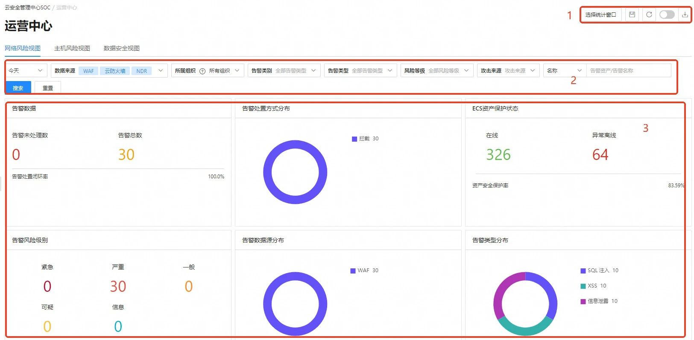

   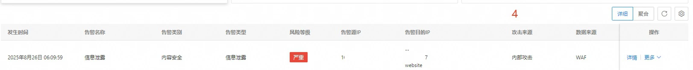

   | 功能 | 说明 |
   | --- | --- |
   | 视图设置区域（图示①） | 设置要展示的数据类型。<br>• 选择统计窗口：单击<strong>选择统计窗口</strong>，设置您要在视图中展示的统计视图。默认显示<strong>告警数据</strong>、<strong>告警处置方式分布</strong>、<strong>ECS资产保护状态</strong>、<strong>告警风险等级</strong>、<strong>告警数</strong><strong>据源分布</strong>、<strong>告警类型分布</strong>、<strong>TOP 10攻击源IP</strong>、<strong>TOP 10遭受攻击IP</strong>、<strong>TOP 5遭受攻</strong><strong>击的Web站点</strong>和<strong>列表展示区</strong>。<br>• 保存视图：单击图标，保存当前视图。<br>• 手动刷新数据：单击图标，手动刷新当前视图的数据。<br>• 自动刷新数据：开启图标，系统会每5分钟自动刷新当前视图的数据。<br>• 导出数据：单击图标，导出当前视图的数据。 |
   | 查询条件区域（图示②） | 设置运营中心数据的查询条件。用户可以根据实际情况，设置查询条件，包括：查询时间、数据来源、所属组织（所有组织/选择组织）、告警类别、告警类型、风险等级、攻击来源、告警资产等。 |
   | 查询结果区域（图示③） | 根据您设置的查询条件，联动显示符合该查询条件的统计视图。 |
   | 列表展示区（图示④） | 根据您设置的查询条件，以列表形式显示用户的数据被威胁详情，包括发生时间、攻击来源、告警名称、告警类别、告警类型、AI分析等。单击AI分析后可生成处理建议。用户也可以通过如下操作，管理威胁详情：<br>• 设置告警数据展示粒度：<br>• 在列表上方，单击<strong>详细</strong>，系统会根据时间顺序为您显示所有被攻击IP的详细信息。<br>• 在列表上方，单击<strong>聚合</strong>，系统将每10分钟之内具有相同被攻击IP、攻击IP、告警类型的数据聚合在一起，单击+号可展开详细数据。<br>• 查看数据详情：单击目标数据右侧操作列的<strong>详情</strong>，展开<strong>详情</strong>面板，查看该条数据被威胁及防御的详细信息。<br>• 刷新列表数据：单击图标，手动刷新列表数据。<br>• 设置列表展示项：单击，设置列表的展示项，默认为全选。<br>• 下发处置任务：单击<strong>操作</strong>列的<strong>更多</strong>，选择<strong>下发处置任务</strong>，跳转至<strong>新增处置任务</strong>页面，填写任务信息，单击<strong>确定</strong>。<br>说明如果您的列表数据处于<strong>聚合</strong>状态，请先单击目标数据左侧的，展开告警列<br><br>表。<br>• 创建响应策略：单击操作列的<strong>更多</strong>，选择<strong>创建响应策略</strong>，跳转至<strong>新建策略</strong>页面，填写基础信息，单击<strong>确定</strong>。 |

**查看主机风险视图**

1. 登录Apsara Uni-manager运营控制台。

2. 在控制台右上方，单击**安全**，选择**全局平台安全 > 云安全管理中心SOC**。在**云安全管理中心SOC**授权页面，选择**地域**并单击**角色授权访问**。

3. 在左侧导航栏，单击**运营中心**。

4. 在**主机风险视图**页签，查看如下数据。

   | 功能 | 说明 |
   | --- | --- |

   <table>
     <tr>
       <td>视图设置区域（图示①）</td>
       <td>设置要展示的数据类型。<br>• 选择统计窗口：单击<strong>选择统计窗口</strong>，设置您要在视图中展示的统计视图。默认显示<strong>告警数据</strong>、<strong>ECS资产保护状态</strong>、<strong>告警风险级别</strong>、<strong>告警类型分布</strong>、<strong>TOP 10遭</strong><strong>受攻击IP</strong>和<strong>列表展示区</strong>。<br>• 保存视图：单击图标，保存当前视图。<br>• 手动刷新数据：单击图标，手动刷新当前视图的数据。<br>• 自动刷新数据：开启图标，系统会每5分钟自动刷新当前视图的数据。<br>• 导出数据：单击图标，导出当前视图的数据。</td>
     </tr>
     <tr>
       <td>查询条件区域（图示②）</td>
       <td>设置运营中心数据的查询条件。用户可以根据实际情况，设置查询条件，包括：查询时间、处理状态、数据来源（安骑士&amp;容器安全）、所属组织（所有组织/选择组织）、告警类别、告警类型、风险等级、攻击来源等。</td>
     </tr>
     <tr>
       <td>查询结果区域（图示③）</td>
       <td>根据您选择的查询条件，联动下方统计视图显示该查询条件下的统计数据。</td>
     </tr>
     <tr>
       <td>列表展示区（图示④）</td>
       <td>根据您设置的查询条件，以列表形式显示当前存在的告警数据，包括发生时间、攻击来源、告警名称、告警类别、告警类型、AI分析等。单击AI分析后可生成处理建议。用户也可以通过如下操作，管理告警详情：<br>• 设置告警数据展示粒度：<br>• 在列表上方，单击<strong>详细</strong>，系统会根据时间顺序为您显示所有被攻击IP的详细信息。<br>• 在列表上方，单击<strong>聚合</strong>，系统将每10分钟之内具有相同被攻击IP、攻击IP、告警类型的数据聚合在一起，单击+号可展开详细数据。<br>• 查看数据详情：单击目标数据右侧操作列的<strong>详情</strong>，展开<strong>详情</strong>面板，查看该主机被威胁及防御的详细信息。<br>• 刷新列表数据：单击图标，手动刷新列表数据。<br>• 设置列表展示项：单击，设置列表的展示项，默认为全选。<br>• 下发处置任务：单击<strong>操作</strong>列的<strong>更多</strong>，选择<strong>下发处置任务</strong>，跳转至<strong>新增处置任务</strong>页面，填写任务信息，单击<strong>确定</strong>。<br>说明如果您的列表数据处于<strong>聚合</strong>状态，请先单击目标数据左侧的，展开告警列<br><br>表。<br>• 创建响应策略：单击操作列的<strong>更多</strong>，选择<strong>创建响应策略</strong>，跳转至<strong>新建策略</strong>页面，填写基础信息，单击<strong>确定</strong>。<br>• 处理：可对主机发生的告警威胁进行处理。处理方式包含隔离、加白名单、忽略、我已手工处理。也可批量处理，勾选<strong>同时处理相同告警</strong>。选择后单击<strong>立即处理</strong></td>
     </tr>
   </table>

   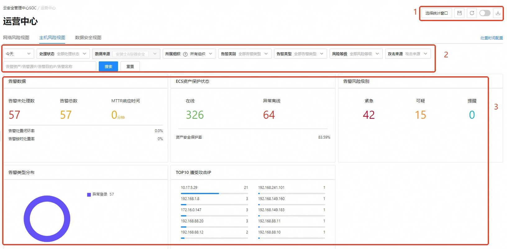

   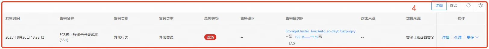

**查看数据安全视图**

1. 登录Apsara Uni-manager运营控制台。

2. 在控制台右上方，单击**安全**，选择**全局平台安全 > 云安全管理中心SOC**。在**云安全管理中心SOC**授权页面，选择**地域**并单击**角色授权访问**。

3. 在左侧导航栏，单击**运营中心**。

4. 在**数据安全视图**页签，查看如下数据。

   | 功能 | 说明 |
   | --- | --- |
   | 视图设置区域（图示①） | 设置要展示的数据类型。<br>• 选择统计窗口：单击<strong>选择统计窗口</strong>，设置您要在视图中展示的数据分类。默认显示<strong>告警数据</strong>、<strong>告警风险级别</strong>、<strong>告警类型分布</strong>、<strong>TOP10访问敏感数据</strong><strong>IP</strong>、<strong>TOP10访问敏感实例</strong>和<strong>列表展示区</strong>。<br>• 保存视图：单击图标，保存当前视图。<br>• 手动刷新数据：单击图标，手动刷新当前视图的数据。<br>• 自动刷新数据：开启图标，系统会每5分钟自动刷新当前视图的数据。<br>• 导出数据：单击图标，导出当前视图的数据。 |
   | 查询条件区域（图示②） | 设置运营中心数据的查询条件。用户可以根据实际情况，设置查询条件，包括：查询时间、数据来源（Sddp）、所属组织（所有组织/选择组织）、告警类别、告警类型等。 |
   | 查询结果区域（图示③） | 根据您选择的查询条件，联动下方统计视图显示该查询条件下的统计数据。 |
   | 列表展示区（图示④） | 根据您设置的查询条件，以列表形式显示Sddp-用户资产审计的告警数据，包括发生时间、攻击来源、告警名称、告警类别、告警类型、AI分析等。单击AI分析后可生成处理建议。用户也可以通过如下操作，管理告警数据详情：<br>• 设置告警数据展示粒度：<br>• 在列表上方，单击<strong>详细</strong>，系统会根据时间顺序为您显示所有被攻击IP的详细信息。<br>• 在列表上方，单击<strong>聚合</strong>，系统将每10分钟之内具有相同被攻击IP、攻击IP、告警类型的数据聚合在一起，单击+号可展开详细数据。<br>• 查看数据详情：单击目标数据右侧操作列的<strong>详情</strong>，展开<strong>详情</strong>面板，查看Sddp-用户资产审计的告警数据。<br>• 刷新列表数据：单击图标，手动刷新列表数据。<br>• 设置列表展示项：单击，设置列表的展示项，默认为全选。<br>• 下发处置任务：单击<strong>操作</strong>列的<strong>更多</strong>，选择<strong>下发处置任务</strong>，跳转至<strong>新增处置任务</strong>页面，填写任务信息，单击<strong>确定</strong>。<br>说明如果您的列表数据处于<strong>聚合</strong>状态，请先单击目标数据左侧的，展开告警列<br><br>表。<br>• 创建响应策略：单击操作列的<strong>更多</strong>，选择<strong>创建响应策略</strong>，跳转至<strong>新建策略</strong>页面，填写基础信息，单击<strong>确定</strong>。 |

   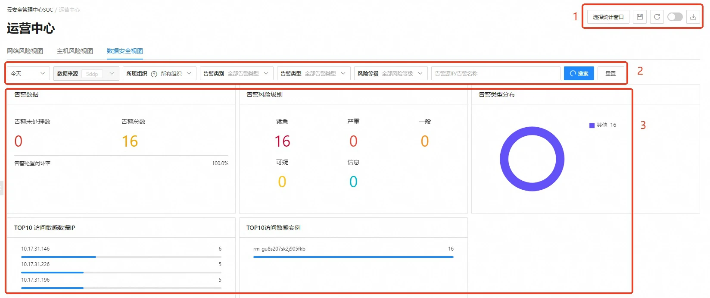

   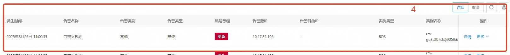

**自定义视图**

运营中心默认提供网络风险视图、主机风险视图和数据安全视图，还支持自定义风险视图，具体操作如下：

1. 登录Apsara Uni-manager运营控制台。

2. 在控制台右上方，单击**安全**，选择**全局平台安全 > 云安全管理中心SOC**。在**云安全管理中心SOC**授权页面，选择**地域**并单击**角色授权访问**。

3. 在左侧导航栏，单击**运营中心**。

4. 在**运营中心**页面右上角，单击**选择统计窗口**，并选择自定义视图需要展示的统计视图，单击  。

   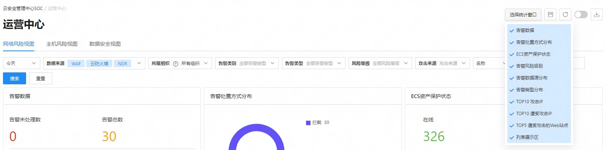

5. 在**保存当前视图**对话框，输入视图名称并单击**保存**。

   视图名称最多支持输入16个字符。

**自定义告警仪表盘**

运营中心页面右上方单击**新建告警仪表盘**，可设置仪表盘名称、所属组织等基础信息。

<table>
  <tr>
    <td>配置项</td>
    <td>说明</td>
  </tr>
  <tr>
    <td>仪表盘名称</td>
    <td>设置新建的仪表盘名称。支持中文、英文、数字及常用符号，长度最大为32个字符。</td>
  </tr>
  <tr>
    <td>时间范围</td>
    <td>支持统计今天、近1天、近7天、近30天、自定义时间范围。</td>
  </tr>
  <tr>
    <td>所属组织</td>
    <td>支持选择全部、平台、所有组织、选择组织</td>
  </tr>
  <tr>
    <td>选择统计窗口</td>
    <td>支持多组统计窗口配置。设置您要在视图中展示的数据分类和对应统计维度的数据源。</td>
  </tr>
</table>

已创建的仪表盘在数据筛选区域显示该仪表盘的配置条件，支持删除所创建的仪表盘。

**处置时间配置**

运营中心页面右上方单击**处置时间配置**，进入**告警处置时间配置**页面。

<table>
  <tr>
    <td>配置项</td>
    <td>说明</td>
  </tr>
  <tr>
    <td>处置类型</td>
    <td rowspan="2">针对不同类型告警或风险等级自定义按时处置的时间标准。支持按照分钟、小时、天等单位设置。在设置时间时，对输入值进行校验，只允许输入正整数。</td>
  </tr>
  <tr>
    <td>告警类别</td>
  </tr>
</table>

设置完成后，根据设置的时间触发超时计算，判断告警是否满足按时处置。可在告警数据视图中查看告警按时处置率。

- 告警按时处置率：根据告警产生时间、规定处置时间以及处理时间，判断每条告警是否在规定时间内完成处置。符合条件的告警数量统计为按时处置告警数。

- 计算规则：按时处置率 =（按时处置告警数 ÷ 告警总数）×100%，保留小数点后两位。

<a id="section-3-3"></a>

## 3.3. 风险分析

<a id="section-3-3-1"></a>

### 3.3.1. 威胁事件

威胁事件是由安全运营中心（SOC）基于预定义或自定义的安全分析模型，针对原始日志和安全告警进行综合关联分析后生成的新的IOC威胁事件。本文将介绍如何查看威胁事件，以帮助安全管理员快速定位威胁详情，保障网络安全。

**操作步骤**

1. 登录Apsara Uni-manager运营控制台。

2. 在控制台右上方，单击**安全**，选择**全局平台安全 > 云安全管理中心SOC**。在**云安全管理中心SOC**授权页面，选择**地域**并单击**角色授权访问**。

3. 在左侧导航栏，选择**风险分析 > 威胁事件**。

4. 在**威胁事件**页面，查看威胁事件详情。

   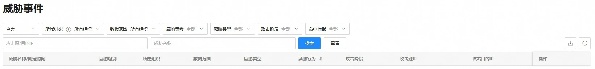

   | 功能 | 说明 | 支持的操作 |
   | --- | --- | --- |
   | 查询条件 | 设置威胁事件的查询条件。您可以根据<strong>查询时间</strong>、<strong>所属组织</strong>、<strong>数据</strong><strong>范围</strong>、<strong>威胁等级</strong>、<strong>威胁类型</strong>、<strong>攻击阶</strong><strong>段</strong>、<strong>处理状态</strong>、<strong>命中情报</strong>和<strong>攻击源/目</strong><strong>的IP</strong>等设置查询条件。 | 在查询条件下拉框中选择待查询的信息，或者输入关键字，单击搜索。如果您不设置查询条件，默认显示所有威胁事件。<br>说明<br>• 如果<strong>所属组织</strong>选项您选择的是<strong>选</strong><strong>择组织</strong>，在<strong>组织</strong>（可多选）下拉菜单中选择目标组织。<br>• <strong>威胁等级</strong>、<strong>威胁类型</strong>、<strong>攻击阶</strong><strong>段</strong>（可多选）。 |

   <table>
     <tr>
       <td>查询结果</td>
       <td>查询结果区域与查询条件区域联动显示，系统根据您设置的查询条件，显示查询的威胁事件信息。</td>
       <td>• 将鼠标悬停在具体威胁事件的<strong>攻击目的</strong><strong>IP</strong>或<strong>攻击源IP</strong>列上，可以查看相应的服务器名称。<br>• 单击图标，刷新威胁事件列表。<br>• 单击图标，导出威胁事件列表。<br>• 下发处置任务：单击<strong>操作</strong>列的<strong>更多</strong>，选择<strong>下</strong><strong>发处置任务</strong>，跳转至<strong>新增处置任务</strong>页面，填写任务信息，单击<strong>确定</strong>。<br>• 创建响应策略：单击操作列的<strong>更多</strong>，选择<strong>创</strong><strong>建响应策略</strong>，跳转至<strong>新建策略</strong>页面，填写基础信息，单击<strong>确定</strong>。<br>• 威胁溯源详情：对于已生成溯源图的威胁事<br>件，单击<strong>威胁名称</strong>右侧的图标，跳转至<br>威胁溯源页面，查看威胁溯源详情。<br>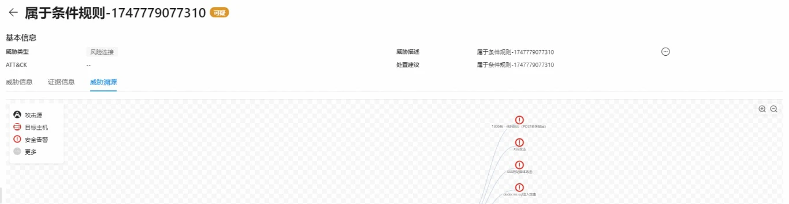<br>单击或图标，缩小或放大溯源图。</td>
     </tr>
   </table>

5. 单击目标**威胁名称**或者右侧操作列的**详情**，进入目标威胁事件页面。

   - 选择**响应处置 > 下发处置任务**，跳转至**新增处置任务**页面，填写任务信息，单击**确定**。

   - 选择**响应处置 > 创建响应策略**，跳转至**新建策略**页面，填写基础信息，单击**确定**。

   - 选择**响应处置 > 创建案件**，可在**风险处置 > 案件管理**页面中查看创建的案件信息。

6. 单击目标**威胁名称**或者右侧操作列的**详情**，进入目标威胁事件页面， 查看具体的**威胁信息**和**证据信息**。

   - 查看**威胁信息**：在**威胁信息**页签，查看威胁事件**开始时间**、**最后检测时间**、**分析规则**、**网络协议**、**威胁情报**，以及**源信息**、**目的信息**、**关键信息**。

     - 单击**分析规则**右侧的规则ID，可以查看检测出威胁的规则相关的更多信息。

     - 单击**生成案件**，可以在<strong>安全编排自动化响应（SOAR）</strong>的**案件管理**页面生成当前威胁事件对应的案件，以便跟踪和处理该事件。

   - 查看**证据信息**：在**证据信息**页签，查看威胁事件的日志信息。单击日志信息后面的**详情**可查看原始日志信息，其中包含告警信息，并高亮呈现命中关联分析条件的内容。

     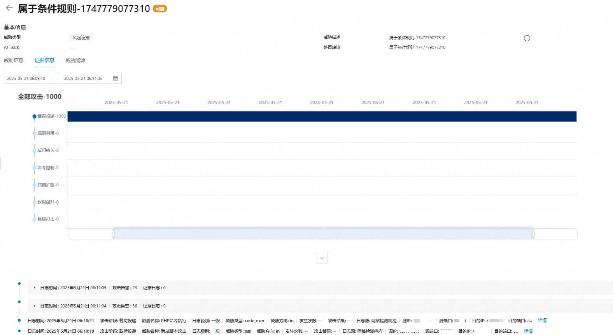

<a id="section-3-3-2"></a>

### 3.3.2. 威胁调查

威胁调查功能基于IP、资产名称、资产ID等进行全量风险信息的调查取证。本文介绍如何使用威胁调查功能。

**操作步骤**

1. 登录Apsara Uni-manager运营控制台。

2. 在控制台右上方，单击**安全**，选择**全局平台安全 > 云安全管理中心SOC**。在**云安全管理中心SOC**授权页面，选择**地域**并单击**角色授权访问**。

3. 在左侧导航栏，选择**风险分析 > 威胁调查**。

4. 在**威胁调查**页面，输入需要查看的时间范围和资产的信息（例如：**IP地址**、**资产名称**等），单击  。

   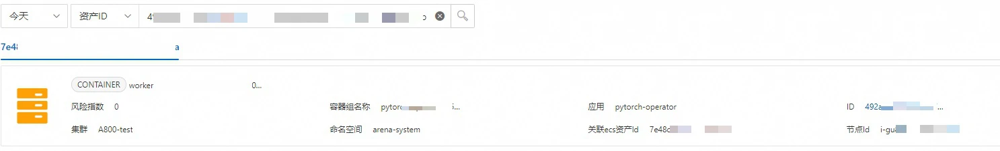

   <ol type="i">

   <li>

   选择**资产指纹**后可关联选择**账户**、**端口**和**AI组件**等，支持查询匹配主机的指纹信息。查询结果展示资产基本信息，可点击查看详情或跳转至资产详情。

   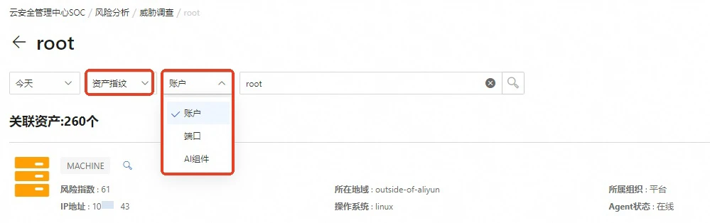

   </li>

   <li>

   对于查询结果中的攻击者画像模块，基于告警、威胁情报等数据，自动对攻击源IP进行打标，生成攻击者画像。该画像包含受害者数量、攻击时间线、攻击次数等。

   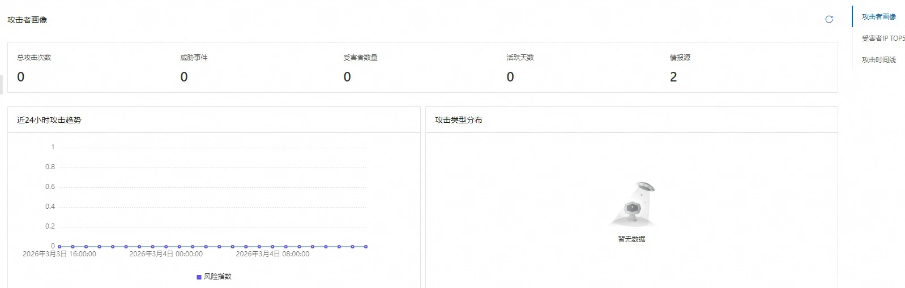

   </li>

   <li>

   对于查询频率较高的对象，您可以单击**添加快捷方式**，并设置该资产的**类型**和**内容**，生成快速查看该资产威胁调查结果的入口。创建快捷方式后，您可以单击对应的图标查看该资产的威胁调查结果。

   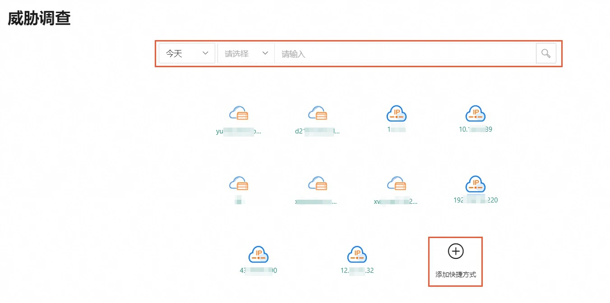

   </li>

   </ol>

5. 在该资产威胁调查结果页面，查看对应的风险项。

   不同资产展示的数据可能不同，具体请以控制台显示为准。常见数据分类如下：

   - 资产详情：展示该资产的网络信息拓扑图和资产指纹信息（包括端口、软件、进程、账户、中间件、启动项等）。

   - 异常行为：展示该资产中存在的异常行为统计图表。包括异常行为总数、异常行为等级分布图、异常行为类型分布图和TOP 5异常行为。

   - 网络攻击：展示该资产受到的网络攻击告警统计图表。包括网络攻击总数、网络攻击数据源分布图、网络攻击类型分布图和TOP 5网络攻击。

   - 脆弱性：展示该资产中存在的漏洞和未通过的基线检查项统计数据及列表。

   - 攻击面：展示该资产已遭受到的攻击的攻击路径。

   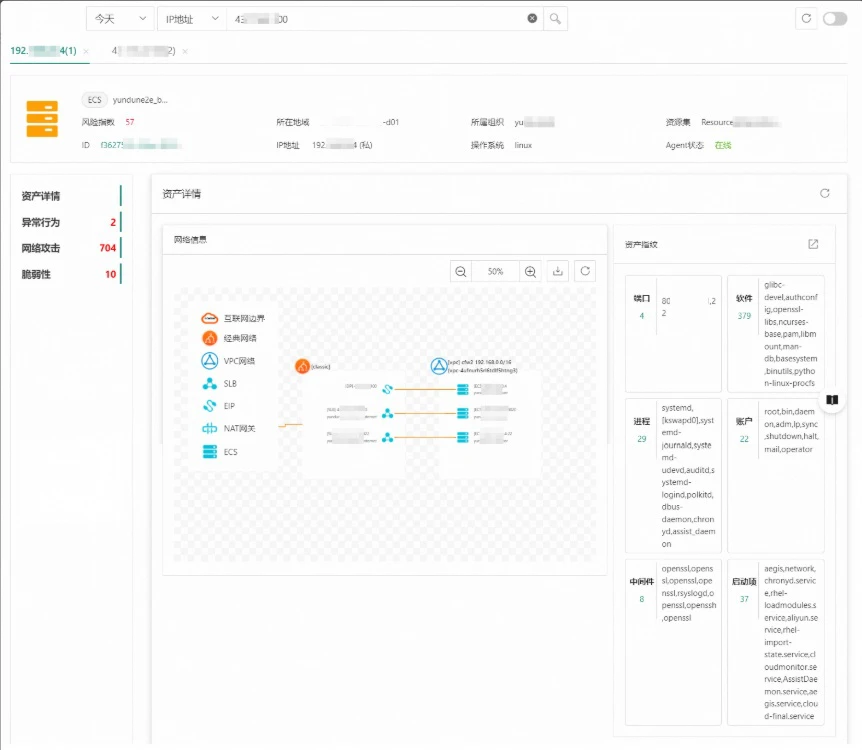

<a id="section-3-3-3"></a>

### 3.3.3. 攻击面评估

本文介绍如何查看攻击面评估结果。

**操作步骤**

1. 登录Apsara Uni-manager运营控制台。

2. 在控制台右上方，单击**安全**，选择**全局平台安全 > 云安全管理中心SOC**。在**云安全管理中心SOC**授权页面，选择**地域**并单击**角色授权访问**。

3. 在左侧导航栏，选择**风险分析** ＞ **攻击面评估**。

4. 在**攻击面评估**页面右上角，选择需要查看的组织资源集。

5. 在**攻击面评估**页面查看暴露的攻击面的统计数据。

   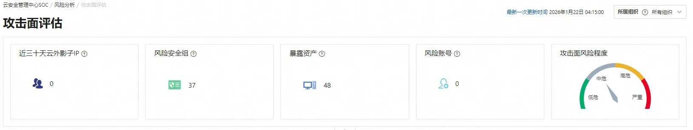

   - **近三十天云外影子IP**：云外影子IP是指有云内连接，但是没有在资产管理范围内IP。这些资产可能包括未授权的软件、未被批准的硬件设备、云服务、第三方应用程序等。由于这些资产未被云正式纳管，因此可能无法了解它们的风险和威胁，从而导致攻击者会从影子IP作为跳板攻击云内资产。

   - **风险安全组**：有风险的安全组是指的入方向IP授权策略宽泛的安全组，以安全策略最小化原则，建议应对无数据流量的策略收敛，减少网络层的暴露面。

   - **暴露资产**：暴露资产是指的已知攻击链路资产中，从云外可直接访问的ECS资产。

   - **风险账号**：风险账号是指在已知攻击链路资产中，可以从云外直接登录云内资产的弱口令账号，如若账号泄漏，攻击者可以轻松入侵云内资产。

   - **攻击面风险程度**：综合评估后确定的攻击面风险程度，包括：低危、中危、高危和严重。

6. 查看各类风险的详细数据。

   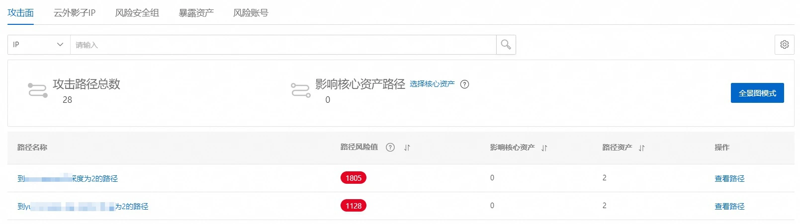

   - **攻击面**：展示已遭受攻击的资产的攻击路径及影响核心资产的路径的统计数据。您可以查看**路径名称**、**路径风险值**、**影响核心资产**和**路径资产**。

     您还可以进行以下操作：

     - 单击  图标，在**攻击路径配置**页面，设置**攻击路径风险值过滤配置**。

     - 单击**全景图模式**，可查看所有攻击路径的网络拓扑图。

     - 单击目标路径名称或操作列的**查看路径**，可查看该路径的网络拓扑图。

     > **说明**
     >
     > 您可以在**攻击面评估**或攻击路径页面右上角单击**2D模式**或**3D模式**来切换视图模式。

   - **云外影子IP**：查看**云外影子IP**列表信息。您还可以进行以下操作：

     - 单击目标IP，可查看关于该IP的详细信息，包括：**地理位置**、**连接云内资产**、**处理状态**、**首次/最后发现时间**、**入方向连接云内资产**、**目的IP**和**入方向流量**。

   - **风险安全组**：查看存在风险的安全组列表信息。单击目标安全组名称或操作列的**详情**，可查看关于该安全组的详细信息，包括：**专有网络ID**、**安全组类型**、**所属组织** 、**资源集**、**描述**和**安全组内实例**的相关信息。

   - **暴露资产**：查看从云外可直接访问的ECS资产列表。单击目标资产名称，可查看该资产的重要性、所属组织、所属VPC等基本信息，以及安全漏洞、安全基线、风险账号等存在的安全风险。

   - **风险账号**：查看风险账号列表信息，单击目标服务器名称，跳转至资产详情页面，查看该服务器的**基础信息**、**业务信息**、**资产指纹**等信息。

<a id="section-3-3-4"></a>

### 3.3.4. 云产品检查

通过内置安全配置基线规则，对专有云产品进行安全合规性的扫描检查及管理。本文介绍如何进行云产品检查。

**操作步骤**

1. 登录Apsara Uni-manager运营控制台。

2. 在控制台右上方，单击**安全**，选择**全局平台安全 > 云安全管理中心SOC**。在**云安全管理中心SOC**授权页面，选择**地域**并单击**角色授权访问**。

3. 在左侧导航栏，选择**风险分析** ＞ **云产品检查**。

4. 在**云产品检查**页面右上角，单击**选择组织资源集**。选中需要检查的组织后，单击**确定**。

5. 设置云产品基线查询条件，搜索云产品基线。

   > **说明**
   >
   > 如果不设置任何查询条件，默认显示所有云产品基线。

   <table>
     <tr>
       <th width="90">查询条件</th>
       <th>说明</th>
     </tr>
     <tr>
       <td>基线类型</td>
       <td>选择需要查看的平台基线风险的基线类型，支持安全防护、身份认证、访问控制、网络配置、数据安全、容灾备份、日志审计和监控告警。</td>
     </tr>
     <tr>
       <td>风险等级</td>
       <td>选择需要查看的平台基线风险的威胁等级，支持高风险、中风险和低风险。</td>
     </tr>
     <tr>
       <td>基线名称</td>
       <td>在输入框中输入基线名称，单击图标开始搜索。</td>
     </tr>
   </table>

6. 在**云产品检查**页面，查看云产品基线信息，包括基线风险项、受影响资产总数、已启用基线检查项、未启用基线检查项、最新检查时间等数据。

7. 执行云产品检查。

   - 手动检查

     单击**立即检查**，对云产品配置进行全量检查，确定是否存在风险项以及影响的资产数量。在检查执行过程中，您可以单击**查看**，在**检查项检测**对话框，查看检测的进度。

     > **说明**
     >
     > 全量检查时，需要完成全部检查项的检查后才可以进行其他操作，请耐心等待。

   - 自动检查

     单击**检查设置**，配置检测策略。

     <table>
       <tr>
         <th width="105">配置项</th>
         <th>说明</th>
       </tr>
       <tr>
         <td>检查周期</td>
         <td>设置每周的检查周期。可选星期一至星期日，支持多选。</td>
       </tr>
       <tr>
         <td>检查时间</td>
         <td>设置检查的时间范围。可选择24:00~06:00、06:00~12:00、12:00~18:00、18:00~24:00时间段中的任意一个。</td>
       </tr>
       <tr>
         <td>基线检查项</td>
         <td>选择要检查的基线。</td>
       </tr>
       <tr>
         <td>选择资源集</td>
         <td>选中要检查的资源集。</td>
       </tr>
     </table>

     完成设置后，在选定时间段内，云安全管理中心（SOC）会对所有检查项自动执行一次检查。

8. 查看检查数据。

   - 在云产品检查基线列表，查看云产品基线、基线类别、基线类型、风险等级、受影响资产、最近检查时间、启动组织等数据信息。

   - 单击云产品基线名称或**操作**列**详情**，在详情页面，查看检查基线详情、涉及的云产品实例。

     如果基线中的组织或实例无风险，可选择组织或实例，并将其加入白名单。

   - 选中目标基线（可多选）或单击目标基线**操作**列的**验证**，单击列表下的**验证**，对云产品基线进行验证。

   - 基线验证过程中，单击目标基线操作列的**查看**，可以查看基线验证的进度。单击目标基线操作列的**取消验证**，可以取消对该基线的验证。

<a id="section-3-3-5"></a>

### 3.3.5. 弱点分析

本文介绍如何查看租户侧的弱点分析数据，帮助安全管理员准确定位风险问题。

**操作步骤**

1. 登录Apsara Uni-manager运营控制台。

2. 在控制台右上方，单击**安全**，选择**全局平台安全 > 云安全管理中心SOC**。在**云安全管理中心SOC**授权页面，选择**地域**并单击**角色授权访问**。

3. 在左侧导航栏，选择**风险分析 > 弱点分析**。

   **安全漏洞**

   设置安全漏洞查询条件，搜索安全漏洞。

   > **说明**
   >
   > 如果不设置任何查询条件，默认显示所有安全漏洞。

   <table>
     <tr>
       <th width="160">查询条件</th>
       <th>说明</th>
     </tr>
     <tr>
       <td>所属组织</td>
       <td>选择要查询风险的组织。</td>
     </tr>
     <tr>
       <td>时间</td>
       <td>设置要查询的时间范围，支持今天、近1天、近7天、近30天或自定义。</td>
     </tr>
     <tr>
       <td>漏洞分布</td>
       <td>选择需要查询的漏洞数据，支持主机、主机&amp;容器、全部。</td>
     </tr>
     <tr>
       <td>漏洞类型</td>
       <td>设置要查询的漏洞类型，支持全部、Web-CMS漏洞、Linux软件漏洞、Windows系统漏洞或应用漏洞（含应急）。</td>
     </tr>
     <tr>
       <td>漏洞等级</td>
       <td>选择需要查看的平台基线风险的威胁等级，支持全部、高危、中危或低危。</td>
     </tr>
     <tr>
       <td>数据来源</td>
       <td>选择需要查询漏洞数据的来源，支持安骑士&amp;容器安全、默安。</td>
     </tr>
     <tr>
       <td>漏洞名称/CVE编号</td>
       <td>通过输入平台基线漏洞名称或CVE编号的关键字，搜索相关结果。支持模糊搜索。</td>
     </tr>
   </table>

   搜索到的所有结果显示在安全漏洞列表中，您可以根据业务需要，执行如下操作。

   - 单击  图标，刷新安全漏洞列表。

   - 单击  图标，导出安全漏洞列表。

   - 单击漏洞名称或目标漏洞**操作**列**更多**选项的**详情**，查看漏洞详情和涉及资产。漏洞详情页主要展示漏洞描述，根据不同漏洞类型，支持呈现漏洞修复建议、漏洞公告等信息；涉及资产页主要展示该风险漏洞影响的资产实例信息，单击目标资产操作列的**详情**，可跳转至资产管理模块，查看目标资产的详细信息。同时支持对该资产漏洞进行修复处置，并实时记录资产漏洞的全生命周期。

     > **说明**
     >
     > - 您可以在**涉及资产**页签查看资产类型和漏洞修复情况。
     >
     > - 资产类型存在Container标签时，点击详情可跳转至容器资产详情页面；仅有ECS标签时，可跳转至ECS资产详情页面。

   - 下发处置任务：单击操作列的**更多**，选择**下发处置任务**，跳转至**新增处置任务**页面，填写任务信息，单击**确定**。

   - 创建响应策略：单击操作列的**更多**，选择**创建响应策略**，跳转至**新建策略**页面，填写基础信息，单击**确定**。

   - 加入白名单：勾选目标漏洞名称（可多选）单击**加入白名单**，在**提示**页面填写备注后，单击**确定**。

   - 单击操作列的**详情**，可以查看到漏洞详情和涉及资产页签。切换到涉及资产页签，可对资产信息进行**验证**、**忽略**操作。

   - 批量修复：勾选目标漏洞名称（可多选），单击列表下方的**批量修复**，或单击操作列的**修复**，在**批量修复**页面勾选**我已了解修复失败风险**，单击**立即修复**。

   **安全基线**

   设置安全基线查询条件，搜索安全基线。

   > **说明**
   >
   > 如果不设置任何查询条件，默认显示所有安全基线。

   <table>
     <tr>
       <th width="90">查询条件</th>
       <th>说明</th>
     </tr>
     <tr>
       <td>范围</td>
       <td>选择要查询风险的组织。</td>
     </tr>
     <tr>
       <td>时间</td>
       <td>设置要查询的时间范围，支持今天、近1天、近7天、近30天或自定义。</td>
     </tr>
     <tr>
       <td>数据源</td>
       <td>设置要查询的数据源。可选项：<br>• 全部<br>• 安骑士<br>• 云产品检查</td>
     </tr>
     <tr>
       <td>风险类型</td>
       <td>设置要查询的风险类型。可选项：<br>• 等保合规<br>• 未授权访问<br>• CIS合规<br>• 自定义基线<br>• 最佳安全实践<br>• 弱口令<br>• 容器安全<br>• 数据安全<br>• 访问控制<br>• 监控告警<br>• 容灾备份<br>• 日志审计<br>• 身份认证<br>• 安全防护<br>• 网络配置</td>
     </tr>
     <tr>
       <td>风险等级</td>
       <td>选择需要查看的安全基线的威胁等级，支持全部、高危、中危或低危。</td>
     </tr>
     <tr>
       <td>基线名称</td>
       <td>设置要查询的安全基线名称。</td>
     </tr>
   </table>

   搜索到的所有结果显示在安全基线列表中，您可以根据业务需要，执行如下操作。

   - 单击  图标，刷新平台安全基线列表。

   - 单击  图标，导出平台安全基线列表。

   - 单击安全基线名称或目标安全基线**操作**列的**详情**，查看安全基线详情，包括**受影响资产**、**资源集**、**所属组织**等信息。单击受影响资产名称，跳转至**租户资产**页面，您可以查看受影响资产的相关信息。

   - 下发处置任务：勾选目标安全基线名称（可多选），选择**批量下发处置任务**，或单击操作列的**更多**，选择**下发处置任务**，跳转至**新增处置任务**页面，填写任务信息，单击**确定**。

   - 创建响应策略：单击操作列的**更多**，选择**创建响应策略**，跳转至**新建策略**页面，填写基础信息，单击**确定**。

   > **说明**
   >
   > 建议您根据风险详情页的说明及时处理对应风险项。

<a id="section-3-3-6"></a>

### 3.3.6. 流量分析

本文介绍如何查看流量的分析信息，包括组织流量、应用流量、源IP流量、目的IP流量等信息。

**操作步骤**

1. 登录Apsara Uni-manager运营控制台。

2. 在控制台右上方，单击**安全**，选择**全局平台安全 > 云安全管理中心SOC**。在**云安全管理中心SOC**授权页面，选择**地域**并单击**角色授权访问**。

3. 在左侧导航栏，选择**风险分析 > 流量分析**。

4. 在**流量分析**页面，设置视图、查询条件并查看全局流量信息。

   | 功能 | 说明 |
   | --- | --- |
   | 视图设置区域（图示①） | 设置要展示的数据类型。<br>• 查看原始日志：单击<strong>查看原始日志</strong>，可前往<strong>日志查询</strong>页面，查看原始日志的详细信息。<br>• 选择统计窗口：单击<strong>选择统计窗口</strong>，设置您要在视图中展示的数据分类。默认显示<strong>组织流量</strong>、<strong>应用流量</strong>、<strong>源IP流量</strong>、<strong>目的IP流量</strong>、<strong>源端口流量</strong>、<strong>目的端口流</strong><strong>量</strong>、<strong>访问目的流量</strong>和<strong>访问来源流量</strong>。<br>• 选择展示的数据范围：支持选择<strong>TOP 5</strong>、<strong>TOP 10</strong>、<strong>TOP 20</strong>。<br>• 选择展示的视图。<br>• 保存视图：单击图标，保存当前视图。<br>• 导出数据：单击图标，导出当前视图的数据。 |
   | 查询条件区域（图示②） | 设置流量分析数据的查询条件。用户可以根据实际情况，设置查询条件，包括：查询时间、所属组织（所有组织/选择组织）、应用、源IP、目的IP、源端口和目的端口。 |
   | 查询结果区域（图示③） | 云安全管理中心根据您设置的查询条件，联动显示不同数据的查询结果。 |

   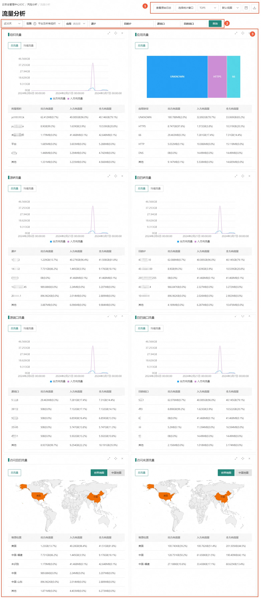

<a id="section-3-4"></a>

## 3.4. 威胁情报

<a id="section-3-4-1"></a>

### 3.4.1. 情报概览

通过威胁情报概览，用户能够全面了解资产所遭受威胁的整体情况及相关统计数据。本文将详细介绍如何查看资产的威胁情报。

**操作步骤**

1. 登录Apsara Uni-manager运营控制台。

2. 在控制台右上方，单击**安全**，选择**全局平台安全 > 云安全管理中心SOC**。在**云安全管理中心SOC**授权页面，选择**地域**并单击**角色授权访问**。

3. 在左侧导航栏，选择**威胁情报 > 情报概览**。

4. 在**情报概览**页面，查看威胁情报服务检测到的资产已遭受的威胁事件和统计数据。

   <table>
     <tr>
       <th width="152">功能</th>
       <th>说明</th>
     </tr>
     <tr>
       <td>恶意指标情报总数</td>
       <td>对<strong>IP</strong>、<strong>域名</strong>和<strong>文件</strong>进行威胁情报汇总，您也可以在汇总数据下方查看<strong>月同比</strong>。</td>
     </tr>
     <tr>
       <td>恶意指标情报趋势</td>
       <td>威胁情报数据按照时间分段的趋势图。</td>
     </tr>
     <tr>
       <td>威胁情报调用总结</td>
       <td>查看威胁情报调用总结的数据，包括：<br>• 威胁情报使用指标：通过API查询数量统计。<br>• 威胁IOC查询类型：统计通过<strong>IP</strong>、<strong>域名</strong>和<strong>文件</strong>的查询数。<br>• API查询来源分布：通过API查询的来源分布情况。<br>• 威胁情报查询统计：按时间分段的统计趋势图。</td>
     </tr>
     <tr>
       <td>威胁情报标签分布</td>
       <td>统计威胁情报的标签分布数据，包括：<br>• <strong>高危</strong>、<strong>中危</strong>和<strong>低危</strong>的标签统计数。<br>• Top10情报标签命中：Top10情报标签的<strong>威胁标签</strong>和<strong>命中数</strong>。单击命中数，可以查看命中的详情数据，包括<strong>命中IOC信息</strong>和<strong>相关信息</strong>的<strong>威胁事件</strong>和<strong>安全告警</strong>。</td>
     </tr>
   </table>

5. 在右上角的搜索框中输入您需要排查的IP、域名或文档MD5值，单击  图标。

   页面会跳转到IP详情页面，查看IP地址的**威胁等级**、**基本信息**、**威胁详情**、**威胁概述**。更多信息，请参见情报查询。

<a id="section-3-4-2"></a>

### 3.4.2. 情报查询

威胁情报服务支持威胁情报搜索功能，可以搜索IP地址，帮助您及时有效排查存在风险的恶意IP。本文介绍如何查询威胁情报。

**操作步骤**

1. 登录Apsara Uni-manager运营控制台。

2. 在控制台右上方，单击**安全**，选择**全局平台安全 > 云安全管理中心SOC**。在**云安全管理中心SOC**授权页面，选择**地域**并单击**角色授权访问**。

3. 在左侧导航栏，选择**威胁情报** ＞ **情报查询**。

4. 在搜索页面，用户可以进行如下操作：

   - 查看资产中的威胁情报。

     | 特性 | 说明 |
     | --- | --- |
     | Top 10 活跃IP恶意地址 | 支持查看Top 10的活跃恶意IP及其恶意标签。单击恶意IP地址，在详情页面查看该恶意IP地址的如下信息：<br>• <strong>威胁等级</strong>：查看该可疑或恶意IP的威胁等级，包括正常、中危和高危3个威胁等级。如果检索的IP地址被识别为高危等级，建议您立即对该IP地址进行处理。<br>• <strong>基本信息</strong>：查看该可疑或恶意IP的基本信息，包括所在IDC服务器、ASN、运营商、ASN标签、国家、域名关联数、省、文件关联数、城市、活跃度、IP标签等信息。<br>• <strong>威胁详情</strong>：查看恶意IP地址的<strong>威胁标签</strong>列表，包括情报源、首次发现、最后活跃和威胁标签。<br>• <strong>威胁概述</strong>：基于历史威胁指标和事件的恶意IP风险分析。 随着攻击技术从左到右的发展，安全事件发现的风险增加。 |
     | Top 10 活跃恶意域名地址 | 支持查看Top 10的活跃恶意域名及其恶意标签。单击恶意域名，在详情页面查看该恶意域名的如下信息：<br>• <strong>威胁等级</strong>：查看该可疑或恶意域名的威胁等级，包括正常、中危和高危3个威胁等级。如果恶意域名被识别为高危等级，建议您立即对该IP地址进行处理。<br>• <strong>域名报告摘要</strong>：查看该可疑或恶意域名的基本信息，包括域名标签、历史IP数量、恶意IP数、域名上的恶意URL、域名上的子域名、恶意子域名数、与该域名恶意通信样本数、注册时间和过期时间等信息。<br>• <strong>域名详情</strong>：查看恶意域名的<strong>WHOlS 细分</strong>和<strong>WHOIS值</strong>。<br>• <strong>威胁概述</strong>：基于历史威胁指标和事件的恶意域名风险分析。 随着攻击技术从左到右的发展，安全事件发现的风险增加。<br>• <strong>威胁详情</strong>：查看恶意域名的<strong>威胁标签</strong>列表，包括情报源、首次发现、最后活跃和威胁标签。 |
     | Top 10 文件MD5 | 支持查看Top 10的文件及其恶意标签。单击恶意域名，在详情页面查看该恶意域名的如下信息：<br>• <strong>威胁等级</strong>：查看该可疑或恶意域名的威胁等级，包括正常、中危和高危3个威胁等级。如果恶意域名被识别为高危等级，建议您立即对该IP地址进行处理。<br>• <strong>基本信息</strong>：查看该可疑或恶意文件的基本信息，包括IP标签、文件名称、运行环境、首次发现时间等信息。<br>• <strong>静态威胁分析</strong>：查看文件的多引擎检出情况。 |

   - 在搜索页面的搜索框中，输入任意IP地址、域名或文件MD5值，可以在详情页面，查看恶意IP、恶意域名、恶意文件MD5的威胁详情。

<a id="section-3-5"></a>

## 3.5. 资产管理

<a id="section-3-5-1"></a>

### 3.5.1. 租户资产

通过租户资产管理，用户可以查看租户侧资产信息，包括ECS、RDS、OSS、SLB和EIP等资产。本文介绍如何查看租户侧资产详情。

用户可以在搜索栏中通过设置查询条件，查看对应资产。

> **说明**
>
> 如果不设置任何查询条件，则默认显示全部资产。

**操作步骤**

1. 登录Apsara Uni-manager运营控制台。

2. 在控制台右上方，单击**安全**，选择**全局平台安全 > 云安全管理中心SOC**。在**云安全管理中心SOC**授权页面，选择**地域**并单击**角色授权访问**。

3. 在左侧导航栏，选择**资产管理 > 租户资产**。

4. 在**租户资产**页面右上角，在**创建时间**中选择需查看的时间段，在**所属组织**中选择需查看的组织后，查看租户资产总览。

   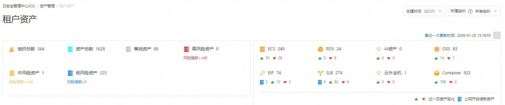

   **创建时间**下拉框中选择今天、近1天、近7天、近30天可分别呈现对应时间段的资产信息，也可支持自定义创建时间查看相应时间内的资产信息。

   点击  按钮，展示最新的资产数据。

5. 单击**云主机（ECS）**、**云数据库（RDS）**、**云存储（OSS）**、**AI资产**、**负载均衡（SLB）**、**弹性外网IP（EIP）**、**活跃外网IP**、**Tunnel**、**云外主机**、<strong>容器（Container）</strong>页签，查看租户资产信息。

   - 在搜索栏中通过设置查询条件，查看对应服务器、资产或实例。

     > **说明**
     >
     > 如果不设置任何查询条件，则默认显示全部服务器、资产或实例。

   - 设置资产重要性标签和业务类型。

   - 单击服务器、实例名称，查看如下详情。

     **容器（Container）**

     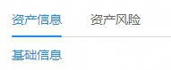

     <table>
       <tr>
         <th width="89">特性</th>
         <th>说明</th>
       </tr>
       <tr>
         <td>资产信息</td>
         <td><strong>基础信息</strong>：支持查看容器资产的基本信息。</td>
       </tr>
       <tr>
         <td>资产风险</td>
         <td>• <strong>风险评估</strong>：<br>• 支持查看资产的风险评估数据，包括资产风险指数、异常行为风险、安全漏洞风险。<br>• 支持查看异常行为、安全漏洞的风险等级分布及最近7天风险趋势。<br>• 支持查看TOP 5的异常行为风险、安全漏洞风险。<br>• <strong>异常行为</strong>：支持查看影响容器资产的异常行为，并进行相应处置。<br>• <strong>安全漏洞</strong>：支持查看容器资产中的安全漏洞详情，并支持下发处置任务和创建响应策略。</td>
       </tr>
     </table>

     **云主机（ECS）**

     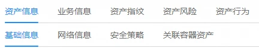

     <table>
       <tr>
         <th width="89">特性</th>
         <th>说明</th>
       </tr>
       <tr>
         <td>资产信息</td>
         <td>• <strong>基础信息</strong>：支持查看资产基本信息、磁盘信息。<br>• <strong>网络信息</strong>：支持查看资产的VPC、SLB、NAT网关、EIP信息。用户也可以单击<strong>网络链路透视图</strong>，查看ECS资产的网络连接和公网透出路径，以支撑网络问题排查、暴露面风险收敛、威胁溯源等。<br>• 网络链路透视图支持缩放、下载和区域范围内的自定义拖拽。<br>• 单击<strong>网络信息列表</strong>，可返回网络列表视图。<br>• <strong>安全策略</strong>：支持查看安全登录设置和安全组信息。<br>• <strong>关联容器资产</strong>：支持查看关联容器资产的基本信息、风险指数、异常行为和安全漏洞数据。</td>
       </tr>
     </table>

     <table>
       <tr>
         <th width="89">业务信息</th>
         <th>• <strong>应用</strong>：查看资产在专有云CMDB中归属的应用信息。<br>• <strong>应用系统</strong>：查看资产在专有云CMDB中归属的应用系统信息。<br>• <strong>产品线</strong>：查看该资产在专有云CMDB中归属的产品线信息。</th>
       </tr>
       <tr>
         <td>资产指纹</td>
         <td>支持查看资产指纹的AI组件、端口、软件、进程、账户、计划任务、中间件和启动项信息。</td>
       </tr>
       <tr>
         <td>资产风险</td>
         <td>• <strong>风险评估</strong>：<br>• 支持查看资产的风险评估数据，包括资产风险指数、网络攻击风险、异常行为风险、安全漏洞风险、安全基线风险。<br>• 支持查看网络攻击、异常行为、安全漏洞、安全基线的风险等级分布及最近7天风险趋势。<br>• 支持查看Top 5的网络攻击风险、异常行为风险、安全漏洞风险、安全基线风险。<br>• <strong>网络攻击</strong>：支持查看资产收到的网络攻击，并进行相应处置。<br>• <strong>异常行为</strong>：支持查看影响资产的异常行为，并进行相应处置。<br>• <strong>安全漏洞</strong>：支持查看资产中的安全漏洞详情，并根据修复建议，进行相应处置。安全漏洞修复：单击服务器列表<strong>安全漏洞</strong>列的数字或服务器名称，跳转至资产详情列表，在<strong>资产风险</strong>页签中选择<strong>安全漏洞</strong>页签，单击目标漏洞<strong>操作</strong>列的<strong>修</strong><strong>复</strong>，在<strong>批量修复</strong>对话框选中<strong>我已了解修复失败风险</strong>，单击<strong>立即修复</strong>。<br>• <strong>安全基线</strong>：支持查看资产中的安全基线详情，并根据修复建议，进行相应处置。安全基线处理：单击服务器列表<strong>安全基线</strong>列的数字或服务器名称，跳转至资产详情列表，在<strong>资产风险</strong>页签中选择<strong>安全基线</strong>页签，在<strong>操作</strong>列进行相应处理。<br>• <strong>云外暴露</strong>：支持查看资产的云外暴露风险，并进行相应处置。</td>
       </tr>
     </table>

     <table>
       <tr>
         <td>资产行为</td>
         <td>• 进程行为<br>• 在<strong>进程行为</strong>页签，您可查看<strong>进程行为分布</strong>的百分比视图及<strong>TOP5进程行为</strong>统计视图，帮助您深入了解系统中各个进程的行为特征及其分布情况。支持筛选的时间范围包括<strong>今天</strong>、<strong>近1天</strong>、<strong>近7天</strong>、<strong>近30天</strong>以及<strong>自定义</strong>选项。默认时间范围为30天。<br>• 在<strong>进程树</strong>区域，展示了依据PID、用户名称及进程名称进行进程定位，并提供对进程的关联分析及追溯场景的进程树视图。<br>• 在<strong>进程行为</strong>列表区域，您可以快速查看进程行为及其详细信息。单击进程行为，以查看进程的具体时间线信息。单击<strong>详情</strong>，即可查看该进程的具体信息。<br>• 配置行为<br>• 在<strong>配置行为</strong>页签，您可查看<strong>配置行为分析</strong>的百分比视图及<strong>TOP5配置行为</strong>统计视图，帮助您深入了解系统中各个配置行为的分布情况。支持通过时间和配置行为进行数据筛选，时间范围包括<strong>今天</strong>、<strong>近1天</strong>、<strong>近7天</strong>、<strong>近30天</strong>以及<strong>自定义</strong>选项。默认时间范围为30天。<br>• 在<strong>配置行为</strong>列表区域，列表以时间线的形式，按照行为发生的时间，集中展示统计周期内检测到的所有关键性行为。单击<strong>实例详细信息查询</strong>，可查看对应的原始日志具体信息。<br>• 行为基线<br>• 以卡片形式展示该资产关联的异常行为模型的状态、<strong>基线学习周期</strong>等信息。<br>• 单击<strong>重新学习</strong>，清除该模型对应资产的所有学习数据、例外配置，并重新开始学习基线。在新的学习周期完成前，该模型对相应资产的异常检测能力会暂时中断，形成一个“检测真空期”。</td>
       </tr>
     </table>

     **AI资产**

     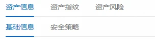

     <table>
       <tr>
         <th width="89">特性</th>
         <th>说明</th>
       </tr>
       <tr>
         <td>资产信息</td>
         <td>• <strong>基础信息</strong>：支持查看资产基本信息、磁盘信息。<br>• <strong>安全策略</strong>：支持查看安全登录设置和安全组信息。</td>
       </tr>
       <tr>
         <td>资产指纹</td>
         <td>支持查看资产指纹的AI组件、端口、软件、进程、账户、计划任务、中间件和启动项信息。</td>
       </tr>
     </table>

     <table>
       <tr>
         <td>资产风险</td>
         <td>• <strong>风险评估</strong>：<br>• 支持查看资产的风险评估数据，包括资产风险指数、网络攻击风险、异常行为风险、安全漏洞风险、安全基线风险。<br>• 支持查看网络攻击、异常行为、安全漏洞、安全基线的风险等级分布及最近7天风险趋势。<br>• 支持查看Top 5的网络攻击风险、异常行为风险、安全漏洞风险、安全基线风险。<br>• <strong>异常行为</strong>：支持查看影响资产的异常行为，并进行相应处置。<br>• <strong>安全漏洞</strong>：支持查看资产中的安全漏洞详情，并根据修复建议，进行相应处置。安全漏洞修复：单击服务器列表<strong>安全漏洞</strong>列的数字或服务器名称，跳转至资产详情列表，在<strong>资产风险</strong>页签中选择<strong>安全漏洞</strong>页签，单击目标漏洞<strong>操作</strong>列的<strong>修复</strong>，在<strong>批量修复</strong>对话框选中<strong>我已了解修复失败风险</strong>，单击<strong>立即修复</strong>。<br>• <strong>安全基线</strong>：支持查看资产中的安全基线详情，并根据修复建议，进行相应处置。安全基线处理：单击服务器列表<strong>安全基线</strong>列的数字或服务器名称，跳转至资产详情列表，在<strong>资产风险</strong>页签中选择<strong>安全基线</strong>页签，在<strong>操作</strong>列进行相应处理。<br>• <strong>云外暴露</strong>：支持查看资产的云外暴露风险，并进行相应处置。</td>
       </tr>
     </table>

     **云数据库（RDS）**

     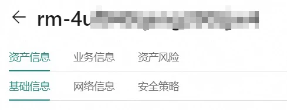

     <table>
       <tr>
         <th width="89">特性</th>
         <th>说明</th>
       </tr>
       <tr>
         <td>资产信息</td>
         <td>• <strong>基础信息</strong>：支持查看实例资产的基本信息。<br>• <strong>网络信息</strong>：支持查看实例资产的Tunnel信息。<br>• <strong>安全策略</strong>：支持查看白名单信息。</td>
       </tr>
       <tr>
         <td>业务信息</td>
         <td>• <strong>应用</strong>：查看资产在专有云CMDB中归属的应用信息。<br>• <strong>应用系统</strong>：查看资产在专有云CMDB中归属的应用系统信息。<br>• <strong>产品线</strong>：查看该资产在专有云CMDB中归属的产品线信息。</td>
       </tr>
       <tr>
         <td>资产风险</td>
         <td>支持查看实例资产的安全基线详情，并根据修复建议，进行相应处置。</td>
       </tr>
     </table>

     **云存储（OSS）**

     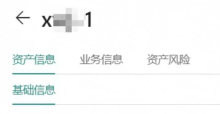

     <table>
       <tr>
         <th width="89">特性</th>
         <th>说明</th>
       </tr>
       <tr>
         <td>资产信息</td>
         <td>支持查看实例资产的基本信息。</td>
       </tr>
       <tr>
         <td>业务信息</td>
         <td>• <strong>应用</strong>：查看资产在专有云CMDB中归属的应用信息。<br>• <strong>应用系统</strong>：查看资产在专有云CMDB中归属的应用系统信息。<br>• <strong>产品线</strong>：查看该资产在专有云CMDB中归属的产品线信息。</td>
       </tr>
       <tr>
         <td>资产风险</td>
         <td>支持查看实例资产中的安全基线详情，并根据修复建议，进行相应处置。</td>
       </tr>
     </table>

     **负载均衡（SLB）、弹性外网IP（EIP）、活跃外网IP**

     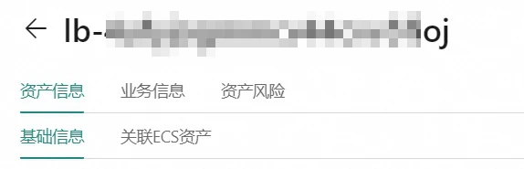

     <table>
       <tr>
         <th width="89">特性</th>
         <th>说明</th>
       </tr>
       <tr>
         <td>资产信息</td>
         <td>• <strong>基础信息</strong>：支持查看资产的基本信息。<br>• <strong>关联ECS资产</strong>：支持查看资产关联的ECS资产信息。单击服务器名称，可查看关联的ECS详情。</td>
       </tr>
       <tr>
         <td>业务信息</td>
         <td>• <strong>应用</strong>：查看资产在专有云CMDB中归属的应用信息。<br>• <strong>应用系统</strong>：查看资产在专有云CMDB中归属的应用系统信息。<br>• <strong>产品线</strong>：查看该资产在专有云CMDB中归属的产品线信息。</td>
       </tr>
       <tr>
         <td>资产风险</td>
         <td>• <strong>网络攻击</strong>：支持查看资产收到的网络攻击，并进行相应处置。<br>• <strong>异常行为</strong>：支持查看影响资产的异常行为，并进行相应处置。<br>• <strong>安全漏洞</strong>：支持查看资产中的安全漏洞详情，并根据修复建议，进行相应处置。<br>• <strong>安全基线</strong>：支持查看资产中的安全基线详情，并根据修复建议，进行相应处置。</td>
       </tr>
     </table>

     **Tunnel**

     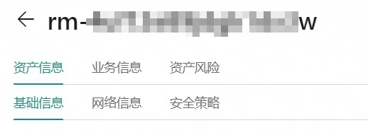

     <table>
       <tr>
         <th width="89">特性</th>
         <th>说明</th>
       </tr>
       <tr>
         <td>资产信息</td>
         <td>• <strong>基础信息</strong>：支持查看资产基本信息。<br>• <strong>网络信息</strong>：支持查看资产的Tunnel信息。<br>• <strong>安全策略</strong>：支持查看白名单信息。</td>
       </tr>
       <tr>
         <td>业务信息</td>
         <td>• <strong>应用</strong>：查看资产在专有云CMDB中归属的应用信息。<br>• <strong>应用系统</strong>：查看资产在专有云CMDB中归属的应用系统信息。<br>• <strong>产品线</strong>：查看该资产在专有云CMDB中归属的产品线信息。</td>
       </tr>
       <tr>
         <td>资产风险</td>
         <td>支持查看资产中的安全基线详情，并根据修复建议，进行相应处置。</td>
       </tr>
     </table>

     **云外主机**

     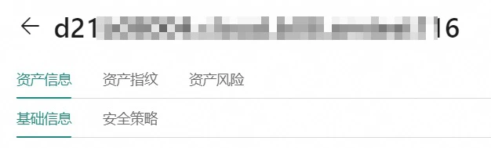

     <table>
       <tr>
         <th width="89">特性</th>
         <th>说明</th>
       </tr>
       <tr>
         <td>资产信息</td>
         <td>• <strong>基础信息</strong>：支持查看资产基本信息、网络信息。<br>• <strong>安全策略</strong>：支持查看安全登录设置。</td>
       </tr>
       <tr>
         <td>资产指纹</td>
         <td>支持查看资产指纹的AI组件、端口、软件、进程、账户、计划任务、中间件和启动项信息。</td>
       </tr>
     </table>

     <table>
       <tr>
         <td>资产风险</td>
         <td>• <strong>风险评估</strong>：<br>• 支持查看资产的风险评估数据，包括资产风险指数、网络攻击风险、异常行为风险、安全漏洞风险、安全基线风险。<br>• 支持查看网络攻击、异常行为、安全漏洞、安全基线的风险等级分布及最近7天风险趋势。<br>• 支持查看Top 5的网络攻击风险、异常行为风险、安全漏洞风险、安全基线风险。<br>• <strong>异常行为</strong>：支持查看影响资产的异常行为，并进行相应处置。<br>• <strong>安全漏洞</strong>：支持查看资产中的安全漏洞详情，并根据修复建议，进行相应处置。漏洞修复：单击服务器列表<strong>安全漏洞</strong>列的数字或服务器名称，跳转至资产详情列表，在<strong>资</strong><strong>产风险</strong>页签中选择<strong>安全漏洞</strong>页签，单击<strong>操作</strong>列的<strong>修复</strong>，在<strong>批量修复</strong>页面勾选<strong>我已了解修复</strong><strong>失败风险</strong>，单击<strong>立即修复</strong>。<br>• <strong>安全基线</strong>：支持查看资产中的安全基线详情，并根据修复建议，进行相应处置。安全基线处理：单击服务器列表<strong>安全基线</strong>列的数字或服务器名称，跳转至资产详情列表，在<strong>资产风险</strong>页签中选择<strong>安全基线</strong>页签，在<strong>操作</strong>列进行相应处理。<br>• <strong>云外暴露</strong>：支持查看资产的云外暴露风险，并进行相应处置。</td>
       </tr>
       <tr>
         <td>资产行为</td>
         <td>• 在<strong>进程行为</strong>页签，您可查看<strong>进程行为分布</strong>的百分比视图及<strong>TOP5进程行为</strong>统计视图，帮助您深入了解系统中各个进程的行为特征及其分布情况。支持筛选的时间范围包括<strong>今天</strong>、<strong>近</strong><strong>1天</strong>、<strong>近7天</strong>、<strong>近30天</strong>以及<strong>自定义</strong>选项。默认时间范围为30天。<br>• 在<strong>进程树</strong>区域，展示了依据PID、用户名称及进程名称进行进程定位，并提供对进程的关联分析及追溯场景的进程树视图。<br>• 在<strong>进程行为</strong>列表区域，您可以快速查看进程行为及其详细信息。单击进程行为，以查看进程的具体时间线信息。单击<strong>详情</strong>，即可查看该进程的具体信息。<br>• 行为基线<br>• 以卡片形式展示该资产关联的异常行为模型的状态、<strong>基线学习周期</strong>等信息。<br>• 单击<strong>重新学习</strong>，清除该模型对应资产的所有学习数据、例外配置，并重新开始学习基线。在新的学习周期完成前，该模型对相应资产的异常检测能力会暂时中断，形成一个“检测真空期”。</td>
       </tr>
     </table>

   - 单击  图标，刷新资产列表。

   - 单击  图标，导出查询到的资产信息。

   - 单击  图标，设置资产列表显示项。

<a id="section-3-6"></a>

## 3.6. 日志管理

<a id="section-3-6-1"></a>

### 3.6.1. 日志概览

日志概览对云安全管理中心采集的全量日志信息进行整体统计及可视化呈现，支持预定义视图窗口和自定义视图窗口。本文介绍如何查看各类型日志审计的可视化图表总览。

**操作步骤**

1. 登录Apsara Uni-manager运营控制台。

2. 在控制台右上方，单击**安全**，选择**全局平台安全 > 云安全管理中心SOC**。在**云安全管理中心SOC**授权页面，选择**地域**并单击**角色授权访问**。

3. 在左侧导航栏，选择**日志管理 > 日志概览**。

4. 在**日志概览**页面，设置日志时间并选择所属组织，选择查看的日志可视化图表。

   - 时间下拉列表支持**今天**、**近1天**、**近7天**、**近30天**和**自定义**。

   - **默认视图窗口**支持选择预定义如下视图窗口：

     - **日志总量统计**：统计采集日志的总条目数，以及相比上一个时间周期日志采集总数的环比数据。

     - **日志所属组织分布**：统计平台侧接入日志和租户侧接入日志的占比统计数据。仅全局组织安全管理员可见。

     - **日志趋势**：统计日志接入条目数的变化趋势，5天以内的时间范围按照小时统计，5天以上的时间范围按天统计。

     - **日志级别统计**：统计接入日志各级别的数量。支持统计的级别包括：信息、可疑、一般、严重、紧急。

     - **日志源日志分布**：统计已接入的日志源的日志分布占比。支持统计的日志源包括但不限于：安骑士、容器安全、云防火墙等。

     - **日志源系统类型日志分布**：统计接入日志源系统类型的日志分布占比。日志源系统类型包括安全、数据、主机和网络。

     - **日志类型分布**：统计接入日志类型的分布占比。日志类型包括网络日志、操作日志、威胁日志、应用日志和系统日志。

     - **日志类型趋势**：统计接入日志类型的占比趋势统计关注日志，在日志查询中，可将关注查询结果设置为关注日志，在日志概览中关注日志的视图窗口进行呈现。

   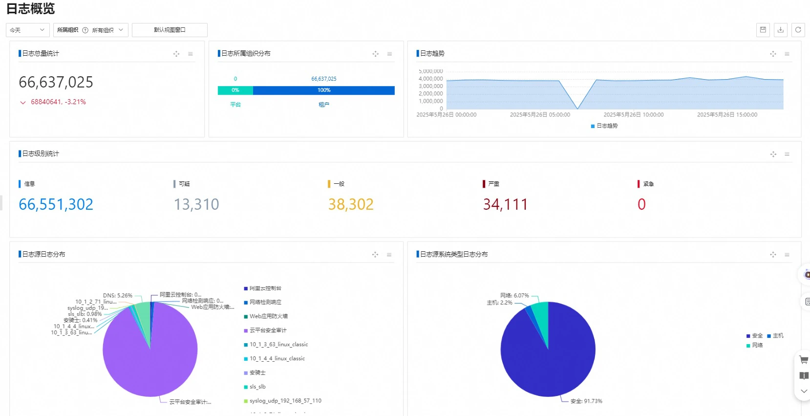

5. 在**日志概览**页面，管理日志可视化图表。

   - 移动日志视图

     单击目标日志视图卡片的  图标，拖动卡片到适当位置后，单击**日志概览**页面右上角的  图标。

   - 关闭日志视图单击目标日志视图卡片的  图标，单击**关闭视图**后，单击**日志概览**页面右上角的  图标。。

   - 导出页面快照

     单击**日志概览**页面右上角的  图标。

   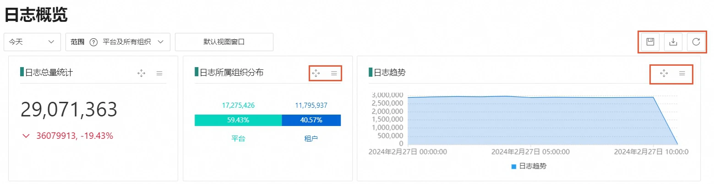

<a id="section-3-6-2"></a>

### 3.6.2. 日志查询

<a id="section-3-6-2-1"></a>

#### 3.6.2.1. 查询日志详情

本文介绍如何查询日志详情。

**操作步骤**

1. 登录Apsara Uni-manager运营控制台。

2. 在控制台右上方，单击**安全**，选择**全局平台安全 > 云安全管理中心SOC**。在**云安全管理中心SOC**授权页面，选择**地域**并单击**角色授权访问**。

3. 在左侧导航栏，选择**日志管理 > 日志查询**。

   

4. 设置日志查询条件，支持时间、所属组织（所有组织/选择组织）、系统类别、日志源、日志类型、日志子类型、日志字段、指定查询语句等条件。

   日志查询提供将您输入的自然语言转换为SPL语句的能力。单击  按钮，输入需要执行的查询信息后，

   单击  按钮可自动生成可执行的SPL查询语句，当SPL语句显示时，您可根据自身需求进行手动修改。

   查询结果说明：

   - 日志分布直方图：展示查询到的日志在时间上的分布，支持通过单击柱状图，系统将自动将柱状图的起止时间添加为查询条件。

   - 表格模式：通过表格展示指定字段的日志查看分析结果。

   - 列表模式：通过列表展示指定字段的日志查看分析结果。

   - 统计图表：自定义图标类型、图标大小、图标标题、统计字段，展示可视化的查询分析结果。

   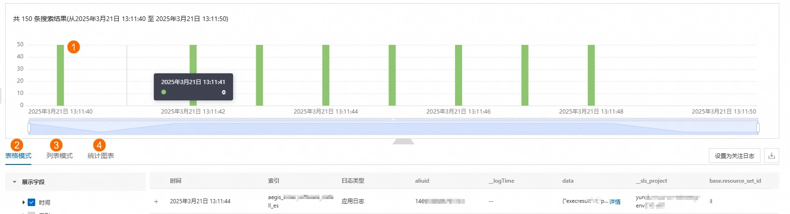

**相关操作**

- 设置为关注日志：单击**设置为关注日志**，填写**关注日志名称**，可设置当前日志设置为关注日志。

  设置完成后，您可以在**日志概览**页面的独立窗口查询当前关注的日志信息。

- 保存当前视图：单击页面右上角  图标，在新建过滤条件对话框，输入当前视图的查询条件名称，单击

  确定。即可保存当前视图。保存完成之后，可以在页面右上角**默认数据**下拉框，选择当前视图的查询条件，进行快速查询。

- 删除当前视图：单击页面右上角  图标，删除已保存的视图查询条件。其中**默认数据**视图不支持删除。

- 开启自动刷新：单击页面右上角  图标，开启自动刷新，每隔5分钟刷新一次日志查询信息。

  

- 查看日志字典：单击**日志字典**，可查看各类日志包含的字段名称、字段类型、字段描述。

- 在**日志查询**页面上，设置日志查询条件后，单击**保存为分析规则**，跳转至**分析规则**页面的编辑页面。在**新建规则**页面，自动将所选的日志源范围和检索条件设置为新检测规则的**日志范围**和**检索条件**。

<a id="section-3-6-2-2"></a>

#### 3.6.2.2. 查询原始日志

云安全管理中心提供查询原始日志功能，原始日志作为必要的调试信息，帮助安全管理员定位系统出现的故障。本文介绍如何查询原始日志。

**操作步骤**

1. 登录Apsara Uni-manager运营控制台。

2. 在控制台右上方，单击**安全**，选择**全局平台安全 > 云安全管理中心SOC**。在**云安全管理中心SOC**授权页面，选择**地域**并单击**角色授权访问**。

3. 在左侧导航栏，选择**日志管理 > 日志查询**。

4. 在**日志查询**页面，设置查询的**时间**、**组织**、**系统类别**、**日志源**、**日志类型**、**日志子类型**、**日志字段**以及**查询语法**，然后单击**搜索**。

   查询到的日志数量以柱状图的形式为您展示，日志详细信息以列表形式为您展现。支持查询的语法如下：

   - **全文匹配**

     示例1：12.XX.XX.12；示例2：www.bai\*.c?m。

   - **按字段匹配查询**

     示例1：

     ```text
     src_ip: 12.XX.XX.12 AND hostname:abc?o*al OR filesize:>100
     ```

     示例2：

     ```text
     12.XX.XX.12 AND appName:yundun-soc
     ```

5. 查询到的日志信息以表格模式、列表模式、统计图表模式展现。在日志列表区域，勾选需查询的字段，查看匹配到查询字段的日志。

   您也可以展开目标展示字段，显示该字段的相同属性（字段值）计数的Top5。

<a id="section-3-6-3"></a>

### 3.6.3. 租户日志

租户日志功能汇聚租户侧的日志信息，便于安全管理员定位租户侧的问题。本文介绍如何查询租户日志。

1. 登录Apsara Uni-manager运营控制台。

2. 在控制台右上方，单击**安全**，选择**全局平台安全 > 云安全管理中心SOC**。在**云安全管理中心SOC**授权页面，选择**地域**并单击**角色授权访问**。

3. 在左侧导航栏，选择**日志管理 > 租户日志**。

4. 在**租户日志**页面，根据实际需要，设置需要查询的组织范围、日志源和时间。支持查询的语法如下：

   - **全文匹配**

     示例1：

     ```text
     12.XX.XX.12
     ```

     示例2：

     ```text
     www.bai*.c?m
     ```

   - **按字段匹配查询**

     示例1：

     ```text
     src_ip: 12.XX.XX.12 AND hostname:abc?o*al OR filesize:>100
     ```

     示例2：

     ```text
     12.XX.XX.12 AND appName:yundun-soc
     ```

     根据查询条件，系统会以柱状图的形式为您展示**租户日志**。您可以通过柱状图，了解指定时间范围内不同时间的日志数量。您也可以在日志列表，查看查询到的日志详细信息。

     - 设置展示字段：单击 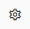 ，设置日志列表中显示的字段信息。

     - 导出日志列表：单击  ，导出查询到的日志列表。

5. 在**租户日志**页面上，设置日志查询条件后，单击**保存为分析规则**，跳转至**分析规则**页面的编辑页面。在**新建规则**页面，自动将所选的日志源范围和检索条件设置为新检测规则的**日志范围**和**检索条件**。

<a id="section-3-6-4"></a>

### 3.6.4. 日志配置

云安全管理中心提供日志转发功能，安全管理员可以根据业务需要，设置日志转发，方便及时查看日志信息。日志转发支持多任务转发，支持指定组织转发日志数据，支撑发送指定组织范围的日志。本文介绍如何设置日志转发任务。

**操作步骤**

1. 登录Apsara Uni-manager运营控制台。

2. 在控制台右上方，单击**安全**，选择**全局平台安全 > 云安全管理中心SOC**。在**云安全管理中心SOC**授权页面，选择**地域**并单击**角色授权访问**。

3. 在左侧导航栏，选择**日志管理 > 日志配置**。

4. 在**日志转发**页签，单击**新增转发任务**，完成如下配置后，单击**确定**。

   > **说明**
   >
   > 数据协议支持Syslog和Kafka。

   - **Syslog**

     | 配置项 | 说明 |
     | --- | --- |
     | 任务名称 | 设置转发任务的名称，长度0~64个字符。 |
     | IP：Port | 设置日志转发的IP地址、端口、传输协议。传输协议支持udp、tcp。 |
     | 联通性测试 | 测试是否正常通信。 |
     | 数据范围 | 设置处置任务的下发组织。 |
     | 转发日志 | 从<strong>日志源</strong>列表中，选择需要的日志源类型并单击将对应类型显示在<strong>转发列</strong><br><strong>表</strong>中。 |
     | 转发字段 | 日志转发支持选择：<br>• 标准化字段<br>• 原始字段<br>• 标准化字段+原始字段 |
     | 转发状态 | 开启或者关闭日志转发开关。 |

   - **Kafka**

     <table>
       <tr>
         <th width="121">配置项</th>
         <th>说明</th>
       </tr>
       <tr>
         <td>任务名称</td>
         <td>设置转发任务的名称，长度0~64个字符。</td>
       </tr>
       <tr>
         <td>服务地址</td>
         <td>设置日志转发的IP地址、端口。</td>
       </tr>
       <tr>
         <td>Topic列表</td>
         <td>Kafka Topic列表，多个Topic之间用,分割</td>
       </tr>
       <tr>
         <td>是否需要鉴权</td>
         <td>目标 Kafka 集群是否需要鉴权才能访问，如果需要，单击开关将图标，将图标置<br>为，配置如下选项：<br><br>• 协议类型：若目标 Kafka 集群需要鉴权才能访问，则需选择鉴权协议类型，支持SASL_PLAINTEXT。<br>• SASL认证机制：可选择PLAIN、SCRAM-SHA-256和SCRAM-SHA-512。<br>• 用户名/密码：若目标 Kafka 集群需要鉴权才能访问，则需填写访问目标Kafka 集群所需的用户名与密码。</td>
       </tr>
       <tr>
         <td>联通性测试</td>
         <td>测试是否正常通信。</td>
       </tr>
       <tr>
         <td>数据范围</td>
         <td>设置处置任务的下发组织。</td>
       </tr>
       <tr>
         <td>转发日志</td>
         <td>从<strong>日志源</strong>列表中，选择需要的日志源类型并单击将对应类型显示在<strong>转发列</strong><br><strong>表</strong>中。</td>
       </tr>
       <tr>
         <td>转发字段</td>
         <td>• 日志转发支持选择：<br>• 标准化字段<br>• 原始字段<br>• 标准化字段+原始字段</td>
       </tr>
       <tr>
         <td>转发状态</td>
         <td>开启或者关闭日志转发开关。</td>
       </tr>
     </table>

   用户可以按照上述步骤，创建多个转发任务。

   完成创建后，用户可以在转发任务列表，查看并管理转发任务。

   - 通过设置数据范围（选择组织）、输入**任务名称**等条件，筛选转发任务。

   - **开启**或**关闭**任务转发状态。

   - **编辑**或**删除**转发任务。

   单个日志转发任务，可展开显示当前任务中涉及到的日志源、日志类型、日志发送总数统计以及最近24小时发送数据量等转发信息。

<a id="section-3-7"></a>

## 3.7. 处置任务

通过处置任务，用户可进行全局安全风险分析及处置的流程化跟踪管理，用以支撑辅助安全运营管理工作，同时积累安全风险处置经验。本文介绍如何进行处置任务。

**操作步骤**

1. 登录Apsara Uni-manager运营控制台。

2. 在控制台右上方，单击**安全**，选择**全局平台安全 > 云安全管理中心SOC**。在**云安全管理中心SOC**授权页面，选择**地域**并单击**角色授权访问**。

3. 在左侧导航栏，选择**风险处置 > 处置任务**。

4. 在处置任务页面，查看任务总览。

   - 任务总数：统计SOC从开始运行到当前时刻的任务总数。

   - 待处置任务、处置中任务、已处置任务：统计SOC从开始运行到当前时刻的待处置任务、处置中任务、已处置任务。

   - 任务完成率、任务准时完成率：统计SOC从开始运行到当前时刻的处置任务完成率、任务准时完成率。

   - 处置方案知识库：统计SOC从开始运行到当前时刻的添加处置方案知识库。支持手动添加和通过处置记录同步。

     - 手动添加

       单击**处置方案知识库**后，单击**新建方案**，完成如下配置后，单击**确定**。

       <table>
         <tr>
           <th width="89">配置项</th>
           <th>说明</th>
         </tr>
         <tr>
           <td>方案名称</td>
           <td>设置处置任务名称，长度为1~200个字符。</td>
         </tr>
         <tr>
           <td>共享范围</td>
           <td>单击<strong>组织</strong>下拉列表，选择目标组织（可多选）。</td>
         </tr>
         <tr>
           <td>方案类型</td>
           <td>设置处置方案的类型，可选项：<br>• 威胁事件<br>• 安全告警<br>• 安全漏洞<br>• 安全基线<br>• 资产风险<br>• 安全巡检<br>• 剧本审批</td>
         </tr>
         <tr>
           <td>问题描述</td>
           <td>设置处置任务的问题描述。输入的内容支持富文本功能，不仅能输入文字，还能对文字进行格式化，并插入图片、代码块等多媒体元素。</td>
         </tr>
         <tr>
           <td>处置方案</td>
           <td>设置处置方案。输入的内容支持富文本功能，不仅能输入文字，还能对文字进行格式化，并插入图片、代码块等多媒体元素。</td>
         </tr>
         <tr>
           <td>处理人</td>
           <td>从联系人列表选择联系人。</td>
         </tr>
       </table>

     - 通过处置记录同步：具体操作，请参见处置任务。

     手动添加的处置方案状态为**已发布**，可直接引用。通过处置记录同步的处置方案状态为**审批中**，用户需要在云安全管理中心SOC平台侧对处置方案执行**审批**或**失效**，再引用。

     支持**删除**和**编辑**处置方案。

5. 单击**新建处置任务**，完成如下配置后，单击**确定**。

   <table>
     <tr>
       <th width="154">配置项</th>
       <th>说明</th>
     </tr>
     <tr>
       <td>任务名称</td>
       <td>设置处置任务名称，长度为0~128个字符。</td>
     </tr>
     <tr>
       <td>任务类型</td>
       <td>设置处置任务的类型，可选项：<br>• <strong>威胁事件</strong>：通过<strong>选择风险信息</strong>，可选中数据权限范围内指定威胁事件。<br>• <strong>安全告警</strong>，通过<strong>选择风险信息</strong>，可选中数据权限范围内指定安全告警。<br>• <strong>安全漏洞</strong>，通过<strong>选择风险信息</strong>，可选中数据权限范围内指定安全漏洞。<br>• <strong>安全基线</strong>，通过<strong>选择风险信息</strong>，可选中数据权限范围内指定安全基线。<br>• <strong>资产风险</strong>，通过<strong>选择风险信息</strong>，可选中数据权限范围内指定资产。<br>• <strong>安全巡检</strong>：自定义风险信息及问题描述。</td>
     </tr>
     <tr>
       <td>下发组织</td>
       <td>设置处置任务的下发组织。</td>
     </tr>
     <tr>
       <td>是否引用风险信息</td>
       <td>选择引用风险信息后，<strong>问题描述</strong>和<strong>处置建议</strong>中会帮您预填入相应的风险信息。</td>
     </tr>
     <tr>
       <td>优先级</td>
       <td>设置处置任务的优先级，可选项：<strong>紧急</strong>、<strong>高</strong>、<strong>中</strong>、<strong>低</strong>。</td>
     </tr>
     <tr>
       <td>问题描述</td>
       <td>设置处置任务的问题描述。输入的内容支持富文本功能，不仅能输入文字，还能对文字进行格式化，并插入图片、代码块等多媒体元素。</td>
     </tr>
     <tr>
       <td>处置建议</td>
       <td>设置处置任务的处置建议。输入的内容支持富文本功能，不仅能输入文字，还能对文字进行格式化，并插入图片、代码块等多媒体元素。可选中<strong>引用处置方案</strong>并从<strong>处置方案知识库</strong>中选择处置方案。</td>
     </tr>
     <tr>
       <td>处理截止时间</td>
       <td>设置处置任务完成的截止日期。如果处置任务在该截止时间之前未完成，处置状态将变为超时。</td>
     </tr>
     <tr>
       <td>处理人</td>
       <td>从联系人列表选择联系人，支持展开多级组织进行选择。</td>
     </tr>
     <tr>
       <td>通知方式</td>
       <td>可选钉钉、邮件。</td>
     </tr>
   </table>

完成处置任务创建后，用户可以在任务列表查看并处置所有处置任务。

- 查询处置任务

  在筛选框中，通过设置查询条件，搜索对应处置任务。筛选框支持通过下发组织、任务类型、优先级、任务状态、处理状态、任务名称、处理人筛选。

- 处置任务

  <ol type="i">

  <li>

  定位到目标任务，单击任务名称或**操作**列的**处理详情**。

  </li>

  <li>

  在任务详情页面，打开**确认查收，并启动处理**开关。

  </li>

  <li>

  根据**处置建议**，处置任务后，填写**处置记录**。处置记录长度为0~2048个字符。

  > **说明**
  >
  > - 用户在填写处理记录时，可选中**同步提交至方案知识库**，后续遇到相同处置任务，可直接引用方案知识库作为处置建议。
  >
  > - 提交至方案知识库的处置记录为**审批中**状态。用户需要在云安全管理中心SOC平台侧的**处置方案知识库**，将筛选条件的**方案状态**置为**审批中**，定位到目标方案，在**操作**列单击**更多 > 审批**或**更多 > 失效**。

  </li>

  </ol>

  完成处置任务后，该任务的状态由**处置中**变为**已完成**，同时处置记录不再支持**编辑**。

<a id="section-3-8"></a>

## 3.8. 报表管理

<a id="section-3-8-1"></a>

### 3.8.1. 报表列表

报表列表对云安全管理中心采集的全量报表信息进行整体统计及可视化呈现。

**操作步骤**

1. 登录Apsara Uni-manager运营控制台。

2. 在控制台右上方，单击**安全**，选择**全局平台安全 > 云安全管理中心SOC**。在**云安全管理中心SOC**授权页面，选择**地域**并单击**角色授权访问**。

3. 在左侧导航栏，选择**报表管理 > 报表列表**。

4. 在**报表列表**页签，支持对已生成报表总数、日报数、周报数、月报数、自定义周期报表数等的统计，呈现最新报表生成时间。

   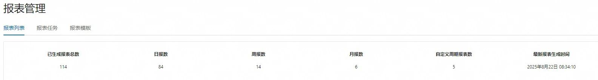

5. 支持以列表形式对已生成报表进行管理，通过设置所属组织、数据范围、时间范围、任务类型搜索过滤出任务名称/报表名称的详细内容。

   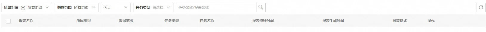

   - 报表支持**下载**、**预览**和**删除**操作。

<a id="section-3-8-2"></a>

### 3.8.2. 报表任务

本文介绍云安全管理中心SOC报表任务详细信息，并以任务列表的形式集中呈现。

**操作步骤**

1. 登录Apsara Uni-manager运营控制台。

2. 在控制台右上方，单击**安全**，选择**全局平台安全 > 云安全管理中心SOC**。在**云安全管理中心SOC**授权页面，选择**地域**并单击**角色授权访问**。

3. 在左侧导航栏，选择**报表管理 > 报表任务**。

   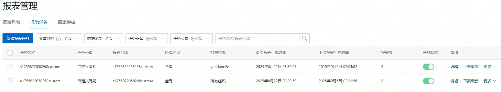

4. 在**报表任务**页签，单击**新建报表任务**，完成如下配置后，单击**确定**。

   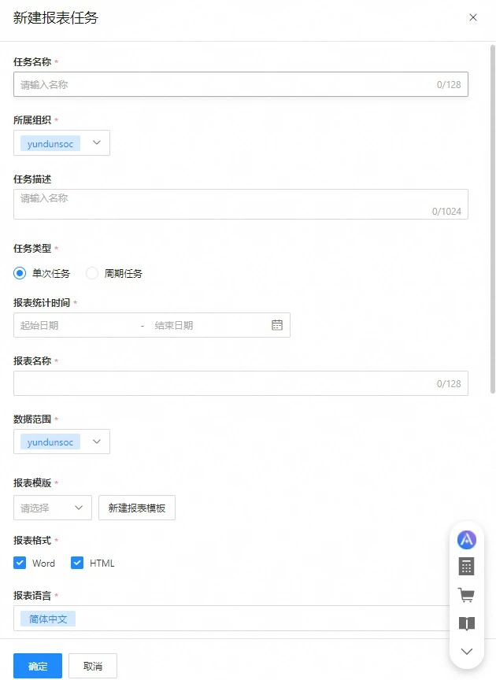

   | 配置项 | 说明 |
   | --- | --- |

   <table>
     <tr>
       <td colspan="2">任务名称</td>
       <td>报表任务的名称，支持0~128个字符</td>
     </tr>
     <tr>
       <td colspan="2">所属组织</td>
       <td>下拉列表选择目标组织。</td>
     </tr>
     <tr>
       <td>任务描述</td>
       <td></td>
       <td>报表任务的详细说明，支持0~1024个字符。</td>
     </tr>
     <tr>
       <td rowspan="2">任务类型</td>
       <td>单次任务</td>
       <td>• 报表统计时间：设置报表任务的统计时间。<br>• 报表名称：设置报表的名称，支持0~128个字符。<br>• 数据范围：下拉列表选择<br>• 报表模板：下拉列表中选择目标报表模板，支持新建报表模板。<br>• 报表格式：<br>• Word<br>• HTML<br>• 报表语言：下拉列表选择简体中文、繁軆中文和English<br>• 存储时间：设置报表任务存储的时间，默认为180天。<br>• 是否开启任务状态<br>• 是否开启发送<br>• 报表发送时间：开启发送后，可以自定义报表发送的时间范围<br>• 接收人：下拉列表选择下发组织和联系人<br>• 接收方式：选择接收报表的方式，钉钉和邮件</td>
     </tr>
     <tr>
       <td>周期任务</td>
       <td>• 支持下拉列表日报、周报、月报和自定义。<br>• 报表名称：设置报表的名称，支持0~128个字符。<br>• 数据范围：下拉列表选择<br>• 其他配置项与单次任务配置相同。</td>
     </tr>
   </table>

- 单击操作列的**编辑**，可修改报表任务的配置项。例如：报表名称、报表数据范围、报表模板、报表格式、存储时间、任务状态等任务属性信息。

- 单击操作列的**更多** > **查看全部**，可查看到任务中所有的报表信息，支持对报表任务进行**下载**、**预览**、**删除**和**发送**操作。

- 单击操作列的**下载最新**，可下载出**HTML**报表格式的报表任务信息。

<a id="section-3-8-3"></a>

### 3.8.3. 报表模板

本文介绍云安全管理中心SOC报表模板的创建和自定义报表模板配置的详细内容。

**操作步骤**

1. 登录Apsara Uni-manager运营控制台。

2. 在控制台右上方，单击**安全**，选择**全局平台安全 > 云安全管理中心SOC**。在**云安全管理中心SOC**授权页面，选择**地域**并单击**角色授权访问**。

3. 在左侧导航栏，选择**报表管理 > 报表模板**。

   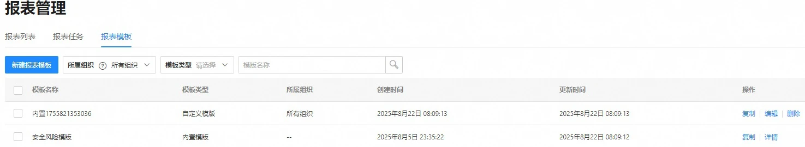

4. 在**报表模板**页签，单击**新建报表模板**，完成如下配置后，单击**确定**。

   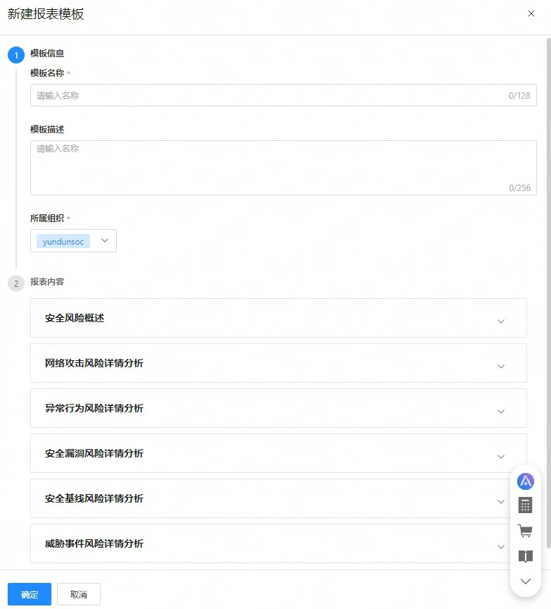

   | 配置项 | 说明 |
   | --- | --- |
   | 模板名称 | 设置报表模板的名称，支持0~128个字符。 |
   | 模板描述 | 报表模板的详细描述，支持0~256个字符。 |
   | 所属组织 | 下拉列表中选择。 |
   | • 安全风险概述<br>• 网络攻击风险详情分析<br>• 异常行为风险详情分析<br>• 安全漏洞风险详情分析<br>• 安全基线风险详情分析<br>• 威胁事件风险详情分析 | 提供内置安全风险模板。 |

- 单击操作列的**复制**，可将该报表模板的配置内容进行同步。

- 单击操作列的**删除**，可删除该报表模板的配置内容。

- 单击操作列的**编辑**，可修改改报表模板的配置内容。

<a id="section-3-9"></a>

## 3.9. 策略管理

<a id="section-3-9-1"></a>

### 3.9.1. 分析规则

根据规则定义的分析逻辑，对众多日志数据进行综合关联分析，以此检测相关威胁风险，还原多阶段攻击的完整攻击路径。安全管理员可以简单、快速地发现高价值风险信息，提升安全运营效率。本文介绍如何配置分析规则。

**操作步骤**

**新建规则**

云安全管理中心根据常见业务需求，为您预定义了部分规则，预定义的规则只支持查看详情，不支持修改等操作。如果预定义的规则未覆盖您的业务，您可以根据如下操作新建规则。

1. 登录Apsara Uni-manager运营控制台。

2. 在控制台右上方，单击**安全**，选择**全局平台安全 > 云安全管理中心SOC**。在**云安全管理中心SOC**授权页面，选择**地域**并单击**角色授权访问**。

3. 在左侧导航栏，选择**策略管理 > 分析规则**。

4. 在**分析规则**页面，单击**新建规则**，完成如下配置。

   **配置项**

   **说明**

   选择分析规则的所属组织。

   **所属组织**

   选择相关数据范围。

   **数据范围**

   设置威胁的名称。

   **威胁名称**

   设置威胁的级别。取值：

   - **信息**

   - **可疑**

   **威胁级别**

   - **一般**

   - **严重**

   **基本信息**

   - **紧急**

   设置威胁的类型，可多选。取值：

   - **网络扫描**

   - **漏洞利用**

   - **恶意软件**

   **威胁类型**

   - **网络攻击**

   - **风险连接**

   - **异常行为**

   - **非法提权**

   涉及的ATT&CK ID。

   **ATT&CK ID**

   设置威胁的描述信息。支持0~256个字符。

   **威胁描述**

   设置对应的处理建议。支持0~256个字符。

   **处置建议**

   **关联时序**：设置关联时序。

   - **同周期无序匹配**：表示在同一周期内发生的威胁事件。

   - **跨周期顺序匹配**：表示按顺序发生的威胁事件。

   - **同周期顺序匹配**：表示在同一周期内按顺序发生的威胁事件。

   **关联对象**：设置关联的对象。目前只支持关联**同一资产**，默认开启。

   **规则类型**：选择**关联分析规则**

   **关联分析条件**：设置关联驱动条件。

   > **说明**
   >
   > 在关联分析条件区域的右侧，支持进行添加、删除、上移或下移操作。

   **规则配置**

   - **关联类型**：设置是否为**必要条件**。

   - **日志范围**：包含系统类别、日志源、日志类型、日志子类型、日志级别（可多选）。

   - **分析条件1**：多个关键字用半角分号（;）分隔。单击右侧的**添加**，可添加多个关键字。

   - **聚合字段**：云安全管理中心SOC将根据您选择的字段对统计周期内的日志进行聚合。支持**标准化字段**和**日志原始字段**。

   - **关联威胁情报**：设置是否匹配威胁情报。选中后，在右侧的**引用关键字**下拉框中选择关键字，支持**源IP**、**目的IP**、**域名**和**文件MD5**（可多选）。

   - **日志阈值**：日志的个数。

   **日志范围**：下拉选择系统类别、日志源、日志类型和日志子类型。

   **规则类型**：选择**检索分析规则**

   **检索条件**：设置规则检索条件。

   包含**载荷投递**、**漏洞利用**、**后门植入**、**命令控制**、**扫**

   **攻击阶段**

   **描扩散**、**权限提升**和**目标打击**。

   支持单位为分钟、小时、天（最大365天）。

   **时间范围**

   设置规则执行的周期。默认为5分钟。支持单位为分

   **规则执行周期**

   钟、小时、天（最大365天）。

5. <strong>可选：</strong>如果您需要验证已创建的规则，单击**快速验证**。

6. 单击**确定**。

   创建好的规则显示在规则列表中。

   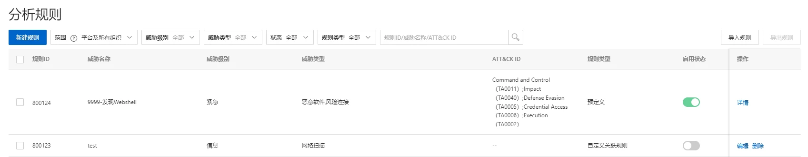

   根据实际业务需要，您可以对自定义的规则执行**编辑**和**删除**操作。

**规则管理**

1. 在左侧导航栏，选择**策略管理 > 分析规则**。

2. 在规则列表，可查看具体的规则ID、威胁名称、威胁级别、威胁类型、所属组织、数据范围、ATT&CK ID、规则类型以及启用状态等信息。此外，您还可以对规则进行管理，规则管理的相关操作如下所示：

   - **启用状态**

     在规则列表的**启用状态**列中，单击开关图标可以启用或关闭特定规则。

   - **编辑、删除**

     在规则列表的**操作**列中，单击**编辑**或**删除**，可以对特定规则进行相应的编辑或删除操作。

   - **复制**

     在规则列表的**操作**列中，单击**复制**，在**复制规则**对话框，选择**所属组织**，单击**确定**。此操作可用于对特定规则进行复制。

   > **说明**
   >
   > - 当一条或多条预定义规则被关闭时，系统将提示您**当前有预定义规则被关闭，请确认是否需要开启**。
   >
   > - 复制后的自定义规则支持进行编辑和删除操作。对于复制后的内置规则，仅支持执行删除操作。

<a id="section-3-9-2"></a>

### 3.9.2. 响应策略

用户可以通过创建响应策略，及时处理威胁事件、安全告警（运营中心的安全告警数据），或掌握威胁事件、安全告警（运营中心的安全告警数据）、安全基线、安全漏洞的风险威胁，告警通知支持通过钉钉、邮件的方式即时将告警信息发送给告警联系人。本文介绍如何创建响应策略。

**操作步骤**

1. 登录Apsara Uni-manager运营控制台。

2. 在控制台右上方，单击**安全**，选择**全局平台安全 > 云安全管理中心SOC**。在**云安全管理中心SOC**授权页面，选择**地域**并单击**角色授权访问**。

3. 在左侧导航栏，选择策略管理 ＞ 响应策略。

4. 在**响应策略**页面，单击**新建策略**。

5. 在**新建策略**面板，完成如下配置后，单击**确定**。

   <ol type="i">

   <li>

   基础信息

   策略的基础信息。

   <table>
     <tr>
       <th width="89">配置项</th>
       <th>说明</th>
     </tr>
     <tr>
       <td>所属组织</td>
       <td>选择新建响应策略的所属组织。</td>
     </tr>
     <tr>
       <td>策略名称</td>
       <td>设置策略的名称。</td>
     </tr>
     <tr>
       <td>策略描述</td>
       <td>设置策略的描述。</td>
     </tr>
     <tr>
       <td>策略类型</td>
       <td>设置策略的类型。可选值：<br>• 威胁事件<br>• 安全告警<br>• 安全漏洞<br>• 安全基线<br>重要不同策略类型的策略设置配置项不同。</td>
     </tr>
   </table>

   </li>

   <li>

   策略设置

   设置响应策略的触发条件，不同策略类型对应的策略设置配置项不同。

   <ol type="a">

   <li>

   威胁事件

   <table>
     <tr>
       <th width="121">配置项</th>
       <th>说明</th>
     </tr>
     <tr>
       <td>数据范围</td>
       <td>策略的影响范围，请选择具体组织。</td>
     </tr>
     <tr>
       <td>策略周期</td>
       <td>匹配策略设置的条件，以及触发响应的间隔时间。</td>
     </tr>
     <tr>
       <td>威胁事件名称</td>
       <td>触发此响应策略的威胁事件名称。</td>
     </tr>
     <tr>
       <td>威胁事件级别</td>
       <td>威胁事件级别，默认为<strong>全部级别</strong>，可选择<strong>信</strong><strong>息</strong>、<strong>可疑</strong>、<strong>一般</strong>、<strong>严重</strong>和<strong>紧急</strong>（可多选）。</td>
     </tr>
     <tr>
       <td>威胁事件类型</td>
       <td>威胁事件类型，默认为<strong>全部类型</strong>，可选择<strong>网络扫</strong><strong>描</strong>、<strong>漏洞利用</strong>、<strong>恶意软件</strong>、<strong>网络攻击</strong>等（可多选）。</td>
     </tr>
     <tr>
       <td>攻击源IP</td>
       <td>威胁事件的攻击源IP，支持输入多个IP或C段地址(/24)，使用英文逗号分隔，做多10个。</td>
     </tr>
     <tr>
       <td>攻击目的IP</td>
       <td>威胁事件的攻击目的IP，支持输入多个IP或C段地址(/24)，使用英文逗号分隔，做多10个。</td>
     </tr>
     <tr>
       <td>涉及资产</td>
       <td>选择该策略的相关资产，默认为全部资产，支持<strong>公网IP/掩码</strong>、<strong>私网IP/掩码</strong>、<strong>公网IP</strong>和<strong>私网</strong><strong>IP</strong>。</td>
     </tr>
     <tr>
       <td>威胁行为</td>
       <td>威胁事件发生的次数。</td>
     </tr>
   </table>

   </li>

   <li>

   安全告警

   <table>
     <tr>
       <th width="121">配置项</th>
       <th>说明</th>
     </tr>
     <tr>
       <td>数据范围</td>
       <td>策略的影响范围，请选择具体组织资源集。</td>
     </tr>
     <tr>
       <td>策略周期</td>
       <td>匹配策略设置的条件，以及触发响应的间隔时间。</td>
     </tr>
     <tr>
       <td>安全告警名称</td>
       <td>触发此响应策略的安全告警名称。</td>
     </tr>
     <tr>
       <td>告警威胁级别</td>
       <td>安全告警级别，默认为<strong>全部级别</strong>，可选择<strong>信</strong><strong>息</strong>、<strong>可疑</strong>、<strong>一般</strong>、<strong>严重</strong>和<strong>紧急</strong>（可多选）。</td>
     </tr>
     <tr>
       <td>安全告警类型</td>
       <td>安全告警类型，默认为全部类型，可选择<strong>异常登</strong><strong>录</strong>、<strong>恶意脚本（云查杀）</strong>、<strong>网站后门</strong>、<strong>进程异常</strong><strong>行为</strong>等（可多选）。</td>
     </tr>
     <tr>
       <td>攻击源IP</td>
       <td>安全告警的攻击源IP，支持输入多个IP或C段地址(/24)，使用英文逗号分隔，做多10个。</td>
     </tr>
     <tr>
       <td>攻击目的IP</td>
       <td>安全告警的攻击目的IP，支持输入多个IP或C段地址(/24)，使用英文逗号分隔，做多10个。</td>
     </tr>
     <tr>
       <td>涉及资产</td>
       <td>选择该策略的相关资产，默认为全部资产，可选择<strong>实例类型</strong>、<strong>实例名称</strong>、<strong>VPC</strong>、<strong>公网IP/掩</strong><strong>码</strong>、<strong>私网IP/掩码</strong>、<strong>公网IP</strong>、<strong>私网IP</strong>。</td>
     </tr>
   </table>

   </li>

   </ol>

   <ol type="i" start="100">

   <li>

   安全漏洞

   <table>
     <tr>
       <th width="137">配置项</th>
       <th>说明</th>
     </tr>
     <tr>
       <td>数据范围</td>
       <td>策略的影响范围，请选择具体组织资源集。</td>
     </tr>
     <tr>
       <td>策略周期</td>
       <td>匹配策略设置的条件，以及触发响应的间隔时间。</td>
     </tr>
     <tr>
       <td>漏洞名称</td>
       <td>触发此响应策略的漏洞名称。</td>
     </tr>
     <tr>
       <td>漏洞等级</td>
       <td>漏洞级别，默认为全部级别，可选择<strong>低危</strong>、<strong>中</strong><strong>危</strong>和<strong>高危</strong>（可多选）。</td>
     </tr>
     <tr>
       <td>漏洞类型</td>
       <td>漏洞类型，默认为全部类型，可选择<strong>Linux软件</strong><strong>漏洞</strong>、<strong>Windows系统漏洞</strong>、<strong>Web-CMS漏</strong><strong>洞</strong>、<strong>应用漏洞（含应急）</strong>（可多选）。</td>
     </tr>
     <tr>
       <td>CVE编号</td>
       <td>CVE编号。</td>
     </tr>
     <tr>
       <td>涉及资产</td>
       <td>选择该策略的相关资产，默认为全部资产，可选择<strong>实例类型</strong>、<strong>实例名称</strong>、<strong>VPC</strong>、<strong>公网IP/掩</strong><strong>码</strong>、<strong>私网IP/掩码</strong>、<strong>公网IP</strong>、<strong>私网IP</strong>。</td>
     </tr>
     <tr>
       <td>处置优先级评分</td>
       <td>0-10的数字评分。</td>
     </tr>
     <tr>
       <td>受影响资产</td>
       <td>受影响资产的数量。</td>
     </tr>
   </table>

   </li>

   <li value="500">

   安全基线

   <table>
     <tr>
       <th width="121">配置项</th>
       <th>说明</th>
     </tr>
     <tr>
       <td>数据范围</td>
       <td>策略的影响范围，请选择具体组织资源集。</td>
     </tr>
     <tr>
       <td>策略周期</td>
       <td>匹配策略设置的条件，以及触发响应的间隔时间。</td>
     </tr>
     <tr>
       <td>基线名称</td>
       <td>触发此响应策略的基线名称。</td>
     </tr>
     <tr>
       <td>基线风险等级</td>
       <td>基线风险级别，默认为全部级别，可选择<strong>低</strong><strong>危</strong>、<strong>中危</strong>和<strong>高危</strong>（可多选）。</td>
     </tr>
     <tr>
       <td>基线风险类型</td>
       <td>基线风险类型，默认为全部类型，可选择<strong>等保合</strong><strong>规</strong>、<strong>未授权访问</strong>、<strong>国际通用安全最佳实践</strong>、<strong>自定</strong><strong>义基线</strong>、<strong>最佳安全实践</strong>、<strong>弱口令</strong>等（可多选）。</td>
     </tr>
     <tr>
       <td>涉及资产</td>
       <td>选择该策略的相关资产，默认为全部资产，可选择<strong>实例类型</strong>、<strong>实例名称</strong>、<strong>VPC</strong>、<strong>公网IP/掩</strong><strong>码</strong>、<strong>私网IP/掩码</strong>、<strong>公网IP</strong>、<strong>私网IP</strong>。</td>
     </tr>
     <tr>
       <td>受影响资产</td>
       <td>受影响资产的数量。</td>
     </tr>
   </table>

   </li>

   </ol>

   </li>

   <li>

   响应设置

   **响应方式**默认仅支持**消息通知**，可配置消息通知的对象和方式等。响应策略触发之后，自动发送消息通知。

   > **说明**
   >
   > **联动处置**方式仅在云安全管理中心SOC平台侧、企业云运营模式下支持使用。ASCM租户侧不支持使用。

   | 配置项 | 说明 |
   | --- | --- |
   | 通知内容条目数 | 针对匹配命中策略设置的相关风险，仅推送所配置条目数的消息通知。 |
   | 通知对象 | 选择相应组织下的联系人，可多选。 |
   | 通知方式 | 消息通知方式，目前支持钉钉、邮件的通知方式。 |

   </li>

   </ol>

**管理策略**

1. 在左侧导航栏，选择**策略管理** ＞ **响应策略**。

2. 在响应策略列表页面，可对目标策略进行以下操作：

   - 在**操作**列，可进行**编辑**或**删除**操作。

   - 在**状态**列，可进行开启或关闭操作。

<a id="section-3-10"></a>

## 3.10. 运营管理

<a id="section-3-10-1"></a>

### 3.10.1. 组织授权

本文介绍如何开启全局组织SLR授权。

**操作步骤**

1. 登录Apsara Uni-manager运营控制台。

2. 在控制台右上方，单击**安全**，选择**全局平台安全 > 云安全管理中心SOC**。在**云安全管理中心SOC**授权页面，选择**地域**并单击**角色授权访问**。

3. 在左侧导航栏，单击**运营管理 > 组织授权**。

4. 在云安全管理中心SOC目录下，点击**组织SLR授权**右侧的**查看详情**，可以查看当前组织授权的状态，也可以针对具体组织进行开启和关闭授权。

   > **说明**
   >
   > 若需开启**全局组织SLR授权**，需要在云安全管理中心平台侧进行全局开启。

   - 开启状态：云安全管理中心（SOC）将获得本组织的SLR授权，SOC可自动采集本组织的云资产及相关安全信息数据，同时全局组织安全管理员本组织资产及相关安全信息的运营管理权限。

   - 关闭状态：云安全管理中心（SOC）不具备本组织的SLR授权，SOC无法自动采集本组织的云资产及相关安全信息数据，同时本组织也无法使用SOC产品功能进行组织安全运营管理。
