阿里云  
专有云  
敏感数据保护  
敏感数据保护 用户指南  
产品版本：v3.18.6  
文档版本：20261023

**目录**

- [1.使用须知](#section-1)
- [2.快速入门](#section-2)
    - [2.1. 用户权限说明](#section-2-1)
    - [2.2. 登录Apsara Uni-manager运营控制台](#section-2-2)
    - [2.3. 登录飞天基础运维平台](#section-2-3)
- [3.概览](#section-3)
- [4.数据资产](#section-4)
    - [4.1. 资产中心](#section-4-1)
        - [4.1.1. 获取数据资产授权](#section-4-1-1)
        - [4.1.2. 授权账密管理](#section-4-1-2)
    - [4.2. 数据地图](#section-4-2)
    - [4.3. 数据管理](#section-4-3)
- [5.数据梳理](#section-5)
    - [5.1. 数据识别](#section-5-1)
    - [5.2. 数据检索](#section-5-2)
    - [5.3. 识别配置](#section-5-3)
        - [5.3.1. 管理模板](#section-5-3-1)
        - [5.3.2. 管理识别模型和识别特征](#section-5-3-2)
        - [5.3.3. 风险级别配置](#section-5-3-3)
        - [5.3.4. 查看识别规则](#section-5-3-4)
    - [5.4. 任务管理](#section-5-4)
- [6.安全审计](#section-6)
    - [6.1. 审计概览](#section-6-1)
    - [6.2. 审计日志](#section-6-2)
        - [6.2.1. 原始日志](#section-6-2-1)
        - [6.2.2. 历史日志](#section-6-2-2)
    - [6.3. 审计告警](#section-6-3)
    - [6.4. 审计配置](#section-6-4)
        - [6.4.1. 创建自定义规则](#section-6-4-1)
        - [6.4.2. 查看内置规则](#section-6-4-2)
- [7.风险治理](#section-7)
    - [7.1. 风险告警](#section-7-1)
    - [7.2. 检测模型](#section-7-2)
        - [7.2.1. 配置内置检测模型](#section-7-2-1)
        - [7.2.2. 创建自定义检测模型](#section-7-2-2)
    - [7.3. 账号权限](#section-7-3)
        - [7.3.1. 查看用户账号分析](#section-7-3-1)
        - [7.3.2. 查看权限统计](#section-7-3-2)
        - [7.3.3. 检索权限](#section-7-3-3)
    - [7.4. 风险评估](#section-7-4)
        - [7.4.1. 概述](#section-7-4-1)
        - [7.4.2. 风险评估](#section-7-4-2)
        - [7.4.3. 自定义评估标准和评估项](#section-7-4-3)
- [8.报表中心](#section-8)
    - [8.1. 综合分析报告](#section-8-1)
    - [8.2. 合规报告](#section-8-2)
        - [8.2.1. 等保参考分析报告](#section-8-2-1)
        - [8.2.2. 数据安全法报告](#section-8-2-2)
- [9.系统配置](#section-9)
    - [9.1. 配置邮件报告](#section-9-1)
    - [9.2. 导出设置](#section-9-2)
    - [9.3. 管理白名单](#section-9-3)
    - [9.4. 新增使用授权](#section-9-4)

<a id="section-1"></a>

# 1.使用须知

本文介绍敏感数据保护产品符合的本地PC配置要求。

**本地PC配置要求**

本地PC需要满足如配置要求表中配置要求，才可以正常登录云盾控制台。

表 1. 配置要求表

<table>
  <tr>
    <th width="90">内容</th>
    <th>要求</th>
  </tr>
  <tr>
    <td>浏览器</td>
    <td>• Internet Explorer浏览器：11及以上版本<br>• Chrome浏览器（推荐）：42.0.0及以上版本<br>• Firefox浏览器：30及以上版本<br>• Safari浏览器：9.0.2版本及以上版本<br>• 国密浏览器：Chrome内核69及以上的主流国密浏览器</td>
  </tr>
  <tr>
    <td>操作系统</td>
    <td>• Windows XP版本<br>• Windows 7及以上版本<br>• Mac系统</td>
  </tr>
</table>

<a id="section-2"></a>

# 2.快速入门

<a id="section-2-1"></a>

## 2.1. 用户权限说明

本文介绍了云盾涉及的用户角色。

所有云盾安全中心角色均为默认角色，无法自定义添加。在登录云盾安全中心前，您需要确认自己的账号已经分配云盾相关的角色，具体角色说明，请参见云盾默认角色。

表 1. 云盾默认角色

<table>
  <tr>
    <th width="170">角色名称</th>
    <th>角色说明</th>
  </tr>
  <tr>
    <td>组织安全管理员</td>
    <td>负责单个组织内的安全管理工作，包括云安全管理中心SOC、主机安全、应用安全、网络安全等安全产品的管理工作。</td>
  </tr>
  <tr>
    <td>全局组织安全管理员</td>
    <td>负责通过云安全管理中心SOC，进行所有租户的安全管理工作。</td>
  </tr>
  <tr>
    <td>自定义角色</td>
    <td>可自定义所有组织、本组织及级联下级组织、资源集的运营管理权限，可区分读写、自定义配置产品功能菜单界面。<br>说明当前的自定义所有组织，不包含平台权限，与全局组织安全管理员的数据权限范围存在差异。</td>
  </tr>
</table>

如果您没有相关账号和角色，请联系管理员创建用户及授予角色，具体步骤，请参见<strong>《Apsara Uni-manager运营控制台用户指南》</strong>中**创建用户**。

<a id="section-2-2"></a>

## 2.2. 登录Apsara Uni-manager运营控制台

本文主要向您介绍如何登录Apsara Uni-manager运营控制台。

**前提条件**

- 登录Apsara Uni-manager运营控制台前，确认您已从部署人员处获取Apsara Uni-manager运营控制台的服务域名地址。

- 推荐使用Chrome浏览器。

**操作步骤**

1. 在浏览器地址栏中，输入Apsara Uni-manager运营控制台的服务域名地址，按回车键。

   

   > **说明**
   >
   > - 单击页面右上角的当前语言可以切换其它语言。
   >
   > - 授权登录是第三方认证中配置了全局IdP设置才会显示，且“授权登录”名称用户可按需自定义。
   >
   > - 由于浏览器证书过期或环境开启HTTPS认证等出现多次单击继续访问或无Apsara Uni-manager运营控制台地址入口等现象，此时需要安装证书才能正常访问。单击页面右上角的**浏览器证书安装**，可打开浏览器证书安装指南。

2. 输入正确的用户名及密码。

   > **说明**
   >
   > - 请向运营管理员获取登录控制台的用户名和密码。
   >
   > - 首次登录Apsara Uni-manager运营控制台时，需要修改登录用户名的密码，请按照提示完成密码修改。为提高安全性，密码长度必须为10~32位，且包含英文字母大小写、阿拉伯数字和特殊符号（感叹号（!）、at（@）、井号（#）、美元符号（$）、百分号（%）等）。

3. 单击**账号登录**。

4. 如果账号已激活MFA多因素认证，请根据以下两种情况进行操作：

   - **管理员强制开启MFA后的首次登录**

     <ol type="a">

     <li>

     在绑定虚拟MFA设备页面中，按页面提示步骤绑定MFA设备。

     </li>

     <li>

     按照步骤2重新输入账号和密码，单击**账号登录**。

     </li>

     </ol>

     <ol type="i" start="100">

     <li>

     输入6位MFA码后单击**认证**。

     </li>

     </ol>

   - **您已开启并绑定MFA**

     输入6位MFA码后单击**认证**。

     > **说明**
     >
     > 绑定并开启MFA的操作请参见《 Apsara Uni-manager运营控制台 用户指南》的**管理多因素认证**章节。

**相关操作**

**忘记密码**

1. 用户忘记登录密码时，单击密码输入框下方的**忘记密码**。

2. 在忘记密码页面，输入**账户名**、**邮箱**和验证码后，单击**确认**。

   

   > **说明**
   >
   > - 账户名请输入当前账号的用户名，邮箱请输入注册账号的Email地址。
   >
   > - 重置密码的链接将发至邮箱，进入链接后用户可输入新密码。

<a id="section-2-3"></a>

## 2.3. 登录飞天基础运维平台

本文介绍如何登录飞天基础运维平台。

**前提条件**

- 已从部署人员或管理员处获取Apsara Uni-manager运维控制台的访问地址、用户名和密码。

  Apsara Uni-manager运维控制台访问地址格式为 `region-id.ops.console.intranet-domain-id.com` 。

- 推荐使用Chrome浏览器。

**操作步骤**

1. 打开浏览器。

2. 在地址栏中，输入Apsara Uni-manager运维控制台的访问地址 `region-id.aso.intranet-domain-id.com` ，按回车键。

   

   > **说明**
   >
   > 您可以单击右上角的当前语言切换其它语言。当前支持简体中文、英文、繁体中文三种语言切换。

3. 输入正确的用户名及密码。

   > **说明**
   >
   > - 登录Apsara Uni-manager运维控制台的用户名和密码请从部署人员或管理员处获取。
   >
   > - 若连续输入密码错误三次，系统将启动图片验证码登录功能；若连续输入错误五次，账户将被锁定，请联系管理员进行激活。

   首次登录Apsara Uni-manager运维控制台时，需要修改登录用户名的密码，请按照提示完成密码修改。

   为提高安全性，密码必须满足以下要求：

   - 必须包含英文大小写字母。

   - 必须包含阿拉伯数字（0~9）。

   - 必须包含特殊符号，包括感叹号（!）、at（@）、井号（#）、美元符号（$）、百分号（%）等。

   - 密码长度为10~20个字符。

4. 单击**账号登录**。

5. 在Apsara Uni-manager运维控制台的顶部菜单栏，选择**平台运维** > **飞天基础运维平台**。

<a id="section-3"></a>

# 3.概览

本文介绍敏感数据保护的整体信息。通过对敏感数据保护整体安全情况进行概要性展示，以便安全管理员快速了解和掌握当前的数据安全情况。

敏感数据保护SDDP（Sensitive Data Discovery and Protection）可以从您资产的海量数据中快速发现和定位敏感数据，追踪敏感数据的使用情况，并根据您选择的安全管理规则，为您呈现系统化的数据总览图，以确保您能实时了解资产数据的安全状态。

1. 登录Apsara Uni-manager运营控制台。

2. 选择**数据安全 > 敏感数据保护**。

3. 在**敏感护数据保护**授权页面，选择**地域**并单击**角色授权访问**。

4. 在左侧导航栏，单击**概览**。

5. 在**概览**页面，查看敏感数据保护整体情况。

   敏感数据保护概览上方区域展示敏感数据的信息，包括**泄露风险**、**已处理泄露风险数**、**敏感表总数**、**敏感文件总数**和**敏感数据访问账号**。

   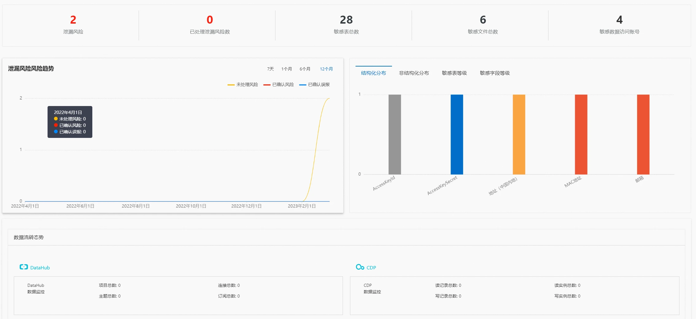

   - **泄露风险风险趋势**：图形化展示异常事件的趋势，可选择**7天**、**1个月**、**6个月**、**12个月**等时间段，支持查看**未处理风险**、**已确认风险**、**已确认误报**等趋势曲线。

   - **结构化分布**：展示结构化数据分布情况。

   - **非结构化分布**：展示非结构化数据分布情况。

   - **敏感表等级**：展示敏感表各风险等级的分布。

   - **敏感字段等级**：展示敏感字段各风险等级的分布。

   - **数据流转态势**：

     - 展示Datahub、CDP两种数据流转产品的核心流转数据动态统计。

     - 实现可视化动态数据流转图，流转图能动态展示数据流转情况和异常产出情况。

       支持在大数据环境下，数据存储产品MaxCompute、ADS、OSS、OTS等；数据传输产品Datahub、CDP；数据流处理产品Blink；外部数据库；外部文件等实体的数据链路监控。

<a id="section-4"></a>

# 4.数据资产

<a id="section-4-1"></a>

## 4.1. 资产中心

<a id="section-4-1-1"></a>

### 4.1.1. 获取数据资产授权

敏感数据保护SDDP（Sensitive Data Discovery and Protection）在检测OSS、RDS等数据源中存储的敏感数据之前，需要首先获取允许访问数据的权限。本文介绍如何获取数据资产授权。

**背景信息**

资产保护授权功能允许SDDP访问具体产品中存有数据的部分空间或项目。如果不授权，SDDP将无法对产品中的敏感数据进行识别。

> **重要**
>
> 已开启授权的OSS Bucket（OSS文件桶）会消耗您的OSS存储容量，已开启授权的数据库或项目会消耗您的数据库和项目数。只有在OSS存储容量、数据库和项目数量充足时，您才可以成功进行相应授权操作。

**获取OSS访问授权**

1. 登录Apsara Uni-manager运营控制台。

2. 在控制台顶部菜单栏，单击**安全**，选择**数据安全 > 敏感数据保护**。

3. 在**敏感护数据保护**授权页面，选择**地域**并单击**角色授权访问**。

4. 在左侧导航栏，选择**数据资产 > 资产中心**。

5. 在**资产中心**页面的**资产授权**页签，单击**OSS**。

6. 在**OSS**页签，单击**资产同步**，单击**确定**。

7. 在**未授权**页签，为Bucket授权。

   - 如只需为一个Bucket授权，单击目标Bucket**开启防护**列的**授权**，完成如下配置后，单击**确定**。

     <table>
       <tr>
         <th width="137">配置项</th>
         <th>说明</th>
       </tr>
       <tr>
         <td>识别权限</td>
         <td>开启或关闭SDDP识别选中资产敏感数据的权限。</td>
       </tr>
       <tr>
         <td>审计权限</td>
         <td>开启或关闭SDDP对选中资产进行数据审计的权限。</td>
       </tr>
       <tr>
         <td>Ocr权限</td>
         <td>开启或关闭SDDP对图片中的文本进行敏感数据识别的权限。</td>
       </tr>
       <tr>
         <td>识别采样展示数</td>
         <td>当开启<strong>识别权限</strong>开关时，需要设置SDDP对选中资产进行敏感数据采样的条数。敏感数据采样是指SDDP自动识别到敏感数据后，保留的敏感数据样本。您可以通过保留的敏感数据样本，人工对敏感数据进行深入判断。可选取值包括<strong>0条</strong>、<strong>5条</strong>、<strong>10条</strong>。</td>
       </tr>
     </table>

   - 如需为多个Bucket授权，执行以下操作对各Bucket批量设置权限。

     <ol type="a">

     <li>

     选中需要授权的Bucket，单击**批量操作**。

     </li>

     <li>

     在**对于选中资产批量处理**对话框中，设置识别权限、审计权限、Ocr权限及识别采样展示数等参数后，单击**确定**。

     </li>

     </ol>

   成功授权后，您可以单击**已授权**页签，查看并管理已授权的Bucket。

   - 修改Bucket授权

     在OSS授权列表，在对应权限列，修改Bucket授权。

   - 取消授权

     <ol type="a">

     <li>

     单击目标Bucket**操作**列的**取消授权**。

     </li>

     <li>

     在提示对话框，单击**确定**。

     </li>

     </ol>

**获取RDS访问授权**

1. 登录Apsara Uni-manager运营控制台。

2. 在控制台顶部菜单栏，单击**安全**，选择**数据安全 > 敏感数据保护**。

3. 在**敏感护数据保护**授权页面，选择**地域**并单击**角色授权访问**。

4. 在左侧导航栏，选择**数据资产 > 资产中心**。

5. 在**资产中心**页面的**资产授权**页签，单击**RDS**。

6. 在**RDS**页签，单击**资产同步**或**批量密码导入**。关于批量密码导入的具体操作，请参见批量密码导入。

   > **重要**
   >
   > 用户名和密码错误将会导致授权失败，请您输入正确的用户名和密码。

7. 单击**未授权**页签，为未授权的实例授权。

   <ol type="i">

   <li>

   定位到需要授权的实例，单击**操作**列的**一键连接**或**账号密码授权**，或选中需要授权的资产，单击**批量操作**。

   </li>

   <li>

   在授权页面，完成如下配置后，单击**确定**。选择**账号密码授权**时，还需要输入**用户名**和**密码**。

   <table>
     <tr>
       <th width="137">配置项</th>
       <th>说明</th>
     </tr>
     <tr>
       <td>识别权限</td>
       <td>开启或关闭SDDP识别选中资产敏感数据的权限。</td>
     </tr>
     <tr>
       <td>审计权限</td>
       <td>开启或关闭SDDP对选中资产中进行数据审计的权限。SDDP支持审计日志功能，审计日志数据提供了包括审计规则命中结果、审计规则检测的资产类型、命中规则的操作类型和操作账号等信息，覆盖资产数据产生、更新和使用等全链路的日志数据。SDDP安全审计功能的使用，请参见审计概览。</td>
     </tr>
     <tr>
       <td>识别采样展示数</td>
       <td>当开启<strong>识别权限</strong>开关时，需要设置SDDP对选中资产进行敏感数据采样的条数。敏感数据采样是指SDDP自动识别到敏感数据后，保留的敏感数据样本。您可以通过保留的敏感数据样本，人工对敏感数据进行更深入地判断。可选取值包括<strong>0条</strong>、<strong>5条</strong>、<strong>10条</strong>。</td>
     </tr>
   </table>

   </li>

   </ol>

   - 成功授权后，SDDP会检测该资产中的数据。您可以在**已授权**页签，查看并管理已授权的实例。

     - 编辑实例授权配置

       单击目标实例的  图标，在实例授权列表，修改实例授权配置。

     - 取消授权

       单击目标实例或实例下的某个数据库**操作**列的**取消授权**。

   - 若授权未通过且您仍需要为实例授权，可在**授权失败**页签，单击目标实例**操作**列的**启用授权**，或选中需要授权的资产，单击**批量操作**，并完成的配置。

     > **说明**
     >
     > 再次授权前，请务必检查输入的用户名和密码是否正确。

   - 若授权未通过且您不需要为实例授权，可在**授权失败**页签，单击目标实例**操作**列的**取消授权**，或选中需要授权的资产，单击**批量取消授权**。

**获取PolarDB-本地盘版访问授权**

1. 登录Apsara Uni-manager运营控制台。

2. 在控制台顶部菜单栏，单击**安全**，选择**数据安全 > 敏感数据保护**。

3. 在**敏感护数据保护**授权页面，选择**地域**并单击**角色授权访问**。

4. 在左侧导航栏，选择**数据资产 > 资产中心**。

5. 在**资产中心**页面的**资产授权**页签，单击**PolarDB-本地盘版**。

6. 在**PolarDB-本地盘版**页签，单击**资产同步**或**批量密码导入**。关于批量密码导入的具体操作，请参见批量密码导入。

   > **重要**
   >
   > 用户名和密码错误将会导致授权失败，请您输入正确的用户名和密码。

7. 单击**未授权**页签，为未授权的实例授权。

   <ol type="i">

   <li>

   定位到需要授权的实例，单击**操作**列的**一键连接**或**账号密码授权**，或选中需要授权的资产，单击**批量操作**。

   </li>

   <li>

   在授权页面，完成如下配置后，单击**确定**。选择**账号密码授权**时，还需要输入**用户名**和**密码**。

   <table>
     <tr>
       <th width="137">配置项</th>
       <th>说明</th>
     </tr>
     <tr>
       <td>识别权限</td>
       <td>开启或关闭SDDP识别选中资产敏感数据的权限。</td>
     </tr>
     <tr>
       <td>审计权限</td>
       <td>开启或关闭SDDP对选中资产中进行数据审计的权限。SDDP支持审计日志功能，审计日志数据提供了包括审计规则命中结果、审计规则检测的资产类型、命中规则的操作类型和操作账号等信息，覆盖资产数据产生、更新和使用等全链路的日志数据。SDDP安全审计功能的使用，请参见审计概览。</td>
     </tr>
     <tr>
       <td>识别采样展示数</td>
       <td>当开启<strong>识别权限</strong>开关时，需要设置SDDP对选中资产进行敏感数据采样的条数。敏感数据采样是指SDDP自动识别到敏感数据后，保留的敏感数据样本。您可以通过保留的敏感数据样本，人工对敏感数据进行更深入地判断。可选取值包括<strong>0条</strong>、<strong>5条</strong>、<strong>10条</strong>。</td>
     </tr>
   </table>

   </li>

   </ol>

   - 成功授权后，SDDP会检测该资产中的数据。您可以在**已授权**页签，查看并管理已授权的实例。

     - 编辑实例授权配置

       单击目标实例的  图标，在实例授权列表，修改实例授权配置。

     - 取消授权

       单击目标实例或实例下的某个数据库**操作**列的**取消授权**。

   - 若授权未通过且您仍需要为实例授权，可在**授权失败**页签，单击目标实例**操作**列的**启用授权**，或选中需要授权的资产，单击**批量操作**，并完成的配置。

     > **说明**
     >
     > 再次授权前，请务必检查输入的用户名和密码是否正确。

   - 若授权未通过且您不需要为实例授权，可在**授权失败**页签，单击目标实例**操作**列的**取消授权**，或选中需要授权的资产，单击**批量取消授权**。

**获取PolarDB-X 2.0访问授权**

1. 登录Apsara Uni-manager运营控制台。

2. 在控制台顶部菜单栏，单击**安全**，选择**数据安全 > 敏感数据保护**。

3. 在**敏感护数据保护**授权页面，选择**地域**并单击**角色授权访问**。

4. 在左侧导航栏，选择**数据资产 > 资产中心**。

5. 在**资产中心**页面的**资产授权**页签，单击**PolarDB-X 2.0**。

6. 在**PolarDB-X 2.0**页签，单击**资产同步**或**批量密码导入**。关于批量密码导入的具体操作，请参见批量密码导入。

   > **重要**
   >
   > 用户名和密码错误将会导致授权失败，请您输入正确的用户名和密码。

7. 单击**未授权**页签，为未授权的实例授权。

   <ol type="i">

   <li>

   定位到需要授权的实例，单击**操作**列的**一键连接**或**账号密码授权**，或选中需要授权的资产，单击**批量操作**。

   </li>

   <li>

   在授权页面，完成如下配置后，单击**确定**。选择**账号密码授权**时，还需要输入**用户名**和**密码**。

   <table>
     <tr>
       <th width="137">配置项</th>
       <th>说明</th>
     </tr>
     <tr>
       <td>识别权限</td>
       <td>开启或关闭SDDP识别选中资产敏感数据的权限。</td>
     </tr>
     <tr>
       <td>审计权限</td>
       <td>开启或关闭SDDP对选中资产中进行数据审计的权限。SDDP支持审计日志功能，审计日志数据提供了包括审计规则命中结果、审计规则检测的资产类型、命中规则的操作类型和操作账号等信息，覆盖资产数据产生、更新和使用等全链路的日志数据。SDDP安全审计功能的使用，请参见审计概览。</td>
     </tr>
     <tr>
       <td>识别采样展示数</td>
       <td>当开启<strong>识别权限</strong>开关时，需要设置SDDP对选中资产进行敏感数据采样的条数。敏感数据采样是指SDDP自动识别到敏感数据后，保留的敏感数据样本。您可以通过保留的敏感数据样本，人工对敏感数据进行更深入地判断。可选取值包括<strong>0条</strong>、<strong>5条</strong>、<strong>10条</strong>。</td>
     </tr>
   </table>

   </li>

   </ol>

   - 成功授权后，SDDP会检测该资产中的数据。您可以在**已授权**页签，查看并管理已授权的实例。

     - 编辑实例授权配置

       单击目标实例的  图标，在实例授权列表，修改实例授权配置。

     - 取消授权

       单击目标实例或实例下的某个数据库**操作**列的**取消授权**。

   - 若授权未通过且您仍需要为实例授权，可在**授权失败**页签，单击目标实例**操作**列的**启用授权**，或选中需要授权的资产，单击**批量操作**，并完成的配置。

     > **说明**
     >
     > 再次授权前，请务必检查输入的用户名和密码是否正确。

   - 若授权未通过且您不需要为实例授权，可在**授权失败**页签，单击目标实例**操作**列的**取消授权**，或选中需要授权的资产，单击**批量取消授权**。

**获取PolarDB-X访问授权**

1. 登录Apsara Uni-manager运营控制台。

2. 在控制台顶部菜单栏，单击**安全**，选择**数据安全 > 敏感数据保护**。

3. 在**敏感护数据保护**授权页面，选择**地域**并单击**角色授权访问**。

4. 在左侧导航栏，选择**数据资产 > 资产中心**。

5. 在**资产中心**页面的**资产授权**页签，单击**PolarDB-X**。

6. 在**PolarDB-X**页签，单击**资产同步**或**批量密码导入**。关于批量密码导入的具体操作，请参见批量密码导入。

   > **重要**
   >
   > 用户名和密码错误将会导致授权失败，请您输入正确的用户名和密码。

7. 单击**未授权**页签，为未授权的实例授权。

   <ol type="i">

   <li>

   定位到需要授权的实例，单击**操作**列的**一键连接**或**账号密码授权**，或选中需要授权的资产，单击**批量操作**。

   </li>

   <li>

   在授权页面，完成如下配置后，单击**确定**。选择**账号密码授权**时，还需要输入**用户名**和**密码**。

   <table>
     <tr>
       <th width="137">配置项</th>
       <th>说明</th>
     </tr>
     <tr>
       <td>识别权限</td>
       <td>开启或关闭SDDP识别选中资产敏感数据的权限。</td>
     </tr>
     <tr>
       <td>审计权限</td>
       <td>开启或关闭SDDP对选中资产中进行数据审计的权限。SDDP支持审计日志功能，审计日志数据提供了包括审计规则命中结果、审计规则检测的资产类型、命中规则的操作类型和操作账号等信息，覆盖资产数据产生、更新和使用等全链路的日志数据。SDDP安全审计功能的使用，请参见审计概览。</td>
     </tr>
     <tr>
       <td>识别采样展示数</td>
       <td>当开启<strong>识别权限</strong>开关时，需要设置SDDP对选中资产进行敏感数据采样的条数。敏感数据采样是指SDDP自动识别到敏感数据后，保留的敏感数据样本。您可以通过保留的敏感数据样本，人工对敏感数据进行更深入地判断。可选取值包括<strong>0条</strong>、<strong>5条</strong>、<strong>10条</strong>。</td>
     </tr>
   </table>

   </li>

   </ol>

   - 成功授权后，SDDP会检测该资产中的数据。您可以在**已授权**页签，查看并管理已授权的实例。

     - 编辑实例授权配置

       单击目标实例的  图标，在实例授权列表，修改实例授权配置。

     - 取消授权

       单击目标实例或实例下的某个数据库**操作**列的**取消授权**。

   - 若授权未通过且您仍需要为实例授权，可在**授权失败**页签，单击目标实例**操作**列的**启用授权**，或选中需要授权的资产，单击**批量操作**，并完成的配置。

     > **说明**
     >
     > 再次授权前，请务必检查输入的用户名和密码是否正确。

   - 若授权未通过且您不需要为实例授权，可在**授权失败**页签，单击目标实例**操作**列的**取消授权**，或选中需要授权的资产，单击**批量取消授权**。

**获取OTS访问授权**

OTS即表格存储服务。

1. 登录Apsara Uni-manager运营控制台。

2. 在控制台顶部菜单栏，单击**安全**，选择**数据安全 > 敏感数据保护**。

3. 在**敏感护数据保护**授权页面，选择**地域**并单击**角色授权访问**。

4. 在左侧导航栏，选择**数据资产 > 资产中心**。

5. 在**资产中心**页面的**资产授权**页签，单击**OTS**。

6. 在**OTS**页签，单击**资产同步**。

7. 单击**未授权**页签，为实例授权。

   - 如只需为一个实例授权，单击目标实例**操作**列的**授权**。完成如下配置后，单击**确定**。

     <table>
       <tr>
         <th width="137">配置项</th>
         <th>说明</th>
       </tr>
       <tr>
         <td>识别权限</td>
         <td>开启或关闭SDDP识别选中资产敏感数据的权限。</td>
       </tr>
       <tr>
         <td>审计权限</td>
         <td>开启或关闭SDDP对选中资产进行数据审计的权限。</td>
       </tr>
       <tr>
         <td>识别采样展示数</td>
         <td>当开启<strong>识别权限</strong>开关时，需要设置SDDP对选中资产进行敏感数据采样的条数。敏感数据采样是指SDDP自动识别到敏感数据后，保留的敏感数据样本。您可以通过保留的敏感数据样本，人工对敏感数据进行更深入地判断。可选取值包括<strong>0条</strong>、<strong>5条</strong>、<strong>10条</strong>。</td>
       </tr>
     </table>

   - 如需为多个实例授权，执行以下操作对各实例批量设置权限。

     <ol type="a">

     <li>

     选中需要授权的实例，单击**批量操作**。

     </li>

     <li>

     在**对于选中资产批量处理**对话框中，设置识别权限、审计权限等参数后，单击**确定**。

     </li>

     </ol>

   成功授权后，SDDP会检测该资产中的数据。单击**已授权**，查看并管理已授权的实例。

   - 编辑数据库授权配置

     单击目标实例的  图标，在实例列表，修改目标数据库的识别授权、审计授权、识别采样展示数等信息。

   - 取消授权

     单击目标实例或实例下的某个数据库**操作**列的**取消授权**。

**获取自建数据库访问授权**

SDDP支持检测的ECS自建数据库有以下限制：

- 仅VPC网络中的ECS自建数据库支持使用SDDP服务。

- 目前支持MySQL、达梦、SQL Server、Oracle类型的ECS自建数据库。

  1. 登录Apsara Uni-manager运营控制台。

  2. 在控制台顶部菜单栏，单击**安全**，选择**数据安全 > 敏感数据保护**。

  3. 在**敏感护数据保护**授权页面，选择**地域**并单击**角色授权访问**。

  4. 在左侧导航栏，选择**数据资产 > 资产中心**。

  5. 在**资产中心**页面的**资产授权**页签，单击**自建数据库**。

  6. 在**自建数据库**页签，单击**添加数据资产**。

  7. 在**资产授权**对话框，完成如下配置后，单击**下一步**。

     <table>
       <tr>
         <th width="111">配置项</th>
         <th>说明</th>
       </tr>
       <tr>
         <td>区域</td>
         <td>选择您需要授权SDDP访问的ECS自建数据库的所在区域。</td>
       </tr>
       <tr>
         <td>ECS实例ID</td>
         <td>选择您需要授权SDDP访问的ECS自建数据库所在的ECS实例ID。</td>
       </tr>
       <tr>
         <td>数据库类型</td>
         <td>选择您需要授权SDDP访问的ECS自建数据库的类型。 目前SDDP支持MySQL、达梦、SQL Server、Oracle类型的ECS自建数据库。</td>
       </tr>
       <tr>
         <td>库名称</td>
         <td>输入您需要授权SDDP访问的ECS自建数据库名称。<br>说明如果当前ECS实例下还有其他ECS自建数据库需要授权SDDP访问，您可以单击<strong>添加数据库</strong>，填写其他ECS自建数据库的信息。</td>
       </tr>
       <tr>
         <td>端口</td>
         <td>填写访问ECS自建数据库使用的端口号。</td>
       </tr>
       <tr>
         <td>用户名</td>
         <td>输入可以访问ECS自建数据库合法用户的用户名。</td>
       </tr>
       <tr>
         <td>密码</td>
         <td>输入可以访问ECS自建数据库合法用户的密码。</td>
       </tr>
     </table>

     您可以单击**添加数据库**，添加多个数据库。

  8. 在**对选中资产批量处理**对话框，设置识别权限、识别采样展示数等信息，单击**确定**。

     成功授权后，SDDP会检测该资产中的数据。您可以执行如下操作：

     - 编辑数据库授权配置

       修改目标实例的识别权限、审计权限、识别采样展示数信息。

     - 取消授权

       单击目标实例或实例下的某个数据库**操作**列的**取消授权**，或选中需要授权的资产，单击**批量取消授权**。

**获取MaxCompute项目访问授权**

**在MaxCompute项目中添加SDDP访问数据的子账号**

连接MaxCompute数据库前，您需要将SDDP数据访问子账号添加到MaxCompute项目中。

1. 选择以下途径，查询授权账号信息。

   - **天基**

     在天基控制台的**集群**页面，搜索sddp，查看**集群配置文件**下的 `kv.conf` ，搜索 `account.sddp.user` 的值。

   - **PaaS**

     在**飞天基础运维平台**的**产品集群运维**页面，查找以下组件信息，单击**查看YAML**，搜索 `account.sddp.user` 的值。

     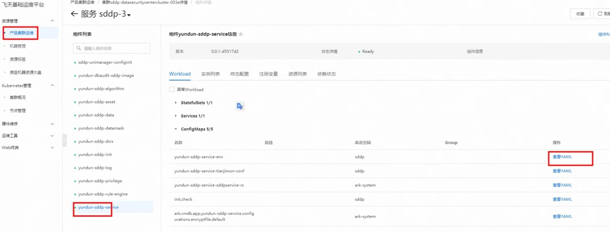

2. 在MaxCompute客户端执行以下命令，添加授权账号允许数据安全中心访问MaxCompute项目。

   替换命令中的 `project_name` 为授权MaxCompute的**projectName**，替换 `yundun_sddp` 为 `account.sddp.user` 的值。

   ```text
   use project_name;
   add user aliyun$yundun_sddp;
   grant admin to aliyun$yundun_sddp;
   ```

**资产实例授权**

1. 登录Apsara Uni-manager运营控制台。

2. 在控制台顶部菜单栏，单击**安全**，选择**数据安全 > 敏感数据保护**。

3. 在**敏感护数据保护**授权页面，选择**地域**并单击**角色授权访问**。

4. 在左侧导航栏，选择**数据资产 > 资产中心**。

5. 在**资产中心**页面的**资产授权**页签，单击**MaxCompute**。

6. 在**MaxCompute**页签，单击**资产同步**或**批量密码导入**。关于批量密码导入的具体操作，请参见批量密码导入。

   > **重要**
   >
   > 用户名和密码错误将会导致授权失败，请您输入正确的用户名和密码。

7. 单击**未授权**，为实例授权。

   - 如只需为一个实例授权，单击目标实例**操作**列的**授权**。完成如下配置后，单击**确定**。

     <table>
       <tr>
         <th width="137">配置项</th>
         <th>说明</th>
       </tr>
       <tr>
         <td>识别权限</td>
         <td>开启或关闭SDDP识别选中资产敏感数据的权限。</td>
       </tr>
       <tr>
         <td>审计权限</td>
         <td>开启或关闭SDDP对选中资产进行数据审计的权限。</td>
       </tr>
       <tr>
         <td>识别采样展示数</td>
         <td>当开启<strong>识别权限</strong>开关时，需要设置SDDP对选中资产进行敏感数据采样的条数。敏感数据采样是指SDDP自动识别到敏感数据后，保留的敏感数据样本。您可以通过保留的敏感数据样本，人工对敏感数据进行更深入地判断。可选取值包括<strong>0条</strong>、<strong>5条</strong>、<strong>10条</strong>。</td>
       </tr>
     </table>

   - 如需为多个实例授权，执行以下操作对各实例批量设置权限。

     <ol type="a">

     <li>

     选中需要授权的实例，单击**批量操作**。

     </li>

     <li>

     在**对于选中资产批量处理**对话框中，设置**识别权限**、**审计权限**、**识别采样展示数**后，单击**确定**。

     > **说明**
     >
     > 若授权未通过，请检查授权参数是否有误或SDDP访问RAM账号是否添加成功。

     </li>

     </ol>

   成功授权后，SDDP会检测该资产中的数据。您可以执行如下操作：

   - 编辑数据库授权配置

     修改目标实例的识别权限、审计权限、识别采样展示数信息。

   - 取消授权

     单击目标实例或实例下的某个数据库**操作**列的**取消授权**，或选中需要授权的资产，单击**批量取消授权**。

**获取ADB访问授权**

1. 登录Apsara Uni-manager运营控制台。

2. 在控制台顶部菜单栏，单击**安全**，选择**数据安全 > 敏感数据保护**。

3. 在**敏感护数据保护**授权页面，选择**地域**并单击**角色授权访问**。

4. 在左侧导航栏，选择**数据资产 > 资产中心**。

5. 在**资产中心**页面的**资产授权**页签，单击**ADB-MYSQL**或**ADB-PG**。

6. 在**ADB-MYSQL**或**ADB-PG**页签，单击**添加数据资产**。

7. 在**添加数据资产**对话框中，配置相应参数并单击**确认**。

   您可以参考以下表格中的参数说明配置相应参数。

   <table>
     <tr>
       <th>配置项</th>
       <th>说明</th>
     </tr>
     <tr>
       <td>所在区域</td>
       <td>选择您需要授权SDDP访问的ADS数据库的所在区域。</td>
     </tr>
     <tr>
       <td>实例名称</td>
       <td>选择您需要授权SDDP访问的ADS数据库的实例名称。</td>
     </tr>
     <tr>
       <td>数据库名称</td>
       <td>输入您需要授权SDDP访问的ADS数据库的名称。</td>
     </tr>
     <tr>
       <td>用户名</td>
       <td rowspan="2">输入可以访问ADS数据库合法用户的用户名和密码。</td>
     </tr>
     <tr>
       <td>密码</td>
     </tr>
     <tr>
       <td>自动扫描</td>
       <td>开启该功能后，每次修改识别规则配置，会自动触发针对该资产的重新扫描。<br>说明仅ADB-MYSQL需要配置此参数，ADB-PG无需配置。</td>
     </tr>
   </table>

8. 在**ADB-MYSQL**或**ADB-PG**页签，为实例授权。

   - 如只需为一个实例授权，单击目标实例**操作**列的**授权**。完成如下配置后，单击**确定**。

     <table>
       <tr>
         <th width="137">配置项</th>
         <th>说明</th>
       </tr>
       <tr>
         <td>识别权限</td>
         <td>开启或关闭SDDP识别选中资产敏感数据的权限。</td>
       </tr>
       <tr>
         <td>审计权限</td>
         <td>开启或关闭SDDP对选中资产进行数据审计的权限。</td>
       </tr>
       <tr>
         <td>识别采样展示数</td>
         <td>当开启<strong>识别权限</strong>开关时，需要设置SDDP对选中资产进行敏感数据采样的条数。敏感数据采样是指SDDP自动识别到敏感数据后，保留的敏感数据样本。您可以通过保留的敏感数据样本，人工对敏感数据进行更深入地判断。可选取值包括<strong>0条</strong>、<strong>5条</strong>、<strong>10条</strong>。</td>
       </tr>
     </table>

   - 如需为多个实例授权，执行以下操作对各实例批量设置权限。

     <ol type="a">

     <li>

     选中需要授权的实例，单击**批量操作**。

     </li>

     <li>

     在**对于选中资产批量处理**对话框中，设置识别权限、审计权限等参数后，单击**确定**。

     </li>

     </ol>

**获取OceanBase访问授权**

1. 登录Apsara Uni-manager运营控制台。

2. 在控制台顶部菜单栏，单击**安全**，选择**数据安全 > 敏感数据保护**。

3. 在**敏感护数据保护**授权页面，选择**地域**并单击**角色授权访问**。

4. 在左侧导航栏，选择**数据资产 > 资产中心**。

5. 在**资产中心**页面的**资产授权**页签，单击**OceanBase**。

6. 在**OceanBase**页签，单击**添加数据资产**。

7. 在**资产授权**对话框中，配置相应参数并单击**下一步**。

   您可以参考以下表格中的参数说明配置相应参数。

   <table>
     <tr>
       <th>配置项</th>
       <th>说明</th>
     </tr>
     <tr>
       <td>区域</td>
       <td>选择您需要授权SDDP访问的OceanBase数据库的所在区域。</td>
     </tr>
     <tr>
       <td>数据库类型</td>
       <td>选择您需要授权SDDP访问的OceanBase数据库的类型。 目前SDDP仅支持MySQL和Oracle两种类型的OceanBase数据库。</td>
     </tr>
     <tr>
       <td>集群名称</td>
       <td>选择您需要授权SDDP访问的OceanBase数据库的所在集群名称。</td>
     </tr>
     <tr>
       <td>租户名称</td>
       <td>选择您需要授权SDDP访问的OceanBase数据库所属租户名称。</td>
     </tr>
     <tr>
       <td>数据库名称</td>
       <td>输入您需要授权SDDP访问的OceanBase数据库名称。<br>说明如果当前ECS实例下还有其他OceanBase数据库需要授权SDDP访问，您可以单击<strong>添加数据库</strong>，填写其他OceanBase数据库的信息。</td>
     </tr>
     <tr>
       <td>链接地址</td>
       <td>填写访问OceanBase数据库使用的链接地址。</td>
     </tr>
     <tr>
       <td>用户名</td>
       <td rowspan="2">输入可以访问OceanBase数据库合法用户的用户名和密码。</td>
     </tr>
     <tr>
       <td>密码</td>
     </tr>
   </table>

   您也可以单击**添加数据库**，添加多个数据库。

8. 在**对选中资产批量处理**对话框，设置识别权限、识别采样展示数等信息，单击**确定**。

   成功授权后，SDDP会检测该资产中的数据。您可以执行如下操作：

   - 编辑数据库授权配置

     修改目标实例的识别权限、审计权限、识别采样展示数信息。

   - 取消授权

     单击目标实例或实例下的某个数据库**操作**列的**取消授权**，或选中需要授权的资产，单击**批量取消授权**。

**批量密码导入**

SDDP支持通过Excel模板批量导入RDS、DRDS和ECS自建数据库未授权数据库的用户名和密码，方便您批量授权SDDP访问多个数据库项目。以下介绍批量导入数据库密码的详细步骤。

1. 登录Apsara Uni-manager运营控制台。

2. 在控制台顶部菜单栏，单击**安全**，选择**数据安全 > 敏感数据保护**。

3. 在**敏感护数据保护**授权页面，选择**地域**并单击**角色授权访问**。

4. 在左侧导航栏，选择**数据资产 > 资产中心**。

5. 在**数据资产授权**页面右上角，单击**批量密码导入**。

6. 在**批量密码导入**对话框中，单击**DSC授权文件模板.xlsx**。

7. 打开下载到本地的模板文件，编辑数据库产品中的**用户名**和**密码**列并保存模板文件。

   如果您修改了模板文件中已有的用户名和密码，批量导入密码操作完成后，已有的用户名和密码将被更新为您修改后的用户名和密码。

8. 在**批量密码导入**对话框中，单击**文件上传**，完成修改后模板的上传。

9. 单击**确定**。

<a id="section-4-1-2"></a>

### 4.1.2. 授权账密管理

为确保SDDP能正常获取检测数据源中存储敏感数据的权限，需要正确配置连接数据库的用户名和密码。本文介绍如何查看、添加连接数据库的用户名、密码。

**背景信息**

目前SDDP支持管理RDS、PolarDB-X的授权账密。

**查看授权账密**

1. 登录Apsara Uni-manager运营控制台。

2. 在控制台顶部菜单栏，单击**安全**，选择**数据安全 > 敏感数据保护**。

3. 在**敏感护数据保护**授权页面，选择**地域**并单击**角色授权访问**。

4. 在左侧导航栏，选择**数据资产 > 资产中心**。

5. 在**资产中心**页面，单击**账密管理**页签。

6. 在**账密管理**页签，单击目标数据源页签（例如**RDS**）。

7. <strong>可选：</strong>设置搜索项，搜索目标实例。

   > **说明**
   >
   > 如果需要查看全部实例信息，可忽略此步骤。

   <table>
     <tr>
       <th width="126">搜索项</th>
       <th>说明</th>
     </tr>
     <tr>
       <td>区域</td>
       <td>选择您需要搜索的数据库所在区域。</td>
     </tr>
     <tr>
       <td>实例/Bucket</td>
       <td>选择您需要搜索的实例或Bucket名称。</td>
     </tr>
     <tr>
       <td>数据库类型</td>
       <td>选择您需要搜索的数据库类型。RDS、PolarDB-X可搜索MySQL和SQL Server数据库。</td>
     </tr>
   </table>

8. 在实例列表中查看数据库信息。

**添加授权账密**

1. 登录Apsara Uni-manager运营控制台。

2. 在控制台顶部菜单栏，单击**安全**，选择**数据安全 > 敏感数据保护**。

3. 在**资产中心**页面，单击**账密管理**页签。

4. 在**账密管理**页签，单击目标数据源页签（例如**RDS**）。

5. 定位到需要添加账密的实例，在**用户名**和**密码**文本框输入连接数据库的用户名和密码。

   > **重要**
   >
   > 用户名和密码错误将会导致SDDP数据资产授权失败，请您输入正确的用户名和密码。

6. 单击**添加**。

   数据库的用户名、密码添加成功后，实例对应的**状态**显示**添加成功**。

**后续步骤**

如需更新数据库的用户名、密码，可单击目标实例**操作**列的**编辑**。

修改后，单击**保存**。

<a id="section-4-2"></a>

## 4.2. 数据地图

数据资产地图展示最近7天您的所有资产数据和敏感数据统计图表。本文介绍如何使用数据资产地图查看您资产的详细信息。

**前提条件**

已授权SDDP保护您的数据源资产。更多信息，请参见获取数据资产授权。

**按资产类型查看数据地图**

1. 登录Apsara Uni-manager运营控制台。

2. 在控制台顶部菜单栏，单击**安全**，选择**数据安全 > 敏感数据保护**。

3. 在**敏感护数据保护**授权页面，选择**地域**并单击**角色授权访问**。

4. 在左侧导航栏，选择**数据资产 > 数据地图**。

5. 在**数据地图**的**资产类型**页签，查看数据地图。

   数据地图功能提供在您资产中检测出的敏感数据的统计图表、数据量变化趋势图和敏感数据的详细列表。在敏感数据列表区域，支持执行以下操作：

   - 结构化数据

     - 单击目标数据，查看数据详情，支持查看该表或文件中的敏感实例数、敏感库数、敏感集合数、敏感列数、敏感列占比、命中规则TOP 5、数据量变化和敏感数据详情列表。

     - 查看表详情

       <ol type="a">

       <li>

       单击敏感数据**操作**列的**表详情**，查看表敏感表占比、命中规则TOP 5、敏感数据列表详情。

       </li>

       <li>

       单击目标表**操作**列的**列详情**，查看列详情。

       </li>

       </ol>

       <ol type="i" start="100">

       <li>

       **订正**或**恢复**列。

       </li>

       </ol>

     - 查看资产画像

       单击资产**操作**列的**资产画像**，查看数据资产安全值及详情、表数、列数、账号数、IP数、分数变化。

     - 还可查看流转、配置、行为的泄露风险数据变化、泄露风险种类TOP10和告警明细，审计的事件数量变化、事件种类TOP10、告警明细，以及关于用户的访问次数、活跃IP TOP10、活跃账户TOP10、活跃表TOP10、敏感信息TOP10、操作种类TOP5，分布敏感表TOP10，敏感字段TOP10和记录数。

   - 非结构化数据

     - 单击目标数据，查看数据详情，支持查看Bucket数、文件数、敏感文件占比、命中规则TOP 5、数据量变化和敏感数据详情列表。

     - 查看Bucket详情

       <ol type="a">

       <li>

       单击Bucket**操作**列的**文件详情**，查看表敏感文件占比、命中规则TOP 5、文件详情。

       </li>

       <li>

       单击目标文档**操作**列的**命中详情**，可查看命中规则详情、敏感等级、命中数量和数据采样结果。

       </li>

       </ol>

     - 查看Bucket资产画像

       单击Bucket**操作**列的**资产画像**，查看数据资产安全值及详情、文件总数、敏感文件数、账号数、IP数、分数变化。

     - 还可查看流转、配置、行为的泄露风险数据变化、泄露风险种类TOP10和告警明细，审计的事件数量变化、事件种类TOP10、告警明细，以及关于用户的访问次数、活跃IP TOP10、活跃账户TOP10、活跃表TOP10、敏感信息TOP10、操作种类TOP5，分布敏感表TOP10，敏感字段TOP10和记录数。

   - 大数据

     - 单击目标数据，查看数据详情，支持查看敏感实例数、敏感表数、敏感列数、敏感列占比、命中规则 TOP 5、数据量变化和敏感数据详情列表。

     - 查看表详情

       <ol type="a">

       <li>

       单击敏感数据**操作**列的**表详情**，查看表敏感表占比、命中规则TOP 5、表详情。

       </li>

       <li>

       单击目标表**操作**列的**列详情**，查看列详情。

       </li>

       </ol>

       <ol type="i" start="100">

       <li>

       **订正**或**恢复**列。

       </li>

       </ol>

     - 查看资产画像

       单击资产操作列的**资产画像**，查看数据资产安全值及详情、表数、列数、账号数、IP数、分数变化。

**按数据域查看数据地图**

1. 登录Apsara Uni-manager运营控制台。

2. 在控制台顶部菜单栏，单击**安全**，选择**数据安全 > 敏感数据保护**。

3. 在**敏感护数据保护**授权页面，选择**地域**并单击**角色授权访问**。

4. 在左侧导航栏，选择**数据资产 > 数据地图**。

5. 在**数据域**页签，查看数据地图。

   数据地图功能提供在您资产中检测出的敏感数据的统计图表、数据量变化趋势图和敏感数据的详细列表。在敏感数据列表区域，支持执行以下操作：

   - 结构化数据

     - 单击结构化数据，查看数据详情，支持查看敏感实例数、敏感表数、敏感列数、敏感列占比、命中规则TOP5、数据量变化和敏感数据详情列表。

     - 查看表详情

       <ol type="a">

       <li>

       单击敏感数据**操作**列的**表详情**，查看表敏感表占比、命中规则TOP 5、表详情。

       </li>

       <li>

       单击目标表**操作**列的**列详情**，查看列详情。

       </li>

       </ol>

       <ol type="i" start="100">

       <li>

       **订正**或**恢复**列。

       </li>

       </ol>

     - 查看资产画像

       单击资产**操作**列的**资产画像**，查看数据资产安全值及详情、表数、列数、账号数、IP数、分数变化。

     - 还可查看流转、配置、行为的泄露风险数据变化、泄露风险种类TOP10和告警明细，审计的事件数量变化、事件种类TOP10、告警明细，以及关于用户的访问次数、活跃IP TOP10、活跃账户TOP10、活跃表TOP10、敏感信息TOP10、操作种类TOP5，分布敏感表TOP10，敏感字段TOP10和记录数。

   - 非结构化数据

     - 单击目标数据，查看数据详情，支持敏感实例数、敏感库数、敏感集合数、敏感列数、敏感文件占比、命中规则TOP5、数据量变化和敏感数据详情的展示。

     - 查看文件详情

       <ol type="a">

       <li>

       单击目标文件**操作**列的**文件详情**，查看表敏感文件占比、命中规则TOP 5、文件详情。

       </li>

       <li>

       单击目标文档**操作**列的**命中详情**，可查看命中规则详情、敏感等级、命中数量和数据采样结果。

       </li>

       </ol>

     - 查看资产画像

       单击资产**操作**列的**资产画像**，查看数据资产安全值及详情、文件总数、敏感文件数、账号数、IP数、分数变化。

     - 还可查看流转、配置、行为的泄露风险数据变化、泄露风险种类TOP10和告警明细，审计的事件数量变化、事件种类TOP10、告警明细，以及关于用户的访问次数、活跃IP TOP10、活跃账户TOP10、活跃表TOP10、敏感信息TOP10、操作种类TOP5，分布敏感表TOP10，敏感字段TOP10和记录数。

<a id="section-4-3"></a>

## 4.3. 数据管理

数据域支持企业管理员基于业务属性、组织架构、数据特征等维度对数据资产进行划分。管理员将具有相同特征的数据资产划分到同一个数据域中，从而高效管理数据资产及资产中的敏感数据。本文介绍如何使用数据域功能。

**添加数据域**

1. 登录Apsara Uni-manager运营控制台。

2. 在控制台顶部菜单栏，单击**安全**，选择**数据安全 > 敏感数据保护**。

3. 在**敏感护数据保护**授权页面，选择**地域**并单击**角色授权访问**。

4. 在左侧导航栏，选择**数据资产 > 数据管理**。

5. 在**自定义数据域**右侧，单击**添加**。

6. 在**添加数据域**对话框，填写数据域名称和描述信息，并单击**确定**。

完成添加数据域的操作后，您可以通过拖拽数据域名称改变数据域的位置、调整数据域的层级关系。

**为数据域添加资产**

数据安全中心支持系统默认的数据域和用户自定义的数据域，未添加至任何数据域的资产都属于默认数据域。一个资产只能划分至一个数据域。参考以下步骤为数据域添加资产。

1. 登录Apsara Uni-manager运营控制台。

2. 在控制台顶部菜单栏，单击**安全**，选择**数据安全 > 敏感数据保护**。

3. 在**敏感护数据保护**授权页面，选择**地域**并单击**角色授权访问**。

4. 在左侧导航栏，选择**数据资产 > 数据管理**。

5. 在左侧数据域区域，单击要添加资产的数据域名称。

6. 在右侧列表，单击**添加资产**。

7. 在**添加数据资产**面板，选中需要添加的资产，并单击**确定**。

8. <strong>可选：</strong>使用移动或批量移动功能，更改资产的数据域。

   打开需要更改数据域的资产所在的数据域，选中需要变更的资产，在资产列表下方单击**批量移动**。

数据域名称右侧的数字代表该数据域及其子数据域总的资产数量。将资产添加至数据域后，您可以按数据域查看资产的数据地图信息。具体操作，请参见按数据域查看数据地图。

**批量管理数据域**

需要大规模调整多个数据域下的资产时，您可以使用批量导入功能。通过下载并修改数据域模板文件，快速管理数据域。仅支持阿里云账号和具有**AliyunYundunSDDPFullAccess**权限的RAM用户使用该功能。

1. 登录Apsara Uni-manager运营控制台。

2. 在控制台顶部菜单栏，单击**安全**，选择**数据安全 > 敏感数据保护**。

3. 在**敏感护数据保护**授权页面，选择**地域**并单击**角色授权访问**。

4. 在左侧导航栏，选择**数据资产 > 数据管理**。

5. 在**数据管理**页面，单击右上角**批量导入**。

6. 在**批量导入**对话框，单击**数据安全中心数据域模板.xlsx**下载模板。

7. 修改已下载的模板文件中的数据域信息并保存。

   编辑模板文件时，您需要关注以下信息：

   - 最多支持三级数据域。

   - 一个资产只能属于一个数据域。

   - 在**是否删除**列可以设置是否删除数据域或从数据域中移出该资产。

     在数据域目录节点（即没有资产信息的行）可以设置是否删除该数据域，在有资产信息的行设置是否移出该资产。删除数据域或移出资产后，被删除的数据域下的资产或被移出的资产将属于默认数据域。取值：

     - 0：不删除、不移出。

     - 1：删除、移出。

8. 在**批量导入**对话框，单击**导入本地文件**，导入修改后的模板文件，并单击**确定**。

**配置数据域**

需要修改数据域、为数据域添加子节点时，您可以参考以下步骤操作。

1. 登录Apsara Uni-manager运营控制台。

2. 在控制台顶部菜单栏，单击**安全**，选择**数据安全 > 敏感数据保护**。

3. 在**敏感护数据保护**授权页面，选择**地域**并单击**角色授权访问**。

4. 在左侧导航栏，选择**数据资产 > 数据管理**。

5. 在左侧区域，将鼠标移动至数据域右侧的资产数字处，单击  图标，选择您需要执行的操作。

   - **修改数据域**：修改数据域的名称和描述。

   - **添加子节点**：在当前数据域下创建子级数据域，最多支持创建三级数据域。

   - **添加同级节点**：添加同级数据域。

   - **删除**：删除当前数据域。对于存在子数据域的数据域，您需要先删除子数据域才能删除该数据域。删除数据域后，数据域中的资产将被自动移动到默认数据域中。

<a id="section-5"></a>

# 5.数据梳理

<a id="section-5-1"></a>

## 5.1. 数据识别

数据识别任务扫描完成后，您可以查看敏感数据识别结果。数据安全中心支持以数据对象 、数据库实例为基本单位查看敏感数据的扫描结果。本文介绍如何查看数据对象、数据库实例的敏感数据识别结果。

**查看数据对象的识别结果**

如需关注数据对象（数据表或文件）中的敏感数据识别结果，您可以参考以下步骤操作。

1. 登录Apsara Uni-manager运营控制台。

2. 在控制台顶部菜单栏，单击**安全**，选择**数据安全 > 敏感数据保护**。

3. 在**敏感护数据保护**授权页面，选择**地域**并单击**角色授权访问**。

4. 在左侧导航栏，选择**数据梳理 > 数据识别**。

5. 在**数据目录**页签，选择合适的数据分类查看敏感数据识别结果。

   - **数据类型**：在**数据目录**页签左侧**数据类型**区域，选中需要查看敏感数据识别结果的数据类型。仅支持在**结构化数据**、**非结构化数据**或**大数据**分类下分别选择一个或多个数据类型，支持跨分类同时选择结构化数据和大数据的多个数据类型。

     如果您未选中任意数据类型，数据安全中心默认展示所有数据类型下的敏感数据识别结果。

   - **数据模板**：在**数据目录**页签左侧**数据模板**区域，选择需要查看敏感数据识别结果的数据模板和敏感分类。

   - **数据域**：在**数据目录**页签左侧**数据域**区域，选择需要查看敏感数据识别结果的数据域。

6. 单击目标数据对象名称，查看该数据对象的更多信息。

   - **概览**：在**概览**页签，查看数据对象的基本信息、管理信息和分类分级信息。您可以单击**分类分级**区域的**查看详情**，查看敏感数据的分类详情。

   - **识别结果**：在**识别结果**页签，查看识别出敏感数据的列或文件信息。您可以单击**操作**列的**查看样本**，查看样本的详细信息。如果**操作**列存在订正入口，您可以订正敏感数据识别结果。

   - **列详情**：在**列详情**页签，查看识别出敏感数据的列的更多信息。您可以单击**操作**列的**详情**，查看列画像和列数据。非结构化数据不支持查看列详情。

   - **预览**：在**预览**页签，单击**查询样本数据**，可预览数据表的前5行样本数据。同时也可单击选择清除已查询样本的缓存数据，非结构化数据不支持预览功能。

**查看数据库实例的识别结果**

如需关注数据库实例的敏感数据识别结果，您可以参考以下步骤操作。

1. 登录Apsara Uni-manager运营控制台。

2. 在控制台顶部菜单栏，单击**安全**，选择**数据安全 > 敏感数据保护**。

3. 在**敏感护数据保护**授权页面，选择**地域**并单击**角色授权访问**。

4. 在左侧导航栏，选择**数据梳理 > 数据识别**。

5. 在**资产透视**页签，单击需要查看的数据类型。

6. 查看该数据类型下已接入数据安全中心的所有数据库实例的敏感数据识别结果。

   如需查看数据库实例中敏感数据的详细信息，您可以单击**操作**列的**表详情**、或**文件详情**，查看敏感表占比。在敏感数据列表中，您可以单击敏感文件占比图、命中规则Top 5和敏感数据表详情。在敏感数据列表中，您可以单击**操作**列**命中详情**，查看命中敏感数据的规则详情。

<a id="section-5-2"></a>

## 5.2. 数据检索

数据检索页面为您展示了资产中的所有敏感数据，您可以输入敏感数据或敏感数据的组合作为搜索条件，快速定位所关注的敏感数据在所有资产中的分布情况。本文介绍如何搜索敏感数据。

**操作步骤**

1. 登录Apsara Uni-manager运营控制台。

2. 在控制台顶部菜单栏，单击**安全**，选择**数据安全 > 敏感数据保护**。

3. 在**敏感护数据保护**授权页面，选择**地域**并单击**角色授权访问**。

4. 在左侧导航栏，选择**数据梳理 > 数据检索**。

5. 在**数据检索**页面，选择数据类型并设置搜索条件，单击**搜索**。您可以单击**导出**，导出搜索结果。单击**重置**，重置搜索条件。

   > 如果您同时设置了多个搜索条件，将为您展示同时满足这些搜索条件的敏感数据列表。
   >
   > **说明**

<a id="section-5-3"></a>

## 5.3. 识别配置

<a id="section-5-3-1"></a>

### 5.3.1. 管理模板

本文介绍如何启用、查看、复制模板等操作。

1. 登录Apsara Uni-manager运营控制台。

2. 在控制台上方，单击**安全**，选择**数据安全 > 敏感数据保护**。

3. 在**敏感护数据保护**授权页面，选择**地域**并单击**角色授权访问**。

4. 在左侧导航栏，选择**数据梳理 > 识别配置**。

5. 在**模板管理**的**模板配置**页签，管理模板。

   

   - 启用模板：单击目标模板的**主用**。

   - 查看模板详情：单击目标模板的**详情**，您可以查看具体的分类。

   - 复制模板：单击目标模板的**复制**，您可以复制该模板生成一个同样的模板。

   - 激活模板：单击目标模板的**激活**，激活该模板。

   - 隐藏模板：选择**隐藏**，隐藏该模板。如果是上传的本地模板，选择**更多 > 隐藏**，隐藏该模板。

   - 删除模板：如果是上传的本地模板，单击目标模板的**删除**，删除该模板。

   - 添加或导入模板：单击**添加模板**，在**添加模板**对话框，选择内置模板或上传本地模板。

     > **说明**
     >
     > 上传的模板文件仅支持.xlsx格式，您可以单击  图标下载默认模板进行修改。

<a id="section-5-3-2"></a>

### 5.3.2. 管理识别模型和识别特征

识别模型定义了识别您资产中敏感数据的具体规则。识别模型包含识别典型敏感数据的内置识别模型和自定义识别模型。本文介绍如何查看内置识别模型、添加、编辑和删除自定义识别模型。

**查看内置识别模型和识别特征**

1. 登录Apsara Uni-manager运营控制台。

2. 在控制台上方，单击**安全**，选择**数据安全 > 敏感数据保护**。

3. 在**敏感护数据保护**授权页面，选择**地域**并单击**角色授权访问**。

4. 在左侧导航栏，选择**数据梳理 > 识别配置**。

5. 在**识别模型**页签，设置搜索条件规则来源为**内置**，查看内置识别模型列表。

   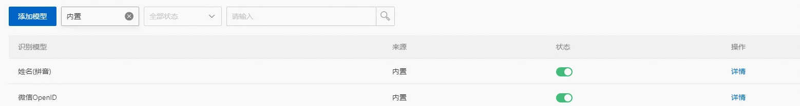

   单击目标内置规则**操作**列下的**详情**，可查看该内置识别模型的信息。

   > **说明**
   >
   > 内置识别模型不支持修改和删除。

6. 在**识别特征**页签，设置搜索条件规则来源为**内置**，查看内置识别特征列表。

   内置识别特征不支持编辑和删除。

   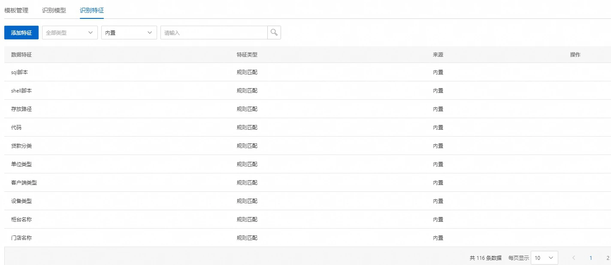

**添加识别特征**

1. 登录Apsara Uni-manager运营控制台。

2. 在控制台上方，单击**安全**，选择**数据安全 > 敏感数据保护**。

3. 在**敏感护数据保护**授权页面，选择**地域**并单击**角色授权访问**。

4. 在左侧导航栏，选择**数据梳理 > 识别配置**。

5. 在**识别特征**页签，单击**添加特征**。

6. 在**添加特征**面板，完成配置项配置，然后单击**确定**。

   <table>
     <tr>
       <th width="89">参数</th>
       <th>说明</th>
     </tr>
     <tr>
       <td>特征名称</td>
       <td>输入自定义的特征名称。</td>
     </tr>
     <tr>
       <td>匹配类型</td>
       <td>可选以下类型。<br>• <strong>规则匹配</strong>：配置特征规则。支持单击<strong>添加规则</strong>，配置多个特征规则。多个特征之间的关系可以为<strong>AND</strong>或<strong>OR</strong>。选中<strong>例外规则</strong>后，可以配置例外规则，支持单击<strong>添加规则</strong>，配置多个例外规则。多个例外规则特征之间的关系可以为<strong>AND</strong>或<strong>OR</strong>。检测敏感数据的原理为：本数据特征规则满足配置的特征规则且不满足配置的例外规则。<br>• <strong>字典匹配</strong>：输入关键词后按Enter。单个关键词长度为1~128个字符，可配置多个关键词。注意关键词内不能含有逗号，否则会被认为是两个或多个按逗号分隔开的关键词。支持模糊匹配。</td>
     </tr>
   </table>

7. 您可以单击自定义识别特征对应**操作**列的**编辑**，修改特征配置；也可以单击对应**操作**列的删除，删除不用的识别特征。

**添加自定义识别模型**

1. 登录Apsara Uni-manager运营控制台。

2. 在控制台上方，单击**安全**，选择**数据安全 > 敏感数据保护**。

3. 在**敏感护数据保护**授权页面，选择**地域**并单击**角色授权访问**。

4. 在左侧导航栏，选择**数据梳理 > 识别配置**。

5. 在**识别模型**页签，单击**添加模型**。

6. 在**添加模型**面板，配置以下参数。

   **分类**

   **参数**

   **说明**

   输入识别模型的名称。

   **模型名称**

   输入识别模型的描述信息。

   **基本信息**

   **模型描述**

   选择模板、分类以及风险等级。

   **数据分类**

   选择内置或自定义的识别特征。

   **识别特征**

   选择识别的数据库。

   **识别范围**

   设置数据库细粒度规则。

   - 支持根据实例名称、表名称、库名称等条件设置规则。

   **高级设置**

   - 支持添加多个资产、条件和组。

   设置敏感数据的识别规则。可选：

   - **不等于**：使用不等于某个关键字或字符串来定义敏感数据识别规则。

   - **等于**：使用等于某个关键字或字符串来定义敏感数据识别规则。

   **模型规则配置**

   - **包含**：使用包含某个关键字或字符串来定义敏感数据识别规则。

   - **前缀匹配**：使用某个关键字或字符串作为前缀来定义敏感数据识别规则。

   - **后缀匹配**：使用某个关键字或字符串作为后缀来定义敏感数据识别规则。

   - **正则匹配**：使用正则表达式来定义敏感数据识别规则。可参考以下示例配置该参数：

   **规则**

   - *Exampleoo+a*：表示Exampleooa、Exampleoooa、Exampleooooooa等都会被识别为敏感数据。<em>+</em>表示该符号前面的字符必须至少出现一次。

   - *Exampleoo\*a*：表示Exampleoa、Exampleooa、Exampleooooooa等都会被识别为敏感数据。<em>\*</em>表示该符号前面的字符可以不出现，也可以出现一次或多次。

   - *Exampleo?a*：表示只有Examplea、Exampleoa会被识别为敏感数据。<em>？</em>表示该符号前面的字符可以不出现或最多出现一次。

   一个规则模型中可以添加多条规则。需要设置多条规则时，您可以单击**添加条件**或**添加组**，在当前识别模型下再添加一条识别规则。如需删除，也可单击右侧“垃圾桶”按钮，或单击**删除组**按钮。

   设置非结构化数据的命中数。

   - 低：命中1～10个。

   **命中数**

   - 中：命中10～100个。

   **识别阈值配置**

   - 高：命中100个以上。

   设置结构化数据的命中率。

   **命中率**

7. 单击**确定**。

   创建完成后，您可以在识别模型列表中查看新创建的识别模型。

**查看、编辑、删除自定义识别模型**

1. 登录Apsara Uni-manager运营控制台。

2. 在控制台上方，单击**安全**，选择**数据安全 > 敏感数据保护**。

3. 在**敏感护数据保护**授权页面，选择**地域**并单击**角色授权访问**。

4. 在左侧导航栏，选择**数据梳理 > 识别配置**。

5. 在**识别模型**页签，将搜索条件规则来源设置为**自定义**。

6. 在识别模型列表，定位到待操作的识别模型，执行以下操作。

   - **查看自定义识别模型详情**

     需要查看某个自定义识别模型的详情时，单击该识别模型操作列下的**详情**，在**模型详情**面板中，查看该识别模型的详情。

   - **编辑自定义识别模型**

     需要修改某个自定义识别模型的敏感数据识别规则时，单击该识别模型操作列下的**编辑**，在**编辑模型**面板中，修改该识别模型的参数，并单击**确定**。

   - **删除自定义识别模型**

     不再需要使用某个自定义识别模型时，单击该识别模型**操作**列下的**删除**，在确认对话框单击**确定**。

<a id="section-5-3-3"></a>

### 5.3.3. 风险级别配置

本文介绍如何编辑敏感数据的风险级别。

1. 登录Apsara Uni-manager运营控制台。

2. 在控制台上方，单击**安全**，选择**数据安全 > 敏感数据保护**。

3. 在**敏感护数据保护**授权页面，选择**地域**并单击**角色授权访问**。

4. 在左侧导航栏，选择**数据梳理 > 识别配置**。

5. 在**模板管理**的**级别配置**页签，在**操作**列单击**编辑**。

<a id="section-5-3-4"></a>

### 5.3.4. 查看识别规则

SDDP支持自定义敏感信息的分级规则，本文介绍如何查看敏感数据识别规则的总览。

1. 登录Apsara Uni-manager运营控制台。

2. 在控制台上方，单击**安全**，选择**数据安全 > 敏感数据保护**。

3. 在**敏感护数据保护**授权页面，选择**地域**并单击**角色授权访问**。

4. 在左侧导航栏，选择**数据梳理 > 识别配置**。

5. 在**模板管理**的**模板详情**页签，通过设置**敏感等级**、**状态**，查看当前使用模板中符合设置条件的规则信息。

   您可以单击**列表样式**或**拓扑样式**，选择规则的显示样式。您还可以通过选择**敏感分类**栏目的敏感类型，筛选规则。

   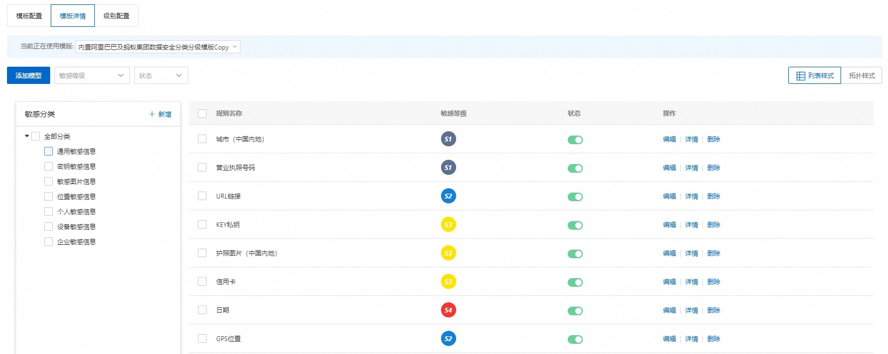

   您还可以进行如下操作：

   - 保存新模板：单击总览页面左上方的**保存为新模板**，可以将显示的识别规则保存为一个新模板。

   - 修改规则状态：通过开启或关闭指定规则**状态**列的开关，开启或关闭规则，识别的时候识别开启的规则。

   - 查看规则详情：单击指定规则**操作**列的**详情**，您可以查看该规则的详细信息。

   - 编辑规则详情：单击指定规则**操作**列的**编辑**，您可以编辑该规则的详细信息。

     > **说明**
     >
     > 如果用户使用的是内置阿里巴巴及蚂蚁集团数据安全分类分级模板，不支持**编辑**。

   - 删除规则：单击指定规则**操作**列的**删除**，您可以删除此条规则。

     > **说明**
     >
     > 仅自定义模板支持**删除**。

<a id="section-5-4"></a>

## 5.4. 任务管理

完成数据资产授权后，SDDP会自动创建敏感数据识别任务，即系统默认任务，您可以根据需要自定义识别任务。本文介绍如何查看系统默认任务、新建识别任务、订正和导出敏感数据识别结果。

**新建识别任务**

1. 登录Apsara Uni-manager运营控制台。

2. 在控制台顶部菜单栏，单击**安全**，选择**数据安全 > 敏感数据保护**。

3. 在**敏感护数据保护**授权页面，选择**地域**并单击**角色授权访问**。

4. 在左侧导航栏，选择**数据梳理 > 任务管理**。

5. 在**识别任务**页签，单击**新建识别任务**。

6. 在**新增识别任务**面板，配置识别任务配置项，并单击**确定**。

   **配置项分类**

   **配置项**

   **描述**

   输入任务名称。

   **任务名称**

   选择任务启动时间。可选项：

   - **立即扫描**：新建识别任务后立即执行扫描。

   **启动时间**

   - **周期扫描**：设置**周期任务间隔时间**。当识别任务创建后，SDDP会立即执行识别任务，并按照设置的周期重复执行扫描任务。

   选择识别任务扫描的范围。可选项：

   - **全局扫描**：扫描当前阿里云账号下所有已授权且可以正常连通的资产。

   **作用域**

   - **指定数据域**：扫描指定数据域下的资产。关于数据域的更多信息，请参见数据管理。

   - **指定资产类型**：扫描单个或多个资产类型下的资产。

   **基本信息**

   选择需要扫描的数据域。

   **选择数据域**

   > **说明**
   >
   > 仅当**作用域**选择**指定数据域**时，需要配置此参数。

   选择需要扫描的资产类型。

   **选择资产类型**

   > **说明**
   >
   > 仅当**作用域**选择**指定资产类型**时，需要配置此参数。

   选择扫描使用的识别模板。关于识别模板的更多信息，请参见管理模板。

   **选择模板**

   选择结构化数据（例如RDS、PolarDB）的扫描范围。可选项：

   - 全局扫描：扫描您在**作用域**中选择的全部结构化数据资产。

   **结构化数据识别配置**

   **结构化数据识别范围**

   - 指定扫描：选择需要扫描的实例名和数据库名。如需添加多个实例，可单击**添加识别范围**。

   选择非结构化数据（OSS）的扫描深度。可选项：

   - 全局扫描：扫描所有Bucket路径。

   **扫描深度**

   - 指定扫描深度：指定扫描的Bucket路径深度。路径深度以正斜线（/）分隔。建议设置为10以内（包括10）的正整数。例如设置为5时，表示扫描5层（包括5）以内的Bucket路径。

   **非结构化数据识别配置**

   选择非结构化数据（OSS）的扫描范围。可选项：

   - 全局扫描：扫描您在**作用域**中选择的全部非结构化数据资产（OSS）。

   - 指定扫描范围：选择需要扫描的Bucket。仅支持选择在**作用域**中配置的资产，

   **扫描范围**

   可选择多个Bucket。

   指定需要扫描的Bucket文件后，支持设置过滤条件设置更精确的扫描范围。支持设置**前缀**、**目录**、**储存大小**、**文件类型**包含或不包含指定值来过滤扫描范围。

   设置检测到的敏感数据曾经被订正过时的处理方式。可选项：

   - **跳过手工订正结果**：保持原有的手工订正结果。推荐选择该方式。

   **识别覆盖**

   - **覆盖手工订正结果**：使用新的识别结果覆盖手工订正的结果。

   **其他配置**

   输入任务备注信息。

   **任务备注**

**查看系统默认任务**

完成数据资产授权后，SDDP会自动使用主模板为每一个资产实例创建一个扫描任务。系统默认任务在第一次扫描时，会全量扫描数据库中的所有数据。

1. 登录Apsara Uni-manager运营控制台。

2. 在控制台顶部菜单栏，单击**安全**，选择**数据安全 > 敏感数据保护**。

3. 在**敏感护数据保护**授权页面，选择**地域**并单击**角色授权访问**。

4. 在左侧导航栏，选择**数据梳理 > 任务管理**。

5. 在**任务管理**页面**识别任务**页签，单击**系统默认任务**。

6. 在**系统默认任务**页面，可查看默认任务列表。

**订正任务**

如果部分敏感数据识别结果不准确，您可以参考以下步骤订正识别结果。

1. 登录Apsara Uni-manager运营控制台。

2. 在控制台顶部菜单栏，单击**安全**，选择**数据安全 > 敏感数据保护**。

3. 在**敏感护数据保护**授权页面，选择**地域**并单击**角色授权访问**。

4. 在左侧导航栏，选择**数据梳理 > 任务管理**。

5. 在**任务管理**页面，单击**订正任务**页签。

6. 在左侧数据类型导航栏，单击需要订正的数据类型。

7. 单击目标敏感数据操作列的**订正**，选择订正后规则，并单击**确定**。

8. 执行恢复操作后，可恢复订正前的规则。

**导出任务**

1. 登录Apsara Uni-manager运营控制台。

2. 在控制台顶部菜单栏，单击**安全**，选择**数据安全 > 敏感数据保护**。

3. 在**敏感护数据保护**授权页面，选择**地域**并单击**角色授权访问**。

4. 在左侧导航栏，选择**数据梳理 > 任务管理**。

5. 在**任务管理**页面，单击**导出任务**页签。

6. 在**新建导出任务**页面，设置导出信息后，单击**确定**。

   > **重要**
   >
   > 资产导出行数需要小于50000，大于50000行将无法导出。

   <table>
     <tr>
       <th colspan="2">配置项</th>
       <th>说明</th>
     </tr>
     <tr>
       <td rowspan="2">基本信息</td>
       <td>任务名称</td>
       <td>请输入自定义任务名称。</td>
     </tr>
     <tr>
       <td>模板</td>
       <td>选择模板。关于模板的更多信息，请参见管理模板。</td>
     </tr>
     <tr>
       <td rowspan="2">导出维度</td>
       <td>资产类型</td>
       <td>请在<strong>数据库</strong>、<strong>大数据</strong>以及<strong>存储</strong>下勾选数据库。</td>
     </tr>
     <tr>
       <td>资产实例</td>
       <td>请在<strong>结构化数据</strong>、<strong>非结构化数据</strong>、<strong>大数据</strong>下勾选数据库。</td>
     </tr>
   </table>

   导出结束后，您可以**下载**或**删除**导出任务。

**相关操作**

**配置系统默认任务扫描设置**

系统默认任务在完成第一次全量扫描后，会按照您此处设置的周期和时间点，扫描数据库中结构发生变化的表。

1. 登录Apsara Uni-manager运营控制台。

2. 在控制台顶部菜单栏，单击**安全**，选择**数据安全 > 敏感数据保护**。

3. 在**敏感护数据保护**授权页面，选择**地域**并单击**角色授权访问**。

4. 在左侧导航栏，选择**数据梳理 > 任务管理**。

5. 在**任务管理**页面**识别任务**页签，单击**系统默认任务**。

6. 在**系统默认任务**页面，选中需要设置扫描周期的任务，单击**扫描设置**。

7. 在**自动全量扫描设置**对话框，设置自定义重扫时间点与扫描周期、自动扫描开始时间，并单击**确定**。

   建议您将扫描开始时间设置为业务量较小的时段。

**重扫识别任务**

如果数据库内容发生了变化，您可以执行重扫操作。重扫会对目标资产进行全量扫描。识别任务列表和系统默认任务列表支持重扫。

- 重扫系统默认任务：在**任务管理**页面，单击**系统默认任务**，单击目标识别任务操作列的**重扫**。

- 重扫识别任务列表：在**识别任务监控**页面，单击目标自定义识别任务操作列的**重扫**。

执行重扫操作后，会立即执行扫描。您可以在识别任务的**扫描状态**列，查看扫描进度。

<a id="section-6"></a>

# 6.安全审计

<a id="section-6-1"></a>

## 6.1. 审计概览

审计概览页面从审计概览、资产管理和安全保障、安全性变化角度向您展示了您资产中存在的敏感信息的统计数据。本文介绍了审计概览页面展示的不同数据内容，帮助您更好地了解资产中存在的敏感数据。

**背景信息**

智能审计每日自动更新审计报表，并为您展示上一周的报表统计数据。

**访问审计报表页面**

1. 登录Apsara Uni-manager运营控制台。

2. 在控制台上方，单击**安全**，选择**数据安全 > 敏感数据保护**。

3. 在**敏感护数据保护**授权页面，选择**地域**并单击**角色授权访问**。

4. 在左侧导航栏，选择**安全审计 > 审计概览**。

5. 在**审计概览**页面，您可以查看以下模块的内容。

   - **审计概览**

   - **资产管理和安全保障**

   - **安全性变化**

   审计报表左上角展示了审计报表统计的时间范围。您可以设置**昨天**、**本日**、**最近7天**、**最近一月**、自定义查看审计概览。

**审计概览**

审计告警总览展示您当前账号下检测出的审计风险和告警事件的统计数据图表，具体包含以下内容。

- **审计趋势**：展示所选时间范围内审计事件、泄漏风险事件、已处理泄漏风险事件的数量趋势。

- **审计总数**：展示审计事件的统计数量。

- **告警总数**：展示告警事件的统计数量。

- **最新告警**：展示最新告警。您可以单击**详情**查看告警详情。

- **SQL操作趋势**：展示SQL语句数量和不同类型的操作数量。

**资产管理和安全保障**

**资产管理和安全保障**：展示您当前账号下资产的总数及包含敏感数据的资产数量，具体包含以下内容。

- **结构化数据**：展示您数据库、项目实例的总量和敏感数据的数量，包括**数据库/项目实例**总数、**总表数**、**总列数**、**总敏感数据库/项目实例**、**总敏感表**和**总敏感列**。

- **非结构化数据**：展示您OSS数据的总量及敏感数据的数量，包括**总Bucket**、**总文件数**、**总敏感Bucket**数和**总敏感文件数**。

- **最敏感的实例**：展示您RDS、OTS（表格存储）、ECS自建数据库、MaxCompute等数据源中存在的敏感数据的实例或项目名称，及每个敏感实例中敏感表、非敏感表的数量。

- **最敏感的Bucket**：展示您OSS数据中出现敏感数据的Bucket名称及每个敏感Bucket的敏感文件和非敏感文件数量。

- **IP访问敏感数据TOP 10**：展示访问敏感数据排名前10的IP地址及访问次数。

  > **说明**
  >
  > 同一IP地址多次访问敏感数据，可能会造成敏感数据泄露，建议您重点关注及时排除数据泄露隐患。

- **用户访问敏感数据TOP 10**：展示访问敏感数据排名前10的用户名称及访问次数。

  > **说明**
  >
  > 同一用户多次访问敏感数据，可能会造成敏感数据泄露，建议您及时排查访问授权配置是否正确。

- **泄漏风险命中TOP 10**：展示检测出泄漏风险异常事件数量排名前10的泄漏风险异常事件、事件子类型名称及命中次数。

- **审计命中规则TOP 10**：展示命中次数排名前10的审计规则名称及命中次数。

**安全性变化**

**安全性变化**展示异常检测和审计规则检测出的新增异常事件的统计信息。具体包含以下内容：

- **安全异常**：展示异常检测出的新泄露风险、未处理风险、已处理泄露风险的统计数据。

- **安全审计**：展示审计规则检测出的新泄露风险、IP异常、用户异常、和事件风险类型（低风险、中风险、高风险）的统计数据。

<a id="section-6-2"></a>

## 6.2. 审计日志

<a id="section-6-2-1"></a>

### 6.2.1. 原始日志

SDDP的原始日志页面展示了资产的实例、库、账号、源IP地址、返回行数、时间等日志信息，您可通过搜索功能查看原始日志及其详细信息。

**背景信息**

SDDP支持获取已完成扫描授权资产对应的原始日志数据。

**操作步骤**

1. 登录Apsara Uni-manager运营控制台。

2. 在控制台上方，单击**安全**，选择**数据安全 > 敏感数据保护**。

3. 在**敏感护数据保护**授权页面，选择**地域**并单击**角色授权访问**。

4. 在左侧导航栏，选择**安全审计 > 审计日志**。

5. 在**审计日志**页面，单击**原始日志**页签。

6. 在**原始日志**页签，根据需要执行以下操作查看日志信息。

   > **说明**
   >
   > SDDP的**原始日志**页面默认显示最近1天的原始日志信息。

   - **根据搜索功能定位查看相关审计日志**：可根据以下筛选条件查看相关日志。

     - **时间**：在日志列表上方，单击时间搜索框右侧的  图标，依次选择开始日期和时间、结束日期和时间，并单击**确定**。

       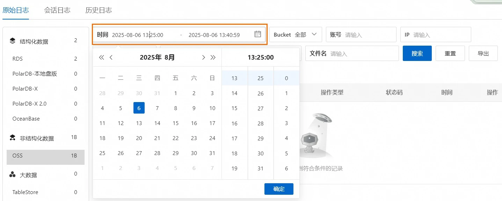

     - **设置搜索条件**：在日志列表上方，输入实例名称或ID、数据库名、账号等条件或选择操作类型，单击**搜索**。

       > **说明**
       >
       > - 不同的数据源支持的搜索条件不同，请您根据控制台实际显示的搜索条件进行搜索。
       >
       > - 搜索条件支持模糊查询。
       >
       > - 不同产品对应的操作类型说明请参见操作类型说明。

   - **查看日志详情**：在日志列表中，定位到目标资产的数据项，单击其**操作**列的**详情**，查看日志详情，包括**客户端信息**、**服务端信息**和**行为信息**。

**操作类型说明**

**OSS支持的操作类型**

| 操作类型 | 说明 |
| --- | --- |
| AbortMultiPartUpload | 终止MultipartUpload事件。 |
| AppendObject | 以追加写的方式上传文件（Object）。 |
| CompleteUploadPart | 完成断点上传。 |
| CopyObject | 复制文件（Object）。 |
| DeleteBucket | 删除存储空间（Bucket）。 |
| DeleteBucketEncryption | 删除存储空间（Bucket）加密规则。 |
| DeleteMultipleObjects | 删除同一个存储空间（Bucket）中的多个文件（Object）。 |
| DeleteObject | 删除单个文件（Object）。 |
| DeleteObjects | 删除多个文件（Object）。 |
| GetBucket | 列举存储空间（Bucket）。 |
| GetBucketAcl | 获取存储空间（Bucket）权限。 |
| GetBucketCors | 查看存储空间（Bucket）的跨域资源共享（CORS）配置。 |
| GetBucketEncryption | 获取存储空间（Bucket）的加密规则。 |
| GetBucketInfo | 查看存储空间（Bucket）信息。 |
| GetBucketLifecycle | 查看存储空间（Bucket）的生命周期（Lifecycle）配置。 |
| GetBucketLocation | 查看存储空间（Bucket）地域。 |
| GetBucketLog | 查看存储空间（Bucket）访问日志配置。 |
| GetBucketReferer | 查看存储空间（Bucket）的防盗链（Referer）相关配置。 |
| GetBucketReplication | 查看跨地域复制。 |
| GetBucketReplicationLocation | 查看跨地域复制可同步的目标地域。 |
| GetBucketReplicationProgress | 查看跨地域复制进度。 |
| GetBucketStat | 获取存储空间（Bucket）的相关信息。 |
| GetBucketWebSite | 查看存储空间（Bucket）的静态网站托管状态。 |
| get_image_info | 获取图片的长宽等信息。 |
| get_image_infoexif | 获取图片的长宽以及exif信息。 |
| GetObject | 读取文件（Object）。 |
| GetObjectAcl | 获取文件（Object）访问权限。 |
| GetObjectInfo | 获取文件（Object）信息。 |
| GetObjectMeta | 查看文件（Object）元数据信息。 |
| GetPartData | 获取断点文件块数据。 |
| GetPartInfo | 获取断点文件块信息。 |
| GetService | 获取存储空间（Bucket）列表信息 |
| HeadBucket | 查看存储空间（Bucket）信息。 |
| HeadObject | 查看文件（Object）信息。 |
| InitiateMultipartUpload | 初始化断点上传文件。 |
| ListCname | 列举规范名称。 |
| ListMultiPartUploads | 列举断点事件。 |
| ListParts | 列举断点块状态。 |
| list_style | 列举存储空间（Bucket）的样式。 |
| ListUserRegions | 列举用户区域。 |
| PostObject | 使用HTML表单上传Object到指定存储空间（Bucket）。 |
| ProcessImage | 处理图片。 |
| PutBucket | 创建存储空间（Bucket）。 |
| PutBucketAcl | 设置或修改存储空间（Bucket）的访问权限（ACL）。 |
| PutBucketEncryption | 配置存储空间（Bucket）的加密规则。 |
| PutObject | 上传文件（Object）。 |
| PutObjectAcl | 修改文件访问权限。 |
| PutObjectSymlink | 创建Symlink文件。 |
| RedirectBucket | Bucket Endpoint重定向。 |
| UploadPart | 断点上传文件。 |
| UploadPartCopy | 复制文件块。 |

**RDS、PolarDB-本地盘版、PolarDB-X、PolarDB-X 2.0 、ADB-PG和OceanBase支持的操作类型**

| 操作类型 | 说明 |
| --- | --- |
| Alter | 修改数据库。 |
| Create | 创建数据表。 |
| CreateIndex | 创建索引。 |
| Delete | 删除数据。 |
| Drop | 删除数据库。 |
| DropIndex | 删除索引。 |
| Insert | 插入数据。 |
| Merge | 合并数据。 |
| Select | 查看数据。 |
| Update | 修改数据。 |

**TableStore支持的操作类型**

| 操作类型 | 说明 |
| --- | --- |
| ComputeSplitPointsBySize | 将全表的数据在逻辑上划分成接近指定大小的若干分片。 |
| GetRange | 读取指定主键范围内的数据。 |
| GetRow | 根据指定的主键读取单行数据。 |
| ListTable | 获取当前实例下已创建的所有表的表名。 |
| PutRow | 插入数据到指定的行。 |

**MaxCompute和MaxCompute-Audit支持的操作类型**

| 操作类型 | 说明 |
| --- | --- |
| DOWNLOAD | 下载操作。 |
| UPLOAD | 上传操作。 |
| Alter | 修改数据库。 |
| Create | 创建数据表。 |
| Delete | 删除数据。 |
| Drop | 删除数据库。 |
| Insert | 插入数据。 |
| Select | 查看数据。 |

<a id="section-6-2-2"></a>

### 6.2.2. 历史日志

您可以通过SDDP查看OSS、RDS等数据库的历史日志。

**操作步骤**

1. 登录Apsara Uni-manager运营控制台。

2. 在控制台上方，单击**安全**，选择**数据安全 > 敏感数据保护**。

3. 在**敏感护数据保护**授权页面，选择**地域**并单击**角色授权访问**。

4. 在左侧导航栏，选择**安全审计 > 审计日志**。

5. 在**审计日志**页面，单击**历史日志**页签。

6. 在**历史日志**页签，单击目标数据库。

7. 在目标数据库页签，查看历史原始日志、审计日志。

   您还可以进行以下操作：

   - 支持按照时间、实例名称或ID、账号、IP等条件搜索目标数据库实例，并导出日志。

   - 支持单击**导入历史日志**，导入数据库历史日志。

<a id="section-6-3"></a>

## 6.3. 审计告警

SDDP的异常告警页面展示了资产命中审计规则结果、命中规则的操作类型和操作账号等事件信息，您可通过搜索功能查看告警事件及其详细信息。

**背景信息**

SDDP可根据系统内置的默认审计规则或自定义的审计规则抓取对应的异常告警事件数据。

**告警模式说明**

- 分析模式：从时间维度查看对应产品的审计告警，包括行为时间和内容（实例名称、账号、执行时长、IP等）。

  仅RDS、PolarDB-本地盘版、PolarDB-X、PolarDB-X 2.0、OceanBase和ADB-PG数据库支持该功能。

- 列表模式：从实例维度查看对应产品的审计告警，包括实例名称、数据库、账号、请求IP等。

  - TableStore、MaxCompute、PolarDB-X 2.0仅支持从实例维度查看审计告警，控制台没有分析模式和列表模式页签，默认展示实例维度的告警列表。

  - OSS仅支持从Bucket维度查看审计告警，控制台没有分析模式和列表模式页签，默认展示Bucket维度的告警列表。

**操作步骤**

1. 登录Apsara Uni-manager运营控制台。

2. 在控制台上方，单击**安全**，选择**数据安全 > 敏感数据保护**。

3. 在**敏感护数据保护**授权页面，选择**地域**并单击**角色授权访问**。

4. 在左侧导航栏，选择**安全审计 > 审计告警**。

5. 在**审计告警**页面左侧产品类型导航栏，单击目标产品类型。

6. 在**分析模式**或**列表模式**页签下，查看对应云产品告警记录。

   选择需要查看审计活动的时间段后，SDDP按照时间由近及远的顺序展示数据库活动。您可根据控制台显示的条件参数，搜索查看满足指定条件的审计告警。

   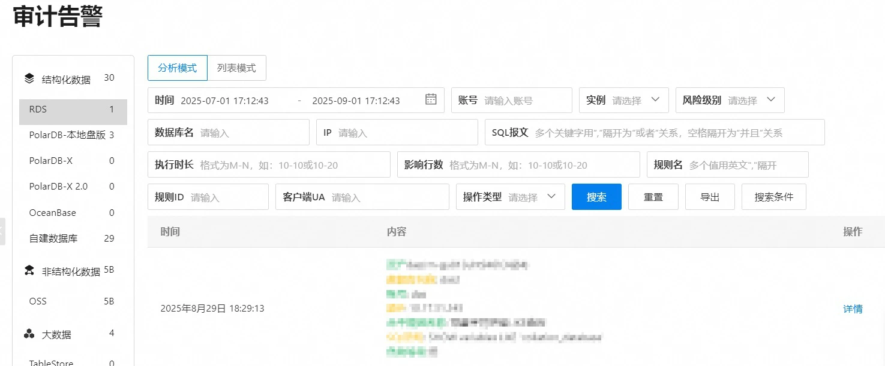

7. 单击目标记录操作列的**详情**，可查看该条告警记录的详细信息，包括告警信息（风险级别、命中规则、告警时间）和原始日志（客户端信息、服务端信息、行为信息）。

<a id="section-6-4"></a>

## 6.4. 审计配置

<a id="section-6-4-1"></a>

### 6.4.1. 创建自定义规则

本文介绍了如何创建SDDP自定义审计规则，SDDP会根据您自定义的审计规则抓取对应的审计日志数据。

**背景信息**

SDDP支持审计日志功能，审计日志数据提供了包括审计规则命中结果、审计规则检测的资产类型、命中规则的操作类型和操作账号等信息，覆盖资产数据产生、更新和使用等全链路的日志数据。

**操作步骤**

1. 登录Apsara Uni-manager运营控制台。

2. 在控制台上方，单击**安全**，选择**数据安全 > 敏感数据保护**。

3. 在**敏感护数据保护**授权页面，选择**地域**并单击**角色授权访问**。

4. 在左侧导航栏，选择**安全审计 > 审计配置**。

5. 在**审计配置**页面，单击**自定义规则**页签。

6. 在**自定义规则**页签，单击**新增规则**。

7. 在**新增规则**页面，配置审计规则相应参数。

   您可以参考以下表格中的参数说明配置防护策略。

   <table>
     <tr>
       <th width="89">参数</th>
       <th>说明</th>
     </tr>
     <tr>
       <td>规则名称</td>
       <td>自定义审计规则的名称，建议输入有实际意义的名称以便有效识别该审计规则。</td>
     </tr>
     <tr>
       <td>规则类型</td>
       <td>从下拉列表选择该审计规则的规则类型。</td>
     </tr>
     <tr>
       <td>风险级别</td>
       <td>从下拉列表选择该审计规则的风险等级，支持选择以下风险级别：<br>• 高<br>• 中<br>• 低</td>
     </tr>
     <tr>
       <td>资产类型</td>
       <td>请选择审计规则生效的资产类型。</td>
     </tr>
     <tr>
       <td>行为信息</td>
       <td>输入审计规则的说明信息。</td>
     </tr>
     <tr>
       <td>规则描述</td>
       <td>选择<strong>资产类型</strong>后，根据实际需要配置规则条件，SDDP将在规则条件限定的范围内采集审计数据。单击<strong>添加</strong>，完成当前规则的配置。支持添加多条规则。</td>
     </tr>
   </table>

8. 单击**提交**。

   审计规则创建完成后，您可以在规则列表中查看该审计规则的开启状态、命中次数、详情信息或删除、修改该审计规则。

   > **说明**
   >
   > 创建完成后，审计规则的**状态**默认为开启。您也可在规则列表中手动开启或关闭审计规则。
   >
   > 关闭该审计规则后，SDDP不会再执行该审计规则项抓取审计日志数据。

**后续步骤**

创建并开启审计规则后，SDDP将在5分钟内同步审计结果，您可在**安全审计 > 审计告警**页面查看相关告警数据。

<a id="section-6-4-2"></a>

### 6.4.2. 查看内置规则

本文介绍了如何查看内置规则。

1. 登录Apsara Uni-manager运营控制台。

2. 在控制台上方，单击**安全**，选择**数据安全 > 敏感数据保护**。

3. 在**敏感护数据保护**授权页面，选择**地域**并单击**角色授权访问**。

4. 在左侧导航栏，选择**安全审计 > 审计配置**。

5. 在**审计配置**页面，单击**内置规则**页签。

6. 在**内置规则**页签，单击**数据库审计规则**、**OSS审计规则**或**MaxCompute审计规则**。

7. 设置搜索条件，单击搜索图标。

   <table>
     <tr>
       <th width="89">搜索条件</th>
       <th>说明</th>
     </tr>
     <tr>
       <td>资产类型</td>
       <td>请选择审计规则生效的资产类型。 仅<strong>数据库审计规则</strong>支持按<strong>资产类型</strong>搜索，<strong>OSS审计规</strong><strong>则</strong>和<strong>MaxCompute审计规则</strong>不支持。</td>
     </tr>
     <tr>
       <td>风险级别</td>
       <td>从下拉列表选择该审计规则的风险等级，支持选择以下风险级别：<br>• 高<br>• 中<br>• 低</td>
     </tr>
     <tr>
       <td>规则名称</td>
       <td>输入内置审计规则的名称。</td>
     </tr>
   </table>

8. 在审计规则列表中，查看审计规则的**规则名称**、**规则类型**、**风险级别**、**状态**、**命中次数**等信息。

   您还可以通过审计规则列表左侧的**规则分类**区域对审计规则进行筛选。

   - 修改规则状态：通过开启或关闭指定规则**状态**列的开关，开启或关闭规则。

   - 查看规则详情：单击指定规则**操作**列的**详情**，您可以查看该规则的基本信息。

<a id="section-7"></a>

# 7.风险治理

<a id="section-7-1"></a>

## 7.1. 风险告警

SDDP可检测敏感数据相关的异常操作并提供告警信息。SDDP提供了异常事件类型及异常事件的统计信息，您可集中处理检测到的异常事件。本文介绍如何查看风险告警。

**背景信息**

风险告警分为以下类型。

- **流转异常**：数据在流转过程中出现的异常情况。例如：下载非常用Bucket内敏感文件、初次下载敏感数据等。

- **行为异常**：非正常的数据操作行为。例如：登录密码连续错误、登录使用终端异常等。

- **配置异常**：数据库中存在的配置问题。例如：RDS实例账号存在弱口令、RDS白名单IP被设置为公开访问等。

- **自定义异常**：根据您自定义的检测模型检测异常事件并上报告警。

**操作步骤**

1. 登录Apsara Uni-manager运营控制台。

2. 在控制台顶部菜单栏，单击**安全**，选择**数据安全 > 敏感数据保护**。

3. 在**敏感护数据保护**授权页面，选择**地域**并单击**角色授权访问**。

4. 在左侧导航栏，选择**风险治理 > 风险告警**。

5. 在**风险告警**页面，查看风险告警的统计结果和列表信息。

   单击**流转异常**、**行为异常**、**配置异常**或**自定义异常**页签切换到对应风险告警统计数据页面，查看不同类型风险告警的统计数据。

6. 单击目标风险告警**操作**列的**查看详情**，在**泄漏风险详情**面板，查看泄漏风险信息、事件对象信息、事件描述、事件风险、事件处置建议方案和处置历史。

7. 单击目标风险告警**操作**列的**处理**，在**风险告警**面板，处理该告警。

   您需要设置以下参数。

   - **事件核查结果**

     - **确认异常并已处理**：如果您确认该检测结果确实为异常事件，选择该选项，并需要您根据**异常事情详情**页面提示的信息，定位到该异常事件的位置，并根据**事件处置建议方案**在对应的云产品中进行手动处理。确认违规的事件如未被处理，SDDP将会一直对该事件进行异常事件告警。

     - **误报**：如果您确认该检测结果属于正常操作、无需进行处理，选择该选项。异常事件设为误报后，SDDP将不再对该事件进行告警提示，即该事件将不会展示在异常事件告警列表中。

   - **添加事件处理记录**：填写您对该异常事件告警的备注信息，方便后续回溯。

   - **异常事件检测强化**：您确认该检测结果属于正常操作时事件核查结果选择**误报**，并选择**异常事件检测强化**后，SDDP会将该异常事件输入到误报样本库中用于优化异常事件告警命中准确率。

8. 单击风险告警列表上方的**导出**，可导出列表中展示的风险告警。

**相关操作**

如果检测到模型未上传到MaxCompute，需要完成以下操作。

1. **创建MaxCompute**

   1. 登录Apsara Uni-manager运营控制台。

   2. 切换到组织管理员角色。

   3. 在上方导航栏的**产品**中选择**云原生大数据计算服务 MaxCompute**。

   4. 创建云账号。

      <ol type="i">

      <li>

      单击**任务云账号**，在右侧的页签中，单击**创建云账号**。

      </li>

      <li>

      在弹出的对话框中，填写好相关的账号信息后，单击**提交**，完成阿里云账号的创建。

      </li>

      </ol>

   5. 创建配额组。

      <ol type="i">

      <li>

      在左侧导航栏单击**配额组管理**，在右侧的页签中，单击**创建配额组**。

      </li>

      <li>

      在跳转到的页面中，填写好相关的项目信息后，单击**确认订单**，完成配额组的创建。

      CU数量设置10。如果后续任务量大，可以调整。

      </li>

      </ol>

   6. 创建MaxCompute项目。

      MaxCompute项目用于关联DataWorks，命名为**sddp**（已创建好则不用重复创建），此处为**odpsProjectName**。

      > **重要**
      >
      > 这个**sddp**项目仅限于敏感数据保护产品使用，请不要用于其他业务。

      <ol type="i">

      <li>

      在左侧导航栏单击**Project管理**，然后单击**创建Project**。

      </li>

      <li>

      在跳转到的页面中，填写好相关的项目信息后，单击**提交**，完成MaxCompute项目的创建。

      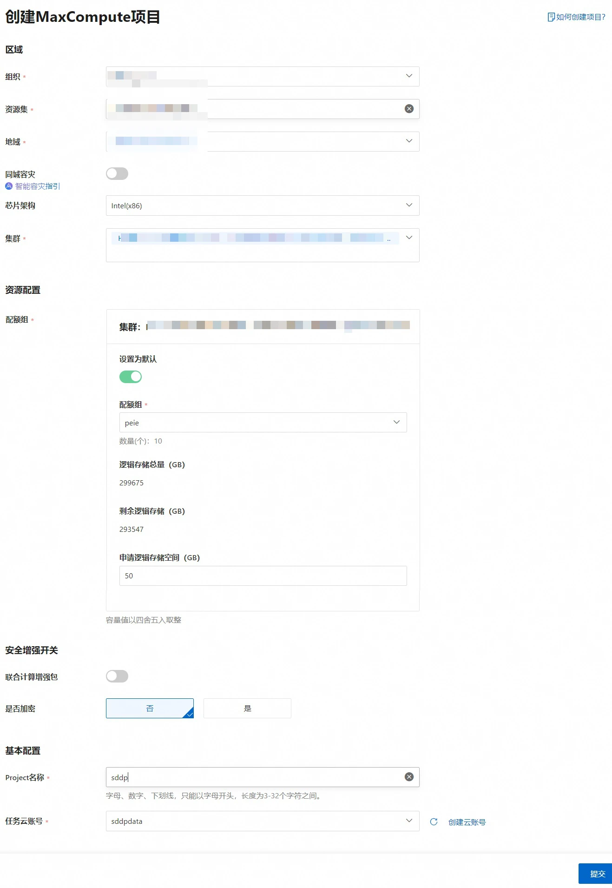

      </li>

      </ol>

2. **创建DataWorks**

创建DataWorks工作空间关联MaxCompute。

1. 登录Apsara Uni-manager运营控制台。

2. 在上方导航栏的**产品**中选择**大数据开发治理平台DataWorks**。

3. 将账号权限设置为**管理员权限访问**。

   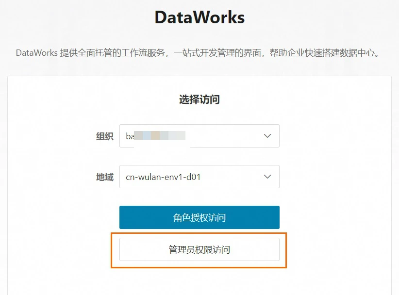

   如果登录时未提示设置，也可以登录后，将账号权限切换为**管理员权限访问**。

   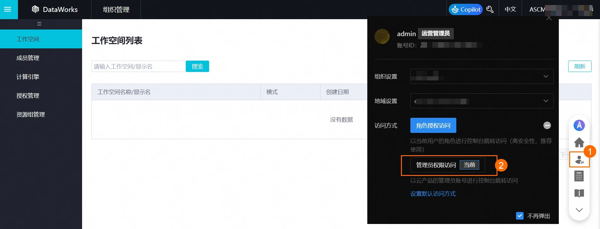

4. 单击左上角的DataWorks图标，选择**全部产品 > 组织管理**，默认进入**工作空间列表**页面。

   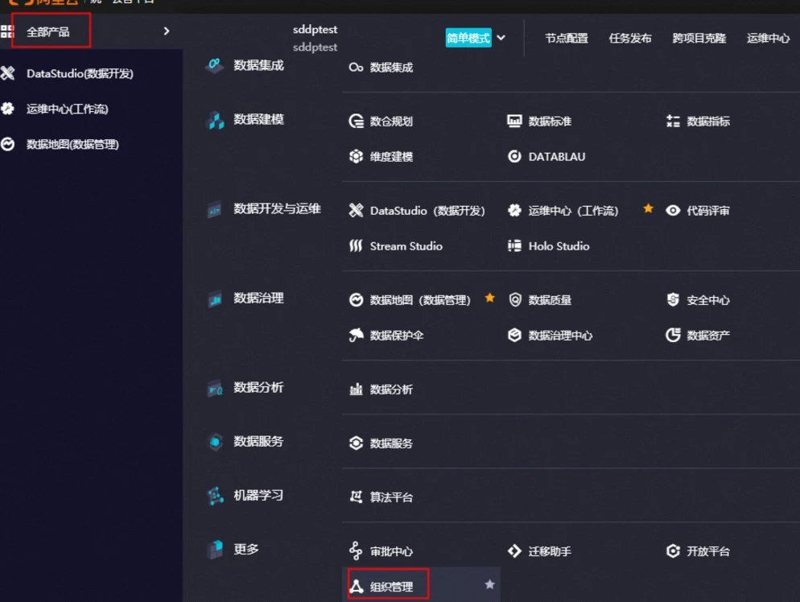

5. 单击**创建工作空间**，在**创建工作空间**对话框中输入**基本信息**和**高级设置**，单击**确定**。

   **工作空间名称必须和MaxCompute项目空间同名，为sddp。**

3. **给sddp内部服务账号授权**

   1. 登录飞天基础运维平台。

   2. 在**产品集群运维**页面，搜索sddp，然后单击**集群详情**。

      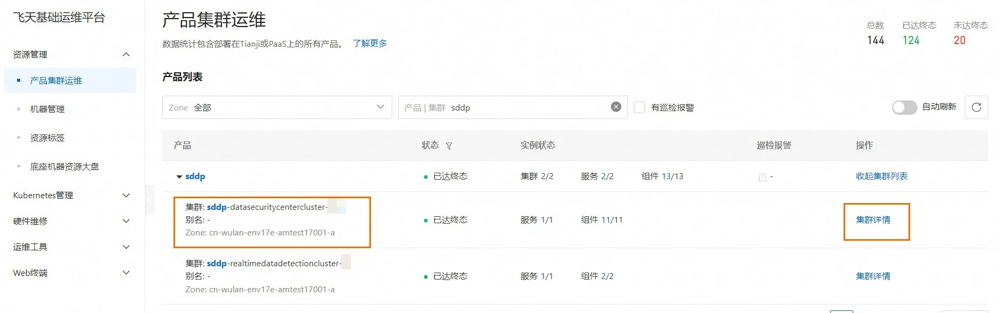

   3. 在**服务列表**中，单击sddp服务名称。

   4. 在**组件列表**中，选择<strong>yundun-sddp-service，</strong>在右侧**Workload**区域找到如下文件。

      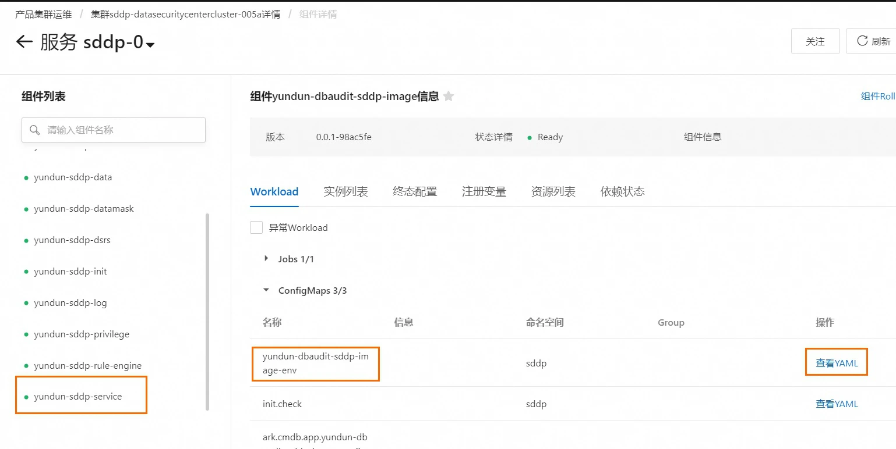

   5. 在文件中搜索并记录**account.sddp.user**，即服务账号。

   6. 将服务账号添加到MaxCompute项目中。

      在MaxCompute客户端执行以下命令，将服务账号添加到允许访问的MaxCompute项目中。

      > **说明**
      >
      > 请将**yundun_sddp**替换为刚才查找的**服务账号**。

      ```text
      use project_name(替换为创建好的MaxCompute的projectName);
      add user aliyun$yundun_sddp;
      grant admin to aliyun$yundun_sddp;
      ```

4. **上传模型**

进入SddpAlgorithm容器，执行以下命令初始化用户元数据：

```bash
 curl 'http://localhost:7001/scheduler/meta_init_by_user?
```

`aliUid=XXX&odpsProjectName=XXX&dataworksProjectName=XXX&tenantId=XXX&projectId=XXX&projectOwnerBaseId=XXX'` 。

`XXX` 对应用户的基本参数信息如下：

`dataworksProjectName` 为表空间名。DataWorks创建完成后，按F12键，查看DataWorks接口可以获取对应的参数。

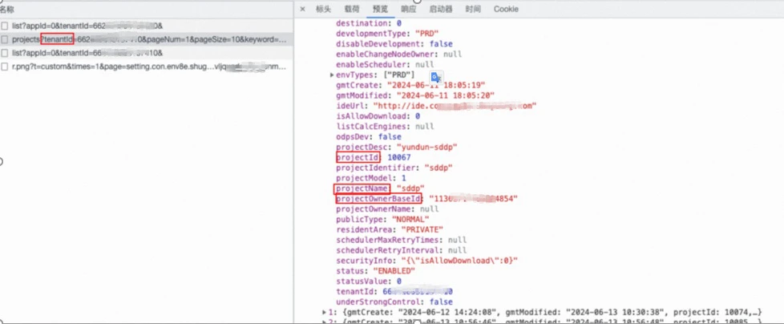

5. **开启调度，第二天运行任务**

   1. 在DataWorks控制台，单击sddp工作空间。

   2. 在左侧导航栏，单击**临时查询**页面，根据以下指引在**调度设置**页签开启调度。

      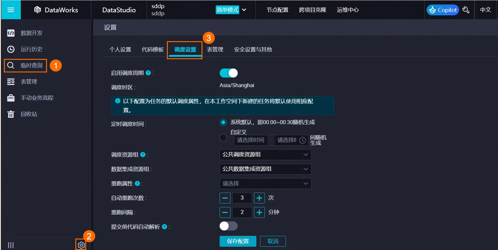

6. **添加白名单**

   1. 获取数据库连接信息。

      <ol type="i">

      <li>

      登录飞天基础运维平台。

      </li>

      <li>

      在**资源管理 > 产品集群运维**页面，搜索base集群，找到basiccluster-A服务，并单击**资源详情**。

      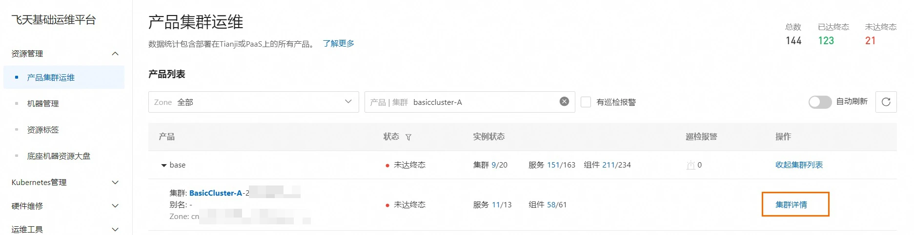

      </li>

      <li>

      在**资源详情**页签，在**资源名称**处搜索  `dwcdp` 。

      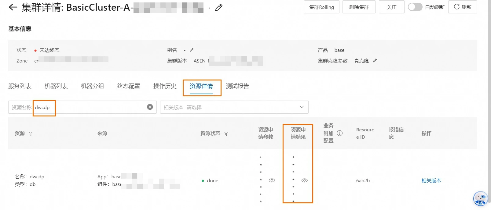

      </li>

      <li>

      在**资源申请结果**获取dwcdp的数据库信息。

      </li>

      </ol>

   2. 使用dwcdp的数据库信息，登录数据库。

      ```text
      mysql -h${db_host} -P${port} -u${dbName} -p${db_password}  -D${dbName} ;
      ```

   3. 获取sddpService数据库域名。

      <ol type="i">

      <li>

      登录飞天基础运维平台。

      </li>

      <li>

      在**资源管理 > 产品集群运维**页面，搜索sddp集群。

      </li>

      <li>

      找到yundun-sddp-service组件，在**资源列表**中，搜索**资源类型**为**db**的资源。

      其中**host**对应的值就是**sddpService数据库域名**。

      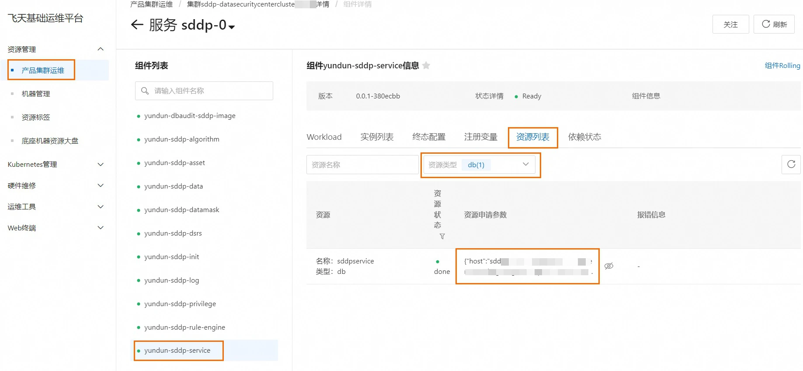

      </li>

      </ol>

   4. 执行SQL语句，把sddpService数据库域名加入白名单。

      > **重要**
      >
      > - 将 `${sddpService`数据库域名`}` 设置为上一步获取到的**sddpService数据库域名**。
      >
      > - 多Region环境下，需要在中心环境的数据库中同时添加中心和各单元的Region域名，即每个Region的sddpService域名都要执行一次SQL。

      ```text
      REPLACE INTO `t_parameter`     
      (`id`,`name`,`value`,`status`,`description`,`create_time`,`create_user`,`modify_time`,`modify_user`) 
      VALUES (null,'ssrf_host_white_${sddpService数据库域名}','true','on','ssrf新⽅案的host⽩名单之⼀
      sddpservice',NOW(),'sddp',NOW(),'sddp');
      ```

      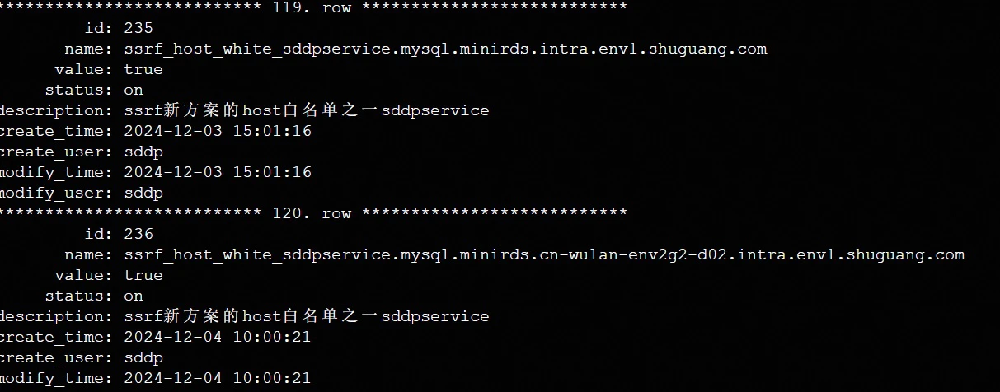

7. **数据检查**

   1. 在DataWorks控制台，单击sddp工作空间。

   2. 检查周期任务是否正常。

      <ol type="i">

      <li>

      在左侧导航栏，单击**临时查询**页面，然后单击**运维中心**。

      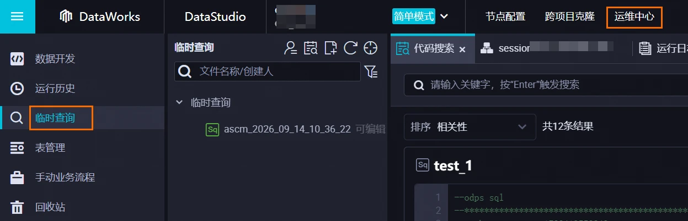

      </li>

      <li>

      检查周期任务。

      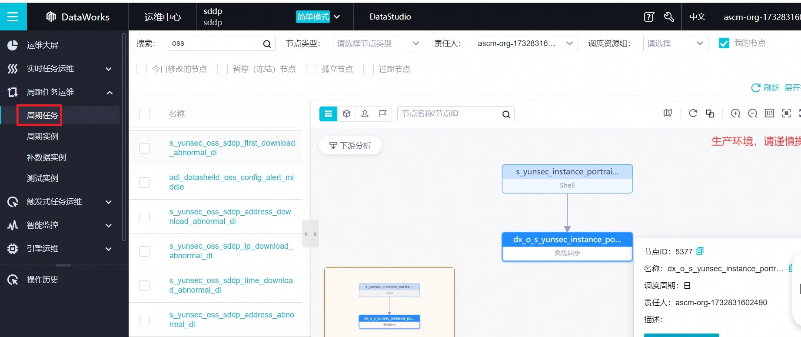

      </li>

      </ol>

   3. 检查数据源。

      <ol type="i">

      <li>

      在页面右上角单击  。

      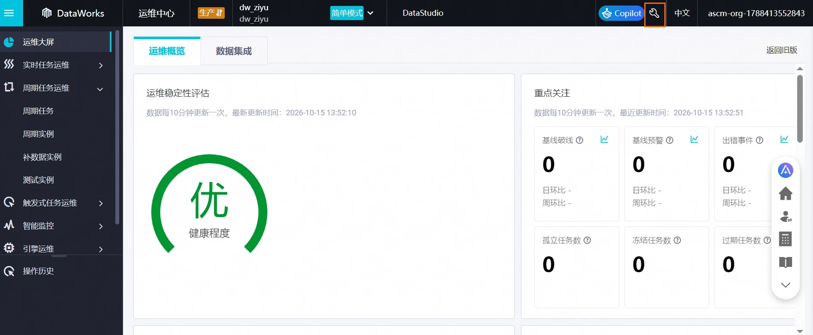

      </li>

      <li>

      检查数据源是否正常显示并连通正常。

      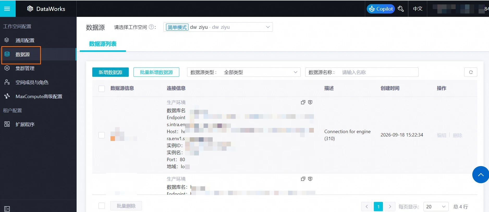

      </li>

      </ol>

<a id="section-7-2"></a>

## 7.2. 检测模型

<a id="section-7-2-1"></a>

### 7.2.1. 配置内置检测模型

SDDP根据内置和自定义的检测规则对文件或表中的敏感数据进行识别和告警。您可以在内置检测模型页面配置异常告警通用规则并启用异常告警配置。本文介绍如何进行异常告警配置。

**修改异常告警阈值**

1. 登录Apsara Uni-manager运营控制台。

2. 在控制台上方，单击**安全**，选择**数据安全 > 敏感数据保护**。

3. 在**敏感护数据保护**授权页面，选择**地域**并单击**角色授权访问**。

4. 在左侧导航栏，选择**风险治理 > 检测模型**。

5. 在**内置检测模型**页签，单击**流转异常**、**行为异常**或**配置异常**页签。

6. 在异常列表，定位到目标事件，在**告警阈值**列，单击**修改**设置触发告警的异常事件的阈值。

7. 单击**保存**。

**异常告警启用配置**

1. 登录Apsara Uni-manager运营控制台。

2. 在控制台上方，单击**安全**，选择**数据安全 > 敏感数据保护**。

3. 在**敏感护数据保护**授权页面，选择**地域**并单击**角色授权访问**。

4. 在左侧导航栏，选择**风险治理 > 检测模型**。

5. 在**内置检测模型**页签，单击**流转异常**、**行为异常**或**配置异常**页签。

6. 在异常列表，定位到目标事件，在**状态**列，启用告警的异常事件。

   被选中的事件类型如果触发了告警条件，对应的告警信息将展示在**风险告警**页面的列表中。更多信息，请参见风险告警。

<a id="section-7-2-2"></a>

### 7.2.2. 创建自定义检测模型

SDDP支持自定义异常事件检测规则并提供告警，SDDP会根据您自定义的异常事件规则抓取对应的异常事件日志数据。本文介绍了如何创建异常事件自定义规则。

**背景信息**

SDDP支持根据系统内置的规则和用户自定义规则检测异常事件并提供告警。

> **说明**
>
> 目前，仅OSS、MaxCompute和RDS支持自定义异常事件检测规则，其余数据源仅支持使用系统内置的规则检测异常事件。

**操作步骤**

1. 登录Apsara Uni-manager运营控制台。

2. 在控制台上方，单击**安全**，选择**数据安全 > 敏感数据保护**。

3. 在**敏感护数据保护**授权页面，选择**地域**并单击**角色授权访问**。

4. 在左侧导航栏，选择**风险治理 > 检测模型**。

5. 在**检测模型**的**自定义检测模型**页签，单击**添加规则**。

6. 在**新增规则**对话框，配置自定义规则相关参数。

   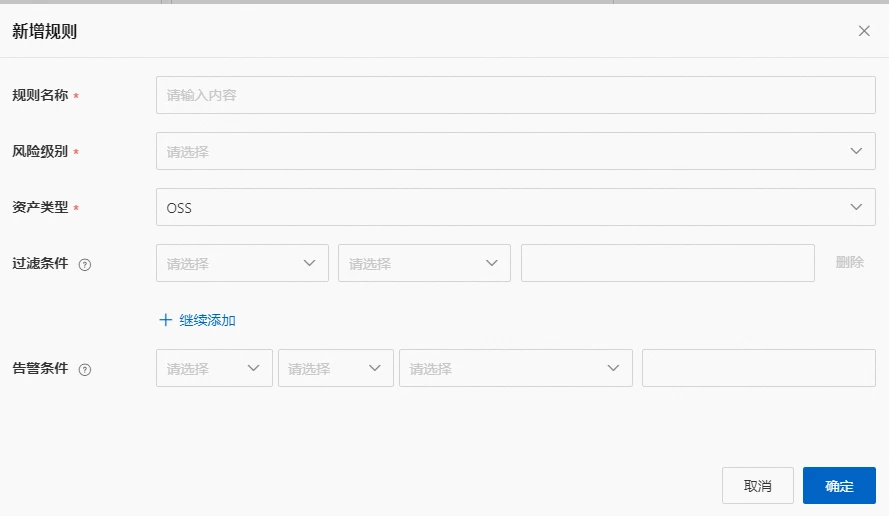

   您可以参考以下表格配置自定义规则的参数。

   <table>
     <tr>
       <th width="89">参数</th>
       <th>说明</th>
     </tr>
     <tr>
       <td>规则名称</td>
       <td>自定义异常事件检测规则的名称，建议输入有实际意义的名称以便有效识别该规则。</td>
     </tr>
     <tr>
       <td>风险级别</td>
       <td>从下拉列表中选择该异常事件规则的风险等级，可选以下3种风险等级：<br>• 高<br>• 中<br>• 低</td>
     </tr>
     <tr>
       <td>资产类型</td>
       <td>异常事件规则检测的资产类型，可选以下3种资产：<br>• OSS<br>• MaxCompute<br>• RDS</td>
     </tr>
     <tr>
       <td>过滤条件</td>
       <td>根据实际需要配置过滤条件，指定需要检测的异常事件。每个过滤条件之间是和（AND）关系。单击<strong>继续添加</strong>，完成过滤条件的配置。支持添加多条过滤条件。</td>
     </tr>
     <tr>
       <td>告警条件</td>
       <td>设置告警检测的时间单位和告警产生的条件。SDDP基于上一步中过滤的数据进行异常检测，在自定义时间段内满足告警条件，将触发异常事件告警。<br>说明告警条件中的<strong>任何UA</strong>是指任何浏览器的UserAgent。UserAgent的信息包括硬件平台、系统软件、应用软件和用户个人偏好，通过UA可以分析出浏览器名称、浏览器版本号、渲染引擎、操作系统。告警条件选择了<strong>任何UA</strong>，可以抓取UserAgent中的相应异常事件。</td>
     </tr>
   </table>

7. 单击**确定**，完成异常事件规则的创建。

   异常事件规则创建完成后，您可以在**自定义规则**列表中查看该异常事件检测规则的开启状态、命中结果和详情信息，或编辑该检测规则。

   > **说明**
   >
   > 您可在自定义规则列表中手动关闭该规则，关闭该规则后，SDDP将不会再用该规则项进行检测。

**后续步骤**

创建并开启异常事件规则后，SDDP将在1小时左右同步检测结果，您可在**风险告警**页面查看相关数据。更多信息请参见风险告警。

<a id="section-7-3"></a>

## 7.3. 账号权限

<a id="section-7-3-1"></a>

### 7.3.1. 查看用户账号分析

用户账户分析功能提供您资产中所有账号最近7天的统计数据和安全分值，帮助您更好地了解您所有账号的概况和安全状态。本文介绍如何使用用户账号分析功能。

**操作步骤**

1. 登录Apsara Uni-manager运营控制台。

2. 在控制台上方，单击**安全**，选择**数据安全 > 敏感数据保护**。

3. 在**敏感护数据保护**授权页面，选择**地域**并单击**角色授权访问**。

4. 在左侧导航栏，选择**风险治理 > 账号权限**。

5. 在**用户账号分析**页签，您可以进行以下操作。

   - 查看账号统计数据：在统计图表模块，您可以查看**总用户数**、**休眠用户数**、**活跃用户数**和**高风险用户数**的统计数据，以及**账号量变化**折线图。

     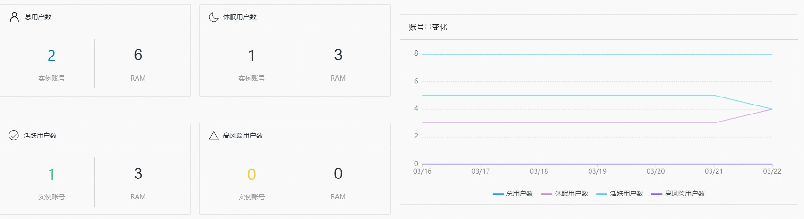

   - 查看账号详细信息列表：在账号列表信息处，您可以分类查看部门云账号、平台账号、RAM用户或RDS账号的信息，包括账号对应的实例、账号安全分、账号创建时间、授权资产数、告警数量等信息。您可以在指定账号操作列单击**账号画像**，查看该账号画像的详细信息，包括该账号的安全值、用户信息、安全分值变化图、异常事件变化数量和告警明细等。

     > 如果某个账号的安全值较低，该账号可能存在访问或下载敏感数据等违规操作。建议您及时在该账号的**账**
     >
     > **重要**
     >
     > **号画像**页面查看导致安全值较低的原因，并处理相应告警和异常事件。

<a id="section-7-3-2"></a>

### 7.3.2. 查看权限统计

本文介绍如何查看权限统计结果。

**背景信息**

通过权限管理，了解专有云的整体权限分布结果。通过该功能，管理员能够快速分辨出高风险的账号和人员，及时进行安全排查和整改。

**操作步骤**

1. 登录Apsara Uni-manager运营控制台。

2. 在控制台上方，单击**安全**，选择**数据安全 > 敏感数据保护**。

3. 在**敏感护数据保护**授权页面，选择**地域**并单击**角色授权访问**。

4. 在左侧导航栏，选择**风险治理 > 账号权限**。

5. 在**权限概览**页签，查看整体的权限统计情况。

   

   - **可访问敏感数据的账号数**：能够访问敏感数的账号数量。

   - **部门总数**：专有云的所有部门数量。

   - **人员总数**：专有云的所有使用人员数量。

   - **账号总数**：专有云的所有账号数量。

6. 查看部门级权限情况统计。以部门为维度，查看使用人员数量、各类型账号数量、各类型异常事件数量和权限异常数量。

<a id="section-7-3-3"></a>

### 7.3.3. 检索权限

本文介绍如何检索权限。

**背景信息**

通过检索账号，查看该账号的人员信息，管理员可以快速定位敏感数据的责任人。

**操作步骤**

1. 登录Apsara Uni-manager运营控制台。

2. 在控制台上方，单击**安全**，选择**数据安全 > 敏感数据保护**。

3. 在**敏感护数据保护**授权页面，选择**地域**并单击**角色授权访问**。

4. 在左侧导航栏，选择**风险治理 > 账号权限**。

5. 在**权限检索**页签，检索需要查看的具体账号。通过搜索方式查找账号，步骤如下。

   <ol type="i">

   <li>

   在下拉菜单中，选中**部门**（或者**员工**）。

   </li>

   <li>

   在输入框中，输入部门、账号等关键字。

   </li>

   <li>

   单击**查询**，在**显示名**中查看搜索结果。

   </li>

   </ol>

   > 您也可以在部门名称下选择具体部门，在显示名中可以查看该部门所有账号。
   >
   > **说明**

6. 在**显示名**中，单击需要查看的账号。

7. 在右侧查看该账号的**个人信息**和**账号信息**。

   - **个人信息**

     查看个人的联系方式，违例确认权限异常事件数和违例排除权限异常事件数。

   - **账号信息**

     查看可操作云账号、账号类型、账号创建时间、可操作产品等信息。

     通过**查看账号权限**，查看账号下的资源、资源类型、资源路径、操作权限等信息。

<a id="section-7-4"></a>

## 7.4. 风险评估

<a id="section-7-4-1"></a>

### 7.4.1. 概述

本文介绍什么是风险评估系统，包含哪些评估标准、评估项，如何进行风险评估。

**什么是风险评估系统**

风险评估系统基于各行业、地区的标准及规范的解读，从数据安全合规风险、数据安全技术风险、数据安全管理风险三个方面对数据安全现状进行全方位、多角度的评估，帮助企业、组织掌握数据安全建设现状、识别数据安全合规风险、评估风险危害情况并提供整改措施建议。

**风险评估标准**

- **内置评估标准**

  风险评估系统内置合规评估、技术评估、管理评估三种评估标准及其评估项，各评估项默认关联内置的调研项、法条依据。具体风险评估标准如下所示：

  <table>
    <tr>
      <th width="122">评估标准</th>
      <th>子类</th>
    </tr>
    <tr>
      <td>合规评估标准</td>
      <td>• 《网络安全法》<br>• 《数据安全法》<br>• 《个人信息保护法》<br>• 《数据出境安全评估办法》<br>• 《网络数据安全评估指南》<br>• 《网络数据安全管理条例》<br>• 《网络数据处理安全要求》<br>• 《金融数据安全数据生命周期安全规范》JR/T0223-2021<br>• 《个人金融信息保护技术规范》JR/T01712020<br>• 《数据安全能力成熟度模型》一级、二级、三级、四级、五级</td>
    </tr>
    <tr>
      <td>技术评估标准</td>
      <td>• 数据生存周期安全<br>• 通用安全<br>• 应用API检测风险<br>• 数据库审计监测风险<br>• 数据库脆弱性风险<br>• 金融行业技术安全评估</td>
    </tr>
    <tr>
      <td>管理评估标准</td>
      <td>• 组织建设<br>• 制度流程<br>• 人员能力<br>• 金融行业管理安全评估</td>
    </tr>
  </table>

- **自定义标准**

  使用**全局组织安全管理员**登录控制台时，可自定义评估标准及其评估项、各评估项默认关联内置的调研项、法条依据。具体操作，请参见自定义评估标准和评估项。

**如何进行风险评估**

使用**组织安全管理员**登录控制台，可通过创建风险评估项目，进行前期调研、现场访谈、评估分析、风险分析、报告预览等。具体操作，请参见风险评估。

<a id="section-7-4-2"></a>

### 7.4.2. 风险评估

本文介绍如何进行风险评估。

**前提条件**

当前账号角色已切换为**组织安全管理员**。

如未切换，请登录Apsara Uni-manager运营控制台后，单击页面右上角的  图标，单击**个人信息**。单击**切换当前角色**，将角色

切换为**组织安全管理员**。

**创建评估项目**

1. 登录Apsara Uni-manager运营控制台。

2. 在控制台右上方，单击**安全**，选择**数据安全 > 敏感数据保护**。在**敏感数据保护**授权页面，选择**地域**并单击**角色授权访问**。

3. 在左侧导航栏，选择**风险治理 > 风险评估**。

4. 在**数据安全风险评估**页面顶部菜单栏，选择**评估项目 > 我的项目**后，单击**新增**。

5. 在**项目信息**配置向导，完成如下配置后，单击**下一步**。

   | 配置项 | 说明 |
   | --- | --- |
   | 项目名称 | 填写评估项目名称。 |
   | 受评单位 | 填写受聘单位。 |
   | 合同编号 | 填写合同编号。 |
   | 合同签订日期 | 填写合同填写日。 |
   | 项目背景 | 填写项目背景，最多可填写500个字。 |
   | 评估目标 | 填写评估目标，最多可填写200个字。 |
   | 评估团队 | 填写评估团队的姓名和角色，支持填写多个评估团队。 |
   | 实施计划 | 填写实施计划的阶段、周期和实施内容，支持填写多个实施计划。 |

6. 在**受评单位**配置向导，完成如下配置后，单击**下一步**。

   <table>
     <tr>
       <th width="121">配置项</th>
       <th>说明</th>
     </tr>
     <tr>
       <td>组织机构代码</td>
       <td>填写组织机构代码。</td>
     </tr>
     <tr>
       <td>所在地区</td>
       <td>选择所在地区。</td>
     </tr>
     <tr>
       <td>详细地址</td>
       <td>填写详细地址。</td>
     </tr>
     <tr>
       <td>行业领域</td>
       <td>选择行业领域。</td>
     </tr>
     <tr>
       <td>单位性质</td>
       <td>选择单位性质。</td>
     </tr>
     <tr>
       <td>经营范围</td>
       <td>填写经营范围。</td>
     </tr>
     <tr>
       <td>人员规模</td>
       <td>根据业务情况，选择受评单位人员规模。</td>
     </tr>
     <tr>
       <td>业务涉及数据</td>
       <td>选择业务涉及数据类型，填写数据描述。可选项：<br>• 个人信息<br>• 重要数据<br>• 其他数据</td>
     </tr>
     <tr>
       <td>业务类型</td>
       <td>选择业务类型，填写业务服务描述。可选项：<br>• 政府服务<br>• 境外服务</td>
     </tr>
     <tr>
       <td>联系人</td>
       <td>填写联系人。</td>
     </tr>
     <tr>
       <td>移动电话</td>
       <td>填写联系人移动电话。</td>
     </tr>
     <tr>
       <td>办公电话</td>
       <td>填写联系人办公电话。</td>
     </tr>
     <tr>
       <td>电子邮件</td>
       <td>填写联系人电子邮件。</td>
     </tr>
   </table>

7. 在**方案设置**配置向导，完成如下配置后，单击**保存**。

   <table>
     <tr>
       <th width="89">配置项</th>
       <th>说明</th>
     </tr>
     <tr>
       <td>方案设置</td>
       <td>选择评估方案类型，可选项：<br>• <strong>内置方案</strong>：选择<strong>内置方案</strong>后，还需要选择评估方案，支持数据出境安全合规评估方案、金融行业数据安全风险评估方案、数据安全成熟度评估方案。用户可以在方案预览查看选择的具体评估标准。<br>• <strong>自定义方案</strong>：选择<strong>自定义方案</strong>后，用户需要在方案预览中，根据评估标准、评估项，选择具体的评估标准。自定义方案支持选择系统内置的评估标准及其评估项，也支持选择用户自定义的评估标准及其评估项。关于如何新建自定义评估标准及其评估项的具体操作，请参见自定义评估标准和评估项。</td>
     </tr>
     <tr>
       <td>方案预览</td>
       <td>根据<strong>方案设置</strong>，查看并选择评估标准。<br>• <strong>内置方案</strong>：查看数据出境安全合规评估方案、金融行业数据安全风险评估方案、数据安全成熟度评估方案的具体评估标准。<br>• <strong>自定义方案</strong>：根据评估标准、评估项，选择具体的评估标准。</td>
     </tr>
   </table>

8. 在**数据安全风险评估**页面，选择**评估项目 > 我的项目**，定位到目标风险评估项目，管理项目。

   <ol type="i">

   <li>

   前期调研

   单击**操作**列的**前期调研**。在**前期调研**页签，**新增**或**导入**配置调研数据，包括**组织架构与职责**、**数据安全制度、数据安全日常活动**或**信息系统**。

   </li>

   <li>

   现场访谈

   单击**操作**列的**现场访谈**。在**现场访谈**页签，录入**安全合规**的调研项数据后，单击**保存**。

   > **说明**
   >
   > 重复的调研项只需要录入一次，并且会在第二次出现该调研项时显示第一次录入的结果。

   </li>

   <li>

   评估分析

   单击**操作**列的**评估分析**。在**评估分析**页签，录入**安全合规**的评估结果、现状描述、差距描述数据，上传访谈结果和佐证上传后，单击**保存**。

   </li>

   <li>

   风险分析

   单击**操作**列的**风险分析**。在**风险分析**页签，录入**安全合规**的整改建议、整改优先级、风险类型、风险危害程度后，单击**保存**。

   </li>

   <li>

   报告预览

   单击**操作**列的**报告预览**。在**报告预览**页签，单击项目模板，查看数据安全评估报告。

   支持编辑数据安全评估报告和报告目录，完成后，用户可以导出报告。

   </li>

   <li>

   提交审核

   在页面右上角，单击**提交审批**后，单击**确定**。

   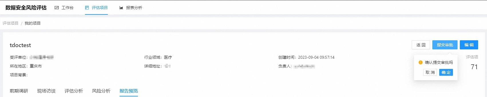

   审批结束后，用户可以在**审批信息**页签，查看审批历史。

   用户也可以在**数据安全风险评估**页面，选择**评估项目 > 全部项目**，单击目标项目操作列的**查看报告**，查看项目**报告预览**。

   </li>

   </ol>

9. 在**数据安全风险评估**页面，选择**评估项目 > 全部项目**，定位到目标风险评估项目，单击**操作**列的**审批**，并在弹出的对话框，填写**审批意见**。

   审批完成后，项目审批状态为**审批通过**。

**查看报表分析数据**

完成评估项目中的所有操作后，用户可以在**数据安全风险评估**页面，单击**报表分析**页签，查看报表分析数据。

<table>
  <tr>
    <th width="137">报表分析数据</th>
    <th>说明</th>
  </tr>
  <tr>
    <td>评估项目汇总表</td>
    <td>展示所有已完成评估操作的项目汇总表。<br>1. 选择<strong>报表分析 &gt; 评估项目汇总表</strong>。<br>2. 根据项目名称、负责人、评估状态，筛选并查看评估项目。<br>3. <strong>（可选）</strong>单击<strong>导出</strong>，导出评估项目汇总表。</td>
  </tr>
  <tr>
    <td>评估结果明细表</td>
    <td>展示所选项目的评估项详情。<br>1. 选择<strong>报表分析 &gt; 评估结果明细表</strong>。<br>2. 选择<strong>评估项目</strong>，查看该项目的评估结果明细。<br>3. 选择<strong>评估结果</strong>，查看该项目中不同评估结果的评估项详情。<br>4. <strong>（可选）</strong>单击<strong>导出</strong>，导出评估项目评估结果明细表。</td>
  </tr>
  <tr>
    <td>安全评估表</td>
    <td>展示评估项目安全评估报表，包括概述、安全建设现状、安全评估结果、安全差距分析、风险分析。<br>1. 选择<strong>报表分析 &gt; 安全评估表</strong>。<br>2. 单击<strong>切换项目</strong>，选择要查看的评估项目风险评估报表。<br>3. <strong>（可选）</strong>单击<strong>导出</strong>，选择要导出的类型，导出评估报表。导出类型支持word、pdf、png。</td>
  </tr>
</table>

**查看风险评估工作台**

用户可以在**数据安全风险评估**页面，单击**工作台**页签，查看如下信息：

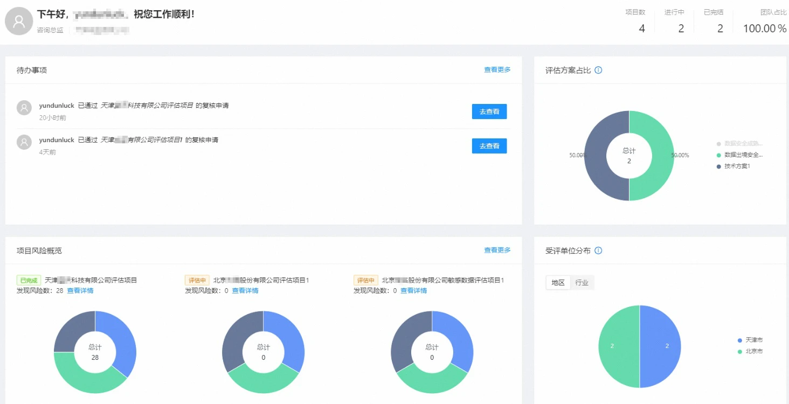

- 评估项目总览：包括项目总数、进行中的项目、已完结的项目、评估项目的团队占比。

- 待办事项：单击查看更多，可在评估项目页签，进行评估项目管理。

- 评估方案占比：查看各类评估项目的占比。

- 项目风险概览：查看各项目进展和发现风险数。

- 受评单位分布：支持查看地区、行业分布。

<a id="section-7-4-3"></a>

### 7.4.3. 自定义评估标准和评估项

风险评估支持自定义评估标准及其评估项、调研项、法条依据、评估项示例等。本文介绍如何自定义评估标准及其包含的各子项。

**前提条件**

当前账号角色已切换为**全局组织安全管理员**。

如未切换，请登录Apsara Uni-manager运营控制台后，单击页面右上角的  图标，单击**个人信息**。单击**切换当前角色**，将角色

切换为**全局组织安全管理员**。

**自定义评估标准和评估项**

自定义合规评估、技术评估、管理评估标准，并为标准新增评估项的操作相同。下文以合规评估标准为例。

1. 登录Apsara Uni-manager运营控制台。

2. 在控制台右上方，单击**安全**，选择**数据安全 > 敏感数据保护**。在**敏感数据保护**授权页面，选择**地域**并单击**角色授权访问**。

3. 在左侧导航栏，选择**风险治理 > 风险评估**。

4. 在**数据安全风险评估**页面，选择**评估标准 > 合规评估**。

   > **说明**
   >
   > 如果新增技术评估或管理评估标准，选择**评估标准**＞**技术评估**或**管理评估。**

5. <strong>（可选）</strong>新增合规评估标准。

   用户可使用系统内置的合规评估标准，也可以自定义合规评估标准。如果使用系统内置的合规评估标准，可跳过该步骤。

   <ol type="i">

   <li>

   在左侧评估标准栏，单击**新增**。

   </li>

   <li>

   完成如下配置项，单击**保存**。

   | 配置项 | 说明 |
   | --- | --- |
   | 标准名称 | 填写评估标准名称。 |
   | 标准类型 | 选择安全合规评估的类型，支持通用评估、行业评估、地区评估。 |
   | 标准描述 | 填写标准描述信息，最多支持填写200个字。 |

   </li>

   </ol>

6. <strong>（可选）</strong>在合规评估标准新增评估项。

   用户可使用系统内置的评估项，也可以自定义评估项。如果使用系统内置的评估项，可跳过该步骤。

   <ol type="i">

   <li>

   选中要增加评估项的评估标准，在右侧评估项列表上，单击新增。

   </li>

   <li>

   完成如下配置项，单击**保存**。

   | 配置项 | 说明 |
   | --- | --- |
   | 评估项 | 填写评估项名称。 |
   | 评估类型 | 评估类型默认与评估标准一致。 |
   | 上级分类 | 上级分类为评估标准。 |
   | 调研项 | 单击图标，选择要添加的调研问题后，单击<strong>确定</strong>。 |
   | 法条依据 | 单击图标，选择要添加的法条后，单击<strong>确定</strong>。 |
   | 描述 | 填写评估项描述信息，最多支持填写1000个字。 |

   </li>

   </ol>

   新建评估项后，用户可以单击状态列的图标，开启或关闭该评估项。

**自定义调研项**

1. 在**数据安全风险评估**页面，选择**评估模板 > 调研项**。

2. 单击**新增**，完成如下配置项，单击**保存**。

   <table>
     <tr>
       <th width="106">配置项</th>
       <th>说明</th>
     </tr>
     <tr>
       <td>题型</td>
       <td>填写调研项的题型，支持单选、多选、问答。</td>
     </tr>
     <tr>
       <td>状态</td>
       <td>默认启用。</td>
     </tr>
     <tr>
       <td>调研问题</td>
       <td>输入要调研的问题。</td>
     </tr>
     <tr>
       <td>关联评估项</td>
       <td>单击图标，选择要添加的评估项后，单击<strong>保存</strong>。关于评估项的更多信息，请参见新增评估项。</td>
     </tr>
   </table>

**自定义评估方案**

用户可使用系统内置的评估方案，也可以自定义评估方案。

1. 在**数据安全风险评估**页面，选择**评估模板 > 评估方案**。

2. 单击**新增**，填写场景名称后，单击**保存**。

3. 单击新创建的场景，单击  图标，在页面右侧填写**方案名称**，选择需要的评估依据（即评估标准）后，单击**保存**。

   选择评估标准后，系统会自动展示该评估标准包含的**评估项**、**调研卷**。

**自定义评估项示例**

系统为各评估标准的评估项提供符合、部分符合、不符合的示例，用户可根据实际情况，自定义符合、部分符合、不符合的示例。

1. 在**数据安全风险评估**页面，选择**知识管理 > 知识维护**。

2. 单击**新增**。

3. 在**编辑示例**面板，选择评估项，分别单击符合示例、部分符合示例、不符合示例区域的**新增**，填写**现状描述**，自定义示例。

   自定义的示例支持删除。

**系统配置**

**自定义法条依据**

1. 在**数据安全风险评估**页面，选择**系统配置 > 法条依据**。

2. 在左侧法条依据栏，单击**新增**。

3. 完成如下配置项，单击**保存**。

   | 配置项 | 说明 |
   | --- | --- |
   | 法条依据 | 填写法条依据名称。 |
   | 类型 | 选择法条依据的类型，支持法律、行政法规、地方规范、行业规范、国家标准。 |
   | 补充描述 | 填写标准描述信息，最多支持填写300个字。 |

4. 选择法条依据，单击法条列表上的**新增**，完成如下配置项，单击**保存**。

   <table>
     <tr>
       <th width="90">配置项</th>
       <th>说明</th>
     </tr>
     <tr>
       <td>法案章节</td>
       <td>无需选择，即为选择的法条依据。</td>
     </tr>
     <tr>
       <td>法条</td>
       <td>填写法条名称。</td>
     </tr>
     <tr>
       <td>法条内容</td>
       <td>填写法条内容，最多支持填写500个字。</td>
     </tr>
     <tr>
       <td>评估项</td>
       <td>单击图标，选择要添加的评估项后，单击<strong>保存</strong>。关于评估项的更多信息，请参见新增评估项。</td>
     </tr>
   </table>

**新建数据字典**

1. 在**数据安全风险评估**页面，选择**系统配置 > 数据字典**。

2. 单击各类字典操作列的**新增**。填写字典内容和字典值后，单击**保存**。

   新建完成后，用户可以单击  图标，查看系统内置和自定义的数据字典。系统内置的数据字典不支持启用或禁用，仅自定义

   的数据字典支持。

**管理评估单位**

1. 在**数据安全风险评估**页面，选择**系统配置 > 评估单位**。

2. 在**评估单位**页面，填写评估单位详细信息后，单击**保存**。

<a id="section-8"></a>

# 8.报表中心

<a id="section-8-1"></a>

## 8.1. 综合分析报告

通过资产管理和安全保障、异常和审计事件、敏感数据访问及规则命中和SQL语句执行情况四个角度对数据库进行综合分析，得出总体综合概况报表。本文介绍了如何导出综合分析报告。

1. 登录Apsara Uni-manager运营控制台。

2. 在控制台上方，单击**安全**，选择**数据安全 > 敏感数据保护**。

3. 在**敏感护数据保护**授权页面，选择**地域**并单击**角色授权访问**。

4. 在左侧导航栏，选择**报表中心 > 分析报告**。

5. 在**分析报告**页面的**综合分析报告**页签，设置**资产**和**时间范围**，单击**导出**。您可以在资产列表中，选择您想要导出查看的资产，时间范围可以设置**本日**、**本周**、**本月**、**最近3个月**、**最近6个月**、**最近12个月**、**昨天**。

   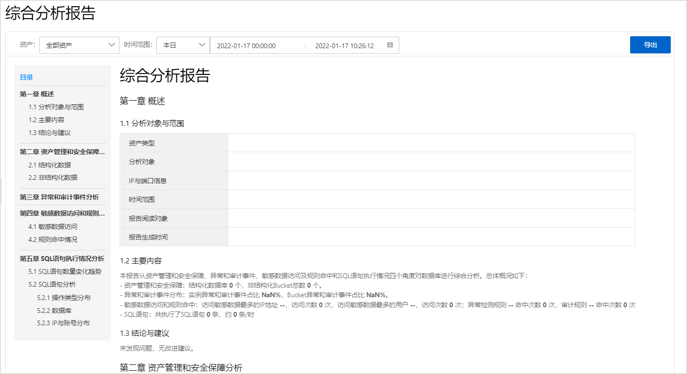

6. 在**导出**对话框，单击**确定下载**。

   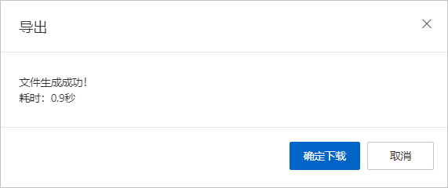

<a id="section-8-2"></a>

## 8.2. 合规报告

<a id="section-8-2-1"></a>

### 8.2.1. 等保参考分析报告

结合网络安全等级保护2.0制度，您可以从数据库审计情况、入侵防范监控、安全审计监控角度，得出资产等保2.0下的风险参考报表。本文介绍如何导出等保参考分析报表。

**操作步骤**

1. 登录Apsara Uni-manager运营控制台。

2. 在控制台上方，单击**安全**，选择**数据安全 > 敏感数据保护**。

3. 在**敏感护数据保护**授权页面，选择**地域**并单击**角色授权访问**。

4. 在左侧导航栏，选择**报表中心 > 合规报告**。

5. 在**合规报告**页面的**等保参考分析报告**页签，设置**资产**和**时间范围**，单击**导出**。您可以在资产列表中，选择您想要导出查看的资产，时间范围可以设置**本日**、**本周**、**本月**、**最近3个月**、**最近6个月**、**最近12个月**、**昨天**。

   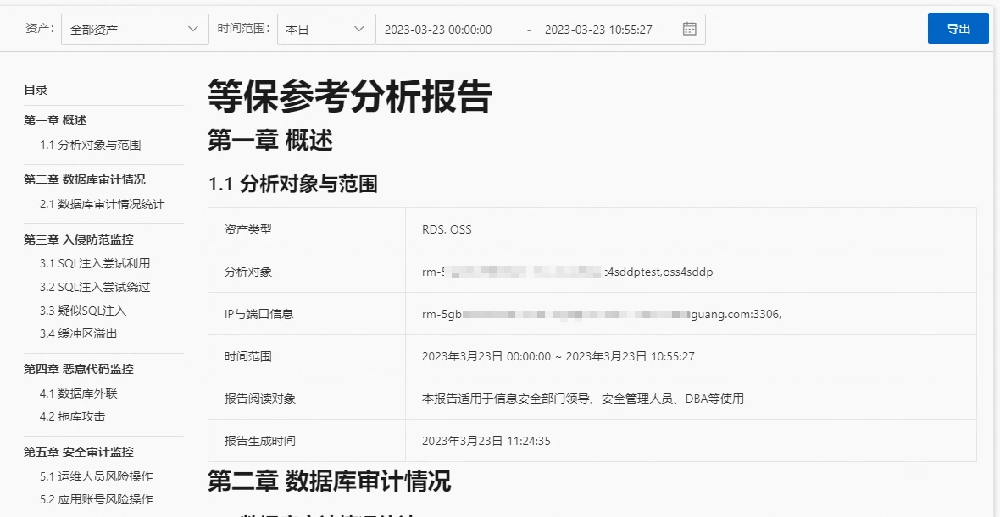

6. 在**导出**对话框，单击**确定下载**。

   

<a id="section-8-2-2"></a>

### 8.2.2. 数据安全法报告

数据安全法报告可以帮助管理人员、数据安全负责人、数据安全管理员掌握数据整体情况，增长趋势，及时发现各种异常和违规行为，并对这些行为进行快速分析定位和响应，落实数据安全保护责任。本文介绍如何导出数据安全法报告。

**操作步骤**

1. 登录Apsara Uni-manager运营控制台。

2. 在控制台上方，单击**安全**，选择**数据安全 > 敏感数据保护**。

3. 在**敏感护数据保护**授权页面，选择**地域**并单击**角色授权访问**。

4. 在左侧导航栏，选择**报表中心 > 合规报告**。

5. 在**合规报告**页面的**数据安全法报告**页签，设置**资产**和**时间范围**，单击**导出**。您可以在资产列表中，选择您想要导出查看的资产，时间范围可以设置**本日**、**本周**、**本月**、**最近3个月**、**最近6个月**、**最近12个月**、**昨天**。

   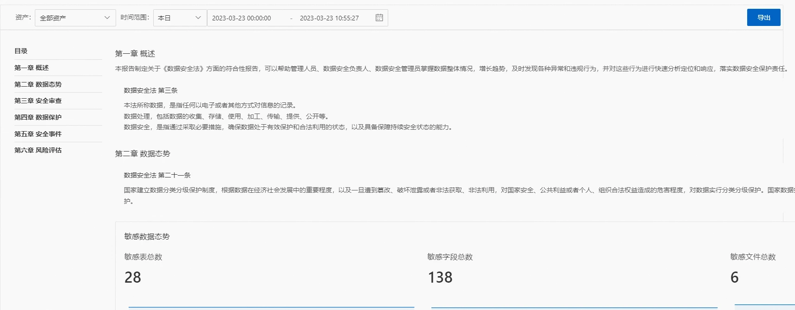

6. 在**导出**对话框，单击**确定下载**。

   

<a id="section-9"></a>

# 9.系统配置

<a id="section-9-1"></a>

## 9.1. 配置邮件报告

SDDP支持通过钉钉机器人在钉钉群实时发送异常审计告警和泄漏风险告警通知，以便于您及时处理异常问题，保障业务正常运行。本文介绍如何设置钉钉群接收告警通知。

**创建邮件报告**

1. 登录Apsara Uni-manager运营控制台。

2. 在控制台顶部菜单栏，单击**安全**，选择**数据安全 > 敏感数据保护**。

3. 在**敏感护数据保护**授权页面，选择**地域**并单击**角色授权访问**。

4. 在左侧导航栏，单击**系统设置**。

5. 在**邮件报告**页签，完成邮件报告参数配置，并单击**确定**。

   以下是配置说明：

   - SDDP支持月报和周报，您可以单击**周报**或**月报**配置对应的邮件报告。

   - 为了避免邮件报告发送到权限外的邮箱造成数据泄漏，添加邮件地址前，您需要通过输入验证码的方式完成邮箱所有权验证。验证成功的邮箱会被自动添加到邮件报告接收人中。

6. <strong>可选：</strong>单击**报告预览**，在**周报预览**或**月报预览**面板，查看报告详情。

7. <strong>可选：</strong>在**周报预览**或**月报预览**面板，单击**导出**，可导出报告。

   该报告会被保存在您浏览器的默认下载路径中。

<a id="section-9-2"></a>

## 9.2. 导出设置

SDDP支持自动导出OSS或RDS的原始日志、会话信息和异常告警。本文介绍如何进行导出设置。

**操作步骤**

1. 登录Apsara Uni-manager运营控制台。

2. 在控制台顶部菜单栏，单击**安全**，选择**数据安全 > 敏感数据保护**。

3. 在**敏感护数据保护**授权页面，选择**地域**并单击**角色授权访问**。

4. 在左侧导航栏，单击**系统设置**。

5. 在**系统设置**页面，单击**导出设置**。

6. 在**导出设置**页签，设置导出的数据源、导出类型、日志存储时间等参数，单击**保存**。

7. 在提示对话框，单击**确定**。

   设置成功后，系统每天凌晨自动导出昨天的日志到您的OSS中，文件前缀为BACKUP。

<a id="section-9-3"></a>

## 9.3. 管理白名单

SDDP支持将您信任的账号、IP地址等加入白名单。SDDP对加入白名单的账号或IP地址等不进行安全审计和异常检测，可以有效帮助您减少无效告警。本文介绍如何新增、编辑、删除白名单。

**背景信息**

新增、编辑和删除白名单后，新配置会在1分钟内生效。

您在处理审计告警或风险告警时，加入白名单的账号、IP地址等将展示在白名单列表中。

**新增白名单**

如果您不需要对资产中的某些账号、IP地址、IP段进行审计和检测，可以为此类账号、IP地址、IP段添加白名单。

1. 登录Apsara Uni-manager运营控制台。

2. 在控制台顶部菜单栏，单击**安全**，选择**数据安全 > 敏感数据保护**。

3. 在**敏感护数据保护**授权页面，选择**地域**并单击**角色授权访问**。

4. 在左侧导航栏，单击**系统设置**。

5. 在**系统设置**页面，单击**白名单**页签。

6. 在**白名单**页签，单击**新增白名单**。

7. 在**新增白名单**对话框，完成参数配置，并单击**确定**。

   <table>
     <tr>
       <th width="105">配置项</th>
       <th>说明</th>
     </tr>
     <tr>
       <td>白名单类型</td>
       <td>选择白名单的类型。可选项：<br>• <strong>账号</strong>：选择该项后，需填写具体的白名单<strong>账号</strong>。用户可以直接选择已有账号，也可以自定义账号。<br>• <strong>IP地址</strong>：选择该项后，需填写具体的白名单<strong>IP地址</strong>。<br>• <strong>IP段</strong>：选择该项后，需填写具体的白名单<strong>IP段</strong>。<br>• <strong>账号&amp;IP地址</strong>：选择该项后，需填写具体的白名单<strong>账号</strong>、<strong>IP地址</strong>。<br>• <strong>账号&amp;IP段</strong>：选择该项后，需填写具体的白名单<strong>账号</strong>、<strong>IP段</strong>。</td>
     </tr>
     <tr>
       <td>资产类型</td>
       <td>选择资产类型。</td>
     </tr>
     <tr>
       <td>实例</td>
       <td><strong>资产类型</strong>为<strong>RDS</strong>时，还需设置实例，直接选择全部或单个实例。</td>
     </tr>
     <tr>
       <td>账号</td>
       <td>设置加白的账号。支持选择<strong>自定义</strong>后输入自定义账号。</td>
     </tr>
   </table>

**编辑或删除白名单**

1. 登录Apsara Uni-manager运营控制台。

2. 在控制台顶部菜单栏，单击**安全**，选择**数据安全 > 敏感数据保护**。

3. 在**敏感护数据保护**授权页面，选择**地域**并单击**角色授权访问**。

4. 在左侧导航栏，单击**系统设置**。

5. 单击目标白名单**操作**列的**编辑**或**删除**，修改或删除对应白名单。

<a id="section-9-4"></a>

## 9.4. 新增使用授权

在使用SDDP前，需要为部门进行授权。本文介绍如何为部门授权。

**背景信息**

- 安全管理员在使用SDDP前，需要先为自己用户所在的部门进行授权。

- SDDP在检测敏感数据之前，需要先获取数据所属的部门权限，授权SDDP允许访问部门各产品（MaxCompute、OSS、ADS和OTS）的数据。

**前提条件**

已获取部门的名称和AccessKey信息，具体操作，请参见<strong>《Apsara Uni-manager运营控制台用户指南》</strong>的**企业中心 > 组织管理 > 获取组织AccessKey**章节。

**新增使用授权**

1. 登录Apsara Uni-manager运营控制台。

2. 在控制台顶部菜单栏，单击**安全**，选择**数据安全 > 敏感数据保护**。

3. 在**敏感护数据保护**授权页面，选择**地域**并单击**角色授权访问**。

4. 在左侧导航栏，单击**系统设置**。

5. 在**系统设置**页面，单击**使用授权**页签。

   > **说明**
   >
   > 如果用户所在部门未进行授权，在进入敏感数据保护时，直接进入**使用授权**页面。

6. 在**新增授权**区域，选择部门，输入部门AK ID、部门AK Secret，单击**提交**。

   > **说明**
   >
   > 单击**提交**后，系统会检测该授权是否成功。若授权失败，系统会提示“您输入的账号信息不正确，请重新输入”。

**查看并管理已授权账号**

您可以在**已授权账号信息**列表，查看和管理已授权账号。

- 查看已授权账号

  您可以查看已授权账号的部门、部门云账号、授权人显示名、授权时间等信息。

- 编辑已授权账号

  单击目标账号**操作**列的**编辑**，在**编辑**对话框，输入部门AK ID、部门AK Secret。

- 取消已授权账号

  单击目标账号**操作**列的**取消授权**，并单击**删除**。
