阿里云  
专有云  
灾备管理中心  
同城容灾管理平台 开发指南  
产品版本：v3.18.6  
文档版本：20261023

**目录**

- [1.POP网关](#section-1)
    - [1.1. API调用流程说明](#section-1-1)
    - [1.2. 准备工作](#section-1-2)
        - [1.2.1. 获取AccessKey](#section-1-2-1)
        - [1.2.2. 获取API信息及其Endpoint](#section-1-2-2)
        - [1.2.3. 通过POP网关调用专有云API](#section-1-2-3)
            - [1.2.3.1. Python版本](#section-1-2-3-1)
            - [1.2.3.2. Java版本](#section-1-2-3-2)
            - [1.2.3.3. SDK概览](#section-1-2-3-3)
    - [1.3. API参考](#section-1-3)
        - [1.3.1. 保护组](#section-1-3-1)
            - [1.3.1.1. ListProtectionGroup](#section-1-3-1-1)
            - [1.3.1.2. ListProtectionGroupStatistics](#section-1-3-1-2)
            - [1.3.1.3. ListProtectionGroupStatus](#section-1-3-1-3)
            - [1.3.1.4. GetProtectionGroup](#section-1-3-1-4)
            - [1.3.1.5. CheckProductInstance](#section-1-3-1-5)
            - [1.3.1.6. GetZoneInfo](#section-1-3-1-6)
        - [1.3.2. 演练计划](#section-1-3-2)
            - [1.3.2.1. ListProcesses](#section-1-3-2-1)
            - [1.3.2.2. ListDrillProcesses](#section-1-3-2-2)
            - [1.3.2.3. CloseProcess](#section-1-3-2-3)
            - [1.3.2.4. CreateDrillProcess](#section-1-3-2-4)
            - [1.3.2.5. GetProcessTrace](#section-1-3-2-5)
            - [1.3.2.6. ExecuteProcess](#section-1-3-2-6)
            - [1.3.2.7. CreateNextProcess](#section-1-3-2-7)
            - [1.3.2.8. GetInstanceStatus](#section-1-3-2-8)
            - [1.3.2.9. GetProcessEntry](#section-1-3-2-9)
            - [1.3.2.10. CreateDisasterRecoveryProcess](#section-1-3-2-10)
            - [1.3.2.11. CreateHdrReverse](#section-1-3-2-11)
            - [1.3.2.12. GetDrillPlan](#section-1-3-2-12)
            - [1.3.2.13. ListDrillPlan](#section-1-3-2-13)
            - [1.3.2.14. GetProcessCheck](#section-1-3-2-14)
            - [1.3.2.15. GetPrevProcess](#section-1-3-2-15)
            - [1.3.2.16. GetProcessDetail](#section-1-3-2-16)
            - [1.3.2.17. SwitchInstance](#section-1-3-2-17)
            - [1.3.2.18. SetProcessSwitchStep](#section-1-3-2-18)
    - [1.4. 错误码信息](#section-1-4)
- [2.运维API开放](#section-2)
    - [2.1. 运维API调用](#section-2-1)
    - [2.2. API参考](#section-2-2)
        - [2.2.1. 查询预置演练计划列表](#section-2-2-1)
        - [2.2.2. 查询自定义演练计划列表](#section-2-2-2)
        - [2.2.3. 查询演练计划详情](#section-2-2-3)
        - [2.2.4. 查询计划产品健康状态](#section-2-2-4)
        - [2.2.5. 发起演练流程](#section-2-2-5)
        - [2.2.6. 结束演练流程](#section-2-2-6)
        - [2.2.7. 查询执行中的演练流程](#section-2-2-7)
        - [2.2.8. 查询演练执行进度](#section-2-2-8)
        - [2.2.9. 查询产品执行日志](#section-2-2-9)
        - [2.2.10. 查询演练结果汇总](#section-2-2-10)
        - [2.2.11. 查询恢复计划列表](#section-2-2-11)
        - [2.2.12. 查询恢复计划详情](#section-2-2-12)
        - [2.2.13. 发起恢复流程](#section-2-2-13)
        - [2.2.14. 结束恢复流程](#section-2-2-14)
        - [2.2.15. 查询执行中的恢复流程](#section-2-2-15)
        - [2.2.16. 查询恢复执行进度](#section-2-2-16)
        - [2.2.17. 查询恢复产品执行日志](#section-2-2-17)
        - [2.2.18. 链路自检](#section-2-2-18)

<a id="section-1"></a>

# 1.POP网关

<a id="section-1-1"></a>

## 1.1. API调用流程说明

阿里云专有云支持通过POP网关调用同城容灾管理平台ASR的API。

**流程图**

同城容灾管理平台ASR的API调用流程如下图所示。


**调用步骤**

1. 获取API信息。

   API信息请参见API参考。

2. 获取AccessKey ID和AccessKey Secret，获取方式请参见获取AccessKey。

3. 获取同城容灾管理平台ASR的Endpoint和Region ID，获取方式请参见获取API信息及其Endpoint。

4. 获取同城容灾管理平台ASR的SDK包和SDK核心库，获取方法请参见通过POP网关调用专有云API。

5. 调用同城容灾管理平台ASR的API接口。

<a id="section-1-2"></a>

## 1.2. 准备工作

<a id="section-1-2-1"></a>

### 1.2.1. 获取AccessKey

本文介绍获取AccessKey ID和AccessKey Secret的具体操作。

**背景信息**

AccessKey通过使用AccessKey ID和AccessKey Secret对称加密，实现验证某个请求发送者的身份的功能。其中AccessKey ID用于标识用户，AccessKey Secret是用户用于加密签名的字符串。

**获取AccessKey**

Apsara Uni-manager运营控制台提供了个人AccessKey和组织AccessKey。推荐使用个人账号AccessKey调用接口。

> **说明**
>
> - 只有运营管理员和一级组织管理员可以获取组织AccessKey。
>
> - **获取个人账号AccessKey时，请确保登录的用户具备组织备份管理员角色，否则可能导致接口调用失败。**

**获取个人账号AccessKey**

1. 登录Apsara Uni-manager运营控制台。

2. 在系统界面右上角，单击当前登录用户头像，单击**个人信息**。

3. 在**AccessKey**区域，您可以查看个人账户的AccessKey信息。

   

   > **重要**
   >
   > AccessKey ID和AccessKey Secret是您访问云资源时的密钥，具有该账号完整的权限，请您妥善保管。

**获取组织AccessKey**

> **警告**
>
> 个人账号AccessKey是由Apsara Uni-manager运营控制台权限体系管控的受限AccessKey，组织AccessKey相对权限较大，需要管理员确认操作的安全性。

1. 管理员登录Apsara Uni-manager运营控制台。

2. 在顶部菜单栏，单击**企业**。

3. 在左侧导航栏中，选择**资源管理** > **组织管理**。

4. 在组织结构中，单击目标一级组织名称。

5. 单击**管理Accesskey**。

6. 在弹出的对话框中，查看组织AccessKey信息。

<a id="section-1-2-2"></a>

### 1.2.2. 获取API信息及其Endpoint

首先，您需要了解产品开放API接口的相关信息，包括产品名称（code）、开放API接口名称、API版本。

**操作步骤**

1. 登录Apsara Uni-manager运维控制台。

2. 在顶部菜单栏选择**平台运维 > 飞天基础运维平台 > 资源管理**。

3. 在左侧导航栏中选择**资源管理 > 产品集群运维**。

4. 在搜索框中输入bcmc。

   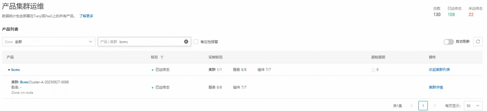

5. 单击**集群详情**，进入详情页面，选择**终态配置**页签。

6. 选择kv.conf，单击**显示内容**查看并保存region值。

   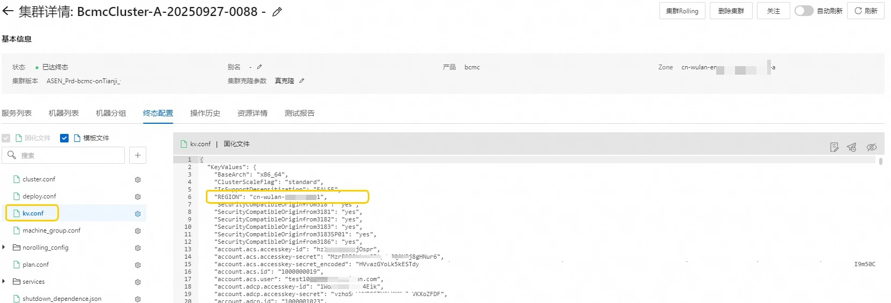

7. 选择**服务列表**页签，单击bcmc服务名称，进入服务bcmc详情页。

   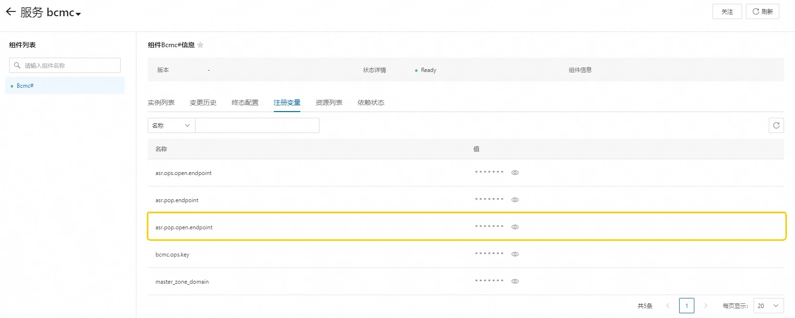

8. 获取asr.pop.open.endpoint的值并保存。

<a id="section-1-2-3"></a>

### 1.2.3. 通过POP网关调用专有云API

通过POP网关调用专有云API简介

<a id="section-1-2-3-1"></a>

#### 1.2.3.1. Python版本

**环境要求**

安装 SDK 核心库 Core ，使用pip安装包依赖

**安装说明代码**

从开发者门户获取SDK包后可使用以下 Mavan 依赖配置进行管理：

```bash
pip install apsarastack_asr20250916.tar.gz
```

**安装说明文档**

**开发者门户获取 SDK**

1. 登录 ASCM 的开发者门户，单击 SDK 示例。


2.SDK 类型下拉选择高级版，选择 Java 语言。

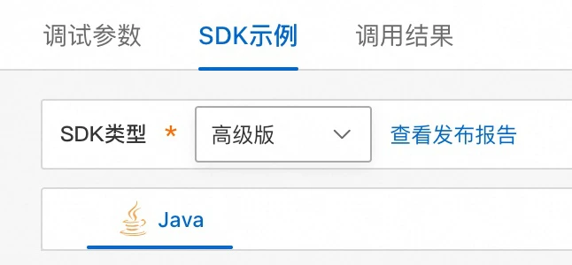

3. 下方可看到示例代码，点击下载完整工程以获取示例项目及 SDK 包。

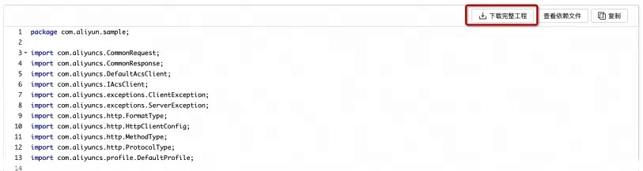

**导入 SDK 包**

1. 通过以下任一方式创建 Maven 项目。

- 方式一：在 IDEA 中添加一个 Maven 项目。

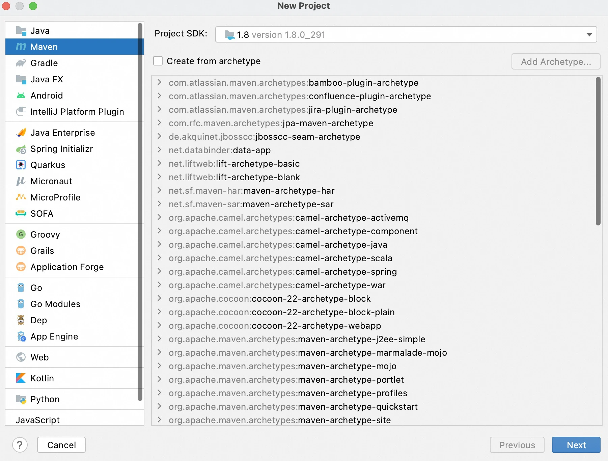

- 方式二：将已有的项目转换为 Maven 项目。

右键单击要转换的项目，并选择**Add Framework Support**

...。

选择 Maven，并单击 OK。

2. 在项目根目录下创建 lib 包，将 Java SDK 包放入到 lib 目录下，如下图。

3. 在项目目录下的 pom.xml 中，添加 Java SDK 依赖，代码请参考上文中《安装说明代码》部分。

4. 查看 IDEA 右侧 Maven 栏，如图所示，表示已成功导入依赖。

**代码示例**

请参考示例，将某个 API 录入，注意保证代码通过，隐私信息泄露。

```python
# -*- coding: utf-8 -*-
# This file is auto-generated, don't edit it. Thanks.
import os
import sys
from typing import List

from alibabacloud_tea_openapi import models as open_api_models
from alibabacloud_tea_util import models as util_models
from alibabacloud_darabonba_env.client import Client as EnvClient
from alibabacloud_tea_console.client import Client as ConsoleClient
from alibabacloud_tea_util.client import Client as UtilClient
from apsarastack_asr20250916.client import Client as SddpClient
from apsarastack_asr20250916 import models as sddp_models


class Sample:

    def __init__(self):
        pass

    @staticmethod
    def create_client(
        access_key_id: str,
        access_key_secret: str,
        region_id: str,
    ) -> SddpClient:
        """
        使⽤AK&SK初始化账号Client
        """
        config = open_api_models.Config()
        # endpoint
        config.endpoint = '<yourEndpoint>'
        # 您的AccessKey ID
        config.access_key_id = access_key_id
        # 您的AccessKey Secret
        config.access_key_secret = access_key_secret
        # 您的可⽤区ID
        config.region_id = region_id

        return SddpClient(config)

    @staticmethod
    def main(
        args: List[str],
    ) -> None:
        # 特殊Header参数,设置组织ID和资源集ID,资源隔离使⽤，请根据实际修改
        # 调⽤专有云API时，⼀般需要提供多个公共Header参数，包括：x-acs-regionid、x-acs-
organizationid、x-acs-resourcegroupid
        # 额外参数需使⽤带WithOptions后缀的⽅法，例：
describeImagesWithOptions(describeImagesRequest, runtime)
        headers = {
            'x-acs-organizationid': '<yourOrganizationId>',
            'x-acs-resourcegroupid': '<yourResourceGroupId>',
            'x-acs-regionId': '<yourRegionId>',
        }
        extends_params = util_models.ExtendsParameters(
            headers=headers
        )
        # 创建并配置 runtimeOptions
        runtime_options = util_models.RuntimeOptions(
            extends_parameters=extends_params
        )

        # 为保障⽣产环境通信安全，建议您保持开启，若在测试环境必须忽略证书校验，可以通过运⾏时参数ignoreSSL设置
        # 忽略对 SSL 证书的验证
        runtime_options.ignore_ssl = True
        client = Sample.create_client('<yourAccessKeyId>', '<yourAccessKeySECRET>', '<yourRegionId>')
        request = sddp_models.ListProtectionGroupRequest()
        request.page_number = 1 // 该参数值为假设值，请您根据实际情况进⾏填写
        request.page_size = 10 // 该参数值为假设值，请您根据实际情况进⾏填写
        request.protection_name = "bcmctest" // 该参数值为假设值，请您根据实际情况进⾏填写
        response = client.list_protection_group_with_options(request, headers, 
runtime_options)

        detail = response.body
        ConsoleClient.log(UtilClient.to_jsonstring(detail))


if __name__ == '__main__':
    Sample().main(sys.argv[1:])
```

**步骤示例**

1. 初始化配置对象Config 。 Config 对象存放 AccessKeyId、AccessKeySecret 、Endpoint 等配置，Endpoint 可以在ASCM的开发者门户查询。

```text
@staticmethod
def create_client(
        access_key_id: str,
        access_key_secret: str,
        region_id: str,
    ) -> SddpClient:
        """
        使⽤AK&SK初始化账号Client
        """
        config = open_api_models.Config()
        # endpoint
        config.endpoint = '<yourEndpoint>'
        # 您的AccessKey ID
        config.access_key_id = access_key_id
        # 您的AccessKey Secret
        config.access_key_secret = access_key_secret
        # 您的可⽤区ID
        config.region_id = region_id

        return SddpClient(config)
```

2. 实例化一个客户端，生成对象 client 。

```text
client = Sample.create_client('<yourAccessKeyId>', '<yourAccessKeySECRET>', 
'<yourRegionId>')
request.page_number = 1 // 该参数值为假设值，请您根据实际情况进⾏填写
request.page_size = 10 // 该参数值为假设值，请您根据实际情况进⾏填写
request.protection_name = "bcmctest" // 该参数值为假设值，请您根据实际情况进⾏填写
```

3. 创建对应 API 的 Request 。 方法的命名规则为 API 方法名加上 Request 。例如获取保护组列表接口ListProtectionGroup， 对应的方法为ListProtectionGroupRequest。

```text
request = sddp_models.ListProtectionGroupRequest()
```

4. 设置调用方法的header和运行时参数

```text
headers = {
            'x-acs-organizationid': '<yourOrganizationId>',
            'x-acs-resourcegroupid': '<yourResourceGroupId>',
            'x-acs-regionId': '<yourRegionId>',
        }
extends_params = util_models.ExtendsParameters(
            headers=headers
        )
# 创建并配置 runtimeOptions
 runtime_options = util_models.RuntimeOptions(
            extends_parameters=extends_params
        )

 # 为保障⽣产环境通信安全，建议您保持开启，若在测试环境必须忽略证书校验，可以通过运⾏时参数ignoreSSL设
置
# 忽略对 SSL 证书的验证
runtime_options.ignore_ssl = True
```

5. 通过 client 对象获得对应 request 响应 response 。

```text
response = client.list_protection_group_with_options(request, headers, runtime_options)detail = response.body
ConsoleClient.log(UtilClient.to_jsonstring(detail))
```

7. 使用 try...except处理报错。

```text
except Exception as e:
    # 处理异常
   logging.error(e)
```

<a id="section-1-2-3-2"></a>

#### 1.2.3.2. Java版本

**环境要求**

支持 JDK8~JDK19，Platform 支持：Linux、Mac、Windows。

**安装说明代码**

从开发者门户获取SDK包后可使用以下 Mavan 依赖配置进行管理：

```xml
<dependency>
       <groupId>com.aliyun.apsarastack</groupId>
       <artifactId>asr20250916</artifactId>
       <version>3.18.6-SP003-SNAPSHOT</version>
</dependency>
```

**安装说明文档**

**开发者门户获取 SDK**

1. 登录 ASCM 的开发者门户，单击 SDK 示例。


2.SDK 类型下拉选择高级版，选择 Java 语言。


3. 下方可看到示例代码，点击下载完整工程以获取示例项目及 SDK 包。


**导入 SDK 包**

1. 通过以下任一方式创建 Maven 项目。

- 方式一：在 IDEA 中添加一个 Maven 项目。


- 方式二：将已有的项目转换为 Maven 项目。

右键单击要转换的项目，并选择**Add Framework Support**

...。

选择 Maven，并单击 OK。

2. 在项目根目录下创建 lib 包，将 Java SDK 包放入到 lib 目录下，如下图。

3. 在项目目录下的 pom.xml 中，添加 Java SDK 依赖，代码请参考上文中《安装说明代码》部分。

4. 查看 IDEA 右侧 Maven 栏，如图所示，表示已成功导入依赖。

**代码示例**

请参考示例，将某个 API 录入，注意保证代码通过，隐私信息泄露。

```java
import com.aliyun.apsarastack.asr20250916.Client;
import com.aliyun.apsarastack.asr20250916.models.*;
import com.aliyun.teautil.models.ExtendsParameters;
import com.aliyun.teautil.models.RuntimeOptions;
import com.google.gson.Gson;

import java.util.HashMap;
import java.util.Map;

public class Sample {
    public static Client createClient() throws Exception {


        //组织或者ASCM⽤户的AK/SK
        com.aliyun.teaopenapi.models.Config config = new 
com.aliyun.teaopenapi.models.Config()
                // 必填
                .setAccessKeyId("<yourAccessKeyID>")
                // 必填
                .setAccessKeySecret("<yourAccessKeySecret>");

        // Endpoint 产品的POP 接⼝对外的域名，
        config.endpoint = "<yourEndpoint>";
        return new Client(config);
    }
    
    public static void main(String[] args_) throws Exception {
        SwitchInstance();
    }
    
    public static void testSwitchInstance() throws Exception {
        Client client = createClient();
        SwitchInstanceRequest switchInstanceRequest = new SwitchInstanceRequest();
        RuntimeOptions runtime = new RuntimeOptions();
        Map<String, String> headers = new HashMap<String, String>();
        // 组织ID, 资源组ID,从ASCM上获取当前账号的组织ID, 资源组ID信息
        headers.put("x-acs-organizationid", "<yourOrganizatioId>");
        headers.put("x-acs-resourcegroupid", "<yourResourceGroupID>");
        headers.put("x-acs-regionId", "<yourRegionID>");
        runtime.ignoreSSL = true;
        runtime.setExtendsParameters(new ExtendsParameters().setHeaders(headers));
        switchInstanceRequest.setProcessId(97);  // 该参数值为假设值，请您根据实际情况进⾏填写
        switchInstanceRequest.setProcessAction("SWITCH");  // 该参数值为假设值，请您根据实际
情况进⾏填写
        switchInstanceRequest.setInstanceIds("oss-instance1");  // 该参数值为假设值，请您根
据实际情况进⾏填写
        try {
            SwitchInstanceResponse response = 
client.switchInstanceWithOptions(switchInstanceRequest,  headers, runtime);
            System.out.println(new Gson().toJson(response.body));
        } catch (Exception error) {
            // 错误 message
            System.out.println(error.getMessage());
        }
    }
}
```

**步骤示例**

1. 初始化配置对象com.aliyun.teaopenapi.models.Config 。 Config 对象存放 AccessKeyId、AccessKeySecret 、Endpoint 等配置，Endpoint 可以在ASCM的开发者门户查询。

```text
//组织或者ASCM⽤户的AK/SK
com.aliyun.teaopenapi.models.Config config = new com.aliyun.teaopenapi.models.Config()
     // 必填
    .setAccessKeyId("<yourAccessKeyID>")
     // 必填
    .setAccessKeySecret("<yourAccessKeySecret>");
// Endpoint 产品的POP 接⼝对外的域名
config.endpoint = "<yourEndpoint>";
```

2. 实例化一个客户端，从 com.aliyun.apsarastack.asr20250916.Client类生成对象 client 。 后续request、response 从 com.aliyun.apsarastack.asr20250916.models 中获得。

```text
Client client = new Client(config);
```

3. 创建对应 API 的 Request 。 类的命名规则为 API 方法名加上 Request 。例如实例切换接口SwitchInstance， 对应的类为SwitchInstanceRequest。

```text
SwitchInstanceRequest switchInstanceRequest = new SwitchInstanceRequest();
```

4. 设置调用方法的参数和header

```text
RuntimeOptions runtime = new RuntimeOptions();
Map<String, String> headers = new HashMap<String, String>();
// 组织ID, 资源组ID,从ASCM上获取当前账号的组织ID, 资源组ID信息
headers.put("x-acs-organizationid", "<yourOrganizatioId>");
headers.put("x-acs-resourcegroupid", "<yourResourceGroupID>");
headers.put("x-acs-regionId", "<yourRegionID>");
runtime.ignoreSSL = true;
runtime.setExtendsParameters(new ExtendsParameters().setHeaders(headers));
switchInstanceRequest.setProcessId(97);  // 该参数值为假设值，请您根据实际情况进⾏填写
switchInstanceRequest.setProcessAction("SWITCH");  // 该参数值为假设值，请您根据实际情况进⾏填
写
switchInstanceRequest.setInstanceIds("oss-instance1");  // 该参数值为假设值，请您根据实际情况
进⾏填写
```

5. 通过 client 对象获得对应 request 响应 response 。

```java
SwitchInstanceResponse response = 
client.switchInstanceWithOptions(switchInstanceRequest,  headers, runtime);
System.out.println(new Gson().toJson(response.body));
```

7. 使用 catch() 处理报错。

```text
except Exception as e:
    # 处理异常
    logging.error(e)
```

<a id="section-1-2-3-3"></a>

#### 1.2.3.3. SDK概览

**概览**

文档中 SDK 关于 API 的示例代码仅供参考，各 API 的完整使用步骤与参数说明请参见开发者门户 SDK 示例和 OpenAPI 文档。

**SDK版本**

| 语言 | 版本号 | 发布时间 | 更新内容 |
| --- | --- | --- | --- |
| Java | 3.18.6-SP003 | 2025/09 | ASR开放保护组API演练接口 |
| Python | 3.18.6-SP003 | 2025/09 | ASR开放保护组API演练接口 |

**API列表**

当前 SDK 支持的 API 列表。

| API名称 | 所在版本 |
| --- | --- |
| ASR.CheckProductInstance.2025-09-16 | v3.18.6 |
| ASR.CloseProcess.2025-09-16 | v3.18.6 |
| ASR.CreateDisasterRecoveryProcess.2025-09-16 | v3.18.6 |
| ASR.CreateDrillProcess.2025-09-16 | v3.18.6 |
| ASR.CreateHdrReverse.2025-09-16 | v3.18.6 |
| ASR.CreateNextProcess.2025-09-16 | v3.18.6 |
| ASR.ExecuteProcess.2025-09-16 | v3.18.6 |
| ASR.GetDrillPlan.2025-09-16 | v3.18.6 |
| ASR.GetInstanceStatus.2025-09-16 | v3.18.6 |
| ASR.GetPrevProcess.2025-09-16 | v3.18.6 |
| ASR.GetProcessCheck.2025-09-16 | v3.18.6 |
| ASR.GetProcessDetail.2025-09-16 | v3.18.6 |
| ASR.GetProcessEntry.2025-09-16 | v3.18.6 |
| ASR.GetProcessTrace.2025-09-16 | v3.18.6 |
| ASR.GetProtectionGroup.2025-09-16 | v3.18.6 |
| ASR.GetZoneInfo.2025-09-16 | v3.18.6 |
| ASR.ListDrillPlan.2025-09-16 | v3.18.6 |
| ASR.ListDrillProcesses.2025-09-16 | v3.18.6 |
| ASR.ListProcesses.2025-09-16 | v3.18.6 |
| ASR.ListProtectionGroup.2025-09-16 | v3.18.6 |
| ASR.ListProtectionGroupStatistics.2025-09-16 | v3.18.6 |
| ASR.ListProtectionGroupStatus.2025-09-16 | v3.18.6 |
| ASR.SetProcessSwitchStep.2025-09-16 | v3.18.6 |
| ASR.SwitchInstance.2025-09-16 | v3.18.6 |

**可用性说明**

在之前版本曾提供过的 API 中，有部分已不推荐使用，有部分已废弃不支持。本文主要阐述不推荐使用和已不支持的 API 情况。

- 对于不推荐使用的 API，并且仍会在 API 参考中阐述该接口的调用方法，IDE 中会带有过时标记。一般情况下，不推荐使用的 API 将不再在后续专有云版本中继续提供支持。

- 对于已不支持的 API，大部分均不存在替代接口，且不会在 API 参考中阐述该接口的调用方法；少部分已不支持的 API 有功能相似的替代 API 提供使用。

IDEA 会带上过时标记方便开发人员注意到过时 API，新用户不应该再使用这些接口。

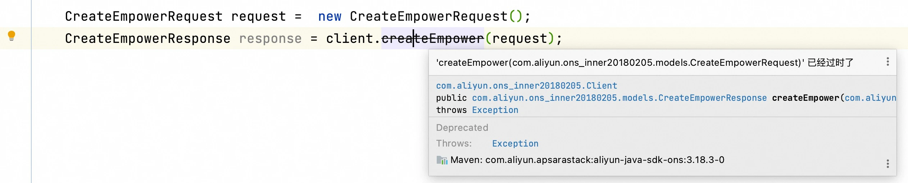

<a id="section-1-3"></a>

## 1.3. API参考

这是 API 参考内容

<a id="section-1-3-1"></a>

### 1.3.1. 保护组

<a id="section-1-3-1-1"></a>

#### 1.3.1.1. ListProtectionGroup

该接口用于列出保护组的清单, 包括保护组的创建信息、涉及示例信息和当前状态。

接口说明

**准备工作**

该接口用于列出保护组的清单, 支持全量进行查询，如果传入参数如PageNumber， 支持按照条件进行筛选。

**请求头**

该接口使用公共请求头，无特殊请求头。请参见公共请求参数文档。

**请求语法**

```http
POST /api/pop/v1/listProtectionGroup HTTP/1.1
```

**请求参数**

| 参数名称 | 类型 | 位置 | 是否必选 | 示例 | 说明 |
| --- | --- | --- | --- | --- | --- |
| PageNum ber | Integ er | Body | 否 | 1 | 页码。 |
| PageSize | Integ er | Body | 否 | 10 | 每页条数。 |
| Protection Name | Strin g | Body | 否 | test | 保护组名称 |
| CheckStat us | Strin g | Body | 否 | NORMAL | 检查状态 |
| Protection GroupId | Integ er | Body | 否 | 10 | 保护组id |

**返回数据**

| 参数名称 | 类型 | 示例 | 说明 |
| --- | --- | --- | --- |
| Data | Array | {} | 返回数据。 |
| -ProtectionGrou pId | Integer | 10 | 保护组id |
| -ProtectionNam e | String | test | 保护组名 |
| -Description | String | test | 描述 |
| -CheckStatus | String | NORMAL | 检查状态 |
| -GmtCreate | Long | 1756107183000 | 创建时间 |
| -GmtModified | Long | 1756107183000 | 修改时间 |
| -CreateUid | String | 999999999 | 创建账号id |
| -AccountId | String | 999999999 | 主账号 |
| -Instances | String | rm-xxx | 实例名 |
| RequestId | String | F0A8A039-930D-5EC1-97C8-\*\*\*\*\*\*\*\*\*\*\*\* | 请求ID。 |
| Success | Boolean | true | 返回状态。<br>• 成功：true。<br>• 失败：false。 |
| Code | String | 200 | 状态码。 200：调用正常。 |
| Message | String | success | 返回信息。 |
| ErrorMessage | String | "" | 错误信息。 |
| ErrorCode | String | 500 | 错误码。 |
| Path | String | /xxx/ | 请求路径。 |
| Cost | Long | 20 | 接口耗时，单位：毫秒（ms）。 |
| TotalCount | Integer | 100 | 列表条目数。 |
| PageNumber | Integer | 1 | 页码。 |
| PageSize | Integer | 10 | 每页行数。 |

**示例**

请求示例

```http
POST /api/pop/v1/listProtectionGroup HTTP/1.1
{

}
```

正常返回示例

`JSON`  格式

```json
{
 "Path":"/xxx/",
 "TotalCount":100,
 "RequestId":"F0A8A039-930D-5EC1-97C8-************",
 "Message":"success",
 "PageSize":10,
 "PageNumber":1,
 "Data":[
  {
   "Instances":"rm-xxx",
   "GmtCreate":1756107183000,
   "Description":"test",
   "AccountId":"999999999",
   "ProtectionGroupId":10,
   "ProtectionName":"test",
   "CheckStatus":"NORMAL",
   "GmtModified":1756107183000,
   "CreateUid":"999999999"
  }
 ],
 "ErrorCode":"500",
 "ErrorMessage":"\"\"",
 "Code":"200",
 "Cost":20,
 "Success":true
}
```

`XML`  格式

```xml
<Path>/xxx/</Path>
<TotalCount>100</TotalCount>
<RequestId>F0A8A039-930D-5EC1-97C8-************</RequestId>
<Message>success</Message>
<PageSize>10</PageSize>
<PageNumber>1</PageNumber>
<Data>
 <Instances>rm-xxx</Instances>
 <GmtCreate>1756107183000</GmtCreate>
 <Description>test</Description>
 <AccountId>999999999</AccountId>
 <ProtectionGroupId>10</ProtectionGroupId>
 <ProtectionName>test</ProtectionName>
 <CheckStatus>NORMAL</CheckStatus>
 <GmtModified>1756107183000</GmtModified>
 <CreateUid>999999999</CreateUid>
</Data>
<ErrorCode>500</ErrorCode>
<ErrorMessage>&quot;&quot;</ErrorMessage>
<Code>200</Code>
<Cost>20</Cost>
<Success>true</Success>
```

<a id="section-1-3-1-2"></a>

#### 1.3.1.2. ListProtectionGroupStatistics

该接口用于查询保护组的概览信息， 包含保护组的切换次数、涉及产品、示例和上次演练时间等。

接口说明

**准备工作**

该接口用于查询保护组的概览信息， 包含保护组的切换次数、涉及产品、示例和上次演练时间等，使用该接口需要传入保护组ID, 可以通过ListProtectionGroup 接口查询。

**请求头**

该接口使用公共请求头，无特殊请求头。请参见公共请求参数文档。

**请求语法**

```http
POST /api/pop/v1/listProtectionGroupStatistics HTTP/1.1
```

**请求参数**

| 参数名称 | 类型 | 位置 | 是否必选 | 示例 | 说明 |
| --- | --- | --- | --- | --- | --- |
| Protection GroupIds | Strin g | Body | 是 | 12 | 保护组ID |

**返回数据**

| 参数名称 | 类型 | 示例 | 说明 |
| --- | --- | --- | --- |
| RequestId | String | F0A8A039-930D-5EC1-97C8-\*\*\*\*\*\*\*\*\*\*\*\* | 请求ID。 |
| Success | Boolean | true | 返回状态。<br>• 成功：true。<br>• 失败：false。 |
| Code | String | 200 | 状态码。 200：调用正常。 |
| Message | String | success | 返回信息。 |
| ErrorMessage | String | "" | 错误信息。 |
| ErrorCode | String | 500 | 错误码。 |
| Path | String | /xxx/ | 请求路径。 |
| Cost | Long | 20 | 接口耗时，单位：毫秒（ms）。 |
| Data | Struct | {} | 返回数据。 |
| -Instances | Array | \[\] | 实例内容 |
| --Product | String | RDS | 云产品。 |
| --NormalCount | Integer | 10 | 产品正常实例数 |
| --AbnormalCoun t | Integer | 10 | 产品异常实例数 |
| -DrillPlanCount | Integer | 10 | 演练计划数量 |
| -DrillCount | Integer | 10 | 演练次数 |
| -DrillSuccess | Integer | 10 | 演练成功次数 |
| -DrillFailure | Integer | 10 | 演练失败次数 |
| -CrashPlanCou nt | Integer | 10 | 应急计划数量 |
| -CrashCount | Integer | 10 | 应急次数 |
| -CrashSuccess | Integer | 10 | 应急成功次数 |
| -CrashFailure | Integer | 10 | 应急失败次数 |
| -SwitchCheckC ount | Integer | 10 | 切换检查次数 |
| -RecoveryChec kCount | Integer | 10 | 恢复检查次数 |
| -SwitchBackCh eckCount | Integer | 10 | 回切检查次数 |
| -SwitchCount | Integer | 10 | 切换次数 |
| -SwitchBackCo unt | Integer | 10 | 回切次数 |
| -NonProcessCo unt | Integer | 10 | 无流程个数 |

**示例**

请求示例

```http
POST /api/pop/v1/listProtectionGroupStatistics HTTP/1.1
{
"ProtectionGroupIds":"12"
}
```

正常返回示例

`JSON`  格式

```json
{
 "Path":"/xxx/",
 "RequestId":"F0A8A039-930D-5EC1-97C8-************",
 "Message":"success",
 "Data":{
  "SwitchCheckCount":10,
  "CrashPlanCount":10,
  "SwitchBackCheckCount":10,
  "CrashCount":10,
  "Instances":[
   {
    "NormalCount":10,
    "Product":"RDS",
    "AbnormalCount":10
   }
  ],
  "DrillPlanCount":10,
  "NonProcessCount":10,
  "SwitchBackCount":10,
  "DrillCount":10,
  "CrashSuccess":10,
  "SwitchCount":10,
  "CrashFailure":10,
  "DrillFailure":10,
  "RecoveryCheckCount":10,
  "DrillSuccess":10
 },
 "ErrorCode":"500",
 "ErrorMessage":"\"\"",
 "Code":"200",
 "Cost":20,
 "Success":true
}
```

`XML`  格式

```xml
<Path>/xxx/</Path>
<RequestId>F0A8A039-930D-5EC1-97C8-************</RequestId>
<Message>success</Message>
<Data>
 <SwitchCheckCount>10</SwitchCheckCount>
 <CrashPlanCount>10</CrashPlanCount>
 <SwitchBackCheckCount>10</SwitchBackCheckCount>
 <CrashCount>10</CrashCount>
 <Instances>
  <NormalCount>10</NormalCount>
  <Product>RDS</Product>
  <AbnormalCount>10</AbnormalCount>
 </Instances>
 <DrillPlanCount>10</DrillPlanCount>
 <NonProcessCount>10</NonProcessCount>
 <SwitchBackCount>10</SwitchBackCount>
 <DrillCount>10</DrillCount>
 <CrashSuccess>10</CrashSuccess>
 <SwitchCount>10</SwitchCount>
 <CrashFailure>10</CrashFailure>
 <DrillFailure>10</DrillFailure>
 <RecoveryCheckCount>10</RecoveryCheckCount>
 <DrillSuccess>10</DrillSuccess>
</Data>
<ErrorCode>500</ErrorCode>
<ErrorMessage>&quot;&quot;</ErrorMessage>
<Code>200</Code>
<Cost>20</Cost>
<Success>true</Success>
```

<a id="section-1-3-1-3"></a>

#### 1.3.1.3. ListProtectionGroupStatus

该接口用于列出保护组的状态, 主要用于获取当前保护组的状态是否正常。

接口说明

**注意事项**

接口返回信息中的 CanEdit 字段仅供前端白屏使用， 使用API 调用无需关注。

**请求头**

该接口使用公共请求头，无特殊请求头。请参见公共请求参数文档。

**请求语法**

```http
POST /api/pop/v1/listProtectionGroupStatus HTTP/1.1
```

**请求参数**

| 参数名称 | 类型 | 位置 | 是否必选 | 示例 | 说明 |
| --- | --- | --- | --- | --- | --- |
| Protection GroupIds | Strin g | Body | 是 | 10 | 保护组id。 |

**返回数据**

| 参数名称 | 类型 | 示例 | 说明 |
| --- | --- | --- | --- |
| Data | Array | {} | 返回数据。 |
| -ProtectionGrou pId | Integer | 10 | 保护组ID。 |
| -Status | String | Normal | 保护组状态。 |
| -CanEdit | Boolean | true | 是否可编辑 |
| RequestId | String | F0A8A039-930D-5EC1-97C8-\*\*\*\*\*\*\*\*\*\*\*\* | 请求ID。 |
| Success | Boolean | true | 返回状态。<br>• 成功：true。<br>• 失败：false。 |
| Code | String | 200 | 状态码。 200：调用正常。 |
| Message | String | success | 返回信息。 |
| ErrorMessage | String | "" | 错误信息。 |
| ErrorCode | String | 500 | 错误码。 |
| Path | String | /xxx/ | 请求路径。 |
| Cost | Long | 20 | 接口耗时，单位：毫秒（ms）。 |

**示例**

请求示例

```http
POST /api/pop/v1/listProtectionGroupStatus HTTP/1.1
{
"ProtectionGroupIds":"10"
}
```

正常返回示例

`JSON`  格式

```json
{
 "Path":"/xxx/",
 "RequestId":"F0A8A039-930D-5EC1-97C8-************",
 "Message":"success",
 "Data":[
  {
   "Status":"Normal",
   "ProtectionGroupId":10,
   "CanEdit":true
  }
 ],
 "ErrorCode":"500",
 "ErrorMessage":"\"\"",
 "Code":"200",
 "Cost":20,
 "Success":true
}
```

`XML`  格式

```xml
<Path>/xxx/</Path>
<RequestId>F0A8A039-930D-5EC1-97C8-************</RequestId>
<Message>success</Message>
<Data>
 <Status>Normal</Status>
 <ProtectionGroupId>10</ProtectionGroupId>
 <CanEdit>true</CanEdit>
</Data>
<ErrorCode>500</ErrorCode>
<ErrorMessage>&quot;&quot;</ErrorMessage>
<Code>200</Code>
<Cost>20</Cost>
<Success>true</Success>
```

<a id="section-1-3-1-4"></a>

#### 1.3.1.4. GetProtectionGroup

获取保护组的详细信息， 包括保护组中包含的产品信息和添加到保护组的实例信息

接口说明

**准备工作**

调用该接口需要传递ProtectionGroupId 参数， 建议先根据ListProtectionGroup的接口获取所有的保护组列表信息，根据实际创建的保护组名字获取对应的ProtectionGroupId 参数。

**请求头**

该接口使用公共请求头，无特殊请求头。请参见公共请求参数文档。

**请求语法**

```http
POST /api/pop/v1/getProtectionGroup HTTP/1.1
```

**请求参数**

| 参数名称 | 类型 | 位置 | 是否必选 | 示例 | 说明 |
| --- | --- | --- | --- | --- | --- |
| Protection GroupId | Integ er | Body | 是 | 10 | 保护组id。 |

**返回数据**

| 参数名称 | 类型 | 示例 | 说明 |
| --- | --- | --- | --- |
| RequestId | String | F0A8A039-930D-5EC1-97C8 | 请求ID。 |
| Success | Boolean | true | 返回状态。<br>• 成功：true。<br>• 失败：false。 |
| Code | String | 200 | 请求返回代码，如为200则请求成功。 |
| Message | String | success | 附加信息。 |
| ErrorMessage | String | "" | 错误信息。 |
| ErrorCode | String | 500 | 错误码。 |
| Path | String | /xxx/xx | 请求路径。 |
| Cost | Long | 30 | 接口耗时，单位：毫秒（ms）。 |
| Data | Struct | {} | 返回数据。 |
| -Instances | Array | \[\] | 实例列表。 |
| --ZoneInfo | String | cn-wulan-env10-amtest10000-a | 可用区信息。 |
| --InstanceId | String | "rm-xx" | 实例ID。 |
| --InstanceAlias | String | "rm-xx" | 实例别名。 |
| --Product | String | RDS | 云产品Code。 |
| --MasterLocatio n | String | cn-wulan-env10-amtest10000-a | 主节点位置 |
| --CheckStatus | String | NORMAL | 示例状态。 |
| --CheckTime | Long | 1635143903000 | 最近检查时间戳。 |
| --Result | String | success | 返回结果。 |
| --Info | String | “ ” | 返回信息。 |
| -Id | Integer | 10 | 保护组id。 |
| -ProtectionNam e | String | test | 保护组名字。 |
| -Description | String | test | 描述。 |
| -CheckStatus | String | NORMAL | 检查状态。 |
| -GmtCreate | Long | 1756107183000 | 创建时间。 |
| -GmtModified | Long | 1756107183000 | 修改时间。 |
| -AccountId | String | 999999999 | 主账号id。 |
| -CreateUid | String | 999999999 | 创建人uid |
| -CanEdit | Boolean | true | 是否能编辑。 |

**示例**

请求示例

```http
POST /api/pop/v1/getProtectionGroup HTTP/1.1
{
"ProtectionGroupId":"10"
}
```

正常返回示例

`JSON`  格式

```json
{
 "Path":"/xxx/xx",
 "RequestId":"F0A8A039-930D-5EC1-97C8",
 "Message":"success",
 "Data":{
  "GmtCreate":1756107183000,
  "Description":"test",
  "AccountId":"999999999",
  "Instances":[
   {
    "MasterLocation":"cn-wulan-env10-amtest10000-a",
    "CheckTime":1635143903000,
    "InstanceId":"\"rm-xx\"",
    "InstanceAlias":"\"rm-xx\"",
    "CheckStatus":"NORMAL",
    "Product":"RDS",
    "Info":"“ ”",
    "ZoneInfo":"cn-wulan-env10-amtest10000-a",
    "Result":"success"
   }
  ],
  "ProtectionName":"test",
  "CheckStatus":"NORMAL",
  "GmtModified":1756107183000,
  "CreateUid":"999999999",
  "Id":10,
  "CanEdit":true
 },
 "ErrorCode":"500",
 "ErrorMessage":"\"\"",
 "Code":"200",
 "Cost":30,
 "Success":true
}
```

`XML`  格式

```xml
<Path>/xxx/xx</Path>
<RequestId>F0A8A039-930D-5EC1-97C8</RequestId>
<Message>success</Message>
<Data>
 <GmtCreate>1756107183000</GmtCreate>
 <Description>test</Description>
 <AccountId>999999999</AccountId>
 <Instances>
  <MasterLocation>cn-wulan-env10-amtest10000-a</MasterLocation>
  <CheckTime>1635143903000</CheckTime>
  <InstanceId>&quot;rm-xx&quot;</InstanceId>
  <InstanceAlias>&quot;rm-xx&quot;</InstanceAlias>
  <CheckStatus>NORMAL</CheckStatus>
  <Product>RDS</Product>
  <Info>“ ”</Info>
  <ZoneInfo>cn-wulan-env10-amtest10000-a</ZoneInfo>
  <Result>success</Result>
 </Instances>
 <ProtectionName>test</ProtectionName>
 <CheckStatus>NORMAL</CheckStatus>
 <GmtModified>1756107183000</GmtModified>
 <CreateUid>999999999</CreateUid>
 <Id>10</Id>
 <CanEdit>true</CanEdit>
</Data>
<ErrorCode>500</ErrorCode>
<ErrorMessage>&quot;&quot;</ErrorMessage>
<Code>200</Code>
<Cost>30</Cost>
<Success>true</Success>
```

<a id="section-1-3-1-5"></a>

#### 1.3.1.5. CheckProductInstance

该接口用于检查产品实例状态, 实例是否容灾， 根据返回的实例信息可以判断实例是否支持容灾切换。

接口说明

**准备工作**

使用该接口时， 请确认传入的实例信息归属组织， ASR侧并不进行实例的组织校验，请提前校验，避免越权问题。

**请求头**

该接口使用公共请求头，无特殊请求头。请参见公共请求参数文档。

**请求语法**

```http
POST /api/pop/v1/checkProductInstance HTTP/1.1
```

**请求参数**

| 参数名称 | 类型 | 位置 | 是否必选 | 示例 | 说明 |
| --- | --- | --- | --- | --- | --- |
| CloudProd uct | Strin g | Body | 是 | RDS | 云产品。 |
| InstanceId s | Strin g | Body | 是 | rm-2ze8g2am97624 | 实例ID。 |

**返回数据**

| 参数名称 | 类型 | 示例 | 说明 |
| --- | --- | --- | --- |
| RequestId | String | F0A8A039-930D-5EC1-97C8 | 请求ID。 |
| Success | Boolean | true | 返回状态。<br>• 成功：true。<br>• 失败：false。 |
| Code | String | 200 | 状态码。 200：调用正常。 |
| Message | String | success | 返回信息。 |
| ErrorMessage | String | "" | 错误信息。 |
| ErrorCode | String | 500 | 错误码。 |
| Path | String | /xxx/xxx | 请求路径。 |
| Cost | Long | 20 | 接口耗时，单位：毫秒（ms）。 |
| Data | Struct | {} | 返回数据。 |
| -Instances | Array | \[\] | 实例列表。 |
| --InstanceId | String | rm-2ze8g2am97624 | 实例ID。 |
| --Available | Boolean | true | 是否可用 |
| --Message | String | message | 返回信息。 |
| -CloudProduct | String | RDS | 云产品。 |

**示例**

请求示例

```http
POST /api/pop/v1/checkProductInstance HTTP/1.1
{
"CloudProduct":"RDS",
"InstanceIds":"rm-2ze8g2am97624"
}
```

正常返回示例

`JSON`  格式

```json
{
 "Path":"/xxx/xxx",
 "RequestId":"F0A8A039-930D-5EC1-97C8",
 "Message":"success",
 "Data":{
  "Instances":[
   {
    "Message":"message",
    "InstanceId":"rm-2ze8g2am97624",
    "Available":true
   }
  ],
  "CloudProduct":"RDS"
 },
 "ErrorCode":"500",
 "ErrorMessage":"\"\"",
 "Code":"200",
 "Cost":20,
 "Success":true
}
```

`XML`  格式

```xml
<Path>/xxx/xxx</Path>
<RequestId>F0A8A039-930D-5EC1-97C8</RequestId>
<Message>success</Message>
<Data>
 <Instances>
  <Message>message</Message>
  <InstanceId>rm-2ze8g2am97624</InstanceId>
  <Available>true</Available>
 </Instances>
 <CloudProduct>RDS</CloudProduct>
</Data>
<ErrorCode>500</ErrorCode>
<ErrorMessage>&quot;&quot;</ErrorMessage>
<Code>200</Code>
<Cost>20</Cost>
<Success>true</Success>
```

<a id="section-1-3-1-6"></a>

#### 1.3.1.6. GetZoneInfo

该接口用于获取创建演练计划时可选的可用区信息。

接口说明

**准备工作**

该接口用于获取创建演练计划时可选的可用区信息, 用于保护组创建时获取可选的可用区时使用。

**请求头**

该接口使用公共请求头，无特殊请求头。请参见公共请求参数文档。

**请求语法**

```http
POST /api/pop/v1/getZoneInfo HTTP/1.1
```

**返回数据**

| 参数名称 | 类型 | 示例 | 说明 |
| --- | --- | --- | --- |
| RequestId | String | F0A8A039-930D-5EC1-97C8-\*\*\*\*\*\*\*\*\*\*\*\* | 请求ID。 |
| Success | Boolean | true | 返回状态。<br>• 成功：true。<br>• 失败：false。 |
| Code | String | 200 | 状态码。 200：调用正常。 |
| Message | String | success | 返回信息。 |
| ErrorMessage | String | "" | 错误信息。 |
| ErrorCode | String | 500 | 错误码。 |
| Path | String | /xxx/ | 请求路径。 |
| Cost | Long | 20 | 接口耗时，单位：毫秒（ms）。 |
| Data | Struct | {} | 返回数据。 |
| -ZoneInfo | String | cn-wulan-env10-amtest10000-a | 可用区信息。 |

**示例**

请求示例

```http
POST /api/pop/v1/getZoneInfo HTTP/1.1
```

正常返回示例

`JSON`  格式

```json
{
 "Path":"/xxx/",
 "RequestId":"F0A8A039-930D-5EC1-97C8-************",
 "Message":"success",
 "Data":{
  "ZoneInfo":"cn-wulan-env10-amtest10000-a"
 },
 "ErrorCode":"500",
 "ErrorMessage":"\"\"",
 "Code":"200",
 "Cost":20,
 "Success":true
}
```

`XML`  格式

```xml
<Path>/xxx/</Path>
<RequestId>F0A8A039-930D-5EC1-97C8-************</RequestId>
<Message>success</Message>
<Data>
 <ZoneInfo>cn-wulan-env10-amtest10000-a</ZoneInfo>
</Data>
<ErrorCode>500</ErrorCode>
<ErrorMessage>&quot;&quot;</ErrorMessage>
<Code>200</Code>
<Cost>20</Cost>
<Success>true</Success>
```

<a id="section-1-3-2"></a>

### 1.3.2. 演练计划

<a id="section-1-3-2-1"></a>

#### 1.3.2.1. ListProcesses

该接口用于列出演练流程的步骤信息，包括流程的类型、执行模式和当前状态。

接口说明

**准备工作**

该接口支持查询全部的流程信息， 查询所有流程信息时无需传入参数。 如果想要单独查询某个流程的信息，需要传入流程的ProcessId参数。该接口专用于升级场景的资源处理， 客户使用API可以使用ListDrillProcesses 接口。

**请求头**

该接口使用公共请求头，无特殊请求头。请参见公共请求参数文档。

**请求语法**

```http
POST /api/pop/v1/listProcesses HTTP/1.1
```

**请求参数**

| 参数名称 | 类型 | 位置 | 是否必选 | 示例 | 说明 |
| --- | --- | --- | --- | --- | --- |
| ProcessId | Integ er | Body | 否 | 1 | 流程ID。 |
| PlanName | Strin g | Body | 否 | test | 计划名。 |
| Execution Mode | Strin g | Body | 否 | MANUAL | 执行模式， |
| ProcessSt atus | Strin g | Body | 否 | EXECUTING | 流程状态。 |
| PageNum ber | Integ er | Body | 否 | 1 | 页码。 |
| PageSize | Integ er | Body | 否 | 100 | 每页条数。 |

**返回数据**

| 参数名称 | 类型 | 示例 | 说明 |
| --- | --- | --- | --- |
| Data | Array | {} | 返回数据。 |
| -PgId | Integer | 10 | 保护组id |
| -PlanId | Integer | 16 | 演练计划ID. |
| -PlanName | String | test | 计划名称。 |
| -Zone | String | cn-wulan-env10-amtest10000-a | 可用区。 |
| -ProcessId | Integer | 5 | 流程id. |
| -ProcessType | String | DRILL_RECOVERY | 流程类型。 |
| -ProtectionNam e | String | test | 保护组名。 |
| -ExecutionMod e | String | MANUAL | 执行模式。 |
| -ProcessStatus | String | EXECUTING | 流程状态 |
| -AccountId | String | 999999999 | 主账号id |
| -CreateUid | String | 999999999 | 创建uid |
| -StartTime | Long | 1756112392000 | 开始时间。 |
| -EndTime | Long | 1756112392000 | 结束时间。 |
| -OrderId | Integer | 9 | 排序字段。 |
| RequestId | String | F0A8A039-930D-5EC1-97C8-\*\*\*\*\*\*\*\*\*\*\*\* | 请求ID。 |
| Success | Boolean | true | 返回状态。<br>• 成功：true。<br>• 失败：false。 |
| Code | String | 200 | 状态码。 200：调用正常。 |
| Message | String | success | 返回信息。 |
| ErrorMessage | String | "" | 错误信息。 |
| ErrorCode | String | 500 | 错误码。 |
| Path | String | /xxx/ | 请求路径。 |
| Cost | Long | 20 | 接口耗时，单位：毫秒（ms）。 |
| TotalCount | Integer | 100 | 列表条目数。 |
| PageNumber | Integer | 1 | 页码。 |
| PageSize | Integer | 10 | 每页行数。 |

**示例**

请求示例

```http
POST /api/pop/v1/listProcesses HTTP/1.1
{

}
```

正常返回示例

`JSON`  格式

```json
{
 "Path":"/xxx/",
 "TotalCount":100,
 "RequestId":"F0A8A039-930D-5EC1-97C8-************",
 "Message":"success",
 "PageSize":10,
 "PageNumber":1,
 "Data":[
  {
   "AccountId":"999999999",
   "EndTime":1756112392000,
   "ProcessStatus":"EXECUTING",
   "Zone":"cn-wulan-env10-amtest10000-a",
   "PlanId":16,
   "CreateUid":"999999999",
   "StartTime":1756112392000,
   "ExecutionMode":"MANUAL",
   "PlanName":"test",
   "OrderId":9,
   "ProcessType":"DRILL_RECOVERY",
   "PgId":10,
   "ProtectionName":"test",
   "ProcessId":5
  }
 ],
 "ErrorCode":"500",
 "ErrorMessage":"\"\"",
 "Code":"200",
 "Cost":20,
 "Success":true
}
```

`XML`  格式

```xml
<Path>/xxx/</Path>
<TotalCount>100</TotalCount>
<RequestId>F0A8A039-930D-5EC1-97C8-************</RequestId>
<Message>success</Message>
<PageSize>10</PageSize>
<PageNumber>1</PageNumber>
<Data>
 <AccountId>999999999</AccountId>
 <EndTime>1756112392000</EndTime>
 <ProcessStatus>EXECUTING</ProcessStatus>
 <Zone>cn-wulan-env10-amtest10000-a</Zone>
 <PlanId>16</PlanId>
 <CreateUid>999999999</CreateUid>
 <StartTime>1756112392000</StartTime>
 <ExecutionMode>MANUAL</ExecutionMode>
 <PlanName>test</PlanName>
 <OrderId>9</OrderId>
 <ProcessType>DRILL_RECOVERY</ProcessType>
 <PgId>10</PgId>
 <ProtectionName>test</ProtectionName>
 <ProcessId>5</ProcessId>
</Data>
<ErrorCode>500</ErrorCode>
<ErrorMessage>&quot;&quot;</ErrorMessage>
<Code>200</Code>
<Cost>20</Cost>
<Success>true</Success>
```

<a id="section-1-3-2-2"></a>

#### 1.3.2.2. ListDrillProcesses

该接口用于列出演练流程的步骤信息，包括流程的类型、执行模式和当前状态。

接口说明

**准备工作**

该接口支持查询全部的演练流程信息， 查询所有流程信息时无需传入参数。 如果想要单独查询某个流程的信息，需要传入流程的ProcessId参数。

**请求头**

该接口使用公共请求头，无特殊请求头。请参见公共请求参数文档。

**请求语法**

```http
POST /api/pop/v1/listDrillProcesses HTTP/1.1
```

**请求参数**

| 参数名称 | 类型 | 位置 | 是否必选 | 示例 | 说明 |
| --- | --- | --- | --- | --- | --- |
| ProcessId | Integ er | Body | 否 | 1 | 流程ID。 |
| PlanName | Strin g | Body | 否 | test | 计划名。 |
| Execution Mode | Strin g | Body | 否 | MANUAL | 执行模式， |
| ProcessSt atus | Strin g | Body | 否 | EXECUTING | 流程状态。 |
| PageNum ber | Integ er | Body | 否 | 1 | 页码。 |
| PageSize | Integ er | Body | 否 | 10 | 每页条数。 |

**返回数据**

| 参数名称 | 类型 | 示例 | 说明 |
| --- | --- | --- | --- |
| Data | Array | {} | 返回数据。 |
| -PgId | Integer | 1 | 保护组id |
| -PlanId | Integer | 1 | 演练计划ID. |
| -PlanName | String | test | 计划名称。 |
| -Zone | String | cn-wulan-env10-amtest10000-a | 可用区。 |
| -ProcessId | Integer | 5 | 流程id. |
| -ProcessType | String | DRILL_RECOVERY | 流程类型。 |
| -ProtectionNam e | String | test | 保护组名。 |
| -ExecutionMod e | String | MANUAL | 执行模式。 |
| -ProcessStatus | String | EXECUTING | 流程状态 |
| -AccountId | String | 999999999 | 主账号id |
| -CreateUid | String | 999999999 | 创建uid |
| -StartTime | Long | 1756112392000 | 开始时间。 |
| -EndTime | Long | 1756112392000 | 结束时间。 |
| -OrderId | Integer | 9 | 排序字段。 |
| RequestId | String | F0A8A039-930D-5EC1-97C8-\*\*\*\*\*\*\*\*\*\*\*\* | 请求ID。 |
| Success | Boolean | true | 返回状态。<br>• 成功：true。<br>• 失败：false。 |
| Code | String | 200 | 状态码。 200：调用正常。 |
| Message | String | success | 返回信息。 |
| ErrorMessage | String | "" | 错误信息。 |
| ErrorCode | String | 500 | 错误码。 |
| Path | String | /xxx/ | 请求路径。 |
| Cost | Long | 1000 | 接口耗时，单位：毫秒（ms）。 |
| TotalCount | Integer | 100 | 列表条目数。 |
| PageNumber | Integer | 1 | 页码。 |
| PageSize | Integer | 10 | 每页行数。 |

**示例**

请求示例

```http
POST /api/pop/v1/listDrillProcesses HTTP/1.1
{

}
```

正常返回示例

`JSON`  格式

```json
{
 "Path":"/xxx/",
 "TotalCount":100,
 "RequestId":"F0A8A039-930D-5EC1-97C8-************",
 "Message":"success",
 "PageSize":10,
 "PageNumber":1,
 "Data":[
  {
   "AccountId":"999999999",
   "EndTime":1756112392000,
   "ProcessStatus":"EXECUTING",
   "Zone":"cn-wulan-env10-amtest10000-a",
   "PlanId":1,
   "CreateUid":"999999999",
   "StartTime":1756112392000,
   "ExecutionMode":"MANUAL",
   "PlanName":"test",
   "OrderId":9,
   "ProcessType":"DRILL_RECOVERY",
   "PgId":1,
   "ProtectionName":"test",
   "ProcessId":5
  }
 ],
 "ErrorCode":"500",
 "ErrorMessage":"\"\"",
 "Code":"200",
 "Cost":1000,
 "Success":true
}
```

`XML`  格式

```xml
<Path>/xxx/</Path>
<TotalCount>100</TotalCount>
<RequestId>F0A8A039-930D-5EC1-97C8-************</RequestId>
<Message>success</Message>
<PageSize>10</PageSize>
<PageNumber>1</PageNumber>
<Data>
 <AccountId>999999999</AccountId>
 <EndTime>1756112392000</EndTime>
 <ProcessStatus>EXECUTING</ProcessStatus>
 <Zone>cn-wulan-env10-amtest10000-a</Zone>
 <PlanId>1</PlanId>
 <CreateUid>999999999</CreateUid>
 <StartTime>1756112392000</StartTime>
 <ExecutionMode>MANUAL</ExecutionMode>
 <PlanName>test</PlanName>
 <OrderId>9</OrderId>
 <ProcessType>DRILL_RECOVERY</ProcessType>
 <PgId>1</PgId>
 <ProtectionName>test</ProtectionName>
 <ProcessId>5</ProcessId>
</Data>
<ErrorCode>500</ErrorCode>
<ErrorMessage>&quot;&quot;</ErrorMessage>
<Code>200</Code>
<Cost>1000</Cost>
<Success>true</Success>
```

<a id="section-1-3-2-3"></a>

#### 1.3.2.3. CloseProcess

该接口用于关闭流程,在保护组演练流程执行完之后关闭， 或者在异常情况下提前关闭流程。

接口说明

**准备工作**

该接口用于关闭流程， 需要提前获取流程的ProcessId。

**请求头**

该接口使用公共请求头，无特殊请求头。请参见公共请求参数文档。

**请求语法**

```http
POST /api/pop/v1/closeProcess HTTP/1.1
```

**请求参数**

| 参数名称 | 类型 | 位置 | 是否必选 | 示例 | 说明 |
| --- | --- | --- | --- | --- | --- |
| ProcessId | Integ er | Body | 是 | 10 | 流程id |
| IsForce | Boole an | Body | 是 | false | 是否强制关闭 |

**返回数据**

| 参数名称 | 类型 | 示例 | 说明 |
| --- | --- | --- | --- |
| RequestId | String | F0A8A039-930D-5EC1-97C8-\*\*\*\*\*\*\*\*\*\*\*\* | 请求ID。 |
| Success | Boolean | true | 返回状态。<br>• 成功：true。<br>• 失败：false。 |
| Code | String | 200 | 状态码。 200：调用正常。 |
| Message | String | success | 返回信息。 |
| ErrorMessage | String | "" | 错误信息。 |
| ErrorCode | String | 500 | 错误码。 |
| Path | String | /xxx/ | 请求路径。 |
| Cost | Long | 20 | 接口耗时，单位：毫秒（ms）。 |
| Data | Struct | {} | 返回数据。 |
| -ProcessId | String | 10 | 流程id |
| -ProcessAction | String | SWITCH | 演练动作。 |
| -PlanId | Integer | 10 | 计划ID。 |
| -ProcessType | String | SWITCH | 流程类型。 |

**示例**

请求示例

```http
POST /api/pop/v1/closeProcess HTTP/1.1
{
"ProcessId":"10",
"IsForce":"false"
}
```

正常返回示例

`JSON`  格式

```json
{
 "Path":"/xxx/",
 "RequestId":"F0A8A039-930D-5EC1-97C8-************",
 "Message":"success",
 "Data":{
  "ProcessAction":"SWITCH",
  "ProcessType":"SWITCH",
  "PlanId":10,
  "ProcessId":"10"
 },
 "ErrorCode":"500",
 "ErrorMessage":"\"\"",
 "Code":"200",
 "Cost":20,
 "Success":true
}
```

`XML`  格式

```xml
<Path>/xxx/</Path>
<RequestId>F0A8A039-930D-5EC1-97C8-************</RequestId>
<Message>success</Message>
<Data>
 <ProcessAction>SWITCH</ProcessAction>
 <ProcessType>SWITCH</ProcessType>
 <PlanId>10</PlanId>
 <ProcessId>10</ProcessId>
</Data>
<ErrorCode>500</ErrorCode>
<ErrorMessage>&quot;&quot;</ErrorMessage>
<Code>200</Code>
<Cost>20</Cost>
<Success>true</Success>
```

<a id="section-1-3-2-4"></a>

#### 1.3.2.4. CreateDrillProcess

该接口用于针对演练计划创建演练流程， 开启流程后，可以进行保护组的切换动作。

接口说明

**准备工作**

该接口用于针对演练计划创建演练流程，使用前需要获取演练计划的 PlanId。

**请求头**

该接口使用公共请求头，无特殊请求头。请参见公共请求参数文档。

**请求语法**

```http
POST /api/pop/v1/createDrillProcess HTTP/1.1
```

**请求参数**

| 参数名称 | 类型 | 位置 | 是否必选 | 示例 | 说明 |
| --- | --- | --- | --- | --- | --- |
| PlanId | Integ er | Body | 是 | 10 | 计划ID。 |

**返回数据**

| 参数名称 | 类型 | 示例 | 说明 |
| --- | --- | --- | --- |
| RequestId | String | F0A8A039-930D-5EC1-97C8-\*\*\*\*\*\*\*\*\*\*\*\* | 请求ID。 |
| Success | Boolean | true | 返回状态。<br>• 成功：true。<br>• 失败：false。 |
| Code | String | 200 | 状态码。 200：调用正常。 |
| Message | String | success | 返回信息。 |
| ErrorMessage | String | "" | 错误信息。 |
| ErrorCode | String | 500 | 错误码。 |
| Path | String | /xxx/ | 请求路径。 |
| Cost | Long | 20 | 接口耗时，单位：毫秒（ms）。 |
| Data | Struct | {} | 返回数据。 |
| -ProcessId | String | 10 | 流程id |
| -ProcessAction | String | SWITCH_CHECK | 流程类型 |
| -PlanId | Integer | 4 | 计划id |
| -ProcessType | String | DRILL_RECOVERY | 流程类型 |

**示例**

请求示例

```http
POST /api/pop/v1/createDrillProcess HTTP/1.1
{
"PlanId":"10"
}
```

正常返回示例

`JSON`  格式

```json
{
 "Path":"/xxx/",
 "RequestId":"F0A8A039-930D-5EC1-97C8-************",
 "Message":"success",
 "Data":{
  "ProcessAction":"SWITCH_CHECK",
  "ProcessType":"DRILL_RECOVERY",
  "PlanId":4,
  "ProcessId":"10"
 },
 "ErrorCode":"500",
 "ErrorMessage":"\"\"",
 "Code":"200",
 "Cost":20,
 "Success":true
}
```

`XML`  格式

```xml
<Path>/xxx/</Path>
<RequestId>F0A8A039-930D-5EC1-97C8-************</RequestId>
<Message>success</Message>
<Data>
 <ProcessAction>SWITCH_CHECK</ProcessAction>
 <ProcessType>DRILL_RECOVERY</ProcessType>
 <PlanId>4</PlanId>
 <ProcessId>10</ProcessId>
</Data>
<ErrorCode>500</ErrorCode>
<ErrorMessage>&quot;&quot;</ErrorMessage>
<Code>200</Code>
<Cost>20</Cost>
<Success>true</Success>
```

<a id="section-1-3-2-5"></a>

#### 1.3.2.5. GetProcessTrace

该接口用于获取流程日志， 主要用于获取保护组切换过程中的切换日志。

接口说明

**准备工作**

该接口用于获取流程日志，使用该接口前需要获取保护组切换的流程ProcessId和执行切换的接口中返回的的TraceId。

**请求头**

该接口使用公共请求头，无特殊请求头。请参见公共请求参数文档。

**请求语法**

```http
POST /api/pop/v1/getProcessTrace HTTP/1.1
```

**请求参数**

| 参数名称 | 类型 | 位置 | 是否必选 | 示例 | 说明 |
| --- | --- | --- | --- | --- | --- |
| ProcessId | Integ er | Body | 是 | 10 | 流程id |
| TraceId | Strin g | Body | 是 | 1760325130967#rm-jp7lct7rd5l61b7t0#1#61 5E81E0-82CA-40C3-8AC0-F002591EFC1C | 执行记录ID |

**返回数据**

| 参数名称 | 类型 | 示例 | 说明 |
| --- | --- | --- | --- |
| Data | Array | {} | 返回数据。 |
| -TraceId | String | 9A506E30-DA33-43D6-AACC-C3F85435D890 | 执行记录ID |
| -Product | String | RDS | 云产品。 |
| -ActionType | String | SWITCH | 动作类型。 |
| -StepName | String | dr service check | 步骤名称。 |
| -StepMsg | String | dr service status is good | 步骤信息。 |
| -GmtCreated | Long | 1760325133000 | 创建时间。 |
| -GmtModified | Long | 1760325133000 | 修改时间。 |
| RequestId | String | F0A8A039-930D-5EC1-97C8-\*\*\*\*\*\*\*\*\*\*\*\* | 请求ID。 |
| Success | Boolean | true | 返回状态。<br>• 成功：true。<br>• 失败：false。 |
| Code | String | 200 | 状态码。 200：调用正常。 |
| Message | String | success | 返回信息。 |
| ErrorMessage | String | "" | 错误信息。 |
| ErrorCode | String | 500 | 错误码。 |
| Path | String | /xxx/ | 请求路径。 |
| Cost | Long | 20 | 接口耗时，单位：毫秒（ms）。 |

**示例**

请求示例

```http
POST /api/pop/v1/getProcessTrace HTTP/1.1
{
"ProcessId":"10",
"TraceId":"1760325130967#rm-jp7lct7rd5l61b7t0#1#615E81E0-82CA-40C3-8AC0-F002591EFC1C"
}
```

正常返回示例

`JSON`  格式

```json
{
 "Path":"/xxx/",
 "RequestId":"F0A8A039-930D-5EC1-97C8-************",
 "Message":"success",
 "Data":[
  {
   "ActionType":"SWITCH",
   "GmtModified":1760325133000,
   "TraceId":"9A506E30-DA33-43D6-AACC-C3F85435D890",
   "Product":"RDS",
   "StepName":"dr service check",
   "GmtCreated":1760325133000,
   "StepMsg":"dr service status is good"
  }
 ],
 "ErrorCode":"500",
 "ErrorMessage":"\"\"",
 "Code":"200",
 "Cost":20,
 "Success":true
}
```

`XML`  格式

```xml
<Path>/xxx/</Path>
<RequestId>F0A8A039-930D-5EC1-97C8-************</RequestId>
<Message>success</Message>
<Data>
 <ActionType>SWITCH</ActionType>
 <GmtModified>1760325133000</GmtModified>
 <TraceId>9A506E30-DA33-43D6-AACC-C3F85435D890</TraceId>
 <Product>RDS</Product>
 <StepName>dr service check</StepName>
 <GmtCreated>1760325133000</GmtCreated>
 <StepMsg>dr service status is good</StepMsg>
</Data>
<ErrorCode>500</ErrorCode>
<ErrorMessage>&quot;&quot;</ErrorMessage>
<Code>200</Code>
<Cost>20</Cost>
<Success>true</Success>
```

<a id="section-1-3-2-6"></a>

#### 1.3.2.6. ExecuteProcess

该接口用于开始执行切换流程， 主要用于保护组的切换和切回流程中， 执行切换和切回的步骤。

接口说明

**准备工作**

该接口用于开始执行切换流程， 使用该接口前需要提前获取ProcessId 和ProcessAction 参数信息。

**请求头**

该接口使用公共请求头，无特殊请求头。请参见公共请求参数文档。

**请求语法**

```http
POST /api/pop/v1/executeProcess HTTP/1.1
```

**请求参数**

| 参数名称 | 类型 | 位置 | 是否必选 | 示例 | 说明 |
| --- | --- | --- | --- | --- | --- |
| ProcessId | Integ er | Body | 是 | 10 | 流程id |
| ProcessAc tion | Strin g | Body | 是 | SWITCH | 流程动作 |
| Step | Integ er | Body | 是 | 1 | 步骤号 |

**返回数据**

| 参数名称 | 类型 | 示例 | 说明 |
| --- | --- | --- | --- |
| RequestId | String | F0A8A039-930D-5EC1-97C8-\*\*\*\*\*\*\*\*\*\*\*\* | 请求ID。 |
| Success | Boolean | true | 返回状态。<br>• 成功：true。<br>• 失败：false。 |
| Code | String | 200 | 状态码。 200：调用正常。 |
| Message | String | success | 返回信息。 |
| ErrorMessage | String | "" | 错误信息。 |
| ErrorCode | String | 500 | 错误码。 |
| Path | String | /xxx/ | 请求路径。 |
| Cost | Long | 20 | 接口耗时，单位：毫秒（ms）。 |

**示例**

请求示例

```http
POST /api/pop/v1/executeProcess HTTP/1.1
{
"ProcessId":"10",
"ProcessAction":"SWITCH",
"Step":"1"
}
```

正常返回示例

`JSON`  格式

```json
{
 "Path":"/xxx/",
 "RequestId":"F0A8A039-930D-5EC1-97C8-************",
 "Message":"success",
 "ErrorCode":"500",
 "ErrorMessage":"\"\"",
 "Code":"200",
 "Cost":20,
 "Success":true
}
```

`XML`  格式

```xml
<Path>/xxx/</Path>
<RequestId>F0A8A039-930D-5EC1-97C8-************</RequestId>
<Message>success</Message>
<ErrorCode>500</ErrorCode>
<ErrorMessage>&quot;&quot;</ErrorMessage>
<Code>200</Code>
<Cost>20</Cost>
<Success>true</Success>
```

<a id="section-1-3-2-7"></a>

#### 1.3.2.7. CreateNextProcess

该接口用于演练流程进入下一个步骤。

接口说明

**准备工作**

该接口用于演练流程进入下一个步骤，调用该接口前需要获取ProcessId、ProcessAction 的信息。

**请求头**

该接口使用公共请求头，无特殊请求头。请参见公共请求参数文档。

**请求语法**

```http
POST /api/pop/v1/createNextProcess HTTP/1.1
```

**请求参数**

| 参数名称 | 类型 | 位置 | 是否必选 | 示例 | 说明 |
| --- | --- | --- | --- | --- | --- |
| ProcessId | Integ er | Body | 是 | 10 | 流程id |
| ProcessAc tion | Strin g | Body | 是 | SWITCH | 流程动作类型 |
| IsForce | Boole an | Body | 是 | true | 是否强制 |

**返回数据**

| 参数名称 | 类型 | 示例 | 说明 |
| --- | --- | --- | --- |
| RequestId | String | F0A8A039-930D-5EC1-97C8-\*\*\*\*\*\*\*\*\*\*\*\* | 请求ID。 |
| Success | Boolean | true | 返回状态。<br>• 成功：true。<br>• 失败：false。 |
| Code | String | 200 | 状态码。 200：调用正常。 |
| Message | String | success | 返回信息。 |
| ErrorMessage | String | "" | 错误信息。 |
| ErrorCode | String | 500 | 错误码。 |
| Path | String | /xxx/ | 请求路径。 |
| Cost | Long | 20 | 接口耗时，单位：毫秒（ms）。 |
| Data | Struct | {} | 返回数据。 |
| -ProcessId | String | 10 | 流程id。 |
| -ProcessAction | String | SWITCH | 流程动作类型。 |
| -ProtectionGrou pId | Integer | 6 | 保护组id。 |

**示例**

请求示例

```http
POST /api/pop/v1/createNextProcess HTTP/1.1
{
"ProcessId":"10",
"ProcessAction":"SWITCH",
"IsForce":"true"
}
```

正常返回示例

`JSON`  格式

```json
{
 "Path":"/xxx/",
 "RequestId":"F0A8A039-930D-5EC1-97C8-************",
 "Message":"success",
 "Data":{
  "ProcessAction":"SWITCH",
  "ProtectionGroupId":6,
  "ProcessId":"10"
 },
 "ErrorCode":"500",
 "ErrorMessage":"\"\"",
 "Code":"200",
 "Cost":20,
 "Success":true
}
```

`XML`  格式

```xml
<Path>/xxx/</Path>
<RequestId>F0A8A039-930D-5EC1-97C8-************</RequestId>
<Message>success</Message>
<Data>
 <ProcessAction>SWITCH</ProcessAction>
 <ProtectionGroupId>6</ProtectionGroupId>
 <ProcessId>10</ProcessId>
</Data>
<ErrorCode>500</ErrorCode>
<ErrorMessage>&quot;&quot;</ErrorMessage>
<Code>200</Code>
<Cost>20</Cost>
<Success>true</Success>
```

<a id="section-1-3-2-8"></a>

#### 1.3.2.8. GetInstanceStatus

该接口用于获取实例状态信息，用于获取保护组的实例主节点位置和RPO 等信息。

接口说明

**准备工作**

该接口用于获取加入保护组实例的状态，需要提前获取演练流程的ProcessId 参数。

**请求头**

该接口使用公共请求头，无特殊请求头。请参见公共请求参数文档。

**请求语法**

```http
POST /api/pop/v1/getInstanceStatus HTTP/1.1
```

**请求参数**

| 参数名称 | 类型 | 位置 | 是否必选 | 示例 | 说明 |
| --- | --- | --- | --- | --- | --- |
| ProcessId | Integ er | Body | 是 | 10 | 流程id。 |
| ProcessAc tion | Strin g | Body | 是 | SWITCH | 流程类型。 |

**返回数据**

| 参数名称 | 类型 | 示例 | 说明 |
| --- | --- | --- | --- |
| RequestId | String | F0A8A039-930D-5EC1-97C8-\*\*\*\*\*\*\*\*\*\*\*\* | 请求ID。 |
| Success | Boolean | true | 返回状态。<br>• 成功：true。<br>• 失败：false。 |
| Code | String | 200 | 状态码。 200：调用正常。 |
| Message | String | success | 返回信息。 |
| ErrorMessage | String | "" | 错误信息。 |
| ErrorCode | String | 500 | 错误码。 |
| Path | String | /xxx/ | 请求路径。 |
| Cost | Long | 20 | 接口耗时，单位：毫秒（ms）。 |
| Data | Struct | {} | 返回数据。 |
| -PrevActionStat us | String | \[\] | 前序动作的状态 |
| -InstanceAction s | Array | \[\] | 实例状态列表. |
| --Id | Integer | 1 | 实例状态id |
| --ActionId | Integer | 10 | 动作id。 |
| --ProcessAction | String | RECOVERY_CHECK | 流程动作。 |
| --SourceIdc | String | amtest21 | 源机房。 |
| --DestIdc | String | amtest22 | 目的机房。 |
| --Step | Integer | 1 | 步骤序号。 |
| --InstanceId | String | rm-bp1162kryivb8\*\*\*\* | 实例ID。 |
| --InstanceAlias | String | test | 实例别称 |
| --Info | String | "" | 提示信息 |
| --Product | String | RDS | 云产品 |
| --StartTime | Long | 1759211487000 | 开始时间。 |
| --EndTime | Long | 1759211487000 | 结束时间。 |
| --ActionStatus | String | INIT | 动作状态。 |
| --Result | String | “” | 返回结果。 |
| --ConsumeTime | String | 120 | 耗时 |
| --TraceId | String | 9A506E30-DA33-43D6-AACC-C3F85435D890 | 请求记录ID。 |
| --MasterLocatio n | String | cn-wulan-env10-amtest10000-a | 主节点位置。 |
| --SyncDelay | String | { "value": "0", "status": true } | 延迟时间。 |
| --SyncStatus | String | { "value": "CheckInfo.Increas eReplica", "status": true } | 延迟状态。 |
| --FailoverType | Struct | {} | 切换类型。 |
| ---value | String | AUTOMATIC | 内容。 |
| ---info | String | AutomaticFailover | 提示信息。 |
| -ProcessStatus | String | FINISH | 流程状态。 |
| -ActionStatus | String | INIT | 动作状态。 |
| -StartTime | Long | 1759211487000 | 开始时间。 |
| -EndTime | Long | 1759211487000 | 结束时间。 |
| -ConsumeTime | String | 120 | 执行耗时。 |
| -CurrentStep | Integer | 1 | 当前步骤。 |

**示例**

请求示例

```http
POST /api/pop/v1/getInstanceStatus HTTP/1.1
{
"ProcessId":"10",
"ProcessAction":"SWITCH"
}
```

正常返回示例

`JSON`  格式

```json
{
 "Path":"/xxx/",
 "RequestId":"F0A8A039-930D-5EC1-97C8-************",
 "Message":"success",
 "Data":{
  "InstanceActions":[
   {
    "ProcessAction":"RECOVERY_CHECK",
    "SyncDelay":"{            \"value\": \"0\",            \"status\": true          }",
    "EndTime":1759211487000,
    "InstanceId":"rm-bp1162kryivb8****",
    "StartTime":1759211487000,
    "SyncStatus":"{            \"value\": \"CheckInfo.IncreaseReplica\",            \"st
atus\": true          }",
    "Product":"RDS",
    "Step":1,
    "FailoverType":[
     {
      "value":"AUTOMATIC",
      "info":"AutomaticFailover"
     }
    ],
    "Info":"\"\"",
    "DestIdc":"amtest22",
    "ActionStatus":"INIT",
    "Result":"“”",
    "MasterLocation":"cn-wulan-env10-amtest10000-a",
    "ActionId":10,
    "InstanceAlias":"test",
    "TraceId":"9A506E30-DA33-43D6-AACC-C3F85435D890",
    "Id":1,
    "SourceIdc":"amtest21",
    "ConsumeTime":"120"
   }
  ],
  "EndTime":1759211487000,
  "ProcessStatus":"FINISH",
  "StartTime":1759211487000,
  "CurrentStep":1,
  "ConsumeTime":"120",
  "PrevActionStatus":"[]",
  "ActionStatus":"INIT"
 },
 "ErrorCode":"500",
 "ErrorMessage":"\"\"",
 "Code":"200",
 "Cost":20,
 "Success":true
}
```

`XML`  格式

```xml
<Path>/xxx/</Path>
<RequestId>F0A8A039-930D-5EC1-97C8-************</RequestId>
<Message>success</Message>
<Data>
 <InstanceActions>
  <ProcessAction>RECOVERY_CHECK</ProcessAction>
  <SyncDelay>{
            &quot;value&quot;: &quot;0&quot;,
            &quot;status&quot;: true
          }</SyncDelay>
   <EndTime>1759211487000</EndTime>
   <InstanceId>rm-bp1162kryivb8****</InstanceId>
   <StartTime>1759211487000</StartTime>
   <SyncStatus>{
            &quot;value&quot;: &quot;CheckInfo.IncreaseReplica&quot;,
            &quot;status&quot;: true
          }</SyncStatus>
    <Product>RDS</Product>
    <Step>1</Step>
    <FailoverType>
     <value>AUTOMATIC</value>
     <info>AutomaticFailover</info>
    </FailoverType>
    <Info>&quot;&quot;</Info>
    <DestIdc>amtest22</DestIdc>
    <ActionStatus>INIT</ActionStatus>
    <Result>“”</Result>
    <MasterLocation>cn-wulan-env10-amtest10000-a</MasterLocation>
    <ActionId>10</ActionId>
    <InstanceAlias>test</InstanceAlias>
    <TraceId>9A506E30-DA33-43D6-AACC-C3F85435D890</TraceId>
    <Id>1</Id>
    <SourceIdc>amtest21</SourceIdc>
    <ConsumeTime>120</ConsumeTime>
   </InstanceActions>
   <EndTime>1759211487000</EndTime>
   <ProcessStatus>FINISH</ProcessStatus>
   <StartTime>1759211487000</StartTime>
   <CurrentStep>1</CurrentStep>
   <ConsumeTime>120</ConsumeTime>
   <PrevActionStatus>[]</PrevActionStatus>
   <ActionStatus>INIT</ActionStatus>
  </Data>
  <ErrorCode>500</ErrorCode>
  <ErrorMessage>&quot;&quot;</ErrorMessage>
  <Code>200</Code>
  <Cost>20</Cost>
  <Success>true</Success>
```

<a id="section-1-3-2-9"></a>

#### 1.3.2.9. GetProcessEntry

该接口用于获取演练流程步骤信息，包括实例状态，动作状态，流程步骤等。

接口说明

**准备工作**

该接口用于获取演练流程步骤信息，使用该接口前需要获取演练计划的 PlanId 参数， 可以使用ListDrillPlan 接口获取演练计划的信息。

**请求头**

该接口使用公共请求头，无特殊请求头。请参见公共请求参数文档。

**请求语法**

```http
POST /api/pop/v1/getProcessEntry HTTP/1.1
```

**请求参数**

| 参数名称 | 类型 | 位置 | 是否必选 | 示例 | 说明 |
| --- | --- | --- | --- | --- | --- |
| PlanId | Integ er | Body | 是 | 10 | 计划ID。 |

**返回数据**

| 参数名称 | 类型 | 示例 | 说明 |
| --- | --- | --- | --- |
| RequestId | String | F0A8A039-930D-5EC1-97C8-\*\*\*\*\*\*\*\*\*\*\*\* | 请求ID。 |
| Success | Boolean | true | 返回状态。<br>• 成功：true。<br>• 失败：false。 |
| Code | String | 200 | 响应码。 |
| Message | String | success | 返回信息。 |
| ErrorMessage | String | "" | 错误信息。 |
| ErrorCode | String | 500 | 错误码。 |
| Path | String | /xxx/ | 请求路径。 |
| Cost | Long | 20 | 接口耗时，单位：毫秒（ms）。 |
| Data | Struct | {} | 返回数据。 |
| -PrevActionStat us | String | \[\] | 前序动作的状态。 |
| -InstanceAction s | Array | \[\] | 实例信息列表。 |
| --Id | Integer | 1 | 实例状态id |
| --ActionId | Integer | 10 | 动作id。 |
| --ProcessAction | String | SWITCH | 流程动作。 |
| --SourceIdc | String | amtest21 | 源机房。 |
| --DestIdc | String | amtest22 | 目的机房。 |
| --Step | Integer | 2 | 步骤序号。 |
| --InstanceId | String | rm-2ze8g2am9762 | 实例ID。 |
| --InstanceAlias | String | test | 实例别称 |
| --Product | String | RDS | 云产品 |
| --StartTime | Long | 1759211487000 | 开始时间。 |
| --EndTime | Long | 1759211487000 | 结束时间。 |
| --ActionStatus | String | INIT | 动作状态。 |
| --Result | String | “” | 返回结果。 |
| --ConsumeTime | String | 120 | 耗时。 |
| --TraceId | String | 9A506E30-DA33-43D6-AACC-C3F85435D890 | 请求记录ID。 |
| --MasterLocatio n | String | cn-wulan-env10-amtest10000-a | 主节点位置。 |
| --SyncDelay | String | { "value": "0", "status": true } | 延迟时间。 |
| --SyncStatus | String | { "value": "CheckInfo.Increas eReplica", "status": true } | 延迟状态。 |
| -ProcessId | String | 1 | 流程ID |
| -ProcessType | String | DRILL_RECOVERY | 流程类型。 |
| -ProcessAction | String | RECOVERY_CHECK | 流程动作。 |
| -ExecutionMod e | String | MANUAL | 执行模式。 |
| -ActionStatus | String | NORMAL | 动作状态。 |
| -ActionUser | String | 999999999 | 执行动作的用户。 |
| -StartTime | Long | 1759211487000 | 开始时间。 |
| -EndTime | Long | 1759211487000 | 结束时间。 |
| -SwitchDirectio n | String | amtest21-&gt;amtest22 | 切换方向。 |
| -Zone | String | cn-wulan-env128-amtest217002-b | 演练可用区。 |
| -ConsumeTime | String | 120 | 执行耗时。 |
| -ShowAction | String | RECOVERY_CHECK | 页面显示的流程状态。 |
| -ProcessStatus | String | FINISH | 流程状态。 |
| -CurrentStep | String | 1 | 当前步骤。 |
| -ProtectionGrou pId | Integer | 16 | 保护组ID。 |
| -PlanId | Integer | 10 | 演练计划id |

**示例**

请求示例

```http
POST /api/pop/v1/getProcessEntry HTTP/1.1
{
"PlanId":"10"
}
```

正常返回示例

`JSON`  格式

```json
{
 "Path":"/xxx/",
 "RequestId":"F0A8A039-930D-5EC1-97C8-************",
 "Message":"success",
 "Data":{
  "ProcessAction":"RECOVERY_CHECK",
  "InstanceActions":[
   {
    "ProcessAction":"SWITCH",
    "SyncDelay":"{            \"value\": \"0\",            \"status\": true          }",
    "EndTime":1759211487000,
    "InstanceId":"rm-2ze8g2am9762",
    "StartTime":1759211487000,
    "SyncStatus":"{            \"value\": \"CheckInfo.IncreaseReplica\",            \"st
atus\": true          }",
    "Product":"RDS",
    "Step":2,
    "DestIdc":"amtest22",
    "ActionStatus":"INIT",
    "Result":"“”",
    "MasterLocation":"cn-wulan-env10-amtest10000-a",
    "ActionId":10,
    "InstanceAlias":"test",
    "TraceId":"9A506E30-DA33-43D6-AACC-C3F85435D890",
    "Id":1,
    "SourceIdc":"amtest21",
    "ConsumeTime":"120"
   }
  ],
  "EndTime":1759211487000,
  "ProcessStatus":"FINISH",
  "Zone":"cn-wulan-env128-amtest217002-b",
  "PlanId":10,
  "StartTime":1759211487000,
  "ExecutionMode":"MANUAL",
  "ShowAction":"\tRECOVERY_CHECK",
  "PrevActionStatus":"[]",
  "ActionStatus":"NORMAL",
  "ProcessType":"DRILL_RECOVERY",
  "ActionUser":"999999999",
  "ProtectionGroupId":16,
  "SwitchDirection":"amtest21->amtest22",
  "CurrentStep":"1",
  "ProcessId":"1",
  "ConsumeTime":"120"
 },
 "ErrorCode":"500",
 "ErrorMessage":"\"\"",
 "Code":"200",
 "Cost":20,
 "Success":true
}
```

`XML`  格式

```xml
<Path>/xxx/</Path>
<RequestId>F0A8A039-930D-5EC1-97C8-************</RequestId>
<Message>success</Message>
<Data>
 <ProcessAction>RECOVERY_CHECK</ProcessAction>
 <InstanceActions>
  <ProcessAction>SWITCH</ProcessAction>
  <SyncDelay>{
            &quot;value&quot;: &quot;0&quot;,
            &quot;status&quot;: true
          }</SyncDelay>
   <EndTime>1759211487000</EndTime>
   <InstanceId>rm-2ze8g2am9762</InstanceId>
   <StartTime>1759211487000</StartTime>
   <SyncStatus>{
            &quot;value&quot;: &quot;CheckInfo.IncreaseReplica&quot;,
            &quot;status&quot;: true
          }</SyncStatus>
    <Product>RDS</Product>
    <Step>2</Step>
    <DestIdc>amtest22</DestIdc>
    <ActionStatus>INIT</ActionStatus>
    <Result>“”</Result>
    <MasterLocation>cn-wulan-env10-amtest10000-a</MasterLocation>
    <ActionId>10</ActionId>
    <InstanceAlias>test</InstanceAlias>
    <TraceId>9A506E30-DA33-43D6-AACC-C3F85435D890</TraceId>
    <Id>1</Id>
    <SourceIdc>amtest21</SourceIdc>
    <ConsumeTime>120</ConsumeTime>
   </InstanceActions>
   <EndTime>1759211487000</EndTime>
   <ProcessStatus>FINISH</ProcessStatus>
   <Zone>cn-wulan-env128-amtest217002-b</Zone>
   <PlanId>10</PlanId>
   <StartTime>1759211487000</StartTime>
   <ExecutionMode>MANUAL</ExecutionMode>
   <ShowAction> 
RECOVERY_CHECK</ShowAction>
    <PrevActionStatus>[]</PrevActionStatus>
    <ActionStatus>NORMAL</ActionStatus>
    <ProcessType>DRILL_RECOVERY</ProcessType>
    <ActionUser>999999999</ActionUser>
    <ProtectionGroupId>16</ProtectionGroupId>
    <SwitchDirection>amtest21-&gt;amtest22</SwitchDirection>
    <CurrentStep>1</CurrentStep>
    <ProcessId>1</ProcessId>
    <ConsumeTime>120</ConsumeTime>
   </Data>
   <ErrorCode>500</ErrorCode>
   <ErrorMessage>&quot;&quot;</ErrorMessage>
   <Code>200</Code>
   <Cost>20</Cost>
   <Success>true</Success>
```

<a id="section-1-3-2-10"></a>

#### 1.3.2.10. CreateDisasterRecoveryProcess

该接口用于创建故障恢复流程。

接口说明

**准备工作**

该接口用于创建故障恢复流程， 用于创建保护组后开始故障场景的保护组流程。

**请求头**

该接口使用公共请求头，无特殊请求头。请参见公共请求参数文档。

**请求语法**

```http
POST /api/pop/v1/createDisasterRecoveryProcess HTTP/1.1
```

**请求参数**

| 参数名称 | 类型 | 位置 | 是否必选 | 示例 | 说明 |
| --- | --- | --- | --- | --- | --- |
| PlanId | Integ er | Body | 是 | 10 | 计划ID。 |

**返回数据**

| 参数名称 | 类型 | 示例 | 说明 |
| --- | --- | --- | --- |
| RequestId | String | F0A8A039-930D-5EC1-97C8-\*\*\*\*\*\*\*\*\*\*\*\* | 请求ID。 |
| Success | Boolean | true | 返回状态。<br>• 成功：true。<br>• 失败：false。 |
| Code | String | 200 | 状态码。 200：调用正常。 |
| Message | String | success | 返回信息。 |
| ErrorMessage | String | "" | 错误信息。 |
| ErrorCode | String | 500 | 错误码。 |
| Path | String | /xxx/ | 请求路径。 |
| Cost | Long | 20 | 接口耗时，单位：毫秒（ms）。 |
| Data | Struct | {} | 返回数据。 |
| -ProcessId | String | 16 | 流程ID |
| -ProcessAction | String | SWITCH | 流程动作。 |
| -PlanId | Integer | 18 | 故障恢复计划ID。 |
| -ProcessType | String | DRILL_RECOVER | 流程类型。 |

**示例**

请求示例

```http
POST /api/pop/v1/createDisasterRecoveryProcess HTTP/1.1
{
"PlanId":"10"
}
```

正常返回示例

`JSON`  格式

```json
{
 "Path":"/xxx/",
 "RequestId":"F0A8A039-930D-5EC1-97C8-************",
 "Message":"success",
 "Data":{
  "ProcessAction":"SWITCH",
  "ProcessType":"DRILL_RECOVER",
  "PlanId":18,
  "ProcessId":"16"
 },
 "ErrorCode":"500",
 "ErrorMessage":"\"\"",
 "Code":"200",
 "Cost":20,
 "Success":true
}
```

`XML`  格式

```xml
<Path>/xxx/</Path>
<RequestId>F0A8A039-930D-5EC1-97C8-************</RequestId>
<Message>success</Message>
<Data>
 <ProcessAction>SWITCH</ProcessAction>
 <ProcessType>DRILL_RECOVER</ProcessType>
 <PlanId>18</PlanId>
 <ProcessId>16</ProcessId>
</Data>
<ErrorCode>500</ErrorCode>
<ErrorMessage>&quot;&quot;</ErrorMessage>
<Code>200</Code>
<Cost>20</Cost>
<Success>true</Success>
```

<a id="section-1-3-2-11"></a>

#### 1.3.2.11. CreateHdrReverse

该接口用于对HDR 保护组切换。

接口说明

**准备工作**

该接口用于进行HDR保护组的切换，切换前需要获取HDR保护组的演练流程信息。

**请求头**

该接口使用公共请求头，无特殊请求头。请参见公共请求参数文档。

**请求语法**

```http
POST /api/pop/v1/createHdrReverse HTTP/1.1
```

**请求参数**

| 参数名称 | 类型 | 位置 | 是否必选 | 示例 | 说明 |
| --- | --- | --- | --- | --- | --- |
| ProcessId | Integ er | Body | 是 | 10 | 流程id。 |
| Product | Strin g | Body | 是 | HDR | 产品名 |
| InstanceId | Strin g | Body | 是 | "xxxx" | 实例名 |
| RecoverOr iginal | Boole an | Body | 是 | true | 恢复到原主机。 |

**返回数据**

| 参数名称 | 类型 | 示例 | 说明 |
| --- | --- | --- | --- |
| RequestId | String | F0A8A039-930D-5EC1-97C8-\*\*\*\*\*\*\*\*\*\*\*\* | 请求ID。 |
| Success | Boolean | true | 返回状态。<br>• 成功：true。<br>• 失败：false。 |
| Code | String | 200 | 状态码。 200：调用正常。 |
| Message | String | success | 返回信息。 |
| ErrorMessage | String | "" | 错误信息。 |
| ErrorCode | String | 500 | 错误码。 |
| Path | String | /xxx/xxx | 请求路径。 |
| Cost | Long | 20 | 接口耗时，单位：毫秒（ms）。 |

**示例**

请求示例

```http
POST /api/pop/v1/createHdrReverse HTTP/1.1
{
"ProcessId":"10",
"Product":"HDR",
"InstanceId":""xxxx"",
"RecoverOriginal":"true"
}
```

正常返回示例

`JSON`  格式

```json
{
 "Path":"/xxx/xxx",
 "RequestId":"F0A8A039-930D-5EC1-97C8-************",
 "Message":"success",
 "ErrorCode":"500",
 "ErrorMessage":"\"\"",
 "Code":"200",
 "Cost":20,
 "Success":true
}
```

`XML`  格式

```xml
<Path>/xxx/xxx</Path>
<RequestId>F0A8A039-930D-5EC1-97C8-************</RequestId>
<Message>success</Message>
<ErrorCode>500</ErrorCode>
<ErrorMessage>&quot;&quot;</ErrorMessage>
<Code>200</Code>
<Cost>20</Cost>
<Success>true</Success>
```

<a id="section-1-3-2-12"></a>

#### 1.3.2.12. GetDrillPlan

该接口用于获取演练计划的详细信息，包括演练计划涉及的产品、实例和可用区信息等。

接口说明

**准备工作**

该接口需要传入PlanId 参数，使用该接口前可以根据ListDrillPlan接口获取演练计划信息列表，从中得到需要获取详细信息的的PlanId 。

**请求头**

该接口使用公共请求头，无特殊请求头。请参见公共请求参数文档。

**请求语法**

```http
POST /api/pop/v1/getDrillPlan HTTP/1.1
```

**请求参数**

| 参数名称 | 类型 | 位置 | 是否必选 | 示例 | 说明 |
| --- | --- | --- | --- | --- | --- |
| PlanId | Integ er | Body | 是 | 10 | 计划ID。 |

**返回数据**

| 参数名称 | 类型 | 示例 | 说明 |
| --- | --- | --- | --- |
| RequestId | String | F0A8A039-930D-5EC1-97C8-\*\*\*\*\*\*\*\*\*\*\*\* | 请求ID。 |
| Success | Boolean | true | 返回状态。<br>• 成功：true。<br>• 失败：false。 |
| Code | String | 200 | 状态码。 200：调用正常。 |
| Message | String | success | 返回信息。 |
| ErrorMessage | String | "" | 错误信息。 |
| ErrorCode | String | 500 | 错误码。 |
| Path | String | /xxx/xxx | 请求路径。 |
| Cost | Long | 20 | 接口耗时，单位：毫秒（ms）。 |
| Data | Struct | {} | 返回数据。 |
| -PlanItems | Array | \[\] | 恢复步骤 |
| --InstanceId | String | rm-bp1162kryivb8\*\*\*\* | 实例ID。 |
| --InstanceAlias | String | test | 实例别名。 |
| --Step | Integer | 1 | 步骤。 |
| --Product | String | RDS | 云产品。 |
| --Info | String | {} | 提示信息。 |
| --Impacts | String | "product.drill.effect.RDS" | 切换影响。 |
| --FailoverType | Struct | {} | 切换类型。 |
| ---value | String | "NONEED" | 内容。 |
| ---info | String | "InstancePrimaryZ oneMissMatch" | 提示信息。 |
| -Id | Integer | 10 | 计划ID。 |
| -PlanName | String | name | 演练计划名 |
| -ProtectionGrou pId | Integer | 10 | 保护组id |
| -ProtectionGrou pName | String | test | 保护组名 |
| -Description | String | testDescription | 描述。 |
| -ExecutionMod e | String | MANUAL | 执行模式。 |
| -Zone | String | cn-wulan-env10-amtest10000-a | 可用区。 |
| -GmtCreate | Long | 1756110161000 | 创建时间。 |
| -GmtModified | Long | 1756110161000 | 修改时间。 |
| -LastTime | Long | 1756110161000 | 上次操作时间。 |
| -InPlanInstance Count | Integer | 10 | 计划中包含的实例数。 |
| -NotInPlanInsta nceCount | Integer | 10 | 计划中不包含的实例数。 |
| -ExecuteCount | Integer | 10 | 执行次数。 |
| -RunningProces sId | Integer | 10 | 正在执行的流程id。 |

**示例**

请求示例

```http
POST /api/pop/v1/getDrillPlan HTTP/1.1
{
"PlanId":"10"
}
```

正常返回示例

`JSON`  格式

```json
{
 "Path":"/xxx/xxx",
 "RequestId":"F0A8A039-930D-5EC1-97C8-************",
 "Message":"success",
 "Data":{
  "Description":"testDescription",
  "Zone":"cn-wulan-env10-amtest10000-a",
  "GmtModified":1756110161000,
  "ExecutionMode":"MANUAL",
  "PlanName":"name",
  "GmtCreate":1756110161000,
  "RunningProcessId":10,
  "InPlanInstanceCount":10,
  "ProtectionGroupId":10,
  "ProtectionGroupName":"test",
  "ExecuteCount":10,
  "Id":10,
  "NotInPlanInstanceCount":10,
  "PlanItems":[
   {
    "Impacts":"\"product.drill.effect.RDS\"",
    "InstanceId":"rm-bp1162kryivb8****",
    "InstanceAlias":"test",
    "Product":"RDS",
    "Step":1,
    "FailoverType":[
     {
      "value":"\"NONEED\"",
      "info":"\"InstancePrimaryZoneMissMatch\""
     }
    ],
    "Info":"{}"
   }
  ],
  "LastTime":1756110161000
 },
 "ErrorCode":"500",
 "ErrorMessage":"\"\"",
 "Code":"200",
 "Cost":20,
 "Success":true
}
```

`XML`  格式

```xml
<Path>/xxx/xxx</Path>
<RequestId>F0A8A039-930D-5EC1-97C8-************</RequestId>
<Message>success</Message>
<Data>
 <Description>testDescription</Description>
 <Zone>cn-wulan-env10-amtest10000-a</Zone>
 <GmtModified>1756110161000</GmtModified>
 <ExecutionMode>MANUAL</ExecutionMode>
 <PlanName>name</PlanName>
 <GmtCreate>1756110161000</GmtCreate>
 <RunningProcessId>10</RunningProcessId>
 <InPlanInstanceCount>10</InPlanInstanceCount>
 <ProtectionGroupId>10</ProtectionGroupId>
 <ProtectionGroupName>test</ProtectionGroupName>
 <ExecuteCount>10</ExecuteCount>
 <Id>10</Id>
 <NotInPlanInstanceCount>10</NotInPlanInstanceCount>
 <PlanItems>
  <Impacts>&quot;product.drill.effect.RDS&quot;</Impacts>
  <InstanceId>rm-bp1162kryivb8****</InstanceId>
  <InstanceAlias>test</InstanceAlias>
  <Product>RDS</Product>
  <Step>1</Step>
  <FailoverType>
   <value>&quot;NONEED&quot;</value>
   <info>&quot;InstancePrimaryZoneMissMatch&quot;</info>
  </FailoverType>
  <Info>{}</Info>
 </PlanItems>
 <LastTime>1756110161000</LastTime>
</Data>
<ErrorCode>500</ErrorCode>
<ErrorMessage>&quot;&quot;</ErrorMessage>
<Code>200</Code>
<Cost>20</Cost>
<Success>true</Success>
```

<a id="section-1-3-2-13"></a>

#### 1.3.2.13. ListDrillPlan

该接口用于列出当前的演练计划， 支持按照计划名称单独查询， 查询结果包括演练计划的执行模式、演练可用区场景等信息。

接口说明

**准备工作**

<接口使用的前置动作>

**请求头**

该接口使用公共请求头，无特殊请求头。请参见公共请求参数文档。

**请求语法**

```http
POST /api/pop/v1/listDrillPlan HTTP/1.1
```

**请求参数**

| 参数名称 | 类型 | 位置 | 是否必选 | 示例 | 说明 |
| --- | --- | --- | --- | --- | --- |
| PlanId | Integ er | Body | 否 | 1 | 演练计划ID |
| PlanName | Strin g | Body | 否 | test | 演练计划名称。 |
| Execution Mode | Strin g | Body | 否 | MANUAL | 执行模式。 |
| PageNum ber | Integ er | Body | 否 | 1 | 分页查询页码。 |
| PageSize | Integ er | Body | 否 | 100 | 分页查询大小。 |

**返回数据**

| 参数名称 | 类型 | 示例 | 说明 |
| --- | --- | --- | --- |
| Data | Array | \[\] | 返回数据。 |
| -PlanId | Integer | 1 | 计划ID。 |
| -PlanName | String | test | 计划名称。 |
| -ProtectionGrou pId | Integer | 2 | 保护组ID。 |
| -ProtectionGrou pName | String | test | 保护组名称。 |
| -Description | String | test dr | 描述 |
| -ExecutionMod e | String | MANUAL | 执行模式。 |
| -Zone | String | cn-wulan-env10-amtest10000-a | 可用区。 |
| -GmtCreate | Long | 1759211487000 | 创建时间。 |
| -GmtModified | Long | 1759211487000 | 修改时间。 |
| -RunningProces sId | Integer | 16 | 运行中的流程id。 |
| RequestId | String | F0A8A039-930D-5EC1-97C8-\*\*\*\*\*\*\*\*\*\*\*\* | 请求ID。 |
| Success | Boolean | true | 返回状态。<br>• 成功：true。<br>• 失败：false。 |
| Code | String | 200 | 状态码。 200：调用正常。 |
| Message | String | success | 返回信息。 |
| ErrorMessage | String | "" | 错误信息。 |
| ErrorCode | String | 500 | 错误码。 |
| Path | String | /xxx/xxx | 请求路径。 |
| Cost | Long | 20 | 接口耗时，单位：毫秒（ms）。 |
| TotalCount | Integer | 100 | 总记录数。 |
| PageNumber | Integer | 1 | 当前页码。 |
| PageSize | Integer | 10 | 分页大小。 |

**示例**

请求示例

```http
POST /api/pop/v1/listDrillPlan HTTP/1.1
{

}
```

正常返回示例

`JSON`  格式

```json
{
  "Code": "200",
  "Data": {
    "Item": [
      {
        "ExecutionMode": "MANUAL",
        "GmtCreate": 1759992973000,
        "GmtModified": 1759992973000,
        "PlanId": 6,
        "PlanName": "test",
        "ProtectionGroupId": 4,
        "ProtectionGroupName": "123123",
        "RunningProcessId": 6,
        "Zone": "cn-wulan-env128-amtest217002-b"
      },
      {
        "ExecutionMode": "AUTOMATIC",
        "GmtCreate": 1759211078000,
        "GmtModified": 1759211078000,
        "PlanId": 4,
        "PlanName": "bcmctest",
        "ProtectionGroupId": 3,
        "ProtectionGroupName": "bcmctest",
        "Zone": "cn-wulan-env128-amtest128001-a"
      },
      {
        "ExecutionMode": "MANUAL",
        "GmtCreate": 1757578962000,
        "GmtModified": 1757578962000,
        "PlanId": 3,
        "PlanName": "es",
        "ProtectionGroupId": 2,
        "ProtectionGroupName": "es-ab",
        "RunningProcessId": 3,
        "Zone": "cn-wulan-env128-amtest128001-a"
      }
    ]
  },
  "Message": "success",
  "PageNumber": 1,
  "PageSize": 10,
  "RequestId": "AB3E6FFC-6467-4804-832C-E05E7C14D7A8",
  "Success": true,
  "TotalCount": 3
}
```

`XML`  格式

```xml
<Code>200</Code>
<Data>
 <Item>
  <ExecutionMode>MANUAL</ExecutionMode>
  <GmtCreate>1759992973000</GmtCreate>
  <GmtModified>1759992973000</GmtModified>
  <PlanId>6</PlanId>
  <PlanName>test</PlanName>
  <ProtectionGroupId>4</ProtectionGroupId>
  <ProtectionGroupName>123123</ProtectionGroupName>
  <RunningProcessId>6</RunningProcessId>
  <Zone>cn-wulan-env128-amtest217002-b</Zone>
 </Item>
 <Item>
  <ExecutionMode>AUTOMATIC</ExecutionMode>
  <GmtCreate>1759211078000</GmtCreate>
  <GmtModified>1759211078000</GmtModified>
  <PlanId>4</PlanId>
  <PlanName>bcmctest</PlanName>
  <ProtectionGroupId>3</ProtectionGroupId>
  <ProtectionGroupName>bcmctest</ProtectionGroupName>
  <Zone>cn-wulan-env128-amtest128001-a</Zone>
 </Item>
 <Item>
  <ExecutionMode>MANUAL</ExecutionMode>
  <GmtCreate>1757578962000</GmtCreate>
  <GmtModified>1757578962000</GmtModified>
  <PlanId>3</PlanId>
  <PlanName>es</PlanName>
  <ProtectionGroupId>2</ProtectionGroupId>
  <ProtectionGroupName>es-ab</ProtectionGroupName>
  <RunningProcessId>3</RunningProcessId>
  <Zone>cn-wulan-env128-amtest128001-a</Zone>
 </Item>
</Data>
<Message>success</Message>
<PageNumber>1</PageNumber>
<PageSize>10</PageSize>
<RequestId>AB3E6FFC-6467-4804-832C-E05E7C14D7A8</RequestId>
<Success>true</Success>
<TotalCount>3</TotalCount>
```

<a id="section-1-3-2-14"></a>

#### 1.3.2.14. GetProcessCheck

该接口用于获取流程执行检查结果，用于在切换前检查实例的状态，包含同步延迟、主节点位置、是否涉及演练动作等信息。

接口说明

**准备工作**

调用该接口前， 请确认演练计划流程存在，建议使用ListProcesses在流程信息列表结果中获取ProcessId。

**请求头**

该接口使用公共请求头，无特殊请求头。请参见公共请求参数文档。

**请求语法**

```http
POST /api/pop/v1/getProcessCheck HTTP/1.1
```

**请求参数**

| 参数名称 | 类型 | 位置 | 是否必选 | 示例 | 说明 |
| --- | --- | --- | --- | --- | --- |
| ProcessId | Integ er | Body | 是 | 10 | 演练流程ID。 |
| ProcessAc tion | Strin g | Body | 是 | SWITCH | 流程动作类型。 |

**返回数据**

| 参数名称 | 类型 | 示例 | 说明 |
| --- | --- | --- | --- |
| RequestId | String | F0A8A039-930D-5EC1-97C8-\*\*\*\*\*\*\*\*\*\*\*\* | 请求ID。 |
| Success | Boolean | true | 返回状态。<br>• 成功：true。<br>• 失败：false。 |
| Code | String | 200 | 状态码。 200：调用正常。 |
| Message | String | success | 返回信息。 |
| ErrorMessage | String | "" | 错误信息。 |
| ErrorCode | String | 500 | 错误码。 |
| Path | String | /xxx/ | 请求路径。 |
| Cost | Long | 20 | 接口耗时，单位：毫秒（ms）。 |
| Data | Struct | {} | 返回数据。 |
| -PrevActionStat us | String | \[\] | 前序动作的状态。 |
| -InstanceAction s | Array | \[\] | 实例信息列表。 |
| --ZoneInfo | String | cn-wulan-env10-amtest10000-a | 可用区信息。 |
| --Id | Integer | 18 | 实例状态id。 |
| --ActionId | Integer | 16 | 动作id。 |
| --ProcessAction | String | SWITCH_CHECK | 流程动作。 |
| --SourceIdc | String | amtest21 | 源机房。 |
| --DestIdc | String | amtest22 | 目的机房。 |
| --Step | Integer | 1 | 步骤序号。 |
| --InstanceId | String | rm-2ze8g2am97624\*\* \*\* | 实例ID。 |
| --InstanceAlias | String | test | 实例别名。 |
| --Info | String | "" | 提示信息。 |
| --Product | String | RDS | 云产品。 |
| --StartTime | Long | 1628265600000 | 开始时间。 |
| --EndTime | Long | 1628265600000 | 结束时间。 |
| --ActionStatus | String | INIT | 动作状态。 |
| --Result | String | “” | 返回结果。 |
| --ConsumeTime | String | 120 | 耗时 |
| --TraceId | String | 9A506E30-DA33-43D6-AACC-C3F85435D890 | 请求记录ID。 |
| --MasterLocatio n | String | cn-wulan-env10-amtest10000-a | 主节点位置。 |
| --SyncDelay | String | { "value": "0", "status": true } | 延迟时间。 |
| --SyncStatus | String | { "value": "CheckInfo.Increas eReplica", "status": true } | 延迟状态。 |
| --FailoverType | Struct | {} | 切换类型。 |
| ---value | String | AUTOMATIC | 内容。 |
| ---info | String | AutomaticFailover | 提示信息。 |
| -ProcessStatus | String | FINISH | 流程状态。 |
| -ActionStatus | String | NORMAL | 动作状态。 |
| -StartTime | Long | 1759211487000 | 开始时间。 |
| -EndTime | Long | 1759211487000 | 结束时间。 |
| -ConsumeTime | String | 120 | 执行耗时。 |
| -CurrentStep | Integer | 1 | 当前步骤。 |

**示例**

请求示例

```http
POST /api/pop/v1/getProcessCheck HTTP/1.1
{
"ProcessId":"10",
"ProcessAction":"SWITCH"
}
```

正常返回示例

`JSON`  格式

```json
{
  "Code": "200",
  "Data": {
    "ActionStatus": "SUCCESS",
    "ConsumeTime": "0",
    "CurrentStep": 1,
    "EndTime": 1760323989000,
    "InstanceActions": {
      "InstanceAction": [
        {
          "ActionId": 12,
          "ActionStatus": "NORMAL",
          "ConsumeTime": "0",
          "DestIdc": "amtest217",
          "EndTime": 1760323989000,
          "FailoverType": {
            "info": "InstancePrimaryZoneMissMatch",
            "value": "NONEED"
          },
          "Id": 12,
          "Info": {},
          "InstanceAlias": "rds-mysql80-经典",
          "InstanceId": "rm-jp7r3459uq299j520",
          "MasterLocation": {
            "value": "cn-wulan-env128-amtest128001-a",
            "status": true
          },
          "ProcessAction": "SWITCH_CHECK",
          "Product": "RDS",
          "Result": "",
          "SourceIdc": "amtest128",
          "StartTime": 1760323989000,
          "Step": 1,
          "SyncDelay": {
            "value": "0",
            "status": true
          },
          "SyncStatus": {
            "value": "CheckInfo.IncreaseReplica",
            "status": true
          },
          "TraceId": "1760323988819#rm-jp7r3459uq299j520#1#4F19DE7F-67E5-4F6C-AA06-
75CBB5DC7C65",
          "ZoneInfo": {
            "Item": [
              "cn-wulan-env128-amtest128001-a",
              "cn-wulan-env128-amtest217002-b"
            ]
          }
        },
        {
          "ActionId": 12,
          "ActionStatus": "NORMAL",
          "ConsumeTime": "0",
          "DestIdc": "amtest217",
          "EndTime": 1760323989000,
          "FailoverType": {
            "info": "InstancePrimaryZoneMissMatch",
            "value": "NONEED"
          },
          "Id": 13,
          "Info": {},
          "InstanceAlias": "mysql-80-vpc",
          "InstanceId": "rm-jp72fab594a0x427u",
          "MasterLocation": {
            "value": "cn-wulan-env128-amtest128001-a",
            "status": true
          },
          "ProcessAction": "SWITCH_CHECK",
          "Product": "RDS",
          "Result": "",
          "SourceIdc": "amtest128",
          "StartTime": 1760323989000,
          "Step": 2,
          "SyncDelay": {
            "value": "0",
            "status": true
          },
          "SyncStatus": {
            "value": "CheckInfo.IncreaseReplica",
            "status": true
          },
          "TraceId": "1760323988819#rm-jp72fab594a0x427u#1#4F19DE7F-67E5-4F6C-AA06-
75CBB5DC7C65",
          "ZoneInfo": {
            "Item": [
              "cn-wulan-env128-amtest128001-a",
              "cn-wulan-env128-amtest217002-b"
            ]
          }
        }
      ]
    },
    "PrevActionStatus": {
      "Item": [
        "{\"actionStatus\":\"finish\",\"actionType\":\"SWITCH_BACK_CHECK\"}",
        "{\"actionStatus\":\"finish\",\"actionType\":\"SWITCH_CHECK\"}",
        "{\"actionStatus\":\"finish\",\"actionType\":\"SWITCH\"}",
        "{\"actionStatus\":\"finish\",\"actionType\":\"SWITCH_BACK\"}",
        "{\"actionStatus\":\"finish\",\"actionType\":\"RECOVERY_CHECK\"}"
      ]
    },
    "ProcessStatus": "FINISH",
    "StartTime": 1760323989000
  },
  "Message": "success",
  "RequestId": "4F19DE7F-67E5-4F6C-AA06-75CBB5DC7C65",
  "Success": true
}
```

`XML`  格式

```xml
<Code>200</Code>
<Data>
 <ActionStatus>SUCCESS</ActionStatus>
 <ConsumeTime>0</ConsumeTime>
 <CurrentStep>1</CurrentStep>
 <EndTime>1760323989000</EndTime>
 <InstanceActions>
  <InstanceAction>
   <ActionId>12</ActionId>
   <ActionStatus>NORMAL</ActionStatus>
   <ConsumeTime>0</ConsumeTime>
   <DestIdc>amtest217</DestIdc>
   <EndTime>1760323989000</EndTime>
   <FailoverType>
    <info>InstancePrimaryZoneMissMatch</info>
    <value>NONEED</value>
   </FailoverType>
   <Id>12</Id>
   <Info  />
   <InstanceAlias>rds-mysql80-经典</InstanceAlias>
   <InstanceId>rm-jp7r3459uq299j520</InstanceId>
   <MasterLocation>
    <value>cn-wulan-env128-amtest128001-a</value>
    <status>true</status>
   </MasterLocation>
   <ProcessAction>SWITCH_CHECK</ProcessAction>
   <Product>RDS</Product>
   <Result  />
   <SourceIdc>amtest128</SourceIdc>
   <StartTime>1760323989000</StartTime>
   <Step>1</Step>
   <SyncDelay>
    <value>0</value>
    <status>true</status>
   </SyncDelay>
   <SyncStatus>
    <value>CheckInfo.IncreaseReplica</value>
    <status>true</status>
   </SyncStatus>
   <TraceId>1760323988819#rm-jp7r3459uq299j520#1#4F19DE7F-67E5-4F6C-AA06-
75CBB5DC7C65</TraceId>
   <ZoneInfo>
    <Item>cn-wulan-env128-amtest128001-a</Item>
    <Item>cn-wulan-env128-amtest217002-b</Item>
   </ZoneInfo>
  </InstanceAction>
  <InstanceAction>
   <ActionId>12</ActionId>
   <ActionStatus>NORMAL</ActionStatus>
   <ConsumeTime>0</ConsumeTime>
   <DestIdc>amtest217</DestIdc>
   <EndTime>1760323989000</EndTime>
   <FailoverType>
    <info>InstancePrimaryZoneMissMatch</info>
    <value>NONEED</value>
   </FailoverType>
   <Id>13</Id>
   <Info  />
   <InstanceAlias>mysql-80-vpc</InstanceAlias>
   <InstanceId>rm-jp72fab594a0x427u</InstanceId>
   <MasterLocation>
    <value>cn-wulan-env128-amtest128001-a</value>
    <status>true</status>
   </MasterLocation>
   <ProcessAction>SWITCH_CHECK</ProcessAction>
   <Product>RDS</Product>
   <Result  />
   <SourceIdc>amtest128</SourceIdc>
   <StartTime>1760323989000</StartTime>
   <Step>2</Step>
   <SyncDelay>
    <value>0</value>
    <status>true</status>
   </SyncDelay>
   <SyncStatus>
    <value>CheckInfo.IncreaseReplica</value>
    <status>true</status>
   </SyncStatus>
   <TraceId>1760323988819#rm-jp72fab594a0x427u#1#4F19DE7F-67E5-4F6C-AA06-
75CBB5DC7C65</TraceId>
   <ZoneInfo>
    <Item>cn-wulan-env128-amtest128001-a</Item>
    <Item>cn-wulan-env128-amtest217002-b</Item>
   </ZoneInfo>
  </InstanceAction>
 </InstanceActions>
 <PrevActionStatus>
  <Item>
{&quot;actionStatus&quot;:&quot;finish&quot;,&quot;actionType&quot;:&quot;SWITCH_BACK_CHE
&quot;}</Item>
  <Item>
{&quot;actionStatus&quot;:&quot;finish&quot;,&quot;actionType&quot;:&quot;SWITCH_CHECK&qu
;}</Item>
  <Item>
{&quot;actionStatus&quot;:&quot;finish&quot;,&quot;actionType&quot;:&quot;SWITCH&quot;}
</Item>
  <Item>
{&quot;actionStatus&quot;:&quot;finish&quot;,&quot;actionType&quot;:&quot;SWITCH_BACK&quo
}</Item>
  <Item>
{&quot;actionStatus&quot;:&quot;finish&quot;,&quot;actionType&quot;:&quot;RECOVERY_CHECK&
ot;}</Item>
 </PrevActionStatus>
 <ProcessStatus>FINISH</ProcessStatus>
 <StartTime>1760323989000</StartTime>
</Data>
<Message>success</Message>
<RequestId>4F19DE7F-67E5-4F6C-AA06-75CBB5DC7C65</RequestId>
<Success>true</Success>
```

<a id="section-1-3-2-15"></a>

#### 1.3.2.15. GetPrevProcess

该接口用于获取前一个流程状态，用于获取演练计划上一步的信息，该接口仅获取上一步信息， 并不会改变演练计划流程的实际状态。

接口说明

**准备工作**

调用该接口前， 请确认演练计划流程存在，建议使用ListProcesses在流程信息列表结果中获取ProcessId。

**请求头**

该接口使用公共请求头，无特殊请求头。请参见公共请求参数文档。

**请求语法**

```http
POST /api/pop/v1/getPrevProcess HTTP/1.1
```

**请求参数**

| 参数名称 | 类型 | 位置 | 是否必选 | 示例 | 说明 |
| --- | --- | --- | --- | --- | --- |
| ProcessId | Integ er | Body | 是 | 10 | 演练流程ID。 |
| ProcessAc tion | Strin g | Body | 是 | SWITCH | 流程动作类型。 |

**返回数据**

| 参数名称 | 类型 | 示例 | 说明 |
| --- | --- | --- | --- |
| RequestId | String | F0A8A039-930D-5EC1-97C8-\*\*\*\*\*\*\*\*\*\*\*\* | 请求ID。 |
| Success | Boolean | true | 返回状态。<br>• 成功：true。<br>• 失败：false。 |
| Code | String | 200 | 状态码。 200：调用正常。 |
| Message | String | success | 返回信息。 |
| ErrorMessage | String | "" | 错误信息。 |
| ErrorCode | String | 500 | 错误码。 |
| Path | String | /xxx/xxx | 请求路径。 |
| Cost | Long | 20 | 接口耗时，单位：毫秒（ms）。 |
| Data | Struct | {} | 返回数据。 |
| -PrevActionStat us | String | \[\] | 前序动作的状态。 |
| -InstanceAction s | Array | \[\] | 实例信息列表。 |
| --ZoneInfo | String | cn-wulan-env10-amtest10000-a | 可用区信息。 |
| --Id | Integer | 18 | 实例状态id。 |
| --ActionId | Integer | 16 | 动作id。 |
| --ProcessAction | String | 流程动作 | 流程动作。 |
| --SourceIdc | String | amtest21 | 源机房。 |
| --DestIdc | String | amtest22 | 目的机房。 |
| --Step | Integer | 1 | 步骤序号。 |
| --InstanceId | String | rm-2ze8g2am97624\*\* \*\* | 实例ID。 |
| --InstanceAlias | String | test | 实例别名。 |
| --Product | String | RDS | 云产品。 |
| --StartTime | Long | 1628265600000 | 开始时间。 |
| --EndTime | Long | 1628265600000 | 结束时间。 |
| --ActionStatus | String | INIT | 动作状态。 |
| --Result | String | “” | 返回结果。 |
| --ConsumeTime | String | 120 | 耗时 |
| --TraceId | String | 9A506E30-DA33-43D6-AACC-C3F85435D890 | 请求记录ID。 |
| --MasterLocatio n | String | cn-wulan-env10-amtest10000-a | 主节点位置。 |
| --SyncDelay | String | { "value": "0", "status": true } | 延迟时间。 |
| --SyncStatus | String | { "value": "CheckInfo.Increas eReplica", "status": true } | 延迟状态。 |
| --FailoverType | Struct | {} | 切换类型。 |
| ---value | String | AUTOMATIC | 内容。 |
| ---info | String | AutomaticFailover | 提示信息。 |
| -ProcessId | String | 4 | 流程ID。 |
| -ProcessType | String | DRILL_RECOVERY | 流程类型。 |
| -ProcessAction | String | RECOVERY_CHECK | 流程动作。 |
| -ExecutionMod e | String | MANUAL | 执行模式。 |
| -ActionStatus | String | NORMAL | 动作状态。 |
| -ActionUser | String | 999999999 | 执行动作的用户。 |
| -StartTime | Long | 1759211487000 | 开始时间。 |
| -EndTime | Long | 1759211487000 | 结束时间。 |
| -SwitchDirectio n | String | amtest21-&gt;amtest22 | 切换方向。 |
| -ConsumeTime | String | 120 | 执行耗时。 |
| -ShowAction | String | RECOVERY_CHECK | 页面显示的流程状态。 |
| -ProcessStatus | String | FINISH | 流程状态。 |
| -CurrentStep | String | 1 | 当前步骤。 |
| -ProtectionGrou pId | Integer | 20 | 保护组ID。 |
| -PlanId | Integer | 16 | 演练计划id |
| -Zone | String | cn-wulan-env128-amtest217002-b | 演练可用区。 |

**示例**

请求示例

```http
POST /api/pop/v1/getPrevProcess HTTP/1.1
{
"ProcessId":"10",
"ProcessAction":"SWITCH"
}
```

正常返回示例

`JSON`  格式

```json
{
  "Code": "200",
  "Data": {
    "ActionStatus": "SUCCESS",
    "ActionUser": "1933655883841513",
    "ConsumeTime": "0",
    "CurrentStep": 1,
    "EndTime": 1760324734000,
    "ExecutionMode": "MANUAL",
    "InstanceActions": {
      "InstanceAction": [
        {
          "ActionId": 19,
          "ActionStatus": "NORMAL",
          "ConsumeTime": "0",
          "DestIdc": "amtest217",
          "EndTime": 1760324734000,
          "FailoverType": {
            "info": "InstancePrimaryZoneMissMatch",
            "value": "NONEED"
          },
          "Id": 26,
          "InstanceAlias": "rds-mysql57-经典",
          "InstanceId": "rm-jp7lct7rd5l61b7t0",
          "MasterLocation": {
            "value": "cn-wulan-env128-amtest128001-a",
            "status": true
          },
          "ProcessAction": "SWITCH_CHECK",
          "Product": "RDS",
          "Result": "",
          "SourceIdc": "amtest128",
          "StartTime": 1760324734000,
          "Step": 1,
          "SyncDelay": {
            "value": "0",
            "status": true
          },
          "SyncStatus": {
            "value": "CheckInfo.IncreaseReplica",
            "status": true
          },
          "TraceId": "1760324733966#rm-jp7lct7rd5l61b7t0#1#AD59B157-3B17-4C4B-A0BE-
2A7772BABAD7",
          "ZoneInfo": {
            "Item": [
              "cn-wulan-env128-amtest128001-a",
              "cn-wulan-env128-amtest217002-b"
            ]
          }
        }
      ]
    },
    "PlanId": 6,
    "PrevActionStatus": {
      "Item": [
        "{\"actionStatus\":\"finish\",\"actionType\":\"SWITCH_CHECK\"}",
        "{\"actionStatus\":\"process\",\"actionType\":\"SWITCH\"}"
      ]
    },
    "ProcessAction": "SWITCH",
    "ProcessId": 6,
    "ProcessStatus": "EXECUTING",
    "ProcessType": "DRILL_RECOVERY",
    "ProtectionGroupId": 4,
    "ShowAction": "SWITCH_CHECK",
    "StartTime": 1760324734000,
    "SwitchDirection": "amtest128->amtest217",
    "Zone": "cn-wulan-env128-amtest217002-b"
  },
  "Message": "success",
  "RequestId": "DC9C8651-9890-423E-8056-8E81F0B95FEE",
  "Success": true
}
```

`XML`  格式

```xml
<Code>200</Code>
<Data>
 <ActionStatus>SUCCESS</ActionStatus>
 <ActionUser>1933655883841513</ActionUser>
 <ConsumeTime>0</ConsumeTime>
 <CurrentStep>1</CurrentStep>
 <EndTime>1760324734000</EndTime>
 <ExecutionMode>MANUAL</ExecutionMode>
 <InstanceActions>
  <InstanceAction>
   <ActionId>19</ActionId>
   <ActionStatus>NORMAL</ActionStatus>
   <ConsumeTime>0</ConsumeTime>
   <DestIdc>amtest217</DestIdc>
   <EndTime>1760324734000</EndTime>
   <FailoverType>
    <info>InstancePrimaryZoneMissMatch</info>
    <value>NONEED</value>
   </FailoverType>
   <Id>26</Id>
   <InstanceAlias>rds-mysql57-经典</InstanceAlias>
   <InstanceId>rm-jp7lct7rd5l61b7t0</InstanceId>
   <MasterLocation>
    <value>cn-wulan-env128-amtest128001-a</value>
    <status>true</status>
   </MasterLocation>
   <ProcessAction>SWITCH_CHECK</ProcessAction>
   <Product>RDS</Product>
   <Result  />
   <SourceIdc>amtest128</SourceIdc>
   <StartTime>1760324734000</StartTime>
   <Step>1</Step>
   <SyncDelay>
    <value>0</value>
    <status>true</status>
   </SyncDelay>
   <SyncStatus>
    <value>CheckInfo.IncreaseReplica</value>
    <status>true</status>
   </SyncStatus>
   <TraceId>1760324733966#rm-jp7lct7rd5l61b7t0#1#AD59B157-3B17-4C4B-A0BE-
2A7772BABAD7</TraceId>
   <ZoneInfo>
    <Item>cn-wulan-env128-amtest128001-a</Item>
    <Item>cn-wulan-env128-amtest217002-b</Item>
   </ZoneInfo>
  </InstanceAction>
 </InstanceActions>
 <PlanId>6</PlanId>
 <PrevActionStatus>
  <Item>
{&quot;actionStatus&quot;:&quot;finish&quot;,&quot;actionType&quot;:&quot;SWITCH_CHECK&qu
;}</Item>
  <Item>
{&quot;actionStatus&quot;:&quot;process&quot;,&quot;actionType&quot;:&quot;SWITCH&quot;}
</Item>
 </PrevActionStatus>
 <ProcessAction>SWITCH</ProcessAction>
 <ProcessId>6</ProcessId>
 <ProcessStatus>EXECUTING</ProcessStatus>
 <ProcessType>DRILL_RECOVERY</ProcessType>
 <ProtectionGroupId>4</ProtectionGroupId>
 <ShowAction>SWITCH_CHECK</ShowAction>
 <StartTime>1760324734000</StartTime>
 <SwitchDirection>amtest128-&gt;amtest217</SwitchDirection>
 <Zone>cn-wulan-env128-amtest217002-b</Zone>
</Data>
<Message>success</Message>
<RequestId>DC9C8651-9890-423E-8056-8E81F0B95FEE</RequestId>
<Success>true</Success>
```

<a id="section-1-3-2-16"></a>

#### 1.3.2.16. GetProcessDetail

该接口用于获取流程细节信息，包括演练计划涉及的产品、示例、切换方向、当前执行步骤、前序动作的状态。

接口说明

**准备工作**

调用该接口前， 请确认演练计划流程存在， 使用CreateProcess创建演练流程获取ProcessId， 或者使用ListProcesses在流程信息列表结果中获取ProcessId。

**请求头**

该接口使用公共请求头，无特殊请求头。请参见公共请求参数文档。

**请求语法**

```http
POST /api/pop/v1/getProcessDetail HTTP/1.1
```

**请求参数**

| 参数名称 | 类型 | 位置 | 是否必选 | 示例 | 说明 |
| --- | --- | --- | --- | --- | --- |
| ProcessId | Integ er | Body | 是 | 10 | 流程id |
| ProcessAc tion | Strin g | Body | 否 | SWITCH | 流程动作类型 |

**返回数据**

| 参数名称 | 类型 | 示例 | 说明 |
| --- | --- | --- | --- |
| RequestId | String | F0A8A039-930D-5EC1-97C8-\*\*\*\*\*\*\*\*\*\*\*\* | 请求ID。 |
| Success | Boolean | true | 返回状态。<br>• 成功：true。<br>• 失败：false。 |
| Code | String | 200 | 状态码。 200：调用正常。 |
| Message | String | success | 返回信息。 |
| ErrorMessage | String | "" | 错误信息。 |
| ErrorCode | String | 500 | 错误码。 |
| Path | String | /xxx/xxx | 请求路径。 |
| Cost | Long | 20 | 接口耗时，单位：毫秒（ms）。 |
| Data | Struct | {} | 返回数据。 |
| -PrevActionStat us | String | \[\] | 前序动作的状态。 |
| -InstanceAction s | Array | \[\] | 实例状态列表。 |
| --Id | Integer | 18 | 实例id。 |
| --ActionId | Integer | 12 | 任务id。 |
| --ProcessAction | String | SWITCH | 流程动作。 |
| --SourceIdc | String | amtest12 | 源机房。 |
| --DestIdc | String | amtest22 | 目的机房。 |
| --Step | Integer | 1 | 步骤号。 |
| --InstanceId | String | rm-2ze8g2am97624\*\* \*\* | 实例ID。 |
| --InstanceAlias | String | test | 实例别名。 |
| --Product | String | RDS | 产品。 |
| --StartTime | Long | 1628265600000 | 开始时间。 |
| --EndTime | Long | 1628265600000 | 结束时间。 |
| --ActionStatus | String | INIT | 动作状态。 |
| --Result | String | "" | 返回结果。 |
| --ConsumeTime | String | 20 | 耗时。 |
| --TraceId | String | 9A506E30-DA33-43D6-AACC-C3F85435D890 | 执行记录id。 |
| --MasterLocatio n | String | cn-hangzhou-a | 主节点位置。 |
| --SyncDelay | String | { "value": "0", "status": true } | 延迟时间。 |
| --SyncStatus | String | { "value": "CheckInfo.Increas eReplica", "status": true } | 延迟状态 |
| --FailoverType | Struct | {} | 切换类型。 |
| ---value | String | AUTOMATIC | 内容。 |
| ---info | String | AutomaticFailover | 提示信息。 |
| -ProcessId | String | 4 | 流程id。 |
| -ProcessType | String | DRILL_RECOVERY | 流程类型。 |
| -ProcessAction | String | RECOVERY_CHECK | 流程动作。 |
| -ExecutionMod e | String | MANUAL | 执行模式。 |
| -ActionStatus | String | NORMAL | 动作状态。 |
| -ActionUser | String | 999999999 | 执行动作的用户。 |
| -StartTime | Long | 1759211487000 | 开始时间。 |
| -EndTime | Long | 1759211487000 | 结束时间。 |
| -SwitchDirectio n | String | amtest21-&gt;amtest22 | 切换方向。 |
| -ConsumeTime | String | 20 | 执行耗时。 |
| -ShowAction | String | RECOVERY_CHECK | 页面显示的流程状态。 |
| -ProcessStatus | String | FINISH | 流程状态。 |
| -CurrentStep | String | 1 | 当前步骤。 |
| -ProtectionGrou pId | Integer | 10 | 保护组ID。 |
| -PlanId | Integer | 16 | 演练计划id |
| -Zone | String | cn-hangzhou-a | 演练可用区。 |

**示例**

请求示例

```http
POST /api/pop/v1/getProcessDetail HTTP/1.1
{
"ProcessId":"10"
}
```

正常返回示例

`JSON`  格式

```json
{
  "Code": "200",
  "Data": {
    "ActionStatus": "SUCCESS",
    "ActionUser": "1933655883841513",
    "ConsumeTime": "0",
    "CurrentStep": 1,
    "EndTime": 1759211487000,
    "ExecutionMode": "AUTOMATIC",
    "InstanceActions": {
      "InstanceAction": [
        {
          "ActionId": 16,
          "ActionStatus": "NORMAL",
          "ConsumeTime": "0",
          "DestIdc": "amtest128",
          "EndTime": 1759211487000,
          "FailoverType": {
            "info": "InstancePrimaryZoneMissMatch",
            "value": "NONEED"
          },
          "Id": 20,
          "InstanceAlias": "rds-mysql80-经典",
          "InstanceId": "rm-jp7r3459uq299j520",
          "MasterLocation": {
            "value": "cn-wulan-env128-amtest128001-a",
            "status": true
          },
          "ProcessAction": "RECOVERY_CHECK",
          "Product": "RDS",
          "Result": "",
          "SourceIdc": "amtest217",
          "StartTime": 1759211487000,
          "Step": 1,
          "SyncDelay": {
            "value": "0",
            "status": true
          },
          "SyncStatus": {
            "value": "CheckInfo.IncreaseReplica",
            "status": true
          },
          "TraceId": "1759211487345#rm-jp7r3459uq299j520#1#E0C7141D-5EBB-4E80-8595-
C16CF72D81C2"
        },
        {
          "ActionId": 16,
          "ActionStatus": "NORMAL",
          "ConsumeTime": "0",
          "DestIdc": "amtest128",
          "EndTime": 1759211487000,
          "FailoverType": {
            "info": "InstancePrimaryZoneMissMatch",
            "value": "NONEED"
          },
          "Id": 21,
          "InstanceAlias": "mysql-80-vpc",
          "InstanceId": "rm-jp72fab594a0x427u",
          "MasterLocation": {
            "value": "cn-wulan-env128-amtest128001-a",
            "status": true
          },
          "ProcessAction": "RECOVERY_CHECK",
          "Product": "RDS",
          "Result": "",
          "SourceIdc": "amtest217",
          "StartTime": 1759211487000,
          "Step": 2,
          "SyncDelay": {
            "value": "0",
            "status": true
          },
          "SyncStatus": {
            "value": "CheckInfo.IncreaseReplica",
            "status": true
          },
          "TraceId": "1759211487345#rm-jp72fab594a0x427u#1#E0C7141D-5EBB-4E80-8595-
C16CF72D81C2"
        }
      ]
    },
    "PlanId": 4,
    "PrevActionStatus": {
      "Item": [
        "{\"actionStatus\":\"finish\",\"actionType\":\"SWITCH_CHECK\"}",
        "{\"actionStatus\":\"finish\",\"actionType\":\"SWITCH\"}",
        "{\"actionStatus\":\"finish\",\"actionType\":\"SWITCH_BACK_CHECK\"}",
        "{\"actionStatus\":\"finish\",\"actionType\":\"SWITCH_BACK\"}",
        "{\"actionStatus\":\"finish\",\"actionType\":\"RECOVERY_CHECK\"}"
      ]
    },
    "ProcessAction": "RECOVERY_CHECK",
    "ProcessId": 4,
    "ProcessStatus": "FINISH",
    "ProcessType": "DRILL_RECOVERY",
    "ProtectionGroupId": 3,
    "ShowAction": "RECOVERY_CHECK",
    "StartTime": 1759211487000,
    "SwitchDirection": "amtest217->amtest128",
    "Zone": "cn-wulan-env128-amtest128001-a"
  },
  "Message": "success",
  "RequestId": "FD418663-E79E-4196-AB7A-36922FC2D572",
  "Success": true
}
```

`XML`  格式

```xml
<Code>200</Code>
<Data>
 <ActionStatus>SUCCESS</ActionStatus>
 <ActionUser>1933655883841513</ActionUser>
 <ConsumeTime>0</ConsumeTime>
 <CurrentStep>1</CurrentStep>
 <EndTime>1759211487000</EndTime>
 <ExecutionMode>AUTOMATIC</ExecutionMode>
 <InstanceActions>
  <InstanceAction>
   <ActionId>16</ActionId>
   <ActionStatus>NORMAL</ActionStatus>
   <ConsumeTime>0</ConsumeTime>
   <DestIdc>amtest128</DestIdc>
   <EndTime>1759211487000</EndTime>
   <FailoverType>
    <info>InstancePrimaryZoneMissMatch</info>
    <value>NONEED</value>
   </FailoverType>
   <Id>20</Id>
   <InstanceAlias>rds-mysql80-经典</InstanceAlias>
   <InstanceId>rm-jp7r3459uq299j520</InstanceId>
   <MasterLocation>
    <value>cn-wulan-env128-amtest128001-a</value>
    <status>true</status>
   </MasterLocation>
   <ProcessAction>RECOVERY_CHECK</ProcessAction>
   <Product>RDS</Product>
   <Result  />
   <SourceIdc>amtest217</SourceIdc>
   <StartTime>1759211487000</StartTime>
   <Step>1</Step>
   <SyncDelay>
    <value>0</value>
    <status>true</status>
   </SyncDelay>
   <SyncStatus>
    <value>CheckInfo.IncreaseReplica</value>
    <status>true</status>
   </SyncStatus>
   <TraceId>1759211487345#rm-jp7r3459uq299j520#1#E0C7141D-5EBB-4E80-8595-
C16CF72D81C2</TraceId>
  </InstanceAction>
  <InstanceAction>
   <ActionId>16</ActionId>
   <ActionStatus>NORMAL</ActionStatus>
   <ConsumeTime>0</ConsumeTime>
   <DestIdc>amtest128</DestIdc>
   <EndTime>1759211487000</EndTime>
   <FailoverType>
    <info>InstancePrimaryZoneMissMatch</info>
    <value>NONEED</value>
   </FailoverType>
   <Id>21</Id>
   <InstanceAlias>mysql-80-vpc</InstanceAlias>
   <InstanceId>rm-jp72fab594a0x427u</InstanceId>
   <MasterLocation>
    <value>cn-wulan-env128-amtest128001-a</value>
    <status>true</status>
   </MasterLocation>
   <ProcessAction>RECOVERY_CHECK</ProcessAction>
   <Product>RDS</Product>
   <Result  />
   <SourceIdc>amtest217</SourceIdc>
   <StartTime>1759211487000</StartTime>
   <Step>2</Step>
   <SyncDelay>
    <value>0</value>
    <status>true</status>
   </SyncDelay>
   <SyncStatus>
    <value>CheckInfo.IncreaseReplica</value>
    <status>true</status>
   </SyncStatus>
   <TraceId>1759211487345#rm-jp72fab594a0x427u#1#E0C7141D-5EBB-4E80-8595-
C16CF72D81C2</TraceId>
  </InstanceAction>
 </InstanceActions>
 <PlanId>4</PlanId>
 <PrevActionStatus>
  <Item>
{&quot;actionStatus&quot;:&quot;finish&quot;,&quot;actionType&quot;:&quot;SWITCH_CHECK&qu
;}</Item>
  <Item>
{&quot;actionStatus&quot;:&quot;finish&quot;,&quot;actionType&quot;:&quot;SWITCH&quot;}
</Item>
  <Item>
{&quot;actionStatus&quot;:&quot;finish&quot;,&quot;actionType&quot;:&quot;SWITCH_BACK_CHE
&quot;}</Item>
  <Item>
{&quot;actionStatus&quot;:&quot;finish&quot;,&quot;actionType&quot;:&quot;SWITCH_BACK&quo
}</Item>
  <Item>
{&quot;actionStatus&quot;:&quot;finish&quot;,&quot;actionType&quot;:&quot;RECOVERY_CHECK&
ot;}</Item>
 </PrevActionStatus>
 <ProcessAction>RECOVERY_CHECK</ProcessAction>
 <ProcessId>4</ProcessId>
 <ProcessStatus>FINISH</ProcessStatus>
 <ProcessType>DRILL_RECOVERY</ProcessType>
 <ProtectionGroupId>3</ProtectionGroupId>
 <ShowAction>RECOVERY_CHECK</ShowAction>
 <StartTime>1759211487000</StartTime>
 <SwitchDirection>amtest217-&gt;amtest128</SwitchDirection>
 <Zone>cn-wulan-env128-amtest128001-a</Zone>
</Data>
<Message>success</Message>
<RequestId>FD418663-E79E-4196-AB7A-36922FC2D572</RequestId>
<Success>true</Success>
```

<a id="section-1-3-2-17"></a>

#### 1.3.2.17. SwitchInstance

该接口用于保护组切换步骤中重试切换容灾实例，按照演练计划的演练场景， 进行实例的切换和切回。

接口说明

**准备工作**

执行该API前， 建议根据 GetProcessDetail 接口获取ProcessId 和ProcessAction 的信息。

**请求头**

该接口使用公共请求头，无特殊请求头。请参见公共请求参数文档。

**请求语法**

```http
POST /api/pop/v1/switchInstance HTTP/1.1
```

**请求参数**

| 参数名称 | 类型 | 位置 | 是否必选 | 示例 | 说明 |
| --- | --- | --- | --- | --- | --- |
| ProcessId | Integ er | Body | 是 | 10 | 流程id |
| ProcessAc tion | Strin g | Body | 是 | SWITCH | 流程动作类型 |
| InstanceId s | Strin g | Body | 是 | rm-hg30ps8hg9vtcqf71r | 实例id |

**返回数据**

| 参数名称 | 类型 | 示例 | 说明 |
| --- | --- | --- | --- |
| RequestId | String | F0A8A039-930D-5EC1-97C8-\*\*\*\*\*\*\*\*\*\*\*\* | 请求ID。 |
| Success | Boolean | true | 返回状态。<br>• 成功：true。<br>• 失败：false。 |
| Code | String | 200 | 状态码。 200：调用正常。 |
| Message | String | success | 返回信息。 |
| ErrorMessage | String | "" | 错误信息。 |
| ErrorCode | String | 500 | 错误码。 |
| Path | String | /xx/xx | 请求路径。 |
| Cost | Long | 20 | 接口耗时，单位：毫秒（ms）。 |

**示例**

请求示例

```http
POST /api/pop/v1/switchInstance HTTP/1.1
{
"ProcessId":"10",
"ProcessAction":"SWITCH",
"InstanceIds":"rm-hg30ps8hg9vtcqf71r"
}
```

正常返回示例

`JSON`  格式

```json
{
 "Path":"/xx/xx",
 "RequestId":"F0A8A039-930D-5EC1-97C8-************",
 "Message":"success",
 "ErrorCode":"500",
 "ErrorMessage":"\"\"",
 "Code":"200",
 "Cost":20,
 "Success":true
}
```

`XML`  格式

```xml
<Path>/xx/xx</Path>
<RequestId>F0A8A039-930D-5EC1-97C8-************</RequestId>
<Message>success</Message>
<ErrorCode>500</ErrorCode>
<ErrorMessage>&quot;&quot;</ErrorMessage>
<Code>200</Code>
<Cost>20</Cost>
<Success>true</Success>
```

<a id="section-1-3-2-18"></a>

#### 1.3.2.18. SetProcessSwitchStep

本API用于在保护组手动批次切换的场景下， 手动跳过失败的切换批次，进行下一批次的切换动作。

接口说明

**准备工作**

执行该API前， 建议根据 GetProcessDetail 接口获取ProcessId 和ProcessAction 的信息，同时确认当前失败的切换步骤批次。

**请求头**

该接口使用公共请求头，无特殊请求头。请参见公共请求参数文档。

**请求语法**

```http
POST /api/pop/v1/setProcessSwitchStep HTTP/1.1
```

**请求参数**

| 参数名称 | 类型 | 位置 | 是否必选 | 示例 | 说明 |
| --- | --- | --- | --- | --- | --- |
| ProcessId | Integ er | Body | 是 | 22 | 流程id |
| ProcessAc tion | Strin g | Body | 是 | SWITCH | 流程动作类型 |
| Step | Integ er | Body | 是 | 2 | 步骤 |

**返回数据**

| 参数名称 | 类型 | 示例 | 说明 |
| --- | --- | --- | --- |
| RequestId | String | F0A8A039-930D-5EC1-97C8-\*\*\*\*\*\*\*\*\*\*\*\* | 请求ID。 |
| Success | Boolean | true | 返回状态。<br>• 成功：true。<br>• 失败：false。 |
| Code | String | 200 | 状态码。 200：调用正常。 |
| Message | String | success | 返回信息。 |
| ErrorMessage | String | "" | 错误信息。 |
| ErrorCode | String | 500 | 错误码。 |
| Path | String | /xxx/xxx | 请求路径。 |
| Cost | Long | 20 | 接口耗时，单位：毫秒（ms）。 |
| Data | Integer | 2 | 返回数据。 |

**示例**

请求示例

```http
POST /api/pop/v1/setProcessSwitchStep HTTP/1.1
{
"ProcessId":"22",
"ProcessAction":"SWITCH",
"Step":"2"
}
```

正常返回示例

`JSON`  格式

```json
{
 "Path":"/xxx/xxx",
 "RequestId":"F0A8A039-930D-5EC1-97C8-************",
 "Message":"success",
 "Data":2,
 "ErrorCode":"500",
 "ErrorMessage":"\"\"",
 "Code":"200",
 "Cost":20,
 "Success":true
}
```

`XML`  格式

```xml
<Path>/xxx/xxx</Path>
<RequestId>F0A8A039-930D-5EC1-97C8-************</RequestId>
<Message>success</Message>
<Data>2</Data>
<ErrorCode>500</ErrorCode>
<ErrorMessage>&quot;&quot;</ErrorMessage>
<Code>200</Code>
<Cost>20</Cost>
<Success>true</Success>
```

<a id="section-1-4"></a>

## 1.4. 错误码信息

本章节介绍API接口调用时常见的错误码以及错误信息。

调用ASR API时可能遇到两类错误：SDK调用异常和后端业务执行异常。当请求POP接口出错时，系统会返回相应的错误提示，此类问题通常由接口调用方式不当引起，需根据提示调整请求参数。以下是常见的POP SDK异常说明。

| 状态码 | 错误码 | 错误提示 | 报错场景 |
| --- | --- | --- | --- |
| 404 | InvalidProduct.NotFou nd | Cannot find product according to your specified domain. | Domain不正确（通过Domain找不到Product）。 |
| 404 | InvalidApi.NotFound | Specified api is not found, please check your url and method. | API不存在，或该API为Private类型且当前用户未在授权名单中。 |
| 400 | InvalidProtocol.NeedSs l | Your request is denied as lack of ssl protect. | API必须使用HTTPS协议。 |
| 400 | Missing{ParameterNa me} | {ParameterName} is mandatory for this action. | 必填参数没有填（{}中替换成相应的参数名）。 |
| 404 | InvalidAccessKeyId.No tFound | Specified access key is not found. | AccessKeyId找不到。 |
| 400 | InvalidAccessKeyId.Ina ctive | Specified access key is disabled. | AccessKeyId被禁用。 |
| 400 | InvalidTimeStamp.For mat | Specified time stamp or date value is not well formatted. | 时间戳格式错误，请使用Date或 Timestamp格式。 |
| 400 | InvalidTimeStamp.Expi red | Specified time stamp or date value is expired. | 时间戳已过期。请确保设备时间与服务器时间同步（允许偏差范围：15分钟以内）。 |
| 413 | PayloadTooLarge | The request payload is too large, the limitation is xxx bytes. | 请求体过大，超出限制（最大允许 xxx 字节）。请减少请求数据大小后重试。 |

对于后端业务异常，一般接口可以正常获取返回信息。然而，此时接口的返回信息中，Success字段显示为false，同时异常信息将包含具体的错误信息，包括错误码（Error Code）和错误消息（Error Message）。请根据具体的错误信息与同城容灾研发团队联系，以便进行定位和处理。

| Success | ErrorCode | ErrorMessage | 错误信息 |
| --- | --- | --- | --- |
| false | authenticationFailed | authenticationFailed | 请求鉴权失败，请检查凭证或权限配置。 |
| false | internalError | Internal Error | ASR服务内部发生错误，请稍后重试或联系技术支持。 |
| false | instanceCheckError | Product instance check error! | 产品实例校验异常，请确认实例状态是否正常。 |
| false | protectionGroupListError | ProtectionGroup list query error! | 无法获取保护组列表，请检查服务状态。 |
| false | protectionGroupStatisticsErro r | ProtectionGroup statistics error! | 无法获取保护组概览信息。 |
| false | protectionGroupStatusError | ProtectionGroup status query error! | 保护组状态检查异常。 |
| false | protectionGroupDetailError | ProtectionGroup detail query error! | 保护组详细信息查看异常。 |
| false | recoveryProcessQueryError | Recovery process detail query error! | 流程信息查询异常。 |
| false | recoveryProcessTraceError | recovery process trace query error! | 切换日志查询异常。 |
| false | createNextRecoveryProcessE rror | Create next recovery process error! | 创建下一个恢复步骤失败，请检查当前流程状态。 |
| false | executeRecoveryProcessErro r | Execute recovery process error! | 执行恢复步骤失败，请确认操作条件是否满足。 |
| false | skipRecoveryProcessError | Skip recovery process step error! | 跳过恢复步骤失败，请确认是否允许跳过该步骤。 |
| false | recoveryProcessCloseError | Recovery process close error! | 关闭恢复流程失败，请确认流程未处于执行中状态。 |
| false | switchInstanceError | switch instance error! | 实例切换操作异常，请检查目标实例状态。 |
| false | createHdrReverseError | Create hdr reverse error! | HDR保护组反向切换失败，请检查同步状态。 |

<a id="section-2"></a>

# 2.运维API开放

运维API开放共18条接口：17条业务接口，另有1条whoami自检接口。接口路径前缀为 `/api/selfops/v1` 。

<table>
  <tr>
    <td>序号</td>
    <td>文档</td>
    <td>说明</td>
  </tr>
  <tr>
    <td>01</td>
    <td>查询预置演练计划列表</td>
    <td>按机房角色查询系统预置演练计划。</td>
  </tr>
  <tr>
    <td>02</td>
    <td>查询自定义演练计划列表</td>
    <td>分页查询自定义演练计划。</td>
  </tr>
  <tr>
    <td>03</td>
    <td>查询演练计划详情</td>
    <td>查询产品清单、机房角色与批次编排。</td>
  </tr>
  <tr>
    <td>04</td>
    <td>查询计划产品健康状态</td>
    <td>查询计划内产品的当前巡检状态。</td>
  </tr>
  <tr>
    <td>05</td>
    <td>发起演练流程</td>
    <td>发起演练切换或切回。</td>
  </tr>
  <tr>
    <td>06</td>
    <td>结束演练流程</td>
    <td>结束已停止的演练流程。</td>
  </tr>
  <tr>
    <td>07</td>
    <td>查询执行中的演练流程</td>
    <td>查询当前是否有演练在执行。</td>
  </tr>
  <tr>
    <td>08</td>
    <td>查询演练执行进度</td>
    <td>查询批次、产品状态与操作按钮。</td>
  </tr>
  <tr>
    <td>09</td>
    <td>查询产品执行日志</td>
    <td>查询单个产品的执行日志。</td>
  </tr>
  <tr>
    <td>10</td>
    <td>查询演练结果汇总</td>
    <td>查询演练、切换、切回的计数汇总。</td>
  </tr>
  <tr>
    <td>11</td>
    <td>查询恢复计划列表</td>
    <td>按故障场景查询恢复计划。</td>
  </tr>
  <tr>
    <td>12</td>
    <td>查询恢复计划详情</td>
    <td>查询恢复计划的产品与场景。</td>
  </tr>
  <tr>
    <td>13</td>
    <td>发起恢复流程</td>
    <td>发起恢复切换或切回。</td>
  </tr>
  <tr>
    <td>14</td>
    <td>结束恢复流程</td>
    <td>结束已停止的恢复流程。</td>
  </tr>
  <tr>
    <td>15</td>
    <td>查询执行中的恢复流程</td>
    <td>查询当前是否有恢复在执行。</td>
  </tr>
  <tr>
    <td>16</td>
    <td>查询恢复执行进度</td>
    <td>查询恢复批次、产品状态与操作按钮。</td>
  </tr>
  <tr>
    <td>17</td>
    <td>查询恢复产品执行日志</td>
    <td>查询单个产品的恢复执行日志。</td>
  </tr>
  <tr>
    <td>18</td>
    <td>链路自检</td>
    <td>验证签名、Key ID 与调用模式。</td>
  </tr>
</table>

<a id="section-2-1"></a>

## 2.1. 运维API调用

运维API的调用，详细请参见同城容灾管理平台ASR控制台**运维API调用管理** > **快速上手** > **使用指南**页面。

<a id="section-2-2"></a>

## 2.2. API参考

<a id="section-2-2-1"></a>

### 2.2.1. 查询预置演练计划列表

该接口用于查询系统预置的演练计划，按机房角色分组返回全产品计划与单产品计划。本接口为只读接口。

**接口说明**

**准备工作**

- 已完成运维API接入：持有有效 Key ID 与私钥，入口地址（HTTPS，8443）可访问。

- 平台已开启运维API开关，且运行模式满足本次调用要求。

- 本接口只读，不要求当前没有执行中的流程。

**请求头**

本接口使用运维API公共请求头，除下列请求头外无特殊请求头。

| 请求头 | 是否必填 | 说明 |
| --- | --- | --- |
| X-Public-Key-Id | 是 | 公钥 Key ID，格式为 <code> pk- </code> 加16 位小写十六进制。服务端严格按该值定位公钥，不存在的 Key ID 不会尝试其它公钥。 |
| X-Timestamp | 是 | 毫秒级时间戳，与服务器当前时间的偏差不得超过 5 分钟。 |
| X-Call-Mode | 是 | 调用模式，取值 <code> test </code> 或<code> production </code>。 |
| X-Sign | 是 | 对签名材料使用私钥签名后的值，标准 Base64 编码。 |

请求头构造方式见控制台「运维API调用管理」→「快速上手」→「使用指南」。

**请求语法**

```http
GET /api/selfops/v1/drill/plan/list HTTP/1.1
```

**请求参数**

无。

**返回数据**

| 参数名称 | 类型 | 示例 | 说明 |
| --- | --- | --- | --- |
| success | Boolean | true | 请求是否成功执行。 |
| code | String | "200" | 兼容状态码，成功为<code> "200" </code>；值域与旧版一致，程序判断请使用<code> responseCode </code>。 |
| message | String | "" | 人读消息；成功与流程状态为空串，错误时为具体原因。 |
| responseCode | String | "SUCCESS" | 语义码，程序判断的唯一稳定依据。 |
| data | Array | \[{"idc":"slave"}\] | 按机房角色分组的计划列表，最多包含 master、slave、third 三个元素。 |
| -idc | String | "slave" | 机房角色：master（主机房）、slave（备机房）、third（第三机房）。 |
| -plans | Object | {} | 该机房角色下的计划分组。 |
| --all | Object | {} | 全产品计划，仅当该机房存在 <code> ALL </code> 计划时返回；结构同 <code> --</code><code>single </code> 下<code> details </code> 的行对象。 |
| --single | Array | \[{"category":"DATABA SE"}\] | 单产品计划分组，仅当存在单产品计划时返回。 |
| ---category | String | "DATABASE" | 产品类目：DATABASE、MIDDLE_WARE、BIGDATA、NETWORK、COMPUTE、STORAGE、MONITOR_OPS、APPLICATION_SERVICE、DR、SAFETY、APSARA_BASE。 |
| ---details | Array | \[{"planId":34,"planNa me":"REDIS"}\] | 该产品类目下的计划行。 |
| ----planId | Integer | 34 | 计划 ID。 |
| ----drillId | Integer | 34 | 计划所属的演练 ID。 |
| ----planName | String | "REDIS" | 计划名称；全产品计划为<code> ALL </code>。 |
| ----products | String | "REDIS" | 计划包含的产品，多个产品以英文逗号分隔。 |
| ----idc | String | "slave" | 机房角色。 |
| ----idcName | String | null | 机房名称，可为空。 |
| ----actionClass | String | null | 计划类型，可为空。 |
| ----scenarioType | String | "DEFAULT" | 演练场景类型：DEFAULT、PROTECTION_GROUP、ENGINE、CUSTOMER。 |
| ----createUser | String | "DEFAULT_DRILL_CREA TOR" | 创建人。 |
| ----expectRto | Integer | 1 | 预期中断时长，单位：秒。 |
| ----expectSwitchTime | Integer | 60 | 预期切换时长，单位：秒。 |
| ----latestRTO | Long | null | 最近一次演练的实际RTO，单位：秒；没有执行记录时为空。 |
| ----latestExecuteTime | Long | null | 最近一次执行时间（epoch 毫秒）；没有执行记录时为空。 |
| ----times | Integer | 0 | 执行次数。 |
| ----description | String | "DEFAULT_REDIS" | 计划描述。 |
| ----gmtCreated | Long | 1790136473000 | 创建时间（epoch 毫秒）。 |
| ----gmtModified | Long | 1792392542000 | 更新时间（epoch 毫秒）。 |
| ----disabled | Boolean | false | 是否已删除（软删除标记）。 |
| ----status | String | null | 最近一次执行状态，可为空；取值 EXECUTING、SUCCESS、FAILED、TIMEOUT、WAITING、STOPPING、STOPPED、FINISH、NOT_START。 |
| timestamp | Long | 1792568496669 | 服务端响应时间（epoch毫秒）。 |

`data`  数组最多三个元素，顺序固定为 master、slave、third；某个机房角色没有计划时不返回该元素。 `plans.all`  与  `plans.single`  都是可选键，按实际数据返回。

**示例**

**请求示例**

```http
GET /api/selfops/v1/drill/plan/list HTTP/1.1
Host: <入⼝域名>:8443
X-Public-Key-Id: <your-key-id>
X-Timestamp: 1792568496669
X-Call-Mode: test
X-Sign: <Base64 签名值>
```

**正常返回示例**

示例仅展示一个机房、一个产品类目与一条计划； `plans.all`  的结构与  `details`  中的行对象相同。

```json
{
  "success": true,
  "code": "200",
  "message": "",
  "responseCode": "SUCCESS",
  "data": [
    {
      "idc": "slave",
      "plans": {
        "single": [
          {
            "category": "DATABASE",
            "details": [
              {
                "planId": 34,
                "drillId": 34,
                "planName": "REDIS",
                "products": "REDIS",
                "idc": "slave",
                "idcName": null,
                "actionClass": null,
                "scenarioType": "DEFAULT",
                "createUser": "DEFAULT_DRILL_CREATOR",
                "expectRto": 1,
                "expectSwitchTime": 60,
                "latestRTO": null,
                "latestExecuteTime": null,
                "times": 0,
                "description": "DEFAULT_REDIS",
                "gmtCreated": 1790136473000,
                "gmtModified": 1792392542000,
                "disabled": false,
                "status": null
              }
            ]
          }
        ]
      }
    }
  ],
  "timestamp": 1792568496669
}
```

<a id="section-2-2-2"></a>

### 2.2.2. 查询自定义演练计划列表

该接口用于分页查询调用方自定义的演练计划，支持按执行时间、创建时间、名称、产品与机房角色筛选。本接口为只读接口。

**接口说明**

**准备工作**

- 已完成运维API接入：持有有效 Key ID 与私钥，入口地址（HTTPS，8443）可访问。

- 平台已开启运维API开关，且运行模式满足本次调用要求。

- 本接口只读，不要求当前没有执行中的流程。

**请求头**

本接口使用运维API公共请求头，除下列请求头外无特殊请求头。

| 请求头 | 是否必填 | 说明 |
| --- | --- | --- |
| X-Public-Key-Id | 是 | 公钥 Key ID，格式为 <code> pk- </code> 加16 位小写十六进制。服务端严格按该值定位公钥，不存在的 Key ID 不会尝试其它公钥。 |
| X-Timestamp | 是 | 毫秒级时间戳，与服务器当前时间的偏差不得超过 5 分钟。 |
| X-Call-Mode | 是 | 调用模式，取值 <code> test </code> 或<code> production </code>。 |
| X-Sign | 是 | 对签名材料使用私钥签名后的值，标准 Base64 编码。 |

请求头构造方式见控制台「运维API调用管理」→「快速上手」→「使用指南」。

**请求语法**

```http
GET /api/selfops/v1/drill/plan/list-custom?pageNum=1&pageSize=10 HTTP/1.1
```

**请求参数**

| 参数名称 | 类型 | 位置 | 是否必选 | 示例 | 说明 |
| --- | --- | --- | --- | --- | --- |
| pageNum | Integer | Query | 是 | 1 | 页码，从 1 开始；小于 1 时按 1 处理。 |
| pageSize | Integer | Query | 否 | 10 | 每页条数，默认10，最大200；超过上限返回参数错误。 |
| latestExecute TimeStart | Long | Query | 否 | 17900000000 00 | 最近执行时间的起始值（epoch 毫秒），只返回晚于该值的计划。 |
| latestExecute TimeEnd | Long | Query | 否 | 17999999999 99 | 最近执行时间的结束值（epoch 毫秒），只返回早于该值的计划。 |
| gmtCreatedSt art | Long | Query | 否 | 17900000000 00 | 创建时间的起始值（epoch 毫秒）。 |
| gmtCreatedE nd | Long | Query | 否 | 17999999999 99 | 创建时间的结束值（epoch 毫秒）。 |
| name | String | Query | 否 | OSS | 计划名称，包含匹配。 |
| products | String | Query | 否 | OSS,RDS | 产品名，多个以英文逗号分隔；计划中包含任一产品即返回。 |
| idc | String | Query | 否 | master,slave | 机房角色，多个以英文逗号分隔；取值master、slave、third。 |

**返回数据**

| 参数名称 | 类型 | 示例 | 说明 |
| --- | --- | --- | --- |
| success | Boolean | true | 请求是否成功执行。 |
| code | String | "200" | 兼容状态码，成功为<code> "200" </code>；值域与旧版一致，程序判断请使用<code> responseCode </code>。 |
| message | String | "" | 人读消息；成功与流程状态为空串，错误时为具体原因。 |
| responseCode | String | "SUCCESS" | 语义码，程序判断的唯一稳定依据。 |
| data | Object | {} | 分页结果。 |
| -pageCount | Integer | 0 | 总页数。 |
| -pageSize | Integer | 3 | 实际使用的每页条数。 |
| -currentPage | Integer | 1 | 当前页码。 |
| -total | Integer | 0 | 符合条件的总条数。 |
| -data | Array | \[{"planId":34,"planNa me":"REDIS"}\] | 当前页的计划行。 |
| --planId | Integer | 35 | 计划 ID。 |
| --planName | String | "OSS-DRILL" | 计划名称。 |
| --products | String | "OSS" | 计划包含的产品，多个以英文逗号分隔。 |
| --idc | String | "slave" | 机房角色。 |
| --idcName | String | null | 机房名称，可为空。 |
| --gmtCreated | Long | 1790136473000 | 创建时间（epoch 毫秒）。 |
| --gmtModified | Long | 1792392542000 | 更新时间（epoch 毫秒）。 |
| --description | String | "custom drill" | 计划描述。 |
| --times | Integer | 0 | 执行次数。 |
| --latestExecuteTime | Long | null | 最近一次执行时间（epoch 毫秒），可为空。 |
| timestamp | Long | 1792568496796 | 服务端响应时间（epoch毫秒）。 |

**示例**

**请求示例**

```http
GET /api/selfops/v1/drill/plan/list-custom?pageNum=1&pageSize=10 HTTP/1.1
Host: <入⼝域名>:8443
X-Public-Key-Id: <your-key-id>
X-Timestamp: 1792568496796
X-Call-Mode: test
X-Sign: <Base64 签名值>
```

**正常返回示例**

以下为空结果示例；有数据时  `data.data`  的元素结构见返回数据表。

```json
{
  "success": true,
  "code": "200",
  "message": "",
  "responseCode": "SUCCESS",
  "data": {
    "pageCount": 0,
    "pageSize": 10,
    "currentPage": 1,
    "total": 0,

    "data": [ ]

  },
  "timestamp": 1792568496796
}
```

<a id="section-2-2-3"></a>

### 2.2.3. 查询演练计划详情

该接口用于查询单个演练计划的产品清单、机房角色与切换批次编排。本接口为只读接口。

**接口说明**

**准备工作**

- 已完成运维API接入：持有有效 Key ID 与私钥，入口地址（HTTPS，8443）可访问。

- 平台已开启运维API开关，且运行模式满足本次调用要求。

- `planId`  对应的演练计划已存在。

**请求头**

本接口使用运维API公共请求头，除下列请求头外无特殊请求头。

| 请求头 | 是否必填 | 说明 |
| --- | --- | --- |
| X-Public-Key-Id | 是 | 公钥 Key ID，格式为 <code> pk- </code> 加16 位小写十六进制。服务端严格按该值定位公钥，不存在的 Key ID 不会尝试其它公钥。 |
| X-Timestamp | 是 | 毫秒级时间戳，与服务器当前时间的偏差不得超过 5 分钟。 |
| X-Call-Mode | 是 | 调用模式，取值 <code> test </code> 或<code> production </code>。 |
| X-Sign | 是 | 对签名材料使用私钥签名后的值，标准 Base64 编码。 |

请求头构造方式见控制台「运维API调用管理」→「快速上手」→「使用指南」。

**请求语法**

```http
GET /api/selfops/v1/drill/plan/detail?planId=27 HTTP/1.1
```

**请求参数**

| 参数名称 | 类型 | 位置 | 是否必选 | 示例 | 说明 |
| --- | --- | --- | --- | --- | --- |
| planId | Long | Query | 是 | 27 | 演练计划 ID，从计划列表获取。 |

**返回数据**

| 参数名称 | 类型 | 示例 | 说明 |
| --- | --- | --- | --- |
| success | Boolean | true | 请求是否成功执行。 |
| code | String | "200" | 兼容状态码，成功为<code> "200" </code>；值域与旧版一致，程序判断请使用<code> responseCode </code>。 |
| message | String | "" | 人读消息；成功与流程状态为空串，错误时为具体原因。 |
| responseCode | String | "SUCCESS" | 语义码，程序判断的唯一稳定依据。 |
| data | Object | {} | 计划详情。 |
| -plan | Object | {} | 计划信息。 |
| --planId | Integer | 27 | 计划 ID。 |
| --planName | String | "OSS" | 计划名称。 |
| --products | String | "OSS" | 计划包含的产品，多个以英文逗号分隔。 |
| --idc | String | "slave" | 机房角色。 |
| --idcName | String | null | 机房名称，可为空。 |
| --gmtCreated | Long | 1790136473000 | 创建时间（epoch 毫秒）。 |
| --gmtModified | Long | 1792392542000 | 更新时间（epoch 毫秒）。 |
| --description | String | "DEFAULT_OSS" | 计划描述。 |
| --scenarioType | String | "DEFAULT" | 演练场景类型：DEFAULT、PROTECTION_GROUP、ENGINE、CUSTOMER。 |
| --times | Integer | 6 | 执行次数。 |
| --latestExecuteTime | Long | 1790675686000 | 最近一次执行时间（epoch 毫秒），可为空。 |
| -orders | String | "OSS" | 切换批次编排：批次之间用 <code> / </code> 分隔，批次内产品用 <code> , </code> 分隔，例如<code> A,B/C </code>。 |
| timestamp | Long | 1792568496860 | 服务端响应时间（epoch毫秒）。 |

**示例**

**请求示例**

```http
GET /api/selfops/v1/drill/plan/detail?planId=27 HTTP/1.1
Host: <入⼝域名>:8443
X-Public-Key-Id: <your-key-id>
X-Timestamp: 1792568496860
X-Call-Mode: test
X-Sign: <Base64 签名值>
```

**正常返回示例**

```json
{
  "success": true,
  "code": "200",
  "message": "",
  "responseCode": "SUCCESS",
  "data": {
    "plan": {
      "planId": 27,
      "planName": "OSS",
      "products": "OSS",
      "idc": "slave",
      "idcName": null,
      "gmtCreated": 1790136473000,
      "gmtModified": 1792392542000,
      "description": "DEFAULT_OSS",
      "scenarioType": "DEFAULT",
      "times": 6,
      "latestExecuteTime": 1790675686000
    },
    "orders": "OSS"
  },
  "timestamp": 1792568496860
}
```

<a id="section-2-2-4"></a>

### 2.2.4. 查询计划产品健康状态

该接口用于查询演练计划内产品当前的巡检健康状态，可作为发起演练前的检查门槛。本接口返回当前状态，不是某次流程内的执行状态。

**接口说明**

**准备工作**

- 已完成运维API接入：持有有效 Key ID 与私钥，入口地址（HTTPS，8443）可访问。

- 平台已开启运维API开关，且运行模式满足本次调用要求。

- `planId`  对应的演练计划已存在。

**请求头**

本接口使用运维API公共请求头，除下列请求头外无特殊请求头。

| 请求头 | 是否必填 | 说明 |
| --- | --- | --- |
| X-Public-Key-Id | 是 | 公钥 Key ID，格式为 <code> pk- </code> 加16 位小写十六进制。服务端严格按该值定位公钥，不存在的 Key ID 不会尝试其它公钥。 |
| X-Timestamp | 是 | 毫秒级时间戳，与服务器当前时间的偏差不得超过 5 分钟。 |
| X-Call-Mode | 是 | 调用模式，取值 <code> test </code> 或<code> production </code>。 |
| X-Sign | 是 | 对签名材料使用私钥签名后的值，标准 Base64 编码。 |

请求头构造方式见控制台「运维API调用管理」→「快速上手」→「使用指南」。

**请求语法**

```http
GET /api/selfops/v1/drill/plan/product-status?planId=27 HTTP/1.1
```

**请求参数**

| 参数名称 | 类型 | 位置 | 是否必选 | 示例 | 说明 |
| --- | --- | --- | --- | --- | --- |
| planId | Integer | Query | 是 | 27 | 演练计划 ID。 |

**返回数据**

| 参数名称 | 类型 | 示例 | 说明 |
| --- | --- | --- | --- |
| success | Boolean | true | 请求是否成功执行。 |
| code | String | "200" | 兼容状态码，成功为<code> "200" </code>；值域与旧版一致，程序判断请使用<code> responseCode </code>。 |
| message | String | "" | 人读消息；成功与流程状态为空串，错误时为具体原因。 |
| responseCode | String | "SUCCESS" | 语义码，程序判断的唯一稳定依据。 |
| data | Array | \[{"product":"OSS","ser viceStatus":"GOOD"}\] | 计划内产品的当前健康状态。 |
| -product | String | "OSS" | 产品名。 |
| -productType | String | null | 产品类型，可为空。 |
| -serviceIdc | String | null | 服务所在机房，可为空。 |
| -serviceStatus | String | "GOOD" | 巡检状态：GOOD（正常）、BAD（异常）。 |
| -msg | String | null | 状态说明，可为空。 |
| -gmtCreated | Long | null | 创建时间（epoch 毫秒），可为空。 |
| -gmtModified | Long | null | 更新时间（epoch 毫秒），可为空。 |
| -tag | String | "threeAzDeployed" | 标记，可为空；<code> threeAzDeployed</code><code> </code> 表示部署在三个可用区。 |
| timestamp | Long | 1792568496971 | 服务端响应时间（epoch毫秒）。 |


返回顺序为产品、底座、中心三段依次拼接；计划中未匹配到状态的产品不会出现在结果里。

**示例**

**请求示例**

```http
GET /api/selfops/v1/drill/plan/product-status?planId=27 HTTP/1.1
Host: <入⼝域名>:8443
X-Public-Key-Id: <your-key-id>
X-Timestamp: 1792568496971
X-Call-Mode: test
X-Sign: <Base64 签名值>
```

**正常返回示例**

```json
{
  "success": true,
  "code": "200",
  "message": "",
  "responseCode": "SUCCESS",
  "data": [
    {
      "product": "OSS",
      "productType": null,
      "serviceIdc": null,
      "serviceStatus": "GOOD",
      "msg": null,
      "gmtCreated": null,
      "gmtModified": null,
      "tag": "threeAzDeployed"
    }
  ],
  "timestamp": 1792568496971
}
```

<a id="section-2-2-5"></a>

### 2.2.5. 发起演练流程

该接口用于对指定演练计划发起切换（SWITCH）或切回（SWITCHBACK）。成功时返回本次流程号，后续进度、日志与结果查询都使用该流程号。

**接口说明**

**准备工作**

- 已完成运维API接入：持有有效 Key ID 与私钥，入口地址（HTTPS，8443）可访问。

- 平台已开启运维API开关，且运行模式满足本次调用要求。

- 目标演练计划已存在，且计划内产品已通过健康检查。

- 当前没有恢复流程在执行；若已有演练流程在执行，传入的  `processId`  必须是该执行中流程的流程号。

- 测试模式下，计划内产品必须全部为测试产品。

**请求头**

本接口使用运维API公共请求头，除下列请求头外无特殊请求头。

| 请求头 | 是否必填 | 说明 |
| --- | --- | --- |
| X-Public-Key-Id | 是 | 公钥 Key ID，格式为 <code> pk- </code> 加16 位小写十六进制。服务端严格按该值定位公钥，不存在的 Key ID 不会尝试其它公钥。 |
| X-Timestamp | 是 | 毫秒级时间戳，与服务器当前时间的偏差不得超过 5 分钟。 |
| X-Call-Mode | 是 | 调用模式，取值 <code> test </code> 或<code> production </code>。 |
| X-Sign | 是 | 对签名材料使用私钥签名后的值，标准 Base64 编码。 |

请求头构造方式见控制台「运维API调用管理」→「快速上手」→「使用指南」。

**请求语法**

```http
GET /api/selfops/v1/drill/plan/process/create?actionType=SWITCH&planId=27 HTTP/1.1
```

本接口的参数放在查询串中，不放在 JSON 请求体；用 POST 调用时同样从查询串取参。

**请求参数**

| 参数名称 | 类型 | 位置 | 是否必选 | 示例 | 说明 |
| --- | --- | --- | --- | --- | --- |
| actionType | String | Query | 是 | SWITCH | 动作类型：SWITCH（切换）、SWITCHBACK（切回）；忽略大小写与首尾空格。 |
| planId | Long | Query | 是 | 27 | 演练计划 ID。 |
| processId | String | Query | 否 | 17925684970 00 | 切回时传上一次切换的流程号；首次发起不传，由服务端生成新流程号。 |

**返回数据**

| 参数名称 | 类型 | 示例 | 说明 |
| --- | --- | --- | --- |
| success | Boolean | true | 请求是否成功执行。 |
| code | String | "200" | 兼容状态码，成功为<code> "200" </code>；值域与旧版一致，程序判断请使用<code> responseCode </code>。 |
| message | String | "" | 人读消息；成功与流程状态为空串，错误时为具体原因。 |
| responseCode | String | "SUCCESS" | 语义码，程序判断的唯一稳定依据。 |
| data | String | "1792568497000" | 本次流程号；后续进度、日志、结果与结束流程均使用该值。 |
| timestamp | Long | 1792568497000 | 服务端响应时间（epoch毫秒）。 |

调用成功后请立即保存  `data`  中的流程号。流程结束后无法通过本接口重新获取历史流程号。

**示例**

**请求示例**

```http
GET /api/selfops/v1/drill/plan/process/create?actionType=SWITCH&planId=27 HTTP/1.1
Host: <入⼝域名>:8443
X-Public-Key-Id: <your-key-id>
X-Timestamp: 1792568497000
X-Call-Mode: test
X-Sign: <Base64 签名值>
```

**正常返回示例**

```json
{
  "success": true,
  "code": "200",
  "message": "",
  "responseCode": "SUCCESS",
  "data": "1792568497000",
  "timestamp": 1792568497000
}
```

<a id="section-2-2-6"></a>

### 2.2.6. 结束演练流程

该接口用于结束一次演练流程并完成收尾归档。流程必须已经停止执行；仍在执行的流程不能直接结束。

**接口说明准备工作**

- 已完成运维API接入：持有有效 Key ID 与私钥，入口地址（HTTPS，8443）可访问。

- 平台已开启运维API开关，且运行模式满足本次调用要求。

- 目标流程已存在，且已不在执行中；仍在执行的流程需等待其结束后再调用本接口。

**请求头**

本接口使用运维API公共请求头，除下列请求头外无特殊请求头。

| 请求头 | 是否必填 | 说明 |
| --- | --- | --- |
| X-Public-Key-Id | 是 | 公钥 Key ID，格式为 <code> pk- </code> 加16 位小写十六进制。服务端严格按该值定位公钥，不存在的 Key ID 不会尝试其它公钥。 |
| X-Timestamp | 是 | 毫秒级时间戳，与服务器当前时间的偏差不得超过 5 分钟。 |
| X-Call-Mode | 是 | 调用模式，取值 <code> test </code> 或<code> production </code>。 |
| X-Sign | 是 | 对签名材料使用私钥签名后的值，标准 Base64 编码。 |

请求头构造方式见控制台「运维API调用管理」→「快速上手」→「使用指南」。

**请求语法**

```http
POST /api/selfops/v1/drill/plan/process/finish HTTP/1.1
Content-Type: application/json
```

**请求参数**

| 参数名称 | 类型 | 位置 | 是否必选 | 示例 | 说明 |
| --- | --- | --- | --- | --- | --- |
| processId | String | Body | 是 | "1790675621 679" | 流程号，发起流程时由服务端返回。请求体为JSON 对象，例如<code>{"processI</code><br><code>d":"17906756</code> <code>21679"} </code>。 |

**返回数据**

| 参数名称 | 类型 | 示例 | 说明 |
| --- | --- | --- | --- |
| success | Boolean | true | 请求是否成功执行。 |
| code | String | "200" | 兼容状态码，成功为<code> "200" </code>；值域与旧版一致，程序判断请使用<code> responseCode </code>。 |
| message | String | "" | 人读消息；成功与流程状态为空串，错误时为具体原因。 |
| responseCode | String | "SUCCESS" | 语义码，程序判断的唯一稳定依据。 |
| data | Object | null | 本接口无业务数据，固定为 <code> null </code>。 |
| timestamp | Long | 1792568497000 | 服务端响应时间（epoch毫秒）。 |

**示例**

**请求示例**

```http
POST /api/selfops/v1/drill/plan/process/finish HTTP/1.1
Host: <入⼝域名>:8443
Content-Type: application/json
X-Public-Key-Id: <your-key-id>
X-Timestamp: 1792568497000
X-Call-Mode: test
X-Sign: <Base64 签名值>

{"processId":"1790675621679"}
```

**正常返回示例**

```json
{
  "success": true,
  "code": "200",
  "message": "",
  "responseCode": "SUCCESS",
  "data": null,
  "timestamp": 1792568497000
}
```

<a id="section-2-2-7"></a>

### 2.2.7. 查询执行中的演练流程

该接口用于查询当前是否有演练流程正在执行。发起新流程前可先调用本接口做并发预检。本接口为只读接口。

**接口说明**

**准备工作**

- 已完成运维API接入：持有有效 Key ID 与私钥，入口地址（HTTPS，8443）可访问。

- 平台已开启运维API开关，且运行模式满足本次调用要求。

- 本接口只读，无特殊前置条件。

**请求头**

本接口使用运维API公共请求头，除下列请求头外无特殊请求头。

| 请求头 | 是否必填 | 说明 |
| --- | --- | --- |
| X-Public-Key-Id | 是 | 公钥 Key ID，格式为 <code> pk- </code> 加16 位小写十六进制。服务端严格按该值定位公钥，不存在的 Key ID 不会尝试其它公钥。 |
| X-Timestamp | 是 | 毫秒级时间戳，与服务器当前时间的偏差不得超过 5 分钟。 |
| X-Call-Mode | 是 | 调用模式，取值 <code> test </code> 或<code> production </code>。 |
| X-Sign | 是 | 对签名材料使用私钥签名后的值，标准 Base64 编码。 |

请求头构造方式见控制台「运维API调用管理」→「快速上手」→「使用指南」。

**请求语法**

```http
GET /api/selfops/v1/drill/plan/process/running HTTP/1.1
```

**请求参数**

无。

**返回数据**

| 参数名称 | 类型 | 示例 | 说明 |
| --- | --- | --- | --- |
| success | Boolean | true | 请求是否成功执行。 |
| code | String | "200" | 兼容状态码，成功为<code> "200" </code>；值域与旧版一致，程序判断请使用<code> responseCode </code>。 |
| message | String | "" | 人读消息；成功与流程状态为空串，错误时为具体原因。 |
| responseCode | String | "SUCCESS" | 语义码，程序判断的唯一稳定依据。 |
| data | Object | null | 没有执行中的演练流程时为 <code> null </code>；有执行中的流程时为下列对象。 |
| -planId | Long | 27 | 执行中流程对应的计划ID。 |
| -processId | String | "1790675621679" | 执行中流程的流程号。 |
| timestamp | Long | 1792568497060 | 服务端响应时间（epoch毫秒）。 |

仅由测试产品组成的流程不会出现在结果中，也不会阻断真实流程。

**示例**

**请求示例**

```http
GET /api/selfops/v1/drill/plan/process/running HTTP/1.1
Host: <入⼝域名>:8443
X-Public-Key-Id: <your-key-id>
X-Timestamp: 1792568497060
X-Call-Mode: test
X-Sign: <Base64 签名值>
```

**正常返回示例**

没有执行中的演练流程时：

```json
{
  "success": true,
  "code": "200",
  "message": "",
  "responseCode": "SUCCESS",
  "data": null,
  "timestamp": 1792568497060
}
```

<a id="section-2-2-8"></a>

### 2.2.8. 查询演练执行进度

该接口用于查询一次演练流程的执行进度，包括各批次、各产品的状态与时间，以及当前可执行的操作按钮状态。本接口通常用于轮询。本接口为只读接口。

**接口说明**

**准备工作**

- 已完成运维API接入：持有有效 Key ID 与私钥，入口地址（HTTPS，8443）可访问。

- 平台已开启运维API开关，且运行模式满足本次调用要求。

- 已获取演练计划 ID；如需查询指定流程，还需持有发起流程时返回的流程号。

**请求头**

本接口使用运维API公共请求头，除下列请求头外无特殊请求头。

| 请求头 | 是否必填 | 说明 |
| --- | --- | --- |
| X-Public-Key-Id | 是 | 公钥 Key ID，格式为 <code> pk- </code> 加16 位小写十六进制。服务端严格按该值定位公钥，不存在的 Key ID 不会尝试其它公钥。 |
| X-Timestamp | 是 | 毫秒级时间戳，与服务器当前时间的偏差不得超过 5 分钟。 |
| X-Call-Mode | 是 | 调用模式，取值 <code> test </code> 或<code> production </code>。 |
| X-Sign | 是 | 对签名材料使用私钥签名后的值，标准 Base64 编码。 |

请求头构造方式见控制台「运维API调用管理」→「快速上手」→「使用指南」。

**请求语法**

```http
GET /api/selfops/v1/drill/plan/process/progress?planId=27&processId=1790675621679 HTTP/1.1
```

**请求参数**

| 参数名称 | 类型 | 位置 | 是否必选 | 示例 | 说明 |
| --- | --- | --- | --- | --- | --- |
| planId | Long | Query | 是 | 27 | 演练计划 ID。 |
| processId | String | Query | 否 | 17906756216 79 | 流程号。不传时，若该计划有执行中的流程则使用该流程；否则返回预测结果。 |

**返回数据**

| 参数名称 | 类型 | 示例 | 说明 |
| --- | --- | --- | --- |
| success | Boolean | true | 请求是否成功执行。 |
| code | String | "200" | 兼容状态码，成功为<code> "200" </code>；值域与旧版一致，程序判断请使用<code> responseCode </code>。 |
| message | String | "" | 人读消息；成功与流程状态为空串，错误时为具体原因。 |
| responseCode | String | "SUCCESS" | 语义码，程序判断的唯一稳定依据。 |
| data | Object | {} | 进度数据。 |
| -operationSet | Object | {} | 当前可执行的操作按钮状态，仅包含下列三个键。 |
| --terminateEnable | Boolean | null | 终止按钮：<code> null </code> 表示不展示，<code> true </code> 表示可点击，<code> false </code> 表示展示但不可点击。 |
| --finishEnable | Boolean | null | 结束流程按钮，取值含义同上。 |
| --switchbackEnable | Boolean | null | 切回按钮，取值含义同上。 |
| -processInfo | Object | {} | 流程信息。 |
| --actionType | String | "SWITCHANDBACK" | 动作类型：SWITCH、SWITCHBACK、SWITCHANDBACK。 |
| --processStatus | String | "SUCCESS" | 流程状态：EXECUTING、SUCCESS、FAILED、TIMEOUT、WAITING、STOPPING、STOPPED、FINISH、NOT_START。 |
| --sourceIdc | String | "datacenter-a" | 源机房。 |
| --destIdc | Array | \["datacenter-b"\] | 目标机房列表。 |
| --planName | String | "OSS" | 计划名称。 |
| --scenarioType | String | "DEFAULT" | 演练场景类型。 |
| --baseProducts | Array | \[\] | 底座产品列表。 |
| --tenantProducts | Array | \["OSS"\] | 租户产品列表。 |
| --switchInfo | Object | {} | 切换阶段信息。 |
| ---status | String | "SUCCESS" | 该阶段状态。 |
| ---startTime | Long | 1790675621724 | 实际开始时间（epoch 毫秒），可为空。 |
| ---endTime | Long | 1790675627667 | 实际结束时间（epoch 毫秒），可为空。 |
| ---expectStartTime | Long | null | 预计开始时间（epoch 毫秒），可为空。 |
| ---expectEndTime | Long | null | 预计结束时间（epoch 毫秒），可为空。 |
| ---summary | Object | {} | 该阶段的汇总计数。 |
| ----counts | Integer | 1 | 产品总数。 |
| ----successCounts | Integer | 1 | 成功产品数。 |
| ----failedCounts | Integer | 0 | 失败产品数。 |
| ----executingCounts | Integer | 0 | 执行中产品数。 |
| ----notStartCounts | Integer | 0 | 未开始产品数。 |
| ---orders | Array | \[{"status":"SUCCESS"}\] | 批次列表。 |
| ----status | String | "SUCCESS" | 批次状态。 |
| ----startTime | Long | 1790675621724 | 批次实际开始时间（epoch 毫秒）。 |
| ----endTime | Long | 1790675627667 | 批次实际结束时间（epoch 毫秒）。 |
| ----expectStartTime | Long | null | 批次预计开始时间，可为空。 |
| ----expectEndTime | Long | null | 批次预计结束时间，可为空。 |
| ----products | Array | \[{"product":"OSS","sta tus":"SUCCESS"}\] | 批次内产品列表。 |
| -----requestId | String | "1790675621681" | 产品执行 ID，查询该产品日志时使用。 |
| -----product | String | "OSS" | 产品名。 |
| -----status | String | "SUCCESS" | 产品状态。 |
| -----failedDependencyProd ucts | Array | \[\] | 未切换成功的依赖产品列表。 |
| -----executionInfo | Array | \[{"historyIndex":0,"sta tus":"SUCCESS"}\] | 该产品的执行轮次列表。 |
| ------historyIndex | Integer | 0 | 轮次序号，0 表示当前执行，大于 0 表示历史重试轮次。 |
| ------status | String | "SUCCESS" | 该轮次状态。 |
| ------startTime | Long | 1790675621724 | 该轮次开始时间（epoch毫秒）。 |
| ------endTime | Long | 1790675627667 | 该轮次结束时间（epoch毫秒）。 |
| -----startTime | Long | 1790675621724 | 产品实际开始时间（epoch 毫秒）。 |
| -----endTime | Long | 1790675627667 | 产品实际结束时间（epoch 毫秒）。 |
| -----expectStartTime | Long | null | 产品预计开始时间，可为空。 |
| -----expectEndTime | Long | null | 产品预计结束时间，可为空。 |
| --switchBackInfo | Object | {} | 切回阶段信息，仅当流程包含切回时返回；结构与<code> switchInfo </code> 相同。 |
| timestamp | Long | 1792568497133 | 服务端响应时间（epoch毫秒）。 |

说明：

- `operationSet`  只返回终止、结束流程、切回三个按钮。

- 不传  `processId`  且该计划没有执行中的流程时，返回预测结果： `processStatus`  为  `NOT_START` 、 `actionType`  为  `SWITCH` ，各产品状态为  `NOT_START` ， `operationSet`  各键为  `null` 。

- `planId`  与  `processId`  不属于同一计划时，返回  `responseCode`  为  `SWITCH_PLAN_PROCESS_MISMATCH`  的错误。

- 仅由测试产品组成的流程按无数据处理，返回  `NO_DATA` 。

**示例**

**请求示例**

```http
GET /api/selfops/v1/drill/plan/process/progress?planId=27&processId=1790675621679 HTTP/1.1
Host: <入⼝域名>:8443
X-Public-Key-Id: <your-key-id>
X-Timestamp: 1792568497133
X-Call-Mode: test
X-Sign: <Base64 签名值>
```

**正常返回示例**

示例为一个已完成的“切换并切回”流程，仅包含一个批次与一个产品。

```json
{
  "success": true,
  "code": "200",
  "message": "",
  "responseCode": "SUCCESS",
  "data": {
    "operationSet": {
      "terminateEnable": null,
      "finishEnable": null,
      "switchbackEnable": null
    },
    "processInfo": {
      "actionType": "SWITCHANDBACK",
      "processStatus": "SUCCESS",
      "sourceIdc": "datacenter-a",
      "destIdc": ["datacenter-b", "datacenter-c"],
      "planName": "OSS",
      "scenarioType": "DEFAULT",

      "baseProducts": [ ],

      "tenantProducts": ["OSS"],
      "switchInfo": {
        "status": "SUCCESS",
        "startTime": 1790675621724,
        "endTime": 1790675627667,
        "expectStartTime": null,
        "expectEndTime": null,
        "summary": {
          "counts": 1,
          "successCounts": 1,
          "failedCounts": 0,
          "executingCounts": 0,
          "notStartCounts": 0
        },
        "orders": [
          {
            "status": "SUCCESS",
            "startTime": 1790675621724,
            "endTime": 1790675627667,
            "expectStartTime": null,
            "expectEndTime": null,
            "products": [
              {
                "requestId": "1790675621681",
                "product": "OSS",
                "status": "SUCCESS",

                "failedDependencyProducts": [ ],

                "executionInfo": [
                  {
                    "historyIndex": 0,
                    "status": "SUCCESS",
                    "startTime": 1790675621724,
                    "endTime": 1790675627667
                  }
                ],
                "startTime": 1790675621724,
                "endTime": 1790675627667,
                "expectStartTime": null,
                "expectEndTime": null
              }
            ]
          }
        ]
      },
      "switchBackInfo": {
        "status": "SUCCESS",
        "startTime": 1790675685932,
        "endTime": 1790675686342,
        "expectStartTime": null,
        "expectEndTime": null,
        "summary": {
          "counts": 1,
          "successCounts": 1,
          "failedCounts": 0,
          "executingCounts": 0,
          "notStartCounts": 0
        },
        "orders": [
          {
            "status": "SUCCESS",
            "startTime": 1790675685932,
            "endTime": 1790675686342,
            "expectStartTime": null,
            "expectEndTime": null,
            "products": [
              {
                "requestId": "1790675685877",
                "product": "OSS",
                "status": "SUCCESS",

                "failedDependencyProducts": [ ],

                "executionInfo": [
                  {
                    "historyIndex": 0,
                    "status": "SUCCESS",
                    "startTime": 1790675685932,
                    "endTime": 1790675686342
                  }
                ],
                "startTime": 1790675685932,
                "endTime": 1790675686342,
                "expectStartTime": null,
                "expectEndTime": null
              }
            ]
          }
        ]
      }
    }
  },
  "timestamp": 1792568497133
}
```

<a id="section-2-2-9"></a>

### 2.2.9. 查询产品执行日志

该接口用于查询单个产品在一次流程中的执行日志，包括脚本步骤与消息。日志按最终执行或指定历史轮次返回。

**接口说明**

**准备工作**

- 已完成运维API接入：持有有效 Key ID 与私钥，入口地址（HTTPS，8443）可访问。

- 平台已开启运维API开关，且运行模式满足本次调用要求。

- 已从进度接口的  `switchInfo`  或  `switchBackInfo`  中取得产品执行 ID（ `requestId` ）与产品名。

**请求头**

本接口使用运维API公共请求头，除下列请求头外无特殊请求头。

| 请求头 | 是否必填 | 说明 |
| --- | --- | --- |
| X-Public-Key-Id | 是 | 公钥 Key ID，格式为 <code> pk- </code> 加16 位小写十六进制。服务端严格按该值定位公钥，不存在的 Key ID 不会尝试其它公钥。 |
| X-Timestamp | 是 | 毫秒级时间戳，与服务器当前时间的偏差不得超过 5 分钟。 |
| X-Call-Mode | 是 | 调用模式，取值 <code> test </code> 或<code> production </code>。 |
| X-Sign | 是 | 对签名材料使用私钥签名后的值，标准 Base64 编码。 |

请求头构造方式见控制台「运维API调用管理」→「快速上手」→「使用指南」。

**请求语法**

```http
GET /api/selfops/v1/drill/plan/process/log?requestId=1790675621681&product=OSS HTTP/1.1
```

**请求参数**

| 参数名称 | 类型 | 位置 | 是否必选 | 示例 | 说明 |
| --- | --- | --- | --- | --- | --- |
| requestId | String | Query | 是 | 17906756216 81 | 产品执行 ID，从进度接口的<code>products</code>中<code>requestId</code><code> </code> 获取。 |
| product | String | Query | 是 | OSS | 产品名。 |
| historyIndex | Integer | Query | 否 | 0 | 执行轮次：0 表示最新执行；大于 0 表示对应的历史重试轮次。默认 0。 |

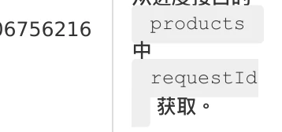

<table>
  <tr>
    <td>stepId</td>
    <td>String</td>
    <td>Query</td>
    <td>否</td>
    <td>switch</td>
    <td>步骤过滤：按步骤 ID 精确匹配，或按<code>stepId:</code>、<code> stepId/</code><code> </code> 前缀匹配其子步骤。</td>
  </tr>
</table>

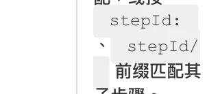

**返回数据**

| 参数名称 | 类型 | 示例 | 说明 |
| --- | --- | --- | --- |
| success | Boolean | true | 请求是否成功执行。 |
| code | String | "200" | 兼容状态码，成功为<code> "200" </code>；值域与旧版一致，程序判断请使用<code> responseCode </code>。 |
| message | String | "" | 人读消息；成功与流程状态为空串，错误时为具体原因。 |
| responseCode | String | "SUCCESS" | 语义码，程序判断的唯一稳定依据。 |
| data | Array | \[{"id":2511,"stepName ":"call_script"}\] | 日志行列表；无数据时见下方“无数据返回”。 |
| -id | Integer | 2511 | 日志行 ID。 |
| -requestId | String | "1790675621681" | 产品执行 ID。 |
| -product | String | "OSS" | 产品名。 |
| -actionType | String | "SWITCH" | 动作类型，例如SWITCH、SWITCHBACK、SYNCCHECK。 |
| -stepId | String | null | 步骤 ID，可为空。 |
| -detailId | String | null | 明细 ID，可为空。 |
| -stepName | String | "call_script" | 步骤名称。 |
| -stepMsg | String | "start executing script..." | 步骤消息。 |
| -gmtCreated | Long | 1790675621729 | 记录时间（epoch 毫秒）。 |
| -gmtModified | Long | 1790675621729 | 更新时间（epoch 毫秒）。 |
| -drillId | Integer | 1 | 仅历史轮次（<code> historyIndex </code> <code>&amp;gt; 0 </code>）返回。 |
| -processId | Integer | 1 | 仅历史轮次（<code> historyIndex </code> <code>&amp;gt; 0 </code>）返回。 |
| -historyIndex | Integer | 1 | 仅历史轮次（<code> historyIndex </code> <code>&amp;gt; 0 </code>）返回，表示第几轮重试。 |
| timestamp | Long | 1792568497177 | 服务端响应时间（epoch毫秒）。 |

无数据时返回  `success=true` 、 `code="204"` 、 `responseCode="NO_DATA"` 、 `data=null` 。

**示例**

**请求示例**

```http
GET /api/selfops/v1/drill/plan/process/log?requestId=1790675621681&product=OSS HTTP/1.1
Host: <入⼝域名>:8443
X-Public-Key-Id: <your-key-id>
X-Timestamp: 1792568497177
X-Call-Mode: test
X-Sign: <Base64 签名值>
```

**正常返回示例**

示例仅展示前两条日志。

```json
{
  "success": true,
  "code": "200",
  "message": "",
  "responseCode": "SUCCESS",
  "data": [
    {
      "id": 2511,
      "requestId": "1790675621681",
      "product": "OSS",
      "actionType": "SWITCH",
      "stepId": null,
      "detailId": null,
      "stepName": "call_script",
      "stepMsg": "start executing script...",
      "gmtCreated": 1790675621729,
      "gmtModified": 1790675621729
    },
    {
      "id": 2512,
      "requestId": "1790675621681",
      "product": "OSS",
      "actionType": "SWITCH",
      "stepId": null,
      "detailId": null,
      "stepName": "cmd_switch",
      "stepMsg": "switch command: product=OSS switch_flag=failover idc=datacenter-a request_id=1790675621681, instances: ",
      "gmtCreated": 1790675622249,
      "gmtModified": 1790675622249
    }
  ],
  "timestamp": 1792568497177
}
```

无数据时：

```json
{
  "success": true,
  "code": "204",
  "message": "",
  "responseCode": "NO_DATA",
  "data": null,
  "timestamp": 1792568497177
}
```

<a id="section-2-2-10"></a>

### 2.2.10. 查询演练结果汇总

该接口用于查询一次演练流程的结果汇总，包括演练、切换、切回的成功与失败计数，以及各阶段的产品清单。本接口为只读接口。

**接口说明准备工作**

- 已完成运维API接入：持有有效 Key ID 与私钥，入口地址（HTTPS，8443）可访问。

- 平台已开启运维API开关，且运行模式满足本次调用要求。

- 已持有流程号（发起流程时返回）。

**请求头**

本接口使用运维API公共请求头，除下列请求头外无特殊请求头。

| 请求头 | 是否必填 | 说明 |
| --- | --- | --- |
| X-Public-Key-Id | 是 | 公钥 Key ID，格式为 <code> pk- </code> 加16 位小写十六进制。服务端严格按该值定位公钥，不存在的 Key ID 不会尝试其它公钥。 |
| X-Timestamp | 是 | 毫秒级时间戳，与服务器当前时间的偏差不得超过 5 分钟。 |
| X-Call-Mode | 是 | 调用模式，取值 <code> test </code> 或<code> production </code>。 |
| X-Sign | 是 | 对签名材料使用私钥签名后的值，标准 Base64 编码。 |

请求头构造方式见控制台「运维API调用管理」→「快速上手」→「使用指南」。

**请求语法**

```http
GET /api/selfops/v1/drill/plan/process/result-summary?processId=1790675621679 HTTP/1.1
```

**请求参数**

| 参数名称 | 类型 | 位置 | 是否必选 | 示例 | 说明 |
| --- | --- | --- | --- | --- | --- |
| processId | String | Query | 是 | 17906756216 79 | 流程号。 |

**返回数据**

| 参数名称 | 类型 | 示例 | 说明 |
| --- | --- | --- | --- |
| success | Boolean | true | 请求是否成功执行。 |
| code | String | "200" | 兼容状态码，成功为<code> "200" </code>；值域与旧版一致，程序判断请使用<code> responseCode </code>。 |
| message | String | "" | 人读消息；成功与流程状态为空串，错误时为具体原因。 |
| responseCode | String | "SUCCESS" | 语义码，程序判断的唯一稳定依据。 |
| data | Object | {} | 结果汇总。 |
| -recordId | Integer | null | 记录 ID，可为空。 |
| -actionType | String | "SWITCHANDBACK" | 动作类型：SWITCH、SWITCHBACK、SWITCHANDBACK。 |
| -productDrillSuccessCo unts | Integer | 1 | 演练成功产品数。 |
| -productDrillFailedCoun ts | Integer | 0 | 演练失败产品数。 |
| -productSwitchSuccess Counts | Integer | 1 | 切换成功产品数。 |
| -productSwitchFailedCo unts | Integer | 0 | 切换失败产品数。 |
| -productSwitchBackSuc cessCounts | Integer | 1 | 切回成功产品数。 |
| -productSwitchBackFail edCounts | Integer | 0 | 切回失败产品数。 |
| -switchTimeSuccessCou nts | Integer | 1 | 切换时长达标产品数。 |
| -switchTimeFailedCount s | Integer | 0 | 切换时长未达标产品数。 |
| -switchBackTimeSucces sCounts | Integer | 1 | 切回时长达标产品数。 |
| -switchBackTimeFailed Counts | Integer | 0 | 切回时长未达标产品数。 |
| -switchTimeFailedProdu cts | Array | \[\] | 切换时长未达标的产品列表。 |
| -switchTimeSuccessPro ducts | Array | \["OSS"\] | 切换时长达标的产品列表。 |
| -switchBackTimeFailed Products | Array | \[\] | 切回时长未达标的产品列表。 |
| -switchBackTimeSucces sProducts | Array | \["OSS"\] | 切回时长达标的产品列表。 |
| -switchSuccessProducts | Array | \["OSS"\] | 切换成功的产品列表。 |
| -switchBackSuccessPro ducts | Array | \["OSS"\] | 切回成功的产品列表。 |
| -switchFailProducts | Array | \[\] | 切换失败的产品列表。 |
| -switchBackFailProduct s | Array | \[\] | 切回失败的产品列表。 |
| -allProducts | Array | \["OSS"\] | 流程涉及的全部产品。 |
| timestamp | Long | 1792568497220 | 服务端响应时间（epoch毫秒）。 |

列表字段无数据时返回[]。流程号不存在或流程已清理时，各计数为 0、各列表为[]，不返回错误。

**示例**

**请求示例**

```http
GET /api/selfops/v1/drill/plan/process/result-summary?processId=1790675621679 HTTP/1.1
Host: <入⼝域名>:8443
X-Public-Key-Id: <your-key-id>
X-Timestamp: 1792568497220
X-Call-Mode: test
X-Sign: <Base64 签名值>
```

**正常返回示例**

```json
{
  "success": true,
  "code": "200",
  "message": "",
  "responseCode": "SUCCESS",
  "data": {
    "recordId": null,
    "actionType": "SWITCHANDBACK",
    "productDrillSuccessCounts": 1,
    "productDrillFailedCounts": 0,
    "productSwitchSuccessCounts": 1,
    "productSwitchFailedCounts": 0,
    "productSwitchBackSuccessCounts": 1,
    "productSwitchBackFailedCounts": 0,
    "switchTimeSuccessCounts": 1,
    "switchTimeFailedCounts": 0,
    "switchBackTimeSuccessCounts": 1,
    "switchBackTimeFailedCounts": 0,

    "switchTimeFailedProducts": [ ],

    "switchTimeSuccessProducts": ["OSS"],

    "switchBackTimeFailedProducts": [ ],

    "switchBackTimeSuccessProducts": ["OSS"],
    "switchSuccessProducts": ["OSS"],
    "switchBackSuccessProducts": ["OSS"],

    "switchFailProducts": [ ],


    "switchBackFailProducts": [ ],

    "allProducts": ["OSS"]
  },
  "timestamp": 1792568497220
}
```

<a id="section-2-2-11"></a>

### 2.2.11. 查询恢复计划列表

该接口用于按故障场景查询恢复计划，结果按机房角色分组，返回全机房计划与单产品计划。本接口为只读接口。

**接口说明**

**准备工作**

- 已完成运维API接入：持有有效 Key ID 与私钥，入口地址（HTTPS，8443）可访问。

- 平台已开启运维API开关，且运行模式满足本次调用要求。

- 本接口只读，无特殊前置条件。

**请求头**

本接口使用运维API公共请求头，除下列请求头外无特殊请求头。

| 请求头 | 是否必填 | 说明 |
| --- | --- | --- |
| X-Public-Key-Id | 是 | 公钥 Key ID，格式为 <code> pk- </code> 加16 位小写十六进制。服务端严格按该值定位公钥，不存在的 Key ID 不会尝试其它公钥。 |
| X-Timestamp | 是 | 毫秒级时间戳，与服务器当前时间的偏差不得超过 5 分钟。 |
| X-Call-Mode | 是 | 调用模式，取值 <code> test </code> 或<code> production </code>。 |
| X-Sign | 是 | 对签名材料使用私钥签名后的值，标准 Base64 编码。 |

请求头构造方式见控制台「运维API调用管理」→「快速上手」→「使用指南」。

**请求语法**

```http
GET /api/selfops/v1/recovery/plan/list?failureScenario=POWER_FAIL HTTP/1.1
```

**请求参数**

| 参数名称 | 类型 | 位置 | 是否必选 | 示例 | 说明 |
| --- | --- | --- | --- | --- | --- |
| failureScenari o | String | Query | 否 | POWER_FAIL | 故障场景前缀，例如POWER_FAIL、NET_DOWN、RDS_FAIL、OSS_FAIL。按前缀匹配，不是精确匹配；不传时默认<code>POWER&amp;#95;</code> <code>FAIL </code>。 |

**返回数据**

| 参数名称 | 类型 | 示例 | 说明 |
| --- | --- | --- | --- |
| success | Boolean | true | 请求是否成功执行。 |
| code | String | "200" | 兼容状态码，成功为<code> "200" </code>；值域与旧版一致，程序判断请使用<code> responseCode </code>。 |
| message | String | "" | 人读消息；成功与流程状态为空串，错误时为具体原因。 |
| responseCode | String | "SUCCESS" | 语义码，程序判断的唯一稳定依据。 |
| data | Array | \[{"idc":"slave"}\] | 按机房角色分组的恢复计划列表。 |
| -idc | String | "slave" | 机房角色：master（主机房）、slave（备机房）、third（第三机房）。 |
| -master / -slave / -third | Object | {} | 动态键，键名与 <code> idc </code>的值一致；该对象内包含<code> all </code> 与 <code> single </code>两个可选键。 |
| --all | Object | {} | 全机房恢复计划，仅当前缀匹配到该场景时返回。 |
| ---planId | Long | 943201274 | 恢复计划 ID。 |
| ---planName | String | "ALL" | 计划名称；多产品计划为<code> ALL </code>，单产品计划为产品名。 |
| ---idc | String | "slave" | 机房角色。 |
| ---products | String | null | 单产品计划的产品名；多产品计划为 <code> null </code>。 |
| ---expectRto | Integer | null | 预期中断时长，单位：秒；可为空。 |
| ---expectRecoveryFailove rTime | Integer | 1708 | 预期强切时长，单位：秒。 |
| ---expectRecoveryFailbac kTime | Integer | 1281 | 预期切回时长，单位：秒。 |
| --single | Array | \[{"category":"DATABA SE"}\] | 单产品计划分组，仅当存在单产品计划时返回。 |
| ---category | String | "DATABASE" | 产品类目：DATABASE、MIDDLE_WARE、BIGDATA、NETWORK、COMPUTE、STORAGE、MONITOR_OPS、APPLICATION_SERVICE、DR、SAFETY、APSARA_BASE。 |
| ---DATABASE（动态键） | Array | \[{"planId":297353173 2,"planName":"ANALY TICDB"}\] | 以产品类目名为键的计划行数组；键名与<code> category </code> 的值一致。行字段与 <code> --all </code>下的行字段相同。 |
| timestamp | Long | 1792568497265 | 服务端响应时间（epoch毫秒）。 |

> **说明**
>
> - 外层数组只包含存在匹配场景的机房角色；某机房没有任何匹配项时，该机房整体不出现。
>
> - `all`  在同一机房内只保留最后一条匹配的计划。
>
> - 单产品计划不受故障场景前缀过滤，但只有在其所属机房存在匹配场景时才随该机房返回。

**示例**

**请求示例**

```http
GET /api/selfops/v1/recovery/plan/list?failureScenario=POWER_FAIL HTTP/1.1
Host: <入⼝域名>:8443
X-Public-Key-Id: <your-key-id>
X-Timestamp: 1792568497265
X-Call-Mode: test
X-Sign: <Base64 签名值>
```

**正常返回示例**

示例仅展示一个机房、一个产品类目与一条单产品计划。

```json
{
  "success": true,
  "code": "200",
  "message": "",
  "responseCode": "SUCCESS",
  "data": [
    {
      "idc": "slave",
      "slave": {
        "all": {
          "planId": 943201274,
          "planName": "ALL",
          "idc": "slave",
          "products": null,
          "expectRto": null,
          "expectRecoveryFailoverTime": 1708,
          "expectRecoveryFailbackTime": 1281
        },
        "single": [
          {
            "category": "DATABASE",
            "DATABASE": [
              {
                "planId": 2973531732,
                "planName": "ANALYTICDB",
                "idc": "slave",
                "products": "ANALYTICDB",
                "expectRto": 100,
                "expectRecoveryFailoverTime": 10,
                "expectRecoveryFailbackTime": 10
              }
            ]
          }
        ]
      }
    }
  ],
  "timestamp": 1792568497265
}
```

<a id="section-2-2-12"></a>

### 2.2.12. 查询恢复计划详情

该接口用于查询单个恢复计划的产品清单、机房角色、故障场景与操作者类型。本接口为只读接口。

**接口说明**

**准备工作**

- 已完成运维API接入：持有有效 Key ID 与私钥，入口地址（HTTPS，8443）可访问。

- 平台已开启运维API开关，且运行模式满足本次调用要求。

- `planId`  对应的恢复计划已存在。

**请求头**

本接口使用运维API公共请求头，除下列请求头外无特殊请求头。

| 请求头 | 是否必填 | 说明 |
| --- | --- | --- |
| X-Public-Key-Id | 是 | 公钥 Key ID，格式为 <code> pk- </code> 加16 位小写十六进制。服务端严格按该值定位公钥，不存在的 Key ID 不会尝试其它公钥。 |
| X-Timestamp | 是 | 毫秒级时间戳，与服务器当前时间的偏差不得超过 5 分钟。 |
| X-Call-Mode | 是 | 调用模式，取值 <code> test </code> 或<code> production </code>。 |
| X-Sign | 是 | 对签名材料使用私钥签名后的值，标准 Base64 编码。 |

请求头构造方式见控制台「运维API调用管理」→「快速上手」→「使用指南」。

**请求语法**

```http
GET /api/selfops/v1/recovery/plan/detail?planId=3212114608 HTTP/1.1
```

**请求参数**

| 参数名称 | 类型 | 位置 | 是否必选 | 示例 | 说明 |
| --- | --- | --- | --- | --- | --- |
| planId | Long | Query | 是 | 3212114608 | 恢复计划 ID，从恢复计划列表获取。 |

**返回数据**

| 参数名称 | 类型 | 示例 | 说明 |
| --- | --- | --- | --- |
| success | Boolean | true | 请求是否成功执行。 |
| code | String | "200" | 兼容状态码，成功为<code> "200" </code>；值域与旧版一致，程序判断请使用<code> responseCode </code>。 |
| message | String | "" | 人读消息；成功与流程状态为空串，错误时为具体原因。 |
| responseCode | String | "SUCCESS" | 语义码，程序判断的唯一稳定依据。 |
| data | Object | {} | 计划详情。 |
| -plan | Object | {} | 计划信息。 |
| --planId | Long | 3212114608 | 恢复计划 ID。 |
| --planName | String | "OSS" | 计划名称；全机房故障场景为 <code> ALL </code>，单产品场景为产品名，仲裁场景为对应场景枚举名。 |
| --products | String | "OSS" | 计划包含的产品，多个以英文逗号分隔。 |
| --idc | String | "slave" | 机房角色。 |
| --scenario | String | "OSS_FAIL_B" | 故障场景枚举名，例如POWER_FAIL_A、NET_DOWN_B、RDS_FAIL_A、OSS_FAIL_B。 |
| --actionOperator | String | "DEFAULT" | 操作者类型：DEFAULT、ARBITRATOR_SWITCH。 |
| --scenarioType | String | "DEFAULT" | 操作者类型，与<code> actionOperator </code> 同值。 |
| -orders | String | "OSS" | 切换批次编排：批次之间用 <code> / </code> 分隔，批次内产品用 <code> , </code> 分隔，例如<code> A,B/C </code>。 |
| timestamp | Long | 1792568497304 | 服务端响应时间（epoch毫秒）。 |

**示例**

**请求示例**

```http
GET /api/selfops/v1/recovery/plan/detail?planId=3212114608 HTTP/1.1
Host: <入⼝域名>:8443
X-Public-Key-Id: <your-key-id>
X-Timestamp: 1792568497304
X-Call-Mode: test
X-Sign: <Base64 签名值>
```

**正常返回示例**

```json
{
  "success": true,
  "code": "200",
  "message": "",
  "responseCode": "SUCCESS",
  "data": {
    "plan": {
      "planId": 3212114608,
      "planName": "OSS",
      "products": "OSS",
      "idc": "slave",
      "scenario": "OSS_FAIL_B",
      "actionOperator": "DEFAULT",
      "scenarioType": "DEFAULT"
    },
    "orders": "OSS"
  },
  "timestamp": 1792568497304
}
```

<a id="section-2-2-13"></a>

### 2.2.13. 发起恢复流程

该接口用于对指定恢复计划发起切换（SWITCH）或切回（SWITCHBACK）。成功时返回本次流程号，后续进度、日志与结果查询都使用该流程号。

**接口说明准备工作**

- 已完成运维API接入：持有有效 Key ID 与私钥，入口地址（HTTPS，8443）可访问。

- 平台已开启运维API开关，且运行模式满足本次调用要求。

- 目标恢复计划已存在，且计划内产品已通过健康检查。

- 当前没有任何恢复流程在执行；恢复流程只要存在执行中的实例，新的发起一律被拒绝。

- 测试模式下，计划内产品必须全部为测试产品。

**请求头**

本接口使用运维API公共请求头，除下列请求头外无特殊请求头。

| 请求头 | 是否必填 | 说明 |
| --- | --- | --- |
| X-Public-Key-Id | 是 | 公钥 Key ID，格式为 <code> pk- </code> 加16 位小写十六进制。服务端严格按该值定位公钥，不存在的 Key ID 不会尝试其它公钥。 |
| X-Timestamp | 是 | 毫秒级时间戳，与服务器当前时间的偏差不得超过 5 分钟。 |
| X-Call-Mode | 是 | 调用模式，取值 <code> test </code> 或<code> production </code>。 |
| X-Sign | 是 | 对签名材料使用私钥签名后的值，标准 Base64 编码。 |

请求头构造方式见控制台「运维API调用管理」→「快速上手」→「使用指南」。

**请求语法**

```text
GET /api/selfops/v1/recovery/plan/process/create?actionType=SWITCH&planId=3212114608 HT
TP/1.1
```

本接口的参数放在查询串中，不放在 JSON 请求体；用 POST 调用时同样从查询串取参。

**请求参数**

| 参数名称 | 类型 | 位置 | 是否必选 | 示例 | 说明 |
| --- | --- | --- | --- | --- | --- |
| actionType | String | Query | 是 | SWITCH | 动作类型：SWITCH（切换，强切）、SWITCHBACK（切回）；忽略大小写与首尾空格。 |
| planId | Long | Query | 是 | 3212114608 | 恢复计划 ID。 |
| processId | String | Query | 否 | 17925684970 00 | 切回时传上一次切换的流程号；首次发起不传，由服务端生成新流程号。 |

**返回数据**

| 参数名称 | 类型 | 示例 | 说明 |
| --- | --- | --- | --- |
| success | Boolean | true | 请求是否成功执行。 |
| code | String | "200" | 兼容状态码，成功为<code> "200" </code>；值域与旧版一致，程序判断请使用<code> responseCode </code>。 |
| message | String | "" | 人读消息；成功与流程状态为空串，错误时为具体原因。 |
| responseCode | String | "SUCCESS" | 语义码，程序判断的唯一稳定依据。 |
| data | String | "1792568497000" | 本次流程号；后续进度、日志、结果与结束流程均使用该值。 |
| timestamp | Long | 1792568497000 | 服务端响应时间（epoch毫秒）。 |

调用成功后请立即保存  `data`  中的流程号。流程结束后无法通过本接口重新获取历史流程号。

**示例**

**请求示例**

```text
GET /api/selfops/v1/recovery/plan/process/create?actionType=SWITCH&planId=3212114608 HT
TP/1.1
Host: <入⼝域名>:8443
X-Public-Key-Id: <your-key-id>
X-Timestamp: 1792568497000
X-Call-Mode: test
X-Sign: <Base64 签名值>
```

**正常返回示例**

```json
{
  "success": true,
  "code": "200",
  "message": "",
  "responseCode": "SUCCESS",
  "data": "1792568497000",
  "timestamp": 1792568497000
}
```

<a id="section-2-2-14"></a>

### 2.2.14. 结束恢复流程

该接口用于结束一次恢复流程并完成收尾归档。流程必须已经停止执行；仍在执行的流程不能直接结束。

**接口说明**

**准备工作**

- 已完成运维API接入：持有有效 Key ID 与私钥，入口地址（HTTPS，8443）可访问。

- 平台已开启运维API开关，且运行模式满足本次调用要求。

- 目标流程已存在，且已不在执行中；仍在执行的流程需等待其结束后再调用本接口。

**请求头**

本接口使用运维API公共请求头，除下列请求头外无特殊请求头。

| 请求头 | 是否必填 | 说明 |
| --- | --- | --- |
| X-Public-Key-Id | 是 | 公钥 Key ID，格式为 <code> pk- </code> 加16 位小写十六进制。服务端严格按该值定位公钥，不存在的 Key ID 不会尝试其它公钥。 |
| X-Timestamp | 是 | 毫秒级时间戳，与服务器当前时间的偏差不得超过 5 分钟。 |
| X-Call-Mode | 是 | 调用模式，取值 <code> test </code> 或<code> production </code>。 |
| X-Sign | 是 | 对签名材料使用私钥签名后的值，标准 Base64 编码。 |

请求头构造方式见控制台「运维API调用管理」→「快速上手」→「使用指南」。

**请求语法**

```http
POST /api/selfops/v1/recovery/plan/process/finish HTTP/1.1
Content-Type: application/json
```

**请求参数**

| 参数名称 | 类型 | 位置 | 是否必选 | 示例 | 说明 |
| --- | --- | --- | --- | --- | --- |
| processId | String | Body | 是 | "1790667264 888" | 流程号，发起流程时由服务端返回。请求体为JSON 对象，例如<code>{"processI</code><br><code>d":"17906672</code> <code>64888"} </code>。 |

**返回数据**

| 参数名称 | 类型 | 示例 | 说明 |
| --- | --- | --- | --- |
| success | Boolean | true | 请求是否成功执行。 |
| code | String | "200" | 兼容状态码，成功为<code> "200" </code>；值域与旧版一致，程序判断请使用<code> responseCode </code>。 |
| message | String | "" | 人读消息；成功与流程状态为空串，错误时为具体原因。 |
| responseCode | String | "SUCCESS" | 语义码，程序判断的唯一稳定依据。 |
| data | Object | null | 本接口无业务数据，固定为 <code> null </code>。 |
| timestamp | Long | 1792568497338 | 服务端响应时间（epoch毫秒）。 |

**示例**

**请求示例**

```http
POST /api/selfops/v1/recovery/plan/process/finish HTTP/1.1
Host: <入⼝域名>:8443
Content-Type: application/json
X-Public-Key-Id: <your-key-id>
X-Timestamp: 1792568497338
X-Call-Mode: test
X-Sign: <Base64 签名值>

{"processId":"1790667264888"}
```

**正常返回示例**

```json
{
  "success": true,
  "code": "200",
  "message": "",
  "responseCode": "SUCCESS",
  "data": null,
  "timestamp": 1792568497338
}
```

<a id="section-2-2-15"></a>

### 2.2.15. 查询执行中的恢复流程

该接口用于查询当前是否有恢复流程正在执行。发起新恢复流程前可先调用本接口做并发预检。本接口为只读接口。

**接口说明**

**准备工作**

- 已完成运维API接入：持有有效 Key ID 与私钥，入口地址（HTTPS，8443）可访问。

- 平台已开启运维API开关，且运行模式满足本次调用要求。

- 本接口只读，无特殊前置条件。

**请求头**

本接口使用运维API公共请求头，除下列请求头外无特殊请求头。

| 请求头 | 是否必填 | 说明 |
| --- | --- | --- |
| X-Public-Key-Id | 是 | 公钥 Key ID，格式为 <code> pk- </code> 加16 位小写十六进制。服务端严格按该值定位公钥，不存在的 Key ID 不会尝试其它公钥。 |
| X-Timestamp | 是 | 毫秒级时间戳，与服务器当前时间的偏差不得超过 5 分钟。 |
| X-Call-Mode | 是 | 调用模式，取值 <code> test </code> 或<code> production </code>。 |
| X-Sign | 是 | 对签名材料使用私钥签名后的值，标准 Base64 编码。 |

请求头构造方式见控制台「运维API调用管理」→「快速上手」→「使用指南」。

**请求语法**

```http
GET /api/selfops/v1/recovery/plan/process/running HTTP/1.1
```

**请求参数**

无。

**返回数据**

| 参数名称 | 类型 | 示例 | 说明 |
| --- | --- | --- | --- |
| success | Boolean | true | 请求是否成功执行。 |
| code | String | "200" | 兼容状态码，成功为<code> "200" </code>；值域与旧版一致，程序判断请使用<code> responseCode </code>。 |
| message | String | "" | 人读消息；成功与流程状态为空串，错误时为具体原因。 |
| responseCode | String | "SUCCESS" | 语义码，程序判断的唯一稳定依据。 |
| data | Object | null | 没有执行中的恢复流程时为 <code> null </code>；有执行中的流程时为下列对象。 |
| -planId | Long | 3212114608 | 执行中流程对应的计划ID。 |
| -processId | String | "1790667264888" | 执行中流程的流程号。 |
| timestamp | Long | 1792568497338 | 服务端响应时间（epoch毫秒）。 |

仅由测试产品组成的流程不会出现在结果中。

**示例**

**请求示例**

```http
GET /api/selfops/v1/recovery/plan/process/running HTTP/1.1
Host: <入⼝域名>:8443
X-Public-Key-Id: <your-key-id>
X-Timestamp: 1792568497338
X-Call-Mode: test
X-Sign: <Base64 签名值>
```

**正常返回示例**

没有执行中的恢复流程时：

```json
{
  "success": true,
  "code": "200",
  "message": "",
  "responseCode": "SUCCESS",
  "data": null,
  "timestamp": 1792568497338
}
```

<a id="section-2-2-16"></a>

### 2.2.16. 查询恢复执行进度

该接口用于查询一次恢复流程的执行进度，包括各批次、各产品的状态与时间，以及当前可执行的操作按钮状态。本接口通常用于轮询。本接口为只读接口。

**接口说明**

**准备工作**

- 已完成运维API接入：持有有效 Key ID 与私钥，入口地址（HTTPS，8443）可访问。

- 平台已开启运维API开关，且运行模式满足本次调用要求。

- 已获取恢复计划 ID；如需查询指定流程，还需持有发起流程时返回的流程号。

**请求头**

本接口使用运维API公共请求头，除下列请求头外无特殊请求头。

| 请求头 | 是否必填 | 说明 |
| --- | --- | --- |
| X-Public-Key-Id | 是 | 公钥 Key ID，格式为 <code> pk- </code> 加16 位小写十六进制。服务端严格按该值定位公钥，不存在的 Key ID 不会尝试其它公钥。 |
| X-Timestamp | 是 | 毫秒级时间戳，与服务器当前时间的偏差不得超过 5 分钟。 |
| X-Call-Mode | 是 | 调用模式，取值 <code> test </code> 或<code> production </code>。 |
| X-Sign | 是 | 对签名材料使用私钥签名后的值，标准 Base64 编码。 |

请求头构造方式见控制台「运维API调用管理」→「快速上手」→「使用指南」。

**请求语法**

```text
GET /api/selfops/v1/recovery/plan/process/progress?
planId=3212114608&processId=1790667264888 HTTP/1.1
```

**请求参数**

| 参数名称 | 类型 | 位置 | 是否必选 | 示例 | 说明 |
| --- | --- | --- | --- | --- | --- |
| planId | Long | Query | 是 | 3212114608 | 恢复计划 ID。 |
| processId | String | Query | 否 | 17906672648 88 | 流程号。不传时，若该计划有执行中的流程则使用该流程；否则返回预测结果。 |

**返回数据**

| 参数名称 | 类型 | 示例 | 说明 |
| --- | --- | --- | --- |
| success | Boolean | true | 请求是否成功执行。 |
| code | String | "200" | 兼容状态码，成功为<code> "200" </code>；值域与旧版一致，程序判断请使用<code> responseCode </code>。 |
| message | String | "" | 人读消息；成功与流程状态为空串，错误时为具体原因。 |
| responseCode | String | "SUCCESS" | 语义码，程序判断的唯一稳定依据。 |
| data | Object | {} | 进度数据。 |
| -operationSet | Object | {} | 当前可执行的操作按钮状态，仅包含下列三个键。 |
| --terminateEnable | Boolean | null | 终止按钮：<code> null </code> 表示不展示，<code> true </code> 表示可点击，<code> false </code> 表示展示但不可点击。 |
| --finishEnable | Boolean | null | 结束流程按钮，取值含义同上。 |
| --switchbackEnable | Boolean | null | 切回按钮，取值含义同上。 |
| -processInfo | Object | {} | 流程信息。 |
| --actionType | String | "SWITCH" | 动作类型：SWITCH、SWITCHBACK、SWITCHANDBACK。 |
| --processStatus | String | "SUCCESS" | 流程状态：EXECUTING、SUCCESS、FAILED、TIMEOUT、WAITING、STOPPING、STOPPED、FINISH、NOT_START。 |
| --sourceIdc | String | "datacenter-a" | 源机房。 |
| --destIdc | Array | \["datacenter-b"\] | 目标机房列表。 |
| --planName | String | "OSS_FAIL_B" | 恢复场景枚举名，例如POWER_FAIL_A、OSS_FAIL_B。 |
| --recoveryProducts | String | "OSS" | 本次恢复涉及的产品，多个以英文逗号分隔。 |
| --baseProducts | Array | \[\] | 底座产品列表。 |
| --tenantProducts | Array | \["OSS"\] | 租户产品列表。 |
| --switchInfo | Object | {} | 切换阶段信息。 |
| ---status | String | "SUCCESS" | 该阶段状态。 |
| ---startTime | Long | 1790667264990 | 实际开始时间（epoch 毫秒），可为空。 |
| ---endTime | Long | 1790667274717 | 实际结束时间（epoch 毫秒），可为空。 |
| ---expectStartTime | Long | null | 预计开始时间（epoch 毫秒），可为空。 |
| ---expectEndTime | Long | null | 预计结束时间（epoch 毫秒），可为空。 |
| ---summary | Object | {} | 该阶段的汇总计数。 |
| ----counts | Integer | 1 | 产品总数。 |
| ----successCounts | Integer | 1 | 成功产品数。 |
| ----failedCounts | Integer | 0 | 失败产品数。 |
| ----executingCounts | Integer | 0 | 执行中产品数。 |
| ----notStartCounts | Integer | 0 | 未开始产品数。 |
| ---orders | Array | \[{"status":"SUCCESS"}\] | 批次列表。 |
| ----status | String | "SUCCESS" | 批次状态。 |
| ----startTime | Long | 1790667264990 | 批次实际开始时间（epoch 毫秒）。 |
| ----endTime | Long | 1790667274717 | 批次实际结束时间（epoch 毫秒）。 |
| ----expectStartTime | Long | null | 批次预计开始时间，可为空。 |
| ----expectEndTime | Long | null | 批次预计结束时间，可为空。 |
| ----products | Array | \[{"product":"OSS","sta tus":"SUCCESS"}\] | 批次内产品列表。 |
| -----requestId | String | "1790667264898" | 产品执行 ID，查询该产品日志时使用。 |
| -----product | String | "OSS" | 产品名。 |
| -----status | String | "SUCCESS" | 产品状态。 |
| -----failedDependencyProd ucts | Array | \[\] | 未切换成功的依赖产品列表。 |
| -----executionInfo | Array | \[{"historyIndex":0,"sta tus":"SUCCESS"}\] | 该产品的执行轮次列表。 |
| ------historyIndex | Integer | 0 | 轮次序号，0 表示当前执行，大于 0 表示历史重试轮次。 |
| ------status | String | "SUCCESS" | 该轮次状态。 |
| ------startTime | Long | 1790667264990 | 该轮次开始时间（epoch毫秒）。 |
| ------endTime | Long | 1790667274717 | 该轮次结束时间（epoch毫秒）。 |
| -----startTime | Long | 1790667264990 | 产品实际开始时间（epoch 毫秒）。 |
| -----endTime | Long | 1790667274717 | 产品实际结束时间（epoch 毫秒）。 |
| -----expectStartTime | Long | null | 产品预计开始时间，可为空。 |
| -----expectEndTime | Long | null | 产品预计结束时间，可为空。 |
| --switchBackInfo | Object | {} | 切回阶段信息，仅当流程包含切回时返回；结构与<code> switchInfo </code> 相同。 |
| timestamp | Long | 1792568497375 | 服务端响应时间（epoch毫秒）。 |

说明：

- `processInfo`  使用  `recoveryProducts`  表示本次恢复涉及的产品，不使用  `scenarioType` 。

- `operationSet`  只返回终止、结束流程、切回三个按钮。

- 不传  `processId`  且该计划没有执行中的流程时，返回预测结果： `processStatus`  为  `NOT_START` 、 `actionType`  为  `SWITCH` ，各产品状态为  `NOT_START` ， `operationSet`  各键为  `null` 。

- `planId`  与  `processId`  不属于同一计划时，返回  `responseCode`  为  `SWITCH_PLAN_PROCESS_MISMATCH`  的错误。

- 仅由测试产品组成的流程按无数据处理，返回  `NO_DATA` 。

**示例**

**请求示例**

```text
GET /api/selfops/v1/recovery/plan/process/progress?
planId=3212114608&processId=1790667264888 HTTP/1.1
Host: <入⼝域名>:8443
X-Public-Key-Id: <your-key-id>
X-Timestamp: 1792568497375
X-Call-Mode: test
X-Sign: <Base64 签名值>
```

**正常返回示例**

示例为一个已完成的恢复切换流程，仅包含一个批次与一个产品。

```json
{
  "success": true,
  "code": "200",
  "message": "",
  "responseCode": "SUCCESS",
  "data": {
    "operationSet": {
      "terminateEnable": null,
      "finishEnable": null,
      "switchbackEnable": null
    },
    "processInfo": {
      "actionType": "SWITCH",
      "processStatus": "SUCCESS",
      "sourceIdc": "datacenter-a",
      "destIdc": ["datacenter-b", "datacenter-c"],
      "planName": "OSS_FAIL_B",
      "recoveryProducts": "OSS",

      "baseProducts": [ ],

      "tenantProducts": ["OSS"],
      "switchInfo": {
        "status": "SUCCESS",
        "startTime": 1790667264990,
        "endTime": 1790667274717,
        "expectStartTime": null,
        "expectEndTime": null,
        "summary": {
          "counts": 1,
          "successCounts": 1,
          "failedCounts": 0,
          "executingCounts": 0,
          "notStartCounts": 0
        },
        "orders": [
          {
            "status": "SUCCESS",
            "startTime": 1790667264990,
            "endTime": 1790667274717,
            "expectStartTime": null,
            "expectEndTime": null,
            "products": [
              {
                "requestId": "1790667264898",
                "product": "OSS",
                "status": "SUCCESS",

                "failedDependencyProducts": [ ],

                "executionInfo": [
                  {
                    "historyIndex": 0,
                    "status": "SUCCESS",
                    "startTime": 1790667264990,
                    "endTime": 1790667274717
                  }
                ],
                "startTime": 1790667264990,
                "endTime": 1790667274717,
                "expectStartTime": null,
                "expectEndTime": null
              }
            ]
          }
        ]
      }
    }
  },
  "timestamp": 1792568497375
}
```

<a id="section-2-2-17"></a>

### 2.2.17. 查询恢复产品执行日志

该接口用于查询单个产品在一次恢复流程中的执行日志，包括脚本步骤与消息。日志按最终执行或指定历史轮次返回。

**接口说明**

**准备工作**

- 已完成运维API接入：持有有效 Key ID 与私钥，入口地址（HTTPS，8443）可访问。

- 平台已开启运维API开关，且运行模式满足本次调用要求。

- 已从恢复进度接口的  `switchInfo`  或  `switchBackInfo`  中取得产品执行 ID（ `requestId` ）与产品名。

**请求头**

本接口使用运维API公共请求头，除下列请求头外无特殊请求头。

| 请求头 | 是否必填 | 说明 |
| --- | --- | --- |
| X-Public-Key-Id | 是 | 公钥 Key ID，格式为 <code> pk- </code> 加16 位小写十六进制。服务端严格按该值定位公钥，不存在的 Key ID 不会尝试其它公钥。 |
| X-Timestamp | 是 | 毫秒级时间戳，与服务器当前时间的偏差不得超过 5 分钟。 |
| X-Call-Mode | 是 | 调用模式，取值 <code> test </code> 或<code> production </code>。 |
| X-Sign | 是 | 对签名材料使用私钥签名后的值，标准 Base64 编码。 |

请求头构造方式见控制台「运维API调用管理」→「快速上手」→「使用指南」。

**请求语法**

```http
GET /api/selfops/v1/recovery/plan/process/log?requestId=1790667264898&product=OSS HTTP/1.1
```

**请求参数**

| 参数名称 | 类型 | 位置 | 是否必选 | 示例 | 说明 |
| --- | --- | --- | --- | --- | --- |
| requestId | String | Query | 是 | 17906672648 98 | 产品执行 ID，从恢复进度接口的<code>products</code>中<code>requestId</code><code> </code> 获取。 |
| product | String | Query | 是 | OSS | 产品名。 |
| historyIndex | Integer | Query | 否 | 0 | 执行轮次：0 表示最新执行；大于 0 表示对应的历史重试轮次。默认 0。 |
| stepId | String | Query | 否 | switch | 步骤过滤：按步骤 ID 精确匹配，或按<code>stepId:</code>、<code> stepId/</code><code> </code> 前缀匹配其子步骤。 |

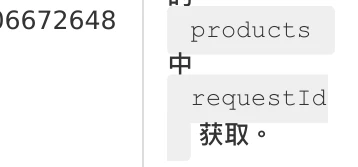

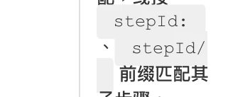

**返回数据**

| 参数名称 | 类型 | 示例 | 说明 |
| --- | --- | --- | --- |
| success | Boolean | true | 请求是否成功执行。 |
| code | String | "200" | 兼容状态码，成功为<code> "200" </code>；值域与旧版一致，程序判断请使用<code> responseCode </code>。 |
| message | String | "" | 人读消息；成功与流程状态为空串，错误时为具体原因。 |
| responseCode | String | "SUCCESS" | 语义码，程序判断的唯一稳定依据。 |
| data | Array | \[{"id":243,"stepName":"call_script"}\] | 日志行列表；无数据时见下方“无数据返回”。 |
| -id | Integer | 243 | 日志行 ID。 |
| -requestId | String | "1790667264898" | 产品执行 ID。 |
| -product | String | "OSS" | 产品名。 |
| -actionType | String | "SWITCH" | 动作类型，例如SWITCH、SWITCHBACK、SYNCCHECK。 |
| -stepId | String | null | 步骤 ID，可为空。 |
| -detailId | String | null | 明细 ID，可为空。 |
| -stepName | String | "call_script" | 步骤名称。 |
| -stepMsg | String | "start executing script..." | 步骤消息。 |
| -gmtCreated | Long | 1790667264996 | 记录时间（epoch 毫秒）。 |
| -gmtModified | Long | 1790667264996 | 更新时间（epoch 毫秒）。 |
| -drillId | Integer | 1 | 仅历史轮次（<code> historyIndex </code> <code>&amp;gt; 0 </code>）返回。 |
| -processId | Integer | 1 | 仅历史轮次（<code> historyIndex </code> <code>&amp;gt; 0 </code>）返回。 |
| -historyIndex | Integer | 1 | 仅历史轮次（<code> historyIndex </code> <code>&amp;gt; 0 </code>）返回，表示第几轮重试。 |
| timestamp | Long | 1792568497410 | 服务端响应时间（epoch毫秒）。 |

无数据时返回  `success=true` 、 `code="204"` 、 `responseCode="NO_DATA"` 、 `data=null` 。

**示例**

**请求示例**

```http
GET /api/selfops/v1/recovery/plan/process/log?requestId=1790667264898&product=OSS HTTP/1.1
Host: <入⼝域名>:8443
X-Public-Key-Id: <your-key-id>
X-Timestamp: 1792568497410
X-Call-Mode: test
X-Sign: <Base64 签名值>
```

**正常返回示例**

示例仅展示前两条日志。

```json
{
  "success": true,
  "code": "200",
  "message": "",
  "responseCode": "SUCCESS",
  "data": [
    {
      "id": 243,
      "requestId": "1790667264898",
      "product": "OSS",
      "actionType": "SWITCH",
      "stepId": null,
      "detailId": null,
      "stepName": "call_script",
      "stepMsg": "start executing script...",
      "gmtCreated": 1790667264996,
      "gmtModified": 1790667264996
    },
    {
      "id": 244,
      "requestId": "1790667264898",
      "product": "OSS",
      "actionType": "SWITCH",
      "stepId": null,
      "detailId": null,
      "stepName": "cmd_switch",
      "stepMsg": "switch command: product=OSS switch_flag=failover idc=datacenter-a request_id=1790667264898, instances: ",
      "gmtCreated": 1790667266383,
      "gmtModified": 1790667266383
    }
  ],
  "timestamp": 1792568497410
}
```

无数据时：

```json
{
  "success": true,
  "code": "204",
  "message": "",
  "responseCode": "NO_DATA",
  "data": null,
  "timestamp": 1792568497410
}
```

<a id="section-2-2-18"></a>

### 2.2.18. 链路自检

该接口用于验证运维API的接入链路：签名、Key ID、时间戳、调用模式与来源 IP 是否被平台正确识别。接口返回本次命中的公钥信息与生效调用模式。本接口为只读接口。

**接口说明准备工作**

- 已完成运维API接入：持有有效 Key ID 与私钥，入口地址（HTTPS，8443）可访问。

- 平台已开启运维API开关。

- 请求已按签名要求携带完整的四个请求头。

**请求头**

本接口使用运维API公共请求头，除下列请求头外无特殊请求头。

| 请求头 | 是否必填 | 说明 |
| --- | --- | --- |
| X-Public-Key-Id | 是 | 公钥 Key ID，格式为 <code> pk- </code> 加16 位小写十六进制。服务端严格按该值定位公钥，不存在的 Key ID 不会尝试其它公钥。 |
| X-Timestamp | 是 | 毫秒级时间戳，与服务器当前时间的偏差不得超过 5 分钟。 |
| X-Call-Mode | 是 | 调用模式，取值 <code> test </code> 或<code> production </code>。 |
| X-Sign | 是 | 对签名材料使用私钥签名后的值，标准 Base64 编码。 |

请求头构造方式见控制台「运维API调用管理」→「快速上手」→「使用指南」。

**请求语法**

```http
GET /api/selfops/v1/whoami HTTP/1.1
```

**请求参数**

无。

**返回数据**

| 参数名称 | 类型 | 示例 | 说明 |
| --- | --- | --- | --- |
| success | Boolean | true | 请求是否成功执行。 |
| code | String | "200" | 兼容状态码，成功为<code> "200" </code>；值域与旧版一致，程序判断请使用<code> responseCode </code>。 |
| message | String | "" | 人读消息；成功与流程状态为空串，错误时为具体原因。 |
| responseCode | String | "SUCCESS" | 语义码，程序判断的唯一稳定依据。 |
| data | Object | {} | 自检结果。 |
| -keyId | String | "pk-3f8a2b1c9d04e5f6" | 本次请求命中的 Key ID。 |
| -remark | String | "demo" | 公钥备注；为空时返回空串。 |
| -sourceIp | String | "127.0.0.1" | 平台识别到的来源 IP，与IP 白名单判定同源。 |
| -ipAllowed | Boolean | true | 来源 IP 是否命中该公钥的IP 白名单。 |
| -matchedKeyFingerprin t | String | "SHA256(DER):..." | 本次验签命中的公钥指纹。 |
| -matchedKeyExpires | String | "2026-12-31 23:59:59" | 公钥到期时间，格式为<code>yyyy-MM-dd</code> <code>HH:mm:ss </code>。 |
| -callMode | String | "test" | 生效调用模式：<code> test </code>或 <code> production </code>。 |
| -runMode | String | "TEST" | 平台运行模式：<code> TEST </code>或 <code> PRODUCTION </code>。 |
| -forced | Boolean | false | 生效调用模式是否被平台运行模式降级。<code> true </code>表示请求声明了<code> production </code>，但平台处于测试模式，按<code> test </code> 生效。 |
| timestamp | Long | 1792568497440 | 服务端响应时间（epoch毫秒）。 |

说明：

- 本接口豁免“IP 不命中即拒绝”：即使  `ipAllowed`  为  `false` ，只要签名与 Key ID 正确，仍返回自检结果；此时业务接口仍会被 IP 白名单拒绝，请按  `sourceIp`  调整公钥的 IP 白名单。

- 本接口返回成功只说明签名、Key ID、时间戳与调用模式通过；业务接口还受平台侧配置约束。

**示例**

**请求示例**

```http
GET /api/selfops/v1/whoami HTTP/1.1
Host: <入⼝域名>:8443
X-Public-Key-Id: <your-key-id>
X-Timestamp: 1792568497440
X-Call-Mode: test
X-Sign: <Base64 签名值>
```

**正常返回示例**

```json
{
  "success": true,
  "code": "200",
  "message": "",
  "responseCode": "SUCCESS",
  "data": {
    "keyId": "pk-3f8a2b1c9d04e5f6",
    "remark": "demo",
    "sourceIp": "127.0.0.1",
    "ipAllowed": true,
    "matchedKeyFingerprint": "SHA256(DER):3f8a2b1c9d04e5f6a7b****",
    "matchedKeyExpires": "2026-12-31 23:59:59",
    "callMode": "test",
    "runMode": "TEST",
    "forced": false
  },
  "timestamp": 1792568497440
}
```
