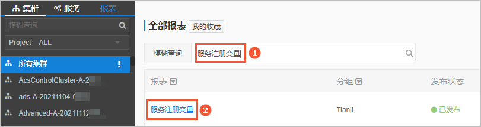

阿里云  
专有云  
数据库自治服务  
开发指南  
产品版本：v3.18.6  
文档版本：20261022

**目录**

- [1.快速入门](#section-1)
    - [1.1. 开发文档使用说明](#section-1-1)
    - [1.2. API调用流程说明](#section-1-2)
- [2.准备工作](#section-2)
    - [2.1. 登录API与工具控制台](#section-2-1)
    - [2.2. 查看API信息](#section-2-2)
    - [2.3. 获取AccessKey](#section-2-3)
    - [2.4. 获取STS AccessKey](#section-2-4)
    - [2.5. 获取公共Header参数](#section-2-5)
    - [2.6. 获取产品名的Endpoint](#section-2-6)
- [3.通过POP网关调用专有云API](#section-3)
    - [3.1. 调用前置](#section-3-1)
    - [3.2. Java版](#section-3-2)
    - [3.3. Go版](#section-3-3)
    - [3.4. Python版](#section-3-4)
- [4.API参考](#section-4)
    - [4.1. 公共参数](#section-4-1)
    - [4.2. Key分析](#section-4-2)
        - [4.2.1. 获取排名前100的大Key](#section-4-2-1)
        - [4.2.2. 实时获取当前热Key和大Key](#section-4-2-2)
        - [4.2.3. 获取排名前100的热Key](#section-4-2-3)
        - [4.2.4. 查询实例当前的热Key](#section-4-2-4)
    - [4.3. 缓存分析](#section-4-3)
        - [4.3.1. 查询缓存分析任务列表](#section-4-3-1)
        - [4.3.2. 创建缓存分析任务](#section-4-3-2)
        - [4.3.3. 查询缓存分析任务详情](#section-4-3-3)
    - [4.4. GetSlowRequestRecords](#section-4-4)
    - [4.5. 接入数据库实例](#section-4-5)
    - [4.6. AccessHDMInstanceByToken - 接入实例](#section-4-6)
    - [4.7. GetSlowRequestDirectly - 通过直连查询当前数据库的慢日志](#section-4-7)

<a id="section-1"></a>

# 1.快速入门

<a id="section-1-1"></a>

## 1.1. 开发文档使用说明

本文为您介绍在使用专有云API进行开发工作时，如何查看所需要的产品文档。

**使用流程**

您可以按照以下流程图中步骤，判断自己所需要使用的开发文档。


**前提条件**

通过运维人员或运营管理员获取专有云的版本。

**操作步骤**

您可以通过阿里云专有云文档中心，获取需要的产品文档。

1. 通过浏览器打开专有云文档中心。

2. 根据专有云的版本单击**企业版**、**敏捷版**或**一体机**标签。

3. 在下拉列表中，选择对应的专有云版本。

   

4. 在左侧导航栏中，选择目标产品名称。

5. 单击目标文档区域的**查看详情**或**下载PDF**。

<a id="section-1-2"></a>

## 1.2. API调用流程说明

阿里云专有云支持通过POP网关或ASAPI网关调用专有云API，为了使您拥有与公有云一致的体验，自企业版V3.16.0开始，专有云API默认使用POP网关方式调用。本文介绍通过POP网关调用专有云API的流程。

> **说明**
>
> 历史版本使用ASAPI网关调用专有云API的方式仍然有效，详情请参见ASAPI网关调用流程说明、生成ASAPI的Endpoint、获取ASAPI的SDK包。

**流程图**


**调用步骤**

1. 获取AccessKey。

   获取调用时所需要的AccessKey参数，请参见获取AccessKey或获取STS AccessKey。

   > **说明**
   >
   > 推荐使用个人AccessKey或STS AccessKey调用Apsara Uni-manager运营控制台及云产品接口。

2. 获取RegionID。

   获取调用时所需要的RegionID参数，请参见获取公共Header参数。

3. 获取组织ID与资源集ID。

   组织ID需要通过API进行获取，获取方式请参见*Apsara Uni-manager运营控制台开发指南*中的*GetOr ganizationList章节*。

   资源集ID需要通过API进行获取，获取方式请参见*Apsara Uni-manager运营控制台开发指南*中的*ListResourceGroup章节*。

   > **说明**
   >
   > 调用API时，请在Header参数中增加组织ID `<x-acs-organizationid>` 和资源集ID `<x-acs-`


> `resourcegroupid>`， 指定资源所属的组织和资源集，实现实例资源的隔离查询。
>
> - 不指定组织ID `<x-acs-organizationid>` ，则默认获取当前用户所属的组织。
>
> - 不指定资源集ID `<x-acs-resourcegroupid>` ，则默认为空，如果指定资源集需要同时指定组织ID。

4. 获取对应的API参考文档。

   您需要查看目标云产品的开发指南，了解API的功能与使用方式，开发指南的使用流程及获取方法请参见开发文档使用说明。

5. 获取云产品Endpoint。

6. 获取云产品SDK并调用云产品API。

<a id="section-2"></a>

# 2.准备工作

<a id="section-2-1"></a>

## 2.1. 登录API与工具控制台

您可以通过Apsara Uni-manager运营控制台登录API与工具控制台。

**前提条件**

- 登录Apsara Uni-manager运营控制台前，确认您已从部署人员处获取Apsara Uni-manager运营控制台的服务域名地址。

- 推荐使用Chrome浏览器。

**操作步骤**

1. 在浏览器地址栏中，输入Apsara Uni-manager运营控制台的服务域名地址，按回车键。

2. 输入正确的用户名及密码。

   请向运营管理员获取登录控制台的用户名和密码。

   > **说明**
   >
   > 首次登录Apsara Uni-manager运营控制台时，需要修改登录用户名的密码，请按照提示完成密码修改。为提高安全性，密码长度必须为10~32位，且至少包含以下两种类型：
   >
   > - 英文大写或小写字母（A~Z、a~z）
   >
   > - 阿拉伯数字（0~9）
   >
   > - 特殊符号（感叹号（!）、at（@）、井号（#）、美元符号（$）、百分号（%）等）

3. 单击**账号登录**。

4. 如果账号已激活MFA多因素认证，请根据以下两种情况进行操作：

   - 管理员强制开启MFA后的首次登录：

     <ol type="a">

     <li>

     在绑定虚拟MFA设备页面中，按页面提示步骤绑定MFA设备。

     </li>

     <li>

     按照步骤2重新输入账号和密码，单击**账号登录**。

     </li>

     </ol>

     <ol type="i" start="100">

     <li>

     输入6位MFA码后单击**认证**。

     </li>

     </ol>

   - 您已开启并绑定MFA：

     输入6位MFA码后单击**认证**。

5. 在页面顶部的菜单栏中，选择**产品 > 其他 > API与工具**。

<a id="section-2-2"></a>

## 2.2. 查看API信息

您在使用SDK时，需要获取产品名称、API名称和API版本。本文介绍如何查看API信息。

**背景信息**

API目录中的API仅供调用参考，具体API的使用方式需要参见各云产品的API文档。如果发生不一致情况，以API支持情况为准。

**操作步骤**

1. 登录API与工具控制台。

2. 在左侧导航栏中选择**API目录**。

3. 在**API目录**页面，在下拉列表中选择对应的产品，输入API名称的关键词进行搜索。

4. 查看并记录对应的产品名称、API名称和API版本。

<a id="section-2-3"></a>

## 2.3. 获取AccessKey

AccessKey支持RAM和STS两种授权模式，在发起调用时选择使用其中一种AccessKey即可。本文将为您介绍如何获取通过RAM授权的AccessKey。

**背景信息**

AccessKey通过使用AccessKey ID和AccessKey Secret对称加密，实现验证某个请求发送者的身份的功能。其中AccessKey ID用于标示用户，AccessKey Secret是用户用于加密签名的字符串。

AccessKey的两种授权模式如下：

- 通过RAM授权给第三方请求者的AccessKey ID和AccessKey Secret。

- 通过STS授权给第三方请求者的AccessKey ID、AccessKey Secret和Security Token。获取方式请参见获取STS AccessKey。

Apsara Uni-manager运营控制台提供了个人AccessKey和组织AccessKey（只有运营管理员和一级组织管理员可以获取组织AccessKey），推荐使用个人账号AccessKey调用Apsara Uni-manager运营控制台及云产品相关接口。如果使用个人账号AccessKey，需要在Header中添加以下限制性参数，否则可能提示权限不足：

> 个人账号AccessKey是由Apsara Uni-manager运营控制台权限体系管控的受限
>
> **警告**
>
> AccessKey，组织AccessKey相对权限较大，需要管理员确认操作的安全性。

<table>
  <tr>
    <th width="206">参数名称</th>
    <th>描述</th>
  </tr>
  <tr>
    <td>x-acs-regionid</td>
    <td>地域，如：cn-hangzhou-*。</td>
  </tr>
  <tr>
    <td>x-acs-organizationid</td>
    <td>Apsara Uni-manager运营控制台中对应的组织ID。获取方法可参见<strong>《Apsara Uni-manager运营控制台开</strong><strong>发指南》</strong>中的<strong>《GetOrganizationList》</strong>文档。</td>
  </tr>
  <tr>
    <td>x-acs-resourcegroupid</td>
    <td>Apsara Uni-manager运营控制台中对应的资源集ID。获取方法可参见<strong>《Apsara Uni-manager运营控制台</strong><strong>开发指南》</strong>中的<strong>《ListResourceGroup》</strong>文档。</td>
  </tr>
  <tr>
    <td>x-acs-instanceid</td>
    <td>进行操作的实例ID，例如，ECS的实例ID可以从ECS列表中查询到。</td>
  </tr>
</table>

**获取个人账号AccessKey**

获取个人账号AccessKey的方法如下：

1. 登录Apsara Uni-manager运营控制台。

2. 在系统界面右上角，单击当前登录用户头像，单击**个人信息**。

3. 在**阿里云AccessKey**区域，您可以查看个人账户的AccessKey信息。

   

   > Accesskey ID和AccessKey Secret是您访问云资源时的密钥，具有该账号完整的权
   >
   > **说明**
   >
   > 限，请您妥善保管。

**获取组织AccessKey**

获取组织AccessKey的方法如下：

1. 管理员登录Apsara Uni-manager运营控制台。

2. 在顶部菜单栏，单击**企业**。

3. 在左侧导航栏中，选择**资源管理 > 组织管理**。

4. 在组织结构中，单击目标一级组织名称。

5. 单击**管理Accesskey**。

6. 在弹出的对话框中，查看组织AccessKey信息。

<a id="section-2-4"></a>

## 2.4. 获取STS AccessKey

本文为您介绍如何利用STS方式，调用专有云的产品API。

**背景信息**

阿里云临时安全令牌STS（Security Token Service）是阿里云提供的一种临时访问权限管理服务。您可以选择使用STS方式，调用专有云的产品API。

STS AccessKey由AccessKey ID、AccessKey Secret及SecurityToken三元组组成，使用STS方式调用云产品API时，三元组缺一不可。更多STS内容请参见什么是STS。

**操作步骤**

1. 获取用户角色的 `RAM Role` 。

   <ol type="i">

   <li>

   登录Apsara Uni-manager运营控制台。

   </li>

   <li>

   单击页面右上角的用户头像，单击**个人信息**。

   </li>

   <li>

   单击**查看当前角色策略**。

   在**当前选择角色策略**对话框中查看 `RAM Role` 。

   </li>

   </ol>

2. 获取STS Accesskey三元组。

   > **说明**
   >
   > 以下代码示例中可变参数均需替换为您实际的相关信息，尖括号（<>）在最终代码中不保留。
   >
   > 涉及替换的可变参数如下：
   >
   > - &lt;yourRegionID>，请替换为您实际的地域ID。
   >
   > - &lt;yourAccessKeyID>，请替换为您实际的AccessKey ID。
   >
   > - &lt;yourAccessKeySecret>，请替换为您实际的AccessKey Secret。
   >
   > - &lt;yourRoleSessionName>，请替换为您当前实际的会话名称。
   >
   > - &lt;yourRoleArn>，请替换为您实际的RAM Role。
   >
   > - &lt;sts.aliyuns.com>，请替换为实际的STS Endpoint。

   ```xml
   public static void main(String[] args) {
       // 创建DefaultAcsClient实例并初始化。
       // 请替换为您实际的地域ID、AccessKey ID、AccessKey Secret
       DefaultProfile profile = DefaultProfile.getProfile("<yourRegionID>", "
   <yourAccessKeyID>", "<yourAccessKeySecret>");
       HttpClientConfig clientConfig = HttpClientConfig.getDefault();
       clientConfig.setIgnoreSSLCerts(true);
       clientConfig.setProtocolType(ProtocolType.HTTPS);
       profile.setHttpClientConfig(clientConfig);
       IAcsClient client = new DefaultAcsClient(profile);
       String assumeRole = callAssumeRole(client);
       if (StringUtils.isEmpty(assumeRole)) return;
       JSONObject assumeRoleJson = JSONObject.parseObject(assumeRole);
       JSONObject credentials = assumeRoleJson.getJSONObject("Credentials");
       // 获取到STS三元组
       String stsAK = credentials.getString("AccessKeyId");
       String stsSK = credentials.getString("AccessKeySecret");
       String stsToken = credentials.getString("SecurityToken");
   }

   private static String callAssumeRole(IAcsClient client) {
       CommonRequest request = new CommonRequest();
       // <sts.aliyuns.com> 请替换为实际的STS Endpoint，⼀般格式为sts-
   vpc.${global:region}.${global:internet-domain}
       request.setSysDomain("<sts.aliyuns.com>");
       request.setSysProduct("Sts");
       request.setSysAction("AssumeRole");
       request.setSysVersion("2015-04-01");
       request.setSysMethod(MethodType.POST);
       request.setHttpContentType(FormatType.FORM);
       // 业务参数，设置本次调⽤Session的别名，<yourRoleSessionName>请您替换为实际值
       request.putQueryParameter("RoleSessionName", "<yourRoleSessionName>");
       // 扮演的Role⾓⾊ARN，<yourRoleArn>请替换为上⼀步获取到的实际Ram Role ARN
       request.putQueryParameter("RoleArn", "<yourRoleArn>");
       try {
           CommonResponse response = client.getCommonResponse(request);
           return response.getData();
       } catch (ServerException e) {
           System.out.println(e.getErrCode());
           System.out.println(e.getErrMsg());
       } catch (ClientException e) {
           System.out.println(e.getErrCode());
           System.out.println(e.getErrMsg());
       }
       return null;
   }
   ```

3. 通过STS AccessKey三元组调用云产品的接口，下列代码以ECS的 `DescribeZones` 接口为示例。

   > **说明**
   >
   > 以下代码示例中可变参数均需替换为您实际的相关信息，尖括号（<>）在最终代码中不保留。
   >
   > 涉及替换的可变参数如下：
   >
   > - &lt;yourRegionID>，请替换为您实际的地域ID。
   >
   > - &lt;yourStsAccesskeyID>，请替换为您实际的STS Accesskey ID。
   >
   > - &lt;yourStsAccessKeySecret>，请替换为您实际的STS Accesskey Secret。
   >
   > - &lt;yourStsToken>，请替换为实际STS三元组中的SecurityToken。
   >
   > - &lt;yourResourceGroupID>，请替换为您实际的资源集ID。
   >
   > - &lt;yourOrganizationID>，请替换为您实际的组织ID。

   ```xml
   public static void main(String[] args) {
       // <yourRegionID>请替换为您实际的地域ID
       // <yourStsAccessKeyID>, <yourStsAccessKeySecret>请替换为前⼀步获取到的STS三元组中AccessKeyID、AccessKeySecret
       DefaultProfile profile = DefaultProfile.getProfile("<yourRegionID>", "
   <yourStsAccesskey>", "<yourStsAccessSecret>");
       HttpClientConfig clientConfig = HttpClientConfig.getDefault();
       clientConfig.setIgnoreSSLCerts(true);
       clientConfig.setProtocolType(ProtocolType.HTTPS);
       profile.setHttpClientConfig(clientConfig);
       IAcsClient client = new DefaultAcsClient(profile);
       CommonRequest request = new CommonRequest();
       request.setSysDomain("ecs.aliyuns.com");
       request.setSysProduct("Ecs");
       request.setSysAction("DescribeZones");
       request.setSysVersion("2014-05-26");
       request.setSysMethod(MethodType.POST);
       request.setHttpContentType(FormatType.FORM);
       //<yourRegionID>请替换为您实际的地域ID
       request.putHeadParameter("x-acs-regionid", "<yourRegionID>");
       // <yourStsToken>请替换为您前⼀步获取到的STS三元组中SecurityToken
       request.putQueryParameter("SecurityToken", "<yourStsToken>");
       // 非必填,请替换为您实际的资源集ID
       // request.putHeadParameter("x-acs-resourcegroupid", "<yourResourceGroupID>");
       // 必填,请替换为您实际的组织ID
       request.putHeadParameter("x-acs-organizationid", "<yourOrganizationID>");
       try {
           CommonResponse response = client.getCommonResponse(request);
           System.out.println(response.getData());
       } catch (ServerException e) {
           System.out.println(e.getErrCode());
           System.out.println(e.getErrMsg());
       } catch (ClientException e) {
           System.out.println(e.getErrCode());
           System.out.println(e.getErrMsg());
       }
   }
   ```

<a id="section-2-5"></a>

## 2.5. 获取公共Header参数

调用专有云API时需要提供多个Header参数。本文为您介绍这些参数的含义及其获取方式，并对调用后的一些返回值做出解释。

**Header参数描述**

| 名称 | 描述 |
| --- | --- |
| x-acs-regionid | 环境Region，获取方式请参见获取Region ID。 |
| x-acs-organizationid | Apsara Uni-manager运营控制台上的组织ID，获取方式请参见获取组织ID。 |
| x-acs-resourcegroupid | Apsara Uni-manager运营控制台上的资源集ID，获取方式请参见获取资源集ID。 |
| x-acs-instanceid | 进行操作的实例ID，获取方式请参见获取实例ID。 |

**获取Region ID**

1. 管理员登录Apsara Uni-manager运营控制台。

2. 在顶部菜单栏中，单击**企业**。

3. 在左侧导航栏中，选择**资源管理**>**地域管理**。

4. 单击目标组织名称。

5. 在右侧**Region列表**中查看Region ID。

**获取组织ID**

组织ID需要通过API进行获取，获取方式请参见*Apsara Uni-manager运营控制台开发指南*中的*GetOrganizationList章节*。

**获取资源集ID**

资源集ID需要通过API进行获取，获取方式请参见*Apsara Uni-manager运营控制台开发指南*中的*ListResourceGroup章节*。

**获取实例ID**

*请各云产品自行修改替换产品名及获取实例ID流程*

实例ID可以通过Apsara Uni-manager运营控制台中的云产品实例列表进行获取，本文中以ECS为例，获取步骤如下：

1. 登录Apsara Uni-manager运营控制台。

2. 在顶部的菜单栏中，选择**产品**>**弹性计算**>**云服务器ECS**。

3. 在左侧导航栏中，单击**实例**。

4. 在实例列表中查看**实例ID**。

**返回参数**

对于列表类的云产品资源实例接口，调用后会默认增加如下返回值。

| 名称 | 描述 |
| --- | --- |
| ResourceGroupName | 资源集名称。 |
| ResourceGroup | 资源集ID。 |
| DepartmentName | 组织名称。 |
| Department | 组织ID。 |

<a id="section-2-6"></a>

## 2.6. 获取产品名的Endpoint

本文介绍了如何获取*产品名*Endpoint。*标题及短描述中产品名，请各云产品自行替换*

**背景信息**

通过POP网关调用专有云API时需要使用云产品业务域的Endpoint。您可以在阿里云驻场运维工程师处获取。您也可以通过如下方法自行获取Endpoint。

**操作步骤**

> **警告**

1. 

2. 

3. 

4.

<a id="section-3"></a>

# 3.通过POP网关调用专有云API

<a id="section-3-1"></a>

## 3.1. 调用前置

阿里云专有云与公有云一样，可通过POP网关的方式进行API调用。本文为您介绍调用前需要进行的准备工作。

**背景信息**

阿里云专有云既支持通过ASAPI网关调用专有云API，也支持通过POP网关调用专有云API。为了使专有云保持与公有云相同的使用方式，使您拥有和更方便，更一致的体验，建议通过POP网关调用专有云API。

**获取云产品的Endpoint**

通过POP网关调用专有云API时需要使用云产品业务域的Endpoint。您可以在阿里云驻场运维工程师处获取。

您也可以自行获取Endpoint，本文以ECS为例为您介绍获取云产品业务域Endpoint的方法。

1. 登录天基。

   <ol type="i">

   <li>

   登录Apsara Uni-manager运维控制台。

   </li>

   <li>

   在顶部菜单栏单击**运维**。

   </li>

   <li>

   在左侧导航栏中选择**产品运维管理**>**产品列表**。

   </li>

   <li>

   单击**天基**。

   </li>

   </ol>

2. 在左侧导航栏中单击**报表**。

   

3. 在**全部报表**页面搜索 服务注册变量 ，单击报表名称。

   

4. 在**服务注册变量**页面，单击**Service**旁的  图标，搜索 `ECS` 。

5. 在 `ecs-yaochi` 服务的**Service Registration**列中，单击鼠标右键，选择**显示更多**。

   在**详情**页面，查看的**internal.openapi.endpoint**值，即 `Endpoint` 。

**获取公共参数**

通过POP网关调用专有云API过程中所使用的参数，如组织ID、资源集ID、RegionID和实例ID，获取方式请参见获取公共Header参数。

<a id="section-3-2"></a>

## 3.2. Java版

通过POP Java SDK访问产品域名，需要了解该产品调用方式(RPC或ROA)。

**前提条件**

- 通过阿里云开发工具包（SDK）下载对应产品的安装依赖。

- HTTPS访问设置为忽略SSL证书验证。

**调用示例**

RPC调用，示例接口信息：产品（ECS）、接口（DescribeInstances）、版本（2014-05-26）。

调用示例如下：

```xml
import com.aliyuncs.CommonRequest;
import com.aliyuncs.CommonResponse;
import com.aliyuncs.DefaultAcsClient;
import com.aliyuncs.IAcsClient;
import com.aliyuncs.exceptions.ClientException;
import com.aliyuncs.exceptions.ServerException;
import com.aliyuncs.http.MethodType;
import com.aliyuncs.profile.DefaultProfile;

public class DescribeInstances {

    public static void main(String[] args) {
        // 创建DefaultAcsClient实例并初始化。
        DefaultProfile profile = DefaultProfile.getProfile("<your-regionid>", "
<yourAccessKeyId>", "<yourAccessSecret>");

        // 忽略SSL
        // HttpClientConfig clientConfig = HttpClientConfig.getDefault();
        // clientConfig.setIgnoreSSLCerts(true);
        // 设置连接超时
        // clientConfig.setConnectionTimeoutMillis(3000L);
        // 设置读取超时
        // clientConfig.setReadTimeoutMillis(10000L);
        // profile.setHttpClientConfig(clientConfig);
        
        IAcsClient client = new DefaultAcsClient(profile);
        // 创建API请求并设置参数。
        CommonRequest request = new CommonRequest();
        // 设置请求⽅式
        request.setSysMethod(MethodType.POST);
        // 设置云产品Endpoint
        request.setSysDomain("<ecsEndpoint>");
        // 设置访问接⼝版本
        request.setSysVersion("2014-05-26");
        // 设置LocationProduct
        request.setSysLocationProduct("Ecs");
        // 设置访问接⼝的名称
        request.setSysAction("DescribeInstances");
        
        // 当使⽤sts ak调⽤RPC接⼝时 需要在参数中加上SecurityToken字段
        // request.putBodyParameter("SecurityToken", "<your-SecurityToken>");

        // 业务参数
        request.putBodyParameter("PageSize", "10");
        request.putBodyParameter("PageNumber", "1");

        // 必填值，调⽤来源说明
        request.putHeadParameter("x-acs-caller-sdk-source", "ApiTestDemo");
        // 非必填，企业版V3.15.0之前历史版本需要
        request.putHeadParameter("x-acs-regionid", "<your-regionid>");
        // 非必填，资源集ID
        request.putHeadParameter("x-acs-resourcegroupid", "<your-resourcegroupid>");
        // 必填 组织ID
        request.putHeadParameter("x-acs-organizationid", "<your-organizationid>");
        // 非必填，修改&删除操作需要
        // request.putHeadParameter("x-acs-instanceid", "<your-instanceid>");

        try {
            // 发起请求并处理应答或异常。
            CommonResponse response = client.getCommonResponse(request);
            System.out.println(response.getData());
        } catch (ServerException e) {
            e.printStackTrace();
        } catch (ClientException e) {
            System.out.println("ErrCode:" + e.getErrCode());
            System.out.println("ErrMsg:" + e.getErrMsg());
            System.out.println("RequestId:" + e.getRequestId());
        }

    }
}
```

ROA调用，示例接口信息：产品（CR）接口（GetNamespaceList）版本（2016-06-07）。

调用示例如下：

```xml
import com.aliyuncs.CommonRequest;
import com.aliyuncs.CommonResponse;
import com.aliyuncs.DefaultAcsClient;
import com.aliyuncs.IAcsClient;
import com.aliyuncs.exceptions.ClientException;
import com.aliyuncs.exceptions.ServerException;
import com.aliyuncs.http.MethodType;
import com.aliyuncs.profile.DefaultProfile;

public class GetNamespaceList {

    public static void main(String[] args) {
        // 创建DefaultAcsClient实例并初始化。
        DefaultProfile profile = DefaultProfile.getProfile("<your-regionid>", "
<yourAccessKeyId>", "<yourAccessSecret>");

        // 忽略SSL
        // HttpClientConfig clientConfig = HttpClientConfig.getDefault();
        // clientConfig.setIgnoreSSLCerts(true);
        // 设置连接超时
        // clientConfig.setConnectionTimeoutMillis(3000L);
        // 设置读取超时
        // clientConfig.setReadTimeoutMillis(10000L);
        // profile.setHttpClientConfig(clientConfig);
        
        IAcsClient client = new DefaultAcsClient(profile);
        // 创建API请求并设置参数。
        CommonRequest request = new CommonRequest();

        // 设置HTTPS访问
        request.setSysProtocol(ProtocolType.HTTP);
        // 设置请求⽅式
        request.setSysMethod(MethodType.GET);
        // 设置云产品endpoint
        request.setSysDomain("<crEndpoint>");
        // 设置访问接⼝版本
        request.setSysVersion("2016-06-07");
        // 设置uriPattern 只有roa调⽤需要传递此字段
        request.setSysUriPattern("/namespace");
        // 设置LocationProduct
        request.setSysLocationProduct("cr");
        // 设置 访问接⼝的名称
        request.setSysAction("GetNamespaceList");

        // 必填值，调⽤来源说明
        request.putHeadParameter("x-acs-caller-sdk-source", "ApiTestDemo");
        // 非必填，企业版V3.15.0之前历史版本需要
        request.putHeadParameter("x-acs-regionid", "<your-regionid>");
        // 非必填，资源集ID
        request.putHeadParameter("x-acs-resourcegroupid", "<your-resourcegroupid>");
        // 必填 组织ID
        request.putHeadParameter("x-acs-organizationid", "<your-organizationid>");
        // 非必填，修改&删除操作需要
        // request.putHeadParameter("x-acs-instanceid", "<your-instanceid>");


        // 当使⽤STS AK调⽤ROA接⼝时 需要在Header加上x-acs-security-token字段
        // request.putHeadParameter("x-acs-security-token", "<your-securitytoken>");

        try {
            // 发起请求并处理应答或异常。
            CommonResponse response = client.getCommonResponse(request);
            System.out.println(response.getData());
        } catch (ServerException e) {
            e.printStackTrace();
        } catch (ClientException e) {
            System.out.println("ErrCode:" + e.getErrCode());
            System.out.println("ErrMsg:" + e.getErrMsg());
            System.out.println("RequestId:" + e.getRequestId());
        }

    }
}
```

> **重要**
>
> 设置HTTPS访问，一定要设置忽略SSL证书验证。

<a id="section-3-3"></a>

## 3.3. Go版

本文为您介绍POP Go SDK调用的方式。

**前提条件**

通过阿里云开发工具包（SDK）下载对应产品的安装依赖。

**背景信息**

当前支持RPC和ROA的方式调用API。

**调用示例**

RPC方式调用示例接口信息：产品（ECS）、接口（DescribeInstances）、版本（2014-05-26）。

示例代码如下：

```go
package main

import (
    "fmt"
    "github.com/aliyun/alibaba-cloud-sdk-go/sdk"
    "github.com/aliyun/alibaba-cloud-sdk-go/sdk/requests"
  
)

func main() {
    client, err := sdk.NewClientWithAccessKey("<your-RegionID>", "<AccessKey ID>", "<AccessKey Secret>")

    request := requests.NewCommonRequest()
    
    request.Method = "POST"
    request.Domain = "<ECSEndpoint>"
    request.Version = "2014-05-26"
    request.ApiName = "DescribeInstances"
    request.Product = "Ecs"
    // 当使⽤sts ak调⽤rpc接⼝时 需要在参数中加上SecurityToken字段
    // request.QueryParams["SecurityToken"]="<your-SecurityToken>"

    // 必填值，调⽤来源说明
    request.Headers["x-acs-caller-sdk-source"] = "ApiTestDemo"
    // 非必填，企业版V3.15.0之前历史版本需要
    request.Headers["x-acs-regionid"] = "<your-RegionID>"
    // 非必填，资源集ID
    request.Headers["x-acs-resourcegroupid"] = "<your-ResourceGroupID>"
    // 必填，组织ID
    request.Headers["x-acs-organizationid"] = "<your-OrganizationID>"
    // 非必填，修改&删除操作需要
    // request.Headers["x-acs-instanceid"] = "<your-InstanceID>"

    response, err := client.ProcessCommonRequest(request)
    if err != nil {
        panic(err)
    }
    fmt.Print(response.GetHttpContentString())
}
```

ROA调用示例接口信息：产品（CR）接口（GetNamespaceList）版本（2016-06-07）。

调用示例如下：

```xml
package main

import (
 "fmt"
 "github.com/aliyun/alibaba-cloud-sdk-go/sdk"
 "github.com/aliyun/alibaba-cloud-sdk-go/sdk/requests"
 "os"
)


func main() {
    client, err := sdk.NewClientWithAccessKey("<your-regionid>", "<yourAccessKeyId>", "
<yourAccessSecret>")
 request := requests.NewCommonRequest()

 request.Method = "GET"
 request.Domain = "<crEndpoint>"
 request.Version = "2016-06-07"
 request.ApiName = "GetNamespaceList"
 request.Product = "cr"

 request.PathPattern = "/namespace"
 // 当使⽤sts ak调⽤ROA接⼝时 需要在header中加上x-acs-security-token字段
 // request.Headers["x-acs-security-token"] = "<your-SecurityToken>"
 // 必填值，调⽤来源说明
 request.Headers["x-acs-caller-sdk-source"] = "ApiTestDemo"
    // 非必填，企业版V3.15.0之前历史版本需要
    request.Headers["x-acs-regionid"] = "<your-RegionID>"
    // 非必填，资源集ID
    request.Headers["x-acs-resourcegroupid"] = "<your-ResourceGroupID>"
    // 必填，组织ID
    request.Headers["x-acs-organizationid"] = "<your-OrganizationID>"
 // 非必填，修改&删除操作需要
 // request.Headers["x-acs-instanceid"] = "<your-InstanceID>"

 response, err := client.ProcessCommonRequest(request)
 if err != nil {
  panic(err)
 }
 fmt.Print(response.GetHttpContentString())
}
```

**设置代理**

当您在调用实例时，或许会需要设置代理，您可以通过以下两种方式设置代理。

- 通过环境变量设置。

  环境变量HTTP_PROXY、HTTPS_PROXY或者NO_PROXY。

  设置代码如下：

  ```go
  import (
      "os"
  )
  func main(){
   os.Setenv("HTTP_PROXY", "http://x.x.x.x:xxxx") // 设置 HTTP_PROXY 环境变量
   os.Setenv("HTTPS_PROXY", "https://x.x.x.x:xxxx") // 设置 HTTPS_PROXY 环境变量
  }
  ```

- 通过客户端设置。

  设置代码如下：

  ```text
  // 客户端设置代理优先级比环境变量⾼
  client.SetHttpProxy("http://x.x.x.x:xxxx")   // 设置http代理
  client.GetHttpProxy()                          // 获取http代理

  client.SetHttpsProxy("https://x.x.x.x:xxxx")   // 设置https代理
  client.GetHttpsProxy()                           // 获取https代理

  client.SetNoProxy("127.0.0.1,localhost")     // 设置代理⽩名单
  client.GetNoProxy()                          // 获取代理⽩名单
  ```

<a id="section-3-4"></a>

## 3.4. Python版

本文为您介绍POP Python SDK调用云产品API的方式。

**前提条件**

通过阿里云开发工具包（SDK）下载对应产品的安装依赖。

**背景信息**

目前仅支持通过RPC方式调用API。

**调用示例**

调用示例接口信息：产品（ECS）、接口（DescribeInstances）、版本（2014-05-26）。

示例代码如下：

```python
from aliyunsdkcore.client import AcsClient
import os
from aliyunsdkcore.request import CommonRequest

# 创建AcsClient实例
client = AcsClient(
    "<AccessKey ID>",
    "<AccessKey Secret>",
    "<your-RegionID>",
    timeout=1000,  # 设置超时时间
    verify=False, # 忽略证书 或者 verify='<证书位置>'
);
# 和https⼀起使⽤
# client.set_verify(False)
# os.environ["HTTPS_PROXY"] = "http://127.0.0.1:8080"

# os.environ["HTTP_PROXY"] = "http://127.0.0.1:8080"
def hello_ecs_instance():
    # 创建request，并设置参数
    request = CommonRequest()

    # 当使⽤sts ak调⽤rpc接⼝时 需要在参数中加上SecurityToken字段
    # params = {"PageSize":"10","PageNumber":"1","SecurityToken":"<your-
SecurityToken>"};
    params = {"PageSize":"10","PageNumber":"1"};
    request.set_body_params(params)

    headers = {
        # 必填值，调⽤来源说明
        "x-acs-caller-sdk-source":"ApiTestDemo",
        # 非必填，企业版V3.15.0之前历史版本需要
        "x-acs-regionid":"<your-RegionID>",
        # 非必填，资源集ID
        "x-acs-resourcegroupid":"<your-ResourceGroupID>",
        # 必填，组织ID
        "x-acs-organizationid":"<your-OrganizationID>"
        # 非必填，修改&删除操作需要
        # "x-acs-instanceid":"<your-InstanceID>"

    }
    request.set_headers(headers)
    request.set_version("2014-05-26")
    request.set_action_name("DescribeInstances")
    request.set_endpoint("<ecsEndpoint>")   //Endpoint请替换为真实地址
    request.set_product("Ecs")
    request.set_method("POST")

    # 发起API请求并显示返回值
    response = client.do_action_with_exception(request)
    print(response)


if __name__ == '__main__':
    print("Hello Aliyun OpenApi!")
    hello_ecs_instance()
```

**设置代理**

调用API时您或许需要通过环境变量设置HTTP_PROXY、HTTPS_PROXY。

示例代码如下：

```text
# https的代理 
os.environ["HTTPS_PROXY"] = "http://x.x.x.x:xxxx"

# http的代理
os.environ["HTTP_PROXY"] = "https://x.x.x.x:xxxx"
```

<a id="section-4"></a>

# 4.API参考

这是 API 参考内容

<a id="section-4-1"></a>

## 4.1. 公共参数

**公共请求参数**

公共请求参数是每个接口调用都需要提供的请求参数。

表 1. 公共请求参数表

| 名称 | 类型 | 是否必须 | 描述 |
| --- | --- | --- | --- |
| Format | Strin g | 否 | 返回值的类型，仅支持JSON。 |
| Version | Strin g | 是 | API 版本号，以日期形式YYYY-MM-DD输入，取值： 2019-05-10。 |
| AccessKeyId | Strin g | 是 | 访问服务使用的密钥ID。 |
| AccessKeySe cret | Strin g | 是 | 访问服务使用的密钥值。 |
| RegionId | Strin g | 是 | 访问服务所使用的的地域ID。 |
| Product | Strin g | 是 | 接口对应的产品名称。 |

您也可以通过Apsara Uni-manager运营控制台获取接口所需要的 `Product` 和 `Version` 参数。具体操作步骤如下。

1. 登录Apsara Uni-manager运营控制台。

2. 在顶部菜单栏中选择**产品 > 其他 > API与工具**。

3. 在左侧导航栏中单击**API目录**。

4. 在**API名称**文本框中输入接口名称，即可查询接口的信息。

**公共Header参数**

| 名称 | 描述 |
| --- | --- |
| x-acs-organizationid | Apsara Uni-manager运营控制台上的组织ID，获取方式请参见获取组织ID。 |
| x-acs-resourcegroupid | Apsara Uni-manager运营控制台上的资源集ID，获取方式请参见获取资源集ID。 |
| x-acs-instanceid | 进行操作的实例ID，获取方式请参见获取实例ID。 |

> 在调用各云产品接口调用时，您需要在调用代码的请求头Header中添加**x-acs-**
>
> **说明**
>
> **organizationid**、**x-acs-resourcegroupid**、**x-acs-instanceid**等参数的实际值，用于指定当前实例的实例ID（在创建实例和查询实例列表的场景下，实例ID不存在），及其所属的组织和资源集。若未添加相关Header参数实际值，调用时则会默认指向root组织和root资源集。

**公共返回参数**

API返回结果采用统一格式，通过返回HTTP状态码来表示状态：

- 返回2xx HTTP状态码代表调用成功。

- 返回4xx或5xx HTTP状态码代表调用失败。

调用成功返回的数据格式为JSON，每次接口调用，无论成功与否，系统都会返回一个唯一识别码RequestId。

<a id="section-4-2"></a>

## 4.2. Key分析

<a id="section-4-2-1"></a>

### 4.2.1. 获取排名前100的大Key

调用DescribeTopBigKeys接口，获取一段时间内排名前100的大Key。

对数据结构为 List、Hash、Set、Zset 的 Key，按照 Key 中元素的数量排序并展示排名前 3 的 Key，记录为大 Key。

- 在使用阿里云 SDK 时，需要保证 aliyun-sdk-core 的版本大于 4.3.3，建议使用最新版本。

- 使用 DAS 的 SDK 的版本为 1.0.2 或以上。

- 本接口只适用于如下 Redis 实例：

  - 实例为社区版（5.0 及以上版本）或企业版（性能增强型）。

  - 实例的小版本为最新。

**请求头**

该接口使用公共请求头，无特殊请求头。请参见公共请求参数文档。

**请求参数**

| 参数名称 | 类型 | 位置 | 是否必选 | 示例 | 说明 |
| --- | --- | --- | --- | --- | --- |
| ConsoleCo ntext | Strin g | Query | 否 | None | 备用参数。 |
| InstanceId | Strin g | Query | 是 | r-bp18ff4a195d\*\*\*\* | Redis实例ID，您可以调用DescribeInstances接口获取。 |
| NodeId | Strin g | Query | 否 | r-x\*\*\*\*-db-0 | Redis实例的数据分片ID，您可以调用DescribeRoleZoneInfo接口获取。 |
| StartTime | Strin g | Query | 是 | 1596177993000 | 查询任务开始时间，格式为Unix时间戳，单位为毫秒。 |
| EndTime | Strin g | Query | 是 | 1596177993001 | 查询任务结束时间，格式为Unix时间戳，单位为毫秒。<br>• <em>查询任务结束时间</em><em>需晚于查询任务开</em><em>始时间。</em><br>• <em>仅支持最大查询时</em><em>间范围为4天内的数</em><em>据。</em><em>和</em><strong><em>E</em></strong><br>• <strong><em>StartTime</em></strong> <strong><em>ndTime</em></strong><em>最大查</em><em>询间隔为3小时内。</em> |
| Action | Strin g | Query | 是 |  |  |

**返回数据**

| 参数名称 | 类型 | 示例 | 说明 |
| --- | --- | --- | --- |
| Message | String | Successful | 请求返回消息。 |
| RequestId | String | B6D17591-B48B-4D31-9CD6-9B9796B2\*\*\*\* | 请求ID。 |
| Data | Array |  | 大Key详细信息列表。<em>查询时间段内没有大Key时，返回为空。</em> |
| -Key | String | abc:def:eng | 具体的Key。 |
| -Db | Integer | 0 | Key所在的DB。 |
| -KeyType | String | zset | Key的类型。 |
| -Size | Long | 2 | 元素的个数。 |
| -NodeId | String | r-x\*\*\*\*-db-0 | Redis实例的数据分片ID。 |
| Code | String | 200 | 返回的状态码。 |
| Success | String | true | 请求是否执行成功：<br>• true：执行成功。<br>• false：执行失败。 |

**示例**

请求示例

```text
http(s)://[Endpoint]/?Action=DescribeTopBigKeys
&InstanceId=r-bp18ff4a195d****
&StartTime=1596177993000
&EndTime=1596177993001
&Action=
&公共请求参数
```

正常返回示例

`JSON`  格式

```json
{
 "Message":"Successful",
 "RequestId":"B6D17591-B48B-4D31-9CD6-9B9796B2****",
 "Data":[
  {
   "KeyType":"zset",
   "Size":2,
   "NodeId":"r-x****-db-0",
   "Key":"abc:def:eng",
   "Db":0
  }
 ],
 "Code":"200",
 "Success":"true"
}
```

**错误码**

| HttpCo de | 错误码 | 错误信息 | 描述 |
| --- | --- | --- | --- |
| 400 | -1001 | InvalidParams | The request parameters are invalid. |
| 403 | 403 | NoPermission | You are not authorized to do this action. |

<a id="section-4-2-2"></a>

### 4.2.2. 实时获取当前热Key和大Key

调用DescribeHotBigKeys接口，实时获取当前内存中的热Key和大Key。

对数据结构为 List、Hash、Set、Zset 的 Key，按照 Key 中元素的数量排序并展示排名前 3 的 Key，记录为大 Key；当某个 Key 的 QPS 大于 3,000 时会被记录为热点 Key。

- 在使用阿里云 SDK 时，需要保证 aliyun-sdk-core 的版本大于 4.3.3，建议使用最新版本。

- 使用 DAS 的 SDK 的版本为 1.0.2 或以上。

- 本接口只适用于如下 Redis 实例：

  - 实例为社区版（5.0 及以上版本）或企业版（性能增强型）。

  - 实例的小版本为最新。

**请求头**

该接口使用公共请求头，无特殊请求头。请参见公共请求参数文档。

**请求参数**

| 参数名称 | 类型 | 位置 | 是否必选 | 示例 | 说明 |
| --- | --- | --- | --- | --- | --- |
| ConsoleCo ntext | Strin g | Quer y | 否 | None | 备用参数。 |
| InstanceId | Strin g | Quer y | 是 | r-bp18ff4a195d\*\*\*\* | Redis实例ID，您可以调用DescribeInstances接口获取。 |
| NodeId | Strin g | Quer y | 否 | r-\*\*\*\*-db-0 | Redis实例的数据分片ID，您可以调用DescribeRoleZoneInfo接口获取。 |
| Action | Strin g | Quer y | 是 |  |  |

**返回数据**

| 参数名称 | 类型 | 示例 | 说明 |
| --- | --- | --- | --- |
| Message | String | Successful | 请求返回消息。 |
| RequestId | String | B6D17591-B48B-4D31-9CD6-9B9796B2\*\*\*\* | 请求ID。 |
| Data | Struct |  | 详情信息列表。 |
| -HotKeyMsg | String | current version doesn't support | 获取热Key失败的原因。 |
| -BigKeyMsg | String | current version doesn't support | 获取大Key失败的原因。 |
| -HotKeys | Array |  | 热键详细列表。 |
| --Key | String |  |  |
| --Db | Integer |  |  |
| --Hot | String |  |  |
| --KeyType | String |  |  |
| --Lfu | Integer |  |  |
| --NodeId | String |  |  |
| -BigKeys | Array |  | 大Key的详细列表。 |
| --Db | Integer |  |  |
| --Key | String |  |  |
| --KeyType | String |  |  |
| --Size | Long |  |  |
| --NodeId | String |  |  |
| Code | String | 200 | 返回的状态码。 |
| Success | String | true | 请求是否执行成功：<br>• <strong>true</strong>：执行成功。<br>• <strong>false</strong>：执行失败。 |

**示例**

请求示例

```text
http(s)://[Endpoint]/?Action=DescribeHotBigKeys
&InstanceId=r-bp18ff4a195d****
&Action=
&公共请求参数
```

正常返回示例

`JSON`  格式

```json
{
 "Message":"Successful",
 "RequestId":"B6D17591-B48B-4D31-9CD6-9B9796B2****",
 "Data":{
  "HotKeys":[
   {
    "KeyType":"",
    "NodeId":"",
    "Lfu":"",
    "Hot":"",
    "Key":"",
    "Db":""
   }
  ],
  "BigKeyMsg":"current version doesn't support",
  "HotKeyMsg":"current version doesn't support",
  "BigKeys":[
   {
    "KeyType":"",
    "Size":"",
    "NodeId":"",
    "Db":"",
    "Key":""
   }
  ]
 },
 "Code":"200",
 "Success":"true"
}
```

**错误码**

| HttpCode | 错误码 | 错误信息 | 描述 |
| --- | --- | --- | --- |
| 400 | -1001 | InvalidParams | The request parameters are invalid. |
| 403 | 403 | NoPermission | You are not authorized to do this action. |

DAS 2020-01-16

DescribeHotBigKeys

<a id="section-4-2-3"></a>

### 4.2.3. 获取排名前100的热Key

调用DescribeTopHotKeys接口，获取一段时间内排名前100的热Key。

当某个 Key 的 QPS 大于 3,000 时会被记录为热点 Key。

- 在使用阿里云 SDK 时，需要保证 aliyun-sdk-core 的版本大于 4.3.3，建议使用最新版本。

- 使用 DAS 的 SDK 的版本为 1.0.2 或以上。

- 本接口只适用于如下 Redis 实例：

  - 实例为社区版（4.0 及以上版本）或企业版（性能增强型）。

  - 实例的小版本为最新。

**请求头**

该接口使用公共请求头，无特殊请求头。请参见公共请求参数文档。

**请求参数**

| 参数名称 | 类型 | 位置 | 是否必选 | 示例 | 说明 |
| --- | --- | --- | --- | --- | --- |
| ConsoleCo ntext | Strin g | Quer y | 否 | None | 备用参数。 |
| InstanceId | Strin g | Quer y | 是 | r-bp18ff4a195d\*\*\*\* | Redis实例ID，您可以调用DescribeInstances接口获取。 |
| NodeId | Strin g | Quer y | 否 | r-\*\*\*\*-db-0 | Redis实例的数据分片ID，您可以调用DescribeRoleZoneInfo接口获取。 |
| StartTime | Strin g | Quer y | 是 | 1596177993000 | 查询任务开始时间，格式为Unix时间戳，单位为毫秒。 |
| EndTime | Strin g | Quer y | 是 | 1596177993001 | 查询任务结束时间，格式为Unix时间戳，单位为毫秒。 |
| Action | Strin g | Quer y | 是 |  |  |

**返回数据**

| 参数名称 | 类型 | 示例 | 说明 |
| --- | --- | --- | --- |
| Message | String | Successful | 请求返回消息。 |
| RequestId | String | B6D17591-B48B-4D31-9CD6-9B9796B2\*\*\*\* | 请求ID。 |
| Data | Array |  | 热Key详细信息列表。 |
| -Db | Integer | 0 | Key所在的DB。 |
| -Key | String | abc:def:eng | 具体的Key。 |
| -Hot | String | 5500~6000 | Key的访问频次，即Key的每秒访问数。 |
| -KeyType | String | zset | Key类型。 |
| -Lfu | Integer | 253 | LFU算法的统计值。 |
| -NodeId | String | r-x\*\*\*\*-db-0 | Redis实例的数据分片ID。 |
| Code | String | 200 | 返回的状态码。 |
| Success | String | true | 请求是否执行成功：<br>• <strong>true</strong>：执行成功。<br>• <strong>false</strong>：执行失败。 |

**示例**

请求示例

```text
http(s)://[Endpoint]/?Action=DescribeTopHotKeys
&InstanceId=r-bp18ff4a195d****
&StartTime=1596177993000
&EndTime=1596177993001
&Action=
&公共请求参数
```

正常返回示例

`JSON`  格式

```json
{
 "Message":"Successful",
 "RequestId":"B6D17591-B48B-4D31-9CD6-9B9796B2****",
 "Data":[
  {
   "KeyType":"zset",
   "NodeId":"r-x****-db-0",
   "Lfu":253,
   "Hot":"5500~6000",
   "Db":0,
   "Key":"abc:def:eng"
  }
 ],
 "Code":"200",
 "Success":"true"
}
```

**错误码**

| HttpCode | 错误码 | 错误信息 | 描述 |
| --- | --- | --- | --- |
| 400 | -1001 | InvalidParams | The request parameters are invalid. |
| 403 | 403 | NoPermission | You are not authorized to do this action. |

DAS

2020-01-16

DescribeTopHotKeys

<a id="section-4-2-4"></a>

### 4.2.4. 查询实例当前的热Key

调用DescribeHotKeys接口，查询Redis实例的热Key。

使用该接口需满足以下前提条件：

- 在使用阿里云 SDK 时，需要保证 aliyun-sdk-core 的版本大于 4.3.3，建议使用最新版本。

- 使用 DAS 的 SDK 的版本为 1.0.2 或以上。

- 本接口只适用于如下 Redis 实例：

  - 实例为社区版（4.0 及以上版本）或企业版（性能增强型）。

  - 实例的小版本为最新。

**请求头**

该接口使用公共请求头，无特殊请求头。请参见公共请求参数文档。

**请求参数**

| 参数名称 | 类型 | 位置 | 是否必选 | 示例 | 说明 |
| --- | --- | --- | --- | --- | --- |
| InstanceId | Strin g | Quer y | 是 | r-bp18ff4a195d\*\*\*\* | Redis实例ID，您可以调用DescribeInstances接口获取。 |
| NodeId | Strin g | Quer y | 否 | r-x\*\*\*\*-db-0 | Redis实例的数据分片ID，您可以调用DescribeRoleZoneInfo接口获取。 |
| Action | Strin g | Quer y | 是 |  |  |

**返回数据**

| 参数名称 | 类型 | 示例 | 说明 |
| --- | --- | --- | --- |
| Message | String | Successful | 请求返回消息。 |
| RequestId | String | B6D17591-B48B-4D31-9CD6-9B9796B2\*\*\*\* | 请求ID。 |
| Data | Array |  | 详细信息列表。 |
| -Key | String | abc:def:eng | 具体的Key。 |
| -Db | Integer | 0 | Key所在的DB。 |
| -Hot | String | 5500~6000 | Key的访问频次，即Key的每秒访问数。 |
| -KeyType | String | zset | Key的类型。 |
| -Size | Long | 2 | 元素的个数。 |
| Code | String | 200 | 返回的状态码。 |
| Success | String | true | 请求是否执行成功：<br>• <strong>true</strong>：执行成功。<br>• <strong>false</strong>：执行失败。 |

**示例**

请求示例

```text
http(s)://[Endpoint]/?Action=DescribeHotKeys
&InstanceId=r-bp18ff4a195d****
&Action=
&公共请求参数
```

正常返回示例

`JSON`  格式

```json
{
 "Message":"Successful",
 "RequestId":"B6D17591-B48B-4D31-9CD6-9B9796B2****",
 "Data":[
  {
   "KeyType":"zset",
   "Size":2,
   "Hot":"5500~6000",
   "Key":"abc:def:eng",
   "Db":0
  }
 ],
 "Code":"200",
 "Success":"true"
}
```

**错误码**

| HttpCode | 错误码 | 错误信息 | 描述 |
| --- | --- | --- | --- |
| 400 | -1001 | InvalidParams | The request parameters are invalid. |
| 403 | 403 | NoPermission | You are not authorized to do this action. |

DAS

2020-01-16

DescribeHotKeys

<a id="section-4-3"></a>

## 4.3. 缓存分析

<a id="section-4-3-1"></a>

### 4.3.1. 查询缓存分析任务列表

调用DescribeCacheAnalysisJobs接口，查询缓存分析任务列表。

使用该接口需满足以下前提条件：

- 使用阿里云或 DAS 的 SDK 时，建议使用最新版本。

- 本接口只适用于 Redis 引擎。

**请求头**

该接口使用公共请求头，无特殊请求头。请参见公共请求参数文档。

**请求参数**

| 参数名称 | 类型 | 位置 | 是否必选 | 示例 | 说明 |
| --- | --- | --- | --- | --- | --- |
| InstanceId | Strin g | Quer y | 是 | r-bp18ff4a195d\*\*\*\* | 实例ID。 |
| StartTime | Strin g | Quer y | 是 | 1596177993000 | 查询任务开始时间，格式为Unix时间戳，单位为毫秒。 |
| EndTime | Strin g | Quer y | 是 | 1596177993001 | 查询任务结束时间，格式为Unix时间戳，单位为毫秒。 |
| PageNo | Strin g | Quer y | 否 | 1 | 页码，取值大于0且不超过Integer数据类型的最大值，默认值为1。 |
| PageSize | Strin g | Quer y | 否 | 10 | 每页最大记录数，默认值为10。 |
| Action | Strin g | Quer y | 是 |  |  |

**返回数据**

| 参数名称 | 类型 | 示例 | 说明 |
| --- | --- | --- | --- |
| Message | String | Successful | 请求返回消息。 |
| RequestId | String | B6D17591-B48B-4D31-9CD6-9B9796B2\*\*\*\* | 请求ID。 |
| Data | Struct |  | 信息列表。 |
| -PageNo | Long | 1 | 页码，取值大于0且不超过Integer数据类型的最大值，默认值为1。 |
| -PageSize | Long | 10 | 每页最大记录数，默认值为10。 |
| -Extra | String | None | 备用参数。 |
| -Total | Long | 4 | 结果数量。 |
| -List | Array |  | 信息详情。 |
| --TaskState | String |  |  |
| --JobId | String |  |  |
| --Message | String |  |  |
| --InstanceId | String |  |  |
| --NodeId | String |  |  |
| --BigKeys | Array |  |  |
| ---Type | String |  |  |
| ---Db | Integer |  |  |
| ---ExpirationTim eMillis | Long |  |  |
| ---Key | String |  |  |
| ---Encoding | String |  |  |
| ---Bytes | Long |  |  |
| ---NodeId | String |  |  |
| ---Count | Long |  |  |
| Code | String | 200 | 返回的状态码。 |
| Success | String | true | 请求是否执行成功：<br>• <strong>true</strong>：执行成功。<br>• <strong>false</strong>：执行失败。 |

**示例**

请求示例

```text
http(s)://[Endpoint]/?Action=DescribeCacheAnalysisJobs
&InstanceId=r-bp18ff4a195d****
&StartTime=1596177993000
&EndTime=1596177993001
&Action=
&公共请求参数
```

正常返回示例

`JSON`  格式

```json
{
 "Message":"Successful",
 "RequestId":"B6D17591-B48B-4D31-9CD6-9B9796B2****",
 "Data":{
  "PageSize":10,
  "Extra":"None",
  "List":[
   {
    "Message":"",
    "InstanceId":"",
    "BigKeys":[
     {
      "Bytes":"",
      "Type":"",
      "NodeId":"",
      "ExpirationTimeMillis":"",
      "Encoding":"",
      "Count":"",
      "Db":"",
      "Key":""
     }
    ],
    "NodeId":"",
    "TaskState":"",
    "JobId":""
   }
  ],
  "Total":4,
  "PageNo":1
 },
 "Code":"200",
 "Success":"true"
}
```

**错误码**

| HttpCode | 错误码 | 错误信息 | 描述 |
| --- | --- | --- | --- |
| 400 | -1001 | InvalidParams | The request parameters are invalid. |
| 403 | 403 | NoPermission | You are not authorized to do this action. |

DAS

2020-01-16

DescribeCacheAnalysisJobs

<a id="section-4-3-2"></a>

### 4.3.2. 创建缓存分析任务

调用CreateCacheAnalysisJob接口，创建缓存分析任务。

使用该接口需满足以下前提条件：

- 使用阿里云或 DAS 的 SDK 时，建议使用最新版本。

- 只支持分析 Redis 数据结构和以下 Tair 自研数据结构：TairString、TairHash、TairGIS、TairBloom、TairDoc、TairCpc、TairZset，暂不支持分析其他 Tair 自研数据结构。

- 如果目标实例规格已发生变更，则不支持分析实例变更前的备份文件。

- 暂不支持 Tair 磁盘型实例。

**请求头**

该接口使用公共请求头，无特殊请求头。请参见公共请求参数文档。

**请求参数**

| 参数名称 | 类型 | 位置 | 是否必选 | 示例 | 说明 |
| --- | --- | --- | --- | --- | --- |
| Action | Strin g | Query | 是 |  |  |
| InstanceId | Strin g | Query | 是 | r-bp18ff4a195d\*\*\*\* | Redis实例ID。 |
| NodeId | Strin g | Query | 否 | r-x\*\*\*\*-db-0 | 实例的数据节点ID，传入本参数可查询指定节点的监控信息。<em>当您传入</em><em>BackupSetId参数，</em><em>系统会忽略此参数，您</em><em>可调</em><em>用DescribeLogicInst</em> <em>anceTopology接口查</em><em>询节点ID。</em> |
| BackupSe tId | Strin g | Query | 否 | 12345 | 备份文件ID，可以通过DescribeBackups接口获取。<br>• 如需传入多个备份文件ID，请使用英文逗号（,）分隔，例如<code> 12345,67890 </code>。<br>• 如果不传入本参数，系统会自动执行备份并对该备份文件执行缓存分析。 |

**返回数据**

| 参数名称 | 类型 | 示例 | 说明 |
| --- | --- | --- | --- |
| Message | String | Successful | 请求返回消息。<em>请求成功时该参数返回</em><strong><em>Successful</em></strong><em>，请</em><em>求失败时会返回请求异常信息（如错误码</em><em>等）。</em> |
| RequestId | String | B6D17591-B48B-4D31-9CD6-9B9796B2\*\*\*\* | 请求ID。 |
| Code | String | 200 | 返回的状态码。 |
| Success | String | true | 请求是否执行成功：：执行成功。<br>• true：执行失败。<br>• false |
| Data | Struct |  | 详细信息列表。 |
| -BigKeys | Array |  | 大Key详细信息，根据Key占用字节数降序排列。 |
| --Type | String |  |  |
| --Db | Integer |  |  |
| --ExpirationTim eMillis | Long |  |  |
| --Key | String |  |  |
| --Encoding | String |  |  |
| --Bytes | Long |  |  |
| --NodeId | String |  |  |
| --Count | Long |  |  |
| -TaskState | String | BACKUP | 缓存分析任务的状态：<br>• BACKUP：备份中。<br>• ANALYZING：分析中。<br>• FINISHED：分析完成。<br>• FAILED：出现错误。 |
| -JobId | String | sf79-sd99-sa37-\*\*\*\* | 缓存分析任务ID。<em>此参数可用于查询缓存分析任务使用，当您</em><em>调用该API时，由于创建缓存分析任务需要</em><em>一定的时间，不会立即返回分析结果，您需</em><em>要通过此参数，结</em><em>合DescribeCacheAnalysisJob接口，查</em><em>询具体的分析结果。</em> |
| -Message | String | Successful | 请求返回消息。<em>请求成功时该参数返回</em><strong><em>Successful</em></strong><em>，请</em><em>求失败时会返回请求异常信息（如错误码</em><em>等）。</em> |
| -InstanceId | String | r-bp18ff4a195d\*\*\*\* | 实例ID。 |
| -NodeId | String | r-x\*\*\*\*-db-0 | 实例的数据节点ID。 |

**示例**

请求示例

```text
http(s)://[Endpoint]/?Action=CreateCacheAnalysisJob
&InstanceId=r-bp18ff4a195d****
&Action=
&公共请求参数
```

正常返回示例

`JSON`  格式

```json
{
 "Message":"Successful",
 "RequestId":"B6D17591-B48B-4D31-9CD6-9B9796B2****",
 "Data":{
  "Message":"Successful",
  "InstanceId":"r-bp18ff4a195d****",
  "NodeId":"r-x****-db-0",
  "BigKeys":[
   {
    "Bytes":"",
    "Type":"",
    "NodeId":"",
    "ExpirationTimeMillis":"",
    "Encoding":"",
    "Count":"",
    "Db":"",
    "Key":""
   }
  ],
  "TaskState":"BACKUP",
  "JobId":"sf79-sd99-sa37-****"
 },
 "Code":"200",
 "Success":"true"
}
```

**错误码**

| HttpCo de | 错误码 | 错误信息 | 描述 |
| --- | --- | --- | --- |
| 400 | -1001 | InvalidParams | The request parameters are invalid. |
| 403 | 403 | NoPermission | You are not authorized to do this action. |

<a id="section-4-3-3"></a>

### 4.3.3. 查询缓存分析任务详情

调用DescribeCacheAnalysisJob接口，查询缓存分析任务详情。

使用该接口需满足以下前提条件：

- 使用阿里云或 DAS 的 SDK 时，建议使用最新版本。

- 本接口只适用于 Redis 引擎。

> 调用本接口可查询实例缓存分析任务中排名前 500 的 Key 信息。
>
> **说明**
>
> **说明**

**请求头**

该接口使用公共请求头，无特殊请求头。请参见公共请求参数文档。

**请求语法**

```text
使⽤该接⼝需满⾜以下前提条件：
- 使⽤阿⾥云或 DAS 的 SDK 时，建议使⽤最新版本。
- 本接⼝只适⽤于 Redis 引擎。

> **说明** 调⽤本接⼝可查询实例缓存分析任务中排名前 500 的 Key 信息。 
```

**请求参数**

| 参数名称 | 类型 | 位置 | 是否必选 | 示例 | 说明 |
| --- | --- | --- | --- | --- | --- |
| InstanceId | Strin g | Query | 是 | r-bp18ff4a195d\*\*\*\* | 实例ID。 |
| JobId | Strin g | Query | 是 | sf79-sd99-sa37-\*\*\*\* | 缓存分析任务ID，您可通过调用CreateCacheAnalysisJ ob接口获取返回参数的JobId。 |
| Action | Strin g | Query | 是 |  |  |

**返回数据**

| 参数名称 | 类型 | 示例 | 说明 |
| --- | --- | --- | --- |
| Message | String | Successful | 请求返回消息。<em>请求成功时该参数返回</em><strong><em>Successful</em></strong><em>，请</em><em>求失败时会返回请求异常信息（如错误码</em><em>等）。</em> |
| RequestId | String | B6D17591-B48B-4D31-9CD6-9B9796B2\*\*\*\* | 请求ID。 |
| Data | Struct |  | 详细信息列表。 |
| -TaskState | String | BACKUP | 缓存分析任务的状态：<br>• BACKUP：备份中。<br>• ANALYZING：分析中。：分析完成。<br>• FINISHED：出现错误。<br>• FAILED |
| -JobId | String | sf79-sd99-sa37-\*\*\*\* | 缓存分析任务ID。 |
| -Message | String | Successful | 请求返回消息。<em>请求成功时该参数返回</em><strong><em>Successful</em></strong><em>，请</em><em>求失败时会返回请求异常信息（如错误码</em><em>等）。</em> |
| -InstanceId | String | r-bp18ff4a195d\*\*\*\* | 实例ID。 |
| -NodeId | String | r-x\*\*\*\*-db-0 | 实例的数据节点ID。 |
| -BigKeys | Array |  | 大Key详细信息，根据Key占用字节数降序排列。 |
| --Type | String |  |  |
| --Db | Integer |  |  |
| --ExpirationTim eMillis | Long |  |  |
| --Key | String |  |  |
| --Encoding | String |  |  |
| --Bytes | Long |  |  |
| --NodeId | String |  |  |
| --Count | Long |  |  |
| -KeyPrefixes | Array |  | Key前缀列表。 |
| --KeyNum | Long |  |  |
| --Type | String |  |  |
| --Bytes | Long |  |  |
| --Prefix | String |  |  |
| --Count | Long |  |  |
| -BigKeysOfNum | Array |  | 大Key详细信息，根据Key数量降序排列。 |
| --Type | String |  |  |
| --Db | Integer |  |  |
| --ExpirationTim eMillis | Long |  |  |
| --Key | String |  |  |
| --Encoding | String |  |  |
| --Bytes | Long |  |  |
| --NodeId | String |  |  |
| --Count | Long |  |  |
| -UnexBigKeysO fBytes | Array |  | 永不过期Key的详细信息，根据Key占用字节数降序排列。 |
| --Type | String |  |  |
| --Db | Integer |  |  |
| --ExpirationTim eMillis | Long |  |  |
| --Key | String |  |  |
| --Encoding | String |  |  |
| --Bytes | Long |  |  |
| --NodeId | String |  |  |
| --Count | Long |  |  |
| -UnexBigKeysO fNum | Array |  | 永不过期Key的详细信息，根据Key数量降序排列。 |
| --Type | String |  |  |
| --Db | Integer |  |  |
| --ExpirationTim eMillis | Long |  |  |
| --Key | String |  |  |
| --Encoding | String |  |  |
| --Bytes | Long |  |  |
| --NodeId | String |  |  |
| --Count | Long |  |  |
| -ExpiryKeysLev elCount | Array |  |  |
| --AnalysisTs | Long |  |  |
| --Level | Integer |  |  |
| --TotalBytes | Long |  |  |
| --TotalKeys | Long |  |  |
| Code | String | 200 | 返回的状态码。 |
| Success | String | true | 请求是否执行成功：：执行成功。<br>• true：执行失败。<br>• false |

**示例**

请求示例

```text
http(s)://[Endpoint]/?Action=DescribeCacheAnalysisJob
&InstanceId=r-bp18ff4a195d****
&JobId=sf79-sd99-sa37-****
&Action=
&公共请求参数
```

正常返回示例

`JSON`  格式

```json
{
 "Message":"Successful",
 "RequestId":"B6D17591-B48B-4D31-9CD6-9B9796B2****",
 "Data":{
  "BigKeysOfNum":[
   {
    "Bytes":"",
    "Type":"",
    "NodeId":"",
    "ExpirationTimeMillis":"",
    "Encoding":"",
    "Count":"",
    "Db":"",
    "Key":""
   }
  ],
  "UnexBigKeysOfBytes":[
   {
    "Bytes":"",
    "Type":"",
    "NodeId":"",
    "ExpirationTimeMillis":"",
    "Encoding":"",
    "Count":"",
    "Db":"",
    "Key":""
   }
  ],
  "Message":"Successful",
  "InstanceId":"r-bp18ff4a195d****",
  "NodeId":"r-x****-db-0",
  "ExpiryKeysLevelCount":[
   {
    "TotalBytes":"",
    "Level":"",
    "AnalysisTs":"",
    "TotalKeys":""
   }
  ],
  "BigKeys":[
   {
    "Bytes":"",
    "Type":"",
    "NodeId":"",
    "ExpirationTimeMillis":"",
    "Encoding":"",
    "Count":"",
    "Db":"",
    "Key":""
   }
  ],
  "KeyPrefixes":[
   {
    "Bytes":"",
    "Type":"",
    "KeyNum":"",
    "Prefix":"",
    "Count":""
   }
  ],
  "UnexBigKeysOfNum":[
   {
    "Bytes":"",
    "Type":"",
    "NodeId":"",
    "ExpirationTimeMillis":"",
    "Encoding":"",
    "Count":"",
    "Db":"",
    "Key":""
   }
  ],
  "TaskState":"BACKUP",
  "JobId":"sf79-sd99-sa37-****"
 },
 "Code":"200",
 "Success":"true"
}
```

**错误码**

| HttpCo de | 错误码 | 错误信息 | 描述 |
| --- | --- | --- | --- |
| 400 | -1001 | InvalidParams | The request parameters are invalid. |
| 403 | 403 | NoPermission | You are not authorized to do this action. |

<a id="section-4-4"></a>

## 4.4. GetSlowRequestRecords

获取慢日志请求记录。

**请求头**

该接口使用公共请求头，无特殊请求头。请参见公共请求参数文档。

**请求参数**

| 参数名称 | 类型 | 位置 | 是否必选 | 示例 | 说明 |
| --- | --- | --- | --- | --- | --- |
| Action | Strin g | System | 是 | GetSlowRequestRecords | 系统规定参数。取值：GetSlowRequestRecords |
| InstanceId | Strin g | Query | 否 | pxc-unrs3lrchgzfid | 实例ID。 |
| NodeId | Strin g | Query | 否 | pxc-unrs3lrchgzfiddawj-cn#pxc-i-qaibfzqlqo | 节点ID。 |
| DbName | Strin g | Query | 否 | testDB | 数据库名。 |
| Start | Strin g | Query | 否 | 1749431640000 | 统计开始时间。 |
| End | Strin g | Query | 否 | 1749435240000 | 统计结束时间。 |
| PageNo | Strin g | Query | 否 | 1 | 页码。 |
| PageSize | Strin g | Query | 否 | 30 | 分页查询，每页大小。 |

**返回数据**

| 参数名称 | 类型 | 示例 | 说明 |
| --- | --- | --- | --- |
| Message | String | Successful | 请求返回消息。<em>请求成功时该参数返回</em><strong><em>Successful</em></strong><em>，请</em><em>求失败时会返回请求异常信息（如错误码</em><em>等）。</em> |
| RequestId | String | B6D17591-B48B-4D31-9CD6-9B9796B2\*\*\*\* | 请求ID。 |
| Synchro | String | true | 备用参数。 |
| Data | String | { "total":1, "pageNo":1, "pageSize":30, "list":\[ {"schema":"\*\*\*", "rows_examined":-1, "sql_id":"_1676873 441%7C46", "max_rows_examin ed":-1, "count":1, "max_query_time": 1.494, "sql":"\*\*\*\*", "lock_time":0.0, "rows_sent":0, "database":"\*\*\*", "host":"10.\*\*\*", "max_lock_time":0.0, "user":"\*\*\*", "max_rows_sent":0, "query_time":1.494, "timestamp":1752 227282000 } \] } | • "schema": 数据库名。<br>• "rows_examined": 总扫描行数。<br>• "sql_id": 实例的SQLId。<br>• "max_rows_examined": 最大扫描行数。<br>• "count":执行总次数。<br>• "max_query_time": 最大SQL时间（秒）。<br>• "sql": SQL语句。<br>• "lock_time": lock等待时间。<br>• "rows_sent": 总返回行数。<br>• "database": 数据库名。<br>• "host": 客户端ip。<br>• "max_lock_time": 最大lock等待时间。<br>• "user": 用户名。<br>• "max_rows_sent":最大返回行数。<br>• "query_time": SQL运行时间（秒）。<br>• "timestamp": 执行时间。 |
| Code | String | 200 | 状态码。 |
| Success | String | true | 请求是否执行成功：：执行成功。<br>• true：执行失败。<br>• false |

**示例**

请求示例

```text
http(s)://[Endpoint]/?Action=GetSlowRequestRecords
&公共请求参数
```

正常返回示例

`JSON`  格式

```json
{
 "Message":"Successful",
 "RequestId":"B6D17591-B48B-4D31-9CD6-9B9796B2****",
 "Synchro":"true",
 "Data":"{\t\t\"total\":1,\t\t\"pageNo\":1,\t\t\"pageSize\":30,\t\t\"list\":[\t\t\t{\t\
t\t\t\"schema\":\"***\",\t\t\t\t\"rows_examined\":-
1,\t\t\t\t\"sql_id\":\"_1676873441%7C46\",\t\t\t\t\"max_rows_examined\":-
1,\t\t\t\t\"count\":1,\t\t\t\t\"max_query_time\":1.494,\t\t\t\t\"sql\":\"****\",\t\t\t\t\
ock_time\":0.0,\t\t\t\t\"rows_sent\":0,\t\t\t\t\"database\":\"***\",\t\t\t\t\"host\":\"10
**\",\t\t\t\t\"max_lock_time\":0.0,\t\t\t\t\"user\":\"***\",\t\t\t\t\"max_rows_sent\":0,\
t\t\t\"query_time\":1.494,\t\t\t\t\"timestamp\":1752227282000\t\t\t}\t]}",
 "Code":"200",
 "Success":"true"
}
```

`XML`  格式

```xml
<Message>Successful</Message>
<RequestId>B6D17591-B48B-4D31-9CD6-9B9796B2****</RequestId>
<Synchro>true</Synchro>
<Data>{
  &quot;total&quot;:1,
  &quot;pageNo&quot;:1,
  &quot;pageSize&quot;:30,
  &quot;list&quot;:[
   {
    &quot;schema&quot;:&quot;***&quot;,
    &quot;rows_examined&quot;:-1,
    &quot;sql_id&quot;:&quot;_1676873441%7C46&quot;,
    &quot;max_rows_examined&quot;:-1,
    &quot;count&quot;:1,
    &quot;max_query_time&quot;:1.494,
    &quot;sql&quot;:&quot;****&quot;,
    &quot;lock_time&quot;:0.0,
    &quot;rows_sent&quot;:0,
    &quot;database&quot;:&quot;***&quot;,
    &quot;host&quot;:&quot;10.***&quot;,
    &quot;max_lock_time&quot;:0.0,
    &quot;user&quot;:&quot;***&quot;,
    &quot;max_rows_sent&quot;:0,
    &quot;query_time&quot;:1.494,
    &quot;timestamp&quot;:1752227282000
   }
 ]
}</Data>
 <Code>200</Code>
 <Success>true</Success>
```

<a id="section-4-5"></a>

## 4.5. 接入数据库实例

其他系统比如DMS,跳转到HDM控制台前需要传递的信息内容

**请求头**

该接口使用公共请求头，无特殊请求头。请参见公共请求参数文档。

**请求参数**

| 参数名称 | 类型 | 位置 | 是否必选 | 示例 | 说明 |
| --- | --- | --- | --- | --- | --- |
| Action | Strin g | Query | 否 | xxx | 接口名称 |
| InstanceA rea | Strin g | Query | 否 | ECS | 实例区域 |
| InstanceId | Strin g | Query | 否 | rm-2ze1jdv45i7l6\*\*\*\* | 实例ID |
| Ip | Strin g | Query | 否 | rm-2ze1jdv45i7l6\*\*\*\*.mysql.rds.aliyuncs.com | IP地址 |
| Port | Strin g | Query | 否 | 3306 | 端口 |
| Engine | Strin g | Query | 否 | mysql | 引擎 |
| Username | Strin g | Query | 否 | test\*\*\*\* | 用户名 |
| Password | Strin g | Query | 否 | 122\*\*\*\* | 密码 |
| InstanceAl ias | Strin g | Query | 否 | yuecq--test\*\*\*\* | region区 |
| NetworkT ype | Strin g | Query | 否 | VPC | 网络类型 |
| VpcId | Strin g | Query | 否 | vpc-m5e666n89m2bx8jar\*\*\* \* | VPC的ID |
| Region | Strin g | Query | 否 | cn-hangzhou | 区域 |
| CallerBid | Strin g | Query | 否 | None | pop层面传递 |
| OwnerId | Strin g | Query | 否 | 325\*\*\*\* | 实例拥有者 |
| TenantId | Strin g | Query | 否 | L0EPfLS\*\*\*\*=SCE00000\* \*\*\*\* | 租户ID |
| OwnerIdSi gnature | Strin g | Query | 否 | B6D17591-B48B-4D3\*\*\*\* | 签名 |
| CallerTyp e | Strin g | Query | 否 | None | 账号类型，子账号还是主账号 |
| CallerUid | Strin g | Query | 否 | 31063db679\*\*\*\* | 来源ID |
| Target | Strin g | Query | 否 | None | 目标 |
| Product | Strin g | Query | 否 | None | 产品来源 |
| External | Strin g | Query | 否 | None | 附加信息，比如诊断信息中的SQL库表信息等 |

**返回数据**

| 参数名称 | 类型 | 示例 | 说明 |
| --- | --- | --- | --- |
| Message | String | Successful | 请求返回的消息 |
| RequestId | String | 40C6E9AF-6C23-5614-AA83-34344CC6\*\*\*\* | 请求ID。 |
| Synchro | String | None | 备用参数 |
| Data | String | None | 备用参数 |
| Code | String | 200 | 返回的状态码 |
| Success | String | true | 请求是否执行成功 |

**示例**

`JSON`  格式

```text
Code
: 
200
Data
: 
"a05f23b1ca12c47f88a22931d5e85134"
Message
: 
"Successful"
RequestId
: 
"bf950b45-adfb-4cfa-882f-163d40623f2f"
Success
: 
true
asapiRequestId
: 
"803273B7-FC4A-4E46-85B1-486FA9AC04E0"
asapiSuccess
: 
true
eagleEyeTraceId
: 
"0ac8246917024589921981465e0031"
eagleEyeTraceId
: 
"0ac8246917024589921981465e0031"
requestId
: 
"bf950b45-adfb-4cfa-882f-163d40623f2f"
successResponse
: 
true
```

<a id="section-4-6"></a>

## 4.6. AccessHDMInstanceByToken - 接入实例

通过Token找到DMS POST过来的实例，接入到实例元数据表中

**请求头**

该接口使用公共请求头，无特殊请求头。请参见公共请求参数文档。

**请求参数**

| 参数名称 | 类型 | 位置 | 是否必选 | 示例 | 说明 |
| --- | --- | --- | --- | --- | --- |
| Token | Strin g | Query | 否 | 201b07d2d5b5d75bc58 653b20bc91229 | 调用AccessHDMInstance接口后返回的token字符串 |

**返回数据**

| 参数名称 | 类型 | 示例 | 说明 |
| --- | --- | --- | --- |
| Message | String | Successful | 请求返回消息。<em>请求成功时该参数返回</em><strong><em>Successful</em></strong><em>，请</em><em>求失败时会返回请求异常信息（如错误码</em><em>等）。</em> |
| RequestId | String | ac544623-f6ad-45fd-9a74-9be3db65\*\*\*\* | 请求ID。 |
| Synchro | String | None | 备用参数 |
| Data | String | { "instanceId": "pc-nj205fmvqra3q9m 9l", "role": "logical", "port": 5432, "ip": "pc-nj205fmvqra3q9m 9l", "vpcId": "vpc-nj24dnb0c1a3khj1 3wwhu", "gmtCreate": 1749991399000, "uuid": "hdm_929b5a868a 6f0f9a84b75c0710 167916", "token": "802884224851A7 F630E967FBD4616 99546E12BA1A7AF 7B9FC33362AEC99 F7804" } | 返回数据 |
| Code | String | 200 | 返回的状态码。 |
| Success | String | true | 请求是否执行成功：<br>• true：执行成功。<br>• false：执行失败。 |

<a id="section-4-7"></a>

## 4.7. GetSlowRequestDirectly - 通过直连查询当前数据库的慢日志

通过直连查询当前数据库的慢日志

**请求头**

该接口使用公共请求头，无特殊请求头。请参见公共请求参数文档。

**请求参数**

| 参数名称 | 类型 | 位置 | 是否必选 | 示例 | 说明 |
| --- | --- | --- | --- | --- | --- |
| Uuid | Strin g | Query | 否 | hdm_2bdef9f8b34455a4 0f617c4\*\*\*\*\*\* | 数据库实例在DAS中的唯一标识 |
| Num | Strin g | Query | 否 | 10 | 慢日志条数 |

**返回数据**

| 参数名称 | 类型 | 示例 | 说明 |
| --- | --- | --- | --- |
| Message | String | Successful | 请求返回消息。<em>请求成功时该参数返回</em><strong><em>Successful</em></strong><em>，请</em><em>求失败时会返回请求异常信息（如错误码</em><em>等）。</em> |
| RequestId | String | B6D17591-B48B-4D31-9CD6-9B9796B2\*\*\*\* | 请求ID。 |
| Synchro | String | None | 备用参数 |
| Data | String | { "host": "10.205.29.46:598 36", "queryTime": 61571, "id": 0, "sql": \[ "KEYS", "\*"\], "timestamp": 1747653552 } | 返回数据。 |
| Code | String | 200 | 状态码。 |
| Success | String | true | 请求是否执行成功：<br>• true：执行成功。<br>• false：执行失败。 |
