阿里云  
专有云  
数据库自治服务  
用户指南  
产品版本：v3.18.6  
文档版本：20261105

**目录**

- [1.控制台新功能发布记录](#section-1)
- [2.登录数据库自治服务DAS控制台](#section-2)
- [3.登录数据库实例控制台管理DAS](#section-3)
- [4.支持的数据库引擎](#section-4)
- [5.实例监控](#section-5)
    - [5.1. 快速入门](#section-5-1)
    - [5.2. 诊断](#section-5-2)
        - [5.2.1. 一键诊断](#section-5-2-1)
        - [5.2.2. 诊断报告](#section-5-2-2)
        - [5.2.3. 性能趋势](#section-5-2-3)
    - [5.3. 监控](#section-5-3)
        - [5.3.1. 监控大盘](#section-5-3-1)
        - [5.3.2. 实时性能](#section-5-3-2)
    - [5.4. 空间](#section-5-4)
        - [5.4.1. 空间分析](#section-5-4-1)
    - [5.5. 会话](#section-5-5)
        - [5.5.1. 实例会话](#section-5-5-1)
        - [5.5.2. SQL限流](#section-5-5-2)
    - [5.6. 锁分析](#section-5-6)
    - [5.7. 慢SQL](#section-5-7)
    - [5.8. SQL优化](#section-5-8)
    - [5.9. 空间碎片自动回收](#section-5-9)
- [6.AI助手](#section-6)
- [7.智能运维日报](#section-7)

# 1.控制台新功能发布记录

本文介绍数据库自治服务DAS控制台的新增功能和重要更新。

**2026年**

**2026年10月**

| 功能概述 | 详细说明 | 相关文档 |
| --- | --- | --- |
| 慢SQL分析优化 | 新增支持慢SQL高亮标记功能，在PolarDB-X 2.0、MongoDB实例的慢日志统计页面，单击目标慢SQL的优化按钮后，该记录将以蓝色高亮标记，便于在大量慢SQL中快速定位当前正在分析的SQL，提升多SQL场景下的分析效率。 | SQL优化 |
| MongoDB性能趋势 | 新增支持主备延迟监控指标，在MongoDB实例（副本集和分片集群）的性能趋势页面，可查看主备节点间的延迟数据，便于及时感知主备同步异常并快速定位延迟问题，提升MongoDB高可用运维的可观测能力。其中分片集群实例的Mongos节点无主备延迟，Shard和ConfigServer节点支持查看。 | 性能趋势 |
| 智能运维日报实例搜索 | 新增支持按实例ID查询运维日报功能，在智能运维日报页面，单击搜索实例入口，在按实例ID查询对话框中输入实例ID，即可查询该实例在当前所选日期下的运维日报，查询不受产品页签和引擎页签的限制，便于在实例数量较多的场景下快速定位目标实例的报告。 | • 支持的数据库引擎 • 智能运维日报 |
| 运维日报导出 | 新增支持运维日报导出功能，在智能运维日报页面，单击导出运维日报，选择导出HTML，可将指定产品引擎、指定日期的运维日报导出为HTML文件至本地，导出的文件支持离线查看日报内容与实例详情，适用于现场交付与离线审阅场景。 | • 支持的数据库引擎 • 智能运维日报 |
| Tair（兼容Redis）智能运维诊断 | 新增支持Tair（兼容Redis）实例的智能运维诊断能力，在智能运维日报页面新增Tair（兼容Redis）产品页签，可查看该类型实例的巡检结果与诊断结论，提升缓存类数据库的自动化运维能力。 | • 支持的数据库引擎 • 智能运维日报 |
| MongoDB智能运维诊断 | 新增支持MongoDB实例的智能运维诊断能力，在智能运维日报页面新增MongoDB副本集和MongoDB分片集产品页签，可查看副本集、分片集引擎实例的巡检结果与诊断结论，提升文档型数据库的自动化运维能力。 | • 支持的数据库引擎 • 智能运维日报 |
| AI助手纳管规模展示 | 新增支持纳管实例规模展示功能，进入AI助手页面后，问候语下方的场景区域展示当前云平台已纳管的数据库实例总数与可用场景模板数量，统计数据按天更新，便于直观掌握当前云平台的纳管规模，支撑运维管理与资源规划。 | AI助手 |
| 实例监控支持Tair 6.0 | 实例监控新增支持云数据库Tair（兼容Redis）6.0大版本，可在<strong>实例监控 &gt; Tair（兼容Redis）</strong>页签下查看6.0实例的运行状态、规格与监控指标，并进行性能趋势、会话管理等运维操作。 | 实例监控 |
| AI助手性能指标单位展示 | 新增支持AI助手性能指标计量单位展示，诊断结果中的性能指标图表标题右侧以标签标注该指标的单位（如CPU使用率、内存使用率展示为%），无单位的指标不展示，便于结合单位准确理解数值。 | AI助手 |
| 巡检异常自动下钻分析 | 新增支持巡检异常自动下钻分析，智能运维日报发现异常后自动触发深度诊断，直接给出触发依据、根因与建议动作，无需手动再次发起分析命令，导出的日报同步包含诊断结论。 | 智能运维日报 |

**2026年7月**

| 功能概述 | 详细说明 | 相关文档 |
| --- | --- | --- |
| AI助手 | 新增支持AI助手（DBExpert Agent）对话式诊断功能，其基于大模型技术，为数据库运维提供智能诊断和优化建议；同时支持通过自然语言对话，快速获取数据库问题的根因分析和修复方案，无需手动排查。 | • AI助手 • 支持的数据库引擎 |
| 智能运维日报 | 新增支持自动化运维巡检功能，系统每日凌晨自动扫描所有已接入的数据库实例，识别潜在风险并生成运维报告，帮助用户一站式掌握数据库健康状态。 | • 智能运维日报 • 支持的数据库引擎 |
| 报表数据下载功能 | DAS实时性能的实时表格视图页面下新增数据下载功能。用户可通过控制台一键导出采样指标数据至本地，支持离线分析、基线归档、跨时段比对及审计追溯，进一步提升性能问题排查与容量规划效率。 | 实时性能 |
| 慢SQL分析优化 | 新增支持慢SQL高亮标记功能，在RDS MySQL、PolarDB MySQL主备版实例的慢日志统计页面，单击目标慢SQL的优化按钮后，该记录将以蓝色高亮标记，便于在大量慢SQL中快速定位当前正在分析的SQL，提升多SQL场景下的分析效率。 | SQL优化 |

# 2.登录数据库自治服务DAS控制台

本文介绍如何通过Apsara Uni-manager运营控制台进入数据库自治服务DAS管理页面。

**前提条件**

- 登录Apsara Uni-manager运营控制台前，确认您已从部署人员处获取Apsara Uni-manager运营控制台的服务域名地址。

- 推荐使用Chrome浏览器。

**操作步骤**

1. 在浏览器地址栏中，输入Apsara Uni-manager运营控制台的服务域名地址，按回车键。

   

   > **说明**
   >
   > - 单击页面右上角的当前语言可以切换其它语言。
   >
   > - 授权登录是第三方认证中配置了全局IdP设置才会显示，且“授权登录”名称用户可按需自定义。
   >
   > - 由于浏览器证书过期或环境开启HTTPS认证等出现多次单击继续访问或无Apsara Uni-manager运营控制台地址入口等现象，此时需要安装证书才能正常访问。单击页面右上角的**浏览器证书安装**，可打开浏览器证书安装指南。

2. 输入正确的用户名及密码。

   > **说明**
   >
   > - 请向运营管理员获取登录控制台的用户名和密码。
   >
   > - 首次登录Apsara Uni-manager运营控制台时，需要修改登录用户名的密码，请按照提示完成密码修改。为提高安全性，密码长度必须为10~32位，且包含英文字母大小写、阿拉伯数字和特殊符号（感叹号（!）、at（@）、井号（#）、美元符号（$）、百分号（%）等）。

3. 单击**账号登录**。

4. 如果账号已激活MFA多因素认证，请根据以下两种情况进行操作：

   - **管理员强制开启MFA后的首次登录**

     <ol type="a">

     <li>

     在绑定虚拟MFA设备页面中，按页面提示步骤绑定MFA设备。

     </li>

     <li>

     按照步骤2重新输入账号和密码，单击**账号登录**。

     </li>

     </ol>

     <ol type="i" start="100">

     <li>

     输入6位MFA码后单击**认证**。

     </li>

     </ol>

   - **您已开启并绑定MFA**

     输入6位MFA码后单击**认证**。

     > **说明**
     >
     > 绑定并开启MFA的操作请参见《 Apsara Uni-manager运营控制台 用户指南》的**管理多因素认证**章节。

5. 在页面顶部的菜单栏中，单击**产品**，选择**数据库 > 数据库管理工具 > 数据库自治服务 DAS**。

# 3.登录数据库实例控制台管理DAS

本文介绍如何通过Apsara Uni-manager运营控制台进入数据库实例的DAS管理页面。

**前提条件**

- 推荐使用Chrome浏览器。

- 登录Apsara Uni-manager运营控制台前，确认您已从部署人员处获取Apsara Uni-manager运营控制台的服务域名地址。

- 已创建数据库实例。

**操作步骤**

1. 在浏览器地址栏中，输入Apsara Uni-manager运营控制台的服务域名地址，按回车键。

2. 输入正确的用户名及密码。

   请向运营管理员获取登录控制台的用户名和密码。

   > **说明**
   >
   > 首次登录Apsara Uni-manager运营控制台时，需要修改登录用户名的密码，请按照提示完成密码修改。为提高安全性，密码长度必须为8~20位，且至少包含以下两种类型：
   >
   > - 英文大写或小写字母（A~Z、a~z）
   >
   > - 阿拉伯数字（0~9）
   >
   > - 特殊符号（感叹号（！）、at（@）、井号（#）、美元符号（$）、百分号（%）等）

3. 单击**账号登录**。

4. 在页面顶部的导航栏中，单击**产品**，选择DAS支持的数据库产品（如**云数据库RDS**）进入对应的控制台。

   > **说明**
   >
   > 数据库自治服务DAS支持如下数据库产品：
   >
   > - 云原生数据库PolarDB
   >
   > - 云数据库RDS（仅支持RDS MySQL、RDS PostgreSQL）
   >
   > - 云原生分布式数据库PolarDB-X 2.0
   >
   > - 云数据库Tair（兼容Redis）
   >
   > - 云数据库MongoDB

5. 在页面左上方，选择**创建实例**时选择的**组织**，然后单击目标实例，进入实例详情页。

   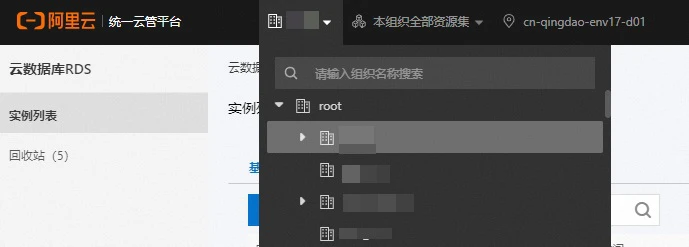

   > **说明**
   >
   > 若您是首次使用Apsara Uni-manager运营控制台，默认通过root组织来访问实例。

6. 在左侧导航栏，选择DAS的相关功能即可。

   > **说明**
   >
   > - 数据库实例为RDS MySQL、RDS PostgreSQL、PolarDB时，请选择**自治服务**下的相关功能。
   >
   > - 数据库实例为Tair、MongoDB时，请选择**CloudDBA**下的相关功能。

7. 在弹出窗口中点击**确定**，即可开通DAS服务。

   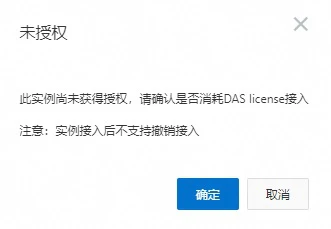

   > **说明**
   >
   > 开通DAS服务后，对应的License不支持解除绑定。只有释放了对应的数据库实例，License才能解除绑定，并被其他数据库实例使用。

# 4.支持的数据库引擎

数据库自治服务DAS支持多种阿里云数据库引擎，为不同类型的数据库实例提供统一的智能运维能力。

**引擎支持矩阵**

DAS的各功能模块对不同数据库引擎的支持情况如下：

> **说明**
>
> 符号说明：✔️ = 支持， = 不支持

| 数据库引擎 | 实例监控 | AI助手 | 智能运维日报 |
| --- | --- | --- | --- |
| RDS MySQL | ✔️ | ✔️ | ✔️ |
| RDS PostgreSQL | ✔️ |  |  |
| RDS PolarDB PostgreSQL（Oracle语法兼容） | ✔️ |  |  |
| PolarDB MySQL主备版 | ✔️ | ✔️ | ✔️ |
| PolarDB MySQL集群版 | ✔️ | ✔️ | ✔️ |
| PolarDB PostgreSQL（PostgreSQL语法兼容）集群共享存储版 | ✔️ | ✔️ | ✔️ |
| PolarDB PostgreSQL（PostgreSQL语法兼容）主备版 | ✔️ | ✔️ | ✔️ |
| PolarDB PostgreSQL（Oracle语法兼容）集群共享存储版 | ✔️ |  |  |
| PolarDB PostgreSQL（Oracle语法兼容）主备版 | ✔️ |  |  |
| PolarDB-X 2.0 | ✔️ | ✔️ | ✔️ |
| Tair（兼容Redis） | ✔️ | ✔️ | ✔️ |
| MongoDB | ✔️ | ✔️ | ✔️ |

**各引擎支持的实例监控详情**

> **说明**
>
> - 数据库自治服务DAS为多款数据库产品提供诊断与优化能力，功能入口包括：
>
>   - DAS控制台：“实例监控”模块
>
>   - 云产品控制台：各数据库实例详情页内的“诊断与优化”/“CloudDBA”模块
>
> - 下表按数据库产品分类，列出各功能项在两个控制台的支持情况。表中列头含义如下：
>
>   - DAS：DAS控制台是否支持该功能
>
>   - 云产品：云产品控制台是否支持该功能
>
> - 符号说明：✔️ = 支持， = 不支持

**PolarDB**

<table>
  <tr>
    <th rowspan="2">功能名称</th>
    <th colspan="2">PolarD B MySQ L主备版</th>
    <th colspan="2">PolarD B MySQ L集群共享存储版</th>
    <th colspan="2">PolarD B MySQ L集群本地盘版</th>
    <th colspan="2">PolarD B Postgr eSQL（Post greSQ L语法兼容）集群本地盘版</th>
    <th colspan="2">PolarD B Postgr eSQL（Post greSQ L语法兼容）集群共享存储版</th>
    <th colspan="2">PolarD B Postgr eSQL（Orac le语法兼容）集群共享存储版</th>
    <th colspan="2">PolarD B Postgr eSQL（Post greSQ L语法兼容）主备版</th>
    <th colspan="2">Polar DB Postgr eSQL（Orac le语法兼容）主备版</th>
    <th colspan="2">Polar DB-X 2.0</th>
  </tr>
  <tr>
    <td>D A S</td>
    <td>云产品</td>
    <td>D A S</td>
    <td>云产品</td>
    <td>D A S</td>
    <td>云产品</td>
    <td>D A S</td>
    <td>云产品</td>
    <td>D A S</td>
    <td>云产品</td>
    <td>D A S</td>
    <td>云产品</td>
    <td>D A S</td>
    <td>云产品</td>
    <td>D A S</td>
    <td>云产品</td>
    <td>D A S</td>
    <td>云产品</td>
  </tr>
  <tr>
    <td>一键诊断</td>
    <td>✔️</td>
    <td>✔️</td>
    <td></td>
    <td></td>
    <td></td>
    <td></td>
    <td></td>
    <td></td>
    <td></td>
    <td></td>
    <td></td>
    <td></td>
    <td></td>
    <td></td>
    <td></td>
    <td></td>
    <td></td>
    <td></td>
  </tr>
  <tr>
    <td>诊断报告</td>
    <td>✔️</td>
    <td>✔️</td>
    <td>✔️</td>
    <td>✔️</td>
    <td>✔️</td>
    <td>✔️</td>
    <td></td>
    <td></td>
    <td>✔️</td>
    <td>✔️</td>
    <td></td>
    <td>✔️</td>
    <td></td>
    <td>✔️</td>
    <td></td>
    <td>✔️</td>
    <td></td>
    <td>✔</td>
  </tr>
  <tr>
    <td>性能趋势</td>
    <td>✔️</td>
    <td>✔️</td>
    <td>✔️</td>
    <td>✔️</td>
    <td>✔️</td>
    <td>✔️</td>
    <td></td>
    <td></td>
    <td>✔️</td>
    <td>✔️</td>
    <td>✔️</td>
    <td>✔️</td>
    <td>✔️</td>
    <td>✔️</td>
    <td>✔️</td>
    <td>✔️</td>
    <td>✔️</td>
    <td>✔</td>
  </tr>
  <tr>
    <td>监控大盘</td>
    <td>✔️</td>
    <td>✔️</td>
    <td>✔️</td>
    <td>✔️</td>
    <td>✔️</td>
    <td>✔️</td>
    <td></td>
    <td></td>
    <td>✔️</td>
    <td>✔️</td>
    <td>✔️</td>
    <td>✔️</td>
    <td>✔️</td>
    <td>✔️</td>
    <td>✔️</td>
    <td>✔️</td>
    <td>✔️</td>
    <td>✔</td>
  </tr>
  <tr>
    <td>实时性能</td>
    <td>✔️</td>
    <td>✔️</td>
    <td>✔️</td>
    <td>✔️</td>
    <td>✔️</td>
    <td>✔️</td>
    <td></td>
    <td></td>
    <td>✔️</td>
    <td>✔️</td>
    <td>✔️</td>
    <td>✔️</td>
    <td>✔️</td>
    <td>✔️</td>
    <td>✔️</td>
    <td>✔️</td>
    <td>✔️</td>
    <td>✔</td>
  </tr>
  <tr>
    <td>空间分析</td>
    <td>✔️</td>
    <td>✔️</td>
    <td>✔️</td>
    <td>✔️</td>
    <td>✔️</td>
    <td>✔️</td>
    <td></td>
    <td></td>
    <td>✔️</td>
    <td>✔️</td>
    <td>✔️</td>
    <td>✔️</td>
    <td>✔️</td>
    <td>✔️</td>
    <td>✔️</td>
    <td>✔️</td>
    <td>✔️</td>
    <td>✔</td>
  </tr>
  <tr>
    <td>实例会话</td>
    <td>✔️</td>
    <td>✔️</td>
    <td>✔️</td>
    <td>✔️</td>
    <td>✔️</td>
    <td>✔️</td>
    <td></td>
    <td></td>
    <td>✔️</td>
    <td>✔️</td>
    <td>✔️</td>
    <td>✔️</td>
    <td>✔️</td>
    <td>✔️</td>
    <td>✔️</td>
    <td>✔️</td>
    <td>✔️</td>
    <td>✔</td>
  </tr>
  <tr>
    <td>S Q L限流</td>
    <td>✔️</td>
    <td>✔️</td>
    <td>✔️</td>
    <td>✔️</td>
    <td>✔️</td>
    <td>✔️</td>
    <td></td>
    <td></td>
    <td></td>
    <td></td>
    <td></td>
    <td></td>
    <td></td>
    <td></td>
    <td></td>
    <td></td>
    <td>✔️</td>
    <td>✔</td>
  </tr>
  <tr>
    <td>S Q L优化</td>
    <td>✔️</td>
    <td>✔️</td>
    <td>✔️</td>
    <td>✔️</td>
    <td>✔️</td>
    <td>✔️</td>
    <td></td>
    <td></td>
    <td></td>
    <td></td>
    <td></td>
    <td></td>
    <td></td>
    <td></td>
    <td></td>
    <td></td>
    <td>✔️</td>
    <td>✔</td>
  </tr>
  <tr>
    <td>锁分析</td>
    <td>✔️</td>
    <td>✔️</td>
    <td>✔️</td>
    <td>✔️</td>
    <td>✔️</td>
    <td>✔️</td>
    <td></td>
    <td></td>
    <td>✔️</td>
    <td>✔️</td>
    <td>✔️</td>
    <td>✔️</td>
    <td>✔️</td>
    <td>✔️</td>
    <td>✔️</td>
    <td>✔️</td>
    <td>✔️</td>
    <td>✔</td>
  </tr>
  <tr>
    <td>慢S Q L</td>
    <td>✔️</td>
    <td>✔️</td>
    <td>✔️</td>
    <td>✔️</td>
    <td>✔️</td>
    <td>✔️</td>
    <td></td>
    <td></td>
    <td>✔️</td>
    <td>✔️</td>
    <td>✔️</td>
    <td>✔️</td>
    <td>✔️</td>
    <td>✔️</td>
    <td>✔️</td>
    <td>✔️</td>
    <td>✔️</td>
    <td>✔</td>
  </tr>
  <tr>
    <td>空间碎片自动回收</td>
    <td></td>
    <td></td>
    <td></td>
    <td></td>
    <td></td>
    <td></td>
    <td></td>
    <td></td>
    <td></td>
    <td></td>
    <td></td>
    <td></td>
    <td></td>
    <td></td>
    <td></td>
    <td></td>
    <td></td>
    <td></td>
  </tr>
</table>

**RDS**

<table>
  <tr>
    <th rowspan="2">功能名称</th>
    <th colspan="2">RDS MySQL</th>
    <th colspan="2">RDS PostgreSQL</th>
    <th colspan="2">RDS PolarDB PostgreSQL（Oracle语法兼容）</th>
  </tr>
  <tr>
    <td>DAS</td>
    <td>云产品</td>
    <td>DAS</td>
    <td>云产品</td>
    <td>DAS</td>
    <td>云产品</td>
  </tr>
  <tr>
    <td>一键诊断</td>
    <td>✔️</td>
    <td>✔️</td>
    <td></td>
    <td></td>
    <td></td>
    <td></td>
  </tr>
  <tr>
    <td>诊断报告</td>
    <td>✔️</td>
    <td>✔️</td>
    <td></td>
    <td></td>
    <td></td>
    <td></td>
  </tr>
  <tr>
    <td>性能趋势</td>
    <td>✔️</td>
    <td>✔️</td>
    <td>✔️</td>
    <td>✔️</td>
    <td>✔️</td>
    <td></td>
  </tr>
  <tr>
    <td>监控大盘</td>
    <td>✔️</td>
    <td>✔️</td>
    <td>✔️</td>
    <td>✔️</td>
    <td>✔️</td>
    <td></td>
  </tr>
  <tr>
    <td>实时性能</td>
    <td>✔️</td>
    <td>✔️</td>
    <td>✔️</td>
    <td>✔️</td>
    <td>✔️</td>
    <td>✔️</td>
  </tr>
  <tr>
    <td>空间分析</td>
    <td>✔️</td>
    <td>✔️</td>
    <td>✔️</td>
    <td>✔️</td>
    <td>✔️</td>
    <td>✔️</td>
  </tr>
  <tr>
    <td>实例会话</td>
    <td>✔️</td>
    <td>✔️</td>
    <td>✔️</td>
    <td>✔️</td>
    <td>✔️</td>
    <td>✔️</td>
  </tr>
  <tr>
    <td>SQL限流</td>
    <td>✔️</td>
    <td>✔️</td>
    <td></td>
    <td></td>
    <td></td>
    <td></td>
  </tr>
  <tr>
    <td>SQL优化</td>
    <td>✔️</td>
    <td>✔️</td>
    <td></td>
    <td></td>
    <td></td>
    <td></td>
  </tr>
  <tr>
    <td>锁分析</td>
    <td>✔️</td>
    <td>✔️</td>
    <td></td>
    <td></td>
    <td>✔️</td>
    <td>✔️</td>
  </tr>
  <tr>
    <td>慢SQL</td>
    <td>✔️</td>
    <td>✔️</td>
    <td>✔️</td>
    <td>✔️</td>
    <td>✔️</td>
    <td>✔️</td>
  </tr>
  <tr>
    <td>空间碎片自动回收</td>
    <td>✔️</td>
    <td></td>
    <td></td>
    <td></td>
    <td></td>
    <td></td>
  </tr>
</table>

**Tair（兼容Redis）和MongoDB**

<table>
  <tr>
    <th rowspan="2">功能名称</th>
    <th colspan="2">Tair（兼容Redis）</th>
    <th colspan="2">MongoDB</th>
  </tr>
  <tr>
    <td>DAS</td>
    <td>云产品</td>
    <td>DAS</td>
    <td>云产品</td>
  </tr>
  <tr>
    <td>一键诊断</td>
    <td></td>
    <td></td>
    <td></td>
    <td></td>
  </tr>
  <tr>
    <td>诊断报告</td>
    <td>✔️</td>
    <td>✔️</td>
    <td>✔️</td>
    <td>✔️</td>
  </tr>
  <tr>
    <td>性能趋势</td>
    <td>✔️</td>
    <td>✔️</td>
    <td>✔️</td>
    <td>✔️</td>
  </tr>
  <tr>
    <td>监控大盘</td>
    <td>✔️</td>
    <td>✔️</td>
    <td>✔️</td>
    <td>✔️</td>
  </tr>
  <tr>
    <td>实时性能</td>
    <td>✔️</td>
    <td>✔️</td>
    <td>✔️</td>
    <td>✔️</td>
  </tr>
  <tr>
    <td>空间分析</td>
    <td></td>
    <td></td>
    <td>✔️</td>
    <td>✔️</td>
  </tr>
  <tr>
    <td>实例会话</td>
    <td>✔️</td>
    <td>✔️</td>
    <td>✔️</td>
    <td>✔️</td>
  </tr>
  <tr>
    <td>SQL限流</td>
    <td></td>
    <td></td>
    <td></td>
    <td></td>
  </tr>
  <tr>
    <td>SQL优化</td>
    <td></td>
    <td></td>
    <td></td>
    <td></td>
  </tr>
  <tr>
    <td>锁分析</td>
    <td></td>
    <td></td>
    <td></td>
    <td></td>
  </tr>
  <tr>
    <td>慢SQL</td>
    <td>✔️</td>
    <td>✔️</td>
    <td>✔️</td>
    <td>✔️</td>
  </tr>
  <tr>
    <td>Top Key统计</td>
    <td></td>
    <td>✔️</td>
    <td></td>
    <td>✔️</td>
  </tr>
  <tr>
    <td>离线全量Key分析</td>
    <td></td>
    <td>✔️</td>
    <td></td>
    <td>✔️</td>
  </tr>
  <tr>
    <td>空间碎片自动回收</td>
    <td></td>
    <td></td>
    <td></td>
    <td></td>
  </tr>
</table>

**各引擎支持的AI助手诊断场景详情**

不同数据库引擎支持的AI助手诊断场景有所不同。以下按引擎列出所有支持的诊断场景及其适用说明。

**MySQL**

> **说明**
>
> 包含RDS MySQL、PolarDB MySQL主备版、PolarDB MySQL集群共享存储版、PolarDB MySQL集群本地盘版。

**分类**

**场景**

**说明**

通过获取指定时段的会话、慢日志等相关数据诊断导致CPU使用率异

CPU使用率诊断

常的原因。

性能诊断

通过获取内存使用详情、Buffer Pool状态、连接数等数据诊断内存异

内存异常诊断

常原因。

慢日志分析（TP）

基于SQL慢日志的统计数据，识别多种问题SQL，并给出行动建议。

慢SQL分析

对指定SQL进行诊断，分析执行计划、索引使用情况并提供优化建

SQL诊断优化

议。

识别当前实例中的异常会话，包括长时间运行、阻塞等异常状态的会

异常会话识别

话。

通用锁分析，根据描述自动判断分析类型：死锁分析或事务阻塞锁分

锁分析

析。

会话与锁

最近死锁分析

分析最近发生的死锁事件，提供死锁链路、涉及SQL和解决建议。

元数据锁和事务阻塞分

分析当前会话中的元数据锁、事务阻塞情况。

析

重要性能指标总结

指定时间范围查询实例重要性能指标并给出总结。

实时获取实例性能指标，包括CPU、内存、IOPS、网络等多维度指

实时性能监控

监控指标

标。

查询指定实例的监控指标数据，支持CPU、内存、IOPS、网络等多维

监控指标查询

度指标。

HA查询分析

查询并分析实例主备切换记录，输出简洁报告。

日志与高可用

错误日志分析

对MySQL类实例的error等级错误日志进行分析。

参数配置查询

查询数据库实例的参数配置，用于参数调优、问题排查和配置审计。

实例拓扑查询

查询实例的拓扑结构信息，包括主备关系、读写分离架构等。

分析数据库实例的存储空间使用情况，包括表空间、索引空间、碎片

空间分析

空间与拓扑

等。

查看指定表的建表DDL语句，包括字段定义、索引、约束等完整信

查看建表语句

息。

<table>
  <tr>
    <td rowspan="6">安全审计</td>
    <td>权限审计</td>
    <td>扫描实例中所有用户的权限，识别过度授权和违反最小权限原则的情况。</td>
  </tr>
  <tr>
    <td>账号风险扫描</td>
    <td>检测高危账号，包括无密码账号、密码策略缺失、僵尸账号等安全风险。</td>
  </tr>
  <tr>
    <td>安全配置检查</td>
    <td>检查安全相关参数配置是否符合最佳实践，包括SSL、审计日志、密码策略等。</td>
  </tr>
  <tr>
    <td>访问模式分析</td>
    <td>分析访问来源和模式，检测异常IP、非工作时间访问等异常行为。</td>
  </tr>
  <tr>
    <td>敏感操作审计</td>
    <td>回溯近期高危操作（DDL/DCL/大批量DML），检测是否存在未授权变更。</td>
  </tr>
  <tr>
    <td>审计日志查询</td>
    <td>查询指定时间范围内的审计日志记录，支持按关键词过滤，用于变更追溯。</td>
  </tr>
  <tr>
    <td>巡检报告</td>
    <td>单实例巡检报告</td>
    <td>对指定实例在选定时间段内进行综合运维巡检：自动采集关键指标、慢SQL、变更记录；最终输出一份Markdown巡检报告（含整体总结与重点问题）。</td>
  </tr>
  <tr>
    <td rowspan="2">知识库</td>
    <td>知识库检索</td>
    <td>在MySQL知识库中检索相关知识并回答用户问题。</td>
  </tr>
  <tr>
    <td>MySQL错误日志知识检索</td>
    <td>在MySQL错误日志知识库中检索相关知识并回答用户问题。</td>
  </tr>
</table>

**PolarDB PostgreSQL**

> **说明**
>
> 包含PolarDB PostgreSQL主备版、PolarDB PostgreSQL集群共享存储版。

<table>
  <tr>
    <th>分类</th>
    <th>场景</th>
    <th>说明</th>
  </tr>
  <tr>
    <td rowspan="2">性能诊断</td>
    <td>CPU使用率诊断</td>
    <td>通过获取指定时段的CPU Top SQL、活跃会话、QPS/TPS等数据诊断导致CPU使用率异常的原因，区分慢SQL、业务流量突增、物理IO、锁等待堆积等根因。</td>
  </tr>
  <tr>
    <td>内存异常诊断</td>
    <td>通过获取内存使用详情、Buffer Pool状态、连接数等数据诊断内存异常原因，区分work_mem膨胀、连接数过多、shared_buffers配置、表膨胀、规格不足等根因。</td>
  </tr>
  <tr>
    <td>慢SQL分析</td>
    <td>CPU Top慢SQL分析</td>
    <td>获取CPU Top SQL和慢SQL统计数据，定位高耗资源SQL并给出优化建议。</td>
  </tr>
  <tr>
    <td rowspan="2">会话与锁</td>
    <td>异常会话识别</td>
    <td>识别当前实例中的异常会话，包括idle in transaction长事务、被阻塞会话、大量并发查询、连接数逼近上限等，提供pg_terminate_backend处置建议。</td>
  </tr>
  <tr>
    <td>事务阻塞锁分析</td>
    <td>通过get_lock_waits和get_blocking_transactions获取当前锁等待和阻塞链，定位阻塞源头事务，给出解锁建议。</td>
  </tr>
  <tr>
    <td>监控指标</td>
    <td>重要性能指标总结</td>
    <td>指定时间范围查询CPU/内存/连接数/QPS-TPS/行级DML/本地IO/存储7维度指标，给出综合评估并识别异常时段。</td>
  </tr>
</table>

**PolarDB-X 2.0**

**分类**

**场景名称**

**说明**

通过获取指定时段的会话、慢日志等相关数据诊断导致CPU使用率

CPU使用率诊断

异常的原因。

通过获取内存使用详情、Buffer Pool状态、连接数等数据诊断内存

内存异常诊断

异常原因。

诊断分布式拓扑健康状态、数据倾斜、跨分片查询性能等分布式架

分布式性能诊断

构相关问题。

性能诊断

存储空间优化

存储空间诊断与优化，包括大表识别、索引膨胀分析、碎片率诊断

（PolarDB-X）

及优化建议。

流量倾斜分析

分析企业版的读写流量倾斜问题，诊断DN CPU告警、分区表热点

（PolarDB-X）

等场景。

数据倾斜分析

分析企业版的数据倾斜问题，诊断DN磁盘使用率高、分区数据不均

（PolarDB-X）

衡等场景。

基于SQL慢日志的统计数据，识别多种问题SQL，并给出行动建

慢日志分析（TP）

议。

对指定SQL进行诊断，分析执行计划、索引使用情况并提供优化建

SQL诊断优化

议。

SQL执行计划分析

分析PolarDB-X实例SQL执行计划，诊断慢SQL性能瓶颈并给出优

（PolarDB-X）

化建议。

慢SQL分析

DML慢SQL分析

分析DML类型慢SQL的原因，包括执行计划、下推判断、锁冲突、

（PolarDB-X）

大事务等。

SELECT慢SQL分析

分析SELECT类型慢SQL的原因，包括执行计划分析、plan_id追踪

（PolarDB-X）

等。

异常会话识别

支持选择CN/DN节点进行多节点并行会话诊断，包括长时间分布式

（PolarDB-X）

事务等。

最近死锁分析

分析最近发生的死锁事件，提供死锁链路、涉及SQL和解决建议。

元数据锁和事务阻塞分析

分析当前会话中的元数据锁、事务阻塞情况。

会话与锁

分析PolarDB-X实例最近发生的死锁情况，提取死锁详细信息并给

死锁分析（PolarDB-

出诊断结论。

X）

长事务分析（PolarDB-

分析企业版实例的长事务及其可能造成的影响，包括锁等待、SQL

X）

堆积等。

重要性能指标总结

指定时间范围查询实例重要性能指标并给出总结。

实时获取实例性能指标，包括CPU、内存、IOPS、网络等多维度指

实时性能监控

监控指标

标。

查询指定实例的监控指标数据，支持CPU、内存、IOPS、网络等多

监控指标查询

维度指标。

日志与高可用

HA查询分析

查询并分析实例主备切换记录，输出简洁报告。

查询实例的拓扑结构信息，包括主备关系、读写分离架构等。

实例拓扑查询

查询数据库实例的参数配置，用于参数调优、问题排查和配置审

参数配置查询

计。

空间与拓扑

分析数据库实例的存储空间使用情况，包括表空间、索引空间、碎

空间分析

片等。

查看指定表的建表DDL语句，包括字段定义、索引、约束等完整信

查看建表语句

息。

扫描实例中所有用户的权限，识别过度授权和违反最小权限原则的

权限审计

情况。

检测高危账号，包括无密码账号、密码策略缺失、僵尸账号等安全

账号风险扫描

风险。

检查安全相关参数配置是否符合最佳实践，包括SSL、审计日志、密码策略等。

安全配置检查

安全审计

访问模式分析

分析访问来源和模式，检测异常IP、非工作时间访问等异常行为。

回溯近期高危操作（DDL/DCL/大批量DML），检测是否存在未授

敏感操作审计

权变更。

查询指定时间范围内的审计日志记录，支持按关键词过滤，用于变

审计日志查询

更追溯。

对指定实例在选定时间段内进行综合运维巡检，输出Markdown格

巡检报告

单实例巡检报告

式巡检报告。

知识库

知识库检索

在PolarDB-X知识库中检索相关知识并回答用户问题。

**Tair（兼容Redis）和MongoDB**

| 分类 | 场景 | 说明 |
| --- | --- | --- |
| 性能诊断 | 实例性能与热点Key诊断 | 诊断实例的CPU、内存等性能指标异常，定位热点Key、慢请求等根因。 |
| 慢SQL分析 | 慢日志分析 | 基于慢日志统计数据，识别问题请求并给出优化建议。 |
| 会话与锁 | 异常会话识别 | 识别实例中的异常会话，包括长时间运行、阻塞等异常状态的会话。 |
| 监控指标 | 重要性能指标总结 | 指定时间范围查询实例重要性能指标并给出总结。 |
| 巡检报告 | 单实例巡检报告 | 对指定实例在选定时间段内进行综合运维巡检，输出巡检报告。 |

# 5.实例监控

## 5.1. 快速入门

实例监控页面展示已接入数据库自治服务DAS的所有数据库实例列表，帮助用户快速了解各实例的运行状态和基本信息。

**前提条件**

- 已登录数据库自治服务DAS控制台。

- 已授权DAS获取云产品实例的监控数据。

**使用限制**

- 实例监控仅支持**阿里云云产品数据库实例**，不支持自建Redis等专有云外资源。

- QPS和活跃会话数据**仅在实例完成授权后显示**。

**查看实例列表**

1. 登录数据库自治服务DAS控制台。

2. 在左侧导航栏，单击**实例监控**。

   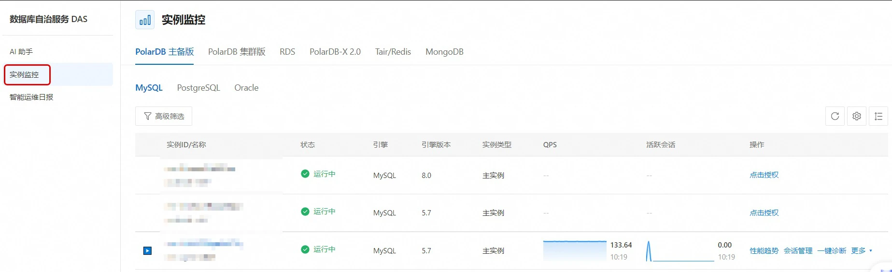

3. 在**实例监控**页面，通过顶部的引擎标签切换不同类型的数据库：

   - PolarDB主备版：支持MySQL、PostgreSQL、Oracle三个子标签。

   - PolarDB集群版：支持MySQL、PostgreSQL、Oracle三个子标签。

   - RDS：支持MySQL、PostgreSQL、PolarDB三个子标签。

   - PolarDB-X 2.0

   - Tair/Redis

   - MongoDB

4. 在实例列表中查看各实例的信息：

   | 列名 | 说明 |
   | --- | --- |
   | 实例ID/名称 | 数据库实例的唯一标识和名称，单击名称旁的图标可复制实例ID。 |
   | 状态 | 实例当前运行状态，如运行中、删除中等。 |
   | 引擎 | 数据库引擎类型，如MySQL、PostgreSQL等。 |
   | 引擎版本 | 数据库引擎版本号，如8.0、5.7等。 |
   | 实例类型 | 实例类型，如主实例。 |
   | QPS | 实例当前的每秒查询数。 |
   | 活跃会话 | 实例当前的活跃会话数。 |
   | 操作 | 可执行的操作，如授权。 |

5. 如需筛选特定实例，单击**高级筛选**设置筛选条件。

**授权实例**

DAS需要获取数据库实例的监控数据访问权限后，才能为该实例提供智能诊断和运维服务。

1. 在实例监控页面的实例列表中，找到目标实例。

2. 在**操作**列，单击**点击授权**。

3. 授权成功后，DAS即可获取该实例的监控数据。AI助手和智能运维日报功能也将对该实例生效。

## 5.2. 诊断

### 5.2.1. 一键诊断

一键诊断支持快速查看数据库实例的性能全貌并确认是否存在异常。

> **说明**
>
> 本功能支持的数据库引擎，请参见各引擎支持的实例监控详情。

**操作步骤**

1. 登录数据库实例控制台管理DAS。

2. 切换页签至目标数据库类型下，单击目标实例ID，进入实例详情页面。

3. 在左侧导航栏，单击**自治服务 > 一键诊断**。

4. 在**一键诊断**页签下，可查看如下信息：

   - 当前资源使用率情况：查看目标实例当前的CPU、内存、IOPS、空间和连接的使用率。

   - 数据库基本信息：查看数据库类型、实例来源、实例规格等基本信息。

   - 数据库性能全貌：查看当前实例在指定时间段内出现的危险、警告、慢SQL和死锁情况，快速确认是否存在异常。

     > **说明**
     >
     > 单击全貌图右上角的**发起诊断**可对数据库进行一键诊断。诊断结束后，单击**查看历史**可查看诊断历史详情。

### 5.2.2. 诊断报告

数据库自治服务（DAS）支持诊断报告功能，帮助您全面评估数据库实例的运行状态，识别性能瓶颈与潜在风险。您可手动触发诊断，也可配置定时任务自动生成报告。目前本功能仅提供运行状态评估与问题展示，不包含自动优化建议，需用户根据报告内容自行排查并改进。

> **说明**
>
> 本功能支持的数据库引擎，请参见各引擎支持的实例监控详情。

**使用建议**

- 定期生成报告：建议对生产实例配置每日自动诊断，建立性能基线。

- 结合慢SQL优化：重点关注“TOP 10慢SQL”与“高危SQL”，及时优化查询语句。

- 关注健康评分变化：若评分持续下降，需排查资源配置或业务增长带来的压力。

**操作步骤**

1. 登录数据库实例控制台管理DAS。

2. 切换页签至目标数据库类型下，单击目标实例ID，进入实例详情页面。

3. 在左侧导航栏，单击**自治服务 > 诊断报告**，在该页面中：

   **手动发起诊断**

   单击**发起诊断**，选择诊断时间区间（支持近1小时、近3小时、近6小时、近12小时、近24小时），并单击**确认**，系统将立即启动诊断任务。

   **配置自动诊断报告（定时生成）**

   单击**自动生成报告设置**，勾选**定时触发**，并勾选日期和具体时间，单击**确认**。

   > **说明**
   >
   > 受系统调度与资源负载影响，自动报告可能存在延迟，请以实际生成时间为准。

   **查看报告详情**

   诊断完成后，报告将出现在列表中。单击目标诊断报告右侧操作列下的**查看报告**，进入详情页。报告维度包括实例健康状况、活跃会话列表、TOP 10慢SQL、高危SQL、TOP5 表空间、冗余索引、锁分析、性能趋势。

   您可在诊断报告页面顶部右侧，单击**扣分详情**，查看本次诊断的扣分详情。

   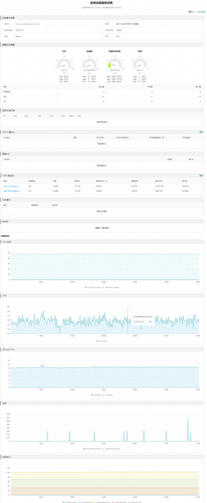

   **下载诊断报告**

   单击**查看报告**在实例诊断报告详情页，单击左侧**下载**，即可下载报告到本地，便于存档或分享。

   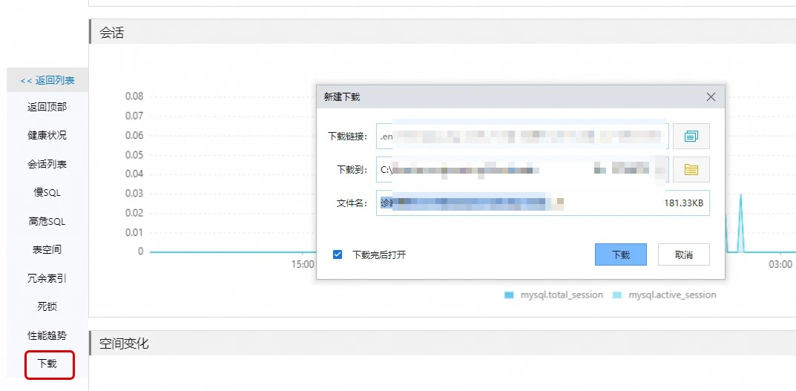

### 5.2.3. 性能趋势

DAS提供性能趋势功能，可查看目标实例的性能指标（如TPS、QPS、吞吐量等）。同时DAS支持多种方式查看性能趋势，包括性能趋势区间查看、性能趋势对比查看和自定义性能趋势查看。

> **说明**
>
> 本功能支持的数据库引擎，请参见各引擎支持的实例监控详情。

**操作步骤**

不同数据库引擎的DAS功能存在差异，本文以RDS MySQL数据库实例为例进行说明，其他数据库引擎，请以控制台功能为准。

1. 登录数据库实例控制台管理DAS。

2. 切换页签至目标数据库类型下，单击目标实例ID，进入实例详情页面。

3. 在左侧导航栏单击**自治服务** **>** **性能趋势**。

4. 您可以在**性能趋势**页面查看如下信息。

   - 在**性能趋势**页签，可查看TPS/QPS、会话连接等性能变化趋势，还可单击**更多指标**自定义性能趋势展示详情。

     > **说明**
     >
     > 在指标趋势图中单击指标后的
     >
     > 查询指标含义。
     >
     > 

   - 在**性能趋势对比查看**页签，可选择任意两个时间段，对比查看这两个时间段内的性能趋势情况。

   - 在**自定义图表**页签，可自定义多个性能监控大盘，将需要的多个性能监控指标在同一个图表中进行展示，便于排查和分析问题。

     > **说明**
     >
     > 如果首次使用**自定义图表**功能，需要先创建监控大盘。

## 5.3. 监控

### 5.3.1. 监控大盘

数据库自治服务DAS（Database Autonomy Service）的监控大盘支持将多个性能监控指标集中在同一图表中展示，用于统一排查和分析数据库性能问题。首次使用自定义图表功能前，需先新增监控大盘。本文以RDS MySQL为例介绍监控大盘的新增和管理方法。

> **说明**
>
> 本功能支持的数据库引擎，请参见各引擎支持的实例监控详情。

**操作步骤**

1. 登录数据库实例控制台管理DAS。

2. 切换页签至目标数据库类型下，单击目标实例ID，进入实例详情页面。

3. 在左侧导航栏单击**自治服务** **>** **性能趋势**。

4. 单击**自定义图表**页签。

5. 在**自定义图表**页面中间，单击**新增监控大盘**。

6. 输入**新增监控大盘**的名称，单击**确定**。

7. 单击**新增监控图表**，分别选中目标节点和需要查看的指标，并单击  。

   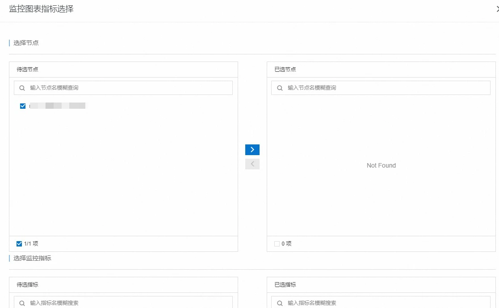

8. 单击**确定**。

**后续操作**

- 修改大盘中的实例或指标：单击**添加节点和指标监控**进行调整。

- 切换监控大盘：在**自定义图表**页签左上角，通过下拉框选择不同的监控大盘。

- 新增或删除监控大盘：将鼠标悬停在**操作大盘**上，单击**新增监控大盘**或**删除监控大盘**。

### 5.3.2. 实时性能

数据库自治服务（DAS）提供实时性能监控能力，通过高频采集数据库实例的关键运行指标，以可视化图表和表格的形式呈现，用于感知实例负载状态、定位性能抖动根因并评估实例资源饱和度。

> **说明**
>
> 本功能支持的数据库引擎，请参见各引擎支持的实例监控详情。

**操作步骤**

不同数据库引擎的DAS功能存在差异。本文以RDS MySQL数据库实例为例进行说明，其他数据库引擎请以控制台实际功能为准。

1. 登录数据库实例控制台管理DAS。

2. 切换页签至目标数据库类型下，单击目标实例ID，进入实例详情页面。

3. 在左侧导航栏单击**自治服务** **>** **一键诊断**。

4. 在顶部页签中，单击**实时性能**。

5. 系统将自动加载实时数据，可切换**实时图表**或**实时表格**视图进行查看。具体详情，请参见视图切换与高级操作。

**核心指标解读**

根据控制台界面展示（本文以MySQL为例，PostgreSQL等数据库指标可能有所不同，以控制台具体显示为准即可），实时性能主要包含以下四大类监控维度。下表详细解析了各指标的含义及运维建议：

**实例基础信息概览**

| 模块 | 指标项 | 说明与运维建议 |
| --- | --- | --- |
| Serve r信息 | 版本/运行时间 | 显示数据库内核版本（如<code> 8.0.36 </code>）及实例累计运行时间（Uptime）。用于确认环境一致性及实例稳定性。 |
| 连接信息 | 连接数上限/当前连接数/活跃连接数 | • 格式示例：<code> 1200 / - / 3 </code>。 • 连接数上限：实例允许的最大连接数。 • 当前连接数：当前已建立的TCP连接总数。 • 活跃连接数：当前正在执行SQL的连接数。 说明若“当前连接数”接近上限，需警惕连接风暴；若“活跃连接数”远小于“当前连接数”，可能存在大量空闲连接占用资源。 |
| Buffer Pool | 总页数/空闲页比例/脏页比例 | 展示InnoDB缓冲池状态。 • 空闲页比例：反映内存剩余空间。 • 脏页比例：反映待刷盘数据量。比例过高可能影响刷盘效率，导致IO抖动。 |

**吞吐量、负载与深层引擎指标**

| 分类 | 指标名称 | 详细说明 | 运维分析与建议 |
| --- | --- | --- | --- |
| 吞吐量 | QPS \| TPS | • QPS：平均每秒SQL语句执行次数。 • TPS：平均每秒事务数。 | 趋势分析：突增通常对应业务高峰。异常排查：若QPS/TPS下降但CPU升高，通常存在锁等待或慢SQL阻塞。 |
| DML分布 | DML执行次数 | • select：SELECT语句每秒执行次数。 • insert：INSERT语句每秒执行次数。 • update：UPDATE语句每秒执行次数。 • delete：DELETE语句每秒执行次数。 | 业务画像：识别业务是读多写少还是写多读少，辅助制定索引优化策略（如读写分离架构调整）。 |
| 连接会话 | 连接数 | • 活跃连接数：已打开连接中处于活跃状态的数量。 • 总连接数：已打开连接的总数量。 | 瓶颈定位：关注活跃连接数的波峰。若活跃连接数长时间维持高位，需检查是否有长事务或未释放的应用连接。 |
| 缓存效率 | InnoDB缓存 | • 缓存命中率：从内存读取数据的比例。 • 缓存使用率：Buffer Pool的占用比例。 | 性能关键：命中率应接近100%。低命中率意味着大量请求穿透到磁盘（物理读），导致性能急剧下降。需考虑增大Buffer Pool或优化SQL。 |
| 数据访问 | InnoDB访问行数 | • rows_read：每秒读取的InnoDB行数。 • rows_inserted：每秒插入的InnoDB行数。 • rows_updated：每秒更新的InnoDB行数。 • rows_deleted：每秒删除的InnoDB行数。 | 索引优化：若<code> rows_read </code>极高但返回结果集很小，说明存在全表扫描，急需添加合适索引。 |
| IO读写 | 逻辑读/物理读 | • 逻辑读：每秒逻辑读次数（从Buffer Pool读取）。 • 物理读：每秒物理读次数（从磁盘读取）。 | IO瓶颈：物理读激增是性能杀手，通常由冷数据访问、Buffer Pool不足或缺少索引引起。 |
| 锁竞争 | 行锁平均锁定时间 | 单位通常为毫秒（ms），反映获取锁的平均耗时。 | 并发冲突：数值越高，说明事务间争用越激烈，可能导致应用端超时报错。 |
| 锁等待 | InnoDB行锁等待 | • InnoDB行锁平均等待次数：统计周期内行锁平均等待次数。 • InnoDB行锁当前等待次数：当前时刻正在等待行锁的次数。 | 阻塞源头：若此曲线不为0，说明存在阻塞。需结合“会话管理”功能查找阻塞源头（Blocker）并终止异常会话。 |
| 临时资源 | 临时表、文件 | • 临时表：创建临时表的数量。 • 临时文件：创建临时文件的数量。 | SQL优化：频繁创建磁盘临时文件会严重拖慢SQL速度。通常是因为<code> sort_buffer_size </code>不足或缺少索引导致无法利用索引排序。 |
| 异常监控 | 慢查询 | 慢查询：两个相邻采集点间新增的慢查询数量差值（即该时间段内的慢查询增量）。 | 根因关联：慢查询突增往往是CPU飙升、响应变慢的直接原因。需立即抓取慢日志进行分析。 |
| 网络带宽 | 网络流量 | 总流量/流入流量/流出流量。 | 带宽限制：若流出流量打满实例带宽，会导致连接超时或丢包；若流入流量异常，需排查大字段写入或潜在攻击。 |

**视图切换与高级操作**

- **实时图表和实时表格对比**

  - **实时图表**：适合观察趋势、波峰波谷以及多个指标间的关联性（例如QPS上升时CPU是否同步上升）。

  - **实时表格**：适合精确查看某一具体时间点的各项指标数值，方便记录基线数据或进行细微的数据对比。表格中每一行代表一个采样时间点，列对应上述各项指标的具体数值。

  - **数据下载**：在**实时表格**页签下，单击页面右上角的**下载**按钮，可将当前报表数据导出至本地。

    > **说明**
    >
    > 部分数据库引擎（MongoDB、Redis）暂不支持报表下载功能，具体请以控制台实际显示为准。

  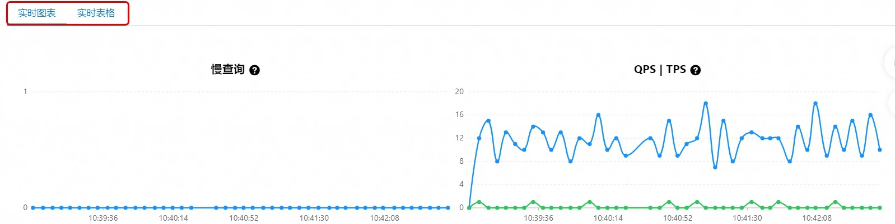

- **参数说明**

  点击页面左上角的**参数说明**，可以查看每个监控项的具体定义，帮助您更准确地解读数据。

  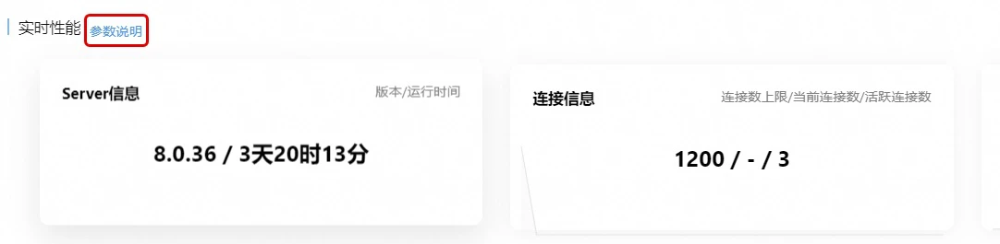

- **暂停/开始**

  右上角显示“剩余刷新次数”，可手动控制页面的自动刷新频率，或在排查问题时点击**暂停**以固定某一时刻的状态进行详细分析。

  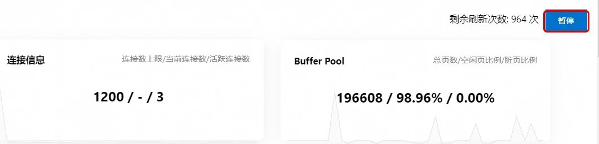

**使用建议**

- 建立基线：在业务平稳期，观察并记录正常的QPS、TPS和CPU水位，作为后续故障对比的基准。

- 关联分析：避免孤立查看单一指标。例如，当发现QPS下降时，应立即检查InnoDB行锁等待是否升高，或者慢查询是否增多，同时观察物理读是否有异常波动。

- 关注“毛刺”：图表中突然出现的尖峰（Spikes）通常对应具体的业务事件（如定时任务启动、促销秒杀），结合时间点回溯业务日志能快速定位问题。

## 5.4. 空间

### 5.4.1. 空间分析

DAS空间分析功能支持查看某个数据库实例的空间使用概况、空间剩余可用天数，以及数据库中某个表的空间使用情况、空间碎片、空间异常诊断等。

> **说明**
>
> 本功能支持的数据库引擎，请参见各引擎支持的实例监控详情。

**操作步骤**

不同数据库引擎的DAS功能存在差异，本文以RDS MySQL数据库实例为例进行说明，其他数据库引擎，请以控制台功能为准。

1. 登录数据库实例控制台管理DAS。

2. 切换页签至目标数据库类型下，单击目标实例ID，进入实例详情页面。

3. 在左侧导航栏，单击**自治服务** **>** **一键诊断**。

4. 单击**空间分析**页签，可查看如下信息：

   > **说明**
   >
   > PolarDB PostgreSQL支持按Schema维度展示表空间信息，可区分不同Schema下的同名表，便于定位特定业务模块的空间占用情况。

   - 在**空间分析 > 空间概况**页签，可查看库表空间概况、异常列表、空间变化趋势和表空间等数据。

     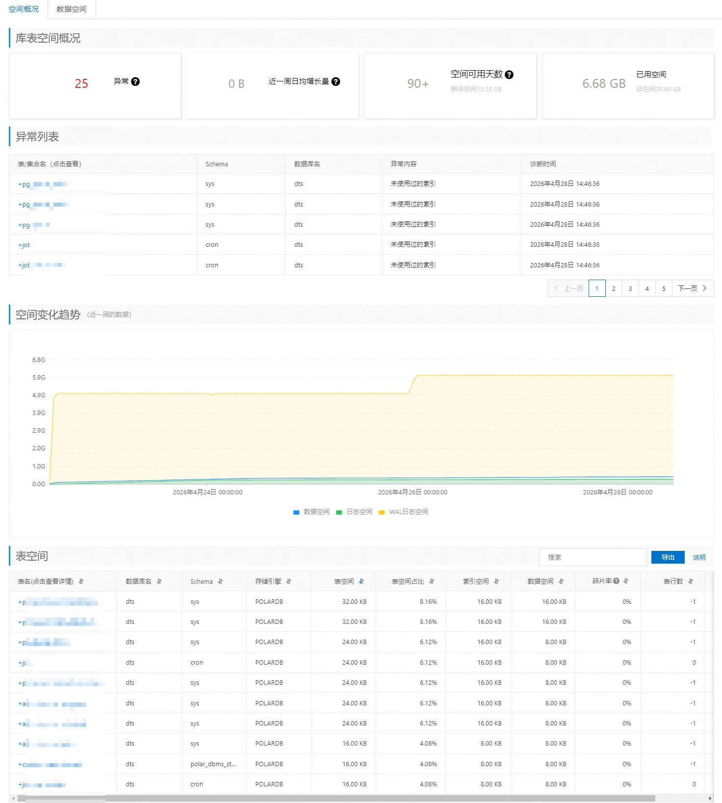

   - 在**空间分析 > 数据空间**页签，可查看每个数据库和单个表的空间使用情况。

     单击目标表名可查看该表的字段和索引信息。

     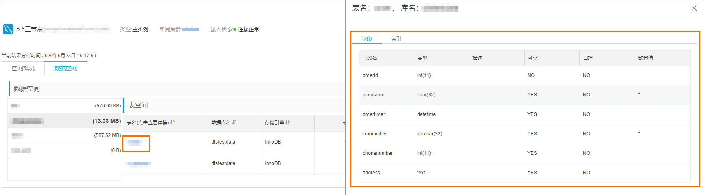

## 5.5. 会话

### 5.5.1. 实例会话

本文介绍如何通过DAS的实例会话功能，对数据库实例的活跃会话进行实时监控、分析与干预。通过查看异常会话（如长时间未提交的事务）、导出或终止会话，并结合10秒SQL分析、SQL限流和SQL优化等自治能力，可快速定位性能瓶颈、阻塞源头及高风险操作，保障数据库稳定高效运行。

> **说明**
>
> 本功能支持的数据库引擎，请参见各引擎支持的实例监控详情。

**操作步骤**

不同数据库引擎在DAS中的功能支持存在差异。本文以RDS MySQL为例进行说明，其他引擎的具体功能请以控制台实际界面为准。

1. 登录数据库实例控制台管理DAS。

2. 切换页签至目标数据库类型下，单击目标实例ID，进入实例详情页面。

3. 在左侧导航栏单击**自治服务** **>** **一键诊断**。

4. 单击**会话管理**，在该页面您可进行如下操作：

   **实例会话**

   - **查看异常会话**

     - 单击**异常**按钮，在弹出窗口中查看系统识别的异常会话（例如：长时间未提交的事务、高资源消耗会话等）。

       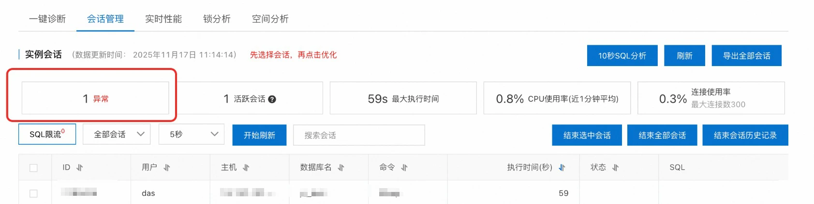

     - 针对异常会话，可单击操作列中的**优化**或**结束**按钮，进行针对性处理。

       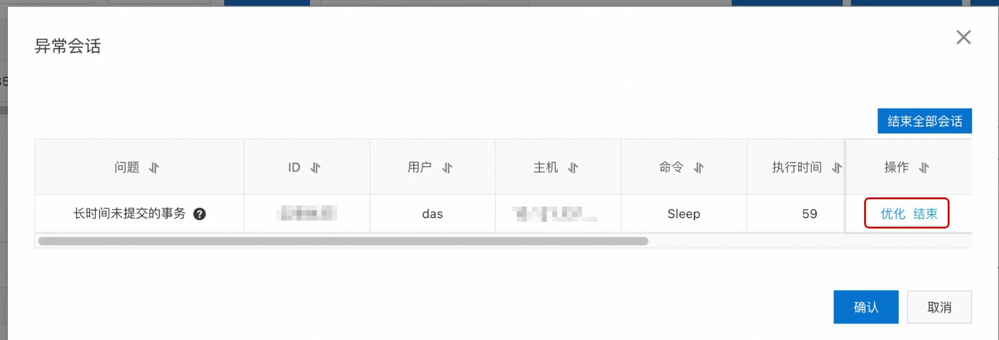

   - **查看关键指标**

     将鼠标悬浮于活跃会话数、最大执行时间、CPU使用率、连接使用率等指标标题上，即可在浮窗中查看详细数据及趋势。

   - **其他核心功能**

     - **10秒SQL分析**：单击页面右上角**10秒SQL分析**，查看最近10秒内的SQL执行统计、慢SQL列表及SQL概览，快速捕捉瞬时性能问题。

     - **SQL限流**：单击**SQL限流**，进入**SQL限流**页面，设置规则对高负载或异常SQL进行自动限流，防止资源耗尽。具体操作，请参见《SQL限流》章节。

     - **优化**：单击**优化**，对目标实例会话进行优化。具体操作，请参见《SQL优化》章节。

     - **导出活跃会话**。

     - **结束会话**：结束会话时，为确保操作安全，系统要求输入建立该会话的数据库账号及其密码进行身份验证。您也可以使用更高权限的数据库账号（具有结束其他账号建立的会话的权限），例如高权限账号。

       > **说明**
       >
       > - 在会话列表的**用户**列，可查看建立目标会话的数据库账号。
       >
       > - 单击**结束会话历史记录**，可查询所有已终止会话的操作记录，包括任务ID、发起时间、结束时间等信息，便于追溯与审计。

   **会话统计**

   - **查看会话统计信息**

     查看会话概要信息（如会话总数、运行中会话总数和运行中会话最长时间），查看按用户、按访问来源和按数据库等条件统计的会话总数及活跃数情况。

   - **导出会话统计信息**

     按概要、按用户统计、按访问来源统计和按数据库统计等条件导出会话统计信息。

### 5.5.2. SQL限流

DAS提供SQL限流功能，通过SQL限流来控制数据库请求访问量和SQL并发量，保障服务的可用性。

> **说明**
>
> 本功能支持的数据库引擎，请参见各引擎支持的实例监控详情。

**背景信息**

数据库是大部分应用的核心组件。为防止数据库压力过大，通常会在应用端进行优化和控制。但在以下场景中，还需要在数据库端进行控制。

| 场景 | 说明 |
| --- | --- |
| 某类SQL并发急剧上升 | 如缓存穿透或异常调用，可能会导致SQL并发量突然上升。 |
| 有数据倾斜SQL | 例如短期业务高峰时拉取某个特别大的数据，导致整体系统繁忙。 |
| 未创建索引SQL | 例如SQL调用量特别大，并且没有创建索引，导致整体系统繁忙。 |

**操作步骤**

1. 登录数据库实例控制台管理DAS。

2. 切换页签至目标数据库类型下，单击目标实例ID，进入实例详情页面。

3. 在左侧导航栏，单击**自治服务** **>** **一键诊断**。

4. 单击**会话管理**，在**实例会话**区域，单击**SQL限流**。

5. 在弹出的**SQL限流**对话框中，设置如下参数。

   <table>
     <tr>
       <th width="109">配置</th>
       <th>说明</th>
     </tr>
     <tr>
       <td>SQL类型</td>
       <td>选择SQL类型，取值范围如下： • SELECT • UPDATE • DELETE</td>
     </tr>
     <tr>
       <td>最大并发度</td>
       <td>SQL最大并发数，当包含关键词的SQL达到最大并发数时会触发限流策略。 说明如果最大并发度为0，表示禁止包含该关键词的所有请求。</td>
     </tr>
     <tr>
       <td>限流时间</td>
       <td>SQL限流的生效时间。 说明SQL限流属于应急措施，建议按实际需求设置限流时长，不再需要时及时关闭。</td>
     </tr>
     <tr>
       <td>SQL关键词</td>
       <td>需要限流的SQL关键词。 说明设置多个关键词时，SQL语句中需同时包含所有关键词才会触发限流规则。多个关键词之间用波浪线（~）分隔。</td>
     </tr>
   </table>

6. 单击**创建**。

   限流规则创建后，应用端执行同时包含所有关键词的SQL时，将收到1317错误（query execution was interrupted）。

7. SQL限流规则创建完成后，可在SQL限流列表中查看规则状态。

   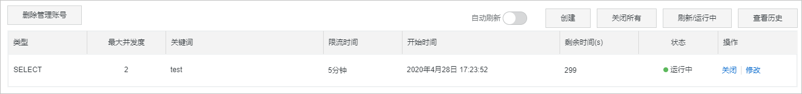

   > **说明**
   >
   > 如需提前关闭或修改限流规则，可单击目标规则右侧操作栏的**关闭**或**修改**按钮。

## 5.6. 锁分析

当数据库出现死锁、事务阻塞或元数据锁（MDL）等待等问题时，可借助DAS提供的锁分析功能，对锁等待关系进行可视化诊断，快速定位阻塞源头与依赖链路，有效提升问题排查效率，保障数据库服务的稳定性与高可用性。

> **说明**
>
> 本功能支持的数据库引擎，请参见各引擎支持的实例监控详情。

**功能简介**

锁分析功能支持对数据库实例进行多维度的死锁分析、事务阻塞分析、元数据锁等待分析。

- **最近死锁分析**：DAS基于 `SHOW ENGINE INNODB STATUS` 返回的最近一次死锁日志进行分析。如果发生过多次死锁，DAS只会对最近一次死锁进行分析。

- **其他锁分析**：DAS根据 `information_schema` 和 `performance_schema` 相关数据，实时分析数据库实例当前会话中的元数据锁和事务阻塞情况。

  - 元数据锁分析：DAS根据 `information_schema.processlist` 等的数据，推导锁等待关系，并生成相应的关系图。

  - 事务阻塞分析：DAS根据 `information_schema.processlist` ， `information_schema.innodb_trx` ，以及 `information_schema.innodb_lock_waits` （MySQL 5.6和5.7使用该数据）和 `performance_schema.data_lock_waits` （MySQL 8.0使用该数据）分析事务阻塞关系，并生成相应的关系图。

**前提条件**

目标数据库实例已成功接入DAS，且接入状态必须为**接入正常**。

**操作步骤**

1. 登录数据库实例控制台管理DAS。

2. 切换页签至目标数据库类型下，单击目标实例ID，进入实例详情页面。

3. 在左侧导航栏单击**锁分析**，在**锁分析**页签下：

   **死锁分析**

   <ol type="i">

   <li>

   **发起最近死锁诊断**

   在**最近死锁分析**页签下，单击**创建分析**。

   > **说明**
   >
   > 若发生过多次死锁，触发分析时只能分析最近一次死锁，然后保留本次分析得到的死锁相关数据。

   </li>

   <li>

   **查看详情**

   <ol type="a">

   <li>

   诊断完成后，选择时间段，单击最近死锁分析中诊断任务列表**详情**列下的**查看详情**，查看该时间段内曾经触发过的死锁诊断任务结果。

   </li>

   <li>

   弹出的抽屉页会显示对应死锁详情，点击查看即可。

   </li>

   </ol>

   </li>

   </ol>

   **其他锁分析**

   <ol type="i">

   <li>

   **发起其他锁分析诊断**

   在其他锁分析区域，单击**创建分析**。

   </li>

   <li>

   **查看详情**

   <ol type="a">

   <li>

   单击诊断结果前的  展开元数据锁等待和事务阻塞分析相关信息。

   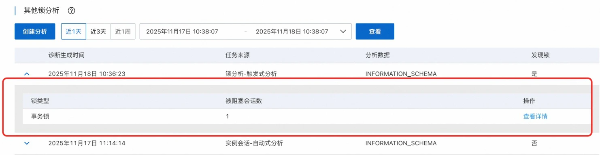

   </li>

   <li>

   单击**查看详情**，将显示对应的事务锁详情。

   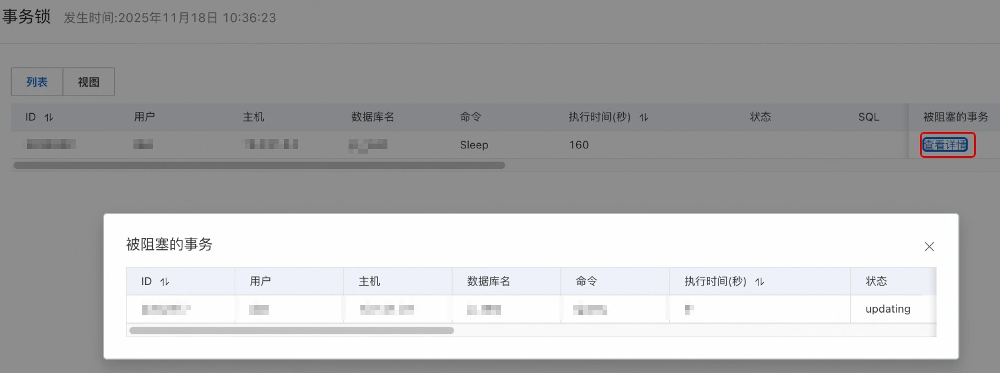

   </li>

   </ol>

   </li>

   </ol>

## 5.7. 慢SQL

通过DAS慢日志分析功能，可查看慢日志趋势、统计信息及执行明细，获取优化建议并导出历史数据，助力快速定位与解决性能瓶颈。

> **说明**
>
> 本功能支持的数据库引擎，请参见各引擎支持的实例监控详情。

**操作步骤**

不同数据库引擎的功能存在差异，本文以RDS MySQL数据库实例为例进行说明，其他引擎请以控制台实际功能为准。

1. 登录数据库实例控制台管理DAS。

2. 切换页签至目标数据库类型下，单击目标实例ID，进入实例详情页面。

3. 在左侧导航栏，单击**自治服务** **>** **慢SQL**，进入**慢日志分析**详情页。可查看以下信息：

   - 在**慢日志趋势**区域查看目标实例的慢日志变化趋势。

   - 单击**慢日志统计**页签，查看特定时间段的慢日志详情，针对目标SQL进行优化。

     - 部分数据库实例暂不支持SQL优化能力，具体支持情况请以控制台界面为准。

     - 对于RDS MySQL、PolarDB MySQL主备版、PolarDB-X 2.0、MongoDB实例，单击目标慢SQL记录操作列的**优化**按钮后，该记录将以蓝色高亮标记，便于在大量慢SQL中快速定位当前正在分析的SQL。关闭SQL诊断优化窗口后，高亮标记仍然保留；当单击其他慢SQL记录的**优化**按钮时，高亮标记将自动转移到对应记录。

     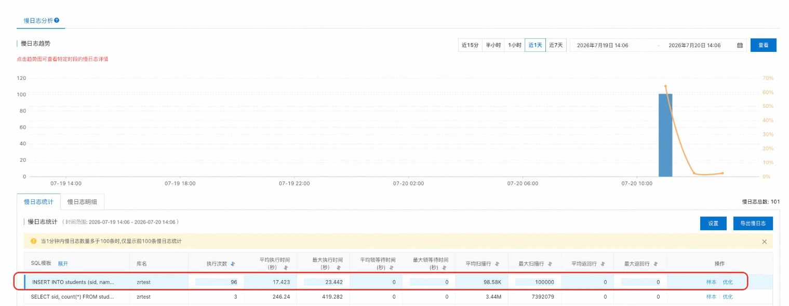

   - 单击**慢日志明细**页签，查看慢日志执行明细。

     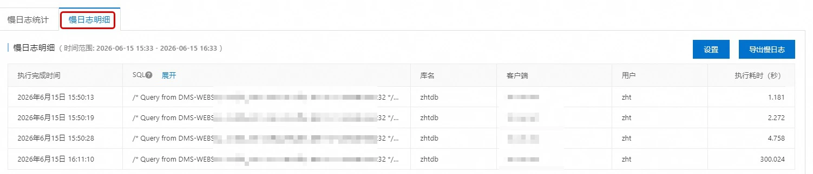

## 5.8. SQL优化

DAS SQL优化支持从慢日志统计和会话管理两个入口对SQL进行诊断分析，并提供优化建议等。

> **说明**
>
> 本功能支持的数据库引擎，请参见各引擎支持的实例监控详情。

**在慢日志统计页面进行优化**

1. 登录数据库实例控制台管理DAS。

2. 切换页签至目标数据库类型下，单击目标实例ID，进入实例详情页面。

3. 在左侧导航栏，单击**自治服务** **>** **慢SQL**。

4. 在**慢日志统计**页面找到目标SQL模板，在右侧操作栏中，单击**优化**。

   - 部分数据库实例暂不支持SQL优化能力，具体支持情况请以控制台界面为准。

   - 对于RDS MySQL、PolarDB MySQL主备版、PolarDB-X 2.0、MongoDB实例，单击目标慢SQL记录操作列的**优化**按钮后，该记录将以蓝色高亮标记，便于在大量慢SQL中快速定位当前正在分析的SQL。关闭SQL诊断优化窗口后，高亮标记仍然保留；当单击其他慢SQL记录的**优化**按钮时，高亮标记将自动转移到对应记录。

   

5. 在**SQL诊断优化**对话框中查看诊断结果。

   - 若采纳诊断建议，单击页面右上角的**复制**，将优化后的SQL粘贴到数据库客户端或DMS上执行。

   - 若不采纳诊断建议，单击**取消**结束诊断。

   > **说明**
   >
   > DAS会根据SQL的复杂程度、对应表的数据量、数据库负载等进行SQL诊断，诊断建议的返回时间可能会超过20秒。完成诊断后，SQL诊断引擎会给出诊断结果、优化建议等，可根据诊断结果确认是否采纳建议。

**在会话管理页面进行优化**

1. 登录数据库实例控制台管理DAS。

2. 切换页签至目标数据库类型下，单击目标实例ID，进入实例详情页面。

3. 在左侧导航栏，单击**自治服务** **>** **一键诊断**。

4. 单击**会话管理**，在**实例会话**区域，选中目标SQL，单击**优化**。

5. 在**SQL诊断优化**对话框中查看诊断结果。

   - 若采纳诊断建议，单击页面右上角的**复制**，将优化后的SQL粘贴到数据库客户端或DMS上执行。

   - 若不采纳诊断建议，单击**取消**结束诊断。

   > **说明**
   >
   > DAS会根据SQL的复杂程度、对应表的数据量、数据库负载等进行SQL诊断，诊断建议的返回时间可能会超过20秒。完成诊断后，SQL诊断引擎会给出诊断结果、优化建议等，可根据诊断结果确认是否采纳建议。

## 5.9. 空间碎片自动回收

空间碎片自动回收是数据库自治服务DAS的空间自动优化功能。开启该功能后，主实例会自动执行OPTIMIZE TABLE命令回收表空间碎片，整理物理存储空间。

> **说明**
>
> 本功能支持的数据库引擎，请参见各引擎支持的实例监控详情。

**前提条件**

- 已购买并开通DAS自治版。

- 实例类型为RDS MySQL高可用版，且实例已成功创建14天及以上。

- CPU规格不小于4核。

- 物理表必须使用InnoDB引擎。

**优化前的检查项**

为保证空间碎片自动回收对数据库性能和空间的影响最小化，系统会执行以下检查。

- 以下检测项如有一项或多项未通过，对应表的空间碎片自动回收操作将终止。

  - 剩余可用空间至少是需回收表的物理空间的3倍。

    > **说明**
    >
    > 例如：需回收的表Table_1物理空间为30 GB，则需要至少90 GB的剩余可用空间才能启动空间碎片自动回收。

  - 表上无fulltext索引。

- 以下检测项如有一项或多项未通过，系统将等待1~5分钟后重新检查，直至运维窗口期结束。

  - 目标实例上没有备份任务。

  - 没有正在执行的表结构变更操作。

  - 查看实例的CPU使用率，预估**空间碎片自动回收**需花费的时间，确保前一天和上周同一时间段的CPU使用率低于70%，且执行前的CPU使用率低于80%。

    > **说明**
    >
    > 例如：表的物理空间为90 GB，预计空间碎片回收耗时30分钟，计划于2021-12-10 03:00执行，则需确认以下条件：
    >
    > - 2021-12-09 03:00~03:30的CPU使用率低于70%。
    >
    > - 2021-12-03 03:00~03:30的CPU使用率低于70%。
    >
    > - 2021-12-10 03:00执行前的CPU使用率低于80%。

- 在执行空间碎片自动回收操作前，会自动检测如下三点：

  - 需碎片回收的表上，没有执行时间超过3秒的SQL。

  - 无悬挂事务（持有锁但是超过15秒未提交的事务）。

  - 活跃会话数小于64。

**操作步骤**

1. 登录数据库实例控制台管理DAS。

2. 切换页签至目标数据库类型下，单击目标实例ID，进入实例详情页面。

3. 进入**自治功能管理**页面。

   - 在左侧导航栏中，选择**自治服务** **> 一键诊断**。单击**自治中心**，在**自治中心**页，单击**自治功能开关**。

   - 在左侧导航栏中，选择**自治服务** **> 性能趋势**。在**性能趋势**页，单击**自治功能开关**。

4. 在弹出的**设置**对话框中，打开**开启自治服务**开关。

5. 打开**空间碎片自动回收**开关，并配置以下参数。

   | 参数 | 说明 |
   | --- | --- |
   | 表空间 | 物理表空间，默认值和最小值均为10 GB，最大值为100 GB。 说明单表空间过大会导致回收时间长，请根据实际业务情况选择合适的数值。 |
   | 碎片率 | 物理表的碎片率，默认值和最小值均为20%，最大值为99%。 说明碎片率过大会降低空间优化频率，请根据实际业务情况选择合适的数值。 |

6. 单击**确定**。

# 6.AI助手

数据库自治服务DAS的AI助手（DBExpert Agent）基于大模型技术，为数据库运维提供智能诊断和优化建议。借助自然语言对话，可快速获取数据库问题的根因分析和修复方案，无需手动排查。

> **重要**
>
> AI助手当前为只读模式，仅提供分析与建议，不会对数据库执行任何修改、删除等变更操作。

**开通说明**

AI助手和智能运维日报属于增值服务，需联系阿里云技术支持开通。开通后，控制台左侧导航栏将显示**AI助手**和**智能运维日报**两个入口。

**功能概述**

AI助手提供以下核心能力：

- **智能诊断**：自动分析CPU使用率、内存异常、锁等待、慢SQL等性能问题，定位根因并给出优化建议。

- **SQL优化**：对指定SQL进行执行计划分析和索引优化建议。

- **安全审计**：扫描账号权限、安全配置、访问模式，识别安全风险。

- **知识问答**：基于数据库产品文档和运维经验，回答数据库使用和运维问题。

- **巡检报告**：对指定实例生成综合运维巡检报告。

**支持的诊断场景**

AI助手支持以下诊断场景，按功能分类如下：

> **说明**
>
> 不同数据库引擎支持的诊断场景有所不同。各引擎支持的完整场景清单，请参见支持的数据库引擎。

**分类**

**场景**

**说明**

通过获取指定时段的会话、慢日志等相关数据，诊断导致CPU使

CPU使用率诊断

用率异常的原因。

通过获取内存使用详情、Buffer Pool状态、连接数等数据，诊断

内存异常诊断

内存异常原因。

诊断分布式拓扑健康状态、数据倾斜、跨分片查询性能等分布式

分布式性能诊断

架构相关问题。

性能诊断

重要性能指标总结

指定时间范围查询实例重要性能指标并给出总结。

实时获取实例性能指标，包括CPU、内存、IOPS、网络等多维度

实时性能监控

指标。

监控指标查询

查询指定实例的监控指标数据。

对指定SQL进行诊断，分析执行计划、索引使用情况并提供优化

SQL诊断优化

建议。

SQL优化

基于SQL慢日志的统计数据，识别多种问题SQL，并给出行动建

慢日志分析

议。

识别当前实例中的异常会话，包括长时间运行、阻塞等异常状态

异常会话识别

的会话。

锁分析

根据描述自动判断分析类型：死锁分析或事务阻塞锁分析。

会话与锁

分析最近发生的死锁事件，提供死锁链路、涉及SQL和解决建

最近死锁分析

议。

元数据锁和事务阻塞分析

分析当前会话中的元数据锁、事务阻塞情况。

扫描实例中所有用户的权限，识别过度授权和违反最小权限原则

权限审计

的情况。

检测高危账号，包括无密码账号、密码策略缺失、僵尸账号等安

账号风险扫描

全风险。

安全审计

安全配置检查

检查安全相关参数配置是否符合最佳实践。

分析访问来源和模式，检测异常IP、非工作时间访问等异常行

访问模式分析

为。

回溯近期高危操作（DDL/DCL/大批量DML），检测是否存在未

敏感操作审计

授权变更。

审计日志查询

查询指定时间范围内的审计日志记录，支持按关键词过滤。

对指定实例进行综合运维巡检，输出一份巡检报告。耗时约1~3

单实例巡检报告

分钟。

HA查询分析

查询并分析实例主备切换记录，输出简洁报告。

错误日志分析

对MySQL类实例的error等级错误日志进行分析。

查询数据库实例的参数配置，支持查询全部参数或指定参数（如

参数配置查询

sort_buffer_size、innodb_buffer_pool_size 等），用于参数调优、问题排查和配置审计。

实例拓扑查询

查询实例的拓扑结构信息，包括主备关系、读写分离架构等。

查看指定表的建表DDL语句，包括字段定义、索引、约束等完整

查看建表语句

信息。

实例运维

分析数据库实例的存储空间使用情况，包括表空间、索引空间、

空间分析

碎片等。

存储空间诊断与优化，包括大表识别、索引膨胀分析、碎片率诊

存储空间优化（PolarDB-X）

断及优化建议。

分析PolarDB-X企业版的读写流量倾斜问题，诊断DN CPU告警、分区表热点、单表流量集中等场景，基于

流量倾斜分析（PolarDB-X）

INFORMATION_SCHEMA.TABLE_DETAIL系统视图进行诊断并提供优化建议。

分析PolarDB-X企业版的数据倾斜问题，诊断DN磁盘使用率高、分区数据不均衡、热点分区、单表倾斜等场景，基于

数据倾斜分析（PolarDB-X）

INFORMATION_SCHEMA.TABLE_DETAIL系统视图进行诊断并提供优化建议。

<table>
  <tr>
    <td>知识检索</td>
    <td>知识库问答</td>
    <td>在对应引擎的知识库中检索相关知识并回答用户问题，覆盖产品使用、最佳实践、常见问题等。</td>
  </tr>
</table>

**使用AI助手进行对话式诊断**

**前提条件**

- 已开通AI助手增值服务。

- 已登录数据库自治服务DAS控制台。

- 目标数据库实例已在实例监控页面完成授权。

**操作步骤**

1. 登录数据库自治服务DAS控制台。

2. 在左侧导航栏，单击**AI助手**。

   > **说明**
   >
   > - 进入AI助手页面后，问候语下方的场景区域展示当前云平台的纳管规模，显示为“DBExpert Agent当前云平台已纳管实例N个，支持以下M种场景分析”。其中N为当前云平台已纳管的数据库实例总数，M为当前可用的场景模板数量，两项数据按天统计更新。
   >
   > - 若纳管实例数或场景数暂无统计数据，该区域展示默认文案“DBExpert Agent可以在以下场景中提供帮助”。

3. 在页面底部的输入框中，输入 `@` 选择目标实例。

   输入 `@` 后，系统将弹出实例列表，可搜索并选择需要诊断的数据库实例。

4. 通过以下任一方式发起诊断：

   - 场景模板：单击输入框下方的**场景模板**按钮，从预置的诊断场景列表中选择需要执行的场景（如“CPU使用率诊断”“SQL诊断优化”等），系统将自动填入对应的提问模板。

   - 自由提问：直接在输入框中用自然语言描述您的问题。

     例如：“当前实例rm-1clz\*\*\*\*\*\*的CPU为什么这么高？”“帮我分析一下实例rm-1clz\*\*\*\*\*\*最近的慢SQL。”

5. 按 `Enter` 发送提问，或使用 `Shift+Enter` 换行后发送。

6. 查看AI助手的诊断结果。

   AI助手将以流式方式实时展示推理过程，包括思考过程、工具调用和最终分析结论。可基于诊断结果进行后续的多轮对话，进一步深入分析问题。

**使用限制**

- AI助手当前为只读模式，不会对数据库执行任何修改操作。

- 部分诊断场景需要选择具体实例后才能使用。

- 单实例巡检报告的生成耗时约1~3分钟，期间会以进度方式实时反馈。

**查看性能指标解释说明**

AI助手在诊断过程中返回性能指标数据时，会以折线图形式展示各指标的时序趋势。为便于理解每个指标的实际含义，AI助手为性能指标配有解释说明，可在对话结果中直接查看。

在AI助手返回的性能指标区域，可查看如下信息：

- 指标说明入口：在性能指标图表标题的右侧显示信息图标。

  将鼠标悬浮在信息图标上，即可查看该指标的解释说明，内容包含指标定义（该指标衡量的对象）与影响说明（该指标异常时可能导致的业务影响）。

- 指标名称与单位：图表标题展示指标的中文名称与指标标识，标题右侧以标签形式展示该指标的计量单位（例如CPU使用率、内存使用率展示为%），便于结合单位准确理解指标数值；无计量单位的指标（例如QPS、活跃会话）不展示单位标签。

- 统计值：图表下方展示该指标在当前查询时段内的均值、最大值和最小值，便于快速判断指标波动情况。

- 展开与收起：性能指标区域默认处于收起状态，单击区域标题可展开查看全部指标图表，再次单击可收起，避免一次性展示过多信息。

- 复制数据：单击性能指标区域右上角的**复制数据**，可将指标的原始时序数据复制到剪贴板，用于二次分析。

> **说明**
>
> 指标的解释说明随诊断结果一并展示；当诊断结果未包含某个指标的说明时，系统自动补全该指标的说明。若仍无对应说明，则该指标不展示信息图标。

**导出含指标说明的巡检报告**

AI助手生成单实例巡检报告后，可将报告导出为HTML文件离线查看，导出的报告中同样保留各性能指标的解释说明。操作步骤如下：

1. 在AI助手的巡检报告消息下方，单击  导出报告。

2. 在**导出巡检报告**对话框中，确认导出范围为当前AI巡检报告，单击**导出 HTML**。

3. 系统将报告导出为HTML文件至本地。

   导出文件包含报告正文与各性能指标图表，每个指标图表下方展示对应的指标说明，支持离线查看与现场交付。

**使用场景模板快速提问**

场景模板是AI助手预置的常用诊断场景，单击即可快速发起对应的诊断流程。

1. 在AI助手页面的输入框下方，单击**场景模板**。

2. 在弹出的场景列表中，可通过顶部的分类标签筛选场景：

   - **全部**：展示所有可用场景。

   - **SQL优化**：SQL诊断优化、慢日志分析相关场景。

   - **会话与锁**：异常会话、死锁、锁分析相关场景。

   - **安全审计**：权限审计、安全配置检查相关场景。

   - **实例运维**：巡检报告、HA分析、错误日志相关场景。

   - **性能诊断**：CPU诊断、内存诊断、性能指标相关场景。

   - **知识检索**：数据库知识库问答场景。

3. 也可通过**全部引擎**下拉菜单，按数据库引擎筛选可用的诊断场景。

4. 单击目标场景卡片，系统将自动填入对应的提问模板并发起诊断。

**常见问题**

- **Q1：AI助手可以修改数据库配置或执行SQL吗？**

- A1：不会。AI助手当前为只读模式，仅提供分析与建议，不会对数据库执行任何修改、删除等变更操作。所有优化建议均需手动确认后执行。

- **Q2：不同引擎看到的诊断场景为什么不同？**

- A2：不同数据库引擎支持的功能有所不同，AI助手会根据所选引擎自动展示该引擎支持的诊断场景。具体支持的场景请参见上文“支持的诊断场景”表格。

- **Q3：AI助手的诊断结果准确吗？**

- A3：AI助手基于大模型技术和数据库运维经验知识库进行分析，诊断结果仅供参考。建议结合实际情况进行判断，必要时联系阿里云技术支持获取进一步帮助。

# 7.智能运维日报

智能运维日报是DBExpert Agent提供的自动化运维巡检功能。系统每日自动扫描所有已纳管的数据库实例，识别潜在风险并生成运维报告，便于全面掌握数据库健康状态。支持在线查看日报总览和实例级报告，按实例ID搜索特定实例的日报，也可将日报导出为HTML文件，用于离线查看与现场交付。

**开通说明**

AI助手和智能运维日报属于增值服务，需联系阿里云技术支持开通。开通后，控制台左侧导航栏将显示**AI助手**和**智能运维日报**两个入口。

**功能概述**

智能运维日报提供以下核心能力：

- **自动巡检**：每日自动运行后台巡检任务，扫描所有已接入实例的风险项。

- **优先级判定**：根据问题严重程度将实例标记为**紧急**、**高优先级**、**中优先级**或**正常**，便于聚焦关键问题。

- **实例级报告**：为每个实例生成独立的运维报告，包含关键指标、重点问题、慢SQL分析、变更记录和深度诊断等内容。

- **自动下钻分析**：巡检发现异常后，系统自动触发深度诊断并直接给出诊断结论，无需手动再次发起分析命令。

- **实例搜索**：支持输入完整的实例ID，快速查询该实例在当前所选日期下的运维日报，查询不受当前产品页签和引擎页签的限制。

- **报告导出**：支持将指定产品引擎、指定日期的运维日报导出为HTML文件。导出的文件可离线打开并正常交互，适用于无外网环境的现场交付场景。

**支持的产品与引擎**

智能运维日报按产品页签和引擎页签组织，支持查看以下数据库产品与引擎的运维日报：

| 产品页签 | 引擎页签 |
| --- | --- |
| PolarDB 主备版 | MySQL、PostgreSQL |
| PolarDB 集群版 | MySQL、PostgreSQL |
| RDS | - |
| PolarDB-X 2.0 | - |
| Tair（兼容Redis） | - |
| MongoDB 副本集 | - |
| MongoDB 分片集 | - |

> **说明**
>
> 仅当所选产品下存在已纳管实例时，才会展示对应的引擎页签。

**前提条件**

- 已开通智能运维日报增值服务。

- 已登录数据库自治服务DAS控制台。

- 目标数据库实例已在实例监控页面完成授权。

**注意事项**

- 运维报告中的问题和建议需人工确认后执行，系统不会自动执行任何变更操作。

- 智能运维日报按组织/资源集权限隔离，不同组织间实例不可见。

- 运维日报每天首次加载时需要校验实例权限并初始化日报数据，页面会自动刷新，无需手动操作，请耐心等待。

**查看运维日报总览**

1. 登录数据库自治服务DAS控制台。

2. 在左侧导航栏，单击**智能运维日报**。

3. 在页面顶部的产品页签中，选择目标数据库产品。

4. 在产品页签下方的引擎页签中，选择目标数据库引擎。

   例如**MySQL**或**PostgreSQL**。

5. 在页面右上角的日期选择器中选择查看日期。

   日期默认为**昨天**，可选范围为最近30天，当天及未来日期不可选。

6. （可选）如需查看特定实例的报告，单击**搜索实例**按实例ID查询，详情请参见按实例ID搜索运维日报。

7. （可选）如需重新获取最新日报数据，单击日期选择器右侧的刷新按钮。

8. 查看页面顶部的指标卡片：

   <table>
     <tr>
       <th width="89">指标</th>
       <th>说明</th>
     </tr>
     <tr>
       <td>纳管实例</td>
       <td>当前所选产品引擎下已纳管的实例总数，卡片下方同时展示“已生成 N 份报告”，表示已生成运维报告的实例数量。</td>
     </tr>
     <tr>
       <td>紧急</td>
       <td>存在严重安全或稳定性风险、需立即处理的实例数量。</td>
     </tr>
     <tr>
       <td>高优先级</td>
       <td>存在较高风险、建议24小时内处理的实例数量。</td>
     </tr>
     <tr>
       <td>中优先级</td>
       <td>存在优化空间、建议本周内处理的实例数量。</td>
     </tr>
     <tr>
       <td>正常</td>
       <td>运行健康、无需特别关注的实例数量。</td>
     </tr>
   </table>

9. 查看**优先级分布**区域，了解各优先级实例的数量与占比情况。

   单击某一优先级可对下方实例列表进行筛选，筛选后实例列表上方将显示**已筛选**提示，单击**清除**可取消筛选。

10. 查看**问题类型分布**区域，了解问题在各维度的分布情况。

    问题类型包括：性能瓶颈、SQL性能、锁与事务、空间存储、安全合规、稳定性、配置风险、其他。

11. 在**实例列表**区域，实例按优先级分组展示（**紧急**、**高优先级**、**中优先级**、**正常**），其中**紧急**和**高优先级**分组默认展开。

    当单个分组内实例数量超过10个时，分组内将展示**展开全部**按钮，单击后可查看该分组下的全部实例。

**查看实例级运维报告**

1. 在运维日报页面的**实例列表**区域，查看各实例的运维概要。实例列表展示以下信息：

   | 列名 | 说明 |
   | --- | --- |
   | 实例 | 数据库实例名称与实例ID。 |
   | 优先级 | 该实例的运维优先级，取值为<strong>紧急</strong>、<strong>高优先级</strong>、<strong>中优先级</strong>或<strong>正常</strong>。 |
   | 问题摘要 | 该实例运维报告的核心问题摘要。 |
   | 操作 | 单击<strong>详情</strong>查看该实例的完整运维报告。 |

2. 单击目标实例**操作**列的**详情**，查看该实例的完整运维报告。

3. 在实例报告详情弹窗中，查看顶部的**实例ID**和**地域**信息，以及**整体总结**内容。

4. 通过以下页签查看不同维度的信息。页签名称后会显示对应的条目数量：

   <table>
     <tr>
       <th width="89">页签</th>
       <th>说明</th>
     </tr>
     <tr>
       <td>关键指标</td>
       <td>展示实例的关键性能指标，包含<strong>指标</strong>、<strong>当日均值</strong>、<strong>当日峰值</strong>（含峰值出现时间）、<strong>昨日均</strong><strong>值</strong>和<strong>趋势</strong>（上升↑、下降↓或持平-）。 说明对于PolarDB-X 2.0等多节点产品，指标将按<strong>实例级指标</strong>和各节点类型（如<strong>计算节点</strong><strong>（CN）</strong>、<strong>数据节点（DN）</strong>、<strong>GMS节点</strong>、<strong>日志节点（CDC）</strong>）分组展示。</td>
     </tr>
     <tr>
       <td>重点问题</td>
       <td>按问题类型分组展示该实例需要重点关注的运维问题，每个分组显示问题类型标签和问题数量，每条问题包含问题标题、详细说明与处理建议。</td>
     </tr>
     <tr>
       <td>慢SQL</td>
       <td>展示该实例的慢SQL Top 10，包含排名、所属数据库、执行次数、总耗时、最大耗时、扫描行数和SQL摘要。</td>
     </tr>
     <tr>
       <td>变更记录</td>
       <td>展示该实例近期的运维操作变更记录。</td>
     </tr>
     <tr>
       <td>深度诊断</td>
       <td>展示本次巡检自动触发的深度诊断项及其诊断结论。 • 每个诊断项以卡片形式展示，包含诊断能力名称（如<strong>CPU尖峰分析</strong>）、诊断状态（<strong>已完</strong><strong>成</strong>、<strong>无结论</strong>、<strong>失败</strong>或<strong>已跳过</strong>）、诊断标题、<strong>触发依据</strong>（触发本次诊断的异常现象）、<strong>根</strong><strong>因</strong>（异常产生的原因）和<strong>建议动作</strong>（可执行的优化措施列表）。 • 诊断失败或无结论时展示失败原因；未能给出根因时，可展开<strong>查看原始诊断输出</strong>查看完整的诊断内容。</td>
     </tr>
   </table>

**按实例ID搜索运维日报**

在实例数量较多的场景下，可通过搜索实例功能直接输入实例ID查询该实例的运维日报，无需在**实例列表**中逐条查找。

> **说明**
>
> - 查询结果对应**页面当前所选日期**下的运维日报。如需查看其他日期的报告，需先在日期选择器中切换日期，再执行查询。
>
> - 查询**不受当前产品页签和引擎页签的限制**。即使目标实例不属于当前所选的产品引擎，只要该实例在所选日期下存在运维日报，仍可查询到其报告详情。
>
> - 实例ID需**完整输入**，不支持模糊匹配或部分匹配。
>
> - 查询过程中对话框不可关闭，待查询完成后才能关闭或返回。

1. 登录数据库自治服务DAS控制台，在左侧导航栏单击**智能运维日报**。

2. 在页面右上角的日期选择器中选择需要查询的日期。搜索结果对应该日期下的运维日报。

3. 通过以下任一方式打开搜索对话框：

   - 单击**搜索实例**按钮，按钮右侧同时展示快捷键提示。

   - 按下快捷键<strong>⌘ K</strong>（macOS）或**Ctrl K**（Windows/Linux），可在页面任意位置快速打开搜索对话框。

4. 在**按实例 ID 查询**对话框中，输入完整的实例ID。

5. 单击**查询**按钮。输入框支持一键清空已输入的内容。

6. 查询成功后，对话框自动切换为该实例的报告详情视图，标题展示实例名称与**优先级**标签，内容与“查看实例级运维报告”一致，包含**实例ID**、**地域**、整体总结以及**关键指标**、**重点问题**、**慢SQL**、**变更记录**、**深度诊断**五个页签。

7. （可选）如需查询另一个实例，单击对话框标题左侧的**返回搜索**回到搜索输入界面。

**查询失败提示**

查询未返回结果时，对话框中将展示以下提示：

| 提示信息 | 原因与处理方式 |
| --- | --- |
| 未找到该实例的运维日报 | 所输入的实例ID在当前所选日期下不存在运维日报。可确认实例ID是否正确，或切换到其他日期后重新查询。 |
| 请输入实例 ID | 未输入实例ID即执行查询。在输入框中补充完整的实例ID后重新查询。 |
| 实例报告查询失败，请稍后重试 | 查询请求异常。稍后重新查询。 |

**导出运维日报**

支持将指定产品引擎、指定日期的运维日报导出为HTML文件。导出的文件无需依赖控制台或网络环境，可直接使用浏览器打开，并保留分组折叠、实例详情展开等交互能力，适用于现场交付和离线审阅场景。

**导出内容**

导出的HTML文件包含以下内容：

<table>
  <tr>
    <th width="121">内容模块</th>
    <th>说明</th>
  </tr>
  <tr>
    <td>日报总览</td>
    <td>标题（智能运维日报 · 产品 · 引擎）、日报日期、指标卡片（纳管实例、紧急、高优先级、中优先级、正常）、优先级分布、问题类型分布。</td>
  </tr>
  <tr>
    <td>实例列表</td>
    <td>按优先级分组的实例清单。导出的HTML保留分组折叠与展开交互，分组内实例超过10个时可单击<strong>展开全部</strong>按钮查看全部实例。</td>
  </tr>
  <tr>
    <td>实例报告详情</td>
    <td>每个实例的<strong>关键指标</strong>和<strong>深度诊断</strong>页签内容，以及关键指标明细表（指标、当日均值、当日峰值、昨日均值、趋势）、重点问题、慢SQL和变更记录。</td>
  </tr>
</table>

**操作步骤**

> **说明**
>
> - 导出范围为当前所选的**单个产品引擎**在**单个日期**下的运维日报。如需导出多个引擎或多个日期的日报，需分别切换产品页签、引擎页签和日期后重复执行导出操作。
>
> - 当所选日期下暂无可导出的日报数据时，**导出日报**按钮将置灰且不可单击，需先切换到有日报数据的日期。
>
> - 导出过程中系统会逐个拉取实例的日报详情。若某个实例的详情获取失败，将提示“**实例 XXX的日报详情获取失败**”；若整体导出失败，将提示“**导出失败，请稍后重试**”。

1. 登录数据库自治服务DAS控制台，在左侧导航栏单击**智能运维日报**。

2. 选择需要导出的产品页签和引擎页签，并在日期选择器中选择目标日期。

3. 单击引擎页签右侧的**导出日报**按钮。

4. 在**导出运维日报**对话框中，确认**导出日报范围**。

   导出范围为当前所选的产品、引擎与日期，格式为“产品 · 引擎 · 日期 日报”。

5. （可选）如需放弃本次导出，单击**取消**关闭对话框。

6. 单击**导出 HTML**。

   系统将生成HTML文件并自动下载到本地，文件名格式为“智能运维日报_引擎_日期.html”。

7. 使用浏览器打开下载的HTML文件，即可离线查看日报内容并展开实例详情进行交互。
