阿里云  
专有云  
云数据库 Tair（兼容 Redis）  
云数据库 Tair（兼容Redis）用户  
指南  
产品版本：v3.18.6  
文档版本：20261106

**目录**

- [1.新功能发布记录](#section-1)
    - [1.1. 控制台发布记录](#section-1-1)
    - [1.2. 内核版本发布记录](#section-1-2)
- [2.什么是](#section-2)
- [3.企业版性能增强型介绍](#section-3)
- [4.使用限制](#section-4)
- [5.实例规格](#section-5)
    - [5.1. 实例规格概述](#section-5-1)
    - [5.2. 云原生版实例规格](#section-5-2)
    - [5.3. 经典版实例规格](#section-5-3)
- [6.快速入门](#section-6)
    - [6.1. 开始使用云数据库Tair](#section-6-1)
    - [6.2. 登录云数据库Tair（兼容Redis）控制台](#section-6-2)
    - [6.3. 创建实例](#section-6-3)
    - [6.4. 设置白名单](#section-6-4)
    - [6.5. 连接实例](#section-6-5)
- [7.实例管理](#section-7)
    - [7.1. 修改密码](#section-7-1)
    - [7.2. 设置白名单](#section-7-2)
    - [7.3. 变更配置](#section-7-3)
    - [7.4. 节点管理](#section-7-4)
    - [7.5. 转云原生部署模式](#section-7-5)
    - [7.6. 管理分片数量](#section-7-6)
    - [7.7. 设置可维护时间段](#section-7-7)
    - [7.8. 迁移可用区](#section-7-8)
    - [7.9. 迁移网络可用区](#section-7-9)
    - [7.10. 大版本升级](#section-7-10)
    - [7.11. 升级小版本](#section-7-11)
    - [7.12. 超级带宽（多VIP管理）](#section-7-12)
    - [7.13. 设置SSL加密](#section-7-13)
    - [7.14. 开启透明数据加密TDE](#section-7-14)
    - [7.15. 清除数据](#section-7-15)
    - [7.16. 释放实例](#section-7-16)
    - [7.17. 实例回收站管理](#section-7-17)
    - [7.18. 账号管理](#section-7-18)
    - [7.19. 重启实例](#section-7-19)
    - [7.20. 导出实例列表](#section-7-20)
    - [7.21. 管理标签](#section-7-21)
    - [7.22. Lua脚本支持与限制](#section-7-22)
- [8.连接指南](#section-8)
    - [8.1. 查看连接地址](#section-8-1)
    - [8.2. 申请连接地址](#section-8-2)
    - [8.3. 修改连接地址](#section-8-3)
    - [8.4. 使用直连模式连接实例](#section-8-4)
    - [8.5. 使用客户端程序连接](#section-8-5)
    - [8.6. 使用redis-cli连接](#section-8-6)
- [9.性能监控](#section-9)
    - [9.1. 查看监控数据](#section-9-1)
- [10.云监控](#section-10)
    - [10.1. 查看监控大盘指标](#section-10-1)
    - [10.2. 报警历史](#section-10-2)
    - [10.3. 报警规则](#section-10-3)
        - [10.3.1. 创建报警规则](#section-10-3-1)
        - [10.3.2. 管理报警规则](#section-10-3-2)
- [11.参数管理](#section-11)
    - [11.1. 设置参数](#section-11-1)
    - [11.2. 使用参数模板](#section-11-2)
- [12.备份与恢复](#section-12)
    - [12.1. 自动备份](#section-12-1)
    - [12.2. 手动备份](#section-12-2)
    - [12.3. 下载备份](#section-12-3)
    - [12.4. 数据恢复](#section-12-4)
    - [12.5. 克隆实例](#section-12-5)
- [13.日志与审计](#section-13)
    - [13.1. 查询运行日志](#section-13-1)
    - [13.2. 审计日志](#section-13-2)
- [14.CloudDBA](#section-14)
    - [14.1. 性能趋势](#section-14-1)
    - [14.2. Top Key统计](#section-14-2)
    - [14.3. 自定义性能趋势图表](#section-14-3)
    - [14.4. 实时性能](#section-14-4)
    - [14.5. 实例会话](#section-14-5)
    - [14.6. 慢请求](#section-14-6)
    - [14.7. 离线全量Key分析](#section-14-7)
    - [14.8. 诊断实例](#section-14-8)
- [15.报警设置](#section-15)
- [16.附录](#section-16)
    - [16.1. 租户组织对SLB服务授权操作](#section-16-1)

<a id="section-1"></a>

# 1.新功能发布记录

<a id="section-1-1"></a>

## 1.1. 控制台发布记录

本章节介绍了云数据库 Tair（兼容 Redis）的控制台功能发布动态和对应的文档。

**2026年**

**2026年10月**

| 功能概述 | 详细说明 | 相关文档 |
| --- | --- | --- |
| 超级带宽 | 支持为集群实例的连接地址分配多个VIP接入点，突破单接入点带宽上限，实现云数据库 Tair（兼容Redis）云原生集群版实例的带宽扩展。 | 超级带宽（多VIP管理） |
| 日志与审计 | 补全运行日志与审计日志查询能力的文档，支持按时间范围检索实例的运行日志和审计日志，并可导出用于问题排查与合规审计。 | 查询运行日志 |
| 实例规格改版 | 更新云数据库 Tair（兼容 Redis）的实例规格清单，涵盖内存容量、连接数与带宽等规格参数。 | 实例规格 |

**2026年7月**

| 功能概述 | 详细说明 | 相关文档 |
| --- | --- | --- |
| 云原生版部署模式支持Tair 6.0/7.0实例 | 云数据库 Tair（兼容 Redis）云原生版部署模式下支持创建Tair 6.0与7.0版本实例，具备主从、集群和读写分离等能力。 | 创建实例 |
| 迁移网络可用区 | 支持迁移实例网络所属的可用区，将实例连接地址切换至目标可用区的交换机。 | 迁移网络可用区 |
| 参数模板 | 支持将一组参数配置保存为参数模板，创建实例时应用模板，实现参数配置的批量复用。 | 使用参数模板 |
| 实例回收站管理 | 支持查看、恢复和重建释放后的实例，避免误操作导致的数据丢失。 | 实例回收站管理 |
| SSL加密改版 | 增加云数据库 Tair（兼容 Redis）云原生版7.0实例加密操作，支持为实例开启SSL保护传输链路。 | 设置SSL加密 |

<a id="section-1-2"></a>

## 1.2. 内核版本发布记录

本文为您介绍了云数据库 Tair（兼容 Redis）的内核版本发布情况。

> **说明**
>
> 详细更新点及版本差异请参见<strong>《Hotfix版本说明书》</strong>中<strong>《云数据库 Tair（兼容 Redis）》</strong>章节。

**2026年**

**2026年7月**

<table>
  <tr>
    <th>产品</th>
    <th>部署模式</th>
    <th>版本/引擎</th>
    <th>内核小版本</th>
  </tr>
  <tr>
    <td rowspan="6">云数据库Tair（兼容Redis）</td>
    <td>云原生</td>
    <td>企业版7.0</td>
    <td>26.5.0.0</td>
  </tr>
  <tr>
    <td>经典</td>
    <td>社区版7.0</td>
    <td>0.2.13</td>
  </tr>
  <tr>
    <td>经典</td>
    <td>企业版5.0</td>
    <td>5.0.72</td>
  </tr>
  <tr>
    <td>经典</td>
    <td>社区版6.0</td>
    <td>0.2.28</td>
  </tr>
  <tr>
    <td>经典</td>
    <td>社区版5.0</td>
    <td>5.2.28</td>
  </tr>
  <tr>
    <td>经典</td>
    <td>社区版4.0</td>
    <td>1.9.20</td>
  </tr>
</table>

<a id="section-2"></a>

# 2.什么是

云数据库 Tair（兼容 Redis）是兼容开源Redis协议标准的数据库服务，基于双机热备架构及集群架构，可满足高吞吐、低延迟及弹性变配等业务需求。

**功能特性**

- 支持云原生部署模式兼容更高的Redis版本，同时也具有更加灵活的架构配置。更多特性，请参见《产品简介》中功能特性章节。

- 在社区版的基础上推出企业级缓存服务产品，提供性能增强型供您选择。

- 支持String（字符串）、List（链表）、Set（集合）、Sorted Set（有序集合）、Hash（哈希表）、Stream（流数据）等多种数据结构，同时支持Transaction（事务）、Pub/Sub（消息订阅与发布）等高级功能。

**支持的实例类型**

| 实例类型 | 简介 |
| --- | --- |
| 社区版 | 兼容开源Redis的高性能数据缓存服务，支持主从双副本、集群和读写分离架构。 |
| 企业版（性能增强型） | 在社区版的基础上开发的强化版Redis服务，推出性能增强型产品，采用多线程模型，集成阿里巴巴Tair的部分特性，支持多种Tair数据结构，对于部分特殊业务有很高的适用性。 |
| 云原生版 | 兼容Redis7.0版本，同时也具有更加灵活的架构配置。支持更灵活的副本管理、单副本模式、更大规格集群和读写分离能力。 |

<a id="section-3"></a>

# 3.企业版性能增强型介绍

云数据库 Tair（兼容 Redis）企业版性能增强型（简称性能增强型）适合并发量大、读写热点多，对性能要求较高的场景。相比社区版，性能增强型主要在多线程和多模块集成方面进行了优化。

**主要优势**

| 类别 | 说明 |
| --- | --- |
| 性能 | • 读写性能达到同规格Redis社区版实例的3倍，能够更好地应对热点数据的高频读写。<br>• 相比原生Redis，高QPS场景下响应时间更短，性能表现更佳。<br>• 在大并发场景下运行稳定，可以极大地缓解突发大量请求导致的连接问题，从容应对业务高峰。<br>• 全量同步和增量同步在I/O线程中进行，提高同步速度。 |
| 兼容性 | 100%兼容原生Redis，无需修改业务代码。 |
| 扩展性 | 支持主从和集群架构，可根据业务需求执行垂直扩容（升级规格）或水平扩容（升级为集群版）。 |

**适用场景**

适用于视频直播、电商秒杀和在线教育等场景，例如：

| 业务上遇到的问题 | 说明 |
| --- | --- |
| 社区版主从架构实例无法满足高QPS需求。 | 使用Redis社区版主从实例在秒杀场景中构建缓存，部分热点Key的QPS要求高达20万以上，社区版实例无法满足业务高峰期的需求。采用性能增强型（主从版）实例后，热门商品秒杀过程流畅，未发生性能问题。 |
| 需要沿用现有主从架构并提升实例性能。 | 由于集群版存在一定的使用限制，需要保持现有的主从架构。采用性能增强型（主从版）实例，在满足性能需求的同时保持了现有架构，避免升级至集群带来的限制，无需调整现有业务实现方式。 |
| 自建Redis集群分片多、成本高、性能损耗大。 | 随着业务的高速发展，自建Redis集群的分片数不断增加，导致管理维护成本上升，且带来了一定的性能损耗。采用性能增强型（集群版）实例后，得益于其出色的性能，分片数缩减至原有的三分之一，降低了性能损耗，同时，云数据库提供丰富的管理功能帮助您便捷地管理集群。 |

**性能对比**

- Redis社区版实例采用与原生Redis相同的单线程模型，每个数据节点支持8万到10万的QPS。

- Redis性能增强型采用多线程模型，由I/O线程、Worker线程和辅助线程共同完成数据处理，单节点性能为社区版实例的3倍左右。

下表展示了不同架构下，社区版和企业版（性能增强型）实例的适用场景对比。

<table>
  <tr>
    <th>架构</th>
    <th>实例类型</th>
    <th>说明</th>
  </tr>
  <tr>
    <td rowspan="2">标准架构（主从版）</td>
    <td>社区版</td>
    <td>不适用于单节点QPS要求超过10万的场景。</td>
  </tr>
  <tr>
    <td>企业版（性能增强型）</td>
    <td>可应用于QPS高于10万的场景。</td>
  </tr>
  <tr>
    <td rowspan="2">集群架构（集群版）</td>
    <td>社区版</td>
    <td>包含多个数据节点，每个节点的性能与主从版实例相似。当某个节点存储了热度较高的数据并面临大并发量的请求时，该节点中其他数据的读写可能受到影响，形成性能瓶颈。</td>
  </tr>
  <tr>
    <td>企业版（性能增强型）</td>
    <td>能更好地应对热读写，降低维护成本。</td>
  </tr>
</table>

<a id="section-4"></a>

# 4.使用限制

<table>
  <tr>
    <th width="174">项目</th>
    <th>说明</th>
  </tr>
  <tr>
    <td>List数据类型</td>
    <td>没有List个数限制，单个元素最大值为512 MB，推荐List的元素个数小于8192，value最大长度不超过1 MB。</td>
  </tr>
  <tr>
    <td>Set数据类型</td>
    <td>没有Set个数限制，单个元素最大值为512 MB，推荐Set的元素个数小于8192，value最大长度不超过1 MB。</td>
  </tr>
  <tr>
    <td>Sorted Set数据类型</td>
    <td>没有Sorted Set个数限制，单个元素最大值为512 MB，推荐Sorted Set的元素个数小于8192， value最大长度不超过1 MB。</td>
  </tr>
  <tr>
    <td>Hash数据类型</td>
    <td>没有field个数限制，单个元素最大值为512 MB，推荐元素个数小于8192，value最大长度不超过1 MB。</td>
  </tr>
  <tr>
    <td>DB数限制</td>
    <td>每个实例支持256个DB，建议通过拆分Redis的方式来使用多DB。</td>
  </tr>
  <tr>
    <td>数据过期删除策略</td>
    <td>• 主动过期：系统后台会周期性的检测，若发现已过期的key时，会将其删除，但不保证时效性。<br>• 被动过期：将在访问key时同步生效。当用户访问某个key时，若该key已经过期，则将其删除。<br>说明在Redis 4.0版本之前，删除大key会消耗较大资源，可能会导致业务抖动。</td>
  </tr>
  <tr>
    <td>空闲连接回收机制</td>
    <td>服务端不主动回收Redis空闲连接，由用户管理。</td>
  </tr>
  <tr>
    <td>数据持久化策略</td>
    <td>采用AOF_FSYNC_EVERYSEC方式，每秒fysnc。</td>
  </tr>
</table>

<a id="section-5"></a>

# 5.实例规格

<a id="section-5-1"></a>

## 5.1. 实例规格概述

云数据库 Tair（兼容 Redis）支持社区版和企业版（性能增强型），社区版实例支持标准、集群和读写分离架构，企业版实例支持标准和集群架构。本文介绍规格的特点、使用场景和带宽说明。

**通用规格与独享规格对比**

| 规格类型 | 特点 | 适用场景 |
| --- | --- | --- |
| 独享规格 | • 每个独享规格的集群独占所分配到的计算资源（如CPU）。<br>• 不会与同一服务器上的其他集群共享计算资源，性能更加稳定可靠。 | 对性能稳定性要求高，以数据库为核心系统的业务场景，如金融、电商、政务和大中型互联网业务等。 |
| 通用规格 | • 同一服务器上的不同集群，会互相充分利用彼此空闲的计算资源（如CPU）。<br>• 通过复用计算资源享受规模红利，性价比更高。 | 有降低成本诉求，追求高性价比的应用场景。 |

**带宽说明**

- 在网络带宽资源充足的情况下，云数据库 Tair（兼容 Redis）没有带宽限制；当资源不足时，实例的带宽限制才会生效。

- 集群实例的单实例总带宽上限为2048 MB/s（约16 Gbps）。当实例规格达到此带宽上限后，增加分片数量将不再提升单实例带宽性能。

- 带宽分别应用于上行带宽和下行带宽，如果某规格的带宽为10 MB/s，则该规格实例的上下行带宽都是10 MB/s。

- 表中的带宽为Redis实例的内网带宽。外网带宽取决于内网带宽，同时受到Redis实例与客户端之间的网络带宽限制，建议使用内网连接方式，排除外网影响，发挥最大的带宽性能。

<a id="section-5-2"></a>

## 5.2. 云原生版实例规格

本文为您介绍云数据库 Tair（兼容 Redis）云原生版支持的实例规格。

**实例规格**

单分片规格如下：实例总容量 = 分片规格 × 分片数量，分片数量支持2～128片。

**标准架构与集群架构直连模式的分片规格**

**总带宽**

**规格类型**

**规格名称**

**规格代码**

**CPU核数**

**最大连接数**

**（MB/s）**

1GB 增强版

10

96

30,000

tair.rdb.1g

2GB 增强版

tair.rdb.2g

10

96

30,000

4GB 增强版

tair.rdb.4g

10

96

40,000

8GB 增强版

tair.rdb.8g

10

96

40,000

16GB 增强型

tair.rdb.16g

10

96

40,000

通用规格

24GB 增强型

tair.rdb.24g

10

96

50,000

32GB 增强型

tair.rdb.32g

10

96

50,000

64GB 增强型

tair.rdb.64g

10

96

50,000

512M 增强型

> **说明**

tair.rdb.512m

10

80

10,000

> 仅标准架构支持。

1GB 增强版

tair.rdb.1g.d

10

96

30,000

2GB 增强版

tair.rdb.2g.d

10

96

30,000

4GB 增强版

tair.rdb.4g.d

10

96

40,000

8GB 增强版

tair.rdb.8g.d

10

96

40,000

独享规格

16GB 增强型

40,000

tair.rdb.16g.d

10

96

24GB 增强型

tair.rdb.24g.d

10

96

50,000

32GB 增强型

tair.rdb.32g.d

10

96

50,000

64GB 增强型

tair.rdb.64g.d

10

96

50,000

**集群架构代理模式与读写分离架构的分片规格**

| 规格类型 | 规格名称 | 规格代码 | CPU核数 | 总带宽（MB/s） | 最大连接数 |
| --- | --- | --- | --- | --- | --- |

tair.rdb.with.p

1GB 增强版

10

96

30,000

roxy.1g

tair.rdb.with.p

2GB 增强版

10

96

30,000

roxy.2g

tair.rdb.with.p

4GB 增强版

10

96

40,000

roxy.4g

tair.rdb.with.p

8GB 增强版

10

96

40,000

roxy.8g

tair.rdb.with.p

16GB 增强型

10

96

40,000

roxy.16g

通用规格

tair.rdb.with.p

24GB 增强型

10

96

50,000

roxy.24g

tair.rdb.with.p

32GB 增强型

10

96

50,000

roxy.32g

tair.rdb.with.p

64GB 增强型

10

96

50,000

roxy.64g

512M 增强型

> **说明**

tair.rdb.with.p

11

80

10,000

> 仅标准版

roxy.512m

> 读写分离架构支持。

tair.rdb.with.p

1GB 增强版

10

96

30,000

roxy.1g.d

tair.rdb.with.p

2GB 增强版

10

96

30,000

roxy.2g.d

tair.rdb.with.p

4GB 增强版

10

96

40,000

roxy.4g.d

tair.rdb.with.p

8GB 增强版

10

96

40,000

roxy.8g.d

独享规格

tair.rdb.with.p

16GB 增强型

10

96

40,000

roxy.16g.d

tair.rdb.with.p

24GB 增强型

10

96

50,000

roxy.24g.d

tair.rdb.with.p

32GB 增强型

10

96

50,000

roxy.32g.d

tair.rdb.with.p

64GB 增强型

10

96

50,000

roxy.64g.d

<a id="section-5-3"></a>

## 5.3. 经典版实例规格

本文为您介绍云数据库 Tair（兼容 Redis）经典版支持的实例规格。

**企业版（性能增强型）**

**标准版-双副本**

**总带宽**

**规格类型**

**规格**

**规格代码**

**最大连接数**

**（MB/s）**

redis.amber.master.micro.m

256M主从性能增强版

10,000

10

ultithread

redis.amber.master.2xmicro

512M主从性能增强版

10,000

10

.multithread

redis.amber.master.small.m

1G主从性能增强版

30,000

96

ultithread

redis.amber.master.mid.mul

2G主从性能增强版

30,000

96

tithread

redis.amber.master.stand.m

4G主从性能增强版

30,000

96

ultithread

通用规格

redis.amber.master.large.m

8G主从性能增强版

30,000

96

ultithread

redis.amber.master.2xlarge.

16G主从性能增强版

30,000

96

multithread redis.amber.master.4xlarge.

32G主从性能增强版

30,000

96

multithread

redis.amber.master.8xlarge.

64G主从性能增强版

30,000

96

multithread

6C8G主从性能增强版

redis.amber.master.large.m

30,000

96

（独享型）

ultithread.d

6C16G主从性能增强版

redis.amber.master.2xlarge.

30,000

96

（独享型）

multithread.d

独享规格

6C32G主从性能增强版

redis.amber.master.4xlarge.

30,000

96

（独享型）

multithread.d

6C64G主从性能增强版

redis.amber.master.8xlarge.

30,000

96

（独享型）

multithread.d

**集群版**

**总带**

**每分片**

**最大**

**宽**

**分片**

**带宽**

**规格类型**

**规格**

**规格代码**

**连接**

**（M**

**数**

**（MB/**

**数**

**B/s**

**s）**

**）**

redis.amber.logic.shardin

2G集群性能增强版（2

50,0

g.1g.2db.0rodb.6proxy.m

2

96

192

节点）

00

ultithread

redis.amber.logic.shardin

4G集群性能增强版（2

50,0

2

g.2g.2db.0rodb.6proxy.m

96

192

节点）

00

ultithread

redis.amber.logic.shardin

8G集群性能增强版（4

120,

g.2g.4db.0rodb.12proxy.

4

96

384

节点）

000

multithread

redis.amber.logic.shardin

16G集群性能增强版（8

240,

g.2g.8db.0rodb.24proxy.

8

96

768

节点）

000

multithread

redis.amber.logic.shardin

32G集群性能增强版（8

240,

g.4g.8db.0rodb.24proxy.

8

96

768

节点）

000

multithread redis.amber.logic.shardin

64G集群性能增强版（8

240,

g.8g.8db.0rodb.24proxy.

8

96

768

节点）

000

multithread

redis.amber.logic.shardin

32G集群性能增强版

480,

1,53

g.2g.16db.0rodb.48proxy.

16

96

（16节点）

000

6

multithread

redis.amber.logic.shardin

64G集群性能增强版

480,

1,53

g.4g.16db.0rodb.48proxy.

16

96

（16节点）

000

6

multithread

redis.amber.logic.shardin

通用规格

128G集群性能增强版

480,

1,53

g.8g.16db.0rodb.48proxy.

16

96

（16节点）

000

6

multithread

redis.amber.logic.shardin

256G集群性能增强版

480,

1,53

g.16g.16db.0rodb.48prox

16

96

（16节点）

000

6

y.multithread

redis.amber.logic.shardin

512G集群性能增强版

500,

2,04

g.16g.32db.0rodb.96prox

32

96

（32节点）

000

8

y.multithread

redis.amber.logic.shardin

1024G集群性能增强版

500,

2,04

g.16g.64db.0rodb.192pro

64

96

（64节点）

000

8

xy.multithread

redis.amber.logic.shardin

2048G集群性能增强版

500,

2,04

g.16g.128db.0rodb.384pr

128

96

（128节点）

000

8

oxy.multithread

redis.amber.logic.shardin

4096G集群性能增强版

500,

2,04

g.16g.256db.0rodb.768pr

256

96

（256节点）

000

8

oxy.multithread

redis.amber.logic.shardin

8192G集群性能增强版

500,

2,04

g.32g.256db.0rodb.768pr

256

96

（256节点）

000

8

oxy.multithread

redis.amber.logic.shardin

128G集群性能增强版

500,

2,04

g.4g.32db.0rodb.96proxy.

32

64

（32节点）

000

8

multithread

256G集群性能增强版

redis.amber.logic.shardin

500,

2,04

（32节点）

g.8g.32db.0rodb.96proxy.

32

64

000

8

multithread

<table>
  <tr>
    <td rowspan="8">独享规格</td>
    <td>48C64G集群性能增强版（8节点）（独享型）</td>
    <td>redis.amber.logic.shardin g.8g.8db.0rodb.24proxy.multithread.d</td>
    <td>8</td>
    <td>240, 000</td>
    <td>96</td>
    <td>768</td>
  </tr>
  <tr>
    <td>96C128G集群性能增强版（16节点）（独享型）</td>
    <td>redis.amber.logic.shardin g.8g.16db.0rodb.48proxy.multithread.d</td>
    <td>16</td>
    <td>480, 000</td>
    <td>96</td>
    <td>1,53 6</td>
  </tr>
  <tr>
    <td>96C256G集群性能增强版（16节点）（独享型）</td>
    <td>redis.amber.logic.shardin g.16g.16db.0rodb.48prox y.multithread.d</td>
    <td>16</td>
    <td>480, 000</td>
    <td>96</td>
    <td>1,53 6</td>
  </tr>
  <tr>
    <td>192C512G集群性能增强版（32节点）（独享型）</td>
    <td>redis.amber.logic.shardin g.16g.32db.0rodb.96prox y.multithread.d</td>
    <td>32</td>
    <td>500, 000</td>
    <td>64</td>
    <td>2,04 8</td>
  </tr>
  <tr>
    <td>384C1024G集群性能增强版（64节点）（独享型）</td>
    <td>redis.amber.logic.shardin g.16g.64db.0rodb.192pro xy.multithread.d</td>
    <td>64</td>
    <td>500, 000</td>
    <td>32</td>
    <td>2,04 8</td>
  </tr>
  <tr>
    <td>768C2048G集群性能增强版（128节点）（独享型）</td>
    <td>redis.amber.logic.shardin g.16g.128db.0rodb.384pr oxy.multithread.d</td>
    <td>128</td>
    <td>500, 000</td>
    <td>16</td>
    <td>2,04 8</td>
  </tr>
  <tr>
    <td>1536C4096G集群性能增强版（256节点）（独享型）</td>
    <td>redis.amber.logic.shardin g.16g.256db.0rodb.768pr oxy.multithread.d</td>
    <td>256</td>
    <td>500, 000</td>
    <td>8</td>
    <td>2,04 8</td>
  </tr>
  <tr>
    <td>1536C8192G集群性能增强版（256节点）（独享型）</td>
    <td>redis.amber.logic.shardin g.32g.256db.0rodb.768pr oxy.multithread.d</td>
    <td>256</td>
    <td>500, 000</td>
    <td>8</td>
    <td>2,04 8</td>
  </tr>
</table>

**社区版**

**标准版-双副本**

**总带宽**

**规格类型**

**规格**

**规格代码**

**最大连接数**

**（MB/s）**

256M主从版

redis.master.micro.default

10,000

10

512M主从版

redis.master.2xmicro.default

10,000

10

1G主从版

redis.master.small.default

10,000

10

2G主从版

redis.master.mid.default

10,000

16

通用规格

4G主从版

redis.master.stand.default

10,000

24

8G主从版

redis.master.large.default

10,000

24

16G主从版

redis.master.2xlarge.default

10,000

32

32G主从版

redis.master.4xlarge.default

10,000

32

64G主从版

redis.master.8xlarge.default

10,000

48

3C8G主从版

10,000

redis.master.large.default.d

24

（独享型）

独享规格

> 

3C16G主从版

redis.master.2xlarge.default.d

10,000

32

> **说明**

（独享型）

> 仅引擎版本7.0

3C32G主从版

redis.master.4xlarge.default.d

10,000

48

> 版本

（独享型）

> 支持。

3C64G主从版

redis.master.8xlarge.default.d

10,000

48

（独享型）

**集群版**

**总带宽**

**分片**

**最大连接**

**规格类型**

**规格**

**规格代码**

**（MB/s**

**数**

**数**

**）**

redis.logic.sharding.2g.8db.0rodb.8

16G集群版

8

80,000

768

proxy.default

redis.logic.sharding.4g.8db.0rodb.8

32G集群版

8

80,000

768

proxy.default

redis.logic.sharding.8g.8db.0rodb.8

64G集群版

8

80,000

768

proxy.default

redis.logic.sharding.8g.16db.0rodb.

128G集群版

16

160,000

1,536

16proxy.default

redis.logic.sharding.16g.16db.0rodb

256G集群版

16

160,000

1,536

.16proxy.default

通用规格

redis.logic.sharding.16g.32db.0rodb

512G集群版

32

320,000

2,048

.32proxy.default

redis.logic.sharding.16g.64db.0rodb

1T集群版

64

500,000

2,048

.64proxy.default

redis.logic.sharding.16g.128db.0rod

2T集群版

128

500,000

2,048

b.128proxy.default

redis.logic.sharding.16g.256db.0rod

4T集群版

256

500,000

2,048

b.256proxy.default

128G集群版

redis.logic.sharding.4g.32db.0rodb.

32

320,000

2,048

（32节点）

32proxy.default

256G集群版

redis.logic.sharding.8g.32db.0rodb.

32

320,000

2,048

（32节点）

32proxy.default

24C64G集群

redis.logic.sharding.8g.8db.0rodb.8

8

80,000

768

版（独享型）

proxy.default.d

48C128G集群

redis.logic.sharding.8g.16db.0rodb.

16

160,000

1,536

版（独享型）

16proxy.default.d

48C256G集群

redis.logic.sharding.16g.16db.0rodb

16

160,000

1,536

独享规格

版（独享型）

.16proxy.default.d

> 
>
> **说**

96C512G集群

> **明**

redis.logic.sharding.16g.32db.0rodb

32

320,000

2,048

版（独享型）

.32proxy.default.d

> 仅引擎版本7.0版本支持。

192C1T集群

redis.logic.sharding.16g.64db.0rodb

64

2,048

500,000

版（独享型）

.64proxy.default.d

384C2T集群

redis.logic.sharding.16g.128db.0rod

128

500,000

2,048

版（独享型）

b.128proxy.default.d

768C4T集群

redis.logic.sharding.16g.256db.0rod

256

500,000

2,048

版（独享型）

b.256proxy.default.d

**读写分离版**

**总带**

**只读**

**宽**

**最大连**

**规格类型**

**规格**

**规格代码**

**节点**

**（M**

**QPS**

**接数**

**数**

**B/s）**

redis.logic.splitrw.smal

1G读写分离版（1节点1只

200,0

l.1db.1rodb.4proxy.def

1

20,000

96

读）

00

ault

redis.logic.splitrw.mid.

2G读写分离版（1节点1只

200,0

1db.1rodb.4proxy.defa

1

20,000

192

读）

00

ult

redis.logic.splitrw.stan

4G读写分离版（1节点1只

200,0

1

d.1db.1rodb.4proxy.de

20,000

192

读）

00

fault

redis.logic.splitrw.large

8G读写分离版（1节点1只

200,0

.1db.1rodb.4proxy.def

1

20,000

192

读）

00

ault

redis.logic.splitrw.2xlar

16G读写分离版（1节点1

200,0

ge.1db.1rodb.4proxy.d

1

20,000

192

只读）

00

efault

redis.logic.splitrw.4xlar

32G读写分离版（1节点1

200,0

1

20,000

192

ge.1db.1rodb.4proxy.d

只读）

00

efault

redis.logic.splitrw.8xlar

64G读写分离版（1节点1

200,0

ge.1db.1rodb.4proxy.d

1

20,000

192

只读）

00

efault

redis.logic.splitrw.smal

1G读写分离版（1节点3只

400,0

3

l.1db.3rodb.4proxy.def

40,000

192

读）

00

ault

redis.logic.splitrw.mid.

2G读写分离版（1节点3只

400,0

1db.3rodb.4proxy.defa

3

40,000

384

读）

00

ult

redis.logic.splitrw.stan

4G读写分离版（1节点3只

400,0

d.1db.3rodb.4proxy.de

3

40,000

384

读）

00

fault

redis.logic.splitrw.large

8G读写分离版（1节点3只

400,0

.1db.3rodb.4proxy.def

3

40,000

384

读）

00

ault redis.logic.splitrw.2xlar

400,0

16G读写分离版（1节点3

ge.1db.3rodb.4proxy.d

3

40,000

384

00

只读）

通用规格

efault

redis.logic.splitrw.4xlar

32G读写分离版（1节点3

400,0

ge.1db.3rodb.4proxy.d

3

40,000

384

只读）

00

efault

redis.logic.splitrw.8xlar

64G读写分离版（1节点3

400,0

ge.1db.3rodb.4proxy.d

3

40,000

384

只读）

00

efault

redis.logic.splitrw.smal

1G读写分离版（1节点5只

600,0

l.1db.5rodb.6proxy.def

5

60,000

288

读）

00

ault

redis.logic.splitrw.mid.

2G读写分离版（1节点5只

600,0

1db.5rodb.6proxy.defa

5

60,000

576

读）

00

ult

redis.logic.splitrw.stan

4G读写分离版（1节点5只

600,0

d.1db.5rodb.6proxy.de

5

60,000

576

读）

00

fault

redis.logic.splitrw.large

8G读写分离版（1节点5只

600,0

.1db.5rodb.6proxy.def

5

60,000

576

读）

00

ault

redis.logic.splitrw.2xlar

16G读写分离版（1节点5

600,0

ge.1db.5rodb.6proxy.d

5

60,000

576

只读）

00

efault

redis.logic.splitrw.4xlar

32G读写分离版（1节点5

600,0

ge.1db.5rodb.6proxy.d

5

60,000

576

只读）

00

efault

redis.logic.splitrw.8xlar

64G读写分离版（1节点5

600,0

ge.1db.5rodb.6proxy.d

5

60,000

576

只读）

00

efault

<table>
  <tr>
    <td rowspan="12">独享规格<br><br>说明仅引擎版本7.0版本支持。</td>
    <td>3C8G读写分离版（1节点1只读）（独享型）</td>
    <td>redis.logic.splitrw.large.1db.1rodb.4proxy.def ault.d</td>
    <td>1</td>
    <td>20,000</td>
    <td>192</td>
    <td>200,0 00</td>
  </tr>
  <tr>
    <td>3C16G读写分离版（1节点1只读）（独享型）</td>
    <td>redis.logic.splitrw.2xlar ge.1db.1rodb.4proxy.d efault.d</td>
    <td>1</td>
    <td>20,000</td>
    <td>192</td>
    <td>200,0 00</td>
  </tr>
  <tr>
    <td>3C32G读写分离版（1节点1只读）（独享型）</td>
    <td>redis.logic.splitrw.4xlar ge.1db.1rodb.4proxy.d efault.d</td>
    <td>1</td>
    <td>20,000</td>
    <td>192</td>
    <td>200,0 00</td>
  </tr>
  <tr>
    <td>3C64G读写分离版（1节点1只读）（独享型）</td>
    <td>redis.logic.splitrw.8xlar ge.1db.1rodb.4proxy.d efault.d</td>
    <td>1</td>
    <td>20,000</td>
    <td>192</td>
    <td>200,0 00</td>
  </tr>
  <tr>
    <td>3C8G读写分离版（1节点3只读）（独享型）</td>
    <td>redis.logic.splitrw.large.1db.3rodb.4proxy.def ault.d</td>
    <td>3</td>
    <td>40,000</td>
    <td>384</td>
    <td>400,0 00</td>
  </tr>
  <tr>
    <td>3C16G读写分离版（1节点3只读）（独享型）</td>
    <td>redis.logic.splitrw.2xlar ge.1db.3rodb.4proxy.d efault.d</td>
    <td>3</td>
    <td>40,000</td>
    <td>384</td>
    <td>400,0 00</td>
  </tr>
  <tr>
    <td>3C32G读写分离版（1节点3只读）（独享型）</td>
    <td>redis.logic.splitrw.4xlar ge.1db.3rodb.4proxy.d efault.d</td>
    <td>3</td>
    <td>40,000</td>
    <td>384</td>
    <td>400,0 00</td>
  </tr>
  <tr>
    <td>3C64G读写分离版（1节点3只读）（独享型）</td>
    <td>redis.logic.splitrw.8xlar ge.1db.3rodb.4proxy.d efault.d</td>
    <td>3</td>
    <td>40,000</td>
    <td>384</td>
    <td>400,0 00</td>
  </tr>
  <tr>
    <td>3C8G读写分离版（1节点5只读）（独享型）</td>
    <td>redis.logic.splitrw.large.1db.5rodb.6proxy.def ault.d</td>
    <td>5</td>
    <td>60,000</td>
    <td>576</td>
    <td>600,0 00</td>
  </tr>
  <tr>
    <td>3C16G读写分离版（1节点5只读）（独享型）</td>
    <td>redis.logic.splitrw.2xlar ge.1db.5rodb.6proxy.d efault.d</td>
    <td>5</td>
    <td>60,000</td>
    <td>576</td>
    <td>600,0 00</td>
  </tr>
  <tr>
    <td>3C32G读写分离版（1节点5只读）（独享型）</td>
    <td>redis.logic.splitrw.4xlar ge.1db.5rodb.6proxy.d efault.d</td>
    <td>5</td>
    <td>60,000</td>
    <td>576</td>
    <td>600,0 00</td>
  </tr>
  <tr>
    <td>3C64G读写分离版（1节点5只读）（独享型）</td>
    <td>redis.logic.splitrw.8xlar ge.1db.5rodb.6proxy.d efault.d</td>
    <td>5</td>
    <td>60,000</td>
    <td>576</td>
    <td>600,0 00</td>
  </tr>
</table>

<a id="section-6"></a>

# 6.快速入门

<a id="section-6-1"></a>

## 6.1. 开始使用云数据库Tair

本章节介绍如何从创建实例到登录数据库的一系列操作，帮助您快速地了解Tair实例的操作流程。

实例操作步骤的关键流程如下所示。

- 登录云数据库Tair（兼容Redis）控制台

  介绍如何登录到云数据库 Tair（兼容 Redis）控制台。

- 创建实例

  阿里云数据库支持经典网络和专有网络两种网络类型，您可以创建不同网络下的Tair实例。

- 设置白名单

  为了数据库的安全稳定，在开始使用实例前，您需要将访问数据库的 IP 地址或者 IP 段加到目标实例的白名单中。

- 修改密码（可选）

  如果在创建实例时，没有设置实例的密码，用户需要在**实例信息**页面设置实例的密码。

- 连接实例

  您可以使用支持Redis协议的客户端连接实例，也可以使用Redis原生的工具redis-cli连接实例。

<a id="section-6-2"></a>

## 6.2. 登录云数据库Tair（兼容Redis）控制台

本章节介绍如何登录到云数据库 Tair（兼容 Redis）控制台。

**前提条件**

- 登录Apsara Uni-manager运营控制台前，确认您已从部署人员处获取Apsara Uni-manager运营控制台的服务域名地址。

- 推荐使用Chrome浏览器。

**操作步骤**

1. 在浏览器地址栏中，输入Apsara Uni-manager运营控制台的服务域名地址，按回车键。

2. 输入正确的用户名及密码。

   请向运营管理员获取登录控制台的用户名和密码。

   > **说明**
   >
   > 首次登录Apsara Uni-manager运营控制台时，需要修改登录用户名的密码，请按照提示完成密码修改。为提高安全性，密码长度必须为8~20位，且至少包含以下两种类型：
   >
   > - 英文大写或小写字母（A~Z、a~z）
   >
   > - 阿拉伯数字（0~9）
   >
   > - 特殊符号（感叹号（！）、at（@）、井号（#）、美元符号（$）、百分号（%）等）

3. 单击**登录**。

4. 如果账号已激活MFA多因素认证，请根据以下两种情况进行操作：

   - 管理员强制开启MFA后的首次登录：

     <ol type="a">

     <li>

     在绑定虚拟MFA设备页面中，按页面提示步骤绑定MFA设备。

     </li>

     <li>

     按照步骤2重新输入账号和密码，单击**登录**。

     </li>

     </ol>

     <ol type="i" start="100">

     <li>

     输入6位MFA码后单击**认证**。

     </li>

     </ol>

   - 您已开启并绑定MFA：

     输入6位MFA码后单击**认证**。

     > **说明**
     >
     > 绑定并开启MFA的操作请参见<strong>《Apsara Uni-manager运营控制台用户指南》</strong>中的章节<strong>《绑定并开启虚拟MFA设备》</strong>。

5. 在页面顶部的菜单栏中，选择**产品 > 数据库 > 云数据库 Tair（兼容 Redis）**。

<a id="section-6-3"></a>

## 6.3. 创建实例

本章节介绍如何通过控制台创建实例。

**操作步骤**

1. 登录云数据库Tair（兼容Redis）控制台。

2. 在左侧导航栏，单击**实例列表**。

3. 单击页面左上角**创建实例**。

4. 设置实例参数，下表按照部署模式分两表进行介绍。

   表 1. 设置**经典**部署模式新实例参数

   **类别**

   **配置**

   **说明**

   选择实例所属组织。

   **组织**

   选择实例所属资源集。

   **基本配置**

   **资源集**

   > **重要**
   >
   > 选择项目后，只有属于该资源集的成员才能使用该实例。

   选择实例所属地域。

   **地域**

   **区域**

   选择实例所属可用区，若选择双可用区即可实现同城容灾。

   **可用区类型**

   - **社区版**：兼容开源Redis协议标准、高性能的数据库服务。

   - **企业版**：基于社区版开发的Redis产品，读写性能可达到社区版的3倍，同时

   **版本类型**

   集成多个自研的Redis模块，扩展了Redis的适用性。更多信息，请参见企业版性能增强型介绍。

   选择实例所属机器的芯片架构。

   **芯片架构**

   > **说明**
   >
   > 选择该配置时如提示未授权，请联系运营管理员对该账号执行授权。

   选择实例的引擎版本，支持Redis 4.0、5.0、6.0和7.0。

   **引擎版本**

   - **标准版**：采用主从架构，能提供高性能的缓存服务，同时保证数据的高可用。

   - **集群版**：可轻松突破Redis自身单线程瓶颈，满足大容量、高性能的业务需

   **规格配置**

   求。

   - **读写分离**：可提供高可用、高性能、高灵活的读写分离服务，解决热点数据

   **架构类型**

   集中及高并发读取的业务需求，最大化地节约用户运维成本。

   > **说明**
   >
   > 仅社区版支持**读写分离**架构。

   固定为**高可用**，即一主一从共两个节点，双机热备保障可用性。

   **节点类型**

   - **通用规格**：多实例共享同一服务器资源，可动态复用空闲的计算资源（如CPU），性价比更高。

   **规格类型**

   - **独享规格**：实例独占分配到的计算资源（如CPU），实现资源隔离，性能稳定强劲。

   选择实例的规格。

   **实例规格**

   不同的实例规格提供的最大连接数和最大内网带宽不同，更多信息，请参见实例规格。

   - 经典网络：经典网络中的云服务在网络上不进行隔离，只能依靠云服务自身的安全组或白名单策略来阻挡非法访问。

   - 专有网络VPC（Virtual Private Cloud）：专有网络帮助您在阿里云上构建出一个隔离的网络环境。您可以自定义专有网络里面的路由表、IP地址范围和网关。此外还可以通过专线或者VPN的方式将自建机房与阿里云专有网络内的云资源组合成一个虚拟机房，实现应用平滑上云。

   **网络类型**

   > **说明**
   >
   > 若选择专有网络，请先创建好VPC，如何创建VPC请参见<strong>《VPC用户指南》</strong>中的<strong>《创建专有网络》</strong>和<strong>《创建交换机》</strong>章节。

   - **IPv4**：仅分配IPv4地址，适用于纯IPv4网络环境。

   - **IPv4/v6双栈**：同时分配IPv4和IPv6地址，适用于需要同时支持IPv4与IPv6客户端访问的混合网络场景。启用后需配置IPv6白名单以控制IPv6地址的访问权限。

     > **说明**

   **IP类型**

   > - 如需配置该项参数需开启IPv6开关，具体操作，请参见<strong>《运维指南》</strong>中开启云数据库 Tair（兼容 Redis） IPv6开关章节。
   >
   > - 如果提示未授权等信息，请参见租户组织对SLB服务授权操作。

   选择您的VPC。

   **专有网络**

   > **说明**

   **vpc**

   **网络**

   > 当**网络类型**为**专有网络**时，需要填写该参数。

   选择VPC下的交换机。

   **交换机**

   > **说明**

   **vswitch**

   > 当**网络类型**为**专有网络**时，需要填写该参数。

   添加IPv4类型的IP地址，允许这些IP地址访问该Tair实例。

   > **说明**

   **IPv4白名单**

   > 建议使用RFC私网地址作为专有网络的网段如10.0.0.0/8，172.16.0.0/12，192.168.0.0/16

   添加IPv6类型的IP地址，允许这些IP地址访问该Tair实例。

   > **说明**
   >
   > IPv6白名单地址说明支持以下格式：
   >
   > - IPv6地址格式由8组16进制数组成，每组4个字符，用冒号“:”分隔。例如：2001:0db8:0000:0000:0000:0000:0000:0001，支持简写形式，如 2001:db8::1（连续的0段可用 :: 替代，但仅限一次）。

   **IPv6白名单**

   > - 需附加前缀长度（/后接0~128的整数），例如2001:db8::/32，指定IP地址范围。
   >
   > - fc00::/7，ULA（唯一本地地址），类似IPv4 192.168 地址段；仅限私网使用。（推荐）。
   >
   > - ::/0，该地址为所有IPv6地址，不推荐生产环境使用。
   >
   > - fe80::/10，本地链路地址（Link-Local Address），类似IPv4的169.254.x.x，局域网内设备的自动配置和直接通信，不推荐使用。

   <table>
     <tr>
       <td rowspan="4">配置密码</td>
       <td>实例名称</td>
       <td>设置实例的名称，便于后续业务识别。<br>• 长度为2~128个字符。<br>• 以大小写字母或中文开头，可包含字母、数字、下划线（_）和短划线（-）。</td>
     </tr>
     <tr>
       <td>设置密码</td>
       <td>您可以选择<strong>立即设置</strong>或选择<strong>创建后设置</strong>。</td>
     </tr>
     <tr>
       <td>登录密码</td>
       <td>设置访问实例的密码，密码要求如下：<br>• 长度为8~32个字符。<br>• 大写字母、小写字母、数字、特殊字符占三种。<br>• 特殊字符为 ! @ # $ % ^ &amp; * ( ) _ + - =。支持自定义密码复杂度，具体操作，请参见<strong>《运维指南》</strong>中<strong>《自定义密码策</strong><strong>略》</strong>章节。</td>
     </tr>
     <tr>
       <td>确认密码</td>
       <td>再次输入访问实例的密码。</td>
     </tr>
     <tr>
       <td>实例设置</td>
       <td>创建数量</td>
       <td>支持创建1~100个，支持批量创建多个相同配置的实例。</td>
     </tr>
   </table>

   表 2. 设置**云原生**部署模式新实例参数

   **类别**

   **配置**

   **说明**

   选择**云原生**。

   **部署模式**

   **部署模式**

   选择实例所属组织。

   **组织**

   选择实例所属资源集。

   **基本配置**

   **资源集**

   > **重要**
   >
   > 选择项目后，只有属于该资源集的成员才能使用该实例。

   选择实例所属地域。

   **地域**

   **区域**

   选择实例所属可用区，若选择多可用区即可实现同城容灾。

   **可用区类型**

   固定为**企业版**。

   **版本类型**

   选择Redis实例所属机器的芯片架构。

   **芯片架构**

   > **说明**
   >
   > 选择该配置时如提示未授权，请联系运营管理员对该账号执行授权。

   基于标准Redis语法开发，全面兼容Redis6.0与7.0版本。

   **引擎版本**

   - **标准版**：采用主从架构，能提供高性能的缓存服务，同时保证数据的高可用。

   **架构类型**

   - **集群版**：可轻松突破Redis自身单线程瓶颈，满足大容量、高性能的业务需求。

   - **高可用**：即一主多备模式，保障可用性。

   **规格配置**

   - **单节点**：单节点类型采用单个数据库节点部署架构，没有可实时同步数据的备节点。

   **节点类型**

   > **说明**
   >
   > 双可用区不支持单节点类型，如需单节点，请选择单可用区，架构类型选择标准版。

   **代理模式**：代理模式（Proxy）不仅能够使Redis Cluster的使用方式与Redis标准版（主备）保持一致，同时额外提供了高级特性。

   **连接模式**

   **直连模式**：连接、使用方式与原生Redis Cluster集群一致。

   选择实例的规格。

   **分片规格**

   未开启**集群**模式时，实例为主备架构，**分片规格**等同于实例规格；开启**集群**模式后，实例将由多个分片构成，可设置分片数量。

   - 未开启**集群**模式时，该模块值为1（代表实例此时为主备架构）且不可选；

   - 开启**集群**模式后，该模块代表实例的分片数量，实例总容量 = 分片规格 \* 分片数量；

   **分片数量**

   例：分片规格为2 GB，分片数量为4，则实例总容量为8 GB（由4个2 GB的分片构成）。

   默认**关闭**，支持开启读写分离。

   **读写分离**

   选择节点数，默认2节点，最高支持10节点。

   **设置项：节**

   2节点，1主1备，开启读写分离功能后，备节点可读。

   **点数量 | 读**

   **总节点数**

   **写分离**

   > **说明**
   >
   > 若实例为集群架构，假设节点数设置为3，则每个分片均为3节点。

   - 经典网络：经典网络中的云服务在网络上不进行隔离，只能依靠云服务自身的安全组或白名单策略来阻挡非法访问。

   - 专有网络VPC（Virtual Private Cloud）：专有网络帮助您在阿里云上构建出一个隔离的网络环境。您可以自定义专有网络里面的路由表、IP地址范围和网关。此外还可以通过专线或者VPN的方式将自建机房与阿里云专有网络内的云资源组合成一个虚拟机房，实现应用平滑上云。

   **网络类型**

   > **说明**
   >
   > 若选择专有网络，请先创建好VPC，如何创建VPC请参见<strong>《VPC用户指南》</strong>中的<strong>《创建专有网络》</strong>和<strong>《创建交换机》</strong>章节。

   - **IPv4**：仅分配IPv4地址，适用于纯IPv4网络环境。

   - **IPv4/v6双栈**：同时分配IPv4和IPv6地址，适用于需要同时支持IPv4与IPv6客户端访问的混合网络场景。启用后需配置IPv6白名单以控制IPv6地址的访问权限。

   **IP类型**

   > **说明**
   >
   > 如需配置该项参数需开启IPv6开关，具体操作，请参见<strong>《运维指南》</strong>中开启云数据库 Tair（兼容 Redis） IPv6开关章节。

   选择您的VPC。

   **专有网络**

   > **说明**

   **vpc**

   > 当**网络类型**为**专有网络**时，需要填写该参数。

   选择VPC下的交换机。

   **交换机**

   > **说明**

   **vswitch**

   > 当**网络类型**为**专有网络**时，需要填写该参数。

   **网络**

   添加IPv4类型的IP地址，允许这些IP地址访问该Tair实例。

   > **说明**

   **IPv4白名单**

   > 建议使用RFC私网地址作为专有网络的网段如10.0.0.0/8，172.16.0.0/12，192.168.0.0/16

   添加IPv6类型的IP地址，允许这些IP地址访问该Tair实例。

   > **说明**
   >
   > IPv6白名单地址说明支持以下格式：
   >
   > - IPv6地址格式由8组16进制数组成，每组4个字符，用冒号“:”分隔。例如：2001:0db8:0000:0000:0000:0000:0000:0001，支持简写形式，如 2001:db8::1（连续的0段可用 :: 替代，但仅限一次）。

   **IPv6白名单**

   > - 需附加前缀长度（/后接0~128的整数），例如2001:db8::/32，指定IP地址范围。
   >
   > - fc00::/7，ULA（唯一本地地址），类似IPv4 192.168 地址段；仅限私网使用。（推荐）。
   >
   > - ::/0，该地址为所有IPv6地址，不推荐生产环境使用。
   >
   > - fe80::/10，本地链路地址（Link-Local Address），类似IPv4的169.254.x.x，局域网内设备的自动配置和直接通信，不推荐使用。

   设置实例的名称，便于后续业务识别。

   - 长度为2~128个字符。

   **实例名称**

   - 以大小写字母或中文开头，可包含字母、数字、下划线（_）和短划线（-）。

   您可以选择**立即设置**或选择**创建后设置**。

   **设置密码**

   **配置密码**

   设置访问实例的密码，密码要求如下：

   - 长度为8~32个字符。

   - 大写字母、小写字母、数字、特殊字符占三种。

   **登录密码**

   - 特殊字符为 ! @ # $ % ^ & \* ( ) _ + - =。

   支持自定义密码复杂度，具体操作，请参见<strong>《运维指南》</strong>中<strong>《自定义密码策略》</strong>章节。

   再次输入访问实例的密码。

   **确认密码**

   支持创建1~100个，支持批量创建多个相同配置的实例。

   **实例设置**

   **创建数量**

5. 在最终创建实例前，请在页面右侧**配置概览**面板检查实例的整体配置，确保符合您的要求。

   如果配额不足，可单击**管理**进行配置。具体操作，请参见<strong>《统一云管平台 用户指南》</strong>中的<strong>《配额管理》</strong>章节。

6. 完成上述参数配置后，单击**提交**。

**实例查询**

实例创建完成后，您可以在控制台左侧导航栏单击**实例列表**，通过以下方式查询目标实例。

- **快捷搜索**：在页面顶部搜索框中输入实例ID或实例名称，单击搜索图标进行精确搜索。

- **高级筛选**：单击**高级筛选**，可按实例ID、运行状态、规格号、版本号、网络类型、部署模式、VPC ID、交换机ID等条件组合筛选，然后单击**搜索**；单击**重置**可清空已设置的筛选条件。

查询结果列表中展示实例ID/名称、状态、已用内存及配额、版本、规格类型、实例规格等信息，您可以在**操作**列对目标实例进行变配、重启等管理操作。

<a id="section-6-4"></a>

## 6.4. 设置白名单

为了数据库的安全稳定，在开始使用云数据库 Tair（兼容 Redis）实例前，您需要将访问数据库的IP地址或者IP段加到目标实例的白名单中。

**背景信息**

> **说明**
>
> 正确使用白名单可以让实例得到高级别的访问安全保护，建议您定期维护白名单。

**操作步骤**

1. 登录云数据库Tair（兼容Redis）控制台。

2. 在**实例列表**页，单击目标实例ID。

3. 在左侧导航栏，选择**安全设置**。

4. 单击左上角**新建白名单分组**。

5. 在<strong>新增白名单分组（最大支持50个分组）</strong>页面填写相关信息。

   <table>
     <tr>
       <th width="89">名称</th>
       <th>描述</th>
     </tr>
     <tr>
       <td>分组名称</td>
       <td>分组名长度为2~32个字符。支持小写字母、数字以及下划线（_），只能以小写字母开头，以字母或数字结尾。</td>
     </tr>
     <tr>
       <td>类型</td>
       <td>支持选择<strong>IPv4</strong>或<strong>IPv6</strong>。<br>说明仅云原生版本7.0以及经典架构社区版7.0支持IPv6。</td>
     </tr>
   </table>

   <table>
     <tr>
       <td>组内白名单</td>
       <td>• 白名单IP地址配置说明<br>• IP地址以英文逗号分隔，不可重复，最多1000个。<br>• 支持格式：<br>• IPv4：10.23.12.24（具体IP）、10.23.12.24/24（CIDR模式，前缀长度1~32）<br>• IPv6：2001:db8::1（具体IP）、2001:db8::/32（CIDR模式，前缀长度1~128）<br>说明特殊说明：前缀长度设置为/0（如 0.0.0.0/0 或 ::/0）表示允许所有IP地址访问该实例，存在高安全风险，请谨慎设置。示例<br>• 允许单个IPv6地址：2001:db8:85a3::8a2e:370:7334<br>• 允许IPv6 CIDR段：240e:390:a100::/44<br>• 放通所有IP（高风险）：::/0 或 0.0.0.0/0</td>
     </tr>
     <tr>
       <td>导入文件（.txt）</td>
       <td>支持批量导入IP地址。</td>
     </tr>
     <tr>
       <td>加载ECS内网IP</td>
       <td>i. 单击<strong>加载ECS私网IP</strong>。ii. 根据业务需求选中对应的IP地址。<br>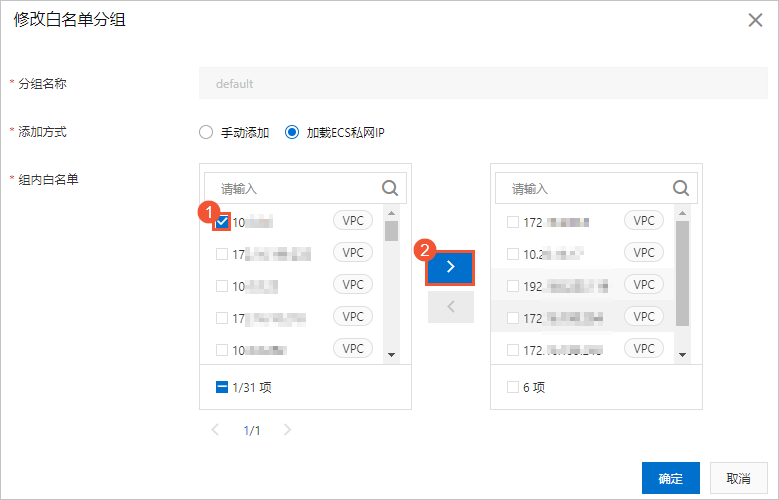<br>说明为便于定位目标IP地址，您可以将鼠标指针悬浮在对应的IP地址上，系统将展示该IP地址所属的ECS实例ID和名称。</td>
     </tr>
   </table>

6. 单击**确定**。

<a id="section-6-5"></a>

## 6.5. 连接实例

本文以redis-cli连接为例，帮助您快速连接实例。

> **说明**
>
> 如需了解其他连接方式，请参见连接指南。

**前提条件**

- ECS实例与Redis实例同属于经典网络。

- 已将ECS实例的内网IP地址添加至Redis实例的白名单中。具体操作，请参见设置白名单。

- ECS实例的操作系统为Linux，且已安装原生Redis，安装方法，请参见Redis社区版官网。

**操作步骤**

1. 登录ECS设备的命令行，然后执行如下格式的命令连接至Redis实例：

   ```text
   src/redis-cli -h <hostname> -p <port>
   ```

   表 1. 参数说明

   | 参数 | 获取方式 |
   | --- | --- |
   | &lt;hostname&gt; | Redis实例的内网连接地址，可在<strong>实例信息</strong>页面中的<strong>连接信息</strong>区域框中获取。 |
   | &lt;port&gt; | Redis实例的端口号，默认为6379。 |

   命令示例

   ```text
   src/redis-cli -h r-bp1zxszhcgatnx****.redis.rds.aliyuncs.com -p 6379
   ```

2. 执行下述格式的命令完成密码验证：

   ```text
   AUTH <password>
   ```

   &lt;password>：账号的密码，在创建实例时已设置，如果忘记密码，可重置密码，具体操作，请参见修改密码。

   命令示例：

   ```text
   AUTH testaccount:Rp829dlwa
   ```

   验证成功后，返回如下结果：

   ```text
   OK
   ```

<a id="section-7"></a>

# 7.实例管理

<a id="section-7-1"></a>

## 7.1. 修改密码

如果您忘记密码、需要修改旧密码，或者在创建实例时没有设置密码，您可以重新设置实例的密码。

**操作步骤**

1. 登录云数据库Tair（兼容Redis）控制台。

2. 在**实例列表**页，单击目标实例ID。

3. 在**账号管理**页，单击右上角**修改密码**。

4. 在弹出的对话框中，输入旧密码和新密码。

   > **说明**
   >
   > - 如果您忘记旧密码，在该对话框中单击**忘记旧密码**，然后设置新密码。
   >
   > - 密码长度为8~32位。
   >
   > - 密码需包含大写字母、小写字母、数字和特殊字符中的至少三种，支持的特殊字符为 `!@#$%^&*()_+-=` 。

5. 单击**确定**。

<a id="section-7-2"></a>

## 7.2. 设置白名单

为了数据库的安全稳定，在开始使用Redis实例前，您需要将访问数据库的IP地址或者IP段加到目标实例的白名单中。

**背景信息**

> **说明**
>
> 正确使用白名单可以让Redis得到高级别的访问安全保护，建议您定期维护白名单。

**操作步骤**

1. 登录云数据库Tair（兼容Redis）控制台。

2. 在**实例列表**页，单击目标实例ID。

3. 在左侧导航栏，单击**白名单设置**。

4. 找到目标白名单分组，单击**修改**。

   > **说明**
   >
   > 您也可以单击**添加白名单分组**创建一个新的分组。分组名称长度为2~32个字符，由小写字母、数字或下划线组成，需以小写字母开头，以小写字母或数字结尾。

5. 在弹出的对话框中，根据要执行的操作，选择下述操作步骤：

   | 要执行的操作 | 操作步骤 |
   | --- | --- |
   | 手动修改白名单 | 手动填写IP地址或IP地址段。<br>图 1. 手动修改白名单<br>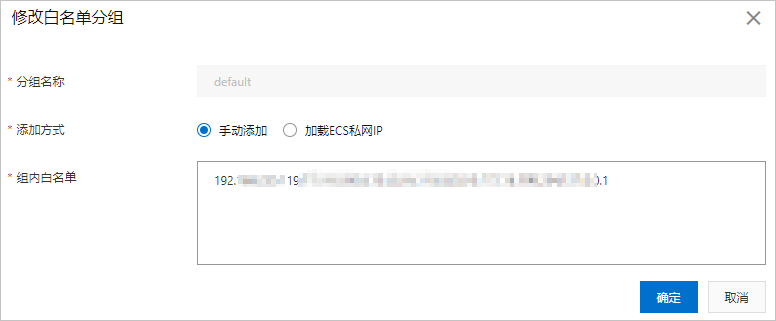<br>说明<br>• IP地址以英文逗号分隔，不可重复，最多1000个。支持格式为10.23.12.24（具体IP地址）、10.23.12.24/24（CIDR模式，即无类域间路由，/24表示地址中前缀的长度，范围为1~32）。<br>• 地址中的前缀长度设置为0（例如0.0.0.0/0、127.0.0.1/0）表示允许所有IP地址访问该实例，存在高安全风险，请谨慎设置。 |
   | 加载ECS实例的内网IP地址为白名单 | i. 单击<strong>加载ECS私网IP</strong>。ii. 根据业务需求选中对应的IP地址。<br>图 2. 加载ECS内网IP地址<br><br>说明为便于定位目标IP地址，您可以将鼠标指针悬浮在对应的IP地址上，系统将展示该IP地址所属的ECS实例ID和名称。 |
   | 清除白名单分组 | 当某个白名单分组中的所有IP地址均需要移除且需要保留该分组时，您可以单击<strong>清除白名</strong><strong>单分组</strong>来完成该操作。 |

6. 单击**确定**。

<a id="section-7-3"></a>

## 7.3. 变更配置

本文介绍如何变更Tair（兼容Redis）实例配置。

**注意事项**

- 业务影响：变配操作完成后，系统将自动执行数据迁移和切换。切换过程中会出现秒级的连接闪断。

- 执行时机：为避免影响业务正常运行，强烈建议您在业务低峰期执行本操作。

- 前置准备：请确保您的应用程序具备重连机制，以应对短暂的连接中断。

**操作步骤**

1. 登录云数据库Tair（兼容Redis）控制台。

2. 在**实例列表**页，选择目标实例，单击操作列中的**变更配置**。

3. 在跳转到的页面中，选择需要的配置。

   <table>
     <tr>
       <th width="152">配置</th>
       <th>说明</th>
     </tr>
     <tr>
       <td>版本类型</td>
       <td>支持选择<strong>企业版</strong>或<strong>社区版</strong>。<br>说明仅社区版5.0实例支持配置该参数。</td>
     </tr>
     <tr>
       <td>芯片架构</td>
       <td>选择目标芯片类型。</td>
     </tr>
     <tr>
       <td>架构类型</td>
       <td>选择实例的架构类型。<br>• <strong>标准版</strong>：采用主备架构，不仅能提供高性能的缓存服务，还支持数据高可靠。<br>• <strong>集群版</strong>：可轻松突破Redis自身单线程瓶颈，满足大容量、高性能的业务需求。<br>• <strong>读写分离</strong>：可提供高可用、高性能、高灵活的读写分离服务，解决热点数据集中及高并发读取的业务需求，最大化地节约用户运维成本。</td>
     </tr>
     <tr>
       <td>实例规格</td>
       <td>选择实例的规格。不同的实例规格提供的最大连接数和最大内网带宽不同。<br>重要若当前规格已下线，请根据控制台提示选择其他可用规格进行变配。</td>
     </tr>
     <tr>
       <td>最大带宽变配策略</td>
       <td>支持选择<strong>与新规格变配一致</strong>或<strong>保持当前最大带宽</strong>。<br>说明仅部署模式为<strong>经典</strong>支持该配置。</td>
     </tr>
   </table>

4. 单击**提交**。

**补充说明**

- 变配时长：具体耗时取决于实例的数据量大小及网络状况，通常在几分钟到几十分钟不等。

- 监控观察：变配完成后，建议立即观察实例的监控指标（如CPU使用率、连接数、延迟等），确保新配置满足业务预期。

<a id="section-7-4"></a>

## 7.4. 节点管理

本文为您介绍在节点管理中如何开启读写分离功能和修改备节点数量。

**前提条件**

实例需同时满足以下条件：

- 部署模式为云原生。经典实例可转云原生部署模式后，再执行本操作。

- 实例类型为高可用。

**开启读写分离**

1. 登录云数据库Tair（兼容Redis）控制台。

2. 在**实例列表**页，单击目标实例ID。

3. 在左侧导航栏，单击**节点管理**。

4. 打开**读写分离**开关。

5. 在弹出的面板中，确认实例配置信息。

6. 单击**确定**。

**增删备节点**

1. 登录云数据库Tair（兼容Redis）控制台。

2. 在**实例列表**页，单击目标实例ID。

3. 在左侧导航栏，单击**节点管理**。

4. 在<strong>节点分布（可用区）</strong>区域，单击**修改**。

5. 在弹出的面板中，增加或减少备节点数量。

6. 单击**确定**，完成增删备节点。

<a id="section-7-5"></a>

## 7.5. 转云原生部署模式

**云原生**部署模式兼容更高的Redis版本，同时也具有更加灵活的架构配置，您可以参考本文将**经典**版实例转换为**云原生**版实例。

> **重要**
>
> - 实例执行切换时会出现1次30秒内的连接闪断，请确保应用具有重连机制。
>
> - 为保障变配后的新实例能快速追平原实例的增量数据，同时规避因DNS缓存引起的数据双写，在变配过程中，通常情况下实例会出现1分钟内的只读状态，而在写入量较大的场景下只读状态的时间可能增加，因此建议在业务低峰期进行变配。

**注意事项**

- 转换后，实例ID、实例连接地址、账号密码、IP白名单配置等均保持不变，实例中的数据不会丢失。

- 目前仅支持企业版5.0转云原生版，若原实例为其他版本，需先将实例升级大版本至企业版 5.0，再执行本操作。

  > **说明**
  >
  > 如果Tair5有公网地址不支持转云原生版。

**操作步骤**

1. 登录云数据库Tair（兼容Redis）控制台。

2. 在**实例列表**页，单击目标实例ID。

3. 在基础信息页面右上角，单击**转云原生**。

4. 在变更实例页面，填写芯片架构、实例规格、分片数量等基本信息。

5. 单击**提交**，等待实例状态变为**使用中**，代表转换成功。

<a id="section-7-6"></a>

## 7.6. 管理分片数量

本文为您介绍如何增加或减少分片数量。

**注意事项**

- 分片数量调整只支持集群版，标准版不支持分片调整。

- 实例的总分片数最少为2个，单次操作的分片数上限为64个。

- 在增加分片时，实例会自动进行数据重平衡，但如果单次增加的分片数过少，会导致重平衡速度过慢、扩容效率低。建议单次增加的分片数不少于当前总分片数的1/6（向上取整），例如：

  - 当前实例为8分片，建议增加分片数不少于2个（8/6=1.33，向上取整为2）。

  - 当前实例为64分片，建议增加分片数不少于11个。

  - 当前实例为100分片，建议增加分片数不少于17个。

**操作步骤**

1. 登录云数据库Tair（兼容Redis）控制台。

2. 在**实例列表**页，单击目标实例ID。

3. 在页面右上角，选择**分片调整**，根据业务选择**增加分片数量**或**减少分片数量**。

   - 增加分片

     <ol type="a">

     <li>

     单击**增加分片**，在弹出框中，设置分片的数量。支持增加1~64个。

     </li>

     <li>

     单击**确定**。

     </li>

     </ol>

   - 删除分片

     > **重要**
     >
     > 删除分片会降低实例的总容量和实例性能，同时也会造成对应分片上的连接强制断开，请谨慎执行。如需执行，请确保应用具备重连机制。

     <ol type="a">

     <li>

     输入要删除的分片数量并选择删除策略。

     删除策略支持**立即删除**和**可维护时间内执行**（推荐）。

     </li>

     <li>

     单击**确定**。分片立即删除，数据自动迁移至其他分片。

     </li>

     </ol>

<a id="section-7-7"></a>

## 7.7. 设置可维护时间段

您可以修改默认的可维护时间段，使云数据库 Tair（兼容 Redis）实例在业务低峰期间进行维护。

**背景信息**

在阿里云平台上，为保云数据库 Tair（兼容 Redis）实例的稳定性，后端系统会不定期对实例、机器进行维护操作。

实例维护当天，为保障整个维护过程的稳定性，实例会在所设置的可运维时间前一段时间，进入实例维护中的状态，当实例处于该状态时，数据库本身正常的数据访问不会受到任何影响，但控制台上涉及该实例的变更类的功能均暂无法使用（如变更配置），查询类如性能监控等可以正常查阅。

> **说明**
>
> 在进入实例所设置的可运维时间后，实例在维护期间可能会发生闪断，建议您尽量选择业务低峰期为运维时间段。

**操作步骤**

1. 登录云数据库Tair（兼容Redis）控制台。

2. 在**实例列表**页，单击目标实例ID。

3. 在**配置信息**区域框中，单击**可维护时间段**右侧的**修改**。

4. 选择可维护时间段。

   > **说明**
   >
   > 时间段以北京时间为基准。

<a id="section-7-8"></a>

## 7.8. 迁移可用区

您可以将实例迁移至同一地域内的其他可用区。迁移可用区后，实例的所有属性、规格配置和连接地址都不会改变。

**前提条件**

- 实例未开启透明数据加密TDE功能。

- 迁移的目标可用区和当前实例的可用区处于同一地域。

- 专有网络的实例在操作迁移可用区之前，请确保目标可用区已创建相应的虚拟交换机，如需创建请参见<strong>《专有网络VPC用户指南》</strong>中的<strong>《创建专有网络》</strong>和<strong>《创建交换机》</strong>章节。

- 实例不可具备公网连接地址，如果已申请了公网连接地址，请先释放。

**注意事项**

- 专有网络的实例在迁移可用区时，不允许更换实例的专有网络。

- 迁移所需时间和网络、任务队列、数据量大小等多种因素有关，请在业务低峰期执行迁移可用区操作。

- 迁移可用区过程中会有30秒闪断，请确保应用程序具有重连机制。

**操作步骤**

1. 登录云数据库Tair（兼容Redis）控制台。

2. 在**实例列表**页，单击目标实例ID。

3. 在**基本信息**区域框中，单击**迁移可用区**。

4. 根据实例网络类型，在**迁移可用区**页面，配置对应的参数。

   - 专有网络

     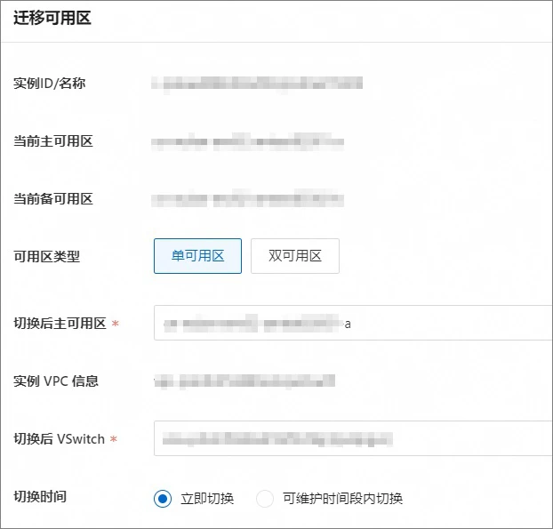

     <table>
       <tr>
         <th width="152">参数</th>
         <th>参数说明</th>
       </tr>
       <tr>
         <td>可用区类型</td>
         <td>选择迁移的可用区类型，支持单可用区和双可用区。</td>
       </tr>
       <tr>
         <td>切换后主可用区</td>
         <td>目标主可用区。</td>
       </tr>
       <tr>
         <td>切换后备可用区</td>
         <td>目标备可用区。<br>说明仅选择双可用区时支持该配置。</td>
       </tr>
       <tr>
         <td>切换后 VSwitch</td>
         <td>目标VSwitch。</td>
       </tr>
       <tr>
         <td>切换时间</td>
         <td>选择开始迁移可用区的时间。<br>• <strong>立即切换</strong>：参数配置完成后，系统立即开始迁移可用区任务。<br>• <strong>可维护时间段内切换</strong>：在维护时间段迁移可用区。维护时间段设置，请参见设置可维护时间段。</td>
       </tr>
     </table>

   - 经典网络

     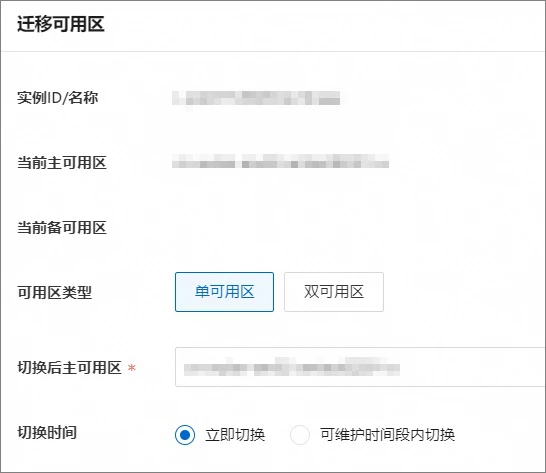

     <table>
       <tr>
         <th width="137">参数</th>
         <th>参数说明</th>
       </tr>
       <tr>
         <td>可用区类型</td>
         <td>选择迁移的可用区类型，支持单可用区和双可用区。</td>
       </tr>
       <tr>
         <td>切换后主可用区</td>
         <td>目标主可用区。</td>
       </tr>
       <tr>
         <td>切换后备可用区</td>
         <td>目标备可用区。<br>说明仅选择双可用区时支持该配置。</td>
       </tr>
       <tr>
         <td>切换时间</td>
         <td>选择开始迁移可用区的时间。<br>• <strong>立即切换</strong>：参数配置完成后，系统立即开始迁移可用区任务。<br>• <strong>可维护时间段内切换</strong>：在维护时间段迁移可用区。维护时间段设置，请参见设置可维护时间段。</td>
       </tr>
     </table>

5. 单击**确定**。

   切换完成后，可在基本信息，可用区一栏查看切换详情。

<a id="section-7-9"></a>

## 7.9. 迁移网络可用区

您可以将实例网络迁移至同一地域内的其他可用区。迁移网络可用区后，实例的所有属性、规格配置等信息都不会改变。

**注意事项**

- 切换过程会导致现有数据库连接断开，必须确保应用具备自动重连机制。

- 务必在业务低峰期执行，避免产生其他故障问题。

- 建议遵循“先切换数据主备角色，确认数据可用后，再切换网络可用区”的顺序。

- 确认目标可用区网络资源充足，且安全组/白名单策略允许新机房的应用访问。

**操作步骤**

1. 登录云数据库Tair（兼容Redis）控制台。

2. 在**实例列表**页，单击目标实例ID。

3. 在**基本信息**区域框中，单击**迁移网络可用区**。

4. 在**迁移网络可用区**页面，配置对应的参数。

   - 专有网络

     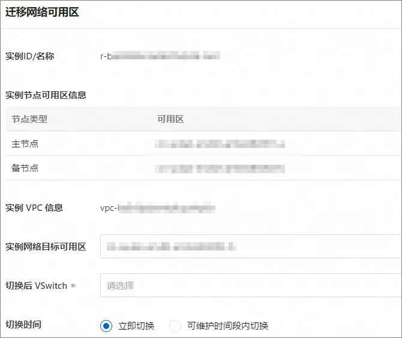

     <table>
       <tr>
         <th width="168">参数</th>
         <th>参数说明</th>
       </tr>
       <tr>
         <td>实例网络目标可用区</td>
         <td>目标网络可用区。</td>
       </tr>
       <tr>
         <td>切换后 VSwitch</td>
         <td>目标VSwitch。</td>
       </tr>
       <tr>
         <td>切换时间</td>
         <td>选择开始迁移网络可用区的时间。<br>• <strong>立即切换</strong>：参数配置完成后，系统立即开始迁移网络可用区任务。<br>• <strong>可维护时间段内切换</strong>：在维护时间段迁移网络可用区。维护时间段设置，请参见设置可维护时间段。</td>
       </tr>
     </table>

   - 经典网络

     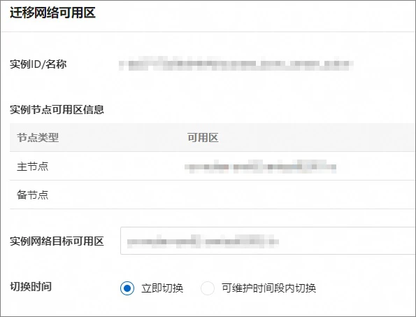

     <table>
       <tr>
         <th width="168">参数</th>
         <th>参数说明</th>
       </tr>
       <tr>
         <td>实例网络目标可用区</td>
         <td>目标网络可用区。</td>
       </tr>
       <tr>
         <td>切换时间</td>
         <td>选择开始迁移网络可用区的时间。<br>• <strong>立即切换</strong>：参数配置完成后，系统立即开始迁移网络可用区任务。<br>• <strong>可维护时间段内切换</strong>：在维护时间段迁移网络可用区。维护时间段设置，请参见设置可维护时间段。</td>
       </tr>
     </table>

5. 单击**确定**。

<a id="section-7-10"></a>

## 7.10. 大版本升级

云数据库 Tair（兼容 Redis）新版本实例通常具备更高性能、更安全稳定、更多功能等特性，同时新版本实例可以获得更好的技术支持。若您希望使用新版本实例，无需额外创建实例，您可以在控制台升级实例的大版本。

**升级影响**

- 在申请资源、升级备库或同步数据阶段，对实例服务无影响。

- 在实例切换或主备切换阶段，实例将存在60秒以内的只读状态（等待数据完全同步），同时会发生秒级的连接闪断，请在业务低峰期进行升级。

- 升级完成后，源实例的实例ID、连接地址、数据、白名单配置以及已创建的账号密码配置等均不会改变，请您确保应用程序具备重连机制。

**注意事项**

- 若实例已创建DTS任务，会导致升级失败，请暂停DTS任务后重试。

- 若经典版实例，架构类型为集群架构，且申请了直连模式地址，请释放直连地址后重试。

- 若云原生集群架构实例的连接模式为直连模式，则无法升级大版本。

- 若实例未释放经典网络，会导致升级失败，请释放经典网络后重试（释放经典网络后无法再申请，推荐使用更快、更安全的VPC网络）。

- 升级大版本可能会导致实例内存使用量略有变化（约为-10%至10%），具体变化取决于不同版本存储元数据的差异。建议在升级大版本之前，确保实例内存使用量低于80%，以避免升级后实例内存达到较高水平。

**操作步骤**

1. 登录云数据库Tair（兼容Redis）控制台。

2. 在**实例列表**页，单击目标实例ID。

3. 在**实例信息**页，配置信息区域内，单击**版本**右侧**升级**中的**大版本升级**。

   > **说明**
   >
   > 若无法单击**大版本升级**按钮，表示该实例不支持升级版本。

4. 在**大版本升级**对话框，选择升级的目标版本和执行时间。

   > **说明**
   >
   > 实例版本升级或主备切换时，实例将产生60秒以内的只读状态和秒级的连接闪断。推荐您选择**可维护时间内执行**，系统会在实例的可维护时间段内执行实例切换操作，可最大限度地降低影响。

5. 单击**确定**。

<a id="section-7-11"></a>

## 7.11. 升级小版本

云数据库 Tair（兼容 Redis）不断对内核进行深度优化，修复安全漏洞，提升服务稳定性。您可以在控制台上一键将内核升级至最新版本。

**背景信息**

> **说明**
>
> - 请在业务低峰期进行升级，并确保应用程序具备重连机制。
>
> - 系统会自动检测实例的内核版本，如果当前版本已经是最新版本，控制台**基本信息**页的**小版本升级**按钮将呈现为灰色状态。

**操作步骤**

1. 登录云数据库Tair（兼容Redis）控制台。

2. 在**实例列表**页，单击目标实例ID。

3. 在**实例信息**页，配置信息区域内，单击**版本**右侧**升级**中的**小版本升级**。

4. 在**小版本升级**对话框，单击**立即升级**。

   操作完成后，您可以在**基本信息**页中查看实例状态，实例的状态显示为小版本升级中。等状态变回使用中，即表示升级完成。

<a id="section-7-12"></a>

## 7.12. 超级带宽（多VIP管理）

云原生集群版实例的内核带宽随分片数线性增长，单条连接地址的接入点（VIP）带宽上限可能成为实际吞吐瓶颈。超级带宽通过为连接地址分配多个VIP接入点，突破单接入点带宽上限，实现集群版实例带宽翻倍。您可以在创建实例后，在控制台开启并管理该功能。

**功能简介**

超级带宽为每个连接地址分配多个接入点（VIP），实际带宽的计算方式如下：

**实际带宽 = min（VIP数 × 每VIP上限，分片内核带宽）**

即VIP侧容量与内核侧容量取短板。当限速明细中出现**VIP侧瓶颈**时，可通过新增VIP提升带宽；当显示**内核侧上限**时，说明VIP容量已充足，如需更高带宽可开启**分片带宽扩容**。VIP的IP地址由系统自动分配，无需手动操作，客户端无需修改连接方式。

**限制与说明**

- 单实例Multi VIP总数不能超过8个；单次新增或删除最多4个。

- 每条连接地址的IPv4、IPv6接入点（VIP）数独立配置，避免不必要的资源浪费。

- 多条连接地址各自独立承载完整带宽；流量不均时，实际峰值可能低于配置上限。

- 主IP不支持删除；删除VIP后对应接入地址将不再承接流量。

**适用范围**

仅同时满足以下条件的实例支持超级带宽：

- 部署模式为**云原生**。

- 架构类型为**集群版**。

- 连接模式为**代理模式**。直连模式的流量不经过VIP接入点，多VIP无法生效。

**进入超级带宽页面**

1. 登录云数据库Tair（兼容Redis）控制台。

2. 在左侧导航栏，单击**实例列表**，找到目标实例，单击实例ID进入实例详情页。

3. 在左侧导航栏，单击**网络与安全 > 超级带宽**。

页面顶部展示**内核带宽上限（分片侧）**（分片数×96 MB/s，扩容后×2）与VIP推荐上限，以及**连接地址 ·限速明细**区域。限速明细按协议（IPv4、IPv6）展示**DNS接入数**、**VIP限速**、**内核限速**、**实际带宽**与瓶颈标签。

**新增VIP**

1. 在**连接地址 · 限速明细**区域，单击**新增VIP**。

2. 在**新增VIP**弹窗，选择**主连接地址**与**IP版本**，设置**创建数量**，单击**确认新增**。

   弹窗中会提示当前协议下已有VIP数量、数量上限与本次可新增的最大数量（例如“当前已有1个，最多8个，本次最多可新增4个”）。

**删除VIP**

1. 在**连接地址 · 限速明细**区域，单击**删除VIP**。

2. 在**删除VIP**弹窗，选择**主连接地址**与**IP版本**，设置**删除数量**，单击**确认删除**。

您也可以展开**查看接入点IP列表**，在目标接入点的**操作**列单击**删除**，精确删除指定VIP。主IP不支持删除。

**开启分片带宽扩容**

开启**分片带宽扩容**后，每分片内核带宽由96 MB/s翻倍至192 MB/s，适用于批量导入、大Key等高带宽场景。

1. 在超级带宽页面，打开**分片带宽扩容**开关。

2. 页面出现待提交变更提示，单击**提交变更**。

3. 在**确认提交变更**弹窗核对带宽变化，单击**确认提交**。

变更约30秒生效，期间业务不中断。提交前可单击**放弃**撤销待提交变更。

**订正每接入点带宽上限**

当接入点实际使用的负载均衡规格与默认值不符时，可在**VIP订正速率**区域修改**每接入点带宽上限**（默认5,000 MB/s），使限速明细的计算与实际环境一致。

1. 展开页面底部**VIP订正速率**区域，单击**每接入点带宽上限**后的**修改**。

2. 输入新的带宽上限值，单击**保存**。限速明细将按新值重新计算。

<a id="section-7-13"></a>

## 7.13. 设置SSL加密

为提高链路的安全性，您可以启用SSL（Secure Sockets Layer）加密，然后安装SSL CA证书到您的应用服务。SSL加密功能在传输层对网络连接进行加密，在提升通信数据安全性的同时，保证数据的完整性。

**注意事项**

- 本操作将触发重启实例，实例会出现秒级的连接闪断，请在业务低峰期执行该操作并确保应用具备重连机制。

- SSL加解密会消耗CPU资源，可能导致实例CPU使用率上升及读写延迟轻微增加，需确保实例当前CPU水位有足够缓冲空间。

- 开启SSL加密会增加连接建立时的握手延迟，可能会增加整体网络响应时间，建议必要时再开启。

- 云端证书有效期为1年，到期前将通过多渠道提醒并自动更新，支持配置计划时间自定义更新时段。

**前提条件**

- 实例需为以下类型之一：

  - Tair（兼容Redis）经典版集群架构实例（4.0、5.0、6.0、7.0）。

  - Tair（兼容Redis）云原生版6.0、7.0实例。

- 对于云原生版7.0实例，您需要先完成TLS加密开关的开启，具体操作请参见《云数据库Tair（兼容Redis） 运维指南》中“开启云数据库 Tair（兼容 Redis） TLS（SSL）加密开关”章节完成配置。

**操作步骤步骤一**

1. 登录云数据库Tair（兼容Redis）控制台。

2. 在**实例列表**页，单击目标实例ID。

3. 在左侧导航栏，单击**TLS(SSL)设置**。

**步骤二**

请根据实例类型，选择对应的配置方式。

**云原生版实例**

本章节适用于云原生版实例。

**使用限制**

- 连接中断风险：开启required（强制加密）模式后，所有未配置SSL/TLS的明文连接请求将被立即拒绝。请务必确保所有客户端应用已完成证书配置及连接串更新，否则将导致业务连接大面积失败。

- 性能损耗预警：强制TLS加密会增加CPU计算开销，可能导致实例CPU使用率上升及读写延迟轻微增加。建议在开启前评估实例当前CPU水位，预留足够的性能缓冲空间。

- 兼容性要求：云原生版7.0仅支持TLS 1.2及以上版本。若客户端或驱动不支持TLS 1.2及以上版本，将无法建立连接，需升级客户端。

  1. 在TLS(SSL)配置页面，配置相关信息。

     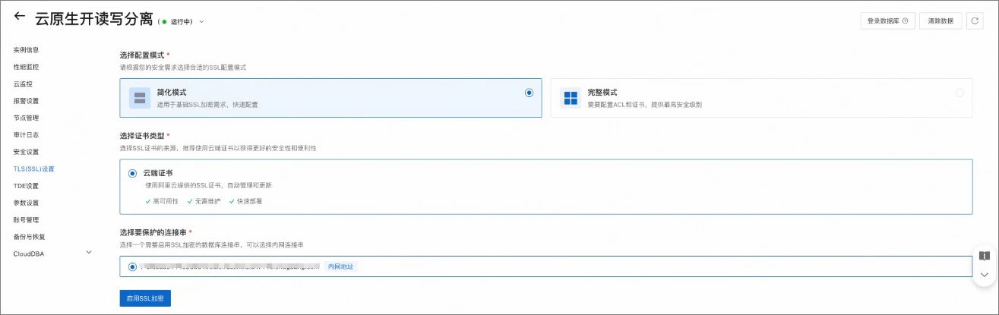

     <table>
       <tr>
         <th width="168">名称</th>
         <th>描述</th>
       </tr>
       <tr>
         <td>选择配置模式</td>
         <td>• <strong>简化模式</strong>：无需配置客户端证书等信息。适用于基础SSL加密需求，快速配置。<br>• <strong>完整模式</strong>：需要配置ACL和证书，提供最高安全级别。<br>说明需选择TLS最低版本：默认版本为TLSv1.2，还支持TLSv1、TLSv1.1、TLSv1.3。</td>
       </tr>
       <tr>
         <td>选择证书类型</td>
         <td>选择SSL证书的来源，使用云端证书以获得更好的安全性和便利性。</td>
       </tr>
       <tr>
         <td>选择要保护的连接串</td>
         <td>选择一个需要启用SSL加密的数据库连接串，可以选择内网连接串。</td>
       </tr>
     </table>

  2. 单击**启用SSL加密**。

     > **说明**
     >
     > - 完成操作后，需等待一段时间后，系统才能显示操作结果。
     >
     > - 您还可通过**修改有效期**、**下载CA证书**和**版本名称**等按钮执行相关的操作。
     >
     >   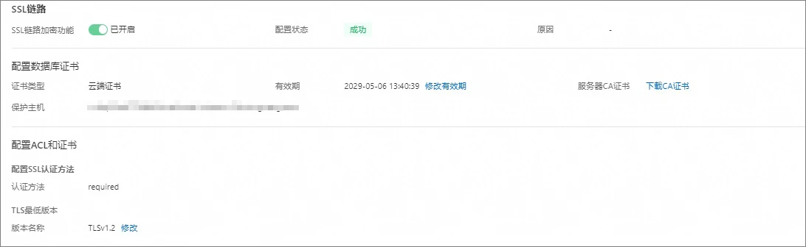

**经典版集群架构实例**

本章节适用于经典版集群架构4.0、5.0、6.0、7.0实例。

1. 在**TLS(SSL)设置**页，单击**SSL证书信息**右侧的滑块。

   > **说明**
   >
   > 如果提示版本不支持，请升级小版本。具体操作，请参见升级小版本。

2. 完成开通。

   - 完成操作后，需等待一段时间后，系统才能显示操作结果。

   - 您还可通过右上方的**更新证书**和**下载CA证书**等按键执行相关的操作。

   - TLS 最低版本默认版本为TLSv1.2，还支持TLSv1和TLSv1.1。

**关闭SSL加密**

1. 登录云数据库Tair（兼容Redis）控制台。

2. 在**实例列表**页，单击目标实例ID。

3. 在左侧导航栏，单击**TLS(SSL)设置**。

4. 在**TLS(SSL)设置**页，单击滑块关闭SSL加密。

<a id="section-7-14"></a>

## 7.14. 开启透明数据加密TDE

云数据库 Tair（兼容 Redis）支持透明数据加密TDE（Transparent Data Encryption），可对RDB数据文件执行加密和解密。您可以通过控制台启用TDE功能，对RDB数据进行自动加密和解密，以满足提升数据安全性及合规需要。

**前提条件**

- 实例为企业版。

- 已部署密钥管理服务（KMS）。

**背景信息**

云数据库 Tair（兼容 Redis）的TDE功能可以将RDB数据文件在写入磁盘之前进行加密，从磁盘读入内存时进行解密，具有不额外占用存储空间、无需更改客户端应用程序等优势。

图 1. TDE加密


**影响**

由于开启TDE功能后无法关闭，在开启前，需要评估对业务的影响，具体如下：

- 暂不支持缓存分析操作。

- 暂不支持通过DTS或Redis-shake执行迁移或同步数据。

**注意事项**

- TDE的开启粒度为实例级别，不支持Key（键）或DB（库）粒度的控制。

- TDE加密对象为数据落盘文件（即RDB备份文件，如dump.rdb）。

- TDE所使用的密钥，由密钥管理服务KMS（Key Management Service）统一生成和管理，云数据库Redis不提供加密所需的密钥和证书。

**操作步骤**

1. 登录云数据库Tair（兼容Redis）控制台。

2. 在**实例列表**页，单击目标实例ID。

3. 在左侧导航栏，单击**TDE设置**。

4. 打开**TDE状态**右侧的开关。

5. 在弹出的对话框中，选择**使用自动生成密钥**或**使用自定义密钥**，然后单击**确定**。

   > **说明**
   >
   > - 如果您的阿里云账号首次为实例开启TDE功能，请根据页面弹出的提示完成授权（授权的角色为**AliyunRdsInstanceEncryptionDefaultRole**），授权完成后才可以使用相关密钥服务。
   >
   > - 关于自定义密钥的创建方法，请参见<strong>《密钥管理服务》用户手册</strong>的**创建密钥**章节。

   设置完成后，实例状态改为**TDE修改中**，当实例状态转变为**运行中**表示操作完成。

<a id="section-7-15"></a>

## 7.15. 清除数据

您可以在控制台清除Redis实例中的数据，可选的清除对象为所有数据或过期数据。

**操作步骤**

1. 登录云数据库Tair（兼容Redis）控制台。

2. 在**实例列表**页，单击目标实例ID。

3. 在**实例信息**页，单击页面右上角**清除数据**。

4. 在弹出的对话框中，选择待清除的对象：

   - **所有数据**：此操作将执行**FLUSHALL**命令清除该实例所有数据，清除后数据无法找回。

   - **过期数据**：此操作将执行**SCAN**命令批量清除该实例的所有过期数据，清除后数据无法找回。您可选择**立即执行**或在**可维护时间内执行**。更多信息，请参见设置可维护时间段。

   > **警告**
   >
   > 通过该功能清除的数据无法找回且即刻生效，同时会对线上业务造成影响，请谨慎执行。推荐在执行清除前对Redis实例的数据进行备份，具体操作，请参见手动备份。

5. 单击**确定**。

   > **说明**
   >
   > 如选择为清除**所有数据**，单击**确定**后，您还可以选择是否备份数据。

<a id="section-7-16"></a>

## 7.16. 释放实例

根据业务需求，您可以随时释放Tair实例，本文介绍如何释放Tair实例。

**操作步骤**

1. 登录云数据库Tair（兼容Redis）控制台。

2. 在**实例列表**页，选择目标实例**操作**列的**释放**。

   > **警告**
   >
   > 建议您在释放实例前先备份数据，谨慎进行后续步骤。

3. 在**释放实例**对话框中单击**释放**。

   释放后，实例会在回收站保留一段时间，您可在回收站中对实例进行解锁、重建操作，更多信息请参见实例回收站管理。

<a id="section-7-17"></a>

## 7.17. 实例回收站管理

实例回收站展示已释放的实例，支持恢复、立即销毁等操作。

**注意事项**

- 实例释放后将在回收站保留7天，超过保留期将永久销毁且不可恢复。

- 恢复将通过克隆原实例数据并新建实例完成，并非恢复至原实例。

- 恢复后原有数据保持不变，但连接地址（域名）可能发生变更，恢复完成后需确认新的连接地址并更新客户端配置。

- 公网地址不会自动恢复。

**操作步骤**

1. 登录云数据库Tair（兼容Redis）控制台。

2. 在左侧导航栏，单击**回收站**。

3. 在回收站的实例列表中，执行**恢复**或**立即销毁**操作。

   - **恢复**：将原实例的所有数据和部分配置（端口号等）恢复到新创建的实例中，但您需要重新配置**可用区**、**网络类型**和**IP类型**等信息。

     > **说明**
     >
     > 如果**网络类型**为**专有网络**，则还需配置专有网络VPC和交换机VSwitch。

   - **立即销毁**：彻底删除实例及其数据备份。

     > **警告**
     >
     > 销毁实例会同时销毁该实例的所有备份，包括常规数据备份、归档备份和日志备份，且销毁后无法恢复，请谨慎操作。

<a id="section-7-18"></a>

## 7.18. 账号管理

云数据库 Tair（兼容 Redis）支持在一个实例中创建20个账号，您可以根据使用情况给这些账号设置相应的权限，从而更加灵活地管理实例，最大限度地避免误操作。

**前提条件**

实例的引擎版本为Redis 4.0或以上。

> **说明**
>
> 非Redis4.0版本实例只有默认账号，默认账号在创建实例时同时创建，如果需要修改默认账号密码，请参见修改密码。

**背景信息**

账号管理支持创建账号、删除账号、重置密码、修改权限等功能。创建账号后，当连接上数据库时，即可在命令行中使用账号及相应权限对数据库进行操作。

**创建账号**

1. 登录云数据库Tair（兼容Redis）控制台。

2. 在**实例列表**页，单击目标实例ID。

3. 在**实例信息**页，单击左侧导航栏中**账号管理**。

   > **说明**
   >
   > 若发现Redis 4.0或以上版本的实例左侧导航栏没有账号管理，请尝试升级小版本。

4. 在**账号管理**页，单击右侧的**创建账号**。

5. 在弹出的对话框中，进行如下设置并单击**确定**。

   <table>
     <tr>
       <th width="89">设置</th>
       <th>说明</th>
     </tr>
     <tr>
       <td>账号</td>
       <td>账号需以字母开头，由小写字母、数字、下划线组成，长度不超过16个字符。</td>
     </tr>
     <tr>
       <td>权限设置</td>
       <td>设置该账号所拥有的权限，分为只读、读写和复制三种。拥有复制权限的账号在连接Redis实例时可以使用SYNC/PSYNC命令。<br>说明目前仅4.0以上的Redis标准版实例支持创建有复制权限的账号。</td>
     </tr>
     <tr>
       <td>密码</td>
       <td>设置该账号的密码。密码长度为8~32个字符，需至少包含大写字母、小写字母、数字和特殊字符中的三种。支持的特殊字符为：<code> !@#$%^&amp;*()+-=_ </code>。</td>
     </tr>
     <tr>
       <td>确认密码</td>
       <td>再次输入密码进行确认。</td>
     </tr>
     <tr>
       <td>备注说明</td>
       <td>填入账号的备注信息。</td>
     </tr>
   </table>

<a id="section-7-19"></a>

## 7.19. 重启实例

您可以在控制台的实例列表中重启Redis实例。

**操作步骤**

1. 登录云数据库Tair（兼容Redis）控制台。

2. 在目标实例的**操作**列，选择**重启实例**。

   > **警告**
   >
   > 重启过程中实例会发生秒级闪断，请您在业务低峰期重启，并确保应用程序具备重连机制。

3. 在弹出的对话框中，选择重启时间，勾选**我已了解重启风险**并单击**确认**。

   - 立即重启：单击确认后实例重启。

   - 可维护时间窗重启：在设置的可维护时间段重启。

<a id="section-7-20"></a>

## 7.20. 导出实例列表

您可以在控制台导出实例列表，在线下管理云上的实例资源。

**操作步骤**

1. 登录云数据库Tair（兼容Redis）控制台。

2. 在**实例列表**页，单击右上方的导出实例列表

   图标。

   

3. 在**导出资源列表**对话框勾选需要导出的信息，之后单击**确认**。

   > 单击**确认**后，浏览器开始下载.csv格式的实例列表，您可以用文本编辑工具查看该文
   >
   > **说明**
   >
   > 件。

<a id="section-7-21"></a>

## 7.21. 管理标签

在实例数量较多的情况下，您可以创建多个标签，为实例绑定不同的标签对其进行分类，后续可通过标签筛选实例。

**注意事项**

- 标签由一对键值组成，键在同账号同地域下唯一，值无此限制。

  > **说明**
  >
  > 一个键可以有0到多个值。

- 每个实例最多可以绑定20个标签。

- 单次绑定或者解绑的标签数量不能超过20个。

**新建标签**

1. 登录云数据库Tair（兼容Redis）控制台。

2. 选中要批量添加标签的实例，单击实例列表下方的**批量绑定标签**。

3. 在**标签键**和**标签值**下方的文本框中输入需要绑定的标签键和标签值。

   如果您需要绑定已有标签，也可以单击对应文本框，在下拉列表中选择已有标签键和标签值。

4. 单击**确定**。

**根据标签筛选实例**

1. 登录云数据库Tair（兼容Redis）控制台。

2. 在**实例列表**页面，单击**高级筛选**。

3. 在**标签筛选**右侧，下拉选择需要筛选的**标签键**和**标签值**。

   > **说明**
   >
   > - 新建标签或更新现有标签后，需要先刷新页面才能在标签列表中看到更新后的标签。
   >
   > - 如需清除筛选，单击已选中标签右侧的
   >
   >   图标。
   >
   >   

4. 单击**搜索**。

<a id="section-7-22"></a>

## 7.22. Lua脚本支持与限制

云数据库 Tair（兼容 Redis）实例支持Lua相关命令。

**Lua命令支持**

Lua脚本的使用进一步提升了Redis的性能。通过内嵌对Lua环境的支持，Redis解决了长久以来不能高效地处理CAS（check-and-set）命令的缺点， 并且可以通过组合使用多个命令， 轻松实现以前很难实现或者不能高效实现的模式。

> **说明**
>
> 如果发现无法执行Eval相关命令，例如提示 `ERR command eval not support for normal user` ，请尝试升级小版本。升级过程中会出现短暂的闪断和实例只读，建议在业务低峰期进行。

**Lua使用限制**

为了保证脚本里面的所有操作都在相同slot进行，云数据库Redis集群版本会对Lua脚本做如下限制：

- 所有key都应该由KEYS数组来传递，**redis.call/pcall**中调用的Redis命令，key的位置必须是KEYS array（不能使用Lua变量替换KEYS），否则直接返回错误信息：

  ```text
  -ERR bad lua script for redis cluster, all the keys that the script uses should be passed using the KEYS array\r\n
  ```

- 所有key必须在一个slot上，否则返回错误信息：

  ```text
  -ERR eval/evalsha command keys must be in same slot\r\n
  ```

- 调用必须要带有key，否则直接返回错误信息：

  ```text
  -ERR for redis cluster, eval/evalsha number of keys can't be negative or zero\r\n
  ```

- 不支持发布订阅命令，包括**PSUBSCRIBE**、**PUBSUB**、**PUBLISH**、**PUNSUBSCRIBE**、**SUBSCRIBE**和**UNSUBSCRIBE**。

- 不支持UNPACK函数。

> **说明**
>
> 如果用户能够在代码中确保所有操作都在相同slot，且希望打破Redis集群的Lua限制，可以在控制台将script_check_enable修改为0，则后端不会对脚本进行校验。

<a id="section-8"></a>

# 8.连接指南

<a id="section-8-1"></a>

## 8.1. 查看连接地址

您可以在控制台上查看Tair实例的私网和公网连接地址。

**注意事项**

- Tair实例的VIP地址在服务维护或者变动时可能发生变化，建议在业务中使用连接地址访问Tair实例，确保连接的可用性。

- 公网连接地址的申请方式参见申请连接地址。

**操作步骤**

1. 登录云数据库Tair（兼容Redis）控制台。

2. 在**实例列表**页，单击目标实例ID。

3. 在**连接信息**区域框，可查看到实例的私网连接地址和公网连接地址。

   > **说明**
   >
   > 实例默认提供私网连接地址，如需公网连接地址，请手动申请。具体操作，请参见申请连接地址。

**开启或关闭IPv6**

1. 登录云数据库Tair（兼容Redis）控制台。

2. 在**实例列表**页，单击目标实例ID。

3. 在连接信息区域，打开或关闭**是否应用了IPv6**列下的开关。

   > **重要**
   >
   > 关闭IPv6连接地址后，通过IPv6地址访问数据库的业务连接将会中断，可能对正在运行的业务造成影响。请确认当前没有业务通过IPv6地址连接数据库后再进行操作。

4. 单击**确定**。

<a id="section-8-2"></a>

## 8.2. 申请连接地址

本文介绍如何申请连接地址。

**操作步骤**

1. 登录云数据库Tair（兼容Redis）控制台。

2. 在**实例列表**页，单击目标实例ID。

3. 在**连接信息**区域框中，选择目标**网络类型**，在**操作**列单击**申请连接地址**。

4. 在弹出的对话框中，输入自定义的连接地址和端口，然后单击**确定**。

   > **说明**
   >
   > - 自定义连接地址由字母，数字组成，小写字母开头，长度为8~64个字符。
   >
   > - 自定义端口范围为1024~65535，默认为6379。
   >
   > - 申请连接地址后需要将访问的IP地址添加到白名单才可以访问Redis实例，添加白名单请参见设置白名单。

5. 在**实例信息**页，查看**连接信息**的连接地址。

   > **说明**
   >
   > 如果不再需要连接地址，单击相关连接地址右侧的**释放连接地址**按钮释放该地址。

<a id="section-8-3"></a>

## 8.3. 修改连接地址

云数据库 Tair（兼容 Redis）支持修改实例的内网和外网连接地址。更换实例时，您可以将新实例的连接地址修改为原实例的连接地址，无需对应用程序进行其它修改。

**前提条件**

实例状态为运行中。

**操作步骤**

1. 登录云数据库Tair（兼容Redis）控制台。

2. 在**实例列表**页，单击目标实例ID。

3. 在**实例信息**页，单击**连接信息**右侧的**修改连接地址**。

4. 在**修改连接地址**对话框，配置以下信息。

   <table>
     <tr>
       <th width="90">配置</th>
       <th>说明</th>
     </tr>
     <tr>
       <td>连接类型</td>
       <td>选择<strong>私网地址</strong>和<strong>公网地址</strong>。</td>
     </tr>
     <tr>
       <td>连接地址</td>
       <td>设置连接地址前缀。<br>• 由小写字母、数字组成。<br>• 以小写字母开头。<br>• 长度为8~64个字符。</td>
     </tr>
     <tr>
       <td>端口</td>
       <td>设置端口，可设置范围为1024~65535。<br>说明公网地址的端口号修改生效大约需要10分钟，请生效后刷新页面查看最新端口号信息。</td>
     </tr>
   </table>

5. 在**修改连接地址**对话框，选择**连接类型**，修改**连接地址**的前缀和**端口**，之后单击**确定**。

   > **说明**
   >
   > - 自定义前缀需由小写英文字母和数字组成，以小写字母开头，长度为8~64字符。
   >
   > - 自定义端口范围为1024~65535，默认为6379。

<a id="section-8-4"></a>

## 8.4. 使用直连模式连接实例

如果您申请直连访问地址，您可以将原生Redis集群架构无缝迁移到该实例中。云数据库 Tair（兼容Redis）的直连地址支持原生Redis Cluster协议，在该模式下，客户端将直接与数据服务器进行连接，服务的响应速度非常快。

**前提条件**

- 申请直连地址。具体操作请参见申请连接地址。

- 将客户端地址加入白名单。具体操作请参见设置白名单。

- 使用Jedis、PhpRedis等支持Redis Cluster的客户端。

  > **说明**
  >
  > - 使用不支持Redis Cluster的客户端，可能因客户端无法重定向请求到正确的分片而获取不到需要的数据。
  >
  > - 您可以在Redis官网的客户端列表里查找更多支持Redis Cluster的客户端。

- 客户端所在的ECS与实例在同一VPC网络（相同VPC ID）。

**背景信息**

开启直连访问时，云数据库 Tair（兼容 Redis）会为该集群中所有数据分片的master节点分配一个虚拟IP（VIP）地址。客户端在首次向直连地址发送请求前会通过DNS服务器解析直连地址，解析结果会是集群中一个随机数据分片的VIP。获取到VIP后，客户端即可通过Redis Cluster协议操作该集群中的数据。下图展示了直连模式下集群的服务架构。

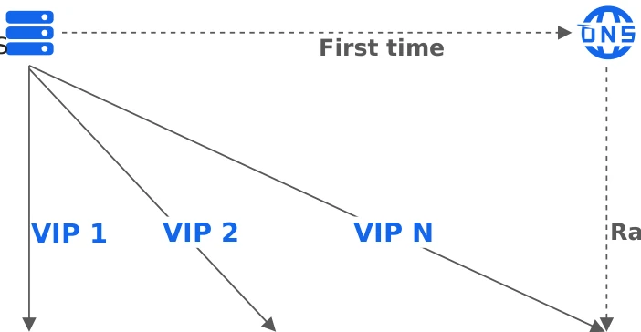

ECS

DN

**Random**

**Data Shard 1**

**Data Shard 2**

**Data Shard N**

Master 1

Master 2

Master N

...

HA

HA

HA

Replica 1

Replica 2

Replica N

**注意事项**

- 由于部署架构的不同，相对标准架构来说，集群架构的实例在原生Redis命令的支持上有一定的区别（例如Lua存在使用限制等）。

- 直连模式支持使用**SELECT**命令切换DB，但部分Redis Cluster客户端（例如stackExchange.redis）不支持**SELECT**命令，如果使用该类客户端则只能使用DB0。

- 直连地址仅支持通过阿里云内网访问。

- 直连方式仅限集群版本。

**redis-cli**

使用集群架构直连地址连接实例。

> **重要**
>
> 使用直连地址连接时必须添加-c参数，否则会导致连接失败。

```text
./redis-cli -h r-bp1zxszhcgatnx****.redis.rds.aliyuncs.com -p 6379 -c
```

完成密码验证。

```text
AUTH testaccount:Rp829dlwa
```

关于redis-cli的更多介绍请参见使用redis-cli连接。

**Jedis**

本示例的Jedis版本为4.3.0，更多信息请参见Jedis。

- 使用自定义连接池（推荐）

  ```java
  import redis.clients.jedis.*;
  import java.util.HashSet;
  import java.util.Set;

  public class DirectTest {
      private static final int DEFAULT_TIMEOUT = 2000;
      private static final int DEFAULT_REDIRECTIONS = 5;
      private static final ConnectionPoolConfig config = new ConnectionPoolConfig();

      public static void main(String args[]) {
          // 最⼤连接数，由于直连模式为客户端直接连接某个数据库分⽚，需要保证：业务机器数 * MaxTotal
  < 单个数据库分⽚的最⼤连接数。
          config.setMaxTotal(30);
          // 最⼤空闲连接数, 根据业务需要设置。
          config.setMaxIdle(20);
          config.setMinIdle(15);

          // 开通直连访问时申请到的直连地址。String host = "r-
  bp1xxxxxxxxxxxx.redis.rds.aliyuncs.com";
          int port = 6379;
          // 实例的密码。String password = "xxxxx";

          Set<HostAndPort> jedisClusterNode = new HashSet<HostAndPort>();
          jedisClusterNode.add(new HostAndPort(host, port));
          JedisCluster jc = new JedisCluster(jedisClusterNode, DEFAULT_TIMEOUT, 
  DEFAULT_TIMEOUT, DEFAULT_REDIRECTIONS,
              password, "clientName", config);

          jc.set("key", "value");
          jc.get("key");

          jc.close();     // 当应⽤退出，需销毁资源时，调⽤此⽅法。此⽅法会断开连接、释放资源。
      }
  }
  ```

- 使用默认连接池

  ```java
  import redis.clients.jedis.ConnectionPoolConfig;
  import redis.clients.jedis.HostAndPort;
  import redis.clients.jedis.JedisCluster;
  import java.util.HashSet;
  import java.util.Set;

  public class DirectTest{
      private static final int DEFAULT_TIMEOUT = 2000;
      private static final int DEFAULT_REDIRECTIONS = 5;
      private static final ConnectionPoolConfig DEFAULT_CONFIG = new 
  ConnectionPoolConfig();

      public static void main(String args[]){

          // 开通直连访问时申请到的直连地址。String host = "r-
  bp1xxxxxxxxxxxx.redis.rds.aliyuncs.com";
          int port = 6379;
          String password = "xxxx";

          Set<HostAndPort>  jedisClusterNode = new HashSet<HostAndPort>();
          jedisClusterNode.add(new HostAndPort(host, port));

          JedisCluster jc = new JedisCluster(jedisClusterNode, DEFAULT_TIMEOUT, 
  DEFAULT_TIMEOUT,
              DEFAULT_REDIRECTIONS,password, "clientName", DEFAULT_CONFIG);

          jc.set("key","value");
          jc.get("key");

          jc.close();     // 当应⽤退出，需销毁资源时，调⽤此⽅法。此⽅法会断开连接、释放资源。
      }
  }
  ```

**PhpRedis**

本示例的PhpRedis版本为5.3.7，更多信息请参见PhpRedis。

```php
<?php// 直连地址和连接端⼝。$array = ['r-bp1xxxxxxxxxxxx.redis.rds.aliyuncs.com:6379'];
 // 连接密码。$pwd = "xxxx";
 
 // 使⽤密码连接集群。$obj_cluster = new RedisCluster(NULL, $array, 1.5, 1.5, true, $pwd);
 
 // 输出连接结果。var_dump($obj_cluster);
 
 if ($obj_cluster->set("foo", "bar") == false) {
     die($obj_cluster->getLastError());
 }
 $value = $obj_cluster->get("foo");
 echo $value;
 ?>
```

**redis-py**

本示例的Python版本为3.9、redis-py版本为4.4.1，更多信息请参见redis-py。

```text
# !/usr/bin/env python# -*- coding: utf-8 -*-from redis.cluster import RedisCluster
# 分别将host和port的值替换为实例的连接地址、端⼝号。
host = 'r-bp10noxlhcoim2****.redis.rds.aliyuncs.com'
port = 6379# 分别将user和pwd的值替换为实例的账号和密码。
user = 'testaccount'
pwd = 'Rp829dlwa'
rc = RedisCluster(host=host, port=port, username=user, password=pwd)
# 连接建立后即可执⾏数据库操作，下述代码为您提供SET与GET的使⽤示例。
rc.set('foo', 'bar')
print(rc.get('foo'))
```

**Spring Data Redis**

本示例使用Maven方式进行构建，您也可以手动下载Lettuce或Jedis客户端。

1. 添加下述Maven依赖。

   ```xml
   <?xml version="1.0" encoding="UTF-8"?>
   <project xmlns="http://maven.apache.org/POM/4.0.0" 
   xmlns:xsi="http://www.w3.org/2001/XMLSchema-instance"
            xsi:schemaLocation="http://maven.apache.org/POM/4.0.0 
   https://maven.apache.org/xsd/maven-4.0.0.xsd">
       <modelVersion>4.0.0</modelVersion>
       <parent>
           <groupId>org.springframework.boot</groupId>
           <artifactId>spring-boot-starter-parent</artifactId>
           <version>2.4.2</version>
           <relativePath/> <!-- lookup parent from repository -->
       </parent>
       <groupId>com.aliyun.tair</groupId>
       <artifactId>spring-boot-example</artifactId>
       <version>0.0.1-SNAPSHOT</version>
       <name>spring-boot-example</name>
       <description>Demo project for Spring Boot</description>
       <properties>
           <java.version>1.8</java.version>
       </properties>
       <dependencies>
           <dependency>
               <groupId>org.springframework.boot</groupId>
               <artifactId>spring-boot-starter-web</artifactId>
           </dependency>
           <dependency>
               <groupId>org.springframework.boot</groupId>
               <artifactId>spring-boot-starter-test</artifactId>
               <scope>test</scope>
           </dependency>
           <dependency>
               <groupId>org.springframework.boot</groupId>
               <artifactId>spring-boot-starter-data-redis</artifactId>
           </dependency>
           <dependency>
               <groupId>redis.clients</groupId>
               <artifactId>jedis</artifactId>
           </dependency>
           <dependency>
               <groupId>io.lettuce</groupId>
               <artifactId>lettuce-core</artifactId>
               <version>6.3.0.RELEASE</version>
           </dependency>
           <dependency>
               <groupId>io.netty</groupId>
               <artifactId>netty-transport-native-epoll</artifactId>
               <version>4.1.100.Final</version>
               <classifier>linux-x86_64</classifier>
           </dependency>
       </dependencies>
       <build>
           <plugins>
               <plugin>
                   <groupId>org.springframework.boot</groupId>
                   <artifactId>spring-boot-maven-plugin</artifactId>
               </plugin>
           </plugins>
       </build>
   </project>
   ```

2. 在Spring Data Redis编辑器中输入下述代码，然后根据注释提示修改代码。

   本示例的Spring Data Redis版本为2.4.2。

   - （推荐）Spring Data Redis With Jedis

     ```text
     @Bean
          JedisConnectionFactory redisConnectionFactory() {
              List<String> clusterNodes = Arrays.asList("r-
     bp10noxlhcoim2****.redis.rds.aliyuncs.com:6379");
              RedisClusterConfiguration redisClusterConfiguration = new 
     RedisClusterConfiguration(clusterNodes);
              redisClusterConfiguration.setUsername("user");
              redisClusterConfiguration.setPassword("password");
            
      
              JedisPoolConfig jedisPoolConfig = new JedisPoolConfig();
              // 最⼤空闲连接数，由于直连模式为客户端直接连接某个数据库分⽚，需要保证：业务机器数 * 
     MaxTotal < 单个数据库分⽚的最⼤连接数。
              jedisPoolConfig.setMaxTotal(30);
              // 最⼤空闲连接数, 根据业务需要设置。
              jedisPoolConfig.setMaxIdle(20);
              // 关闭 testOn[Borrow|Return]，防⽌产⽣额外的 PING
              jedisPoolConfig.setTestOnBorrow(false);
              jedisPoolConfig.setTestOnReturn(false);
      
              return new JedisConnectionFactory(redisClusterConfiguration, 
     jedisPoolConfig);
          }
     ```

   - Spring Data Redis With Lettuce

     > **重要**
     >
     > - Lettuce 默认配置可能导致实例变更时应用延迟增加和无法访问等问题。
     >
     > - Lettuce 的版本应大于等于 6.3.0.RELEASE。

     ```text
          /**
          *  TCP_KEEPALIVE打开，并且配置三个参数分别为:
          *  TCP_KEEPIDLE = 30
          *  TCP_KEEPINTVL = 10
          *  TCP_KEEPCNT = 3
          */private static final int TCP_KEEPALIVE_IDLE = 30;

         /**
          * TCP_USER_TIMEOUT参数可以避免在故障宕机场景下，Lettuce持续超时的问题。
          * refer: https://github.com/lettuce-io/lettuce-core/issues/2082
          */private static final int TCP_USER_TIMEOUT = 30;

         @Beanpublic LettuceConnectionFactory redisConnectionFactory() {
             List<String> clusterNodes = Arrays.asList("r-
     bp10noxlhcoim2****.redis.rds.aliyuncs.com:6379");
             RedisClusterConfiguration redisClusterConfiguration = new 
     RedisClusterConfiguration(clusterNodes);
             redisClusterConfiguration.setUsername("user");
             redisClusterConfiguration.setPassword("password");

             // Config TCP KeepAliveSocketOptions socketOptions = 
     SocketOptions.builder()
                 .keepAlive(KeepAliveOptions.builder()
                     .enable()
                     .idle(Duration.ofSeconds(TCP_KEEPALIVE_IDLE))
                     .interval(Duration.ofSeconds(TCP_KEEPALIVE_IDLE / 3))
                     .count(3)
                     .build())
                 .tcpUserTimeout(TcpUserTimeoutOptions.builder()
                     .enable()
                     .tcpUserTimeout(Duration.ofSeconds(TCP_USER_TIMEOUT))
                     .build())
                 .build();

             ClusterTopologyRefreshOptions topologyRefreshOptions = 
     ClusterTopologyRefreshOptions.builder()
                 .enablePeriodicRefresh(Duration.ofSeconds(60))
                 .dynamicRefreshSources(false)
                 .enableAllAdaptiveRefreshTriggers() 
                 .adaptiveRefreshTriggersTimeout(Duration.ofSeconds(15)).build();

             LettuceClientConfiguration lettuceClientConfiguration = 
     LettuceClientConfiguration.builder().
                 clientOptions(ClusterClientOptions.builder()
                     .socketOptions(socketOptions)
                     .validateClusterNodeMembership(false) 
                     .topologyRefreshOptions(topologyRefreshOptions).build()).build();

             return new LettuceConnectionFactory(redisClusterConfiguration, 
     lettuceClientConfiguration);
         }
     ```

**.Net**

本示例的.Net版本为6.0，StackExchange.Redis版本为2.6.90。

```csharp
using StackExchange.Redis;

class RedisConnSingleton {
    // 分别设置实例的连接地址、端⼝号和⽤户名、密码。private static ConfigurationOptions configurationOptions = ConfigurationOptions.Parse("r-
bp10noxlhcoim2****.redis.rds.aliyuncs.com:6379,user=testaccount,password=Rp829dlwa,connec
imeout=2000");
    //the lock for singletonprivate static readonly object Locker = new object();
    //singletonprivate static ConnectionMultiplexer redisConn;
    //singletonpublic static ConnectionMultiplexer getRedisConn()
    {
        if (redisConn == null)
        {
            lock (Locker)
            {
                if (redisConn == null || !redisConn.IsConnected)
                {
                    redisConn = ConnectionMultiplexer.Connect(configurationOptions);
                }
            }
        }
        return redisConn;
    }
}

class Program
{
    static void Main(string[] args)
    {
        ConnectionMultiplexer cm = RedisConnSingleton.getRedisConn();
        var db = cm.GetDatabase();
        db.StringSet("key", "value");
        String ret = db.StringGet("key");
        Console.WriteLine("get key: " + ret);
    }
}
```

**node-redis**

本示例的Node.js版本为19.4.0、node-redis版本为4.5.1。

```javascript
import { createCluster } from 'redis';

// 分别设置实例的端⼝号、连接地址、账号、密码，// 注意，在url中配置⽤户和密码之后，还需要在defaults中
设置全局⽤户和密码，// ⽤于其余节点的认证，否则将出现NOAUTH的错误。const cluster = createCluster(
{
    rootNodes: [{
        url: 'redis://testaccount:Rp829dlwa@r-
bp10noxlhcoim2****.redis.rds.aliyuncs.com:6379'
    }],
    defaults: {
        username: 'testaccount',
        password: 'Rp829dlwa'
    }
});

cluster.on('error', (err) => console.log('Redis Cluster Error', err));

await cluster.connect();

await cluster.set('key', 'value');
const value = await cluster.get('key');
console.log('get key: %s', value);

await cluster.disconnect();
```

**Go-redis**

本示例的Go版本为1.19.7、Go-redis版本为9.5.1。

> **重要**
>
> 请使用Go-redis v9.0及以上版本。

```go
package main

import (
 "context""fmt""github.com/go-redis/redis/v9"
)

var ctx = context.Background()

func main() {
 rdb := redis.NewClusterClient(&redis.ClusterOptions{
  Addrs:    []string{"r-bp10noxlhcoim2****.redis.rds.aliyuncs.com:6379"},
  Username: "testaccount",
  Password: "Rp829dlwa",
 })

 err := rdb.Set(ctx, "key", "value", 0).Err()
 if err != nil {
  panic(err)
 }

 val, err := rdb.Get(ctx, "key").Result()
 if err != nil {
  panic(err)
 }
 fmt.Println("key", val)
}
```

**Lettuce**

> **重要**
>
> - Lettuce 默认配置可能导致实例变更时应用延迟增加和无法访问等问题。
>
> - Lettuce 的版本应大于等于 6.3.0.RELEASE。

1. 添加下述Maven依赖。

   ```xml
           <dependency>
               <groupId>io.lettuce</groupId>
               <artifactId>lettuce-core</artifactId>
               <version>6.3.0.RELEASE</version>
           </dependency>
           <dependency>
               <groupId>io.netty</groupId>
               <artifactId>netty-transport-native-epoll</artifactId>
               <version>4.1.65.Final</version>
               <classifier>linux-x86_64</classifier>
           </dependency>
   ```

2. 添加下述代码，并根据注释提示修改代码。

   ```java
   import io.lettuce.core.RedisURI;
   import io.lettuce.core.SocketOptions;
   import io.lettuce.core.cluster.ClusterClientOptions;
   import io.lettuce.core.cluster.ClusterTopologyRefreshOptions;
   import io.lettuce.core.cluster.RedisClusterClient;
   import io.lettuce.core.cluster.api.StatefulRedisClusterConnection;

   import java.time.Duration;

   public class ClusterDemo {
       /**
        *  TCP_KEEPALIVE 打开，并且配置三个参数分别为：
        *  TCP_KEEPIDLE = 30
        *  TCP_KEEPINTVL = 10
        *  TCP_KEEPCNT = 3
        */private static final int TCP_KEEPALIVE_IDLE = 30;

       /**
        * TCP_USER_TIMEOUT可以避免在故障宕机场景下Lettuce持续超时的问题。
        * refer: https://github.com/lettuce-io/lettuce-core/issues/2082
        */private static final int TCP_USER_TIMEOUT = 30;

       public static void main(String[] args) throws Exception {
           // 分别将host、port和password的值替换为实际的实例信息。String host = "r-
   bp1ln3c4kopj3l****.redis.rds.aliyuncs.com";
           int port = 6379;
           String password = "Da****3";

           RedisURI redisURI = RedisURI.Builder.redis(host)
                   .withPort(port)
                   .withPassword(password)
                   .build();

           ClusterTopologyRefreshOptions refreshOptions = 
   ClusterTopologyRefreshOptions.builder()
                   .enablePeriodicRefresh(Duration.ofSeconds(60))
                   .dynamicRefreshSources(false)
                   .enableAllAdaptiveRefreshTriggers() 
                   .adaptiveRefreshTriggersTimeout(Duration.ofSeconds(15)).build();

           // Config TCP KeepAliveSocketOptions socketOptions = 
   SocketOptions.builder()
                   .keepAlive(SocketOptions.KeepAliveOptions.builder()
                           .enable()
                           .idle(Duration.ofSeconds(TCP_KEEPALIVE_IDLE))
                           .interval(Duration.ofSeconds(TCP_KEEPALIVE_IDLE/3))
                           .count(3)
                           .build())
                   .tcpUserTimeout(SocketOptions.TcpUserTimeoutOptions.builder()
                           .enable()
                           .tcpUserTimeout(Duration.ofSeconds(TCP_USER_TIMEOUT))
                           .build())
                   .build();

           RedisClusterClient redisClient = RedisClusterClient.create(redisURI);
           redisClient.setOptions(ClusterClientOptions.builder()
                   .socketOptions(socketOptions)
                   .validateClusterNodeMembership(false) 
                   .topologyRefreshOptions(refreshOptions).build());

           StatefulRedisClusterConnection<String, String> connection = 
   redisClient.connect();
           connection.sync().set("key", "value");
           System.out.println(connection.sync().get("key"));
       }
   }
   ```

3. 执行上述代码，预期会返回如下结果：

   ```text
   value
   ```

Lettuce 相关参数说明如下：

| 参数 | 默认配置 | 说明 | 修改配置 |
| --- | --- | --- | --- |
| enablePeriodicRefr esh(Duration refreshPeriod) | 关闭 | 启用后将进行周期性集群拓扑刷新。 | 建议配置为 60s。开启此配置可以使不活跃的长连接也能及时更新本地拓扑。 |
| dynamicRefreshSo urces(boolean dynamicRefreshSo urces) | true | 为 true 时，使用 Cluster Nodes 命令返回的所有节点进行集群拓扑刷新；为false 时，使用指定节点地址。 | 如无特殊需求，应配置为 false。启用此选项会向所有节点发送 CLUSTER NODES 命令，增加服务端压力。此外，在变配期间，使用 endpoint 地址更新拓扑通常更为迅速可靠。 |
| enableAllAdaptiveR efreshTriggers() | 关闭 | 启用后，当收到 MOVED 消息时，会自动刷新集群拓扑。 | 必须启用。启用此配置才能确保拓扑变更后 Lettuce 能及时更新本地拓扑。 |
| adaptiveRefreshTri ggersTimeout(Dura tion timeout) | 30s | 限制集群拓扑刷新频率，在指定时间内仅允许一次刷新。 | 建议配置为 15s。由于集群中多个节点的拓扑变更并非原子操作，Lettuce 触发的初次拓扑刷新可能会失败，因此需要快速进行后续刷新以确保拓扑正确更新。当应用数量较少时，由于不会有大量客户端同时发送 CLUSTER NODES 命令，可以适当降低该值，以实现更快的拓扑表收敛时间。 |
| validateClusterNod eMembership(bool ean validateClusterNod eMembership) | true | 在拓扑变化时，Lettuce 使用 MOVED将命令重定向到正确的节点。启用此配置后，只允许将命令重定向到CLUSTER NODES 输出中已知的节点。 | 必须配置为 false。配置为 false 可以防止在集群拓扑变更后，本地拓扑刷新完成前无法访问新增节点。 |

<a id="section-8-5"></a>

## 8.5. 使用客户端程序连接

云数据库 Tair（兼容 Redis）与原生Redis完全兼容，连接数据库的方式也基本相同，您可以根据自身应用特点选用任何兼容Redis协议的客户端程序。本文列举一些常见的客户端程序的代码示例，帮助您快速连接。

**前提条件**

已将ECS实例的内网IP地址或本地主机的外网IP地址加入实例白名单，具体操作，请参见设置白名单。

**获取连接信息**

在使用客户端程序连接实例时，通常您需要获取以下信息并设置在代码中：

| 需获取的信息 | 获取方式 |
| --- | --- |
| 实例的连接地址 | 可在<strong>实例信息</strong>页面中的<strong>连接信息</strong>区域框中获取到。<br>说明Redis实例支持多种连接地址，推荐使用专有网络连接，可获得更高的安全性和更低的网络延迟。 |
| 端口号 | 端口号默认为6379。 |
| 实例的账号（部分客户端程序无需设置） | 实例默认会创建一个以实例ID命名的账号（例如r-bp10noxlhcoim2\*\*\*\*）。 |
| 账号的密码 | 在创建实例时已设置，如果忘记密码，可重置密码，具体操作，请参见修改密码。 |

**常见客户端程序**

关于实例支持的客户端列表，请参见Redis Clients。

- Jedis客户端

- PhpRedis客户端

- redis-py客户端

- C或C++客户端

- .net客户端

- node-redis客户端

- C#客户端StackExchange.Redis

**Jedis客户端**

1. 下载并安装Jedis客户端。具体操作，请参见Jedis使用说明。

2. 根据业务需求选择连接方式。

   - JedisPool连接池连接（推荐）

     <ol type="a">

     <li>

     打开Eclipse客户端，创建一个Project并配置pom文件，具体内容如下：

     ```xml
     <dependency>
     <groupId>redis.clients</groupId>
     <artifactId>jedis</artifactId>
     <version>2.7.2</version>
     <type>jar</type>
     <scope>compile</scope>
     </dependency>
     ```

     </li>

     <li>

     在Project中输入下述代码添加相关应用。

     ```java
     import org.apache.commons.pool2.PooledObject;
     import org.apache.commons.pool2.PooledObjectFactory;
     import org.apache.commons.pool2.impl.DefaultPooledObject;
     import org.apache.commons.pool2.impl.GenericObjectPoolConfig;
     import redis.clients.jedis.HostAndPort;
     import redis.clients.jedis.Jedis;
     import redis.clients.jedis.JedisPool;
     import redis.clients.jedis.JedisPoolConfig;
     ```

     </li>

     </ol>

     <ol type="i" start="100">

     <li>

     根据Jedis客户端版本，在Project中输入下述代码，然后根据注释提示修改代码。

     > **说明**
     >
     > 关于如何获取Redis实例的连接地址和密码，请参见获取连接信息。

     - Jedis 2.7.2版本

       ```text
       JedisPoolConfig config = new JedisPoolConfig();
       //最⼤空闲连接数，需⾃⾏评估，不超过Redis实例的最⼤连接数
       config.setMaxIdle(200);
       //最⼤连接数，需⾃⾏评估，不超过Redis实例的最⼤连接数
       config.setMaxTotal(300);
       config.setTestOnBorrow(false);
       config.setTestOnReturn(false);
       String host = "*.aliyuncs.com";
       String password = "密码";
       JedisPool pool = new JedisPool(config, host, 6379, 3000, password);
       Jedis jedis = null;
       try {
       jedis = pool.getResource();
       /// ... do stuff here ... for example
       jedis.set("foo", "bar");
       String foobar = jedis.get("foo");
       jedis.zadd("sose", 0, "car");
       jedis.zadd("sose", 0, "bike");
       Set<String> sose = jedis.zrange("sose", 0, -1);
       } finally {
       if (jedis != null) {
       jedis.close();
       }
       }
       /// ... when closing your application:
       pool.destroy();
       ```

     - Jedis 2.6或Jedis 2.5版本

       ```text
       JedisPoolConfig config = new JedisPoolConfig();
       //最⼤空闲连接数，需⾃⾏评估，不超过Redis实例的最⼤连接数
       config.setMaxIdle(200);
       //最⼤连接数，需⾃⾏评估，不超过Redis实例的最⼤连接数
       config.setMaxTotal(300);
       config.setTestOnBorrow(false);
       config.setTestOnReturn(false);
       String host = "*.aliyuncs.com";
       String password = "密码";
       JedisPool pool = new JedisPool(config, host, 6379, 3000, password);
       Jedis jedis = null;
       boolean broken = false;
       try {
            jedis = pool.getResource();
            /// ... do stuff here ... for example
            jedis.set("foo", "bar");
            String foobar = jedis.get("foo");
            jedis.zadd("sose", 0, "car");
            jedis.zadd("sose", 0, "bike");
            Set<String> sose = jedis.zrange("sose", 0, -1);
       } 
       catch(Exception e)
       {
            broken = true;
       } finally {
       if (broken) {
            pool.returnBrokenResource(jedis);
       } else if (jedis != null) {
            pool.returnResource(jedis);
        }
       }
       ```

     </li>

     </ol>

   - Jedis单连接（不推荐，单次超时后无法自动恢复）

     打开Eclipse客户端，创建一个Project，输入下述代码，然后根据注释提示修改代码。

     > **说明**
     >
     > 关于如何获取Redis实例的连接地址和密码，请参见获取连接信息。

     ```java
     import redis.clients.jedis.Jedis;
     public class jedistest {
     public static void main(String[] args) {
     try {
          String host = "xx.kvstore.aliyuncs.com";//控制台显示访问地址
          int port = 6379;
          Jedis jedis = new Jedis(host, port);
          //鉴权信息
          jedis.auth("password");//password
          String key = "redis";
          String value = "aliyun-redis";
          //select db默认为0
          jedis.select(1);
          //set⼀个key
          jedis.set(key, value);
          System.out.println("Set Key " + key + " Value: " + value);
          //get 设置进去的key
          String getvalue = jedis.get(key);
          System.out.println("Get Key " + key + " ReturnValue: " + getvalue);
          jedis.quit();
          jedis.close();
     } 
     catch (Exception e) {
      e.printStackTrace();
      }
     }
     }
     ```

3. 运行上述Project，在Eclipse的控制台输出如下运行结果则表示您已成功连接至云数据库Redis。

   ```text
   Set Key redis Value aliyun-redis
   Get Key redis ReturnValue aliyun-redis
   ```

**PhpRedis客户端**

1. 下载并安装PhpRedis客户端。具体操作，请参见PhpRedis使用说明。

2. 在PHP编辑器中输入下述代码，然后根据注释提示修改代码。

   > **说明**
   >
   > 关于如何获取Redis实例的连接地址、账号和密码，请参见获取连接信息。

   ```php
   <?php
    /* 这⾥替换为连接的实例连接地址和端⼝ */
    $host = "r-bp10noxlhcoim2****.redis.rds.aliyuncs.com";
    $port = 6379;
    /* 这⾥替换为实例ID和实例的密码 */
    $user = "test_username";
    $pwd = "test_password";
    $redis = new Redis();
    if ($redis->connect($host, $port) == false) {
            die($redis->getLastError());
      }
    if ($redis->auth($pwd) == false) {
            die($redis->getLastError());
     }
     /* 认证后就可以进⾏数据库操作，详情请参⻅https://github.com/phpRedis/phpredis */
    if ($redis->set("foo", "bar") == false) {
            die($redis->getLastError());
    }
    $value = $redis->get("foo");
    echo $value;
    ?>
   ```

3. 执行上述代码即可完成连接。

   更多信息，请参见官方文档 。

**redis-py客户端**

1. 下载并安装redis-py客户端。具体操作，请参见redis-py使用说明。

2. 在Python编辑器中输入下述代码，然后根据注释提示修改代码。

   > **说明**
   >
   > 关于如何获取Redis实例的连接地址和密码，请参见获取连接信息。

   ```python
   #!/usr/bin/env python
   #-*- coding: utf-8 -*-
   import redis
   #替换host的值为实例的连接地址，替换port的值为端⼝。
   host = 'localhost'
   port = 6379
   #这⾥替换为实例password
   pwd = 'test_password'
   r = redis.StrictRedis(host=host, port=port, password=pwd)
   #连接建立后就可以进⾏数据库操作，详情请参⻅https://github.com/andymccurdy/redis-py
   r.set('foo', 'bar');
   print r.get('foo')
   ```

3. 执行上述代码即可完成连接。

**C或C++客户端**

1. 执行下述命令，下载并编译安装Ｃ客户端。

   ```bash
   git clone https://github.com/redis/hiredis.git
   cd hiredis
   make
   sudo make install
   ```

2. 在C或C++编辑器中输入下述代码，然后根据注释提示修改代码。

   > **说明**
   >
   > 关于如何获取Redis实例的连接地址和密码，请参见获取连接信息。

   ```cpp
   #include <stdio.h>
   #include <stdlib.h>
   #include <string.h>
   #include <hiredis.h>
   int main(int argc, char **argv) {
   unsigned int j;
   redisContext *c;
   redisReply *reply;
   if (argc < 4) {
           printf("Usage: example xxx.kvstore.aliyuncs.com 6379 instance_id 
   password\n");
           exit(0);
   }
   const char *hostname = argv[1];
   const int port = atoi(argv[2]);
   const char *instance_id = argv[3];
   const char *password = argv[4];
   struct timeval timeout = { 1, 500000 }; // 1.5 seconds
   c = redisConnectWithTimeout(hostname, port, timeout);
   if (c == NULL || c->err) {
   if (c) {
           printf("Connection error: %s\n", c->errstr);
           redisFree(c);
   } else {
           printf("Connection error: can't allocate redis context\n");
   }
   exit(1);
   }
   /* AUTH */
   reply = redisCommand(c, "AUTH %s", password);
   printf("AUTH: %s\n", reply->str);
   freeReplyObject(reply);
   /* PING server */
   reply = redisCommand(c,"PING");
   printf("PING: %s\n", reply->str);
   freeReplyObject(reply);
   /* Set a key */
   reply = redisCommand(c,"SET %s %s", "foo", "hello world");
   printf("SET: %s\n", reply->str);
   freeReplyObject(reply);
   /* Set a key using binary safe API */
   reply = redisCommand(c,"SET %b %b", "bar", (size_t) 3, "hello", (size_t) 5);
   printf(SET (binary API): %s\n, reply>str);
   freeReplyObject(reply);
   /* Try a GET and two INCR */
   reply = redisCommand(c,"GET foo");
   printf("GET foo: %s\n", reply->str);
   freeReplyObject(reply);
   reply = redisCommand(c,"INCR counter");
   printf("INCR counter: %lld\n", reply->integer);
   freeReplyObject(reply);
   /* again ... */
   reply = redisCommand(c,"INCR counter");
   printf("INCR counter: %lld\n", reply->integer);
   freeReplyObject(reply);
   /* Create a list of numbers, from 0 to 9 */
   reply = redisCommand(c,"DEL mylist");
   freeReplyObject(reply);
   for (j = 0; j < 10; j++) {
           char buf[64];
           snprintf(buf,64,"%d",j);
           reply = redisCommand(c,"LPUSH mylist element-%s", buf);
           freeReplyObject(reply);
       }
   /* Let's check what we have inside the list */
   reply = redisCommand(c,"LRANGE mylist 0 -1");
   if (reply->type == REDIS_REPLY_ARRAY) {
           for (j = 0; j < reply->elements; j++) {
           printf("%u) %s\n", j, reply->element[j]->str);
   }
   }
   freeReplyObject(reply);
   /* Disconnects and frees the context */
   redisFree(c);
   return 0;
   }
   ```

3. 编译上述代码。

   ```text
   gcc -o example -g example.c -I /usr/local/include/hiredis -lhiredis
   ```

4. 测试运行，完成连接。

   ```text
    example xxx.kvstore.aliyuncs.com 6379 instance_id password
   ```

**.net客户端**

> **警告**
>
> 如果您的Redis实例为集群版，且需要执行切换或选择数据库的操作（即使用多数据库功能），您必须先将**cluster_compat_enable**参数设置为0（即关闭原生Redis Cluster语法兼容），然后重启客户端应用，否则将提示报错： `Multiple databases are not supported on this server; cannot switch to database` 。具体操作，请参见参数设置。

1. 执行下述命令，下载.net客户端。

   ```bash
    git clone https://github.com/ServiceStack/ServiceStack.Redis
   ```

2. 在.net 客户端中新建.net项目。

3. 添加客户端引用，引用文件在库文件的ServiceStack.Redis/lib/tests中。

4. 在新建的.net项目中输入如下代码，然后根据注释提示修改代码。更多信息，请参见接口说明 。

   > **说明**
   >
   > 关于如何获取Redis实例的连接地址和密码，请参见获取连接信息。

   ```csharp
   using System;
    using System.Collections.Generic;
    using System.Linq;
    using System.Text;
    using System.Threading.Tasks;
    using ServiceStack.Redis;
    namespace ServiceStack.Redis.Tests
    {
            class Program
    {
    public static void RedisClientTest()
    {
            string host = "127.0.0.1";/*访问host地址*/
            string password = "password";/*密码*/
            RedisClient redisClient = new RedisClient(host, 6379, password);
            string key = "test-aliyun";
            string value = "test-aliyun-value";
            redisClient.Set(key, value);
            string listKey = "test-aliyun-list";
            System.Console.WriteLine("set key " + key + " value " + value);
            string getValue = 
   System.Text.Encoding.Default.GetString(redisClient.Get(key));
            System.Console.WriteLine("get key " + getValue);
            System.Console.Read();
    }
    public static void RedisPoolClientTest()
    {
            string[] testReadWriteHosts = new[] {
            "redis://password@127.0.0.1:6379"/*redis://密码@访问地址:端⼝*/
    };
    RedisConfig.VerifyMasterConnections = false;//需要设置
    PooledRedisClientManager redisPoolManager = new PooledRedisClientManager(10/*连接池
   个数*/, 10/*连接池超时时间*/, testReadWriteHosts);
    for (int i = 0; i < 100; i++){
            IRedisClient redisClient = redisPoolManager.GetClient();//获取连接
            RedisNativeClient redisNativeClient = (RedisNativeClient)redisClient;
            redisNativeClient.Client = null;//ApsaraDB for Redis不⽀持client setname所以
   这⾥需要显示的把client对象置为null
    try
    {
            string key = "test-aliyun1111";
            string value = "test-aliyun-value1111";
            redisClient.Set(key, value);
            string listKey = "test-aliyun-list";
            redisClient.AddItemToList(listKey, value);
            System.Console.WriteLine("set key " + key + " value " + value);
            string getValue = redisClient.GetValue(key);
            System.Console.WriteLine("get key " + getValue);
            redisClient.Dispose();//
    }catch (Exception e)
    {
            System.Console.WriteLine(e.Message);
    }
    }
            System.Console.Read();
    }
    static void Main(string[] args)
    {
            //单链接模式
            RedisClientTest();
            //连接池模式
            RedisPoolClientTest();
    }
    }
    }
   ```

**node-redis客户端**

1. 下载并安装node-redis。

   ```text
   npm install hiredis redis
   ```

2. 在node-redis客户端中输入下述代码，然后根据注释提示修改代码。

   > **说明**
   >
   > 关于如何获取Redis实例的连接地址和密码，请参见获取连接信息。

   ```text
    var redis = require("redis"),
    client = redis.createClient(<port>, <"host">, {detect_buffers: true});
    client.auth("password", redis.print)
   ```

   参数说明：

   - &lt;port>：Redis实例的服务端口，默认为6379。

   - <"host">：Redis实例的连接地址。

   配置示例：

   ```text
   var redis = require("redis"),
   client = redis.createClient(6379, "r-abcdefg.redis.rds.aliyuncs.com", 
   {detect_buffers: true});
   client.auth("password", redis.print)
   ```

3. 执行上述代码完成连接。

4. 使用数据库。

   ```javascript
   // 写入数据
    client.set("key", "OK");
    // 获取数据，返回String
    client.get("key", function (err, reply) {
    console.log(reply.toString()); // print `OK`
    });
    // 如果传入⼀个Buffer，返回也是⼀个Buffer
    client.get(new Buffer("key"), function (err, reply) {
    console.log(reply.toString()); // print `<Buffer 4f 4b>`
    });
    client.quit();
   ```

**C#客户端StackExchange.Redis**

> **警告**
>
> 如果您的Redis实例为集群版，且需要执行切换或选择数据库的操作（即使用多数据库功能），您必须先将**cluster_compat_enable**参数设置为0（即关闭原生Redis Cluster语法兼容），然后重启客户端应用，否则将提示报错： `RedisCommandException: Multiple databases are not supported on this server; cannot switch to database: 1` 。具体操作，请参见参数设置。

1. 下载并安装StackExchange.Redis。

2. 添加引用。

   ```text
   using StackExchange.Redis;
   ```

3. 初始化ConnectionMultiplexer。

   ConnectionMultiplexer是StackExchange.Redis的核心，它被整个应用程序共享和重用，应该设置为单例，它的初始化如下：

   > **说明**
   >
   > - 关于如何获取Redis实例的连接地址和密码，请参见获取连接信息。
   >
   > - ConfigurationOptions包含很多选项，例如keepAlive、connectRetry、name，详情请参见ConfigurationOptions。

   ```text
    // redis config
    private static ConfigurationOptions configurationOptions = 
   ConfigurationOptions.Parse("127.0.0.1:6379,password=xxx,connectTimeout=2000");
     //the lock for singleton
    private static readonly object Locker = new object();
     //singleton
    private static ConnectionMultiplexer redisConn;
    //singleton
    public static ConnectionMultiplexer getRedisConn()
    {
        if (redisConn == null)
        {
            lock (Locker)
            {
                if (redisConn == null || !redisConn.IsConnected)
                {
                    redisConn = ConnectionMultiplexer.Connect(configurationOptions);
                }
            }
        }
        return redisConn;
    }
   ```

4. 由于GetDatabase()返回的对象是轻量级的，每次用的时候从ConnectionMultiplexer对象中获取即可。

   ```text
    redisConn = getRedisConn();
    var db = redisConn.GetDatabase();
   ```

5. 通过客户端程序操作Redis数据库。

   > **说明**
   >
   > 下文列出常见数据接口的demo示例，和原生API略有不同。

   - String

     ```csharp
     //set get
     string strKey = "hello";
     string strValue = "world";
     bool setResult = db.StringSet(strKey, strValue);
     Console.WriteLine("set " + strKey + " " + strValue + ", result is " + setResult);
     //incr
     string counterKey = "counter";
     long counterValue = db.StringIncrement(counterKey);
     Console.WriteLine("incr " + counterKey + ", result is " + counterValue);
     //expire
     db.KeyExpire(strKey, new TimeSpan(0, 0, 5));
     Thread.Sleep(5 * 1000);
     Console.WriteLine("expire " + strKey + ", after 5 seconds, value is " + db.String
     Get(strKey));
     //mset mget
     KeyValuePair<RedisKey, RedisValue> kv1 = new KeyValuePair<RedisKey, RedisValue>("key1", "value1");
     KeyValuePair<RedisKey, RedisValue> kv2 = new KeyValuePair<RedisKey, RedisValue>("key2", "value2");
     db.StringSet(new KeyValuePair<RedisKey, RedisValue>[] {kv1,kv2});            
     RedisValue[] values = db.StringGet(new RedisKey[] {kv1.Key, kv2.Key});
     Console.WriteLine("mget " + kv1.Key.ToString() + " " + kv2.Key.ToString() + ", result is " + values[0] + "&&" + values[1]);
     ```

   - Hash

     ```csharp
     string hashKey = "myhash";
     //hset
     db.HashSet(hashKey,"f1","v1");
     db.HashSet(hashKey,"f2", "v2");
     HashEntry[] values = db.HashGetAll(hashKey);
     //hgetall
     Console.Write("hgetall " + hashKey + ", result is");
     for (int i = 0; i < values.Length;i++) 
     {
       HashEntry hashEntry = values[i];
       Console.Write(" " + hashEntry.Name.ToString() + " " + 
     hashEntry.Value.ToString());
     }
     Console.WriteLine();
     ```

   - List

     ```csharp
     //list key
     string listKey = "myList";
     //rpush
     db.ListRightPush(listKey, "a");
     db.ListRightPush(listKey, "b");
     db.ListRightPush(listKey, "c");
     //lrange
     RedisValue[] values = db.ListRange(listKey, 0, -1);
     Console.Write("lrange " + listKey + " 0 -1, result is ");
     for (int i = 0; i < values.Length; i++)
     {
      Console.Write(values[i] + " ");
     }
     Console.WriteLine();
     ```

   - Set

     ```csharp
     //set key
     string setKey = "mySet";
     //sadd
     db.SetAdd(setKey, "a");
     db.SetAdd(setKey, "b");
     db.SetAdd(setKey, "c");
     //sismember
     bool isContains = db.SetContains(setKey, "a");
     Console.WriteLine("set " + setKey + " contains a is " + isContains );
     ```

   - Sorted Set

     ```csharp
     string sortedSetKey = "myZset";
     //sadd
     db.SortedSetAdd(sortedSetKey, "xiaoming", 85);
     db.SortedSetAdd(sortedSetKey, "xiaohong", 100);
     db.SortedSetAdd(sortedSetKey, "xiaofei", 62);
     db.SortedSetAdd(sortedSetKey, "xiaotang", 73);
     //zrevrangebyscore
     RedisValue[] names = db.SortedSetRangeByRank(sortedSetKey, 0, 2, 
     Order.Ascending);
     Console.Write("zrevrangebyscore " + sortedSetKey + " 0 2, result is ");
     for (int i = 0; i < names.Length; i++)
     {
       Console.Write(names[i] + " ");
     }
     Console.WriteLine();
     ```

<a id="section-8-6"></a>

## 8.6. 使用redis-cli连接

redis-cli是原生Redis自带的命令行工具，您可以使用redis-cli连接云数据库Redis，并进行数据管理。

**前提条件**

- ECS实例与Redis实例同属于经典网络。

- 已将ECS实例的内网IP地址添加至Redis实例的白名单中。具体操作，请参见设置白名单。

- ECS实例的操作系统为Linux，且已安装原生Redis，安装方法，请参见Redis社区版官网。

**操作步骤**

1. 登录ECS设备的命令行，然后执行如下格式的命令连接至Redis实例：

   ```text
   src/redis-cli -h <hostname> -p <port>
   ```

   表 1. 参数说明

   | 参数 | 获取方式 |
   | --- | --- |
   | &lt;hostname&gt; | Redis实例的内网连接地址，可在<strong>实例信息</strong>页面中的<strong>连接信息</strong>区域框中获取。 |
   | &lt;port&gt; | Redis实例的端口号，默认为6379。 |

   命令示例

   ```text
   src/redis-cli -h r-bp1zxszhcgatnx****.redis.rds.aliyuncs.com -p 6379
   ```

2. 执行下述格式的命令完成密码验证：

   ```text
   AUTH <password>
   ```

   &lt;password>：账号的密码，在创建实例时已设置，如果忘记密码，可重置密码，具体操作，请参见修改密码。

   命令示例：

   ```text
   AUTH testaccount:Rp829dlwa
   ```

   验证成功后，返回如下结果：

   ```text
   OK
   ```

<a id="section-9"></a>

# 9.性能监控

<a id="section-9-1"></a>

## 9.1. 查看监控数据

您可以查询过去一个月内指定时间段的Redis监控数据。

**操作步骤**

1. 登录云数据库Tair（兼容Redis）控制台。

2. 在**实例列表**页，单击目标实例ID。

3. 在左侧导航栏，单击**性能监控**。

4. 根据实例的架构类型，选择执行下述步骤：

   - 若实例为主备架构：您仅需关注主节点的监控指标即可。

   - 若实例为集群、读写分离架构：

     - 您可以在**实例全局**中查询集群、读写分离架构实例的整体性能。实例全局的监控指标为各子节点的聚合数据，不同监控指标的聚合方式不同（求平均值、求和等），例如实例全局的CPU使用率为所有子节点CPU使用率的平均值。

     - 您可以在**数据节点**中查询到各个数据节点的监控指标。

     同时，若实例带有Proxy节点，您也可以在**实例全局**或**代理节点**中查询Proxy的整体性能或各个Proxy节点的监控指标。

   > **说明**
   >
   > - 支持查询最近1个月的监控数据，查询时间跨度不允许超过7天。
   >
   > - 为避免对实例的运行产生影响，同时保障性能监控页面中趋势图的展示效果，在选择不同时间范围时，趋势图的数据展示粒度有所不同。
   >
   > - 对于读写分离架构实例，聚合监控指标暂不包含只读节点的监控指标。

<a id="section-10"></a>

# 10.云监控

<a id="section-10-1"></a>

## 10.1. 查看监控大盘指标

云监控（CloudMonitor，CMS）页面提供了丰富的性能监控项和秒级监控频率，方便您掌握集群或实例的运行状态并通过细粒度的监控数据快速定位运维问题。

**监控大盘**

1. 登录Apsara Uni-manager运营控制台。

2. 在顶部菜单栏，单击**产品 > 数据库**，选择目标数据库产品。

3. 您可以通过如下两种方式查看云监控信息。

   <ol type="i">

   <li>

   方式一

   <ol type="a">

   <li>

   在目标列表页面，单击目标实例或集群ID。

   </li>

   <li>

   在左侧导航栏中，选择**云监控**。

   </li>

   </ol>

   </li>

   <li>

   方式二

   <ol type="a">

   <li>

   在目标列表页面，单击目标实例监控列下的  图标。

   </li>

   <li>

   查看相关监控数据。

   </li>

   </ol>

   </li>

   </ol>

4. 您可以根据业务需求选择查看所需的监控信息，相关监控指标请参见<strong>《云监控CMS用户指南》</strong>中**云监控指标说明-数据库**章节。

   > **说明**
   >
   > 在**时间粒度**下拉框，您可以根据业务需求选择查看监控信息的时间段，支持查看**最近1分钟**到**最近30天**的数据。

<a id="section-10-2"></a>

## 10.2. 报警历史

当报警发生后，可以查看报警历史信息。支持导出并下载报警历史信息，便于在本地进行数据分析。

**操作步骤**

1. 登录Apsara Uni-manager运营控制台。

2. 在顶部菜单栏，单击**产品 > 数据库**，选择目标数据库产品。

3. 在目标列表页面，单击目标实例或集群ID。

4. 在左侧导航栏，单击**云监控**，选择**报警服务** > **报警历史**。

5. （可选）在**报警历史**页面，可通过**规则ID**、**规则名称**、**报警级别**和时间来筛选报警历史记录。

6. 在报警历史页面，执行以下操作。

   <table>
     <tr>
       <th width="122">操作任务</th>
       <th>操作步骤</th>
     </tr>
     <tr>
       <td>查看报警历史</td>
       <td>在<strong>报警历史</strong>列表中，可以直接查看目标报警历史的<strong>产品名称</strong>、<strong>故障实</strong><strong>例</strong>、<strong>发生时间</strong>、<strong>规则名称</strong>、<strong>状态</strong>、<strong>等级</strong>和<strong>通知对象</strong>。单击目标报警历史对应规格名称，可以查看报警规则详情。<br>说明报警历史默认支持查询最近2天的数据。</td>
     </tr>
     <tr>
       <td>导出报警历史</td>
       <td>i. 在<strong>报警历史</strong>页面，单击页面右上方的。<br>ii. 在<strong>导出任务</strong>对话框中，设置<strong>时间选择</strong>和<strong>任务名称</strong>后，单击<strong>确定</strong>。</td>
     </tr>
   </table>

<a id="section-10-3"></a>

## 10.3. 报警规则

<a id="section-10-3-1"></a>

### 10.3.1. 创建报警规则

创建报警规则，按照所设定的云产品监控指标阈值进行告警，及时通知相关用户。

**背景信息**

报警规则在生效时间内，根据默认的探测频率检测报警指标是否超出所设定的阈值，一旦检测到云产品监控指标超出阈值（出现异常），按照设定的报警联系人或其他报警信息处理平台进行告警。

> **说明**
>
> 最小报警探测频率为每分钟一次。

**操作步骤**

1. 登录Apsara Uni-manager运营控制台。

2. 在顶部菜单栏，单击**产品 > 数据库**，选择目标数据库产品。

3. 在目标列表页面，单击目标实例或集群ID。

4. 在左侧导航栏，单击**云监控**，选择**报警服务** > **报警规则**。

5. 单击列表上方的**创建报警规则**。

6. 在**创建报警规则**面板中，根据实际需要设置相应配置项。

   <table>
     <tr>
       <th width="105">配置项</th>
       <th>说明</th>
     </tr>
     <tr>
       <td>云产品选择</td>
       <td>默认，无需选择。</td>
     </tr>
     <tr>
       <td>资源范围</td>
       <td>报警规则关联资源的范围，支持以下几类。不同云产品可选择的范围类型存在一定差异。<br>• <strong>实例维度</strong>：选择当前组织资源集下的一个或多个目标实例。<br>• <strong>资源集维度</strong>：选择当前组织和地域下的目标资源集。<br>• <strong>应用分组维度</strong>：选择当前组织和地域下的应用分组。<br>• <strong>全部资源</strong>：默认不支持选择。</td>
     </tr>
   </table>

   <table>
     <tr>
       <th width="137">资源选择</th>
       <th>根据<strong>资源范围</strong>的选择，选择具体的资源实例、资源集或应用分组。</th>
     </tr>
     <tr>
       <td>报警规则描述</td>
       <td>报警规则的主体。当监控数据满足报警条件时，触发报警规则。规则描述设置方法：<br>i. 单击<strong>创建报警规则</strong>。ii. 在<strong>创建报警规则</strong>面板，设置<strong>规则名称</strong>、<strong>指标维度</strong>、<strong>监控指标</strong>、<strong>阈值及报警级别</strong>等。<br>说明指标维度仅在资源范围选择<strong>实例维度</strong>时才会显示。<br>iii. 单击<strong>确认</strong>。</td>
     </tr>
     <tr>
       <td>通道沉默周期</td>
       <td>报警发生后未恢复正常，间隔多久重复发送一次报警通知。取值：<strong>5分钟</strong>、<strong>15分钟</strong>、<strong>30分</strong><strong>钟</strong>、<strong>1小时</strong>、<strong>3小时</strong>、<strong>6小时</strong>、<strong>12小时</strong>和<strong>24小时</strong>。当某监控指标超出报警阈值时触发报警，如果监控指标在通道沉默周期内持续超过报警阈值，在通道沉默周期内不会重复发送报警通知；如果监控指标在通道沉默周期后仍未恢复正常，则云监控将再次发送报警通知。例如，当<strong>通道沉默周期</strong>设置为<strong>12小时</strong>时，如果超出报警阈值的监控指标在首次触发报警后12小时仍未恢复正常，云监控将再次发送报警通知。</td>
     </tr>
     <tr>
       <td>生效时间</td>
       <td>报警规则的生效时间。报警规则只在生效时间内检查监控数据是否超出报警阈值。</td>
     </tr>
     <tr>
       <td>报警回调</td>
       <td>用于接收云监控通过POST请求推送报警消息的回调地址。<br>说明报警回调地址必须是云监控可访问的域名地址，仅支持HTTP协议，不支持填写IP。</td>
     </tr>
     <tr>
       <td>无数据处理方法</td>
       <td>无监控数据时报警的处理方式。<br>• 不做任何处理<br>• 发送无数据报警</td>
     </tr>
     <tr>
       <td>报警联系人</td>
       <td>选择报警信息发送的用户组或用户。默认的云账号报警联系人组是一个空账号，可用于测试报警规则的有效性。</td>
     </tr>
   </table>

7. 单击**确定**。

**规则描述配置项说明**

| 配置项 | 说明 |
| --- | --- |
| 规则名称 | 填写报警规则名称。 |
| 监控指标 | 从当前报警规则所选择的云产品的所有监控指标中，选择目标指标项。各云产品的监控指标详情可参见云产品监控指标说明。 |
| 指标维度 | 指除实例ID之外的其他维度。仅在资源范围选择<strong>实例维度</strong>时才会显示。 |
| 阈值及报警级别（单位：%） | • 报警级别分为<strong>紧急</strong>、<strong>警告</strong>和<strong>普通</strong>。<br>• 监控数据的聚合值类型可以选择<strong>平均值</strong>、<strong>最小值</strong>和<strong>最大值</strong>。<br>• 监控数据的周期可以选择<strong>连续</strong>、<strong>连续5个周期</strong>、<strong>连续10个周期</strong>、<strong>连续15个周期</strong>、<strong>连续30个周</strong><strong>期</strong>、<strong>连续60个周期</strong>。<br>• 实际监控数据与报警阈值之间的比较关系，支持 “<strong>&gt;</strong>”、“ <strong>&gt;=</strong>”、“<strong>&lt;</strong>”、“<strong>&lt;=</strong> ”、“<strong>=</strong>”、“<strong>!=</strong>”、“<strong>同比昨天同时间上涨</strong>”、“<strong>同比昨天同时间下降</strong>”、“<strong>环比上周期上涨”</strong>、<strong>“环比上周期</strong><strong>下降”</strong>、<strong>“比上周期增量”</strong>、<strong>“比上周期降量”</strong>的选择。还支持设置阈值和触发次数，当监控数据达到设置的阈值的触发次数时，产生报警。 |

**规则配置示例**

为数据库实例创建一个名为example的报警规则，用于监控目标数据库实例的CPU使用率，当CPU使用率峰值（最大值）在五个探测周期内有三次大于等于70%的情况时触发报警，且报警级别为紧急。

适用于此场景的规则描述配置如下图所示。

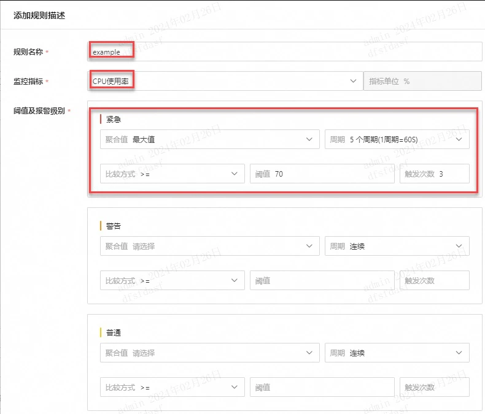

<a id="section-10-3-2"></a>

### 10.3.2. 管理报警规则

在报警规则列表中，可以对报警规则进行修改、禁用、启用、删除等操作。

**操作步骤**

1. 登录Apsara Uni-manager运营控制台。

2. 在顶部菜单栏，单击**产品 > 数据库**，选择目标数据库产品。

3. 在目标列表页面，单击目标实例或集群ID。

4. 在左侧导航栏，单击**云监控**，选择**报警服务** > **报警规则**。

5. 选择目标报警规则，执行相关操作。

   <table>
     <tr>
       <th width="154">操作任务</th>
       <th>操作步骤</th>
     </tr>
     <tr>
       <td>查看报警规则详情</td>
       <td>单击目标报警规则<strong>操作</strong>列的<strong>详情</strong>，在<strong>报警规则/报警历史/故障资源</strong>面板中可查看报警规则的详细信息。</td>
     </tr>
     <tr>
       <td>判断规则有效性</td>
       <td>单击目标报警规则<strong>有效性</strong>列的<strong>点击巡检</strong>，在有效性列可查看巡检结果。<br>说明<br>• 若巡检结果异常，可单击<strong>检测结果</strong>，在弹出的面板中查看<strong>告警规则执行异</strong><strong>常检测</strong>、<strong>告警规则加载检测</strong>、<strong>无效报警规则检测</strong>和<strong>告警规则回调检测</strong>结果。<br>• 单击<strong>重新检测</strong>，可重新检测规则有效性。</td>
     </tr>
     <tr>
       <td>查看规则执行记录</td>
       <td>单击目标报警规则<strong>规则执行记录</strong>列的<strong>查看规则执行记录</strong>，在<strong>报警规则执行记录</strong>面板中，可通过时间范围筛选执行记录。</td>
     </tr>
     <tr>
       <td>修改报警规则</td>
       <td>i. 单击目标报警规则<strong>操作</strong>列的<strong>编辑。</strong>ii. 在<strong>修改报警规则</strong>面板中，修改报警规则。相关配置参数说明请参见<strong>《创建报警规</strong><strong>则》</strong>。iii. 修改完成后，单击<strong>确定</strong>。</td>
     </tr>
   </table>

   <table>
     <tr>
       <td>禁用报警规则</td>
       <td>当需要手动停止云产品的服务，进行维护或升级时，可以禁用报警规则，避免因人为变更而收到大量且无用的报警通知。<br>说明请先确认报警规则的<strong>状态</strong>为<strong>正常</strong>后，再进行禁用。<br>• 单个禁用<br>a. 单击目标报警规则<strong>操作</strong>列的图标，单击<strong>禁用。</strong><br>b. 在<strong>禁用报警规则</strong>对话框中，单击<strong>确定。</strong><br>• 批量禁用<br>a. 选中目标报警规则前的复选框，然后单击列表左下角的<strong>禁用</strong>。<br>b. 在<strong>禁用报警规则</strong>对话框，单击<strong>确定</strong>。</td>
     </tr>
     <tr>
       <td>启用报警规则</td>
       <td>完成云产品的维护或升级后，可以重新启用已被禁用的报警规则。<br>说明请先确认报警规则的<strong>状态</strong>为<strong>已禁用</strong>后，再进行禁用。<br>• 单个启用<br>a. 单击目标报警规则<strong>操作</strong>列的<strong>启用。</strong><br>b. 在<strong>启用报警规则</strong>对话框中，单击<strong>确定。</strong><br>• 批量启用<br>a. 选中目标报警规则前的复选框，然后单击列表左下角的<strong>启用</strong>。<br>b. 在<strong>启用报警规则</strong>对话框，单击<strong>确定</strong>。</td>
     </tr>
     <tr>
       <td>删除报警规则</td>
       <td>• 单个删除<br>a. 单击目标报警规则操作列的图标，单击<strong>删除</strong>。<br>b. 在<strong>删除报警规则</strong>对话框中，单击<strong>确定</strong>。<br>• 批量删除<br>a. 选中目标报警规则前的复选框，然后单击列表左下角的删除。<br>b. 在<strong>删除报警规则</strong>对话框中，单击<strong>确定</strong>。</td>
     </tr>
   </table>

<a id="section-11"></a>

# 11.参数管理

<a id="section-11-1"></a>

## 11.1. 设置参数

云数据库 Tair（兼容 Redis）允许用户自定义部分实例参数。通过本文，您可以了解相关参数的说明以及在控制台修改各参数值的通用方法。

**注意事项**

- 为最大程度保障实例的稳定运行，目前仅开放部分参数，如果某个参数未在本文中列出，即不支持设置该参数。

- 部分参数在提交修改后会自动重启实例（重启过程中实例会发生秒级闪断）。在控制台设置参数时，您需要关注目标参数的**重启生效**列。

**修改参数**

1. 登录云数据库Tair（兼容Redis）控制台。

2. 在**实例列表**页，单击目标实例ID。

3. 在左侧导航栏，单击**参数设置**。

4. 在右侧**参数设置**页签，修改目标参数。

   当前支持如下3种方式修改参数，关于参数和参数值的说明，请参见附录：参数说明。

   > **警告**
   >
   > 部分参数在提交修改后会自动重启实例（重启过程中实例会发生秒级闪断，请谨慎操作），详情请参见目标参数的**重启生效**列。

   - 修改单个参数：

     <ol type="a">

     <li>

     找到目标参数，单击  图标修改参数。

     </li>

     <li>

     单击**确定**。

     </li>

     </ol>

   - 批量修改：

     <ol type="a">

     <li>

     单击**批量修改**。

     </li>

     <li>

     在目标参数的**参数运行值**列，修改参数。

     </li>

     </ol>

     <ol type="i" start="100">

     <li>

     完成修改后，单击页面下方的**确认修改**。

     </li>

     </ol>

   - 从文件导入：

     若您希望将其他实例的参数配置应用至当前实例，您可以选择此方式。使用该功能前，您需要提前访问源实例的**参数设置**页面，单击导出全部参数，下载源实例的参数配置文件。

     > **说明**
     >
     > 请将参数配置文件导入至同版本、同架构的实例中，否则部分参数将无法生效。

     <ol type="a">

     <li>

     单击**从文件导入**。

     </li>

     <li>

     在**批量导入**面板，按照控制台提示上传目标文件。

     </li>

     </ol>

     <ol type="i" start="100">

     <li>

     在**参数详情**区域，确认并勾选待修改的参数。

     > **说明**
     >
     > 您可以开启**只展示有变化参数**开关，快速过滤与当前**参数运行值**不同的参数。

     </li>

     <li value="500">

     单击**确认修改**。

     </li>

     </ol>

**查看参数修改历史**

1. 登录云数据库Tair（兼容Redis）控制台。

2. 在**实例列表**页，单击目标实例ID。

3. 在左侧导航栏，单击**参数设置**。

4. 单击**修改历史**页签，选择时间范围后查看参数修改信息。

**附录：参数说明**

表 1. 参数说明

| 参数 | 说明 |
| --- | --- |
| #no_loose_check-whitelist-always | 开启VPC免密访问后默认不检查客户端IP是否在Redis白名单中，此时如果将该参数的值设置为yes，则白名单在VPC免密模式下依然生效。可选值：<br>• yes，表示开启。<br>• no，默认值，表示关闭。 |
| #no_loose_disabled-commands | 设置禁用命令，多个命令通过英文逗号（,）隔开，目前可禁用的命令有：<strong>FLUSHALL</strong>、<strong>FLUSHDB</strong>、<strong>KEYS</strong>、<strong>HGETALL</strong>、<strong>EVAL</strong>、<strong>EVALSHA</strong>、<strong>SCRIPT</strong>。 |
| #no_loose_sentinel-enabled | 开启或关闭哨兵（Sentinel）兼容模式，可选值：<br>• yes，表示开启。<br>• no，默认值，表示关闭。 |
| client-output-buffer-limit pubsub | 限制对发布订阅客户端的输出缓冲，参数值格式为<code> &lt;hard limit&gt; &lt;soft </code> <code>limit&gt; &lt;soft seconds&gt; </code>。<br>• hard limit：当某客户端的输出缓冲区占用内存达到或超过hard limit的限制时，断开该客户端的连接。hard limit值的单位为Byte。<br>• soft limit和soft seconds：当某客户端的输出缓冲区占用内存达到或超过soft limit的限制，且该状态持续时间大于等于soft seconds限定的秒数，断开该客户端的连接。soft limit值的单位为Byte，soft seconds值的单位为s。 |
| dynamic-hz | 开启或关闭动态hz，可选值：<br>• yes，默认值，表示开启。<br>• no，表示关闭。 |
| hash-max-ziplist-entries | 哈希对象同时满足以下两个条件时， 使用ziplist编码。<br>1. 哈希对象保存的所有键值对的键和值的字符串长度的字节数都小于hash-max-ziplist-value的值。<br>2. 哈希对象保存的键值对数量小于hash-max-ziplist-entries的值。 |
| hash-max-ziplist-value | 哈希对象同时满足以下两个条件时， 使用ziplist编码。<br>1. 哈希对象保存的所有键值对的键和值的字符串长度的字节数都小于hash-max-ziplist-value的值。<br>2. 哈希对象保存的键值对数量小于hash-max-ziplist-entries的值。 |
| hotkey-threshold | TopKey统计功能中热Key的QPS阈值，默认为5000，取值范围为\[100-65535\]。 |
| hz | 设置Redis后台任务执行频率，例如清除过期键任务。取值范围为1~500，默认值为10，即每秒执行10次。该值越大，CPU资源消耗越多，但在过期键较多的情况下清理频率也更高，同时Redis能够更精确地处理超时。建议取值不要超过100。 |
| lazyfree-lazy-eviction | 是否开启基于lazyfree的驱逐功能，可选值：<br>• yes，表示开启。<br>• no，默认值，表示不开启。 |
| lazyfree-lazy-expire | 是否开启基于lazyfree的过期key删除功能，可选值：<br>• yes，默认值，表示开启。<br>• no，表示不开启。 |
| lazyfree-lazy-server-del | <strong>DEL</strong>命令是否基于lazyfree异步删除数据，可选值：<br>• yes，默认值，表示开启。<br>• no，表示不开启。 |
| list-compress-depth | 列表中两端不被压缩的节点个数，取值范围0~65535。<br>• 0：默认值，表示都不压缩。<br>• 1：表示list两端各有1个节点不压缩，中间的节点压缩。<br>• 2：表示list两端各有2个节点不压缩，中间的节点压缩。<br>• 3：表示list两端各有3个节点不压缩，中间的节点压缩。<br>• 其后依此类推。 |
| list-max-ziplist-size | • 取正值表示按照数据项个数来限定每个quicklist节点上的ziplist长度。例如，当该参数配置为5时，每个quicklist节点的ziplist最多包含5个数据项。<br>• 取负值表示按照占用字节数来限定每个quicklist节点上的ziplist长度。此时，该值只能取-1到-5这五个值，每个值含义如下。<br>• -5：每个quicklist节点上的ziplist大小不能超过64KB（注：1KB = 1024 bytes）。<br>• -4：每个quicklist节点上的ziplist大小不能超过32KB。<br>• -3：每个quicklist节点上的ziplist大小不能超过16KB。<br>• -2：每个quicklist节点上的ziplist大小不能超过8KB（Redis默认值）。<br>• -1：每个quicklist节点上的ziplist大小不能超过4KB。 |
| maxmemory-policy | 设置缓存满后Redis删除内容的策略，您可以在如下八种策略中进行选择。LRU表示最近最少使用的。LFU表示最不常用的。LRU，LFU和volatile-ttl都是使用近似随机算法实现的。<br>• volatile-lru：只从设置失效（expire set）的key中选择最近最少使用的key进行删除。<br>• allkeys-lru：优先删除掉最近最少使用的key。<br>• volatile-lfu：只从设置失效（expire set）的key中选择最不常用的key进行删除。<br>• allkeys-lfu：优先删除掉最不常用的key。<br>• volatile-random：只从设置失效（expire set）的key中，随机选择一些key进行删除。<br>• allkeys-random：随机选择一些key进行删除。<br>• volatile-ttl：只从设置失效（expire set）的key中，选出存活时间（TTL）最短的key进行删除。<br>• noeviction：不删除任何key，只是在写操作时返回错误。 |
| notify-keyspace-events | notify-keyspace-events的参数可以是以下字符的任意组合，它指定了服务器该发送哪些类型的通知。<br>• 字符：发送的通知。<br>• K：键空间通知，所有通知以__keyspace@&lt;db&gt;__为前缀。<br>• E：键事件通知，所有通知以__keyevent@&lt;db&gt;__为前缀。<br>• g：DEL、EXPIRE、RENAME等类型无关的通用命令的通知。<br>• l：列表命令的通知。<br>• s：集合命令的通知。<br>• h：哈希命令的通知。<br>• z：有序集合命令的通知。<br>• x：过期事件。每当有过期键被删除时发送。<br>• e：驱逐（evict）事件。每当有键因为maxmemory政策而被删除时发送。<br>• A：参数g$lshzxe的别名。 |
| set-max-intset-entries | 当Set集合内的数据符合以下条件时，会使用intset编码。<br>1. 当集合内所有数据都是整数对象。<br>2. 都是基数为10的整数，范围为64位有符号整数。 |
| slowlog-log-slower-than | 设置是否记录慢查询日志：<br>• 当取值为负时，不记录任何操作。<br>• 当取值为0时，记录所有操作。<br>• 当取值为正时，只有当操作执行时间大于设置值，操作才被记录。单位为微秒（μs），取值范围0~10000000，默认值10000。 |
| slowlog-max-len | 慢日志最多保存记录条数，取值范围100~10000，默认值1024。 |
| stream-node-max-bytes | Stream中每个宏节点（Macro Node）能够占用的最大内存，取值范围：0~999,999,999,999,999。0表示无限制。 |
| stream-node-max-entries | Stream中每个宏节点中可存储条目的最大数量，取值范围：0~999,999,999,999,999。0表示无限制。 |
| timeout | 在客户端连接空闲时长达到指定值时关闭连接。单位为秒（s），取值范围：0~100000。0表示不开启。 |
| zset-max-ziplist-entries | 排序集合对象同时满足以下两个条件时， 使用ziplist编码。<br>1. 排序集合对象保存的所有键值对的键和值的字符串长度的字节数都小于zset-max-ziplist-value的值。<br>2. 排序集合对象保存的键值对数量小于zset-max-ziplist-entries的值。 |
| zset-max-ziplist-value | 排序集合对象同时满足以下两个条件时， 使用ziplist编码。<br>1. 排序集合对象保存的所有键值对的键和值的字符串长度的字节数都小于zset-max-ziplist-value的值。<br>2. 排序集合对象保存的键值对数量小于zset-max-ziplist-entries的值。 |
| list-max-ziplist-entries | 链表对象同时满足以下两个条件时， 使用ziplist编码。<br>1. 链表对象保存的所有元素的字符串长度的字节数都小于list-max-ziplist-value的值。<br>2. 链表集合对象保存的元素数量小于list-max-ziplist-entries的值。 |
| list-max-ziplist-value | 链表对象同时满足以下两个条件时， 使用ziplist编码。<br>1. 链表对象保存的所有元素的字符串长度的字节数都小于list-max-ziplist-value的值。<br>2. 链表集合对象保存的元素数量小于list-max-ziplist-entries的值。 |
| cluster_compat_enable | 开启或关闭原生Redis cluster语法兼容，可选值：<br>• 0，表示关闭。<br>• 1，默认值，表示开启。 |
| script_check_enable | 检查Lua脚本涉及的key是否在相同slot，可选值：<br>• 0，表示不检查。<br>• 1，默认值，表示检查。 |
| ptod_enabled | 控制是否将客户端的真实IP地址通过代理层（Proxy）透传到底层的数据库（DB）。<br>• 0，表示不透传。<br>• 1，默认值，表示透传。 |

> **说明**
>
> 用于调整Redis数据节点最大连接数的maxclients参数不支持自定义，默认值为10000。

<a id="section-11-2"></a>

## 11.2. 使用参数模板

如果需要批量管理实例的参数，您可以使用参数模板功能，快速将模板应用到实例上。

**新建自定义参数模板**

1. 登录云数据库Tair（兼容Redis）控制台。

2. 在左侧导航栏选择**参数模板**。

3. 单击左上角**创建参数模板**。

4. 设置如下参数。

   <table>
     <tr>
       <th width="121">参数</th>
       <th>说明</th>
     </tr>
     <tr>
       <td>模板名称</td>
       <td>模板的名称。由英文字母、数字、小数点（.）或下划线（_）组成，以字母开头，不能包含中文，长度为8~64个字符。</td>
     </tr>
     <tr>
       <td>组织</td>
       <td>选择该参数模板归属的组织，用于权限隔离和管理。</td>
     </tr>
     <tr>
       <td>资源集</td>
       <td>选择该参数模板归属的资源集，用于资源的分组管理。</td>
     </tr>
     <tr>
       <td>实例架构类型</td>
       <td>支持标准版和集群版/读写分离。</td>
     </tr>
     <tr>
       <td>数据库引擎</td>
       <td>选择Redis。</td>
     </tr>
     <tr>
       <td>数据库版本</td>
       <td>支持4.0、5.0、6.0和7.0。</td>
     </tr>
     <tr>
       <td>描述</td>
       <td>备注该模板的相关信息，便于后续管理。长度为0~200个字符。</td>
     </tr>
     <tr>
       <td>添加配置</td>
       <td>配置参数名和参数值等信息。</td>
     </tr>
   </table>

5. 单击**确定**。

**应用参数模板**

1. 登录云数据库Tair（兼容Redis）控制台。

2. 在左侧导航栏选择**参数模板**。

3. 找到要应用的模板，单击其右侧**操作**列的**应用到实例**。

4. 在左侧实例列表中选择需要应用参数模板的实例，单击

   移动到右侧，并检查参数修改情况。

   

   > **重要**
   >
   > 将参数模板应用到多个实例时，需确认参数适用于目标实例，请谨慎操作。

5. 单击**确定**。

**复制参数模板**

1. 登录云数据库Tair（兼容Redis）控制台。

2. 在左侧导航栏选择**参数模板**。

3. 单击参数模板右侧**操作**列下的**克隆**，并设置以下参数。

   <table>
     <tr>
       <th width="89">参数</th>
       <th>说明</th>
     </tr>
     <tr>
       <td>模板名称</td>
       <td>模板的名称。由英文、数字、小数点（.）或下划线（_）组成，以字母开头，不能包含中文，长度为8~64个字符。</td>
     </tr>
     <tr>
       <td>描述</td>
       <td>备注该模板的相关信息，便于后续管理。长度为0~200个字符。</td>
     </tr>
     <tr>
       <td>添加配置</td>
       <td>默认为原参数模板中的参数配置项，您也可以根据需要重新进行配置。<br>说明<br>• 如果您需要添加某个参数，请单击<strong>添加配置</strong>。<br>• 如果您需要修改某个参数的配置值，请在该参数右侧的<strong>配置值</strong>输入框中重新输入。<br>• 如果您需要删除某个参数，请单击该参数右侧的<strong>删除</strong>。</td>
     </tr>
   </table>

4. 单击**确定**。

**更多操作**

除上述操作外，还支持如下功能：

1. 登录云数据库Tair（兼容Redis）控制台。

2. 在左侧导航栏选择**参数模板**。

3. 您可以对参数模板进行如下操作：

   - 查看参数模板。

     单击参数模板右侧**操作**列下的**查看**，查看该参数模板的基本信息和参数信息。

   - 删除参数模板。

     > **说明**
     >
     > 删除参数模板不会影响已经应用该模板的实例。

     单击参数模板右侧**操作**列下的**删除**，在弹出的对话框中单击**确定**。

<a id="section-12"></a>

# 12.备份与恢复

<a id="section-12-1"></a>

## 12.1. 自动备份

由于越来越多的应用将Redis作为持久化存储，所以需要常规的备份机制保证数据误操作之后，具备数据快速恢复的能力。阿里云采用在备节点上执行RDB快照备份，备份期间对您的实例访问不会产生性能影响，并且提供了控制台的快捷操作可以让您进行个性化的备份设置。

**操作步骤**

1. 登录云数据库Tair（兼容Redis）控制台。

2. 在**实例列表**页，单击目标实例ID。

3. 在左侧导航栏，单击**备份与恢复**。

4. 单击右上角**备份设置**。

5. 设置备份周期和备份时间段。

   - **保留天数**：备份文件的保留天数支持7-730天之间，请合理设置保留天数，设置过大的存储时长会占用更多的备份存储容量。

   - **备份周期**：可以设置为一星期中的某一天或者某几天，默认为每天备份一次。

   - **备份时间**：可以设置为任意时段，以小时为单位，建议设置为业务的低峰期。

6. 单击**确定**。

<a id="section-12-2"></a>

## 12.2. 手动备份

您可以在控制台上随时发起手动备份。

**操作步骤**

1. 登录云数据库Tair（兼容Redis）控制台。

2. 在**实例列表**页，单击目标实例ID。

3. 在左侧导航栏，单击**备份与恢复**。

4. 单击页面右上角的**手动创建备份**。

5. 单击**确定**。

   > **说明**
   >
   > 您可以在**备份设置**页面中，查看到已完成的备份数据（备份数据的保留时间支持7-730天之间，请合理设置保留天数）。

<a id="section-12-3"></a>

## 12.3. 下载备份

如果您需要更长时间的数据存档，可以直接在控制台上复制链接将数据库备份文件自行下载到本地进行长时间存储。

**操作步骤**

1. 登录云数据库Tair（兼容Redis）控制台。

2. 在**实例列表**页，单击目标实例ID。

3. 在左侧导航栏，单击**备份与恢复**。

4. 找到目标备份文件，单击其**操作**列的**备份下载**。

   > **说明**
   >
   > 当实例为集群架构时，为保障数据一致性，您需要下载同一时间点中该实例每个数据分片的备份文件。

<a id="section-12-4"></a>

## 12.4. 数据恢复

云数据库 Tair（兼容 Redis）支持将指定备份集的数据恢复至当前实例。

**前提条件**

实例为主从或集群架构。

**操作步骤**

1. 登录云数据库Tair（兼容Redis）控制台。

2. 在**实例列表**页，单击目标实例ID。

3. 在左侧导航栏，单击**备份与恢复**。

4. 根据实例的架构，选择下述操作步骤：

   - 主从架构：找到目标备份集，单击其**操作**列的**数据恢复**。

   - 集群架构：选择同一时间点中，所有数据分片对应的备份集，然后单击右上角的**数据恢复**。

   > **警告**
   >
   > 由于数据恢复操作有较高的风险，请充分验证数据正确性之后，再进行数据恢复操作。

5. 在弹出的对话框中，阅读提示并单击**继续执行恢复操作**。

   您也可以执行克隆实例操作，将备份数据恢复到新创建的实例上，具体操作，请参见克隆实例。

<a id="section-12-5"></a>

## 12.5. 克隆实例

云数据库 Tair（兼容 Redis）支持从指定的备份集创建新实例，新实例中的数据将和该备份集中的数据一致，可用于数据恢复、快速部署业务或数据验证等场景。

**前提条件**

实例为主从或集群架构。

**操作步骤**

1. 登录云数据库Tair（兼容Redis）控制台。

2. 在**实例列表**页，单击目标实例ID。

3. 在左侧导航栏，单击**备份与恢复**。

4. 找到目标备份集，单击其**操作**列的**克隆实例**。

   > **说明**
   >
   > 实例为集群架构时，您需要选择同一时间点中，所有数据分片对应的备份集。

5. 在弹出的对话框中，单击**确定**。

6. 在跳转到的页面中，设置新实例的相关配置并单击**提交**。

   > **说明**
   >
   > 新实例的相关配置说明，请参见创建实例。

<a id="section-13"></a>

# 13.日志与审计

<a id="section-13-1"></a>

## 13.1. 查询运行日志

运行日志记录实例的启动、停止、主备切换、参数变更等后台运维事件。本文介绍如何查询Tair实例的运行日志，帮助您定位和排查实例的运维问题。

**注意事项**

- 运行日志的保存时间为30天。

- 运行日志查询时间跨度不能超过7天。

**查看运行日志信息**

1. 登录云数据库Tair（兼容Redis）控制台。

2. 在**实例列表**页面，单击目标实例ID或者单击实例右侧**操作**列下的**管理**，打开**基本信息**页面。

3. 在左侧菜单栏中，选择**日志与审计 > 运行日志**。

4. 在**时间范围**区域，选择**最近1小时**、**最近6小时**、**最近1天**、**最近7天**或设置自定义的起止时间。

   页面如下图所示，选择时间范围后，即展示该时间段内的运行日志。

   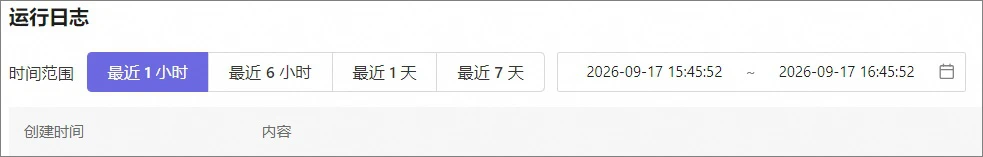

<a id="section-13-2"></a>

## 13.2. 审计日志

审计日志（SQL审计）记录实例收到的读写请求明细，可用于追溯SQL操作、定位异常访问。本文介绍如何查询和导出Tair实例的审计日志。

**注意事项**

- 需先开启审计日志才会产生审计记录。关闭后不再新增记录，已产生的记录在保存期内仍可查询。

- 审计日志仅保存最近30天的记录，到期后自动删除且无法恢复。如需长期留存，请及时导出并下载保存。

- 导出的文件仅保存2天，超过2天由系统自动清理，请在导出完成后及时下载。

- 勾选**按Top SQL耗时排序**后，结果按单条SQL耗时从高到低排列，适合快速定位慢请求；此时其他排序条件不再生效。

**开启或关闭审计日志**

1. 登录云数据库Tair（兼容Redis）控制台。

2. 在**实例列表**页面，单击目标实例ID或者单击实例右侧**操作**列下的**管理**，打开**基本信息**页面。

3. 在左侧菜单栏中，选择**日志与审计 > 审计日志**。

4. 开启或关闭审计日志。

   首次进入时，审计日志页面提示**审计日志未开启**，单击页面中央的**开启审计日志**即可开启。开启后，可在页面左上角按需单击**开启读审计**或**关闭写审计**，以单独关闭或开启某一类审计，单击**关闭审计日志**则同时关闭读审计与写审计。

**查看SQL审计信息**

1. 登录云数据库Tair（兼容Redis）控制台。

2. 在**实例列表**页面，单击目标实例ID或者单击实例右侧**操作**列下的**管理**，打开**基本信息**页面。

3. 在左侧菜单栏中，选择**日志与审计 > 审计日志**。

   在审计页面您可以通过时间范围、数据库用户、关键词搜索、客户端IP、执行时长或按Top SQL耗时排序等条件查询SQL信息。

**导出SQL审计数据**

1. 登录云数据库Tair（兼容Redis）控制台。

2. 在**实例列表**页面，单击目标实例ID或者单击实例右侧**操作**列下的**管理**，打开**基本信息**页面。

3. 在左侧菜单栏中，选择**日志与审计 > 审计日志**。

4. 单击**导出**，选择**创建导出数据任务**，在弹框中单击**确定**，导出目标时间段的数据。

   导出完成后，可以单击**查看导出文件列表**，查看已导出的数据。

<a id="section-14"></a>

# 14.CloudDBA

<a id="section-14-1"></a>

## 14.1. 性能趋势

CloudDBA的性能趋势功能可以监控Redis实例在某个时间段的基础性能及其运行趋势，包括CPU使用率、使用内存量、QPS（每秒访问次数）、总连接数、响应时间、网络流量、Key命中信息等。

**操作步骤**

1. 登录云数据库Tair（兼容Redis）控制台。

2. 在**实例列表**页，单击目标实例ID。

3. 在左侧导航栏，单击**CloudDBA > 性能趋势**。

4. 性能趋势目前支持如下查看方式，您可以根据需求选择：

   > **说明**
   >
   > 如果实例为集群版，本页面还会展示节点列表信息（展示近1小时性能数据），单击节点ID可展示指定节点的详细数据。

   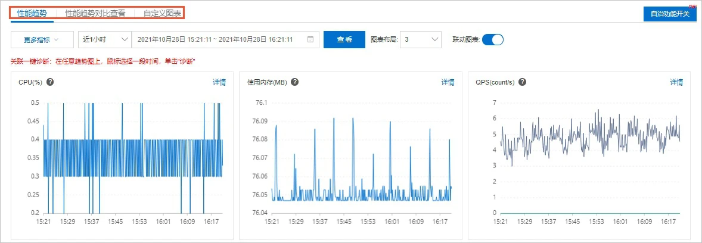

   - **性能趋势**

     单击**性能趋势**页签，设置时间段和更多指标，然后单击**查看**。

     > **说明**
     >
     > - **联动图表**默认开启，如果您将光标悬置于CPU图表上来查看Redis实例9点时的CPU性能指标，其他多个图表也会显示该实例在9点时的性能指标数据。
     >
     > - 单击图表右上方的<strong>含义？</strong>和**详情**，查看性能指标含义和性能趋势大图。

   - **性能趋势对比查看**

     单击**性能趋势对比查看**页签，设置任意两个时间段，配置更多指标，然后单击**查看**，对比两个时间段的性能趋势。

   - **自定义图表**

     以上两种查看方式显示了Redis实例的基础性能指标，如仅需展现其中部分基础指标，您可以自定义性能趋势图表。详情请参见自定义性能趋势图表。

<a id="section-14-2"></a>

## 14.2. Top Key统计

当Tair和Redis内存使用率升高或CPU使用率升高时，您可以使用**Top Key统计**功能快速找到大Key和热Key。本功能支持展示实例中实时和历史的大Key、热Key信息，包括元素数量多的Key、访问频次高的热Key，帮助您有效解决实例性能问题。

**大Key和热Key的统计排名机制**

为避免对数据库造成额外的资源占用，本功能仅会统计客户端操作（读、写）过的Key，并仅保留和展示每种Key类型的Top数量，而不会实时扫描数据库中的所有Key。同时，在实例重启后或HA切换后，原先统计的TopKey信息将被清空，统计将重新开始，因此**长时间未操作过的Key可能不会被纳入统计**。如需了解数据库中所有Key的内存占用、数量分布等信息，请使用离线全量Key分析功能。

| Key类型 | 统计机制 | 展示说明 |
| --- | --- | --- |
| 热Key | Key的QPS超过5000时，被记录为热Key。可通过设置参数<code> hotkey-threshold </code>自定义QPS阈值。 | 在同一时间内，系统最多展示前50个热Key，支持实时展示其精确QPS。 |
| 大Key（元素数量多的Key） | Key的字符串长度（仅限String类型）或元素数量（如Hash中的field数、Set中的member数等）达到阈值（默认2000）及以上时，被统计为大Key。<br>说明仅支持兼容Redis 5.0及以上版本的实例。 | 最多展示每个数据类型排名前3的大Key，当Key的元素数量相同时优先展示先写入的Key。 |

**本功能支持统计的数据结构如下：**

- Redis原生数据结构：String、List、Hash、Set、Zset、Stream

- Tair自研数据结构：TairString、TairHash、TairGIS、TairBloom、TairDoc、TairCpc、TairZset、TairRoaring、TairTS、TairSearch

**操作步骤**

1. 登录云数据库Tair（兼容Redis）控制台。

2. 在**实例列表**页，单击目标实例ID。

3. 在左侧导航栏，单击**CloudDBA > Top Key统计**。

4. 根据业务需求，选择查询实时数据或历史数据。

   - 如果实例为集群架构或读写分离架构，您还可以在**当前节点**下拉框中选择要展示数据的节点。

   - 查询历史数据时，支持查询最近4天的大Key和热Key信息，且最大查询时间范围不能超过3小时。

   - 可通过设置参数 `hotkey-threshold` 自定义QPS阈值。

<a id="section-14-3"></a>

## 14.3. 自定义性能趋势图表

默认性能趋势显示了Redis实例的基础性能指标，您也可以在自定义性能趋势图表中，选择仅展示部分基础性能指标，以便有针对性地监控和分析实例的性能及运行趋势。本文档介绍了如何在监控大盘中自定义创建Redis实例的性能趋势图表。

**操作步骤**

1. 登录云数据库Tair（兼容Redis）控制台。

2. 在**实例列表**页，单击目标实例ID。

3. 在左侧导航栏，单击**CloudDBA > 性能趋势**。

4. 单击**自定义图表**页签。

5. 单击**新增监控大盘**，填写大盘名称并单击**确认**。

6. 单击<strong>+添加图表</strong>或**新增监控图表**。如下图所示，选中需要查看的指标，单击**确定**。

   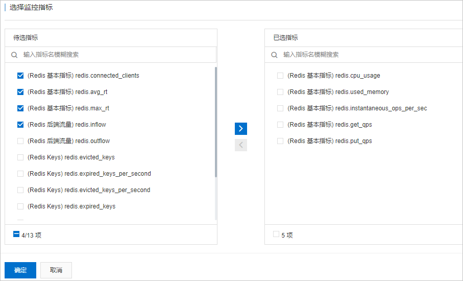

7. <strong>可选：</strong>通过查看、修改和删除操作，管理监控大盘。

   - 查看监控大盘

     选择目标监控大盘并设置时间段，然后单击**查看**。

   - 修改监控大盘

     单击如下所示图标，根据需求进行修改或删除图表。

     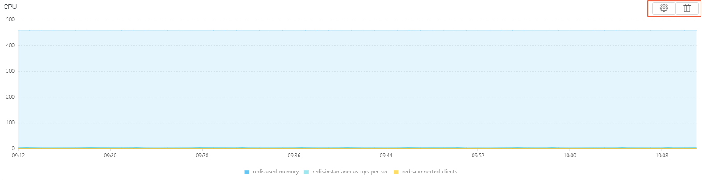

   - 删除监控大盘

     单击**操作大盘 > 删除监控大盘**。

<a id="section-14-4"></a>

## 14.4. 实时性能

在CloudDBA中可以实时查看Redis实例的性能，包括CPU使用率、内存使用信息、QPS（每秒访问次数）、网络流量、Server信息、Key信息、Client信息、连接信息等。

**操作步骤**

1. 登录云数据库Tair（兼容Redis）控制台。

2. 在**实例列表**页，单击目标实例ID。

3. 在左侧导航栏，单击**CloudDBA > 实时性能**。

4. 根据业务需求，选择实时性能的展示方式：

   页面上方实时显示实例性能指标，包括Server信息、Key信息、内存信息、Client信息、连接信息；页面下方以**实时图表**和**实时表格**的形式显示详细的性能指标。

   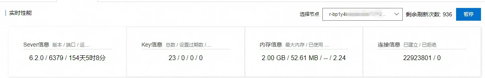

   > **说明**
   >
   > 为方便您实时查看性能的变化，性能指标的值每5秒自动刷新一次，剩余刷新次数可在右上角显示。您也可以单击**暂停**停止刷新。

   <table>
     <tr>
       <th width="89">展示方式</th>
       <th>介绍</th>
     </tr>
     <tr>
       <td>实时图表</td>
       <td>以曲线图的形式显示实例的实时性能指标，如Key信息、Key命中信息、Key命中率、CPU使用率、内存信息、QPS、网络流量。<br>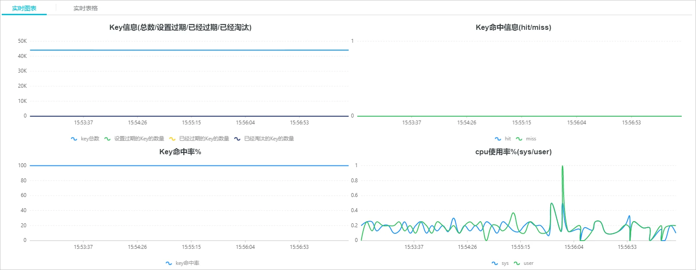</td>
     </tr>
     <tr>
       <td>实时表格</td>
       <td>以表格的形式显示实例的Key命中信息、Key命中率、QPS、Memory（内存信息）、CPU使用率、Network（网络流量）、Client信息、连接信息等性能。实时的性能值每5秒新增一行，最多显示999行。<br>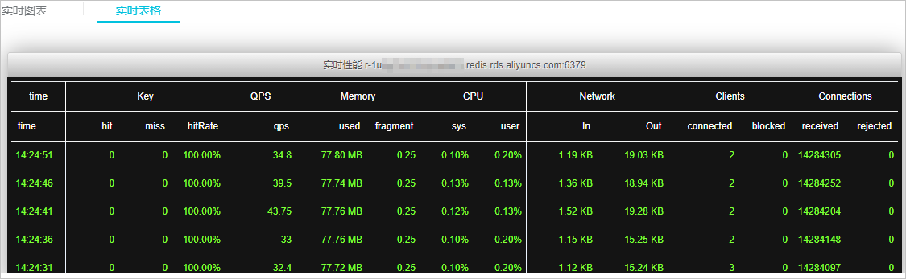</td>
     </tr>
   </table>

<a id="section-14-5"></a>

## 14.5. 实例会话

通过实例会话，您可以实时查看Redis实例与客户端间的会话信息，包括客户端信息，所执行的命令和已连接的时长等，还可以根据业务需求终止异常会话。

**操作步骤**

1. 登录云数据库Tair（兼容Redis）控制台。

2. 在**实例列表**页，单击目标实例ID。

3. 在左侧导航栏，单击**CloudDBA > 实例会话**。

4. 根据业务需求，选择下述步骤对实例会话进行管理：

   - 查看会话：页面默认展示了所有会话的详细信息，您可以将鼠标放置在对应的参数名称上查看其含义。

     > **说明**
     >
     > - 您可以在**搜索会话**文本框中输入关键字来过滤会话信息。
     >
     > - 如需刷新实例会话信息，可以单击左上角的**刷新**或者开启**自动刷新**（每30秒自动刷新一次）。

   - 终止会话：选择目标会话或按shif键可以选择多个目标会话，单击右上角的**kill选中会话**或者直接点击**kill全部会话**，可以终止选中或全部会话。

     > **警告**
     >
     > 请勿终止系统级的会话，否则可能引发一些不可预料的结果。

   - 查看会话统计：会话统计记录了实例会话的总客户端数，活跃客户端数，来源（客户端的地址）数量。

     > **说明**
     >
     > 在**按照来源统计**区域框的表格中，单击客户端地址右侧的编辑图标即可修改来源的别名。在总数栏中单击数值，可查看访问来源地址的详细信息。

<a id="section-14-6"></a>

## 14.6. 慢请求

慢请求问题会极大地影响Redis服务的稳定性。您可在CloudDBA中查看慢日志详细信息，来监控和分析慢请求问题。

**操作步骤**

1. 登录云数据库Tair（兼容Redis）控制台。

2. 在**实例列表**页，单击目标实例ID。

3. 在左侧导航栏，单击**CloudDBA > 慢请求**。

4. 查看实例的慢请求日志信息。

   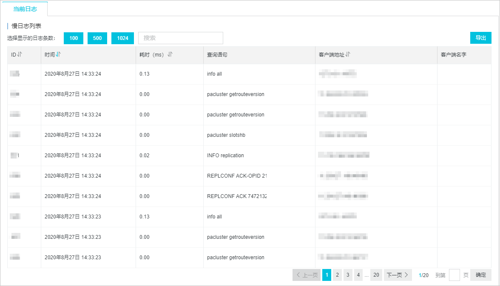

   > **说明**
   >
   > 您可以选择要展示的日志条数或在搜索文本框中输入关键字进行过滤。

<a id="section-14-7"></a>

## 14.7. 离线全量Key分析

通过离线全量Key分析功能来分析Redis的备份文件，可以快速发现实例中的BigKey（大Key），帮助您掌握Key在内存中的占用和分布、Key过期时间等信息，为您的优化操作提供数据支持，帮助您避免因Key倾斜引发的内存不足、性能下降等问题。

**操作步骤**

1. 登录云数据库Tair（兼容Redis）控制台。

2. 在**实例列表**页，单击目标实例ID。

3. 在左侧导航栏，单击**CloudDBA > 离线全量Key分析**。

   页面默认展示最近一天缓存分析结果列表，您可以根据需求选择其他时间段。

4. 在该页面，单击页面右侧的**立即分析**。

   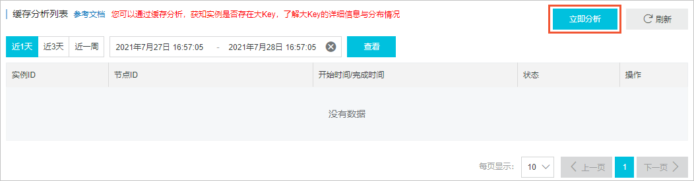

5. 在弹出的对话框中，设置分析的节点和方式。

   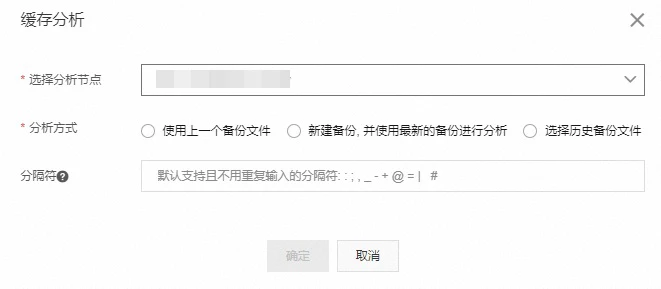

   <table>
     <tr>
       <th width="121">参数</th>
       <th>说明</th>
     </tr>
     <tr>
       <td>选择分析节点</td>
       <td>选择需要执行缓存分析的节点ID。<br>说明您可以选择分析整个实例，也可以只选中某个节点进行分析。当选择分析整个实例时，若该实例的节点数超过8个，系统仅对内存使用量前8的节点进行分析。</td>
     </tr>
     <tr>
       <td>分析方式</td>
       <td>您可以选择分析方式为<strong>使用上一个备份文件</strong>或<strong>新建备份，并使用最新的备份进行分</strong><strong>析</strong>。</td>
     </tr>
   </table>

6. 单击**确定**。

   系统执行分析并展示分析状态，您可以单击**刷新**以更新分析状态。

7. 找到已完成的分析任务，单击其**操作**列的**详情**展示详细的分析结果。

   - **基本信息**：展示实例基本属性和缓存分析方法等信息。

     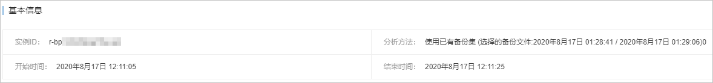

   - **相关节点**：展示实例内各节点的内存情况和Key统计信息。

     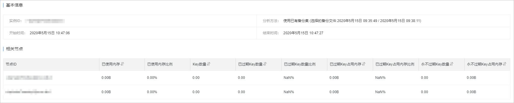

     > **说明**
     >
     > 当实例为集群，且选择的分析节点为整个实例时，**详情**页才会展示**相关节点**信息并提供节点选择的功能。

   - **详情**：展示实例或节点的Key内存占有情况、Key数量分布情况、Key中元素的内存占用和分布情况、Key过期时间分布、大Key排名等信息。

     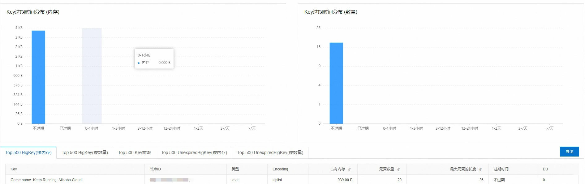

<a id="section-14-8"></a>

## 14.8. 诊断实例

云数据库 Tair（兼容 Redis）集成了DAS的诊断报告功能，可针对指定时间段的实例运行状况发起诊断，帮助您从性能水位、访问倾斜情况、慢日志等多方面评估实例的健康状况，快速定位实例的异常情况。

**操作步骤**

1. 登录云数据库Tair（兼容Redis）控制台。

2. 在**实例列表**页，单击目标实例ID。

3. 在左侧导航栏，单击**CloudDBA > 诊断报告**。

4. 单击**发起诊断**。

5. 在弹出的对话框中，选择诊断的时间范围并单击**确定**。

   > **说明**
   >
   > 诊断时间的选择范围不能超过一天，选择的时间范围越小，诊断报告中展示的性能指标的粒度更细。

6. 等待诊断分析完成后（可刷新该页面查看分析进度），单击**操作**列的**查看报告**。

   诊断报告将展示实例的ID、规格、类型及可用区等基本信息，同时提供实例关键性能指标的统计信息及其状态。此外，报告还将列出发生慢请求次数排名前十的数据节点及其对应的慢请求信息。

<a id="section-15"></a>

# 15.报警设置

**背景信息**

监控报警是通过阿里云监控产品实现的。通过阿里云监控产品，您可以设置监控项，并在触发监控项的报警规则时，通知报警联系组中的所有联系人。您可以维护报警监控项对应的报警联系组，以便发生报警时，能及时通知到相关联系人。

**操作步骤**

1. 登录云数据库Redis控制台。

2. 在**实例列表**页，单击目标实例ID。

3. 在**实例信息**页，单击左侧导航栏中**报警设置**。

4. 在**报警设置**页，单击页面右侧**报警设置**，跳转到**云监控**控制台。

5. 在**云监控**页，您可以**新建报警规则**。

6. 设置完报警规则后，单击**确定**即可。

   > **说明**
   >
   > 设置完成后，您可以在云监控控制台的**报警规则**页面修改、禁用、删除报警规则，并查看报警历史记录。

<a id="section-16"></a>

# 16.附录

<a id="section-16-1"></a>

## 16.1. 租户组织对SLB服务授权操作

本文为您介绍如何完成SLB服务授权操作，帮助您快速解决问题。

> **重要**
>
> 若您的业务场景需要申请创建并使用IPv6实例，必须确保当前租户组织已显式授予数据库产品访问SLB服务的权限。若未完成此授权操作，则无法成功创建IPv6实例。

**操作步骤**

1. 登录Apsara Uni-manager运营控制台。

2. 在页面顶部的菜单栏中，单击**配置**。

3. 在左侧导航栏，单击**RAM服务角色**。

4. 在RAM服务角色页面，单击左上角**创建RAM服务角色**。

   **服务名称**选择**负载均衡SLB**，**授权组织名称**选择需要授权的组织即可。

   

5. 单击**确定**，完成授权。
