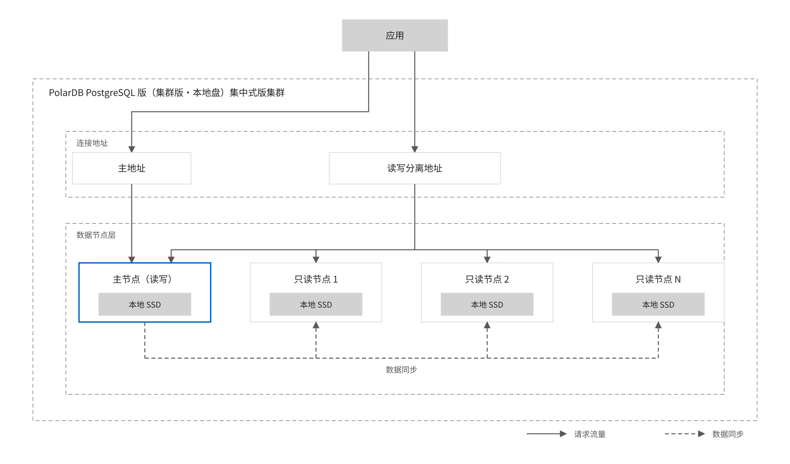
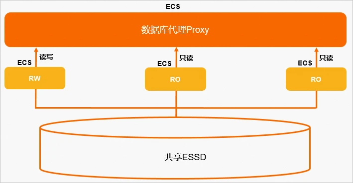
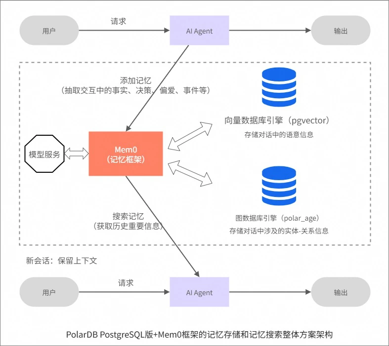

阿里云  
专有云  
云原生关系型数据库 PolarDB  
PolarDB 产品简介  
产品版本：v3.18.6  
文档版本：20261022

**目录**

- [1.产品详情](#section-1)
- [2.产品价值](#section-2)
- [3.应用场景](#section-3)
- [4.功能特性](#section-4)
    - [4.1. PolarDB MySQL版功能特性](#section-4-1)
        - [4.1.1. 主备版](#section-4-1-1)
        - [4.1.2. 集群版](#section-4-1-2)
    - [4.2. PolarDB PostgreSQL版功能特性](#section-4-2)
        - [4.2.1. 主备版](#section-4-2-1)
        - [4.2.2. 集群版](#section-4-2-2)
    - [4.3. PolarDB集分一体版（PolarDB-X）功能特性](#section-4-3)
        - [4.3.1. 功能特性](#section-4-3-1)

# 1.产品详情

云原生数据库PolarDB是一款强大的云原生数据库，具有高可用性、高性能、易于扩展等优势，适合各种规模的企业级应用。

**产品引擎介绍**

PolarDB包含PolarDB MySQL版、PolarDB PostgreSQL版以及PolarDB集分一体版（简称PolarDB-X）三个版本的引擎，可以方便快捷地创建出适合自己应用场景的数据库实例。

- **PolarDB MySQL版**

  PolarDB MySQL版是阿里巴巴自研的云原生关系型数据库，为用户提供具备超高弹性和性能、高可用和高可靠保障、高性价比的数据库服务。

  - PolarDB MySQL集群共享存储版

    基于云原生架构和计算存储分离能力，采用分布式存储架构，将数据分散存储在多个节点上，通过水平扩展来提高系统的处理能力。同时，采用主备架构，主节点负责读写操作，备节点负责数据同步和数据备份，实现了高可用性和可靠性。

  - PolarDB MySQL集群本地盘版

    基于通用硬件和集群架构，采用主备高可用架构，计算与存储紧密耦合于本地磁盘，通过多节点协同提供兼容MySQL的高性能数据库服务。

  - PolarDB MySQL主备版

    采用一主一备高可用架构，主节点和备节点部署在同一机房或不同机房的不同物理机上，通过流复制进行数据同步（日志传递）。请求通过SLB直接发到主节点上。主备高可用架构最多可在一个节点故障的情况下维持可用性。当备节点出现故障时，管控组件会在除主备外的第三台机器上发起备库重建流程，恢复一主一备的正常形态。由于访问连接串的流量都会走主库，因此备库宕以及备库重搭过程不会对业务的可用性造成影响。

- **PolarDB PostgreSQL版**

  PolarDB PostgreSQL版100%兼容PostgreSQL，高度兼容Oracle语法，支持Ganos时空数据引擎，为用户提供具备弹性、超高性能、高可用、高性价比的数据库服务。

  - PolarDB PostgreSQL主备版

    采用一主一备高可用架构，主节点和备节点部署在同一机房或不同机房的不同物理机上，通过流复制进行数据同步（日志传递）。请求通过SLB直接发到主节点上。主备高可用架构最多可在一个节点故障的情况下维持可用性。当备节点出现故障时，管控组件会在除主备外的第三台机器上发起备库重建流程，恢复一主一备的正常形态。由于访问连接串的流量都会走主库，因此备库宕以及备库重搭过程不会对业务的可用性造成影响。

  - PolarDB PostgreSQL集群共享存储版

    采用存储和计算分离的架构，所有计算节点共享一份数据。数据库计算节点和存储节点之间采用高速网络互联，并通过RDMA协议进行数据传输，使得I/O性能不再成为瓶颈。

  - PolarDB PostgreSQL集群本地盘版

    阿里云推出的企业级云原生关系型数据库产品，100%兼容PostgreSQL 14、16、17，以本地SSD高性能存储为底座，通过主备节点（读写/只读）实现数据高可用和读写分离，满足金融、政务、运营商等对数据安全和业务连续性有严格要求的行业场景。已支持集中式形态，其核心特性如下：

    - **集中式架构，简洁可靠**：适用于标准生产环境，架构简洁、运维简单。由一个读写节点与多个只读副本组成，读写节点处理写请求并向只读节点同步数据，只读节点分担读流量，实现数据高可用与读写分离，只读节点可按需弹性扩展。

    - **极致性能，稳定可靠**：每个数据节点配备独立本地SSD，提供极低读写延迟和稳定IOPS；支持最多5个只读节点，读流量自动分发，轻松应对高并发查询场景；基于容器化部署，支持故障自动检测和快速恢复，实现节点级高可用。

    - **企业级安全**：支持TDE透明数据加密，创建集群时即可开启，提供AES-256和国密SM4两种加密算法，数据落盘自动加密且对应用完全透明；支持SSL全链路传输加密与证书自动轮转；支持IP白名单分组和安全组关联，精确管控数据库访问权限。

    - **完全兼容PostgreSQL**：100%兼容PostgreSQL语法和生态，现有PostgreSQL应用无需改造即可平滑迁移，可充分利用PostgreSQL社区丰富的扩展插件能力；支持从RDS PostgreSQL白屏化迁移，迁移过程全托管并支持数据校验，保障平滑过渡。

    - **完善的数据库管理能力**：提供集群管理（创建集群、在线变更配置、增删节点、集群保护锁、标签管理）、连接与网络（主地址、读写分离地址、经典网络地址、公网地址）、备份与恢复（自动备份、手动备份、时间点恢复PITR、备份集恢复）、日志与审计（审计日志、慢SQL日志、错误日志）以及监控与运维（云监控、可维护窗口）等能力。

    

- **PolarDB集分一体版**

  PolarDB集分一体版（简称PolarDB-X）是阿里巴巴自主设计研发的高性能云原生分布式数据库产品，为用户提供高吞吐、大存储、低延时、易扩展和超高可用的云时代数据库服务。PolarDB-X始终保持对阿里巴巴集团“双十一购物狂欢节”所有相关业务的全面支撑。历经十余年淬炼，具备了强数据一致性、高系统稳定性、快速集群弹性等核心关键特性，并在金融、司法财税、交通物流、电力能源等公共事业领域有广泛深入应用。

  PolarDB-X坚定遵循自主可控、开放生态的发展思路，持续围绕MySQL开源生态构建分布式能力，以求最大程度降低用户的学习使用成本。

**产品能力详情PolarDB MySQL版**

**存算分离**

云原生关系型数据库PolarDB采用计算与存储分离的架构，数据库代理和计算节点分别采用独立的ECS进行部署，共享存储层使用ESSD云盘，极大降低用户使用PolarDB的成本。

**超级MySQL**

- 100%兼容原生MySQL和阿里云RDS MySQL，用户可以在不修改应用程序任何代码和配置的情况下，将MySQL数据库迁移至PolarDB MySQL版。

- 持续提供一写多读、共享存储、60亿行数据稳定运行、秒级DDL、主从切换无闪断、闪回查询、分区表增强等高价值特性。

**数据安全**

PolarDB MySQL版支持透明数据加密TDE（Transparent Data Encryption），可对数据文件执行实时I/O加密和解密，数据在写入磁盘之前进行加密，从磁盘读入内存时进行解密。TDE不会增加数据文件的大小，开发人员无需更改任何应用程序，即可使用TDE功能。

**全局二级索引**

全局二级索引（Global Secondary Index）是以整个表的数据为对象建立索引，索引中的索引记录既可能是基于相同的键值但是来自不同的分区，也可能是多个不同键值的组合。

**SQL审计**

开启SQL审计功能可以记录所有DML和DDL操作信息，并内置安全引擎，实时审计数据库的活动。

- 实时检测：对各类攻击和威胁进行实时检测，及时发现安全隐患。

- 高危操作识别：通过智能算法、海量模型识别高危操作。

- 异常访问来源识别：自动识别新增或者异常的访问来源。

**PolarDB PostgreSQL版**

**备份与恢复**

- 数据备份功能

  - 自动备份：在实例创建时会生成一个默认的自动备份策略，根据策略定期对实例进行全量的物理备份并上传到OSS。您可以在运维工作台上设置对自动备份策略的备份周期、备份保留时间、备份任务调度时间等进行修改。

  - 手动备份：您可以在运维工作台上手动创建物理备份。

- 日志备份功能

  实例产生的日志会定期上传到OSS，并在上传成功后及时轮转，以节省物理机的磁盘占用。您可以在运维工作台上对保留个数、日志保留时间等进行修改。

- 从备份集恢复功能

  PolarDB支持基于现有的备份集创建新的实例。

- 克隆实例

  PolarDB支持对原实例进行克隆，创建出一个新的实例。新的实例与原实例是互相独立的实例，仅继承原实例创建时刻前的数据。

- 按时间点恢复

  PolarDB支持时间点恢复功能。为了使用时间点恢复功能，您需要确定目标时间点前有一个可用的全量备份集，并且这个全量备份集和创建时间点之间所有的WAL日志均在OSS侧有保存。时间点恢复将创建一个与原实例相互独立的新实例。

**透明数据加密（TDE）**

透明数据加密TDE（Transparent Data Encryption）可对数据文件执行实时I/O加密和解密，数据在写入磁盘之前进行加密，从磁盘读入内存时进行解密。TDE不会增加数据文件的大小，开发人员无需更改任何应用程序，即可使用TDE功能。

**数据脱敏**

PolarDB提供DBMS_REDACT内置包支持对查询返回的数据进行脱敏或屏蔽，从而起到数据混淆的作用。DBMS_REDACT包提供了创建策略、更改策略、启用策略、禁用策略和删除策略的存储过程，您可以使用这些存储过程实现自定义的数据混淆。

**SQL防火墙**

防止SQL注入攻击通常是数据库应用开发者的责任，数据库管理者的防御能力较小。SQL/Protect插件通过传入的查询请求来判断SQL注入的发生。一旦发现潜在的危险查询，便向数据库管理员报警，并及时阻断查询的执行。

**SQL审计**

PolarDB支持通过审计功能查看SQL明细信息、定期审计SQL。开通SQL审计功能后，实例性能不会受到影响。

**PolarDB集分一体版（简称PolarDB-X）**

**集分一体化**

一套系统提供集中式和分布式两种形态，用户可根据自身业务需求灵活选择。降低客户投资，降低数据库系统运营运维成本。分布式实例通过数据的水平拆分、分区以及单一服务的集群化部署，解决了集中式性能和容量扩展的瓶颈问题，实现了分布式数据库的弹性扩展、大容量等优点。

**云原生数据库**

与云平台实现了融合统一，如：实现和云平台的统一网络管理、统一监控告警、统一运维、统一鉴权、统一租户规划、统一配额管理等。

**提供数据库级别的DRDS（分库分表）和AUTO（分区表）两种使用模式**

两种模式可共存于一个实例。前期使用DRDS1.0的用户，应用极少改动，即可平滑切换到PolarDB-X，并可提供全套数据迁移服务。

**高可靠高可用**

采用自研X-Paxos协议库和X-DB存储引擎，避免读放大、写放大、空间放大、墓碑、频繁compaction等问题，提升系统和数据的稳定一致性，降低系统资源消耗。结合多节点Paxos强一致，保障单个数据节点故障时数据0丢失，RPO=0。提供同城双机房3节点/4副本、同城3机房容灾，异地灾备方案。平台内各组件管理节点采用高可用设计，运维管理节点故障不影响业务正常运行。

**高兼容**

PolarDB-X主要兼容MySQL，集中式兼容MySQL5.7、8.0，应用0改动平迁。分布式高度兼容MySQL5.7、8.0，包括SQL、函数类型等，技术上引入全局时间授时服务，提供全局一致性的分布式事务能力，通过TSO+2PC提供数据库完整的ACID能力，满足分布式下的Read-Committed/Repeatable-Read的隔离级别。同时在分布式事务的基础上，提供全局二级索引能力，通过事务多写保证索引和主表数据强一致的同时，引入基于代价的CBO优化器实现索引选择。除此以外，在元数据和生态对接层面，PolarDB-X基于Online DDL的技术提供了分布式下元数据的一致性。硬件层面，兼容主流国产芯片，比如鲲鹏、海光等。

**高扩展**

PolarDB-X基于Share-Nothing的架构支持水平扩展，节点升降配实现纵向扩展，增删节点数实现横向扩展，系统整体性能随节点数量的扩展而增长，支持在线升降配，满足业务弹性诉求。在OLTP场景下可支持千万级别的并发、以及PB级别的数据存储规模，同样在OLAP场景下，引入MPP并行查询技术，扩展机器后查询能力可线性提升，满足TPC-H等的复杂报表查询诉求。

**一云多池**

用户可灵活规划物理机，在一朵云中构建多个资源池。使各等级应用、各分公司、生产和测试系统等实现物理机级别的资源隔离、故障隔离。

**资源节省**

存储节点采用一主一备一日志结构，在达成三节点RPO=0效果的同时，仅约2.3副本的资源占用，节省23%软件和硬件采购成本。

**MySQL原生全局Binlog**

在业界主流的分布式数据库里，分布式下的redolog/binlog等数据库变更日志其实一直被厂商所忽视，从关系数据库的发展历史来看，生态和标准对于市场规模化非常重要，PolarDB-X支持全局binlog能力，兼容和拥抱MySQL数据库生态，用户可以将PolarDB-X当做一个MySQL库，采用标准的binlog dump协议获取binlog日志。CDC提供全局一致的MySQL原生Binlog服务，上下游生态像订阅单机MySQL一样来消费数据，增强数据同步和备份恢复等能力。

**SQL诊断优化**

提供SQL审计与分析、实例会话、慢日志、空间分析、锁分析、性能趋势、实时性能等运维功能，辅助DBA便捷管理数据库、问题定位。

**分布式事务**

提供全局一致性分布式事务，确保分布式事务全局读写强一致。

**全局二级索引**

提供全局二级索引、全局唯一索引，提升业务多维查询便捷性。

**SQL闪回查询**

针对SQL误操作，提供行级数据的便捷回查能力。

**高性能**

PolarDB-X贴合业务进行数据拆分，尽可能让数据跟随主要业务操作进行聚簇，从而提升在线事务型操作的响应速度。支持扩展只读节点，实现读写自动分离，扩展读性能，并将生产和分析业务做流量隔离，保障生产系统的稳定性。

**备份**

支持本地备份+异地备份（跨region）两级备份，满足多中心之间的数据互备需求。支持备份恢复到时间点。支持用户自定义备份策略，备份集可视化管理。

**安全可控**

支持类单机数据库的账号权限体系，并且提供多租户隔离、IP白名单、SQL审计、TLS（SSL）传输加密（TLS v1.2、TLS v1.3）、TDE存储加密等实用功能。

**权限**

- 支持通过控制台实现租户的统一管理、租户资源的动态配置和管理、资源隔离、资源使用统计、多级租户管理等功能，支持多级租户的管理功能。

- 提供权限管理和细粒度用户操作审计。

- 具备完善的权限认证与隔离机制，保障用户数据的私密性。

- 支持通过多租户模式实现资源隔离。

# 2.产品价值

云原生数据库PolarDB兼容传统数据库的使用方式，提供MySQL版、PostgreSQL版和集分一体版（PolarDB-X）三种产品形态，具备高性价比、高弹性、高性能和高可用等优势。

**PolarDB MySQL版优势**

- **高性价比**

  多个计算节点共享存储，新增只读节点时只需支付计算节点费用，大大降低扩容成本。

- **超高弹性**

  - 分钟级增删节点。

  - 存储容量在线扩容，无需中断业务。

- **超高性能**

  深度优化数据库内核，同时采用物理复制、高速网络和分布式共享存储，大幅提高性能，相比开源MySQL性能最大提升6倍。

- **高可用和高可靠保障，数据安全可靠**

  - 共享分布式存储的设计，彻底解决了主从异步复制所带来的备库数据非强一致的缺陷，使得整个数据库集群在应对任何单点故障时，可以保证数据零丢失。

  - 主备版采用主备高可用架构，最多可在一个节点故障的情况下维持可用性。当备节点出现故障时，管控组件会在主节点之外运行正常的机器上发起备库重建流程，恢复一主一备的正常形态。由于访问连接串的流量都会走主库，因此备库故障以及备库重搭过程不会对业务的可用性造成影响。

- **数据安全**

  采用白名单、VPC网络、数据多副本存储等全方位的手段，对数据库数据访问、存储、管理等各个环节提供安全保障。

- **无锁备份**

  利用底层分布式存储的快照技术，整个备份过程不需要加锁，效率更高，影响更小。

**PolarDB PostgreSQL版优势**

- **简单易用**

  完全兼容PostgreSQL，高度兼容Oracle语法，代码和应用无需修改或仅需少量修改。

- **备份与恢复**

  - **数据备份与日志备份**：支持自动备份和手动备份，并提供WAL日志备份，可按需配置备份周期、备份时间和保留时长。

  - **按时间点恢复**：支持将集群数据恢复到指定时间点的新集群，有效降低误操作带来的数据损失。

- **快速弹性**

  分钟级升降配、分钟级增删节点，应对不确定的业务增长。

  - **规格与存储在线变更**：支持在线变更节点规格和扩容存储空间，存储容量上限随节点规格提升，无需重建集群。

  - **只读节点弹性伸缩**：支持按需增删只读节点，单可用区部署最多可配置15个只读节点，快速提升集群读取能力。

- **高性能与稳定可靠**

  - **弹性读写集群**：集群包含一个主节点和最多15个只读节点，满足高并发场景的性能要求，适用于读多写少的场景。

  - **本地SSD存储**：集群本地盘版的每个数据节点配备独立本地SSD，提供极低读写延迟和稳定IOPS。

  - **节点级高可用**：基于容器化部署，支持故障自动检测和快速恢复。

  - **共享存储架构**：基于共享存储的一写多读集群，数据只需一次修改，所有节点立即生效。

- **集中式架构，简单可靠**

  PolarDB PostgreSQL集群本地盘版提供集中式架构，部署简单、运维直观，适用于企业级在线交易与混合负载场景。

  | 架构 | 适用场景 | 特点 |
  | --- | --- | --- |
  | 集中式版 | 标准生产环境 | 集中式部署，简单可靠，由一组数据节点（DN）承载业务读写，并可在该节点组内扩展只读副本，实现高可用和读写分离。 |

- **高可用与高可靠**

  - **多可用区容灾**：支持主备多可用区部署，主备可用区各保存一份数据，主可用区发生故障时可切换到备可用区，实现同城容灾。

  - 集群共享存储版采用共享分布式存储设计，解决了主从异步复制带来的备库数据非强一致问题，数据库集群在应对单点故障时可保证数据零丢失。

- **数据安全**

  - **网络与访问控制**：支持VPC网络隔离、白名单分组管理、关联ECS安全组和SSL加密连接，对数据访问的各个环节提供安全保障。

  - **透明数据加密（TDE）**：支持开启TDE对数据文件进行实时加解密，可选择AES-256或SM4加密算法，并支持使用KMS中的自定义密钥。

**PolarDB集分一体版（PolarDB-X）优势**

- **云原生+MySQL生态**

  依托云资源和容器化部署能力，PolarDB-X可以在数分钟内完成集群创建和变配，整个过程中无需进行手工干预。

  阿里云及开源社区的多种生态工具对PolarDB-X持续提供不断完善的支持，包括但不限于以下产品：数据传输服务DTS、数据库备份DBS、数据管理服务DMS、数据库自治服务DAS、数据集成Data Integration、云监控、性能测试PTS。

  PolarDB-X积极拥抱并努力回馈MySQL生态，已形成对MySQL生态从协议、语法、事务行为、账号体系、安全到命令行工具的全方位兼容。

- **存储计算分离架构**

  旨在最大限度地发挥其云数据库的弹性扩展能力，PolarDB-X采用了基于存储计算分离的Shared-Nothing系统架构，该架构使用户可以根据业务需要进行分层容量规划。

  PolarDB-X的存储节点（DN）基于阿里巴巴自研的三节点强一致数据库X-DB构建。提供MySQL语法全兼容能力，以及对复杂查询的处理能力。X-DB结合PolarDB-X面向HTAP的CBO查询优化器，可精确控制计算下推行为，从而获得更佳的整体性能。

- **透明分布式体验**

  让用户以使用单机MySQL数据库的体验，操作分布式数据库是PolarDB-X一贯追求的目标。为此PolarDB-X提供了简单易用的透明分布式能力：

  默认主键拆分，让移植到PolarDB-X的数据和业务摆脱对设计**分区键**的依赖，实现自动分库分表。

  高性能强一致分布式事务，PolarDB-X采用自研X-Paxos协议，保证数据存储在故障切换过程中RPO=0的基础上，使用TSO策略和分布式的MVCC能力保证了分布式事务的隔离性和一致性。

  分布式线性扩展，PolarDB-X基于一致性Hash的分区策略，有效地进行负载均衡和热点抑制，且在扩展过程中保持计算下推和数据一致性的同时实现业务零感知，并行和流控能力为扩展期间业务连续性提供了有力保障。

  全局Binlog和全局一致性备份，分别解决分布式数据库各节点数据库向下游流转的难题及各节点备份时间差造成的恢复一致性问题。

# 3.应用场景

云原生数据库PolarDB可广泛应用于各种业务场景中，满足不同业务的需求，提供高性能、高可用、高可扩展的数据库服务。

**PolarDB MySQL版**

**零改造迁移，MySQL性能焕新**

随着业务增长，基于传统MySQL的系统可能面临性能瓶颈、扩展困难等问题。推荐方案：将现有MySQL数据库迁移至PolarDB。PolarDB100%兼容MySQL 8.0，大多数应用无需修改代码即可平滑迁移。

**实时分析数据，报表动态生成**

企业需要对业务数据进行实时分析以支持运营决策，但传统的“交易库+分析库”架构存在数据同步延迟和维护成本高的问题。推荐方案：使用PolarDB的原生HTAP能力。在同一逻辑实例内，可让主节点处理交易请求，只读节点处理分析请求，实现读写分离。数据写入后即可用于分析，无需ETL，可实现数据分析的实时性，同时避免分析负载对交易业务产生干扰。

**系统稳如磐石，故障秒级切换**

金融、政务、企业核心ERP等系统对业务连续性要求高，不能接收因单点故障导致的服务中断和数据丢失。推荐方案：采用PolarDB集群版，并配置至少一个只读节点。当主节点故障时，系统能以小于10秒的RTO自动完成切换。

**PolarDB PostgreSQL版**

**数据库自主可控**

**场景描述**：对于有数据自主可控需求的客户，PolarDB具备自主可控资质。

<strong>产品能力：</strong>PolarDB PostgreSQL100%兼容PostgreSQL语法、高度兼容Oracle语法。与多款国产化芯片（海光、鲲鹏等）、中间件生态互认证，并拥有多个合作伙伴提供各行业服务支持。生态开源开放，满足自主可控诉求。

**Oracle数据库迁移上云**

**场景描述**：提供端到端Oracle迁移方案，并经过200+客户验证，高效低风险替换。

**产品能力**：

- **高度兼容Oracle语法**：

  - SQL兼容：提供业内极佳的数据类型、SQL语法、存储过程、包兼容。

  - 重要特性兼容：提供分区表、ConnectBy、DBLINK、PL/SQL等重要特性兼容，支持存储过程、闪回、全局索引。

  - 客户端兼容：Oracle OCI、Pro\*C、java、windows、.NET等驱动全兼容，提供客户端兼容工具。

- **高效低风险Oracle迁移替换**（更低成本、更短周期、更少改造、更小风险）：

  - 提供评估分析工具，评估兼容性和改造工作量，并且支持自动转换能力进行适配，项目进度可预期，降低适配成本。

  - 支持DTS工具提供迁移保障，全量+增量同步保证数据迁移期间不停服。支持双向同步，异常情况可回退，迁移过程风险可控。

  - 提供专家服务端到端全程支持，覆盖评估分析、迁移实施、评测优化的各个环节。

**PostgreSQL数据库上云、业务弹性大，高并发、HTAP混合负载**

**场景描述**：企业将 PostgreSQL 数据库迁移上云后，面临业务快速增长、访问并发激增以及同时需要支持事务处理与实时分析（HTAP）的混合负载挑战。为保障系统稳定性与性能，客户需一种具备高弹性、高可用且能灵活扩展的数据库解决方案。

**产品能力**：存储计算分离架构提供灵活的配置能力，共享存储极大降低扩容成本。支持快速横向扩展节点及纵向升降配规格。通过动态增加节点提升性能，智能代理动态均衡，应用无感知。容器虚拟化技术和共享的分布式块存储技术，使得数据库服务器的CPU、内存能够快速扩容。

**多模AI业务场景，Agent长期记忆Memory场景**

通过一库多模的场景，在RAG，Memory场景下，可以显著降低数据库成本，实现一个数据库通过插件实现多种技术方式。

以下为一个数据库的典型长期记忆场景：

- 记忆体引擎：建议采用Mem0框架，该框架是一个为AI Agent设计的先进记忆框架，它不仅能融合长短期记忆，还能将信息分层为工作、事实、情景等多种类型，并已支持了PolarDB的向量数据库引擎与图数据引擎能力。

- 基础数据引擎：PolarDB PostgreSQL版在产品内原生集成了PGVector向量引擎和兼容Apache AGE的图引擎，这种一站式架构避免了多系统拼接的复杂性，并依托云原生能力确保了卓越的性能与扩展性。

**PolarDB集分一体版（PolarDB-X）**

**高负载低延时交易**

**场景描述**：交易系统是信息系统中最为核心的组件之一。业务连续性、事务一致性和系统安全性是交易系统正常运行的基础，长时间高负载低延时的运行是交易系统的发展方向。

**产品能力**：PolarDB集分一体版采用搭载自研多数派共识协议X-Paxos，并应用于存储节点提供三副本强一致能力，确保高可用切换和容灾场景下RPO=0。基于全局时钟TSO策略和分布式的MVCC多版本，分布式事务可确保多节点数据访问的事务一致性。PolarDB集分一体版已通过中国信通院《金融级分布式事务数据库稳定性专项评测》，且持续12年支撑“双十一”全球购物狂欢节，集稳定性与高性能于一身。

**大峰谷差流量**

**场景描述**：大峰谷差是指特定周期内系统峰值负载是谷值负载的20倍以上的系统访问场景，该场景多见于“秒杀”、“拼团”和“限时优惠”相关业务中。系统管理员常陷于容量安全与成本控制之间的两难，所以成本优化方案和平滑扩缩容能力是该场景的核心诉求。

**产品能力**：PolarDB集分一体版采用分布式线性扩展机制，在扩展过程中保持计算下推和数据一致性的同时实现业务零感知，结合流量控制能力进一步提升扩展过程的业务稳定性。

**数据集中存储**

**场景描述**：该场景也称“数据大集中”或“数据归集”，属于企业数据架构中的ODS层，具有承担各垂直业务数据源的数据汇总功能。高并发写入、大容量存储、多维度查询、低成本流出是该场景的主要诉求。

**产品能力**

- PolarDB集分一体版根据访问量和存储量方便的进行Scale-Up/Down和Scale-Out/In，按需满足高并发写入、大容量存储需求。

- 基于并行计算的DML以及大事务的支持能力，可以有效满足批处理需求和执行效率。

- 高性能全局二级索引（GSI）让用户不局限于拆分规则，可根据任意维度对PolarDB集分一体版进行查询。

- 全局Binlog是保证事务有序性的分布式数据库统一变更日志服务，且兼容MySQL Binlog文件格式和Dump协议，使下游数据消费轻松便捷。

**分布式快速改造**

**场景描述**：当业务体量即将突破单机数据库承载极限和单表过大导致性能、维护问题时，分布式改造是解决上述问题的高性价比方案。数据库作为分布式改造的重点难点，“和使用单机数据库一样使用分布式数据库”一直是广大用户的核心诉求。

**产品能力**：PolarDB集分一体版推出“透明分布式”系列能力，从连接、开发到管理行为均最大限度保留单机MySQL的使用体验，让用户的分布式改造周期大幅缩短，研发运维团队的原有技术栈最大限度保留。目前，PolarDB集分一体版具备从单机到分布式的平滑演进能力，支持动态通过DDL将一张大表动态调整为分布式的分区表，结合分布式事务、以及兼容MySQL binlog的数据回流，可完成单机到分布式的快速改造。

**数据库自主可控替换**

**场景描述**：信息系统自主可控是大型企业实现数字化转型的重要一环，数据库作为核心基础软件首当其冲，目前数据库自主可控改造已经在电信、泛金融、能源和企事业单位广泛开展。

**产品能力**：PolarDB集分一体版是阿里云自研的云原生分布式数据库，具备自主可控的能力。另外，具有公有云、专有云、DBStack和软件版多种部署形态、完善的交付和服务团队，已经帮助百余家企业完成商业数据库替换、核心数据库系统分布式改造、分布式数据库技术培训与架构咨询等多项任务。

# 4.功能特性

## 4.1. PolarDB MySQL版功能特性

本文主要介绍阿里云PolarDB MySQL的功能特性，帮助您快速了解产品功能。

### 4.1.1. 主备版

本文主要介绍阿里云PolarDB MySQL主备版的功能特性，帮助您快速了解产品功能。

**功能分类**

**描述**

创建实例

创建PolarDB MySQL主备版实例。

重启实例

提供实例重启能力，用于快速恢复实例状态。

当实例配置无法满足应用的要求，或者当前实例的配置过高或者过

变更配置

低，可以变更实例的配置，例如规格、存储空间。

默认可维护时间段为02:00~06:00，可以根据业务规律将可维护

设置可维护时间段

时间段设置在业务低峰期，以避免维护过程中可能对业务造成的影响。

确保该实例下所有数据库已删除后，可以释放实例，并恢复资源库

实例管理

释放实例

存。

支持自动升级或手动升级内核小版本，内核小版本的升级涉及性能

升级内核小版本

提升、新功能或问题修复等。

设置实例参数

支持查看和修改部分参数的值，查询参数修改记录。

支持添加只读实例，在对数据库有大量读请求和少量写请求时，只

只读实例

读实例用于分担主实例的数据库压力。

支持创建多个标签，为实例绑定不同的标签对其进行分类，之后通

标签管理

过标签进行实例筛选。

提供数据库账号权限体系。支持两种数据库账号：高权限账号和普

账号管理

通账号。

创建PolarDB MySQL实例以及设置好白名单之后，需要在实例中

创建数据库

创建数据库和账号。

删除数据库

支持删除已经废弃的数据库。

数据库管理

- 支持查看和修改数据库的连接地址。

- 支持通过阿里云的数据管理服务DMS登录PolarDB MySQL实例的数据库。

数据库连接

- 支持网络混访功能，可实现在无访问中断的情况下将经典网络平滑迁移到VPC上。

- 支持实例网络类型在经典网络和专有网络之间切换。

- 支持切换PolarDB实例的专有网络VPC和虚拟交换机。

提供数据库独享代理服务，基于独享代理提供更多高级功能，例如

数据库代理

读写分离、连接池、事务拆分等。

查看系统资源和引擎

提供了丰富的性能监控项，选择查询时间即可查看相应的监控数

监控

据。

监控与报警

创建报警规则，可以及时了解实例的监控数据异常并快速进行处

设置报警规则

理。

查看监控大盘

支持查看云监控相关监控指标信息，可帮助快速定位运维问题。

支持创建报警规则，按照所设定的云产品监控指标阈值进行报警，

设置报警规则

及时通知相关用户。

云监控

当报警发生后，可以按照云产品、云服务实例、报警级别等查看报

查看报警历史

警历史信息。支持导出并下载报警历史信息，便于在本地进行数据分析。

设置白名单

支持设置白名单，增加数据库安全稳定。

支持分配IPv4单栈或IPv4/IPv6双栈地址以满足不同网络环境需

IP类型与白名单

求，并在双栈模式下支持配置独立的IPv6白名单以精确控制访问权限。

启用SSL（Secure Sockets Layer）加密，并安装SSL CA证书到

设置SSL加密

需要的应用服务，可提高链路安全性。

数据安全性

透明数据加密TDE（Transparent Data Encryption）可对数据

设置透明数据加密

文件执行实时I/O加密和解密，数据在写入磁盘之前进行加密，从

TDE

磁盘读入内存时进行解密。

SQL审计

支持查看SQL明细、定期审计SQL。

设置主备实例自动切换或手动切换，切换后原来的主实例会变成备

自动或手动主备切换

实例。

服务可用性

设置PolarDB MySQL的主备实例之间的数据复制方式，以提高云

修改数据复制方式

数据库的可用性。

备份方式

支持手动备份和自动备份两种方式。

下载数据备份和日志

支持未加密的数据备份和日志备份下载，方便用户存档，也可用于

备份

恢复到本地数据库。

备份恢复

一键上传Binlog

支持一键上传Binlog，将日志备份上传到OSS保存。

新建一个实例，可以复制出与主实例一模一样的内容，包括实例数

数据库恢复

据和实例设置。克隆实例主要用于恢复主实例数据，或批量创建相同实例。

一键诊断

支持一键诊断功能，可以诊断实例并提供可视化的诊断结果。

会话管理

支持实例会话功能，可以查看、管理目标实例的会话。

实时性能

支持查看MySQL的实时性能。

支持空间分析功能，能够帮助您及时发现数据库中的空间异常，避

空间分析

免影响数据库稳定性。

自治服务

锁分析

支持查看和分析数据库最近一次发生的死锁。

支持多种查看性能趋势的方式，不仅支持性能趋势区间查看，也支

性能趋势

持性能趋势对比查看和自定义性能趋势查看。

慢SQL

查看慢日志趋势、慢日志执行情况和慢日志优化建议。

诊断报告

支持创建和查看诊断报告。

查询实例的错误日志、慢日志明细和主备切换日志，帮助故障定位

日志管理

日志查询

分析。

设置实例参数

支持查看和修改部分参数的值，并追溯参数变更历史。

参数管理

支持通过参数模板对多个实例中相同或部分相同的参数配置进行集

使用参数模板

中管理，并可快速应用至目标实例，提升参数管理与实例配置效率。

支持实例级别回收站，实例删除后，可通过回收站进行恢复，可对

恢复实例

回收站的保存周期进行修改。

回收站

销毁实例会同时销毁除跨地域备份外的所有备份，包括常规数据备

销毁实例

份、日志备份、永久备份。

RDS MySQL到

PolarDB支持将RDS MySQL迁移至PolarDB MySQL版。

PolarDB MySQL

数据智能迁移

从PolarDB MySQL

PolarDB支持将PolarDB MySQL 5.7迁移至PolarDB MySQL

5.7到PolarDB

8.0。

MySQL 8.0

### 4.1.2. 集群版

本文主要介绍阿里云PolarDB MySQL集群版的功能特性，帮助您快速了解产品功能。

**PolarDB MySQL集群共享存储版**

**功能分类**

**描述**

创建集群

创建PolarDB MySQL集群。

可以查看集群的基本信息、白名单配置信息、链接地址信息、数据

查看集群基本信息

库节点信息和分布式存储等信息。

变更配置

手动升级或降级PolarDB集群的规格。

可以根据实际需求手动增加期望规格的只读节点或删除不需要的只

增加或删除节点

读节点。

集群保护锁

开启集群保护锁，防止手动误删除集群。

集群管理

释放集群

可以根据业务需求手动释放集群。

提供了重启节点功能，可以在控制台上手动重启节点解决数据库连

重启节点

接和性能问题。

支持手动开启Binlog，开启Binlog后您就可以连接

开启Binlog

ElasticSearch、AnalyticDB等数据产品，也可以搭建PolarDB到RDS、RDS到PolarDB或PolarDB之间的数据实时同步。

可以通过资源列表下载按钮，将集群列表中的集群信息导出到本

资源列表下载

地。

PolarDB的主可用区内包含了多个节点（计算节点），其中一个节

多节点部署

点是主节点，其他节点为只读节点。

高可用部署架构

自动主备切换

当系统发生故障时，PolarDB集群会自动进行主备切换。

支持高权限账号和普通账号这两种数据库账号，可以在控制台管理

创建数据库账号

所有账号。

支持管理数据库账号，包括重置高权限账号权限、修改普通账号权

管理数据库账号

限、修改账号密码以及删除账号等。

账号管理

账号权限

分为高权限账号和普通账号两种。

系统账号说明

提供了多种类型的系统内部账号，用于后台管控运维等操作。

创建数据库

支持通过控制台创建数据库。

数据库管理

删除数据库

支持通过控制台删除数据库。

集群的连接地址（又称为Endpoint）分为集群地址和主地址两种

集群地址和主地址

类型。在连接PolarDB MySQL版集群时，可以填写PolarDB MySQL版集群的集群地址或主地址。

- 支持通过控制台申请公网和经典网络的集群地址和主地址。

- 支持通过控制台自定义集群地址。

申请集群地址和主地

- 支持查看连接地址和端口。

址

- 支持修改连接地址。

- 支持释放连接地址。

目前支持三种方式连接集群：

- 使用DMS连接集群。

连接数据库集群

- 使用客户端连接集群。

- 使用命令行连接集群。

数据库代理

PolarDB MySQL版集群自带读写分离功能。应用程序只需连接一个可读可写（自动读写分离）模式的集群地址，写请求会自动转发到主节点，读请求会自动根据各节点的负载（当前未完成的请求数）转发到主节点或只读节点。

读写分离功能主要包含以下特性：

- 负载均衡：支持基于连接数负载均衡和基于活跃请求数负载均衡两种负载均衡策略，来保证多个只读节点间的负载均衡。

读写分离

- 一致性级别：提供了三种一致性级别：最终一致性、会话一致性和全局一致性，满足在不同场景下对一致性级别的要求。

- 连接池：支持会话级连接池和事务级连接池，可以根据业务场景选择合适的连接池，帮助降低因大量连接导致的数据库负载压力。

- 过载保护：当触发过载保护后，目前代理会使用历史数据的中位数作为上限对用户的活跃连接数进行限流。

数据库代理默认的规格可以满足用户绝大部分的应用场景，当客户

升级数据库代理的规

进行压力测试或者业务吞吐量很高的时候，可以考虑升级数据库代

格

理的规格，避免数据库代理成为瓶颈。

配置数据库代理

通过PolarDB MySQL版的集群地址来配置数据库代理。

支持设置集群的IP白名单，并创建集群的初始账号，只有已添加到

设置白名单

白名单中的IP地址或安全组中的ECS实例才能访问该集群。

ECS安全组是一种虚拟防火墙，用于控制安全组中的ECS实例的出

选择安全组

入流量。

为了提高链路安全性，可以启用SSL（Secure Sockets Layer）加密，并安装SSL CA证书到需要的应用服务。SSL在传输层对网

设置SSL加密

络连接进行加密，能提升通信数据的安全性和完整性，但会同时增加网络连接响应时间。

数据安全和加密

透明数据加密TDE（Transparent Data Encryption）可对数据

设置透明数据加密

文件执行实时I/O加密和解密，数据在写入磁盘之前进行加密，从磁盘读入内存时进行解密。TDE不会增加数据文件的大小，开发人

TDE

员无需更改任何应用程序，即可使用TDE功能。

PolarDB MySQL版数据库代理（Proxy）提供了SQL防火墙功

SQL防火墙

能，该功能通过设置黑白名单规则来识别需要放行和拦截的SQL语句。

动态脱敏

PolarDB MySQL版数据库代理（Proxy）提供的动态脱敏功能。

从RDS MySQL迁移至

PolarDB支持将RDS MySQL迁移至PolarDB MySQL版。

PolarDB MySQL版

数据智能迁移

从PolarDB MySQL主

PolarDB支持将PolarDB MySQL主备版迁移至PolarDB MySQL

备版迁移至PolarDB

集群版。

MySQL集群版

从PolarDB MySQL集

PolarDB支持将PolarDB MySQL集群版迁移至PolarDB MySQL

群版迁移至PolarDB

集群版

MySQL集群版

备份设置

支持数据备份和Redo物理日志备份。

自动备份默认开启，PolarDB MySQL版会按照设置的备份策略自动备份数据，以达到定时定期备份的效果，保证数据的安全性。集

自动备份

群创建之初，PolarDB MySQL版即会按照每日备份一次的频率，自动进行数据备份。

备份恢复

手动备份即主动备份，可以根据业务需求随时进行手动备份，达到

手动备份

即时备份的效果，确保数据可靠性。

恢复

全量恢复支持从备份集恢复和恢复到过去时间点两种恢复方式。

PolarDB集群架构共三层：数据库代理Proxy、数据库内核引擎DB

版本管理

版本管理

和数据库分布式存储Store。可以根据实际情况单独升级Proxy或内核引擎，也可以绑定一起升级。

日志与审计

SQL洞察

SQL洞察功能可对SQL语句进行健康情况诊断和性能问题排查。

可以通过查看性能监控指标，来掌握集群的运行状态并通过细粒度

性能监控

查看性能监控指标

的监控数据快速定位运维问题。

查看监控大盘

支持查看云监控相关监控指标信息，可帮助快速定位运维问题。

支持创建报警规则，按照所设定的云产品监控指标阈值进行报警，

设置报警规则

及时通知相关用户。

云监控

当报警发生后，可以按照云产品、云服务实例、报警级别等查看报

查看报警历史

警历史信息。支持导出并下载报警历史信息，便于在本地进行数据分析。

一键诊断

支持一键诊断功能，可以诊断实例并提供可视化的诊断结果。

支持多种查看性能趋势的方式，不仅支持性能趋势区间查看，也支

性能趋势

持性能趋势对比查看和自定义性能趋势查看。

诊断与优化

诊断报告

支持创建和查看诊断报告。

错误日志

可以通过查看错误日志，对数据库进行故障分析等操作。

PolarDB MySQL版提供慢SQL分析功能，能够查看慢日志统计信

慢SQL

息，并且提供SQL建议和诊断分析。

PolarDB集群创建完成后，您可以通过控制台来修改集群参数，并

设置集群参数

且可以将修改后的集群参数导出为模板。

PolarDB支持将集群规格相关的参数设置为表达式的形式，当集群

参数表达式

规格发生变更时，使用表达式设置的参数值会适应规格的变更而自动变化，使集群始终保持最优或最稳定的状态。

参数配置

在配置集群时，如果多个集群中包含一个或多个参数的配置相同，

使用参数模板

您可以使用参数模板功能，对参数进行集中管理，并快速应用至集群，以提升参数管理效率和集群配置效率。

高性能参数模板

支持高性能参数模板功能。

PolarDB MySQL版8.0版本重磅推出弹性并行查询框架，当您的查

弹性并行查询

弹性并行查询

询数据量到达一定阈值，就会自动启动并行查询框架，从而使查询耗时指数级下降。

**PolarDB MySQL集群本地盘版**

**功能分类**

**描述**

创建集群

创建PolarDB MySQL集群。

可以查看集群的基本信息、白名单配置信息、链接地址信息、数据

查看集群基本信息

库节点信息和分布式存储等信息

变更配置

手动升级或降级PolarDB集群的规格。

可以根据实际需求手动增加期望规格的只读节点或删除不需要的只

增加或删除节点

读节点。

集群保护锁

开启集群保护锁，防止手动误删除集群。

释放集群

可以根据业务需求手动释放集群。

集群管理

提供了重启节点功能，可以在控制台上手动重启节点解决数据库连

重启节点

接和性能问题。

支持手动开启Binlog，开启Binlog后您就可以连接

开启Binlog

ElasticSearch、AnalyticDB等数据产品，也可以搭建PolarDB到RDS、RDS到PolarDB或PolarDB之间的数据实时同步。

可以通过资源列表下载按钮，将集群列表中的集群信息导出到本

资源列表下载

地。

支持通过配置列存索引只读节点，加速处理业务中复杂耗时的SQL

列存索引只读节点

语句。

架构

自动主备切换

当系统发生故障时，PolarDB集群会自动进行主备切换。

支持高权限账号和普通账号这两种数据库账号，可以在控制台管理

创建数据库账号

所有账号。

支持管理数据库账号，包括重置高权限账号权限、修改普通账号权

管理数据库账号

限、修改账号密码以及删除账号等。

账号管理

账号权限

分为高权限账号和普通账号两种。

系统账号说明

提供了多种类型的系统内部账号，用于后台管控运维等操作。

创建数据库

支持通过控制台创建数据库。

数据库管理

删除数据库

支持通过控制台删除数据库。

集群的连接地址（又称为Endpoint）分为集群地址和主地址两种

集群地址和主地址

类型。在连接PolarDB MySQL版集群时，可以填写PolarDB MySQL版集群的集群地址或主地址。

- 支持通过控制台申请公网和经典网络的集群地址和主地址。

- 支持通过控制台自定义集群地址。

申请集群地址和主地

- 支持查看连接地址和端口。

址

- 支持修改连接地址。

- 支持释放连接地址。

目前支持三种方式连接集群：

- 使用DMS连接集群。

连接数据库集群

- 使用客户端连接集群。

- 使用命令行连接集群。

数据库代理

PolarDB MySQL版集群自带读写分离功能。应用程序只需连接一个可读可写（自动读写分离）模式的集群地址，写请求会自动转发到主节点，读请求会自动根据各节点的负载（当前未完成的请求数）转发到主节点或只读节点。

读写分离功能主要包含以下特性：

- 负载均衡：支持基于连接数负载均衡和基于活跃请求数负载均衡两种负载均衡策略，来保证多个只读节点间的负载均衡。

读写分离

- 一致性级别：提供了三种一致性级别：最终一致性、会话一致性和全局一致性，满足在不同场景下对一致性级别的要求。

- 连接池：支持会话级连接池和事务级连接池，可以根据业务场景选择合适的连接池，帮助降低因大量连接导致的数据库负载压力。

- 过载保护：当触发过载保护后，目前代理会使用历史数据的中位数作为上限对用户的活跃连接数进行限流。

数据库代理默认的规格可以满足用户绝大部分的应用场景，当客户

升级数据库代理的规

进行压力测试或者业务吞吐量很高的时候，可以考虑升级数据库代

格

理的规格，避免数据库代理成为瓶颈。

配置数据库代理

通过PolarDB MySQL版的集群地址来配置数据库代理。

支持设置集群的IP白名单，并创建集群的初始账号，只有已添加到

设置白名单

白名单中的IP地址或安全组中的ECS实例才能访问该集群。

ECS安全组是一种虚拟防火墙，用于控制安全组中的ECS实例的出

选择安全组

入流量。

为了提高链路安全性，可以启用SSL（Secure Sockets Layer）加密，并安装SSL CA证书到需要的应用服务。SSL在传输层对网

设置SSL加密

络连接进行加密，能提升通信数据的安全性和完整性，但会同时增加网络连接响应时间。

数据安全和加密

透明数据加密TDE（Transparent Data Encryption）可对数据

设置透明数据加密

文件执行实时I/O加密和解密，数据在写入磁盘之前进行加密，从磁盘读入内存时进行解密。TDE不会增加数据文件的大小，开发人

TDE

员无需更改任何应用程序，即可使用TDE功能。

PolarDB MySQL版数据库代理（Proxy）提供了SQL防火墙功能，该功能通过设置黑白名单规则来识别需要放行和拦截的SQL语句。

SQL防火墙

PolarDB MySQL版数据库代理（Proxy）提供的动态脱敏功能。

动态脱敏

从RDS MySQL迁移至

PolarDB支持将RDS MySQL迁移至PolarDB MySQL版。

PolarDB MySQL版从PolarDB MySQL主

PolarDB支持将PolarDB MySQL主备版迁移至PolarDB MySQL

数据智能迁移

备版迁移至PolarDB

集群版。

MySQL集群版

从PolarDB MySQL集

PolarDB支持将PolarDB MySQL集群版迁移至PolarDB MySQL

群版迁移至PolarDB

集群版

MySQL集群版

备份设置

支持数据备份和Redo物理日志备份。

自动备份默认开启，PolarDB MySQL版会按照设置的备份策略自动备份数据，以达到定时定期备份的效果，保证数据的安全性。集

自动备份

群创建之初，PolarDB MySQL版即会按照每日备份一次的频率，自动进行数据备份。

备份恢复

手动备份即主动备份，可以根据业务需求随时进行手动备份，达到

手动备份

即时备份的效果，确保数据可靠性。

恢复

全量恢复支持从备份集恢复和恢复到过去时间点两种恢复方式。

PolarDB集群架构共三层：数据库代理Proxy、数据库内核引擎DB

版本管理

版本管理

和数据库分布式存储Store。可以根据实际情况单独升级Proxy或内核引擎，也可以绑定一起升级。

SQL洞察功能可对SQL语句进行健康情况诊断和性能问题排查。

日志与审计

SQL洞察

可以通过查看性能监控指标，来掌握集群的运行状态并通过细粒度

性能监控

查看性能监控指标

的监控数据快速定位运维问题。

查看监控大盘

支持查看云监控相关监控指标信息，可帮助快速定位运维问题。

支持创建报警规则，按照所设定的云产品监控指标阈值进行报警，

设置报警规则

及时通知相关用户。

云监控

当报警发生后，可以按照云产品、云服务实例、报警级别等查看报

查看报警历史

警历史信息。支持导出并下载报警历史信息，便于在本地进行数据分析。

一键诊断

支持一键诊断功能，可以诊断实例并提供可视化的诊断结果。

支持多种查看性能趋势的方式，不仅支持性能趋势区间查看，也支

性能趋势

持性能趋势对比查看和自定义性能趋势查看。

诊断报告

支持创建和查看诊断报告。

诊断与优化

错误日志

可以通过查看错误日志，对数据库进行故障分析等操作。

PolarDB MySQL版提供慢SQL分析功能，能够查看慢日志统计信

慢SQL

息，并且提供SQL建议和诊断分析。

PolarDB集群创建完成后，您可以通过控制台来修改集群参数，并

设置集群参数

且可以将修改后的集群参数导出为模板。

PolarDB支持将集群规格相关的参数设置为表达式的形式，当集群

参数表达式

规格发生变更时，使用表达式设置的参数值会适应规格的变更而自动变化，使集群始终保持最优或最稳定的状态。

参数配置

在配置集群时，如果多个集群中包含一个或多个参数的配置相同，

使用参数模板

您可以使用参数模板功能，对参数进行集中管理，并快速应用至集群，以提升参数管理效率和集群配置效率。

高性能参数模板

支持高性能参数模板功能。

PolarDB MySQL版8.0版本重磅推出弹性并行查询框架，当您的查

弹性并行查询

弹性并行查询

询数据量到达一定阈值，就会自动启动并行查询框架，从而使查询耗时指数级下降。

版本兼容

仅支持8.0。

兼容性

语法兼容

支持MongoDB兼容。

通过内置的向量数据类型、距离函数和向量索引，支持以SQL语言进行高效的向量相似度检索。向量计算能力集成于数据库内核中，

向量索引

支持ACID事务，并借助列存索引（IMCI）和HNSW等算法，能够提供高度召回率的精确KNN检索以及高性能的近似ANN检索。

AI能力

内置的 `EMBEDDING()` 函数，可直接在数据库内核中调用阿里云大模型服务平台百炼的文本向量化模型，将文本数据实时转换为

文本向量化

向量。此功能简化了AI应用的开发架构，通过纯SQL接口，即可在一个系统内完成文本处理、向量生成、向量存储和相似性检索的全过程，提升了开发效率和系统性能。

## 4.2. PolarDB PostgreSQL版功能特性

### 4.2.1. 主备版

本文主要介绍阿里云PolarDB PostgreSQL主备版（原PolarDB PostgreSQL本地盘版）的功能特性，帮助您快速了解产品功能。

**功能分类**

**描述**

创建实例

创建PolarDB PostgreSQL主备版实例。

重启实例

提供实例重启能力，用于快速恢复实例状态。

当实例配置无法满足应用的要求，或者当前实例的配置过高或者过

变更配置

低，可以变更实例的配置，例如规格、存储空间

默认可维护时间段为02:00~06:00，可以根据业务规律将可维护

设置可维护时间段

时间段设置在业务低峰期，以避免维护过程中可能对业务造成的影响。

为保证数据库的高可用性，PolarDB提供主备实例切换功能，在主

主备库切换

实例不可用时自动切换到备实例。您也可以在需要时手动切换至备实例。

实例管理

确保该实例下所有数据库已删除后，可以释放实例，并恢复资源库

释放实例

存。

- 恢复实例：支持实例级别回收站，实例删除后，可通过回收站进行恢复，可对回收站的保存周期进行修改。

回收站

- 销毁实例：销毁实例会同时销毁除跨地域备份外的所有备份，包括常规数据备份、日志备份、永久备份。

支持添加只读实例，在对数据库有大量读请求和少量写请求时，只

只读实例

读实例用于分担主实例的数据库压力。

设置实例参数

支持查看和修改部分参数的值，查询参数修改记录。

支持创建多个标签，为实例绑定不同的标签对其进行分类，之后通

标签

过标签进行实例筛选。

RDS PostgreSQL到PolarDB

一键迁移

支持RDS PostgreSQL到PolarDB PostgreSQL的迁移。

PostgreSQL白屏化迁移

通过客户端连接

支持通过pgAdmin4客户端连接PolarDB数据库。

PolarDB数据库

通过DMS登录

支持通过阿里云的数据管理服务DMS登录PolarDB实例的数据库。

PolarDB数据库

数据库连接

PolarDB PostgreSQL实例新增了网络混访功能，可实现在无访问

网络混访

中断的情况下将经典网络平滑迁移到VPC上。

管理内网地址和端口

支持PolarDB控制台上查看以及修改内网地址和端口。

切换网络类型

支持将实例的网络类型在经典网络和专有网络之间切换。

创建账号

支持创建高权限账号和普通账号。

账号管理

重置账号

支持通过控制台重新设置密码。

删除账号

支持通过控制台删除数据库账号。

创建PolarDB PostgreSQL实例以及设置好白名单之后，需要在实

创建数据库

例中创建数据库和账号。

数据库管理

删除数据库

支持删除已经废弃的数据库。

查看监控数据

支持通过PolarDB管理控制台查看实例的资源监控数据。

监控与报警

设置报警规则

支持通过控制台创建报警规则。

查看监控大盘

支持查看云监控相关监控指标信息，可帮助快速定位运维问题。

支持创建报警规则，按照所设定的云产品监控指标阈值进行告警，

设置报警规则

及时通知相关用户。

云监控

当报警发生后，可以按照云产品、云服务实例、报警级别等查看报

查看报警历史

警历史信息。支持导出并下载报警历史信息，便于在本地进行数据分析。

设置IP白名单

支持设置白名单，增加数据库安全稳定

支持分配IPv4单栈或IPv4/IPv6双栈地址以满足不同网络环境需

IP类型与白名单

求，并在双栈模式下支持配置独立的IPv6白名单以精确控制访问权限。

启用SSL（Secure Sockets Layer）加密，并安装SSL CA证书到

设置SSL加密

需要的应用服务，可提高链路安全性。

数据安全性

透明数据加密TDE（Transparent Data Encryption）可对数据

设置透明数据加密

文件执行实时I/O加密和解密，数据在写入磁盘之前进行加密，从

TDE

磁盘读入内存时进行解密。

SQL审计

支持查看SQL明细、定期审计SQL。

可以通过设置备份策略调整PolarDB数据备份和日志备份的周期来

备份数据

实现自动备份，也可以手动备份PolarDB数据。

下载数据备份和日志

PolarDB提供了未加密数据备份和日志备份下载，方便存档，也可

备份与恢复

备份

用于恢复到本地数据库。

新建一个实例，可以复制出与主实例一模一样的内容，包括实例数

数据恢复

据和实例设置。克隆实例主要用于恢复主实例数据，或批量创建相同实例。

支持安装和卸载扩展插件，可灵活启用空间地理信息

插件管理

插件管理

（PostGIS）、全文检索、向量计算等高级功能，以满足多样化的业务需求。

查询实例的错误日志、慢日志明细和主备切换日志，帮助故障定位

日志管理

日志查询

分析。

可修改参数

可修改参数的取值。

参数设置

参数修改历史

支持查看参数修改历史。

一键诊断

支持一键诊断功能，可以诊断实例并提供可视化的诊断结果。

CloudDBA

慢SQL

查看慢日志趋势和统计信息。

### 4.2.2. 集群版

本文主要介绍阿里云PolarDB PostgreSQL集群版的功能特性，帮助您快速了解产品功能。

**集群共享存储版**

**功能分类**

**描述**

创建集群

创建PolarDB PostgreSQL集群。

可以查看集群的基本信息、白名单配置信息、连接地址信息、数据库节点信息和

查看集群基本信息

分布式存储等信息。

手动升级或降级PolarDB PostgreSQL集群的规格。

变更配置

增加或删除节点

可以根据实际需求手动增加期望规格的只读节点或删除不需要的只读节点。

集群管理

集群保护锁

开启集群保护锁，防止手动误删除集群。

释放集群

可以根据业务需求手动释放集群。

提供了重启节点功能，可以在控制台上手动重启节点解决数据库连接和性能问

重启节点

题。

可以创建多个标签，为集群绑定不同的标签对其进行分类，之后通过标签进行集

标签

群筛选。

资源列表下载

可以通过资源列表下载按钮，将集群列表中的集群信息导出到本地。

RDS PostgreSQL到PolarDB

一键迁移

支持RDS PostgreSQL到PolarDB PostgreSQL迁移。

PostgreSQL白屏化迁移

创建数据库账号

支持高权限账号和普通账号这两种数据库账号，可以在控制台管理所有账号。

支持管理数据库账号，包括重置高权限账号权限、修改普通账号权限、修改账号

管理数据库账号

密码以及删除账号等。

账号管理

账号权限

分为高权限账号和普通账号两种。

系统账号说明

提供了多种类型的系统内部账号，用于后台管控运维等操作。

创建数据库

支持通过控制台创建数据库。

数据库管理

删除数据库

支持通过控制台删除数据库。

集群的连接地址（又称为Endpoint）分为集群地址和主地址两种类型。在连

集群地址和主地址

接PolarDB PostgreSQL集群时，可以填写PolarDB PostgreSQL集群的集群地址或主地址。

- 支持通过控制台申请公网和经典网络的集群地址和主地址。

- 支持通过控制台自定义集群地址。

申请集群地址和主

- 支持查看连接地址和端口。

地址

- 支持修改连接地址。

- 支持释放连接地址。

目前支持三种方式连接集群：

- 使用DMS连接集群。

连接数据库集群

数据库代

- 使用客户端连接集群。

理

- 使用命令行连接集群。

PolarDB PostgreSQL集群自带读写分离功能。应用程序只需连接一个可读可写（自动读写分离）模式的集群地址，写请求会自动转发到主节点，读请求会自动根据各节点的负载（当前未完成的请求数）转发到主节点或只读节点。

读写分离功能主要包含以下特性：

- 负载均衡：支持基于连接数负载均衡和基于活跃请求数负载均衡两种负载均衡

读写分离

策略，来保证多个只读节点间的负载均衡。

- 一致性级别：提供了三种一致性级别：最终一致性、会话一致性和全局一致性，满足在不同场景下对一致性级别的要求。

- 连接池：支持会话级连接池和事务级连接池，可以根据业务场景选择合适的连接池，帮助降低因大量连接导致的数据库负载压力。

数据库代理默认的规格可以满足用户绝大部分的应用场景，当客户进行压力测试

升级数据库代理的

或者业务吞吐量很高的时候，可以考虑升级数据库代理的规格，避免数据库代理

规格

成为瓶颈。

配置数据库代理

通过PolarDB PostgreSQL的集群地址来配置数据库代理。

支持设置集群的IP白名单，并创建集群的初始账号，只有已添加到白名单中的IP

设置白名单

地址或安全组中的ECS实例才能访问该集群。

支持分配IPv4单栈或IPv4/IPv6双栈地址以满足不同网络环境需求，并在双栈模

IP类型与白名单

式下支持配置独立的IPv6白名单以精确控制访问权限。

为了提高链路安全性，可以启用SSL（Secure Sockets Layer）加密，并安装

设置SSL加密

SSL CA证书到需要的应用服务。SSL在传输层对网络连接进行加密，能提升通信数据的安全性和完整性，但会同时增加网络连接响应时间。

数据安全和加密

透明数据加密TDE（Transparent Data Encryption）可对数据文件执行实时

设置透明数据加密

I/O加密和解密，数据在写入磁盘之前进行加密，从磁盘读入内存时进行解密。TDE不会增加数据文件的大小，开发人员无需更改任何应用程序，即可使用TDE

TDE

功能。

支持SQL限流功能，可在数据库代理层对异常SQL实施流量控制，避免慢SQL或高并发查询导致集群负载过高，保障核心业务稳定性。限流规则以连接地址

SQL限流

（Endpoint）为维度，支持按SQL模板匹配，并可限定最大活跃并发数或每连接QPS。

查看监控大盘

支持查看云监控相关监控指标信息，可帮助快速定位运维问题。

支持创建报警规则，按照所设定的云产品监控指标阈值进行告警，及时通知相关

设置报警规则

云监控

用户。

当报警发生后，可以按照云产品、云服务实例、报警级别等查看报警历史信息。

查看报警历史

支持导出并下载报警历史信息，便于在本地进行数据分析。

备份设置

支持数据备份和Redo物理日志备份。

自动备份默认开启，PolarDB PostgreSQL会按照设置的备份策略自动备份数

自动备份

据，以达到定时定期备份的效果，保证数据的安全性。集群创建之初，PolarDB PostgreSQL即会按照每日备份一次的频率，自动进行数据备份。

备份恢复

手动备份即主动备份，可以根据业务需求随时进行手动备份，达到即时备份的效

手动备份

果，确保数据可靠性。

恢复

全量恢复支持从备份集恢复和恢复到过去时间点两种恢复方式。

PolarDB PostgreSQL集群架构共三层：数据库代理Proxy、数据库内核引擎DB

版本管理

版本管理

和数据库分布式存储Store。可以根据实际情况单独升级Proxy或内核引擎，也可以绑定一起升级。

支持安装和卸载扩展插件，可灵活启用空间地理信息（PostGIS）、全文检索、

插件管理

插件管理

向量计算等高级功能，以满足多样化的业务需求。

监控与优

可以通过查看性能监控指标，来掌握集群的运行状态并通过细粒度的监控数据快

查看性能监控指标

化

速定位运维问题。

错误日志

可以通过查看错误日志，对数据库进行故障分析等操作。

诊断与优化

PolarDB PostgreSQL提供慢SQL分析功能，能够查看慢日志统计信息，并且提

慢SQL

供SQL建议和诊断分析。

日志与审

SQL洞察

SQL洞察功能可对SQL语句进行健康情况诊断和性能问题排查。

计

PolarDB PostgreSQL集群创建完成后，您可以通过控制台来修改集群参数，并

参数配置

设置集群参数

且可以将修改后的集群参数导出为模板。

**集群本地盘版（集中式）**

**功能分类**

**描述**

创建集群

创建PolarDB PostgreSQL集群本地盘版。

可以查看所有集群本地盘版的基本信息，包括集群ID、状态、引擎版本、规格、

查看集群列表

节点数等。

查看集群基本信息

可以查看集群的基本信息、配置信息和拓扑信息。

变更配置

手动升级或降级PolarDB PostgreSQL集群的节点规格。

增加或删除节点

可以根据实际需求手动增加或减少只读节点。

集群保护锁

开启集群保护锁，防止手动误删除集群。

释放集群

可以根据业务需求手动释放集群。

集群管理

可以在控制台上手动重启指定节点。

重启节点

可维护窗口

支持设置集群的可维护时间窗口，系统将在该窗口内执行维护和升级操作。

可以创建多个标签，为集群绑定不同的标签进行分类，之后通过标签进行集群筛

标签管理

选。

资源列表下载

可以通过资源列表下载按钮，将集群列表中的集群信息导出到本地。

编辑集群名称

支持修改集群名称。

数据库登录

支持从集群详情页面顶部直接登录数据库。

重启集群

支持在集群详情页面手动重启整个集群。

支持PostgreSQL兼容与Oracle兼容两种语法兼容类型。

语法兼容类型

- PostgreSQL兼容：支持选择PostgreSQL 14、16、17引擎版本

- Oracle兼容：仅支持Oracle 14引擎版本

集群架构选择

仅支持集中式版本。

规格系列选择

支持独享规格和通用规格两种系列。

集中式版通过节点规格表选择统一的节点规格（即数据节点DN规格），规格表展

节点规格选择

示规格码、CPU、内存和存储容量范围。

多可用区部署

支持主备多可用区部署实现容灾。

支持配置1个读写节点。单可用区部署支持配置1~5个只读节点；多可用区部署

节点个数配置

在创建时固定配置1个部署在备可用区的只读节点，如需更多只读节点（最多支持5个），可在集群创建成功后通过增删节点功能添加。

存储空间配置

支持设置存储空间大小，步长10 GB。存储容量上限与所选节点规格关联。

TDE加密配置

支持开启TDE透明数据加密，可选择加密算法和KMS密钥。

白名单配置

支持设置IPv4白名单，指定允许访问数据库的IP地址或地址段。

网络配置

支持选择VPC网络和交换机，完成网络隔离配置。

拓扑预览

创建页面右侧提供拓扑面板，实时预览节点架构和配置信息。

AI智能摘要

创建表单底部提供AI智能摘要面板，自动生成配置建议和各选项说明。

创建集群时需选择所属组织和资源集，默认读取当前登录环境的组织和资源集信

组织与资源集选择

息。

备份列表

可以查看集群的所有备份记录，包括备份类型、备份时间、备份大小等信息。

备份日志

可以查看集群的物理日志（WAL日志）备份文件列表。

备份恢复

备份策略

可以查看和编辑备份策略配置，包括自动备份周期、备份保留天数等。

恢复到新集群

支持基于时间点恢复，将集群数据恢复到指定时间点的新集群。

导出

支持导出备份相关信息。

SSL配置

支持开启或关闭SSL加密连接，保障数据传输安全。

安全管理

TDE配置

支持TDE透明数据加密的查看和管理。

创建账号

支持创建高权限账号和普通账号两种类型。

修改密码

支持修改已有账号的登录密码。

支持删除不再使用的数据库账号。

账号管理

删除账号

锁定/解锁账号

支持对账号进行锁定或解锁操作，锁定后该账号将无法登录数据库。

编辑账号描述

支持修改账号的描述信息。

创建数据库

支持通过控制台创建数据库。

查看数据库列表

可以查看集群下所有数据库的名称、字符集、Owner等信息。

数据库管

删除数据库

支持删除不再使用的数据库。

理

编辑数据库描述

支持修改数据库的描述信息。

支持从数据库管理页面直接发起SQL查询，自动跳转到数据管理（DMS）并带入

SQL查询

集群连接信息。

数据库代

提供数据库代理功能，位于应用与数据库之间，代理访问请求，支持读写分离、

代理管理

理

负载均衡等能力。

查看参数列表

可以查看当前集群的所有可配置参数及其当前值。

参数配置

修改参数

支持修改数据库参数值。

参数修改历史

可以查看参数的修改历史记录，包括修改时间、修改前后的值。

查看版本信息

可以查看当前集群的内核版本、版本状态等信息。

版本管理

内核版本升级

支持手动升级数据库内核版本到最新版本。

创建白名单分组

支持创建白名单分组，设置允许访问数据库的IP地址列表。

编辑白名单分组

支持修改已有白名单分组中的IP地址列表。

白名单管理

ECS实例IP快捷添

支持通过ECS实例IP快捷添加到白名单。

加

安全组关联

支持将安全组关联到白名单，实现更细粒度的访问控制。

支持查看主连接地址、集群连接地址和自定义连接地址。每种地址中包含VPC连

查看连接地址

接地址、经典网络连接地址、公网连接地址。

申请公网地址

支持为集群申请公网连接地址。

申请经典网络地址

支持申请经典网络连接地址。

连接地址

创建自定义连接地

支持创建自定义连接地址，灵活配置读写模式和关联节点。

址

编辑连接地址

支持修改连接地址的前缀和端口，端口取值范围为1000～65535。

支持释放已申请的公网地址、经典网络地址和自定义连接地址，释放后该地址将

释放连接地址

不可访问。

审计日志

支持查看SQL审计日志，记录所有数据库操作。

慢SQL日志

支持查看慢SQL日志，帮助识别和优化性能较差的SQL语句。

日志与审计

在慢SQL日志列表中，可对单条慢SQL唤起AI分析，获取该SQL的执行上下文分

慢SQL AI分析

析与优化建议。

错误日志

支持查看数据库错误日志，帮助排查数据库运行中的异常问题。

查看监控大盘

支持查看云监控相关监控指标信息，可帮助快速定位运维问题。

支持创建报警规则，按照所设定的云产品监控指标阈值进行告警，及时通知相关

设置报警规则

云监控

用户。

当报警发生后，可以按照云产品、云服务实例、报警级别等查看报警历史信息。

查看报警历史

支持导出并下载报警历史信息，便于在本地进行数据分析。

## 4.3. PolarDB集分一体版（PolarDB-X）功能特性

### 4.3.1. 功能特性

本文主要介绍阿里云PolarDB-X的功能特性，帮助您快速了解产品功能。

**功能分类**

**功能**

**描述**

支持创建只读实例，提供链路流量隔离的只读集群资源，以

只读实例

保证在线业务及主集群的稳定性，支持HTAP混合负载。

支持对已有主实例和只读实例同时进行节点数量变更。

增删节点

实例详情

支持查询已有实例列表和每个实例信息。

登录数据库

登录实例和图形化管理数据库实例。

- 提供数据库账号权限体系。

- 支持类单机MySQL账号和权限体系，确保不同角色使用

账号管理

的账号操作安全。

- 支持修改账号权限、锁定账号、删除账号等操作。

实例管理

确保该实例下所有数据库已删除后，可以释放实例，并恢复

释放实例

资源库存。

开启实例释放保护可防止因误操作或自动化脚本导致的生产

释放实例保护

实例被意外删除，为关键业务数据提供最后一道安全防线。

实例版本

支持MySQL5.7，8.0。

重启实例

提供实例重启能力，用于快速恢复实例状态。

提供实例版本平滑升级能力，提供新老版本兼容性、性能评估。

升级版本

升降配

可以针对已有的实例进行升配和降配操作。

创建分布式数据库，支撑千万级超高并发、存储海量PB级

创建数据库

数据。

参数设置

提供实例、数据库级别的参数设置能力。

设置数据库访问白名单、三权分立模式设置、SSL加密配

安全管理

置。

数据库管理

查询已有数据库列表、字符集以及绑定账号信息，支持删除

数据库管理

数据库操作。

数据表管理

查看表结构、拆分键、表属性和状态。

登录数据库

通过DMS登录数据库进行运维操作管理。

提供数据库账号权限体系，支持类单机MySQL账号和权限

账号管理

体系，确保不同角色使用的账号操作安全。

备份保留天数（可设置）；备份周期（粒度到天）；备份时

备份策略设置

间段选择（粒度到小时之间）；备份方式（物理备份）。

备份进度查询

查询备份进度。

备份集查询

查询已经完成的备份集。

数据恢复

针对实例级备份，提供快速备份以及一致性备份，支持物理

数据备份

备份。

数据恢复

根据备份集或者时间点一致性恢复新实例。

功能开启、关闭能力；DROP TABLE的表在回收站中保存2

表回收站

小时；可以恢复回收站中的表；彻底删除回收站中的表。

可以通过查看性能监控指标，来掌握实例的运行状态并通过

性能监控

查看性能监控指标

细粒度的监控数据快速定位运维问题。

支持查看云监控相关监控指标信息，可帮助快速定位运维问

查看监控大盘

题。

支持创建报警规则，按照所设定的云产品监控指标阈值进行

设置报警规则

云监控

报警，及时通知相关用户。

当报警发生后，可以按照云产品、云服务实例、报警级别等

查看报警历史

查看报警历史信息。支持导出并下载报警历史信息，便于在本地进行数据分析。

支持集中式数据库

支持3节点集中式数据库。

集中式分布式一体化

支持集中式切换到分布式

通过DTS进行数据迁移到分布式架构。

支持海光

支持海光2、3、4号。

支持鲲鹏

支持鲲鹏芯片。

支持飞腾芯片

支持飞腾芯片。

硬件支持

支持倚天

支持倚天芯片。

支持x86指令集混布

支持集群内混布。

支持ARM指令集混布

支持集群内混布。

控制台支持白屏创建迁移任务，PolarDB-X 1.0到

评估迁移

PolarDB-X 2.0。

实例迁移

控制台支持白屏创建迁移任务：

一键迁移

- RDS MySQL到PolarDB-X 2.0

- PolarDB-X 2.0到PolarDB-X 2.0

支持SSL链路开启

支持SSL链路开启。

支持CA证书下载

支持CA证书下载。

有效期更新

支持SSL链路有效期更新。

安全管理

设置IP白名单

支持设置白名单，增加数据库安全稳定。

支持分配IPv4单栈或IPv4/IPv6双栈地址以满足不同网络环

IP类型与白名单

境需求，并在双栈模式下支持配置独立的IPv6白名单以精确控制访问权限。

并行计算

支持分布式并行计算，提升大规模数据处理效率。

批量处理

支持批量数据处理，减少网络开销，提高吞吐量。

查询缓存

实现查询结果缓存，减少重复查询的计算成本。

数据压缩

使用先进的数据压缩算法，减少存储空间占用。

存储过程优化

优化存储过程执行路径，减少执行时间。

函数调用优化

提高内置函数调用效率，减少函数调用开销。

索引选择优化

自动选择最优索引策略，提升查询性能。

统计信息维护

定期更新统计信息，确保查询优化器做出最佳决策。

数据局部性优化

利用数据局部性原理，减少数据访问延迟。

实现数据预取，提前加载可能需要的数据块，减少等待时

数据预取机制

间。

支持多种数据分区策略，如范围分区、列表分区、哈希分区

数据分区策略

等。

高性能分布式内核

数据倾斜处理

自动检测并处理数据倾斜问题，保证系统稳定运行。

动态调整执行计划

根据实时负载动态调整执行计划，适应不同工作负载。

资源调度优化

优化资源调度算法，提高资源利用率。

并发控制

实现高效的并发控制机制，减少锁冲突。

死锁检测与恢复

自动检测并解决死锁问题，保障系统正常运行。

事务管理

提供完善的事务管理功能，确保数据一致性。

日志管理

优化日志管理流程，减少日志写入开销。

缓存一致性

确保多节点间缓存的一致性，避免脏读问题。

数据同步

提供高效的数据同步机制，保证数据一致性。

数据复制

支持多种数据复制模式，如同步复制、异步复制等。

数据分片

实现自动化的数据分片策略，提升数据分布均匀性。

数据迁移

提供便捷的数据迁移工具，简化迁移过程。

基于大语言模型与分布式数据库专家知识库，集成实例详情

PolarDB-X 2.0 智能助

查询、智能问答、智能诊断等能力。PolarDB-X 2.0 智能

智能运维辅助工具

手

助手支持自然语言交互，深度理解PolarDB-X的分布式架构，能够对多节点性能问题进行根因诊断，提供优化建议。
