阿里云  
专有云  
云原生关系型数据库 PolarDB  
PolarDB集分一体版 用户指南  
产品版本：v3.18.6  
文档版本：20261106

**目录**

- [1.新功能发布记录](#section-1)
    - [1.1. 控制台发布记录](#section-1-1)
    - [1.2. 内核版本发布记录](#section-1-2)
- [2.实例规格](#section-2)
    - [2.1. 实例规格概述](#section-2-1)
    - [2.2. 规格变更记录](#section-2-2)
    - [2.3. 企业版实例规格](#section-2-3)
    - [2.4. 标准版实例规格](#section-2-4)
- [3.登录PolarDB集分一体版控制台](#section-3)
- [4.实例管理](#section-4)
    - [4.1. 创建实例](#section-4-1)
    - [4.2. 实例变配](#section-4-2)
    - [4.3. 增删节点](#section-4-3)
    - [4.4. 释放实例与实例释放保护](#section-4-4)
    - [4.5. 重启实例和节点](#section-4-5)
    - [4.6. 升级内核版本](#section-4-6)
    - [4.7. 只读实例](#section-4-7)
    - [4.8. 标签管理](#section-4-8)
    - [4.9. Binlog日志服务](#section-4-9)
    - [4.10. 列存引擎](#section-4-10)
    - [4.11. 标准版升级至企业版](#section-4-11)
    - [4.12. 迁移网络可用区](#section-4-12)
    - [4.13. 单个数据节点灰度升级](#section-4-13)
    - [4.14. 数据投版快速回滚](#section-4-14)
    - [4.15. 计算节点管理](#section-4-15)
- [5.PolarDB AI](#section-5)
    - [5.1. 智能助手](#section-5-1)
    - [5.2. 智能迁移](#section-5-2)
        - [5.2.1. 智能迁移指引](#section-5-2-1)
        - [5.2.2. AI迁移助手](#section-5-2-2)
        - [5.2.3. RDS MySQL到PolarDB-X 2.0标准版白屏化迁移方案](#section-5-2-3)
        - [5.2.4. PolarDB-X 2.0到PolarDB-X 2.0白屏化迁移方案](#section-5-2-4)
- [6.参数管理](#section-6)
    - [6.1. 参数设置](#section-6-1)
    - [6.2. 使用参数模板](#section-6-2)
- [7.数据库管理](#section-7)
    - [7.1. 创建与删除数据库](#section-7-1)
    - [7.2. 禁用全表扫描](#section-7-2)
- [8.网络与连接](#section-8)
    - [8.1. 连接数据库](#section-8-1)
    - [8.2. 集群地址和只读地址](#section-8-2)
    - [8.3. 申请和释放外网地址](#section-8-3)
    - [8.4. 自定义地址](#section-8-4)
- [9.数据节点管理](#section-9)
    - [9.1. 增加/释放节点](#section-9-1)
    - [9.2. 变更配置](#section-9-2)
- [10.账号和安全](#section-10)
    - [10.1. 管理数据库账号](#section-10-1)
    - [10.2. 设置白名单](#section-10-2)
    - [10.3. 设置SSL加密](#section-10-3)
    - [10.4. 设置透明数据加密](#section-10-4)
    - [10.5. 三权分立](#section-10-5)
        - [10.5.1. 功能介绍](#section-10-5-1)
        - [10.5.2. 开启或关闭三权分立](#section-10-5-2)
        - [10.5.3. 管理三权分立系统账号](#section-10-5-3)
        - [10.5.4. 权限验证](#section-10-5-4)
- [11.性能监控](#section-11)
    - [11.1. 计算资源监控](#section-11-1)
    - [11.2. 存储资源监控](#section-11-2)
    - [11.3. 日志资源监控](#section-11-3)
    - [11.4. 列存资源监控](#section-11-4)
- [12.云监控](#section-12)
    - [12.1. 查看监控大盘指标](#section-12-1)
    - [12.2. 报警历史](#section-12-2)
    - [12.3. 报警规则](#section-12-3)
        - [12.3.1. 创建报警规则](#section-12-3-1)
        - [12.3.2. 管理报警规则](#section-12-3-2)
- [13.诊断与优化](#section-13)
    - [13.1. 实例会话](#section-13-1)
    - [13.2. 慢日志](#section-13-2)
    - [13.3. 空间分析](#section-13-3)
    - [13.4. 锁分析](#section-13-4)
    - [13.5. 性能趋势](#section-13-5)
    - [13.6. 实时性能](#section-13-6)
    - [13.7. 诊断报告](#section-13-7)
- [14.日志管理](#section-14)
    - [14.1. SQL审计与分析](#section-14-1)
    - [14.2. 慢SQL](#section-14-2)
- [15.备份与恢复](#section-15)
    - [15.1. 备份数据](#section-15-1)
    - [15.2. 查看和下载Binlog备份](#section-15-2)
    - [15.3. 恢复数据](#section-15-3)
    - [15.4. Native Flashback](#section-15-4)
    - [15.5. 数据归档](#section-15-5)
- [16.评估迁移](#section-16)
    - [16.1. PolarDB-X 1.0迁移至PolarDB-X 2.0](#section-16-1)
        - [16.1.1. 迁移方案](#section-16-1-1)
        - [16.1.2. 业务切换和回滚方案](#section-16-1-2)
- [17.高可用](#section-17)
    - [17.1. 单可用区](#section-17-1)
    - [17.2. 三可用区](#section-17-2)
- [18.附录](#section-18)
    - [18.1. 租户组织对SLB服务授权操作](#section-18-1)

<a id="section-1"></a>

# 1.新功能发布记录

<a id="section-1-1"></a>

## 1.1. 控制台发布记录

本章节介绍了PolarDB 集分一体版（即PolarDB-X 2.0）的控制台功能发布动态和对应的文档。

**2026年**

**2026年10月**

| 功能概述 | 详细说明 | 相关文档 |
| --- | --- | --- |
| 计算节点管理 | 支持对计算节点（CN）进行独立管理，包括创建、释放和重启计算节点。 | 计算节点管理 |
| 创建实例支持提升计算节点组上限 | 创建实例时计算节点组数量默认上限为64，可通过配置polardbx_create_cn_max_num参数提升上限至84。 | 创建实例 |
| 实例锁定后自助解锁 | 当实例因磁盘写满处于锁定状态时，支持通过控制台发起扩容任务，扩容完成后系统自动解除实例锁定。 | 实例变配 |
| 增删节点流程优化 | 增删节点时主实例与只读实例共同完成水平扩展；删减节点前增加预检查，并明确迁移切换的闪断影响。 | 增删节点 |

**2026年7月**

| 功能概述 | 详细说明 | 相关文档 |
| --- | --- | --- |
| 实例释放保护 | 实例释放保护功能旨在防止因误操作导致的生产环境数据丢失，开启后系统将拦截删除实例的请求，必须手动关闭该保护开关方可执行释放操作。 | 释放实例与实例释放保护 |
| PolarDB-X 2.0智能助手 | PolarDB-X 2.0智能助手是智能运维辅助工具，基于大语言模型与分布式数据库专家知识库，集成实例详情查询、智能问答、智能诊断等能力。 | 智能助手 |

<a id="section-1-2"></a>

## 1.2. 内核版本发布记录

本文为您介绍了PolarDB 集分一体版的内核版本发布情况。

> **说明**
>
> 详细更新点请参见<strong>《Hotfix版本说明书》</strong>中<strong>《云原生分布式数据库PolarDB-X 2.0》</strong>章节。

**2026年2026年10月**

PolarDB-X 2.0企业版（分布式）新内核版本升级：

<table>
  <tr>
    <th>产品版本</th>
    <th>组件</th>
    <th>组件版本</th>
  </tr>
  <tr>
    <td rowspan="3">V2.5.0</td>
    <td>计算节点（CN）</td>
    <td>5.4.20-20260827</td>
  </tr>
  <tr>
    <td rowspan="2">数据节点（DN）</td>
    <td>8.4.19-20260716（兼容MySQL 8.0）</td>
  </tr>
  <tr>
    <td>5.4.21-20250927<br>（兼容MySQL 5.7）</td>
  </tr>
</table>

PolarDB-X 2.0标准版（集中式）新内核版本升级：

| 产品版本 | 组件 | 组件版本 |
| --- | --- | --- |
| V2.5.0 | 数据节点（DN） | 5.4.20-20260827 |

**2026年7月**

PolarDB-X 2.0企业版（分布式）新内核版本升级：

<table>
  <tr>
    <th>产品版本</th>
    <th>组件</th>
    <th>组件版本</th>
  </tr>
  <tr>
    <td rowspan="3">V2.5.0</td>
    <td>计算节点（CN）</td>
    <td>5.4.20-20260617</td>
  </tr>
  <tr>
    <td rowspan="2">数据节点（DN）</td>
    <td>8.4.19-20260205（兼容MySQL 8.0）</td>
  </tr>
  <tr>
    <td>5.4.20-20250926<br>（兼容MySQL 5.7）</td>
  </tr>
</table>

PolarDB-X 2.0标准版（集中式）新内核版本升级：

| 产品版本 | 组件 | 组件版本 |
| --- | --- | --- |
| V2.5.0 | 数据节点（DN） | 5.4.20-20260617 |

<a id="section-2"></a>

# 2.实例规格

<a id="section-2-1"></a>

## 2.1. 实例规格概述

本文介绍PolarDB 集分一体版的主实例规格的规格类型的特点和适用场景。

**通用规格与独享规格对比**

| 规格类型 | 特点 | 适用场景 |
| --- | --- | --- |
| 独享规格 | • 每个独享规格的集群独占所分配到的计算资源（如CPU）。<br>• 不会与同一服务器上的其他集群共享计算资源，性能更加稳定可靠。 | 对性能稳定性要求高，以数据库为核心系统的业务场景，如金融、电商、政务和大中型互联网业务等。 |
| 通用规格 | • 同一服务器上的不同集群，会互相充分利用彼此空闲的计算资源（如CPU）。<br>• 通过复用计算资源享受规模红利，性价比更高。 | 有降低成本诉求，追求高性价比的应用场景。 |

<a id="section-2-2"></a>

## 2.2. 规格变更记录

本文介绍PolarDB集分一体版的实例规格变更情况。

**变更说明**

**2026年10月**

- 企业版实例新增规格

  - 计算节点

    <table>
      <tr>
        <th>规格类型</th>
        <th colspan="2">CPU（核）和内存（GB）</th>
        <th>最大IOPS</th>
        <th>最大连接数</th>
        <th>带宽限制</th>
      </tr>
      <tr>
        <td rowspan="3">独享规格</td>
        <td>24</td>
        <td>48</td>
        <td>40000</td>
        <td>12000</td>
        <td>1000</td>
      </tr>
      <tr>
        <td>24</td>
        <td>96</td>
        <td>42000</td>
        <td>18000</td>
        <td>1000</td>
      </tr>
      <tr>
        <td>24</td>
        <td>192</td>
        <td>44000</td>
        <td>20000</td>
        <td>1000</td>
      </tr>
      <tr>
        <td rowspan="3">通用规格</td>
        <td>24</td>
        <td>48</td>
        <td>28000</td>
        <td>12000</td>
        <td>600</td>
      </tr>
      <tr>
        <td>24</td>
        <td>96</td>
        <td>28000</td>
        <td>18000</td>
        <td>600</td>
      </tr>
      <tr>
        <td>24</td>
        <td>192</td>
        <td>28000</td>
        <td>20000</td>
        <td>600</td>
      </tr>
    </table>

  - 存储节点

    <table>
      <tr>
        <th>规格类型</th>
        <th colspan="2">CPU（核）和内存（GB）</th>
        <th>最大IOPS</th>
        <th>最大连接数</th>
        <th>带宽限制</th>
        <th>存储空间</th>
      </tr>
      <tr>
        <td rowspan="3">独享规格</td>
        <td>24</td>
        <td>48</td>
        <td>60000</td>
        <td>12000</td>
        <td>1000</td>
        <td rowspan="3">50 GB~3000 GB</td>
      </tr>
      <tr>
        <td>24</td>
        <td>96</td>
        <td>62000</td>
        <td>20000</td>
        <td>1000</td>
      </tr>
      <tr>
        <td>24</td>
        <td>192</td>
        <td>63000</td>
        <td>30000</td>
        <td>1000</td>
      </tr>
      <tr>
        <td rowspan="3">通用规格</td>
        <td>24</td>
        <td>48</td>
        <td>40000</td>
        <td>12000</td>
        <td>680</td>
        <td rowspan="3">50 GB~3000 GB</td>
      </tr>
      <tr>
        <td>24</td>
        <td>96</td>
        <td>42000</td>
        <td>20000</td>
        <td>680</td>
      </tr>
      <tr>
        <td>24</td>
        <td>192</td>
        <td>43000</td>
        <td>30000</td>
        <td>680</td>
      </tr>
    </table>

- 标准版实例新增规格

  <table>
    <tr>
      <th>规格类型</th>
      <th colspan="2">CPU（核）和内存（GB）</th>
      <th>最大IOPS</th>
      <th>最大连接数</th>
      <th>带宽限制</th>
      <th>存储空间</th>
    </tr>
    <tr>
      <td rowspan="3">独享规格</td>
      <td>24</td>
      <td>48</td>
      <td>40000</td>
      <td>12000</td>
      <td>1000</td>
      <td rowspan="3">50 GB~3000 GB</td>
    </tr>
    <tr>
      <td>24</td>
      <td>96</td>
      <td>42000</td>
      <td>18000</td>
      <td>1000</td>
    </tr>
    <tr>
      <td>24</td>
      <td>192</td>
      <td>44000</td>
      <td>20000</td>
      <td>1000</td>
    </tr>
    <tr>
      <td rowspan="3">通用规格</td>
      <td>24</td>
      <td>48</td>
      <td>28000</td>
      <td>12000</td>
      <td>600</td>
      <td rowspan="3">50 GB~3000 GB</td>
    </tr>
    <tr>
      <td>24</td>
      <td>96</td>
      <td>28000</td>
      <td>18000</td>
      <td>600</td>
    </tr>
    <tr>
      <td>24</td>
      <td>192</td>
      <td>28000</td>
      <td>20000</td>
      <td>600</td>
    </tr>
  </table>

<a id="section-2-3"></a>

## 2.3. 企业版实例规格

本文介绍PolarDB 集分一体版的企业版主实例规格，包含规格代码、CPU和内存等基础配置信息。

**企业版规格**

> **说明**
>
> 企业版主实例支持自定义计算节点和存储节点的规格与数量。

**计算节点**

**规格类型**

**CPU（核）和内存（GB）**

**最大IOPS**

**最大连接数**

**带宽限制**

4

8

8000

6000

480

4

16

11000

8000

480

4

32

15000

8000

600

8

16

14000

8000

600

8

32

18000

10000

600

8

64

24000

10000

800

16

32

28000

10000

800

16

64

32000

15000

800

16

128

40000

20000

1000

独享规格

24

48

40000

12000

1000

24

96

42000

18000

1000

24

192

44000

20000

1000

32

64

46000

15000

1000

32

128

50000

20000

1000

32

256

72000

25000

1000

48

192

100000

20000

1200

64

128

100000

20000

1200

64

256

120000

25000

1200

64

512

140000

40000

1400

2

8

6000

6000

300

2

16

6000

8000

300

4

8

5000

6000

300

4

16

7000

8000

300

4

32

12000

8000

300

8

16

8000

8000

300

8

32

16000

10000

480

8

64

18000

10000

480

通用规格

16

32

12000

10000

560

16

64

24000

15000

600

16

128

28000

20000

600

24

48

28000

12000

600

24

96

28000

18000

600

24

192

28000

20000

600

32

64

26000

15000

600

32

128

700

32000

20000

32

256

46000

25000

700

**存储节点**

<table>
  <tr>
    <th>规格类型</th>
    <th colspan="2">CPU（核）和内存（GB）</th>
    <th>最大IOPS</th>
    <th>最大连接数</th>
    <th>带宽限制</th>
    <th>存储空间</th>
  </tr>
  <tr>
    <td rowspan="19">独享规格</td>
    <td>2</td>
    <td>4</td>
    <td>5000</td>
    <td>1200</td>
    <td>360</td>
    <td rowspan="7">50 GB~2000 GB</td>
  </tr>
  <tr>
    <td>2</td>
    <td>8</td>
    <td>7000</td>
    <td>2500</td>
    <td>360</td>
  </tr>
  <tr>
    <td>2</td>
    <td>16</td>
    <td>8000</td>
    <td>2500</td>
    <td>360</td>
  </tr>
  <tr>
    <td>4</td>
    <td>8</td>
    <td>10000</td>
    <td>2500</td>
    <td>480</td>
  </tr>
  <tr>
    <td>4</td>
    <td>16</td>
    <td>12000</td>
    <td>2500</td>
    <td>480</td>
  </tr>
  <tr>
    <td>4</td>
    <td>32</td>
    <td>20000</td>
    <td>5000</td>
    <td>600</td>
  </tr>
  <tr>
    <td>8</td>
    <td>16</td>
    <td>25000</td>
    <td>5000</td>
    <td>600</td>
  </tr>
  <tr>
    <td>8</td>
    <td>32</td>
    <td>30000</td>
    <td>5000</td>
    <td>600</td>
    <td rowspan="9">50 GB~3000 GB</td>
  </tr>
  <tr>
    <td>8</td>
    <td>64</td>
    <td>40000</td>
    <td>10000</td>
    <td>800</td>
  </tr>
  <tr>
    <td>16</td>
    <td>32</td>
    <td>45000</td>
    <td>10000</td>
    <td>800</td>
  </tr>
  <tr>
    <td>16</td>
    <td>64</td>
    <td>50000</td>
    <td>10000</td>
    <td>800</td>
  </tr>
  <tr>
    <td>16</td>
    <td>128</td>
    <td>60000</td>
    <td>20000</td>
    <td>1000</td>
  </tr>
  <tr>
    <td>24</td>
    <td>48</td>
    <td>60000</td>
    <td>12000</td>
    <td>1000</td>
  </tr>
  <tr>
    <td>24</td>
    <td>96</td>
    <td>62000</td>
    <td>20000</td>
    <td>1000</td>
  </tr>
  <tr>
    <td>24</td>
    <td>192</td>
    <td>63000</td>
    <td>30000</td>
    <td>1000</td>
  </tr>
  <tr>
    <td>32</td>
    <td>64</td>
    <td>65000</td>
    <td>20000</td>
    <td>1000</td>
  </tr>
  <tr>
    <td>32</td>
    <td>128</td>
    <td>70000</td>
    <td>20000</td>
    <td>1000</td>
    <td rowspan="3"></td>
  </tr>
  <tr>
    <td>32</td>
    <td>256</td>
    <td>80000</td>
    <td>40000</td>
    <td>1000</td>
  </tr>
  <tr>
    <td colspan="5"></td>
  </tr>
  <tr>
    <td rowspan="5"></td>
    <td colspan="5"></td>
    <td rowspan="5">50 GB~6000 GB</td>
  </tr>
  <tr>
    <td>48</td>
    <td>192</td>
    <td>100000</td>
    <td>32000</td>
    <td>1200</td>
  </tr>
  <tr>
    <td>64</td>
    <td>128</td>
    <td>100000</td>
    <td>32000</td>
    <td>1200</td>
  </tr>
  <tr>
    <td>64</td>
    <td>256</td>
    <td>120000</td>
    <td>40000</td>
    <td>1200</td>
  </tr>
  <tr>
    <td>64</td>
    <td>512</td>
    <td>140000</td>
    <td>80000</td>
    <td>1400</td>
  </tr>
  <tr>
    <td rowspan="16">通用规格</td>
    <td>2</td>
    <td>4</td>
    <td>4000</td>
    <td>1200</td>
    <td>300</td>
    <td rowspan="7">50 GB~2000 GB</td>
  </tr>
  <tr>
    <td>2</td>
    <td>8</td>
    <td>6000</td>
    <td>2000</td>
    <td>300</td>
  </tr>
  <tr>
    <td>2</td>
    <td>16</td>
    <td>7000</td>
    <td>3000</td>
    <td>300</td>
  </tr>
  <tr>
    <td>4</td>
    <td>8</td>
    <td>8000</td>
    <td>2000</td>
    <td>300</td>
  </tr>
  <tr>
    <td>4</td>
    <td>16</td>
    <td>12000</td>
    <td>4000</td>
    <td>300</td>
  </tr>
  <tr>
    <td>4</td>
    <td>32</td>
    <td>15000</td>
    <td>6000</td>
    <td>300</td>
  </tr>
  <tr>
    <td>8</td>
    <td>16</td>
    <td>20000</td>
    <td>4000</td>
    <td>480</td>
  </tr>
  <tr>
    <td>8</td>
    <td>32</td>
    <td>25000</td>
    <td>8000</td>
    <td>480</td>
    <td rowspan="9">50 GB~3000 GB</td>
  </tr>
  <tr>
    <td>8</td>
    <td>64</td>
    <td>30000</td>
    <td>16000</td>
    <td>480</td>
  </tr>
  <tr>
    <td>16</td>
    <td>32</td>
    <td>35000</td>
    <td>10000</td>
    <td>560</td>
  </tr>
  <tr>
    <td>16</td>
    <td>64</td>
    <td>40000</td>
    <td>16000</td>
    <td>560</td>
  </tr>
  <tr>
    <td>16</td>
    <td>128</td>
    <td>40000</td>
    <td>32000</td>
    <td>560</td>
  </tr>
  <tr>
    <td>24</td>
    <td>48</td>
    <td>40000</td>
    <td>12000</td>
    <td>680</td>
  </tr>
  <tr>
    <td>24</td>
    <td>96</td>
    <td>42000</td>
    <td>20000</td>
    <td>680</td>
  </tr>
  <tr>
    <td>24</td>
    <td>192</td>
    <td>43000</td>
    <td>30000</td>
    <td>680</td>
  </tr>
  <tr>
    <td colspan="5"></td>
  </tr>
  <tr>
    <td rowspan="4"></td>
    <td colspan="5"></td>
    <td rowspan="2"></td>
  </tr>
  <tr>
    <td>32</td>
    <td>64</td>
    <td>45000</td>
    <td>16000</td>
    <td>800</td>
  </tr>
  <tr>
    <td>32</td>
    <td>128</td>
    <td>50000</td>
    <td>32000</td>
    <td>800</td>
    <td rowspan="2">50 GB~6000 GB</td>
  </tr>
  <tr>
    <td>32</td>
    <td>256</td>
    <td>55000</td>
    <td>64000</td>
    <td>800</td>
  </tr>
</table>

<a id="section-2-4"></a>

## 2.4. 标准版实例规格

本文介绍PolarDB 集分一体版的标准版主实例规格，包含规格代码、CPU和内存等基础配置信息。

**标准版规格**

<table>
  <tr>
    <th>规格类型</th>
    <th colspan="2">CPU（核）和内存（GB）</th>
    <th>最大IOPS</th>
    <th>最大连接数</th>
    <th>带宽限制</th>
    <th>存储空间</th>
  </tr>
  <tr>
    <td rowspan="14">独享规格</td>
    <td>2</td>
    <td>4</td>
    <td>5000</td>
    <td>1200</td>
    <td>360</td>
    <td rowspan="7">50 GB~2000 GB</td>
  </tr>
  <tr>
    <td>2</td>
    <td>8</td>
    <td>7000</td>
    <td>2500</td>
    <td>360</td>
  </tr>
  <tr>
    <td>2</td>
    <td>16</td>
    <td>8000</td>
    <td>2500</td>
    <td>360</td>
  </tr>
  <tr>
    <td>4</td>
    <td>8</td>
    <td>10000</td>
    <td>2500</td>
    <td>480</td>
  </tr>
  <tr>
    <td>4</td>
    <td>16</td>
    <td>12000</td>
    <td>2500</td>
    <td>480</td>
  </tr>
  <tr>
    <td>4</td>
    <td>32</td>
    <td>20000</td>
    <td>5000</td>
    <td>600</td>
  </tr>
  <tr>
    <td>8</td>
    <td>16</td>
    <td>25000</td>
    <td>5000</td>
    <td>600</td>
  </tr>
  <tr>
    <td>8</td>
    <td>32</td>
    <td>30000</td>
    <td>5000</td>
    <td>600</td>
    <td rowspan="7">50 GB~3000 GB</td>
  </tr>
  <tr>
    <td>8</td>
    <td>64</td>
    <td>40000</td>
    <td>10000</td>
    <td>800</td>
  </tr>
  <tr>
    <td>16</td>
    <td>32</td>
    <td>45000</td>
    <td>10000</td>
    <td>800</td>
  </tr>
  <tr>
    <td>16</td>
    <td>64</td>
    <td>50000</td>
    <td>10000</td>
    <td>800</td>
  </tr>
  <tr>
    <td>16</td>
    <td>128</td>
    <td>60000</td>
    <td>20000</td>
    <td>1000</td>
  </tr>
  <tr>
    <td>24</td>
    <td>48</td>
    <td>40000</td>
    <td>12000</td>
    <td>1000</td>
  </tr>
  <tr>
    <td colspan="5"></td>
  </tr>
  <tr>
    <td rowspan="10"></td>
    <td colspan="5"></td>
    <td rowspan="4"></td>
  </tr>
  <tr>
    <td>24</td>
    <td>96</td>
    <td>42000</td>
    <td>18000</td>
    <td>1000</td>
  </tr>
  <tr>
    <td>24</td>
    <td>192</td>
    <td>44000</td>
    <td>20000</td>
    <td>1000</td>
  </tr>
  <tr>
    <td>32</td>
    <td>64</td>
    <td>65000</td>
    <td>20000</td>
    <td>1000</td>
  </tr>
  <tr>
    <td>32</td>
    <td>128</td>
    <td>70000</td>
    <td>20000</td>
    <td>1000</td>
    <td rowspan="6">50 GB~6000 GB</td>
  </tr>
  <tr>
    <td>32</td>
    <td>256</td>
    <td>80000</td>
    <td>40000</td>
    <td>1000</td>
  </tr>
  <tr>
    <td>48</td>
    <td>192</td>
    <td>100000</td>
    <td>32000</td>
    <td>1200</td>
  </tr>
  <tr>
    <td>64</td>
    <td>128</td>
    <td>100000</td>
    <td>32000</td>
    <td>1200</td>
  </tr>
  <tr>
    <td>64</td>
    <td>256</td>
    <td>120000</td>
    <td>40000</td>
    <td>1200</td>
  </tr>
  <tr>
    <td>64</td>
    <td>512</td>
    <td>140000</td>
    <td>80000</td>
    <td>1400</td>
  </tr>
  <tr>
    <td rowspan="11">通用规格</td>
    <td>2</td>
    <td>4</td>
    <td>4000</td>
    <td>1200</td>
    <td>300</td>
    <td rowspan="7">50 GB~2000 GB</td>
  </tr>
  <tr>
    <td>2</td>
    <td>8</td>
    <td>6000</td>
    <td>2000</td>
    <td>300</td>
  </tr>
  <tr>
    <td>2</td>
    <td>16</td>
    <td>7000</td>
    <td>3000</td>
    <td>300</td>
  </tr>
  <tr>
    <td>4</td>
    <td>8</td>
    <td>8000</td>
    <td>2000</td>
    <td>300</td>
  </tr>
  <tr>
    <td>4</td>
    <td>16</td>
    <td>12000</td>
    <td>4000</td>
    <td>300</td>
  </tr>
  <tr>
    <td>4</td>
    <td>32</td>
    <td>15000</td>
    <td>6000</td>
    <td>300</td>
  </tr>
  <tr>
    <td>8</td>
    <td>16</td>
    <td>20000</td>
    <td>4000</td>
    <td>480</td>
  </tr>
  <tr>
    <td>8</td>
    <td>32</td>
    <td>25000</td>
    <td>8000</td>
    <td>480</td>
    <td rowspan="4"></td>
  </tr>
  <tr>
    <td>8</td>
    <td>64</td>
    <td>30000</td>
    <td>16000</td>
    <td>480</td>
  </tr>
  <tr>
    <td>16</td>
    <td>32</td>
    <td>35000</td>
    <td>10000</td>
    <td>560</td>
  </tr>
  <tr>
    <td colspan="5"></td>
  </tr>
  <tr>
    <td rowspan="9"></td>
    <td colspan="5"></td>
    <td rowspan="7">50 GB~3000 GB</td>
  </tr>
  <tr>
    <td>16</td>
    <td>64</td>
    <td>40000</td>
    <td>16000</td>
    <td>560</td>
  </tr>
  <tr>
    <td>16</td>
    <td>128</td>
    <td>40000</td>
    <td>32000</td>
    <td>560</td>
  </tr>
  <tr>
    <td>24</td>
    <td>48</td>
    <td>28000</td>
    <td>12000</td>
    <td>600</td>
  </tr>
  <tr>
    <td>24</td>
    <td>96</td>
    <td>28000</td>
    <td>18000</td>
    <td>600</td>
  </tr>
  <tr>
    <td>24</td>
    <td>192</td>
    <td>28000</td>
    <td>20000</td>
    <td>600</td>
  </tr>
  <tr>
    <td>32</td>
    <td>64</td>
    <td>45000</td>
    <td>16000</td>
    <td>800</td>
  </tr>
  <tr>
    <td>32</td>
    <td>128</td>
    <td>50000</td>
    <td>32000</td>
    <td>800</td>
    <td rowspan="2">50 GB~6000 GB</td>
  </tr>
  <tr>
    <td>32</td>
    <td>256</td>
    <td>55000</td>
    <td>64000</td>
    <td>800</td>
  </tr>
</table>

<a id="section-3"></a>

# 3.登录PolarDB集分一体版控制台

本节以Chrome浏览器为例，介绍云产品用户如何登录到PolarDB集分一体版（即PolarDB-X 2.0）控制台。

**前提条件**

- 登录Apsara Uni-manager运营控制台前，确认您已从部署人员处获取Apsara Uni-manager运营控制台的服务域名地址。

- 推荐使用Chrome浏览器。

**操作步骤**

1. 在浏览器地址栏中，输入Apsara Uni-manager运营控制台的服务域名地址，按回车键。

   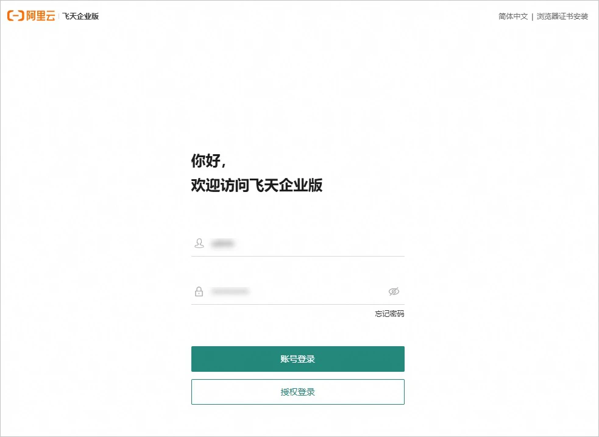

   > **说明**
   >
   > - 单击页面右上角的当前语言可以切换其它语言。
   >
   > - 授权登录是第三方认证中配置了全局IdP设置才会显示，且“授权登录”名称用户可按需自定义。
   >
   > - 由于浏览器证书过期或环境开启HTTPS认证等出现多次单击继续访问或无Apsara Uni-manager运营控制台地址入口等现象，此时需要安装证书才能正常访问。单击页面右上角的**浏览器证书安装**，可打开浏览器证书安装指南。

2. 输入正确的用户名及密码。

   > **说明**
   >
   > - 请向运营管理员获取登录控制台的用户名和密码。
   >
   > - 首次登录Apsara Uni-manager运营控制台时，需要修改登录用户名的密码，请按照提示完成密码修改。为提高安全性，密码长度必须为10~32位，且包含英文字母大小写、阿拉伯数字和特殊符号（感叹号（!）、at（@）、井号（#）、美元符号（$）、百分号（%）等）。

3. 单击**账号登录**。

4. 如果账号已激活MFA多因素认证，请根据以下两种情况进行操作：

   - **管理员强制开启MFA后的首次登录**

     <ol type="a">

     <li>

     在绑定虚拟MFA设备页面中，按页面提示步骤绑定MFA设备。

     </li>

     <li>

     按照步骤2重新输入账号和密码，单击**账号登录**。

     </li>

     </ol>

     <ol type="i" start="100">

     <li>

     输入6位MFA码后单击**认证**。

     </li>

     </ol>

   - **您已开启并绑定MFA**

     输入6位MFA码后单击**认证**。

     > **说明**
     >
     > 绑定并开启MFA的操作请参见《 Apsara Uni-manager运营控制台 用户指南》的**管理多因素认证**章节。

5. 在页面顶部的菜单栏中，单击**产品 > 数据库 > 关系型数据库 > 云原生分布式数据库PolarDB-X 2.0**。

<a id="section-4"></a>

# 4.实例管理

<a id="section-4-1"></a>

## 4.1. 创建实例

本文主要介绍如何创建PolarDB集分一体版实例。

**操作步骤**

1. 登录PolarDB集分一体版控制台。

   > **说明**
   >
   > 控制台支持以下功能：
   >
   > ：单击可刷新实例列表信息。
   >
   > 
   >
   > ：单击可选择采用**默认**或者**紧凑**模式显示实例列表。
   >
   > 
   >
   > ：单击可选择实例列表中显示的实例属性。
   >
   > 
   >
   > ：单击可将实例列表信息导出到本地。
   >
   > 

2. 在左上角单击**创建新实例**。

3. 在**创建PolarDB-X 2.0**页面，设置如下参数。

   <table>
     <tr>
       <th width="138">选项</th>
       <th>说明</th>
     </tr>
     <tr>
       <td>组织</td>
       <td>选择实例所属组织。</td>
     </tr>
     <tr>
       <td>资源集</td>
       <td>选择实例所属资源集。</td>
     </tr>
     <tr>
       <td>地域</td>
       <td>选择实例所属地域。</td>
     </tr>
     <tr>
       <td>系列</td>
       <td>可选择<strong>企业版（分布式）</strong>或<strong>标准版（集中式）</strong>。</td>
     </tr>
     <tr>
       <td>部署方式</td>
       <td>• 单可用区：仅需选择主可用区，备节点和日志节点将自动部署在同一个可用区。<br>• 双可用区：同城双机房容灾支持3、4存储节点副本。<br>• 三可用区：选择三可用区，各个节点将会分别部署在不同的可用区，因此三可用区实例具备了机房级别的容灾能力。</td>
     </tr>
     <tr>
       <td>部署模式</td>
       <td>• 系列为企业版（分布式），且部署方式为双可用区时可选：<br>• 主可用区（默认选项）：Leader节点部署在主可用区。<br>• 均衡模式：Leader节点均衡分布在主可用区和备可用区，可能存在应用跨机房访问实例。<br>说明部署方式为双可用区4存储节点或三可用区时可选均衡模式。双可用区3存储节点不支持选择。<br>• 系列为企业版（分布式），且部署方式为三可用区时只可选均衡模式。<br>说明仅系列为<strong>企业版（分布式）</strong>时需要配置此选项。</td>
     </tr>
     <tr>
       <td>主可用区</td>
       <td>选择实例所属的主可用区。</td>
     </tr>
     <tr>
       <td>资源池</td>
       <td>选择目标资源池。系统根据用户选择的资源池获取该资源池内支持的CPU列表。</td>
     </tr>
     <tr>
       <td>芯片架构</td>
       <td>可选择<strong>海光</strong>、<strong>鲲鹏</strong>、<strong>飞腾</strong>、<strong>英特尔</strong>等。</td>
     </tr>
     <tr>
       <td>兼容性</td>
       <td>可选择<strong>MySQL 5.7</strong>或<strong>MySQL 8.0</strong>。</td>
     </tr>
     <tr>
       <td>共享类型</td>
       <td>可选择<strong>通用</strong>或<strong>独享</strong>。<br>• 独享规格：每个实例会独占所分配到的计算资源（如CPU），而不会与同一服务器上的其他实例共享资源，性能表现更加稳定。<br>• 通用规格：同一硬件资源下的不同实例，会互相充分利用彼此空闲的计算资源（如CPU），通过复用计算资源享受规模红利，性价比更高。</td>
     </tr>
     <tr>
       <td>计算节点规格</td>
       <td>选择计算节点的规格。<br>说明仅系列为<strong>企业版（分布式）</strong>时需要配置此选项。</td>
     </tr>
     <tr>
       <td>计算节点组数量</td>
       <td>选择计算节点组数量。默认上限为64。<br>说明<br>• 仅系列为<strong>企业版（分布式）</strong>时需要配置此选项。<br>• 如果计算节点组数量上限不满足需求，可通过配置<code> polardbx_create_cn_max_num </code>参数提升上限至84。参数配置可参考<strong>《PolarDB集分一体版 运维指南》</strong>中<strong>《系统设置》</strong>章节。</td>
     </tr>
     <tr>
       <td>存储节点规格</td>
       <td>选择存储节点的规格。<br>说明仅系列为<strong>企业版（分布式）</strong>时需要配置此选项。</td>
     </tr>
     <tr>
       <td>存储节点副本数</td>
       <td>选择存储节点副本数，可选项如下：<br>• 3：部署方式为双可用区时，该选项不保证RPO=0。<br>• 4（默认选项）：单存储节点故障时，保障RPO=0。<br>说明仅部署方式为<strong>双可用区</strong>时需要配置此选项。</td>
     </tr>
     <tr>
       <td>存储节点组数量</td>
       <td>选择存储节点组数量。<br>说明仅系列为<strong>企业版（分布式）</strong>时需要配置此选项。</td>
     </tr>
     <tr>
       <td>实例规格</td>
       <td>选择目标实例规格。<br>说明仅系列为<strong>标准版（集中式）</strong>时需要配置此选项。</td>
     </tr>
     <tr>
       <td>节点组数量</td>
       <td>固定数量：1。<br>说明仅系列为<strong>标准版（集中式）</strong>时需要配置此选项。</td>
     </tr>
     <tr>
       <td>存储空间</td>
       <td>选择存储空间。</td>
     </tr>
     <tr>
       <td>网络类型</td>
       <td>无需选择，默认为<strong>专有网络</strong>。</td>
     </tr>
     <tr>
       <td>IP类型</td>
       <td>• <strong>IPv4</strong>：仅分配IPv4地址，适用于纯IPv4网络环境。<br>• <strong>IPv4/v6双栈</strong>：同时分配IPv4和IPv6地址，适用于需要同时支持IPv4与IPv6客户端访问的混合网络场景。启用后需配置IPv6白名单以控制IPv6地址的访问权限。<br>说明<br>• 如需配置该项参数需开启IPV6开关，具体操作，请参见<strong>《运维指南》</strong>中开启PolarDB-X IPv6开关章节。<br>• 如果提示未授权等信息，请参见租户组织对SLB服务授权操作。</td>
     </tr>
     <tr>
       <td>专有网络VPC</td>
       <td>选择VPC。</td>
     </tr>
     <tr>
       <td>交换机VSwitch</td>
       <td>选择交换机。</td>
     </tr>
     <tr>
       <td>参数模板</td>
       <td>支持选择已创建的参数模板。</td>
     </tr>
   </table>

4. 在最终创建实例前，请在页面右侧**配置概览**面板检查实例的整体配置，确保符合您的要求。

   如果配额不足，可单击**管理**进行配置。具体操作，请参见<strong>《统一云管平台 用户指南》</strong>中的<strong>《配额管理》</strong>章节。

5. 单击**提交**，跳转至控制台查看创建成功的实例。

<a id="section-4-2"></a>

## 4.2. 实例变配

一个PolarDB-X实例是由多个节点组成的分布式集群。单个节点承担了SQL路由、数据合并、聚合等功能。通过实例变配，您可以变更实例的节点规格，在业务繁忙时进行升配，承载更多的业务流量QPS，在业务空闲时进行降配，避免资源浪费。

**注意事项**

升降配过程中由于应用与实例连接会中断，可能在短时间内会产生闪断，请确保应用程序具备重连机制。

**操作步骤**

1. 登录PolarDB集分一体版控制台。

   > **说明**
   >
   > 控制台支持以下功能：
   >
   > ：单击可刷新实例列表信息。
   >
   > 
   >
   > ：单击可选择采用**默认**或者**紧凑**模式显示实例列表。
   >
   > 
   >
   > ：单击可选择实例列表中显示的实例属性。
   >
   > 
   >
   > ：单击可将实例列表信息导出到本地。
   >
   > 

2. 在目标实例右侧的**操作**栏中，单击**变配**。

   > **说明**
   >
   > - 也可以单击目标实例ID进入**基本信息**页面，在**配置信息**区域左上角，单击**变配**。
   >
   > - 当实例因磁盘写满处于锁定状态时，支持通过控制台单击**变配**按钮发起扩容任务，系统将在扩容完成后自动解除实例锁定。

3. 在**变配**页面，选择目标实例规格、存储空间、共享类型和变配时间等。

   > **说明**
   >
   > - 变配完成后，计算层和存储的节点都会升配或降配到相同的目标规格。
   >
   > - 变配时间支持选择**立即变配**或**运维时间变配**。运维时间设置请参见设置可维护时间段。

4. 单击**提交**，完成变配。

<a id="section-4-3"></a>

## 4.3. 增删节点

一个PolarDB-X实例是由多个节点组成的分布式集群。PolarDB-X支持通过增删节点来对实例进行扩缩容。

**注意事项**

- 增删节点会将迁移的数据重新均匀分布在各个节点上，为保证数据一致性，主实例与只读实例将共同完成水平扩展操作。

- 增删节点涉及底层数据迁移，请您耐心等待。在迁移完成后会进行切换，切换时会出现30秒左右的闪断，请确保应用具备重连机制。

**操作步骤**

1. 登录PolarDB集分一体版控制台。

   > **说明**
   >
   > 控制台支持以下功能：
   >
   > ：单击可刷新实例列表信息。
   >
   > 
   >
   > ：单击可选择采用**默认**或者**紧凑**模式显示实例列表。
   >
   > 
   >
   > ：单击可选择实例列表中显示的实例属性。
   >
   > 
   >
   > ：单击可将实例列表信息导出到本地。
   >
   > 

2. 在目标实例右侧的**操作**栏中，单击**增加节点**或**删减节点**。

3. 在弹出页面，选择目标节点数量。

   > **说明**
   >
   > 删减**数据节点数**会触发预检查，预计耗时在10分钟内。预检查通过后才能完成删减操作。

4. 单击**去开通**。

   执行成功后，在控制台可查看到实例状态变更的状态。

<a id="section-4-4"></a>

## 4.4. 释放实例与实例释放保护

本文介绍如何释放PolarDB-X实例以及实例释放保护相关操作，帮助您快速解决问题。

**释放实例**

1. 登录PolarDB集分一体版控制台。

   > **说明**
   >
   > 控制台支持以下功能：
   >
   > ：单击可刷新实例列表信息。
   >
   > 
   >
   > ：单击可选择采用**默认**或者**紧凑**模式显示实例列表。
   >
   > 
   >
   > ：单击可选择实例列表中显示的实例属性。
   >
   > 
   >
   > ：单击可将实例列表信息导出到本地。
   >
   > 

2. 单击目标实例名称。

3. 在**基本信息**界面，单击**释放实例**。

   > **警告**
   >
   > 释放过程开始后，实例将变为不可用，并且无法恢复，请谨慎操作。

4. 在释放实例页面，单击**释放**，释放实例成功。

   如果开启了实例释放保护，则会提示无法释放，需要关闭实例释放保护。具体操作，请参见释放实例保护。

**释放实例保护**

1. 登录PolarDB集分一体版控制台。

   > **说明**
   >
   > 控制台支持以下功能：
   >
   > ：单击可刷新实例列表信息。
   >
   > 
   >
   > ：单击可选择采用**默认**或者**紧凑**模式显示实例列表。
   >
   > 
   >
   > ：单击可选择实例列表中显示的实例属性。
   >
   > 
   >
   > ：单击可将实例列表信息导出到本地。
   >
   > 

2. 单击目标实例名称。

3. 在**基本信息**界面，单击**修改实例释放保护**。

4. 在弹框中选择**开启**实例释放保护。

5. 单击**确认**，实例释放保护开启成功。

<a id="section-4-5"></a>

## 4.5. 重启实例和节点

当PolarDB-X实例出现连接数满或性能问题时，您可以在控制台上手动重启实例，同时也支持重启节点（仅支持企业版）。

**操作步骤**

1. 登录PolarDB集分一体版控制台。

   > **说明**
   >
   > 控制台支持以下功能：
   >
   > ：单击可刷新实例列表信息。
   >
   > 
   >
   > ：单击可选择采用**默认**或者**紧凑**模式显示实例列表。
   >
   > 
   >
   > ：单击可选择实例列表中显示的实例属性。
   >
   > 
   >
   > ：单击可将实例列表信息导出到本地。
   >
   > 

2. 找到目标实例，单击实例名称。

3. 在**基本信息**页面，进行重启实例或重启节点操作。

   - 重启实例

     单击右上角**重启实例**。

     > **警告**
     >
     > 重启实例会造成连接中断，重启前请做好业务安排，谨慎操作。

   - 重启节点

     单击**计算节点列表**中**操作**列**重启节点**。

- 在弹出的对话框中，单击**确定**，完成实例或节点重启。

<a id="section-4-6"></a>

## 4.6. 升级内核版本

PolarDB集分一体版实例支持手动升级内核版本。每次重新登录实例控制台后，系统会自动查询内核版本信息。若系统检测到新的内核版本发布，系统不会自动升级内核版本，您可以在实例的基本信息页面手动升级内核版本。内核版本的升级可能涉及性能提升、新功能或问题修复等内容。

**注意事项**

- 升级内核版本会导致实例重启，并出现一次约30秒的闪断。建议在业务低峰期执行升级操作，并确保应用具备自动重连机制；若无自动重连机制，请手动完成应用与数据库的重连。

- 升级内核版本后无法降级。

- 如果有只读实例，将同主实例一同升级。

**操作步骤**

1. 登录PolarDB集分一体版控制台。

2. 在**实例列表**页面，单击目标实例ID，打开**基本信息**页面。

3. 在**配置信息**区域右侧，单击**升级内核版本**。

   > **说明**
   >
   > 如果此按钮置灰，表示内核已经是最新版本。

4. 在弹出的对话框中，选择**可升级版本**（可选），并设置**升级时间**、**灰度批次**和**灰度间隔（单位：小时）**，单击**确定**。

   > **重要**
   >
   > 如果不手动指定目标版本，系统将默认升级到最新的内核版本。

<a id="section-4-7"></a>

## 4.7. 只读实例

本文将介绍如何为主实例添加只读实例。

**背景信息**

主实例存储节点采用了基于Paxos的三副本高可用架构。而只读实例的存储节点，则通过增加Learner副本的方式来保证物理资源隔离，同时能够基于全局时钟来确保只读查询的强一致性。

**注意事项**

- 只读实例与主实例必须属于同一个地域，但是可以在不同的可用区。

- 只读实例无法单独存在，必须隶属于某个主实例。若您在主实例上创建了数据库，该数据库也会被复制到只读实例上。同理，若您在主实例上删除数据库时，只读实例上对应的数据库也会被删除。

**操作步骤**

1. 登录PolarDB集分一体版控制台。

   > **说明**
   >
   > 控制台支持以下功能：
   >
   > ：单击可刷新实例列表信息。
   >
   > 
   >
   > ：单击可选择采用**默认**或者**紧凑**模式显示实例列表。
   >
   > 
   >
   > ：单击可选择实例列表中显示的实例属性。
   >
   > 
   >
   > ：单击可将实例列表信息导出到本地。
   >
   > 

2. 在目标实例右侧的**操作**栏中，单击**只读实例**。

   您还可以单击实例名称，进入实例详情页面，在页面右侧的**只读实例**区域中，单击**添加只读实例**。

3. 在**创建只读实例**页面，按需填写如下参数。

   <table>
     <tr>
       <th>参数类别</th>
       <th>参数名称</th>
       <th>说明</th>
     </tr>
     <tr>
       <td>区域</td>
       <td>资源池</td>
       <td>选择目标资源池。系统根据用户选择的资源池获取该资源池内支持的CPU列表。</td>
     </tr>
     <tr>
       <td rowspan="8">规格设置</td>
       <td>部署方式</td>
       <td>实际部署方式。可选<strong>单可用区</strong>、<strong>双可用区</strong>和<strong>三可用区</strong>。</td>
     </tr>
     <tr>
       <td>兼容性</td>
       <td>兼容的数据库引擎。可选MySQL 5.7和MySQL8.0。</td>
     </tr>
     <tr>
       <td>共享类型</td>
       <td>可选独享和通用。</td>
     </tr>
     <tr>
       <td>计算节点规格</td>
       <td>选择计算节点的CPU核心数量和内存大小。</td>
     </tr>
     <tr>
       <td>计算节点数量</td>
       <td>计算节点数量，最少2个。</td>
     </tr>
     <tr>
       <td>存储节点规格</td>
       <td>选择存储节点的CPU核心数量和内存大小。</td>
     </tr>
     <tr>
       <td>存储节点数量</td>
       <td>存储节点数量，最少2个。</td>
     </tr>
     <tr>
       <td>存储空间</td>
       <td>数据存储的空间，最少50 GB。</td>
     </tr>
     <tr>
       <td rowspan="2">网络设置</td>
       <td>VPC</td>
       <td>专有网络。</td>
     </tr>
     <tr>
       <td>VSwitch</td>
       <td>交换机。</td>
     </tr>
   </table>

4. 单击**提交**，跳转至控制台查看创建成功的实例。

<a id="section-4-8"></a>

## 4.8. 标签管理

在实例数量较多的情况下，您可以创建多个标签，为实例绑定不同的标签对其进行分类，之后通过标签进行实例筛选。

**绑定标签**

1. 登录PolarDB集分一体版控制台。

2. 在左侧导航栏单击**实例列表。**

3. 在**实例列表**页面，单击目标实例**标签**列中的

   图标。

   

4. 在**编辑标签**对话框中，分别填写**标签键**和**标签值。**

5. 单击**确定**，即可完成标签创建<strong>。</strong>

**批量绑定标签**

1. 登录PolarDB集分一体版控制台。

2. 在左侧导航栏单击**实例列表**，然后单击目标实例**标签**列中的

   图标<strong>。</strong>

   

3. 在**编辑标签**对话框中，单击右上角**标签管理**，进入**标签管理**页面<strong>。</strong>

4. 在**创建/选择标签并绑定资源**对话框中，单击<strong>+创建/选择标签并绑定资源</strong>，然后分别选择**标签键**和**标签值。**

5. 单击**下一步**，然后依次**选择资源所在的组织和资源集**、**选择资源所在的区域**、**选择云产品**、选中目标实例<strong>。</strong>

6. 单击**下一步**，再单击**确认**，即可完成对多个实例批量绑定标签<strong>。</strong>

**使用标签筛选实例**

1. 登录PolarDB集分一体版控制台。

2. 在左侧导航栏单击**实例列表。**

3. 单击**高级筛选**。

4. 在**标签筛选**文本框输入需要搜索的标签键或标签值<strong>。</strong>

5. 单击**搜索。**

**查看实例绑定的标签**

1. 登录PolarDB集分一体版控制台。

2. 在左侧导航栏单击**实例列表。**

3. 在**实例列表**页面的标签列中，即可看到绑定的标签。

> **说明**
>
> 标签列中出现  ，鼠标悬浮其上即可看到所有该实例绑定的所有标签。

**解绑标签**

1. 登录PolarDB集分一体版控制台。

2. 在左侧导航栏单击**实例列表。**

3. 在**实例列表**页面， 将鼠标移动到目标实例**标签**列的

   图标上<strong>。</strong>

   

4. 在**编辑标签**对话框中，单击需要删除标签对应的

   图标。

   

5. 单击**确定。**

<a id="section-4-9"></a>

## 4.9. Binlog日志服务

PolarDB-X的日志节点（Change Data Capture，CDC）提供与MySQL Binlog格式和协议完全兼容的增量订阅能力，并具备兼容MySQL Replication协议的主从复制能力。在PolarDB-X控制台的日志引擎页面可以对Binlog服务进行管理。您可以在控制台上进行如下操作：查看，开通、升级、变配、释放。

**操作步骤**

1. 登录PolarDB集分一体版控制台。

2. 在左侧导航栏单击**实例列表。**

3. 在**实例列表**页面，单击实例ID。

4. 在左侧导航栏中，单击**配置与管理 > 日志引擎**。

   日志引擎界面支持以下操作：

   - 查看

     配置信息部分展示了日志服务的一些关键信息，集群列表部分展示了所有已经开通的日志服务，一个服务对应了一个集群，每个集群可以有若干节点，可以对每个服务进行独立的管理，服务类型分为单流和多流。

     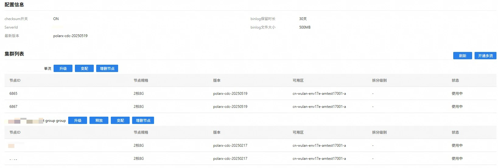

   - 升级

     在待升级的集群对应位置，单击**升级**。在弹出的对话框中，选择目标版本，单击**确定**。

     > **重要**
     >
     > - 集群列表中，**版本**列显示了当前该集群对应的日志节点版本，升级会引起Binlog订阅闪断。
     >
     > - 选择目标版本时，建议您选择最新的版本（默认显示的版本）。

   - 释放

     在待释放的集群对应位置，单击**释放**，单击**确定**，等待右上角任务进度完成即可。

     > **重要**
     >
     > 单流Binlog集群不支持释放。

   - 变配

     在待变配的集群对应位置，单击**变配**，单击**确定**，等待右上角任务进度完成即可。

     > **重要**
     >
     > 变配操作会引起Binlog订阅闪断。

   - 开通多流

     为了满足大规模集群、超大并发量的客户Binlog订阅需求，PolarDB-X实例支持您在控制台开通多流Binlog服务。

     单击**开通多流**，按提示输入参数，单击**提交**。

     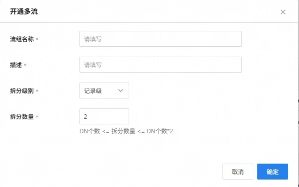

     | 参数名称 | 取值 |
     | --- | --- |
     | 描述 | 集群备注，以便于您在列表中管理该集群。 |
     | 流组名称 | 多流集群的流组名称，每个流组包含多个流。 |
     | 拆分数量 | 拆分流的数量，推荐值为DN的数量，取值范围为\[2-2×DN数量\]。 |
     | 拆分级别 | 支持选择记录、表、库级别，将数据基于HASH函数拆分到多个流进行处理。 |

<a id="section-4-10"></a>

## 4.10. 列存引擎

本文将介绍如何管理列存引擎节点。

**注意事项**

- 仅企业版支持列存引擎功能。

- 实例版本需为5.4.19-16989811及以上。

**管理列存引擎节点**

1. 登录PolarDB集分一体版控制台。

2. 在左侧导航栏单击**实例列表。**

3. 在**实例列表**页面，单击实例ID。

4. 在左侧导航栏中，单击**列存引擎**。在右侧界面中可进行以下操作：

   - 升级

     在页面右上角，单击列存引擎升级。在弹出的对话框中，选择目标版本，单击确定。

     > **重要**
     >
     > 集群列表中，版本列显示了当前该集群对应的列存引擎节点版本，升级会引起列存索引同步出现闪断，产生约几十秒的列存同步延迟。

     选择目标版本时，建议您选择最新的版本（默认显示的版本）。

   - 变配

     在页面右上角，单击变配，选择规格后单击确定，等待右上角任务进度完成即可。

     > **重要**
     >
     > 变配会引起列存索引同步出现闪断，产生约几十秒的列存同步延迟。

**添加列存只读实例**

1. 登录PolarDB集分一体版控制台。

2. 在左侧导航栏单击**实例列表。**

3. 在**实例列表**页面，单击实例ID。

4. 在基本信息页面，单击页面右侧**添加列存只读实例**，填写如下信息。

   <table>
     <tr>
       <th>参数类别</th>
       <th>参数名称</th>
       <th>说明</th>
     </tr>
     <tr>
       <td>区域</td>
       <td>资源池</td>
       <td>选择目标资源池。</td>
     </tr>
     <tr>
       <td rowspan="6">规格设置</td>
       <td>部署方式</td>
       <td>实际部署方式。可选<strong>单可用区</strong>、<strong>双可用区</strong>和<strong>三可用区</strong>。</td>
     </tr>
     <tr>
       <td>兼容性</td>
       <td>固定不可选，兼容的数据库引擎。</td>
     </tr>
     <tr>
       <td>共享类型</td>
       <td>可选<strong>独享</strong>或<strong>通用</strong>。</td>
     </tr>
     <tr>
       <td>计算节点规格</td>
       <td>选择计算节点的CPU核心数量和内存大小。</td>
     </tr>
     <tr>
       <td>计算节点数量</td>
       <td>计算节点数量，最少2个。</td>
     </tr>
     <tr>
       <td>存储节点规格</td>
       <td>选择存储节点的CPU核心数量和内存大小。</td>
     </tr>
     <tr>
       <td rowspan="3">网络设置</td>
       <td>网络类型</td>
       <td>固定为<strong>专有网络</strong>，不可变更。</td>
     </tr>
     <tr>
       <td>VPC</td>
       <td>专有网络。</td>
     </tr>
     <tr>
       <td>VSwitch</td>
       <td>交换机。</td>
     </tr>
   </table>

5. 填写完成后，单击**提交**。

<a id="section-4-11"></a>

## 4.11. 标准版升级至企业版

本文为您介绍标准版实例升级至企业版的操作步骤和说明。

> **重要**
>
> 如果升级之前SSL是开启状态，升级成企业版后需要在ASCM上重新开启SSL。

**前提条件**

- PolarDB集分一体版标准版实例需要查看和升级实例版本到最新内核版本。

- PolarDB集分一体版标准版实例如果有外网地址则需要先申请和释放外网地址。

- 升级时，企业版的存储节点规格需与当前标准版的规格保持一致。若您想要提升企业版的存储节点规格，请先升级标准版的规格。

**升级前检查**

1. 登录PolarDB集分一体版控制台。

2. 在页面左上角选择目标实例所在地域。

3. 在**实例列表**页，找到目标实例，单击实例ID。

4. 在**常用操作**区域，单击**升到企业版**。

5. 正式升级前，需要进行预检，后台将创建一个临时的企业版实例，该临时实例和标准版实例使用同一个存储节点，单击**开始检查**，具体检查内容如下：

   | 检查项 | 描述 | 通过条件 |
   | --- | --- | --- |
   | 账号 | 检查账号是否能够导入 | 标准版实例上的数据库账号可以成功导入临时企业版实例。 |
   | 白名单 | 检查白名单是否能够导入 | 标准版实例上的白名单可成功导入临时企业版实例。 |
   | XA事务 | 检查是否存在XA事务 | 企业版实例不支持XA事务相关的命令，向标准版实例发送XA RECOVER命令。 |
   | 数据库数量 | 检查数据库数量是否不超过企业版的参数限制 | 标准版实例上的业务库数量不能超过企业版的逻辑库限制，此项检查失败请联系我们。 |
   | 存储过程或者自定义函数 | 检查是否存在用户创建的存储过程或者自定义函数 | 不存在用户创建的存储过程或者自定义函数。 |
   | 连接地址 | 检查连接地址是否只有一个 | 只有一个VPC连接。 |
   | 只读实例 | 检查是否存在只读实例 | 没有只读实例。 |
   | 隔离级别 | 是否为企业版支持的隔离级别 | 为企业版支持的隔离级别。 |

6. 单击**确定**。PolarDB集分一体版会发起一个标准版升到企业版的检查任务，可单击右上方**任务列表**查看任务进度。

   检查任务完成后，在**升到企业版**窗口查看检查结果。

   > **说明**
   >
   > 如果出现检查项失败会标注失败原因，可根据失败原因排查问题。

**升到企业版**

**操作步骤**

1. 打开**升到企业版**窗口，单击**开始升级**。

2. 在升级配置页面，选择合适的计算节点规格和计算节点组数量等信息。

3. 单击**提交**。

4. 在实例基本信息界面中，单击右上方的  图标，打开任务列表，可以查看任务进程。

5. 升级完成后，等待几分钟，在实例列表页可以查看到实例系列变更为企业版。单击实例ID，可以进入企业版的实例页面。

<a id="section-4-12"></a>

## 4.12. 迁移网络可用区

**前提条件**

- 实例状态：实例必须处于 “运行中” 且无其他进行中的运维任务（如变配、扩容）。

- 主节点和网络不在同一可用区。例如：VSwitch在A可用区，主节点在B可用区。

- 提前创建目标可用区的VSwitch，以便切换时选择。

- 仅支持跨双可用区4副本部署的标准版（集中式）。

**操作步骤**

1. 登录PolarDB集分一体版控制台。

2. 在左侧导航栏单击**实例列表。**

3. 在**实例列表**页面，单击实例ID。

4. 在左侧导航栏中，选择**配置与管理 > 基本信息**。

5. 在常用操作模块，单击**迁移网络可用区**。

6. 在弹框中，配置**切换后VSwitch**，选择**切换时间**。

   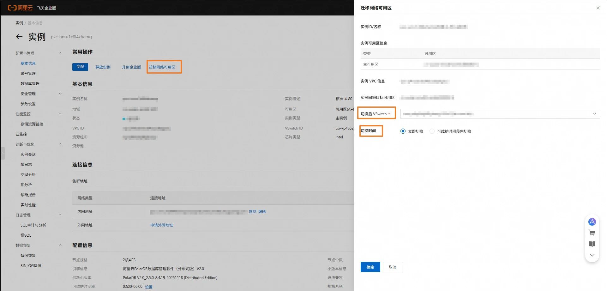

7. 单击**确定**。

   在实例列表可以看到实例状态为**修改网络连接中**，待实例状态改为**运行中**，操作完成。

<a id="section-4-13"></a>

## 4.13. 单个数据节点灰度升级

支持对PolarDB 集分一体版企业版实例中的单个数据节点进行独立内核升级。通过灰度升级，确保在升级过程中业务的高可用性与数据安全性，实现平滑过渡。

**前提条件**

- 实例必须处于“运行中”状态，且无其他正在进行的运维任务（如扩容、变配）。

- 仅支持企业版（分布式）。

- 目标数据节点下的所有副本（主、备、日志）状态必须健康，无延迟报警。

**名词解释**

| 名词 | 解释 |
| --- | --- |
| DN | 数据节点（负责存储实际数据的单元）。 |
| Leader | 主副本（处理读写请求的核心副本）。 |
| Follower | 备副本（同步主副本数据，用于容灾或只读）。 |
| Logger | 日志副本（专门负责记录日志，保障数据一致性）。 |

**操作步骤**

**步骤一：执行单副本灰度升级**

1. 登录PolarDB集分一体版控制台。

2. 在左侧导航栏单击**实例列表。**

3. 在**实例列表**页面，单击实例ID。

4. 在左侧导航栏中，选择**配置与管理 > 基本信息**。

5. 在数据节点列表，单击操作列**单副本升级**。

6. 在弹框中单击**确定**。

   系统会自动选取该数据节点下的一个备副本，将其重搭为新内核版本。主副本和日志副本仍为旧版本，仅备副本变为新版本。此时业务流量仍走旧版主副本，业务无感知。

**步骤二：业务验证**

确认新版本备副本的数据同步正常，且兼容当前业务。

1. 可通过只读地址或其他方式，将少量测试流量指向该新版备副本或在后台检查其同步状态。

2. 监控该副本的延迟、错误日志及资源使用情况。

3. 根据验证情况执行如下操作：

   - 验证失败 ：执行回滚操作，具体参见步骤三：单副本升级回滚。

   - 验证成功 ：执行继续升级操作，具体参见步骤四：完成单数据节点全量升级。

**步骤三：单副本升级回滚**

1. 登录PolarDB集分一体版控制台。

2. 在左侧导航栏单击**实例列表。**

3. 在**实例列表**页面，单击实例ID。

4. 在左侧导航栏中，选择**配置与管理 > 基本信息**。

5. 在数据节点列表，单击操作列**单副本升级回滚**。

6. 在弹框中单击**确定**。

   该数据节点下的所有副本（主、备、日志）均恢复至升级前的旧版本。排查问题后，可重新发起升级流程。

**步骤四：完成单数据节点全量升级**

1. 登录PolarDB集分一体版控制台。

2. 在左侧导航栏单击**实例列表。**

3. 在**实例列表**页面，单击实例ID。

4. 在左侧导航栏中，选择**配置与管理 > 基本信息**。

5. 在数据节点列表，单击操作列**单副本升级继续**。

6. 在弹框中单击**确定**。

   该分片单元内的三个副本（主、备、日志）全部升级为新内核版本。

<a id="section-4-14"></a>

## 4.14. 数据投版快速回滚

数据投版快速回滚是PolarDB 集分一体版标准版提供的一项数据保护能力，用于在业务验证（如DDL变更、数据写入等）后，快速将数据回退到验证前的状态。

**核心功能**

- **断开副本同步**：在进行业务验证前，断开所有DN（数据节点）的follower（备副本）节点与leader（主副本）节点之间的数据同步，使follower节点保留验证前的数据快照。

- **恢复副本同步**：业务验证正常后，恢复follower与leader之间的同步，实例恢复正常运行。

- **强制单副本拉起**：业务验证失败后，将follower节点强制提升为leader节点，其余副本基于该新leader重搭，实现数据快速回滚到验证前状态。

**适用场景**

- 大版本升级或变更前的数据保护。

- DDL操作（如增加列、修改表结构）前的安全验证。

- 数据批量写入前的风险隔离。

- 需要快速回退的业务发布窗口。

**注意事项**

- **只读实例**：如果实例包含只读实例，断开副本同步后，只读实例对应的follower节点不受影响，仍保持同步。

- **强制单副本拉起为不可逆操作**：执行后原leader节点的数据将被丢弃，其余副本将基于新leader重搭。

- 在执行断开副本同步操作前，请确保已完成必要的数据备份。

**断开副本同步**

介绍如何在业务验证前断开DN的follower节点与leader节点之间的数据同步。

**前提条件**

- 实例为标准版（集中式）。

- 实例当前状态为运行中。

**操作步骤**

1. 登录PolarDB集分一体版控制台。

2. 在左侧导航栏单击**实例列表。**

3. 在**实例列表**页面，单击实例ID。

4. 在左侧导航栏中，选择**配置与管理 > 基本信息**。

5. 在数据节点列表，单击**断开副本同步**。

6. 在弹框中，单击**确定**。等待任务执行完成。

7. 验证断开结果：

   - 查看数据节点列表，确认follower节点已与leader节点断开同步。

   - 确认实例状态已变更为维护中。

**恢复副本同步**

介绍在业务验证成功后，如何恢复follower节点与leader节点之间的数据同步。

**前提条件**

- 实例当前处于维护中状态（已执行过断开副本同步操作）。

- 业务验证结果正常，确认保留验证后的数据变更。

**操作步骤**

1. 登录PolarDB集分一体版控制台。

2. 在左侧导航栏单击**实例列表。**

3. 在**实例列表**页面，单击实例ID。

4. 在左侧导航栏中，选择**配置与管理 > 基本信息**。

5. 在数据节点列表，单击**恢复副本同步**。等待任务执行完成。

6. 验证恢复结果：

   - 查看数据节点列表，确认副本同步已恢复。

   - 确认实例状态已恢复为运行中。

**强制单副本拉起**

介绍在业务验证失败后，如何通过强制单副本拉起将数据回滚到验证前状态。

**前提条件**

- 实例当前处于维护中状态（已执行过断开副本同步操作）。

- 业务验证失败，确认需要回退数据。

**操作步骤**

1. 登录PolarDB集分一体版控制台。

2. 在左侧导航栏单击**实例列表。**

3. 在**实例列表**页面，单击实例ID。

4. 在左侧导航栏中，选择**配置与管理 > 基本信息**。

5. 在数据节点列表，单击**强制单副本拉起**。等待任务执行完成。

6. 验证回滚结果：

   - 查看数据节点列表，确认原follower节点已提升为leader节点。

   - 确认其余副本已基于新leader重搭完成。

   - 登录主实例查询数据，确认数据已回退到断开副本同步前的状态。

<a id="section-4-15"></a>

## 4.15. 计算节点管理

PolarDB-X支持为实例创建CN子实例，为不同业务分配相互隔离的计算节点，实现业务流量的物理隔离。本文介绍如何创建、释放和重启计算节点。

**功能简介**

连接地址（Endpoint）是应用访问PolarDB-X实例的入口。应用通过连接地址建立数据库连接后，请求由该地址挂载的计算节点（CN）承接处理。

默认情况下，实例只有一个系统连接地址，它挂载实例的全部计算节点，所有业务流量都汇聚到同一组计算节点上。当在线业务访问与数据同步（如DTS任务）、批量跑批等流量同时存在时，各类流量会争抢同一组计算资源，可能出现核心业务受批量任务影响的情况。

创建CN子实例可以为实例新增一个独立的连接地址，并为该地址分配单独的一组计算节点。该组计算节点与系统默认地址所使用的计算节点相互隔离，不承载对方地址的流量。您可以为不同业务配置不同的连接地址，将各自的访问流量固定到专属的计算节点上，实现业务流量的物理隔离。创建完成后，您可以在实例基本信息页的拓扑信息区域，按集群名称/ID查看各连接地址对应的计算节点。

适用场景：

- **流量隔离**：将在线业务流量与DTS数据同步、批量跑批等流量分别指向不同的连接地址，避免相互影响。

- **资源独享**：为稳定性要求高的核心业务分配独立的CN子实例，独享其计算资源，不受其他业务负载波动影响。

**前提条件**

- 已创建PolarDB-X实例。具体操作，请参见创建实例。

- 已创建数据库账号和数据库。具体操作，请参见创建与删除数据库。

**创建CN子实例**

您可以为实例创建CN子实例，获得一个独立的连接地址，并将特定业务的访问流量隔离到该地址专属的计算节点上。

1. 登录PolarDB集分一体版控制台。

2. 在左侧导航栏中，单击**实例列表**，找到目标实例，单击实例名称。

3. 在左侧导航栏中，选择**配置与管理 > 计算节点管理**。

4. 在计算节点管理页面，单击**创建CN子实例**。

5. 在**创建CN子实例**对话框，配置以下参数。

   <table>
     <tr>
       <th width="146">参数</th>
       <th>说明</th>
     </tr>
     <tr>
       <td>集群名称</td>
       <td>输入集群名称。<br>• 由大小写字母、中划线（-）组成，以字母开头，以字母结尾。<br>• 2～32个字符。</td>
     </tr>
     <tr>
       <td>集群连接串</td>
       <td>该CN子实例连接地址的名称前缀。<br>• 由小写字母、数字、中划线（-）组成，以字母开头，以数字或字母结尾。<br>• 6～40个字符。</td>
     </tr>
     <tr>
       <td>规格系列</td>
       <td>支持选择<strong>独享规格</strong>或<strong>通用规格</strong>。具体规格信息，请参见标准版实例规格。</td>
     </tr>
     <tr>
       <td>可用区</td>
       <td>CN子实例所在可用区与主实例保持一致，不支持单独选择。</td>
     </tr>
     <tr>
       <td>IP类型</td>
       <td>支持选择<strong>IPv4</strong>或<strong>IPv4/v6</strong>。</td>
     </tr>
     <tr>
       <td>专有网络VPC</td>
       <td>选择VPC。</td>
     </tr>
     <tr>
       <td>交换机VSwitch</td>
       <td>选择交换机。</td>
     </tr>
     <tr>
       <td>计算节点规格</td>
       <td>选择计算节点的规格。</td>
     </tr>
     <tr>
       <td>计算节点数</td>
       <td>选择该CN子实例包含的计算节点个数，取值范围为2～32。</td>
     </tr>
   </table>

6. 单击**确定**。

> **说明**
>
> 创建CN子实例需要一定时间，完成后状态将变为**已激活**。

**变更CN子实例**

CN子实例创建完成后，您可以在计算节点管理页面按集群执行**变配**、**增加节点**、**删减节点**和**释放**操作。其中变配、增加节点和删减节点的操作方式与实例一致，具体操作，请参见实例变配和增删节点。

**释放CN子实例**

您可以释放不再需要的CN子实例，回收其占用的计算节点资源。

> **重要**
>
> 释放CN子实例后，该实例对应的连接地址同时失效，挂载在该地址上的计算节点被回收，该地址上的连接将断开，请确保应用具备重连机制。释放操作不可逆，请谨慎操作。系统默认地址所属的集群（集群名称为default）不支持释放。

1. 登录PolarDB集分一体版控制台。

2. 在左侧导航栏中，单击**实例列表**，找到目标实例，单击实例名称。

3. 在左侧导航栏中，选择**配置与管理 > 计算节点管理**。

4. 在计算节点管理页面，找到目标CN子实例所在集群，单击**释放**。

5. 在弹出的对话框中，单击**确定**。

**重启计算节点**

当计算节点出现异常时，您可以重启计算节点以恢复服务。

> **重要**
>
> 重启计算节点会导致该节点上的连接短暂中断，请确保应用具备重连机制。

1. 登录PolarDB集分一体版控制台。

2. 在左侧导航栏中，单击**实例列表**，找到目标实例，单击实例名称。

3. 在左侧导航栏中，选择**配置与管理 > 基本信息**。

4. 在拓扑信息-计算节点列表区域，找到目标计算节点，单击**重启节点**。

5. 在弹出的对话框中，单击**确定**。

<a id="section-5"></a>

# 5.PolarDB AI

<a id="section-5-1"></a>

## 5.1. 智能助手

PolarDB-X 2.0 智能助手是PolarDB-X（即PolarDB 集分一体版）推出的智能运维辅助工具，基于大语言模型与分布式数据库专家知识库，集成实例详情查询、智能问答、智能诊断等能力。PolarDB-X 2.0 智能助手支持自然语言交互，深度理解PolarDB-X的分布式架构，能够对多节点性能问题进行根因诊断，提供优化建议。

**注意事项**

- **提问精准**：提问时建议@选择实例ID、地域（Region）、时间范围及问题现象描述。对于分布式场景，可指定具体的DN节点或数据库名称以获取更精准的诊断。

- **上下文对话**：智能助手支持多轮对话，可基于前一轮的诊断结果进行追问。但涉及敏感操作（例如分片规则变更建议）时，请谨慎评估后再执行。

- **诊断时效性**：性能诊断依赖监控数据，建议在问题发生后尽快发起分析，以确保相关指标数据仍在保留期内。

- **会话异常**：如遇卡顿请退出会话重新提问。

- **决策审慎**：所有优化建议仅供参考，特别是分布式架构下的变更操作，请在充分测试和评估后再执行。

**快速访问智能助手**

支持如下两种途径进入智能对话界面：

- 您可以登录PolarDB集分一体版控制台，在左侧导航栏选择**AI 助手**进入对话界面。

- 在**云原生分布式数据库PolarDB-X 2.0**页面中单击页面最右侧边栏  图标进入对话界面。

**智能助手能力概览**

PolarDB-X 智能助手涵盖以下专业技能域，从实例信息查询到性能优化，全方位覆盖分布式数据库运维场景：

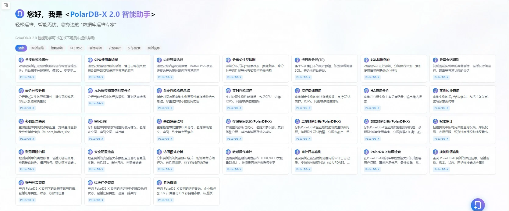

| 技能领域 | 核心能力 | 描述 |
| --- | --- | --- |
| 实例运维 | 全栈健康巡检 | 执行从基础配置到拓扑架构的全方位健康检查，主动发现隐患并生成优化建议。 |
| 性能诊断 | 实例性能诊断 | 深入分析 CPU、内存及分布式架构瓶颈，实时定位资源异常根因以保障系统稳定。 |
| SQL优化 | SQL 诊断优化 | 智能识别慢 SQL 并分析执行计划，提供索引与改写建议以提升查询效率。 |
| 会话与锁 | 会话/锁异常排查 | 快速识别异常长时会话与死锁链路，解决并发阻塞问题以恢复业务流畅度。 |
| 安全审计 | 安全风险审计 | 全面扫描权限分配、账号风险及敏感操作，确保数据库访问合规且可追溯。 |
| 知识检索 | 知识库问答 | 基于自然语言交互检索产品文档与最佳实践，即时解答运维疑难与使用困惑。 |
| 实例信息 | 实例资产查询 | 一站式查询实例规格、账号列表、任务进度及运行参数，实现资产透明化管理。 |

**安全与合规**

- **数据访问范围**：为提供准确的诊断和问答服务，PolarDB-X 2.0 智能助手会访问实例元数据、拓扑信息、性能监控指标、慢日志关键信息及您输入的问题。智能助手不会执行任何DDL或DML语句，不会直接修改实例配置或触发数据搬迁。

- **数据隐私**：您的查询历史和实例数据严格遵守阿里云隐私政策，不会被用于模型训练或发送给第三方。

- **责任声明**：智能助手提供的诊断结论和优化建议仅供参考。在生产环境执行变更前（特别是涉及分片规则调整、全局索引变更等分布式操作），需由专业技术人员审查评估。

<a id="section-5-2"></a>

## 5.2. 智能迁移

<a id="section-5-2-1"></a>

### 5.2.1. 智能迁移指引

云原生数据库PolarDB智能一键迁移是基于DTS能力构建的一站式数据库迁移平台，提供从场景选择、前置检查、任务配置到地址切换的全链路可视化引导流程。通过自动化配置与无缝切换能力，实现应用无感迁移；同时集成AI迁移助手，支持智能问答、日志诊断与优化建议，显著提升迁移效率与成功率。

**功能简介**

云原生数据库PolarDB智能一键迁移是一项面向企业级用户的全流程、低门槛、智能化数据库迁移解决方案。该功能将原本分散在多个控制台的操作整合至PolarDB控制台统一界面，用户无需跳转即可完成从实例准备到业务割接的全部动作。

**核心能力**

| 能力类别 | 功能说明 |
| --- | --- |
| 全链路可视化 | 四步引导式流程，状态清晰可见，所有操作闭环管理。 |
| 自动化配置 | 根据迁移场景自动匹配DTS链路、创建迁移任务，减少人工干预。 |
| 应用无感切换 | 支持数据库连接地址一键切换，业务零中断。 |
| AI智能辅助 | 内嵌AI迁移助手，实时解答问题、分析日志、给出修复建议。 |

**支持的迁移场景**

当前支持以下迁移路径，系统会根据所选场景自动加载对应的操作方案与检查项，确保迁移方案合规高效。

<table>
  <tr>
    <th width="183">迁移链路分类</th>
    <th>支持的迁移链路</th>
  </tr>
  <tr>
    <td>MySQL引擎迁移</td>
    <td>• RDS MySQL到PolarDB MySQL主备版<br>• RDS MySQL到PolarDB MySQL集群版<br>• PolarDB MySQL主备版5.7到PolarDB MySQL主备版8.0<br>• PolarDB MySQL主备版到PolarDB MySQL集群版<br>• PolarDB MySQL集群版到PolarDB MySQL集群版</td>
  </tr>
  <tr>
    <td>PostgreSQL引擎迁移</td>
    <td>• RDS PostgreSQL到PolarDB PostgreSQL主备版<br>• PolarDB PostgreSQL主备版到PolarDB PostgreSQL主备版<br>• PolarDB PostgreSQL主备版到PolarDB PostgreSQL集群本地盘版</td>
  </tr>
  <tr>
    <td>PolarDB-X引擎迁移</td>
    <td>• RDS MySQL到PolarDB-X 2.0<br>• PolarDB-X 2.0到PolarDB-X 2.0</td>
  </tr>
</table>

**使用流程**

智能一键迁移采用线性四步引导模式，您可在同一页面完成全部迁移操作。

**步骤一：选择迁移场景**

1. 登录云原生数据库PolarDB控制台。

2. 在左侧导航栏中，进入**AI能力 > 智能迁移**页面，选择源数据库和目标PolarDB实例类型。

**功能优势**

- 系统自动识别迁移需求，预填充后续流程所需参数；

- 自动推荐最优DTS链路与同步策略；

- 配置成本大幅降低，避免手动选型错误。

**步骤二：执行前置检查**

单击**去查看**，系统将根据所选场景跳转至官方迁移指南文档获取详细操作指引，以及迁移前检查清单等，例如源库是否开启Binlog及格式是否正确、安全组与白名单是否放通通信等。

**功能优势**

- 检查内容与场景强绑定，避免遗漏；

- 快速链接官网文档，排查效率大幅提升。

**步骤三：创建DTS数据迁移任务**

确认前置检查完成后，单击**去迁移**，系统将自动为您在该页面弹出DTS迁移任务配置页面，仅需根据步骤二中的方案要求填写关键信息，即可快速构建迁移链路。

**功能优势**

- 无需跳转至DTS控制台，所有任务状态在本页面集中展示；

- 配置时间大幅减少，任务快速启动；

- 任务异常实时告警，便于及时干预。

**步骤四：查看迁移结果并切换数据库地址**

当增量同步延迟趋近于0且无报错时，可进行最终的应用连接切换。

> **说明**
>
> 建议在业务低峰期执行地址切换，并提前验证应用程序的重连机制。

1. 在**数据库迁移结果**区域确认迁移状态正常时，单击任务操作列下的**迁移地址**。

   您可在结果列表中，查看任务的创建时间、运行状态、任务开始时源端行数和任务结束时目标端行数等详情。

   > **说明**
   >
   > 任务开始后若源端数据发生变化，会导致任务结束时目标端行数与源端不一致。

2. 在弹出的页签中，确认源库和目标库信息，单击**切换地址**。

**功能优势**

- 实现应用无感迁移，业务无中断；

- 切换过程可追溯、可回滚，安全保障高。

<a id="section-5-2-2"></a>

### 5.2.2. AI迁移助手

AI迁移助手是一键迁移平台的智能辅助工具，基于DTS MCP（Model Context Protocol）服务提供自然语言问答、任务状态查询和故障诊断能力，帮助用户快速解决迁移过程中的链路查询、配置指导与异常处理问题。

**功能简介**

AI迁移助手集成于PolarDB控制台“智能迁移”页面，通过理解用户提问，自动调用DTS后端数据与日志，提供准确的迁移支持建议。无需跳转，即可获得实时、可操作的解决方案。其中主要能力包括：

- 意图识别：支持中文自然语言输入，精准解析问题意图。

- 链路查询：查询当前Region支持的DTS迁移组合及连接方式（如云实例、公网IP）等。

- 配置指导：返回指定链路支持的迁移对象类型（表、索引等）和DDL操作范围等。

- 状态监控：实时获取任务运行状态、延迟、流量、同步进度等。

- 故障诊断：分析任务日志，定位异常原因并给出修复建议。

**使用入口**

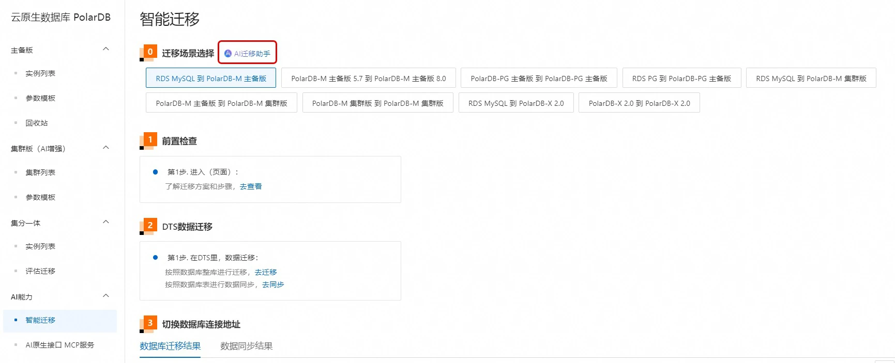

**示例场景**

**场景1：查询迁移链路支持情况**

用户问题：当前环境是否支持RDS PostgreSQL到PolarDB PostgreSQL的迁移？支持的数据源连接方式有哪些（如云实例、公网IP等）？

AI智能响应：DTS MCP自动识别当前Region、产品版本及网络环境，实时返回该区域下所有可用的DTS链路组合，明确标注源和目标数据库类型、支持的连接模式（VPC内网/云实例/公网IP）及限制项。提升信息获取效率，减少因链路不明确导致的工单咨询量约20%。

**场景2：查询迁移任务如何配置**

- 用户问题：从RDS PostgreSQL云实例到PolarDB PostgreSQL的迁移链路中，支持哪些迁移对象类型和同步操作？

- AI智能响应：DTS MCP根据用户输入的源端与目标端信息，自动检索并返回该链路支持的迁移对象（如表、视图、函数、存储过程等），以及支持的DDL/DML同步范围和操作限制，提供结构初始化、全量迁移、增量同步等阶段的配置指引，显著降低任务配置复杂度达20%。

**场景3：排查任务异常**

- 用户问题：DTS迁移任务l65e721当前运行是否正常？存在的异常如何应对？

- AI智能响应：DTS MCP自动拉取任务实时状态、延迟趋势、同步进度、吞吐流量及错误日志，精准判断任务健康度；若检测到异常或潜在风险，AI助手将生成诊断报告并推荐修复方案，有效降低故障响应时间与人工介入需求，助力工单及预警量下降30%。

<a id="section-5-2-3"></a>

### 5.2.3. RDS MySQL到PolarDB-X 2.0标准版白屏化迁移方案

本文为您介绍RDS MySQL到PolarDB-X 2.0标准版白屏化迁移方案，帮助您快速完成迁移操作。

> **说明**
>
> 一键迁移功能依赖RDS、PolarDB、DTS和oneconsole，需要同时将上述组件版本升级至目标版本及以上。

**一.概述**

支持将RDS MySQL本地盘版实例迁移到PolarDB-X 2.0标准版实例，支持的MySQL版本如下：

| 源端 | 目标端 |
| --- | --- |
| RDS MySQL 5.6 | PolarDB 5.7、8.0 |
| RDS MySQL 5.7 | PolarDB 5.7、8.0 |
| RDS MySQL 8.0 | PolarDB 8.0（不支持降级大版本迁移） |

整体方案如下：新建PolarDB实例后，通过DTS进行数据在线迁移，迁移后切换地址即可。

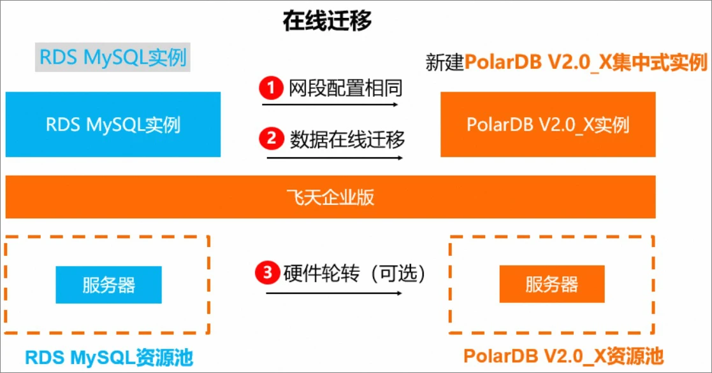

**用户告知**

- 需得到客户许可时操作。

- 迁移过程涉及实例连接地址的切换，建议在业务低峰期执行。

**优势说明**

- 支持连接地址迁移：可保留数据库原连接地址，应用端无需修改连接地址。

- 支持迁移回切：迁移切换后，若发现兼容性等问题，支持切回原来的实例。

- 迁移进度随时查看：支持查看当前的迁移进度，方便制定切换计划。

- 支持增量迁移，停机时间小于10分钟：通过DTS实现数据在线热迁移，数据迁移过程中无需停机。仅实例切换过程涉及一次闪断（即当业务从RDS MySQL切换至PolarDB时），需要申请约10分钟的停机窗口。

**限制说明**

- 不支持跨地域迁移：仅支持同一个Region中的实例进行迁移，不支持跨Region迁移。

- 如果涉及跨MySQL大版本迁移（如RDS MySQL5.7到PolarDB 8.0等），语法差异需要用户自行评估：由于MySQL大版本之间并非完全兼容，当用户涉及跨大版本迁移时，应用对语法的兼容性需要自行评估。

- 连接地址切换的限制：切换地址仅进行DNS的切换，实际使用中有如下限制。

  - 带地址切换只会互换RDS和PolarDB的域名；VSwitch、VIP等配置不会切换。端口也不会发生切换。

  - DNS缓存问题：切换域名后，可能会存在DNS解析缓存问题，在缓存过期时间内可能会出现连接不上数据库或数据库只支持读操作，无法执行写入操作等情况，可以通过手工刷新服务器的DNS缓存加速缓存更新。

- 其他限制及注意事项：请参见《数据传输服务DTS用户指南》中数据迁移配置案例下对应源库和目标库的注意事项及限制。

**二.创建PolarDB实例**

使用前需要先手工创建PolarDB-X 2.0实例。建议您在正式迁移前，先进行测试数据的迁移和演练，充分评估好SQL语法兼容性，避免语法错误或数据混乱。

**创建PolarDB实例注意事项**

- 实例规格：推荐您创建的实例规格，与待迁移的RDS MySQL实例规格一致。

- VPC网络：建议您选择与现有环境一致的VPC网络。如果选择了不同的VPC，请迁移前确认VPC网络可以被应用端访问。

- 网络白名单：实例创建成功后，需要您配置与RDS MySQL一致的IP白名单，避免实例切换后，应用无法访问PolarDB实例。

由于迁移前后实例ID发生了变化，如果涉及到如下场景，需要提前与相关应用系统沟通，确保迁移后相关系统也及时做好切换，否则，可能会导致应用系统使用异常。

带地址切换不涉及数据库连接地址和端口修改，对于已有的连接地址不受影响，但是当进行变更配置的时候，需要在如下的系统中重新配置：

- 数据库产品：DTS、DMS 通过云实例方式访问

- 大数据产品：DataWorks、DataHub通过云实例方式访问

- 云监控系统：切换到监控新的实例

> **说明**
>
> 使用时需注意如下产品目前不支持PolarDB-X 2.0。
>
> - 弹性伸缩产品：ESS
>
> - 安全审计产品：SDDP

**三.迁移前置检查**

**仔细阅读DTS迁移限制说明，评估约束限制**

数据迁移是基于DTS实现的，在迁移前，请仔细阅读《数据传输服务DTS用户指南》中源库和目标库的注意事项及限制，明确注意事项和约束限制，并按要求完成迁移前的准备。

**语法兼容性检查**

如果涉及跨MySQL大版本迁移，请在迁移前做好应用的SQL语法兼容性验证和开发。确保迁移前后，应用都能正常使用。MySQL各版本间差异，请参见RDS MySQL整理的升级数据库版本和MySQL release notes。

**四.操作步骤**

**数据迁移**

1. 登录云原生数据库PolarDB控制台，在左侧导航栏选择**AI能力 > 智能迁移**。

2. 在智能迁移页面，单击**RDS MySQL到PolarDB-X 2.0**。

3. 单击**去迁移**配置迁移任务。

4. 配置源库和目标库信息。

   <table>
     <tr>
       <th>类别</th>
       <th>配置</th>
       <th>说明</th>
     </tr>
     <tr>
       <td>无</td>
       <td>任务名称</td>
       <td>DTS会自动生成一个任务名称，建议配置具有业务意义的名称（无唯一性要求），便于后续识别。</td>
     </tr>
     <tr>
       <td rowspan="6"></td>
       <td>实例地区</td>
       <td>创建数据迁移实例时已指定，不可变更。</td>
     </tr>
     <tr>
       <td>是否跨阿里云账号</td>
       <td>选择<strong>不跨账号</strong>。</td>
     </tr>
     <tr>
       <td>RDS实例ID</td>
       <td>选择源RDS实例ID。</td>
     </tr>
     <tr>
       <td>数据库账号</td>
       <td>填入数据库账号。</td>
     </tr>
     <tr>
       <td>数据库密码</td>
       <td>填入该数据库账号的密码。</td>
     </tr>
     <tr>
       <td>连接方式</td>
       <td>根据需求选择连接方式。如果设置为<strong>SSL安全连接</strong>，您需要提前开启RDS实例的SSL加密功能。</td>
     </tr>
     <tr>
       <td rowspan="5"></td>
       <td>是否跨阿里云账号</td>
       <td>选择<strong>不跨账号</strong>。</td>
     </tr>
     <tr>
       <td>实例地区</td>
       <td>创建数据迁移实例时已指定，不可变更。</td>
     </tr>
     <tr>
       <td>实例ID</td>
       <td>选择云原生分布式数据库PolarDB-X 2.0实例ID。</td>
     </tr>
     <tr>
       <td>数据库账号</td>
       <td>填入目标云原生分布式数据库PolarDB-X 2.0实例的数据库账号。</td>
     </tr>
     <tr>
       <td>数据库密码</td>
       <td>填入该数据库账号的密码。</td>
     </tr>
   </table>

5. 配置完成后，单击页面下方的**测试连接以进行下一步**。

6. 选择迁移对象及迁移类型。

   | 配置 | 说明 |
   | --- | --- |
   | 任务步骤 | • 如果只需要进行全量数据迁移，同时选中<strong>库表结构迁移</strong>和<strong>全量迁移</strong>。<br>• 如果需要进行不停机迁移，同时选中<strong>库表结构迁移</strong>、<strong>全量迁移</strong>和<strong>增量迁移</strong>。<br>说明如果未选中<strong>增量迁移</strong>，为保障数据一致性，全量数据迁移期间请勿在源数据库中写入新的数据。 |
   | 目标已存在表的处理模式 | • <strong>预检查并报错拦截</strong>：检查目标数据库中是否有同名的表。如果目标数据库中没有同名的表，则通过该检查项目；如果目标数据库中有同名的表，则在预检查阶段提示错误，数据迁移任务不会被启动。<br>• <strong>忽略报错并继续执行</strong>：跳过目标数据库中是否有同名表的检查项。<br>警告选择为<strong>忽略报错并继续执行</strong>，可能导致数据不一致，给业务带来风险，例如：<br>• 表结构一致的情况下，在目标库遇到与源库主键的值相同的记录，则会保留目标库中的该条记录，即源库中的该条记录不会迁移至目标库中。<br>• 表结构不一致的情况下，可能导致只能迁移部分列的数据或迁移失败。 |
   | 目标库对象名称大小写策略 | 您可以配置目标实例中迁移对象的库名、表名和列名的英文大小写策略。默认情况下选择<strong>DTS默认</strong><strong>策略</strong>，您也可以选择与源库、目标库默认策略保持一致。 |
   | 源库对象 | 在<strong>源库对象</strong>框中单击待迁移的对象，然后单击图标将其移动至<strong>已选择对象</strong>框。<br>说明<br>• 您可以根据实际情况，展开导航树进行正则搜索。<br>• 迁移对象选择的粒度为库、表。 |
   | 已选择对象 | 默认情况下，迁移对象在目标库中的名称与源库保持一致。<br>说明<br>• 如需按库或表级别选择迁移的SQL操作，请在<strong>已选择对象</strong>中右击待迁移对象，并在弹出的对话框中选择所需迁移的SQL操作。<br>• 如果使用了对象名映射功能，可能会导致依赖这个对象的其他对象迁移失败。 |

7. 单击**下一步高级配置**，进行高级配置。

   | 配置项目 | 配置说明 |
   | --- | --- |
   | 源库、目标库无法连接后的重试时间 | 在迁移任务启动后，若源库或目标库连接失败则DTS会报错。对于可预期的报错，DTS会立即进行持续的重试连接，默认重试720分钟，您也可以在取值范围（10~1440分钟）内自定义重试时间，建议设置30分钟以上。如果DTS在设置的时间内重新连接上源、目标库，迁移任务将自动恢复。否则，迁移任务将失败。<br>说明针对同源或者同目标的多个DTS实例，如DTS实例A和DTS实例B，设置网络重试时间时A设置30分钟，B设置60分钟，则重试时间以低的30分钟为准。 |

8. 上述配置完成后，单击页面下方的**下一步预检查并启动**。

   > **重要**
   >
   > - 在数据迁移任务正式启动之前，会先进行预检查。只有预检查通过后，才能成功启动数据迁移任务。
   >
   > - 如果预检查失败，请单击**查看详情**并请根据提示修复问题，然后重新进行预检查。

9. **预检查通过率**显示为100%时，单击**返回列表**。

   > **说明**
   >
   > 如果未选择增量数据迁移，您只需等待迁移任务完成即可，迁移任务会自动结束；如果选择了增量数据迁移，迁移任务不会自动结束，您需要等待迁移任务处于**运行中**且无延迟时，手动结束迁移任务。

**数据同步**

1. 登录云原生数据库PolarDB控制台，在左侧导航栏选择**AI能力 > 智能迁移**。

2. 在智能迁移页面，单击**RDS MySQL到PolarDB-X 2.0**。

3. 单击**去同步**配置同步任务。

4. 配置源库和目标库信息。

   **类别**

   **配置**

   **说明**

   DTS会自动生成一个任务名称，建议配置具有业务意义的名称（无唯一性要

   无

   **任务名称**

   求），便于后续识别。

   创建数据同步实例时已指定，不可变更。

   **实例地区**

   **是否跨阿里云账**

   选择**不跨账号**。

   **号**

   选择源RDS实例ID。

   **RDS实例ID**

   填入数据库账号。

   **数据库账号**

   填入该数据库账号的密码。

   **数据库密码**

   根据需求选择连接方式。如果设置为**SSL安全连接**，您需要提前开启RDS实

   **连接方式**

   例的SSL加密功能。

   **是否跨阿里云账**

   选择**不跨账号**。

   **号**

   创建数据同步实例时已指定，不可变更。

   **实例地区**

   选择云原生分布式数据库PolarDB-X 2.0实例ID。

   **实例ID**

   填入目标云原生分布式数据库PolarDB-X 2.0实例的数据库账号。

   **数据库账号**

   填入该数据库账号的密码。

   **数据库密码**

5. 配置完成后，单击页面下方的**测试连接以进行下一步**。

6. 选择同步对象及同步类型。

   <table>
     <tr>
       <th width="215">配置项目</th>
       <th>说明</th>
     </tr>
     <tr>
       <td>任务步骤</td>
       <td>固定选中<strong>增量同步</strong>。默认情况下，您还需要同时选中<strong>库表结构同步</strong>和<strong>全量同</strong><strong>步</strong>。预检查完成后，DTS会将源实例中待同步对象的全量数据在目标集群中初始化，作为后续增量同步数据的基线数据。</td>
     </tr>
     <tr>
       <td>目标已存在表的处理模式</td>
       <td>• <strong>预检查并报错拦截</strong>：检查目标数据库中是否有同名的表。如果目标数据库中没有同名的表，则通过该检查项目；如果目标数据库中有同名的表，则在预检查阶段提示错误，数据同步作业不会被启动。<br>• <strong>忽略报错并继续执行</strong>：跳过目标数据库中是否有同名表的检查项。<br>警告选择为<strong>忽略报错并继续执行</strong>，可能导致数据不一致，给业务带来风险，例如：<br>• 表结构一致的情况下，如果在目标库遇到与源库主键的值相同的记录，在初始化阶段会保留目标库中的该条记录；在增量同步阶段则会覆盖目标库的该条记录。<br>• 表结构不一致的情况下，可能会导致无法初始化数据、只能同步部分列的数据或同步失败。</td>
     </tr>
     <tr>
       <td>目标库对象名称大小写策略</td>
       <td>可以配置目标集群中同步对象的库名、表名和列名的英文大小写策略。默认情况下选择<strong>DTS默认策略</strong>，您也可以选择与源库、目标库默认策略保持一致。</td>
     </tr>
     <tr>
       <td>源库对象</td>
       <td>在<strong>源库对象</strong>框中单击待同步的对象（库或表），然后单击图标将其移动<br>至<strong>已选择对象</strong>框。<br>说明同步对象选择的粒度为Schema或表。</td>
     </tr>
     <tr>
       <td>已选择对象</td>
       <td>默认情况下，同步对象的名称保持不变。<br>说明<br>• 如需选择同步的SQL操作，请在<strong>已选择对象</strong>中右击待同步对象，并在弹出的对话框中选择所需同步的SQL操作。<br>• 如需设置WHERE条件过滤数据，请在<strong>已选择对象</strong>中右击待同步的表，在弹出的对话框中设置过滤条件。<br>• 如果使用了对象名映射功能，可能会导致依赖这个对象的其他对象同步失败。</td>
     </tr>
   </table>

7. 单击**下一步高级配置**，进行高级配置。

   | 配置项目 | 配置说明 |
   | --- | --- |
   | 源库、目标库无法连接后的重试时间 | 在同步任务启动后，若源库或目标库连接失败则DTS会报错。对于可预期的报错，DTS会立即进行持续的重试连接，默认持续重试时间为720分钟，您也可以在取值范围（10~1440分钟）内自定义重试时间，建议设置30分钟以上。如果DTS在设置的重试时间内重新连接上源库、目标库，同步任务将自动恢复。否则，同步任务将会失败。<br>说明针对同源或者同目标的多个DTS实例，如DTS实例A和DTS实例B，设置网络重试时间时A设置30分钟，B设置60分钟，则重试时间以低的30分钟为准。 |

8. 上述配置完成后，单击页面下方的**下一步预检查并启动**。

   > **重要**
   >
   > - 在数据同步任务正式启动之前，会先进行预检查。只有预检查通过后，才能成功启动数据同步任务。
   >
   > - 如果预检查失败，请单击**查看详情**并根据提示修复问题，然后重新进行预检查。

9. **预检查通过率**显示为100%时，单击**返回列表**。

**五.切换数据库地址连接**

在迁移中单击切换即可。DNS切换后，客户端有缓存，可能还是会继续连接源数据库，需要断开源数据库的数据库连接。

**六.迁移回滚（可选）**

再次执行步骤五切换数据库地址链接即可将地址进行回迁。

<a id="section-5-2-4"></a>

### 5.2.4. PolarDB-X 2.0到PolarDB-X 2.0白屏化迁移方案

本文为您介绍PolarDB-X 2.0到PolarDB-X 2.0白屏化迁移方案，帮助您快速完成迁移操作。

> **说明**
>
> 一键迁移功能依赖RDS、PolarDB、DTS和oneconsole，需要同时将上述组件版本升级至目标版本及以上。

**一.概述**

支持将PolarDB-X 2.0实例迁移到PolarDB-X 2.0实例，支持的版本如下：

| 源端（包含企业版和标准版） | 目标端（包含企业版和标准版） |
| --- | --- |
| 5.7 | 5.7、8.0 |
| 8.0 | 5.7、8.0 |

整体方案如下：新建PolarDB实例后，通过DTS进行数据在线迁移，迁移后切换地址即可。

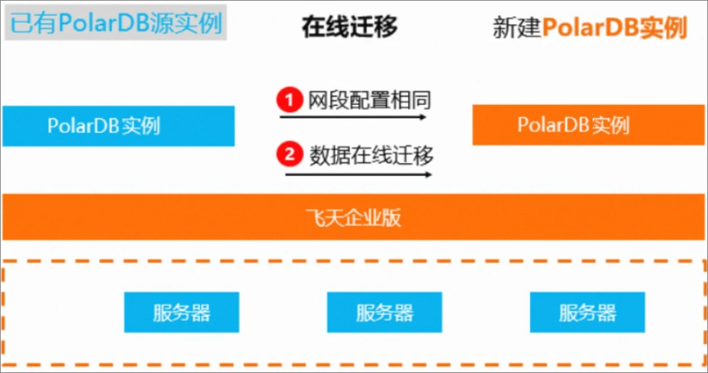

**用户告知**

- 需得到客户许可时操作。

- 迁移过程涉及实例连接地址的切换，建议在业务低峰期执行。

**优势说明**

- 支持连接地址迁移：可保留数据库原连接地址，应用端无需修改连接地址。

- 支持迁移回切：迁移切换后，若发现兼容性等问题，支持切回原来的实例。

- 迁移进度随时查看：支持查看当前的迁移进度，方便制定切换计划。

- 支持增量迁移，停机时间小于10分钟：通过DTS实现数据在线热迁移，数据迁移过程中无需停机。仅实例切换过程涉及一次闪断（即当业务从PolarDB-X 2.0（标准版或企业版）5.7切换至PolarDB-X 2.0（标准版或企业版）8.0时），需要申请约10分钟的停机窗口。

**限制说明**

- 不支持跨地域迁移：仅支持同一个Region中的实例进行迁移，不支持跨Region迁移。

- 大版本之间并非完全兼容，当涉及跨大版本迁移时，应用对语法的兼容性需要自行评估。

- 连接地址切换的限制：切换地址仅进行DNS的切换，实际使用中有如下限制：

  - 带地址切换只会互换目标端和源端域名；Vswitch、VIP等配置不会切换。端口也不会发生切换。

  - DNS缓存问题：切换域名后，可能会存在DNS解析缓存问题，在缓存过期时间内可能会出现连接不上数据库或数据库只支持读操作，无法执行写入操作等情况，可以通过手工刷新服务器的DNS缓存加速缓存更新。

- 其他限制及注意事项：请参见<strong>《数据传输服务DTS用户指南》</strong>中数据迁移配置案例下对应源库和目标库的注意事项及限制。

**二.创建PolarDB实例**

使用前需要先手工创建PolarDB-X 2.0实例。建议您在正式迁移前，先进行测试数据的迁移和演练，充分评估好SQL语法兼容性，避免语法错误或数据混乱。

**创建PolarDB实例注意事项**

- 实例规格：推荐您创建的实例规格，与待迁移的PolarDB-X 2.0实例规格一致。

- VPC网络：建议您选择与现有环境一致的VPC网络。如果选择了不同的VPC，请迁移前确认VPC网络可以被应用端访问。

- 网络白名单：实例创建成功后，需要您配置与PolarDB-X 2.0一致的IP白名单，避免实例切换后，应用无法访问PolarDB实例。

由于迁移前后实例ID发生了变化，如果涉及到如下场景，需要提前与相关应用系统沟通，确保迁移后相关系统也及时做好切换，否则，可能会导致应用系统使用异常。

带地址切换不涉及数据库连接地址和端口修改，对于已有的连接地址不受影响，但是当进行变更配置的时候，需要在如下的系统中重新配置：

- 数据库产品：DTS，DMS 通过云实例方式访问

- 大数据产品：DataWorks，Datahub通过云实例方式访问

- 云监控系统：切换到监控新的实例

> **说明**
>
> 使用时需注意如下产品目前不支持PolarDB-X 2.0。
>
> - 弹性伸缩产品：ESS
>
> - 安全审计产品：SDDP

**三.迁移前置检查**

**仔细阅读DTS迁移限制说明，评估约束限制**

数据迁移是基于DTS实现的，在迁移前，请仔细阅读《数据传输服务DTS用户指南》中数据迁移配置案例下对应源库和目标库的注意事项及限制，明确注意事项和约束限制，并按要求完成迁移前的准备。

**语法兼容性检查**

请在迁移前做好应用的SQL语法兼容性验证和开发。确保迁移前后，应用都能正常使用。MySQL各版本间差异，请参见MySQL release notes。

**四.DTS数据迁移**

**数据迁移操作步骤**

**操作步骤**

1. 登录云原生数据库PolarDB控制台，在左侧导航栏选择**AI能力 > 智能迁移**。

2. 在智能迁移页面，单击**PolarDB-X 2.0到PolarDB-X 2.0**。

3. 单击**去迁移**配置迁移任务。

4. 配置源库和目标库信息。

   <table>
     <tr>
       <th>类别</th>
       <th>配置</th>
       <th>说明</th>
     </tr>
     <tr>
       <td>无</td>
       <td>任务名称</td>
       <td>DTS会自动生成一个任务名称，建议配置具有业务意义的名称（无唯一性要求），便于后续识别。</td>
     </tr>
     <tr>
       <td rowspan="5">源库信息</td>
       <td>实例地区</td>
       <td>创建数据迁移实例时已指定，不可变更。</td>
     </tr>
     <tr>
       <td>是否跨阿里云账号</td>
       <td>选择<strong>不跨账号</strong>。</td>
     </tr>
     <tr>
       <td>实例ID</td>
       <td>选择源PolarDB实例ID。</td>
     </tr>
     <tr>
       <td>数据库账号</td>
       <td>填入源PolarDB的数据库账号。</td>
     </tr>
     <tr>
       <td>数据库密码</td>
       <td>填入该数据库账号的密码。</td>
     </tr>
     <tr>
       <td rowspan="5">目标库信息</td>
       <td>实例地区</td>
       <td>创建数据迁移实例时已指定，不可变更。</td>
     </tr>
     <tr>
       <td>是否跨阿里云账号</td>
       <td>选择不跨账号。</td>
     </tr>
     <tr>
       <td>实例ID</td>
       <td>选择目标PolarDB实例ID。</td>
     </tr>
     <tr>
       <td>数据库账号</td>
       <td>填入目标PolarDB实例的数据库账号，需具备目标数据库的读写权限。</td>
     </tr>
     <tr>
       <td>数据库密码</td>
       <td>填入该数据库账号的密码。</td>
     </tr>
   </table>

5. 配置完成后，单击页面下方的**测试连接以进行下一步**。

6. 选择迁移对象及迁移类型。

   | 配置 | 说明 |
   | --- | --- |
   | 任务步骤 | • 如果只需要进行全量数据迁移，同时选中<strong>库表结构迁移</strong>和<strong>全量迁移</strong>。<br>• 如果需要进行不停机迁移，同时选中<strong>库表结构迁移</strong>、<strong>全量迁移</strong>和<strong>增量迁移</strong>。<br>说明如果未选中<strong>增量迁移</strong>，为保障数据一致性，全量数据迁移期间请勿在源数据库中写入新的数据。 |
   | 目标已存在表的处理模式 | • <strong>预检查并报错拦截</strong>：检查目标数据库中是否有同名的表。如果目标数据库中没有同名的表，则通过该检查项目；如果目标数据库中有同名的表，则在预检查阶段提示错误，数据迁移任务不会被启动。<br>• <strong>忽略报错并继续执行</strong>：跳过目标数据库中是否有同名表的检查项。<br>警告选择为<strong>忽略报错并继续执行</strong>，可能导致数据不一致，给业务带来风险，例如：<br>• 表结构一致的情况下，在目标库遇到与源库主键的值相同的记录，则会保留目标库中的该条记录，即源库中的该条记录不会迁移至目标库中。<br>• 表结构不一致的情况下，可能导致只能迁移部分列的数据或迁移失败。 |
   | 目标库对象名称大小写策略 | 您可以配置目标集群中迁移对象的库名、表名和列名的英文大小写策略。默认情况下选择<strong>DTS默认</strong><strong>策略</strong>，您也可以选择与源库、目标库默认策略保持一致。 |
   | 源库对象 | 在<strong>源库对象</strong>框中单击待迁移的对象，然后单击图标将其移动至<strong>已选择对象</strong>框。<br>说明<br>• 您可以根据实际情况，展开导航树进行正则搜索。<br>• 迁移对象选择的粒度为库、表。 |
   | 已选择对象 | 默认情况下，迁移对象在目标库中的名称与源库保持一致。<br>说明<br>• 如需按库或表级别选择迁移的SQL操作，请在<strong>已选择对象</strong>中右击待迁移对象，并在弹出的对话框中选择所需迁移的SQL操作。<br>• 如果使用了对象名映射功能，可能会导致依赖这个对象的其他对象迁移失败。 |

7. 单击**下一步高级配置**，进行高级配置。

   | 配置项目 | 配置说明 |
   | --- | --- |
   | 选择目标库的引擎类型 | 请根据实际情况，选择目标库的引擎类型为<strong>InnoDB</strong>或<strong>X-Engine</strong>。 |
   | 源库、目标库无法连接后的重试时间 | 在迁移任务启动后，若源库或目标库连接失败则DTS会报错。对于可预期的报错，DTS会立即进行持续的重试连接，默认重试720分钟，您也可以在取值范围（10~1440分钟）内自定义重试时间，建议设置30分钟以上。如果DTS在设置的时间内重新连接上源、目标库，迁移任务将自动恢复。否则，迁移任务将失败。<br>说明针对同源或者同目标的多个DTS实例，如DTS实例A和DTS实例B，设置网络重试时间时A设置30分钟，B设置60分钟，则重试时间以低的30分钟为准。 |

8. 上述配置完成后，单击页面下方的**下一步预检查并启动**。

   > **重要**
   >
   > - 在数据迁移任务正式启动之前，会先进行预检查。只有预检查通过后，才能成功启动数据迁移任务。
   >
   > - 如果预检查失败，请单击**查看详情**并请根据提示修复问题，然后重新进行预检查。

9. **预检查通过率**显示为100%时，单击**返回列表**。

   > 如果未选择增量数据迁移，您只需等待迁移任务完成即可，迁移任务会自动结束；如
   >
   > **说明**
   >
   > 果选择了增量数据迁移，迁移任务不会自动结束，您需要等待迁移任务处于**运行中**且无延迟时，手动结束迁移任务。

**数据同步操作步骤**

1. 登录云原生数据库PolarDB控制台，在左侧导航栏选择**AI能力 > 智能迁移**。

2. 在智能迁移页面，单击**PolarDB-X 2.0到PolarDB-X 2.0**。

3. 单击**去同步**配置同步任务。

4. 配置源库和目标库信息。

   **类别**

   **配置**

   **说明**

   DTS会自动生成一个任务名称，建议配置具有业务意义的名称（无唯一

   无

   **任务名称**

   性要求），便于后续识别。

   创建数据同步实例时已指定，不可变更。

   **实例地区**

   **是否跨阿里云账**

   选择**不跨账号**。

   **号**

   **源库信息**

   选择源PolarDB实例ID。

   **实例ID**

   填入源PolarDB的数据库账号。

   **数据库账号**

   填入该数据库账号的密码。

   **数据库密码**

   创建数据同步实例时已指定，不可变更。

   **实例地区**

   **是否跨阿里云账**

   选择不跨账号。

   **号**

   **目标库信息**

   选择目标PolarDB实例ID。

   **实例ID**

   填入目标PolarDB实例的数据库账号，需具备目标数据库的读写权限。

   **数据库账号**

   填入该数据库账号的密码。

   **数据库密码**

5. 配置完成后，单击页面下方的**测试连接以进行下一步**。

6. 选择同步对象及同步类型。

   <table>
     <tr>
       <th width="215">配置项目</th>
       <th>说明</th>
     </tr>
     <tr>
       <td>任务步骤</td>
       <td>固定选中<strong>增量同步</strong>。默认情况下，您还需要同时选中<strong>库表结构同步</strong>和<strong>全量同</strong><strong>步</strong>。预检查完成后，DTS会将源实例中待同步对象的全量数据在目标集群中初始化，作为后续增量同步数据的基线数据。</td>
     </tr>
     <tr>
       <td>目标已存在表的处理模式</td>
       <td>• <strong>预检查并报错拦截</strong>：检查目标数据库中是否有同名的表。如果目标数据库中没有同名的表，则通过该检查项目；如果目标数据库中有同名的表，则在预检查阶段提示错误，数据同步作业不会被启动。<br>• <strong>忽略报错并继续执行</strong>：跳过目标数据库中是否有同名表的检查项。<br>警告选择为<strong>忽略报错并继续执行</strong>，可能导致数据不一致，给业务带来风险，例如：<br>• 表结构一致的情况下，如果在目标库遇到与源库主键的值相同的记录，在初始化阶段会保留目标库中的该条记录；在增量同步阶段则会覆盖目标库的该条记录。<br>• 表结构不一致的情况下，可能会导致无法初始化数据、只能同步部分列的数据或同步失败。</td>
     </tr>
     <tr>
       <td>目标库对象名称大小写策略</td>
       <td>可以配置目标集群中同步对象的库名、表名和列名的英文大小写策略。默认情况下选择<strong>DTS默认策略</strong>，您也可以选择与源库、目标库默认策略保持一致。</td>
     </tr>
     <tr>
       <td>源库对象</td>
       <td>在<strong>源库对象</strong>框中单击待同步的对象（库或表），然后单击图标将其移动<br>至<strong>已选择对象</strong>框。<br>说明同步对象选择的粒度为Schema或表。</td>
     </tr>
     <tr>
       <td>已选择对象</td>
       <td>默认情况下，同步对象的名称保持不变。<br>说明<br>• 如需选择同步的SQL操作，请在<strong>已选择对象</strong>中右击待同步对象，并在弹出的对话框中选择所需同步的SQL操作。<br>• 如需设置WHERE条件过滤数据，请在<strong>已选择对象</strong>中右击待同步的表，在弹出的对话框中设置过滤条件。<br>• 如果使用了对象名映射功能，可能会导致依赖这个对象的其他对象同步失败。</td>
     </tr>
   </table>

7. 单击**下一步高级配置**，进行高级配置。

   | 配置项目 | 配置说明 |
   | --- | --- |
   | 源库、目标库无法连接后的重试时间 | 在同步任务启动后，若源库或目标库连接失败则DTS会报错。对于可预期的报错，DTS会立即进行持续的重试连接，默认持续重试时间为720分钟，您也可以在取值范围（10~1440分钟）内自定义重试时间，建议设置30分钟以上。如果DTS在设置的重试时间内重新连接上源库、目标库，同步任务将自动恢复。否则，同步任务将会失败。<br>说明针对同源或者同目标的多个DTS实例，如DTS实例A和DTS实例B，设置网络重试时间时A设置30分钟，B设置60分钟，则重试时间以低的30分钟为准。 |

8. 上述配置完成后，单击页面下方的**下一步预检查并启动**。

   > **重要**
   >
   > - 在数据同步任务正式启动之前，会先进行预检查。只有预检查通过后，才能成功启动数据同步任务。
   >
   > - 如果预检查失败，请单击**查看详情**并根据提示修复问题，然后重新进行预检查。

9. **预检查通过率**显示为100%时，单击**返回列表**。

**五.切换数据库地址连接**

在迁移中单击切换即可。DNS切换后，客户端有缓存，可能还是会继续连接源数据库，需要断开源数据库的数据库连接。

**六.迁移回滚（可选）**

再次执行步骤五切换数据库地址链接即可将地址进行回迁。

<a id="section-6"></a>

# 6.参数管理

<a id="section-6-1"></a>

## 6.1. 参数设置

PolarDB-X支持查看计算层和存储层的相关参数说明，您还可以在控制台上自定义修改这些参数值。

**操作步骤**

1. 登录PolarDB集分一体版控制台。

   > **说明**
   >
   > 控制台支持以下功能：
   >
   > ：单击可刷新实例列表信息。
   >
   > 
   >
   > ：单击可选择采用**默认**或者**紧凑**模式显示实例列表。
   >
   > 
   >
   > ：单击可选择实例列表中显示的实例属性。
   >
   > 
   >
   > ：单击可将实例列表信息导出到本地。
   >
   > 

2. 找到目标实例，单击实例名称。

3. 在左侧导航栏中，单击**配置与管理 > 参数设置**，您可以选择修改**计算层**或**存储层**的参数。

   修改计算层参数

   <ol type="i">

   <li>

   在**计算层**页签下找到目标参数，在**当前值**对话框中输入新的参数值。

   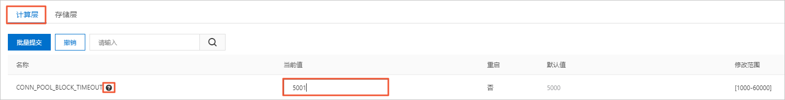

   </li>

   </ol>

   修改存储层参数

   <ol type="i">

   <li>

   单击**存储层**页签。

   </li>

   <li>

   找到目标参数，在**当前值**对话框中输入新的参数值。

   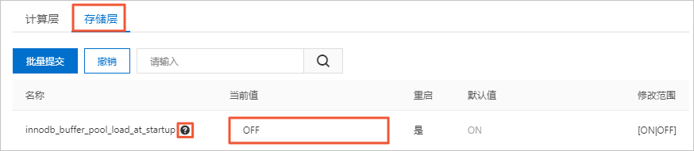

   </li>

   </ol>

   > **说明**
   >
   > - 请输入目标参数右侧**修改范围**栏规定的参数值，否则当您**批量提交**时会出现错误提示。
   >
   > - 您可以单击参数名称后面的  图标查看目标参数的详细说明。

4. 单击**批量提交**，在**保存改动**界面确认待修改参数的信息，单击**确定**。

5. 单击页面右上角**重启实例**。

   > **说明**
   >
   > 对于**是否重启**栏显示为**是**的参数，**批量提交**新的**运行参数值**后，您需要重启实例新参数值才会生效。

**参数说明**

**计算层参数说明**

> **说明**
>
> 仅PolarDB-X企业版实例支持计算层参数。

| 变量名 | 是否重启 | 默认值 | 范围 | 说明 |
| --- | --- | --- | --- | --- |
| PLAN_CACHE | 否 | FALSE | \[TRUE\|FA LSE\] | 计划缓存的开关。 |
| ENABLE_REC YCLEBIN | 否 | FALSE | \[TRUE\|FA LSE\] | 开启回收站的开关。 |
| SHOW_TABL ES_CACHE | 否 | FALSE | \[TRUE\|FA LSE\] | 是否对<code> SHOW TABLES </code>结果做缓存。 |
| MERGE_CON CURRENT | 否 | FALSE | \[TRUE\|FA LSE\] | 全并行执行开关，主要影响DDL和全下推简单查询的并行执行度。 |
| MERGE_UNIO N | 否 | FALSE | \[TRUE\|FA LSE\] | 默认关闭，打开意味着物理SQL不做<code> UNION </code>优化，且将串行执行下推的物理SQL。 |
| MERGE_UNIO N_SIZE | 否 | -1 | \[0-10000\] | 通过<code> UNION </code>合并物理SQL的数量，默认结合连接池可用连接数自适应推导。 |
| TABLE_META _CACHE_EXPI RE_TIME | 否 | 300 | \[0-180000\] | 元数据缓存过期时间。 |
| COLUMN_LA BEL_INSENSI TIVE | 否 | TRUE | \[FALSE\|T RUE\] | 返回列大小写是否敏感。 |
| RECORD_SQ L | 否 | TRUE | \[FALSE\|T RUE\] | 审计日志开关。 |
| SOCKET_TIM EOUT | 否 | 90000 0 | \[0~3600 000\] | 物理SQL超时时间。 |
| TRANSACTIO N_POLICY | 否 | TSO | \[XA\|TSO\| TSO_REA DONLY\] | 事务策略。 |
| SHARE_READ _VIEW | 否 | FALSE | \[TRUE\|FA LSE\] | 共享ReadView开关。 |
| ENABLE_TRX _SINGLE_SH ARD_OPTIMI ZATION | 否 | TRUE | \[TRUE\|FA LSE\] | 事务单分片优化开关。 |
| GET_TSO_TI MEOUT | 否 | 10 | \[1-1800\] | 获取TSO时间戳超时时间。 |
| MAX_TRX_D URATION | 否 | 28800 | \[1-180000\] | 事务物理超时时间。 |
| TRANSACTIO N_ISOLATION | 否 | REPEA TABLE -READ | \[READ-UNCOMM ITTED\|RE AD-COMMITT ED\|REPE ATABLE-READ\|SE RIALIZAB LE\] | 事务隔离级别。 |
| GROUP_CON CURRENT_BL OCK | 否 | TRUE | \[TRUE\|FA LSE\] | 非MPP模式下分库级别执行策略。 |
| SEQUENTIAL _CONCURRE NT_POLICY | 否 | FALSE | \[TRUE\|FA LSE\] | 非MPP模式下单并发执行策略。 |
| DML_SKIP_D UPLICATE_C HECK_FOR_P K | 否 | TRUE | \[TRUE\|FA LSE\] | DML过程中是否跳过主键的冲突检查。 |
| DML_SKIP_C RUCIAL_ERR_CHECK | 否 | FALSE | \[TRUE\|FA LSE\] | DML过程中是否允许有DML报错的事务继续提交。 |
| DML_USE_RE TURNING | 否 | TRUE | \[TRUE\|FA LSE\] | 是否使用returning优化。 |
| BROADCAST _DML | 否 | FALSE | \[TRUE\|FA LSE\] | 是否允许广播表的写入不走分布式事务。 |
| SEQUENCE_S TEP | 否 | 10000 | \[1-1000000 0\] | SEQUENCE步长，默认为10万。 |
| MERGE_DDL _TIMEOUT | 否 | 0 | \[1-1000000 0\] | DDL物理连接超时时间，默认是0，不超时。 |
| MERGE_DDL _CONCURRE NT | 否 | FALSE | \[FALSE\|T RUE\] | DDL是否采用全并行模式, 默认库级并发。 |
| SLOW_SQL_T IME | 否 | 1000 | \[1-180000\] | 慢SQL阈值。 |
| LOAD_DATA_BATCH_INSE RT_SIZE | 否 | 1024 | \[1-180000\] | LOAD DATA每次batch insert的记录条数。 |
| LOAD_DATA_CACHE_BUFF ER_SIZE | 否 | 60 | \[1-180000\] | LOAD DATA缓存大小，默认60 MB。主要用途为流控。 |
| MAX_ALLOW ED_PACKET | 否 | 16777 216 | \[419430 4-3355443 2\] | 最大包大小。 |
| KILL_CLOSE_STREAM | 否 | FALSE | \[FALSE\|T RUE\] | 是否开启物理连接流式早停功能。 |
| ALLOW_SIMP LE_SEQUENC E | 否 | FALSE | \[FALSE\|T RUE\] | 是否允许使用simple sequence。 |
| MAX_PARAM ETERIZED_S QL_LOG_LEN GTH | 否 | 5000 | \[1-1000000\] | 参与参数化SQL日志打印的最大长度。 |
| FORBID_EXE CUTE_DML_A LL | 否 | TRUE | \[TRUE\|FA LSE\] | 是否禁止全表删除/更新。 |
| GROUP_SEQ_CHECK_INTE RVAL | 是 | 60 | \[1-36000\] | 检查插入显式值的周期/间隔，单位秒。 |
| JOIN_BLOCK_SIZE | 是 | 300 | \[1-100000\] | 在非动态裁剪下BKAJOIN执行时的IN Values个数。 |
| LOOKUP_JOIN _MAX_BATCH _SIZE | 是 | 6400 | \[1-100000\] | BKAJOIN执行时的最大IN Values个数。 |
| LOOKUP_JOIN _MIN_BATCH _SIZE | 是 | 100 | \[1-100000\] | BKAJOIN执行时的最小IN Values个数。 |
| PURGE_TRAN S_INTERVAL | 是 | 300 | \[1-180000\] | 事务日志清理间隔。 |
| PURGE_TRAN S_BEFORE | 是 | 1800 | \[1-180000\] | 清理多久之前的事务日志。 |
| ENABLE_BAC KGROUND_S TATISTIC_CO LLECTION | 否 | TRUE | \[TRUE\|FA LSE\] | 是否允许统计数据采集。 |
| GENERAL_DY NAMIC_SPEE D_LIMITATIO N | 否 | -1 | \[-1-1000000 0\] | 数据回填、校验动态的限速，-1为默认限制，表示1w行每秒。 |
| PARALLELIS M | 否 | -1 | \[1-1024\] | 单机并行的并行度，默认是由规格推导出来。 |
| LOGICAL_DB _TIME_ZONE | 否 | SYSTE M | \[SYSTEM\| ±HH:mm\] | 数据库时区。 |
| MPP_PARALL ELISM | 否 | -1 | \[1-1024\] | MPP执行模式的并发度，默认是由规格推导出来。 |
| DATABASE_P ARALLELISM | 否 | 0 | \[0-1024\] | 单个查询在一个DN上允许同时下发SQL的数量，用户计算Scan的并发度。 |
| POLARDBX_P ARALLELISM | 否 | 0 | \[0-1024\] | 单个查询在一个CN允许的最大并发度, 默认是CPU核数。 |
| MPP_METRIC _LEVEL | 否 | 3 | \[0\|1\|2\|3\] | 计算过程中统计信息收集程度，级别越高说明收集粒度越细。 |
| ENABLE_CO MPLEX_DML_CROSS_DB | 否 | TRUE | \[TRUE\|FA LSE\] | 是否支持跨库复杂DML。 |
| PER_QUERY_MEMORY_LIM IT | 是 | -1 | \[-1-9223372 0368547 75807\] | 查询级内存池大小限制，默认是全局连接池的三分之一。 |
| ENABLE_SPIL L | 否 | FALSE | \[FALSE\|T RUE\] | 临时表落盘的开关。 |
| CONN_POOL_MIN_POOL_SI ZE | 否 | 20 | \[0-60\] | 物理分库链接数最小值。 |
| CONN_POOL_MAX_POOL_S IZE | 否 | 60 | \[1-1600\] | 物理分库链接数最大值。 |
| CONN_POOL_MAX_WAIT_T HREAD_COU NT | 否 | 0 | \[-1-8192\] | 单分库最大等待建连数（DRUID）。 |
| CONN_POOL_IDLE_TIMEOU T | 否 | 30 | \[1-60\] | 物理空闲链接超时时间。 |
| CONN_POOL_BLOCK_TIME OUT | 否 | 5000 | \[1000-60000\] | 物理连接池获取连接的最大等待时间。 |
| CONN_POOL_XPROTO_MA X_POOLED_S ESSION_PER_INST | 否 | 512 | \[1-8192\] | 单个存储节点最大缓存会话数（私有协议）。 |
| XPROTO_MA X_DN_CONC URRENT | 否 | 500 | \[1-8192\] | 单个存储节点最大并发请求数（私有协议）。该参数于2023年10月23日修改默认值为2000，满足绝大部分生产和压测场景。 |
| XPROTO_MA X_DN_WAIT_CONNECTIO N | 否 | 32 | \[1-8192\] | 单个存储节点最大请求等待数（私有协议）。该参数于2024年6月13日修改默认值为2000，满足绝大部分生产和压测场景。 |
| MERGE_SOR T_BUFFER_SI ZE | 否 | 2048 | \[1024-81920\] | TableScan层做归并排序使用的缓存大小，默认2 MB。 |
| WORKLOAD_TYPE | 否 |  | \[AP\|TP\] | 是否指定查询的workload，默认基于代价智能识别负载。 |
| EXECUTOR_MODE | 否 |  | \[MPP\|TP_LOCAL\|A P_LOCAL\] | 是否指定查询的执行模式，默认基于workload选择执行模式。 |
| ENABLE_MAS TER_MPP | 否 | FALSE | \[TRUE\|FA LSE\] | 是否在主实例上开启MPP能力。 |
| LOOKUP_JOIN _BLOCK_SIZE _PER_SHARD | 是 | 50 | \[1-100000\] | 在裁剪下BKAJOIN执行时的单分片约定的IN Values个数。 |
| ENABLE_RUN TIME_FILTER | 否 | TRUE | \[TRUE\|FA LSE\] | Runtime Filter的开关。 |
| FEEDBACK_WORKLOAD_AP_THRESHO LD | 否 | FALSE | \[TRUE\|FA LSE\] | 针对AP查询的HTAP FEEDBACK开关。 |
| FEEDBACK_WORKLOAD_TP_THRESHO LD | 否 | FALSE | \[TRUE\|FA LSE\] | 针对TP查询的HTAP FEEDBACK开关。 |
| MASTER_REA D_WEIGHT | 否 | -1 | \[0-100\] | 查询流量按照(100-MASTER_READ_WEIGHT)设置比例路由给只读DN。 |
| SHOW_ALL_P ARAMS | 否 | FALSE | \[TRUE\|FA LSE\] | 是否显示SHOW全部变量。 |
| FORCE_READ _OUTSIDE_T X | 否 | FALSE | \[TRUE\|FA LSE\] | 事务内是否在一个分库上强制开启多个连接。 |
| ENABLE_COR OUTINE | 是 | FALSE | \[TRUE\|FA LSE\] | 是否开启wisp协程。 |
| TRUNCATE_T ABLE_WITH_GSI | 否 | FALSE | \[TRUE\|FA LSE\] | 是否允许truncate包含GSI的表。 |
| DDL_ON_GSI | 否 | FALSE | \[TRUE\|FA LSE\] | 是否允许直接在GSI表做DDL。 |
| DML_ON_GSI | 否 | FALSE | \[TRUE\|FA LSE\] | 是否允许直接在GSI表做DML。 |
| ENABLE_HAS H_JOIN | 否 | TRUE | \[TRUE\|FA LSE\] | 优化查询计划过程中是否与允许HashJoin节点的生成。 |
| ENABLE_BKA _JOIN | 否 | TRUE | \[TRUE\|FA LSE\] | 优化查询计划过程中是否允许BKAJoin节点生成。 |
| ENABLE_NL_J OIN | 否 | TRUE | \[TRUE\|FA LSE\] | 优化查询计划过程中是否允许NLJoin节点生成。 |
| ENABLE_SEM I_NL_JOIN | 否 | TRUE | \[TRUE\|FA LSE\] | 优化查询计划过程中是否允许将SemiJoin转成NLJoin来实现。 |
| ENABLE_SEM I_HASH_JOIN | 否 | TRUE | \[TRUE\|FA LSE\] | 优化查询计划过程中是否允许将SemiJoin转成HashJoin来实现。 |
| ENABLE_SEM I_BKA_JOIN | 否 | TRUE | \[TRUE\|FA LSE\] | 优化查询计划过程中是否允许将SemiJoin转成BKAJoin来实现。 |
| ENABLE_SEM I_SORT_MER GE_JOIN | 否 | TRUE | \[TRUE\|FA LSE\] | 优化查询计划过程中是否允许将SemiJoin转成MergeJoin来实现。 |
| ENABLE_MAT ERIALIZED_S EMI_JOIN | 否 | TRUE | \[TRUE\|FA LSE\] | 优化查询计划过程中是否允许将SemiJoin转成MaterializedJoin来实现。 |
| ENABLE_SEM I_JOIN_REOR DER | 否 | TRUE | \[TRUE\|FA LSE\] | 优化查询计划过程中是否允许将SemiJoin参与CBO Reorder优化。 |
| ENABLE_HAS H_AGG | 否 | TRUE | \[TRUE\|FA LSE\] | 查询计划过程中是否允许生成HashAgg节点。 |
| ENABLE_PAR TIAL_AGG | 否 | TRUE | \[TRUE\|FA LSE\] | 优化查询计划过程中是否允许将Agg拆分成二阶段来实现。 |
| ENABLE_SOR T_AGG | 否 | TRUE | \[TRUE\|FA LSE\] | 优化查询计划过程中是否允许生成SortAgg节点生成。 |
| ENABLE_PUS H_PROJECT | 否 | TRUE | \[TRUE\|FA LSE\] | 优化查询计划过程中是否允许Project PushDown。 |
| ENABLE_PUS H_JOIN | 否 | TRUE | \[TRUE\|FA LSE\] | 优化查询计划过程中是否允许Join PushDown。 |
| ENABLE_PUS H_AGG | 否 | TRUE | \[TRUE\|FA LSE\] | 优化查询计划过程中是否允许Agg PushDown。 |
| ENABLE_CBO _PUSH_AGG | 否 | TRUE | \[TRUE\|FA LSE\] | 优化查询计划过程中是否允许Agg透传Join。 |
| ENABLE_PUS H_SORT | 否 | TRUE | \[TRUE\|FA LSE\] | 优化查询计划过程中是否允许Sort PushDown。 |
| ENABLE_STA TISTIC_FEED BACK | 否 | TRUE | \[TRUE\|FA LSE\] | 是否支持统计信息修正的Feedback。 |
| ENABLE_CBO _PUSH_JOIN | 否 | TRUE | \[TRUE\|FA LSE\] | 优化查询计划过程中是否允许Join透传优化。 |
| ENABLE_SOR T_JOIN_TRAN SPOSE | 否 | TRUE | \[TRUE\|FA LSE\] | 优化查询计划过程中是否允许Sort透传Join。 |
| CHUNK_SIZE | 否 | 1024 | \[1-10240\] | 设置执行器每次计算的批次大小。 |
| ENABLE_SOR T_MERGE_JOI N | 否 | TRUE | \[TRUE\|FA LSE\] | 优化查询计划过程中是否禁止MergeJoin节点生成。 |
| ENABLE_BKA _PRUNING | 否 | TRUE | \[TRUE\|FA LSE\] | 是否开启BKAJoin的裁剪功能。 |
| ENABLE_SPM | 否 | TRUE | \[TRUE\|FA LSE\] | 是否开启执行计划管理。 |
| ENABLE_EXP RESSION_VE CTORIZATIO N | 否 | TRUE | \[TRUE\|FA LSE\] | 是否开启表达式的向量化计算。 |
| FORCE_DDL_ON_LEGACY_ENGINE | 否 | TRUE | \[TRUE\|FA LSE\] | 是否启用新DDL引擎。 |
| PURE_ASYNC _DDL_MODE | 否 | FALSE | \[TRUE\|FA LSE\] | 是否以非阻塞的形式执行DDL任务，开启意味着客户端执行DDL后立即返回，通过show \[full\] ddl查看执行的情况。 |
| DDL_JOB_RE QUEST_TIME OUT | 否 | 90000 | \[1-9223372 0368547 75807\] | 设置DDL执行的最大超时时间，默认是25天。 |
| LOGICAL_DD L_PARALLELI SM | 否 | 1 | \[1-10240\] | 配置逻辑DDL执行的并发度，设置为1意味着是串行执行DDL任务。 |
| ENABLE_BRO ADCAST_RA NDOM_READ | 否 | TRUE | \[TRUE\|FA LSE\] | 是否开启广播表随机读优化。 |
| STORAGE_D ELAY_THRES HOLD | 否 | 16777 216s | \[0-1677721 6\] | 查询过程中CN感知DN的延迟程度。如果延迟超过设置阈值，则路由给只读DN的只读流量会根据DELAY_EXECUTION_STRATEGY参数的设置策略执行。 |
| DELAY_EXEC UTION_STRA TEGY | 否 | CONTI NUE_T O_SLA VE | \[CONTIN UE_TO_S LAVE \| CHANGE _TO_MAS TER \| THROW_EXCEPTI ON\] | 当出现只读DN延迟超过阈值情况时，可设置如下三个取值：<br>• CONTINUE_TO_SLAVE：路由给只读DN的只读流量可继续路由给该延迟超过阈值的只读DN；<br>• CHANGE_TO_MASTER：只读流量会优先路由到延迟正常的只读DN，若所有只读DN延迟都超过阈值，则将流量路由到主实例的DN；<br>• THROW_EXCEPTION：若所有只读DN延迟都超过阈值，路由给只读DN的查询会直接报错。 |
| STORAGE_B USY_THRESH OLD | 否 | 100 | \[0-1677721 6\] | 当有多个只读DN时，如果某个只读DN上的活跃线程数超过设置阈值，则认为当前DN处于繁忙状态，只读流量路由时会避开该只读DN。如果所有的只读DN都处于繁忙状态，那么只读流量会随机路由给一个只读DN。 |
| ENABLE_CON SISTENT_REP LICA_READ | 否 | TRUE | \[TRUE\|FA LSE\] | 一致性读需求的开关项。TRUE：路由给只读DN的流量可以满足一致性读的需求，读到已提交最新鲜的数据。FALSE：路由给只读DN的流量读取数据的新鲜程度依赖于主备之间的同步延迟。 |
| SUPPORT_IN STANT_ADD_COLUMN | 否 | OFF | \[ON\|OFF\] | 秒级加字段（Instant Add Column）功能的开关，通过<code> SET GLOBAL </code>语句开启。 |
| ENABLE_STA TEMENTS_SU MMARY | 否 | true | \[true\|fals e\] | SQL聚合开关。 |
| STATEMENTS _SUMMARY_PERCENT | 否 | 1 | \[0-100\] | SQL聚合百分比。 |

**存储层参数说明**

PolarDB-X是存储计算分离架构，存储层（DN）的参数名和含义与MySQL对齐，本章节仅罗列常见的DN参数（控制台可配置），其他参数可以参考MySQL变量。

| 名称 | 是否重启 | 默认值 | 修改范围 | 说明 |
| --- | --- | --- | --- | --- |
| loose_default_aut hentication_plugi n | 是 | mysql_native _passw ord | \[mysql_nativ e_password\|s ha256_passw ord\|caching_s ha2_passwor d\] | 该参数用于指定实例默认的密码策略类型,仅支持标准版（集中式）语法兼容为MySQL 8.0的实例。 |
| loose_enable_gts | 是 | 1 | \[0\|1\] | 全局时间戳开关。 |
| loose_gts_lease | 是 | 5000 | \[0-10000\] | 全局时间戳的租约时间。 |
| performance_sch ema | 否 | ON | \[ON,OFF\] | 用于监控MySQL服务器的执行细节。 |
| binlog_rows_quer y_key_content | 否 | ON | \[ON,OFF\] | 打印sql到Binlog日志。 |
| loose_polarx_max _allowed_packet | 否 | 16777 216 | (0-2147483648) | 限制私有协议下Server接受和发送的数据包大小。 |
| innodb_buffer_po ol_load_at_startu p | 是 | ON | \[ON\|OFF\] | 是否启动之后,重新加载buffer pool。 |
| bulk_insert_buffe r_size | 否 | 41943 04 | \[0-4294967295\] | 用来缓存批量插入数据的时候临时缓存写入数。 |
| show_old_tempor als | 否 | OFF | \[ON\|OFF\] | - |
| ft_query_expansi on_limit | 是 | 20 | \[0-1000\] | 指定MyISAM引擎表使用with query expansion进行全文搜索的最大匹配数。 |
| innodb_old_block s_time | 否 | 1000 | \[0-1024\] | 用来表示页读取到mid位置后，需要等待多久才会被加入到LRU列表的热端。 |
| innodb_stats_sa mple_pages | 否 | 8 | \[1-4294967296\] | 控制采集精度。 |
| thread_stack | 是 | 26214 4 | \[131072-1844674407 3709551615\] | 每个连接线程被创建时，PolarDB-X给它分配的内存大小。 |
| lc_time_names | 否 | en_US | \[ja_JP\|pt_BR\|e n_US\] | 控制用于显示日期和月份名称及缩写的语言。 |
| innodb_thread_co ncurrency | 否 | 0 | \[0-1000\] | 并发数限制。 |
| default_time_zon e | 是 | SYSTE M | \[SYSTEM\|-12:00\|-11:00\|-10:00\|-9:00\|-8:00\|-7:00\|-6:00\|-5:00\|-4:00\|-3:00\|-2:00\|-1:00\|+0:00\|+ 1:00\|+2:00\|+ 3:00\|+4:00\|+ 5:00\|+5:30\|+ 5:45\|+6:00\|+ 6:30\|+7:00\|+ 8:00\|+9:00\|+ 10:00\|+11:00 \|+12:00\|+13: 00\] | 时区设置。 |
| old_passwords | 否 | 0 | \[0\|2\] |  |
| optimizer_search _depth | 否 | 62 | \[0-62\] | 在多表关联场景下，控制优化器递归深度。 |
| innodb_compress ion_level | 否 | 6 | \[0-9\] | - |
| loose_innodb_log _optimize_ddl | 否 | OFF | \[ON\|OFF\] | - |
| max_sort_length | 否 | 1024 | \[4-8388608\] | - |
| slave_pending_jo bs_size_max | 否 | 10737 41824 | \[1024-1844674407 3709551615\] | - |
| innodb_online_alt er_log_max_size | 否 | 13421 7728 | \[134217728-2147483647\] | - |
| key_cache_block_size | 否 | 1024 | \[512-16384\] | - |
| mysql_native_pas sword_proxy_use rs | 否 | OFF | \[ON\|OFF\] | - |
| innodb_adaptive_max_sleep_delay | 否 | 15000 0 | \[1-1000000\] | - |
| innodb_purge_rse g_truncate_frequ ency | 否 | 128 | \[1-128\] | - |
| query_alloc_block _size | 否 | 8192 | \[1024-16384\] | - |
| innodb_lock_wait _timeout | 否 | 50 | \[1-1073741824\] | - |
| innodb_purge_thr eads | 是 | 1 | \[1-32\] | - |
| innodb_compress ion_failure_thresh old_pct | 否 | 5 | \[0-100\] | - |
| innodb_compress ion_pad_pct_max | 否 | 50 | \[0-70\] | - |
| binlog_rows_quer y_log_events | 否 | ON | \[ON\|OFF\] | - |
| innodb_stats_per sistent_sample_p ages | 否 | 20 | \[0-4294967295\] | - |
| innodb_ft_total_c ache_size | 是 | 64000 0000 | \[32000000-1600000000\] | - |
| innodb_flush_met hod | 是 | O_DIR ECT | \[fsync\|O_DSY NC\|littlesync\| nosync\|O_DIR ECT\|O_DIREC T_NO_FSYNC\] | - |
| eq_range_index_dive_limit | 否 | 10 | \[0-4294967295\] | - |
| loose_max_execu tion_time | 否 | 0 | \[0-4294967295\] | - |
| loose_optimizer_t race_features | 否 | greedy _searc h=on,r ange_o ptimiz er=on, dynam ic_ran ge=on,repeat ed_sub select =on | .\* | - |
| rds_reserved_con nections | 否 | 512 | \[0-512\] | - |
| connect_timeout | 否 | 10 | \[1-3600\] | - |
| innodb_purge_ba tch_size | 是 | 300 | \[1-5000\] | - |
| div_precision_incr ement | 否 | 4 | \[0-30\] | - |
| avoid_temporal_u pgrade | 否 | OFF | \[ON\|OFF\] | - |
| innodb_sync_arra y_size | 是 | 1 | \[1-64\] | - |
| sync_binlog | 否 | 1 | \[0-2147483647\] | - |
| innodb_stats_met hod | 否 | nulls_e qual | \[nulls_equal\| nulls_unequal \|nulls_ignore d\] | - |
| lock_wait_timeou t | 否 | 31536 000 | \[1-1073741824\] | - |
| net_read_timeout | 否 | 30 | \[1-1844674407 3709551615\] | - |
| innodb_deadlock_detect | 否 | ON | \[ON\|OFF\] | - |
| innodb_write_io_t hreads | 是 | 4 | \[1-64\] | - |
| end_markers_in_j son | 否 | OFF | \[ON\|OFF\] | - |
| ngram_token_siz e | 是 | 2 | \[0-20\] | - |
| loose_innodb_nu ma_interleave | 是 | ON | \[ON\|OFF\] | - |
| max_binlog_stmt _cache_size | 否 | 18446 74407 37095 47520 | \[4096-1844674407 3709547520\] | - |
| innodb_checksu m_algorithm | 否 | crc32 | \[innodb\|crc32 \|none\|strict_i nnodb\|strict_crc32\|strict_n one\] | - |
| query_cache_typ e | 是 | 0 | \[0\|1\|2\] | - |
| innodb_ft_enable _diag_print | 否 | OFF | \[ON\|OFF\] | - |
| innodb_ft_enable _stopword | 否 | ON | \[ON\|OFF\] | - |
| innodb_io_capacit y | 否 | 20000 | \[0-1844674407 3709551615\] | - |
| slow_launch_time | 否 | 2 | \[1-1024\] | - |
| innodb_table_loc ks | 否 | ON | \[ON\|OFF\] | - |
| innodb_stats_per sistent | 否 | ON | \[ON\|OFF\] | - |
| tmp_table_size | 否 | 20971 52 | \[262144-134217728\] | - |
| disconnect_on_ex pired_password | 是 | ON | \[ON\|OFF\] | - |
| default_storage_e ngine | 是 | InnoD B | \[InnoDB\|inno db\] | - |
| net_retry_count | 否 | 10 | \[1-4294967295\] | - |
| innodb_ft_cache_size | 是 | 80000 00 | \[1600000-80000000\] | - |
| binlog_cache_size | 否 | 20971 52 | \[4096-16777216\] | - |
| innodb_max_dirty _pages_pct | 否 | 75 | \[0-99\] | - |
| query_cache_limi t | 否 | 10485 76 | \[1-1048576\] | - |
| innodb_disable_s ort_file_cache | 否 | ON | \[ON\|OFF\] | - |
| innodb_lru_scan_depth | 否 | 1024 | \[100-1844674407 3709551615\] | - |
| innodb_ft_result_cache_limit | 否 | 20000 00000 | \[1000000-4294967295\] | - |
| long_query_time | 否 | 1 | \[0.03-31536000\] | - |
| interactive_timeo ut | 否 | 7200 | \[10-86400\] | - |
| innodb_read_io_t hreads | 是 | 4 | \[1-64\] | - |
| transaction_preal loc_size | 否 | 4096 | \[1024-131072\] | - |
| open_files_limit | 是 | 65535 | \[1-1844674407 3709551615\] | - |
| innodb_open_files | 是 | 3000 | \[10-4294967295\] | - |
| max_heap_table_size | 否 | 67108 864 | \[16384-1844674407 370954752\] | - |
| automatic_sp_pri vileges | 否 | ON | \[ON\|OFF\] | - |
| explicit_defaults_for_timestamp | 否 | OFF | \[ON\|OFF\] | - |
| ft_max_word_len | 是 | 84 | \[10-4294967295\] | - |
| innodb_autoexte nd_increment | 否 | 64 | \[1-1000\] | - |
| sql_mode | 否 |  | (\\s\*\|REAL_AS _FLOAT\|PIPES _AS_CONCAT\| ANSI_QUOTE S\|IGNORE_SP ACE\|ONLY_FU LL_GROUP_B Y\|NO_UNSIGN ED_SUBTRAC TION\|NO_DIR _IN_CREATE\|P OSTGRESQL\| ORACLE\|MSS QL\|DB2\|MAX DB\|NO_KEY_OPTIONS\|NO_TABLE_OPTIO NS\|NO_FIELD _OPTIONS\|MY SQL323\|MYS QL40\|ANSI\|N O_AUTO_VAL UE_ON_ZERO \|NO_BACKSL ASH_ESCAPE S\|STRICT_TR ANS_TABLES\| STRICT_ALL_T ABLES\|NO_ZE RO_IN_DATE\| NO_ZERO_DA TE\|ALLOW_IN VALID_DATES \|ERROR_FOR_DIVISION_BY_ZERO\|TRADIT IONAL\|HIGH_NOT_PRECED ENCE\|NO_EN GINE_SUBSTI TUTION\|PAD_CHAR_TO_FU LL_LENGTH\|N O_AUTO_CRE ATE_USER) (,NO_AUTO_C REATE_USER\|,REAL_AS_FL OAT\|,PIPES_A S_CONCAT\|,A NSI_QUOTES\|,IGNORE_SPA CE\|,ONLY_FU LL_GROUP_B Y\|,NO_UNSIG NED_SUBTRA CTION\|,NO_DI R_IN_CREATE \|,POSTGRESQ L\|,ORACLE\|,M SSQL\|,DB2\|,M AXDB\|,NO_KE Y_OPTIONS\|,N O_TABLE_OPT IONS\|,NO_FIE LD_OPTIONS\|, MYSQL323\|,M YSQL40\|,ANSI \|,NO_AUTO_V ALUE_ON_ZE RO\|,NO_BACK SLASH_ESCA PES\|,STRICT_TRANS_TABL ES\|,STRICT_A LL_TABLES\|,N O_ZERO_IN_D ATE\|,NO_ZER O_DATE\|,ALL OW_INVALID_DATES\|,ERRO R_FOR_DIVISI ON_BY_ZERO\|,TRADITIONA L\|,HIGH_NOT_PRECEDENCE \|,NO_ENGINE_SUBSTITUTIO N\|,PAD_CHAR _TO_FULL_LE NGTH)\* | - |
| innodb_stats_tran sient_sample_pag es | 否 | 8 | \[1-4294967295\] | - |
| innodb_random_r ead_ahead | 否 | OFF | \[ON\|OFF\] | - |
| session_track_sta te_change | 否 | OFF | \[ON\|OFF\] | - |
| table_open_cach e | 否 | 2000 | \[1-524288\] | 表文件句柄高速缓存的大小。 |
| range_optimizer_max_mem_size | 否 | 83886 08 | \[0-1844674407 3709551615\] | - |
| innodb_status_ou tput | 否 | OFF | \[ON\|OFF\] | - |
| innodb_log_comp ressed_pages | 否 | OFF | \[ON\|OFF\] | - |
| slave_net_timeou t | 否 | 60 | \[15-300\] | - |
| delay_key_write | 否 | ON | \[ON\|OFF\|ALL\] | - |
| query_cache_wlo ck_invalidate | 否 | OFF | \[ON\|OFF\] | - |
| max_points_in_ge ometry | 否 | 65536 | \[3-1048576\] | - |
| max_prepared_st mt_count | 否 | 16382 | \[0-1048576\] | - |
| wait_timeout | 否 | 86400 | \[1-31536000\] | - |
| query_cache_min _res_unit | 否 | 1024 | \[512-1844674407 3709551608\] | 结果缓存配置。 |
| innodb_print_all_deadlocks | 否 | OFF | \[OFF\|ON\] | - |
| loose_thread_poo l_size | 否 | 32 | \[1-1024\] | 分组的数量，默认值：32。线程池中的线程被平均分到多个组中进行管理。 |
| binlog_stmt_cach e_size | 否 | 32768 | \[4096-16777216\] | - |
| transaction_isolat ion | 否 | READ-COMMI TTED | \[READ-UNCOMMITTE D\|READ-COMMITTED\| REPEATABLE-READ\|SERIALI ZABLE\] | 事务隔离级别策略。 |
| innodb_buffer_po ol_dump_at_shut down | 否 | ON | \[ON\|OFF\] | - |
| query_prealloc_si ze | 否 | 8192 | \[8192-1048576\] | - |
| key_cache_age_t hreshold | 否 | 300 | \[100-4294967295\] | - |
| loose_rds_kill_con nections | 否 | 20 | \[0, 18446744 0737095516 15\] | - |
| transaction_alloc _block_size | 否 | 8192 | \[1024-131072\] | - |
| optimizer_trace_li mit | 否 | 1 | \[0-4294967295\] | - |
| metadata_locks_c ache_size | 是 | 1024 | \[1-1048576\] | - |
| optimizer_prune_l evel | 否 | 1 | \[0\|1\] | - |
| innodb_max_purg e_lag | 否 | 0 | \[0-4294967295\] | - |
| innodb_buffer_po ol_dump_pct | 否 | 25 | \[1-100\] | - |
| innodb_max_dirty _pages_pct_lwm | 否 | 0 | \[0-99\] | - |
| max_sp_recursio n_depth | 否 | 0 | \[0-255\] | - |
| innodb_status_ou tput_locks | 否 | OFF | \[ON\|OFF\] | - |
| updatable_views_with_limit | 否 | YES | \[YES\|NO\] | - |
| binlog_row_imag e | 否 | full | \[full\|minimal\] | - |
| innodb_change_b uffer_max_size | 否 | 25 | \[0-50\] | - |
| innodb_optimize_fulltext_only | 否 | OFF | \[ON\|OFF\] | - |
| loose_opt_rds_las t_error_gtid | 否 | ON | \[ON\|OFF\] | - |
| innodb_ft_max_to ken_size | 是 | 84 | \[10-84\] | - |
| innodb_max_und o_log_size | 否 | 10737 41824 | \[10485760-1844674407 3709551615\] | - |
| slave_parallel_typ e | 否 | LOGIC AL_CL OCK | DATABASE,L OGICAL_CLO CK | - |
| loose_rds_check_core_file_enabled | 否 | ON | \[ON\|OFF\] | - |
| innodb_adaptive_hash_index | 否 | ON | \[ON\|OFF\] | - |
| innodb_sync_spin _loops | 否 | 30 | \[0-4294967295\] | - |
| net_write_timeou t | 否 | 60 | \[1-1844674407 3709551615\] | - |
| flush_time | 否 | 0 | \[0-31536000\] | - |
| lower_case_table _names | 是 | 1 | \[0\|1\] | - |
| sha256_password _proxy_users | 否 | OFF | \[ON\|OFF\] | - |
| character_set_file system | 否 | binary | \[utf8\|latin1\|g bk\|binary\] | - |
| innodb_flush_syn c | 否 | ON | \[ON\|OFF\] | - |
| tls_version | 是 | TLSv1, TLSv1.1,TLSv 1.2 | \[TLSv1,TLSv1.1,TLSv1.2\|TL Sv1,TLSv1.1\] | - |
| key_cache_divisio n_limit | 否 | 100 | \[1-100\] | - |
| delayed_insert_ti meout | 否 | 300 | \[1-3600\] | - |
| preload_buffer_si ze | 否 | 32768 | \[1024-1073741824\] | - |
| innodb_read_ahe ad_threshold | 否 | 56 | \[0-1024\] | - |
| loose_optimizer_s witch | 否 | index_merge =on,in dex_m erge_u nion=o n,inde x_mer ge_sor t_unio n=on,i ndex_merge _inters ection =on,e ngine_conditi on_pus hdown =on,in dex_co ndition _pushd own=o n,mrr= on,mrr _cost_based =on,bl ock_ne sted_lo op=on,batch ed_key _acces s=off, materi alizatio n=on,s emijoi n=on,l oosesc an=on,firstm atch= on,sub query_materi alizatio n_cost _based =on,us e_inde x_exte nsions =on | .\* | - |
|  |  |  |  |  |
| concurrent_insert | 否 | 1 | \[0\|1\|2\] | 并发插入功能设置。 |
| block_encryption _mode | 否 | "aes-128-ecb" | \["aes-128-ecb"\|"aes-192-ecb"\|"aes-256-ecb"\|"aes-128-cbc"\|"aes-192-cbc"\|"aes-256-cbc"\] |  |
| slow_query_log | 否 | ON | \[ON\|OFF\] | 记录慢日志。 |
| net_buffer_length | 否 | 16384 | \[1024-1048576\] | - |
| query_cache_size | 否 | 31457 28 | \[0-104857600\] | - |
| delayed_insert_li mit | 否 | 100 | \[1-4294967295\] | - |
| innodb_large_pre fix | 否 | ON | \[ON\|OFF\] | - |
| innodb_monitor_disable | 否 |  | all | - |
| innodb_adaptive_flushing_lwm | 否 | 10 | \[0-70\] | - |
| innodb_log_check sums | 否 | ON | \[ON\|OFF\] | - |
| delayed_queue_si ze | 否 | 1000 | \[1-4294967295\] | - |
| session_track_gti ds | 否 | OFF | \[OFF\|OWN_G TID\|ALL_GTID S\] | - |
| innodb_thread_sl eep_delay | 否 | 10000 | \[0-1000000\] | - |
| loose_rds_set_co nnection_id_enab led | 否 | ON | \[ON\|OFF\] | - |
| innodb_old_block s_pct | 否 | 37 | \[5-95\] | - |
| innodb_ft_sort_pll _degree | 是 | 2 | \[1-16\] | - |
| log_slow_admin_s tatements | 否 | OFF | \[ON\|OFF\] | - |
| innodb_stats_on_metadata | 否 | OFF | \[ON\|OFF\] | - |
| stored_program_cache | 否 | 256 | \[16-524288\] | - |
| group_concat_ma x_len | 否 | 1024 | \[4-1844674407 370954752\] | - |
| innodb_sort_buffe r_size | 是 | 10485 76 | \[65536-67108864\] | - |
| innodb_page_cle aners | 是 | 1 | \[1-64\] | - |
| innodb_spin_wait _delay | 否 | 6 | \[0-4294967295\] | - |
| myisam_sort_buff er_size | 否 | 26214 4 | \[262144-16777216\] | - |
| innodb_rollback_s egments | 否 | 128 | \[1-128\] | - |
| innodb_commit_c oncurrency | 是 | 0 | \[0-1000\] | - |
| innodb_concurre ncy_tickets | 否 | 5000 | \[1-4294967295\] | - |
| table_definition_c ache | 否 | 512 | \[1-524288\] | - |
| auto_increment_i ncrement | 否 | 1 | \[1-65535\] | - |
| binlog_checksum | 是 | CRC32 | - | - |
| max_seeks_for_k ey | 否 | 18446 74407 37095 00000 | \[1-1844674407 3709551615\] | - |
| sync_relay_log | 否 | 1 | \[0-2147483647\] | - |
| max_length_for_s ort_data | 否 | 1024 | \[0-838860\] | - |
| back_log | 是 | 3000 | \[0-65535\] | - |
| max_error_count | 否 | 64 | \[0-65535\] | - |
| innodb_io_capacit y_max | 否 | 40000 | \[0-1844674407 3709551615\] | - |
| innodb_strict_mo de | 否 | OFF | \[ON\|OFF\] | - |
| binlog_order_com mits | 是 | OFF | - | - |
| min_examined_ro w_limit | 否 | 0 | \[0-4294967295\] | - |
| innodb_ft_min_to ken_size | 是 | 3 | \[0-16\] | - |
| innodb_stats_aut o_recalc | 否 | ON | \[ON\|OFF\] | - |
| max_connect_err ors | 否 | 100 | \[0-4294967295\] | - |
| session_track_sch ema | 否 | ON | \[ON\|OFF\] | - |
| join_buffer_size | 否 | 26214 4 | \[128-4294967295\] | - |
| innodb_change_b uffering | 否 | all | \[none\|inserts\| deletes\|chan ges\|purges\|al l\] | - |
| optimizer_trace_max_mem_size | 否 | 16384 | \[0-4294967295\] | - |
| innodb_autoinc_l ock_mode | 是 | 2 | \[0\|1\|2\] | - |
| innodb_rollback_on_timeout | 是 | OFF | \[OFF\|ON\] | - |
| loose_opt_rds_en able_show_slave_lag | 否 | ON | \[ON\|OFF\] | - |
| max_write_lock_c ount | 否 | 10240 0 | \[1-102400\] | - |
| master_verify_ch ecksum | 是 | OFF | - | - |
| innodb_ft_num_w ord_optimize | 否 | 2000 | \[0-10000\] | - |
| max_join_size | 否 | 18446 74407 37095 51615 | \[1-1844674407 3709551615\] | - |
| loose_validate_pa ssword_length | 否 | 8 | \[1-12\] | - |
| log_throttle_queri es_not_using_ind exes | 否 | 0 | \[0-4294967295\] | - |
| innodb_max_purg e_lag_delay | 否 | 0 | \[0-10000000\] | - |
| loose_optimizer_t race | 否 | enable d=off, one_lin e=off | .\* | - |
| loose_thread_han dling | 是 | one-thread -per-connec tion | \[one-thread-per-connection\|p ool-of-threads\] | - |
| default_week_for mat | 否 | 0 | \[0-7\] | - |
| innodb_cmp_per_index_enabled | 否 | OFF | \[ON\|OFF\] | - |
| show_compatibili ty_56 | 否 | OFF | \[ON\|OFF\] | - |
| host_cache_size | 否 | 644 | \[0-65535\] | host缓存大小。 |
| low_priority_upda tes | 否 | 0 | \[0\|1\] | - |
| auto_increment_o ffset | 否 | 1 | \[1-65535\] | 自增列的自增步长。 |
| range_alloc_block _size | 否 | 4096 | \[4096-1844674407 3709551615\] | - |
| ft_min_word_len | 是 | 4 | \[1-3600\] | - |
| sort_buffer_size | 否 | 26214 4 | \[32768-4294967295\] | 排序申请的buffer。 |
| max_allowed_pac ket | 否 | 10737 41824 | \[16384-1073741824\] | 限制Server接受的数据包大小。 |
| thread_cache_siz e | 否 | 256 | \[0-16384\] | 执行线程缓存。 |
| optimizer_trace_o ffset | 否 | -1 | \[0-4294967295\] | - |
| character_set_ser ver | 是 | utf8 | \[utf8\|latin1\|g bk\|gb18030\| utf8mb4\] | 数据库级的字符集。 |
| innodb_adaptive_flushing | 否 | ON | \[ON\|OFF\] | 自适应刷新脏页开关。 |
| log_queries_not_using_indexes | 否 | OFF | \[ON\|OFF\] | 没有使用索引的查询就不会记录到慢日志去。 |
| innodb_monitor_e nable | 否 |  | all | - |
| table_open_cach e_instances | 是 | 16 | \[1-64\] | 控制 table cache instance的个数。 |
| innodb_flush_nei ghbors | 否 | 1 | \[0\|1\|2\] | 用来控制buffer pool刷脏页时是否把脏页邻近的其他脏页一起刷到磁盘。 |
| innodb_buffer_po ol_instances | 是 | 8 | \[1-64\] | 缓冲池地域的数量。 |
| innodb_data_file_purge | 否 | OFF | \[ON\|OFF\] | 是否启用异步清除策略。 |
| innodb_data_file_purge_all_at_shut down | 否 | OFF | \[ON\|OFF\] | 正常关机时全部清理。 |
| innodb_data_file_purge_immediate | 否 | OFF | \[ON\|OFF\] | 取消数据文件的链接但不清理。 |
| innodb_data_file_purge_interval | 否 | 100 | \[1-1073741824\] | 清理时间间隔。单位：ms。 |
| innodb_data_file_purge_max_size | 否 | 512 | \[1-1073741824\] | 每次清理单个文件大小的最大值。单位：MB。 |
| hotspot | 否 | OFF | \[ON\|OFF\] | 热点更新的开关。 |
| hotspot_lock_typ e | 否 | OFF | \[ON\|OFF\] | 热点更新锁类型。 |
| loose_innodb_dat a_file_purge_inter val | 否 | 100 | \[0-10000\] | 清除文件间隔，单位：毫秒。 |
| loose_innodb_dat a_file_purge_max _size | 否 | 128 | \[16-1073741824\] | 每个清除文件的最大数量，单位：MB。 |

<a id="section-6-2"></a>

## 6.2. 使用参数模板

如果需要批量管理实例的参数，您可以使用参数模板功能，快速将模板应用到实例上。

**新建自定义参数模板**

1. 登录PolarDB集分一体版控制台。

2. 在左侧单击**参数模板**。

3. 单击左上角**创建参数模板**。

4. 设置如下参数。

   <table>
     <tr>
       <th width="105">参数</th>
       <th>说明</th>
     </tr>
     <tr>
       <td>模板名称</td>
       <td>模板的名称。由英文、数字、小数点（.）或下划线（_）组成，以字母开头，不能包含中文，长度为8~64个字符。</td>
     </tr>
     <tr>
       <td>兼容性版本</td>
       <td>当前支持MySQL 5.7和8.0。</td>
     </tr>
     <tr>
       <td>模板系列</td>
       <td>支持选择标准版或企业版。</td>
     </tr>
     <tr>
       <td>描述</td>
       <td>备注该模板的相关信息，便于后续管理。长度为0~200个字符。</td>
     </tr>
     <tr>
       <td>添加配置</td>
       <td>配置计算节点和存储节点参数名及参数值。</td>
     </tr>
   </table>

5. 单击**确认**。

**应用参数模板**

1. 登录PolarDB集分一体版控制台。

2. 在左侧导航栏选择**参数模板**。

3. 找到要应用的模板，单击其右侧**操作**列的**应用到实例**。

4. 在左侧实例列表中选择需要应用参数模板的实例，单击

   移动到右侧，并检查参数修改情况。

   

   > **重要**
   >
   > 应用参数模板到多个实例上时请确认参数是否适用这些实例，请您谨慎操作。

5. 单击**确定**。

**管理参数模板**

1. 登录PolarDB集分一体版控制台。

2. 在左侧导航栏选择**参数模板**。

3. 您可以对参数模板进行如下管理操作：

   - 查看参数模板

     单击参数模板ID或参数模板右侧**操作**列下的**查看**，查看该参数模板的基本信息和参数信息。

   - 查看参数模板列表

     模板列表右上角可筛选不同版本的引擎，查看不同版本下创建的参数模板。

   - 修改参数模板

     > **重要**
     >
     > - 如果您修改了自定义参数模板，则需要重新应用模板到实例，修改的参数才会生效。
     >
     > - 实例应用参数模板后是否会重启取决于参数模板中是否包含需要重启的参数，包含则实例会重启，不包含则不会重启。

     <ol type="a">

     <li>

     单击参数模板ID右侧**操作**列下的

     **> 修改**，修改参数模板。

     

     </li>

     <li>

     单击**确定**。

     </li>

     </ol>

- 删除参数模板

  > **说明**
  >
  > 删除参数模板不会影响已经应用该模板的实例。

  单击参数模板ID右侧**操作**列下的

  **> 删除**，在弹出的对话框中单击**确定**。

  

**设置默认模板**

> **说明**
>
> 标准版和企业版设置默认模板不冲突，可同时设置。

1. 登录PolarDB集分一体版控制台。

2. 在左侧导航栏选择**参数模板**。

3. 找到要设置默认的模板，单击其右侧**操作**列的**设置为默认**。

4. 在弹框中，单击**确定**。

**导出参数模板**

1. 登录PolarDB集分一体版控制台。

2. 在左侧导航栏选择**参数模板**。

3. 找到要导出的模板，单击其右侧**操作**列的**导出参数模板**。

   

4. 在左侧实例列表中选择需要导出参数模板的实例，单击

   移动到右侧。

5. 选择目标**导出类型**，目前支持**存储节点**和**计算节点**。

6. 单击**确定**。

<a id="section-7"></a>

# 7.数据库管理

<a id="section-7-1"></a>

## 7.1. 创建与删除数据库

创建PolarDB集分一体版实例之后，需要在实例中创建数据库和账号。

**前置检查**

- 确认实例状态为“运行中”。

- 确认数据库名称符合命名规范且未被占用。

**创建数据库**

1. 登录PolarDB集分一体版控制台。

2. 在**实例列表**页面，单击目标实例ID。

3. 在左侧导航栏中，选择**配置与管理 > 数据库管理**。

4. 单击**创建数据库**。

5. 设置以下参数。

   <table>
     <tr>
       <th width="105">参数</th>
       <th>说明</th>
     </tr>
     <tr>
       <td>数据库名</td>
       <td>• 由小写字母、数字、下划线组成，字母开头，字母或数字结尾。<br>• 支持2~32个字符。<br>• 不支持特殊名称test、admin等。</td>
     </tr>
     <tr>
       <td>支持字符集</td>
       <td>从列表中选择需要的字符集。</td>
     </tr>
     <tr>
       <td>授权账号</td>
       <td>选中需要授权访问本数据库的账号。本参数可以留空，在创建数据库后再绑定账号。<br>说明此处只会显示普通账号，因为高权限账号拥有所有数据库的所有权限，不需要授权。权限说明请参见管理数据库账号中账号类型章节。</td>
     </tr>
     <tr>
       <td>模式</td>
       <td><strong>AUTO模式</strong>：兼容 MySQL 协议、由系统自动处理分布式路由与扩缩容的透明化原生模式。<strong>DRDS模式</strong>：专为平滑迁移旧版DRDS业务设计、保留其特定语法和行为特征的兼容模式。<br>说明<br>• 仅企业版支持选择模式。<br>• 从5.4.13及以上版本开始，从PolarDB-X 1.0（DRDS）迁移过来的或者全新的应用，均推荐使用AUTO模式。</td>
     </tr>
     <tr>
       <td>备注说明</td>
       <td>非必填。用于备注该数据库的相关信息，便于后续数据库管理，最多支持256个字符。</td>
     </tr>
   </table>

6. 单击**确定**。

7. 可在数据库列表查看数据库创建状态，运行中即为创建成功。

**删除数据库**

1. 登录PolarDB集分一体版控制台。

2. 在**实例列表**页面，单击目标实例ID。

3. 在左侧导航栏中，选择**配置与管理 > 数据库管理**。

4. 找到需要删除的数据库，单击其右侧操作栏中的**删除**。

5. 在弹出的确认框中，单击**确定**，删除数据库。

<a id="section-7-2"></a>

## 7.2. 禁用全表扫描

本文介绍了PolarDB-X全表扫描的方法。

**查看表结构**

1. 登录PolarDB集分一体版控制台。

   > **说明**
   >
   > 控制台支持以下功能：
   >
   > ：单击可刷新实例列表信息。
   >
   > 
   >
   > ：单击可选择采用**默认**或者**紧凑**模式显示实例列表。
   >
   > 
   >
   > ：单击可选择实例列表中显示的实例属性。
   >
   > 
   >
   > ：单击可将实例列表信息导出到本地。
   >
   > 

2. 找到目标实例，单击实例名称。

3. 在左侧导航栏中，单击**配置与管理 > 数据库管理**。

4. 在数据库管理页面，单击目标数据库右侧**操作列**下的**管理**按钮。

5. 在**数据表配置**页面，在表格信息列中，单击**查看表结构**。

   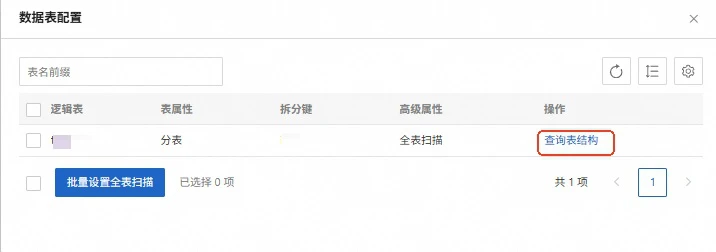

**批量设置全表扫描**

1. 登录PolarDB集分一体版控制台。

   > **说明**
   >
   > 控制台支持以下功能：
   >
   > ：单击可刷新实例列表信息。
   >
   > 
   >
   > ：单击可选择采用**默认**或者**紧凑**模式显示实例列表。
   >
   > 
   >
   > ：单击可选择实例列表中显示的实例属性。
   >
   > 
   >
   > ：单击可将实例列表信息导出到本地。
   >
   > 

2. 找到目标实例，单击实例名称。

3. 在左侧导航栏中，单击**配置与管理 > 数据库管理**。

4. 在数据库管理页面，单击**管理**按钮。

5. 在**数据库配置**页面，单击**批量设置全表扫描**。

6. 在**设置全表扫描**对话框，单击**确定**按钮。

<a id="section-8"></a>

# 8.网络与连接

<a id="section-8-1"></a>

## 8.1. 连接数据库

PolarDB-X支持通过数据管理DMS、MySQL命令行、第三方客户端以及符合MySQL官方交互协议的第三方程序代码进行连接。本文主要介绍如何通过MySQL命令行连接到PolarDB-X数据库。

**前提条件**

- 如果您是首次使用PolarDB-X，需要先完成创建实例、创建账号、创建数据库等。

- 如果您的服务器尚未安装MySQL客户端，请前往MySQL网站下载安装。

**通过DMS连接到数据库**

1. 登录PolarDB集分一体版控制台。

   > **说明**
   >
   > 控制台支持以下功能：
   >
   > ：单击可刷新实例列表信息。
   >
   > 
   >
   > ：单击可选择采用**默认**或者**紧凑**模式显示实例列表。
   >
   > 
   >
   > ：单击可选择实例列表中显示的实例属性。
   >
   > 
   >
   > ：单击可将实例列表信息导出到本地。
   >
   > 

2. 找到目标实例，单击实例名称。

3. 在**基本信息**页面，单击右上角**登录数据库**。

4. 在**登录实例**对话框，依次填入**数据库账号**和**数据库密码**，再单击**登录**。

**通过MySQL命令行连接到数据库**

1. 登录PolarDB集分一体版控制台。

   > **说明**
   >
   > 控制台支持以下功能：
   >
   > ：单击可刷新实例列表信息。
   >
   > 
   >
   > ：单击可选择采用**默认**或者**紧凑**模式显示实例列表。
   >
   > 
   >
   > ：单击可选择实例列表中显示的实例属性。
   >
   > 
   >
   > ：单击可将实例列表信息导出到本地。
   >
   > 

2. 找到目标实例，单击实例名称。

3. 在**连接信息**区域，找到内外网地址和内外网端口信息。

   > **说明**
   >
   > 如果您需要通过外网地址进行访问试用，请单击**申请外网地址**，使用**外网地址**和**外网端口**进行连接。为确保数据库安全，建议您正式访问时使用内网连接地址。

4. 获取**连接信息**后，执行以下命令获取本地对应的公网IP并将其加入实例白名单。

   ```bash
    curl 'https://api.ipify.org'
   ```

5. 通过如下MySQL命令行进行连接：

   ```text
   mysql -h<连接地址> -P<端⼝> -u<⽤户名> -p -D<数据库名称>
   ```

   | 选项 | 说明 | 示例 |
   | --- | --- | --- |
   | <code>-h</code> | 实例的内网连接地址或外网连接地址。 | <code>pxc-</code><br><code>******************.public.polarx.rd</code><br><code>s.aliyuncs.com</code> |
   | <code>-P</code> | 实例的端口号。<br>• 若使用内网连接，需输入实例的内网端口。<br>• 若使用外网连接，需输入实例的外网端口。<br>说明<br>• 此处<code> -P </code>为大写字母。<br>• 默认端口为3306。 | <code>3306</code> |
   | <code>-u</code> | 实例中的账号名称。 | <code>testuser</code> |

   <table>
     <tr>
       <td><code>-p</code></td>
       <td>以上账号的密码。<br>说明<br>• 为保障密码安全，<code> -p </code>后请不要填写密码，会在执行整行命令后提示您输入密码，输入后按回车即可登录。<br>• 如果填写该参数，<code> -p </code>与密码之间不能有空格。</td>
       <td><code>passWord123</code></td>
     </tr>
     <tr>
       <td><code>-D</code></td>
       <td>需要登录的数据库名称。<br>说明<br>• 该参数非必填参数。<br>• 可以不输入<code> -D </code>仅输入数据库名称。</td>
       <td><code>mysql</code></td>
     </tr>
   </table>

**通过第三方客户端连接到数据库**

PolarDB-X支持通过如下第三方客户端进行连接，您可以去对应的官方网站下载客户端。

- MySQL Workbench（推荐）

- SQLyog

- Sequel Pro

- Navicat for MySQL

> **说明**
>
> 第三方GUI客户端可执行基础的数据库操作，包括数据的增删改查和DDL操作，对于工具高级特性，PolarDB-X可能并不支持。

**通过第三方程序代码连接到数据库**

PolarDB-X支持通过如下符合MySQL官方交互协议的第三方程序代码进行连接：

- JDBC Driver for MySQL (Connector/J)

- Python Driver for MySQL (Connector/Python)

- C++ Driver for MySQL (Connector/C++)

- C Driver for MySQL (Connector/C)

- ADO.NET Driver for MySQL (Connector/NET)

- ODBC Driver for MySQL (Connector/ODBC)

- PHP Drivers for MySQL (mysqli, ext/mysqli, PDO_MYSQL, PHP_MYSQLND)

- Perl Driver for MySQL (DBD::mysql)

- Ruby Driver for MySQL (ruby-mysql)

以下为JDBC Driver for MySQL （Connector/J）程序代码示例。

```text
//JDBC
Class.forName("com.mysql.jdbc.Driver"); 
Connection conn = DriverManager.getConnection("jdbc:mysql://pxc-
******************.public.polarx.rds.aliyuncs.com:3306/doc_test","doc_test","doc_test_pas
ord");
//...
conn.close();    
```

以下为应用端连接池配置示例。

```xml
<bean id="dataSource" class="com.alibaba.druid.pool.DruidDataSource" init-method="init" 
destroy-method="close"> 
<property name="url" value="jdbc:mysql://pxc-
******************.public.polarx.rds.aliyuncs.com:3306/doc_test" />
<property name="username" value="doc_test" />
<property name="password" value="doc_test_password" />
<property name="filters" value="stat" />
<property name="maxActive" value="100" />
<property name="initialSize" value="20" />
<property name="maxWait" value="60000" />
<property name="minIdle" value="1" />
<property name="timeBetweenEvictionRunsMillis" value="60000" />
<property name="minEvictableIdleTimeMillis" value="300000" />
<property name="testWhileIdle" value="true" />
<property name="testOnBorrow" value="false" />
<property name="testOnReturn" value="false" />
<property name="poolPreparedStatements" value="true" />
<property name="maxOpenPreparedStatements" value="20" />
<property name="asyncInit" value="true" />
</bean>
```

> **说明**
>
> 推荐使用Druid连接池连接。

<a id="section-8-2"></a>

## 8.2. 集群地址和只读地址

本文将介绍实例的连接地址及设置项。

**背景信息**

当您只创建了主实例时，只会有一个连接地址，也叫集群地址（Cluster Endpoint），主要面向在线通用业务场景。 在主实例页面上，如果添加了只读实例，每个只读实例页面上会提供一个只读地址（Read Only Endpoint），专注离线拖数、跑批等资源链路隔离场景，确保只读资源可被独享。在HTAP场景下，创建了主实例和只读实例，您可以使用集群地址（Cluster Endpoint）和只读地址（Read Only Endpoint）。

**配置集群地址**

1. 登录PolarDB集分一体版控制台。

2. 在实例列表页面，单击目标实例名称。

3. 在**连接信息**区域，单击**配置管理**，查看集群地址配置项。

   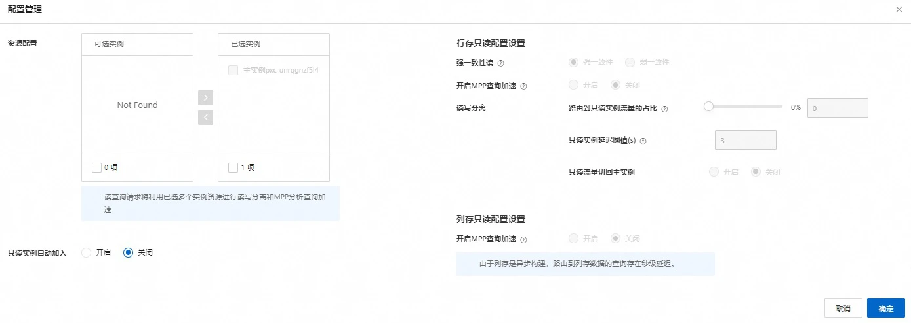

   参数说明：

   | 参数 | 说明 |
   | --- | --- |
   | 资源配置 | 若已成功创建只读实例，可以选择将需要分担流量的只读实例加入到主实例资源池中，未加入的将不分担主实例的流量。 |
   | 只读实例自动加入 | 控制新创建的只读实例是否加入到主实例资源池，默认开启。若创建了只读实例，可以选择将只读实例加入主实例管理中，这样可以通过读写分离技术，将主实例的复杂查询流量路由给只读实例集群。 |
   | 智能读写分离 | 此功能默认为开启，会自动将AP流量路由给多个只读实例去计算，并做MPP并行加速。开启后会自动识别出查询负载，将AP流量路由给只读实例去计算，分担主实例压力。如果用户没有创建只读实例或者只读实例未加入到主实例管理中，可以忽略该选项。 |
   | 路由到只读实例流量的占比 | 将原本路由给主实例存储的读查询按一定的比例规则路由给只读实例存储。 |
   | 强一致性读 | • 强一致性：路由到只读实例的请求，保证一定能够查询到读请求执行前在主实例上已完成更新的数据，提供外部强一致性；<br>• 弱一致性：路由到只读实例的请求，读请求仅访问只读实例上当前的最新数据，会因为主从异步复制的架构产生数据读取延迟。<br>说明在主从复制延迟的条件下，强一致性读会等待直到读取到已完成更新的数据，默认的等待超时是3s。 |
   | 只读实例延迟阈值(s) | 超过该阈值后只读流量会发送给其他延迟正常的只读实例，或者根据只读实例可用性决定是否切回主库。 |
   | 只读流量切回主实例 | 当所有只读实例的延迟超过阈值或者出现HA状态，则认为当前所有只读实例处于不可用的状态，判断是否将只读流量回切主库（建议只读实例个数≥2来提升可用性）。 |
   | 开启MPP查询加速 | 基于统计信息做代价估算，将偏AP的复杂查询路由给只读实例(CN+DN)做MPP加速。 |

4. （可选）单击**编辑**，即可自定义内外网地址的前缀部分。

   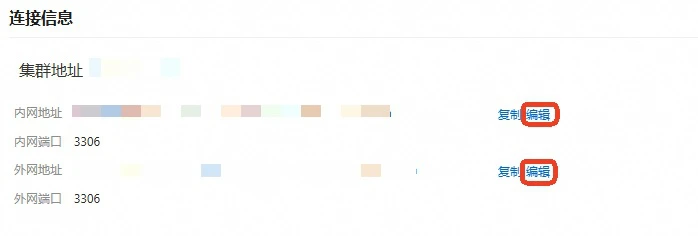

   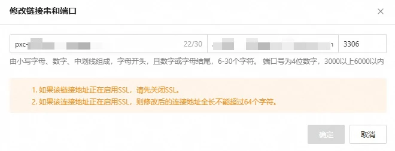

**配置只读地址**

1. 登录PolarDB集分一体版控制台。

2. 在实例列表页面，单击目标实例名称。

3. 单击**配置管理**，设置只读地址配置项。

4. 单击**确定**完成。

<a id="section-8-3"></a>

## 8.3. 申请和释放外网地址

PolarDB-X实例会默认分配一个内网地址，应用和MySQL客户端可以在阿里云ECS上连接PolarDB-X实例的数据库。如果需要从外网访问PolarDB-X，则需要为PolarDB-X实例申请外网地址。本文将介绍如何申请和释放外网地址。

**申请外网地址**

1. 登录PolarDB集分一体版控制台。

   > **说明**
   >
   > 控制台支持以下功能：
   >
   > ：单击可刷新实例列表信息。
   >
   > 
   >
   > ：单击可选择采用**默认**或者**紧凑**模式显示实例列表。
   >
   > 
   >
   > ：单击可选择实例列表中显示的实例属性。
   >
   > 
   >
   > ：单击可将实例列表信息导出到本地。
   >
   > 

2. 找到目标实例，单击实例名称。

3. 在**基本信息**页面中间的**连接信息**区域，单击右上角**申请外网地址**。

4. 在弹出的对话框中，单击**确定**。

   > **说明**
   >
   > 如果您需要通过申请的外网地址来连接实例，您还需要将连接实例的客户端所属的公网IP地址加入到实例的白名单中，详细操作请参见设置白名单。

**释放外网地址**

1. 登录PolarDB集分一体版控制台。

   > **说明**
   >
   > 控制台支持以下功能：
   >
   > ：单击可刷新实例列表信息。
   >
   > 
   >
   > ：单击可选择采用**默认**或者**紧凑**模式显示实例列表。
   >
   > 
   >
   > ：单击可选择实例列表中显示的实例属性。
   >
   > 
   >
   > ：单击可将实例列表信息导出到本地。
   >
   > 

2. 找到目标实例，单击实例名称。

3. 在**基本信息**页面中间的**连接信息**区域，单击右上角**释放外网地址**。

4. 在弹出的对话框中，单击**确定**。

   > **说明**
   >
   > 释放外网地址后，将无法继续通过外网地址连接到该实例。同时，为保障数据安全性，建议您在白名单设置中删除对应的公网IP地址。

<a id="section-8-4"></a>

## 8.4. 自定义地址

PolarDB 集分一体版为您提供自定义连接地址功能，可以帮助您定制化的分配业务流量到指定的计算节点集合。

**使用限制**

仅支持在PolarDB 集分一体版企业版实例中创建自定义连接地址。

**注意事项**

自定义连接地址中至少需要含有2个计算节点。

**优势**

一般情况PolarDB 集分一体版实例会有2个及以上的计算节点，并且内网地址挂载的计算节点数量是不可修改的，这种情况下您将不能定制化地为不同的业务流量分配合适数量的计算节点。为了满足您对业务流量更多的定制化需求，PolarDB 集分一体版推出自定义连接地址功能，其有如下优势：

- 业务流量的物理隔离：可以让不同业务使用不同的自定义连接地址，且这些自定义连接地址所挂载的计算节点不重合，以实现业务流量的物理隔离。

- 减小跨机房访问的网络延迟：PolarDB 集分一体版的多可用区实例，在主备可用区各有一组计算节点，您可以分别基于主备可用区中创建不同的自定义连接地址，再分别提供给部署在主备可用区的应用APP使用，以达到就近访问计算节点的目的，减小跨机房访问的网络延迟。

**创建自定义连接地址**

1. 登录PolarDB集分一体版控制台。

2. 在页面左上角选择目标实例所在地域。

3. 在**实例列表**页，找到目标实例，单击实例ID。

4. 在左侧导航栏中，单击**连接管理**。

5. 单击左上角**创建自定义连接**，在弹出的**创建自定义连接**面板中，设置如下参数。

   **参数**

   **说明**

   填写自定义连接地址的名称。

   **地址别名**

   - **IPv4**：仅分配IPv4地址，适用于纯IPv4网络环境。

   **IP类型**

   - **IPv4/v6双栈**：同时分配IPv4和IPv6地址，适用于需要同时支持IPv4与IPv6客户端访问的混合网络场景。启用后需配置IPv6白名单以控制IPv6地址的访问权限。

   **VPC**

   **交换机**

   选择VPC和交换机。

   <table>
     <tr>
       <td>服务节点</td>
       <td>选择当前自定义连接地址需要包含的若干个计算节点。<br>说明<br>• 已经被其他自定义连接地址选择后的计算节点也可重复选择。<br>• 当前自定义连接地址需要至少含有2个计算节点。当自定义连接地址只含有2个计算节点时，则不允许再删除这2个计算节点。</td>
     </tr>
     <tr>
       <td>节点是否自动加入</td>
       <td>选择是否开启新增计算节点自动加入该自定义连接地址，可配置项如下：<br>• <strong>是</strong>：实例新增计算节点符合新加入节点条件时，会自动加入当前自定义连接地址。<br>• <strong>否</strong>：实例新增计算节点不会自动加入该自定义连接地址。</td>
     </tr>
     <tr>
       <td>新加入节点条件</td>
       <td>比较新增计算节点和最近一次加入的计算节点的可用区，是否要求为相同可用区。可配置项如下：<br>• <strong>全部可用区</strong>：实例新增的计算节点都会自动加入自定义连接地址。<br>• <strong>相同可用区</strong>：当实例新增的计算节点和自定义连接地址下最近一次加入的计算节点的可用区相同时，新增计算节点会自动加入自定义连接地址。<br>说明<br>• 当一个新增计算节点满足多个自定义连接地址的<strong>新加入节点条件</strong>时，新增计算节点会自动同时加入多个自定义连接地址。<br>• 您可以在创建完成后，通过修改自定义连接地址确认最近一次加入的计算节点的可用区。</td>
     </tr>
   </table>

6. 单击**确定**，即可完成自定义连接地址的创建。

**修改自定义连接地址**

1. 登录PolarDB集分一体版控制台

2. 在页面左上角选择目标实例所在地域。

3. 在**实例列表**页，找到目标实例，单击实例ID。

4. 在左侧导航栏中，单击**连接管理**。

5. 在自定义地址列表中找到目标自定义连接地址，在操作列中单击**编辑**，可修改参数如下：

   | 参数 | 说明 |
   | --- | --- |
   | 地址别名 | 修改自定义连接地址的名称。 |
   | 服务节点 | 增减计算节点。<br>说明<br>• 已经被其他自定义连接地址选择后的计算节点也可重复选择。<br>• 当前自定义连接地址需要至少含有2个计算节点。当自定义连接地址只含有2个计算节点时，则不允许再删除这2个计算节点。<br>• 如果当前自定义连接地址下存在不同可用区的计算节点，并且<strong>新加入节点条件</strong>为<strong>相</strong><strong>同可用区</strong>时，您仍然可以手动新增不同可用区的计算节点。 |
   | 网络信息 | 在<strong>网络信息</strong>区域单击编辑，弹出<strong>编辑私网访问地址</strong>对话框，其中可配置参数如下：<br>• IP类型：支持IPv4和IPv4/v6双栈。<br>• VPC<br>• 交换机<br>• 访问地址<br>• 连接地址前缀，需满足由小写字母、数字、中划线组成，字母开头，且数字或字母结尾，6-30个字符。<br>• 访问端口，端口号为4位数字，3000以上6000以内。 |
   | 节点是否自动加入 | 选择是否开启新增计算节点自动加入该自定义连接地址，可配置项如下：<br>• <strong>是</strong>：实例新增计算节点符合<strong>新加入节点条件</strong>时，会自动加入当前自定义连接地址。<br>• <strong>否</strong>：实例新增计算节点不会自动加入该自定义连接地址。 |
   | 新节点加入条件 | 比较新增计算节点和最近一次加入的计算节点的可用区，是否要求为相同可用区。可配置项如下：<br>• <strong>全部可用区</strong>：实例新增的计算节点都会自动加入自定义连接地址。<br>• <strong>相同可用区</strong>：当实例新增的计算节点和自定义连接地址下最近一次加入的计算节点的可用区相同时，该计算节点会自动加入自定义连接地址。<br>说明<br>• 当一个新增计算节点满足多个自定义连接地址的<strong>新加入节点条件</strong>时，新增计算节点会自动同时加入多个自定义连接地址。<br>• 当前自定义连接地址下存在不同可用区的计算节点时，系统会出现如下对话框，其中含有您最近一次加入的计算节点的可用区。<br> |

6. 单击**确定**，即可完成自定义连接地址的修改。

**删除自定义连接地址**

1. 登录PolarDB集分一体版控制台.

2. 在页面左上角选择目标实例所在地域。

3. 在**实例列表**页，找到目标实例，单击实例ID。

4. 在左侧导航栏中，单击**连接管理**。

5. 在自定义连接地址列表中，找到目标自定义连接地址，在操作列中单击**删除**。

6. 在删除对话框，单击**删除连接**，即可完成删除。

<a id="section-9"></a>

# 9.数据节点管理

本章节内容仅支持企业版。

<a id="section-9-1"></a>

## 9.1. 增加/释放节点

一个PolarDB-X实例是由多个节点组成的分布式集群。PolarDB-X支持通过增加或减少节点来对实例进行扩容。

**注意事项**

- 增删节点会将数据迁移重新均匀分布，为保证数据一致性，主实例与只读实例将共同完成水平扩展操作。

- 增删节点涉及底层数据迁移，请您耐心等待。在迁移完成后会进行切换，切换时会出现30秒左右的闪断，请确保应用具备重连机制。

**增加节点**

1. 登录PolarDB集分一体版控制台。

   > **说明**
   >
   > 控制台支持以下功能：
   >
   > ：单击可刷新实例列表信息。
   >
   > 
   >
   > ：单击可选择采用**默认**或者**紧凑**模式显示实例列表。
   >
   > 
   >
   > ：单击可选择实例列表中显示的实例属性。
   >
   > 
   >
   > ：单击可将实例列表信息导出到本地。
   >
   > 

2. 找到目标实例，单击实例名称。

3. 找到**数据节点管理**，页面右上方单击**增加节点**。

4. **增加节点**页面，在**节点规格**一栏，您可以选择添加**节点规格**、**存储大小**和**增加数量**。

**释放节点**

1. 登录PolarDB集分一体版控制台。

   > **说明**
   >
   > 控制台支持以下功能：
   >
   > ：单击可刷新实例列表信息。
   >
   > 
   >
   > ：单击可选择采用**默认**或者**紧凑**模式显示实例列表。
   >
   > 
   >
   > ：单击可选择实例列表中显示的实例属性。
   >
   > 
   >
   > ：单击可将实例列表信息导出到本地。
   >
   > 

2. 找到目标实例，单击实例名称。

3. 找到**数据节点管理**，在**数据节点列表**，找到目标节点，单击**释放节点**。

4. 在**释放节点**对话框单击**释放**。

   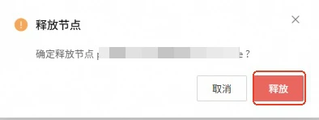

<a id="section-9-2"></a>

## 9.2. 变更配置

一个PolarDB-X实例是由多个节点组成的分布式集群。单个节点承担了SQL路由、数据合并、聚合等功能。通过实例变配，您可以变更实例的节点规格，在业务繁忙时进行升配，承载更多的业务流量QPS，在业务空闲时进行降配，避免资源浪费。

**注意事项**

数据节点变更配置后，PolarDB-X 实例数据节点的规格不一致，实例操作方式将发生如下变化：

- 数据节点变更配置后，PolarDB-X实例将无法对实例整体升降配，需要对计算节点和数据节点单独变配。

- 数据节点变更配置后，PolarDB-X实例将无法通过修改数据节点数量的方式进行缩容，请在数据节点管理页面删除指定数据节点的方式进行缩容。

**操作步骤**

1. 登录PolarDB集分一体版控制台。

   > **说明**
   >
   > 控制台支持以下功能：
   >
   > ：单击可刷新实例列表信息。
   >
   > 
   >
   > ：单击可选择采用**默认**或者**紧凑**模式显示实例列表。
   >
   > 
   >
   > ：单击可选择实例列表中显示的实例属性。
   >
   > 
   >
   > ：单击可将实例列表信息导出到本地。
   >
   > 

2. 找到目标实例，单击实例名称。

3. 在左侧选择**数据节点管理**，找到目标节点，单击**变更配置**。

4. 在**变更配置**页面，您可以选择变更**节点规格**，**存储大小**，**变配时间**。

   > **说明**
   >
   > - **变配时间**您可选择**立即变配**或者**运维时间变配**。
   >
   > - 单独变配数据节点存储大小和规格后仍支持统一变配实例的存储空间大小。

<a id="section-10"></a>

# 10.账号和安全

<a id="section-10-1"></a>

## 10.1. 管理数据库账号

PolarDB-X实例支持高权限账号和普通账号，本文介绍账号的相关管理操作。

**账号类型**

PolarDB-X实例支持如下两种数据库账号类型：

<table>
  <tr>
    <th width="106">账号类型</th>
    <th>说明</th>
  </tr>
  <tr>
    <td>高权限账号</td>
    <td>• 只能通过控制台或API进行创建和管理。<br>• 一个实例中只能创建一个高权限账号，可以管理所有普通账号和数据库。<br>• 拥有更多权限，可满足个性化和精细化的权限管理需求，例如可按用户分配不同表的查询权限。<br>• 拥有实例下所有数据库的所有权限，可以断开任意账号的连接。</td>
  </tr>
  <tr>
    <td>普通账号</td>
    <td>• 可以通过控制台、API或SQL语句进行创建和管理。<br>• 一个实例可以创建多个普通账号，具体的数量与实例内核有关。<br>• 需要手动给普通账号授予特定数据库的权限。<br>• 普通账号不能创建和管理其他账号，也不能断开其他账号的连接。</td>
  </tr>
</table>

> **说明**
>
> 账号创建后无法切换账号类型，但您可以删除该账号后重新创建一个账号类型不同但名称相同的账号。

您可以在控制台上对账号进行如下操作：

- 创建账号

- 重置密码

- 修改普通账号的权限

- 删除账号

**创建账号**

1. 登录PolarDB集分一体版控制台。

   > **说明**
   >
   > 控制台支持以下功能：
   >
   > ：单击可刷新实例列表信息。
   >
   > 
   >
   > ：单击可选择采用**默认**或者**紧凑**模式显示实例列表。
   >
   > 
   >
   > ：单击可选择实例列表中显示的实例属性。
   >
   > 
   >
   > ：单击可将实例列表信息导出到本地。
   >
   > 

2. 找到目标实例，单击实例ID。

3. 在左侧导航栏中，单击**配置与管理 > 账号管理**。

4. 单击**创建账号**，在弹出的对话框中，设置如下参数。

   <table>
     <tr>
       <th width="106">参数</th>
       <th>说明</th>
     </tr>
     <tr>
       <td>账号名</td>
       <td>填写账号名称。<br>说明账号名称需满足如下要求：<br>• 由小写字母、数字或下划线组成，长度不超过32个字符。<br>• 以字母开头，以字母或数字结尾。<br>• 不能和已有的账号名重复。</td>
     </tr>
     <tr>
       <td>账号类型</td>
       <td>您可以选择账号类型为<strong>高权限账号</strong>或<strong>普通账号</strong>。<br>说明每个PolarDB-X实例最多只允许创建1个高权限账号。</td>
     </tr>
     <tr>
       <td>授权数据库</td>
       <td>可将选定的数据库配置为未授权数据库或者已授权数据库。</td>
     </tr>
     <tr>
       <td>密码</td>
       <td>设置账号密码。<br>说明账号密码需满足如下要求：<br>• 密码长度需为8~32个字符。<br>• 由大写字母、小写字母、数字、特殊字符中的任意三种组成。<br>• 特殊字符为： @#$%^&amp;+=</td>
     </tr>
     <tr>
       <td>确认密码</td>
       <td>再次输入密码。</td>
     </tr>
     <tr>
       <td>密码策略</td>
       <td>支持选择所需的密码策略。<br>• 默认（mysql_native_password）<br>• mysql_native_password。<br>• caching_sha2_password。<br>• sha256_password。<br>说明<br>• 支持通过配置<code> loose_default_authentication_plugin </code>参数修改默认的密码策略，详情请参见参数设置中存储层参数说明内容。<br>• 自定义密码策略功能仅支持标准版（集中式）语法兼容为MySQL 8.0的实例。<br>• 密码策略选择只影响当前账号创建，不影响存量账号。</td>
     </tr>
     <tr>
       <td>备注说明</td>
       <td>备注该账号的相关信息，便于后续账号管理。该参数为非必填项，最多支持256个字符。</td>
     </tr>
   </table>

**重置密码**

1. 登录PolarDB集分一体版控制台。

   > **说明**
   >
   > 控制台支持以下功能：
   >
   > ：单击可刷新实例列表信息。
   >
   > 
   >
   > ：单击可选择采用**默认**或者**紧凑**模式显示实例列表。
   >
   > 
   >
   > ：单击可选择实例列表中显示的实例属性。
   >
   > 
   >
   > ：单击可将实例列表信息导出到本地。
   >
   > 

2. 找到目标实例，单击实例ID。

3. 在左侧导航栏中，单击**配置与管理 > 账号管理**。

4. 在**账号管理**页，单击目标账号右侧**操作**栏中的**修改密码**。

   

5. 在弹出的对话框中，输入新密码并确认密码，单击**确定**。

   > **说明**
   >
   > 账号密码需满足如下要求：
   >
   > - 密码长度需为8~32个字符。
   >
   > - 需由大写字母、小写字母、数字、特殊字符中的任意三种组成。
   >
   > - 特殊字符为： @#$%^&+=

**修改普通账号的权限**

1. 登录PolarDB集分一体版控制台。

   > **说明**
   >
   > 控制台支持以下功能：
   >
   > ：单击可刷新实例列表信息。
   >
   > 
   >
   > ：单击可选择采用**默认**或者**紧凑**模式显示实例列表。
   >
   > 
   >
   > ：单击可选择实例列表中显示的实例属性。
   >
   > 
   >
   > ：单击可将实例列表信息导出到本地。
   >
   > 

2. 找到目标实例，单击实例ID。

3. 在左侧导航栏中，单击**配置与管理 > 账号管理**。

4. 在**账号管理**页，单击目标账号右侧**操作**栏中的**修改权限**。

   

   > **说明**
   >
   > 高权限账号拥有所有数据库的全部权限，因此不需要**修改授权**。

5. 在弹出的对话框中，选中一个或多个数据库，单击

   图标将其从左侧**未授权数据库**添加到右侧**已授权**

   

   **数据库**。

6. 在右侧**已授权数据库**中，为目标数据库选择权限。

   > **说明**
   >
   > - 支持的权限为**读写**、**只读**、**仅DML**和**仅DDL**。
   >
   > - 如果要为多个数据库批量设置相同的权限，可以单击**已授权数据库**框右上角的对应权限按钮，如**全部仅DDL**。

7. 单击**确定**。

**删除账号**

1. 登录PolarDB集分一体版控制台。

   > **说明**
   >
   > 控制台支持以下功能：
   >
   > ：单击可刷新实例列表信息。
   >
   > 
   >
   > ：单击可选择采用**默认**或者**紧凑**模式显示实例列表。
   >
   > 
   >
   > ：单击可选择实例列表中显示的实例属性。
   >
   > 
   >
   > ：单击可将实例列表信息导出到本地。
   >
   > 

2. 找到目标实例，单击实例ID。

3. 在左侧导航栏中，单击**配置与管理 > 账号管理**。

4. 在**账号管理**页，单击目标账号右侧**操作**栏中的**删除**。

   

5. 在弹出的对话框中，单击**确定**。

**锁定账号**

1. 登录PolarDB集分一体版控制台。

   > **说明**
   >
   > 控制台支持以下功能：
   >
   > ：单击可刷新实例列表信息。
   >
   > 
   >
   > ：单击可选择采用**默认**或者**紧凑**模式显示实例列表。
   >
   > 
   >
   > ：单击可选择实例列表中显示的实例属性。
   >
   > 
   >
   > ：单击可将实例列表信息导出到本地。
   >
   > 

2. 找到目标实例，单击实例ID。

3. 在左侧导航栏中，单击**配置与管理 > 账号管理**。

4. 找到目标账号，单击操作列的**锁定**。

   

5. 在弹出的对话框中，单击**确定**。

<a id="section-10-2"></a>

## 10.2. 设置白名单

PolarDB-X实例支持白名单设置，设置白名单并不会影响PolarDB-X实例的正常运行。您可以通过定期维护白名单，保证PolarDB-X实例得到高级别的访问安全保护。本文将介绍白名单的相关操作。

**注意事项**

- 数据库创建完成后，默认的IP白名单分组内只包含IP地址 `127.0.0.1` ，表示任何IP地址均无法访问该数据库。出于数据安全考虑，建议仅将您的WEB服务器外网IP或IP段加入白名单。

- 目前支持创建50个IP白名单分组，每个IP白名单分组内最多添加300个IP或IP段。

**新增白名单分组**

1. 登录PolarDB集分一体版控制台。

   > **说明**
   >
   > 控制台支持以下功能：
   >
   > ：单击可刷新实例列表信息。
   >
   > 
   >
   > ：单击可选择采用**默认**或者**紧凑**模式显示实例列表。
   >
   > 
   >
   > ：单击可选择实例列表中显示的实例属性。
   >
   > 
   >
   > ：单击可将实例列表信息导出到本地。
   >
   > 

2. 找到目标实例，单击实例ID。

3. 在左侧导航栏中，单击**配置与管理 > 安全管理**。

4. 在**白名单设置**页签，单击左上角**新增白名单分组**。

5. 在**新增白名单分组**面板，配置以下参数。

   <table>
     <tr>
       <th width="105">参数</th>
       <th>说明</th>
     </tr>
     <tr>
       <td>分组名称</td>
       <td>输入白名单分组名称。</td>
     </tr>
     <tr>
       <td>类型</td>
       <td>• <strong>IPv4</strong>：仅分配IPv4地址，适用于纯IPv4网络环境。允许使用IPv4地址（如 <code> 192.168.1.1 </code>）访问数据库，兼容现有绝大多数网络环境。<br>• <strong>IPv6</strong>：允许使用IPv6地址（如 <code> 2400:3200::1 </code>）访问数据库，满足未来网络扩容及合规需求。</td>
     </tr>
     <tr>
       <td>组内白名单</td>
       <td>输入IP地址。<br>说明<br>• 您可以填写IP地址（如192.168.0.1）或IP段（如192.168.0.0/24）。<br>• 每个IP白名单分组最多添加300个IP或IP段。<br>• 多个IP地址间用英文逗号（,）隔开（如192.168.0.1,192.168.0.0/24）。<br>• 您可以通过输入127.0.0.1禁止任何IP地址访问。</td>
     </tr>
   </table>

6. 单击**确定**即可。

   > **说明**
   >
   > 修改白名单后，需要等待约1分钟才会生效。

**修改组内白名单**

1. 登录PolarDB集分一体版控制台。

   > **说明**
   >
   > 控制台支持以下功能：
   >
   > ：单击可刷新实例列表信息。
   >
   > 
   >
   > ：单击可选择采用**默认**或者**紧凑**模式显示实例列表。
   >
   > 
   >
   > ：单击可选择实例列表中显示的实例属性。
   >
   > 
   >
   > ：单击可将实例列表信息导出到本地。
   >
   > 

2. 找到目标实例，单击实例ID。

3. 在左侧导航栏中，单击**配置与管理 > 安全管理**。

4. 在**白名单设置**页签，找到目标白名单分组名称，单击右侧**操作**栏中的**配置**。

   

5. 在**配置白名单**面板，对**组内白名单**进行修改。

   <table>
     <tr>
       <th width="105">参数</th>
       <th>说明</th>
     </tr>
     <tr>
       <td>组内白名单</td>
       <td>单击新增IP，输入IP地址。<br>说明<br>• 您可以填写IP地址（如192.168.0.1）或IP段（如192.168.0.0/24）。<br>• 每个IP白名单分组最多添加300个IP或IP段。<br>• 多个IP地址间用英文逗号（,）隔开（如192.168.0.1,192.168.0.0/24）。<br>• 您可以通过输入127.0.0.1禁止任何IP地址访问。</td>
     </tr>
   </table>

6. 单击**确定**即可。

   > **说明**
   >
   > 修改白名单后，需要等待约1分钟才会生效。

**删除白名单分组**

1. 登录PolarDB集分一体版控制台。

   > **说明**
   >
   > 控制台支持以下功能：
   >
   > ：单击可刷新实例列表信息。
   >
   > 
   >
   > ：单击可选择采用**默认**或者**紧凑**模式显示实例列表。
   >
   > 
   >
   > ：单击可选择实例列表中显示的实例属性。
   >
   > 
   >
   > ：单击可将实例列表信息导出到本地。
   >
   > 

2. 找到目标实例，单击实例ID。

3. 在左侧导航栏中，单击**配置与管理 > 安全管理**。

4. 在**白名单设置**页签，找到目标白名单分组名称，单击右侧**操作**栏中的**删除**。

   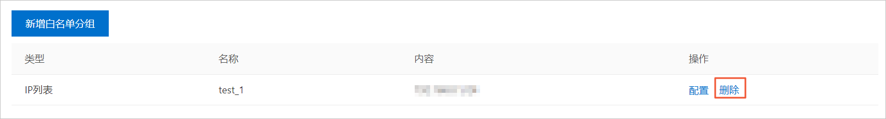

5. 在弹出的对话框中，单击**确定**即可。

<a id="section-10-3"></a>

## 10.3. 设置SSL加密

为了提高链路安全性，您可以启用SSL（Secure Sockets Layer）加密，并安装SSL CA证书到需要的应用服务。SSL在传输层对网络连接进行加密，能提升通信数据的安全性和完整性，但会同时增加网络连接响应时间。

**注意事项**

- SSL的证书有效期为1年，请及时更新证书有效期并重新下载配置CA证书，否则使用加密连接的客户端程序将无法正常连接。

- 由于SSL加密的实现原理，启用SSL加密会显著增加CPU使用率，建议您仅在外网链路有加密需求的时候启用SSL加密。内网链路相对较安全，一般无需对链路加密。

- 开启或关闭SSL加密会重启实例，请谨慎操作。

**开启SSL加密**

1. 登录PolarDB集分一体版控制台。

   > **说明**
   >
   > 控制台支持以下功能：
   >
   > ：单击可刷新实例列表信息。
   >
   > 
   >
   > ：单击可选择采用**默认**或者**紧凑**模式显示实例列表。
   >
   > 
   >
   > ：单击可选择实例列表中显示的实例属性。
   >
   > 
   >
   > ：单击可将实例列表信息导出到本地。
   >
   > 

2. 找到目标实例，单击实例ID。

3. 在左侧导航栏中，选择**配置与管理 > 安全管理**。

4. 单击**SSL配置**页签，打开**SSL配置**的开关。

   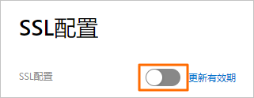

   > **说明**
   >
   > 开启SSL加密时，默认选择内网地址为**SSL受保护的地址**。您也可以将受保护的地址修改为公网地址，详情请参见修改SSL受保护地址。

5. 在弹出的对话框中，单击**确定**。

   > **重要**
   >
   > 开启或关闭SSL加密会重启实例，建议在业务低峰期操作，并确保您的应用具备自动重连机制。

6. 开通成功后，单击**下载CA证书**。

   下载的文件为压缩包，包含如下三个文件：

   - .p7b文件：可用于在Windows平台应用（例如IIS、MSExchangeserver）中导入CA证书。

   - .pem文件：用于在其他应用（例如MySQLWorkbench、Navicat）中导入CA证书。

   - .jks文件：Java中的truststore证书存储文件，密码统一为apsaradb，用于Java程序中导入CA证书链。

     > **说明**
     >
     > 在Java中使用JKS证书文件时，jdk7和jdk8需要修改默认的jdk安全配置，在应用程序所在主机的 `jre/lib/security/java.security` 文件中，修改如下两项配置：
     >
     > ```text
     > jdk.tls.disabledAlgorithms=SSLv3, RC4, DH keySize < 224
     > jdk.certpath.disabledAlgorithms=MD2, RSA keySize < 1024
     > ```
     >
     > 若不修改jdk安全配置，会报如下错误。其它类似报错，一般也都由Java安全配置导致。
     >
     > ```text
     > javax.net.ssl.SSLHandshakeException: DHPublicKey does not comply to algorithm 
     > constraints
     > ```

**配置SSL CA证书**

开通SSL加密后，应用或者客户端连接PolarDB-X时需要配置SSL CA证书。本文以MySQL Workbench和Navicat为例，介绍SSL CA证书安装方法。其它应用或者客户端请参见对应产品的使用说明。

**MySQL Workbench配置方法**

1. 打开MySQL Workbench。

2. 选择**Database > Manage Connections**。

3. 启用**Use SSL**，并导入SSL CA证书。

   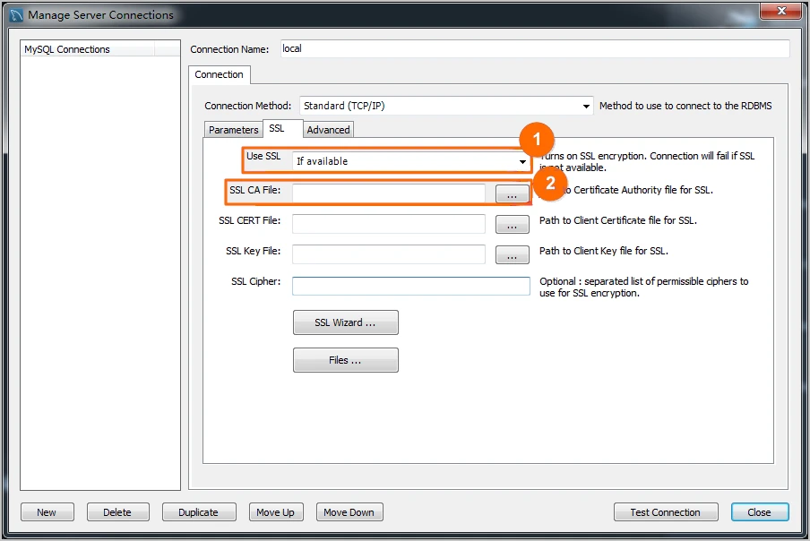

**Navicat配置方法**

1. 打开Navicat。

2. 在目标数据库上单击鼠标右键，选择**编辑连接**。

   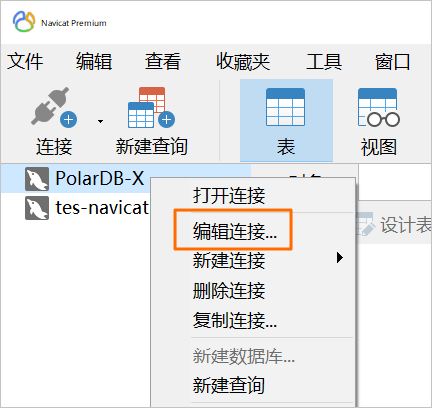

3. 选择**SSL**页签，选择.pem格式CA证书的路径。

   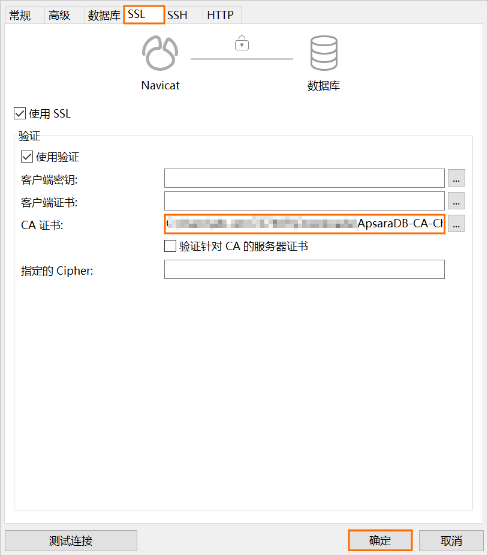

4. 单击**确定**。

   > **说明**
   >
   > 如果报 `connection is being used` 错误，是由于之前的会话未断开，请关闭Navicat重新打开。

5. 双击目标数据库测试能否正常连接。

   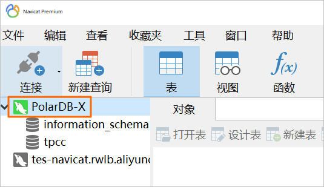

**更新证书有效期**

> **说明**
>
> - **更新有效期**操作将会重启实例，建议在业务低峰期操作，并确保您的应用具备自动重连机制。
>
> - **更新有效期**后需要重新下载及配置CA证书。

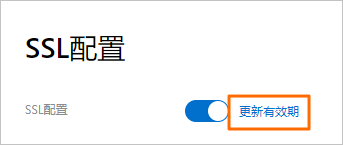

**修改SSL受保护地址**

> **说明**
>
> 申请外网地址后，可选择将外网地址设置为受保护的地址，详情请参见申请外网地址。

1. 登录PolarDB集分一体版控制台。

   > **说明**
   >
   > 控制台支持以下功能：
   >
   > ：单击可刷新实例列表信息。
   >
   > 
   >
   > ：单击可选择采用**默认**或者**紧凑**模式显示实例列表。
   >
   > 
   >
   > ：单击可选择实例列表中显示的实例属性。
   >
   > 
   >
   > ：单击可将实例列表信息导出到本地。
   >
   > 

2. 找到目标实例，单击实例ID。

3. 在左侧导航栏中，选择**配置与管理 > 安全管理**。

4. 单击**SSL配置**页签。

5. 单击**设置SSL**。

6. 在弹出的对话框中，选择目标地址为受保护的地址。

   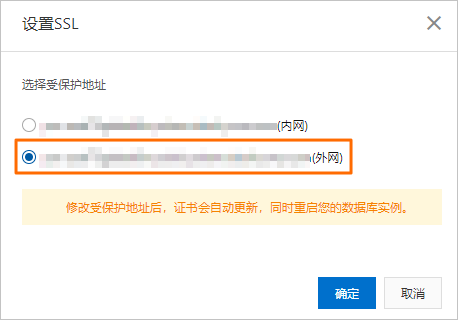

   > **说明**
   >
   > - 开通SSL时，默认选择内网地址为**SSL受保护的地址**，您可以将其修改为公网地址。
   >
   > - 修改SSL受保护地址操作将会重启实例，建议在业务低峰期操作，并确保您的应用具备自动重连机制。
   >
   > - 修改SSL受保护地址后需要重新下载及配置CA证书。

7. 单击**确定**即可。

**关闭SSL加密**

> **说明**
>
> - 关闭SSL加密会重启实例，建议您在业务低峰期操作，并确保您的应用具备自动重连机制。
>
> - SSL加密关闭后，数据库访问性能会有一定程度提升，但安全性上有削弱，故非安全环境下不建议关闭SSL加密。

1. 登录PolarDB集分一体版控制台。

   > **说明**
   >
   > 控制台支持以下功能：
   >
   > ：单击可刷新实例列表信息。
   >
   > 
   >
   > ：单击可选择采用**默认**或者**紧凑**模式显示实例列表。
   >
   > 
   >
   > ：单击可选择实例列表中显示的实例属性。
   >
   > 
   >
   > ：单击可将实例列表信息导出到本地。
   >
   > 

2. 找到目标实例，单击实例ID。

3. 在左侧导航栏中，选择**配置与管理 > 安全管理**。

4. 单击**SSL配置**页签。

5. 关闭**SSL配置**的开关。

   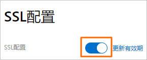

6. 在弹出的对话框中单击**确定**即可。

<a id="section-10-4"></a>

## 10.4. 设置透明数据加密

本文介绍了对实例设置透明数据加密TDE（Transparent Data Encryption）。

**注意事项注意事项**

- TDE开通后无法关闭。

- TDE功能开启操作会导致应用与PolarDB-X实例的连接闪断，建议在业务低峰期操作，并确保应用具有自动重连机制。

- 加密操作或解密操作的DDL在执行过程中，目标表将禁止写入。

- 开通TDE后，对数据库性能有一定影响。

**操作步骤**

1. 登录PolarDB集分一体版控制台。

   > **说明**
   >
   > 控制台支持以下功能：
   >
   > ：单击可刷新实例列表信息。
   >
   > 
   >
   > ：单击可选择采用**默认**或者**紧凑**模式显示实例列表。
   >
   > 
   >
   > ：单击可选择实例列表中显示的实例属性。
   >
   > 
   >
   > ：单击可将实例列表信息导出到本地。
   >
   > 

2. 单击目标实例名称。

3. 在左侧导航栏选择**配置与管理 > 安全管理**。

4. 在**TDE**页签单击**未开通**左边的滑块。

   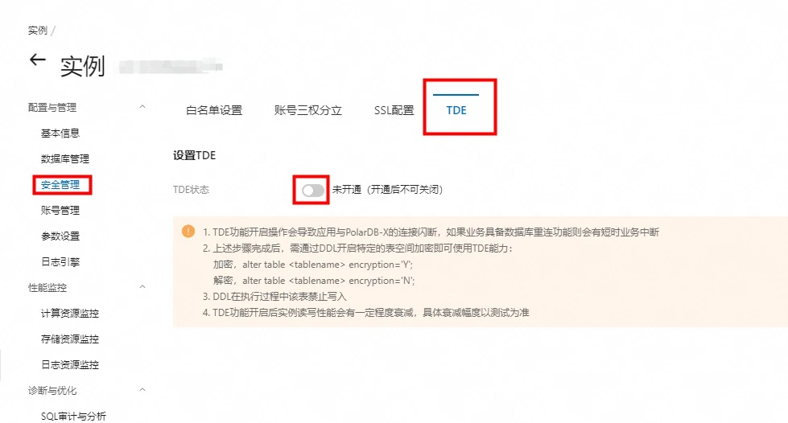

5. 在**设置TDE**对话框，完成以下设置：

   - 选择**使用服务密钥（阿里云自动生成）**，单击**确定**，开通TDE。

   - 选择**使用已有自定义密钥**，选择密钥，单击**确定**，开通TDE。

     > **说明**
     >
     > 如果没有自定义密钥，需要单击**前往创建**，在密钥管理服务控制台创建密钥并导入自带的密钥材料。

   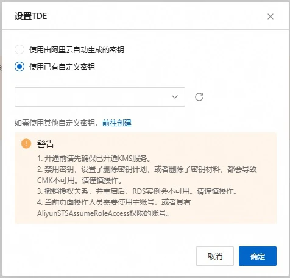

**加密操作**

登录数据库，执行如下命令，对要加密的表进行加密。

```sql
alter table <tablename> encryption='Y';
```

执行如下命令，可直接创建加密表。

```sql
create table <tablename> <col definition> ENCRYPTION='Y';
```

**解密操作**

登录数据库，执行如下命令，对TDE加密的表解密。

```sql
alter table <tablename> ENCRYPTION='N';
```

<a id="section-10-5"></a>

## 10.5. 三权分立

<a id="section-10-5-1"></a>

### 10.5.1. 功能介绍

PolarDB-X新增三权分立模式，您可以将高权限账号拥有的权限分给系统管理员、安全管理员和审计管理员这3个角色，避免因权限高度集中带来的风险，增强数据库的安全性。

**风险与解决方案**

- **风险**传统数据库运维模式下，数据库管理员DBA（Database Administrator）拥有的权限过高且集中，容易在某些场景下给业务带来风险：

  - DBA误判导致系统安全事故。

  - DBA出于某种目的进行非法操作。

  - DBA、第三方外包人员或程序开发人员越权访问敏感信息。

- **解决方案**

  PolarDB-X新增支持三权分立模式，打破传统数据库运维由DBA行使特权的独立控制体系，使得数据库管理员DBA、安全管理员DSA（Department Security Administrator）和审计管理员DAA（Data Audit Administrator）3者的权责更加清晰。其中：

  - 数据库管理员（DBA）：只具备DDL（Data Definition Language）权限。

  - 安全管理员（DSA）：只具备管理角色（Role）或用户（User）以及为其他账号授予权限的权限。

  - 审计管理员（DAA）：只具备查看审计日志的权限。

**数据库系统账号的权限对比**

下表展示了在默认模式和三权分立模式下，不同数据库系统账号的权限对比。

> **说明**
>
> - 默认模式下的高权限账号即系统管理员账号。
>
> - 开启或关闭三权分立模式，仅对系统账号（即高权限账号、系统管理员账号、安全管理员账号和审计管理员账号）的权限有影响，普通账号权限不受模式变更的影响。
>
> - 三权分立模式下，虽然所有系统账号均不具备DML（Data Manipulation Language）、DQL（Data Query Language）或DAL（Data Administration Language）权限，但安全管理员仍然能够将这些权限授予给普通账号。
>
> - 表中✔️表示具备该权限，表示不具备该权限。

**权限**

**默认模式**

**三权分立模式**

**系统管理员**

**安全管理员**

**审计管理**

**分类**

**说明**

**高权限账号**

**账号**

**账号**

**员账号**

- ALTER TABLE

- CREATE TABLE

- CREATE VIEW

- CREATE INDEX

DDL

- CREATE CCL_RULE

  ✔️

  ✔️

  

  

- DROP VIEW

- DROP INDEX

- DROP TABLE

- TRUNCATE TABLE

- DELETE

DML

- UPDATE

- INSERT

- SELECT

DQL

✔️







- EXPLAIN

- SHOW CCL_RULE

DAL

- SHOW INDEX

账号或

账号权限管理

角色相

✔️



✔️



角色权限管理

关

查看如下两张表中的审计日志信息：

```text
 information_schema.polardbx_a
```

查看审

```text
udit_log 
```

✔️





✔️

计日志

```text
  information_schema.polardbx_d
dl_log 
```

**使用限制**

三权分立模式下的系统账号（包括系统管理员账号、安全管理员账号和审计管理员账号）存在如下限制：

- 不支持对系统账号执行GRANT ROLE或REVOKE ROLE命令。

- 不支持对系统账号执行GRANT PRIVILEGES或REVOKE PRIVILEGES命令。

- 系统账号的密码只能由对应的账号修改，如系统管理员账号的密码仅能由系统管理员账号修改，不能被其他帐号修改。

- 系统账号均不支持SET DEFAULT ROLE命令。

<a id="section-10-5-2"></a>

### 10.5.2. 开启或关闭三权分立

您可以在控制台上开启或关闭三权分立模式。开启后，高权限账号自动转换为系统管理员账号，同时还需创建安全管理员账号和审计管理员账号。本文介绍开启或关闭三权分立的相关操作步骤。

**开启三权分立**

1. 登录PolarDB集分一体版控制台。

   > **说明**
   >
   > 控制台支持以下功能：
   >
   > ：单击可刷新实例列表信息。
   >
   > 
   >
   > ：单击可选择采用**默认**或者**紧凑**模式显示实例列表。
   >
   > 
   >
   > ：单击可选择实例列表中显示的实例属性。
   >
   > 
   >
   > ：单击可将实例列表信息导出到本地。
   >
   > 

2. 找到目标实例，单击实例ID。

3. 在左侧导航栏选择**配置与管理 > 安全管理**。

4. 单击**账号三权分立**页签，在页面右上角打开**当前账户安全模式**开关。

   > **说明**
   >
   > 开启三权分立模式前，请确保已创建高权限账号。

5. 在**创建三权分立账号**面板中，设置以下参数。

   <table>
     <tr>
       <th width="89">参数</th>
       <th>说明</th>
     </tr>
     <tr>
       <td>账号名</td>
       <td>填写账号名称。<br>说明账号名称需满足如下要求：<br>• 由小写字母、数字或下划线组成，长度不超过32个字符。<br>• 以字母开头，以字母或数字结尾。<br>• 不能和已有的账号名重复。</td>
     </tr>
     <tr>
       <td>账号类型</td>
       <td>固定为<strong>安全管理员账号</strong>，无需选择。</td>
     </tr>
     <tr>
       <td>密码</td>
       <td>设置账号密码。<br>说明账号密码需满足如下要求：<br>• 密码长度需为8~32个字符。<br>• 由大写字母、小写字母、数字、特殊字符中的任意三种组成。<br>• 特殊字符为：<br>@#$%^&amp;+=</td>
     </tr>
     <tr>
       <td>确认密码</td>
       <td>再次输入密码。</td>
     </tr>
     <tr>
       <td>备注说明</td>
       <td>备注该账号的相关信息，便于后续账号管理。该参数为非必填项，最多支持256个字符。</td>
     </tr>
   </table>

6. 单击**下一步**，并设置以下参数。

   <table>
     <tr>
       <th width="89">参数</th>
       <th>说明</th>
     </tr>
     <tr>
       <td>账号名</td>
       <td>填写账号名称。<br>说明账号名称需满足如下要求：<br>• 由小写字母、数字或下划线组成，长度不超过32个字符。<br>• 以字母开头，以字母或数字结尾。<br>• 不能和已有的账号名重复。</td>
     </tr>
     <tr>
       <td>账号类型</td>
       <td>固定为<strong>审计管理员账号</strong>，无需选择。</td>
     </tr>
     <tr>
       <td>密码</td>
       <td>设置账号密码。<br>说明账号密码需满足如下要求：<br>• 密码长度需为8~32个字符。<br>• 由大写字母、小写字母、数字、特殊字符中的任意三种组成。<br>• 特殊字符为：<br>@#$%^&amp;+=</td>
     </tr>
     <tr>
       <td>确认密码</td>
       <td>再次输入密码。</td>
     </tr>
     <tr>
       <td>备注说明</td>
       <td>备注该账号的相关信息，便于后续账号管理。该参数为非必填项，最多支持256个字符。</td>
     </tr>
   </table>

7. 单击**确定**即可。

   > **说明**
   >
   > 开启后请等待3~5秒，新设置才会生效。

**关闭三权分立**

1. 登录PolarDB集分一体版控制台。

   > **说明**
   >
   > 控制台支持以下功能：
   >
   > ：单击可刷新实例列表信息。
   >
   > 
   >
   > ：单击可选择采用**默认**或者**紧凑**模式显示实例列表。
   >
   > 
   >
   > ：单击可选择实例列表中显示的实例属性。
   >
   > 
   >
   > ：单击可将实例列表信息导出到本地。
   >
   > 

2. 找到目标实例，单击实例ID。

3. 在左侧导航栏选择**配置与管理 > 安全管理**。

4. 选择**账号三权分立**页签，在页面右上角关闭**当前账户安全模式**开关。

5. 在弹出的对话框中，单击**确定**。

6. 在弹出的**高权限账号密码验证**对话框中，输入高权限账号的密码并单击**确定**。

   > **说明**
   >
   > 关闭后请等待3~5秒，新设置才会生效。

<a id="section-10-5-3"></a>

### 10.5.3. 管理三权分立系统账号

开启三权分立模式后，您可以在控制台上查看三权分立系统账号的名称或修改密码。本文介绍相关操作步骤。

**使用限制**

三权分立模式下的系统账号（包括系统管理员账号、安全管理员账号和审计管理员账号）存在如下限制：

- 不支持对系统账号执行GRANT ROLE或REVOKE ROLE命令。

- 不支持对系统账号执行GRANT PRIVILEGES或REVOKE PRIVILEGES命令。

- 系统账号的密码只能由对应的账号修改，如系统管理员账号的密码仅能由系统管理员账号修改，不能被其他账号修改。

- 系统账号均不支持SET DEFAULT ROLE命令。

**查看账号**

1. 登录PolarDB集分一体版控制台。

   > **说明**
   >
   > 控制台支持以下功能：
   >
   > ：单击可刷新实例列表信息。
   >
   > 
   >
   > ：单击可选择采用**默认**或者**紧凑**模式显示实例列表。
   >
   > 
   >
   > ：单击可选择实例列表中显示的实例属性。
   >
   > 
   >
   > ：单击可将实例列表信息导出到本地。
   >
   > 

2. 找到目标实例，单击实例ID。

3. 您可以选择如下任意方式查看三权分立系统账号信息：

   - 方式一：在**安全管理**页面查看。

     <ol type="a">

     <li>

     在左侧导航栏选择**配置与管理 > 安全管理**。

     </li>

     <li>

     单击**账号三权分立**页签，即可查看三权分立模式下的系统管理员、安全管理员和审计管理员账号的账号名称和备注信息等详情。

     </li>

     </ol>

   - 方式二：在**账号管理**页面查看。

     <ol type="a">

     <li>

     在左侧导航栏选择**配置与管理 > 账号管理**。

     </li>

     <li>

     在**账号管理**页面，除了可以查看三权分立模式的系统账号（包括系统管理员、安全管理员和审计管理员）的信息，还可以查看普通账号的信息，如账号类型，所属数据库和拥有的权限等。

     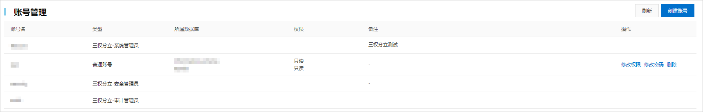

     </li>

     </ol>

**重置密码**

1. 登录PolarDB集分一体版控制台。

   > **说明**
   >
   > 控制台支持以下功能：
   >
   > ：单击可刷新实例列表信息。
   >
   > 
   >
   > ：单击可选择采用**默认**或者**紧凑**模式显示实例列表。
   >
   > 
   >
   > ：单击可选择实例列表中显示的实例属性。
   >
   > 
   >
   > ：单击可将实例列表信息导出到本地。
   >
   > 

2. 找到目标实例，单击实例ID。

3. 在左侧导航栏选择**配置与管理 > 安全管理**。

4. 单击**账号三权分立**页签。

5. 在账号列表中，单击目标账号右侧**操作**栏中的**修改密码**。

6. 在弹出的对话框中，输入新密码并确认。

   > 账号密码需满足如下要求：
   >
   > **说明**
   >
   > - 密码长度需为8~32个字符。
   >
   > - 由大写字母、小写字母、数字、特殊字符中的任意三种组成。
   >
   > - 特殊字符为：
   >
   >   @#$%^&+=

7. 单击**确定**即可。

<a id="section-10-5-4"></a>

### 10.5.4. 权限验证

开启三权分立模式后，高权限账号自动转换为系统管理员账号，同时还需创建安全管理员账号和审计管理员账号，三个账号拥有不同的权限，当您对数据库执行不同操作时，需要对应的管理员进行权限验证。本文将介绍权限验证的相关操作步骤。

**系统管理员（高权限账号）权限验证**

关闭三权分立模式时，需要通过系统管理员（高权限账号）的验证。关闭三权分立模式的操作步骤，详情请参见关闭三权分立。

**安全管理员权限验证**

需要由系统管理员进行验证的操作包括：

- 删除普通账号。

- 修改普通账号的权限。

- 修改普通账号的密码。

- 创建数据库时给普通账户授权。

本文以删除普通账号为例介绍相关验证操作步骤。

1. 登录PolarDB集分一体版控制台。

   > **说明**
   >
   > 控制台支持以下功能：
   >
   > ：单击可刷新实例列表信息。
   >
   > 
   >
   > ：单击可选择采用**默认**或者**紧凑**模式显示实例列表。
   >
   > 
   >
   > ：单击可选择实例列表中显示的实例属性。
   >
   > 
   >
   > ：单击可将实例列表信息导出到本地。
   >
   > 

2. 找到目标实例，单击实例ID。

3. 在左侧导航栏选择**配置与管理 > 账号管理**。

4. 在**账号管理**页面，找到目标普通账号，单击右侧**操作**栏中的**删除**。

5. 在弹出的**删除账号**对话框中，单击**确定**。

6. 在弹出的**账号授权确认**对话框中，输入安全管理员账号的密码，并单击**确定**。

   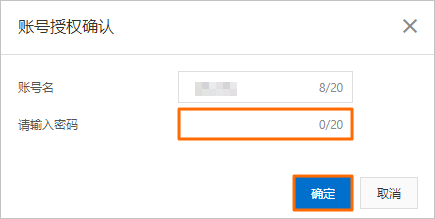

**审计管理员权限验证**

1. 登录PolarDB集分一体版控制台。

   > **说明**
   >
   > 控制台支持以下功能：
   >
   > ：单击可刷新实例列表信息。
   >
   > 
   >
   > ：单击可选择采用**默认**或者**紧凑**模式显示实例列表。
   >
   > 
   >
   > ：单击可选择实例列表中显示的实例属性。
   >
   > 
   >
   > ：单击可将实例列表信息导出到本地。
   >
   > 

2. 找到目标实例，单击实例ID。

3. 在左侧导航栏选择**日志管理 > SQL审计与分析**。

4. 在弹出的**审计权限确认**对话框中，输入审计管理员账号的密码，并单击**确定**。

   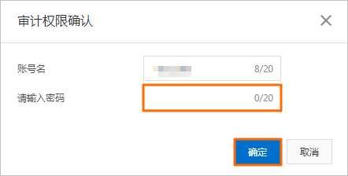

<a id="section-11"></a>

# 11.性能监控

<a id="section-11-1"></a>

## 11.1. 计算资源监控

为方便您掌握实例的运行状态，PolarDB-X提供监控查询功能。您可以在控制台上查看计算资源监控、存储资源监控和日志资源监控信息。其中计算资源监控展示了实例计算层资源的性能数据，本文将介绍如何查看计算资源监控信息。

**操作步骤**

1. 登录PolarDB集分一体版控制台。

   > **说明**
   >
   > 控制台支持以下功能：
   >
   > ：单击可刷新实例列表信息。
   >
   > 
   >
   > ：单击可选择采用**默认**或者**紧凑**模式显示实例列表。
   >
   > 
   >
   > ：单击可选择实例列表中显示的实例属性。
   >
   > 
   >
   > ：单击可将实例列表信息导出到本地。
   >
   > 

2. 找到目标实例，单击实例名称。

3. 在左侧导航栏中，单击**性能监控 > 计算资源监控**。

4. 在**计算资源监控**页面，您可以查看实例、集群和节点的以下监控项。

   | 监控项 | 说明 |
   | --- | --- |
   | CPU | CPU使用率的平均值。 |
   | 平均响应时间/逻辑响应时间 | 逻辑请求（用户请求）的平均响应时间。 |
   | 物理响应时间 | 物理请求（发送给DN的请求）的平均响应时间。 |
   | QPS | 平均每秒处理用户请求的个数。 |
   | TPS | 平均每秒处理的事务数。 |
   | 总会话数 | 每秒总会话的个数。 |
   | 活跃会话数 | 每秒活跃会话的个数。 |
   | 逻辑慢SQL | 每秒逻辑（用户请求）慢SQL数量。 |
   | 物理慢SQL | 每秒物理（发送给DN的请求）慢SQL数量。 |
   | 网络接收/网络接收量 | 网络输入流量的总和，单位为Kbps。存储节点返回数据到计算节点，会产生网络输入流量。 |
   | 网络输出/网络输出量 | 网络输出流量的总和，单位为Kbps。计算节点发送物理SQL到存储节点，计算节点返回数据到应用，均会产生网络输出流量。 |
   | 内存 | JVM堆内存使用率。 |
   | Young GC时间 | 每秒花在Young GC上的时间。 |
   | Full GC时间 | 每秒花在Full GC上的时间。 |

   - 查看实例性能监控：单击**实例**页签，设置查询的时间段，单击**确定**。

   - 查看集群性能监控：单击**集群**页签，设置查询的时间段，单击**确定**。

   - 查看节点性能监控：单击**节点**页签，从页面中间的下拉框中选择目标节点，并设置查询的时间段，单击**确定**。

<a id="section-11-2"></a>

## 11.2. 存储资源监控

为方便您掌握实例的运行状态，PolarDB-X提供监控查询功能。您可以在控制台上查看计算资源监控、存储资源监控和日志资源监控信息。其中存储资源监控展示了实例存储层资源的性能数据，本文将介绍如何查看存储资源监控信息。

**操作步骤**

1. 登录PolarDB集分一体版控制台。

   > **说明**
   >
   > 控制台支持以下功能：
   >
   > ：单击可刷新实例列表信息。
   >
   > 
   >
   > ：单击可选择采用**默认**或者**紧凑**模式显示实例列表。
   >
   > 
   >
   > ：单击可选择实例列表中显示的实例属性。
   >
   > 
   >
   > ：单击可将实例列表信息导出到本地。
   >
   > 

2. 找到目标实例，单击实例名称。

3. 在左侧导航栏中，单击**性能监控 > 存储资源监控**。

4. 在**存储资源监控**页面，您可以查看实例、节点或集群的以下监控项。

   **监控项**

   **说明**

   实例存储节点CPU使用率的平均值。

   CPU

   内存/内存使用率

   JVM Old Generation的内存使用率。内存使用率波动属于正常现象。

   实例空间使用量，单位为MB。

   数据空间使用量，单位为MB。

   日志空间使用量，单位为MB。

   存储空间

   临时空间使用量，单位为MB。

   其他空间使用量，存储系统文件的空间使用量，单位为MB。

   实例空间使用率

   实例空间的使用率，单位为%。

   输入流量，实例平均每秒钟的输入流量。

   网络流量

   输出流量，实例平均每秒钟的输出流量。

   活跃会话数，当前活跃连接数。

   活跃/总会话数

   总会话数，当前总连接数。

   每秒读取的数据量

   实例每秒读取的数据量，单位：KB。

   每秒写入的数据量

   实例每秒写入的数据量，单位：KB。

   每秒读写次数，包括每秒读写总次数、每秒读次数、每秒写次数。

   IOPS

   IOPS使用率

   IOPS使用率，单位：%。

   每秒请求数。

   QPS

   每秒事务数。

   TPS

   缓冲池的脏块率。

   内存缓冲池

   缓冲池的读命中率。

   缓冲池的利用率。

   InnoDB写入量，实例存储节点中InnoDB平均每秒钟写入的数据量，单位为KB/s。

   Innodb写入/读取量

   InnoDB读取量，实例存储节点中InnoDB平均每秒钟读取的数据量，单位为KB/s。

   缓冲池的每秒读次数。

   InnoDB缓冲池请求数

   缓冲池的每秒写次数。

   实例存储节点的平均每秒日志写请求数。

   InnoDB日志写

   平均每秒向日志文件的物理写次数。

   平均每秒向日志文件完成的fsync()写数量。

   临时表

   实例存储节点每秒创建的临时表数量。

   每秒Delete数。

   每秒Insert数。

   每秒Insert_Select数。

   操作

   每秒Replace数。

   每秒Replace_Select数。

   每秒Select数。

   每秒Update数。

   锁等待时间

   锁等待时间，每秒钟锁等待的时间为多少毫秒。

   锁等待次数

   锁等待次数，每秒锁等待的次数。

   慢SQL

   平均每秒慢SQL的个数。

   备库延迟

   备实例的复制延迟，单位：秒。

   监控该核心同步线程是否处于正常运行状态，以确认是否存在因线程停止或异常导致的

   备库SQL线程

   数据同步中断。

   - 查看实例监控项：单击**实例**页签，设置查询的时间段，单击**确定**。

   - 查看节点监控项：单击**节点**页签，在下拉框中选择目标存储节点并设置查询的时间段，单击**确定**。

   - 查看集群监控项：单击**集群**页签，设置查询的时间段，单击**确定**。

<a id="section-11-3"></a>

## 11.3. 日志资源监控

本文将介绍如何在PolarDB-X控制台上查看日志资源监控信息。

**操作步骤**

1. 登录PolarDB集分一体版控制台。

   > **说明**
   >
   > 控制台支持以下功能：
   >
   > ：单击可刷新实例列表信息。
   >
   > 
   >
   > ：单击可选择采用**默认**或者**紧凑**模式显示实例列表。
   >
   > 
   >
   > ：单击可选择实例列表中显示的实例属性。
   >
   > 
   >
   > ：单击可将实例列表信息导出到本地。
   >
   > 

2. 找到目标实例，单击实例名称。

3. 在左侧导航栏中，单击**性能监控 > 日志资源监控**。

4. 在**日志资源监控**页面，您可以查看集群或节点的以下监控项。

   | 监控项 | 描述 |
   | --- | --- |
   | 处理延迟 | 处理binlog事件的延迟，单位为毫秒。 |
   | 处理数据量 | 处理binlog的数据量，单位为字节/秒。 |
   | CPU利用率 | CPU使用率，单位为%。 |
   | 内存利用率 | JVM堆内存使用率。计算方法：堆内存使用总量/堆内存分配的大小\*100%，单位为%。 |
   | 处理事件个数 | 每秒处理binlog事件的个数。 |
   | 处理事务个数 | 每秒处理事务的个数。 |
   | Task年轻的GC次数 | 监控CDC任务JVM年轻代垃圾回收的累计触发次数。 |
   | Task老年代GC次数 | 监控CDC任务JVM老年代垃圾回收的累计触发次数（通常关联 Full GC）。 |
   | Task年轻代GC时间 | 监控CDC任务JVM年轻代GC累计消耗的总时间。 |
   | Task老年代GC时间 | 监控CDC任务JVM老年代GC累计消耗的总时间。 |
   | Task老年代占用率 | 监控CDC任务JVM老年代内存实时使用率。 |

   - 查看集群监控项：单击**集群**页签，设置查询的时间段，单击**确定**。

   - 查看节点监控项：单击**节点**页签，在下拉框中选择目标日志节点并设置查询的时间段，单击**确定**。

<a id="section-11-4"></a>

## 11.4. 列存资源监控

本文将介绍如何在PolarDB-X控制台上查看列存资源监控信息。

**操作步骤**

1. 登录PolarDB集分一体版控制台。

   > **说明**
   >
   > 控制台支持以下功能：
   >
   > ：单击可刷新实例列表信息。
   >
   > 
   >
   > ：单击可选择采用**默认**或者**紧凑**模式显示实例列表。
   >
   > 
   >
   > ：单击可选择实例列表中显示的实例属性。
   >
   > 
   >
   > ：单击可将实例列表信息导出到本地。
   >
   > 

2. 找到目标实例，单击实例名称。

3. 在左侧导航栏中，选择**性能监控 > 列存资源监控**。

4. 在**列存资源监控**页面，您可以查看集群或节点的以下监控项。

   > **说明**
   >
   > - 查看集群监控项：单击**集群**页签，设置查询的时间段，单击**确定**。
   >
   > - 查看节点监控项：单击**节点**页签，在下拉框中选择目标日志节点并设置查询的时间段，单击**确定**。

   | 监控项 | 描述 |
   | --- | --- |
   | CPU利用率 | 实例列存节点CPU利用率，单位为%。 |
   | 内存利用率 | 实例列存节点内存利用率，单位为%。 |
   | 列存索引总个数 | 实例中包含列存索引的总个数，单位为个。 |
   | 列存索引总分区数 | 实例中所有列存索引的分区数总和，单位为个。 |
   | 同步过程批量提交吞吐量 | 实例列存同步过程中实际提交的数据的吞吐量，单位为字节/秒。 |
   | 同步过程批量提交行数 | 实例列存同步过程中实际提交的数据的行数，单位为个。 |
   | 列存同步延迟 | 实例列存同步成功的Binlog事件距今延迟，单位为毫秒。 |
   | 列存后台Compaction任务个数 | 实例列存后台实时进行Compaction任务的个数，单位为个。 |
   | binlog事件同步吞吐量 | 实例列存消费Binlog事件的吞吐量，单位为个。 |
   | binlog接收延迟 | 实例列存当前消费的Binlog事件距今延迟，单位为毫秒。 |

<a id="section-12"></a>

# 12.云监控

<a id="section-12-1"></a>

## 12.1. 查看监控大盘指标

云监控（CloudMonitor，CMS）页面提供了丰富的性能监控项和秒级监控频率，方便您掌握集群或实例的运行状态并通过细粒度的监控数据快速定位运维问题。

**监控大盘**

1. 登录Apsara Uni-manager运营控制台。

2. 在顶部菜单栏，单击**产品 > 数据库**，选择目标数据库产品。

3. 您可以通过如下两种方式查看云监控信息。

   <ol type="i">

   <li>

   方式一

   <ol type="a">

   <li>

   在目标列表页面，单击目标实例或集群ID。

   </li>

   <li>

   在左侧导航栏中，选择**云监控**。

   </li>

   </ol>

   </li>

   <li>

   方式二

   <ol type="a">

   <li>

   在目标列表页面，单击目标实例监控列下的  图标。

   </li>

   <li>

   查看相关监控数据。

   </li>

   </ol>

   </li>

   </ol>

4. 您可以根据业务需求选择查看所需的监控信息，相关监控指标请参见<strong>《云监控CMS用户指南》</strong>中**云监控指标说明-数据库**章节。

   > **说明**
   >
   > 在**时间粒度**下拉框，您可以根据业务需求选择查看监控信息的时间段，支持查看**最近1分钟**到**最近30天**的数据。

<a id="section-12-2"></a>

## 12.2. 报警历史

当报警发生后，可以查看报警历史信息。支持导出并下载报警历史信息，便于在本地进行数据分析。

**操作步骤**

1. 登录Apsara Uni-manager运营控制台。

2. 在顶部菜单栏，单击**产品 > 数据库**，选择目标数据库产品。

3. 在目标列表页面，单击目标实例或集群ID。

4. 在左侧导航栏，单击**云监控**，选择**报警服务** > **报警历史**。

5. （可选）在**报警历史**页面，可通过**规则ID**、**规则名称**、**报警级别**和时间来筛选报警历史记录。

6. 在报警历史页面，执行以下操作。

   <table>
     <tr>
       <th width="122">操作任务</th>
       <th>操作步骤</th>
     </tr>
     <tr>
       <td>查看报警历史</td>
       <td>在<strong>报警历史</strong>列表中，可以直接查看目标报警历史的<strong>产品名称</strong>、<strong>故障实</strong><strong>例</strong>、<strong>发生时间</strong>、<strong>规则名称</strong>、<strong>状态</strong>、<strong>等级</strong>和<strong>通知对象</strong>。单击目标报警历史对应规格名称，可以查看报警规则详情。<br>说明报警历史默认支持查询最近2天的数据。</td>
     </tr>
     <tr>
       <td>导出报警历史</td>
       <td>i. 在<strong>报警历史</strong>页面，单击页面右上方的。<br>ii. 在<strong>导出任务</strong>对话框中，设置<strong>时间选择</strong>和<strong>任务名称</strong>后，单击<strong>确定</strong>。</td>
     </tr>
   </table>

<a id="section-12-3"></a>

## 12.3. 报警规则

<a id="section-12-3-1"></a>

### 12.3.1. 创建报警规则

创建报警规则，按照所设定的云产品监控指标阈值进行告警，及时通知相关用户。

**背景信息**

报警规则在生效时间内，根据默认的探测频率检测报警指标是否超出所设定的阈值，一旦检测到云产品监控指标超出阈值（出现异常），按照设定的报警联系人或其他报警信息处理平台进行告警。

> **说明**
>
> 最小报警探测频率为每分钟一次。

**操作步骤**

1. 登录Apsara Uni-manager运营控制台。

2. 在顶部菜单栏，单击**产品 > 数据库**，选择目标数据库产品。

3. 在目标列表页面，单击目标实例或集群ID。

4. 在左侧导航栏，单击**云监控**，选择**报警服务** > **报警规则**。

5. 单击列表上方的**创建报警规则**。

6. 在**创建报警规则**面板中，根据实际需要设置相应配置项。

   <table>
     <tr>
       <th width="105">配置项</th>
       <th>说明</th>
     </tr>
     <tr>
       <td>云产品选择</td>
       <td>默认，无需选择。</td>
     </tr>
     <tr>
       <td>资源范围</td>
       <td>报警规则关联资源的范围，支持以下几类。不同云产品可选择的范围类型存在一定差异。<br>• <strong>实例维度</strong>：选择当前组织资源集下的一个或多个目标实例。<br>• <strong>资源集维度</strong>：选择当前组织和地域下的目标资源集。<br>• <strong>应用分组维度</strong>：选择当前组织和地域下的应用分组。<br>• <strong>全部资源</strong>：默认不支持选择。</td>
     </tr>
   </table>

   <table>
     <tr>
       <th width="137">资源选择</th>
       <th>根据<strong>资源范围</strong>的选择，选择具体的资源实例、资源集或应用分组。</th>
     </tr>
     <tr>
       <td>报警规则描述</td>
       <td>报警规则的主体。当监控数据满足报警条件时，触发报警规则。规则描述设置方法：<br>i. 单击<strong>创建报警规则</strong>。ii. 在<strong>创建报警规则</strong>面板，设置<strong>规则名称</strong>、<strong>指标维度</strong>、<strong>监控指标</strong>、<strong>阈值及报警级别</strong>等。<br>说明指标维度仅在资源范围选择<strong>实例维度</strong>时才会显示。<br>iii. 单击<strong>确认</strong>。</td>
     </tr>
     <tr>
       <td>通道沉默周期</td>
       <td>报警发生后未恢复正常，间隔多久重复发送一次报警通知。取值：<strong>5分钟</strong>、<strong>15分钟</strong>、<strong>30分</strong><strong>钟</strong>、<strong>1小时</strong>、<strong>3小时</strong>、<strong>6小时</strong>、<strong>12小时</strong>和<strong>24小时</strong>。当某监控指标超出报警阈值时触发报警，如果监控指标在通道沉默周期内持续超过报警阈值，在通道沉默周期内不会重复发送报警通知；如果监控指标在通道沉默周期后仍未恢复正常，则云监控将再次发送报警通知。例如，当<strong>通道沉默周期</strong>设置为<strong>12小时</strong>时，如果超出报警阈值的监控指标在首次触发报警后12小时仍未恢复正常，云监控将再次发送报警通知。</td>
     </tr>
     <tr>
       <td>生效时间</td>
       <td>报警规则的生效时间。报警规则只在生效时间内检查监控数据是否超出报警阈值。</td>
     </tr>
     <tr>
       <td>报警回调</td>
       <td>用于接收云监控通过POST请求推送报警消息的回调地址。<br>说明报警回调地址必须是云监控可访问的域名地址，仅支持HTTP协议，不支持填写IP。</td>
     </tr>
     <tr>
       <td>无数据处理方法</td>
       <td>无监控数据时报警的处理方式。<br>• 不做任何处理<br>• 发送无数据报警</td>
     </tr>
     <tr>
       <td>报警联系人</td>
       <td>选择报警信息发送的用户组或用户。默认的云账号报警联系人组是一个空账号，可用于测试报警规则的有效性。</td>
     </tr>
   </table>

7. 单击**确定**。

**规则描述配置项说明**

| 配置项 | 说明 |
| --- | --- |
| 规则名称 | 填写报警规则名称。 |
| 监控指标 | 从当前报警规则所选择的云产品的所有监控指标中，选择目标指标项。各云产品的监控指标详情可参见云产品监控指标说明。 |
| 指标维度 | 指除实例ID之外的其他维度。仅在资源范围选择<strong>实例维度</strong>时才会显示。 |
| 阈值及报警级别（单位：%） | • 报警级别分为<strong>紧急</strong>、<strong>警告</strong>和<strong>普通</strong>。<br>• 监控数据的聚合值类型可以选择<strong>平均值</strong>、<strong>最小值</strong>和<strong>最大值</strong>。<br>• 监控数据的周期可以选择<strong>连续</strong>、<strong>连续5个周期</strong>、<strong>连续10个周期</strong>、<strong>连续15个周期</strong>、<strong>连续30个周</strong><strong>期</strong>、<strong>连续60个周期</strong>。<br>• 实际监控数据与报警阈值之间的比较关系，支持 “<strong>&gt;</strong>”、“ <strong>&gt;=</strong>”、“<strong>&lt;</strong>”、“<strong>&lt;=</strong> ”、“<strong>=</strong>”、“<strong>!=</strong>”、“<strong>同比昨天同时间上涨</strong>”、“<strong>同比昨天同时间下降</strong>”、“<strong>环比上周期上涨”</strong>、<strong>“环比上周期</strong><strong>下降”</strong>、<strong>“比上周期增量”</strong>、<strong>“比上周期降量”</strong>的选择。还支持设置阈值和触发次数，当监控数据达到设置的阈值的触发次数时，产生报警。 |

**规则配置示例**

为数据库实例创建一个名为example的报警规则，用于监控目标数据库实例的CPU使用率，当CPU使用率峰值（最大值）在五个探测周期内有三次大于等于70%的情况时触发报警，且报警级别为紧急。

适用于此场景的规则描述配置如下图所示。

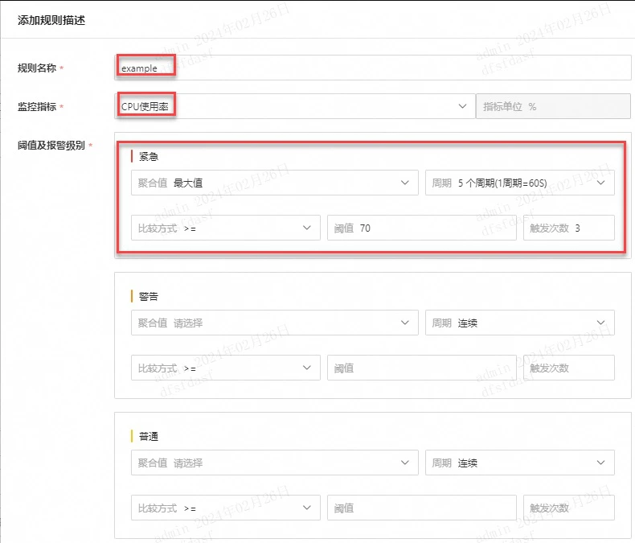

<a id="section-12-3-2"></a>

### 12.3.2. 管理报警规则

在报警规则列表中，可以对报警规则进行修改、禁用、启用、删除等操作。

**操作步骤**

1. 登录Apsara Uni-manager运营控制台。

2. 在顶部菜单栏，单击**产品 > 数据库**，选择目标数据库产品。

3. 在目标列表页面，单击目标实例或集群ID。

4. 在左侧导航栏，单击**云监控**，选择**报警服务** > **报警规则**。

5. 选择目标报警规则，执行相关操作。

   <table>
     <tr>
       <th width="154">操作任务</th>
       <th>操作步骤</th>
     </tr>
     <tr>
       <td>查看报警规则详情</td>
       <td>单击目标报警规则<strong>操作</strong>列的<strong>详情</strong>，在<strong>报警规则/报警历史/故障资源</strong>面板中可查看报警规则的详细信息。</td>
     </tr>
     <tr>
       <td>判断规则有效性</td>
       <td>单击目标报警规则<strong>有效性</strong>列的<strong>点击巡检</strong>，在有效性列可查看巡检结果。<br>说明<br>• 若巡检结果异常，可单击<strong>检测结果</strong>，在弹出的面板中查看<strong>告警规则执行异</strong><strong>常检测</strong>、<strong>告警规则加载检测</strong>、<strong>无效报警规则检测</strong>和<strong>告警规则回调检测</strong>结果。<br>• 单击<strong>重新检测</strong>，可重新检测规则有效性。</td>
     </tr>
     <tr>
       <td>查看规则执行记录</td>
       <td>单击目标报警规则<strong>规则执行记录</strong>列的<strong>查看规则执行记录</strong>，在<strong>报警规则执行记录</strong>面板中，可通过时间范围筛选执行记录。</td>
     </tr>
     <tr>
       <td>修改报警规则</td>
       <td>i. 单击目标报警规则<strong>操作</strong>列的<strong>编辑。</strong>ii. 在<strong>修改报警规则</strong>面板中，修改报警规则。相关配置参数说明请参见<strong>《创建报警规</strong><strong>则》</strong>。iii. 修改完成后，单击<strong>确定</strong>。</td>
     </tr>
   </table>

   <table>
     <tr>
       <td>禁用报警规则</td>
       <td>当需要手动停止云产品的服务，进行维护或升级时，可以禁用报警规则，避免因人为变更而收到大量且无用的报警通知。<br>说明请先确认报警规则的<strong>状态</strong>为<strong>正常</strong>后，再进行禁用。<br>• 单个禁用<br>a. 单击目标报警规则<strong>操作</strong>列的图标，单击<strong>禁用。</strong><br>b. 在<strong>禁用报警规则</strong>对话框中，单击<strong>确定。</strong><br>• 批量禁用<br>a. 选中目标报警规则前的复选框，然后单击列表左下角的<strong>禁用</strong>。<br>b. 在<strong>禁用报警规则</strong>对话框，单击<strong>确定</strong>。</td>
     </tr>
     <tr>
       <td>启用报警规则</td>
       <td>完成云产品的维护或升级后，可以重新启用已被禁用的报警规则。<br>说明请先确认报警规则的<strong>状态</strong>为<strong>已禁用</strong>后，再进行禁用。<br>• 单个启用<br>a. 单击目标报警规则<strong>操作</strong>列的<strong>启用。</strong><br>b. 在<strong>启用报警规则</strong>对话框中，单击<strong>确定。</strong><br>• 批量启用<br>a. 选中目标报警规则前的复选框，然后单击列表左下角的<strong>启用</strong>。<br>b. 在<strong>启用报警规则</strong>对话框，单击<strong>确定</strong>。</td>
     </tr>
     <tr>
       <td>删除报警规则</td>
       <td>• 单个删除<br>a. 单击目标报警规则操作列的图标，单击<strong>删除</strong>。<br>b. 在<strong>删除报警规则</strong>对话框中，单击<strong>确定</strong>。<br>• 批量删除<br>a. 选中目标报警规则前的复选框，然后单击列表左下角的删除。<br>b. 在<strong>删除报警规则</strong>对话框中，单击<strong>确定</strong>。</td>
     </tr>
   </table>

<a id="section-13"></a>

# 13.诊断与优化

<a id="section-13-1"></a>

## 13.1. 实例会话

PolarDB-X支持查看实例的会话及其统计信息。当您的实例突然出现CPU飙升、活跃会话升高或响应时间飙升的告警时，PolarDB-X提供10秒SQL分析的功能帮助您对10秒内的实时SQL进行分析。

**会话管理**

1. 登录PolarDB集分一体版控制台。

2. 找到目标实例，单击实例ID。

3. 在左侧导航栏中，单击**诊断与优化 > 实例会话**，可查看**实例会话**和**会话统计**等详细信息。

   **实例会话**

   <ol type="i">

   <li>

   **查看异常会话**

   - 单击**异常**按钮，在弹出窗口中查看系统识别的异常会话（例如：长时间未提交的事务、高资源消耗会话等）。

     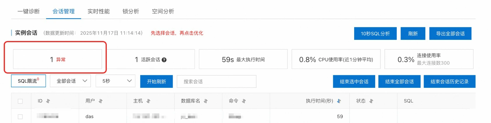

   - 针对异常会话，可单击操作列中的**优化**或**结束**按钮，进行针对性处理。

     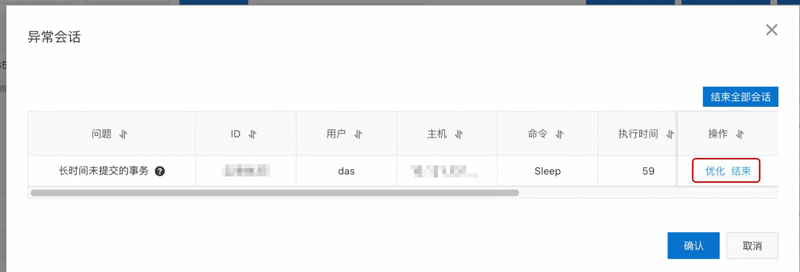

   </li>

   <li>

   **查看关键指标**

   将鼠标悬浮于活跃会话数、最大执行时间、CPU使用率、连接使用率等指标标题上，即可在浮窗中查看详细数据及趋势。

   </li>

   <li>

   **其他核心功能**

   - **10秒SQL分析**：单击页面右上角**10秒SQL分析**，查看最近10秒内的SQL执行统计、慢SQL列表及SQL概览，快速捕捉瞬时性能问题。

   - **SQL限流**：单击**SQL限流**，进入**SQL限流**页面，设置规则对高负载或异常SQL进行自动限流，防止资源耗尽。具体操作，请参见《SQL限流》章节。

   - **优化**：单击**优化**，对目标实例会话进行优化。具体操作，请参见《SQL优化》章节。

   - **导出活跃会话**。

   - **结束会话**：结束会话时，为确保操作安全，系统要求输入建立该会话的数据库账号及其密码进行身份验证。您也可以使用更高权限的数据库账号（具有结束其他账号建立的会话的权限），例如高权限账号。

     > **说明**
     >
     > - 在会话列表的**用户**列，可查看建立目标会话的数据库账号。
     >
     > - 单击**结束会话历史记录**，可查询所有已终止会话的操作记录，包括任务ID、发起时间、结束时间等信息，便于追溯与审计。

   </li>

   </ol>

**会话统计**

- **查看会话统计信息**

  查看会话概要信息（如会话总数、运行中会话总数和运行中会话最长时间），查看按用户、按访问来源和按数据库等条件统计的会话总数及活跃数情况。

- **导出会话统计信息**

  按概要、按用户统计、按访问来源统计和按数据库统计等条件导出会话统计信息。

**SQL限流**

1. 登录PolarDB集分一体版控制台。

2. 找到目标实例，单击实例ID。

3. 在左侧导航栏中，单击**诊断与优化 > 实例会话**。

4. 在**实例会话**页面，单击**SQL限流**。

5. 在弹出的**SQL限流**对话框中，配置如下参数。

   | 参数 | 说明 |
   | --- | --- |

   <table>
     <tr>
       <td>限流模式</td>
       <td>根据需要选择限流模式，支持如下模式：<br>• 通过关键词限流：根据SQL关键词进行筛选从而限流。<br>• 通过SQL模板ID限流：对SQL模板ID进行匹配从而限流，可从SQL日志、会话、EXPLAIN执行结果中获得SQL模板ID。<br>说明SQL模板ID是长度为8的16进制字符串。<br>• 通过执行耗时限流：根据SQL执行时间进行限流。创建了该类限流模式的规则后，当指定类型SQL的执行时间超过设定的阈值时，该类型SQL所属的模板ID会被自动加入到限流规则中，SQL会按照规则指定的并发度执行。<br>说明您可以同时设置限流SQL模板ID数量上限，达到上限后，便不再自动对其他SQL创建限流规则。</td>
     </tr>
     <tr>
       <td>SQL类型</td>
       <td>选择SQL类型，取值如下：<strong>SELECT</strong>、<strong>UPDATE</strong>、<strong>DELETE</strong>、<strong>INSERT</strong>。</td>
     </tr>
     <tr>
       <td>最大并发度</td>
       <td>SQL最大并发数，允许设置的最小值为1。当同时执行的满足限流策略的SQL数达到最大并发数时触发SQL限流。</td>
     </tr>
     <tr>
       <td>限流时间</td>
       <td>SQL限流的生效时间。SQL限流是应急措施，建议您按实际需求设置限流时长，用完及时关闭。</td>
     </tr>
     <tr>
       <td>模板ID</td>
       <td>需要限流的SQL模板ID，多个SQL模板ID间用英文逗号（,）分隔。<br>说明<strong>限流模式</strong>为<strong>通过SQL模板ID限流</strong>时，需要配置此参数。</td>
     </tr>
     <tr>
       <td>SQL执行时间</td>
       <td>SQL执行时间的阈值，当SQL的执行时间大于设置的阈值时，系统会将该类型SQL所属的SQL模板ID加入到限流规则中。<br>说明<strong>限流模式</strong>为<strong>通过执行耗时限流</strong>时，需要配置此参数。</td>
     </tr>
     <tr>
       <td>限流SQL ID数量上限</td>
       <td>通过执行耗时限流的SQL模板ID数量上限，达到上限后，系统不再对其他执行时间大于设置阈值的SQL创建限流规则。<br>说明<strong>限流模式</strong>为<strong>通过执行耗时限流</strong>时，需要配置此参数。</td>
     </tr>
     <tr>
       <td>被限流SQL的数据库账号</td>
       <td>被限流SQL所属的数据库账号。<br>说明<strong>限流模式</strong>为<strong>通过SQL模板ID限流</strong>时，需要配置此参数。</td>
     </tr>
   </table>

6. 单击**创建**。

   SQL限流规则创建完成后，您可以在SQL限流列表查看SQL规则的状态。

   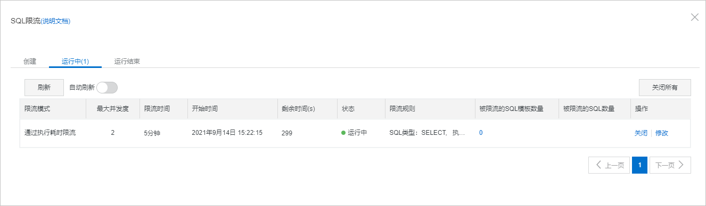

   如您需要提前**关闭**或**修改**限流规则，可单击目标规则右侧**操作**栏的**关闭**或**修改**按钮。

**10秒SQL分析**

该功能帮助您对实例10秒内的SQL进行实时分析。在10秒中，每隔一秒执行一次 `show processlist` ，然后将所有的结果集进行统计分析，您可看到在这10秒中，哪些SQL执行的次数最多，是否存在慢SQL等。

1. 登录PolarDB集分一体版控制台。

2. 找到目标实例，单击实例ID。

3. 在左侧导航栏中，单击**诊断与优化 > 实例会话**。

4. 单击**10秒SQL分析**按钮。

   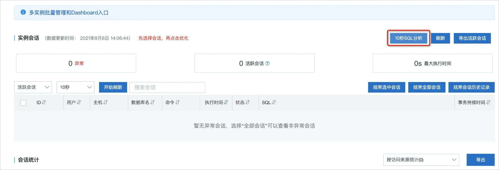

5. 10秒后即可查看在这10秒中，哪些SQL执行的次数最多，是否存在慢SQL等。

   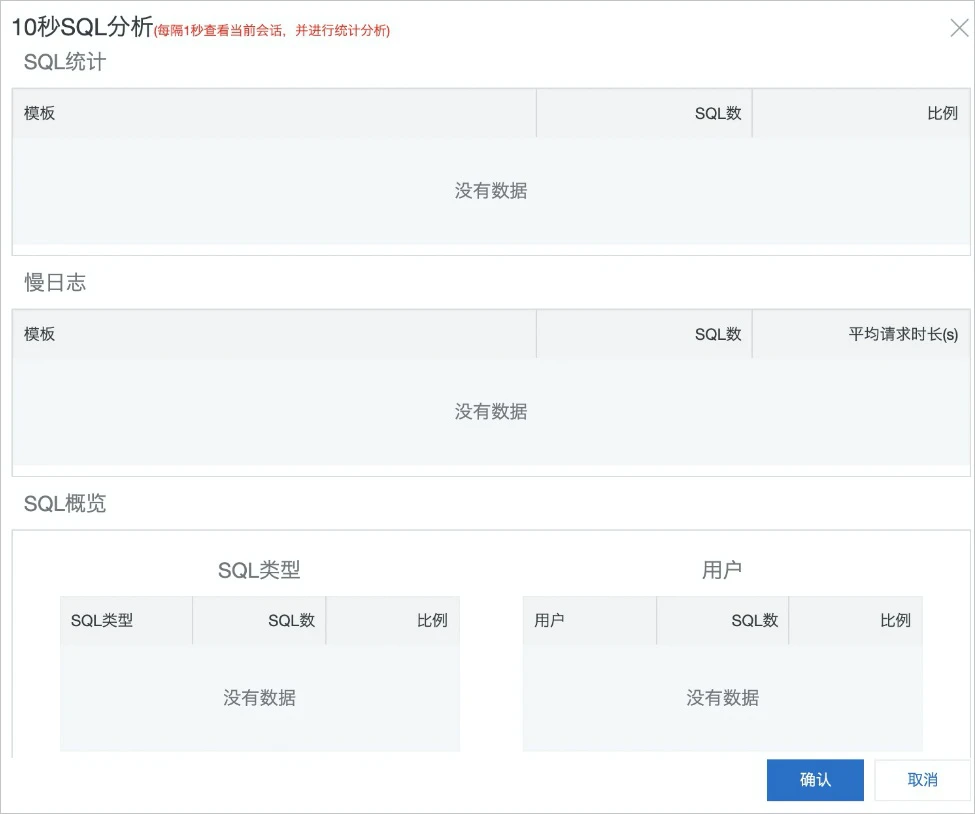

<a id="section-13-2"></a>

## 13.2. 慢日志

本文介绍了PolarDB-X的慢日志查询功能。

**简介**

PolarDB-X提供慢日志查询功能，并且将CPU使用率和慢日志数量的视角结合在一起，能帮助您快速发现影响数据库性能的关键SQL。慢日志功能提供交互页面，您可以查看格式化的慢SQL模板、慢SQL明细，以及每条慢SQL执行次数、耗时、返回行数等关键信息。同时，您可以对慢SQL进行诊断优化。在分析慢SQL执行计划的基础上，为您推荐出包括局部索引和全局二级索引在内的合适索引方案，并提供优化后的预期收益明细。

计算节点（CN）慢SQL和数据节点（DN）慢SQL的定义如下：

- 计算节点（CN）慢SQL：即逻辑慢SQL，客户端发送到PolarDB-X的慢SQL。

- 数据节点（DN）慢SQL：即物理慢SQL，PolarDB-X发送到存储层节点的慢SQL，不支持优化操作。

> **说明**
>
> - 每个PolarDB-X节点最多保存30天慢日志，超过时间将会被自动删除。
>
> - 列存只读实例仅支持查看计算节点（CN）。

**慢日志查看**

1. 登录PolarDB集分一体版控制台。

2. 找到目标实例，单击实例ID。

3. 在左侧导航栏中，单击**诊断与优化 > 慢日志**。

4. 单击页面上方<strong>计算节点（CN）</strong>或<strong>数据节点（DN）</strong>页签，可以分别查看计算节点慢SQL和数据节点慢SQL。

   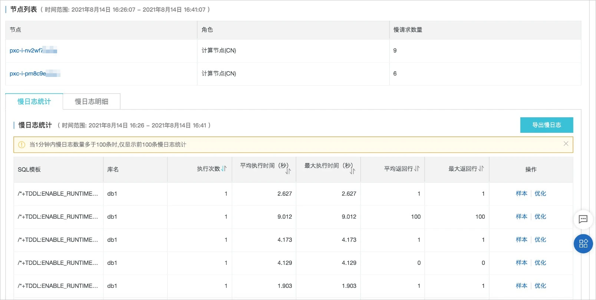

   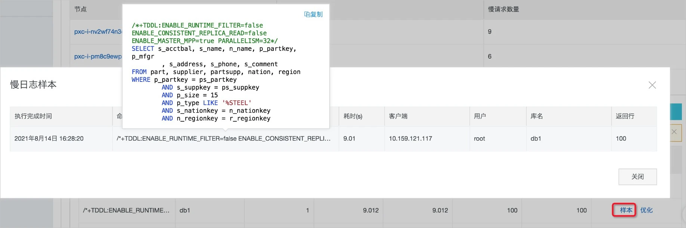

**慢日志优化**

1. 登录PolarDB集分一体版控制台。

2. 找到目标实例，单击实例ID。

3. 在左侧导航栏中，单击**诊断与优化 > 慢日志**。

4. 在下方慢日志统计页签中查看慢SQL模版列表，单击**优化**按钮（目前仅支持CN节点的慢日志优化）。

   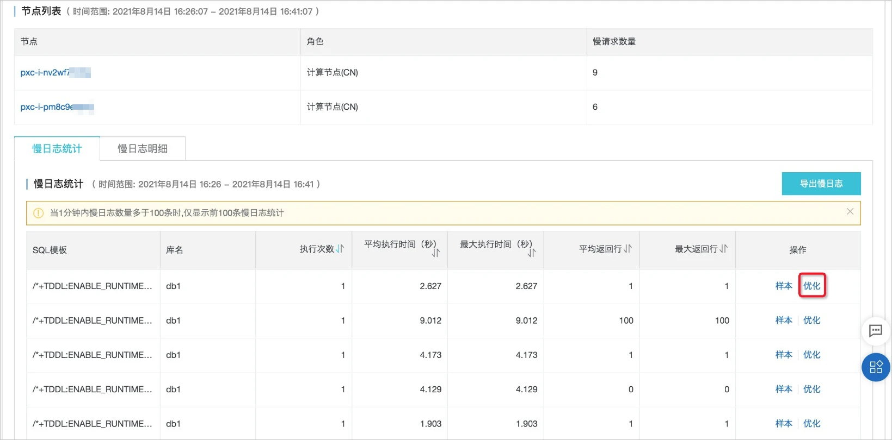

5. 查看慢SQL优化建议。

   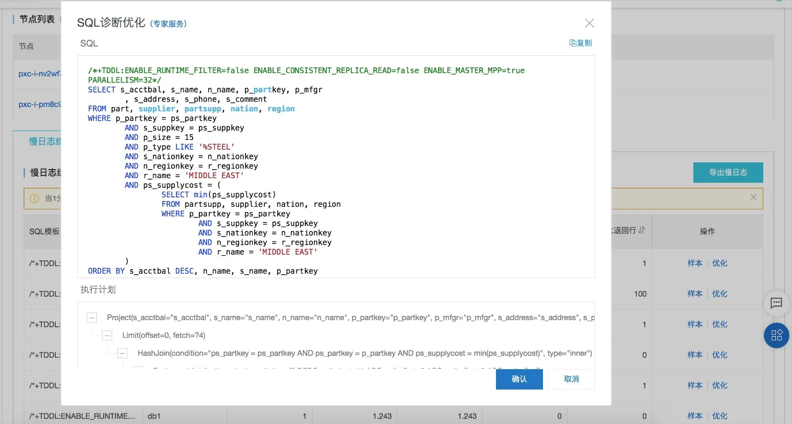

   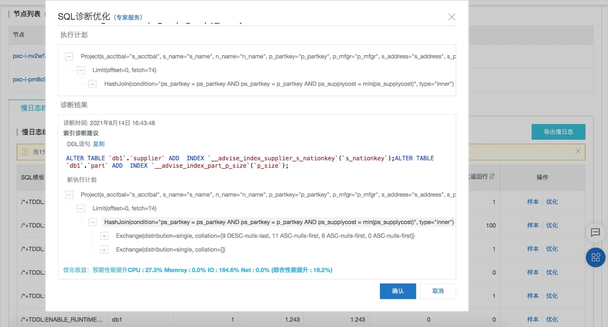

<a id="section-13-3"></a>

## 13.3. 空间分析

PolarDB-X空间分析功能支持查看实例的空间使用概况、空间剩余可用天数，以及数据库中某个表的空间使用情况、空间碎片、空间异常诊断等。本文介绍如何使用PolarDB-X空间分析功能。

**操作步骤**

1. 登录PolarDB集分一体版控制台。

2. 找到目标实例，单击实例ID。

3. 在左侧导航栏中，单击**诊断与优化 > 空间分析**。

4. 在**空间分析**页面，您可以查看如下信息。

   - 在**空间分析 > 空间概况**页签，可查看库表空间概况、异常列表、空间变化趋势和表空间等数据。

     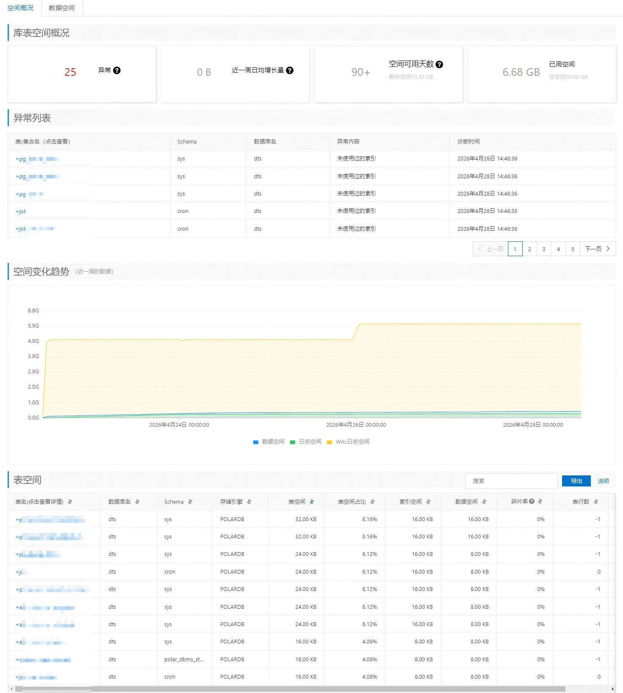

   - 在**空间分析 > 数据空间**页签，可查看每个数据库和单个表的空间使用情况。

     单击目标表名可查看该表的字段和索引信息。

     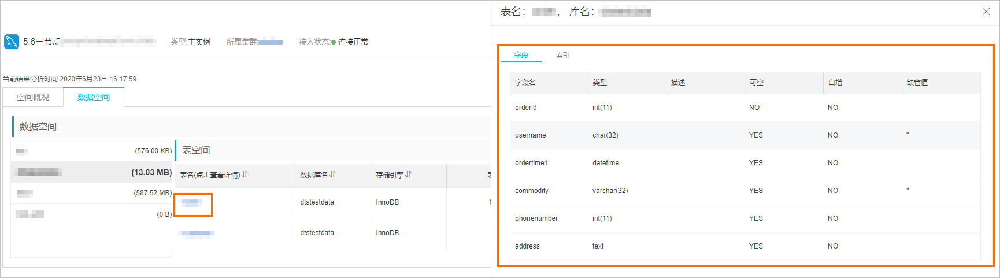

<a id="section-13-4"></a>

## 13.4. 锁分析

本文介绍了锁分析的具体操作步骤。

**注意事项**

- 版本要求：实例版本需 ≥ 5.4.13，否则单击**立即诊断**无结果。

- 权限或数据异常：如果死锁详情显示“您没有权限查看该死锁信息”，可能是账号缺少涉事表权限，或涉事表已被删除。

- 实例限制：只读实例不支持该功能，仅主实例可用。

**操作步骤**

1. 登录PolarDB集分一体版控制台。

2. 找到目标实例，单击**实例ID**进入实例详情页。

3. 在左侧导航栏中，单击**诊断与优化 > 锁分析**。

4. 在**锁分析**页面，单击左侧**立即诊断**。

5. 在新生成的死锁诊断列表右侧，单击**详情**栏中的**查看详情**。

6. 在锁分析对话框中，查看死锁诊断详情列表，您也可以单击**查看死锁日志**，查看最近一次的死锁日志详情。

   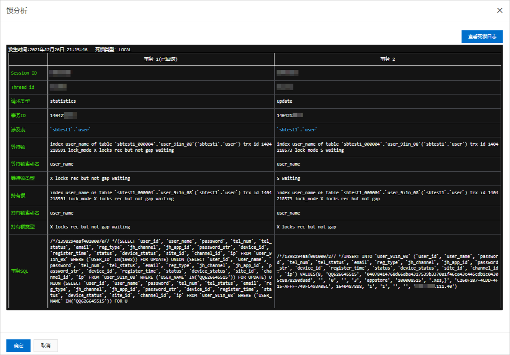

<a id="section-13-5"></a>

## 13.5. 性能趋势

本文介绍了PolarDB-X性能趋势的查看方式。

PolarDB-X集成DAS的性能趋势功能，提供计算节点（CN）、数据节点（DN）、GMS节点和日志节点（CDC）的监控指标查看能力。同时支持多种查看性能趋势的方式，不仅支持性能趋势区间查看，也支持性能趋势对比查看和自定义性能趋势查看。

**性能趋势查看**

1. 登录PolarDB集分一体版控制台。

2. 找到目标实例，单击实例ID。

3. 在左侧导航栏中，单击**诊断与优化 > 性能趋势**。

   - 单击页面上的页签分别查看计算节点（CN）、数据节点（DN）、GMS节点和日志节点（CDC）的监控指标。具体指标请参见性能指标说明。

     > **说明**
     >
     > 列存只读实例不支持查看数据节点（DN）和日志节点（CDC）。

     节点列表展示了节点的规格、CPU使用率、内存使用率和当前活跃连接数等。

   - 在**性能趋势**页签，查看选定时间段内各个指标的性能趋势。

     - 单击**更多指标**，可以选择需要查看性能趋势的指标。

     - 在任意指标趋势图中，使用鼠标拖拽选择一段时间，可以对选择时段的性能趋势进行诊断，查看选定时间段内指标是否正常。

     - 单击某个监控指标趋势图中的**详情**，放大该监控指标的趋势图，并且可以修改时间查看该监控指标不同时间段的变化趋势。

   - 在**性能趋势对比查看**页签。设置任意两个时间段，单击**查看**可查看时间段内的性能对比趋势图表。

   - 在**自定义图表**页签，您可以根据业务需要，自定义多个性能监控大盘，将需要的多个性能监控指标在同一个图表中进行展示，便于问题排查和分析。

     > **说明**
     >
     > 如果您是首次使用，需要先创建监控大盘。

**执行性能诊断**

除了性能趋势查看外，在任意节点的趋势图上, 按住鼠标拖动选择一段时间, 即可针对该节点在这段时间范围内的资源利用率，慢SQL状况进行诊断。

> **说明**
>
> 目前仅计算节点和数据节点支持性能诊断，GMS节点和日志节点不支持。

1. 登录PolarDB集分一体版控制台。

2. 找到目标实例，单击实例ID。

3. 在左侧导航栏中，单击**诊断与优化 > 性能趋势**。

4. 在任意节点的趋势图上, 按住鼠标拖动选择一段时间，单击**诊断**按钮。

   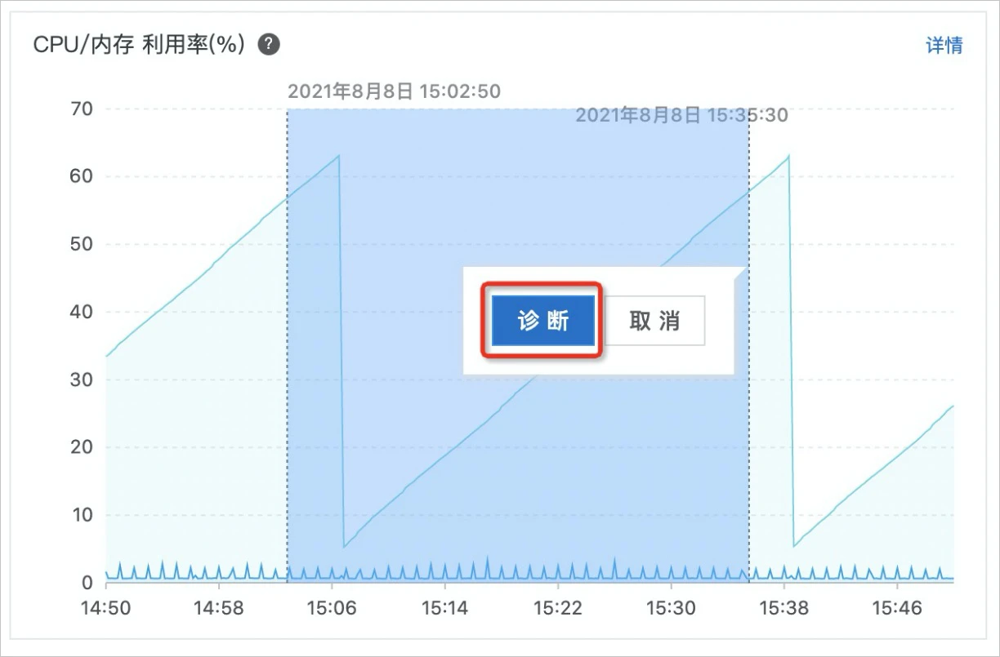

5. 在诊断详情页待诊断任务完成即可查看资源利用率和慢SQL的异常情况。

   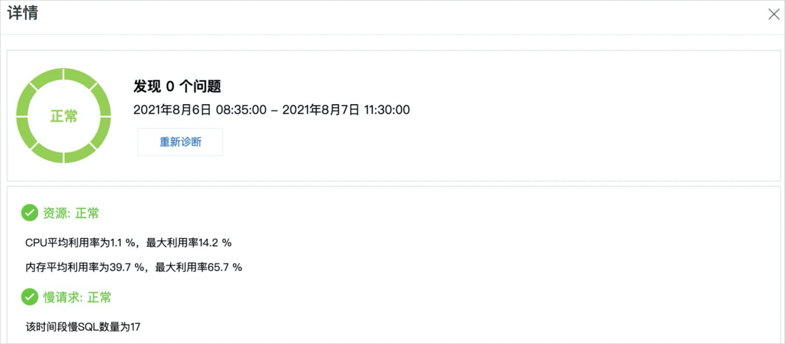

   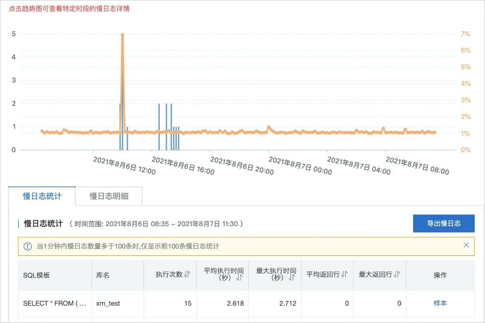

**性能指标说明**

**计算节点**

| 指标 | 单位 | 含义 |
| --- | --- | --- |
| polardbx.cpu_usage | % | CPU使用率的平均值。 |
| polardbx.mem_usage | % | JVM的内存使用率，内存使用率波动属于正常现象。 |
| polardbx.active_connection | Count | 连接总数。 |
| polardbx.running_thread | Count | 活跃连接总数。 |
| polardbx.network_in_bytes | Byte | 网络输入流量的总和。 |
| polardbx.network_out_bytes | Byte | 网络输出流量的总和。 |
| polardbx.logic_qps | Per Second | 每秒处理的逻辑SQL语句数目的总和。 |
| polardbx.physical_qps | Per Second | 每秒处理的物理SQL语句数目的总和。 |
| polardbx.logic_rt | ms | 逻辑SQL平均响应时间。 |
| polardbx.physical_rt | ms | 物理SQL平均响应时间。 |
| polardbx.slow_request_count | Per Second | 逻辑慢SQL数量。 |
| polardbx.physical_slow_request _count | Per Second | 物理慢SQL数量。 |

**数据节点与GMS节点**

| 指标 | 单位 | 含义 |
| --- | --- | --- |
| mysql.tps | Per Second | 每秒事务数。 |
| mysql.qps | Per Second | 每秒请求数。 |
| mysql.total_session | Count | 当前全部会话。 |
| mysql.active_session | Count | 当前活跃会话。 |
| mysql.bytes_received | KByte | 平均每秒从所有客户端接收到的字节数。 |
| mysql.bytes_sent | KByte | 平均每秒发送给所有客户端的字节数。 |
| mysql.tb.tmp.disk | Count | MySQL执行语句时在硬盘上自动创建的临时表的数量。 |
| mysql.insert_ps | Per Second | 平均每秒insert语句执行次数。 |
| mysql.select_ps | Per Second | 平均每秒select语句执行次数。 |
| mysql.update_ps | Per Second | 平均每秒update语句执行次数。 |
| mysql.delete_ps | Per Second | 平均每秒delete语句执行次数。 |
| mysql.replace_ps | Per Second | 平均每秒replace语句执行次数。 |
| mysql.innodb_data_written | KByte | InnoDB平均每秒写字节数。 |
| mysql.innodb_data_read | KByte | InnoDB平均每秒读字节数。 |
| mysql.innodb_buffer_pool_read s_requests | Count | InnoDB平均每秒从Buffer Pool读取页的次数（逻辑读）。 |
| mysql.innodb_bp_dirty_pct | % | InnoDB Buffer Pool脏页比率，计算公式：Innodb_buffer_pool_pages_dirty/Innodb_buffer_pool_pages_data ×100%。 |
| mysql.innodb_bp_hit | % | InnoDB Buffer Pool读缓存命中率，计算公式：(Innodb_buffer_pool_read_requ ests -Innodb_buffer_pool_reads)/Innodb_buffer_pool_read_reque sts×100%。 |
| mysql.innodb_bp_usage_pct | % | InnoDB Buffer Pool使用率，计算公式：innodb_buffer_pool_pages_data/ (innodb_buffer_pool_pages_data +innodb_buffer_pool_pages_fre e )×100%。 |
| mysql.innodb_log_writes | Per Second | Innodb平均每秒物理写Redo Log File次数。 |
| mysql.innodb_os_log_fsyncs | Per Second | 平均每秒向日志文件完成的fsync()写数量。 |
| mysql.innodb_rows_deleted | Per Second | InnoDB平均每秒删除的行数。 |
| mysql.innodb_rows_read | Per Second | InnoDB平均每秒读取的行数。 |
| mysql.innodb_rows_inserted | Per Second | InnoDB平均每秒插入的行数。 |
| mysql.innodb_rows_updated | Per Second | InnoDB平均每秒更新的行数。 |
| mysql.mem_usage | % | MySQL实例内存使用率（占操作系统总数）。 |
| mysql.cpu_usage | % | MySQL服务进程CPU使用率（阿里云数据库最高100%）。 |
| mysql.data.size | MByte | 数据空间。 |
| mysql.tmp.size | MByte | 临时表空间。 |
| mysql.other.size | MByte | 系统空间。 |
| mysql.instance.size | MByte | MySQL实例总空间使用量。 |
| mysql.log.size | MByte | 日志空间。 |
| mysql.iops | Count | MySQL读写次数。 |

**日志节点**

| 指标 | 单位 | 含义 |
| --- | --- | --- |
| polardbx_cdc.cpu_usage | % | CPU使用率。 |
| polardbx_cdc.mem_usage | % | 内存使用率。 |
| polardbx_cdc.dumper_heapUsa ge | % | 堆内存使用率。 |
| polardbx_cdc.dumper_delay | ms | 处理Binlog事件的延迟。 |

<a id="section-13-6"></a>

## 13.6. 实时性能

PolarDB 集分一体版提供实例级别的实时性能，帮助您在压测或者大促期间，实时确认数据库性能。

**操作步骤**

1. 登录PolarDB集分一体版控制台。

2. 找到目标实例，单击**实例ID**进入实例详情页。

3. 在左侧导航栏中，单击**诊断与优化 > 实时性能**。

4. 进入**实时性能**详情页，查看相关性能指标。

   > **说明**
   >
   > - PolarDB 集分一体版支持**实时图表**和**实时表格**两种视图，打开实时性能图表，可观察秒级数据刷新。
   >
   > - 列存只读实例不支持查看数据节点（DN）。

   详情页相关操作说明：

   - 企业版（分布式）

     - 单击**参数说明**，可查看相关指标的具体描述。

     - 单击**计算节点(CN)**、**数据节点(DN)**、**GMS节点**或**集群**页签，可分别查看相关节点的性能信息。

     - 单击**选择节点**下拉列表可查看不同节点的性能信息。

   - 标准版（集中式）

     - 单击**参数说明**，可查看相关指标的具体描述。

<a id="section-13-7"></a>

## 13.7. 诊断报告

PolarDB 集分一体版支持诊断报告功能，帮助您全面评估数据库实例的运行状态，识别性能瓶颈与潜在风险。您可手动触发诊断，也可配置定时任务自动生成报告。目前本功能仅提供运行状态评估与问题展示，不包含自动优化建议，需用户根据报告内容自行排查并改进。

**使用建议**

- 定期生成报告：建议对生产实例配置每日自动诊断，建立性能基线。

- 结合慢SQL优化：重点关注“TOP 10慢SQL”与“高危SQL”，及时优化查询语句。

- 关注健康评分变化：若评分持续下降，需排查资源配置或业务增长带来的压力。

**操作步骤**

1. 登录PolarDB集分一体版控制台。

2. 找到目标实例，单击**实例ID**进入实例详情页。

3. 在左侧导航栏中，单击**诊断与优化 > 诊断报告**。

4. **手动发起诊断**

   单击**发起诊断**，选择诊断时间区间（支持近1小时、近3小时、近6小时、近12小时、近24小时），并单击**确认**，系统将立即启动诊断任务。

   **配置自动诊断报告（定时生成）**

   单击**自动生成报告设置**，勾选**定时触发**，并勾选日期和具体时间，单击**确认**。

   > **说明**
   >
   > 受系统调度与资源负载影响，自动报告可能存在延迟，请以实际生成时间为准。

   **查看报告详情**

   诊断完成后，报告将出现在列表中。单击目标诊断报告右侧操作列下的**查看报告**，进入详情页。报告维度包括实例健康状况、活跃会话列表、TOP 10慢SQL、高危SQL、TOP5 表空间、冗余索引、锁分析、性能趋势。

   您可在诊断报告页面顶部右侧，单击**扣分详情**，查看本次诊断的扣分详情。

   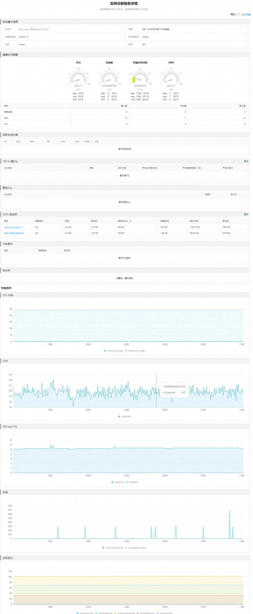

   **下载诊断报告**

   单击**查看报告**在实例诊断报告详情页，单击左侧**下载**，即可下载报告到本地，便于存档或分享。

   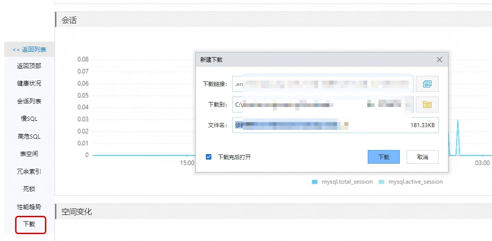

<a id="section-14"></a>

# 14.日志管理

<a id="section-14-1"></a>

## 14.1. SQL审计与分析

本文介绍了查询SQL语句的方法。

**操作步骤**

1. 登录PolarDB集分一体版控制台。

   > **说明**
   >
   > 控制台支持以下功能：
   >
   > ：单击可刷新实例列表信息。
   >
   > 
   >
   > ：单击可选择采用**默认**或者**紧凑**模式显示实例列表。
   >
   > 
   >
   > ：单击可选择实例列表中显示的实例属性。
   >
   > 
   >
   > ：单击可将实例列表信息导出到本地。
   >
   > 

2. 找到目标实例，单击实例名称。

3. 在左侧导航栏中，单击**日志管理 > SQL审计与分析**。

4. 从时间范围列表中，按需选择或**自定义**时间段。

5. 单击**高级筛选**后依次按需输入**SQL语句**、**数据库名称**、**数据库用户**、**事务ID**、**节点ID**、**TraceID**，单击**搜索**。

   > **说明**
   >
   > 您也可以单击右上角**导出文件**，以文件的形式导出搜索结果。

<a id="section-14-2"></a>

## 14.2. 慢SQL

PolarDB集分一体版实例都支持日志管理，您可以通过控制台查询实例的慢日志明细，帮助故障定位分析。

**操作步骤**

1. 登录PolarDB集分一体版控制台。

2. 在**实例列表**页面，单击目标实例ID，进入实例详情页面。

3. 在左侧导航栏中，单击**日志管理 > 慢SQL**。

4. 选择时间范围查看慢SQL信息。

   > **说明**
   >
   > <strong>企业版（分布式）</strong>支持按照<strong>计算节点（CN）</strong>和<strong>数据节点（DN）</strong>分开查看慢日志明细。

   <table>
     <tr>
       <th width="106">查询项</th>
       <th>内容</th>
     </tr>
     <tr>
       <td>慢日志明细</td>
       <td>记录7天内数据库中执行时间超过1秒的SQL语句，并进行相似语句去重。<br>说明<br>控制台每分钟更新一次，实时的慢日志明细可以查看<code> mysql.slow_log </code>表。</td>
     </tr>
   </table>

<a id="section-15"></a>

# 15.备份与恢复

本文为您介绍PolarDB-X备份与恢复的功能介绍和计费方式。

**备份功能**

**备份类型**

PolarDB-X的备份由数据备份和日志备份组成。

- 数据备份：系统对数据进行备份，并生成备份集，目前采用的是物理备份。您可以恢复备份集所在时间点的数据。

- 日志备份：也叫增量备份，备份了记录数据变更的Binlog日志。

  开启日志备份后，基于“数据备份+日志备份”，您可以恢复时间范围内任意时间点（精确至秒）的数据。例如，实例中创建了2021年01月01日00:00:01的数据备份集以及该时间之后的日志，则可以恢复2021年01月01日00:00:01以来任意时间点（精确至秒）的数据。

**备份方式**

PolarDB-X支持自动备份与手动备份两种方式。

- 自动备份：系统自动定期触发的数据备份。

  - 自动备份策略默认开启且无法关闭，包括数据备份和日志备份。

  - 数据备份默认为每周备份两次（周一与周四），日志备份持续进行，无需设置频率。您可以设置自动执行备份的时间段和周期。

- 手动备份：仅支持在控制台手动触发数据备份。

> **说明**
>
> - 自动备份的频率最低为每周一次。
>
> - 前一次的手动备份完成后才能进行下一次的手动备份。

**备份存放位置**

- 数据备份：存放于阿里云提供的备份空间，不占用实例的存储空间，默认保留30天。

- 日志备份：暂存于实例的存储空间，超过一定时间后（默认7小时）或者一定的空间后（实例存储空间的30%）会上传至阿里云提供的备份空间，默认保留7天。

  您可以设置本地日志备份的保留策略，避免日志备份占用过多存储空间，详情请参见备份操作。

**备份影响**

PolarDB-X备份在存储节点的备节点执行，不占用主节点CPU，备节点不承接业务流量，因此不影响实例性能。

> **说明**
>
> 少数情况下，备节点不可用时，备份会在主节点执行。

**恢复功能**

**恢复方式**

PolarDB-X支持按备份集恢复和按时间点恢复两种数据恢复方式。

- 按备份集恢复：依赖数据备份恢复数据，仅支持将数据恢复至数据备份的时刻。

- 按时间点恢复：依赖数据备份+日志备份恢复数据，支持将数据恢复至备份时间范围内的**任意时间点（精确至秒）**。例如，实例有2021年01月01日00:00:01的数据备份集以及该时间之后的日志，则可以恢复2021年01月01日00:00:01以来任意时间点（精确至秒）的数据。

**恢复数据的位置**

PolarDB-X当前仅支持恢复数据至新实例，恢复完成后建议通过DTS等工具将数据导回原实例。

- 新实例的白名单设置、备份设置、参数设置和当前实例保持一致。

- 新实例内的数据与备份文件或指定恢复时间点时的数据一致。

- 新实例带有备份文件或时间点当时的账号信息。

- 新实例的拓扑与原实例一致，即节点个数相同。

**计费方式**

- **数据备份**：请查看【通知】2023年12月27日起PolarDB-X 2.0备份恢复启动商业化。

- **日志备份**：当前仅收取使用实例存储空间的费用，计费方式和PolarDB-X存储空间的价格与计费方式一致，详情请参见计费概览。

- **数据恢复**：由于数据是恢复到新实例上，因此需要收取新实例的费用。

**全局一致性**

PolarDB-X是一款分布式数据库，数据存放在多个存储节点（DN）上，当分布式事务存在的情况下，恢复后的实例需要保证多个存储节点间的数据一致性。下图通过转账测试给出了全局一致性的示例：

sum(balance)=200

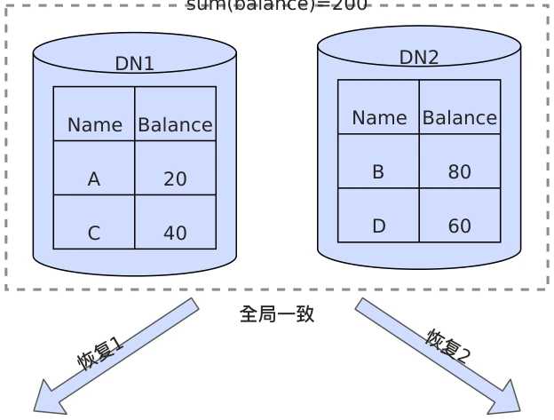

2021-07-25 16:14:20 转账A:20+30=>50

B:80-30=>50

C:40+20=>60 D:60-20=>40

sum(balance)=250

sum(balance)=200

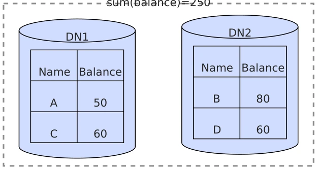


全局不一致

全局一致

PolarDB-X中存放了一张用户的账户余额表，该表的数据分布在两个存储节点中，总的账户金额是200元。业务持续地使用分布式事务在不同的账号间进行转账。

某一时刻（2021-07-25 16:14:20），账户B向账户A转账了30元，账户D向账户C转账了20元。如果将数据恢复至该时刻，全局一致性要求恢复出的数据要么是转账前的状态，要么是转账完成后的状态，即账户的总金额需仍为200元（如恢复2），不能出现转账过程中的数据状态（如恢复1），恢复1中账户总金额为250元，数据是全局不一致的。

<a id="section-15-1"></a>

## 15.1. 备份数据

PolarDB-X支持自动备份及手动备份，方便您恢复历史数据。 本文介绍数据备份的相关功能。

**备份类型**

PolarDB-X的备份由数据备份和日志备份组成。

- **数据备份**：系统对数据进行备份，并生成备份集，目前采用的是物理备份。您可以恢复备份集所在时间点的数据。

- **日志备份**：也叫增量备份，备份了记录数据变更的binlog日志。开启日志备份后，基于“数据备份+日志备份”，您可以恢复时间范围内任意时间点（精确至秒）的数据。例如，实例中创建了2021年01月01日00:00:01的数据备份集以及该时间之后的日志，则可以恢复2021年01月01日00:00:01以来任意时间点（精确至秒）的数据。

**注意事项**

- 备份过程中不要进行实例的扩容，升降配等操作，避免备份失败。

- 备份过程中不要执行DDL命令，避免因锁表到导致备份失败。

- 数据备份、日志备份暂不支持下载。

**设置自动备份**

1. 登录PolarDB集分一体版控制台。

   > **说明**
   >
   > 控制台支持以下功能：
   >
   > ：单击可刷新实例列表信息。
   >
   > 
   >
   > ：单击可选择采用**默认**或者**紧凑**模式显示实例列表。
   >
   > 
   >
   > ：单击可选择实例列表中显示的实例属性。
   >
   > 
   >
   > ：单击可将实例列表信息导出到本地。
   >
   > 

2. 找到目标实例，单击实例名称。

3. 在左侧导航栏中，单击**数据恢复 > 备份恢复**。

4. 单击**备份策略**。

   

5. 在**数据备份设置**页签，设置以下参数。

   

   | 参数 | 说明 |
   | --- | --- |
   | 开启备份 | 自动备份默认为开启状态。 |
   | 备份集保留时间(7-730) | 设置自动备份的具体保留天数，取值范围为7~730天。<br>说明<br>• 超过保留天数的备份会被自动删除。<br>• 支持通过杜康平台配置参数，延长备份集保留时间上限。具体请参见《运维指南》系统管理章节，在系统参数配置页签，资源名搜索<code> FRONT_CONFIG_CENTER </code>，修改<code> polardbx_backup_max_retention_time </code>的值，即可完成上限修改。 |
   | 备份开始时间段 | 设置自动备份开始的时间，可以设置为任意时段，以小时为单位，建议设置为业务低峰期时间。 |
   | 备份周期 | 设置自动备份的周期。<br>说明出于安全考虑，建议自动备份的频率为每周至少2次。 |
   | 日志备份保留时间(7-730) | 日志备份文件的保留天数，取值范围为7~730天。<br>说明超过保留天数的备份会被自动删除。 |

6. 单击**确定**即可。

**本地日志备份设置**

1. 登录PolarDB集分一体版控制台。

   > **说明**
   >
   > 控制台支持以下功能：
   >
   > ：单击可刷新实例列表信息。
   >
   > 
   >
   > ：单击可选择采用**默认**或者**紧凑**模式显示实例列表。
   >
   > 
   >
   > ：单击可选择实例列表中显示的实例属性。
   >
   > 
   >
   > ：单击可将实例列表信息导出到本地。
   >
   > 

2. 找到目标实例，单击实例名称。

3. 在左侧导航栏中，单击**数据恢复 > 备份恢复**。

4. 单击**备份策略**。

5. 在**本地日志设置**页签，设置以下参数：

   

   <table>
     <tr>
       <th width="152">参数</th>
       <th>说明</th>
     </tr>
     <tr>
       <td>本地日志保存个数</td>
       <td>控制系统保留的最近日志备份的数量，取值：6~100。</td>
     </tr>
     <tr>
       <td>保留时长</td>
       <td>日志备份在实例存储空间的保留时长。默认值为7小时。表示开启日志备份功能后，本地只保存最近7个小时内的日志备份文件，7个小时之前的日志备份将被清理。取值：0~168。</td>
     </tr>
     <tr>
       <td>空间使用率不超过</td>
       <td>本地空间使用率=本地日志备份（Binlog）大小/实例总可用空间大小，默认值为30%，表示本地日志备份空间使用率大于30%时，系统会从最早日志备份（Binlong）开始清理。取值：0~50 。</td>
     </tr>
     <tr>
       <td>可用空间保护</td>
       <td>该功能默认开启，表示当实例总空间使用率超过80%或实例剩余可用空间不足50GB时，会强制从最早的日志备份（Binlog）开始清理，直到总空间使用率降到80%以下且实例剩余可用空间大于50GB。</td>
     </tr>
   </table>

**手动创建备份**

1. 登录PolarDB集分一体版控制台。

   > **说明**
   >
   > 控制台支持以下功能：
   >
   > ：单击可刷新实例列表信息。
   >
   > 
   >
   > ：单击可选择采用**默认**或者**紧凑**模式显示实例列表。
   >
   > 
   >
   > ：单击可选择实例列表中显示的实例属性。
   >
   > 
   >
   > ：单击可将实例列表信息导出到本地。
   >
   > 

2. 找到目标实例，单击实例名称。

3. 在左侧导航栏中，单击**数据恢复 > 备份恢复**。

4. 单击**创建备份**。

5. 在弹出的对话框中，单击**确定**即可。

**下载备份**

1. 登录PolarDB集分一体版控制台。

   > **说明**
   >
   > 控制台支持以下功能：
   >
   > ：单击可刷新实例列表信息。
   >
   > 
   >
   > ：单击可选择采用**默认**或者**紧凑**模式显示实例列表。
   >
   > 
   >
   > ：单击可选择实例列表中显示的实例属性。
   >
   > 
   >
   > ：单击可将实例列表信息导出到本地。
   >
   > 

2. 找到目标实例，单击实例名称。

3. 在左侧导航栏中，单击**数据恢复 > 备份恢复**。

4. 找到需要下载的备份，单击操作列**下载**。

5. 在**备份集下载**弹框中，单击**复制**，复制目标文件的下载地址，在浏览器打开，自动下载文件。

<a id="section-15-2"></a>

## 15.2. 查看和下载Binlog备份

本文介绍如何下载实例Binlog备份文件。

1. 登录PolarDB集分一体版控制台。

   > **说明**
   >
   > 控制台支持以下功能：
   >
   > ：单击可刷新实例列表信息。
   >
   > 
   >
   > ：单击可选择采用**默认**或者**紧凑**模式显示实例列表。
   >
   > 
   >
   > ：单击可选择实例列表中显示的实例属性。
   >
   > 
   >
   > ：单击可将实例列表信息导出到本地。
   >
   > 

2. 单击目标实例名称或ID进入实例详情页，查看或下载已产生的Binlog备份文件。

   - 企业版（分布式）系列实例：在左侧导航栏中，单击**数据恢复 > CDC BINLOG备份**。

   - 标准版（集中式）系列实例：在左侧导航栏中，单击**数据恢复 > BINLOG备份**。

   - **下载备份**：单击目标备份集操作列下的**下载**，可下载对应的Binlog文件。

     > **说明**
     >
     > Binlog备份文件默认保存周期为15天，若在超出保存周期导致下载链接失效，请刷新页面，会生成新的下载链接。

<a id="section-15-3"></a>

## 15.3. 恢复数据

PolarDB-X支持通过备份恢复历史数据。本文介绍恢复数据的相关操作步骤。

**恢复方式**

PolarDB-X支持按备份集恢复和按时间点恢复两种数据恢复方式。

- 按备份集恢复：依赖数据备份恢复数据，仅支持将数据恢复至数据备份的时刻。

- 按时间点恢复：依赖数据备份和日志备份恢复数据，支持将数据恢复至备份时间范围内任意时间点（精确至秒）。例如，实例已创建了2021年01月01日00:00:01的数据备份集以及该时间之后的日志，则可以恢复2021年01月01日00:00:01以来任意时间点（精确至秒）的数据。

**全局一致性**

PolarDB-X是一款分布式数据库，数据存放在多个数据节点（DN）上，当分布式事务存在的情况下，恢复后的实例需要保证多个数据节点间的数据一致性。下图通过转账测试给出了全局一致性的示例：


PolarDB-X中存放了一张用户的账户余额表，该表的数据分布在两个数据节点中，总的账户金额是200元。业务持续地使用分布式事务在不同的账号间进行转账。

某一时刻（2021-07-25 16:14:20），账户C向账户A转账了30元，账户D向账户C转账了20元。如果将数据恢复至该时刻，全局一致性要求恢复出的数据要么是转账前的状态，要么是转账完成后的状态，即账户的总金额需仍为200元（如恢复2），不能出现转账过程中的数据状态（如恢复1），恢复1中账户总金额为250元，数据是全局不一致的。

**恢复数据的位置**

PolarDB-X当前仅支持恢复数据至新实例，恢复完成后建议通过DTS等工具将数据导回原实例。

- 新实例的白名单设置、备份设置、参数设置和当前实例保持一致。

- 新实例内的数据与备份文件或指定恢复时间点时的数据一致。

- 新实例带有备份文件或时间点当时的账号信息。

- 新实例的拓扑与原实例一致，即节点个数相同。

**按时间点恢复**

1. 登录PolarDB集分一体版控制台。

   > **说明**
   >
   > 控制台支持以下功能：
   >
   > ：单击可刷新实例列表信息。
   >
   > 
   >
   > ：单击可选择采用**默认**或者**紧凑**模式显示实例列表。
   >
   > 
   >
   > ：单击可选择实例列表中显示的实例属性。
   >
   > 
   >
   > ：单击可将实例列表信息导出到本地。
   >
   > 

2. 找到目标实例，单击实例名称。

3. 在左侧导航栏中，单击**数据恢复 > 备份恢复**。

4. 单击**时间点恢复**。

5. 设置恢复实例相关参数，单击**提交**。

   创建成功的实例已克隆了原集群的全部数据，您可以选择使用新集群或者将新集群的数据迁移至原集群。

**按备份集恢复**

1. 登录PolarDB集分一体版控制台。

   > **说明**
   >
   > 控制台支持以下功能：
   >
   > ：单击可刷新实例列表信息。
   >
   > 
   >
   > ：单击可选择采用**默认**或者**紧凑**模式显示实例列表。
   >
   > 
   >
   > ：单击可选择实例列表中显示的实例属性。
   >
   > 
   >
   > ：单击可将实例列表信息导出到本地。
   >
   > 

2. 找到目标实例，单击实例名称。

3. 在左侧导航栏中，单击**数据恢复 > 备份恢复**。

4. 在**备份恢复**页面，单击待恢复的备份集操作列下的**恢复**。

5. 设置恢复实例相关参数，单击**提交**。

   > **说明**
   >
   > 还原方式需选择按备份集。

   创建成功的实例已克隆了原集群的全部数据，您可以选择使用新集群或者将新集群的数据迁移至原集群。

<a id="section-15-4"></a>

## 15.4. Native Flashback

Native Flashback功能可以通过SQL语句查询或恢复指定时间点的数据，保证在误操作后可以快速获取历史数据。在数据库运维中，误更新或误删除数据等操作可能导致业务中断。传统的恢复方法，如使用Binlog或备份集，过程复杂且耗时较长。PolarDB 集分一体版提供Native Flashback功能，您仅需通过简单的SQL语句，即可查询指定时间点的历史数据或将数据快速恢复到误操作发生前的状态，从而最大程度地减少业务损失。

**功能说明**

Native Flashback是PolarDB 集分一体版基于InnoDB引擎实现的一项功能。它通过保留特定时间范围内的undo日志，使您能够查询这些历史版本的数据。当发生数据误操作时，您无需进行复杂的操作，即可利用 `AS OF` 语法快速查询历史数据，并根据需要将其恢复，实现秒级数据闪回。

**适用范围**

- 实例版本：PolarDB 集分一体版

- 引擎版本：8.0

**注意事项**

- Native Flashback功能需要消耗额外的undo表空间，您可通过 `innodb_undo_space_supremum_size` 参数进行配置。

- Native Flashback功能的查询结果为最接近指定时间点的数据快照，不保证与指定时间点的数据完全一致。

- 暂不支持跨DDL操作的历史版本数据查询和恢复。例如，您无法通过Native Flashback查询某个已经被删除的表的内容。

**语法说明**

Native Flashback提供了全新的AS OF语法，通过该语法指定需要回滚的时间。语法规则如下：

```sql
 SELECT ... FROM <表名> AS OF TIMESTAMP <表达式>;
```

其中，在表达式中指定回滚的时间，该表达式支持多种形式，示例：

```sql
SELECT ... FROM tablename AS OF TIMESTAMP '2020-11-11 00:00:00';

SELECT ... FROM tablename AS OF TIMESTAMP now();

SELECT ... FROM tablename AS OF TIMESTAMP (SELECT now());

SELECT ... FROM tablename AS OF TIMESTAMP DATE_SUB(now(), INTERVAL 1 minute);
```

**参数说明**

Native Flashback功能开放了如下可配置参数，您可在PolarDB分布式版控制台的**配置与管理 > 参数设置**页面中进行修改。

| 参数名称 | 说明 |
| --- | --- |
| innodb_undo_retentio n | • 描述：undo记录的保留时长，超出该时长的undo记录无法查询。<br>• 命令行格式：<code> --innodb-undo-retention=# </code>。<br>• 参数范围：全局参数。<br>• 数据类型：Integer。<br>• 取值范围：0~4294967295。<br>• 单位：秒。<br>• 默认值：300。<br>说明该参数的值越大，Native Flashback支持的回档查询时间越长，同时undo表空间占用的存储空间也会增加。 |
| innodb_undo_space_s upremum_size | • 描述：undo表空间可占用的最大磁盘空间。占用空间超过这个值时，忽略innodb_undo_retention参数强制清理undo记录。<br>• 命令行格式：<code> --innodb-undo-space-supremum-size=# </code>。<br>• 参数范围：全局参数。<br>• 数据类型：Integer。<br>• 取值范围：0~4294967295。<br>• 单位：MB。<br>• 默认值：102400。 |
| innodb_undo_space_r eserved_size | • 描述：预留的undo表空间大小。在innodb_undo_retention参数非0的情况下，将使用这部分空间尽可能多地保留undo记录。<br>• 命令行格式：<code> --innodb-undo-space-reserved-size=# </code>。<br>• 参数范围：全局参数。<br>• 数据类型：Integer。<br>• 取值范围：0~4294967295。<br>• 单位：MB。<br>• 默认值：0。<br>说明该参数的值太大可能导致undo历史记录过多，影响实例性能。如非必要，请保持该参数为0。 |

**使用示例**

1. 准备测试数据。

   ```sql
   CREATE TABLE flashback_test (
       id INT PRIMARY KEY,
       name VARCHAR(50)
   );

   INSERT INTO flashback_test VALUES (1, 'Alice'), (2, 'Bob'), (3, 'Charlie');
   ```

2. 查看原数据。

   ```sql
   SELECT * FROM flashback_test;

   -- 查询结果
   +----+---------+
   | id | name    |
   +----+---------+
   |  1 | Alice   |
   |  2 | Bob     |
   |  3 | Charlie |
   +----+---------+
   3 rows in set (0.00 sec)
   ```

3. 获取当前时间点。

   ```text
   SELECT now();

   -- 查询结果
   +---------------------+
   | now()               |
   +---------------------+
   | 2025-09-25 10:54:48 |
   +---------------------+
   1 row in set (0.00 sec)
   ```

4. 更新数据，模拟误操作。

   ```sql
   UPDATE flashback_test SET name = 'DELETED';

   -- 查询数据
   SELECT * FROM flashback_test;

   -- 查询结果
   +----+---------+
   | id | name    |
   +----+---------+
   |  1 | DELETED |
   |  2 | DELETED |
   |  3 | DELETED |
   +----+---------+
   3 rows in set (0.00 sec)
   ```

5. 查询历史时间点的数据，成功返回结果。

   ```sql
   SELECT * FROM flashback_test AS OF timestamp '2025-09-25 10:54:48';

   -- 查询结果
   +----+---------+
   | id | name    |
   +----+---------+
   |  1 | Alice   |
   |  2 | Bob     |
   |  3 | Charlie |
   +----+---------+
   3 rows in set (0.00 sec)
   ```

   若查询超出保留的历史数据范围（默认5分钟）或表进行过DDL操作，则会返回失败。

   ```text
   -- 超出保留的历史数据范围
   ERROR 7510 (HY000): Snapshot too old

   -- 进⾏过DDL操作
   ERROR 7509 (HY000): The definition of the table required by the flashback query haschanged
   ```

6. 恢复数据。

   > **说明**
   >
   > 以下整表恢复操作仅作为示例。在实际数据恢复过程中，若您能够确定误操作的具体数据，请根据实际情况选择批量或逐行进行恢复。

   <ol type="i">

   <li>

   创建一个与原表结构相同的临时表。

   ```sql
   CREATE TABLE flashback_test_tmp LIKE flashback_test;
   ```

   </li>

   <li>

   将原表中的历史数据写入临时表。

   ```sql
   INSERT INTO flashback_test_tmp SELECT * FROM flashback_test AS OF timestamp 
   '2025-09-25 10:54:48';
   ```

   </li>

   <li>

   确认临时表中的数据是否正确 .

   ```sql
   -- 查询数据
   SELECT * FROM flashback_test_tmp;

   -- 查询结果
   +----+---------+
   | id | name    |
   +----+---------+
   |  1 | Alice   |
   |  2 | Bob     |
   |  3 | Charlie |
   +----+---------+
   3 rows in set (0.00 sec)
   ```

   </li>

   <li>

   更改原表表名为 `flashback_test_bak` ，并将临时表名改成原表表名，完成数据恢复。

   > **说明**
   >
   > 进行此操作时，需要先停止业务对当前表的读写。

   ```text
   -- 变更原表名，临时表变更为原表
   RENAME TABLE flashback_test TO flashback_test_bak, flashback_test_tmp to 
   flashback_test;
   ```

   </li>

   <li>

   确认恢复完成后的数据。

   ```sql
   -- 查询数据
   SELECT * FROM flashback_test;

   -- 查询结果
   +----+---------+
   | id | name    |
   +----+---------+
   |  1 | Alice   |
   |  2 | Bob     |
   |  3 | Charlie |
   +----+---------+
   3 rows in set (0.00 sec)
   ```

   </li>

   </ol>

<a id="section-15-5"></a>

## 15.5. 数据归档

数据归档功能可以为您有效的降低数据存储成本，本文为您介绍如何进行数据归档。

**背景信息**

在实际生产中，有些业务只希望保留最近一段时间的数据，并对于使用频率很低且不断积累的过期数据采用存储成本更低的方式保存，同时又可以利用这些数据进行分析统计业务。综上所述，业务对处理数据，主要有以下需求：

- 可以定时清理数据。

- 更低的数据存储成本。

- 归档后仍然可以供后台业务进行分析统计。

PolarDB-X为您提供了数据归档（TTL）能力，可以有效地解决上述问题。

**注意事项**

- 在 PolarDB-X 5.4.20-20251124以上的版本中，提供热数据分离存储新功能。

- 使用数据归档功能前需要先开启列存引擎。

- 仅企业版支持数据归档。

**开启数据归档**

1. 登录PolarDB集分一体版控制台。

   > **说明**
   >
   > 控制台支持以下功能：
   >
   > ：单击可刷新实例列表信息。
   >
   > 
   >
   > ：单击可选择采用**默认**或者**紧凑**模式显示实例列表。
   >
   > 
   >
   > ：单击可选择实例列表中显示的实例属性。
   >
   > 
   >
   > ：单击可将实例列表信息导出到本地。
   >
   > 

2. 找到目标实例，单击实例名称。

3. 在左侧导航栏选择**数据恢复 > 数据归档**，单击**一键开启**，在弹框中单击**确定**。

<a id="section-16"></a>

# 16.评估迁移

<a id="section-16-1"></a>

## 16.1. PolarDB-X 1.0迁移至PolarDB-X 2.0

<a id="section-16-1-1"></a>

### 16.1.1. 迁移方案

本文介绍如何使用PolarDB-X提供的评估迁移工具，将数据库从PolarDB-X 1.0迁移至PolarDB-X 2.0。

**名词解释**

- 源实例：待迁移的PolarDB-X 1.0实例。

- 源数据库：源实例中待迁移的数据库，简称源库。

- 目标实例：接收源实例的PolarDB-X 2.0实例。

- 目标数据库：目标实例中接收源库的数据库，简称目标库。

**注意事项**

- 评估迁移工具目前只支持的是库级别的数据迁移功能，可选择多个库同时迁移。

- 评估迁移工具目前只支持结构迁移和表数据迁移，其中结构迁移仅支持表和视图。

- 数据库账号、白名单、备份策略以及实例参数不支持迁移，需在目标端手动配置。

- 在迁移期间，请勿对源实例和目标实例执行扩容、缩容、迁移热点表、变更拆分键和变更DDL等操作，否则会导致数据迁移任务失败、数据不一致或扩缩容失败等问题。

- 如源实例存储类型为PolarDB for MySQL，需开启下挂PolarDB for MySQL实例的Binlog功能。

  > **说明**
  >
  > 开启Binlog的详细步骤请参见<strong>《用户指南PolarDB MySQL主备版》</strong>中的章节<strong>《一键上传Binlog》。</strong>

- 因为迁移过程会增大目标实例的性能压力，所以不建议向正在提供线上服务的PolarDB-X 2.0实例迁移。

- 支持将PolarDB-X 1.0迁移至PolarDB-X 2.0的DRDS模式数据库或AUTO模式数据库。

  - 迁移至AUTO模式数据库时，目标实例版本需在5.4.16-16717637及以上，并且需要创建中继DRDS模式数据库并赋予读写权限（中继DRDS模式的数据库名称，必须以_drdstoauto结尾）。

  - AUTO模式数据库与DRDS模式数据库存在一定架构差异，若迁移时选择变更数据库模式，建议对变更的数据库模式进行业务评估。

**迁移前准备**

**源实例配置**

- 将源实例底层RDS的参数**binlog_row_image**设置为FULL，binlog_rows_query_log_events设置为ON。否则预检查阶段会提示报错，且无法成功启动数据迁移任务。您可以通过以下步骤查看并修改上述参数：

  <ol type="i">

  <li>

  登录云数据库统一运维平台·杜康。

  > **说明**
  >
  > 登录云数据库统一运维平台·杜康的详细步骤请参见<strong>《运维指南-PolarDB集分一体版》</strong>中的章节<strong>《登录云数据库统一运维平台·杜康》。</strong>

  </li>

  <li>

  单击左侧导航栏**实例管理 > 实例列表**。

  </li>

  <li>

  在实例列表页面，搜索源实例，单击实例ID进入**实例详情**页面。

  </li>

  <li>

  单击左侧导航栏**内核-实例参数**，再单击**读写参数（不会重启数据库）**。

  </li>

  <li>

  对binlog_row_image和binlog_rows_query_log_events进行修改。

  

  </li>

  </ol>

- 建议将源实例本地Binlog日志保存时间设置为至少保留7天，否则可能因无法获取Binlog而导致增量任务失败。支持在控制台的**备份恢复**界面修改日志保存时间：

  

- 待迁移的表必须具有**主键约束**或**非空唯一键约束**，否则预检查阶段会提示报错，且无法成功启动数据迁移任务。

- 建议创建和使用迁移专用账号，并赋予其读写权限，减少正常业务和迁移之间的互相影响。

**目标实例配置**

- 目标实例需要和源实例在相同阿里云账号和相同地域下。

- 建议创建和使用迁移专用账号，减少正常业务和迁移之间的互相影响。

- 在目标实例创建与源库**字符集一致**的目标库。

  > **说明**
  >
  > 您可以执行如下命令，查看PolarDB-X 1.0实例中源库的字符集。
  >
  > ```sql
  > SELECT default_character_set_name FROM information_schema.SCHEMATA WHERE 
  > schema_name = '...'
  > ```

- 创建账号，并赋予目标库的读写权限。

- 检查并清理目标库和源库同名的表。目标库独有的表，在迁移过程中不会受到影响。

**迁移步骤**

1. **创建迁移任务**

   1. 登录PolarDB集分一体版控制台。

   2. 在左侧导航栏单击**评估迁移**。

   3. 单击**创建迁移任务**。

      

   4. 在打开的页面中，配置如下内容。

      **配置项**

      **说明**

      为本次评估与迁移任务自定义一个名称。

      **任务名称**

      选择源PolarDB-X 1.0实例所在的地域。

      > **说明**
      >
      > 源PolarDB-X 1.0实例与目标PolarDB-X 2.0实例需要位于同一地域下。

      **实例地域**

      选择源PolarDB-X 1.0实例。

      PolarDB-X 1.0实

      > **说明**

      例

      **实例**

      > 当选定实例地域后，该地域下的所有PolarDB-X 1.0的实例将展示在**实例**下拉列表中。

      选择PolarDB-X 1.0实例下要迁移的源数据库。

      **数据库数据库账号**

      对已选定的数据库拥有读写权限的账号及对应的密码。

      **数据库密码**

      - 选择与PolarDB-X 1.0实例处于同一地域下的PolarDB-X 2.0实例。

      **实例**

      - 当选定源实例地域后，该地域下所有PolarDB-X 2.0实例将展示在**实例**下拉列表中。

      PolarDB-X 2.0实

      选择PolarDB-X 2.0实例下要迁移至的目标数据库。

      **数据库**

      例

      **数据库账号**

      对已选定的数据库有读写权限的账号及对应的密码。

      **数据库密码**

   5. 专有云目前不支持兼容性评估，单击**跳过**，单击**下一步**，可以跳过兼容性评估步骤。

2. **预检查**

跳过兼容性评估后，进入**预检查**阶段：


预检查项有：

- **CONNECTIVITY**：检查源实例对应库和目标实例对应库的用户名、密码、权限是否正确，以及两者的网络连通性。若失败，请检查实例的用户名、密码以及相关权限是否正确。

- **BINLOG_CONFIG**：检查源实例底层RDS的Binlog参数设置是否正确。请确保已将源实例底层RDS的**binlog_row_image**设置为FULL，binlog_rows_query_log_events设置为ON。

- **TABLE_META**：检查源实例库表的主键情况。若失败，请检查源实例待迁移的表，确保其需具有主键约束或非空唯一键约束。

- **CONFLICT**：检查目标库中是否存在与源库中同名的表。若失败，请修改目标库中对应同名表的名称。

> **说明**
>
> - 如存在不通过项或报错，您可以修复后，再单击**重试**按钮，重新进行预检查。
>
> - 请确保全部检查项均为通过，否则无法进行下一步。
>
> - 目前支持simple sequence的自动迁移。

3. **结构迁移**

预检查的所有结果均通过后，单击**开始结构迁移**。

> **重要**
>
> 如果您需要定制表结构并且能保证所有表结构已迁移至目标库，可单击**跳过**，跳过结构迁移步骤。

4. **数据迁移**

   1. 当结构迁移通过后，单击**开始数据迁移**。

      

   2. 开始迁移后，任务状态变为**迁移准备中**，系统正在调度资源为迁移做准备。

      

   3. 迁移准备完成后，任务状态变为**数据迁移中**，该阶段将对全量数据和增量数据进行迁移。

      

   4. 单击任务名称进入**任务详情**页面，然后单击左侧导航栏**迁移 > 数据迁移详情**，可以查看迁移任务的详细进度。

      

> **说明**
>
> - 首先开始**全量迁移**。开始迁移后，源库中待迁移对象的存量数据，将全部迁移到目标库中。
>
> - 全量迁移的进度达到100%后，将立即自动开始**增量迁移**，将全量迁移开始后源库中更新的数据持续同步至目标库。
>
> - 增量迁移是一个动态持续进行的过程，在业务正式切换到目标库以前不会停止。
>
> - 增量迁移开始后，当源库和目标库中的数据大致追平后（表现为增量迁移的延迟在30秒以内），将自动开始**数据校验**，校验源库和目标库中的数据一致性，确保两端数据是动态一致的。

<a id="section-16-1-2"></a>

### 16.1.2. 业务切换和回滚方案

本文介绍PolarDB-X 1.0升级至PolarDB-X 2.0后的业务切换和回滚方案。

**前提条件**

- **校验进度**显示为**已完成**。

- 当**增量迁移**的延迟小于20秒。


**切换方案概述**


APP


APP


> **说明**
>
> 带地址切换：
>
> - PolarDB-X 1.0实例版本需为5.3.8-15489913及以上。
>
> - PolarDB-X 1.0所有数据库的迁移必须在同一个迁移任务中。
>
> - 带地址切换只会修改连接地址，不会修改实例名，根据实例名配置的业务仍需手动进行调整（例如DMS、DTS、DataWorks等）。
>
> - 带地址切换要求源和目标端端口一致。
>
> - 带地址切换默认会修改两侧的私网主地址和公网主地址，并不会修改只读地址，如有需要请手动修改。
>
> - 切换域名后需等待业务侧DNS缓存失效才可连接至新数据库，一般需30秒至5分钟。您也可选择手动刷新业务服务器的DNS缓存。
>
> - 整个业务切换过程中请务必**暂停业务**，直到DNS更新为新域名，业务可以连接到新数据库为止。
>
> 普通切换（不带地址切换）：
>
> - PolarDB-X 1.0实例版本需为5.3.8-15489913及以上。
>
> - 单击开始正向切换后源库会被设置为只读状态60分钟，请在60分钟内完成地址修改。
>
> - 为确保业务侧修改连接地址的完备性，建议您在修改地址前将对应写权限回收。防止漏改情况下，迁移两侧实例双写，导致数据不一致。

**切换操作步骤**

1. 在迁移任务详情页，单击左侧导航栏中的**切换详情**。

2. 当**增量迁移**的延迟小于20秒，单击**开始正向切换**，将业务由PolarDB-X 1.0切换至PolarDB-X 2.0。

3. 在**切换迁移**对话框中，选择<strong>带地址切换（应用程序不用改连接配置）</strong>或**不带地址切换（应用程序需要改为新的PolarDB 2.0连接配置）**。

   - 若您选择**带地址切换**，后续操作步骤如下：

     <ol type="a">

     <li>

     选中**带地址切换**并单击**确定**。系统会将源库设置为只读状态60分钟并等待正向同步完成，即目标库与源库数据一致。数据一致后，系统会自动将PolarDB-X 2.0的连接地址修改为PolarDB-X 1.0的连接地址。

     </li>

     <li>

     连接地址修改完成后，待应用侧DNS缓存失效，您无需在应用程序端修改任何配置即可自动连接到PolarDB-X 2.0。

     > **说明**
     >
     > 此步骤耗时取决于业务侧DNS缓存失效时间，通常需30秒至5分钟。您也可以在应用侧手动刷新DNS缓存，加速地址修改生效。

     </li>

     </ol>

     <ol type="i" start="100">

     <li>

     持续观察源库，确认所有应用已自动连接至PolarDB-X 2.0后， 单击**确定源库无业务连接**，解除源库的只读状态，启动用于回滚的反向同步链路。

     > **说明**
     >
     > 您可以使用 `show processlist` 命令查看IP，确定是否有来自业务侧的连接。

     </li>

     </ol>

   - 若您选择**不带地址切换**，后续操作步骤如下：

     <ol type="a">

     <li>

     选中**不带地址切换**并单击**确定**。系统会将源库设置为只读状态60分钟并等待正向同步完成，即目标库与源库数据一致。

     </li>

     <li>

     数据一致后，前端会提示“可以开启手动切换业务侧连接串”。此时修改业务侧连接串，将应用连接至PolarDB-X 2.0。

     > **说明**
     >
     > 如您在60分钟内无法完成修改业务连接串操作，可以自行用修改权限等方式确保源库在切换过程中保持只读状态。

     </li>

     </ol>

     <ol type="i" start="100">

     <li>

     持续观察源库，确认所有应用已连接至目标PolarDB-X 2.0后， 单击**确定源库无业务连接**，解除源库的只读状态，启动用于回滚的反向同步链路。

     > **说明**
     >
     > 您可以使用 `show processlist` 命令查看IP，确定是否有来自业务侧的连接。

     </li>

     </ol>

**回滚操作步骤**

1. 在迁移任务详情页面，单击左侧导航栏中的**切换详情**。

2. 等待反向同步延迟小于20秒时，单击**开始反向回滚并确定**，系统将设置目标库为只读状态保持60分钟并等待反向同步完成，即源库与目标库数据完全一致。

   - 若您正向切换时选择的是**带地址切换**，后续操作步骤如下：

     <ol type="a">

     <li>

     数据一致后，系统会自动将PolarDB-X 2.0的连接地址修改为PolarDB-X 1.0的连接地址。

     </li>

     <li>

     连接地址修改完成后，待应用侧DNS缓存失效，您无需在应用程序端修改任何配置即可自动连接到PolarDB-X 1.0。

     > **说明**
     >
     > 此步骤耗时取决于业务侧DNS缓存失效时间，通常需30秒至5分钟。您可以在应用侧手动刷新DNS缓存，加速地址修改生效。

     </li>

     </ol>

     <ol type="i" start="100">

     <li>

     持续观察目标库，确认所有应用已自动连接至源PolarDB-X 1.0后，单击**确定目标库无业务连接**，解除目标库的只读状态。

     > **说明**
     >
     > 您可以使用 `show processlist` 命令查看连接的客户端IP，确定是否有来自业务侧的连接。

     </li>

     </ol>

   - 若您正向切换时选择的是**不带地址切换**，后续操作步骤如下：

     <ol type="a">

     <li>

     数据一致后，前端会提示“可以开始手动切换业务侧连接串”。此时修改业务侧连接串，将应用连接至PolarDB-X 1.0。

     > **说明**
     >
     > 如您在60分钟内无法完成修改业务连接串操作，可以自行用修改权限等方式确保目标库在切换过程中保持只读状态。

     </li>

     <li>

     持续观察目标库，确认所有应用已连接至源PolarDB-X 1.0后，单击**确定目标库无业务连接**，解除目标库的只读状态。

     > **说明**
     >
     > 您可以使用 `show processlist` 命令查看连接的客户端IP，确定是否有来自业务侧的连接。

     </li>

     </ol>

<a id="section-17"></a>

# 17.高可用

<a id="section-17-1"></a>

## 17.1. 单可用区

本文介绍单可用区实例的相关操作。

**创建实例**

在创建PolarDB-X实例时，**部署方式**可选择**单可用区**，详细步骤请参见创建实例。


**查看实例**

支持通过多种方式查看可用区的详细信息。

- 通过实例列表查看。

  在实例列表页，可以查看实例的可用区信息。

  

- 通过实例详情查看。

  在实例详情页，可以查看实例的可用区信息。

  

<a id="section-17-2"></a>

## 17.2. 三可用区

本文为您介绍三可用区相关操作。

**创建实例**

在创建PolarDB-X实例时，**部署方式**可选择**三可用区**，详细步骤请参见创建实例。

**查看实例**

支持通过多种方式查看可用区的详细信息。

- 通过实例列表查看。

  在实例列表页，可以查看实例的可用区信息。

  

- 通过实例详情查看。

  在实例详情页，可以查看实例的可用区信息。

  

- 实例拓扑信息

  在拓扑信息详情页，可以看到每个节点的可用区与状态。

  

**副本上下线**

1. 登录PolarDB集分一体版控制台。

2. 在**实例列表**页面，单击目标实例ID。

3. 在**基本信息**页面的**拓扑信息**模块，单击右侧**副本上下线**。

4. 在弹框中配置**可用区**、**副本上下线**和**强制上下线**等信息。

   > **说明**
   >
   > - 副本上线是指在目标可用区上新增存储节点副本并加入到集群中，仅在操作了副本下线后想重新恢复到原状态场景下使用。
   >
   > - 副本下线是指将目标可用区上的存储节点副本从集群中剔除，可能会造成数据的丢失，建议仅在机房故障等紧急场景下使用。

5. 单击**确定**，任务下发成功。

6. 可通过右上角**任务列表**查看任务进度。

**主节点可用区切换**

1. 登录PolarDB集分一体版控制台。

2. 在**实例列表**页面，单击目标实例ID。

3. 在**基本信息**页面的**拓扑信息**模块，单击右侧**主节点可用区切换**。

4. 在弹框中配置**可用区**和**切换模式**等信息。

   > **说明**
   >
   > - 切换可用区时，数据库会出现一次30秒左右的闪断，建议在业务低峰期进行操作。
   >
   > - 切换可用区后，实例所有的主节点均会在指定的主可用区。

5. 单击确定，任务下发成功。

6. 可通过右上角**任务列表**查看任务进度。

<a id="section-18"></a>

# 18.附录

<a id="section-18-1"></a>

## 18.1. 租户组织对SLB服务授权操作

本文为您介绍如何完成SLB服务授权操作，帮助您快速解决问题。

> **重要**
>
> 若您的业务场景需要申请创建并使用IPv6实例，必须确保当前租户组织已显式授予数据库产品访问SLB服务的权限。若未完成此授权操作，则无法成功创建IPv6实例。

**操作步骤**

1. 登录Apsara Uni-manager运营控制台。

2. 在页面顶部的菜单栏中，单击**配置**。

3. 在左侧导航栏，单击**RAM服务角色**。

4. 在RAM服务角色页面，单击左上角**创建RAM服务角色**。

   **服务名称**选择**负载均衡SLB**，**授权组织名称**选择需要授权的组织即可。

   

5. 单击**确定**，完成授权。
